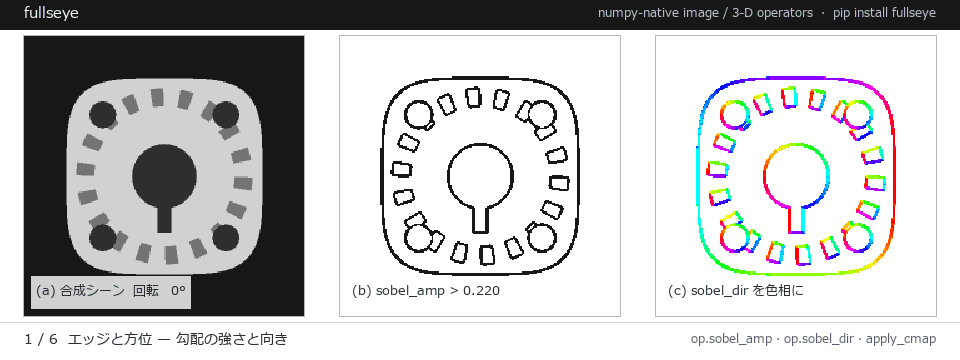
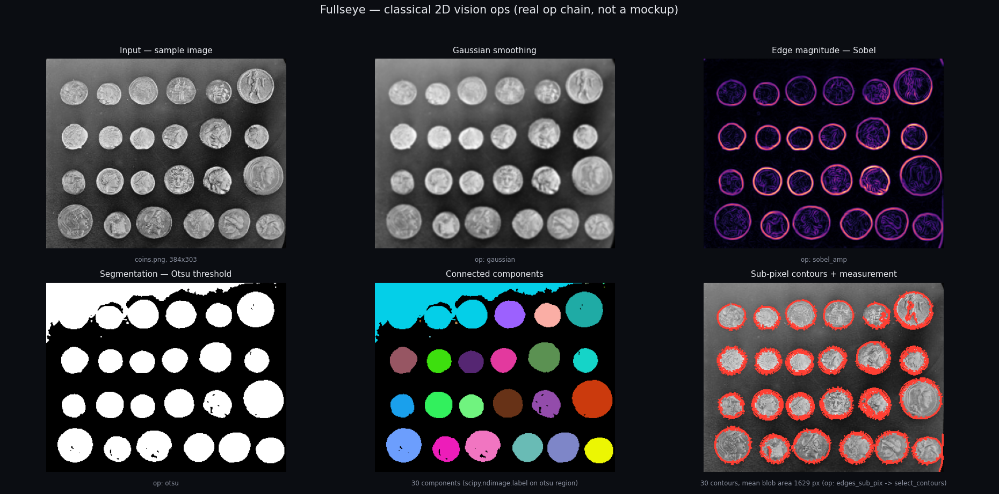
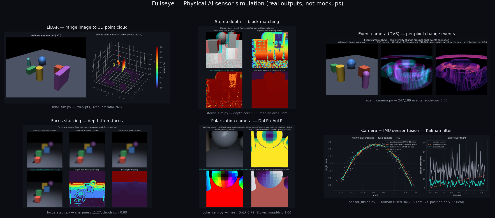

<!-- i18n-source-sha: c3e09847755f -->
# Fullseye Dokumentationsindex

**Language:** [日本語](README.md) · [English](README.en.md) · [简体中文](README.zh.md) · [繁體中文](README.tw.md) · [한국어](README.ko.md) · [Deutsch](README.de.md)

> **Hinweis:** Übersetzt ist bisher nur diese Indexseite. Die einzelnen Dokumente, auf die sie verweist, liegen vorerst ausschließlich auf Japanisch vor.




*Sechs Akte, ausschließlich echte Operator-Ausgaben: Kantenorientierung, Blob-Auswahl, Subpixel-Messung, SDF zu Mesh, LiDAR-Clustering, Objektiv-Defokus.*

**Fullseye** (Arbeitsname imgevolve) ist ein Werkzeug auf HALCON-/HDevelop-Niveau: eine numpy-native Bibliothek von Bildverarbeitungs-Operatoren, dazu eine visuelle Pipeline-Entwurfsumgebung im Stil von HDevelop (Fullseye Studio) und eine ausführende Laufzeitumgebung (FullseyeEngine). Es umfasst rund **942** Operatoren (gezählt in der Registry), bietet für **981/2313** tatsächliche HALCON-Operatoren eine genuine (wirklich gleichwertige) Implementierung und deckt 48 Kategorien ab.

★ **Selten für eine Bildverarbeitungsbibliothek, bringt Fullseye auch virtuelles optisches Design mit** — dünne/dicke Linsen, Raytracing, Seidel-Aberrationen und PSF/MTF, dazu eine Damped-Least-Squares-Optimierung (Levenberg–Marquardt) der Linsenverordnung selbst (`optimize_lens`). Man kann **das abbildende System entwerfen und sein Bild dann mit den obigen Operatoren prüfen — durchgängig**, ein Unterscheidungsmerkmal für Halbleiter und Präzisionsmesstechnik.

> **Fangen Sie hier an → [GETTING_STARTED.de.md](GETTING_STARTED.de.md) (in 5 Minuten lauffähig)**

> **Was es kann → [CAPABILITIES.en.md](CAPABILITIES.en.md)** (nach Vorhaben geordnet) / **Was die PoCs gehärtet haben → [HARDENING.en.md](HARDENING.en.md)** (gefunden, behoben, abgesichert)

> **Ergebnisse von echter Hardware und echten Daten gesucht.** Fullseye wird ohne physische Messaufbauten entwickelt und deshalb gegen virtuelle optische Systeme und simulierte Referenzwerte validiert. Ergebnisse mit echter Hardware oder echten Daten sind sehr willkommen. **Ihre Daten müssen Sie nicht teilen** — reine Ergebnisberichte werden angenommen, und ein Validierungskit (`python -m fullseye.validation_kit`) gibt aus lokalen Daten nur aggregierte Zahlen aus. → [Berichtsformular](https://github.com/furuse-kazufumi/fullseye/issues/new?template=real_validation_report.yml) · [Discussions › Show and tell](https://github.com/furuse-kazufumi/fullseye/discussions/categories/show-and-tell) · [Bewertungsregeln (Englisch)](VALIDATION_CONTRIBUTING.en.md)

---

<!-- trust-block:start -->
<!-- generated by tools/gen_trust_block.py from docs/{test_count,gate_inventory,maturity,op_count_history}.json; edit the data, not this block -->

## Wie geprüft wird

Keine dieser Zahlen ist von Hand geschrieben: `tools/gen_trust_block.py` erzeugt diesen Abschnitt aus Messdateien in `docs/` (`test_count.json`, `gate_inventory.json`, `maturity.json`, `op_count_history.json`), und `tests/test_trust_block.py` schlägt fehl, wenn er davon abweicht. Jede Zahl trägt Version und Datum ihrer Messung.

**22,110 Regressionstests** — in 0.8.1 enthalten, Commit `e720d52d02`, am 2026-10-22 mit `pytest --collect-only` gezählt, mit allen optionalen Backends installiert (ohne sie werden die Tests der fehlenden Backends nicht gesammelt und die Zahl ist kleiner).

### Was einen neu hinzugefügten Operator prüft

Pro Schicht wurde genau ein absichtlich defekter Operator eingefügt und die gesamte Testsuite ausgeführt; gezählt wurden die fehlschlagenden Tests (Mutation Probe). ✓ = ein Gate erkennt diesen Defekt, ✗ = **noch keines**.

- Messung ①: Commit `e97e94bae2`, 2026-10-11, Stand nach 0.6.0 (mit unveröffentlichten Änderungen).

| Schicht | Messung | Verwaltungs-Gates | Verhaltens-Gates | wirft Ausnahme | NaN | falscher Typ | nicht deterministisch | ignoriert Parameter | keine Beschreibung | Beschreibung nur Englisch | akzeptiert leere Eingabe |
|---|---|---|---|---|---|---|---|---|---|---|---|
| 2-D-Kern (`ops.REGISTRY`) | ① | 27 | 10 | ✓ | ✓ | ✓ | ✓ | ✗ | ✓ | ✓ | ✗ |
| n-är | ① | 16 | 5 | ✓ | ✓ | ✓ | ✗ | ✗ | ✓ | ✓ | ✗ |
| Farbe | ① | 28 | 10 | ✓ | ✓ | ✓ | ✓ | ✗ | ✓ | ✓ | ✗ |
| typisiertes Register + `tb_`-Brücke | ① | 29 | 16 | ✓ | ✓ | ✓ | ✓ | ✓ | ✓ | ✓ | ✓ |
| typisiertes Register (ohne Brücke) | ① | 17 | 5 | ✓ | ✓ | ✓ | ✓ | ✓ | ✓ | ✓ | ✓ |
| 3-D-Register | ① | 20 | 7 | ✓ | ✓ | ✓ | ✓ | ✓ | ✓ | ✓ | ✓ |
| nur Fassade | ① | 1 | 1 | ✗ | ✗ | ✗ | ✗ | ✗ | ✓ | ✗ | ✗ |

Verwaltungs-Gates schlagen bei jedem neuen Operator an, auch bei einem korrekten, bis seine Notiz und sein Indexeintrag neu erzeugt sind. Verhaltens-Gates = die weiteren, verschiedenen Tests, die wegen der Art des Defekts fehlschlagen.

Nicht gemessen: plausible, aber falsche Werte (Abstand zur Grundwahrheit), Geschwindigkeit, betriebssystemspezifische Fehler, zwei Defekte zugleich. ✓ heißt, dass mindestens ein Test fehlschlug, nicht dass seine Meldung den Grund erklärt.

### Verifikationsstufe

Die 95 Fähigkeiten, aufgeteilt nach Art der Prüfung (`docs/maturity.json`, von `tools/gen_maturity.py` aus dem aktuellen Stand (pyproject-Version 0.8.1) erzeugt; Stufen erklärt in [MATURITY.md](MATURITY.md)).

| Stufe | Bedeutung | Fähigkeiten |
|---|---|---|
| `research-prototype` | implementiert; Tests oder ein laufendes Beispiel fehlen noch | 0 |
| `verified-synthetic` | automatisch gegen synthetische Grundwahrheit geprüft | 77 |
| `validated-public-real-data` | ein Beispiel mit öffentlichen Messdaten läuft in einem Gate | 18 |
| `validated-hardware` | an Hardware validiert (nur über angenommene externe Berichte) | 0 |

Von 433 Beispielen werden 433 tatsächlich von einem Gate ausgeführt.

### Operatorzahlen pro Version

| Version | Datum | Index gesamt | davon typisiertes Register | HALCON | PoC | Regressionstests |
|---|---|---|---|---|---|---|
| 0.1.0 | 2026-08-30 | — | — | 323 | 0 | 6,246 |
| 0.1.8 | 2026-09-05 | — | — | 323 | 0 | 11,518 |
| 0.1.9 | 2026-09-05 | — | — | 979 | 0 | 11,593 |
| 0.1.11 | 2026-09-15 | 918 | 0 | 979 | 121 | 13,178 |
| 0.2.0 | 2026-09-15 | 1,942 | 1,024 | 979 | 121 | 13,272 |
| 0.3.0 | 2026-10-03 | 2,590 | 1,639 | 980 | 187 | 16,675 |
| 0.4.0 | 2026-10-06 | 3,057 | 2,104 | 980 | 214 | 17,424 |
| 0.5.0 | 2026-10-06 | 3,078 | 2,125 | 980 | 217 | 17,489 |
| 0.6.0 | 2026-10-11 | 3,083 | 2,130 | 981 | 218 | 18,109 |
| 0.7.0 | 2026-10-18 | 3,354 | 2,401 | 982 | 248 | 19,935 |
| 0.8.0 | 2026-10-22 | 3,529 | 2,572 | 982 | 275 | 22,073 |
| 0.8.1 | 2026-10-22 | 3,531 | 2,572 | 982 | 275 | 22,110 |

- Der HALCON-Wert 323 für 0.1.0–0.1.8 ist der damals festgehaltene Wert; ab 0.1.9 beträgt er nach geänderter Zählung 979 (keine 656 neuen Implementierungen).
- 0.2.0 ist die erste Version, deren Index das typisierte Register enthält: 918 → 1,942 ist eine Änderung der Zählweise, keine neue Implementierung (das Register gab es ab 0.1.6, aber außerhalb des Index).

— = für diese Version nicht gemessen. Alle Versionen und Spaltendefinitionen: [OP_COUNT_HISTORY.md](OP_COUNT_HISTORY.md) (Japanisch/Englisch).

<!-- trust-block:end -->

<!-- poc-index:start -->

## PoC-Serie — 276 reale Aufgaben mit Grundwahrheit

Jede hat eine geschlossene oder synthetische Grundwahrheit und ein Nullmodell. Fehlerarten werden getrennt gezählt. Vollständige Liste: [examples/README.md](../examples/README.md).

| Feld | PoC und Befund |
|---|---|
| metrology (68) | [`poc_aoi_ct_traceability`](https://github.com/furuse-kazufumi/fullseye/blob/master/examples/poc_aoi_ct_traceability.py) Matching Full 2-D Inspection to Sampled 3-D Inspection — A Grid Overlaps Itself<br>[`poc_asbuilt_wall_deviation`](https://github.com/furuse-kazufumi/fullseye/blob/master/examples/poc_asbuilt_wall_deviation.py) As-built wall deviation — the bounding box measures the room's heading, not its size<br>[`poc_battery_electrode_breathing`](https://github.com/furuse-kazufumi/fullseye/blob/master/examples/poc_battery_electrode_breathing.py) Measuring electrode breathing in microns — sub-pixel is not enough<br>[`poc_bone_trabecular_thickness`](https://github.com/furuse-kazufumi/fullseye/blob/master/examples/poc_bone_trabecular_thickness.py) Trabecular Thickness, Separation and Bone Volume Fraction — The Plate Model and the Direct Method Disagree on the Same Image<br>[`poc_bump_coplanarity`](https://github.com/furuse-kazufumi/fullseye/blob/master/examples/poc_bump_coplanarity.py) Bump coplanarity versus substrate warpage — subtract too much and the real defect goes with it<br>[`poc_cad_scan_deviation`](https://github.com/furuse-kazufumi/fullseye/blob/master/examples/poc_cad_scan_deviation.py) CAD-to-scan deviation inspection — the fit absorbs the defect and invents a dent<br>[`poc_crack_width`](https://github.com/furuse-kazufumi/fullseye/blob/master/examples/poc_crack_width.py) Concrete Crack Width Is Thinner Than a Pixel — Counting Width Versus Integrating Width<br>[`poc_crack_width_timeseries`](https://github.com/furuse-kazufumi/fullseye/blob/master/examples/poc_crack_width_timeseries.py) Measuring the Growth, Not the Width — Rephotographing the Same Wall Changes What the Error Is<br>[`poc_datacenter_thermal_field`](https://github.com/furuse-kazufumi/fullseye/blob/master/examples/poc_datacenter_thermal_field.py) A 3-D Thermal Field from Sparse Sensors — The Grid's Blind Spot Erases a Rack<br>[`poc_diabolo_model_and_vision`](https://github.com/furuse-kazufumi/fullseye/blob/master/examples/poc_diabolo_model_and_vision.py) Transcribing a Diabolo Model from the Paper and Checking It, then Reading Axis, Spin and Tension from Synthetic Video — Eq. (1b) as Printed Is Dimensionally Wrong and Gives NaN at the Real Dimensions; Closed Forms, an Exact String and MuJoCo as the Truth<br>[`poc_dic_strain`](https://github.com/furuse-kazufumi/fullseye/blob/master/examples/poc_dic_strain.py) Strain From Speckle Images (DIC)<br>[`poc_dimensional_inspection`](https://github.com/furuse-kazufumi/fullseye/blob/master/examples/poc_dimensional_inspection.py) Dimensional Inspection of a Machined Part — Bias and Scatter as Two Numbers<br>[`poc_dose_uniformity_from_grinding`](https://github.com/furuse-kazufumi/fullseye/blob/master/examples/poc_dose_uniformity_from_grinding.py) How Long to Grind for a Uniform Dose — Content Uniformity from Particle Size by Closed Form and Monte Carlo, Inverted through Comminution Laws; the Low CV from Photos Was the Same 12 Images at Different Scales<br>[`poc_fiber_orientation`](https://github.com/furuse-kazufumi/fullseye/blob/master/examples/poc_fiber_orientation.py) Fibre Orientation Distribution — Angles Repeat Every 180 Degrees, and a Naive Mean Is 90 Degrees Off<br>[`poc_gear_tooth_metrology`](https://github.com/furuse-kazufumi/fullseye/blob/master/examples/poc_gear_tooth_metrology.py) Gear Tooth Metrology — Eccentricity Is Order 1, Teeth Are Order z<br>[`poc_geodetic_height_frames`](https://github.com/furuse-kazufumi/fullseye/blob/master/examples/poc_geodetic_height_frames.py) Coordinates Go Wrong by Tens of Metres While Still Looking Plausible<br>[`poc_granular_heap_repose`](https://github.com/furuse-kazufumi/fullseye/blob/master/examples/poc_granular_heap_repose.py) Measuring a Powder Heap from Images — Angle of Repose, Volume, Mass, Flowability and Discharge by Rules, with Closed Forms, Published Values and MuJoCo as the Truth<br>[`poc_grating_interferometry`](https://github.com/furuse-kazufumi/fullseye/blob/master/examples/poc_grating_interferometry.py) Grating Interferometry — Fibre Orientation, Micro-Cracks and Pores That Absorption Cannot See, Read From the Fringe Amplitude (Dark Field)<br>[`poc_gw_detector_pseudo_simulation`](https://github.com/furuse-kazufumi/fullseye/blob/master/examples/poc_gw_detector_pseudo_simulation.py) A Pseudo-Simulation of a Gravitational-Wave Detector — Cavity Optics, the Quantum-Noise Budget and the Matched Filter in Closed Form, Scored on the Real GW150914 Data<br>[`poc_industrial_oct`](https://github.com/furuse-kazufumi/fullseye/blob/master/examples/poc_industrial_oct.py) Industrial OCT — Layer Thickness and Hidden Defects of Paints, Coatings and Multilayer Films, Seen in Depth by the FFT of One Spectral Interferogram<br>[`poc_interferometry_step`](https://github.com/furuse-kazufumi/fullseye/blob/master/examples/poc_interferometry_step.py) How Accurately a White-Light Interferometer Measures a Nanometre Step<br>[`poc_interreflection_fringe_error`](https://github.com/furuse-kazufumi/fullseye/blob/master/examples/poc_interreflection_fringe_error.py) Fringe Projection Misreads Even a White Groove - Separating the Interreflection, Predicting the Error Before Measuring, and Removing It with Micro Phase Shifting<br>[`poc_knife_tactile_toughness`](https://github.com/furuse-kazufumi/fullseye/blob/master/examples/poc_knife_tactile_toughness.py) Holding and Cutting with a Knife by Fingertip Visuotactile Sensing Alone — Toughness, Blade Contact Position and How Long a Handle Can Be Held, without a Wrist Force Sensor; the Existing Reader's Torsion Over-read (+33 % at Half Slip) Fixed by a Numerical Partial-Slip Solution<br>[`poc_laser_line_speckle_floor`](https://github.com/furuse-kazufumi/fullseye/blob/master/examples/poc_laser_line_speckle_floor.py) Speckle Sets the Error Floor of a Laser Sheet-of-Light - It Does Not Average Away, and the Estimator Ranking Flips<br>[`poc_livestock_body_volume`](https://github.com/furuse-kazufumi/fullseye/blob/master/examples/poc_livestock_body_volume.py) Weighing an Animal from Silhouettes — The Error You Can Buy Down, and the One You Cannot<br>[`poc_metal_grain_size`](https://github.com/furuse-kazufumi/fullseye/blob/master/examples/poc_metal_grain_size.py) Metallographic Grain Size — The Planimetric and Intercept Methods Fall Off Different Cliffs<br>[`poc_moire_alignment`](https://github.com/furuse-kazufumi/fullseye/blob/master/examples/poc_moire_alignment.py) Moiré Alignment — Two Invisible 2 µm Gratings Overlaid Turn a 1 nm Shift into a Readable Fringe Phase<br>[`poc_multibeam_bathymetry`](https://github.com/furuse-kazufumi/fullseye/blob/master/examples/poc_multibeam_bathymetry.py) Why the Seafloor Smiles — A Wrong Sound-Speed Profile Breaks Only the Outer Beams<br>[`poc_particle_sizing`](https://github.com/furuse-kazufumi/fullseye/blob/master/examples/poc_particle_sizing.py) Particle Size Distribution From Images — Merging and Edge Cuts Pull Opposite Ways and Cancel<br>[`poc_peg_insertion_tactile`](https://github.com/furuse-kazufumi/fullseye/blob/master/examples/poc_peg_insertion_tactile.py) Reading Peg-in-Hole Insertion through Two Fingertip Membranes — Contact Wrench, Whitney's Contact States, Wall Friction and Wrist Stiffness from Shear Images; at the Wedging Boundary the Wrench Alone Is Blind<br>[`poc_peg_symmetry_search`](https://github.com/furuse-kazufumi/fullseye/blob/master/examples/poc_peg_symmetry_search.py) Cutting a Peg's Rotation Search to 1/n with Its Symmetry — Inserting Square, Hexagonal and Keyed Pegs Checked by Group Identities, Closed Forms and MuJoCo; Friction Shrinks the Hexagon's Chamfer Window from 20.9° to 6.8°<br>[`poc_phase_measuring_deflectometry`](https://github.com/furuse-kazufumi/fullseye/blob/master/examples/poc_phase_measuring_deflectometry.py) Finding Micrometre Dents a Photograph Cannot Show, in the Mirror Image of a Fringe Screen — Phase-Measuring Deflectometry<br>[`poc_photoelasticity`](https://github.com/furuse-kazufumi/fullseye/blob/master/examples/poc_photoelasticity.py) Stress by Photoelasticity — Unwrapping Fails First at the Isotropic Point<br>[`poc_pipe_wall_loss`](https://github.com/furuse-kazufumi/fullseye/blob/master/examples/poc_pipe_wall_loss.py) Pipe Wall Loss on the Unwrapped Map — The Axis You Choose Eats the Invert Corrosion<br>[`poc_polish_wipe_measure`](https://github.com/furuse-kazufumi/fullseye/blob/master/examples/poc_polish_wipe_measure.py) Measuring Grinding, Polishing and Wiping from Images — Removed Depth, Wiped Band Width and Area Checked by Preston's Law, Closed-Form Contact Pressure and MuJoCo; a Compliant Wrist Keeps the Band Even over a 2 mm Height Error while a Stiff Wrist Lifts Off and Leaves Gaps<br>[`poc_powder_grinding_ae`](https://github.com/furuse-kazufumi/fullseye/blob/master/examples/poc_powder_grinding_ae.py) Measuring Mortar Grinding — D50 of the Size Distribution, Comminution Laws, Spread over Three Independent Runs and AE Band Power, against Published Laser-Diffraction Measurements; a Different D50 Definition Is a One-Bin, 12 % Bias<br>[`poc_powder_scoop_pour`](https://github.com/furuse-kazufumi/fullseye/blob/master/examples/poc_powder_scoop_pour.py) Measuring Scooping and Pouring of Powder from Images — the Scooped Amount from Side-View Silhouettes, the Pour Rate from PIV Speed × a Boolean-Model Line Density, within 5 % of MuJoCo's Ball Counts and Line Crossings<br>[`poc_pxrd_phase_peel`](https://github.com/furuse-kazufumi/fullseye/blob/master/examples/poc_pxrd_phase_peel.py) Peeling Phases One at a Time off a 2-D Powder X-ray Diffraction Image — Calibration, Azimuthal Integration, NNLS and the Unknown Phase in the Residual; References from the NIST SRM 640g Certificate and COD CIFs, with the Shared-Model Leak Measured by Deliberate Mismatch<br>[`poc_real_coin_metrology`](https://github.com/furuse-kazufumi/fullseye/blob/master/examples/poc_real_coin_metrology.py) Counting and Measuring Real Coins — A Correct Answer Is Not a Safe One<br>[`poc_robust_profile_filter`](https://github.com/furuse-kazufumi/fullseye/blob/master/examples/poc_robust_profile_filter.py) Deep Scratches Dent the Mean Line — How Much Contamination Robust Gaussian and Spline Filters Survive<br>[`poc_rover_slip_risk_path`](https://github.com/furuse-kazufumi/fullseye/blob/master/examples/poc_rover_slip_risk_path.py) Predicting Wheel Slip with Uncertainty on Real Martian Terrain and Planning a Path that Avoids the Slip Risk — Bekker / Wong–Reece and CVaR on a HiRISE DTM; outside the Data a Gaussian Process Calls a Stuck Slope 'Slip 0.29'<br>[`poc_scan_to_bim_asbuilt`](https://github.com/furuse-kazufumi/fullseye/blob/master/examples/poc_scan_to_bim_asbuilt.py) As-built deviation of a room — the compromise pose is handed to the innocent element<br>[`poc_screw_thread_metrology`](https://github.com/furuse-kazufumi/fullseye/blob/master/examples/poc_screw_thread_metrology.py) Pitch, Flank Angle and Pitch Diameter From a Thread Silhouette — Tilt Shows Up With Opposite Signs on the Two Flanks<br>[`poc_sem_tem_same_particle`](https://github.com/furuse-kazufumi/fullseye/blob/master/examples/poc_sem_tem_same_particle.py) Measuring the Same Particles in Scanning and Transmission Images — Which Is Right, 52 nm or 48 nm?<br>[`poc_sem_wafer_defect_edge_bias`](https://github.com/furuse-kazufumi/fullseye/blob/master/examples/poc_sem_wafer_defect_edge_bias.py) How Much the Bright SEM Edge Inflates a Dimension — the Shape Matches but the Area Grows<br>[`poc_settlement_significance`](https://github.com/furuse-kazufumi/fullseye/blob/master/examples/poc_settlement_significance.py) Did It Settle, or Did We Just Scan It Again — What Changes When You Cut at the Detection Limit<br>[`poc_shape_from_polarization`](https://github.com/furuse-kazufumi/fullseye/blob/master/examples/poc_shape_from_polarization.py) Measuring Black-Gloss and Glass from Polarisation - No Shading, but the Polarisation Remembers the Slope<br>[`poc_simcal_telecentric`](https://github.com/furuse-kazufumi/fullseye/blob/master/examples/poc_simcal_telecentric.py) Calibrating an Imaging Model on a Real Telecentric Image — the Scale Matches the Paper, the Entrance Pupil Is Only 'Farther than 1 m'<br>[`poc_star_astrometry`](https://github.com/furuse-kazufumi/fullseye/blob/master/examples/poc_star_astrometry.py) To What Fraction of a Pixel Can a Star Be Located, and Where Is the Cliff?<br>[`poc_stockpile_volume`](https://github.com/furuse-kazufumi/fullseye/blob/master/examples/poc_stockpile_volume.py) Stockpile Inventory — The Answer Is Fixed by the Ground Nobody Measured<br>[`poc_strain_history`](https://github.com/furuse-kazufumi/fullseye/blob/master/examples/poc_strain_history.py) Strain History in a Creep Test — Cumulative or Direct?<br>[`poc_structure_4d_deterioration`](https://github.com/furuse-kazufumi/fullseye/blob/master/examples/poc_structure_4d_deterioration.py) Re-surveying a structure year by year — when the vantage moves, decay appears to advance<br>[`poc_surface_roughness`](https://github.com/furuse-kazufumi/fullseye/blob/master/examples/poc_surface_roughness.py) How Far Sa / Sq / Sz Survive Sampling and Cutoff<br>[`poc_swarm_obstacle_from_flow`](https://github.com/furuse-kazufumi/fullseye/blob/master/examples/poc_swarm_obstacle_from_flow.py) A Swarm That Flows Like a Fluid Senses an Invisible Obstacle from the Disturbance of Its Velocity Field Alone — Reading the Impact Point and the Obstacle Outline by Tracking and PIV on Overhead Video, from Upstream Before Contact, and Saying Nothing When There Is No Obstacle<br>[`poc_tacdome_large_deformation`](https://github.com/furuse-kazufumi/fullseye/blob/master/examples/poc_tacdome_large_deformation.py) Gating Large-Deformation Contact of a Soft Dome Fingertip Pressed on a Flat Object with a Scaling Law and an Exact Continuum Solution — As Printed, the Linear Coefficient of Eq. (3) Makes the Force of a Cylinder Negative; 2n/(1+n) Is Derived from the Paper's Own Model<br>[`poc_tacscalib_sphere_lut`](https://github.com/furuse-kazufumi/fullseye/blob/master/examples/poc_tacscalib_sphere_lut.py) Calibrating a Vision-Based Tactile Sensor's Illumination on Real Calibration Spheres, with a Gradient LUT as the Second Implementation — the Ball Radius and Hand-Marked Circles as the Truth<br>[`poc_tacsim_elastic_membrane`](https://github.com/furuse-kazufumi/fullseye/blob/master/examples/poc_tacsim_elastic_membrane.py) A Vision-Based Tactile Sensor (Elastic Membrane + Camera), Synthesised and Inverted — Hertz Contact and Photometric Stereo in Closed Form as the Gate, Force Read from a Pressed Sphere<br>[`poc_tacsim_marker_shear`](https://github.com/furuse-kazufumi/fullseye/blob/master/examples/poc_tacsim_marker_shear.py) Reading the Shear Field, Stick/Slip and Tangential Force from a Tactile Sensor's Marker Array — Cattaneo–Mindlin in Closed Form and Finite-Element Nodal Displacements as the Gate<br>[`poc_tactile_dipole_torque`](https://github.com/furuse-kazufumi/fullseye/blob/master/examples/poc_tactile_dipole_torque.py) Reading In-Grasp Tilt and Torsion Torque from a Tactile Sensor's Marker Field with a 'Tactile Dipole' — Gauss's Law Becoming an Identity in the Half-Space as the Gate<br>[`poc_telecentric_metrology`](https://github.com/furuse-kazufumi/fullseye/blob/master/examples/poc_telecentric_metrology.py) Telecentric Lenses for Dimensional Metrology — Move Only the Stop of the Same Lens and the Height-Dependent Magnification Disappears<br>[`poc_tem_ctf_thon_rings`](https://github.com/furuse-kazufumi/fullseye/blob/master/examples/poc_tem_ctf_thon_rings.py) A Virtual Transmission Electron Microscope — Thon Rings Move with Focus, Fine Detail Reverses, and Defocus Is Read from Real Micrographs<br>[`poc_thermal_radiometry`](https://github.com/furuse-kazufumi/fullseye/blob/master/examples/poc_thermal_radiometry.py) A Thermal Image Is Not a Temperature Image — Emissivity, Reflection, and an Uncertainty That Does Not Add<br>[`poc_tree_ring_dendro`](https://github.com/furuse-kazufumi/fullseye/blob/master/examples/poc_tree_ring_dendro.py) Counting tree rings and extracting the width series — ring count and width correlation fail separately<br>[`poc_virtual_sem_kv_cd_bse`](https://github.com/furuse-kazufumi/fullseye/blob/master/examples/poc_virtual_sem_kv_cd_bse.py) A Virtual SEM — Fire Electrons One by One into the Solid, and the Image and the Measured Line Width Change with the Voltage (Scored against Measured Data)<br>[`poc_water_level`](https://github.com/furuse-kazufumi/fullseye/blob/master/examples/poc_water_level.py) River Stage From an Oblique Photo — Ignoring Perspective Bends the Row-Number Error Into an Arc<br>[`poc_weld_bead_profile`](https://github.com/furuse-kazufumi/fullseye/blob/master/examples/poc_weld_bead_profile.py) Weld Bead From a Laser-Triangulation Profile — The Sin of Writing 0 Where Nothing Was Measured<br>[`poc_weld_bead_scan_angle`](https://github.com/furuse-kazufumi/fullseye/blob/master/examples/poc_weld_bead_scan_angle.py) Light-section scanning of a weld bead — resolution and occlusion share one knob<br>[`poc_wound_area_tracking`](https://github.com/furuse-kazufumi/fullseye/blob/master/examples/poc_wound_area_tracking.py) Wound Area Over Time — Calibration Error Enters the Area Squared |
| imgmetrics (47) | [`poc_agv_fleet`](https://github.com/furuse-kazufumi/fullseye/blob/master/examples/poc_agv_fleet.py) A Warehouse That Does Not Jam When Vehicles Run Late — A Correct Plan Alone Still Stops an AGV Fleet<br>[`poc_air_hockey_intercept`](https://github.com/furuse-kazufumi/fullseye/blob/master/examples/poc_air_hockey_intercept.py) Tracking, Predicting and Returning an Air-Hockey Puck with a Five-Bar Linkage — No Learning, Closed Forms and an External Simulator as the Gates<br>[`poc_am_thermal_to_ct`](https://github.com/furuse-kazufumi/fullseye/blob/master/examples/poc_am_thermal_to_ct.py) From Melt-Pool Thermography to X-ray CT in Metal Additive Manufacturing — Raw Signal Is Not Temperature, Time Axis and Pixel Pitch, and Powder That Clings Only to Down-Facing Surfaces<br>[`poc_ball_bounce`](https://github.com/furuse-kazufumi/fullseye/blob/master/examples/poc_ball_bounce.py) Measuring a Table-Tennis Ball the Way the Pioneers Did — Multi-Camera Tracking, Triangulation, Trajectory Prediction, Bounce and Spin, Scored by Theorems on a Table with Ground Truth<br>[`poc_car_parking`](https://github.com/furuse-kazufumi/fullseye/blob/master/examples/poc_car_parking.py) How a Car Turns Shortest — Dubins and Reeds–Shepp in Closed Form, and Hybrid A* Parallel Parking on an Occupancy Grid<br>[`poc_carla_bridge`](https://github.com/furuse-kazufumi/fullseye/blob/master/examples/poc_carla_bridge.py) One Scene, Two Worlds — Scoring a Photoreal Simulator's Depth Against a Closed-Form Truth, Side by Side with Our Own World<br>[`poc_connectome_across_decades`](https://github.com/furuse-kazufumi/fullseye/blob/master/examples/poc_connectome_across_decades.py) How Much Does a Hand-Traced Wiring Diagram from 40 Years Ago Overlap Today's Adult Worms? — The Era Difference Next to the Individual Difference<br>[`poc_connectome_across_worms`](https://github.com/furuse-kazufumi/fullseye/blob/master/examples/poc_connectome_across_worms.py) How Much of the Wiring Do Two Genetically Identical Worms Share? — Counting the Connections Present in All 8 Worms of a Developmental Series<br>[`poc_connectome_lr_symmetry`](https://github.com/furuse-kazufumi/fullseye/blob/master/examples/poc_connectome_lr_symmetry.py) Is the Worm's Wiring Bilaterally Symmetric? — The L/R-Swap Jaccard, Bracketed by a Closed Form and a Degree-Preserving Null<br>[`poc_driving_commonroad`](https://github.com/furuse-kazufumi/fullseye/blob/master/examples/poc_driving_commonroad.py) Driving Our Own Driver Through Someone Else's Scenario and Submitting to Someone Else's Judge — CommonRoad Public Scenarios and TUM's Official Checker<br>[`poc_driving_crossing`](https://github.com/furuse-kazufumi/fullseye/blob/master/examples/poc_driving_crossing.py) Level Crossings and Right of Way — Stop and Look, Never Enter During the Alarm or Into a Blocked Exit, Yield to the Wider Road<br>[`poc_driving_decisions`](https://github.com/furuse-kazufumi/fullseye/blob/master/examples/poc_driving_decisions.py) Decision Scenes — Mirrors, Predicting Amber from the Pedestrian Light, Giving Way to an Ambulance, Waiting for a Bus<br>[`poc_driving_endless_map`](https://github.com/furuse-kazufumi/fullseye/blob/master/examples/poc_driving_endless_map.py) An Endless Map — Tiles Made Around the Car, Far Tiles Dropped, 50 km Without a Break<br>[`poc_driving_humanoids`](https://github.com/furuse-kazufumi/fullseye/blob/master/examples/poc_driving_humanoids.py) Humanoids on the Crosswalk — Keep the Car's Physics Exact, Draw the Walkers Cheaply<br>[`poc_driving_japan_town`](https://github.com/furuse-kazufumi/fullseye/blob/master/examples/poc_driving_japan_town.py) Building a Real Japanese Town in Our Own World and Driving It — Roads from OpenStreetMap, Buildings from PLATEAU, Japanese Furniture and Rules<br>[`poc_driving_lateral`](https://github.com/furuse-kazufumi/fullseye/blob/master/examples/poc_driving_lateral.py) Lateral Motion — Slowing Before a Bend, Staying in the Lane, Keeping Left to Turn Left, Off-Tracking<br>[`poc_driving_longitudinal`](https://github.com/furuse-kazufumi/fullseye/blob/master/examples/poc_driving_longitudinal.py) Giving the Car Inertia and Slopes — Stopping Just Before the Line with Reaction and Braking Distance, and a Hill Start Without Rolling Back<br>[`poc_driving_pass`](https://github.com/furuse-kazufumi/fullseye/blob/master/examples/poc_driving_pass.py) Overtaking and What You Cannot See — Wait for Sight Distance, Return Once in the Mirror, Do Not Obstruct the Ring, and Why Curve Mirrors Make Cars Look Far<br>[`poc_driving_school`](https://github.com/furuse-kazufumi/fullseye/blob/master/examples/poc_driving_school.py) The Driving School Opens — Cars and Signals on a Regulation Loop Course, Seen by LiDAR and Camera, Scored by Theorems and Identities<br>[`poc_driving_town`](https://github.com/furuse-kazufumi/fullseye/blob/master/examples/poc_driving_town.py) Assembling One Town — Auto-Joining Driving-School Elements, Driving Through from Entry to Exit, and Scoring Every Stop Line on the Way<br>[`poc_driving_traffic`](https://github.com/furuse-kazufumi/fullseye/blob/master/examples/poc_driving_traffic.py) Moving Traffic and Blind Spots — a Child Behind a Parked Car, Meeting Oncoming Traffic, a Bus Stop, Bad Drivers<br>[`poc_driving_weather`](https://github.com/furuse-kazufumi/fullseye/blob/master/examples/poc_driving_weather.py) Sun and Weather — When the Morning Sun Hides the Signal, How Fast You May Drive in Fog, Wet Roads and Headlamps at Night<br>[`poc_em_split_merge_score`](https://github.com/furuse-kazufumi/fullseye/blob/master/examples/poc_em_split_merge_score.py) Scoring Neuron Segmentations from Electron Microscopy — Over-Splitting and Over-Merging as Two Separate Numbers<br>[`poc_em_wiring_errors`](https://github.com/furuse-kazufumi/fullseye/blob/master/examples/poc_em_wiring_errors.py) Where Segmentation Errors Break the Wiring Diagram — Pixel Scores Overweight Splits and Underweight Merges<br>[`poc_food_cutting_measure`](https://github.com/furuse-kazufumi/fullseye/blob/master/examples/poc_food_cutting_measure.py) Measuring Food Cutting from Images — Knife Tracking, Slice Thickness, Cut-Surface Roughness and Cutting Force from Wrist Deflection, with Closed Forms and MuJoCo as the Truth<br>[`poc_iqa_fsim_gmsd_vif`](https://github.com/furuse-kazufumi/fullseye/blob/master/examples/poc_iqa_fsim_gmsd_vif.py) Perceptual Indices FSIM / FSIMc / GMSD / VIF Matched to Four Digits Against an External Truth — TID2013's Three Author-Value Files and the Published Rank-Correlation Tables<br>[`poc_iqa_tid2013`](https://github.com/furuse-kazufumi/fullseye/blob/master/examples/poc_iqa_tid2013.py) Measuring Image-Quality Metrics Against a Public Ground Truth — TID2013's 3,000 Images × 971 Observers and the Authors' Published Values as the Gate<br>[`poc_kendama`](https://github.com/furuse-kazufumi/fullseye/blob/master/examples/poc_kendama.py) Kendama the Way the Pioneers Did It — A True-to-Shape Kendama Filmed by Two Cameras, the Ball's Flight Predicted from Images Alone and Caught in the Big, Small and Base Cups<br>[`poc_mt_hidden_fault`](https://github.com/furuse-kazufumi/fullseye/blob/master/examples/poc_mt_hidden_fault.py) Every Sensor Reads Normal, Yet the Machine Is Failing — How Much the MT Method Recovers from Univariate 3σ<br>[`poc_peg_failure_recovery`](https://github.com/furuse-kazufumi/fullseye/blob/master/examples/poc_peg_failure_recovery.py) Detecting and Recovering Peg-Insertion Failures with a Rule Table — Whitney's Contact States Instead of a VLM, MuJoCo as the Truth<br>[`poc_pegsim_insertion`](https://github.com/furuse-kazufumi/fullseye/blob/master/examples/poc_pegsim_insertion.py) Peg-in-Hole with a Compliant Wrist — Whitney's Quasi-Static Geometry as the Gate, a Wrist Camera to Centre the Peg, MuJoCo Contacts to Check It<br>[`poc_physarum_maze`](https://github.com/furuse-kazufumi/fullseye/blob/master/examples/poc_physarum_maze.py) Slime-Mould Tubes Solve the Maze — Thickening and Thinning Alone Converge to the Shortest Path, Bracketed by a Theorem and Dijkstra<br>[`poc_physarum_transport`](https://github.com/furuse-kazufumi/fullseye/blob/master/examples/poc_physarum_transport.py) Slime Mould Solves Optimal Transport — Make the Source and Sink Mass Distributions and the Same Tube Dynamics Converge to the Earth Mover's Distance<br>[`poc_residue_crt`](https://github.com/furuse-kazufumi/fullseye/blob/master/examples/poc_residue_crt.py) Angles and Shifts No Single Phase Can Pin Down, Fixed by Bundling Phases of Different Periods — the Chinese Remainder Theorem in Images<br>[`poc_segmentation_gauntlet`](https://github.com/furuse-kazufumi/fullseye/blob/master/examples/poc_segmentation_gauntlet.py) The Segmentation Gauntlet — Ten Methods Across Six Worlds With Ground Truth, and Which Measure Is Blind to Which Failure<br>[`poc_skeleton_run_length_vs_voi`](https://github.com/furuse-kazufumi/fullseye/blob/master/examples/poc_skeleton_run_length_vs_voi.py) Run Length Forgives No Small Merge — ERL and VOI Weigh the Same Error Differently<br>[`poc_spc`](https://github.com/furuse-kazufumi/fullseye/blob/master/examples/poc_spc.py) Is the Process in Control, and Is It Capable? — Statistical Process Control from Closed-Form Alone<br>[`poc_swc_tree_truth`](https://github.com/furuse-kazufumi/fullseye/blob/master/examples/poc_swc_tree_truth.py) Grading Skeleton Measurement on Real Trees — NeuroMorpho SWC as Ground Truth, and What Projection Breaks<br>[`poc_table_tennis_bounce`](https://github.com/furuse-kazufumi/fullseye/blob/master/examples/poc_table_tennis_bounce.py) Filming a Bouncing Table-Tennis Ball with a High-Speed Camera and Reading Restitution and Friction — Checked Against Published Values<br>[`poc_table_tennis_rally_loop`](https://github.com/furuse-kazufumi/fullseye/blob/master/examples/poc_table_tennis_rally_loop.py) Reading Errors End the Table-Tennis Rally — How Much Noise and Latency Move the Landing Point, in Closed Form Before the Shot<br>[`poc_table_tennis_spin`](https://github.com/furuse-kazufumi/fullseye/blob/master/examples/poc_table_tennis_spin.py) Filming a Spinning Table-Tennis Ball and Reading Its Spin Two Ways — From the Curve and From the Markings<br>[`poc_text_region_truth`](https://github.com/furuse-kazufumi/fullseye/blob/master/examples/poc_text_region_truth.py) Where Is the Text, Without a Recogniser — Grading a Stroke-Width Detector on Text We Drew Ourselves<br>[`poc_ttc_rss`](https://github.com/furuse-kazufumi/fullseye/blob/master/examples/poc_ttc_rss.py) Time to Collision and Safe Distance — Optical-Flow τ and the RSS Closed Forms, Scored by the Driving-School World's Truth<br>[`poc_world_terrain`](https://github.com/furuse-kazufumi/fullseye/blob/master/examples/poc_world_terrain.py) Widening the World — Closed-Form Terrain, World-Space Materials and Procedural Trees and Pedestrians Win the Focus of Expansion Back from Flow<br>[`poc_worm_core_persists`](https://github.com/furuse-kazufumi/fullseye/blob/master/examples/poc_worm_core_persists.py) The Worm Brain's Core Is There from Birth — Counting the Cells That Stay in the Deepest Shell Across 8 Developmental Stages<br>[`poc_worm_neurites_grow`](https://github.com/furuse-kazufumi/fullseye/blob/master/examples/poc_worm_neurites_grow.py) How Much Do a Worm's Neurites Grow from Birth to Adulthood? — Measuring Eight Animals' Skeletons with the Tree Ops and Setting the Result Beside the Paper<br>[`poc_worm_synapses_vs_neurites`](https://github.com/furuse-kazufumi/fullseye/blob/master/examples/poc_worm_synapses_vs_neurites.py) Do Synapses Grow in Proportion to Neurites? — Shape Growth and Wiring Growth Set Side by Side, Cell by Cell, in Eight Worms |
| optics_sensing (30) | [`poc_chromatic_confocal`](https://github.com/furuse-kazufumi/fullseye/blob/master/examples/poc_chromatic_confocal.py) Chromatic Confocal Displacement Sensor — A Rainbow Ruler from Glass Dispersion, Reading Height from the Colour that Comes Back<br>[`poc_dual_energy_xray`](https://github.com/furuse-kazufumi/fullseye/blob/master/examples/poc_dual_energy_xray.py) Bone and Glass in Meat, Separated by Material with Two X-ray Energies (Dual-Energy and Photon-Counting X-ray)<br>[`poc_fiber_light_guide`](https://github.com/furuse-kazufumi/fullseye/blob/master/examples/poc_fiber_light_guide.py) Optical Fibres and Light Guides — From the Material Table's Fused Silica to Modes, Dispersion, Mode Field and Illumination Efficiency<br>[`poc_hyperspectral_foreign_matter`](https://github.com/furuse-kazufumi/fullseye/blob/master/examples/poc_hyperspectral_foreign_matter.py) Sorting Look-Alike Foreign Matter with Hyperspectral NIR — Two Real Datasets (Plastic Flakes, Foreign Objects on Pork Belly) and a Material-Table Simulation of the Failure Modes<br>[`poc_itof_multifreq`](https://github.com/furuse-kazufumi/fullseye/blob/master/examples/poc_itof_multifreq.py) Indirect Time of Flight, Multi-Frequency — Higher Frequencies Measure Finer, but Wrapping, Multipath, Flying Pixels and Harmonics Break It<br>[`poc_lens_file_roundtrip`](https://github.com/furuse-kazufumi/fullseye/blob/master/examples/poc_lens_file_roundtrip.py) Reading a Lens Design File (.zmx), Analysing It, Fixing It and Writing It Back — Scored Against Two Other Readers and a Round Trip<br>[`poc_lens_global_search`](https://github.com/furuse-kazufumi/fullseye/blob/master/examples/poc_lens_global_search.py) Glass Substitution and Multi-Start Search — Scored Against the Thin-Achromat Closed Form and the Third-Order Best-Form Bending<br>[`poc_lens_merit_operands`](https://github.com/furuse-kazufumi/fullseye/blob/master/examples/poc_lens_merit_operands.py) Designing a Triplet from a Table of Requirements — A Merit Function with Edge-Thickness, Centre-Thickness and Air-Gap Bounds, Scored Against Closed Forms and an Independent Implementation<br>[`poc_lens_solves_afocal`](https://github.com/furuse-kazufumi/fullseye/blob/master/examples/poc_lens_solves_afocal.py) Keeping a Design's Relations as Solves — A Double-Gauss Type Whose Focus and F-Number Follow the Stop, Afocal Telescopes, a Curved Image Surface and Odd Aspheres<br>[`poc_lens_tolerancing`](https://github.com/furuse-kazufumi/fullseye/blob/master/examples/poc_lens_tolerancing.py) Budgeting Lens Manufacturing Tolerances through MTF, Yield, and Compensator Travel<br>[`poc_lockin_imaging`](https://github.com/furuse-kazufumi/fullseye/blob/master/examples/poc_lockin_imaging.py) Per-Pixel Quadrature Demodulation (Lock-in) — Ring-Illumination Normals, Coded-Light Daylighting and Lock-in Thermography, Scored Against Closed Forms and the Rice Phase Distribution<br>[`poc_material_optical_library`](https://github.com/furuse-kazufumi/fullseye/blob/master/examples/poc_material_optical_library.py) A Material Optical-Property Library — 86 Glasses, Crystals, Semiconductors, Metals, Liquids and Plastics in One Table, Scored on Catalogue Values and a Second Implementation<br>[`poc_nir_silicon_transmission`](https://github.com/furuse-kazufumi/fullseye/blob/master/examples/poc_nir_silicon_transmission.py) Near-Infrared Inspection Through a Silicon Wafer — Choosing the LED Wavelength from the Source × Wafer × Sensor Integral<br>[`poc_noncoaxial_optics`](https://github.com/furuse-kazufumi/fullseye/blob/master/examples/poc_noncoaxial_optics.py) Non-Coaxial Optics — a Coaxial-Illumination Beamsplitter Paints a False Defect on a Mirror-Like Part, Removed by a Coating or a Wedge; Fold Mirrors Shrink the Machine<br>[`poc_omni360_inspection`](https://github.com/furuse-kazufumi/fullseye/blob/master/examples/poc_omni360_inspection.py) Measurable Omnidirectional Inspection, Stereo Display and Moving Viewports<br>[`poc_optics_drawings`](https://github.com/furuse-kazufumi/fullseye/blob/master/examples/poc_optics_drawings.py) Optical Drawings Straight from the Calculation — Lens Layouts, Vision-Setup Drawings and ISO 10110 Element Drawings as SVG / DXF, Scored by Reading the Written Files Back<br>[`poc_photograph_through_prescription`](https://github.com/furuse-kazufumi/fullseye/blob/master/examples/poc_photograph_through_prescription.py) Photographing a 3-D Scene Through the Actual Lens Prescription — Depth of Field, Cat's-Eye Bokeh, Corner Illumination, Colour Fringes and Ghosts, Scored Against Closed Forms, Existing Ops and an Independent Trace<br>[`poc_pixel_shift`](https://github.com/furuse-kazufumi/fullseye/blob/master/examples/poc_pixel_shift.py) Pixel-Shift Imaging — Shift the Sensor One Pixel and False Colour Vanishes, Half a Pixel and Aliasing Vanishes; the MTF Does Not Rise<br>[`poc_plenoptic_camera`](https://github.com/furuse-kazufumi/fullseye/blob/master/examples/poc_plenoptic_camera.py) A Prescription-Based Plenoptic Camera<br>[`poc_pocket_interreflection`](https://github.com/furuse-kazufumi/fullseye/blob/master/examples/poc_pocket_interreflection.py) Counting Interreflection in a Machined Pocket to Convergence — The Direct-Light Model Fits with Albedo 1.32, the Converged Model Returns the Truth<br>[`poc_simcal_pixel_shift`](https://github.com/furuse-kazufumi/fullseye/blob/master/examples/poc_simcal_pixel_shift.py) Calibrating Pixel-Shift Offsets and Pixel Aperture from the Images — Where Only Stripes Are Seen, the Shift Is Fixed in One Direction Only<br>[`poc_simcal_thin_film`](https://github.com/furuse-kazufumi/fullseye/blob/master/examples/poc_simcal_thin_film.py) Calibrating a Thin-Film Model to Real Images — and Giving No Number to What the Data Do Not Determine<br>[`poc_spectrometer_illumination`](https://github.com/furuse-kazufumi/fullseye/blob/master/examples/poc_spectrometer_illumination.py) Spectrometer and Illumination Trains — Where the Bandwidth Comes From, and Whether the Lamp Shows in the Field<br>[`poc_tdi_linescan`](https://github.com/furuse-kazufumi/fullseye/blob/master/examples/poc_tdi_linescan.py) TDI Line Scan and Line-Scan Lenses — Stages Reveal the Defects, a Sync Error Smears Them, and a C-Mount Lens Loses the Ends of a Long Sensor<br>[`poc_thin_film_reflectometry`](https://github.com/furuse-kazufumi/fullseye/blob/master/examples/poc_thin_film_reflectometry.py) Thin-Film Thickness by Spectral Reflectometry — Scored on Public Measured Data, then Fringes, Interference Colours, FFT versus Model Fit and Thickness Maps<br>[`poc_tof_camera`](https://github.com/furuse-kazufumi/fullseye/blob/master/examples/poc_tof_camera.py) Indirect and Direct Time of Flight on One 3-D Scene — Multipath, Mixed Pixels, Pile-up and Volume Error<br>[`poc_water_inspection_images`](https://github.com/furuse-kazufumi/fullseye/blob/master/examples/poc_water_inspection_images.py) How Water Looks in Inspection Images — Pool-Floor Caustics, a Bottle from the Side, a Wet Plate and a Hull Under Water, Scored Against Closed Forms and Second Methods<br>[`poc_water_transparent_media`](https://github.com/furuse-kazufumi/fullseye/blob/master/examples/poc_water_transparent_media.py) Water and Transparent Media — Ocean Waves, Surface Refraction, Colour Under Water and the Caustic of a Bottle, Scored Against Closed Forms, Published Values and Second Implementations<br>[`poc_zmx_public_verify`](https://github.com/furuse-kazufumi/fullseye/blob/master/examples/poc_zmx_public_verify.py) Verifying Public .zmx Prescriptions Independently and Scoring Them as Inspection Lenses<br>[`poc_zoom_configurations`](https://github.com/furuse-kazufumi/fullseye/blob/master/examples/poc_zoom_configurations.py) A Zoom Lens as Differences of One Prescription — Scored Against the Two-Thin-Lens Closed Form and a Round Trip Through the Design File's Multi-Configuration Table |
| analysis (20) | [`poc_attention_identities`](https://github.com/furuse-kazufumi/fullseye/blob/master/examples/poc_attention_identities.py) Every Speedup Is the Same Arithmetic Regrouped: Scoring Attention with Identities<br>[`poc_beats_fringes_and_screens`](https://github.com/furuse-kazufumi/fullseye/blob/master/examples/poc_beats_fringes_and_screens.py) One Beat — A Two-Slit Fringe and a Print Moire Are the Same Mathematics<br>[`poc_calipers_under_illusion`](https://github.com/furuse-kazufumi/fullseye/blob/master/examples/poc_calipers_under_illusion.py) Auditing the Instrument with Illusions - Where a Caliper Fails, and Why<br>[`poc_complex_plane_fields`](https://github.com/furuse-kazufumi/fullseye/blob/master/examples/poc_complex_plane_fields.py) Seeing the Complex Plane as an Area — When the Picture Proves the Theorem<br>[`poc_connectome_motor_bottleneck`](https://github.com/furuse-kazufumi/fullseye/blob/master/examples/poc_connectome_motor_bottleneck.py) Motor Quantisation — Where the Command Dimension Collapses Between Brain and Muscle (the Fly's Neck and an RL Policy's Joints on One Scale)<br>[`poc_em_branch_territory`](https://github.com/furuse-kazufumi/fullseye/blob/master/examples/poc_em_branch_territory.py) Branch Territories — Handing Every Voxel Its Nearest Branch, Not Just Its Distance, Makes Per-Branch Volume and Radius Countable<br>[`poc_endless_zoom_and_turning_solids`](https://github.com/furuse-kazufumi/fullseye/blob/master/examples/poc_endless_zoom_and_turning_solids.py) Endless Zooms and Turning Solids: Making the Return Itself the Ground Truth<br>[`poc_four_dimensions_by_three_d_tools`](https://github.com/furuse-kazufumi/fullseye/blob/master/examples/poc_four_dimensions_by_three_d_tools.py) Scoring Four-Dimensional Claims with Ordinary Three-Dimensional Operators<br>[`poc_geodetic_benchmarks_real`](https://github.com/furuse-kazufumi/fullseye/blob/master/examples/poc_geodetic_benchmarks_real.py) There Are Two Kinds of Height, for Real — Putting a Height-Frame Mix-Up Under a Detector with 523 Published Survey Marks<br>[`poc_gravitational_lens_invariants`](https://github.com/furuse-kazufumi/fullseye/blob/master/examples/poc_gravitational_lens_invariants.py) Scoring Gravitational-Lens Images with Ordinary Industrial Measurement Operators<br>[`poc_illusions_and_perpetual_drawing`](https://github.com/furuse-kazufumi/fullseye/blob/master/examples/poc_illusions_and_perpetual_drawing.py) Scoring Endlessly Generated Pictures with Identities, Not with the Eye<br>[`poc_measurement_system_analysis`](https://github.com/furuse-kazufumi/fullseye/blob/master/examples/poc_measurement_system_analysis.py) How Much of That Number Is Your Measuring - Gauge R&R and Measurement Uncertainty<br>[`poc_microns_brain_wave`](https://github.com/furuse-kazufumi/fullseye/blob/master/examples/poc_microns_brain_wave.py) The MICrONS Brain Wave — How Much of the Measured Response Does the Wiring Explain in 1 mm^3 of Visual Cortex<br>[`poc_one_stroke_epicycles`](https://github.com/furuse-kazufumi/fullseye/blob/master/examples/poc_one_stroke_epicycles.py) A Photograph as One Line, Drawn by Rotating Circles — Tone, Stipple, Tour, Fourier Series, G-code<br>[`poc_periodic_video_boundary`](https://github.com/furuse-kazufumi/fullseye/blob/master/examples/poc_periodic_video_boundary.py) Testing the Periodic Boundary of Temporal Operators with a Seamless Loop<br>[`poc_pod_lighting`](https://github.com/furuse-kazufumi/fullseye/blob/master/examples/poc_pod_lighting.py) The Resolution Formula Does Not Tell You What You Will Find - Probability of Detection per Lighting (MIL-HDBK-1823A)<br>[`poc_theorems_as_pictures`](https://github.com/furuse-kazufumi/fullseye/blob/master/examples/poc_theorems_as_pictures.py) Theorems as Gates — Apollonian Gaskets, Ford Circles, Geodesic Domes, Phyllotaxis, IFS, Space-Filling Curves<br>[`poc_vanishing_detail_and_morphing_area`](https://github.com/furuse-kazufumi/fullseye/blob/master/examples/poc_vanishing_detail_and_morphing_area.py) The Exact Distance at Which Detail Vanishes, and the Area of a Changing Shape<br>[`poc_what_a_picture_cannot_check`](https://github.com/furuse-kazufumi/fullseye/blob/master/examples/poc_what_a_picture_cannot_check.py) What a Picture Cannot Check — Scoring Dynamical Systems and Minimal Surfaces by Identity and Definition<br>[`poc_zernike_aberrations`](https://github.com/furuse-kazufumi/fullseye/blob/master/examples/poc_zernike_aberrations.py) Scoring an Aberration as a Picture: Zernike Polynomials and the Point Spread Function |
| diagnostics (10) | [`poc_bearing_diagnosis`](https://github.com/furuse-kazufumi/fullseye/blob/master/examples/poc_bearing_diagnosis.py) Rolling-Bearing Diagnosis — How Deep in Noise Can It Still Be Caught?<br>[`poc_cold_chain_excursion`](https://github.com/furuse-kazufumi/fullseye/blob/master/examples/poc_cold_chain_excursion.py) The Cold-Chain Temperature Record — Where You Taped the Logger Is the Verdict<br>[`poc_fabric_defect`](https://github.com/furuse-kazufumi/fullseye/blob/master/examples/poc_fabric_defect.py) Defects Buried in a Periodic Background — What a Pooled ROC Hides<br>[`poc_machine_condition_fusion`](https://github.com/furuse-kazufumi/fullseye/blob/master/examples/poc_machine_condition_fusion.py) Fusing thermal, vibration and geometry for machine health — three sensors, one fact<br>[`poc_prnu_camera_fingerprint`](https://github.com/furuse-kazufumi/fullseye/blob/master/examples/poc_prnu_camera_fingerprint.py) Camera Fingerprints (PRNU): Which Camera Took This? — The Fingerprint Grows With Frame Count and Dies at the Save Button<br>[`poc_pv_thermal_survey`](https://github.com/furuse-kazufumi/fullseye/blob/master/examples/poc_pv_thermal_survey.py) Drone Thermography of a PV Plant — You Think You Are Measuring Temperature Difference, but You Are Measuring Wind and Viewing Angle<br>[`poc_solar_el_inspection`](https://github.com/furuse-kazufumi/fullseye/blob/master/examples/poc_solar_el_inspection.py) Power loss from solar-cell EL images — dark is not the same as inactive<br>[`poc_solder_fillet_aoi`](https://github.com/furuse-kazufumi/fullseye/blob/master/examples/poc_solder_fillet_aoi.py) Solder fillet AOI — three ring lights are a 3-level tilt quantiser, and 70 % of the fillet height sits in the dark<br>[`poc_thermography_ndt`](https://github.com/furuse-kazufumi/fullseye/blob/master/examples/poc_thermography_ndt.py) Depth of a Subsurface Defect by Pulsed Thermography<br>[`poc_weld_radiograph_porosity`](https://github.com/furuse-kazufumi/fullseye/blob/master/examples/poc_weld_radiograph_porosity.py) Porosity in Weld Radiographs — Closing With the Share of Images Misgraded by One Class |
| segmentation (9) | [`poc_active_contours`](https://github.com/furuse-kazufumi/fullseye/blob/master/examples/poc_active_contours.py) Active Contours and Level Sets — Checking With Closed Forms How a Contour Shrinks, Enters a Concavity and Stops at an Edge<br>[`poc_cell_counting`](https://github.com/furuse-kazufumi/fullseye/blob/master/examples/poc_cell_counting.py) Counting Overlapping Cells — Count, Over-Segmentation and Under-Segmentation as Three Numbers<br>[`poc_dense_bubble_count`](https://github.com/furuse-kazufumi/fullseye/blob/master/examples/poc_dense_bubble_count.py) Counting Dense Bubbles — When the Overlap Is Too Deep to Decide, Return an Interval Instead of a Count<br>[`poc_graph_hierarchy_segmentation`](https://github.com/furuse-kazufumi/fullseye/blob/master/examples/poc_graph_hierarchy_segmentation.py) Graph, Hierarchical and Threshold Segmentation — Max Flow = Min Cut, Ultrametrics, and Turning a Knob From Coarse to Fine<br>[`poc_leaf_disease_area`](https://github.com/furuse-kazufumi/fullseye/blob/master/examples/poc_leaf_disease_area.py) Leaf disease severity — colour axes survive the lighting; the grade is decided by the leaf mask and the edge convention<br>[`poc_mri_bias_field`](https://github.com/furuse-kazufumi/fullseye/blob/master/examples/poc_mri_bias_field.py) MRI Bias Field and Tissue Area — Grey and White Matter Fail in Opposite Directions, and the Sum Hides It<br>[`poc_timelapse_growth`](https://github.com/furuse-kazufumi/fullseye/blob/master/examples/poc_timelapse_growth.py) A Growth Time-Lapse as Space-Time Connected Components<br>[`poc_vegetation_cover`](https://github.com/furuse-kazufumi/fullseye/blob/master/examples/poc_vegetation_cover.py) Counting Crop Green — Ground Truth as Per-Pixel Leaf Area Fraction<br>[`poc_weed_rice_ratio`](https://github.com/furuse-kazufumi/fullseye/blob/master/examples/poc_weed_rice_ratio.py) How Much Weed Is in the Paddy — Separating Weed Pixels by Colour and Texture Alone, and Grading Cover at Declared Edges |
| geometry (7) | [`poc_dfm_thickness_overhang`](https://github.com/furuse-kazufumi/fullseye/blob/master/examples/poc_dfm_thickness_overhang.py) Manufacturability from geometry alone — faces that sit on the threshold flip when you smooth them<br>[`poc_mesh_quality_repair`](https://github.com/furuse-kazufumi/fullseye/blob/master/examples/poc_mesh_quality_repair.py) Repair the mesh, then measure — the defect count clears, the quantity does not<br>[`poc_pallet_load_utilization`](https://github.com/furuse-kazufumi/fullseye/blob/master/examples/poc_pallet_load_utilization.py) Pallet load utilization — one number gives voids and overhang the same value<br>[`poc_panorama_drift`](https://github.com/furuse-kazufumi/fullseye/blob/master/examples/poc_panorama_drift.py) Chain the Neighbours Together and You Cannot Get Back Where You Started<br>[`poc_print_warpage_risk`](https://github.com/furuse-kazufumi/fullseye/blob/master/examples/poc_print_warpage_risk.py) Warpage lives in the layer history — averaging the area throws the placement away<br>[`poc_symmetry_restoration`](https://github.com/furuse-kazufumi/fullseye/blob/master/examples/poc_symmetry_restoration.py) Restoring what is missing by symmetry — the plane you assume is the lie you get<br>[`poc_xyt_event_surface`](https://github.com/furuse-kazufumi/fullseye/blob/master/examples/poc_xyt_event_surface.py) The Arrival-Time Surface as an Isosurface in (x, y, t) |
| imaging quality (6) | [`poc_colormap_readability`](https://github.com/furuse-kazufumi/fullseye/blob/master/examples/poc_colormap_readability.py) Pseudo-colour changes what the reader decides — counting edges that are not there<br>[`poc_emva1288_in_camera_processing`](https://github.com/furuse-kazufumi/fullseye/blob/master/examples/poc_emva1288_in_camera_processing.py) In-Camera Processing Makes Datasheet Numbers Lie Plausibly - Denoising Adds 83 % to the Quantum Efficiency, the Standard's Check Misses It, Noise Correlation Catches It<br>[`poc_emva1288_sensor`](https://github.com/furuse-kazufumi/fullseye/blob/master/examples/poc_emva1288_sensor.py) Measuring a Camera Without Buying One — Recovering Quantum Efficiency, Gain and Dark Noise from a Planted Sensor with the EMVA 1288 Procedure<br>[`poc_moire_screen`](https://github.com/furuse-kazufumi/fullseye/blob/master/examples/poc_moire_screen.py) Can Display-Inspection Moire Be Told From Real Non-Uniformity?<br>[`poc_veiling_glare`](https://github.com/furuse-kazufumi/fullseye/blob/master/examples/poc_veiling_glare.py) Veiling Glare Breaks Contrast Measurement — MTF Passes While Black Level Fails<br>[`poc_zebra_stripes_fly_eye`](https://github.com/furuse-kazufumi/fullseye/blob/master/examples/poc_zebra_stripes_fly_eye.py) A Fly's Eye Closing In on Stripes — Do Zebra Stripes Really Spoil a Compound Eye's Sense of Distance, and Would a Fibonacci Eye Do Better? |
| photometry (6) | [`poc_allsky_cloud_cover`](https://github.com/furuse-kazufumi/fullseye/blob/master/examples/poc_allsky_cloud_cover.py) All-Sky Cloud Cover — Counting Pixels Is Biased by Position<br>[`poc_astro_photometry`](https://github.com/furuse-kazufumi/fullseye/blob/master/examples/poc_astro_photometry.py) How Many Frames for What Photometric Precision?<br>[`poc_exoplanet_transit`](https://github.com/furuse-kazufumi/fullseye/blob/master/examples/poc_exoplanet_transit.py) Exoplanet transit from aperture photometry — depth and duration fail separately<br>[`poc_nuclei_ploidy`](https://github.com/furuse-kazufumi/fullseye/blob/master/examples/poc_nuclei_ploidy.py) Ploidy From Integrated Nuclear Intensity — Area Cannot Separate It<br>[`poc_real_sky_photometry`](https://github.com/furuse-kazufumi/fullseye/blob/master/examples/poc_real_sky_photometry.py) Planting Known Stars in a Real Deep Field — Contamination Lies About the Measurement and the Confidence in the Same Direction<br>[`poc_solar_limb_darkening`](https://github.com/furuse-kazufumi/fullseye/blob/master/examples/poc_solar_limb_darkening.py) Where Is the Edge of a Limb-Darkened Disc? The 50 % Rule Reads the Radius Small |
| separation (6) | [`poc_colocalization_crosstalk`](https://github.com/furuse-kazufumi/fullseye/blob/master/examples/poc_colocalization_crosstalk.py) Colocalization lies under bleed-through — Pearson and Manders break in different places<br>[`poc_pigment_unmixing`](https://github.com/furuse-kazufumi/fullseye/blob/master/examples/poc_pigment_unmixing.py) Peeling Layers With Many Wavelengths — Underdrawing, Ground, Glaze and Fading, Truth in Hand<br>[`poc_polarization_specular`](https://github.com/furuse-kazufumi/fullseye/blob/master/examples/poc_polarization_specular.py) Stripping Specular Reflection With Polarisation — Truth From the Fresnel Equations<br>[`poc_real_stain_unmix`](https://github.com/furuse-kazufumi/fullseye/blob/master/examples/poc_real_stain_unmix.py) Separating a Real Immunostain by Colour — The Watchdog Was Blind to Exactly the Error It Should Catch<br>[`poc_recycling_sorting`](https://github.com/furuse-kazufumi/fullseye/blob/master/examples/poc_recycling_sorting.py) Sorting mixed waste by material — what a preprocessor can erase is decided by algebra<br>[`poc_sea_ice_concentration`](https://github.com/furuse-kazufumi/fullseye/blob/master/examples/poc_sea_ice_concentration.py) Sea-Ice Concentration — The Answer Depends on How Mixed Pixels Are Counted |
| calibration (5) | [`poc_camera_calibration`](https://github.com/furuse-kazufumi/fullseye/blob/master/examples/poc_camera_calibration.py) A Reprojection Error of 0.05 px Guarantees Nothing<br>[`poc_fly_optomotor_steering`](https://github.com/furuse-kazufumi/fullseye/blob/master/examples/poc_fly_optomotor_steering.py) Holding a Course with a Fly's Optic Lobe Alone — From the Lamina to the Steering, Without Learning<br>[`poc_public_camera_heading`](https://github.com/furuse-kazufumi/fullseye/blob/master/examples/poc_public_camera_heading.py) Where Is the Public Camera Looking — The Orientation of a Fixed Camera Whose Only Published Fact Is Its Position, from the Picture Itself<br>[`poc_public_camera_heading_real`](https://github.com/furuse-kazufumi/fullseye/blob/master/examples/poc_public_camera_heading_real.py) Where Is the Public Camera Looking, for Real — Hunting the Sun in 807 Road Cameras, Fixing the Heading from One Sunset and Checking It Against the Road<br>[`poc_thermal_drift_metrology`](https://github.com/furuse-kazufumi/fullseye/blob/master/examples/poc_thermal_drift_metrology.py) How Much Camera Thermal Drift Costs a Dimensional Measurement |
| detection (5) | [`poc_good_sample_variation_model`](https://github.com/furuse-kazufumi/fullseye/blob/master/examples/poc_good_sample_variation_model.py) Flagging What Differs from Aligned Good Samples — a Variation Model with a Declared False-Alarm Rate, and Where Real Images Break It<br>[`poc_patch_anomaly`](https://github.com/furuse-kazufumi/fullseye/blob/master/examples/poc_patch_anomaly.py) Anomaly Detection from Good Samples Only — Classical Patch Features, a Per-Position Distribution Against a Memory Bank on One Yard-Stick, Down to a Recall-Guaranteeing Threshold<br>[`poc_real_defect_floor`](https://github.com/furuse-kazufumi/fullseye/blob/master/examples/poc_real_defect_floor.py) How Faint a Defect Can Still Be Found — Planting a Known Truth in a Real Background<br>[`poc_search_sweep_width`](https://github.com/furuse-kazufumi/fullseye/blob/master/examples/poc_search_sweep_width.py) Sweep Width — One Number Measured from Aerial Images Decides Whether the Search Works<br>[`poc_si_wafer_pl_defect_visibility`](https://github.com/furuse-kazufumi/fullseye/blob/master/examples/poc_si_wafer_pl_defect_visibility.py) Why a Thin Groove Vanishes in a PL Image — a Longer Diffusion Length Hides Only Shadow Grooves, and Makes Sink Grooves Stand Out |
| registration (5) | [`poc_change_detection_misreg`](https://github.com/furuse-kazufumi/fullseye/blob/master/examples/poc_change_detection_misreg.py) Change detection under misregistration — false positives are edge bands, with a cliff<br>[`poc_print_registration`](https://github.com/furuse-kazufumi/fullseye/blob/master/examples/poc_print_registration.py) Print Misregistration from the Sheet — A Halftone Is a Lattice, So the Answer Is Not Unique<br>[`poc_registration_basin`](https://github.com/furuse-kazufumi/fullseye/blob/master/examples/poc_registration_basin.py) The Convergence Basin of Point-Cloud Registration — How Far Off Can the Initial Pose Be?<br>[`poc_reproducible_icp`](https://github.com/furuse-kazufumi/fullseye/blob/master/examples/poc_reproducible_icp.py) Registration That Does Not Move by a Single Bit When the Points Are Shuffled — FP64 Reductions by the Ozaki Scheme, with the Error Falling in Steps under a Guaranteed Bound; Slow on the CPU, and GPU Speed Is Left to cuBLAS Emulation<br>[`poc_template_tracking`](https://github.com/furuse-kazufumi/fullseye/blob/master/examples/poc_template_tracking.py) Template Tracking Drifts Quietly Before It Ever Loses the Target |
| visualization (5) | [`poc_eye_to_brain`](https://github.com/furuse-kazufumi/fullseye/blob/master/examples/poc_eye_to_brain.py) What the Compound Eye Sees, and Where the Brain Answers — Trace an Ommatidium and the Response Travels the Wiring<br>[`poc_flybrain_pointcloud`](https://github.com/furuse-kazufumi/fullseye/blob/master/examples/poc_flybrain_pointcloud.py) Drawing the Male Fly Brain as 126,104 Cell Bodies — A New Point-Cloud Renderer, Scored Against Four Answers from Outside the Picture<br>[`poc_live4d`](https://github.com/furuse-kazufumi/fullseye/blob/master/examples/poc_live4d.py) Living Tissue in 3D+t Without a Generator — Magnify, Flow, Interpolate, Height, All Against Truth<br>[`poc_malecns_activity_wave`](https://github.com/furuse-kazufumi/fullseye/blob/master/examples/poc_malecns_activity_wave.py) Watching a Pulse Travel the Wiring on the 3-D Fly Brain — Connectome vs Degree-Preserving Shuffle<br>[`poc_video_cube`](https://github.com/furuse-kazufumi/fullseye/blob/master/examples/poc_video_cube.py) A Clip as a Space-Time Cube — What Passed Where, and When, in One Solid |
| motion (4) | [`poc_particle_tracking`](https://github.com/furuse-kazufumi/fullseye/blob/master/examples/poc_particle_tracking.py) Particle Tracking as a (row, column, time) Volume — Mislinks Come in Two Directions<br>[`poc_river_surface_velocity`](https://github.com/furuse-kazufumi/fullseye/blob/master/examples/poc_river_surface_velocity.py) River surface velocity from an oblique video (LSPIV) — velocity error and discharge error are different numbers<br>[`poc_traffic_counting`](https://github.com/furuse-kazufumi/fullseye/blob/master/examples/poc_traffic_counting.py) Counting in (x, y, t) — Vehicles Passed, Occlusion, and One Constant: L/V<br>[`poc_warehouse_flow`](https://github.com/furuse-kazufumi/fullseye/blob/master/examples/poc_warehouse_flow.py) Where the Warehouse Dwell Came From — Count Waiting Without Its Kind and Everything Is Just Congestion |
| inspection (4) | [`poc_em_second_opinion`](https://github.com/furuse-kazufumi/fullseye/blob/master/examples/poc_em_second_opinion.py) A Second Opinion for EM Connectome Proofreading — Membranes Belong Only on Label Boundaries<br>[`poc_illumination_cone_vs_na`](https://github.com/furuse-kazufumi/fullseye/blob/master/examples/poc_illumination_cone_vs_na.py) Illumination Cone versus Imaging NA — Change Only the Opening of the Light Cone and the Same Dent, Scratch and Satin Patch Vanish or Appear<br>[`poc_print_layer_inspection`](https://github.com/furuse-kazufumi/fullseye/blob/master/examples/poc_print_layer_inspection.py) Print Layer Inspection — Closing the Shape → Layer → Path → Image Loop and Catching Planted Defects by the Numbers<br>[`poc_sam_hybrid_bonding_voids`](https://github.com/furuse-kazufumi/fullseye/blob/master/examples/poc_sam_hybrid_bonding_voids.py) Find Hybrid-Bond Voids by Echo Phase, Not Brightness - Small Voids Hide in the Amplitude Image and Light Up Inverted in the Phase Image |
| tomography_3d (4) | [`poc_battery_ct_degradation`](https://github.com/furuse-kazufumi/fullseye/blob/master/examples/poc_battery_ct_degradation.py) Battery cell degradation by CT — the swelling shows outside, the cause stays inside<br>[`poc_battery_electrode_tortuosity`](https://github.com/furuse-kazufumi/fullseye/blob/master/examples/poc_battery_electrode_tortuosity.py) Electrode tortuosity from CT — the rule of thumb only sees porosity<br>[`poc_ct_void_morphology`](https://github.com/furuse-kazufumi/fullseye/blob/master/examples/poc_ct_void_morphology.py) Collapsing joint voids into one number — what the number drops is the shape that matters<br>[`poc_die_tilt_tsv_overlay`](https://github.com/furuse-kazufumi/fullseye/blob/master/examples/poc_die_tilt_tsv_overlay.py) Die tilt and TSV overlay from one CT — tilt fakes rotation too |
| depth (3) | [`poc_focus_stacking`](https://github.com/furuse-kazufumi/fullseye/blob/master/examples/poc_focus_stacking.py) Focus Stacking — The All-in-Focus Image and the Depth Map Are Different Things<br>[`poc_lightfield_depth`](https://github.com/furuse-kazufumi/fullseye/blob/master/examples/poc_lightfield_depth.py) Depth From a Light Field — A Light Field of Known Depth, Confronted With Its Nulls<br>[`poc_real_stereo_depth`](https://github.com/furuse-kazufumi/fullseye/blob/master/examples/poc_real_stereo_depth.py) Measuring on a Real Stereo Photograph — Three Stumbles Synthesis Never Produces |
| forensics (3) | [`poc_forensics_roc`](https://github.com/furuse-kazufumi/fullseye/blob/master/examples/poc_forensics_roc.py) Forgery Detection as an ROC — Not the One Image Found, but Detection at a Fixed False-Positive Rate<br>[`poc_fresco_craquelure`](https://github.com/furuse-kazufumi/fullseye/blob/master/examples/poc_fresco_craquelure.py) Craquelure networks — of three indicators, only junction degree breaks under imaging conditions<br>[`poc_video_physics_consistency`](https://github.com/furuse-kazufumi/fullseye/blob/master/examples/poc_video_physics_consistency.py) Physical Consistency of Footage — Ballistic or Thrusted, and Was the Clock Stretched? |
| perception_templates (3) | [`poc_bev_sensor_fusion`](https://github.com/furuse-kazufumi/fullseye/blob/master/examples/poc_bev_sensor_fusion.py) Fusing two sensors into a bird's-eye grid — a calibration that passes in pixels turns into metres at range<br>[`poc_code_matching_breakdown`](https://github.com/furuse-kazufumi/fullseye/blob/master/examples/poc_code_matching_breakdown.py) Matching on the Direction of Brightness Change — NCC Falls at 10 % Occlusion, Code Matching Holds to Over 60 %<br>[`poc_safety_clearance`](https://github.com/furuse-kazufumi/fullseye/blob/master/examples/poc_safety_clearance.py) Human-machine clearance — swap the body for a point, and the hazard vanishes with it |
| restoration (3) | [`poc_camera_shake_deblur`](https://github.com/furuse-kazufumi/fullseye/blob/master/examples/poc_camera_shake_deblur.py) How Much Camera Shake Can Be Undone — Make the Kernel, Apply It, Invert It, Compare<br>[`poc_dehazing`](https://github.com/furuse-kazufumi/fullseye/blob/master/examples/poc_dehazing.py) Removing Haze — Ground Truth From the Scattering Model, Transmission and Airlight Scored Apart<br>[`poc_real_deblur_honesty`](https://github.com/furuse-kazufumi/fullseye/blob/master/examples/poc_real_deblur_honesty.py) Deblurring a Real Photograph — Three Rulers, Three Different Winners |
| terrain (3) | [`poc_crop_phenotyping`](https://github.com/furuse-kazufumi/fullseye/blob/master/examples/poc_crop_phenotyping.py) Crop leaf area from above — folded by projection before it is ever hidden<br>[`poc_dem_terrain`](https://github.com/furuse-kazufumi/fullseye/blob/master/examples/poc_dem_terrain.py) Measuring Terrain — Slope, Flow and Insolation Against Closed Forms<br>[`poc_lidar_terrain_change`](https://github.com/furuse-kazufumi/fullseye/blob/master/examples/poc_lidar_terrain_change.py) Earthwork on a slope — align first and the scar gets shallower |
| decoding (2) | [`poc_barcode_1d`](https://github.com/furuse-kazufumi/fullseye/blob/master/examples/poc_barcode_1d.py) Where a 1-D Barcode Stops Reading — Counting Misreads and Unreadables Separately<br>[`poc_matrix_code_reading`](https://github.com/furuse-kazufumi/fullseye/blob/master/examples/poc_matrix_code_reading.py) Reading a Binary Matrix Code — Geometry Always Dies First |
| morphology (2) | [`poc_bilateral_asymmetry`](https://github.com/furuse-kazufumi/fullseye/blob/master/examples/poc_bilateral_asymmetry.py) Measuring Bilateral Asymmetry — The Symmetry Plane Gets Dragged by the Deformation<br>[`poc_vessel_network`](https://github.com/furuse-kazufumi/fullseye/blob/master/examples/poc_vessel_network.py) Extracting a Vessel Network — Spurs, Overestimated Radii Near Branches, and a Fragile Exponent |
| optics (2) | [`poc_compound_eye`](https://github.com/furuse-kazufumi/fullseye/blob/master/examples/poc_compound_eye.py) The Fly's Compound Eye Is a Light-Field Sensor — Neural Superposition Pays Only Up to the Knee<br>[`poc_fly_vision`](https://github.com/furuse-kazufumi/fullseye/blob/master/examples/poc_fly_vision.py) The Fly's Visual Front End as a Chain of Operators — Turning and Walking Through a Synthetic Sky, What Can and Cannot Be Read |
| ranging (2) | [`poc_dtof_ranging`](https://github.com/furuse-kazufumi/fullseye/blob/master/examples/poc_dtof_ranging.py) Ranging by Counting Photons — How Many for How Many Millimetres?<br>[`poc_leak_localization`](https://github.com/furuse-kazufumi/fullseye/blob/master/examples/poc_leak_localization.py) Digging Where the Sound Says — A Clean Correlation Still Digs in the Wrong Place |
| shape_descriptors (2) | [`poc_real_texture_invariance`](https://github.com/furuse-kazufumi/fullseye/blob/master/examples/poc_real_texture_invariance.py) Rotating Real Textures — Rotation Invariance Holds Only Where It Is Not Needed<br>[`poc_rotation_invariance_audit`](https://github.com/furuse-kazufumi/fullseye/blob/master/examples/poc_rotation_invariance_audit.py) Which Quantities Really Survive a Rotation — Auditing Invariance on a Real Coin |
| signal_processing (2) | [`poc_rail_corrugation`](https://github.com/furuse-kazufumi/fullseye/blob/master/examples/poc_rail_corrugation.py) Measuring Rail with a Chord — At the Wavelengths Where the Transfer Function Is Zero, Any Amplitude Reads Zero<br>[`poc_web_roll_periodicity`](https://github.com/furuse-kazufumi/fullseye/blob/master/examples/poc_web_roll_periodicity.py) Naming the Damaged Roller from a Period — You Run Out of Evidence Before You Reach the Cliff |
| verification (2) | [`poc_glyph_typo_detection`](https://github.com/furuse-kazufumi/fullseye/blob/master/examples/poc_glyph_typo_detection.py) Finding and Fixing Wrong Characters Without Recognising Them — the Threshold Comes from Typeface Spread<br>[`poc_larval_connectome_reservoir`](https://github.com/furuse-kazufumi/fullseye/blob/master/examples/poc_larval_connectome_reservoir.py) A Larval Connectome as a Reservoir Reads Digits — and the Wiring Is Not What Does It |
| vibration (2) | [`poc_beam_modal_video`](https://github.com/furuse-kazufumi/fullseye/blob/master/examples/poc_beam_modal_video.py) Modal identification from video — frequency survives to the end, damping lies first<br>[`poc_motion_magnification`](https://github.com/furuse-kazufumi/fullseye/blob/master/examples/poc_motion_magnification.py) Micro-Vibration of a Structure From Video — Does Motion Magnification Help You Measure? |
| colour (1) | [`poc_white_balance`](https://github.com/furuse-kazufumi/fullseye/blob/master/examples/poc_white_balance.py) Colour Constancy (White Balance) — No Method Works, Only Conditions Do |
| rectification (1) | [`poc_document_scan`](https://github.com/furuse-kazufumi/fullseye/blob/master/examples/poc_document_scan.py) Straightening a Hand-Held Document Photo — Keystone Correction and Shadow Removal Against Ground Truth |
| tomography (1) | [`poc_ct_fidelity`](https://github.com/furuse-kazufumi/fullseye/blob/master/examples/poc_ct_fidelity.py) Where CT Reconstruction Starts to Break as Projections Are Removed |
| super-resolution (1) | [`poc_superresolution_limits`](https://github.com/furuse-kazufumi/fullseye/blob/master/examples/poc_superresolution_limits.py) Does Super-Resolution Add Information? Downsample With the Truth in Hand, Restore, Count |

<!-- poc-index:end -->

<!-- ops-index:start -->

## Einen Operator finden

**3,571 Operator-Notizen** (Aufrufform, Typvertrag, HALCON-Pendant, Literatur, Provenienz) und **69 Familien-Leitfäden**. Einstiegspunkte nach Dimension:

**Gemessene Abdeckung**: evolvierbare Ops 942/942, typisiertes Ledger 2608/2620, Fassade `fullseye.<name>` 706/1482 — **die Fassade ist erst zur Hälfte abgedeckt**.

**Gemessener Inhalt**: von 3571 Notizen verweisen **3544** auf mindestens ein lauffähiges Beispiel (27 ohne), **3373** haben einen Nutzungsabschnitt ab 120 Zeichen (198 nur eine Zeile). Die Struktur (Aufrufform, Typen, anschließbare Ops) haben alle 3571.

| Dimension | Ops | Einstieg |
|---|---:|---|
| `2d` | 959 | [INDEX](ops/2d/INDEX.md) |
| `drive` | 700 | [INDEX](ops/drive/INDEX.md) |
| `optics` | 465 | [INDEX](ops/optics/INDEX.md) · [guide](ops/optics/guides/optics_imaging.md) |
| `3d` | 373 | [INDEX](ops/3d/INDEX.md) |
| `math` | 114 | [INDEX](ops/math/INDEX.md) · [guide](ops/math/guides/math_metrology.md) |
| `segmentation` | 59 | [INDEX](ops/segmentation/INDEX.md) · [guide](ops/segmentation/guides/halcon_segmentation.md) |
| `annotate` | 51 | [INDEX](ops/annotate/INDEX.md) · [guide](ops/annotate/guides/figure_annotation.md) |
| `oned` | 49 | [INDEX](ops/oned/INDEX.md) |
| `gfx2d` | 44 | [INDEX](ops/gfx2d/INDEX.md) |
| `generative` | 42 | [INDEX](ops/generative/INDEX.md) · [guide](ops/generative/guides/generative_art.md) |
| `imgmetrics` | 42 | [INDEX](ops/imgmetrics/INDEX.md) · [guide](ops/imgmetrics/guides/image_difference_metrics.md) |
| `reprconv` | 42 | [INDEX](ops/reprconv/INDEX.md) |
| `spc` | 39 | [INDEX](ops/spc/INDEX.md) |
| `tomography` | 31 | [INDEX](ops/tomography/INDEX.md) |
| `piv` | 29 | [INDEX](ops/piv/INDEX.md) · [guide](ops/piv/guides/piv_displacement.md) |
| `conngraph` | 28 | [INDEX](ops/conngraph/INDEX.md) · [guide](ops/conngraph/guides/conngraph.md) |
| `acoustics` | 27 | [INDEX](ops/acoustics/INDEX.md) · [guide](ops/acoustics/guides/acoustic_condition_monitoring.md) |
| `dem` | 25 | [INDEX](ops/dem/INDEX.md) · [guide](ops/dem/guides/dem_terrain_analysis.md) |
| `printpath` | 23 | [INDEX](ops/printpath/INDEX.md) · [guide](ops/printpath/guides/printpath.md) |
| `flyvision` | 22 | [INDEX](ops/flyvision/INDEX.md) · [guide](ops/flyvision/guides/fly_vision.md) |
| `calib` | 21 | [INDEX](ops/calib/INDEX.md) · [guide](ops/calib/guides/camera_calibration.md) |
| `graph` | 20 | [INDEX](ops/graph/INDEX.md) |
| `specular` | 20 | [INDEX](ops/specular/INDEX.md) · [guide](ops/specular/guides/specular_photometric.md) |
| `quat` | 19 | [INDEX](ops/quat/INDEX.md) · [guide](ops/quat/guides/quaternion_monogenic.md) |
| `multivar` | 18 | [INDEX](ops/multivar/INDEX.md) · [guide](ops/multivar/guides/design_of_experiments.md) |
| `lightfield` | 17 | [INDEX](ops/lightfield/INDEX.md) · [guide](ops/lightfield/guides/lightfield_depth.md) |
| `measure1d` | 17 | [INDEX](ops/measure1d/INDEX.md) · [guide](ops/measure1d/guides/subpixel_measuring.md) |
| `photon` | 17 | [INDEX](ops/photon/INDEX.md) · [guide](ops/photon/guides/photon_timeresolved.md) |
| `imgforensics` | 16 | [INDEX](ops/imgforensics/INDEX.md) |
| `shape2d` | 16 | [INDEX](ops/shape2d/INDEX.md) · [guide](ops/shape2d/guides/shape_description_2d.md) |
| `shapestat` | 16 | [INDEX](ops/shapestat/INDEX.md) · [guide](ops/shapestat/guides/shape_statistics.md) |
| `videostream` | 16 | [INDEX](ops/videostream/INDEX.md) · [guide](ops/videostream/guides/video_streaming.md) |
| `astrostack` | 14 | [INDEX](ops/astrostack/INDEX.md) |
| `emproof` | 14 | [INDEX](ops/emproof/INDEX.md) · [guide](ops/emproof/guides/emproof.md) |
| `live4d` | 14 | [INDEX](ops/live4d/INDEX.md) · [guide](ops/live4d/guides/live4d.md) |
| `profile` | 12 | [INDEX](ops/profile/INDEX.md) · [guide](ops/profile/guides/profile_metrology.md) |
| `blob` | 11 | [INDEX](ops/blob/INDEX.md) · [guide](ops/blob/guides/blob_analysis.md) |
| `colortransport` | 11 | [INDEX](ops/colortransport/INDEX.md) |
| `volcolor` | 11 | [INDEX](ops/volcolor/INDEX.md) |
| `llmcore` | 10 | [INDEX](ops/llmcore/INDEX.md) · [guide](ops/llmcore/guides/llmcore.md) |
| `simcal` | 10 | [INDEX](ops/simcal/INDEX.md) · [guide](ops/simcal/guides/sim_to_real_calibration.md) |
| `vx` | 10 | [INDEX](ops/vx/INDEX.md) · [guide](ops/vx/guides/openvx_ports.md) |
| `geocam` | 9 | [INDEX](ops/geocam/INDEX.md) · [guide](ops/geocam/guides/geocam.md) |
| `interferometry` | 9 | [INDEX](ops/interferometry/INDEX.md) · [guide](ops/interferometry/guides/coherence_scanning.md) |
| `motionmag` | 9 | [INDEX](ops/motionmag/INDEX.md) · [guide](ops/motionmag/guides/motion_magnification.md) |
| `roughness` | 9 | [INDEX](ops/roughness/INDEX.md) · [guide](ops/roughness/guides/surface_roughness.md) |
| `rangedoppler` | 8 | [INDEX](ops/rangedoppler/INDEX.md) · [guide](ops/rangedoppler/guides/fmcw_range_doppler.md) |
| `codematch` | 6 | [INDEX](ops/codematch/INDEX.md) · [guide](ops/codematch/guides/robust_code_matching.md) |
| `converge` | 6 | [INDEX](ops/converge/INDEX.md) · [guide](ops/converge/guides/convergent_computation.md) |
| `videocube` | 6 | [INDEX](ops/videocube/INDEX.md) · [guide](ops/videocube/guides/videocube.md) |
| `residue` | 5 | [INDEX](ops/residue/INDEX.md) |
| `cadmap` | 4 | [INDEX](ops/cadmap/INDEX.md) |
| `aoi` | 3 | [INDEX](ops/aoi/INDEX.md) · [guide](ops/aoi/guides/aoi_frontend.md) |
| `text` | 3 | [INDEX](ops/text/INDEX.md) |

Nach Namen suchen mit `py -3.11 imgevolve.py ops --search edge`; die vollständige Tabelle ist [OP_CATALOG.md](OP_CATALOG.md), der dimensionsübergreifende Einstieg [ops/INDEX.md](ops/INDEX.md).

**Abruf durch KI-Assistenten**: der maschinenlesbare Index ist [`OP_INDEX.json`](OP_INDEX.json), die Anleitung steht in [AI_RAG_GUIDE.md](AI_RAG_GUIDE.md).

<!-- ops-index:end -->

## Benutzung (für Anwender — zuerst diese vier)

| Dokument | Inhalt |
|---|---|
| **[GETTING_STARTED.de.md](GETTING_STARTED.de.md)** | In 5 Minuten loslegen: Installation → erste Pipeline → Ausführung aus Studio, CLI oder Code → Ergebnis ansehen |
| **[INSTALL.de.md](INSTALL.de.md)** | Vollständige Anleitung zur Einrichtung: Voraussetzungen, `pip install -e .` und die Wahl der passenden Extras, Installer für Windows/Linux, Minimalaufbau und Einbettung, Fehlerbehebung |
| **[STUDIO_GUIDE.de.md](STUDIO_GUIDE.de.md)** | Vollständiger Leitfaden zu Fullseye Studio: die drei Panels, Operator-Browser, schrittweise Ausführung, Regler, Inspector, Perception-Panel, Befehlspalette, Tastenkürzel, Export |
| **[ENGINE.de.md](ENGINE.de.md)** | FullseyeEngine (Entwurf → Ausführung): sämtliche Methoden, Verwendung aus Python, das CLI-Kommando `run`, Aufruf aus anderen Projekten |

---

## Operator- / API-Referenz

| Dokument | Inhalt |
|---|---|
| [OPERATORS.md](OPERATORS.md) | Katalog aller 897 Operatoren (48 Kategorien, nach sort gegliedert, mit den entsprechenden APIs von HALCON/OpenCV/scikit-image/MATLAB) |
| [EXAMPLES.md](EXAMPLES.md) | Beispielcode je Operator, samt dem äquivalenten Aufruf in anderen Bibliotheken |
| [OP_INDEX.json](OP_INDEX.json) | Maschinenlesbarer Operatorindex (neu erzeugen mit `imgevolve.py index`) |
| [ADDING_OPS.md](ADDING_OPS.md) | Wie man einen neuen Operator hinzufügt (Evolution, Codegen, Katalog und Index ziehen automatisch nach) |
| [../examples/README.md](../examples/README.md) | Lauffähige Ende-zu-Ende-Beispielskripte |

## Perception-Stack (Robotik / Vision)

| Dokument | Inhalt |
|---|---|
| [PERCEPTION.md](PERCEPTION.md) | Einseitige Referenz zum Perception-Stack (stereo / terrain / detect / registration / pose / flow / motion) |
| [PERCEPTION_REALDATA.md](PERCEPTION_REALDATA.md) | Messungen an realen Videoclips (Video-I/O und ehrlich ausgewiesene Messwerte) |

## HALCON-Parität / Abdeckung (ehrliche Offenlegung, honest disclosure)

| Dokument | Inhalt |
|---|---|
| [HALCON_PARITY.md](HALCON_PARITY.md) | Stand der genuine (wirklich gleichwertigen) Implementierungen (981/2313) — ob ein Operator tatsächlich dasselbe leistet und nicht bloß denselben Namen trägt |
| [HALCON_COVERAGE.md](HALCON_COVERAGE.md) | Abdeckung, gemessen durch tatsächliches Scrapen der offiziellen Referenz (v2605) |
| [LIB_COVERAGE.md](LIB_COVERAGE.md) | Bibliotheksübergreifende Abdeckung (Aufnahme markanter Operatoren jenseits von HALCON) |
| [PARITY_CROSSBACKEND.md](PARITY_CROSSBACKEND.md) | Parität, belegt durch die Übereinstimmung unabhängiger Implementierungen (scipy/cv2/skimage) über die Backends hinweg |

## Qualität / Provenienz / Reproduktion

| Dokument | Inhalt |
|---|---|
| [ACCURACY_BENCH.md](ACCURACY_BENCH.md) | Ständige Genauigkeitstabelle: evolvierter Champion gegen Null-Baseline (Holdout) |
| [CHAIN_FUZZ.en.md](CHAIN_FUZZ.en.md) | Der Chain-Fuzzer — eine dritte Schicht der Qualitätssicherung, die zu Ketten verbundene Operatoren durchrüttelt (Diffusion → Konvergenz → minimale Reproduktion) |
| [EVOLUTION_ENVIRONMENT.en.md](EVOLUTION_ENVIRONMENT.en.md) | Entwicklungsumgebung für evolutionäre Algorithmen (Diffusion → Kontraktion → Promotion; das Counterfactual-Utility-Gate und die Brücke zwischen den beiden Operatoruniversen) |
| [PROVENANCE.md](PROVENANCE.md) | Provenienz: der Nachweis, dass alles auf Basis veröffentlichter Algorithmen selbst gebaut wurde |
| [REFERENCES.md](REFERENCES.md) | Die Literatur, die jeden einzelnen Operator belegt |
| [REPRODUCE.md](REPRODUCE.md) | Wie sich die Zahlen reproduzieren lassen: seed-gesteuert und deterministisch |
| [STATUS.md](STATUS.md) | Wo das Projekt steht und was geplant ist (plan_ref) |

## Release Notes / Design

| Dokument | Inhalt |
|---|---|
| [V13.md](V13.md) | v13 = Praxistauglichkeit + projektübergreifendes Packaging + Perception-Stack |
| [V14.md](V14.md) | v14 = Perception-Stack fertiggestellt (Motion + Härtung) |
| [STUDIO_UX.md](STUDIO_UX.md) | Absicht und Hintergrund der UX- und Design-Verbesserungen an Fullseye Studio |

---

## Schnellbefehle

```powershell
py -3.11 -m pip install -e ".[opencv,gui]"     # Installation (Bild-I/O + Studio)
py -3.11 studio.py                              # Fullseye Studio starten (= fullseye-studio)
py -3.11 imgevolve.py ops --search edge         # Operatoren suchen (= fullseye ops --search edge)
py -3.11 imgevolve.py apply gauss_filter in.png out.png --a 0.6
py -3.11 imgevolve.py run pipeline.json in.png --out result.png
py -3.11 imgevolve.py coverage                  # ehrliche Abdeckungszahlen
```

Aus Python heraus:

```python
import fullseye, numpy as np
out = fullseye.run_pipeline(frame, ["gaussian", "sobel_amp", "otsu"])
eng = fullseye.FullseyeEngine.load("pipeline.json"); result = eng.run(frame)
```

---



*Echte Ausgaben klassischer 2-D-Bildverarbeitungsoperatoren*



*Echte Ausgaben des Physical-AI- und Sensor-Suites*

<!-- docmap:start -->

## Dokumentkarte — alle 288

Die vollständige Karte, damit **kein Dokument vom Index aus unerreichbar ist** (die 3,571 Operator-Notizen und 69 Familien-Leitfäden unter `docs/ops/` über den Operator-Abschnitt oben; Artikel über [articles/](articles/README.md)). **Die Texte sind überwiegend japanisch.**

**Getting started**(12)

| Dokument | Inhalt |
|---|---|
| [`GETTING_STARTED.md`](GETTING_STARTED.md) | Erste Schritte (in 5 Minuten startklar) → [`GETTING_STARTED.de.md`](GETTING_STARTED.de.md) · Original _(ja)_ |
| [`INSTALL.md`](INSTALL.md) | Installations- und Einrichtungshandbuch → [`INSTALL.de.md`](INSTALL.de.md) · Original _(ja)_ |
| [`STUDIO_GUIDE.md`](STUDIO_GUIDE.md) | Vollständiger Leitfaden zu Fullseye Studio → [`STUDIO_GUIDE.de.md`](STUDIO_GUIDE.de.md) · Original _(ja)_ |
| [`STUDIO_UX.md`](STUDIO_UX.md) | Fullseye Studio — UX & design pass (v15) |
| [`EXAMPLES.md`](EXAMPLES.md) | imgevolve — sample code (cross-library recipes) |
| [`EXAMPLES_3D.md`](EXAMPLES_3D.md) | Fullseye 3-D ビジョン — 事例ギャラリー(EXAMPLES_3D) _(ja)_ |
| [`GALLERY.md`](GALLERY.md) | Fullseye Gallery → [`GALLERY.en.md`](GALLERY.en.md) · Original _(ja)_ |
| [`REPRODUCE.md`](REPRODUCE.md) | Reproducing the numbers |
| [`CONSUMER_APPLICATIONS.md`](CONSUMER_APPLICATIONS.md) | Fullseye — per-project applications (honest, 2026-08-15) |
| [`3DGS_USAGE.md`](3DGS_USAGE.md) | Fullseye 3DGS – Anwendung (ein einziger Befehl) → [`3DGS_USAGE.de.md`](3DGS_USAGE.de.md) · Original _(ja)_ |
| [`TERRAIN_WALK.md`](TERRAIN_WALK.md) | Walking a Character Over Terrain (sim-native, no GPU required) → [`TERRAIN_WALK.en.md`](TERRAIN_WALK.en.md) · Original _(ja)_ |
| [`GSPLAT_NATIVE_WINDOWS.md`](GSPLAT_NATIVE_WINDOWS.md) | Building native gsplat on Windows (RTX 5090 / torch cu128) — a proven procedure → [`GSPLAT_NATIVE_WINDOWS.en.md`](GSPLAT_NATIVE_WINDOWS.en.md) · Original _(ja)_ |

**Operator reference**(9)

| Dokument | Inhalt |
|---|---|
| [`OPERATORS.md`](OPERATORS.md) | imgevolve — cross-library operator catalog |
| [`OP_CATALOG.md`](OP_CATALOG.md) | Fullseye Operator Catalog — AI capability ledger |
| [`OP_COMBINATION_MATRIX.md`](OP_COMBINATION_MATRIX.md) | fullseye 3D op × op Combination Matrix (prioritized by feasibility × differentiation) → [`OP_COMBINATION_MATRIX.en.md`](OP_COMBINATION_MATRIX.en.md) · Original _(ja)_ |
| [`CONVERSION_MATRIX.md`](CONVERSION_MATRIX.md) | 型変換の行列 ―― 穴と不具合の点検 _(ja)_ |
| [`CONNECTIVITY.md`](CONNECTIVITY.md) | Fullseye connectivity — devices, cameras & industrial protocols |
| [`MATCH_3D_MATRIX.md`](MATCH_3D_MATRIX.md) | fullseye 3D Vision Toolkit (for Physical AI, differentiating from HALCON/OpenCV) → [`MATCH_3D_MATRIX.en.md`](MATCH_3D_MATRIX.en.md) · Original _(ja)_ |
| [`GENERAL_ALGORITHMS.md`](GENERAL_ALGORITHMS.md) | Allgemeine Algorithmen implementierbar machen — algo-c Kompatibilitäts-Roadmap → [`GENERAL_ALGORITHMS.de.md`](GENERAL_ALGORITHMS.de.md) · Original _(ja)_ |
| [`ADDING_OPS.md`](ADDING_OPS.md) | Adding an operator |
| [`WAVE0_STABLE_SLOTS.md`](WAVE0_STABLE_SLOTS.md) | Wave-0: stable op slots + name-pinned champions |

**Retrieval for AI assistants**(1)

| Dokument | Inhalt |
|---|---|
| [`AI_RAG_GUIDE.md`](AI_RAG_GUIDE.md) | Fullseye als RAG eines KI-Assistenten nutzen (für Claude Code) → [`AI_RAG_GUIDE.de.md`](AI_RAG_GUIDE.de.md) · Original _(ja)_ |

**Literature layer (manufacturing, driving and optical-metrology knowledge → ops)**(9)

| Dokument | Inhalt |
|---|---|
| [`literature/INDEX.md`](literature/INDEX.md) | 文献層 —— RAD コーパスからの、op に繋がる来歴つき要約 _(ja)_ |
| [`literature/mech_design.md`](literature/mech_design.md) | 文献層: メカ設計(機械設計) _(ja)_ |
| [`literature/mechatronics_parts.md`](literature/mechatronics_parts.md) | 文献層: メカトロ部品(アクチュエータ・センサ・電気部品) _(ja)_ |
| [`literature/manufacturing_processes.md`](literature/manufacturing_processes.md) | 文献層: 製造工程(あらゆる製造技術の開発に) _(ja)_ |
| [`literature/driving_simulation.md`](literature/driving_simulation.md) | 文献層: 運転のシミュレーションと評価 _(ja)_ |
| [`literature/sensor_simulation.md`](literature/sensor_simulation.md) | 文献層: センサーの模擬(カメラ・LiDAR・レーダー) _(ja)_ |
| [`literature/optical_metrology.md`](literature/optical_metrology.md) | 文献層: 光学計測と外観検査の信頼性(厳選) _(ja)_ |
| [`literature/OSS_LANDSCAPE.md`](literature/OSS_LANDSCAPE.md) | 既存 OSS の地図 —— すでにある道具と、Fullseye との繋ぎ方 _(ja)_ |
| [`literature/oss_landscape_notes.md`](literature/oss_landscape_notes.md) | OSS landscape notes (verified 2026-09-21) |

**Perception and sensors**(7)

| Dokument | Inhalt |
|---|---|
| [`PERCEPTION.md`](PERCEPTION.md) | Fullseye perception stack — one-page reference |
| [`PERCEPTION_PHYSICAL_AI.md`](PERCEPTION_PHYSICAL_AI.md) | Physical-AI perception pipeline (fullseye / imgevolve, v18.3, 2026-08-15) |
| [`PERCEPTION_REALDATA.md`](PERCEPTION_REALDATA.md) | v15 — perception stack on real footage (video I/O + honest field measurements) |
| [`SENSOR_PLAYBOOK.md`](SENSOR_PLAYBOOK.md) | Fullseye Sensor Playbook — センサー種別ごとの推奨 op パイプライン _(ja)_ |
| [`HIGHSPEED_VISION.md`](HIGHSPEED_VISION.md) | 高速ビジョン(1ms 視覚フィードバック)を物理シミュ上でやる — 計画 _(ja)_ |
| [`SAMPLE_IMAGE_REFERENCES.md`](SAMPLE_IMAGE_REFERENCES.md) | Sample images — provenance, source papers & public repositories |
| [`BBB_SENSING.md`](BBB_SENSING.md) | BBB sensing — 複眼光場 × コネクトーム(研究方向) _(ja)_ |

**HALCON correspondence**(6)

| Dokument | Inhalt |
|---|---|
| [`HALCON_PARITY.md`](HALCON_PARITY.md) | HALCON parity — what imgevolve genuinely DOES (not just names) |
| [`HALCON_COVERAGE.md`](HALCON_COVERAGE.md) | HALCON operator coverage (measured vs the real reference) |
| [`HALCON_COVERAGE_HONEST.md`](HALCON_COVERAGE_HONEST.md) | HALCON Coverage — the honest denominator (updated 2026-08-18) → [`HALCON_COVERAGE_HONEST.en.md`](HALCON_COVERAGE_HONEST.en.md) · Original _(ja)_ |
| [`HDEVELOP_FIDELITY.md`](HDEVELOP_FIDELITY.md) | Fullseye Studio — HDevelop Fidelity Spec (North Star) → [`HDEVELOP_FIDELITY.en.md`](HDEVELOP_FIDELITY.en.md) · Original _(ja)_ |
| [`HDEVELOP_DEV_OPS.md`](HDEVELOP_DEV_OPS.md) | HDevelop `dev_*` operator family — the UI/display control surface (Studio north star) → [`HDEVELOP_DEV_OPS.en.md`](HDEVELOP_DEV_OPS.en.md) · Original _(ja)_ |
| [`LIB_COVERAGE.md`](LIB_COVERAGE.md) | Multi-library coverage (imgevolve is not HALCON-only) |

**Fullseye Script**(3)

| Dokument | Inhalt |
|---|---|
| [`FSCRIPT_DECISION.md`](FSCRIPT_DECISION.md) | Fullseye Script / Runtime — 要件定義と基本設計(確定案) _(ja)_ |
| [`FSCRIPT_LANGUAGE.md`](FSCRIPT_LANGUAGE.md) | Fullseye Script — Language / Runtime / Watch IDE Design Specification (North Star) → [`FSCRIPT_LANGUAGE.en.md`](FSCRIPT_LANGUAGE.en.md) · Original _(ja)_ |
| [`FSCRIPT_MEASUREMENTS.md`](FSCRIPT_MEASUREMENTS.md) | Fullseye Runtime — 実測記録 (2026-08-15) _(ja)_ |

**Quality and honesty**(13)

| Dokument | Inhalt |
|---|---|
| [`KNOWN_ISSUES.md`](KNOWN_ISSUES.md) | Known Issues — 調べた欠陥の記録(2026-08-30 開始、最終の節は §52 = 2026-09-26) _(ja)_ |
| [`STATUS.md`](STATUS.md) | imgevolve — status / plan (plan_ref) |
| [`ACCURACY_BENCH.md`](ACCURACY_BENCH.md) | Accuracy benchmark — champion vs null (holdout) |
| [`BENCH_VS_OPENCV.md`](BENCH_VS_OPENCV.md) | imgevolve GPU op vs OpenCV (CPU) throughput benchmark → [`BENCH_VS_OPENCV.en.md`](BENCH_VS_OPENCV.en.md) · Original _(ja)_ |
| [`PARITY_CROSSBACKEND.md`](PARITY_CROSSBACKEND.md) | Cross-backend parity — independent implementations agree at the tested points |
| [`CHAIN_FUZZ.md`](CHAIN_FUZZ.md) | Chain Fuzzer (chain fuzz) — a third quality-assurance layer that shakes ops by wiring them into chains → [`CHAIN_FUZZ.en.md`](CHAIN_FUZZ.en.md) · Original _(ja)_ |
| [`PROVENANCE.md`](PROVENANCE.md) | Provenance |
| [`OP_COUNT_HISTORY.md`](OP_COUNT_HISTORY.md) | op の数の推移(版ごと) / Operator counts by version _(ja)_ |
| [`REFERENCES.md`](REFERENCES.md) | imgevolve — operator research provenance |
| [`AUDIT_2026_08_12.md`](AUDIT_2026_08_12.md) | imgevolve implementation audit — 2026-08-12 |
| [`RELEASE_CHECKLIST.md`](RELEASE_CHECKLIST.md) | リリース手順書 — 同じ間違いを繰り返さないための門 _(ja)_ |
| [`I18N.md`](I18N.md) | Fullseye の多言語対応 — 全体設計 / Internationalisation design _(ja)_ |
| [`VALIDATION_CONTRIBUTING.md`](VALIDATION_CONTRIBUTING.md) | Reporting validation on real hardware or real data → [`VALIDATION_CONTRIBUTING.en.md`](VALIDATION_CONTRIBUTING.en.md) · Original _(ja)_ |

**Performance and GPU**(4)

| Dokument | Inhalt |
|---|---|
| [`GPU_ACCEL_PLAN.md`](GPU_ACCEL_PLAN.md) | op の GPU 化ロードマップ(E2E の本丸) _(ja)_ |
| [`GPU_OPTIMIZATION_PATTERNS.md`](GPU_OPTIMIZATION_PATTERNS.md) | GPU Optimization Design-Pattern Catalog (for RTX 5090 / Blackwell sm_120) → [`GPU_OPTIMIZATION_PATTERNS.en.md`](GPU_OPTIMIZATION_PATTERNS.en.md) · Original _(ja)_ |
| [`design/FAST_TWINS.md`](design/FAST_TWINS.md) | CPU 高速 twin(`fast.py`)— 実装記録と実測(2026-09-03) _(ja)_ |
| [`design/PERF_MEMORY_VIDEO_SURVEY.md`](design/PERF_MEMORY_VIDEO_SURVEY.md) | op の高速化・省メモリ化・動画処理 — 実測にもとづく調査報告(2026-09-03) _(ja)_ |

**Design and architecture**(7)

| Dokument | Inhalt |
|---|---|
| [`ENGINE.md`](ENGINE.md) | FullseyeEngine — Laufzeitumgebung zur Ausführung entworfener Pipelines → [`ENGINE.de.md`](ENGINE.de.md) · Original _(ja)_ |
| [`EVOLUTION_ENVIRONMENT.md`](EVOLUTION_ENVIRONMENT.md) | Evolutionary Algorithm Development Environment — Expand, Contract, Promote → [`EVOLUTION_ENVIRONMENT.en.md`](EVOLUTION_ENVIRONMENT.en.md) · Original _(ja)_ |
| [`INTEGRATION.md`](INTEGRATION.md) | Depending on Fullseye from another project (stability contract) |
| [`UNIFIED_API_REQUIREMENTS.md`](UNIFIED_API_REQUIREMENTS.md) | Fullseye Unified Interface — Requirements Specification (v0.1, 2026-08-18) → [`UNIFIED_API_REQUIREMENTS.en.md`](UNIFIED_API_REQUIREMENTS.en.md) · Original _(ja)_ |
| [`design/TRIZ_DESIGN_PATTERN_MATRIX.md`](design/TRIZ_DESIGN_PATTERN_MATRIX.md) | TRIZ 40 発明原理 × ソフトウェア設計パターン × コンテナ型 — 構造選択マトリクス(fullseye) _(ja)_ |
| [`EVIS_VISION_OSS_GAP.md`](EVIS_VISION_OSS_GAP.md) | evis Vision Components — OSS/ROS2 Gap Analysis (2026-08-17) → [`EVIS_VISION_OSS_GAP.en.md`](EVIS_VISION_OSS_GAP.en.md) · Original _(ja)_ |
| [`INDUSTRY_SIGNALS.md`](INDUSTRY_SIGNALS.md) | 業界シグナル — 展示会・アワードを op 発想の恒常的な入力にする _(ja)_ |

**Working notes and plans (historical; numbers are as of their date)**(12)

| Dokument | Inhalt |
|---|---|
| [`V13.md`](V13.md) | v13 — production hardening, cross-project packaging, perception stack |
| [`V14.md`](V14.md) | v14 — perception-stack completion: motion + robustness |
| [`SESSION_SUMMARY.md`](SESSION_SUMMARY.md) | Session Summary (auto-generated) |
| [`SESSION_2026_08_14.md`](SESSION_2026_08_14.md) | Session 2026-08-14 — Data-format expansion + Studio UI review |
| [`STUDIO_REVIEW_2026_08_14.md`](STUDIO_REVIEW_2026_08_14.md) | Fullseye Studio — verified UI review (2026-08-14) |
| [`NEXT_SESSION.md`](NEXT_SESSION.md) | 次セッション引き継ぎ — 高速化・省メモリ・動画 + 解像度管理 + 図注(2026-09-03 午前〜) _(ja)_ |
| [`NEXT_OPS_PLAN_2026-08-31.md`](NEXT_OPS_PLAN_2026-08-31.md) | 次期 op 拡張計画(2026-08-31 調査、v0.1.4 リリース直後) _(ja)_ |
| [`PLAN_0_1_9.md`](PLAN_0_1_9.md) | 0.1.9 → 0.1.10 の作業計画 _(ja)_ |
| [`ARTICLE_INTEGRATION_TODO.md`](ARTICLE_INTEGRATION_TODO.md) | 記事への反映待ち(2026-09-02、可視化ウィング作業から) _(ja)_ |
| [`ARTICLE_RESTRUCTURE_PLAN.md`](ARTICLE_RESTRUCTURE_PLAN.md) | Qiita 記事の章構成 組み替え計画(2026-09-02 起票 / **同日 実施済み** = commit 32e47171) _(ja)_ |
| [`ARTICLE_GPU_SHAPEMATCH.md`](ARTICLE_GPU_SHAPEMATCH.md) | 記事材料: 形状マッチングを GPU に載せる —— 勾配方向スコアの conv2d 定式化 _(ja)_ |
| [`FULLSEYE_OP_ARTICLE_SPEC.md`](FULLSEYE_OP_ARTICLE_SPEC.md) | Fullseye op カタログ画像・専用記事 仕様書(第 2 陣企画書) _(ja)_ |

**Other**(205)

| Dokument | Inhalt |
|---|---|
| [`3DGS_USAGE.de.md`](3DGS_USAGE.de.md) | Fullseye 3DGS – Anwendung (ein einziger Befehl) |
| [`3DGS_USAGE.en.md`](3DGS_USAGE.en.md) | Fullseye 3DGS — how to use it (one command) |
| [`3DGS_USAGE.ko.md`](3DGS_USAGE.ko.md) | Fullseye 3DGS — 사용법(명령어 한 줄) |
| [`3DGS_USAGE.tw.md`](3DGS_USAGE.tw.md) | Fullseye 3DGS —— 使用方法（一行指令） _(tw)_ |
| [`3DGS_USAGE.zh.md`](3DGS_USAGE.zh.md) | Fullseye 3DGS —— 使用方法（单条命令） _(zh)_ |
| [`AI_RAG_GUIDE.de.md`](AI_RAG_GUIDE.de.md) | Fullseye als RAG eines KI-Assistenten nutzen (für Claude Code) |
| [`AI_RAG_GUIDE.en.md`](AI_RAG_GUIDE.en.md) | Using Fullseye as an AI assistant's RAG (for Claude Code) |
| [`AI_RAG_GUIDE.hi.md`](AI_RAG_GUIDE.hi.md) | Fullseye को AI assistant के RAG के रूप में इस्तेमाल करना (Claude Code के लिए) |
| [`AI_RAG_GUIDE.ko.md`](AI_RAG_GUIDE.ko.md) | Fullseye를 AI 어시스턴트의 RAG로 사용하는 방법(Claude Code용) |
| [`AI_RAG_GUIDE.tw.md`](AI_RAG_GUIDE.tw.md) | 將 Fullseye 用作 AI 助理 RAG 的方法（針對 Claude Code） _(tw)_ |
| [`AI_RAG_GUIDE.zh.md`](AI_RAG_GUIDE.zh.md) | 将 Fullseye 用作 AI 助手 RAG 的方法（面向 Claude Code） _(zh)_ |
| [`BENCH_VS_OPENCV.en.md`](BENCH_VS_OPENCV.en.md) | imgevolve GPU op vs OpenCV (CPU) throughput benchmark |
| [`CAPABILITIES.en.md`](CAPABILITIES.en.md) | What Fullseye can do |
| [`CAPABILITIES.md`](CAPABILITIES.md) | What Fullseye can do → [`CAPABILITIES.en.md`](CAPABILITIES.en.md) · Original _(ja)_ |
| [`CHAIN_FUZZ.en.md`](CHAIN_FUZZ.en.md) | Chain Fuzzer (chain fuzz) — a third quality-assurance layer that shakes ops by wiring them into chains |
| [`DESIGN_NOTES.de.md`](DESIGN_NOTES.de.md) | Fullseye-Entwurfsnotizen (aus den ★-Kommentaren im Quellcode erzeugt) |
| [`DESIGN_NOTES.en.md`](DESIGN_NOTES.en.md) | Fullseye design notes (generated from the ★ comments in the source) |
| [`DESIGN_NOTES.ko.md`](DESIGN_NOTES.ko.md) | Fullseye 설계 판단 모음(소스의 ★ 주석에서 생성) |
| [`DESIGN_NOTES.md`](DESIGN_NOTES.md) | Fullseye-Entwurfsnotizen (aus den ★-Kommentaren im Quellcode erzeugt) → [`DESIGN_NOTES.de.md`](DESIGN_NOTES.de.md) · Original _(ja)_ |
| [`DESIGN_NOTES.tw.md`](DESIGN_NOTES.tw.md) | Fullseye 設計判斷集（由原始碼中的 ★ 註解產生） _(tw)_ |
| [`DESIGN_NOTES.zh.md`](DESIGN_NOTES.zh.md) | Fullseye 设计判断集（由源码中的 ★ 注释生成） _(zh)_ |
| [`ENGINE.de.md`](ENGINE.de.md) | FullseyeEngine — Laufzeitumgebung zur Ausführung entworfener Pipelines |
| [`ENGINE.en.md`](ENGINE.en.md) | FullseyeEngine — the runtime that executes a pipeline you designed |
| [`ENGINE.ko.md`](ENGINE.ko.md) | FullseyeEngine — 설계한 파이프라인을 실행하는 런타임 |
| [`ENGINE.tw.md`](ENGINE.tw.md) | FullseyeEngine — 執行已設計管線的執行環境 _(tw)_ |
| [`ENGINE.zh.md`](ENGINE.zh.md) | FullseyeEngine — 运行已设计管道的运行时 _(zh)_ |
| [`EVIS_VISION_OSS_GAP.en.md`](EVIS_VISION_OSS_GAP.en.md) | evis Vision Components — OSS/ROS2 Gap Analysis (2026-08-17) |
| [`EVOLUTION_ENVIRONMENT.en.md`](EVOLUTION_ENVIRONMENT.en.md) | Evolutionary Algorithm Development Environment — Expand, Contract, Promote |
| [`FSCRIPT_LANGUAGE.en.md`](FSCRIPT_LANGUAGE.en.md) | Fullseye Script — Language / Runtime / Watch IDE Design Specification (North Star) |
| [`GALLERY.en.md`](GALLERY.en.md) | Fullseye Gallery |
| [`GENERAL_ALGORITHMS.de.md`](GENERAL_ALGORITHMS.de.md) | Allgemeine Algorithmen implementierbar machen — algo-c Kompatibilitäts-Roadmap |
| [`GENERAL_ALGORITHMS.en.md`](GENERAL_ALGORITHMS.en.md) | Making general algorithms implementable — the algo-c support roadmap |
| [`GENERAL_ALGORITHMS.ko.md`](GENERAL_ALGORITHMS.ko.md) | 범용 알고리즘을 구현 가능하게 만들기 — algo-c 대응 로드맵 |
| [`GENERAL_ALGORITHMS.tw.md`](GENERAL_ALGORITHMS.tw.md) | 讓通用演算法也能實作 — algo-c 對應路線圖 _(tw)_ |
| [`GENERAL_ALGORITHMS.zh.md`](GENERAL_ALGORITHMS.zh.md) | 让通用算法也能实现 — algo-c 对应路线图 _(zh)_ |
| [`GETTING_STARTED.de.md`](GETTING_STARTED.de.md) | Erste Schritte (in 5 Minuten startklar) |
| [`GETTING_STARTED.en.md`](GETTING_STARTED.en.md) | Getting started (running in 5 minutes) |
| [`GETTING_STARTED.hi.md`](GETTING_STARTED.hi.md) | शुरुआत करें (5 मिनट में चालू) |
| [`GETTING_STARTED.ko.md`](GETTING_STARTED.ko.md) | 시작하기 (5분 만에 실행하기) |
| [`GETTING_STARTED.tw.md`](GETTING_STARTED.tw.md) | 快速上手（5 分鐘跑起來） _(tw)_ |
| [`GETTING_STARTED.zh.md`](GETTING_STARTED.zh.md) | 快速上手（5 分钟运行起来） _(zh)_ |
| [`GPU_OPTIMIZATION_PATTERNS.en.md`](GPU_OPTIMIZATION_PATTERNS.en.md) | GPU Optimization Design-Pattern Catalog (for RTX 5090 / Blackwell sm_120) |
| [`GSPLAT_NATIVE_WINDOWS.en.md`](GSPLAT_NATIVE_WINDOWS.en.md) | Building native gsplat on Windows (RTX 5090 / torch cu128) — a proven procedure |
| [`HALCON_COVERAGE_HONEST.en.md`](HALCON_COVERAGE_HONEST.en.md) | HALCON Coverage — the honest denominator (updated 2026-08-18) |
| [`HARDENING.en.md`](HARDENING.en.md) | What the PoCs hardened — found, fixed, and gated |
| [`HARDENING.md`](HARDENING.md) | What the PoCs hardened — found, fixed, and gated → [`HARDENING.en.md`](HARDENING.en.md) · Original _(ja)_ |
| [`HDEVELOP_DEV_OPS.en.md`](HDEVELOP_DEV_OPS.en.md) | HDevelop `dev_*` operator family — the UI/display control surface (Studio north star) |
| [`HDEVELOP_FIDELITY.en.md`](HDEVELOP_FIDELITY.en.md) | Fullseye Studio — HDevelop Fidelity Spec (North Star) |
| [`I18N_PLAN.md`](I18N_PLAN.md) | 完全な多言語化 — 計画と現在地 _(ja)_ |
| [`INSTALL.de.md`](INSTALL.de.md) | Installations- und Einrichtungshandbuch |
| [`INSTALL.en.md`](INSTALL.en.md) | Installation / Environment Setup — Complete Guide |
| [`INSTALL.hi.md`](INSTALL.hi.md) | Installation / Environment Setup — पूरी गाइड |
| [`INSTALL.ko.md`](INSTALL.ko.md) | 설치 / 환경 구축 완전 가이드 |
| [`INSTALL.tw.md`](INSTALL.tw.md) | 安裝 / 環境建置完整指南 _(tw)_ |
| [`INSTALL.zh.md`](INSTALL.zh.md) | 安装 / 环境搭建完全指南 _(zh)_ |
| [`MATCH_3D_MATRIX.en.md`](MATCH_3D_MATRIX.en.md) | fullseye 3D Vision Toolkit (for Physical AI, differentiating from HALCON/OpenCV) |
| [`MATURITY.md`](MATURITY.md) | 成熟度台帳(Maturity) _(ja)_ |
| [`MCP.md`](MCP.md) | Fullseye を MCP(Model Context Protocol)から使う _(ja)_ |
| [`NAN_INPUT_AUDIT.md`](NAN_INPUT_AUDIT.md) | 非有限入力監査 _(ja)_ |
| [`OP_COMBINATION_MATRIX.en.md`](OP_COMBINATION_MATRIX.en.md) | fullseye 3D op × op Combination Matrix (prioritized by feasibility × differentiation) |
| [`SAMPLE_IMAGE_REFERENCES.en.md`](SAMPLE_IMAGE_REFERENCES.en.md) | Sample images — provenance, source papers & public repositories |
| [`STUDIO_GUIDE.de.md`](STUDIO_GUIDE.de.md) | Vollständiger Leitfaden zu Fullseye Studio |
| [`STUDIO_GUIDE.en.md`](STUDIO_GUIDE.en.md) | The complete guide to Fullseye Studio |
| [`STUDIO_GUIDE.hi.md`](STUDIO_GUIDE.hi.md) | Fullseye Studio की पूरी गाइड |
| [`STUDIO_GUIDE.ko.md`](STUDIO_GUIDE.ko.md) | Fullseye Studio 완전 가이드 |
| [`STUDIO_GUIDE.tw.md`](STUDIO_GUIDE.tw.md) | Fullseye Studio 完全指南 _(tw)_ |
| [`STUDIO_GUIDE.zh.md`](STUDIO_GUIDE.zh.md) | Fullseye Studio 完全指南 _(zh)_ |
| [`TERRAIN_WALK.en.md`](TERRAIN_WALK.en.md) | Walking a Character Over Terrain (sim-native, no GPU required) |
| [`UNIFIED_API_REQUIREMENTS.en.md`](UNIFIED_API_REQUIREMENTS.en.md) | Fullseye Unified Interface — Requirements Specification (v0.1, 2026-08-18) |
| [`VALIDATION_CONTRIBUTING.en.md`](VALIDATION_CONTRIBUTING.en.md) | Reporting validation on real hardware or real data |
| [`capabilities/align-and-stack.md`](capabilities/align-and-stack.md) | id: align-and-stack |
| [`capabilities/beamforming-and-range-doppler.md`](capabilities/beamforming-and-range-doppler.md) | id: beamforming-and-range-doppler |
| [`capabilities/beats-fringes-and-screens.md`](capabilities/beats-fringes-and-screens.md) | id: beats-fringes-and-screens |
| [`capabilities/blob-and-region.md`](capabilities/blob-and-region.md) | id: blob-and-region |
| [`capabilities/camera-intrinsics-calibration.md`](capabilities/camera-intrinsics-calibration.md) | id: camera-intrinsics-calibration |
| [`capabilities/chromatic-confocal-sensor.md`](capabilities/chromatic-confocal-sensor.md) | id: chromatic-confocal-sensor |
| [`capabilities/colour-and-delta-e.md`](capabilities/colour-and-delta-e.md) | id: colour-and-delta-e |
| [`capabilities/complex-plane-fields.md`](capabilities/complex-plane-fields.md) | id: complex-plane-fields |
| [`capabilities/compound-eye-aliasing-and-ttc.md`](capabilities/compound-eye-aliasing-and-ttc.md) | id: compound-eye-aliasing-and-ttc |
| [`capabilities/convergent-forward-models.md`](capabilities/convergent-forward-models.md) | id: convergent-forward-models |
| [`capabilities/crop-weed-cover-grade.md`](capabilities/crop-weed-cover-grade.md) | id: crop-weed-cover-grade |
| [`capabilities/dual-energy-xray-material-discrimination.md`](capabilities/dual-energy-xray-material-discrimination.md) | id: dual-energy-xray-material-discrimination |
| [`capabilities/emva1288-camera-datasheets.md`](capabilities/emva1288-camera-datasheets.md) | id: emva1288-camera-datasheets |
| [`capabilities/estimate-lens-distortion.md`](capabilities/estimate-lens-distortion.md) | id: estimate-lens-distortion |
| [`capabilities/fiber-and-light-guide.md`](capabilities/fiber-and-light-guide.md) | id: fiber-and-light-guide |
| [`capabilities/figures-and-annotation.md`](capabilities/figures-and-annotation.md) | id: figures-and-annotation |
| [`capabilities/fix-text-in-images.md`](capabilities/fix-text-in-images.md) | id: fix-text-in-images |
| [`capabilities/geodetic-frames.md`](capabilities/geodetic-frames.md) | id: geodetic-frames |
| [`capabilities/golden-compare.md`](capabilities/golden-compare.md) | id: golden-compare |
| [`capabilities/good-sample-variation-model.md`](capabilities/good-sample-variation-model.md) | id: good-sample-variation-model |
| [`capabilities/grating-interferometry.md`](capabilities/grating-interferometry.md) | id: grating-interferometry |
| [`capabilities/grating-spectrometer-and-illumination.md`](capabilities/grating-spectrometer-and-illumination.md) | id: grating-spectrometer-and-illumination |
| [`capabilities/gw-interferometer-quantum-noise-and-matched-filter.md`](capabilities/gw-interferometer-quantum-noise-and-matched-filter.md) | id: gw-interferometer-quantum-noise-and-matched-filter |
| [`capabilities/illumination-cone-vs-na.md`](capabilities/illumination-cone-vs-na.md) | id: illumination-cone-vs-na |
| [`capabilities/industrial-oct.md`](capabilities/industrial-oct.md) | id: industrial-oct |
| [`capabilities/inner-diameter-in-mm.md`](capabilities/inner-diameter-in-mm.md) | id: inner-diameter-in-mm |
| [`capabilities/inspection-fixture.md`](capabilities/inspection-fixture.md) | id: inspection-fixture |
| [`capabilities/inspection-workflow.md`](capabilities/inspection-workflow.md) | id: inspection-workflow |
| [`capabilities/interactive-poc-viewer.md`](capabilities/interactive-poc-viewer.md) | id: interactive-poc-viewer |
| [`capabilities/interreflection-to-convergence.md`](capabilities/interreflection-to-convergence.md) | id: interreflection-to-convergence |
| [`capabilities/inverted-colour-overlays.md`](capabilities/inverted-colour-overlays.md) | id: inverted-colour-overlays |
| [`capabilities/itof-multifreq.md`](capabilities/itof-multifreq.md) | id: itof-multifreq |
| [`capabilities/laser-speckle-floor.md`](capabilities/laser-speckle-floor.md) | id: laser-speckle-floor |
| [`capabilities/lens-distortion-correction.md`](capabilities/lens-distortion-correction.md) | id: lens-distortion-correction |
| [`capabilities/lens-prescription-files.md`](capabilities/lens-prescription-files.md) | id: lens-prescription-files |
| [`capabilities/lens-tolerancing.md`](capabilities/lens-tolerancing.md) | id: lens-tolerancing |
| [`capabilities/light-transport.md`](capabilities/light-transport.md) | id: light-transport |
| [`capabilities/lockin-demodulation.md`](capabilities/lockin-demodulation.md) | id: lockin-demodulation |
| [`capabilities/material-optical-property-library.md`](capabilities/material-optical-property-library.md) | id: material-optical-property-library |
| [`capabilities/measurement-system-and-uncertainty.md`](capabilities/measurement-system-and-uncertainty.md) | id: measurement-system-and-uncertainty |
| [`capabilities/moire-alignment.md`](capabilities/moire-alignment.md) | id: moire-alignment |
| [`capabilities/nir-hyperspectral-sorting.md`](capabilities/nir-hyperspectral-sorting.md) | id: nir-hyperspectral-sorting |
| [`capabilities/noncoaxial-optics.md`](capabilities/noncoaxial-optics.md) | id: noncoaxial-optics |
| [`capabilities/ocr-preprocessing.md`](capabilities/ocr-preprocessing.md) | id: ocr-preprocessing |
| [`capabilities/one-stroke-drawing.md`](capabilities/one-stroke-drawing.md) | id: one-stroke-drawing |
| [`capabilities/optics-and-materials.md`](capabilities/optics-and-materials.md) | id: optics-and-materials |
| [`capabilities/optics-drawings.md`](capabilities/optics-drawings.md) | id: optics-drawings |
| [`capabilities/patch-feature-anomaly-detection.md`](capabilities/patch-feature-anomaly-detection.md) | id: patch-feature-anomaly-detection |
| [`capabilities/periodic-defects-in-1d-signals.md`](capabilities/periodic-defects-in-1d-signals.md) | id: periodic-defects-in-1d-signals |
| [`capabilities/phase-measuring-deflectometry.md`](capabilities/phase-measuring-deflectometry.md) | id: phase-measuring-deflectometry |
| [`capabilities/photograph-through-prescription.md`](capabilities/photograph-through-prescription.md) | id: photograph-through-prescription |
| [`capabilities/pictures-that-carry-their-own-truth.md`](capabilities/pictures-that-carry-their-own-truth.md) | id: pictures-that-carry-their-own-truth |
| [`capabilities/pixel-shift-imaging.md`](capabilities/pixel-shift-imaging.md) | id: pixel-shift-imaging |
| [`capabilities/pl-carrier-diffusion-visibility.md`](capabilities/pl-carrier-diffusion-visibility.md) | id: pl-carrier-diffusion-visibility |
| [`capabilities/planarity-from-point-cloud.md`](capabilities/planarity-from-point-cloud.md) | id: planarity-from-point-cloud |
| [`capabilities/plenoptic-camera.md`](capabilities/plenoptic-camera.md) | id: plenoptic-camera |
| [`capabilities/point-cloud-to-picture.md`](capabilities/point-cloud-to-picture.md) | id: point-cloud-to-picture |
| [`capabilities/point-target-detection.md`](capabilities/point-target-detection.md) | id: point-target-detection |
| [`capabilities/polarisation-specular-removal.md`](capabilities/polarisation-specular-removal.md) | id: polarisation-specular-removal |
| [`capabilities/polarization-imaging.md`](capabilities/polarization-imaging.md) | id: polarization-imaging |
| [`capabilities/probability-of-detection.md`](capabilities/probability-of-detection.md) | id: probability-of-detection |
| [`capabilities/raw-to-display-isp.md`](capabilities/raw-to-display-isp.md) | id: raw-to-display-isp |
| [`capabilities/reuse-computation-results.md`](capabilities/reuse-computation-results.md) | id: reuse-computation-results |
| [`capabilities/robust-code-matching.md`](capabilities/robust-code-matching.md) | id: robust-code-matching |
| [`capabilities/robust-gaussian-spline-profile-filter.md`](capabilities/robust-gaussian-spline-profile-filter.md) | id: robust-gaussian-spline-profile-filter |
| [`capabilities/sam-bond-voids.md`](capabilities/sam-bond-voids.md) | id: sam-bond-voids |
| [`capabilities/scratch-detection-and-width.md`](capabilities/scratch-detection-and-width.md) | id: scratch-detection-and-width |
| [`capabilities/sem-edge-effect-metrology.md`](capabilities/sem-edge-effect-metrology.md) | id: sem-edge-effect-metrology |
| [`capabilities/sem-tem-same-particle.md`](capabilities/sem-tem-same-particle.md) | id: sem-tem-same-particle |
| [`capabilities/sequential-lens-design-metrics.md`](capabilities/sequential-lens-design-metrics.md) | id: sequential-lens-design-metrics |
| [`capabilities/shape-from-polarization.md`](capabilities/shape-from-polarization.md) | id: shape-from-polarization |
| [`capabilities/sim-to-real-calibration.md`](capabilities/sim-to-real-calibration.md) | id: sim-to-real-calibration |
| [`capabilities/spectral-radiometry-chain.md`](capabilities/spectral-radiometry-chain.md) | id: spectral-radiometry-chain |
| [`capabilities/subpixel-2d-metrology.md`](capabilities/subpixel-2d-metrology.md) | id: subpixel-2d-metrology |
| [`capabilities/surface-defects-with-lighting.md`](capabilities/surface-defects-with-lighting.md) | id: surface-defects-with-lighting |
| [`capabilities/tdi-linescan-and-lens.md`](capabilities/tdi-linescan-and-lens.md) | id: tdi-linescan-and-lens |
| [`capabilities/telecentric-metrology.md`](capabilities/telecentric-metrology.md) | id: telecentric-metrology |
| [`capabilities/tem-phase-contrast-and-ctf.md`](capabilities/tem-phase-contrast-and-ctf.md) | id: tem-phase-contrast-and-ctf |
| [`capabilities/template-alignment.md`](capabilities/template-alignment.md) | id: template-alignment |
| [`capabilities/terrain-and-visibility.md`](capabilities/terrain-and-visibility.md) | id: terrain-and-visibility |
| [`capabilities/text-and-tables-on-images.md`](capabilities/text-and-tables-on-images.md) | id: text-and-tables-on-images |
| [`capabilities/theorems-as-pictures.md`](capabilities/theorems-as-pictures.md) | id: theorems-as-pictures |
| [`capabilities/thin-film-reflectometry.md`](capabilities/thin-film-reflectometry.md) | id: thin-film-reflectometry |
| [`capabilities/tof-camera.md`](capabilities/tof-camera.md) | id: tof-camera |
| [`capabilities/tomography-reconstruction.md`](capabilities/tomography-reconstruction.md) | id: tomography-reconstruction |
| [`capabilities/typed-results-as-json.md`](capabilities/typed-results-as-json.md) | id: typed-results-as-json |
| [`capabilities/typed-results-as-markdown.md`](capabilities/typed-results-as-markdown.md) | id: typed-results-as-markdown |
| [`capabilities/vibration-and-acoustics.md`](capabilities/vibration-and-acoustics.md) | id: vibration-and-acoustics |
| [`capabilities/virtual-sem-monte-carlo.md`](capabilities/virtual-sem-monte-carlo.md) | id: virtual-sem-monte-carlo |
| [`capabilities/visual-hull-from-silhouettes.md`](capabilities/visual-hull-from-silhouettes.md) | id: visual-hull-from-silhouettes |
| [`capabilities/volume-from-3d-scan.md`](capabilities/volume-from-3d-scan.md) | id: volume-from-3d-scan |
| [`capabilities/water-inspection-images.md`](capabilities/water-inspection-images.md) | id: water-inspection-images |
| [`capabilities/water-transparent-media.md`](capabilities/water-transparent-media.md) | id: water-transparent-media |
| [`capabilities/what-a-picture-cannot-check.md`](capabilities/what-a-picture-cannot-check.md) | id: what-a-picture-cannot-check |
| [`capabilities/xlsx-report.md`](capabilities/xlsx-report.md) | id: xlsx-report |
| [`hardening/carve-look-at-unreachable-and-silent.md`](hardening/carve-look-at-unreachable-and-silent.md) | id: carve-look-at-unreachable-and-silent |
| [`hardening/cli-help-and-subcommands-broke-in-the-wheel.md`](hardening/cli-help-and-subcommands-broke-in-the-wheel.md) | id: cli-help-and-subcommands-broke-in-the-wheel |
| [`hardening/compactness-saturated-at-one.md`](hardening/compactness-saturated-at-one.md) | id: compactness-saturated-at-one |
| [`hardening/dem-viewshed-self-occlusion.md`](hardening/dem-viewshed-self-occlusion.md) | id: dem-viewshed-self-occlusion |
| [`hardening/dimensional-features-were-normalised.md`](hardening/dimensional-features-were-normalised.md) | id: dimensional-features-were-normalised |
| [`hardening/ecef-to-geodetic-returned-latitude-180.md`](hardening/ecef-to-geodetic-returned-latitude-180.md) | id: ecef-to-geodetic-returned-latitude-180 |
| [`hardening/empty-and-tiny-inputs-raised-raw-library-errors.md`](hardening/empty-and-tiny-inputs-raised-raw-library-errors.md) | id: empty-and-tiny-inputs-raised-raw-library-errors |
| [`hardening/empty-name-resolved-and-narrow-floats-not-upcast.md`](hardening/empty-name-resolved-and-narrow-floats-not-upcast.md) | id: empty-name-resolved-and-narrow-floats-not-upcast |
| [`hardening/engine-load-on-an-instance-was-silently-ignored.md`](hardening/engine-load-on-an-instance-was-silently-ignored.md) | id: engine-load-on-an-instance-was-silently-ignored |
| [`hardening/features-saturated-at-one.md`](hardening/features-saturated-at-one.md) | id: features-saturated-at-one |
| [`hardening/frame-align-inlier-ratio-is-not-confidence.md`](hardening/frame-align-inlier-ratio-is-not-confidence.md) | id: frame-align-inlier-ratio-is-not-confidence |
| [`hardening/functional-gate-did-not-know-the-match-sort.md`](hardening/functional-gate-did-not-know-the-match-sort.md) | id: functional-gate-did-not-know-the-match-sort |
| [`hardening/halcon-named-shape-factors.md`](hardening/halcon-named-shape-factors.md) | id: halcon-named-shape-factors |
| [`hardening/image-io-dropped-write-failures-and-crushed-16-bit.md`](hardening/image-io-dropped-write-failures-and-crushed-16-bit.md) | id: image-io-dropped-write-failures-and-crushed-16-bit |
| [`hardening/inputs-without-a-conversion-were-not-refused.md`](hardening/inputs-without-a-conversion-were-not-refused.md) | id: inputs-without-a-conversion-were-not-refused |
| [`hardening/itk-threshold-ops-returned-the-dark-side.md`](hardening/itk-threshold-ops-returned-the-dark-side.md) | id: itk-threshold-ops-returned-the-dark-side |
| [`hardening/ledger-evicted-silently-and-studio-help-aborted.md`](hardening/ledger-evicted-silently-and-studio-help-aborted.md) | id: ledger-evicted-silently-and-studio-help-aborted |
| [`hardening/ledger-lookups-returned-empty-for-unknown-names.md`](hardening/ledger-lookups-returned-empty-for-unknown-names.md) | id: ledger-lookups-returned-empty-for-unknown-names |
| [`hardening/mcp-facade-layer-listed-classes-as-ops.md`](hardening/mcp-facade-layer-listed-classes-as-ops.md) | id: mcp-facade-layer-listed-classes-as-ops |
| [`hardening/moment-invariants-two-families-same-name.md`](hardening/moment-invariants-two-families-same-name.md) | id: moment-invariants-two-families-same-name |
| [`hardening/nary-ops-unlisted-and-knobs-unstated.md`](hardening/nary-ops-unlisted-and-knobs-unstated.md) | id: nary-ops-unlisted-and-knobs-unstated |
| [`hardening/no-gate-knew-what-dimension-a-feature-has.md`](hardening/no-gate-knew-what-dimension-a-feature-has.md) | id: no-gate-knew-what-dimension-a-feature-has |
| [`hardening/noise-sigma-mad-collapses-on-quantised-data.md`](hardening/noise-sigma-mad-collapses-on-quantised-data.md) | id: noise-sigma-mad-collapses-on-quantised-data |
| [`hardening/nonfinite-output-was-sanitized-silently.md`](hardening/nonfinite-output-was-sanitized-silently.md) | id: nonfinite-output-was-sanitized-silently |
| [`hardening/op-find-blind-to-japanese-queries.md`](hardening/op-find-blind-to-japanese-queries.md) | id: op-find-blind-to-japanese-queries |
| [`hardening/otsu-threshold-at-the-bin-midpoint.md`](hardening/otsu-threshold-at-the-bin-midpoint.md) | id: otsu-threshold-at-the-bin-midpoint |
| [`hardening/pfm-default-wrote-8-bit-values-into-a-float-format.md`](hardening/pfm-default-wrote-8-bit-values-into-a-float-format.md) | id: pfm-default-wrote-8-bit-values-into-a-float-format |
| [`hardening/pose-helpers-could-not-take-their-own-matrix.md`](hardening/pose-helpers-could-not-take-their-own-matrix.md) | id: pose-helpers-could-not-take-their-own-matrix |
| [`hardening/refract-one-way-reference.md`](hardening/refract-one-way-reference.md) | id: refract-one-way-reference |
| [`hardening/run-pipeline-stage-forms-fail-obscurely.md`](hardening/run-pipeline-stage-forms-fail-obscurely.md) | id: run-pipeline-stage-forms-fail-obscurely |
| [`hardening/stage-forms-read-differently-by-four-entry-points.md`](hardening/stage-forms-read-differently-by-four-entry-points.md) | id: stage-forms-read-differently-by-four-entry-points |
| [`hardening/strict-mode-only-covered-some-of-the-guards.md`](hardening/strict-mode-only-covered-some-of-the-guards.md) | id: strict-mode-only-covered-some-of-the-guards |
| [`hardening/studio-run-key-ignored-unapplied-edits.md`](hardening/studio-run-key-ignored-unapplied-edits.md) | id: studio-run-key-ignored-unapplied-edits |
| [`hardening/table-sort-mixes-rows-and-spec-dicts.md`](hardening/table-sort-mixes-rows-and-spec-dicts.md) | id: table-sort-mixes-rows-and-spec-dicts |
| [`hardening/unknown-operator-hides-missing-backend.md`](hardening/unknown-operator-hides-missing-backend.md) | id: unknown-operator-hides-missing-backend |
| [`hardening/wrappers-were-scalars-and-hints-were-raw-type-errors.md`](hardening/wrappers-were-scalars-and-hints-were-raw-type-errors.md) | id: wrappers-were-scalars-and-hints-were-raw-type-errors |
| [`literature/convergent_numerics_light_transport.md`](literature/convergent_numerics_light_transport.md) | 文献層: 収束型数値計算と光輸送(厳選) _(ja)_ |
| [`literature/electron_microscopy.md`](literature/electron_microscopy.md) | 文献層: 電子顕微鏡の撮像と計測(厳選) _(ja)_ |
| [`literature/industrial_optical_sensing.md`](literature/industrial_optical_sensing.md) | 文献層: 工業用光学センシング(厳選) _(ja)_ |
| [`literature/sensitivity_uq_calibration.md`](literature/sensitivity_uq_calibration.md) | 文献層: 感度解析・不確かさ定量化・較正(厳選) _(ja)_ |

<!-- docmap:end -->
