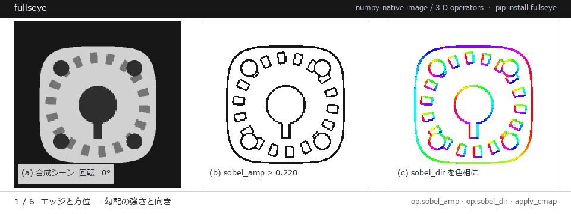
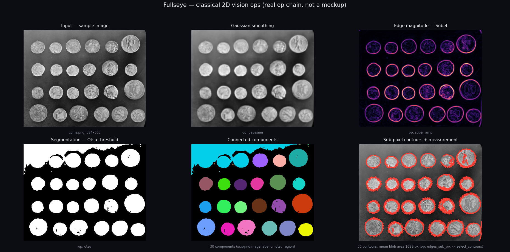
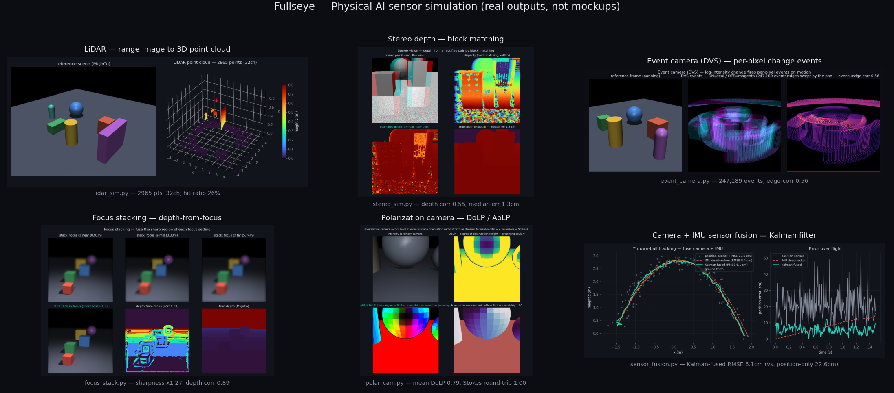

<!-- i18n-source-sha: c3e09847755f -->
# Fullseye 문서 색인


**Language:** [日本語](README.md) · [English](README.en.md) · [简体中文](README.zh.md) · [繁體中文](README.tw.md) · [한국어](README.ko.md) · [Deutsch](README.de.md)

**Fullseye는 영상 검사·3차원 계측·물리 시뮬레이션을 위한 Python 라이브러리입니다.** 타입 연산자를 이어 붙이고, 물리 시뮬레이션으로 만든 참값으로 확인하며, MCP와 RAG로 AI에 넘겨 쓸 수 있습니다.

> **ViEW2026(2026년 12월 3–4일, 퍼시피코 요코하마)에서 발표합니다 → [ViEW2026 페이지](view2026/ko/)** (PoC의 움직이는 결과, 브라우저에서 조작하는 뷰어, 논문 정보)

> **언어:** 번역본이 있는 링크는 해당 번역을 열며, 일본어판만 있는 문서는 _(ja)_로 표시합니다.




*여섯 장면 모두 실제 연산자 출력입니다: 에지 방향 / 연결 성분 선별 / 서브픽셀 계측 / SDF에서 메시로 / 포인트 클라우드 클러스터링 / 렌즈 디포커스.*

**Fullseye**(작업명 imgevolve)는 HALCON/HDevelop 급의 실용 도구입니다. numpy 네이티브 이미지 처리 연산자 라이브러리에, HDevelop 스타일의 비주얼 파이프라인 설계 환경(Fullseye Studio)과 실행 런타임(FullseyeEngine)을 갖추고 있습니다. 연산자는 약 **947**개(레지스트리 기준), 실제 HALCON 연산자 **1016/2313**개를 genuine(이름만이 아니라 진짜로 같은 동작을 하는) 구현으로 제공하며, 48개 카테고리를 아우릅니다.

★ **이미지 처리 라이브러리에서는 드물게, Fullseye 는 「가상 광학 설계」까지 내장** —— 얇은/두꺼운 렌즈·광선 추적·Seidel 수차·PSF/MTF 에 더해, damped-least-squares(Levenberg–Marquardt)로 렌즈 처방 자체를 최적화(`optimize_lens`). **촬상계를 설계하고 그 상을 위 연산자로 검사하기까지 일관되게** 할 수 있다 —— 반도체·정밀 계측에서 효과적인 차별화.

> **여기서 시작하세요 → [GETTING_STARTED.ko.md](GETTING_STARTED.ko.md) (5분이면 돌려볼 수 있습니다)**

> **할 수 있는 일 → [CAPABILITIES.en.md](CAPABILITIES.en.md)** (목적별 색인) / **PoC가 높인 견고성 → [HARDENING.en.md](HARDENING.en.md)** (발견·수정·게이트)

> **실기·실데이터 검증 결과를 모집합니다.** Fullseye는 개인이 개발하며 물리적 계측 장비가 없어서, 가상 광학계와 시뮬레이션 참값으로만 검증하고 있습니다. 실제 장비나 실데이터로 시험한 결과를 크게 환영합니다. **데이터는 공유하지 않아도 됩니다** —— 결과 수치만의 보고도 받으며, 검증 키트(`python -m fullseye.validation_kit`)는 로컬 데이터에서 집계값만 출력합니다. → [보고 양식](https://github.com/furuse-kazufumi/fullseye/issues/new?template=real_validation_report.yml) · [Discussions › Show and tell](https://github.com/furuse-kazufumi/fullseye/discussions/categories/show-and-tell) · [판정 기준(영어)](VALIDATION_CONTRIBUTING.en.md)

---

<!-- trust-block:start -->
<!-- generated by tools/gen_trust_block.py from docs/{test_count,gate_inventory,maturity,op_count_history}.json; edit the data, not this block -->

## 어떻게 확인하는가

여기의 숫자는 손으로 쓰지 않습니다. `tools/gen_trust_block.py`가 `docs/`의 측정 데이터(`test_count.json`, `gate_inventory.json`, `maturity.json`, `op_count_history.json`)로부터 이 절을 생성하며, 데이터와 어긋나면 `tests/test_trust_block.py`가 실패합니다. 모든 숫자에 측정한 버전과 날짜를 붙였습니다.

**회귀 테스트 32,138건** — 1.2.0에 포함, commit `06ed5bcd72`, 2026-11-26에 `pytest --collect-only`로 센 값(선택적 백엔드를 모두 설치한 환경. 설치하지 않으면 해당 백엔드를 쓰는 테스트가 수집되지 않아 건수가 줄어듭니다).

### 연산자를 하나 추가하면 무엇이 확인하는가

층마다 일부러 망가뜨린 연산자를 하나만 넣고 전체 테스트를 돌려, 실패한 테스트를 셌습니다(mutation probe). ✓ = 그 망가짐을 잡는 게이트가 있음, ✗ = **아직 없음**.

- 측정 ①: commit `e97e94bae2`, 2026-10-11, 0.6.0 이후의 트리(미배포 변경 포함).

| 층 | 측정 | 절차 게이트 | 동작 게이트 | 예외 | NaN | 잘못된 형 | 비결정적 | 인자 무시 | 설명 없음 | 영어로만 된 설명 | 빈 입력 수용 |
|---|---|---|---|---|---|---|---|---|---|---|---|
| 2-D 핵심(`ops.REGISTRY`) | ① | 27 | 10 | ✓ | ✓ | ✓ | ✓ | ✗ | ✓ | ✓ | ✗ |
| n항 | ① | 16 | 5 | ✓ | ✓ | ✓ | ✗ | ✗ | ✓ | ✓ | ✗ |
| 색 | ① | 28 | 10 | ✓ | ✓ | ✓ | ✓ | ✗ | ✓ | ✓ | ✗ |
| 타입 대장 + `tb_` 브리지 | ① | 29 | 16 | ✓ | ✓ | ✓ | ✓ | ✓ | ✓ | ✓ | ✓ |
| 타입 대장(브리지 없음) | ① | 17 | 5 | ✓ | ✓ | ✓ | ✓ | ✓ | ✓ | ✓ | ✓ |
| 3-D 대장 | ① | 20 | 7 | ✓ | ✓ | ✓ | ✓ | ✓ | ✓ | ✓ | ✓ |
| facade만 | ① | 1 | 1 | ✗ | ✗ | ✗ | ✗ | ✗ | ✓ | ✗ | ✗ |

절차 게이트 = 올바르게 작성한 연산자라도 노트와 색인을 다시 생성할 때까지 실패하는 게이트 수. 동작 게이트 = 그와 별도로, 망가진 방식 때문에 실패하는 게이트의 종류 수.

측정하지 않은 것: 그럴듯하지만 틀린 값(참값과의 차이), 속도, OS 고유의 실패, 두 가지 이상의 망가짐의 조합. ✓는 적어도 하나의 테스트가 실패했다는 뜻이며, 그 메시지가 원인을 설명한다는 보장은 아닙니다.

### 검증 단계

능력 101건을 무엇으로 확인했는지에 따라 나눈 수(`docs/maturity.json`, 현재 트리(pyproject 버전 1.2.0)에서 `tools/gen_maturity.py`가 생성. 단계 정의는 [MATURITY.md](MATURITY.md)).

| 단계 | 의미 | 능력 |
|---|---|---|
| `research-prototype` | 구현은 있으나 테스트나 실행되는 예가 아직 갖춰지지 않음 | 0 |
| `verified-synthetic` | 참값을 가진 합성 데이터로 자동 검증 | 91 |
| `validated-public-real-data` | 공개 실측 데이터를 쓰는 예가 게이트에서 실제로 실행됨 | 10 |
| `validated-hardware` | 실기로 검증(외부 보고를 수리한 경우에만) | 0 |

예 507건 중 게이트가 실제로 실행하는 것은 502건.

### 버전별 연산자 수

| 버전 | 날짜 | 색인의 연산자 합계 | 그중 타입 대장 | HALCON 대응 | PoC | 회귀 테스트 |
|---|---|---|---|---|---|---|
| 0.1.0 | 2026-08-30 | — | — | 323 | 0 | 6,246 |
| 0.1.8 | 2026-09-05 | — | — | 323 | 0 | 11,518 |
| 0.1.9 | 2026-09-05 | — | — | 979 | 0 | 11,593 |
| 0.1.11 | 2026-09-15 | 918 | 0 | 979 | 121 | 13,178 |
| 0.2.0 | 2026-09-15 | 1,942 | 1,024 | 979 | 121 | 13,272 |
| 0.3.0 | 2026-10-03 | 2,590 | 1,639 | 980 | 187 | 16,675 |
| 0.4.0 | 2026-10-06 | 3,057 | 2,104 | 980 | 214 | 17,424 |
| 0.5.0 | 2026-10-06 | 3,078 | 2,125 | 980 | 217 | 17,489 |
| 0.6.0 | 2026-10-11 | 3,083 | 2,130 | 981 | 218 | 18,109 |
| 0.7.0 | 2026-10-18 | 3,354 | 2,401 | 982 | 248 | 19,935 |
| 0.8.0 | 2026-10-22 | 3,529 | 2,572 | 982 | 275 | 22,073 |
| 0.9.0 | 2026-11-04 | 3,752 | 2,788 | 966 | 297 | 26,045 |
| 1.0.0 | 2026-11-06 | 3,811 | 2,847 | 1,017 | 299 | 27,660 |
| 1.1.0 | 2026-11-12 | 3,838 | 2,874 | 1,017 | 315 | 28,758 |
| 1.2.0 | 2026-11-26 | 3,853 | 2,889 | 1,017 | 318 | 32,138 |

- 0.1.0–0.1.8의 HALCON 대응 323은 당시의 기록값이며, 0.1.9부터는 개정된 계수 방식으로 979입니다(656개의 구현이 새로 늘어난 것이 아님).
- 0.2.0에서 처음으로 타입 대장을 색인에 포함했습니다. 918 → 1,942는 세는 범위의 변경이며 새 구현이 아닙니다(대장은 0.1.6부터 있었으나 색인 밖에 있었음).

— = 그 버전에서는 측정하지 않음. 모든 버전과 열 정의: [OP_COUNT_HISTORY.md](OP_COUNT_HISTORY.md)(일본어/영어).

<!-- trust-block:end -->

<!-- poc-index:start -->

## PoC 시리즈 — 참값을 두고 푼 실제 문제 318건

모두 닫힌 형태 또는 합성으로 엄밀한 참값을 가지며, 제로 포인트(아무것도 하지 않는 경우)를 반드시 함께 적습니다. 전체 목록: [examples/README.md](../examples/README.md).

| 분야 | PoC와 알아낸 것 |
|---|---|
| metrology (75) | [`poc_aoi_ct_traceability`](https://github.com/furuse-kazufumi/fullseye/blob/master/examples/poc_aoi_ct_traceability.py) Matching Full 2-D Inspection to Sampled 3-D Inspection — A Grid Overlaps Itself<br>[`poc_asbuilt_wall_deviation`](https://github.com/furuse-kazufumi/fullseye/blob/master/examples/poc_asbuilt_wall_deviation.py) As-built wall deviation — the bounding box measures the room's heading, not its size<br>[`poc_battery_electrode_breathing`](https://github.com/furuse-kazufumi/fullseye/blob/master/examples/poc_battery_electrode_breathing.py) Measuring electrode breathing in microns — sub-pixel is not enough<br>[`poc_bone_trabecular_thickness`](https://github.com/furuse-kazufumi/fullseye/blob/master/examples/poc_bone_trabecular_thickness.py) Trabecular Thickness, Separation and Bone Volume Fraction — The Plate Model and the Direct Method Disagree on the Same Image<br>[`poc_braid_homotopy_classes`](https://github.com/furuse-kazufumi/fullseye/blob/master/examples/poc_braid_homotopy_classes.py) Sorting Multi-Robot Plans with the Same Starts and Goals by How They Wind — Counting Homotopy Classes with Space-Time Braids and Dynnikov Coordinates, 61 Planner Candidates in 26 Classes<br>[`poc_bump_coplanarity`](https://github.com/furuse-kazufumi/fullseye/blob/master/examples/poc_bump_coplanarity.py) Bump coplanarity versus substrate warpage — subtract too much and the real defect goes with it<br>[`poc_cad_scan_deviation`](https://github.com/furuse-kazufumi/fullseye/blob/master/examples/poc_cad_scan_deviation.py) CAD-to-scan deviation inspection — the fit absorbs the defect and invents a dent<br>[`poc_compendial_particle_microscopy`](https://github.com/furuse-kazufumi/fullseye/blob/master/examples/poc_compendial_particle_microscopy.py) Compendial Microscopy Particle Sizing — Keep Border and Overlap Decisions, Three Bases, and Calibration Provenance<br>[`poc_crack_width`](https://github.com/furuse-kazufumi/fullseye/blob/master/examples/poc_crack_width.py) Concrete Crack Width — Counting Versus Integrating, Compared on Real Photos at Coarser Pixels<br>[`poc_crack_width_timeseries`](https://github.com/furuse-kazufumi/fullseye/blob/master/examples/poc_crack_width_timeseries.py) Measuring the Growth, Not the Width — Rephotographing the Same Wall Changes What the Error Is<br>[`poc_datacenter_thermal_field`](https://github.com/furuse-kazufumi/fullseye/blob/master/examples/poc_datacenter_thermal_field.py) A 3-D Thermal Field from Sparse Sensors — The Grid's Blind Spot Erases a Rack<br>[`poc_diabolo_model_and_vision`](https://github.com/furuse-kazufumi/fullseye/blob/master/examples/poc_diabolo_model_and_vision.py) Transcribing a Diabolo Model from the Paper and Checking It, then Reading Axis, Spin and Tension from Synthetic Video — Eq. (1b) as Printed Is Dimensionally Wrong and Gives NaN at the Real Dimensions; Closed Forms, an Exact String and MuJoCo as the Truth<br>[`poc_dic_strain`](https://github.com/furuse-kazufumi/fullseye/blob/master/examples/poc_dic_strain.py) Strain From Speckle Images (DIC)<br>[`poc_dimensional_inspection`](https://github.com/furuse-kazufumi/fullseye/blob/master/examples/poc_dimensional_inspection.py) Dimensional Inspection of a Machined Part — Bias and Scatter as Two Numbers<br>[`poc_dose_uniformity_from_grinding`](https://github.com/furuse-kazufumi/fullseye/blob/master/examples/poc_dose_uniformity_from_grinding.py) How Long to Grind for a Uniform Dose — Content Uniformity from Particle Size by Closed Form and Monte Carlo, Inverted through Comminution Laws; the Low CV from Photos Was the Same 12 Images at Different Scales<br>[`poc_fiber_orientation`](https://github.com/furuse-kazufumi/fullseye/blob/master/examples/poc_fiber_orientation.py) Fibre Orientation Distribution — Angles Repeat Every 180 Degrees, and a Naive Mean Is 90 Degrees Off<br>[`poc_gear_tooth_metrology`](https://github.com/furuse-kazufumi/fullseye/blob/master/examples/poc_gear_tooth_metrology.py) Gear Tooth Metrology — Eccentricity Is Order 1, Teeth Are Order z<br>[`poc_geodetic_height_frames`](https://github.com/furuse-kazufumi/fullseye/blob/master/examples/poc_geodetic_height_frames.py) Coordinates Go Wrong by Tens of Metres While Still Looking Plausible<br>[`poc_granular_heap_repose`](https://github.com/furuse-kazufumi/fullseye/blob/master/examples/poc_granular_heap_repose.py) Measuring a Powder Heap from Images — Angle of Repose, Volume, Mass, Flowability and Discharge by Rules, with Closed Forms, Published Values and MuJoCo as the Truth<br>[`poc_grating_interferometry`](https://github.com/furuse-kazufumi/fullseye/blob/master/examples/poc_grating_interferometry.py) Grating Interferometry — Fibre Orientation, Micro-Cracks and Pores That Absorption Cannot See, Read From the Fringe Amplitude (Dark Field)<br>[`poc_gw_detector_pseudo_simulation`](https://github.com/furuse-kazufumi/fullseye/blob/master/examples/poc_gw_detector_pseudo_simulation.py) A Pseudo-Simulation of a Gravitational-Wave Detector — Cavity Optics, the Quantum-Noise Budget and the Matched Filter in Closed Form, Scored on the Real GW150914 Data<br>[`poc_industrial_oct`](https://github.com/furuse-kazufumi/fullseye/blob/master/examples/poc_industrial_oct.py) Industrial OCT (optical coherence tomography) — Layer Thickness and Hidden Defects of Paints, Coatings and Multilayer Films, Seen in Depth by the FFT of One Spectral Interferogram<br>[`poc_interferometry_step`](https://github.com/furuse-kazufumi/fullseye/blob/master/examples/poc_interferometry_step.py) How Accurately a White-Light Interferometer Measures a Nanometre Step (synthetic)<br>[`poc_interreflection_fringe_error`](https://github.com/furuse-kazufumi/fullseye/blob/master/examples/poc_interreflection_fringe_error.py) Fringe Projection Misreads Even a White Groove - Separating the Interreflection, Predicting the Error Before Measuring, and Removing It with Micro Phase Shifting<br>[`poc_knife_tactile_toughness`](https://github.com/furuse-kazufumi/fullseye/blob/master/examples/poc_knife_tactile_toughness.py) Holding and Cutting with a Knife by Fingertip Visuotactile Sensing Alone — Toughness, Blade Contact Position and How Long a Handle Can Be Held, without a Wrist Force Sensor; the Existing Reader's Torsion Over-read (+33 % at Half Slip) Fixed by a Numerical Partial-Slip Solution<br>[`poc_laser_line_speckle_floor`](https://github.com/furuse-kazufumi/fullseye/blob/master/examples/poc_laser_line_speckle_floor.py) Speckle Sets the Error Floor of a Laser Sheet-of-Light - It Does Not Average Away, and the Estimator Ranking Flips<br>[`poc_light_section_step_weld_floor`](https://github.com/furuse-kazufumi/fullseye/blob/master/examples/poc_light_section_step_weld_floor.py) Light-Section Heights Agree to Microns, but the Real Limit Is a 20.7 µm Speckle Floor<br>[`poc_livestock_body_volume`](https://github.com/furuse-kazufumi/fullseye/blob/master/examples/poc_livestock_body_volume.py) Weighing an Animal from Silhouettes — The Error You Can Buy Down, and the One You Cannot<br>[`poc_metal_grain_size`](https://github.com/furuse-kazufumi/fullseye/blob/master/examples/poc_metal_grain_size.py) Metallographic Grain Size — The Planimetric and Intercept Methods Fall Off Different Cliffs<br>[`poc_moire_alignment`](https://github.com/furuse-kazufumi/fullseye/blob/master/examples/poc_moire_alignment.py) Moiré (beat fringe between periodic patterns) Alignment — Two Invisible 2 µm Gratings Overlaid Turn a 1 nm Shift into a Readable Fringe Phase (Synthetic)<br>[`poc_multibeam_bathymetry`](https://github.com/furuse-kazufumi/fullseye/blob/master/examples/poc_multibeam_bathymetry.py) Why the Seafloor Smiles — Sound-Speed Error Remaining on Outer Beams After Nadir Calibration<br>[`poc_particle_sizing`](https://github.com/furuse-kazufumi/fullseye/blob/master/examples/poc_particle_sizing.py) Particle Size Distribution From Images — Merging and Edge Cuts Pull Opposite Ways and Cancel<br>[`poc_peg_insertion_tactile`](https://github.com/furuse-kazufumi/fullseye/blob/master/examples/poc_peg_insertion_tactile.py) Reading Peg-in-Hole Insertion through Two Fingertip Membranes — Contact Wrench, Whitney's Contact States, Wall Friction and Wrist Stiffness from Shear Images; at the Wedging Boundary the Wrench Alone Is Blind<br>[`poc_peg_symmetry_search`](https://github.com/furuse-kazufumi/fullseye/blob/master/examples/poc_peg_symmetry_search.py) Cutting a Peg's Rotation Search to 1/n with Its Symmetry — Inserting Square, Hexagonal and Keyed Pegs Checked by Group Identities, Closed Forms and MuJoCo; Friction Shrinks the Hexagon's Chamfer Window from 20.9° to 6.8°<br>[`poc_phase_measuring_deflectometry`](https://github.com/furuse-kazufumi/fullseye/blob/master/examples/poc_phase_measuring_deflectometry.py) Finding Micrometre Dents a Photograph Cannot Show, in the Mirror Image of a Fringe Screen — Phase-Measuring Deflectometry<br>[`poc_photoelasticity`](https://github.com/furuse-kazufumi/fullseye/blob/master/examples/poc_photoelasticity.py) Stress by Photoelasticity — Most Unwrapping Errors Are the Known Sign Ambiguity<br>[`poc_pipe_wall_loss`](https://github.com/furuse-kazufumi/fullseye/blob/master/examples/poc_pipe_wall_loss.py) Pipe Wall Loss on the Unwrapped Map — The Axis You Choose Eats the Invert Corrosion<br>[`poc_plateau_venue_lod2`](https://github.com/furuse-kazufumi/fullseye/blob/master/examples/poc_plateau_venue_lod2.py) The Venue Buildings and Asteroid Itokawa on One Ruler — Turning PLATEAU CityGML LOD2 into a Triangle Mesh<br>[`poc_polish_wipe_measure`](https://github.com/furuse-kazufumi/fullseye/blob/master/examples/poc_polish_wipe_measure.py) Measuring Grinding, Polishing and Wiping from Images — Removed Depth, Wiped Band Width and Area Checked by Preston's Law, Closed-Form Contact Pressure and MuJoCo; a Compliant Wrist Keeps the Band Even over a 2 mm Height Error while a Stiff Wrist Lifts Off and Leaves Gaps<br>[`poc_powder_grinding_ae`](https://github.com/furuse-kazufumi/fullseye/blob/master/examples/poc_powder_grinding_ae.py) Measuring Mortar Grinding — D50 of the Size Distribution, Comminution Laws, Spread over Three Independent Runs and AE Band Power, against Published Laser-Diffraction Measurements; a Different D50 Definition Is a One-Bin, 12 % Bias<br>[`poc_powder_scoop_pour`](https://github.com/furuse-kazufumi/fullseye/blob/master/examples/poc_powder_scoop_pour.py) Measuring Scooping and Pouring of Powder from Images — the Scooped Amount from Side-View Silhouettes, the Pour Rate from PIV (particle image velocimetry) Speed × a Boolean-Model Line Density, within 5 % of MuJoCo's Ball Counts and Line Crossings<br>[`poc_pxrd_phase_peel`](https://github.com/furuse-kazufumi/fullseye/blob/master/examples/poc_pxrd_phase_peel.py) Peeling Phases One at a Time off a 2-D Powder X-ray Diffraction Image — Calibration, Azimuthal Integration, NNLS and the Unknown Phase in the Residual; References from the NIST SRM 640g Certificate and COD CIFs, with the Shared-Model Leak Measured by Deliberate Mismatch<br>[`poc_real_coin_metrology`](https://github.com/furuse-kazufumi/fullseye/blob/master/examples/poc_real_coin_metrology.py) Counting and Measuring Real Coins — A Correct Answer Is Not a Safe One<br>[`poc_real_sem_metal_layer`](https://github.com/furuse-kazufumi/fullseye/blob/master/examples/poc_real_sem_metal_layer.py) Measuring Tracks and Vias in a Real IC SEM Image — Does the Virtual-SEM Edge Correction Transfer?<br>[`poc_robust_profile_filter`](https://github.com/furuse-kazufumi/fullseye/blob/master/examples/poc_robust_profile_filter.py) Deep Scratches Dent the Mean Line — How Much Contamination Robust Gaussian and Spline Filters Survive<br>[`poc_rover_slip_risk_path`](https://github.com/furuse-kazufumi/fullseye/blob/master/examples/poc_rover_slip_risk_path.py) Predicting Wheel Slip with Uncertainty on Real Martian Terrain and Planning a Path that Avoids the Slip Risk — Bekker / Wong–Reece and CVaR on a HiRISE DTM; outside the Data a Gaussian Process Calls a Stuck Slope 'Slip 0.29'<br>[`poc_scan_to_bim_asbuilt`](https://github.com/furuse-kazufumi/fullseye/blob/master/examples/poc_scan_to_bim_asbuilt.py) As-built deviation of a room — the compromise pose is handed to the innocent element<br>[`poc_screw_thread_metrology`](https://github.com/furuse-kazufumi/fullseye/blob/master/examples/poc_screw_thread_metrology.py) Pitch, Flank Angle and Pitch Diameter From a Thread Silhouette — Tilt Shows Up With Opposite Signs on the Two Flanks<br>[`poc_sem_tem_same_particle`](https://github.com/furuse-kazufumi/fullseye/blob/master/examples/poc_sem_tem_same_particle.py) Measuring the Same Particles in Scanning and Transmission Images — Which Is Right, 52 nm or 48 nm?<br>[`poc_sem_wafer_defect_edge_bias`](https://github.com/furuse-kazufumi/fullseye/blob/master/examples/poc_sem_wafer_defect_edge_bias.py) How Much the Bright SEM Edge Inflates a Dimension — the Shape Matches but the Area Grows<br>[`poc_settlement_significance`](https://github.com/furuse-kazufumi/fullseye/blob/master/examples/poc_settlement_significance.py) Did It Settle, or Did We Just Scan It Again — What Changes When You Cut at the Detection Limit<br>[`poc_shape_from_polarization`](https://github.com/furuse-kazufumi/fullseye/blob/master/examples/poc_shape_from_polarization.py) Measuring Black-Gloss and Glass from Polarisation - No Shading, but the Polarisation Remembers the Slope<br>[`poc_simcal_telecentric`](https://github.com/furuse-kazufumi/fullseye/blob/master/examples/poc_simcal_telecentric.py) Calibrating an Imaging Model on a Real Telecentric Image — the Scale Matches the Paper, the Entrance Pupil Is Only 'Farther than 1 m'<br>[`poc_star_astrometry`](https://github.com/furuse-kazufumi/fullseye/blob/master/examples/poc_star_astrometry.py) To What Fraction of a Pixel Can a Star Be Located, and Where Is the Cliff?<br>[`poc_stockpile_volume`](https://github.com/furuse-kazufumi/fullseye/blob/master/examples/poc_stockpile_volume.py) Stockpile Inventory — The Answer Is Fixed by the Ground Nobody Measured<br>[`poc_strain_history`](https://github.com/furuse-kazufumi/fullseye/blob/master/examples/poc_strain_history.py) Strain History in a Creep Test — Cumulative or Direct?<br>[`poc_structure_4d_deterioration`](https://github.com/furuse-kazufumi/fullseye/blob/master/examples/poc_structure_4d_deterioration.py) Re-surveying a structure year by year — when the vantage moves, decay appears to advance<br>[`poc_surface_roughness`](https://github.com/furuse-kazufumi/fullseye/blob/master/examples/poc_surface_roughness.py) How Far Sa / Sq / Sz Survive Sampling and Cutoff<br>[`poc_swarm_obstacle_from_flow`](https://github.com/furuse-kazufumi/fullseye/blob/master/examples/poc_swarm_obstacle_from_flow.py) A Swarm That Flows Like a Fluid Senses an Invisible Obstacle from the Disturbance of Its Velocity Field Alone — Reading the Impact Point and the Obstacle Outline by Tracking and PIV (particle image velocimetry) on Overhead Video, from Upstream Before Contact, and Saying Nothing When There Is No Obstacle<br>[`poc_tacdome_large_deformation`](https://github.com/furuse-kazufumi/fullseye/blob/master/examples/poc_tacdome_large_deformation.py) Gating Large-Deformation Contact of a Soft Dome Fingertip Pressed on a Flat Object with a Scaling Law and an Exact Continuum Solution — As Printed, the Linear Coefficient of Eq. (3) Makes the Force of a Cylinder Negative; 2n/(1+n) Is Derived from the Paper's Own Model<br>[`poc_tacscalib_sphere_lut`](https://github.com/furuse-kazufumi/fullseye/blob/master/examples/poc_tacscalib_sphere_lut.py) Calibrating a Vision-Based Tactile Sensor's Illumination on Real Calibration Spheres, with a Gradient LUT as the Second Implementation — the Ball Radius and Hand-Marked Circles as the Truth<br>[`poc_tacsim_elastic_membrane`](https://github.com/furuse-kazufumi/fullseye/blob/master/examples/poc_tacsim_elastic_membrane.py) A Vision-Based Tactile Sensor (Elastic Membrane + Camera), Synthesised and Inverted — Hertz Contact and Photometric Stereo in Closed Form as the Gate, Force Read from a Pressed Sphere<br>[`poc_tacsim_marker_shear`](https://github.com/furuse-kazufumi/fullseye/blob/master/examples/poc_tacsim_marker_shear.py) Reading the Shear Field, Stick/Slip and Tangential Force from a Tactile Sensor's Marker Array — Cattaneo–Mindlin in Closed Form and Finite-Element Nodal Displacements as the Gate<br>[`poc_tactile_dipole_torque`](https://github.com/furuse-kazufumi/fullseye/blob/master/examples/poc_tactile_dipole_torque.py) Reading In-Grasp Tilt and Torsion Torque from a Tactile Sensor's Marker Field with a 'Tactile Dipole' — Gauss's Law Becoming an Identity in the Half-Space as the Gate<br>[`poc_telecentric_metrology`](https://github.com/furuse-kazufumi/fullseye/blob/master/examples/poc_telecentric_metrology.py) Telecentric Lenses for Dimensional Metrology — Move Only the Stop of the Same Lens and the Height-Dependent Magnification Disappears<br>[`poc_tem_ctf_thon_rings`](https://github.com/furuse-kazufumi/fullseye/blob/master/examples/poc_tem_ctf_thon_rings.py) A Virtual Transmission Electron Microscope — Thon Rings (CTF rings in a TEM power spectrum) Move with Focus, Fine Detail Reverses, and Defocus Is Read from Real Micrographs<br>[`poc_thermal_radiometry`](https://github.com/furuse-kazufumi/fullseye/blob/master/examples/poc_thermal_radiometry.py) A Thermal Image Is Not a Temperature Image — Emissivity, Reflection, and an Uncertainty That Does Not Add<br>[`poc_tree_ring_dendro`](https://github.com/furuse-kazufumi/fullseye/blob/master/examples/poc_tree_ring_dendro.py) Counting tree rings and extracting the width series — ring count and width correlation fail separately<br>[`poc_vial_particle_pod`](https://github.com/furuse-kazufumi/fullseye/blob/master/examples/poc_vial_particle_pod.py) Vial Particle Inspection After Spin Stop — Particle POD by Lighting and Contrast on an Independent Holdout<br>[`poc_virtual_acceptance_3d`](https://github.com/furuse-kazufumi/fullseye/blob/master/examples/poc_virtual_acceptance_3d.py) Acceptance-Test an Optical 3-D Sensor Before Buying It: One Black Sphere Fails the Same iToF<br>[`poc_virtual_sem_kv_cd_bse`](https://github.com/furuse-kazufumi/fullseye/blob/master/examples/poc_virtual_sem_kv_cd_bse.py) A Virtual SEM — Fire Electrons One by One into the Solid, and the Image and the Measured Line Width Change with the Voltage (Backscatter Scored on Measured Data; Line Widths Are Model-Only)<br>[`poc_water_level`](https://github.com/furuse-kazufumi/fullseye/blob/master/examples/poc_water_level.py) River Stage From an Oblique Photo — Ignoring Perspective Bends the Row-Number Error Into an Arc<br>[`poc_weld_bead_profile`](https://github.com/furuse-kazufumi/fullseye/blob/master/examples/poc_weld_bead_profile.py) Weld Bead From a Laser-Triangulation Profile — The Sin of Writing 0 Where Nothing Was Measured<br>[`poc_weld_bead_scan_angle`](https://github.com/furuse-kazufumi/fullseye/blob/master/examples/poc_weld_bead_scan_angle.py) Light-section scanning of a weld bead — resolution and occlusion share one knob<br>[`poc_wound_area_tracking`](https://github.com/furuse-kazufumi/fullseye/blob/master/examples/poc_wound_area_tracking.py) Wound Area Over Time — Calibration Error Enters the Area Squared |
| imgmetrics (48) | [`poc_agv_fleet`](https://github.com/furuse-kazufumi/fullseye/blob/master/examples/poc_agv_fleet.py) A Warehouse That Does Not Jam When Vehicles Run Late — A Correct Plan Alone Still Stops an AGV Fleet<br>[`poc_air_hockey_intercept`](https://github.com/furuse-kazufumi/fullseye/blob/master/examples/poc_air_hockey_intercept.py) Tracking, Predicting and Returning an Air-Hockey Puck with a Five-Bar Linkage — No Learning, Closed Forms and an External Simulator as the Gates<br>[`poc_am_thermal_to_ct`](https://github.com/furuse-kazufumi/fullseye/blob/master/examples/poc_am_thermal_to_ct.py) Metal-AM Thermography and X-ray CT — Separate Experiments<br>[`poc_ball_bounce`](https://github.com/furuse-kazufumi/fullseye/blob/master/examples/poc_ball_bounce.py) Measuring a Table-Tennis Ball the Way the Pioneers Did — Multi-Camera Tracking, Triangulation, Trajectory Prediction, Bounce and Spin, Scored by Theorems on a Table with Ground Truth<br>[`poc_car_parking`](https://github.com/furuse-kazufumi/fullseye/blob/master/examples/poc_car_parking.py) How a Car Turns Shortest — Dubins and Reeds–Shepp in Closed Form, and Hybrid A* Parallel Parking on an Occupancy Grid<br>[`poc_carla_bridge`](https://github.com/furuse-kazufumi/fullseye/blob/master/examples/poc_carla_bridge.py) One Scene, Two Worlds — Scoring a Photoreal Simulator's Depth Against a Closed-Form Truth, Side by Side with Our Own World<br>[`poc_cd_spin_joint`](https://github.com/furuse-kazufumi/fullseye/blob/master/examples/poc_cd_spin_joint.py) Reading Drag and Spin from a Trajectory at Once — A Missed C_L Coefficient Drags the Spin Along, and a Narrow Spin-Ratio Range Cannot Separate Them (Measuring When It Can Be Read in a Self-Made, Different-Model World)<br>[`poc_connectome_across_decades`](https://github.com/furuse-kazufumi/fullseye/blob/master/examples/poc_connectome_across_decades.py) How Much Does a Hand-Traced Wiring Diagram from 40 Years Ago Overlap Today's Adult Worms? — The Era Difference Next to the Individual Difference<br>[`poc_connectome_across_worms`](https://github.com/furuse-kazufumi/fullseye/blob/master/examples/poc_connectome_across_worms.py) How Much of the Wiring Do Two Genetically Identical Worms Share? — Counting the Connections Present in All 8 Worms of a Developmental Series<br>[`poc_connectome_lr_symmetry`](https://github.com/furuse-kazufumi/fullseye/blob/master/examples/poc_connectome_lr_symmetry.py) Is the Worm's Wiring Bilaterally Symmetric? — The L/R-Swap Jaccard (set-overlap coefficient), Bracketed by a Closed Form and a Degree-Preserving Null<br>[`poc_driving_commonroad`](https://github.com/furuse-kazufumi/fullseye/blob/master/examples/poc_driving_commonroad.py) Driving Our Own Driver Through Someone Else's Scenario and Submitting to Someone Else's Judge — CommonRoad Public Scenarios and TUM's Official Checker<br>[`poc_driving_crossing`](https://github.com/furuse-kazufumi/fullseye/blob/master/examples/poc_driving_crossing.py) Level Crossings and Right of Way — Stop and Look, Never Enter During the Alarm or Into a Blocked Exit, Yield to the Wider Road<br>[`poc_driving_decisions`](https://github.com/furuse-kazufumi/fullseye/blob/master/examples/poc_driving_decisions.py) Decision Scenes — Mirrors, Predicting Amber from the Pedestrian Light, Giving Way to an Ambulance, Waiting for a Bus<br>[`poc_driving_endless_map`](https://github.com/furuse-kazufumi/fullseye/blob/master/examples/poc_driving_endless_map.py) An Endless Map — Tiles Made Around the Car, Far Tiles Dropped, 50 km Without a Break<br>[`poc_driving_humanoids`](https://github.com/furuse-kazufumi/fullseye/blob/master/examples/poc_driving_humanoids.py) Humanoids on the Crosswalk — Keep the Car's Physics Exact, Draw the Walkers Cheaply<br>[`poc_driving_japan_town`](https://github.com/furuse-kazufumi/fullseye/blob/master/examples/poc_driving_japan_town.py) Building a Real Japanese Town in Our Own World and Driving It — Roads from OpenStreetMap, Buildings from PLATEAU, Japanese Furniture and Rules<br>[`poc_driving_lateral`](https://github.com/furuse-kazufumi/fullseye/blob/master/examples/poc_driving_lateral.py) Lateral Motion — Slowing Before a Bend, Staying in the Lane, Keeping Left to Turn Left, Off-Tracking<br>[`poc_driving_longitudinal`](https://github.com/furuse-kazufumi/fullseye/blob/master/examples/poc_driving_longitudinal.py) Giving the Car Inertia and Slopes — Stopping Just Before the Line with Reaction and Braking Distance, and a Hill Start Without Rolling Back<br>[`poc_driving_pass`](https://github.com/furuse-kazufumi/fullseye/blob/master/examples/poc_driving_pass.py) Overtaking and What You Cannot See — Wait for Sight Distance, Return Once in the Mirror, Do Not Obstruct the Ring, and Why Curve Mirrors Make Cars Look Far<br>[`poc_driving_school`](https://github.com/furuse-kazufumi/fullseye/blob/master/examples/poc_driving_school.py) The Driving School Opens — Cars and Signals on a Regulation Loop Course, Seen by LiDAR (laser ranging) and Camera, Scored by Theorems and Identities<br>[`poc_driving_town`](https://github.com/furuse-kazufumi/fullseye/blob/master/examples/poc_driving_town.py) Assembling One Town — Auto-Joining Driving-School Elements, Driving Through from Entry to Exit, and Scoring Every Stop Line on the Way<br>[`poc_driving_traffic`](https://github.com/furuse-kazufumi/fullseye/blob/master/examples/poc_driving_traffic.py) Moving Traffic and Blind Spots — a Child Behind a Parked Car, Meeting Oncoming Traffic, a Bus Stop, Bad Drivers<br>[`poc_driving_weather`](https://github.com/furuse-kazufumi/fullseye/blob/master/examples/poc_driving_weather.py) Sun and Weather — When the Morning Sun Hides the Signal, How Fast You May Drive in Fog, Wet Roads and Headlamps at Night<br>[`poc_em_split_merge_score`](https://github.com/furuse-kazufumi/fullseye/blob/master/examples/poc_em_split_merge_score.py) Scoring Neuron Segmentations from Electron Microscopy — Over-Splitting and Over-Merging as Two Separate Numbers<br>[`poc_em_wiring_errors`](https://github.com/furuse-kazufumi/fullseye/blob/master/examples/poc_em_wiring_errors.py) Where Segmentation Errors Break the Wiring Diagram — Pixel Scores Overweight Splits and Underweight Merges<br>[`poc_food_cutting_measure`](https://github.com/furuse-kazufumi/fullseye/blob/master/examples/poc_food_cutting_measure.py) Measuring Food Cutting from Images — Knife Tracking, Slice Thickness, Cut-Surface Roughness and Cutting Force from Wrist Deflection, with Closed Forms and MuJoCo as the Truth<br>[`poc_iqa_fsim_gmsd_vif`](https://github.com/furuse-kazufumi/fullseye/blob/master/examples/poc_iqa_fsim_gmsd_vif.py) Perceptual Indices FSIM (feature similarity index) / FSIMc (colour extension of FSIM) / GMSD (gradient-similarity deviation) / VIF Matched to Four Digits Against an External Truth — TID2013's Three Author-Value Files and the Published Rank-Correlation Tables<br>[`poc_iqa_tid2013`](https://github.com/furuse-kazufumi/fullseye/blob/master/examples/poc_iqa_tid2013.py) Measuring Image-Quality Metrics Against a Public Ground Truth — TID2013's 3,000 Images × 971 Observers and the Authors' Published Values as the Gate<br>[`poc_kendama`](https://github.com/furuse-kazufumi/fullseye/blob/master/examples/poc_kendama.py) Kendama the Way the Pioneers Did It — A True-to-Shape Kendama Filmed by Two Cameras, the Ball's Flight Predicted from Images Alone and Caught in the Big, Small and Base Cups<br>[`poc_mt_hidden_fault`](https://github.com/furuse-kazufumi/fullseye/blob/master/examples/poc_mt_hidden_fault.py) Every Sensor Reads Normal, Yet the Machine Is Failing — How Much the MT Method Recovers from Univariate 3σ<br>[`poc_peg_failure_recovery`](https://github.com/furuse-kazufumi/fullseye/blob/master/examples/poc_peg_failure_recovery.py) Detecting and Recovering Peg-Insertion Failures with a Rule Table — Whitney's Contact States Instead of a VLM, MuJoCo as the Truth<br>[`poc_pegsim_insertion`](https://github.com/furuse-kazufumi/fullseye/blob/master/examples/poc_pegsim_insertion.py) Peg-in-Hole with a Compliant Wrist — Whitney's Quasi-Static Geometry as the Gate, a Wrist Camera to Centre the Peg, MuJoCo Contacts to Check It<br>[`poc_physarum_maze`](https://github.com/furuse-kazufumi/fullseye/blob/master/examples/poc_physarum_maze.py) Slime-Mould Tubes Solve the Maze — Thickening and Thinning Alone Converge to the Shortest Path, Bracketed by a Theorem and Dijkstra<br>[`poc_physarum_transport`](https://github.com/furuse-kazufumi/fullseye/blob/master/examples/poc_physarum_transport.py) Slime Mould Solves Optimal Transport — Make the Source and Sink Mass Distributions and the Same Tube Dynamics Converge to the Earth Mover's Distance<br>[`poc_residue_crt`](https://github.com/furuse-kazufumi/fullseye/blob/master/examples/poc_residue_crt.py) Angles and Shifts No Single Phase Can Pin Down, Fixed by Bundling Phases of Different Periods — the Chinese Remainder Theorem in Images<br>[`poc_segmentation_gauntlet`](https://github.com/furuse-kazufumi/fullseye/blob/master/examples/poc_segmentation_gauntlet.py) The Segmentation Gauntlet — Ten Methods Across Six Worlds With Ground Truth, and Which Measure Is Blind to Which Failure<br>[`poc_skeleton_run_length_vs_voi`](https://github.com/furuse-kazufumi/fullseye/blob/master/examples/poc_skeleton_run_length_vs_voi.py) Run Length Forgives No Small Merge — ERL and VOI Weigh the Same Error Differently<br>[`poc_spc`](https://github.com/furuse-kazufumi/fullseye/blob/master/examples/poc_spc.py) Is the Process in Control, and Is It Capable? — Statistical Process Control from Closed-Form Alone<br>[`poc_swc_tree_truth`](https://github.com/furuse-kazufumi/fullseye/blob/master/examples/poc_swc_tree_truth.py) Grading Skeleton Measurement on Real Trees — NeuroMorpho SWC as Ground Truth, and What Projection Breaks<br>[`poc_table_tennis_bounce`](https://github.com/furuse-kazufumi/fullseye/blob/master/examples/poc_table_tennis_bounce.py) Filming a Bouncing Table-Tennis Ball with a High-Speed Camera and Reading Restitution and Friction — Checked Against Published Values<br>[`poc_table_tennis_rally_loop`](https://github.com/furuse-kazufumi/fullseye/blob/master/examples/poc_table_tennis_rally_loop.py) Reading Errors End the Table-Tennis Rally — How Much Noise and Latency Move the Landing Point, in Closed Form Before the Shot<br>[`poc_table_tennis_spin`](https://github.com/furuse-kazufumi/fullseye/blob/master/examples/poc_table_tennis_spin.py) Filming a Spinning Table-Tennis Ball and Reading Its Spin Two Ways — From the Curve and From the Markings<br>[`poc_text_region_truth`](https://github.com/furuse-kazufumi/fullseye/blob/master/examples/poc_text_region_truth.py) Where Is the Text, Without a Recogniser — Grading a Stroke-Width Detector on Text We Drew Ourselves<br>[`poc_ttc_rss`](https://github.com/furuse-kazufumi/fullseye/blob/master/examples/poc_ttc_rss.py) Time to Collision and Safe Distance — Optical-Flow τ and the RSS Closed Forms, Scored by the Driving-School World's Truth<br>[`poc_world_terrain`](https://github.com/furuse-kazufumi/fullseye/blob/master/examples/poc_world_terrain.py) Widening the World — Closed-Form Terrain, World-Space Materials and Procedural Trees and Pedestrians Win the Focus of Expansion Back from Flow<br>[`poc_worm_core_persists`](https://github.com/furuse-kazufumi/fullseye/blob/master/examples/poc_worm_core_persists.py) The Worm Brain's Core Is There from Birth — Counting the Cells That Stay in the Deepest Shell Across 8 Developmental Stages<br>[`poc_worm_neurites_grow`](https://github.com/furuse-kazufumi/fullseye/blob/master/examples/poc_worm_neurites_grow.py) How Much Do a Worm's Neurites Grow from Birth to Adulthood? — Measuring Eight Animals' Skeletons with the Tree Ops and Setting the Result Beside the Paper<br>[`poc_worm_synapses_vs_neurites`](https://github.com/furuse-kazufumi/fullseye/blob/master/examples/poc_worm_synapses_vs_neurites.py) Do Synapses Grow in Proportion to Neurites? — Shape Growth and Wiring Growth Set Side by Side, Cell by Cell, in Eight Worms |
| optics_sensing (35) | [`poc_bottle_pattern_inverse`](https://github.com/furuse-kazufumi/fullseye/blob/master/examples/poc_bottle_pattern_inverse.py) Reading a Glass Bottle Back from Background Stripes (a Simulation Under Shared Assumptions) — Scored Against the Simulated Truth, with What Cannot Be Separated and a Model Error the Residual Does Not Show<br>[`poc_chromatic_confocal`](https://github.com/furuse-kazufumi/fullseye/blob/master/examples/poc_chromatic_confocal.py) Chromatic Confocal Displacement Sensor — A Rainbow Ruler from Glass Dispersion, Reading Height from the Colour that Comes Back<br>[`poc_dual_energy_xray`](https://github.com/furuse-kazufumi/fullseye/blob/master/examples/poc_dual_energy_xray.py) Finding Bone and Glass in Meat with Two X-ray Energies — Material Can Be Read Only on Flat Plates (Dual-Energy and Photon-Counting X-ray)<br>[`poc_fiber_light_guide`](https://github.com/furuse-kazufumi/fullseye/blob/master/examples/poc_fiber_light_guide.py) Optical Fibres and Light Guides — From the Material Table's Fused Silica to Modes, Dispersion, Mode Field and Illumination Efficiency<br>[`poc_fourier_ptychography`](https://github.com/furuse-kazufumi/fullseye/blob/master/examples/poc_fourier_ptychography.py) Fourier Ptychography (synthetic) — A 4x Objective Matches a Coherently Lit 20x in Resolution, with Phase, by Iterative Phase Retrieval<br>[`poc_hyperspectral_foreign_matter`](https://github.com/furuse-kazufumi/fullseye/blob/master/examples/poc_hyperspectral_foreign_matter.py) Sorting Look-Alike Foreign Matter with Hyperspectral NIR — Two Real Datasets (Plastic Flakes, Foreign Objects on Pork Belly) and a Material-Table Simulation of the Failure Modes<br>[`poc_itof_multifreq`](https://github.com/furuse-kazufumi/fullseye/blob/master/examples/poc_itof_multifreq.py) Indirect Time of Flight, Multi-Frequency — Higher Frequencies Measure Finer, but Wrapping, Multipath, Flying Pixels and Harmonics Break It<br>[`poc_lens_file_roundtrip`](https://github.com/furuse-kazufumi/fullseye/blob/master/examples/poc_lens_file_roundtrip.py) Reading a Lens Design File (.zmx), Analysing It, Fixing It and Writing It Back — Scored Against Two Other Readers and a Round Trip<br>[`poc_lens_global_search`](https://github.com/furuse-kazufumi/fullseye/blob/master/examples/poc_lens_global_search.py) Glass Substitution and Multi-Start Search — Scored Against the Thin-Achromat Closed Form and the Third-Order Best-Form Bending<br>[`poc_lens_merit_operands`](https://github.com/furuse-kazufumi/fullseye/blob/master/examples/poc_lens_merit_operands.py) Designing a Triplet from a Table of Requirements — A Merit Function with Edge-Thickness, Centre-Thickness and Air-Gap Bounds, Scored Against Closed Forms and an Independent Implementation<br>[`poc_lens_solves_afocal`](https://github.com/furuse-kazufumi/fullseye/blob/master/examples/poc_lens_solves_afocal.py) Keeping a Design's Relations as Solves — A Double-Gauss Type Whose Focus and F-Number Follow the Stop, Afocal Telescopes, a Curved Image Surface and Odd Aspheres<br>[`poc_lens_tolerancing`](https://github.com/furuse-kazufumi/fullseye/blob/master/examples/poc_lens_tolerancing.py) Budgeting Lens Manufacturing Tolerances through MTF (modulation transfer function), Yield, and Compensator Travel<br>[`poc_lockin_imaging`](https://github.com/furuse-kazufumi/fullseye/blob/master/examples/poc_lockin_imaging.py) Per-Pixel Quadrature Demodulation (Lock-in) — Ring-Illumination Normals, Coded-Light Daylighting and Lock-in Thermography, Scored Against Closed Forms and the Rice Phase Distribution<br>[`poc_material_optical_library`](https://github.com/furuse-kazufumi/fullseye/blob/master/examples/poc_material_optical_library.py) A Material Optical-Property Library — 86 Glasses, Crystals, Semiconductors, Metals, Liquids and Plastics in One Table, Scored on Catalogue Values and a Second Implementation<br>[`poc_mueller_dofp_observability`](https://github.com/furuse-kazufumi/fullseye/blob/master/examples/poc_mueller_dofp_observability.py) A Four-Angle Polarization Camera Leaves Seven Mueller (4-by-4 polarization-transfer matrix) Dimensions Unseen<br>[`poc_nir_silicon_transmission`](https://github.com/furuse-kazufumi/fullseye/blob/master/examples/poc_nir_silicon_transmission.py) Near-Infrared Inspection Through a Silicon Wafer — Choosing the LED Wavelength from the Source × Wafer × Sensor Integral<br>[`poc_noncoaxial_optics`](https://github.com/furuse-kazufumi/fullseye/blob/master/examples/poc_noncoaxial_optics.py) Non-Coaxial Optics — a Coaxial-Illumination Beamsplitter Paints a False Defect on a Mirror-Like Part, Removed by a Coating or a Wedge; Fold Mirrors Shrink the Machine<br>[`poc_omni360_inspection`](https://github.com/furuse-kazufumi/fullseye/blob/master/examples/poc_omni360_inspection.py) Measurable Omnidirectional Inspection, Stereo Display and Moving Viewports<br>[`poc_optics_drawings`](https://github.com/furuse-kazufumi/fullseye/blob/master/examples/poc_optics_drawings.py) Optical Drawings Straight from the Calculation — Lens Layouts, Vision-Setup Drawings and ISO 10110 Element Drawings as SVG / DXF, Scored by Reading the Written Files Back<br>[`poc_photograph_through_prescription`](https://github.com/furuse-kazufumi/fullseye/blob/master/examples/poc_photograph_through_prescription.py) Photographing a 3-D Scene Through the Actual Lens Prescription — Depth of Field, Cat's-Eye Bokeh, Corner Illumination, Colour Fringes and Ghosts, Scored Against Closed Forms, Existing Ops and an Independent Trace<br>[`poc_pixel_shift`](https://github.com/furuse-kazufumi/fullseye/blob/master/examples/poc_pixel_shift.py) Pixel-Shift Imaging — Shift the Sensor One Pixel and False Colour Vanishes, Half a Pixel and Aliasing Vanishes; the MTF (modulation transfer function) Does Not Rise<br>[`poc_plenoptic_camera`](https://github.com/furuse-kazufumi/fullseye/blob/master/examples/poc_plenoptic_camera.py) A Prescription-Based Plenoptic Camera<br>[`poc_pocket_interreflection`](https://github.com/furuse-kazufumi/fullseye/blob/master/examples/poc_pocket_interreflection.py) Counting Interreflection in a Machined Pocket to Convergence — The Direct-Light Model Fits with Albedo 1.32, the Converged Model Returns the Truth<br>[`poc_simcal_pixel_shift`](https://github.com/furuse-kazufumi/fullseye/blob/master/examples/poc_simcal_pixel_shift.py) Calibrating Pixel-Shift Offsets and Pixel Aperture from the Images — Where Only Stripes Are Seen, the Shift Is Fixed in One Direction Only<br>[`poc_simcal_thin_film`](https://github.com/furuse-kazufumi/fullseye/blob/master/examples/poc_simcal_thin_film.py) Calibrating a Thin-Film Model to Real Images — and Giving No Number to What the Data Do Not Determine<br>[`poc_slanted_edge_sfr_limits`](https://github.com/furuse-kazufumi/fullseye/blob/master/examples/poc_slanted_edge_sfr_limits.py) Slanted-Edge SFR Misreads MTF50 (spatial frequency at 50% MTF) Through Gamma as Well as Edge Angle<br>[`poc_spectrometer_illumination`](https://github.com/furuse-kazufumi/fullseye/blob/master/examples/poc_spectrometer_illumination.py) Spectrometer and Illumination Trains — Where the Bandwidth Comes From, and Whether the Lamp Shows in the Field<br>[`poc_tdi_linescan`](https://github.com/furuse-kazufumi/fullseye/blob/master/examples/poc_tdi_linescan.py) TDI (time-delay integration) Line Scan and Line-Scan Lenses (synthetic) — Stages Reveal the Defects, a Sync Error Smears Them, and a Reused C-Mount Lens Loses the Ends of a Long Sensor<br>[`poc_thin_film_reflectometry`](https://github.com/furuse-kazufumi/fullseye/blob/master/examples/poc_thin_film_reflectometry.py) Thin-Film Thickness by Spectral Reflectometry — Scored on Public Measured Data, then Fringes, Interference Colours, FFT versus Model Fit and Thickness Maps<br>[`poc_tof_camera`](https://github.com/furuse-kazufumi/fullseye/blob/master/examples/poc_tof_camera.py) Indirect and Direct Time of Flight on One 3-D Scene — Multipath, Mixed Pixels, Pile-up and Volume Error<br>[`poc_water_inspection_images`](https://github.com/furuse-kazufumi/fullseye/blob/master/examples/poc_water_inspection_images.py) How Water Looks in Inspection Images — Pool-Floor Caustics, a Bottle from the Side, a Wet Plate and a Hull Under Water, Scored Against Closed Forms and Second Methods<br>[`poc_water_transparent_media`](https://github.com/furuse-kazufumi/fullseye/blob/master/examples/poc_water_transparent_media.py) Water and Transparent Media — Ocean Waves, Surface Refraction, Colour Under Water and the Caustic of a Bottle, Scored Against Closed Forms, Published Values and Second Implementations<br>[`poc_wavefront_aberration_limits`](https://github.com/furuse-kazufumi/fullseye/blob/master/examples/poc_wavefront_aberration_limits.py) The Marechal Approximation Breaks at Different RMS Errors for Different Aberration Shapes<br>[`poc_zmx_public_verify`](https://github.com/furuse-kazufumi/fullseye/blob/master/examples/poc_zmx_public_verify.py) Verifying Public .zmx Prescriptions Independently and Scoring Them as Inspection Lenses<br>[`poc_zoom_configurations`](https://github.com/furuse-kazufumi/fullseye/blob/master/examples/poc_zoom_configurations.py) A Zoom Lens as Differences of One Prescription — Scored Against the Two-Thin-Lens Closed Form and a Round Trip Through the Design File's Multi-Configuration Table |
| analysis (20) | [`poc_attention_identities`](https://github.com/furuse-kazufumi/fullseye/blob/master/examples/poc_attention_identities.py) Every Speedup Is the Same Arithmetic Regrouped: Scoring Attention with Identities<br>[`poc_beats_fringes_and_screens`](https://github.com/furuse-kazufumi/fullseye/blob/master/examples/poc_beats_fringes_and_screens.py) One Beat — A Two-Slit Fringe and a Print Moire (beat fringe between periodic patterns) Are the Same Mathematics<br>[`poc_calipers_under_illusion`](https://github.com/furuse-kazufumi/fullseye/blob/master/examples/poc_calipers_under_illusion.py) Auditing the Instrument with Illusions - Where a Caliper Fails, and Why<br>[`poc_complex_plane_fields`](https://github.com/furuse-kazufumi/fullseye/blob/master/examples/poc_complex_plane_fields.py) Seeing the Complex Plane as an Area — When the Picture Proves the Theorem<br>[`poc_connectome_motor_bottleneck`](https://github.com/furuse-kazufumi/fullseye/blob/master/examples/poc_connectome_motor_bottleneck.py) Motor Quantisation — Where the Command Dimension Collapses Between Brain and Muscle (the Fly's Neck and an RL Policy's Joints on One Scale)<br>[`poc_em_branch_territory`](https://github.com/furuse-kazufumi/fullseye/blob/master/examples/poc_em_branch_territory.py) Branch Territories — Handing Every Voxel Its Nearest Branch, Not Just Its Distance, Makes Per-Branch Volume and Radius Countable<br>[`poc_endless_zoom_and_turning_solids`](https://github.com/furuse-kazufumi/fullseye/blob/master/examples/poc_endless_zoom_and_turning_solids.py) Endless Zooms and Turning Solids: Making the Return Itself the Ground Truth<br>[`poc_four_dimensions_by_three_d_tools`](https://github.com/furuse-kazufumi/fullseye/blob/master/examples/poc_four_dimensions_by_three_d_tools.py) Scoring Four-Dimensional Claims with Ordinary Three-Dimensional Operators<br>[`poc_geodetic_benchmarks_real`](https://github.com/furuse-kazufumi/fullseye/blob/master/examples/poc_geodetic_benchmarks_real.py) There Are Two Kinds of Height, for Real — Putting a Height-Frame Mix-Up Under a Detector with 523 Published Survey Marks<br>[`poc_gravitational_lens_invariants`](https://github.com/furuse-kazufumi/fullseye/blob/master/examples/poc_gravitational_lens_invariants.py) Scoring Gravitational-Lens Images with Ordinary Industrial Measurement Operators<br>[`poc_illusions_and_perpetual_drawing`](https://github.com/furuse-kazufumi/fullseye/blob/master/examples/poc_illusions_and_perpetual_drawing.py) Scoring Endlessly Generated Pictures with Identities, Not with the Eye<br>[`poc_measurement_system_analysis`](https://github.com/furuse-kazufumi/fullseye/blob/master/examples/poc_measurement_system_analysis.py) How Much of That Number Is Your Measuring - Gauge R&R (gauge repeatability and reproducibility) and Measurement Uncertainty<br>[`poc_microns_brain_wave`](https://github.com/furuse-kazufumi/fullseye/blob/master/examples/poc_microns_brain_wave.py) The MICrONS Brain Wave — How Much of the Measured Response Does the Wiring Explain in 1 mm^3 of Visual Cortex<br>[`poc_one_stroke_epicycles`](https://github.com/furuse-kazufumi/fullseye/blob/master/examples/poc_one_stroke_epicycles.py) A Photograph as One Line, Drawn by Rotating Circles — Tone, Stipple, Tour, Fourier Series, G-code<br>[`poc_periodic_video_boundary`](https://github.com/furuse-kazufumi/fullseye/blob/master/examples/poc_periodic_video_boundary.py) Testing the Periodic Boundary of Temporal Operators with a Seamless Loop<br>[`poc_pod_lighting`](https://github.com/furuse-kazufumi/fullseye/blob/master/examples/poc_pod_lighting.py) The Resolution Formula Does Not Tell You What You Will Find - Probability of Detection per Lighting (MIL-HDBK-1823A)<br>[`poc_theorems_as_pictures`](https://github.com/furuse-kazufumi/fullseye/blob/master/examples/poc_theorems_as_pictures.py) Theorems as Gates — Apollonian Gaskets, Ford Circles, Geodesic Domes, Phyllotaxis, IFS, Space-Filling Curves<br>[`poc_vanishing_detail_and_morphing_area`](https://github.com/furuse-kazufumi/fullseye/blob/master/examples/poc_vanishing_detail_and_morphing_area.py) The Exact Distance at Which Detail Vanishes, and the Area of a Changing Shape<br>[`poc_what_a_picture_cannot_check`](https://github.com/furuse-kazufumi/fullseye/blob/master/examples/poc_what_a_picture_cannot_check.py) What a Picture Cannot Check — Scoring Dynamical Systems and Minimal Surfaces by Identity and Definition<br>[`poc_zernike_aberrations`](https://github.com/furuse-kazufumi/fullseye/blob/master/examples/poc_zernike_aberrations.py) Scoring an Aberration as a Picture: Zernike Polynomials (orthogonal aberration polynomials on a circular pupil) and the Point Spread Function |
| segmentation (11) | [`poc_active_contours`](https://github.com/furuse-kazufumi/fullseye/blob/master/examples/poc_active_contours.py) Active Contours and Level Sets — Checking With Closed Forms How a Contour Shrinks, Enters a Concavity and Stops at an Edge<br>[`poc_cell_counting`](https://github.com/furuse-kazufumi/fullseye/blob/master/examples/poc_cell_counting.py) Counting Overlapping Cells — Count, Over-Segmentation and Under-Segmentation as Three Numbers<br>[`poc_dense_bubble_count`](https://github.com/furuse-kazufumi/fullseye/blob/master/examples/poc_dense_bubble_count.py) Counting Dense Bubbles — When the Overlap Is Too Deep to Decide, Return an Interval Instead of a Count<br>[`poc_graph_hierarchy_segmentation`](https://github.com/furuse-kazufumi/fullseye/blob/master/examples/poc_graph_hierarchy_segmentation.py) Graph, Hierarchical and Threshold Segmentation — Max Flow = Min Cut, Ultrametrics, and Turning a Knob From Coarse to Fine<br>[`poc_leaf_disease_area`](https://github.com/furuse-kazufumi/fullseye/blob/master/examples/poc_leaf_disease_area.py) Leaf disease severity — colour axes survive the lighting; the grade is decided by the leaf mask and the edge convention<br>[`poc_mixed_case_depalletizing`](https://github.com/furuse-kazufumi/fullseye/blob/master/examples/poc_mixed_case_depalletizing.py) Mixed-Case Depalletizing: With Tight Seams a Depth Step Cannot Separate the Cartons — Whether a Depth V-Groove or a Dark Colour Groove Wins Flips with the Depth, Gap and Tape of the Flap Seam (a Map)<br>[`poc_mri_bias_field`](https://github.com/furuse-kazufumi/fullseye/blob/master/examples/poc_mri_bias_field.py) MRI Bias Field and Tissue Area — Grey and White Matter Fail in Opposite Directions, and the Sum Hides It<br>[`poc_threshold_transfer_after_normalization`](https://github.com/furuse-kazufumi/fullseye/blob/master/examples/poc_threshold_transfer_after_normalization.py) Raw Grey-Level Thresholds Need Retuning across Lighting, while k-Sigma and P-Tile Transfer<br>[`poc_timelapse_growth`](https://github.com/furuse-kazufumi/fullseye/blob/master/examples/poc_timelapse_growth.py) A Growth Time-Lapse as Space-Time Connected Components<br>[`poc_vegetation_cover`](https://github.com/furuse-kazufumi/fullseye/blob/master/examples/poc_vegetation_cover.py) Counting Crop Green — Ground Truth as Per-Pixel Leaf Area Fraction<br>[`poc_weed_rice_ratio`](https://github.com/furuse-kazufumi/fullseye/blob/master/examples/poc_weed_rice_ratio.py) Weedy-Rice Cover — Supervised Linear Discrimination without Deep Learning |
| diagnostics (10) | [`poc_bearing_diagnosis`](https://github.com/furuse-kazufumi/fullseye/blob/master/examples/poc_bearing_diagnosis.py) Seven-Level SNR Sweep on Synthetic Bearing Signals — Raw versus Envelope Detection Rates<br>[`poc_cold_chain_excursion`](https://github.com/furuse-kazufumi/fullseye/blob/master/examples/poc_cold_chain_excursion.py) The Cold-Chain Temperature Record — Where You Taped the Logger Is the Verdict<br>[`poc_fabric_defect`](https://github.com/furuse-kazufumi/fullseye/blob/master/examples/poc_fabric_defect.py) 360 Real Fabric Defects — The Same Detector Scores an AUC of 0.56 or 0.66 Depending on How It Is Counted<br>[`poc_machine_condition_fusion`](https://github.com/furuse-kazufumi/fullseye/blob/master/examples/poc_machine_condition_fusion.py) Fusing thermal, vibration and geometry for machine health — three sensors, one fact<br>[`poc_prnu_camera_fingerprint`](https://github.com/furuse-kazufumi/fullseye/blob/master/examples/poc_prnu_camera_fingerprint.py) Camera Fingerprints (PRNU): Which Camera Took This? — The Fingerprint Grows With Frame Count and Dies at the Save Button<br>[`poc_pv_thermal_survey`](https://github.com/furuse-kazufumi/fullseye/blob/master/examples/poc_pv_thermal_survey.py) Drone Thermography of a PV Plant — You Think You Are Measuring Temperature Difference, but You Are Measuring Wind and Viewing Angle<br>[`poc_solar_el_inspection`](https://github.com/furuse-kazufumi/fullseye/blob/master/examples/poc_solar_el_inspection.py) Scoring dark areas in real solar-cell EL images against I-V power loss — they track opaque masks but not whole-cell dimming<br>[`poc_solder_fillet_aoi`](https://github.com/furuse-kazufumi/fullseye/blob/master/examples/poc_solder_fillet_aoi.py) Solder fillet AOI — three ring lights are a 3-level tilt quantiser, and 70 % of the fillet height sits in the dark<br>[`poc_thermography_ndt`](https://github.com/furuse-kazufumi/fullseye/blob/master/examples/poc_thermography_ndt.py) Depth of a Subsurface Defect by Pulsed Thermography<br>[`poc_weld_radiograph_porosity`](https://github.com/furuse-kazufumi/fullseye/blob/master/examples/poc_weld_radiograph_porosity.py) Porosity in Weld Radiographs — Closing With the Share of Images Misgraded by One Class |
| registration (10) | [`poc_change_detection_misreg`](https://github.com/furuse-kazufumi/fullseye/blob/master/examples/poc_change_detection_misreg.py) Change detection under misregistration — false positives are edge bands, with a cliff<br>[`poc_multimodal_mi_registration`](https://github.com/furuse-kazufumi/fullseye/blob/master/examples/poc_multimodal_mi_registration.py) Visible and Thermal Board Images Correlate at −0.74; Mutual Information Aligns Them to 0.170 px<br>[`poc_part_locate_features`](https://github.com/furuse-kazufumi/fullseye/blob/master/examples/poc_part_locate_features.py) SIFT Locates a Part Rotated 37 Degrees to 0.367 px; the Existing Harris Matcher Misses by 158 px<br>[`poc_print_registration`](https://github.com/furuse-kazufumi/fullseye/blob/master/examples/poc_print_registration.py) Print Misregistration from the Sheet — A Halftone Is a Lattice, So the Answer Is Not Unique<br>[`poc_real_tless_6dof`](https://github.com/furuse-kazufumi/fullseye/blob/master/examples/poc_real_tless_6dof.py) Six-DoF PPF Matching of Industrial Parts in Real RGB-D Data<br>[`poc_real_tum_rgbd_slam`](https://github.com/furuse-kazufumi/fullseye/blob/master/examples/poc_real_tum_rgbd_slam.py) Scoring a Real Depth Camera's Trajectory and Plane Residuals Against External Truth — Better Than Not Aligning and 0.45 to 0.82 Times a Constant-Velocity Guess Depending on How the Split Picks the Tuning (One Sequence of 32 Frames), and Window Residuals Cannot Settle the Square Law (TUM RGB-D)<br>[`poc_registration_basin`](https://github.com/furuse-kazufumi/fullseye/blob/master/examples/poc_registration_basin.py) The Convergence Basin of Point-Cloud Registration — How Far Off Can the Initial Pose Be? (a synthetic bracket and a public measured part)<br>[`poc_reproducible_icp`](https://github.com/furuse-kazufumi/fullseye/blob/master/examples/poc_reproducible_icp.py) Registration That Does Not Move by a Single Bit When the Points Are Shuffled — FP64 Reductions by the Ozaki Scheme, with the Error Falling in Steps under a Guaranteed Bound; Slow on the CPU, and GPU Speed Is Left to cuBLAS Emulation<br>[`poc_sheet_deformation_ffd`](https://github.com/furuse-kazufumi/fullseye/blob/master/examples/poc_sheet_deformation_ffd.py) FFD Tracks Sheet Deformation to 0.025 px, but Barcodes and Blank Margins Leave the Field Undetermined<br>[`poc_template_tracking`](https://github.com/furuse-kazufumi/fullseye/blob/master/examples/poc_template_tracking.py) Template Tracking Drifts Quietly Before It Ever Loses the Target |
| calibration (8) | [`poc_calibration_truth_map`](https://github.com/furuse-kazufumi/fullseye/blob/master/examples/poc_calibration_truth_map.py) Camera Calibration with Ground Truth: 0.044 px Reprojection, Yet 0.568 px Wrong in the Corner<br>[`poc_caltab_chain_truth`](https://github.com/furuse-kazufumi/fullseye/blob/master/examples/poc_caltab_chain_truth.py) A Circle-Mark Calibration Plate End to End (Synthetic Imaging): Binary-Centroid Quantisation Sets an fx Floor of About 0.2 % rms (−0.45 to +0.33 % Without Noise, Depending on the Layout)<br>[`poc_camera_calibration`](https://github.com/furuse-kazufumi/fullseye/blob/master/examples/poc_camera_calibration.py) A Reprojection Error of 0.05 px Guarantees Nothing<br>[`poc_fly_optomotor_steering`](https://github.com/furuse-kazufumi/fullseye/blob/master/examples/poc_fly_optomotor_steering.py) Holding a Course with a Fly's Optic Lobe Alone — From the Lamina to the Steering, Without Learning<br>[`poc_public_camera_heading`](https://github.com/furuse-kazufumi/fullseye/blob/master/examples/poc_public_camera_heading.py) Where Is the Public Camera Looking — The Orientation of a Fixed Camera Whose Only Published Fact Is Its Position, from the Picture Itself<br>[`poc_public_camera_heading_real`](https://github.com/furuse-kazufumi/fullseye/blob/master/examples/poc_public_camera_heading_real.py) Where Is the Public Camera Looking, for Real — Hunting the Sun in 807 Road Cameras, Fixing the Heading from One Sunset and Checking It Against the Road<br>[`poc_real_chessboard_undistort`](https://github.com/furuse-kazufumi/fullseye/blob/master/examples/poc_real_chessboard_undistort.py) Undistorting 13 Real Calibration-Board Photos and Rectifying Them to a Front View — Scored by Straightness and Grid Spacing<br>[`poc_thermal_drift_metrology`](https://github.com/furuse-kazufumi/fullseye/blob/master/examples/poc_thermal_drift_metrology.py) How Much Camera Thermal Drift Costs a Dimensional Measurement |
| geometry (8) | [`poc_cloth_towel_corners_synth`](https://github.com/furuse-kazufumi/fullseye/blob/master/examples/poc_cloth_towel_corners_synth.py) Finding Towel Corners, Sides and Creases with Classical Image Processing (Synthetic Rendering): A Plain Rectangle Fit Is Best, the General Polygon Only Ties It in Chroma, and Everything Degrades with Close Table Colours and Wrinkles of 3 mm or More<br>[`poc_dfm_thickness_overhang`](https://github.com/furuse-kazufumi/fullseye/blob/master/examples/poc_dfm_thickness_overhang.py) Manufacturability from geometry alone — faces that sit on the threshold flip when you smooth them<br>[`poc_mesh_quality_repair`](https://github.com/furuse-kazufumi/fullseye/blob/master/examples/poc_mesh_quality_repair.py) Repair the mesh, then measure — the defect count clears, the quantity does not<br>[`poc_pallet_load_utilization`](https://github.com/furuse-kazufumi/fullseye/blob/master/examples/poc_pallet_load_utilization.py) Pallet load utilization — one number gives voids and overhang the same value<br>[`poc_panorama_drift`](https://github.com/furuse-kazufumi/fullseye/blob/master/examples/poc_panorama_drift.py) Chain the Neighbours Together and You Cannot Get Back Where You Started<br>[`poc_print_warpage_risk`](https://github.com/furuse-kazufumi/fullseye/blob/master/examples/poc_print_warpage_risk.py) Warpage lives in the layer history — averaging the area throws the placement away<br>[`poc_symmetry_restoration`](https://github.com/furuse-kazufumi/fullseye/blob/master/examples/poc_symmetry_restoration.py) Restoring what is missing by symmetry — the plane you assume is the lie you get<br>[`poc_xyt_event_surface`](https://github.com/furuse-kazufumi/fullseye/blob/master/examples/poc_xyt_event_surface.py) The Arrival-Time Surface as an Isosurface in (x, y, t) |
| inspection (8) | [`poc_em_second_opinion`](https://github.com/furuse-kazufumi/fullseye/blob/master/examples/poc_em_second_opinion.py) A Second Opinion for EM Connectome Proofreading — Membranes Belong Only on Label Boundaries<br>[`poc_equipment_selection_map`](https://github.com/furuse-kazufumi/fullseye/blob/master/examples/poc_equipment_selection_map.py) Equipment Selection Before Purchase — Imaging the Same Flaws with 60 Lighting × Camera × Lens Combinations and Mapping the Size Found 90 % of the Time, with Its Spread (a Synthetic Test)<br>[`poc_hdr_glossy_metal_inspection`](https://github.com/furuse-kazufumi/fullseye/blob/master/examples/poc_hdr_glossy_metal_inspection.py) No Single Exposure Shows Both Scratches on Glossy Metal; HDR with a Measured Response Does<br>[`poc_illumination_cone_vs_na`](https://github.com/furuse-kazufumi/fullseye/blob/master/examples/poc_illumination_cone_vs_na.py) Illumination Cone versus Imaging NA (synthetic) — Change Only the Opening of the Light Cone and the Same Dent, Scratch and Satin Patch Vanish or Appear<br>[`poc_print_layer_inspection`](https://github.com/furuse-kazufumi/fullseye/blob/master/examples/poc_print_layer_inspection.py) Print Layer Inspection — Closing the Shape → Layer → Path → Image Loop and Catching Planted Defects by the Numbers<br>[`poc_sam_hybrid_bonding_voids`](https://github.com/furuse-kazufumi/fullseye/blob/master/examples/poc_sam_hybrid_bonding_voids.py) Find Hybrid-Bond Voids by Echo Phase, Not Brightness - Small Voids Hide in the Amplitude Image and Light Up Inverted in the Phase Image<br>[`poc_surface_defect_classifiers`](https://github.com/furuse-kazufumi/fullseye/blob/master/examples/poc_surface_defect_classifiers.py) Sorting Defects on Rendered (Synthetic) Metal Patches with Trained Classifiers: Scratches Along the Grinding Lay Are Missed About 2 Times in 3 (Cause Unidentified), and Unseen-Pit Rejection Is No Better Than a One-Feature Outlier Test<br>[`poc_symmetry_self_reference_inspection`](https://github.com/furuse-kazufumi/fullseye/blob/master/examples/poc_symmetry_self_reference_inspection.py) Self-referenced 2-D symmetry inspection — isolating a defect without a golden image |
| tomography_3d (7) | [`poc_battery_ct_degradation`](https://github.com/furuse-kazufumi/fullseye/blob/master/examples/poc_battery_ct_degradation.py) Battery cell degradation by CT — the swelling shows outside, the cause stays inside<br>[`poc_battery_electrode_tortuosity`](https://github.com/furuse-kazufumi/fullseye/blob/master/examples/poc_battery_electrode_tortuosity.py) Electrode tortuosity from CT — the rule of thumb only sees porosity<br>[`poc_bga_ball_type_roundtrip`](https://github.com/furuse-kazufumi/fullseye/blob/master/examples/poc_bga_ball_type_roundtrip.py) Carried from Image to Point Cloud, Volume, Mesh and Graph, the Ball Count Stays 71 in Three Types<br>[`poc_ct_casting_sparse_views`](https://github.com/furuse-kazufumi/fullseye/blob/master/examples/poc_ct_casting_sparse_views.py) CT of Casting Voids: The RMSE Winner Lost on Void Volume Measured by Deficit (32³ Synthetic; Binarised Volume Reverses It)<br>[`poc_ct_void_morphology`](https://github.com/furuse-kazufumi/fullseye/blob/master/examples/poc_ct_void_morphology.py) Collapsing joint voids into one number — what the number drops is the shape that matters<br>[`poc_die_tilt_tsv_overlay`](https://github.com/furuse-kazufumi/fullseye/blob/master/examples/poc_die_tilt_tsv_overlay.py) Die tilt and TSV overlay from one CT — tilt fakes rotation too<br>[`poc_real_walnut_cbct`](https://github.com/furuse-kazufumi/fullseye/blob/master/examples/poc_real_walnut_cbct.py) Reconstructing a Measured Cone-Beam CT Scan of a Walnut and Scoring It Against the Providers' Reference — Ignoring the Vertical Offset Reconstructs a Plane About 0.36 mm Away, an Error the Reprojection Residual Cannot Show by Construction (Only the External Reference Reveals It) |
| decoding (6) | [`poc_barcode_1d`](https://github.com/furuse-kazufumi/fullseye/blob/master/examples/poc_barcode_1d.py) Where a 1-D Barcode Stops Reading — Counting Misreads and Unreadables Separately<br>[`poc_matrix_code_reading`](https://github.com/furuse-kazufumi/fullseye/blob/master/examples/poc_matrix_code_reading.py) Reading a Binary Matrix Code — Geometry Always Dies First<br>[`poc_real_typewritten_ocr`](https://github.com/furuse-kazufumi/fullseye/blob/master/examples/poc_real_typewritten_ocr.py) Reading a 1943 Typewritten Report with Classical OCR — Four Classifiers Reach 96.6-98.1 % on Lines Segmented Correctly (95.4-97.1 % End to End), and a Dictionary Breaks Correct Words Unless the Vocabulary Is Closed<br>[`poc_symbol_lot_ocr`](https://github.com/furuse-kazufumi/fullseye/blob/master/examples/poc_symbol_lot_ocr.py) Past the Blur It Was Trained On, Lot-Number OCR Misreads Instead of Rejecting<br>[`poc_symbol_package_1d`](https://github.com/furuse-kazufumi/fullseye/blob/master/examples/poc_symbol_package_1d.py) A Barcode Still Read 90 % of the Time at This Blur Grades F for Print Quality<br>[`poc_symbol_part_dpm`](https://github.com/furuse-kazufumi/fullseye/blob/master/examples/poc_symbol_part_dpm.py) zxing-cpp Reads a Dot-Peen Data Matrix Only Once It Is Blurred |
| detection (6) | [`poc_ai_built_inspection_scored`](https://github.com/furuse-kazufumi/fullseye/blob/master/examples/poc_ai_built_inspection_scored.py) Scoring Inspections Built by an AI Against the Ground Truth of Public Real Data — Local LLMs Built an Above-Chance Crack Inspection in 5 of 60 Runs and a Candle Inspection in None; One Image Statistic (a Trivial Baseline, AUROC 0.999) Solves the Crack Task and No AI Recipe Reaches It<br>[`poc_good_sample_variation_model`](https://github.com/furuse-kazufumi/fullseye/blob/master/examples/poc_good_sample_variation_model.py) Flagging What Differs from Aligned Good Samples — a Variation Model with a Declared False-Alarm Rate, and Where Real Images Break It<br>[`poc_patch_anomaly`](https://github.com/furuse-kazufumi/fullseye/blob/master/examples/poc_patch_anomaly.py) Anomaly Detection from Good Samples Only — Classical Patch Features, a Per-Position Distribution Against a Memory Bank on One Yard-Stick, Down to a Recall-Guaranteeing Threshold<br>[`poc_real_defect_floor`](https://github.com/furuse-kazufumi/fullseye/blob/master/examples/poc_real_defect_floor.py) How Faint a Defect Can Still Be Found — Planting a Known Truth in a Real Background<br>[`poc_search_sweep_width`](https://github.com/furuse-kazufumi/fullseye/blob/master/examples/poc_search_sweep_width.py) Sweep Width — One Number Measured from Aerial Images Decides Whether the Search Works<br>[`poc_si_wafer_pl_defect_visibility`](https://github.com/furuse-kazufumi/fullseye/blob/master/examples/poc_si_wafer_pl_defect_visibility.py) Why a Thin Groove Vanishes in a PL Image — a Longer Diffusion Length Hides Only Shadow Grooves, and Makes Sink Grooves Stand Out |
| imaging quality (6) | [`poc_colormap_readability`](https://github.com/furuse-kazufumi/fullseye/blob/master/examples/poc_colormap_readability.py) Pseudo-colour changes what the reader decides — counting edges that are not there<br>[`poc_emva1288_in_camera_processing`](https://github.com/furuse-kazufumi/fullseye/blob/master/examples/poc_emva1288_in_camera_processing.py) In-Camera Processing Makes Datasheet Numbers Lie Plausibly - Denoising Adds 83 % to the Quantum Efficiency, the Standard's Check Misses It, Noise Correlation Catches It<br>[`poc_emva1288_sensor`](https://github.com/furuse-kazufumi/fullseye/blob/master/examples/poc_emva1288_sensor.py) Measuring a Camera Without Buying One — Recovering Quantum Efficiency, Gain and Dark Noise from a Planted Sensor with the EMVA 1288 (image-sensor characterization standard) Procedure<br>[`poc_moire_screen`](https://github.com/furuse-kazufumi/fullseye/blob/master/examples/poc_moire_screen.py) Can Display-Inspection Moire (beat fringe between periodic patterns) Be Told From Real Non-Uniformity?<br>[`poc_veiling_glare`](https://github.com/furuse-kazufumi/fullseye/blob/master/examples/poc_veiling_glare.py) Veiling Glare Breaks Contrast Measurement — MTF (modulation transfer function) Passes While Black Level Fails<br>[`poc_zebra_stripes_fly_eye`](https://github.com/furuse-kazufumi/fullseye/blob/master/examples/poc_zebra_stripes_fly_eye.py) A Fly's Eye Closing In on Stripes — Do Zebra Stripes Really Spoil a Compound Eye's Sense of Distance, and Would a Fibonacci Eye Do Better? |
| photometry (6) | [`poc_allsky_cloud_cover`](https://github.com/furuse-kazufumi/fullseye/blob/master/examples/poc_allsky_cloud_cover.py) All-Sky Cloud Cover — Counting Pixels Is Biased by Position<br>[`poc_astro_photometry`](https://github.com/furuse-kazufumi/fullseye/blob/master/examples/poc_astro_photometry.py) How Many Frames for What Photometric Precision?<br>[`poc_exoplanet_transit`](https://github.com/furuse-kazufumi/fullseye/blob/master/examples/poc_exoplanet_transit.py) Exoplanet transit from aperture photometry — depth and duration fail separately<br>[`poc_nuclei_ploidy`](https://github.com/furuse-kazufumi/fullseye/blob/master/examples/poc_nuclei_ploidy.py) Ploidy From Integrated Nuclear Intensity — Area Cannot Separate It<br>[`poc_real_sky_photometry`](https://github.com/furuse-kazufumi/fullseye/blob/master/examples/poc_real_sky_photometry.py) Planting Known Stars in a Real Deep Field — Contamination Lies About the Measurement and the Confidence in the Same Direction<br>[`poc_solar_limb_darkening`](https://github.com/furuse-kazufumi/fullseye/blob/master/examples/poc_solar_limb_darkening.py) Where Is the Edge of a Limb-Darkened Disc? The 50 % Rule Reads the Radius Small |
| separation (6) | [`poc_colocalization_crosstalk`](https://github.com/furuse-kazufumi/fullseye/blob/master/examples/poc_colocalization_crosstalk.py) Colocalization lies under bleed-through — Pearson and Manders break in different places<br>[`poc_pigment_unmixing`](https://github.com/furuse-kazufumi/fullseye/blob/master/examples/poc_pigment_unmixing.py) Peeling Layers With Many Wavelengths — Underdrawing, Ground, Glaze and Fading, Truth in Hand<br>[`poc_polarization_specular`](https://github.com/furuse-kazufumi/fullseye/blob/master/examples/poc_polarization_specular.py) Stripping Specular Reflection With Polarisation — Truth From the Fresnel Equations (Synthetic)<br>[`poc_real_stain_unmix`](https://github.com/furuse-kazufumi/fullseye/blob/master/examples/poc_real_stain_unmix.py) Separating a Real Immunostain by Colour — The Watchdog Was Blind to Exactly the Error It Should Catch<br>[`poc_recycling_sorting`](https://github.com/furuse-kazufumi/fullseye/blob/master/examples/poc_recycling_sorting.py) Sorting mixed waste by material — what a preprocessor can erase is decided by algebra<br>[`poc_sea_ice_concentration`](https://github.com/furuse-kazufumi/fullseye/blob/master/examples/poc_sea_ice_concentration.py) Sea-Ice Concentration — The Answer Depends on How Mixed Pixels Are Counted |
| depth (5) | [`poc_3d_sensor_modalities`](https://github.com/furuse-kazufumi/fullseye/blob/master/examples/poc_3d_sensor_modalities.py) One Part, Five 3-D Sensing Methods, Simulated — Where Fringe Projection, Indirect ToF, Light Section, Photometric Stereo and Stereo Break, Material by Material<br>[`poc_focus_stacking`](https://github.com/furuse-kazufumi/fullseye/blob/master/examples/poc_focus_stacking.py) Focus Stacking — The All-in-Focus Image and the Depth Map Are Different Things<br>[`poc_lightfield_depth`](https://github.com/furuse-kazufumi/fullseye/blob/master/examples/poc_lightfield_depth.py) Depth From a Light Field — A Light Field of Known Depth, Confronted With Its Nulls<br>[`poc_real_stereo_depth`](https://github.com/furuse-kazufumi/fullseye/blob/master/examples/poc_real_stereo_depth.py) Measuring on a Real Stereo Photograph — Three Stumbles Synthesis Never Produces<br>[`poc_real_stereo_multiscanline`](https://github.com/furuse-kazufumi/fullseye/blob/master/examples/poc_real_stereo_multiscanline.py) Disparity, Distance, Surface and Circle Pose from a Real Stereo Pair — Scored Against Ground-Truth Disparity, with a Map of Where It Breaks |
| visualization (5) | [`poc_eye_to_brain`](https://github.com/furuse-kazufumi/fullseye/blob/master/examples/poc_eye_to_brain.py) What the Compound Eye Sees, and Where the Brain Answers — Trace an Ommatidium and the Response Travels the Wiring<br>[`poc_flybrain_pointcloud`](https://github.com/furuse-kazufumi/fullseye/blob/master/examples/poc_flybrain_pointcloud.py) Drawing the Male Fly Brain as 126,104 Cell Bodies — A New Point-Cloud Renderer, Scored Against Four Answers from Outside the Picture<br>[`poc_live4d`](https://github.com/furuse-kazufumi/fullseye/blob/master/examples/poc_live4d.py) Living Tissue in 3D+t Without a Generator — Magnify, Flow, Interpolate, Height, All Against Truth<br>[`poc_malecns_activity_wave`](https://github.com/furuse-kazufumi/fullseye/blob/master/examples/poc_malecns_activity_wave.py) Watching a Pulse Travel the Wiring on the 3-D Fly Brain — Connectome vs Degree-Preserving Shuffle<br>[`poc_video_cube`](https://github.com/furuse-kazufumi/fullseye/blob/master/examples/poc_video_cube.py) A Clip as a Space-Time Cube — What Passed Where, and When, in One Solid |
| motion (4) | [`poc_particle_tracking`](https://github.com/furuse-kazufumi/fullseye/blob/master/examples/poc_particle_tracking.py) Particle Tracking as a (row, column, time) Volume — Mislinks Come in Two Directions<br>[`poc_river_surface_velocity`](https://github.com/furuse-kazufumi/fullseye/blob/master/examples/poc_river_surface_velocity.py) River Surface Velocity — Separating a Discharge Proxy from Actual Discharge<br>[`poc_traffic_counting`](https://github.com/furuse-kazufumi/fullseye/blob/master/examples/poc_traffic_counting.py) Counting in (x, y, t) — Vehicles Passed, Occlusion, and One Constant: L/V<br>[`poc_warehouse_flow`](https://github.com/furuse-kazufumi/fullseye/blob/master/examples/poc_warehouse_flow.py) Where the Warehouse Dwell Came From — Count Waiting Without Its Kind and Everything Is Just Congestion |
| forensics (3) | [`poc_forensics_roc`](https://github.com/furuse-kazufumi/fullseye/blob/master/examples/poc_forensics_roc.py) Forgery Detection as an ROC (true-positive versus false-positive curve) — Not the One Image Found, but Detection at a Fixed False-Positive Rate<br>[`poc_fresco_craquelure`](https://github.com/furuse-kazufumi/fullseye/blob/master/examples/poc_fresco_craquelure.py) Craquelure networks — of three indicators, only junction degree breaks under imaging conditions<br>[`poc_video_physics_consistency`](https://github.com/furuse-kazufumi/fullseye/blob/master/examples/poc_video_physics_consistency.py) Physical Consistency of Footage — Ballistic or Thrusted, and Was the Clock Stretched? |
| morphology (3) | [`poc_bilateral_asymmetry`](https://github.com/furuse-kazufumi/fullseye/blob/master/examples/poc_bilateral_asymmetry.py) Measuring Bilateral Asymmetry — The Symmetry Plane Gets Dragged by the Deformation<br>[`poc_real_grain_skiz`](https://github.com/furuse-kazufumi/fullseye/blob/master/examples/poc_real_grain_skiz.py) Grain Boundaries from the Skeleton by Zones of Influence on Real Metallography — A Failure Report: Per-Image Grain Size Does Not Even Rank Correctly (rho -0.17), and Boundary Placement Loses to Watershed<br>[`poc_vessel_network`](https://github.com/furuse-kazufumi/fullseye/blob/master/examples/poc_vessel_network.py) Extracting a Vessel Network — Spurs, Overestimated Radii Near Branches, and a Fragile Exponent |
| perception_templates (3) | [`poc_bev_sensor_fusion`](https://github.com/furuse-kazufumi/fullseye/blob/master/examples/poc_bev_sensor_fusion.py) Fusing two sensors into a bird's-eye grid — a calibration that passes in pixels turns into metres at range<br>[`poc_code_matching_breakdown`](https://github.com/furuse-kazufumi/fullseye/blob/master/examples/poc_code_matching_breakdown.py) Matching on the Direction of Brightness Change — NCC Falls at 10 % Occlusion, Code Matching Holds to Over 60 %<br>[`poc_safety_clearance`](https://github.com/furuse-kazufumi/fullseye/blob/master/examples/poc_safety_clearance.py) Human-machine clearance — swap the body for a point, and the hazard vanishes with it |
| restoration (3) | [`poc_camera_shake_deblur`](https://github.com/furuse-kazufumi/fullseye/blob/master/examples/poc_camera_shake_deblur.py) How Much Camera Shake Can Be Undone — Make the Kernel, Apply It, Invert It, Compare<br>[`poc_dehazing`](https://github.com/furuse-kazufumi/fullseye/blob/master/examples/poc_dehazing.py) Removing Haze — Ground Truth From the Scattering Model, Transmission and Airlight Scored Apart<br>[`poc_real_deblur_honesty`](https://github.com/furuse-kazufumi/fullseye/blob/master/examples/poc_real_deblur_honesty.py) Deblurring a Real Photograph — Three Rulers, Three Different Winners |
| terrain (3) | [`poc_crop_phenotyping`](https://github.com/furuse-kazufumi/fullseye/blob/master/examples/poc_crop_phenotyping.py) Crop leaf area from above — folded by projection before it is ever hidden<br>[`poc_dem_terrain`](https://github.com/furuse-kazufumi/fullseye/blob/master/examples/poc_dem_terrain.py) Measuring Terrain — Slope, Flow and Insolation Against Closed Forms<br>[`poc_lidar_terrain_change`](https://github.com/furuse-kazufumi/fullseye/blob/master/examples/poc_lidar_terrain_change.py) Earthwork from Two Epochs of Airborne LiDAR — Without Removing the Offset Everything Looks Dug Out (real data), and Alignment Can Swallow the Change (synthetic) |
| optics (2) | [`poc_compound_eye`](https://github.com/furuse-kazufumi/fullseye/blob/master/examples/poc_compound_eye.py) The Fly's Compound Eye Is a Light-Field Sensor — Neural Superposition Pays Only Up to the Knee<br>[`poc_fly_vision`](https://github.com/furuse-kazufumi/fullseye/blob/master/examples/poc_fly_vision.py) The Fly's Visual Front End as a Chain of Operators — Turning and Walking Through a Synthetic Sky, What Can and Cannot Be Read |
| ranging (2) | [`poc_dtof_ranging`](https://github.com/furuse-kazufumi/fullseye/blob/master/examples/poc_dtof_ranging.py) Ranging by Counting Photons — How Many for How Many Millimetres?<br>[`poc_leak_localization`](https://github.com/furuse-kazufumi/fullseye/blob/master/examples/poc_leak_localization.py) Digging Where the Sound Says — A Clean Correlation Still Digs in the Wrong Place |
| shape_descriptors (2) | [`poc_real_texture_invariance`](https://github.com/furuse-kazufumi/fullseye/blob/master/examples/poc_real_texture_invariance.py) Rotating Real Textures — Rotation Invariance Holds Only Where It Is Not Needed<br>[`poc_rotation_invariance_audit`](https://github.com/furuse-kazufumi/fullseye/blob/master/examples/poc_rotation_invariance_audit.py) Which Quantities Really Survive a Rotation — Auditing Invariance on a Real Coin |
| signal_processing (2) | [`poc_rail_corrugation`](https://github.com/furuse-kazufumi/fullseye/blob/master/examples/poc_rail_corrugation.py) Measuring Rail with a Chord — At the Wavelengths Where the Transfer Function Is Zero, Any Amplitude Reads Zero<br>[`poc_web_roll_periodicity`](https://github.com/furuse-kazufumi/fullseye/blob/master/examples/poc_web_roll_periodicity.py) Naming the Damaged Roller from a Period — You Run Out of Evidence Before You Reach the Cliff |
| verification (2) | [`poc_glyph_typo_detection`](https://github.com/furuse-kazufumi/fullseye/blob/master/examples/poc_glyph_typo_detection.py) Finding and Fixing Wrong Characters Without Recognising Them — the Threshold Comes from Typeface Spread<br>[`poc_larval_connectome_reservoir`](https://github.com/furuse-kazufumi/fullseye/blob/master/examples/poc_larval_connectome_reservoir.py) A Larval Connectome as a Reservoir Reads Digits — and the Wiring Is Not What Does It |
| vibration (2) | [`poc_beam_modal_video`](https://github.com/furuse-kazufumi/fullseye/blob/master/examples/poc_beam_modal_video.py) Modal identification from video — frequency survives to the end, damping lies first<br>[`poc_motion_magnification`](https://github.com/furuse-kazufumi/fullseye/blob/master/examples/poc_motion_magnification.py) Micro-Vibration of a Structure From Video — Does Motion Magnification Help You Measure? |
| colour (1) | [`poc_white_balance`](https://github.com/furuse-kazufumi/fullseye/blob/master/examples/poc_white_balance.py) Colour Constancy (White Balance) — No Method Works, Only Conditions Do |
| fileio (1) | [`poc_real_file_formats`](https://github.com/furuse-kazufumi/fullseye/blob/master/examples/poc_real_file_formats.py) Reading Real Scientific Data Files in Five Formats — Scored Against Independent Readers and Published Values, and One Reader Bug Fixed |
| rectification (1) | [`poc_document_scan`](https://github.com/furuse-kazufumi/fullseye/blob/master/examples/poc_document_scan.py) Straightening a Hand-Held Document Photo — Keystone Correction and Shadow Removal Against Ground Truth |
| space (1) | [`poc_star_tracker`](https://github.com/furuse-kazufumi/fullseye/blob/master/examples/poc_star_tracker.py) How One Star Image Reveals Satellite Attitude |
| tomography (1) | [`poc_ct_fidelity`](https://github.com/furuse-kazufumi/fullseye/blob/master/examples/poc_ct_fidelity.py) Where CT Reconstruction Starts to Break as Projections Are Removed |
| tracking (1) | [`poc_real_bg_kalman_tracking`](https://github.com/furuse-kazufumi/fullseye/blob/master/examples/poc_real_bg_kalman_tracking.py) Cutting a Walking Person out of Real Static-Camera Video and Carrying the Track behind a Pillar with a Kalman Filter — Per-Pixel Kalman Background versus MOG2, Scored by F-Measure against Hand Labels |
| super-resolution (1) | [`poc_superresolution_limits`](https://github.com/furuse-kazufumi/fullseye/blob/master/examples/poc_superresolution_limits.py) Does Super-Resolution Add Information? Downsample With the Truth in Hand, Restore, Count |

<!-- poc-index:end -->

<!-- ops-index:start -->

## 연산자 찾기

**3,859개의 연산자 노트**(호출 형식, 타입 계약, HALCON 대응, 참고문헌, 출처)와 **73개의 패밀리 가이드**가 있습니다. 차원별 입구:

**실측 커버리지**: 진화 연산자 947/947, 타입 台帳 2889/2889, 한 줄 파사드 `fullseye.<이름>` 774/1629 — **파사드는 아직 절반**.

**내용 실측**: 3859건 중 실행 가능한 예제가 붙은 것은 **3820**건(39건은 없음), 사용법이 120자 이상인 것은 **3660**건(199건은 한 줄 요약). 구조(호출 형식·타입·다음 연산자)는 3859건 모두.

| 차원 | 연산자 수 | 입구 |
|---|---:|---|
| `2d` | 964 | [INDEX](ops/2d/INDEX.md) |
| `drive` | 750 | [INDEX](ops/drive/INDEX.md) |
| `optics` | 506 | [INDEX](ops/optics/INDEX.md) · [guide](ops/optics/guides/optics_imaging.md) |
| `3d` | 380 | [INDEX](ops/3d/INDEX.md) |
| `math` | 115 | [INDEX](ops/math/INDEX.md) · [guide](ops/math/guides/math_metrology.md) |
| `reprconv` | 63 | [INDEX](ops/reprconv/INDEX.md) |
| `segmentation` | 59 | [INDEX](ops/segmentation/INDEX.md) · [guide](ops/segmentation/guides/halcon_segmentation.md) |
| `annotate` | 51 | [INDEX](ops/annotate/INDEX.md) · [guide](ops/annotate/guides/figure_annotation.md) |
| `oned` | 49 | [INDEX](ops/oned/INDEX.md) |
| `mv` | 47 | [INDEX](ops/mv/INDEX.md) · [guide](ops/mv/guides/machine_vision_classics.md) |
| `gfx2d` | 44 | [INDEX](ops/gfx2d/INDEX.md) |
| `tomography` | 44 | [INDEX](ops/tomography/INDEX.md) |
| `generative` | 42 | [INDEX](ops/generative/INDEX.md) · [guide](ops/generative/guides/generative_art.md) |
| `imgmetrics` | 42 | [INDEX](ops/imgmetrics/INDEX.md) · [guide](ops/imgmetrics/guides/image_difference_metrics.md) |
| `spc` | 41 | [INDEX](ops/spc/INDEX.md) |
| `symbol` | 33 | [INDEX](ops/symbol/INDEX.md) · [guide](ops/symbol/guides/symbol_reading.md) |
| `calib` | 29 | [INDEX](ops/calib/INDEX.md) · [guide](ops/calib/guides/camera_calibration.md) |
| `piv` | 29 | [INDEX](ops/piv/INDEX.md) · [guide](ops/piv/guides/piv_displacement.md) |
| `conngraph` | 28 | [INDEX](ops/conngraph/INDEX.md) · [guide](ops/conngraph/guides/conngraph.md) |
| `fileio` | 28 | [INDEX](ops/fileio/INDEX.md) |
| `acoustics` | 27 | [INDEX](ops/acoustics/INDEX.md) · [guide](ops/acoustics/guides/acoustic_condition_monitoring.md) |
| `dem` | 25 | [INDEX](ops/dem/INDEX.md) · [guide](ops/dem/guides/dem_terrain_analysis.md) |
| `printpath` | 23 | [INDEX](ops/printpath/INDEX.md) · [guide](ops/printpath/guides/printpath.md) |
| `flyvision` | 22 | [INDEX](ops/flyvision/INDEX.md) · [guide](ops/flyvision/guides/fly_vision.md) |
| `graph` | 20 | [INDEX](ops/graph/INDEX.md) |
| `specular` | 20 | [INDEX](ops/specular/INDEX.md) · [guide](ops/specular/guides/specular_photometric.md) |
| `quat` | 19 | [INDEX](ops/quat/INDEX.md) · [guide](ops/quat/guides/quaternion_monogenic.md) |
| `multivar` | 18 | [INDEX](ops/multivar/INDEX.md) · [guide](ops/multivar/guides/design_of_experiments.md) |
| `lightfield` | 17 | [INDEX](ops/lightfield/INDEX.md) · [guide](ops/lightfield/guides/lightfield_depth.md) |
| `measure1d` | 17 | [INDEX](ops/measure1d/INDEX.md) · [guide](ops/measure1d/guides/subpixel_measuring.md) |
| `photon` | 17 | [INDEX](ops/photon/INDEX.md) · [guide](ops/photon/guides/photon_timeresolved.md) |
| `shape2d` | 17 | [INDEX](ops/shape2d/INDEX.md) · [guide](ops/shape2d/guides/shape_description_2d.md) |
| `imgforensics` | 16 | [INDEX](ops/imgforensics/INDEX.md) |
| `shapestat` | 16 | [INDEX](ops/shapestat/INDEX.md) · [guide](ops/shapestat/guides/shape_statistics.md) |
| `videostream` | 16 | [INDEX](ops/videostream/INDEX.md) · [guide](ops/videostream/guides/video_streaming.md) |
| `astrostack` | 14 | [INDEX](ops/astrostack/INDEX.md) |
| `emproof` | 14 | [INDEX](ops/emproof/INDEX.md) · [guide](ops/emproof/guides/emproof.md) |
| `live4d` | 14 | [INDEX](ops/live4d/INDEX.md) · [guide](ops/live4d/guides/live4d.md) |
| `matchreg` | 12 | [INDEX](ops/matchreg/INDEX.md) · [guide](ops/matchreg/guides/matching_registration.md) |
| `profile` | 12 | [INDEX](ops/profile/INDEX.md) · [guide](ops/profile/guides/profile_metrology.md) |
| `blob` | 11 | [INDEX](ops/blob/INDEX.md) · [guide](ops/blob/guides/blob_analysis.md) |
| `colortransport` | 11 | [INDEX](ops/colortransport/INDEX.md) |
| `volcolor` | 11 | [INDEX](ops/volcolor/INDEX.md) |
| `llmcore` | 10 | [INDEX](ops/llmcore/INDEX.md) · [guide](ops/llmcore/guides/llmcore.md) |
| `simcal` | 10 | [INDEX](ops/simcal/INDEX.md) · [guide](ops/simcal/guides/sim_to_real_calibration.md) |
| `vx` | 10 | [INDEX](ops/vx/INDEX.md) · [guide](ops/vx/guides/openvx_ports.md) |
| `geocam` | 9 | [INDEX](ops/geocam/INDEX.md) · [guide](ops/geocam/guides/geocam.md) |
| `interferometry` | 9 | [INDEX](ops/interferometry/INDEX.md) · [guide](ops/interferometry/guides/coherence_scanning.md) |
| `motionmag` | 9 | [INDEX](ops/motionmag/INDEX.md) · [guide](ops/motionmag/guides/motion_magnification.md) |
| `roughness` | 9 | [INDEX](ops/roughness/INDEX.md) · [guide](ops/roughness/guides/surface_roughness.md) |
| `acceptance` | 8 | [INDEX](ops/acceptance/INDEX.md) · [guide](ops/acceptance/guides/optical_3d_acceptance.md) |
| `aoi` | 8 | [INDEX](ops/aoi/INDEX.md) · [guide](ops/aoi/guides/aoi_frontend.md) |
| `rangedoppler` | 8 | [INDEX](ops/rangedoppler/INDEX.md) · [guide](ops/rangedoppler/guides/fmcw_range_doppler.md) |
| `codematch` | 6 | [INDEX](ops/codematch/INDEX.md) · [guide](ops/codematch/guides/robust_code_matching.md) |
| `converge` | 6 | [INDEX](ops/converge/INDEX.md) · [guide](ops/converge/guides/convergent_computation.md) |
| `videocube` | 6 | [INDEX](ops/videocube/INDEX.md) · [guide](ops/videocube/guides/videocube.md) |
| `residue` | 5 | [INDEX](ops/residue/INDEX.md) |
| `cadmap` | 4 | [INDEX](ops/cadmap/INDEX.md) |
| `fit` | 4 | [INDEX](ops/fit/INDEX.md) |
| `text` | 3 | [INDEX](ops/text/INDEX.md) |
| `pharma` | 2 | [INDEX](ops/pharma/INDEX.md) |

이름으로 찾으려면 `py -3.11 imgevolve.py ops --search edge`, 전체 대응표는 [OP_CATALOG.md](OP_CATALOG.md), 차원을 가로지르는 입구는 [ops/INDEX.md](ops/INDEX.md).

**AI 검색용**: 기계가 읽는 색인 [`OP_INDEX.json`](OP_INDEX.json), 사용법은 [AI_RAG_GUIDE.ko.md](AI_RAG_GUIDE.ko.md) (`pip install fullseye`, `fullseye-rag search "edge"`).

<!-- ops-index:end -->

## 사용법 (사용자용 — 우선 이 네 가지)

| 문서 | 내용 |
|---|---|
| **[GETTING_STARTED.ko.md](GETTING_STARTED.ko.md)** | 5분 만에 시작하기: 설치 → 첫 파이프라인 → Studio／CLI／코드에서 실행 → 결과 확인 |
| **[INSTALL.ko.md](INSTALL.ko.md)** | 환경 구축 완전 가이드: 전제 조건, `pip install -e .`와 extras 선택 기준, Windows／Linux 설치 프로그램, 최소 구성과 임베디드 통합, 문제 해결 |
| **[STUDIO_GUIDE.ko.md](STUDIO_GUIDE.ko.md)** | Fullseye Studio 완전 가이드: 3개 패널, 연산자 브라우저, 단계 실행, 파라미터 노브, Inspector, 퍼셉션 패널, 명령 팔레트, 단축키, 내보내기 |
| **[ENGINE.ko.md](ENGINE.ko.md)** | FullseyeEngine(설계 → 실행): 모든 메서드, Python에서 쓰는 법, CLI `run`, 다른 프로젝트에서 호출하기 |

---

## 연산자 / API 레퍼런스

| 문서 | 내용 |
|---|---|
| [OPERATORS.md](OPERATORS.md) | 2-D registry 연산자 전체 카탈로그(개수는 본문 첫 줄, sort별 정리, HALCON／OpenCV／scikit-image／MATLAB의 대응 API 포함) |
| [EXAMPLES.md](EXAMPLES.md) | 연산자별 예제 코드(다른 라이브러리에서의 동등한 호출 포함) |
| [OP_INDEX.json](OP_INDEX.json) | 기계가 읽을 수 있는 연산자 색인(`imgevolve.py index`로 다시 생성) |
| [ADDING_OPS.md](ADDING_OPS.md) | 새 연산자를 추가하는 방법(진화·codegen·카탈로그·색인이 자동으로 따라옵니다) |
| [../examples/README.md](../examples/README.md) | 그대로 실행할 수 있는 엔드투엔드 예제 스크립트 모음 |

## 퍼셉션 스택 (로보틱스 / 비전)

| 문서 | 내용 |
|---|---|
| [PERCEPTION.md](PERCEPTION.md) | 퍼셉션 스택 한 장 레퍼런스(stereo／terrain／detect／registration／pose／flow／motion) |
| [PERCEPTION_REALDATA.md](PERCEPTION_REALDATA.md) | 실제 촬영 클립에서의 측정 결과(비디오 I/O ＋ 정직하게 밝힌 실측값) |

## HALCON 패리티 / 커버리지 (정직한 공개, honest disclosure)

| 문서 | 내용 |
|---|---|
| [HALCON_PARITY.md](HALCON_PARITY.md) | genuine(진짜) 구현 현황(1016/2313) — "이름만 같은" 것이 아니라 실제로 같은 처리를 해내는지 |
| [HALCON_COVERAGE.md](HALCON_COVERAGE.md) | 공식 레퍼런스(v2605)를 실제로 스크레이핑해서 측정한 커버리지 |
| [LIB_COVERAGE.md](LIB_COVERAGE.md) | 여러 라이브러리를 가로지르는 커버리지(HALCON 밖의 특색 있는 연산자 흡수) |
| [PARITY_CROSSBACKEND.md](PARITY_CROSSBACKEND.md) | 독립적으로 만든 구현(scipy／cv2／skimage) 사이의 백엔드 간 일치로 패리티를 입증 |

## 품질 / 출처 이력 / 재현

| 문서 | 내용 |
|---|---|
| [ACCURACY_BENCH.md](ACCURACY_BENCH.md) | 상설 정확도 표: 진화로 얻은 champion 대 null 기준선(holdout) |
| [CHAIN_FUZZ.en.md](CHAIN_FUZZ.en.md) | 체인 퍼저 — 연산자를 사슬로 엮어 흔들어 보는 세 번째 품질 보증 계층(확산 → 수렴 → 최소 재현) |
| [EVOLUTION_ENVIRONMENT.en.md](EVOLUTION_ENVIRONMENT.en.md) | 진화형 알고리즘 개발 환경(확산 → 수축 → 승격. counterfactual utility 게이트와 두 연산자 우주를 잇는 다리) |
| [PROVENANCE.md](PROVENANCE.md) | 출처 이력: 공개된 알고리즘을 바탕으로 직접 만든 것임을 밝히는 기록 |
| [REFERENCES.md](REFERENCES.md) | 각 연산자의 문헌적 근거 |
| [REPRODUCE.md](REPRODUCE.md) | 수치를 재현하는 절차: seed로 구동되는 결정론적 방식 |
| [STATUS.md](STATUS.md) | 프로젝트의 현재 위치와 앞으로의 계획(plan_ref) |

## 릴리스 노트 / 설계

| 문서 | 내용 |
|---|---|
| [V13.md](V13.md) | v13 ＝ 실용화 ＋ 프로젝트 간 packaging ＋ 퍼셉션 스택 |
| [V14.md](V14.md) | v14 ＝ 퍼셉션 스택 완성(모션 ＋ 견고화) |
| [STUDIO_UX.md](STUDIO_UX.md) | Fullseye Studio의 UX／디자인 개선 의도와 배경 |

---

## 빠른 명령

```powershell
py -3.11 -m pip install -e ".[opencv,gui]"     # 설치(이미지 I/O + Studio)
py -3.11 studio.py                              # Fullseye Studio 실행(= fullseye-studio)
py -3.11 imgevolve.py ops --search edge         # 연산자 검색(= fullseye ops --search edge)
py -3.11 imgevolve.py apply gauss_filter in.png out.png --a 0.6
py -3.11 imgevolve.py run pipeline.json in.png --out result.png
py -3.11 imgevolve.py coverage                  # 정직한 커버리지 수치
```

Python에서:

```python
import fullseye, numpy as np
out = fullseye.run_pipeline(frame, ["gaussian", "sobel_amp", "otsu"])
eng = fullseye.FullseyeEngine.load("pipeline.json"); result = eng.run(frame)
```

---



*고전적인 2-D 비전 연산자의 실제 출력*



*Physical AI와 센서 시뮬레이션의 실제 출력*

<!-- docmap:start -->

## 문서 지도 — 전 352건

**색인에서 닿지 않는 문서를 만들지 않기** 위한 전체 지도입니다(`docs/ops/`의 연산자 노트 3,859건과 패밀리 가이드 73건은 위의 「연산자 찾기」에서, 기사는 [articles/](articles/README.md)에서). **본문은 대부분 일본어입니다.**

**Getting started**(13)

| 문서 | 내용 |
|---|---|
| [`GETTING_STARTED.md`](GETTING_STARTED.md) | 시작하기 (5분 만에 실행하기) → [`GETTING_STARTED.ko.md`](GETTING_STARTED.ko.md) · 원문 _(ja)_ |
| [`INSTALL.md`](INSTALL.md) | 설치 / 환경 구축 완전 가이드 → [`INSTALL.ko.md`](INSTALL.ko.md) · 원문 _(ja)_ |
| [`STUDIO_GUIDE.md`](STUDIO_GUIDE.md) | Fullseye Studio 완전 가이드 → [`STUDIO_GUIDE.ko.md`](STUDIO_GUIDE.ko.md) · 원문 _(ja)_ |
| [`STUDIO_UX.md`](STUDIO_UX.md) | Fullseye Studio — UX & design pass (v15) |
| [`EXAMPLES.md`](EXAMPLES.md) | imgevolve — sample code (cross-library recipes) |
| [`EXAMPLES_3D.md`](EXAMPLES_3D.md) | Fullseye 3-D ビジョン — 事例ギャラリー(EXAMPLES_3D) _(ja)_ |
| [`GALLERY.md`](GALLERY.md) | Fullseye Gallery → [`GALLERY.en.md`](GALLERY.en.md) · 원문 _(ja)_ |
| [`REPRODUCE.md`](REPRODUCE.md) | Reproducing the numbers |
| [`CONSUMER_APPLICATIONS.md`](CONSUMER_APPLICATIONS.md) | Fullseye — per-project applications (honest, 2026-08-15) |
| [`3DGS_USAGE.md`](3DGS_USAGE.md) | Fullseye 3DGS — 사용법(명령어 한 줄) → [`3DGS_USAGE.ko.md`](3DGS_USAGE.ko.md) · 원문 _(ja)_ |
| [`TERRAIN_WALK.md`](TERRAIN_WALK.md) | Walking a Character Over Terrain (sim-native, no GPU required) → [`TERRAIN_WALK.en.md`](TERRAIN_WALK.en.md) · 원문 _(ja)_ |
| [`GSPLAT_NATIVE_WINDOWS.md`](GSPLAT_NATIVE_WINDOWS.md) | Building native gsplat on Windows (RTX 5090 / torch cu128) — a proven procedure → [`GSPLAT_NATIVE_WINDOWS.en.md`](GSPLAT_NATIVE_WINDOWS.en.md) · 원문 _(ja)_ |
| [`PARAM_BUNDLE.md`](PARAM_BUNDLE.md) | パラメータを束で持ち、ファイルから読んで op に渡す _(ja)_ |

**Operator reference**(11)

| 문서 | 내용 |
|---|---|
| [`OPERATORS.md`](OPERATORS.md) | imgevolve — cross-library operator catalog |
| [`OP_CATALOG.md`](OP_CATALOG.md) | Fullseye Operator Catalog — AI capability ledger |
| [`OP_CATALOG.en.md`](OP_CATALOG.en.md) | Fullseye Operator Catalog — AI capability ledger |
| [`OP_CATALOG.zh.md`](OP_CATALOG.zh.md) | Fullseye Operator Catalog — AI capability ledger |
| [`OP_COMBINATION_MATRIX.md`](OP_COMBINATION_MATRIX.md) | fullseye 3D op × op Combination Matrix (prioritized by feasibility × differentiation) → [`OP_COMBINATION_MATRIX.en.md`](OP_COMBINATION_MATRIX.en.md) · 원문 _(ja)_ |
| [`CONVERSION_MATRIX.md`](CONVERSION_MATRIX.md) | 型変換の行列 ―― 穴と不具合の点検 _(ja)_ |
| [`CONNECTIVITY.md`](CONNECTIVITY.md) | Fullseye connectivity — devices, cameras & industrial protocols |
| [`MATCH_3D_MATRIX.md`](MATCH_3D_MATRIX.md) | fullseye 3D Vision Toolkit (for Physical AI, differentiating from HALCON/OpenCV) → [`MATCH_3D_MATRIX.en.md`](MATCH_3D_MATRIX.en.md) · 원문 _(ja)_ |
| [`GENERAL_ALGORITHMS.md`](GENERAL_ALGORITHMS.md) | 범용 알고리즘을 구현 가능하게 만들기 — algo-c 대응 로드맵 → [`GENERAL_ALGORITHMS.ko.md`](GENERAL_ALGORITHMS.ko.md) · 원문 _(ja)_ |
| [`ADDING_OPS.md`](ADDING_OPS.md) | Adding an operator |
| [`WAVE0_STABLE_SLOTS.md`](WAVE0_STABLE_SLOTS.md) | Wave-0: stable op slots + name-pinned champions |

**Retrieval for AI assistants**(1)

| 문서 | 내용 |
|---|---|
| [`AI_RAG_GUIDE.md`](AI_RAG_GUIDE.md) | Fullseye를 AI 어시스턴트의 RAG로 사용하는 방법(Claude Code용) → [`AI_RAG_GUIDE.ko.md`](AI_RAG_GUIDE.ko.md) · 원문 _(ja)_ |

**Literature layer (manufacturing, driving and optical-metrology knowledge → ops)**(9)

| 문서 | 내용 |
|---|---|
| [`literature/INDEX.md`](literature/INDEX.md) | 文献層 —— RAD コーパスからの、op に繋がる来歴つき要約 _(ja)_ |
| [`literature/mech_design.md`](literature/mech_design.md) | 文献層: メカ設計(機械設計) _(ja)_ |
| [`literature/mechatronics_parts.md`](literature/mechatronics_parts.md) | 文献層: メカトロ部品(アクチュエータ・センサ・電気部品) _(ja)_ |
| [`literature/manufacturing_processes.md`](literature/manufacturing_processes.md) | 文献層: 製造工程(あらゆる製造技術の開発に) _(ja)_ |
| [`literature/driving_simulation.md`](literature/driving_simulation.md) | 文献層: 運転のシミュレーションと評価 _(ja)_ |
| [`literature/sensor_simulation.md`](literature/sensor_simulation.md) | 文献層: センサーの模擬(カメラ・LiDAR・レーダー) _(ja)_ |
| [`literature/optical_metrology.md`](literature/optical_metrology.md) | 文献層: 光学計測と外観検査の信頼性(厳選) _(ja)_ |
| [`literature/OSS_LANDSCAPE.md`](literature/OSS_LANDSCAPE.md) | 既存 OSS の地図 —— すでにある道具と、Fullseye との繋ぎ方 _(ja)_ |
| [`literature/oss_landscape_notes.md`](literature/oss_landscape_notes.md) | OSS landscape notes (verified 2026-09-21) |

**Perception and sensors**(7)

| 문서 | 내용 |
|---|---|
| [`PERCEPTION.md`](PERCEPTION.md) | Fullseye perception stack — one-page reference |
| [`PERCEPTION_PHYSICAL_AI.md`](PERCEPTION_PHYSICAL_AI.md) | Physical-AI perception pipeline (fullseye / imgevolve, v18.3, 2026-08-15) |
| [`PERCEPTION_REALDATA.md`](PERCEPTION_REALDATA.md) | v15 — perception stack on real footage (video I/O + honest field measurements) |
| [`SENSOR_PLAYBOOK.md`](SENSOR_PLAYBOOK.md) | Fullseye Sensor Playbook — センサー種別ごとの推奨 op パイプライン _(ja)_ |
| [`HIGHSPEED_VISION.md`](HIGHSPEED_VISION.md) | 高速ビジョン(1ms 視覚フィードバック)を物理シミュ上でやる — 計画 _(ja)_ |
| [`SAMPLE_IMAGE_REFERENCES.md`](SAMPLE_IMAGE_REFERENCES.md) | Sample images — provenance, source papers & public repositories |
| [`BBB_SENSING.md`](BBB_SENSING.md) | BBB sensing — 複眼光場 × コネクトーム(研究方向) _(ja)_ |

**HALCON correspondence**(6)

| 문서 | 내용 |
|---|---|
| [`HALCON_PARITY.md`](HALCON_PARITY.md) | HALCON parity — what imgevolve genuinely DOES (not just names) |
| [`HALCON_COVERAGE.md`](HALCON_COVERAGE.md) | HALCON operator coverage (measured vs the real reference) |
| [`HALCON_COVERAGE_HONEST.md`](HALCON_COVERAGE_HONEST.md) | HALCON Coverage — the honest denominator (updated 2026-08-18) → [`HALCON_COVERAGE_HONEST.en.md`](HALCON_COVERAGE_HONEST.en.md) · 원문 _(ja)_ |
| [`HDEVELOP_FIDELITY.md`](HDEVELOP_FIDELITY.md) | Fullseye Studio — HDevelop Fidelity Spec (North Star) → [`HDEVELOP_FIDELITY.en.md`](HDEVELOP_FIDELITY.en.md) · 원문 _(ja)_ |
| [`HDEVELOP_DEV_OPS.md`](HDEVELOP_DEV_OPS.md) | HDevelop `dev_*` operator family — the UI/display control surface (Studio north star) → [`HDEVELOP_DEV_OPS.en.md`](HDEVELOP_DEV_OPS.en.md) · 원문 _(ja)_ |
| [`LIB_COVERAGE.md`](LIB_COVERAGE.md) | Multi-library coverage (imgevolve is not HALCON-only) |

**Fullseye Script**(3)

| 문서 | 내용 |
|---|---|
| [`FSCRIPT_DECISION.md`](FSCRIPT_DECISION.md) | Fullseye Script / Runtime — 要件定義と基本設計(確定案) _(ja)_ |
| [`FSCRIPT_LANGUAGE.md`](FSCRIPT_LANGUAGE.md) | Fullseye Script — Language / Runtime / Watch IDE Design Specification (North Star) → [`FSCRIPT_LANGUAGE.en.md`](FSCRIPT_LANGUAGE.en.md) · 원문 _(ja)_ |
| [`FSCRIPT_MEASUREMENTS.md`](FSCRIPT_MEASUREMENTS.md) | Fullseye Runtime — 実測記録 (2026-08-15) _(ja)_ |

**Quality and honesty**(14)

| 문서 | 내용 |
|---|---|
| [`KNOWN_ISSUES.md`](KNOWN_ISSUES.md) | Known Issues — 調べた欠陥の記録(2026-08-30 開始、最終の節は §53 = 2026-11-24) _(ja)_ |
| [`STATUS.md`](STATUS.md) | imgevolve — status / plan (plan_ref) |
| [`ACCURACY_BENCH.md`](ACCURACY_BENCH.md) | Accuracy benchmark — champion vs null (holdout) |
| [`BENCH_VS_OPENCV.md`](BENCH_VS_OPENCV.md) | imgevolve GPU op vs OpenCV (CPU) throughput benchmark → [`BENCH_VS_OPENCV.en.md`](BENCH_VS_OPENCV.en.md) · 원문 _(ja)_ |
| [`PARITY_CROSSBACKEND.md`](PARITY_CROSSBACKEND.md) | Cross-backend parity — independent implementations agree at the tested points |
| [`CHAIN_FUZZ.md`](CHAIN_FUZZ.md) | Chain Fuzzer (chain fuzz) — a third quality-assurance layer that shakes ops by wiring them into chains → [`CHAIN_FUZZ.en.md`](CHAIN_FUZZ.en.md) · 원문 _(ja)_ |
| [`PROVENANCE.md`](PROVENANCE.md) | Provenance |
| [`OP_COUNT_HISTORY.md`](OP_COUNT_HISTORY.md) | op の数の推移(版ごと) / Operator counts by version _(ja)_ |
| [`REFERENCES.md`](REFERENCES.md) | imgevolve — operator research provenance |
| [`AUDIT_2026_08_12.md`](AUDIT_2026_08_12.md) | imgevolve implementation audit — 2026-08-12 |
| [`RELEASE_CHECKLIST.md`](RELEASE_CHECKLIST.md) | リリース手順書 — 同じ間違いを繰り返さないための門 _(ja)_ |
| [`I18N.md`](I18N.md) | Fullseye の多言語対応 — 全体設計 / Internationalisation design _(ja)_ |
| [`VALIDATION_CONTRIBUTING.md`](VALIDATION_CONTRIBUTING.md) | Reporting validation on real hardware or real data → [`VALIDATION_CONTRIBUTING.en.md`](VALIDATION_CONTRIBUTING.en.md) · 원문 _(ja)_ |
| [`POC_QUALITY_CRITERIA.md`](POC_QUALITY_CRITERIA.md) | Quality criteria for PoCs, figures, videos and exhibits (for whoever asks and whoever builds) → [`POC_QUALITY_CRITERIA.en.md`](POC_QUALITY_CRITERIA.en.md) · 원문 _(ja)_ |

**Performance and GPU**(4)

| 문서 | 내용 |
|---|---|
| [`GPU_ACCEL_PLAN.md`](GPU_ACCEL_PLAN.md) | op の GPU 化ロードマップ(E2E の本丸) _(ja)_ |
| [`GPU_OPTIMIZATION_PATTERNS.md`](GPU_OPTIMIZATION_PATTERNS.md) | GPU Optimization Design-Pattern Catalog (for RTX 5090 / Blackwell sm_120) → [`GPU_OPTIMIZATION_PATTERNS.en.md`](GPU_OPTIMIZATION_PATTERNS.en.md) · 원문 _(ja)_ |
| [`design/FAST_TWINS.md`](design/FAST_TWINS.md) | CPU 高速 twin(`fast.py`)— 実装記録と実測(2026-09-03) _(ja)_ |
| [`design/PERF_MEMORY_VIDEO_SURVEY.md`](design/PERF_MEMORY_VIDEO_SURVEY.md) | op の高速化・省メモリ化・動画処理 — 実測にもとづく調査報告(2026-09-03) _(ja)_ |

**Design and architecture**(7)

| 문서 | 내용 |
|---|---|
| [`ENGINE.md`](ENGINE.md) | FullseyeEngine — 설계한 파이프라인을 실행하는 런타임 → [`ENGINE.ko.md`](ENGINE.ko.md) · 원문 _(ja)_ |
| [`EVOLUTION_ENVIRONMENT.md`](EVOLUTION_ENVIRONMENT.md) | Evolutionary Algorithm Development Environment — Expand, Contract, Promote → [`EVOLUTION_ENVIRONMENT.en.md`](EVOLUTION_ENVIRONMENT.en.md) · 원문 _(ja)_ |
| [`INTEGRATION.md`](INTEGRATION.md) | Depending on Fullseye from another project (stability contract) |
| [`UNIFIED_API_REQUIREMENTS.md`](UNIFIED_API_REQUIREMENTS.md) | Fullseye Unified Interface — Requirements Specification (v0.1, 2026-08-18) → [`UNIFIED_API_REQUIREMENTS.en.md`](UNIFIED_API_REQUIREMENTS.en.md) · 원문 _(ja)_ |
| [`design/TRIZ_DESIGN_PATTERN_MATRIX.md`](design/TRIZ_DESIGN_PATTERN_MATRIX.md) | TRIZ 40 発明原理 × ソフトウェア設計パターン × コンテナ型 — 構造選択マトリクス(fullseye) _(ja)_ |
| [`EVIS_VISION_OSS_GAP.md`](EVIS_VISION_OSS_GAP.md) | evis Vision Components — OSS/ROS2 Gap Analysis (2026-08-17) → [`EVIS_VISION_OSS_GAP.en.md`](EVIS_VISION_OSS_GAP.en.md) · 원문 _(ja)_ |
| [`INDUSTRY_SIGNALS.md`](INDUSTRY_SIGNALS.md) | 業界シグナル — 展示会・アワードを op 発想の恒常的な入力にする _(ja)_ |

**Working notes and plans (historical; numbers are as of their date)**(11)

| 문서 | 내용 |
|---|---|
| [`V13.md`](V13.md) | v13 — production hardening, cross-project packaging, perception stack |
| [`V14.md`](V14.md) | v14 — perception-stack completion: motion + robustness |
| [`SESSION_2026_08_14.md`](SESSION_2026_08_14.md) | Session 2026-08-14 — Data-format expansion + Studio UI review |
| [`STUDIO_REVIEW_2026_08_14.md`](STUDIO_REVIEW_2026_08_14.md) | Fullseye Studio — verified UI review (2026-08-14) |
| [`NEXT_SESSION.md`](NEXT_SESSION.md) | 次セッション引き継ぎ — 高速化・省メモリ・動画 + 解像度管理 + 図注(2026-09-03 午前〜) _(ja)_ |
| [`NEXT_OPS_PLAN_2026-08-31.md`](NEXT_OPS_PLAN_2026-08-31.md) | 次期 op 拡張計画(2026-08-31 調査、v0.1.4 リリース直後) _(ja)_ |
| [`PLAN_0_1_9.md`](PLAN_0_1_9.md) | 0.1.9 → 0.1.10 の作業計画 _(ja)_ |
| [`ARTICLE_INTEGRATION_TODO.md`](ARTICLE_INTEGRATION_TODO.md) | 記事への反映待ち(2026-09-02、可視化ウィング作業から) _(ja)_ |
| [`ARTICLE_RESTRUCTURE_PLAN.md`](ARTICLE_RESTRUCTURE_PLAN.md) | Qiita 記事の章構成 組み替え計画(2026-09-02 起票 / **同日 実施済み** = commit 32e47171) _(ja)_ |
| [`ARTICLE_GPU_SHAPEMATCH.md`](ARTICLE_GPU_SHAPEMATCH.md) | 記事材料: 形状マッチングを GPU に載せる —— 勾配方向スコアの conv2d 定式化 _(ja)_ |
| [`FULLSEYE_OP_ARTICLE_SPEC.md`](FULLSEYE_OP_ARTICLE_SPEC.md) | Fullseye op カタログ画像・専用記事 仕様書(第 2 陣企画書) _(ja)_ |

**Other**(266)

| 문서 | 내용 |
|---|---|
| [`3DGS_USAGE.de.md`](3DGS_USAGE.de.md) | Fullseye 3DGS – Anwendung (ein einziger Befehl) |
| [`3DGS_USAGE.en.md`](3DGS_USAGE.en.md) | Fullseye 3DGS — how to use it (one command) |
| [`3DGS_USAGE.ko.md`](3DGS_USAGE.ko.md) | Fullseye 3DGS — 사용법(명령어 한 줄) |
| [`3DGS_USAGE.tw.md`](3DGS_USAGE.tw.md) | Fullseye 3DGS —— 使用方法（一行指令） _(tw)_ |
| [`3DGS_USAGE.zh.md`](3DGS_USAGE.zh.md) | Fullseye 3DGS —— 使用方法（单条命令） _(zh)_ |
| [`AI_RAG_GUIDE.de.md`](AI_RAG_GUIDE.de.md) | Fullseye als RAG eines KI-Assistenten nutzen (für Claude Code) |
| [`AI_RAG_GUIDE.en.md`](AI_RAG_GUIDE.en.md) | Using Fullseye as an AI assistant's RAG (for Claude Code) |
| [`AI_RAG_GUIDE.hi.md`](AI_RAG_GUIDE.hi.md) | Fullseye को AI assistant के RAG के रूप में इस्तेमाल करना (Claude Code के लिए) |
| [`AI_RAG_GUIDE.ko.md`](AI_RAG_GUIDE.ko.md) | Fullseye를 AI 어시스턴트의 RAG로 사용하는 방법(Claude Code용) |
| [`AI_RAG_GUIDE.tw.md`](AI_RAG_GUIDE.tw.md) | 將 Fullseye 用作 AI 助理 RAG 的方法（針對 Claude Code） _(tw)_ |
| [`AI_RAG_GUIDE.zh.md`](AI_RAG_GUIDE.zh.md) | 将 Fullseye 用作 AI 助手 RAG 的方法（面向 Claude Code） _(zh)_ |
| [`BENCH_VS_OPENCV.en.md`](BENCH_VS_OPENCV.en.md) | imgevolve GPU op vs OpenCV (CPU) throughput benchmark |
| [`BOP_STAGE1_VALIDATION.md`](BOP_STAGE1_VALIDATION.md) | BOP 第1段の公式評価検証 _(ja)_ |
| [`CAPABILITIES.en.md`](CAPABILITIES.en.md) | What Fullseye can do |
| [`CAPABILITIES.md`](CAPABILITIES.md) | What Fullseye can do → [`CAPABILITIES.en.md`](CAPABILITIES.en.md) · 원문 _(ja)_ |
| [`CHAIN_FUZZ.en.md`](CHAIN_FUZZ.en.md) | Chain Fuzzer (chain fuzz) — a third quality-assurance layer that shakes ops by wiring them into chains |
| [`C_API.md`](C_API.md) | Fullseye C/C++ SDK |
| [`C_API_OPS.md`](C_API_OPS.md) | C SDK callable operators |
| [`C_API_SDK.md`](C_API_SDK.md) | C/C++ SDK の導入 _(ja)_ |
| [`DESIGN_NOTES.de.md`](DESIGN_NOTES.de.md) | Fullseye-Entwurfsnotizen (aus den ★-Kommentaren im Quellcode erzeugt) |
| [`DESIGN_NOTES.en.md`](DESIGN_NOTES.en.md) | Fullseye design notes (generated from the ★ comments in the source) |
| [`DESIGN_NOTES.ko.md`](DESIGN_NOTES.ko.md) | Fullseye 설계 판단 모음(소스의 ★ 주석에서 생성) |
| [`DESIGN_NOTES.md`](DESIGN_NOTES.md) | Fullseye 설계 판단 모음(소스의 ★ 주석에서 생성) → [`DESIGN_NOTES.ko.md`](DESIGN_NOTES.ko.md) · 원문 _(ja)_ |
| [`DESIGN_NOTES.tw.md`](DESIGN_NOTES.tw.md) | Fullseye 設計判斷集（由原始碼中的 ★ 註解產生） _(tw)_ |
| [`DESIGN_NOTES.zh.md`](DESIGN_NOTES.zh.md) | Fullseye 设计判断集（由源码中的 ★ 注释生成） _(zh)_ |
| [`DEVICE_GUIDE.md`](DEVICE_GUIDE.md) | CPU / GPU の選び方 _(ja)_ |
| [`ENGINE.de.md`](ENGINE.de.md) | FullseyeEngine — Laufzeitumgebung zur Ausführung entworfener Pipelines |
| [`ENGINE.en.md`](ENGINE.en.md) | FullseyeEngine — the runtime that executes a pipeline you designed |
| [`ENGINE.ko.md`](ENGINE.ko.md) | FullseyeEngine — 설계한 파이프라인을 실행하는 런타임 |
| [`ENGINE.tw.md`](ENGINE.tw.md) | FullseyeEngine — 執行已設計管線的執行環境 _(tw)_ |
| [`ENGINE.zh.md`](ENGINE.zh.md) | FullseyeEngine — 运行已设计管道的运行时 _(zh)_ |
| [`EVIS_VISION_OSS_GAP.en.md`](EVIS_VISION_OSS_GAP.en.md) | evis Vision Components — OSS/ROS2 Gap Analysis (2026-08-17) |
| [`EVOLUTION_ENVIRONMENT.en.md`](EVOLUTION_ENVIRONMENT.en.md) | Evolutionary Algorithm Development Environment — Expand, Contract, Promote |
| [`FILE_FORMATS.md`](FILE_FORMATS.md) | Fullseye のファイル形式棚卸し _(ja)_ |
| [`FSCRIPT_LANGUAGE.en.md`](FSCRIPT_LANGUAGE.en.md) | Fullseye Script — Language / Runtime / Watch IDE Design Specification (North Star) |
| [`GALLERY.en.md`](GALLERY.en.md) | Fullseye Gallery |
| [`GENERAL_ALGORITHMS.de.md`](GENERAL_ALGORITHMS.de.md) | Allgemeine Algorithmen implementierbar machen — algo-c Kompatibilitäts-Roadmap |
| [`GENERAL_ALGORITHMS.en.md`](GENERAL_ALGORITHMS.en.md) | Making general algorithms implementable — the algo-c support roadmap |
| [`GENERAL_ALGORITHMS.ko.md`](GENERAL_ALGORITHMS.ko.md) | 범용 알고리즘을 구현 가능하게 만들기 — algo-c 대응 로드맵 |
| [`GENERAL_ALGORITHMS.tw.md`](GENERAL_ALGORITHMS.tw.md) | 讓通用演算法也能實作 — algo-c 對應路線圖 _(tw)_ |
| [`GENERAL_ALGORITHMS.zh.md`](GENERAL_ALGORITHMS.zh.md) | 让通用算法也能实现 — algo-c 对应路线图 _(zh)_ |
| [`GETTING_STARTED.de.md`](GETTING_STARTED.de.md) | Erste Schritte (in 5 Minuten startklar) |
| [`GETTING_STARTED.en.md`](GETTING_STARTED.en.md) | Getting started (running in 5 minutes) |
| [`GETTING_STARTED.hi.md`](GETTING_STARTED.hi.md) | शुरुआत करें (5 मिनट में चालू) |
| [`GETTING_STARTED.ko.md`](GETTING_STARTED.ko.md) | 시작하기 (5분 만에 실행하기) |
| [`GETTING_STARTED.tw.md`](GETTING_STARTED.tw.md) | 快速上手（5 分鐘跑起來） _(tw)_ |
| [`GETTING_STARTED.zh.md`](GETTING_STARTED.zh.md) | 快速上手（5 分钟运行起来） _(zh)_ |
| [`GPU_OPTIMIZATION_PATTERNS.en.md`](GPU_OPTIMIZATION_PATTERNS.en.md) | GPU Optimization Design-Pattern Catalog (for RTX 5090 / Blackwell sm_120) |
| [`GSPLAT_NATIVE_WINDOWS.en.md`](GSPLAT_NATIVE_WINDOWS.en.md) | Building native gsplat on Windows (RTX 5090 / torch cu128) — a proven procedure |
| [`HALCON_COVERAGE_HONEST.en.md`](HALCON_COVERAGE_HONEST.en.md) | HALCON Coverage — the honest denominator (updated 2026-08-18) |
| [`HALCON_GAP_2026-11-02.md`](HALCON_GAP_2026-11-02.md) | HALCON 2605 の全 2,313 演算子の棚卸し(2026-11-02) _(ja)_ |
| [`HARDENING.en.md`](HARDENING.en.md) | What the PoCs hardened — found, fixed, and gated |
| [`HARDENING.md`](HARDENING.md) | What the PoCs hardened — found, fixed, and gated → [`HARDENING.en.md`](HARDENING.en.md) · 원문 _(ja)_ |
| [`HDEVELOP_DEV_OPS.en.md`](HDEVELOP_DEV_OPS.en.md) | HDevelop `dev_*` operator family — the UI/display control surface (Studio north star) |
| [`HDEVELOP_FIDELITY.en.md`](HDEVELOP_FIDELITY.en.md) | Fullseye Studio — HDevelop Fidelity Spec (North Star) |
| [`I18N_PLAN.md`](I18N_PLAN.md) | 完全な多言語化 — 計画と現在地 _(ja)_ |
| [`IMPL_DIFFERENTIAL.md`](IMPL_DIFFERENTIAL.md) | 同じ処理の別実装の突き合わせ(differential testing) _(ja)_ |
| [`INSTALL.de.md`](INSTALL.de.md) | Installations- und Einrichtungshandbuch |
| [`INSTALL.en.md`](INSTALL.en.md) | Installation / Environment Setup — Complete Guide |
| [`INSTALL.hi.md`](INSTALL.hi.md) | Installation / Environment Setup — पूरी गाइड |
| [`INSTALL.ko.md`](INSTALL.ko.md) | 설치 / 환경 구축 완전 가이드 |
| [`INSTALL.tw.md`](INSTALL.tw.md) | 安裝 / 環境建置完整指南 _(tw)_ |
| [`INSTALL.zh.md`](INSTALL.zh.md) | 安装 / 环境搭建完全指南 _(zh)_ |
| [`INSTALLATION.md`](INSTALLATION.md) | Portable full installation (2026-11-24 wheel audit) |
| [`MATCH_3D_MATRIX.en.md`](MATCH_3D_MATRIX.en.md) | fullseye 3D Vision Toolkit (for Physical AI, differentiating from HALCON/OpenCV) |
| [`MATURITY.md`](MATURITY.md) | 成熟度台帳(Maturity) _(ja)_ |
| [`MCP.md`](MCP.md) | Fullseye を MCP(Model Context Protocol)から使う _(ja)_ |
| [`NAN_INPUT_AUDIT.md`](NAN_INPUT_AUDIT.md) | 非有限入力監査 _(ja)_ |
| [`OP_COMBINATION_MATRIX.en.md`](OP_COMBINATION_MATRIX.en.md) | fullseye 3D op × op Combination Matrix (prioritized by feasibility × differentiation) |
| [`P0A_EVALUATION_CANDIDATES.md`](P0A_EVALUATION_CANDIDATES.md) | P0-A 重複候補の全件比較表 _(ja)_ |
| [`P0A_EVALUATION_REPORT.md`](P0A_EVALUATION_REPORT.md) | 評価の枠組み共通層 P0-A 実施報告 _(ja)_ |
| [`PIPELINE_SHAPES.md`](PIPELINE_SHAPES.md) | Typed DAG execution |
| [`POC_QUALITY_CRITERIA.en.md`](POC_QUALITY_CRITERIA.en.md) | Quality criteria for PoCs, figures, videos and exhibits (for whoever asks and whoever builds) |
| [`REALDATA_TLESS_6DOF.md`](REALDATA_TLESS_6DOF.md) | BOP T-LESS 実機深度 6 自由度 PoC _(ja)_ |
| [`RECIPE_COVERAGE.md`](RECIPE_COVERAGE.md) | レシピの網羅(族・課題・型の繋がり・GPU 経路) _(ja)_ |
| [`REGULATED_EXECUTION.md`](REGULATED_EXECUTION.md) | 規制実行記録の保証境界 / Regulated execution-record assurance boundary _(ja)_ |
| [`SAMPLE_IMAGE_REFERENCES.en.md`](SAMPLE_IMAGE_REFERENCES.en.md) | Sample images — provenance, source papers & public repositories |
| [`STUDIO_EDITOR_KEYS.md`](STUDIO_EDITOR_KEYS.md) | Studio のコードエディタ: 編集の操作とキー _(ja)_ |
| [`STUDIO_GUIDE.de.md`](STUDIO_GUIDE.de.md) | Vollständiger Leitfaden zu Fullseye Studio |
| [`STUDIO_GUIDE.en.md`](STUDIO_GUIDE.en.md) | The complete guide to Fullseye Studio |
| [`STUDIO_GUIDE.hi.md`](STUDIO_GUIDE.hi.md) | Fullseye Studio की पूरी गाइड |
| [`STUDIO_GUIDE.ko.md`](STUDIO_GUIDE.ko.md) | Fullseye Studio 완전 가이드 |
| [`STUDIO_GUIDE.tw.md`](STUDIO_GUIDE.tw.md) | Fullseye Studio 完全指南 _(tw)_ |
| [`STUDIO_GUIDE.zh.md`](STUDIO_GUIDE.zh.md) | Fullseye Studio 完全指南 _(zh)_ |
| [`STUDIO_KEYBOARD.md`](STUDIO_KEYBOARD.md) | Studio のキーボードのショートカット(キーを自分で決める) _(ja)_ |
| [`STUDIO_PARAMS_WINDOW.md`](STUDIO_PARAMS_WINDOW.md) | パラメータの窓(束を並べて見る・直す) _(ja)_ |
| [`STUDIO_PROGRAM_LANGUAGE.md`](STUDIO_PROGRAM_LANGUAGE.md) | Studio の Program 欄: 従来のモードと Python のモード _(ja)_ |
| [`TERRAIN_WALK.en.md`](TERRAIN_WALK.en.md) | Walking a Character Over Terrain (sim-native, no GPU required) |
| [`TROUBLESHOOTING.en.md`](TROUBLESHOOTING.en.md) | Windows troubleshooting |
| [`TROUBLESHOOTING.md`](TROUBLESHOOTING.md) | Windows troubleshooting → [`TROUBLESHOOTING.en.md`](TROUBLESHOOTING.en.md) · 원문 _(ja)_ |
| [`TYPE_CONNECTIVITY.md`](TYPE_CONNECTIVITY.md) | 型のつながり ―― 全型の役割と処置 _(ja)_ |
| [`UNIFIED_API_REQUIREMENTS.en.md`](UNIFIED_API_REQUIREMENTS.en.md) | Fullseye Unified Interface — Requirements Specification (v0.1, 2026-08-18) |
| [`VALIDATION_CONTRIBUTING.en.md`](VALIDATION_CONTRIBUTING.en.md) | Reporting validation on real hardware or real data |
| [`capabilities/align-and-stack.md`](capabilities/align-and-stack.md) | 位置を合わせて重ねる _(ja)_ |
| [`capabilities/beamforming-and-range-doppler.md`](capabilities/beamforming-and-range-doppler.md) | 配列で方向を測り、距離と速度を分ける _(ja)_ |
| [`capabilities/beats-fringes-and-screens.md`](capabilities/beats-fringes-and-screens.md) | うなりは一つ(膜のモード・干渉縞・回折次数・印刷のモアレ・墨に落とす) _(ja)_ |
| [`capabilities/blob-and-region.md`](capabilities/blob-and-region.md) | 領域を切り出して、選んで、数える _(ja)_ |
| [`capabilities/camera-intrinsics-calibration.md`](capabilities/camera-intrinsics-calibration.md) | 平面ターゲットの多視点から内部行列 K を推定する(Zhang 法) _(ja)_ |
| [`capabilities/chromatic-confocal-sensor.md`](capabilities/chromatic-confocal-sensor.md) | クロマティック共焦点変位センサ(硝材の分散 → 較正表 → 戻りスペクトル → 高さ・厚さ) _(ja)_ |
| [`capabilities/colour-and-delta-e.md`](capabilities/colour-and-delta-e.md) | 色を測る(XYZ / Lab / 色差) _(ja)_ |
| [`capabilities/complex-plane-fields.md`](capabilities/complex-plane-fields.md) | 複素平面を「面」で見る(位相彩色・吸引域・脱出時間・翼まわりの流れ) _(ja)_ |
| [`capabilities/compound-eye-aliasing-and-ttc.md`](capabilities/compound-eye-aliasing-and-ttc.md) | 周期パターンが標本化格子で折り返す距離と、縞の上で狂う衝突時間を閉形式で測る(複眼・検査カメラ) _(ja)_ |
| [`capabilities/convergent-forward-models.md`](capabilities/convergent-forward-models.md) | 多重反射・多重散乱・反復を収束まで回す —— 収束した証拠と残りの誤差を返し、収束しなければ値を出さない _(ja)_ |
| [`capabilities/convert-between-representations.md`](capabilities/convert-between-representations.md) | 画像を点・点群・体積・メッシュ・グラフへ渡して戻す _(ja)_ |
| [`capabilities/crop-weed-cover-grade.md`](capabilities/crop-weed-cover-grade.md) | 圃場の RGB から作物と雑草を色と肌理で分け、雑草の被度を宣言した境で段階にする(学習器なし) _(ja)_ |
| [`capabilities/ct-scan-modes.md`](capabilities/ct-scan-modes.md) | コーンビーム・ヘリカル・ラミノグラフィを 1 つの幾何で再構成する(工業用 CT) _(ja)_ |
| [`capabilities/dual-energy-xray-material-discrimination.md`](capabilities/dual-energy-xray-material-discrimination.md) | X 線の 2 つのエネルギーで厚みと材質を分ける(デュアルエナジー / フォトンカウンティング: スペクトル → 窓 → 基底分解 → 実効 Z) _(ja)_ |
| [`capabilities/emva1288-camera-datasheets.md`](capabilities/emva1288-camera-datasheets.md) | カメラのデータシートの数を EMVA 1288 の手順で測り直し、カメラの中の前処理がその数をどれだけ動かすかを見る(Linear と General) _(ja)_ |
| [`capabilities/estimate-lens-distortion.md`](capabilities/estimate-lens-distortion.md) | 本来まっすぐな線から歪み係数を推定する(plumb-line、チェッカー不要) _(ja)_ |
| [`capabilities/fiber-and-light-guide.md`](capabilities/fiber-and-light-guide.md) | 光ファイバとライトガイド(ガラスの分散 → LP モード → モード径 → 照明の効率) _(ja)_ |
| [`capabilities/figures-and-annotation.md`](capabilities/figures-and-annotation.md) | 結果を人が読める図にする _(ja)_ |
| [`capabilities/fix-text-in-images.md`](capabilities/fix-text-in-images.md) | 画像の中の文字を、正しい文字列に合わせて直す _(ja)_ |
| [`capabilities/fourier-ptychography.md`](capabilities/fourier-ptychography.md) | フーリエ・タイコグラフィ(LED の斜め照明の像の組 → 位相回復で高 NA の振幅と位相、収束しなければ拒否) _(ja)_ |
| [`capabilities/geodetic-frames.md`](capabilities/geodetic-frames.md) | 地球規模の座標に載せる(ECEF・高さの基準・局所 ENU) _(ja)_ |
| [`capabilities/golden-compare.md`](capabilities/golden-compare.md) | 基準画像(ゴールデン)と比べて欠陥を測り、ロットごと判定する _(ja)_ |
| [`capabilities/good-sample-variation-model.md`](capabilities/good-sample-variation-model.md) | 良品を並べて「いつもと違う」を言う(良品統計の変動モデル、誤検出率の宣言つき) _(ja)_ |
| [`capabilities/grating-interferometry.md`](capabilities/grating-interferometry.md) | 格子干渉計(タルボ・ロー)で透過・微分位相・暗視野の 3 像を分ける _(ja)_ |
| [`capabilities/grating-spectrometer-and-illumination.md`](capabilities/grating-spectrometer-and-illumination.md) | 回折格子の分光器と顕微鏡の照明系(帯域の幅・smile / keystone・ケーラー / クリティカル・同軸のハーフミラー) _(ja)_ |
| [`capabilities/gw-interferometer-quantum-noise-and-matched-filter.md`](capabilities/gw-interferometer-quantum-noise-and-matched-filter.md) | 干渉計の共振器・量子雑音の予算・色つき雑音の中の既知波形を閉形式で設計する(重力波望遠鏡の式を検査装置の干渉計・振動計・AE に) _(ja)_ |
| [`capabilities/illumination-cone-vs-na.md`](capabilities/illumination-cone-vs-na.md) | 照明の円錐と観察の NA で、鏡面の小さな傾きを出す・消す(球冠の交わり → 傾きの帯 → 打痕・傷・梨地) _(ja)_ |
| [`capabilities/industrial-oct.md`](capabilities/industrial-oct.md) | 工業用 OCT(干渉スペクトル → k 線形化 → 分散補償 → A / B スキャン → 群屈折率で層厚) _(ja)_ |
| [`capabilities/inner-diameter-in-mm.md`](capabilities/inner-diameter-in-mm.md) | 円形部品の内径を mm まで測る _(ja)_ |
| [`capabilities/inspection-fixture.md`](capabilities/inspection-fixture.md) | 既知の良品/不良品セットで検査レシピと仕様を配備前に検定し、余裕を測る _(ja)_ |
| [`capabilities/inspection-workflow.md`](capabilities/inspection-workflow.md) | フォルダを一括検査し、仕様で判定し、集計・SPC・レポート・監査ログまで出す _(ja)_ |
| [`capabilities/interactive-poc-viewer.md`](capabilities/interactive-poc-viewer.md) | 結果を、触って見られる 1 枚の HTML にする(タブ・バッジ・3-D・動画・多言語) _(ja)_ |
| [`capabilities/interreflection-to-convergence.md`](capabilities/interreflection-to-convergence.md) | 凹んだ部品の相互反射を、測光の真値を保ったまま収束まで数える(3-D の形態係数・漸進ラジオシティ・検査用の多重反射描画) _(ja)_ |
| [`capabilities/inverted-colour-overlays.md`](capabilities/inverted-colour-overlays.md) | 地の色を知らずに線と領域を描く(反転色) _(ja)_ |
| [`capabilities/itof-multifreq.md`](capabilities/itof-multifreq.md) | 間接 ToF(位相方式)の多周波アンラップと壊れ方(折り返し・多重反射・縁の混合・高調波・背景光) _(ja)_ |
| [`capabilities/laser-speckle-floor.md`](capabilities/laser-speckle-floor.md) | レーザー光切断の誤差の床はスペックルが決める(コヒーレント結像・スペックルの統計・三角測量の不確かさ) _(ja)_ |
| [`capabilities/lens-distortion-correction.md`](capabilities/lens-distortion-correction.md) | レンズの歪みを画像ごと補正する(たる型・糸巻き型・接線) _(ja)_ |
| [`capabilities/lens-prescription-files.md`](capabilities/lens-prescription-files.md) | 光学設計ファイル(.zmx の逐次処方を読む・書く・分類する) _(ja)_ |
| [`capabilities/lens-tolerancing.md`](capabilities/lens-tolerancing.md) | レンズの製造公差を、MTF と歩留まりで決める _(ja)_ |
| [`capabilities/light-transport.md`](capabilities/light-transport.md) | 凹みの相互反射で縞投影と ToF が外れる量を、撮る前に予測する(大域光輸送・直接と大域の分離・マイクロ位相シフト) _(ja)_ |
| [`capabilities/lockin-demodulation.md`](capabilities/lockin-demodulation.md) | 画素ごとの直交復調(ロックイン・時間相関イメージセンサ → 振幅・位相・直流、リング照明の法線・符号化照明の分離・熱波) _(ja)_ |
| [`capabilities/material-optical-property-library.md`](capabilities/material-optical-property-library.md) | 材料の光学物性を 1 つの表で引く(硝材・結晶・半導体・金属・液体・プラスチック 86 種、一次文献の係数と数表、硝材カタログの取り込み口) _(ja)_ |
| [`capabilities/measurement-system-and-uncertainty.md`](capabilities/measurement-system-and-uncertainty.md) | その数字のうち、いくつが測り方のものか(ゲージ R&R と測定の不確かさ) _(ja)_ |
| [`capabilities/moire-alignment.md`](capabilities/moire-alignment.md) | モアレで位置合わせ(ピッチの僅かに違う 2 枚の格子 → 縞の位相 → nm のずれ、差動と Talbot ギャップ) _(ja)_ |
| [`capabilities/nir-hyperspectral-sorting.md`](capabilities/nir-hyperspectral-sorting.md) | 近赤外のハイパースペクトルで見た目が同じ異物を選別する(材料表の吸収帯 → 散乱層の反射 → InGaAs の帯域ごとの電子数) _(ja)_ |
| [`capabilities/noncoaxial-optics.md`](capabilities/noncoaxial-optics.md) | 非共軸の光学系(折り返しミラー・半透鏡・傾いた平板・シャインプルーフ・ゴースト) _(ja)_ |
| [`capabilities/ocr-preprocessing.md`](capabilities/ocr-preprocessing.md) | OCR の前処理(傾き補正・局所 2 値化・行の切り出し) _(ja)_ |
| [`capabilities/one-stroke-drawing.md`](capabilities/one-stroke-drawing.md) | 写真を 1 本の線にする(点描 → 巡回路 → 回る円) _(ja)_ |
| [`capabilities/optics-and-materials.md`](capabilities/optics-and-materials.md) | 光の反射・屈折・干渉を計算する _(ja)_ |
| [`capabilities/optics-drawings.md`](capabilities/optics-drawings.md) | 光学系の図面(レンズ断面図・撮像系の設置図・単レンズの製作図を SVG / DXF で) _(ja)_ |
| [`capabilities/patch-feature-anomaly-detection.md`](capabilities/patch-feature-anomaly-detection.md) | 良品だけから学んで外れたパッチを指す(古典特徴の「位置ごとの正規分布」と「記憶バンク」、再現率を保証する運用点) _(ja)_ |
| [`capabilities/periodic-defects-in-1d-signals.md`](capabilities/periodic-defects-in-1d-signals.md) | 1-D 信号の周期欠陥を見つける _(ja)_ |
| [`capabilities/phase-measuring-deflectometry.md`](capabilities/phase-measuring-deflectometry.md) | 光沢面の µm の凹みを縞の鏡像で測る(位相計測デフレクトメトリ: 縞 → 位相 → 傾き → 曲率) _(ja)_ |
| [`capabilities/photoelasticity.md`](capabilities/photoelasticity.md) | 光弾性で応力を測る(応力場 → 縞 → 偏光像 → 位相差と主軸) _(ja)_ |
| [`capabilities/photograph-through-prescription.md`](capabilities/photograph-through-prescription.md) | 処方どおりのレンズ越しに 3 次元の場面を撮る(被写界深度・猫の目のボケ・隅の光量・色収差・ゴースト) _(ja)_ |
| [`capabilities/pictures-that-carry-their-own-truth.md`](capabilities/pictures-that-carry-their-own-truth.md) | 目が嘘をつく絵を作って、測る側を採点する(錯視・無限描画・循環動画) _(ja)_ |
| [`capabilities/pixel-shift-imaging.md`](capabilities/pixel-shift-imaging.md) | ピクセルシフト撮像(1 画素シフトで全色、半画素シフトで折り返しを消す、壊れる条件まで) _(ja)_ |
| [`capabilities/pl-carrier-diffusion-visibility.md`](capabilities/pl-carrier-diffusion-visibility.md) | PL 像で細い溝が見えなくなる理由を、キャリア拡散の PSF と欠陥の種類で切り分ける(Si ウェハ・太陽電池の PL/EL 検査) _(ja)_ |
| [`capabilities/planarity-from-point-cloud.md`](capabilities/planarity-from-point-cloud.md) | 3-D 点群から平面度を出す _(ja)_ |
| [`capabilities/plenoptic-camera.md`](capabilities/plenoptic-camera.md) | 処方から撮るプレノプティックカメラ _(ja)_ |
| [`capabilities/point-cloud-to-picture.md`](capabilities/point-cloud-to-picture.md) | 点群をそのまま色の絵にする _(ja)_ |
| [`capabilities/point-target-detection.md`](capabilities/point-target-detection.md) | 小さな点状の目標を見つけて、副画素で位置を出す _(ja)_ |
| [`capabilities/polarisation-specular-removal.md`](capabilities/polarisation-specular-removal.md) | 偏光 4 方向で鏡面反射を除く(誘電体と金属で分ける) _(ja)_ |
| [`capabilities/polarization-imaging.md`](capabilities/polarization-imaging.md) | 偏光カメラの生フレームを Stokes・DoLP・Mueller に読む _(ja)_ |
| [`capabilities/probability-of-detection.md`](capabilities/probability-of-detection.md) | どの大きさなら見つかるか(検出確率 POD と a90/95、MIL-HDBK-1823A) _(ja)_ |
| [`capabilities/raw-to-display-isp.md`](capabilities/raw-to-display-isp.md) | Bayer の生フレームを、段ごとに説明できる式で表示画像にする _(ja)_ |
| [`capabilities/reuse-computation-results.md`](capabilities/reuse-computation-results.md) | 同じ入力の検証・近傍探索・変換核を一度だけ計算する _(ja)_ |
| [`capabilities/robust-code-matching.md`](capabilities/robust-code-matching.md) | 照明むら・ハイライト・遮蔽に強いテンプレート照合(明るさの変化の向きを符号にして比べ、決まらないテンプレートは拒否する) _(ja)_ |
| [`capabilities/robust-gaussian-spline-profile-filter.md`](capabilities/robust-gaussian-spline-profile-filter.md) | 傷や突起に引きずられない平均線を引く(ロバストなガウス回帰・スプラインフィルタ、断面と面) _(ja)_ |
| [`capabilities/sam-bond-voids.md`](capabilities/sam-bond-voids.md) | ハイブリッド接合のボイドを、超音波のエコーの明るさでなく位相で見つける(走査型音響顕微鏡の C スキャン・周波数の取引・POD) _(ja)_ |
| [`capabilities/scientific-data-files.md`](capabilities/scientific-data-files.md) | 科学データのファイルを読む(FITS・NIfTI・MRC・OME-TIFF・E57) _(ja)_ |
| [`capabilities/scratch-detection-and-width.md`](capabilities/scratch-detection-and-width.md) | 微細スクラッチを見つけて、幅を測る _(ja)_ |
| [`capabilities/sem-edge-effect-metrology.md`](capabilities/sem-edge-effect-metrology.md) | SEM の明るい縁が寸法をどれだけ太らせるかを、真値つきで測る _(ja)_ |
| [`capabilities/sem-tem-same-particle.md`](capabilities/sem-tem-same-particle.md) | 同じ粒子を走査像と透過像で測り、二つの寸法偏りを比べる _(ja)_ |
| [`capabilities/sequential-lens-design-metrics.md`](capabilities/sequential-lens-design-metrics.md) | 逐次光学設計の指標(理想レンズ面 → 囲みエネルギー → 子午/球欠 MTF → スルーフォーカス MTF) _(ja)_ |
| [`capabilities/shape-from-polarization.md`](capabilities/shape-from-polarization.md) | 黒光沢とガラスの形を偏光で測る(偏光からの形状復元・曖昧さの集合・屈折率の推定) _(ja)_ |
| [`capabilities/sim-to-real-calibration.md`](capabilities/sim-to-real-calibration.md) | 実物の画像から物理モデルの係数を合わせる(sim-to-real 較正)—— 画像が決めない係数には数を出さず、決まる組み合わせと理由を返す _(ja)_ |
| [`capabilities/six-dof-surface-pose.md`](capabilities/six-dof-surface-pose.md) | 既知の 3-D 部品を点群から 6 自由度で見つける _(ja)_ |
| [`capabilities/spectral-radiometry-chain.md`](capabilities/spectral-radiometry-chain.md) | 光源 × 対象 × センサの分光の鎖(Planck・CIE A・LED・フィルタ・Si の QE、曲線の積と積分) _(ja)_ |
| [`capabilities/subpixel-2d-metrology.md`](capabilities/subpixel-2d-metrology.md) | 画像から寸法をサブピクセルで測る _(ja)_ |
| [`capabilities/surface-defects-with-lighting.md`](capabilities/surface-defects-with-lighting.md) | 表面の凹凸欠陥を、照明の設計から検出まで _(ja)_ |
| [`capabilities/tdi-linescan-and-lens.md`](capabilities/tdi-linescan-and-lens.md) | TDI ラインスキャンとラインスキャン用レンズ(段数と SNR → 同期ずれの MTF → 像高ごとの照度と MTF) _(ja)_ |
| [`capabilities/telecentric-metrology.md`](capabilities/telecentric-metrology.md) | テレセントリックレンズと寸法計測(主光線の傾き → 高さで変わる倍率 → ケラレとぼけ) _(ja)_ |
| [`capabilities/tem-phase-contrast-and-ctf.md`](capabilities/tem-phase-contrast-and-ctf.md) | 仮想の透過電子顕微鏡(電子の波長 → CTF → 位相コントラストの像 → Thon リングから焦点外れを推定 → 補正) _(ja)_ |
| [`capabilities/template-alignment.md`](capabilities/template-alignment.md) | 位置決め(テンプレート照合で測定線を追従させる) _(ja)_ |
| [`capabilities/terrain-and-visibility.md`](capabilities/terrain-and-visibility.md) | 地形の傾き・水の流れ・見通しを測る _(ja)_ |
| [`capabilities/text-and-tables-on-images.md`](capabilities/text-and-tables-on-images.md) | 画像の上に、文字と表を置きたい場所へ置く _(ja)_ |
| [`capabilities/theorems-as-pictures.md`](capabilities/theorems-as-pictures.md) | 定理が門になる図(アポロニウス・フォード・測地ドーム・葉序・IFS・空間充填曲線) _(ja)_ |
| [`capabilities/thin-film-reflectometry.md`](capabilities/thin-film-reflectometry.md) | 薄膜の膜厚を分光反射率で測る(転送行列 → 干渉色 → FFT・モデルあてはめ・膜厚マップ) _(ja)_ |
| [`capabilities/tof-camera.md`](capabilities/tof-camera.md) | 同じ3次元場面を間接ToFと直接ToFで測る _(ja)_ |
| [`capabilities/tomography-reconstruction.md`](capabilities/tomography-reconstruction.md) | 投影から断面を再構成する(CT) _(ja)_ |
| [`capabilities/typed-results-as-json.md`](capabilities/typed-results-as-json.md) | op の返り値(型付き)を JSON に出し、bit そのままで戻す _(ja)_ |
| [`capabilities/typed-results-as-markdown.md`](capabilities/typed-results-as-markdown.md) | op の返り値(型付き)を Markdown で読める形にし、JSON を埋め込んで戻す _(ja)_ |
| [`capabilities/vibration-and-acoustics.md`](capabilities/vibration-and-acoustics.md) | 振動と音から異常を診断する _(ja)_ |
| [`capabilities/virtual-sem-monte-carlo.md`](capabilities/virtual-sem-monte-carlo.md) | 仮想 SEM —— 電子と固体の相互作用をモンテカルロで解き、加速電圧・検出器・帯電で像と線幅がどう変わるかを実測値で採点しながら見る _(ja)_ |
| [`capabilities/visual-hull-from-silhouettes.md`](capabilities/visual-hull-from-silhouettes.md) | シルエットから立体を彫り出す(視体積交差) _(ja)_ |
| [`capabilities/volume-from-3d-scan.md`](capabilities/volume-from-3d-scan.md) | 3-D スキャンから体積・土量を出す _(ja)_ |
| [`capabilities/water-inspection-images.md`](capabilities/water-inspection-images.md) | 水が検査画像にどう写るか(プールの底のコースティクス・瓶の側面像と液面・濡れた面・船体の水中画像) _(ja)_ |
| [`capabilities/water-transparent-media.md`](capabilities/water-transparent-media.md) | 水と透明媒質(海の波・水面のフレネルと屈折・水中の色と散乱・瓶のレンズ作用) _(ja)_ |
| [`capabilities/what-a-picture-cannot-check.md`](capabilities/what-a-picture-cannot-check.md) | 絵では確かめられないもの(積分器の次数・リアプノフ指数・分岐・相関次元・極小曲面) _(ja)_ |
| [`capabilities/xlsx-report.md`](capabilities/xlsx-report.md) | 型付きの検査結果を Excel(.xlsx)レポートに書き出す _(ja)_ |
| [`hardening/carve-look-at-unreachable-and-silent.md`](hardening/carve-look-at-unreachable-and-silent.md) | 空間彫刻の姿勢ヘルパが引けず、同名の別規約を掴むと例外なく空の hull が返った _(ja)_ |
| [`hardening/cli-help-and-subcommands-broke-in-the-wheel.md`](hardening/cli-help-and-subcommands-broke-in-the-wheel.md) | 配布物の CLI で、help が別の入口を案内し、3 つのサブコマンドが使えなかった _(ja)_ |
| [`hardening/compactness-saturated-at-one.md`](hardening/compactness-saturated-at-one.md) | `compactness` が 1.0 で頭打ちし、長い傷を区別しなくなっていた _(ja)_ |
| [`hardening/dem-viewshed-self-occlusion.md`](hardening/dem-viewshed-self-occlusion.md) | 可視領域が、目線より高いセルを軒並み「見えない」と返していた _(ja)_ |
| [`hardening/dimensional-features-were-normalised.md`](hardening/dimensional-features-were-normalised.md) | 寸法を持つ特徴が画像サイズで正規化されていて、HALCON の数と合わなかった _(ja)_ |
| [`hardening/ecef-to-geodetic-returned-latitude-180.md`](hardening/ecef-to-geodetic-returned-latitude-180.md) | ECEF→測地座標が、自分の逆関数が拒否する緯度 180 度を黙って返していた _(ja)_ |
| [`hardening/empty-and-tiny-inputs-raised-raw-library-errors.md`](hardening/empty-and-tiny-inputs-raised-raw-library-errors.md) | 空・極小の入力が、op ごとにばらばらな生エラーで落ちていた _(ja)_ |
| [`hardening/empty-name-resolved-and-narrow-floats-not-upcast.md`](hardening/empty-name-resolved-and-narrow-floats-not-upcast.md) | 空の op 名が lowpass に解決し、float16 / float32 が契約の float64 に昇格されていなかった _(ja)_ |
| [`hardening/engine-load-on-an-instance-was-silently-ignored.md`](hardening/engine-load-on-an-instance-was-silently-ignored.md) | `engine.load(path)` がインスタンスでは何もせず、空のエンジンが入力をそのまま返していた _(ja)_ |
| [`hardening/features-saturated-at-one.md`](hardening/features-saturated-at-one.md) | 特徴が 1.0 で頭打ちし、形が違うのに同じ数を返していた(9 op) _(ja)_ |
| [`hardening/frame-align-inlier-ratio-is-not-confidence.md`](hardening/frame-align-inlier-ratio-is-not-confidence.md) | 位置合わせが、賛成率 1.00 のまま 80.85 px 外していた _(ja)_ |
| [`hardening/functional-gate-did-not-know-the-match-sort.md`](hardening/functional-gate-did-not-know-the-match-sort.md) | 機能ゲートが `match` ソートを知らず、正しい op を「実装されていない」と数えていた _(ja)_ |
| [`hardening/halcon-named-shape-factors.md`](hardening/halcon-named-shape-factors.md) | HALCON と同じ名前の形状係数が、HALCON と**別の量**を返していた _(ja)_ |
| [`hardening/image-io-dropped-write-failures-and-crushed-16-bit.md`](hardening/image-io-dropped-write-failures-and-crushed-16-bit.md) | write_image が書けなかった事実を捨てて無言で戻り、uint16 が 8 bit に潰れ、読めない理由が全部「無い」だった _(ja)_ |
| [`hardening/inputs-without-a-conversion-were-not-refused.md`](hardening/inputs-without-a-conversion-were-not-refused.md) | 変換の定義が無い入力が、黙って「それらしい」出力になっていた _(ja)_ |
| [`hardening/itk-threshold-ops-returned-the-dark-side.md`](hardening/itk-threshold-ops-returned-the-dark-side.md) | SimpleITK 由来の 3 つのしきい値 op が、兄弟 op の**補集合**を返していた _(ja)_ |
| [`hardening/ledger-evicted-silently-and-studio-help-aborted.md`](hardening/ledger-evicted-silently-and-studio-help-aborted.md) | 台帳が黙って古い事象を捨て、studio の `--help` が abort し、facade に import の道具が漏れていた _(ja)_ |
| [`hardening/ledger-lookups-returned-empty-for-unknown-names.md`](hardening/ledger-lookups-returned-empty-for-unknown-names.md) | 台帳の引き方が未知の名前に黙って空を返し、write_wav の path が台帳でデータ扱いされていた _(ja)_ |
| [`hardening/mcp-facade-layer-listed-classes-as-ops.md`](hardening/mcp-facade-layer-listed-classes-as-ops.md) | MCP カタログの facade 層がクラス 41 個を op として並べていた _(ja)_ |
| [`hardening/moment-invariants-two-families-same-name.md`](hardening/moment-invariants-two-families-same-name.md) | 「モーメント不変量」が 2 つの族にあり、名前だけで選ぶと落ちる _(ja)_ |
| [`hardening/nary-ops-unlisted-and-knobs-unstated.md`](hardening/nary-ops-unlisted-and-knobs-unstated.md) | n-ary op は呼べるのに一覧に無く、つまみ a / b が効くかは文でしか分からず、CLI からは 2 入力の op を呼べなかった _(ja)_ |
| [`hardening/no-gate-knew-what-dimension-a-feature-has.md`](hardening/no-gate-knew-what-dimension-a-feature-has.md) | どの門も「その特徴が何の次元を持つか」を知らなかった _(ja)_ |
| [`hardening/noise-sigma-mad-collapses-on-quantised-data.md`](hardening/noise-sigma-mad-collapses-on-quantised-data.md) | 頑健な雑音推定が整数画像で 0 に潰れ、点目標検出が黙って何も返さなくなっていた _(ja)_ |
| [`hardening/nonfinite-output-was-sanitized-silently.md`](hardening/nonfinite-output-was-sanitized-silently.md) | NaN を含む画像がフィルタを通ると、NaN が黙って消えて有限の画像になっていた _(ja)_ |
| [`hardening/op-find-blind-to-japanese-queries.md`](hardening/op-find-blind-to-japanese-queries.md) | op_find が和文の複数語クエリに構造的に盲目だった _(ja)_ |
| [`hardening/otsu-threshold-at-the-bin-midpoint.md`](hardening/otsu-threshold-at-the-bin-midpoint.md) | 大津のしきい値をビンの**中点**で取るので、背景の山を含むビンの画素が前景に入る _(ja)_ |
| [`hardening/pfm-default-wrote-8-bit-values-into-a-float-format.md`](hardening/pfm-default-wrote-8-bit-values-into-a-float-format.md) | PFM の既定が 8 bit 値を float 形式に書き、壊れた pipeline 設定が「成功」し、無い GPU が生の torch 文で報告されていた _(ja)_ |
| [`hardening/pose-helpers-could-not-take-their-own-matrix.md`](hardening/pose-helpers-could-not-take-their-own-matrix.md) | pose ヘルパが、自分の出力(4×4 同次行列)を受け取れなかった _(ja)_ |
| [`hardening/refract-one-way-reference.md`](hardening/refract-one-way-reference.md) | ベクトル版 refract が、per-ray 版 refract_rays の存在に触れていなかった _(ja)_ |
| [`hardening/run-pipeline-stage-forms-fail-obscurely.md`](hardening/run-pipeline-stage-forms-fail-obscurely.md) | run_pipeline の「外した書き方」が原因の読めない例外になっていた _(ja)_ |
| [`hardening/stage-forms-read-differently-by-four-entry-points.md`](hardening/stage-forms-read-differently-by-four-entry-points.md) | 同じ段を 4 つの入口が別々に読んでいた _(ja)_ |
| [`hardening/strict-mode-only-covered-some-of-the-guards.md`](hardening/strict-mode-only-covered-some-of-the-guards.md) | `strict_mode()` が経路の一部しか厳密にしていなかった(+ 0.2.1 再測定の 4 件) _(ja)_ |
| [`hardening/studio-run-key-ignored-unapplied-edits.md`](hardening/studio-run-key-ignored-unapplied-edits.md) | Studio の実行キーが、Program に書いたばかりの編集を無視して古いパイプラインを走らせていた _(ja)_ |
| [`hardening/table-sort-mixes-rows-and-spec-dicts.md`](hardening/table-sort-mixes-rows-and-spec-dicts.md) | sort `table` が「行のリスト」と「諸元 dict」の両方を指し、消費 op が口ごもって落ちた _(ja)_ |
| [`hardening/unknown-operator-hides-missing-backend.md`](hardening/unknown-operator-hides-missing-backend.md) | 「unknown operator」が backend 不足を隠し、存在しない CLI を案内していた _(ja)_ |
| [`hardening/wrappers-were-scalars-and-hints-were-raw-type-errors.md`](hardening/wrappers-were-scalars-and-hints-were-raw-type-errors.md) | `Image` が 0 次元のスカラーになり、入力不足が生の TypeError で、`op_find` の doc が空だった _(ja)_ |
| [`licenses/DEPENDENCY_INVENTORY.md`](licenses/DEPENDENCY_INVENTORY.md) | Dependency licence inventory |
| [`licenses/THIRD_PARTY_INVENTORY.md`](licenses/THIRD_PARTY_INVENTORY.md) | Third-party material inventory |
| [`literature/convergent_numerics_light_transport.md`](literature/convergent_numerics_light_transport.md) | 文献層: 収束型数値計算と光輸送(厳選) _(ja)_ |
| [`literature/electron_microscopy.md`](literature/electron_microscopy.md) | 文献層: 電子顕微鏡の撮像と計測(厳選) _(ja)_ |
| [`literature/industrial_optical_sensing.md`](literature/industrial_optical_sensing.md) | 文献層: 工業用光学センシング(厳選) _(ja)_ |
| [`literature/sensitivity_uq_calibration.md`](literature/sensitivity_uq_calibration.md) | 文献層: 感度解析・不確かさ定量化・較正(厳選) _(ja)_ |
| [`perf/GPU_TIERS.md`](perf/GPU_TIERS.md) | GPU tier 分類 — 全 op の 4 段台帳 _(ja)_ |
| [`perf/HALCON_OPENCL_PARITY.md`](perf/HALCON_OPENCL_PARITY.md) | HALCON 26.05 OpenCL 84 演算子 — Fullseye 対応行列 _(ja)_ |
| [`perf/gpu_auto_sweep_2026-11-02.md`](perf/gpu_auto_sweep_2026-11-02.md) | 機械的 GPU 化の掃引 (2026-11-02) _(ja)_ |
| [`perf/gpu_crossover_2026-11-02.md`](perf/gpu_crossover_2026-11-02.md) | GPU の損益分岐とパイプライン(第 5 便、2026-11-02〜03) _(ja)_ |
| [`perf/gpu_ct_2026-11-02.md`](perf/gpu_ct_2026-11-02.md) | CT 再構成の CPU / GPU 実測(2026-11-02、GPU 第 8 便) _(ja)_ |
| [`perf/gpu_fill3_2026-11-02.md`](perf/gpu_fill3_2026-11-02.md) | GPU 穴埋め 第 3 便 — HALCON OpenCL 48 件と required 名簿の採否 — 2026-11-02 _(ja)_ |
| [`perf/gpu_fill_2026-11-02.md`](perf/gpu_fill_2026-11-02.md) | GPU 穴埋め候補 10 op の採否(D') — 2026-11-02 _(ja)_ |
| [`perf/gpu_optics_2026-11-02.md`](perf/gpu_optics_2026-11-02.md) | GPU 第 4 便: 光路・波長・偏光の一括計算(2026-11-02) _(ja)_ |
| [`perf/gpu_required_2026-11-02.md`](perf/gpu_required_2026-11-02.md) | GPU でしか回らない寸法 — 実寸の実演(C') 2026-11-02 _(ja)_ |
| [`perf/op_time_ranking_2026-11-02.md`](perf/op_time_ranking_2026-11-02.md) | Op time ranking — 2026-11-02 |
| [`perf/pipeline_routes.md`](perf/pipeline_routes.md) | レシピの GPU 経路(生成物) _(ja)_ |
| [`poc_compendial_particle_microscopy_quality.md`](poc_compendial_particle_microscopy_quality.md) | 顕微鏡粒径 PoC の質の門 _(ja)_ |
| [`view2026/about.md`](view2026/about.md) | Fullseye |
| [`view2026/de/index.md`](view2026/de/index.md) | ViEW2026-Präsentation — Fullseye |
| [`view2026/de/more.md`](view2026/de/more.md) | Zusatzseite: weitere PoCs — ViEW2026 |
| [`view2026/en/about.md`](view2026/en/about.md) | Fullseye |
| [`view2026/en/index.md`](view2026/en/index.md) | ViEW2026 presentation — Fullseye |
| [`view2026/en/more.md`](view2026/en/more.md) | Extras: more PoCs — ViEW2026 |
| [`view2026/fr/index.md`](view2026/fr/index.md) | Présentation ViEW2026 — Fullseye |
| [`view2026/fr/more.md`](view2026/fr/more.md) | Suppléments : autres PoC — ViEW2026 |
| [`view2026/hi/index.md`](view2026/hi/index.md) | ViEW2026 प्रस्तुति — Fullseye |
| [`view2026/hi/more.md`](view2026/hi/more.md) | अतिरिक्त पृष्ठ: और PoC — ViEW2026 |
| [`view2026/index.md`](view2026/index.md) | ViEW2026 発表 — Fullseye _(ja)_ |
| [`view2026/ko/index.md`](view2026/ko/index.md) | ViEW2026 발표 — Fullseye |
| [`view2026/ko/more.md`](view2026/ko/more.md) | 덤: 그 밖의 PoC — ViEW2026 |
| [`view2026/more.md`](view2026/more.md) | おまけ:そのほかの PoC — ViEW2026 _(ja)_ |
| [`view2026/tw/index.md`](view2026/tw/index.md) | ViEW2026 發表 — Fullseye _(ja)_ |
| [`view2026/tw/more.md`](view2026/tw/more.md) | 附加頁:其他 PoC — ViEW2026 _(ja)_ |
| [`view2026/zh/index.md`](view2026/zh/index.md) | ViEW2026 发表 — Fullseye _(ja)_ |
| [`view2026/zh/more.md`](view2026/zh/more.md) | 附加页:其他 PoC — ViEW2026 _(ja)_ |

<!-- docmap:end -->
