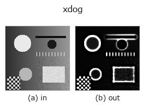
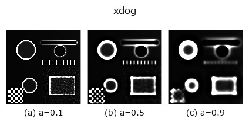
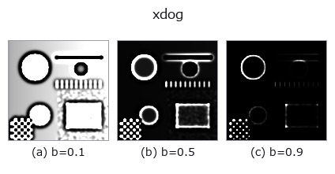
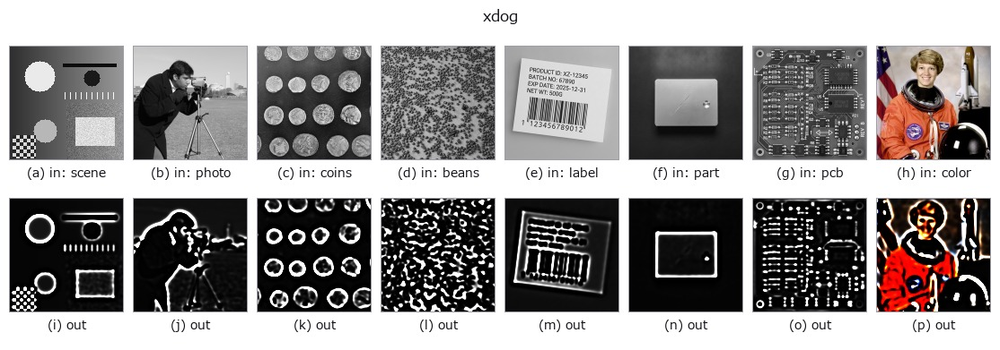

# xdog — 2D `edges` op

- **データ種**: `image` → `image`
- **呼び出し**: `fullseye.apply(img, "xdog", a=0.5, b=0.5)` (2-D は 1 画像 + 2 スカラつまみ `a,b∈[0,1]` のモデル)



*図は合成の入力 128×128 で実際に走らせた出力。左が入力、右が出力。点群は上から見た散布(明るさ = z)、1-D 列は折れ線、体積は z 方向の最大値投影、動画は中央フレーム、複素画像は振幅、絵にならない返り値は値そのもの。*

**つまみ a を振る**(0.1 / 0.5 / 0.9、もう一方は既定):



**つまみ b を振る**(0.1 / 0.5 / 0.9、もう一方は既定):



**別の画像でも**(合成シーン / 写真 / 硬貨。上段が入力、下段がその出力。つまみは既定):



*4 列目はカラー (H,W,3) の入力。この op は色を跨がずに扱える(色チャネルを 3 本目の空間軸として畳み込まない)。*

## 使い方

XDoG(拡張ガウス差分、Winnemoller・Kyprianidis・Olsen 2012)による線画・墨絵調のスタイライズ。

``D = G_sigma - tau * G_(k sigma)`` を作り(``G`` はガウシアンのぼかし)、ソフト閾値
``T(u) = 1 (u >= eps)、1 + tanh(phi (u - eps)) (u < eps)`` を通す。出力は ``0〜1`` で、
紙の白(1)の上に、縁の暗い側だけが黒(0)に沈む。``tau = 1`` なら ``D`` は通常の DoG、
``phi`` を無限大にすると閾値は ``D >= eps`` の二値(DoG の符号)になる。

``a`` がぼかしの幅 ``sigma = 0.5 + 2.5a``(``0.5〜3.0``)を、``b`` が閾値の位置
``eps = 0.1b``(``0〜0.1``)を振る。``sigma`` は線の太さと拾う縁の大きさ、``eps`` を
上げると平坦部も黒く沈み(``tau < 1`` のとき明るい平坦部の ``D`` は ``(1 - tau) x 明るさ``
で、最大 0.02)、墨を塗ったような絵になる。残りは固定: ``k = 1.6``、``tau = 0.98``、
``phi = 50``(``D`` の振れは縁で ±0.1 前後なので、遷移幅は約 0.02)。

**端の扱い**: 端の画素を複製する(最近傍)。

**適用条件**: (1) 出力は入力の明るさの階調を捨てる(ほぼ二値)。計測には使わず見せ方
のための op。(2) ``tau`` を 1 にしない既定では、真っ白な平坦部は ``D = 0.02`` で
``eps`` を 0.02 超に上げると黒くなる。(3) 雑音の多い画像は ``sigma`` を上げないと
雑音が線になる。

## 詳しい使い方ガイド

- [gallery2d_edges ファミリ ガイド](../guides/gallery2d_edges.md)

## 参考(サンプルデータ・文献)

- [サンプルデータ カタログ(DL URL / ライセンス)](../../SAMPLES.md) — 2-D は skimage.data(BSD/public)+ 合成、3-D は実データ源(Stanford/PDS 等)の DL URL。
- [演算子の来歴・参考文献](../../../REFERENCES.md) — この op 族の元になった研究/手法の出典。
- アルゴリズムの正典(著者・年)と用途は上記**ファミリ使い方ガイド**に記載。

## Studio で試す

下のプログラムは実際に走ることを確かめてある(図と同じ入力)。Studio のヘルプではこのブロックがボタンになり、その場で読み込んで実行できる。

```program
xdog 0.40 0.50
```

## 実行できる例(この op を実際に呼ぶ検証済みサンプル)

- [gallery2d_edges](../../../../examples/gallery2d_edges.py) — `py -3.11 examples/gallery2d_edges.py`

## 型が繋がる次の op(`image` を入力に取れる)

[identity](../misc/identity.md) · [gaussian](../smoothing/gaussian.md) · [mean_box](../smoothing/mean_box.md) · [bilateral](../smoothing/bilateral.md) · [kuwahara](../smoothing/kuwahara.md) · [unsharp](../smoothing/unsharp.md) · [median](../rank/median.md) · [min_filter](../rank/min_filter.md)

## 同カテゴリ(`edges`)

[sobel_mag](sobel_mag.md) · [prewitt_mag](prewitt_mag.md) · [roberts_mag](roberts_mag.md) · [dog](dog.md) · [edge_transition_width](edge_transition_width.md) · [grad_dir](grad_dir.md) · [log](log.md) · [corner_response](corner_response.md)

---
*Provenance: ops.py — 2D operator registry. この per-op ノートは `tools/opdocs.py md` が自動生成(手編集しない)。*

© 2026 Kazufumi Furuse — Fullseye operator documentation. Licensed under Apache-2.0.
