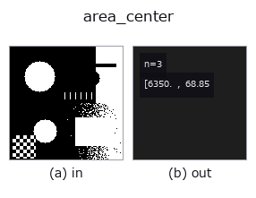
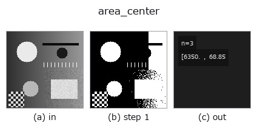

# area_center — 2D `features` op

- **データ種**: `region` → `match`
- **呼び出し**: `fullseye.apply(img, "area_center", a=0.5, b=0.5)` (2-D は 1 画像 + 2 スカラつまみ `a,b∈[0,1]` のモデル)
- **HALCON 相当**: `area_center`(意味・パラメータは HALCON リファレンスが参考になる)
- **GPU**: なし(CPU 参照実装のみ)



*図は合成の入力 128×128 で実際に走らせた出力。左が入力、右が出力。点群は上から見た散布(明るさ = z)、1-D 列は折れ線、体積は z 方向の最大値投影、動画は中央フレーム、複素画像は振幅、絵にならない返り値は値そのもの。*

*つまみ a は出力を変えない(実測: 0.1 / 0.5 / 0.9 で同一)。*

*つまみ b は出力を変えない(実測: 0.1 / 0.5 / 0.9 で同一)。*

**段階**(前置きの op → この op。左から順):



## 使い方

領域の面積と重心を ``(面積 [画素数], 重心の行 [px], 重心の列 [px])`` の 3 成分ベクトルで返す。HALCON の ``area_center``（Area and center of regions.）と同じ 3 値・同じ単位。

1 スカラーでは (Area, Row, Column) を表せないため、``match`` ソート(1 次元
ベクトル、``ncc_locate`` と同じ形)で返す点が他の region 特徴 op と異なる。
領域が空のときは ``(0, (H-1)/2, (W-1)/2)``(面積ゼロ・中心 = 画像中心の画素座標)を
返す fail-soft 仕様。

★2026-09-26 まで 3 成分とも画像サイズで割った 0〜1 の値(面積比・正規化重心)を
返していた。いまは画素(``docs/hardening/dimensional-features-were-normalised.md``)。
正規化が要るなら面積を ``H*W``、行を ``H-1``、列を ``W-1`` で割る。

``a``, ``b`` は未使用。

Raises:
    FsValueError: NaN / inf を含む画像。

## 詳しい使い方ガイド

- [gallery2d_features ファミリ ガイド](../guides/gallery2d_features.md)

## 参考(サンプルデータ・文献)

- [サンプルデータ カタログ(DL URL / ライセンス)](../../SAMPLES.md) — 2-D は skimage.data(BSD/public)+ 合成、3-D は実データ源(Stanford/PDS 等)の DL URL。
- [演算子の来歴・参考文献](../../../REFERENCES.md) — この op 族の元になった研究/手法の出典。
- アルゴリズムの正典(著者・年)と用途は上記**ファミリ使い方ガイド**に記載。

## Studio で試す

下のプログラムは実際に走ることを確かめてある(図と同じ入力)。Studio のヘルプではこのブロックがボタンになり、その場で読み込んで実行できる。

```program
threshold 0.50 0.50
area_center 0.50 0.50
```

## 実行できる例(この op を実際に呼ぶ検証済みサンプル)

- [example_inner_diameter_mm](../../../../examples/example_inner_diameter_mm.py) — `py -3.11 examples/example_inner_diameter_mm.py`
- [gallery2d_features](../../../../examples/gallery2d_features.py) — `py -3.11 examples/gallery2d_features.py`

## 型が繋がる次の op(`match` を入力に取れる)

[identity](../misc/identity.md)

## 同カテゴリ(`features`)

[effective_bit_depth](effective_bit_depth.md) · [blob_count](blob_count.md) · [area_frac](area_frac.md) · [count_contours](count_contours.md) · [total_length](total_length.md) · [vol_count](vol_count.md) · [sk_euler](sk_euler.md) · [sk_entropy_feat](sk_entropy_feat.md)

---
*Provenance: ops.py — 2D operator registry. この per-op ノートは `tools/opdocs.py md` が自動生成(手編集しない)。*

© 2026 Kazufumi Furuse — Fullseye operator documentation. Licensed under Apache-2.0.
