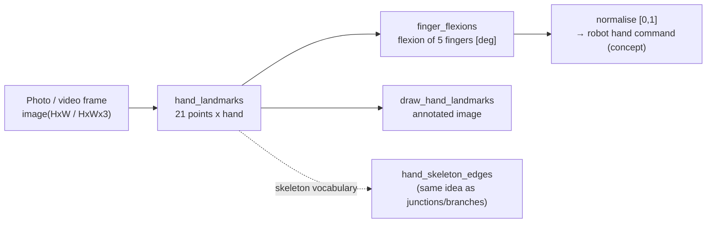

# The 21 hand keypoints and finger flexion angles — usage guide

> Calling model: this family does **not** follow the 2-knob convention `apply(img, "<op名>", a, b)`;
> it is a set of facade functions (`import fullseye; fullseye.hand_landmarks(...)`).
> The detection result is structured data — a list of dicts — and does not fit continuous a/b knobs.
> Verified tests: [`tests/test_handpose.py`](../../../../tests/test_handpose.py)
> (geometry = fully extended 0° / right angle 90° / non-destructive drawing / fail-closed, machine-checked).

## What this family is a toolbox for

It is the entry point for taking **the 21 hand keypoints** (wrist 1 + 4×5 per finger) from photos and video, and from them
computing **the flexion angles of the 5 fingers**. Its position is the Physical AI bridge —
the first step of the hand version of the "watch a human move, transfer it to a robot" pipeline.

- `hand_landmarks(image)` — image → 21 points per hand. Returns both image-normalised coordinates (for drawing) and
  **world coordinates (metres, origin at the geometric centre of the hand)**. Joint angles are computed on
  the world side, which is not distorted by perspective.
- `finger_flexions(det)` — 1 detection → flexion angles of the 5 fingers [deg]. Fully extended ~0°,
  right angle 90°, clenched ~180°+. **The entry point for retargeting** (normalising the flexion to [0,1]
  gives a first approximation of an antagonistic drive command for a robot hand).
- `hand_skeleton_edges()` — skeleton connectivity of the 21 points (wrist → finger bases, within fingers, palm bridges).
  For drawing and graph analysis (the same vocabulary as the skeleton op family).
- `draw_hand_landmarks(image, dets)` — an annotated image with points + bones drawn using numpy only.

## Dependencies and fail-closed (important)

**Only detection** is an optional extra. It needs `mediapipe` (Apache-2.0) and the hand model
`hand_landmarker.task` (~8MB, Apache-2.0); if either is missing it raises
**an explicit error with installation instructions** (it does not silently return an empty list).
The geometry side (`finger_flexions` / `hand_skeleton_edges` / `draw_hand_landmarks`) runs
on numpy alone.

```
py -3.11 -m pip install mediapipe
curl -L -o %USERPROFILE%/.cache/fullseye/hand_landmarker.task ^
    https://storage.googleapis.com/mediapipe-models/hand_landmarker/hand_landmarker/float16/1/hand_landmarker.task
```

## Typical pipeline (how the ops connect)



## Usage

```python
import numpy as np
import handpose as H

# --- detection (needs mediapipe + model; if absent, an error with installation steps) ---
# dets = H.hand_landmarks(rgb_image)          # list[dict]

# --- geometry runs on numpy alone: check flexion angles with synthetic world coordinates ---
w = np.zeros((21, 3))
for f, chain in enumerate(H.FINGERS.values()):
    d = np.array([1.0, 0.15 * f, 0.0]); d /= np.linalg.norm(d)
    for j, idx in enumerate(chain):
        w[idx] = 0.03 * (j + 1) * d                 # all fingers fully extended (straight rays from the wrist)
flex = H.finger_flexions({"world_landmarks": w})
assert all(abs(v) < 0.1 for v in flex.values())     # fully extended = 0°

mcp, pip, dip, tip = H.FINGERS["index"]
w[dip] = w[pip] + (0.0, 0.0, 0.03)                  # bend the index finger at the PIP by a right angle
w[tip] = w[dip] + (0.0, 0.0, 0.03)
flex = H.finger_flexions({"world_landmarks": w})
assert abs(flex["index"] - 90.0) < 0.1              # right angle = 90°
print({k: round(v, 1) for k, v in flex.items()})
```

Demo (1 image / 1 webcam frame):
[`examples/hand_tracking_demo.py`](../../../../examples/hand_tracking_demo.py)

## Honest status and pitfalls

- **Verified**: geometry (0°/90° ground truth for flexion angles, coverage of all points by the connectivity, non-destructive drawing),
  fail-closed when the model is absent, mechanical e2e of empty image → 0 detections.
- **Not verified**: detection quality on real footage has no operational track record yet (the model is MediaPipe
  Hands' publicly released pretrained one. As a guideline, a distance at which the hand occupies 1/10 or more of the frame).
- **Pitfall 1**: compute joint angles **in world coordinates**, not normalised coordinates.
  Normalised coordinates are distorted by perspective and aspect ratio (`finger_flexions` assumes world).
- **Pitfall 2**: `handedness` is anatomical left/right (in mirrored selfie footage it can be the opposite
  of how it looks).
- **Pitfall 3**: the flexion angle is a naive definition — the **sum** of the MCP+PIP bend angles.
  Hyperextension (bending backwards) does not fold to the 0° side but becomes a positive angle — for applications that need
  to separate hyperextension, replace it with a signed definition before use.

## Related

- Skeleton graph family (`junctions_skeleton` / `skeleton_branches3d`, etc.) — the 2D/3D version of the same idea,
  "read shape from points and connections".
- Physical AI perception stack (stereo, 6DoF pose) — turning the hand into 3D (replacing world coordinates with measurements
  from binocular / depth) is the next connection point.
