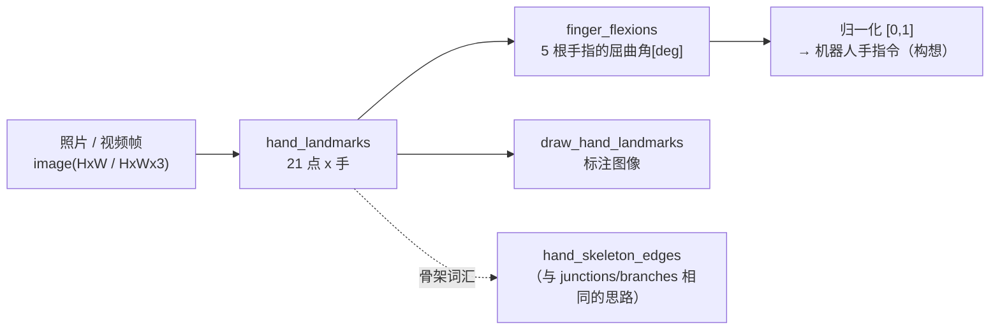

# 手部 21 个关键点与手指屈曲角 —— 使用指南

> 调用模型：本族**不**采用 `apply(img, "<op名>", a, b)` 的 2 旋钮约定，
> 而是外观函数（`import fullseye; fullseye.hand_landmarks(...)`）。
> 因为检测结果是 dict 列表这种结构化数据，不适合 a/b 这样的连续旋钮。
> 已验证的测试：[`tests/test_handpose.py`](../../../../tests/test_handpose.py)
> （几何 = 完全伸直 0° / 直角 90° / 绘制不破坏原图 / fail-closed，均为机器验证）。

## 本族是做什么的工具箱

它是从照片、视频中获取**手部 21 个关键点**（手腕 1 + 每根手指 4×5），并由此
计算 **5 根手指屈曲角**的入口。其定位是 Physical AI 桥梁 ——
“看人的动作，映射到机器人”这条流水线的手部版的第一步。

- `hand_landmarks(image)` — 图像 → 每只手 21 个点。同时返回图像归一化坐标（用于绘制）和
  **world 坐标（米，原点在手的几何中心）**。关节角的计算使用
  不受透视畸变影响的 world 一侧。
- `finger_flexions(det)` — 1 个检测结果 → 5 根手指的屈曲角[deg]。完全伸直 ~0°，
  直角 90°，握紧 ~180°+。**重定向（retarget）的入口**（把屈曲量归一化到 [0,1]，
  即可作为机器人手拮抗驱动指令的第一近似）。
- `hand_skeleton_edges()` — 21 个点的骨架连线（手腕→指根、指内、掌部的桥）。
  用于绘制和图分析（与骨架 op 族相同的词汇）。
- `draw_hand_landmarks(image, dets)` — 仅用 numpy 画出点+骨骼的标注图像。

## 依赖与 fail-closed（重要）

**只有检测**是 optional extra。需要 `mediapipe`（Apache-2.0）和手部模型
`hand_landmarker.task`（~8MB，Apache-2.0），缺少其中任何一个都会
抛出**附带安装步骤的明确错误**（不会默默返回空列表）。
几何部分（`finger_flexions` / `hand_skeleton_edges` / `draw_hand_landmarks`）
只靠 numpy 即可运行。

```
py -3.11 -m pip install mediapipe
curl -L -o %USERPROFILE%/.cache/fullseye/hand_landmarker.task ^
    https://storage.googleapis.com/mediapipe-models/hand_landmarker/hand_landmarker/float16/1/hand_landmarker.task
```

## 典型流水线（op 的连接）



## 用法

```python
import numpy as np
import handpose as H

# --- 检测（需要 mediapipe + 模型。没有则抛出附带安装步骤的错误）---
# dets = H.hand_landmarks(rgb_image)          # list[dict]

# --- 几何只靠 numpy 运行：用合成的 world 坐标确认屈曲角 ---
w = np.zeros((21, 3))
for f, chain in enumerate(H.FINGERS.values()):
    d = np.array([1.0, 0.15 * f, 0.0]); d /= np.linalg.norm(d)
    for j, idx in enumerate(chain):
        w[idx] = 0.03 * (j + 1) * d                 # 所有手指完全伸直（从手腕放射的直线）
flex = H.finger_flexions({"world_landmarks": w})
assert all(abs(v) < 0.1 for v in flex.values())     # 完全伸直 = 0°

mcp, pip, dip, tip = H.FINGERS["index"]
w[dip] = w[pip] + (0.0, 0.0, 0.03)                  # 把食指在 PIP 处弯成直角
w[tip] = w[dip] + (0.0, 0.0, 0.03)
flex = H.finger_flexions({"world_landmarks": w})
assert abs(flex["index"] - 90.0) < 0.1              # 直角 = 90°
print({k: round(v, 1) for k, v in flex.items()})
```

演示（1 张图像 / Web 摄像头 1 帧）：
[`examples/hand_tracking_demo.py`](../../../../examples/hand_tracking_demo.py)

## 如实的现状与陷阱

- **已验证**：几何（屈曲角的 0°/90° 真值、连线对所有点的覆盖、绘制不破坏原图）、
  模型缺失时的 fail-closed、空图像 → 0 个检测结果的机械 e2e。
- **未验证**：实拍下的检测质量尚无运行实绩（模型是 MediaPipe
  Hands 公开的预训练模型。以手占画面 1/10 以上的距离为参考）。
- **陷阱 1**：关节角要用 **world 坐标**计算，而不是归一化坐标。
  归一化坐标会因透视和宽高比而畸变（`finger_flexions` 以 world 为前提）。
- **陷阱 2**：`handedness` 是解剖学上的左右（在镜像的自拍视频中可能与
  看上去的相反）。
- **陷阱 3**：屈曲角是 MCP+PIP 弯折角之**和**这一朴素定义。
  过伸（反弓）不会折回到 0° 一侧，而是成为正的角度 —— 需要分离反弓的用途，
  请先替换为带符号的定义再使用。

## 相关

- 骨架图族（`junctions_skeleton` / `skeleton_branches3d` 等）—— “用点和连线
  读取形状”这一相同思路的 2D/3D 版。
- Physical AI 感知栈（立体视觉、6DoF 位姿）—— 手部的 3D 化（用双目/深度把
  world 坐标替换为实测值）是今后的连接点。
