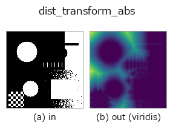
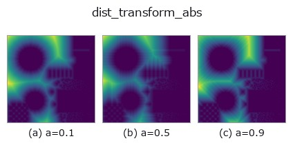
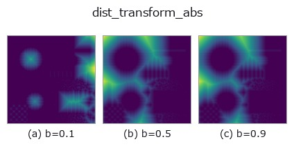
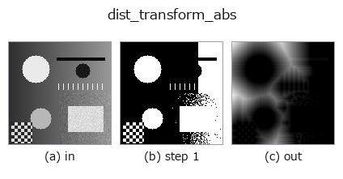
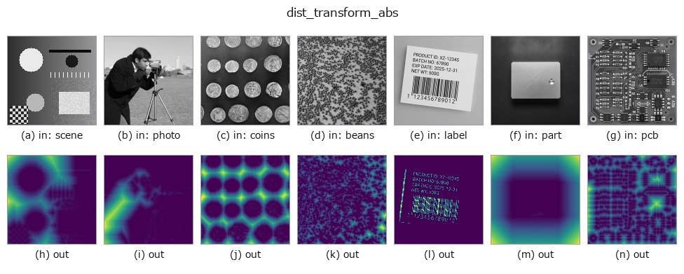

# dist_transform_abs — 2D `region` op

- **データ種**: `region` → `image`
- **呼び出し**: `fullseye.apply(img, "dist_transform_abs", a=0.5, b=0.5)` (2-D は 1 画像 + 2 スカラつまみ `a,b∈[0,1]` のモデル)
- **HALCON 相当**: `distance_transform`(意味・パラメータは HALCON リファレンスが参考になる)



*図は合成の入力 128×128 で実際に走らせた出力。左が入力、右が出力。点群は上から見た散布(明るさ = z)、1-D 列は折れ線、体積は z 方向の最大値投影、動画は中央フレーム、複素画像は振幅、絵にならない返り値は値そのもの。*

*出力は viridis 風の疑似カラー(暗い紫 = 小、黄 = 大)。距離・位相・向き・深度のような「量の場」を読むため。*

**つまみ a を振る**(0.1 / 0.5 / 0.9、もう一方は既定):



**つまみ b を振る**(0.1 / 0.5 / 0.9、もう一方は既定):



**段階**(前置きの op → この op。左から順):



**別の画像でも**(合成シーン / 写真 / 硬貨。上段が入力、下段がその出力。つまみは既定):



## 使い方

正規化しない絶対画素距離の距離変換。HALCON の ``distance_transform``（Compute the distance transformation of a region.）に相当。

``a`` で距離の種類を選ぶ: ``a < 1/3`` はユークリッド、``1/3 <= a < 2/3`` は市街地（L1）、
それ以上はチェス盤（L∞）。``b < 0.5`` は各前景画素から最も近い背景画素までの距離、
``b >= 0.5`` は各背景画素から最も近い前景画素までの距離を返す。出力は float64 の画像で、
``dist_transform`` と違い画像内の最大値で正規化しない（3×3 と 9×9 の正方形の中心は
それぞれ 2 と 5）。例: ``_dist_transform_abs(np.ones((3, 3)), 0, 0)``。

HALCON の参照 op は ``int4`` の近似を返す。この op は厳密な float64 距離を返し、
互換 API ではない。

## 詳しい使い方ガイド

- [gallery2d_region ファミリ ガイド](../guides/gallery2d_region.md)

## 参考(サンプルデータ・文献)

- [サンプルデータ カタログ(DL URL / ライセンス)](../../SAMPLES.md) — 2-D は skimage.data(BSD/public)+ 合成、3-D は実データ源(Stanford/PDS 等)の DL URL。
- [演算子の来歴・参考文献](../../../REFERENCES.md) — この op 族の元になった研究/手法の出典。
- アルゴリズムの正典(著者・年)と用途は上記**ファミリ使い方ガイド**に記載。

## Studio で試す

下のプログラムは実際に走ることを確かめてある(図と同じ入力)。Studio のヘルプではこのブロックがボタンになり、その場で読み込んで実行できる。

```program
threshold 0.50 0.50
dist_transform_abs 0.50 0.50
```

## 実行できる例(この op を実際に呼ぶ検証済みサンプル)

- [gallery2d_region](../../../../examples/gallery2d_region.py) — `py -3.11 examples/gallery2d_region.py`

## 型が繋がる次の op(`image` を入力に取れる)

[identity](../misc/identity.md) · [gaussian](../smoothing/gaussian.md) · [mean_box](../smoothing/mean_box.md) · [mean_box_wh](../smoothing/mean_box_wh.md) · [bilateral](../smoothing/bilateral.md) · [kuwahara](../smoothing/kuwahara.md) · [unsharp](../smoothing/unsharp.md) · [median](../rank/median.md)

## 同カテゴリ(`region`)

[reg_erode](reg_erode.md) · [reg_dilate](reg_dilate.md) · [reg_open](reg_open.md) · [reg_close](reg_close.md) · [fill_holes](fill_holes.md) · [select_largest](select_largest.md) · [remove_small](remove_small.md) · [invert_region](invert_region.md)

---
*Provenance: ops.py — 2D operator registry. この per-op ノートは `tools/opdocs.py md` が自動生成(手編集しない)。*

© 2026 Kazufumi Furuse — Fullseye operator documentation. Licensed under Apache-2.0.
