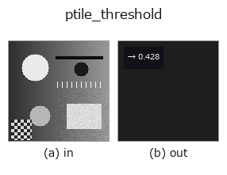
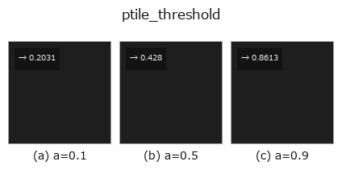

# ptile_threshold — 2D `segmentation` op

- **データ種**: `image` → `feature`
- **呼び出し**: `fullseye.apply(img, "ptile_threshold", a=0.5, b=0.5)` (2-D は 1 画像 + 2 スカラつまみ `a,b∈[0,1]` のモデル)



*図は合成の入力 128×128 で実際に走らせた出力。左が入力、右が出力。点群は上から見た散布(明るさ = z)、1-D 列は折れ線、体積は z 方向の最大値投影、動画は中央フレーム、複素画像は振幅、絵にならない返り値は値そのもの。*

**つまみ a を振る**(0.1 / 0.5 / 0.9、もう一方は既定):



*つまみ b は出力を変えない(実測: 0.1 / 0.5 / 0.9 で同一)。*

## 使い方

面積率で決める P-tile しきい値を feature として返す。

``a`` を ``p = 0.001 + 0.998*a``（CDF の端を除く面積率）、``b < 0.5`` を明側、
それ以外を暗側に写す。Doyle (1962) の順位統計であり、値域の利得・オフセットを
つまみにしない。詳細な ``p`` と極性を名前付きで渡す公開 API は
``fullseye.ledger.ptile_threshold``。

**空入力は分布を持たないため拒否し、しきい値を捏造しない。**

## 参考(サンプルデータ・文献)

- [サンプルデータ カタログ(DL URL / ライセンス)](../../SAMPLES.md) — 2-D は skimage.data(BSD/public)+ 合成、3-D は実データ源(Stanford/PDS 等)の DL URL。
- [演算子の来歴・参考文献](../../../REFERENCES.md) — この op 族の元になった研究/手法の出典。

## Studio で試す

下のプログラムは実際に走ることを確かめてある(図と同じ入力)。Studio のヘルプではこのブロックがボタンになり、その場で読み込んで実行できる。

```program
ptile_threshold 0.50 0.50
```

## 実行できる例(この op を実際に呼ぶ検証済みサンプル)

- [poc_threshold_transfer_after_normalization](../../../../examples/poc_threshold_transfer_after_normalization.py) — `py -3.11 examples/poc_threshold_transfer_after_normalization.py`

## 型が繋がる次の op(`feature` を入力に取れる)

[identity](../misc/identity.md) · [feature_to_img](../bridge/feature_to_img.md)

## 同カテゴリ(`segmentation`)

[threshold](threshold.md) · [sigma_threshold](sigma_threshold.md) · [otsu](otsu.md) · [canny](canny.md) · [adaptive_gauss_thresh](adaptive_gauss_thresh.md) · [sk_otsu](sk_otsu.md) · [sk_li](sk_li.md) · [sk_yen](sk_yen.md)

---
*Provenance: ops.py — 2D operator registry. この per-op ノートは `tools/opdocs.py md` が自動生成(手編集しない)。*

© 2026 Kazufumi Furuse — Fullseye operator documentation. Licensed under Apache-2.0.
