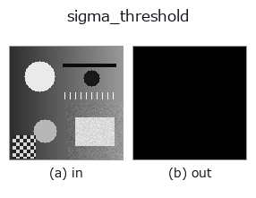
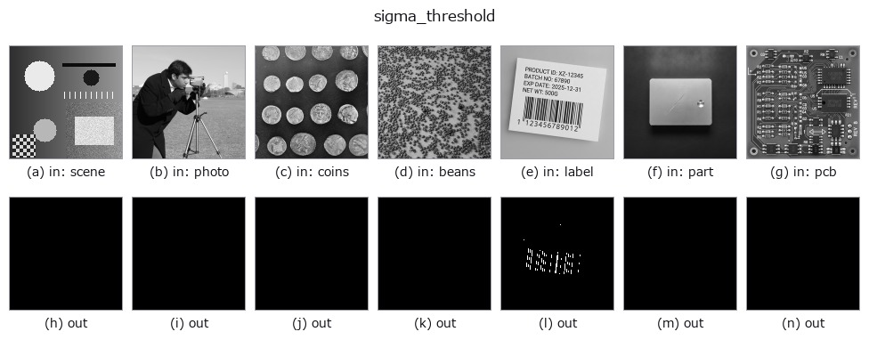

# sigma_threshold — 2D `segmentation` op

- **データ種**: `image` → `region`
- **呼び出し**: `fullseye.apply(img, "sigma_threshold", a=0.5, b=0.5)` (2-D は 1 画像 + 2 スカラつまみ `a,b∈[0,1]` のモデル)



*図は合成の入力 128×128 で実際に走らせた出力。左が入力、右が出力。点群は上から見た散布(明るさ = z)、1-D 列は折れ線、体積は z 方向の最大値投影、動画は中央フレーム、複素画像は振幅、絵にならない返り値は値そのもの。*

*つまみ a は出力を変えない(実測: 0.1 / 0.5 / 0.9 で同一)。*

*つまみ b は出力を変えない(実測: 0.1 / 0.5 / 0.9 で同一)。*

**別の画像でも**(合成シーン / 写真 / 硬貨。上段が入力、下段がその出力。つまみは既定):



*4 列目はカラー (H,W,3) の入力。この op は色を跨がずに扱える(色チャネルを 3 本目の空間軸として畳み込まない)。*

## 使い方

画像を頑健標準化し、``k = 2 + 3*a`` σで二値化する。

``b`` の 3 帯が明側 ``x>k`` / 暗側 ``x<-k`` / 両側 ``|x|>k``。``image`` sort
の入力は ``[0,1]`` 強度なので、この 2-D レジストリ版は中央値と 1.4826×MAD で
内部標準化してから比較する。名前付き API は既に σ 単位の入力も直接扱える。

**空入力は σ単位を検査できないため拒否し、空 region へ黙って落とさない。**

**つまみ(実測)**: ``a`` は**段階的**に効き、切り替わるのは a ≈ 0.01、0.03、0.05(実測。刻み 0.02 の掃きで測った位置)。

## 参考(サンプルデータ・文献)

- [サンプルデータ カタログ(DL URL / ライセンス)](../../SAMPLES.md) — 2-D は skimage.data(BSD/public)+ 合成、3-D は実データ源(Stanford/PDS 等)の DL URL。
- [演算子の来歴・参考文献](../../../REFERENCES.md) — この op 族の元になった研究/手法の出典。

## Studio で試す

下のプログラムは実際に走ることを確かめてある(図と同じ入力)。Studio のヘルプではこのブロックがボタンになり、その場で読み込んで実行できる。

```program
sigma_threshold 0.50 0.50
```

## 実行できる例(この op を実際に呼ぶ検証済みサンプル)

- [poc_threshold_transfer_after_normalization](../../../../examples/poc_threshold_transfer_after_normalization.py) — `py -3.11 examples/poc_threshold_transfer_after_normalization.py`

## 型が繋がる次の op(`region` を入力に取れる)

[identity](../misc/identity.md) · [reg_erode](../region/reg_erode.md) · [reg_dilate](../region/reg_dilate.md) · [reg_open](../region/reg_open.md) · [reg_close](../region/reg_close.md) · [fill_holes](../region/fill_holes.md) · [select_largest](../region/select_largest.md) · [remove_small](../region/remove_small.md)

## 同カテゴリ(`segmentation`)

[threshold](threshold.md) · [ptile_threshold](ptile_threshold.md) · [otsu](otsu.md) · [canny](canny.md) · [adaptive_gauss_thresh](adaptive_gauss_thresh.md) · [sk_otsu](sk_otsu.md) · [sk_li](sk_li.md) · [sk_yen](sk_yen.md)

---
*Provenance: ops.py — 2D operator registry. この per-op ノートは `tools/opdocs.py md` が自動生成(手編集しない)。*

© 2026 Kazufumi Furuse — Fullseye operator documentation. Licensed under Apache-2.0.
