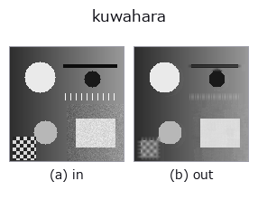
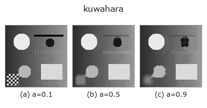
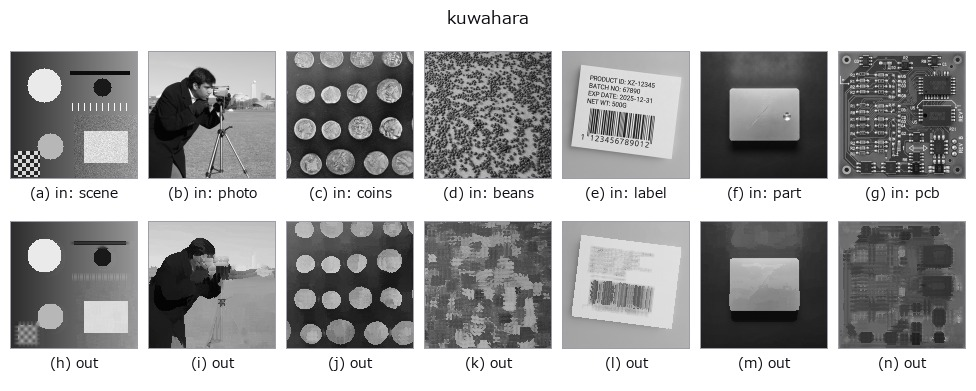

# kuwahara — 2D `smoothing` op

- **データ種**: `image` → `image`
- **呼び出し**: `fullseye.apply(img, "kuwahara", a=0.5, b=0.5)` (2-D は 1 画像 + 2 スカラつまみ `a,b∈[0,1]` のモデル)



*図は合成の入力 128×128 で実際に走らせた出力。左が入力、右が出力。点群は上から見た散布(明るさ = z)、1-D 列は折れ線、体積は z 方向の最大値投影、動画は中央フレーム、複素画像は振幅、絵にならない返り値は値そのもの。*

**つまみ a を振る**(0.1 / 0.5 / 0.9、もう一方は既定):



*つまみ b は出力を変えない(実測: 0.1 / 0.5 / 0.9 で同一)。*

**別の画像でも**(合成シーン / 写真 / 硬貨。上段が入力、下段がその出力。つまみは既定):



*4 列目はカラー (H,W,3) の入力。この op は色を跨がずに扱える(色チャネルを 3 本目の空間軸として畳み込まない)。*

## 使い方

Kuwahara フィルタ(1976)。4 つの重なる窓のうち分散が最小の窓の平均を出す、縁を保つ平滑化。

油絵調の見た目にも使われる。

各画素について、その画素を角に含む ``(r+1) x (r+1)`` の窓を 4 つ(左上・右上・左下・
右下。隣り合う窓は中心の行と列を共有して重なる)とり、**分散がいちばん小さい窓の
平均**を出力する。縁をまたぐ窓は分散が大きいので選ばれず、画素は縁の「自分と同じ側」
の窓の平均になる。だから平坦部は均され、段差は鈍らない(``gaussian`` は段差をなだらかに
してしまう)。

``a`` が窓の半径 ``r = 1 + floor(9a + 0.5)``(``1〜10``、窓の一辺は ``r+1``)を振る。大きい
ほど均す範囲が広がり、細い構造は消える。``b`` は未使用。

計算量は **O(N)**: 窓の和と二乗和を軸ごとの累積和で求めるので、半径に依存しない
(分散は ``E[x^2] - E[x]^2``、全体の平均を引いてから計算して桁落ちを抑える)。
分散の同点は、小数 10 桁に丸めた値で比べ、宣言順(左上・右上・左下・右下)で決める。

**端の扱い**: 端の画素を複製する(最近傍)。端の画素の窓は、画像の外を端の値で埋めて
作る。

**適用条件**: (1) 4 象限の方向は軸に揃っているので、斜めの縁では選ばれた窓が縁に
沿わず、角の丸まりや「ブロック状」の模様が出る(一般化 Kuwahara はこれを直す)。
(2) 半径が大きいと細い線は消える。(3) 出力は入力の局所平均だけから作るので、値域は
入力の外に出ない。

## 詳しい使い方ガイド

- [gallery2d_smoothing_rank ファミリ ガイド](../guides/gallery2d_smoothing_rank.md)

## 参考(サンプルデータ・文献)

- [サンプルデータ カタログ(DL URL / ライセンス)](../../SAMPLES.md) — 2-D は skimage.data(BSD/public)+ 合成、3-D は実データ源(Stanford/PDS 等)の DL URL。
- [演算子の来歴・参考文献](../../../REFERENCES.md) — この op 族の元になった研究/手法の出典。
- アルゴリズムの正典(著者・年)と用途は上記**ファミリ使い方ガイド**に記載。

## Studio で試す

下のプログラムは実際に走ることを確かめてある(図と同じ入力)。Studio のヘルプではこのブロックがボタンになり、その場で読み込んで実行できる。

```program
kuwahara 0.35 0.50
```

## 実行できる例(この op を実際に呼ぶ検証済みサンプル)

- [gallery2d_smoothing_rank](../../../../examples/gallery2d_smoothing_rank.py) — `py -3.11 examples/gallery2d_smoothing_rank.py`

## 型が繋がる次の op(`image` を入力に取れる)

[identity](../misc/identity.md) · [gaussian](gaussian.md) · [mean_box](mean_box.md) · [mean_box_wh](mean_box_wh.md) · [bilateral](bilateral.md) · [unsharp](unsharp.md) · [median](../rank/median.md) · [min_filter](../rank/min_filter.md)

## 同カテゴリ(`smoothing`)

[gaussian](gaussian.md) · [mean_box](mean_box.md) · [mean_box_wh](mean_box_wh.md) · [bilateral](bilateral.md) · [unsharp](unsharp.md) · [sk_tv](sk_tv.md) · [sk_wavelet](sk_wavelet.md) · [sk_rolling_ball](sk_rolling_ball.md)

---
*Provenance: ops.py — 2D operator registry. この per-op ノートは `tools/opdocs.py md` が自動生成(手編集しない)。*

© 2026 Kazufumi Furuse — Fullseye operator documentation. Licensed under Apache-2.0.
