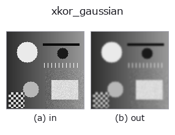
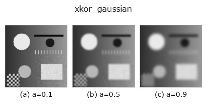
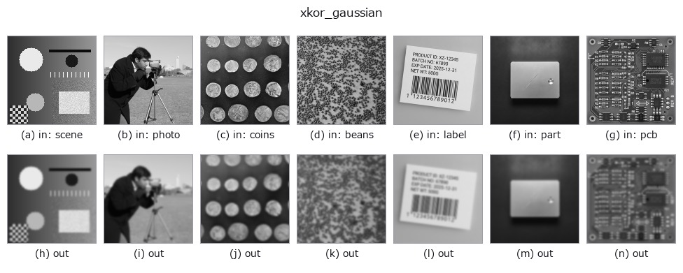

# xkor_gaussian — 2D `smoothing` op

- **データ種**: `image` → `image`
- **呼び出し**: `fullseye.apply(img, "xkor_gaussian", a=0.5, b=0.5)` (2-D は 1 画像 + 2 スカラつまみ `a,b∈[0,1]` のモデル)
- **GPU**: なし(CPU 参照実装のみ)



*図は合成の入力 128×128 で実際に走らせた出力。左が入力、右が出力。点群は上から見た散布(明るさ = z)、1-D 列は折れ線、体積は z 方向の最大値投影、動画は中央フレーム、複素画像は振幅、絵にならない返り値は値そのもの。*

**つまみ a を振る**(0.1 / 0.5 / 0.9、もう一方は既定):



*つまみ b は出力を変えない(実測: 0.1 / 0.5 / 0.9 で同一)。*

**別の画像でも**(合成シーン / 写真 / 硬貨。上段が入力、下段がその出力。つまみは既定):



*4 列目はカラー (H,W,3) の入力。この op は色を跨がずに扱える(色チャネルを 3 本目の空間軸として畳み込まない)。*

## 使い方

ガウシアンぼかし（kornia の GPU ネイティブ実装）。torch テンソル上で
``kornia.filters.gaussian_blur2d`` を、σ に合わせた窓で掛ける。

a はシグマを 0.3〜3.0 の範囲で振る（``0.3 + 2.7 * a``、core の ``gaussian`` /
``cv_gaussian`` と同じ写し方）。b は未使用。窓の半径は ``int(4σ + 0.5)``
(scipy の ``gaussian_filter`` の既定 truncate=4.0 と同じ)、端は端画素を複製して
折り返す(scipy の ``reflect`` = numpy の ``symmetric``、core の ``gaussian`` の
``b <= 0.5`` と同じ)。core の ``gaussian(v, a, 0.5)`` と float32 の丸め(〜1e-7)で一致する
(``tools/impl_differential.py``、``tests/test_impl_differential.py``)。

★2026-11-03 の修正(値が変わる): それまでは窓が **5x5 固定**で、σ = 1.65(a = 0.5)
でも半径 2 = 1.2σ で打ち切られ、σ を上げてもぼけが 5x5 の箱に近づくだけだった
(core の ``gaussian`` との内部差は a = 0.5 で振れ幅の 9 %、a = 0.75 で 28 %)。
CPU 実行では scipy 版と比べて速くはならない（GPU・バッチ実行時に効く
実装。``IMGEVOLVE_KORNIA_DEVICE=cuda`` で GPU に乗る）。

**同じ処理の別実装(実測、`docs/IMPL_DIFFERENTIAL.md`)**: 同じ入力・同じ a, b での内部の差(振れ幅に対する比。5e-3 未満が一致)は `cv_gaussian` 7.3e-05, `gaussian` 3.8e-07。食い違う理由(つまみの写し方・窓・端・量子化・定義の違い)は表に書いてある。

## 詳しい使い方ガイド

- [gallery2d_smoothing_rank ファミリ ガイド](../guides/gallery2d_smoothing_rank.md)

## 参考(サンプルデータ・文献)

- [サンプルデータ カタログ(DL URL / ライセンス)](../../SAMPLES.md) — 2-D は skimage.data(BSD/public)+ 合成、3-D は実データ源(Stanford/PDS 等)の DL URL。
- [演算子の来歴・参考文献](../../../REFERENCES.md) — この op 族の元になった研究/手法の出典。
- アルゴリズムの正典(著者・年)と用途は上記**ファミリ使い方ガイド**に記載。

## Studio で試す

下のプログラムは実際に走ることを確かめてある(図と同じ入力)。Studio のヘルプではこのブロックがボタンになり、その場で読み込んで実行できる。

```program
xkor_gaussian 0.35 0.50
```

## 実行できる例(この op を実際に呼ぶ検証済みサンプル)

- [gallery2d_smoothing_rank](../../../../examples/gallery2d_smoothing_rank.py) — `py -3.11 examples/gallery2d_smoothing_rank.py`

## 型が繋がる次の op(`image` を入力に取れる)

[identity](../misc/identity.md) · [gaussian](gaussian.md) · [mean_box](mean_box.md) · [mean_box_wh](mean_box_wh.md) · [bilateral](bilateral.md) · [kuwahara](kuwahara.md) · [unsharp](unsharp.md) · [median](../rank/median.md)

## 同カテゴリ(`smoothing`)

[gaussian](gaussian.md) · [mean_box](mean_box.md) · [mean_box_wh](mean_box_wh.md) · [bilateral](bilateral.md) · [kuwahara](kuwahara.md) · [unsharp](unsharp.md) · [sk_tv](sk_tv.md) · [sk_wavelet](sk_wavelet.md)

---
*Provenance: ops.py — 2D operator registry. この per-op ノートは `tools/opdocs.py md` が自動生成(手編集しない)。*

© 2026 Kazufumi Furuse — Fullseye operator documentation. Licensed under Apache-2.0.
