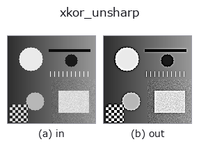
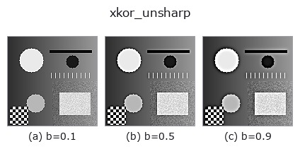
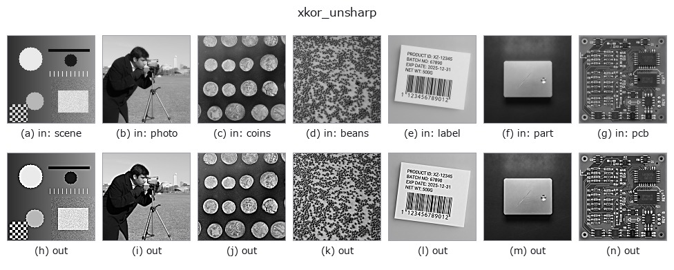

# xkor_unsharp — 2D `smoothing` op

- **データ種**: `image` → `image`
- **呼び出し**: `fullseye.apply(img, "xkor_unsharp", a=0.5, b=0.5)` (2-D は 1 画像 + 2 スカラつまみ `a,b∈[0,1]` のモデル)
- **GPU**: なし(CPU 参照実装のみ)



*図は合成の入力 128×128 で実際に走らせた出力。左が入力、右が出力。点群は上から見た散布(明るさ = z)、1-D 列は折れ線、体積は z 方向の最大値投影、動画は中央フレーム、複素画像は振幅、絵にならない返り値は値そのもの。*

*つまみ a は出力を変えない(実測: 0.1 / 0.5 / 0.9 で同一)。*

**つまみ b を振る**(0.1 / 0.5 / 0.9、もう一方は既定):



**別の画像でも**(合成シーン / 写真 / 硬貨。上段が入力、下段がその出力。つまみは既定):



*4 列目はカラー (H,W,3) の入力。この op は色を跨がずに扱える(色チャネルを 3 本目の空間軸として畳み込まない)。*

## 使い方

アンシャープマスク（鮮鋭化）。``kornia.filters.unsharp_mask`` を、σ に
合わせた窓で呼ぶ(``v + (v - G_σ * v)``、強さは 1 倍固定)。

**``a`` は未使用**、b がぼかしのシグマ（``0.5 + 2.0 * b``、範囲 0.5〜2.5）を
振る。元画像から低周波成分（ぼかし版）を引いた差分を強調して足し戻す
古典的な鮮鋭化。窓の半径は ``int(4σ + 0.5)``、端は端画素を複製して折り返す
(``xkor_gaussian`` と同じ)。core の ``unsharp`` とは**つまみの意味が違う**:
core は ``a`` が強さ(``1.5a`` 倍)、``b`` が σ = ``0.5 + 1.5b``。core の
``unsharp(v, 2/3, (s - 0.5)/1.5)`` と、この op の ``b = (s - 0.5)/2`` が同じ処理になる。

★2026-11-03 の修正(値が変わる): それまでは窓が **5x5 固定**で、σ = 1.5(b = 0.5)でも
半径 2 で打ち切られていた(``xkor_gaussian`` と同じ欠陥)。

**同じ処理の別実装(実測、`docs/IMPL_DIFFERENTIAL.md`)**: 同じ入力・同じ a, b での内部の差(振れ幅に対する比。5e-3 未満が一致)は `unsharp` 0.19。食い違う理由(つまみの写し方・窓・端・量子化・定義の違い)は表に書いてある。

## 詳しい使い方ガイド

- [gallery2d_smoothing_rank ファミリ ガイド](../guides/gallery2d_smoothing_rank.md)

## 参考(サンプルデータ・文献)

- [サンプルデータ カタログ(DL URL / ライセンス)](../../SAMPLES.md) — 2-D は skimage.data(BSD/public)+ 合成、3-D は実データ源(Stanford/PDS 等)の DL URL。
- [演算子の来歴・参考文献](../../../REFERENCES.md) — この op 族の元になった研究/手法の出典。
- アルゴリズムの正典(著者・年)と用途は上記**ファミリ使い方ガイド**に記載。

## Studio で試す

下のプログラムは実際に走ることを確かめてある(図と同じ入力)。Studio のヘルプではこのブロックがボタンになり、その場で読み込んで実行できる。

```program
xkor_unsharp 0.35 0.50
```

## 実行できる例(この op を実際に呼ぶ検証済みサンプル)

- [gallery2d_smoothing_rank](../../../../examples/gallery2d_smoothing_rank.py) — `py -3.11 examples/gallery2d_smoothing_rank.py`

## 型が繋がる次の op(`image` を入力に取れる)

[identity](../misc/identity.md) · [gaussian](gaussian.md) · [mean_box](mean_box.md) · [mean_box_wh](mean_box_wh.md) · [bilateral](bilateral.md) · [kuwahara](kuwahara.md) · [unsharp](unsharp.md) · [median](../rank/median.md)

## 同カテゴリ(`smoothing`)

[gaussian](gaussian.md) · [mean_box](mean_box.md) · [mean_box_wh](mean_box_wh.md) · [bilateral](bilateral.md) · [kuwahara](kuwahara.md) · [unsharp](unsharp.md) · [sk_tv](sk_tv.md) · [sk_wavelet](sk_wavelet.md)

---
*Provenance: ops.py — 2D operator registry. この per-op ノートは `tools/opdocs.py md` が自動生成(手編集しない)。*

© 2026 Kazufumi Furuse — Fullseye operator documentation. Licensed under Apache-2.0.
