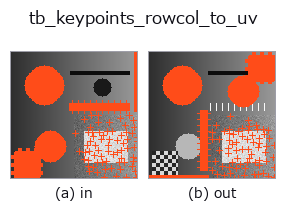
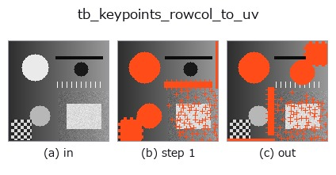
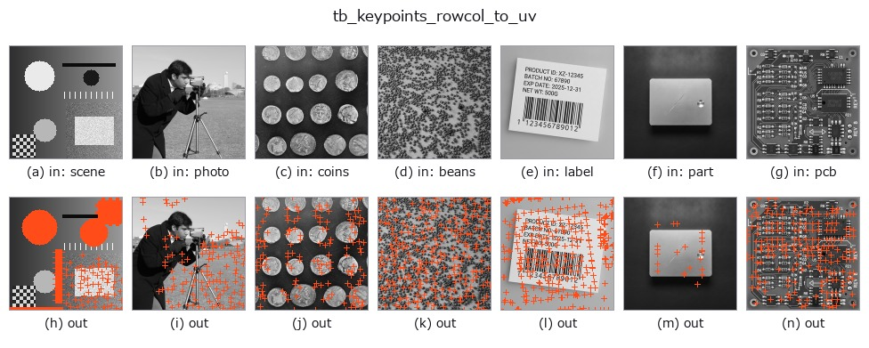

# tb_keypoints_rowcol_to_uv — 2D `typed` op

- **データ種**: `keypoints` → `keypoints`
- **呼び出し**: `fullseye.apply(img, "tb_keypoints_rowcol_to_uv", a=0.5, b=0.5)` (2-D は 1 画像 + 2 スカラつまみ `a,b∈[0,1]` のモデル)
- **GPU**: なし(CPU 参照実装のみ)



*図は合成の入力 128×128 で実際に走らせた出力。左が入力、右が出力。点群は上から見た散布(明るさ = z)、1-D 列は折れ線、体積は z 方向の最大値投影、動画は中央フレーム、複素画像は振幅、絵にならない返り値は値そのもの。*

*つまみ a は出力を変えない(実測: 0.1 / 0.5 / 0.9 で同一)。*

*つまみ b は出力を変えない(実測: 0.1 / 0.5 / 0.9 で同一)。*

**段階**(前置きの op → この op。左から順):



**別の画像でも**(合成シーン / 写真 / 硬貨。上段が入力、下段がその出力。つまみは既定):



## 使い方

像面の点 ``(row, col)`` → ``(u, v) = (col, row)``。``keypoints`` 型の 2 つの流儀のつなぎ。

``keypoints`` 型には 2 つの軸の約束が同居している(実測): ``calib.project_3d_point`` などは
**(row, col)**、``project_points`` / ``dlt_pose`` / ``pnp_ransac`` は **(u, v) = (列, 行)**。
取り違えても例外は出ず、姿勢が鏡に映ったように出る(W2 の実測: t = (−0.565, 0.61, 3.21)
のはずが (0.1, −0.05, 3.0))。列を入れ替えるだけだが、**どちらの向きかを op 名に書く**ため
逆向きの :func:`keypoints_uv_to_rowcol` と 2 本に分けてある(中身は同じ入れ替え)。

Args:
    keypoints: (N, 2) の (row, col)。
Returns:
    (N, 2) float64 の (u, v)。
Raises:
    ValueError: (N, 2) でない / 非有限 / 空。

2-D 進化レジストリへ橋渡しした reprconv の op ``keypoints_rowcol_to_uv``。実装は同じで、呼び出し規約だけ ``op(v, a, b)`` に合わせてある。この op に調整点は無く、``a`` も ``b`` も使われない。

## 参考(サンプルデータ・文献)

- [サンプルデータ カタログ(DL URL / ライセンス)](../../SAMPLES.md) — 2-D は skimage.data(BSD/public)+ 合成、3-D は実データ源(Stanford/PDS 等)の DL URL。
- [演算子の来歴・参考文献](../../../REFERENCES.md) — この op 族の元になった研究/手法の出典。

## Studio で試す

下のプログラムは実際に走ることを確かめてある(図と同じ入力)。Studio のヘルプではこのブロックがボタンになり、その場で読み込んで実行できる。

```program
img_to_keypoints 0.50 0.50
tb_keypoints_rowcol_to_uv 0.50 0.50
```

## 実行できる例(この op を実際に呼ぶ検証済みサンプル)

次の例は元の台帳 op `keypoints_rowcol_to_uv` を呼ぶもの。この橋渡し op は同じ実装を `fn(v, a, b)` 規約に合わせただけなので、挙動はそのまま当てはまる(呼び出し形だけ違う)。
- [poc_bga_ball_type_roundtrip](../../../../examples/poc_bga_ball_type_roundtrip.py) — `py -3.11 examples/poc_bga_ball_type_roundtrip.py`
- [type_connectivity_tour](../../../../examples/type_connectivity_tour.py) — `py -3.11 examples/type_connectivity_tour.py`

## 型が繋がる次の op(`keypoints` を入力に取れる)

[identity](../misc/identity.md) · [tb_keypoints_uv_to_points](tb_keypoints_uv_to_points.md) · [tb_keypoints_to_image2d](tb_keypoints_to_image2d.md) · [tb_keypoints_uv_to_rowcol](tb_keypoints_uv_to_rowcol.md)

## 同カテゴリ(`typed`)

[tb_points_to_voxel](tb_points_to_voxel.md) · [tb_estimate_point_normals](tb_estimate_point_normals.md) · [tb_iss_keypoints](tb_iss_keypoints.md) · [tb_project_points](tb_project_points.md) · [tb_render_point_depth](tb_render_point_depth.md) · [tb_points_render](tb_points_render.md) · [tb_statistical_outlier_removal](tb_statistical_outlier_removal.md) · [tb_radius_outlier_removal](tb_radius_outlier_removal.md)

---
*Provenance: ops.py — 2D operator registry. この per-op ノートは `tools/opdocs.py md` が自動生成(手編集しない)。*

© 2026 Kazufumi Furuse — Fullseye operator documentation. Licensed under Apache-2.0.
