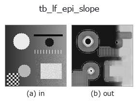
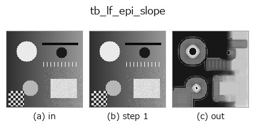
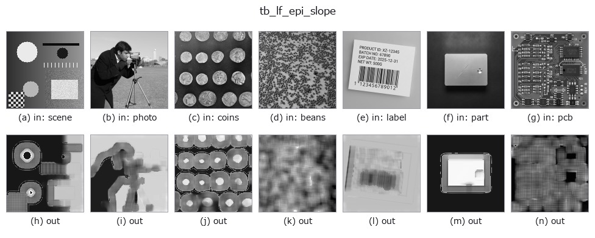

# tb_lf_epi_slope — 2D `typed` op

- **データ種**: `lightfield` → `image`
- **呼び出し**: `fullseye.apply(img, "tb_lf_epi_slope", a=0.5, b=0.5)` (2-D は 1 画像 + 2 スカラつまみ `a,b∈[0,1]` のモデル)
- **GPU**: あり(許可リストの機械的 GPU 経路、CuPy)。`device="auto"` は測った大きさ(589,824 画素)以上で GPU を選ぶ



*図は合成の入力 128×128 で実際に走らせた出力。左が入力、右が出力。点群は上から見た散布(明るさ = z)、1-D 列は折れ線、体積は z 方向の最大値投影、動画は中央フレーム、複素画像は振幅、絵にならない返り値は値そのもの。*

*つまみ a は出力を変えない(実測: 0.1 / 0.5 / 0.9 で同一)。*

*つまみ b は出力を変えない(実測: 0.1 / 0.5 / 0.9 で同一)。*

**段階**(前置きの op → この op。左から順):



**別の画像でも**(合成シーン / 写真 / 硬貨。上段が入力、下段がその出力。つまみは既定):



## 使い方

Per-pixel slope from the **EPI line orientation** (structure tensor, refined by shearing).

A scene point traces a straight line in the epipolar-plane image
(:func:`lf_epi`), so along that line the intensity is constant:
``E_u + s * E_x = 0``. Accumulating that constraint over the whole angular
grid and a ``window x window`` spatial neighbourhood gives the closed-form
least-squares slope ``s = -(J_ux + J_vy) / (J_xx + J_yy)`` with
``J_ab = sum(E_a * E_b)`` — both the horizontal and vertical EPI directions
pooled.

**Why it is iterated (fixed 2026-11-03).** A finite difference across
views measures a displacement of ``s`` px per view, while a finite
difference across pixels measures one of 1 px; for a texture component of
angular frequency ``w`` the ratio is ``sin(w s) / sin(w)`` (the pre-fix
central differences), equal to ``s`` only at ``|s|`` in ``{0, 1}``. That
is the classic statement that the structure tensor is accurate only for
disparities in a small range around zero (Wanner & Goldluecke, CVPR 2012
and TPAMI 36(3) 2014, who handle larger ranges by **shearing** the light
field). So the estimator shears the field by an integer slope ``k``
(integer shifts: no resampling blur), measures the residual
``r = s - k``, sets ``k <- round(k + r)`` per pixel and repeats until no
pixel changes (at most :data:`EPI_MAX_ROUNDS` rounds, at most
:data:`EPI_MAX_SHEARS` distinct shears). The residual is measured with a
matched discretisation (adjacent-view difference against the mean of the
two views' Gaussian derivatives, inner scale :data:`EPI_INNER_SIGMA`), whose
error is ``O(r^3 w^2)`` with ``|r| <= 1/2``.

Measured 2026-11-03, median over the interior of single-layer
``lf_synthesize`` fields (64x64, ``edge="wrap"``), ``s`` in
``[-3, 3]`` in steps of 0.25: error <= 0.006 px for 5x5 and 9x9 views,
<= 0.007 px for 4x4 (even count) and <= 0.012 px for 3x3 and for a single
row of 6 views, at texture sigma 1.0 / 1.5 / 2.0 / 5.0 px, for windows
5 / 9 / 15 (the
pre-fix estimator read -1.388 for -1.5 at sigma 2 and 1.46 for 2.0 at
sigma 1.5). Integer slopes are exact to 1e-9 on a wrapped field.
**Valid range:** the shear ladder starts at ``k = 0``, so the first pass
must see the right sign and a non-vanishing magnitude: that holds for
``|s| <= 3`` at any texture correlation length >= 1 px, and (measured) up
to ``|s| = 8`` at sigma >= 2; at sigma 1 it **fails beyond |s| = 5**
(``s = 6`` read as 0.25 — the texture is aliased: it moves more than its
correlation length several times per view). Near an occlusion boundary the
window mixes two slopes (no estimator of a single orientation per window
can avoid that). With ``edge="nearest"`` input the outer ``|k|*(N-1)/2``
px of the frame see clamped border pixels.

Returns ``(slope_map, energy)``: the ``(H, W)`` slope map (centre-view
coordinates) and the ``(H, W)`` gradient energy ``J_xx + J_yy`` of the
unsheared field (the first pass's denominator). Pixels whose energy is
below *min_energy* have **no** measurable parallax (a flat patch of sky);
their slope is set to 0 and their energy reported as-is, so you threshold
on ``energy`` instead of being handed a plausible-looking number divided by
~0.

**Raises** ``ValueError``: *lf* not a valid light field, an angular/spatial
shape where *neither* EPI direction carries information (the horizontal EPI
needs ``U >= 2`` **and** ``W >= 2``, the vertical needs ``V >= 2`` and
``H >= 2``), an even or non-positive *window*, a non-positive *min_energy*.

Typed bridge of the lightfield op ``lf_epi_slope`` into the 2-D evolution registry: the same implementation, called under the ``op(v, a, b)`` convention. This op has no tunable parameter; ``a`` and ``b`` are unused.

## 参考(サンプルデータ・文献)

- [サンプルデータ カタログ(DL URL / ライセンス)](../../SAMPLES.md) — 2-D は skimage.data(BSD/public)+ 合成、3-D は実データ源(Stanford/PDS 等)の DL URL。
- [演算子の来歴・参考文献](../../../REFERENCES.md) — この op 族の元になった研究/手法の出典。

## Studio で試す

下のプログラムは実際に走ることを確かめてある(図と同じ入力)。Studio のヘルプではこのブロックがボタンになり、その場で読み込んで実行できる。

```program
img_to_lightfield 0.50 0.50
tb_lf_epi_slope 0.50 0.50
```

## 実行できる例(この op を実際に呼ぶ検証済みサンプル)

次の例は元の台帳 op `lf_epi_slope` を呼ぶもの。この橋渡し op は同じ実装を `fn(v, a, b)` 規約に合わせただけなので、挙動はそのまま当てはまる(呼び出し形だけ違う)。
- [lightfield_depth](../../../../examples/lightfield_depth.py) — `py -3.11 examples/lightfield_depth.py`
- [poc_lightfield_depth](../../../../examples/poc_lightfield_depth.py) — `py -3.11 examples/poc_lightfield_depth.py`

## 型が繋がる次の op(`image` を入力に取れる)

[identity](../misc/identity.md) · [gaussian](../smoothing/gaussian.md) · [mean_box](../smoothing/mean_box.md) · [mean_box_wh](../smoothing/mean_box_wh.md) · [bilateral](../smoothing/bilateral.md) · [kuwahara](../smoothing/kuwahara.md) · [unsharp](../smoothing/unsharp.md) · [median](../rank/median.md)

## 同カテゴリ(`typed`)

[tb_points_to_voxel](tb_points_to_voxel.md) · [tb_estimate_point_normals](tb_estimate_point_normals.md) · [tb_iss_keypoints](tb_iss_keypoints.md) · [tb_project_points](tb_project_points.md) · [tb_render_point_depth](tb_render_point_depth.md) · [tb_points_render](tb_points_render.md) · [tb_statistical_outlier_removal](tb_statistical_outlier_removal.md) · [tb_radius_outlier_removal](tb_radius_outlier_removal.md)

---
*Provenance: ops.py — 2D operator registry. この per-op ノートは `tools/opdocs.py md` が自動生成(手編集しない)。*

© 2026 Kazufumi Furuse — Fullseye operator documentation. Licensed under Apache-2.0.
