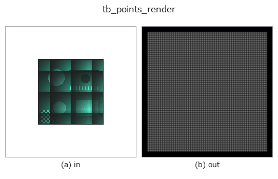
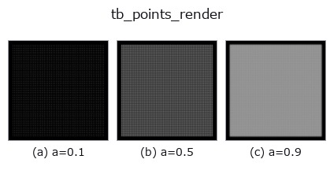
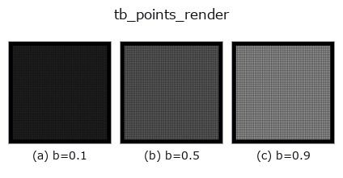
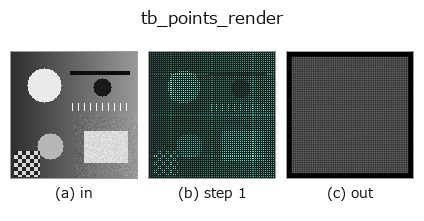
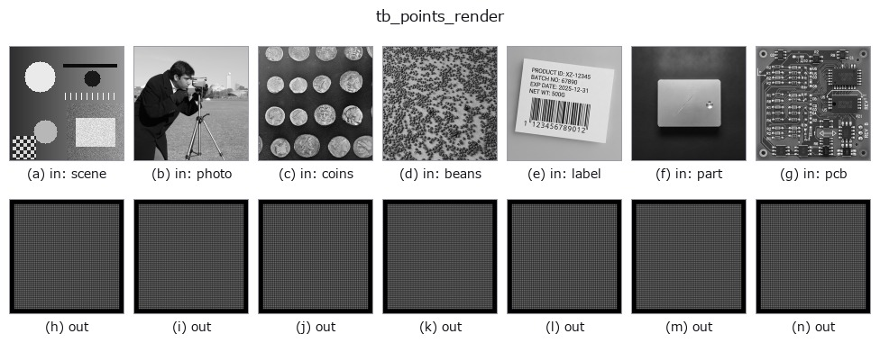

# tb_points_render — 2D `typed` op

- **データ種**: `points` → `rgbimage`
- **呼び出し**: `fullseye.apply(img, "tb_points_render", a=0.5, b=0.5)` (2-D は 1 画像 + 2 スカラつまみ `a,b∈[0,1]` のモデル)



*図は合成の入力 128×128 で実際に走らせた出力。左が入力、右が出力。点群は上から見た散布(明るさ = z)、1-D 列は折れ線、体積は z 方向の最大値投影、動画は中央フレーム、複素画像は振幅、絵にならない返り値は値そのもの。*

**つまみ a を振る**(0.1 / 0.5 / 0.9、もう一方は既定):



**つまみ b を振る**(0.1 / 0.5 / 0.9、もう一方は既定):



**段階**(前置きの op → この op。左から順):



**別の画像でも**(合成シーン / 写真 / 硬貨。上段が入力、下段がその出力。つまみは既定):



## 使い方

Render an (N, 3) point cloud to an RGB image (H, W, 3): anti-aliased splats, depth-sorted, deterministic.

カメラは ``project_points`` / ``render_point_depth`` と同じ OpenCV の規約:
``P_cam = R @ P + t``(+Z が前、u が右、v が下)。画素 ``(row=r, col=c)`` の中心が
連続座標 ``(u, v) = (c, r)``(このモジュール冒頭の画素中心の規約。0.5 を足さない)。

* ``projection="orthographic"``: ``u = fx·X + s·Y + cx``、``v = fy·Y + cy``(Z は順序だけに使う)。
  ``K`` が None なら**自動で収める**: R, t を当てた後の XY の箱が、縁 ``margin``(画像の短辺に
  対する割合)を残して画像に入る最大の等方倍率で、箱の中心を画像の中心 ``((W-1)/2, (H-1)/2)`` に置く。
* ``projection="perspective"``: ``u = fx·X/Z + s·Y/Z + cx``、``v = fy·Y/Z + cy``。Z ≤ 0 の点
  (カメラの後ろ)は描かない。透視は距離が決まらないと収められないので ``K`` が要る(None は拒否)。

足跡(``footprint``、半径 ``radius_px`` 画素):

* ``"gaussian"``: 重み ``w = exp(-d²/(2σ²))``、σ = radius_px / 2(半径 = 2σ)。|Δu| か |Δv| が 4σ を
  超える画素は 0(円でなく軸ごとに切るので足跡は x と y の積に分かれ、加算の像の列の和は点の行の
  位置に依らない)。像の重心は射影位置に 1e-3 画素以内で乗る(3σ で切ると切り口の非対称で
  0.017 画素ずれた。実測)。
* ``"disc"``: 半径 ``radius_px`` の円の画素被覆を 1 画素幅の線形ランプで近似
  ``w = clip(radius_px + 0.5 - d, 0, 1)``(縁が階段にならない)。小さな円は画素に量子化されるので、
  像の重心のずれは半径 1〜1.5 画素で最大 0.05 画素(小数画素の位置を測るなら gaussian)。
* ``"point"``: 最寄りの 1 画素だけ(``round``、``render_point_depth`` と同じ画素)。

d は点の射影位置(小数画素のまま)から画素中心までの距離 —— 点を画素に丸めてから
円を置くのではないので、0.3 画素ずれた点の像は 0.3 画素ずれる。

重ね方(``composite``):

* ``"over"``(既定): 画素ごとに**手前から**アルファ合成 ``C = Σ c_i α_i T_i``、
  ``T_i = Π_{j が手前}(1 - α_j)``、``α_i = opacity · w_i``(足跡の重みは最大 1)、
  最後に ``(1 - Σ α_i T_i) · background``。順序は**深さ Z**で決め、入力の並びには依らない
  (Z が等しい点どうしだけ入力の番号順。丸めの屑で入れ替わらないよう Z の同点は番号で決める)。
  opacity = 1 で足跡の中心(w = 1)に来た点は、その画素で後ろを完全に隠す(z-buffer と同じ勝ち方)。
  積は log を取らずに層ごとに掛けるので、不透明な点の後ろの透過率は厳密に 0。
* ``"add"``: 足跡を**和が 1** に正規化して足す ``C = background + Σ opacity · c_i · ŵ_i``。
  画像に収まった点については光の総量が厳密に保存される(``Σ (C - background) = Σ opacity · c_i``)。
  密度の絵で、値は 1 を超えうる(切らない。トーンは呼び手が決める)。

``colors``: None なら一様な明るい灰 (0.9, 0.9, 0.9)。(3,) なら全点に 1 色、(N, 3) なら点ごと。値は 0〜1。
``depth_cue``(0〜1): 描かれる点の Z を手前 0・奥 1 に正規化した zn で、色に ``1 - depth_cue · zn``
を掛ける(奥ほど暗い。0 で無効)。``background``: 背景の RGB(0〜1)。``size``: ``(H, W)`` か整数(正方)。

返り値: float64 の (H, W, 3)。``"over"`` なら 0〜1 に収まる。

fail-closed(ValueError): 点が (N, 3) でない・有限でない、空の入力(``points`` が 0 要素)、
色の形か値域が違う、未知の projection / footprint / composite、radius_px ≤ 0、opacity が (0, 1] の外、
depth_cue が [0, 1] の外、margin が [0, 0.5) の外、画素数が ``MAX_PIXELS`` 超、透視で K が無い、
K が 3×3 でない・fx か fy が 0、点 × 足跡の組が ``POINTS_RENDER_MAX_PAIRS`` を超える。
画像に 1 点も入らないのは拒否しない(背景だけの画像が正しい答え)。

後段: ``tonemap_reinhard`` / ``antialias``、図は imgio で保存。深度だけなら ``render_point_depth``。

2-D 進化レジストリへ橋渡しした 3d の op ``points_render``。実装は同じで、呼び出し規約だけ ``op(v, a, b)`` に合わせてある。``a`` が ``radius_px``(既定 1.5)、``b`` が ``opacity``(既定 1)を振る。

## 参考(サンプルデータ・文献)

- [サンプルデータ カタログ(DL URL / ライセンス)](../../SAMPLES.md) — 2-D は skimage.data(BSD/public)+ 合成、3-D は実データ源(Stanford/PDS 等)の DL URL。
- [演算子の来歴・参考文献](../../../REFERENCES.md) — この op 族の元になった研究/手法の出典。

## Studio で試す

下のプログラムは実際に走ることを確かめてある(図と同じ入力)。Studio のヘルプではこのブロックがボタンになり、その場で読み込んで実行できる。

```program
img_to_points 0.50 0.50
tb_points_render 0.50 0.50
```

## 実行できる例(この op を実際に呼ぶ検証済みサンプル)

次の例は元の台帳 op `points_render` を呼ぶもの。この橋渡し op は同じ実装を `fn(v, a, b)` 規約に合わせただけなので、挙動はそのまま当てはまる(呼び出し形だけ違う)。
- [points_render_basics](../../../../examples_3d/points_render_basics.py) — `py -3.11 examples_3d/points_render_basics.py`

## 型が繋がる次の op(`rgbimage` を入力に取れる)

[identity](../misc/identity.md) · [tb_wetness](tb_wetness.md) · [tb_sensor_capture](tb_sensor_capture.md) · [tb_viewport_from_equirect](tb_viewport_from_equirect.md) · [tb_specular_diffuse_split](tb_specular_diffuse_split.md) · [tb_specular_coefficient_map](tb_specular_coefficient_map.md) · [tb_specular_free_transform](tb_specular_free_transform.md) · [tb_rgb_to_quaternion](tb_rgb_to_quaternion.md)

## 同カテゴリ(`typed`)

[tb_points_to_voxel](tb_points_to_voxel.md) · [tb_estimate_point_normals](tb_estimate_point_normals.md) · [tb_iss_keypoints](tb_iss_keypoints.md) · [tb_project_points](tb_project_points.md) · [tb_render_point_depth](tb_render_point_depth.md) · [tb_statistical_outlier_removal](tb_statistical_outlier_removal.md) · [tb_radius_outlier_removal](tb_radius_outlier_removal.md) · [tb_voxel_grid_downsample](tb_voxel_grid_downsample.md)

---
*Provenance: ops.py — 2D operator registry. この per-op ノートは `tools/opdocs.py md` が自動生成(手編集しない)。*

© 2026 Kazufumi Furuse — Fullseye operator documentation. Licensed under Apache-2.0.
