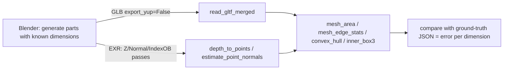

# Using Blender alongside — build the shape, measure it with fullseye (pitfalls: axes, units, ground truth)

fullseye does **not take Blender in** (no `import bpy`, not bundled, not a dependency).
This document is teaching material on how, **if you have Blender at hand**, the two can be combined to produce 3-D data with
ground-truth dimensions, and where in doing so things **go plausibly wrong without raising an exception**.
Whether to use them together is up to the user; fullseye works fully without Blender.

Everything written here is the result of **actually running it and checking the numbers against each other** on Blender 4.5.10 LTS (Windows 11)
(2026-09-05). If the version changes, the numbers may change too.

---

## 0. Division of labour — Blender "builds", the physics is fullseye's

| What Blender is suited to | What **not to let** Blender do |
|---|---|
| Creating geometry, scene layout, camera pose, depth of field, light distribution | Spectral optics (Cycles works in RGB tristimulus values; it cannot handle per-wavelength refractive index) |
| Ground-truth passes (depth, normals, object ID) | Sensor physics (QE, full well, read noise, dark current) |
| Format conversion (STL/OBJ/PLY/FBX/USD → GLB) | **A bit-exact reference** (renders change with version, GPU and sample count) |

**Geometry export is deterministic; rendering is non-deterministic.** Take the ground truth from the geometry,
and treat rendered images as fixed assets that are made once and then distributed.



---

## 1. Pitfall 1 — exporting with defaults swaps Y and Z and flips a sign

Measured with a box whose **dimensions and position differ on every axis** (a cube placed at the origin would not let you notice an axis swap):

```python
bpy.ops.mesh.primitive_cube_add(size=2.0, location=(10.0, 20.0, 30.0))
ob.scale = (1.0, 0.5, 0.25)      # ground truth: X=2.0  Y=1.0  Z=0.5 [m], centre (10, 20, 30)
```

| Export | Dimensions read by `read_gltf_merged` | Centre |
|---|---|---|
| `export_scene.gltf(...)` **default** | `(2.0, 0.5, 1.0)` | `(10, 30, −20)` |
| `export_scene.gltf(..., export_yup=False)` | `(2.0, 1.0, 0.5)` | `(10, 20, 30)` |

Blender is Z-up; the glTF specification is Y-up. The exporter's `export_yup` defaults to `True`, so
**if you specify nothing it rotates by −90° about the X axis**:

```
(x, y, z)_glTF = ( x,  z, −y )_Blender        inverse: (x, −z, y)
```

This **does not raise an exception**. The dimensions `2.0 / 1.0 / 0.5` simply come back as `2.0 / 0.5 / 1.0`, and
type and shape are both correct. A person reading the measured values cannot notice.

**Decision**: if you build it yourself and read it yourself, **always add `export_yup=False`**.
For GLB distributed externally, make it Y-up per the specification, and write which one it is in the file name or in a sidecar JSON.

## 2. Pitfall 2 — the unit is the metre, but `scale_length` does nothing to the geometry

With `unit_settings.system='METRIC'` and `scale_length=1.0` (default), glTF is also in metres.
Defaults on both sides **pass through as 1.0 = 1 m**.

Changing `scale_length` from 1.0 → 0.001 changed **not even 1 of the vertex coordinates, `obj.dimensions`, or the glTF/OBJ
output coordinates**. It is a **display-only** setting that affects only the numbers shown in the UI, and
it does not behave as expected by someone who "set scale_length to 0.001 intending to work in mm".
If you want a part in mm, build the coordinates with mm values (and write "read mm as m" for the GLB in a sidecar).

## 3. Pitfall 3 — a cube has 24 vertices, not 8

glTF can hold only 1 set of normal/UV per vertex, so at corners where the normal differs per face, vertices are duplicated.
A cube is 6 faces × 4 = 24. A UV sphere (segments=8, ring_count=6) goes 42 → 176.
**A change in vertex count does not mean a change in shape.**

## 4. Pitfall 4 — modifiers are not applied by default, and applying them changes the dimensions

The declared default of `export_apply` is **`False`**. A UV sphere of radius 0.5 with Subdivision (1 level):

| | Vertices | Dimensions read back |
|---|---:|---|
| `export_apply=False` (default) | 176 | `(1.000, 1.000, 1.000)` |
| `export_apply=True` | 704 | **`(0.862, 0.952, 0.862)`** |

The Catmull-Clark limit surface **does not interpolate** the control points, so applying subdivision **shrinks it by 14%**.
Moreover **it shrinks differently by direction** (only the pole axis is 0.952), so you cannot undo it by multiplying by a factor.

**Decision**: do not put Subdivision on parts used as ground truth for measurement. If you need smoothness, use a primitive
with more segments (its vertices lie on the theoretical surface). If you did apply it, **re-measure the ground truth from the exported mesh**.

## 5. Pitfall 5 — the segment count sets the lower bound of the ground-truth error

A primitive's `size` / `radius` / `depth` is **circumscribed** and matches the vertex coordinates exactly.
The only error source is the polygonal approximation; measured on cylinders and spheres:

| Segments | Circumscribed vs inscribed difference |
|---:|---:|
| 8 | 7.61 % |
| 32 | 0.48 % |
| 128 | 0.03 % |

If you build "a cylinder of radius 5.000" with 8 segments and run `fit_cylinder_ransac` on it, **even with a perfect
algorithm it is off by 7.6 %**. Fix the error on the ground-truth side first, then talk about the measurement error.

## 6. Pitfall 6 — even when the script dies on an exception, Blender's exit code is 0

```
blender --background --factory-startup --python-exit-code 1 --python gen.py -- out.glb
```

* **Without `--python-exit-code 1`, unhandled exceptions and missing files alike end with exit 0**.
  It cannot serve as a gatekeeper for unattended runs
* `sys.argv` contains **Blender's own entire command line**. Cut it with `sys.argv[sys.argv.index("--")+1:]`
* `--factory-startup` does not read the user's settings file (startup.blend). It does not go as far as stopping add-ons from being enabled
* `bpy.ops.*` depends on implicit context — the window and the selection state — and breaks when unattended.
  Make `bpy.data` and `obj.evaluated_get(depsgraph)` the main path. `matrix_world` returns
  **stale values** until `view_layer.update()` is called

## 7. Ground-truth data (render passes) — what is ground truth and what is not

| Pass | What measurement showed |
|---|---|
| Z (depth) | **Distance along the view axis**. A plane 10 m from the camera is `10.000000` both at the centre and in the corners (with radial distance the corners would be larger) |
| Edges of Z / IndexOB | **No intermediate values** (hard edges at every one of sample count 1/64 and filter width 1.5/0.01). However, partial-coverage information is lost entirely. Combined (the appearance) blends smoothly |
| Normal | **World space** (the same vector even when the camera orientation changes) |
| PNG export | **Squashed** to 0..1 (even at 16 bit). Depth in metres does not round-trip → **OpenEXR** |
| Colour management | With the default AgX left on, linear 0.18 maps to 117/255. **For photometry, View Transform = Raw/Standard + EXR** |
| `Image.pixels` (Python) | **Ignores** the colorspace setting and returns the raw stored values |

The **half-pixel origin** for turning the depth pass into a point cloud and mapping it onto fullseye's `(depth, row, col)` convention
has not been measured yet (§10).

## 8. Camera and lighting — pitfalls when copying the specifications of real equipment

* **mm/px** = `(作動距離[mm] × センサ幅[mm] / 焦点距離[mm]) / 横画素数` (working distance × sensor width / focal length, divided by the horizontal pixel count) agrees with a hand check to within 0.25 %
* **`sensor_fit='AUTO'` changes the reference axis on its own according to the resolution's aspect ratio**. Rendering the same 36×24 mm / 50 mm
  as landscape 128×64 and portrait 64×128 changed the field of view, and 6 of the 7 markers went off screen.
  When imitating a fixed real camera, **specify HORIZONTAL / VERTICAL explicitly**
* Depth of field goes in the right direction, but **its absolute amount does not match the thin-lens circle-of-confusion formula** (blur-width ratio of f/1.4 vs f/22:
  formula 15.7 times, measured 1.69 times). If you use it, calibrate it by measurement
* The standard camera has **no distortion parameters**. If you need them, add them on the fullseye side
* **The default GI (`diffuse_bounces=4`) crushes shadow contrast** (on a white floor the bottom of the shadow is 0.31).
  For reproducing dark-field or ring lighting, use `diffuse_bounces=0` or make the floor dark
* POINT inverse-square and SUN distance independence are exact. With coaxial episcopic lighting, the contrast ratio of specular reflection vs oblique lighting is 10⁸ times

## 9. Let Blender convert formats fullseye cannot read

```python
>>> fullseye.formats_available()
{'gltf': True, 'las': True, 'laz': True, 'pcd': True}
```

For meshes, **glTF/GLB only**. Re-reading STL / OBJ / PLY in Blender and making GLB
preserved the dimensions perfectly on all 3 routes (with `export_yup=False`). **The reverse direction (fullseye → Blender) has
no export path** — pass the coordinates as `.npy`/JSON and assemble them with `bmesh` on the Blender side.

`read_gltf` reads only geometry (it does not read materials, textures, normals, cameras or animation).
If you need normals, create them with `estimate_point_normals`.

## 10. Current gaps (honestly)

* The **closed loop** Blender → depth EXR → `depth_to_points` → `measure3d` is not yet demonstrated.
  Only once this passes can "error per dimension" be stated as numbers
* Whether the pixel centre of the depth pass is `(0,0)` or `(0.5,0.5)` — needs measuring together with fullseye's half-pixel convention
* Cryptomatte decoding, EEVEE edge behaviour and DOF calibration are not done
* Differences in Blender 5.x are not measured (this document is 4.5 LTS)

## 11. Diagnostic table — from symptom to cause

| Symptom | Cause to suspect first | How to check |
|---|---|---|
| Y and Z of the dimensions are swapped and one sign is negative | The glTF default Y-up conversion (§1) | Re-export with `export_yup=False` and compare |
| The vertex count is 3 times Blender's | Vertex duplication at corners (§3) | The face count should not have changed |
| The sphere is 14 % small, and differently per axis | Subdivision baked in with `export_apply=True` (§4) | Export without the modifier |
| The cylinder radius is a few % small | Polygonal approximation from the segment count (§5) | Does the difference shrink when the segment count is raised? |
| An unattended job "succeeded" but there is no output | An exception hidden behind exit code 0 (§6) | `--python-exit-code 1` |
| Depth is squashed to 0..1 | Exported as PNG (§7) | Use EXR |
| Depth does not look larger in the corners | Normal. Z is along the view axis (§7) | Convert yourself if you need radial distance |
| The rendered image does not match photometry | AgX appearance transform (§7) | Raw/Standard + EXR |
| The field of view changes between landscape and portrait | `sensor_fit=AUTO` (§8) | Specify HORIZONTAL/VERTICAL explicitly |
| Shadows are faint and the background lifts in dark field | Bounces of the default GI (§8) | `diffuse_bounces=0` |
| fullseye cannot read STL/OBJ | The reader is glTF only (§9) | Convert to GLB in Blender |

## 12. Licence boundary

Blender is GPL; its outputs (GLB / EXR / JSON) are not bound by it. fullseye (Apache-2.0) does
**not** `import bpy`. Blender is called as a separate process with `--background`, and
if you distribute scripts that use `bpy`, give them a GPL header and keep them **outside** the fullseye package.

## 13. Minimal procedure (copy and use)

```python
# gen_gauge.py  —— Blender side (GPL-2.0-or-later, because it imports bpy)
# blender --background --factory-startup --python-exit-code 1 --python gen_gauge.py -- out.glb
import json, sys, bpy
out = sys.argv[sys.argv.index("--") + 1]
bpy.ops.wm.read_factory_settings(use_empty=True)
bpy.ops.mesh.primitive_cube_add(size=2.0, location=(10.0, 20.0, 30.0))
ob = bpy.context.active_object; ob.scale = (1.0, 0.5, 0.25)
bpy.ops.object.transform_apply(scale=True)
bpy.ops.export_scene.gltf(filepath=out, export_format="GLB", export_yup=False)
json.dump({"extent": [2.0, 1.0, 0.5], "center": [10, 20, 30], "unit": "m",
           "axes": "blender-zup (export_yup=False)"}, open(out + ".truth.json", "w"))
```

```python
# fullseye side (Apache-2.0)
import json, numpy as np, fullseye as F
V, Fc = F.read_gltf_merged("out.glb")
truth = json.load(open("out.glb.truth.json"))
lo, hi = V.min(0), V.max(0)
print("extent", np.round(hi - lo, 4), "truth", truth["extent"])     # → [2. 1. 0.5]
print("center", np.round((hi + lo) / 2, 4), "truth", truth["center"])  # → [10. 20. 30.]
```

Put the ground truth **as JSON next to** the GLB. Data that cannot be re-checked later cannot be called data with ground truth.

---

## Sources

* Measurements: Blender 4.5.10 LTS (`blender-4.5.10-windows-x64.msi` from <https://download.blender.org/release/Blender4.5/>,
  installed via winget) / Windows 11 / fullseye 0.1.9 (2026-09-05).
  The bundled `license/license.md` and `copyright.txt` were actually read
* glTF 2.0 specification (Khronos Group) <https://registry.khronos.org/glTF/specs/2.0/glTF-2.0.html>:
  the coordinate system is Y-up, right-handed, metres
* Collins et al.'s three-frame differencing, Zhang (2000) camera calibration — the origins of the formulas cited in the text
* The License / FAQ pages on blender.org could not be fetched automatically (403), so the quotations in the text
  are via search-result summaries. **Not confirmed at the primary source**
