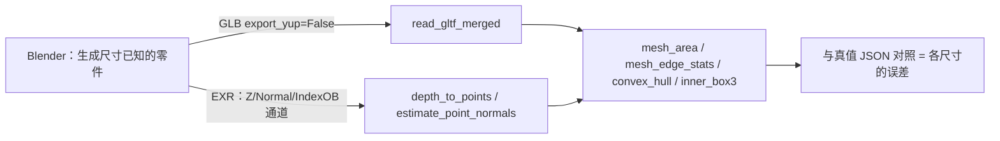

# 与 Blender 配合使用 —— 在 Blender 中建形、用 fullseye 测量(坐标轴、单位、真值数据的陷阱)

fullseye **不引入** Blender（不 `import bpy`、不捆绑、也不列为依赖）。
本文是一份教材，讲述**如果手边有 Blender**，如何组合使用才能制作出带尺寸真值的 3-D 数据，
以及这时**不抛出异常却似是而非地出错**的地方在哪里。
是否配合使用由用户自由决定，没有 Blender，fullseye 也能完整运行。

这里写的全部内容，都是在 Blender 4.5.10 LTS（Windows 11）上**实际运行并核对数字**
得到的结果（2026-09-05）。版本变了，数字也可能变。

---

## 0. 分工 —— Blender 负责“建”，物理交给 fullseye

| 适合 Blender 的 | **不要让** Blender 做的 |
|---|---|
| 几何体的创建、场景布置、相机位姿、景深、配光 | 光谱光学（Cycles 用 RGB 三刺激值，无法处理随波长变化的折射率） |
| 真值通道（深度、法线、物体 ID） | 传感器物理（QE、满阱、读出噪声、暗电流） |
| 格式转换（STL/OBJ/PLY/FBX/USD → GLB） | **逐位一致的基准**（渲染结果随版本、GPU、采样数而变） |

**几何体的导出是确定性的，渲染是非确定性的。** 真值从几何体中取，
渲染图像则作为做过一次就固定下来的资产，放在分发的一侧。



---

## 1. 陷阱 1 —— 按默认导出，Y 和 Z 会互换，且符号反转

用一个**各轴尺寸和位置都不同**的盒子来测量（把立方体放在原点就无法察觉轴的互换）：

```python
bpy.ops.mesh.primitive_cube_add(size=2.0, location=(10.0, 20.0, 30.0))
ob.scale = (1.0, 0.5, 0.25)      # 真值：X=2.0  Y=1.0  Z=0.5 [m]，中心 (10, 20, 30)
```

| 导出方式 | `read_gltf_merged` 读到的尺寸 | 中心 |
|---|---|---|
| `export_scene.gltf(...)` **默认** | `(2.0, 0.5, 1.0)` | `(10, 30, −20)` |
| `export_scene.gltf(..., export_yup=False)` | `(2.0, 1.0, 0.5)` | `(10, 20, 30)` |

Blender 是 Z-up，glTF 规范是 Y-up。导出器的 `export_yup` 默认为 `True`，因此
**什么都不指定时，会绕 X 轴旋转 −90°**：

```
(x, y, z)_glTF = ( x,  z, −y )_Blender        逆：(x, −z, y)
```

这**不会成为异常**。尺寸 `2.0 / 1.0 / 0.5` 只是以 `2.0 / 0.5 / 1.0` 的形式返回，
类型和形状都正确。读取测量值的人无法察觉。

**判断**：自己建、自己读的情况下，**务必加上 `export_yup=False`**。
对外分发的 GLB 按规范设为 Y-up，并在文件名或附带的 JSON 中写明是哪一种。

## 2. 陷阱 2 —— 单位是米，但 `scale_length` 对形状不起任何作用

在 `unit_settings.system='METRIC'`、`scale_length=1.0`（默认）下，glTF 也是米。
双方都是默认值时，**以 1.0 = 1 m 原样传递**。

把 `scale_length` 从 1.0 → 0.001，**顶点坐标、`obj.dimensions`、glTF/OBJ 的
输出坐标连 1 个都没有变**。这是只影响 UI 数值显示的**显示专用**设置，
不会按“打算以 mm 工作而把 scale_length 设为 0.001”的人所期待的那样工作。
需要 mm 的零件，就用 mm 的数值来建坐标（并在附带文件中写明 GLB “把 mm 当作 m 读”）。

## 3. 陷阱 3 —— 立方体的顶点不是 8 个而是 24 个

glTF 每个顶点只能持有 1 组法线/UV，因此在各面法线不同的角上，顶点会被复制。
立方体是 6 面 × 4 = 24。UV 球（segments=8, ring_count=6）则是 42 → 176。
**顶点数变了 ≠ 形状变了。**

## 4. 陷阱 4 —— 修改器默认不应用，而应用后尺寸会变

`export_apply` 声明的默认值是 **`False`**。给半径 0.5 的 UV 球加上 Subdivision（1 级）：

| | 顶点 | 读出的尺寸 |
|---|---:|---|
| `export_apply=False`（默认） | 176 | `(1.000, 1.000, 1.000)` |
| `export_apply=True` | 704 | **`(0.862, 0.952, 0.862)`** |

Catmull-Clark 的极限曲面**不插值**控制点，因此应用细分后会**缩小 14%**。
而且**各方向的缩小程度不同**（只有极轴是 0.952），所以也无法乘一个系数还原。

**判断**：用作测量真值的零件不要加 Subdivision。需要光滑度时，使用提高了分段数的
基本体（顶点落在理论曲面上）。如果加了，真值要**从导出的网格重新测量**。

## 5. 陷阱 5 —— 分段数决定了真值误差的下限

基本体的 `size` / `radius` / `depth` 以**外接**为基准，与顶点坐标精确一致。
误差来源只有多边形近似，对圆柱、球的实测：

| 分段数 | 外接与内接之差 |
|---:|---:|
| 8 | 7.61 % |
| 32 | 0.48 % |
| 128 | 0.03 % |

用 8 段做一个“半径 5.000 的圆柱”，再交给 `fit_cylinder_ransac`，**即使算法
完美也会偏 7.6 %**。先确定真值一侧的误差，再谈测量的误差。

## 6. 陷阱 6 —— 即使脚本因异常而中止，Blender 的 exit code 也是 0

```
blender --background --factory-startup --python-exit-code 1 --python gen.py -- out.glb
```

* **不加 `--python-exit-code 1`，未处理的异常和文件不存在都会以 exit 0 结束**。
  无法充当无人值守运行的守门员
* `sys.argv` 中包含 **Blender 自身的全部命令行**。用 `sys.argv[sys.argv.index("--")+1:]` 截取
* `--factory-startup` 不读取用户的设置文件（startup.blend）。但不会阻止插件的启用
* `bpy.ops.*` 依赖窗口、选择状态这类隐式上下文，无人值守时会出错。
  以 `bpy.data` 和 `obj.evaluated_get(depsgraph)` 为主要途径。`matrix_world` 在
  调用 `view_layer.update()` 之前返回的是**旧值**

## 7. 真值数据（渲染通道）—— 什么是真值，什么不是

| 通道 | 实测得知的事 |
|---|---|
| Z（深度） | **沿视线轴方向的距离**。距相机 10 m 的平面，中央和角落都是 `10.000000`（若是径向距离则角落更大） |
| Z / IndexOB 的边缘 | **不出现中间值**（采样数 1/64、滤波宽度 1.5/0.01 中任何一种都是硬边）。但部分覆盖的信息会全部丢失。Combined（外观）则平滑混合 |
| Normal | **世界空间**（改变相机朝向也是同一向量） |
| PNG 导出 | 被**压缩**到 0..1（即使 16 bit）。以米为单位的深度无法往返 → **OpenEXR** |
| 色彩管理 | 保持默认 AgX 时，线性 0.18 会映射为 117/255。**测光要用 View Transform = Raw/Standard + EXR** |
| `Image.pixels`（Python） | **忽略** colorspace 设置，返回原始存储值 |

从深度通道生成点云并映射到 fullseye 的 `(depth, row, col)` 约定时的**半像素原点**，
尚未实测（§10）。

## 8. 相机与照明 —— 照搬实际设备参数时的陷阱

* **mm/px** = `(作動距離[mm] × センサ幅[mm] / 焦点距離[mm]) / 横画素数`（工作距离 × 传感器宽度 / 焦距，再除以水平像素数）与验算在 0.25 % 内一致
* **`sensor_fit='AUTO'` 会根据分辨率的宽高比擅自改变基准轴**。把同样的 36×24 mm / 50 mm
  分别以横向 128×64 和纵向 64×128 渲染，视场发生变化，7 个标记中有 6 个跑到了画面外。
  模仿固定的实际设备时，要**明确指定 HORIZONTAL / VERTICAL**
* 景深的方向是对的，但**绝对量与薄透镜弥散圆公式不符**（f/1.4 与 f/22 的
  模糊宽度比：公式 15.7 倍，实测 1.69 倍）。要用的话请通过实测标定
* 标准相机**没有畸变参数**。需要的话在 fullseye 一侧加入
* **默认的 GI（`diffuse_bounces=4`）会压低阴影的对比度**（白色地面上阴影底部为 0.31）。
  再现暗场、环形照明时，用 `diffuse_bounces=0` 或把地面调暗
* POINT 的平方反比、SUN 的距离无关性是精确的。同轴落射照明下镜面反射与斜照明的对比度比为 10⁸ 倍

## 9. fullseye 读不了的格式交给 Blender 转换

```python
>>> fullseye.formats_available()
{'gltf': True, 'las': True, 'laz': True, 'pcd': True}
```

网格**只支持 glTF/GLB**。用 Blender 重新读取 STL / OBJ / PLY 并转为 GLB，
3 条路径的尺寸都完全保持（在 `export_yup=False` 的情况下）。**反方向（fullseye → Blender）
没有导出口** —— 用 `.npy`/JSON 传递坐标，在 Blender 一侧用 `bmesh` 组装。

`read_gltf` 只读取几何体（不读材质、纹理、法线、相机、动画）。
需要法线时用 `estimate_point_normals` 生成。

## 10. 现有的缺口（如实说明）

* Blender → 深度 EXR → `depth_to_points` → `measure3d` 的**闭环**尚未实证。
  只有这里打通了，才能用数字说出“各尺寸的误差”
* 深度通道的像素中心是 `(0,0)` 还是 `(0.5,0.5)` —— 需要结合 fullseye 一侧的半像素约定进行实测
* Cryptomatte 的解码、EEVEE 的边缘行为、DOF 的标定尚未进行
* Blender 5.x 的差异尚未测量（本文针对 4.5 LTS）

## 11. 诊断表 —— 从症状到原因

| 症状 | 首先怀疑的原因 | 确认方法 |
|---|---|---|
| 尺寸的 Y 与 Z 互换，且其中一个符号为负 | glTF 默认的 Y-up 转换（§1） | 用 `export_yup=False` 重新导出并比较 |
| 顶点数是 Blender 中的 3 倍 | 角上的顶点复制（§3） | 面数应当没有变 |
| 球小了 14 %，而且各轴不同 | 用 `export_apply=True` 把 Subdivision 烘焙进去了（§4） | 不带修改器导出 |
| 圆柱半径小了百分之几（数 %） | 分段数带来的多边形近似（§5） | 提高分段数后差值是否缩小 |
| 无人值守任务“成功”了却没有输出 | 异常被 exit code 0 掩盖（§6） | `--python-exit-code 1` |
| 深度被压缩到 0..1 | 用 PNG 导出了（§7） | 改用 EXR |
| 深度在角落看起来没有变大 | 正常。Z 是沿视线轴方向（§7） | 需要径向距离就自行换算 |
| 渲染图与测光不符 | AgX 的外观变换（§7） | Raw/Standard + EXR |
| 视场随横竖而变 | `sensor_fit=AUTO`（§8） | 明确指定 HORIZONTAL/VERTICAL |
| 阴影很淡，暗场下背景发亮 | 默认 GI 的 bounce（§8） | `diffuse_bounces=0` |
| fullseye 读不了 STL/OBJ | 读取端只支持 glTF（§9） | 用 Blender 转换为 GLB |

## 12. 许可证的边界

Blender 是 GPL，生成物（GLB / EXR / JSON）不受其约束。fullseye（Apache-2.0）
**不** `import bpy`。Blender 以 `--background` 作为独立进程调用，
如果要分发使用 `bpy` 的脚本，应加上 GPL 头并放在 fullseye 包**之外**。

## 13. 最小步骤（可直接复制使用）

```python
# gen_gauge.py  —— Blender 一侧（GPL-2.0-or-later。因为 import 了 bpy）
# blender --background --factory-startup --python-exit-code 1 --python gen_gauge.py -- out.glb
import json, sys, bpy
out = sys.argv[sys.argv.index("--") + 1]
bpy.ops.wm.read_factory_settings(use_empty=True)
bpy.ops.mesh.primitive_cube_add(size=2.0, location=(10.0, 20.0, 30.0))
ob = bpy.context.active_object; ob.scale = (1.0, 0.5, 0.25)
bpy.ops.object.transform_apply(scale=True)
bpy.ops.export_scene.gltf(filepath=out, export_format="GLB", export_yup=False)
json.dump({"extent": [2.0, 1.0, 0.5], "center": [10, 20, 30], "unit": "m",
           "axes": "blender-zup (export_yup=False)"}, open(out + ".truth.json", "w"))
```

```python
# fullseye 一侧（Apache-2.0）
import json, numpy as np, fullseye as F
V, Fc = F.read_gltf_merged("out.glb")
truth = json.load(open("out.glb.truth.json"))
lo, hi = V.min(0), V.max(0)
print("extent", np.round(hi - lo, 4), "truth", truth["extent"])     # → [2. 1. 0.5]
print("center", np.round((hi + lo) / 2, 4), "truth", truth["center"])  # → [10. 20. 30.]
```

把真值**以 JSON 放在 GLB 旁边**。事后无法验算的数据，不能称为带真值的数据。

---

## 出处

* 实测：Blender 4.5.10 LTS（<https://download.blender.org/release/Blender4.5/> 的
  `blender-4.5.10-windows-x64.msi`，经 winget 安装）/ Windows 11 / fullseye 0.1.9（2026-09-05）。
  实际阅读了随附的 `license/license.md` 与 `copyright.txt`
* glTF 2.0 规范（Khronos Group）<https://registry.khronos.org/glTF/specs/2.0/glTF-2.0.html>：
  坐标系为 Y-up、右手系、米
* Collins 等人的三帧差分、Zhang（2000）的相机标定 —— 本文所引公式的出处
* blender.org 的 License / FAQ 页面无法自动获取（403），因此本文的引用
  经由搜索结果的摘要。**尚未在一手来源确认**
