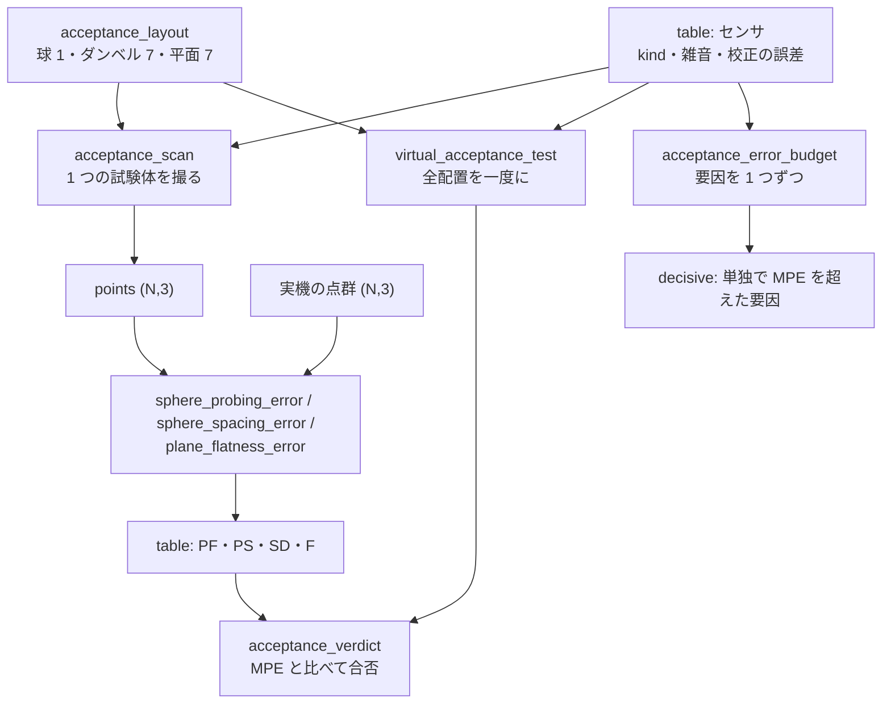

# 光学式 3D センサの仮想受入試験(買う前に受入試験をかける) — 使い方ガイド

## この族は何をする道具箱か

3D センサを選ぶとき・受け入れるときに現場が使う言葉 —— **探針の誤差(形状 PF・寸法 PS)、
球間距離の誤差 SD、平面度の誤差 F** —— を数える層です。VDI/VDE 2634 Part 2/3 と ISO 10360-13 の
**考え方に沿って**いますが、規格の本文は有償の著作物なので写していません。評価量の定義は、規格を適用した
公開文献(Carfagni et al. 2017 / 2019、Eiríksson et al. 2016、Ramm et al. 2025)の記述から取り、
出典を各 op の docstring に書いています。**「準拠」とは名乗りません**。

8 op / 4 カテゴリ(numpy のみ。台帳は `opsacceptance.py`、実体は `acceptance3d.py`):

- **layout(1)** — `acceptance_layout`: 測定体積の中に、探針の球 1 個・ダンベル 7 姿勢
  (空間対角線 4 + 面の対角線 3)・平面 7 姿勢(正対 1 + 傾き 6)を置く。7 姿勢の向きは
  **Fullseye の約束**で、規格の図の写しではありません。
- **evaluate(4)** — `sphere_probing_error`(PF・PS)/ `sphere_spacing_error`(SD)/
  `plane_flatness_error`(F)/ `acceptance_verdict`(MPE と比べた合否と、合否を決めた量)。
  **実機の点群にもシミュレーションの点群にも同じ op** を掛けます。
- **simulate(2)** — `acceptance_scan`(1 つの試験体をシミュレーションのセンサで撮って点群に)/
  `virtual_acceptance_test`(全配置を撮って全評価量と合否)。
- **budget(1)** — `acceptance_error_budget`: 誤差の要因を 1 つずつ入れて、**どれが合否を決めるか**。

## Fullseye だけの層 —— 真値が場面の側にある

比較相手(HALCON・OpenCV・Open3D・PCL)は球や平面の当てはめを持っていても、受入試験の手順としては
束ねていません。この族はさらに、シミュレーションのセンサで「買う前に」受入試験を回します:

| センサ(`kind`) | 中身 | 何で壊れるか |
|---|---|---|
| `ideal` | 真の視線距離をそのまま | 壊れない(往復の検算) |
| `triangulation` | 奥行きに σ_z = z²σ_d/(f·b)(`z = f·b/d` の誤差伝播) | 遠いほど・基線が短いほど |
| `itof` | 既存の `itof_capture` → `itof_phase_amplitude`(4 位相の生信号) | 暗い試験体(ショット雑音)・縁の混合(フライングピクセル)・多重反射 |

校正の誤差(`fx_rel_error`・`fy_rel_error`・`cx_error_px`・`cy_error_px`・`range_scale`・
`range_offset_mm`)は逆投影に入ります。真値は場面の解析解(光線と球・平面の交点)なので、
**雑音も誤差も無いセンサでは全評価量が 0** になり、距離の尺度 s は **SD = (s − 1)·L** で厳密に出ます。

## 流れ



## 最初の 1 本

```python
import fullseye as fs

layout = fs.ledger.acceptance_layout()                    # 400x300x300 mm、z = 800 mm、球 25 mm
mpe = {"pf": 3.0, "ps": 1.0, "sd": 0.5, "f": 3.0}         # 仮の仕様(メーカーが決める値)
r = fs.ledger.virtual_acceptance_test({"kind": "itof", "sphere_reflectivity": 0.1}, layout, mpe)
print(r["verdict"]["passed"], r["verdict"]["decided_by"])  # False pf(黒い球で PF が MPE の約 2 倍)
```

## 落とし穴(実測に基づく)

1. **黒い球は iToF の PF を約 3 倍にする。** 反射率 1 → 0.1 で球の残差 rms は 0.297 → 0.934 mm
   (3.15 倍)。ショット雑音の律速なら √10 = 3.16 倍で、物理の見積もりと合います。
   探針の球の色は「試験の条件」であって、センサの性能ではありません。
2. **縁の混合(フライングピクセル)は PF を壊す。** `supersample = 3`・雑音なしで、既存の
   `itof_flying_pixel_mask` を外すと PF は 43.7 mm(球の直径より大きい)、入れると 0.025 mm。
   除外の上限 0.3 % では救えないので、前処理がそのまま受入の結果になります。
3. **要因の単独の寄与は足し算にならない。** iToF 案で SD の単独の寄与は fx/fy +0.1 % が −0.308 mm、
   多重反射 2 % が +0.385 mm、距離の尺度 +0.05 % が +0.157 mm。全部入れると +0.181 mm に打ち消し合います。
   順位(`ranking`)は「どれを先に直すか」の材料で、合計ではありません。
4. **平面度 F は点の数で増える。** F は範囲(最大 − 最小)なので、同じ雑音でも点が多いほど大きい
   (純ガウス雑音で E[F] = σ·d2(N)、`d2(25) = 3.931`、`d2(56,784) ≈ 8.5`)。
   MPE を比べるときは点の密度をそろえてください。
5. **最小二乗の平面であって最小領域の平面ではない。** 最小領域(Chebyshev)の F は定義から最小二乗の F 以下です。

くわしい数字は [`examples/poc_virtual_acceptance_3d.py`](../../../../examples/poc_virtual_acceptance_3d.py)
が出します(3 つの設計案の合否表と iToF 案の誤差の予算)。

## この族に**入れなかった**もの

- 縞を描いて復号する構造化光のセンサ(`fringe.py` は 2.5D の高さ図向けで、球の全周を撮る場面に
  そのままは使えない)。三角測量は雑音則だけで代表させています。
- 多重反射の幾何(平面と球のあいだの相互反射の経路)。今は「全画素に一様な第 2 経路」の最も粗いモデルです。
- ISO 10360-13 の長さ測定誤差 E の手順(測定の繰り返しと配置の数)と、VDI/VDE 2634 Part 3 の
  複数視点の合成。評価量の計算(SD)は同じ op で済むので、手順だけが未実装です。

---

Copyright (c) 2026 Kazufumi Furuse. Licensed under the Apache License, Version 2.0.
