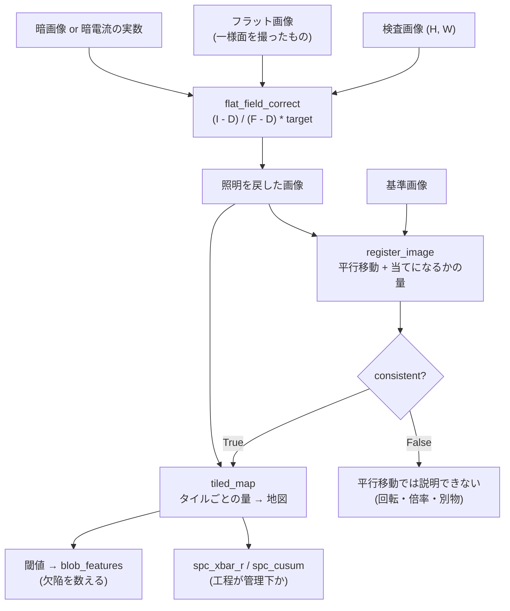

# 外観検査の前段(測る前に、照明と位置とタイルを決める) — 使い方ガイド

## この族は何をする道具箱か

検査ラインが**測る**前に必ず通る 3 段です。3 op / 3 カテゴリ(numpy のみ。台帳は
`opsaoi.py`、実体は `aoi.py`):

- **photometric(1)** — `flat_field_correct`: 照明の落ちとセンサの感度ばらつきを、
  暗電流つきの割り算で戻す。
- **geometric(1)** — `register_image`: 検査画像を基準画像へ合わせる平行移動を、
  **合っていないと分かる量つき**で返す。
- **aggregate(1)** — `tiled_map`: 画像をタイルに割り、タイルごとの量を小さな地図にする。

## なぜ足したか —— 在庫を数えた結果(2026-09-15)

この repo は「測る」層を深く持っています(`measure1d` のサブピクセル計測、`blob2d` の
連結成分、`shapestats` の形態統計、`spc` の管理図)。ところが**その手前の 3 段**が、
公開層 4 つ(`fullseye.<名前>` / `fullseye.op.<名前>` / `fullseye.ledger.<名前>` /
`fullseye.op_find`)のどこにもありませんでした。

| 既にあったもの | 何をするか | なぜ代わりにならないか |
|---|---|---|
| `background_flatten` | 低次曲面を当てはめて**引く** | 照明の落ちは**掛け算**で効く。同じ絵で隅/中心は 0.6436 にしかならない(真値 0.1209)。暗電流の項も無い |
| `xsp_detrend_flatten` | 1 次トレンド除去 | つまみが `a`/`b` の 2 つだけ。基準のフラット画像を渡す口が無い |
| `vignette` / `aug_vignette` | 照明の落ちを**掛ける** | 合成・水増しの側。戻す側ではない |
| `relative_illumination` | cos⁴ 則の曲線 | 光学計算。画像を補正しない |
| `frame_align` | 星の対応から変換を推定 | 点状の特徴が要る。周期構造では `inlier_ratio` 1.00 のまま外す(その op 自身が実測を docstring に書いている) |
| `piv_cross_correlate` | 窓ごとの**変位場** | 画像 2 枚の並進を 1 個返す口ではない。台帳の口は `info` を捨てる |
| `ncc_locate` | テンプレート位置 | テンプレートを事前に積む 2-D op。返りは `[相関, y, x]` で不定性の量が出ない |
| `scale.process_tiled` / `vol_tiled_map` | タイルごとに op を掛ける | 返るのは**同じ大きさの出力**(記憶量を抑える道具)。タイルごとの**量**は返らない |

この穴のうち「画像 2 枚の並進を 1 個返す口が無い」は、`examples/poc_print_registration.py`
の 9 節が**独立に**、4 層すべてを引いた実測つきで報告していたものです。

**新しい型語彙は 1 つも作っていません**(既存の `image2d` と `table`)。

## 使う順序



## いちばん短い例

```python
import numpy as np
import aoi

# 照明を戻す(target=1.0 なら真の反射率へ戻る)
clean = aoi.flat_field_correct(raw, flat, dark=0.05, target=1.0)

# 基準へ合わせる。**返り値を必ず見る**
r = aoi.register_image(reference, clean)
if not r["consistent"]:
    raise RuntimeError("平行移動では説明できない: 残差 %.3f" % r["residual"])
if r["ambiguous"]:
    print("周期構造かもしれない(peak_ratio %.3f)" % r["peak_ratio"])

# タイルごとの明るさの地図
t = aoi.tiled_map(clean, tile=16, stat="mean")
print(t["map"].shape, t["partial_tiles"], t["covered_fraction"])
```

`fullseye.ledger.<名前>` からも同じものが引けます(`fs.ledger.register_image(ref, mov)`)。

## つまみの実効範囲(すべてこのガイドの合成系での実測)

### `flat_field_correct`

合成系: 128x128、cos⁴ 型のビネットで**隅が中心の 0.196 倍**、利得 0.9、暗電流 0.05。

| つまみ | 効く範囲 | 実測 |
|---|---|---|
| `dark` | ここが全部 | 渡すと最大相対誤差 **1.755e-16**、省くと **2.252e-01**(**1.3e+15 倍**の差) |
| `target` | 出力の尺度 | 既定 `mean(flat-dark)` なら出力は `真値 x 0.490532`(差 8.3e-17)。`1.0` で反射率そのもの |
| `min_response` | 死んだ画素 | 未指定なら応答 0 以下は **ValueError**。指定するとその値で下から抑える |
| `clip` | 飽和 | `True` で `[0, 1]`。3 倍露光の絵では **5342 / 16384 画素**が飽和。`False` なら最大 2.9585 |

**`dark` を省いても絵は破綻しません**。隅が明るいまま残るだけで、隅/中心の比は
真値 0.1209 に対し **0.4867**。目では合格に見えて数字だけが狂う、いちばん危ない形です。

### `register_image`

合成系: 128x128、勾配 + 円 + 棒 + 雑音(乱数だけの絵は対称性の破れを隠すので使わない)。

| 与えた変形 | `residual` | `peak_ratio` | `consistent` |
|---|---|---|---|
| 並進 (3, 5) px 整数 | 0.000000 | 0.0081 | True |
| 並進 (2.5, -1.5) px | 0.058785 | 0.2050 | True |
| 並進 (0.5, 0) px | 0.038918 | 0.2022 | True |
| 回転 2 度 | 0.5886 | 0.1303 | **False** |
| 回転 5 度 | 0.6555 | 0.4827 | **False** |
| 倍率 1.05 | 0.6073 | 0.1687 | **False** |

副画素は `upsample=20` で**誤差 0.0000 px**(刻みは 0.05 px)。`upsample=1` にすると
整数画素までしか出ません。

**この op は平行移動しか扱いません。** 回転を渡しても例外は出ず、「いちばん近い
平行移動」が返ります(回転 2 度 → ずれ 0.14 px)。だから `dy`/`dx` だけを使ってはいけません
——`consistent` か `residual` を必ず見ること。

### 周期のある模様 — 正直な限界

| 模様(周期 8 px、(3,5) ずらし) | `dy` | `dx` | `peak_ratio` | `ambiguous` |
|---|---|---|---|---|
| 市松 | +2.950 | +4.850 | 1.0000 | **True** |
| 縞 | +0.000 | +4.900 | 0.1996 | **False** |

市松は狙いどおり捕まります(答えは周期 8 を法として等価なものが並ぶので、返る値は
**そのうちの 1 つ**。間違いではないが一意でもない)。

★**縞は捕まりません。** 縞は縦方向に模様が無いので `dy` は原理的に決まらないのに、
`ambiguous` は False で `dy=0.000` が返ります。`peak_ratio` は「離れた 2 番目の**山**」を
見る量で、縞が作るのは山ではなく**尾根**(`dy` 方向に平らな筋)だから検出できません。
しかも尾根から `dy=0` を選んでいるのは画像ではなく **Hann 窓の包絡**で、`window="none"`
では別の値が出ます。**片方向にしか模様の無い面(縞・織り目・筋目)を測るなら、
直交する模様を画面に入れてください。** この限界は
`tests/test_aoi.py::test_register_does_not_catch_a_one_directional_stripe` が
「捕まらないことそのもの」として固定してあります(直したらそこが赤くなります)。

### `tiled_map`

| つまみ | 効く範囲 | 実測(64px / 70px の絵) |
|---|---|---|
| `tile` | 地図の粗さ | 64px を 16px 角 → 地図 (4,4)、端数 0 枚。画像より大きい `tile` は 1 枚の端数タイル |
| `overlap` | 重なり | `0` で (5,5)・覆い 1.0000、`8` で (8,8)・覆い **3.2400**(重なるので 1 を超える) |
| `drop_partial` | 端数の扱い | `False`(既定)= 端数 **9 枚**を数える。`True` = **捨てた 9 枚**と覆い **0.8360** を返す |
| `stat` | 出す量 | `mean`/`sum`/`count` は**分解可能**、`std`/`median`/`min`/`max`/`ptp` はそうではない |

**分解可能な量なら検算できます。** `overlap=0` ならタイルは画像を重なりなく覆うので、
`mean` の地図を `counts` で重み付けした平均は**全画素の平均に一致**します(実測 **0.0e+00**、
端数のあるタイルを含めても同じ)。`std` にこの性質はありません —— タイル std の平均
**0.105824** に対し全体 std は **0.155527** で、まとめ直すと別の数になります。

## 落とし穴 3 つ

### 1. 「補正した」と「戻った」は別

`dark` を省いた補正は絵として自然に見えます。合否が数字で決まる工程では、
**戻ったことを比で確かめて**ください(隅/中心の比が真値に一致するか)。

### 2. 位置合わせの成功判定に「賛成率」を使わない

`frame_align` の `inlier_ratio` が周期構造で 1.00 のまま外す話と同じ形です。
この op では `peak_ratio`(不定性)と `residual`(模型の当てはまり)が**別の量**で、
前者は「答えが 1 つか」、後者は「平行移動で説明できるか」を見ています。
片方だけでは足りません。

### 3. タイルの地図を「まとめ直す」なら量を選ぶ

タイルごとの `std` を平均しても全体の `std` にはなりません。地図から全体量へ戻す
使い方をするなら `mean` / `sum` / `count` に限ること。

## 裏づけ

- 動く例: [`aoi_frontend_tour`](../../../../examples/aoi_frontend_tour.py) —
  `py -3.11 examples/aoi_frontend_tour.py`
- 門: `tests/test_aoi.py`(このガイドの数値はすべてここで固定されている)
- 来歴: Janesick, *Scientific Charge-Coupled Devices*, SPIE 2001(フラットフィールド)/
  Kuglin & Hines 1975(位相相関)/ Guizar-Sicairos, Thurman & Fienup, *Optics Letters* 2008
  (上標本 DFT)/ Lewis 1995(正規化相互相関)

---
© 2026 Kazufumi Furuse — Fullseye operator documentation. Licensed under Apache-2.0.
