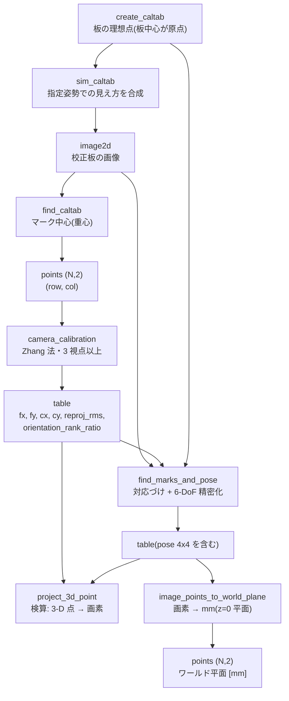

# カメラ校正(画素を実寸に結びつける) — 使い方ガイド

## この族は何をする道具箱か

**画素の座標を、実世界の長さと向きに結びつける**層です。ここが決まらないと、
どんなに精密にエッジを測っても答えは「画素」のままで、mm になりません。

29 op / 7 カテゴリ(numpy と scipy のみ。台帳は `opscalib.py`、実体は
`calib.py` / `caltab.py` / `fit_transform.py` / `calib_lm.py`):

- **project(3)** — `project_3d_point` / `project_point_hom_mat3d` /
  `project_hom_point_hom_mat3d`: 3-D 点 → 画素 `(row, col)`。校正結果の**検算**に使う。
- **plane(5)** — `image_to_world_plane` / `image_points_to_world_plane` /
  `contour_to_world_plane_xld` / `gen_image_to_world_plane_map` /
  `gen_radial_distortion_map`: 画素 ↔ ワールド平面(z=0)。平面上の寸法を実寸で読む。
- **target(6)** — `caltab_points` / `create_caltab` / `gen_caltab` / `sim_caltab` /
  `disp_caltab` / `find_caltab`: 校正板を作る・描く・投影をシミュレートする・見つける。
- **calibrate(5)** — `camera_calibration`(Zhang 法で内部行列)/
  `find_marks_and_pose`(板の 6 自由度姿勢)/ `hand_eye_calibration`(Tsai-Lenz、AX=XB)/
  `camera_calibration_lm`(Zhang を初期値に K・歪み 5 係数・全姿勢を LM で同時に、共分散つき)/
  `stereo_calibration_lm`(左右の内部・歪みと相対姿勢 (R, T) を同時に)。
- **checkerboard(3)** — `checkerboard_points` / `sim_checkerboard`(真の K・歪み・姿勢で描き、角の真の画素つき)/
  `find_checkerboard_corners`(鞍点 + 勾配直交でサブピクセル、板の行優先の順)。
- **calib_truth(3)** — Fullseye だけの層: `calibration_error_map`(真値と比べた誤差の地図)/
  `calibration_uncertainty_map`(共分散を画像へ写した地図。真値なしでも出る)/
  `calibration_next_pose`(次の 1 枚の推薦)。
- **fit(4)** — `vector_to_rigid` / `vector_to_similarity` / `vector_angle_to_rigid` /
  `hom_vector_to_proj_hom_mat2d`: 対応点から 2-D 変換(Kabsch / Umeyama / DLT)。

## 座標規約 —— ここを外すと例外なしに間違う

**画素は `(row, col)`、ワールド平面の点は `(x, y)`。**
`camera_calibration` の `object_points` は `(x, y)`、`image_points_list` は
`(row, col)` です。入れ替えて渡すと `fx` と `fy`、`cx` と `cy` が**そのまま
入れ替わった K** が返り、**再投影誤差は小さいまま**なので気づけません
(`tests/test_calib.py::test_xy_image_points_would_swap_axes` がその結果を固定しています)。

## 流れ



## 最初の 1 本

```python
import numpy as np
import fullseye as fs

K = {"fx": 500.0, "fy": 500.0, "cx": 128.0, "cy": 128.0}
board = fs.ledger.create_caltab(7, 7, 10.0)          # 7x7、10 mm ピッチ

c, s = np.cos(0.2), np.sin(0.2)                       # 板を x 軸まわりに 0.2 rad 傾けて置く
pose = np.eye(4)
pose[:3, :3] = [[1, 0, 0], [0, c, -s], [0, s, c]]
pose[:3, 3] = [0.0, 0.0, 600.0]

sim = fs.ledger.sim_caltab(board, K, pose, 256)       # 見え方を合成
found = fs.ledger.find_marks_and_pose(sim["image"], K, board)

print(found["n_marks"], found["reproj_rms"])          # 49, 0.12 px 前後
print(found["pose"][:3, 3])                           # ≈ [0, 0.02, 600.5]
```

## 落とし穴(実測に基づく)

1. **再投影誤差は配置の良し悪しを映さない。** 2026-09-06 の実測で、同じ 10 視点・
   同じ雑音 0.05 px のまま板の傾きだけを 32 度から 2 度に変えると、再投影 RMS は
   0.0690 → 0.0688(比 1.00 倍)なのに `fx` の誤差は 0.026 % → **7.33 %(281 倍)**に
   なりました。配置を見たいなら `camera_calibration` が返す
   `orientation_rank_ratio`(大きいほど良い)を読んでください。

2. **退化検出の門は、歪みのあるレンズでは鳴りません。** 歪みが無ければ設計どおり
   働きます(傾き 0 度で比 3.8e-14 を拒否)。しかし樽型歪み `k1=-0.18` を入れると
   比が傾きに関係なく 1.9e-06 前後に張り付き、分ける線が引けません。
   しきい値では直せないので、**比を返して判断材料を渡す**形にしてあります。

3. **平面 1 枚では `fx`/`fy` の比を検証できません**(Zhang 2000: 平面 1 枚の
   ホモグラフィは内部パラメータに 2 つしか拘束を与えない)。誤った `fy` は
   姿勢 6 自由度にほとんど吸収されます。内部パラメータを確かめたいなら
   **視点を 3 枚以上**取るか、非平面のターゲットを使ってください。

4. **`camera_calibration` は歪みを推定しません。** 閉形式は歪みを無視するので、
   `k1=-0.18` のレンズでは傾き 5 度で `fx` を 41 % 誤ります。初期値としては
   使えますが、そのまま K として使わないこと。K として使うのは `camera_calibration_lm` の値です
   (`examples/poc_calibration_truth_map.py` の 6 枚: Zhang の fx 誤差 12.89 % → LM 0.133 %)。

5. **誤差の地図は既定で「カメラの向きのずれ」を除いてから描きます。** 主点のずれの大部分は
   カメラを少し回したのと同じ形で、どんな使い方でも外部の姿勢に吸収されるからです。除かないと
   地図はほぼ一様な値になり(cx が 0.94 px ずれた推定で全体 ~1 px)、どこが悪いかが見えません。
   `remove_rotation=False` で生の地図、`raw_rms_px` と `rotation_removed_deg` で除いた量が分かります。

6. **不確かさの地図は線形の予測です。** k1, k2, p1, p2 で 6 視点・σ = 0.2 px なら、地図の平均は
   モンテカルロの実測と合います(回さない 6.42 / 6.39 px)。k3 まで自由にすると、板の写っていない
   隅の外挿で予測が実測の 3 倍になります(160 / 55 px)。板を画像の隅まで動かして撮るのが先です。

## 真値つきの校正 —— 画像から K、どこで誤るか、次の 1 枚(2026-11-03)

```python
import fullseye as fs

obj = fs.ledger.checkerboard_points((9, 6), 20.0)
sims = [fs.ledger.sim_checkerboard((9, 6), 20.0, K_true, dist_true, P, (480, 640)) for P in poses]
pts = [fs.ledger.find_checkerboard_corners(s["image"], (9, 6)) for s in sims]
cal = fs.ledger.camera_calibration_lm(obj, pts, dist_model="k1k2p1p2")
err = fs.ledger.calibration_error_map(cal, K_true, dist_true, (480, 640), depth=500.0)
unc = fs.ledger.calibration_uncertainty_map(cal, (480, 640))       # 実機でも出る
nxt = fs.ledger.calibration_next_pose(cal, candidate_poses, (480, 640))
```

`examples/poc_calibration_truth_map.py` の実測: 角の検出は描画の真値に対して rms 0.046 px(6 枚 324 点)。
誤差の地図は中央の 3 分の 1 で 0.094 px、隅で最大 0.568 px(500 mm 先で 0.413 mm)。
板を中心にしか置いていない 4 枚に次の 1 枚を推薦させると隅の候補を選び、モンテカルロ(15 本)の実際の
誤差は 1.41 px(中心に正対 3.13 px、遠い中心 3.98 px)。隅の 4 候補どうしの順位は予測と実測で
入れ替わることがあり(差が雑音の内)、確かなのは「最下位を避ける」ほうです。

検出・校正・ステレオは OpenCV(`findChessboardCorners` + `cornerSubPix`、`calibrateCamera`、
`stereoCalibrate`)を試験の照合相手にしています(`tests/test_calib_lm.py`、OpenCV は optional)。
同じ角から同じ極小(費用は OpenCV 以下、変数の差は推定の標準偏差の 1 % 未満)に落ち、
角の検出は描画の真値に対して `cornerSubPix` より小さい誤差です。

くわしい実測は [`examples/poc_camera_calibration.py`](../../../../examples/poc_camera_calibration.py)
が章立てで示します(「再投影誤差 0.05 px は何も保証しない」)。

## この族に**入れなかった**もの

`mosaic.py` の歪み込み RANSAC・球面モザイク・バンドル調整、
`caltab.binocular_calibration`、`calib.vector_to_hom_mat2d` などは、
名乗りと中身が食い違うか同名で規約が違うため台帳に載せていません。
理由は台帳 `opscalib.py` の docstring(「台帳に載せなかったもの」)に並べてあります。

---

Copyright (c) 2026 Kazufumi Furuse. Licensed under the Apache License, Version 2.0.
