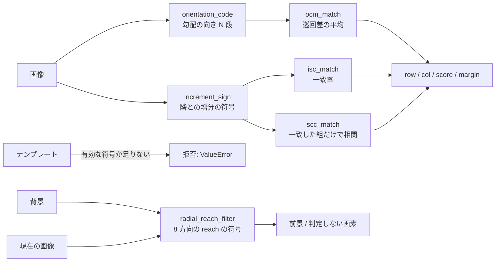

# 符号系の頑健照合 — 使い方ガイド

## この族が答えている問い

テンプレート照合の定番の正規化相互相関(NCC、`ncc_locate` / `find_ncc_model`)は、明るさの**値**の相関を取ります。
明るさ全体の倍率とオフセットには強いのですが、次の 3 つには弱い。

- テンプレートの一部だけを手前の物が隠す(遮蔽)。隠した物の明るさが違うと、相関は数割の遮蔽で別の場所に負ける。
- 光沢が飛んで一部が飽和する(局所のハイライト)。
- 照明がテンプレートの中でむらになる(片側だけ暗い、ガンマが違う)。

この族は明るさの**変化の向き**を符号にして比べます。値が崩れても、向きは崩れにくい。そのかわり、
平坦な所(向きが雑音で決まる所)は使えないので、**符号が位置を決めないテンプレートには値を返さずに拒否**します。
台帳は `opscodematch.py`、本体は `codematch.py`。式は文献から再実装したもので、著者が承認したものではありません。

## 流れ



## 符号化(code)

| やりたいこと | op | 要点 |
|---|---|---|
| 勾配の向きを符号に | `orientation_code` | Sobel の向き θ を N 段(既定 16 = 22.5°)に。`abs(∂x)+abs(∂y) <= grad_thresh` は無効符号 N。オフセットで不変、rot90 で N/4 巡回 |
| 隣との増分の符号 | `increment_sign` | `[I(次) >= I(今)]`。狭義単調な明るさの変換で厳密に不変 |

## 照合(match)

| やりたいこと | op | 要点 |
|---|---|---|
| 向きで探す | `ocm_match` | 巡回差 `min(abs(a-b), N-abs(a-b))` の平均(テンプレート側が無効なら 0、画像側だけ無効なら N/4)。Ullah・Kaneko・Igarashi 2001 |
| 増分の符号で探す | `isc_match` | 一致率。単調な明るさ変換で点数地図が 1 ビットも変わらない。Kaneko・Murase・Igarashi 2002 |
| 符号の合う画素だけで相関 | `scc_match` | 隣り合う 2 画素の組の符号が一致した画素だけで正規化相関。拡張マスク(2 × 2 組で 2 つ以上不一致なら外す)が既定。Kaneko・Satoh・Igarashi 2003 |

座標は `find_ncc_model` と同じテンプレート中心。`margin` は最良位置から離れた次点との差で、似た物が 2 つある場面では小さくなります。

**SCC の選択の偏り**(PoC で実測): 「符号が合った画素だけ」を選ぶので、無関係な位置でも選んだ画素どうしの相関は高めに出ます。
そのまま最大値を取ると、SCC は NCC より先に壊れました。既定では、無相関の位置で期待される使用率(基本マスク 1/2、拡張 5/16)に
4 標準偏差を足した値より使用率の低い位置を採点しません(`min_mask_fraction=None`)。これは論文の式には無く、論文の統計モデル
(無相関で一致率 0.5)から足した拒否です。それでも SCC は OCM / ISC には届きません。

## 背景との比較(change)

| やりたいこと | op | 要点 |
|---|---|---|
| 照明が変わっても物だけ拾う | `radial_reach_filter` | 背景の各画素から 8 方向へ、差が `t_p` 以上になる最初の画素(reach)を探し、その差の符号が現在の画像で保たれる方向を数える。保たれた割合が `agree_thresh` 未満なら前景。reach が `min_dirs` 方向に見つからない平坦な画素は判定しない。Satoh・Kaneko・Niwa・Yamamoto 2004 |

## 最初の 1 本

```python
import numpy as np
from scipy import ndimage
import fullseye as fs

rng = np.random.default_rng(0)
scene = ndimage.gaussian_filter(rng.random((96, 96)), 1.5)
scene = (scene - scene.min()) / (scene.max() - scene.min())
tpl = scene[30:62, 40:72].copy()                     # 正解の中心は (46, 56)
lit = scene ** 0.4                                   # 照明が変わった(ガンマ)
lit[30:46, 40:56] = 1.0                              # テンプレートの 1/4 が飽和
for name in ("ocm_match", "isc_match", "scc_match"):
    r = getattr(fs.ledger, name)(lit, tpl)
    print(name, r["row"], r["col"], round(r["score"], 3))
try:
    fs.ledger.isc_match(lit, np.full((32, 32), 0.5))
except ValueError as e:
    print("refused:", str(e)[:40])
```

## どこで壊れるか

`examples/poc_code_matching_breakdown.py` が、公開の実写 5 枚から切った 32 x 32 のテンプレートに遮蔽・ハイライト・照明のむら・
回転を段階的に掛けて、1 px 以内で当たった割合を数えます。遮蔽とハイライトでは NCC が 1〜2 割で半分を割るのに対し、OCM と ISC は
4〜5 割でも半分以上残ります。回転には 4 種とも弱く、10° 前後で半分を割ります(回転を探す方向符号ヒストグラムの系統は別の課題)。

## 参考文献

- F. Ullah, S. Kaneko, S. Igarashi, "Orientation Code Matching for Robust Object Search", IEICE Trans. Inf. & Syst. E84-D(8), 2001.
- S. Kaneko, I. Murase, S. Igarashi, "Robust image registration by increment sign correlation", Pattern Recognition 35(10), 2002.
- S. Kaneko, Y. Satoh, S. Igarashi, "Using selective correlation coefficient for robust image registration", Pattern Recognition 36(5), 2003.
- Y. Satoh, S. Kaneko, Y. Niwa, K. Yamamoto, "Robust object detection using a Radial Reach Filter (RRF)", Systems and Computers in Japan 35(10), 2004.
- 符号化と相違度の表の確認に: 本田 匠・高氏 秀則・金子 俊一, 「照明スペクトル変動に対してロバストな重み付きカラー方向符号照合法」, 精密工学会誌 75(2), 2009。RRF の式の確認に: 和島 直哉・高橋 悟・伊藤 誠也・佐藤 雄隆・金子 俊一, 「Radial Reach Filter に基づく動画像処理を用いた移動体追跡法」, 電気学会論文誌 C 129(10), 2009。

© 2026 Kazufumi Furuse — Fullseye operator documentation. Licensed under Apache-2.0.
