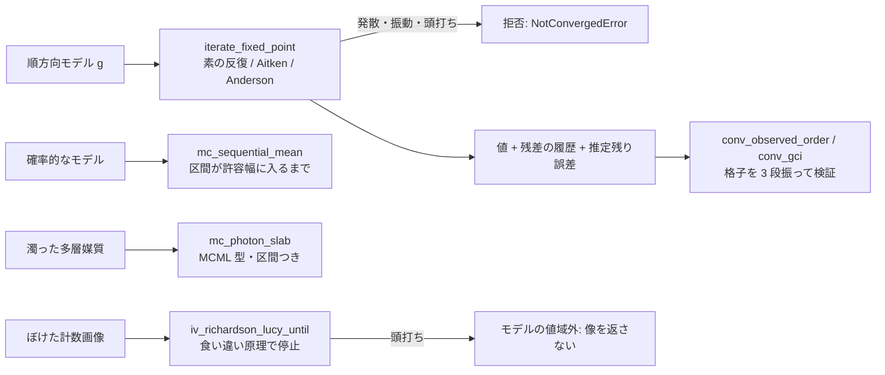

# 収束型の演算 — 使い方ガイド

## この族が答えている問い

実物に近い順方向モデルは、閉じた式ではなく**繰り返しの極限**であることが多い。溝の壁から壁へ跳ね返り続ける光、濁った
媒質の中で散乱を繰り返す光子、どこかで止めるべき逆畳み込み。回数を固定して打ち切ると、答えはもっともらしく見えたまま
足りないことがあり、しかもその不足は数字の上に現れません。

- 直接光だけのモデルを凹んだ部品の実写に合わせると、相互反射の分を係数(アルベド・照明の強さ)が吸い込んで、残差は小さい
  のに係数が物理的にあり得ない値になる。
- モンテカルロは標本の数で精度が決まるのに、標本数を固定すると「どれだけ確かか」が分からない。
- Richardson-Lucy は回しすぎると雑音を増幅する(誤差はいったん下がってから上がる)。回数の固定値に根拠が無い。

この族は、どの op も (1) 収束まで回し、(2) 収束した証拠(残差の履歴・信頼区間・観測収束次数)と残りの誤差を返し、
(3) 収束しなければ**値を返さない**(`NotConvergedError`、あるいは値の鍵を `None` にして最後の反復を `last_iterate` に置く)。
台帳は `opsconverge.py`、本体は `converge.py`・`mcphoton.py`・`deconvstop.py`。

## 流れ



## 反復(iterate)

| やりたいこと | op | 要点 |
|---|---|---|
| x = g(x) を解く | `iterate_fixed_point` | `plain`(線形なら反射を 1 回ずつ足す和そのもの)・`aitken`(Δ² の Steffensen 形)・`anderson`(Walker & Ni 2011 の式 3.1 を QR で解き、条件数が 1e8 を超えたら古い列を捨てる)。残差の履歴、反復数、g を呼んだ回数、推定残り誤差 L/(1−L)·‖g(x)−x‖(L は g の割線の比の最大。L ≥ 1 なら出さない)。発散・周期 2 の振動・頭打ちは拒否 |

線形の写像では、Anderson は GMRES と同じ反復を作ります(Walker & Ni の定理 2.2)。テストは別に書いた GMRES と 1e-9 で照合します。
振動する写像(ロジスティック写像 r = 3.2)でも x = g(x) の解は在り、Anderson はそれを残差で裏づけて返します(推定残り誤差は
縮小写像でないので出しません)。

## 検証(verification)

| やりたいこと | op | 要点 |
|---|---|---|
| 観測収束次数 | `conv_observed_order` | 細かい順に 3 つの解と、格子の大きさ h・比 r・セル数 N(と次元)のどれか 1 つ。Celik ら 2008 の式 3(格子比が一定でない項 q(p) を不動点反復で、振動収束は s = −1 として報告) |
| 離散化誤差の見積もり | `conv_gci` | 外挿値(式 4)、近似相対誤差(式 5)、外挿相対誤差(式 6)、GCI(式 7、安全係数 1.25)。Celik の Table 1 の 3 列を再現(表に印字された丸めた比 1.333 ではなくセル数からの比で) |

「何回反射を数えれば足りるか」「帯を何本に分ければ足りるか」「光子を何個飛ばせば足りるか」を、3 段振った解から数で言います。
GCI はモデルの誤りは含みません(Celik: "this does not account for modeling errors")。

## モンテカルロ(montecarlo)

| やりたいこと | op | 要点 |
|---|---|---|
| 区間が許容幅に入るまで標本を足す | `mc_sequential_mean` | `sampler(rng, n)`、バッチ b は `default_rng((seed, b))` で再現できる。2 バッチ目から、半幅 z·s/√n ≤ tol + rel_tol·|平均| で止める(Chow & Robbins 1965)。予算 `max_samples` を使い切ったら拒否。実際の被覆率はテストが 400 回で両側に測る |
| 濁った多層スラブの光子輸送 | `mc_photon_slab` | MCML マニュアルの規則(式 3.2a〜3.31: 鏡面反射・歩幅・吸収・Henyey-Greenstein・Fresnel の全反射か透過・層の境界での歩幅の持ち越し・ルーレット)を numpy で全光子一度に。光子 1 個ずつの寄与から標準誤差と区間。`tol` を渡すと逐次に |

外部真値は MCML マニュアルの Table 6.1(van de Hulst: R_d 0.09739、T_t 0.66096)と Table 6.2(Giovanelli 0.2600)。区間が値を含むかを
下端と上端の両側で判定します。Table 6.2 は鏡面 + 拡散(`R_total` = 0.04 + 0.219)で合い、拡散だけでは合いません。
整合境界の半無限媒質は、Chandrasekhar の H 関数(`iterate_fixed_point` で解く)の 1 − H(1)√(1 − a) とも照合します。

## 止め方(stopping)

| やりたいこと | op | 要点 |
|---|---|---|
| 逆畳み込みを止める所をデータに決めさせる | `iv_richardson_lucy_until` | ポアソンの食い違い (2/N)Σ[y ln(y/Hx) + Hx − y] ≤ τ(Bertero ら 2010、τ = 1、Benvenuto & Piana 2012 の式 30)か、ガウスの Morozov ‖Hx − y‖² ≤ τNσ²(同 式 18)。各反復で Σ(Hx) = Σy(補題 3.2)を確かめる。食い違いが τ の上で頭打ちになったら「モデルの値域外」(PSF が広すぎる・背景が抜けている)として像を返さない |

既存の `iv_richardson_lucy` は反復回数をノブで受けるだけで、止める根拠を持ちません。こちらは止めた反復の番号と食い違いの履歴を返します。

## 最初の 1 本

```python
import fullseye as fs

r = fs.ledger.iterate_fixed_point("cos", method="anderson")   # x = cos x
print(round(r["x"], 10), r["n_iter"], r["n_evals"])           # 0.7390851332 6 7
g = fs.ledger.conv_gci()                                       # Celik ら 2008 Table 1 の第 1 列
print(round(g["p"], 2), round(g["gci_fine21_pct"], 1))         # 1.53 2.2
m = fs.ledger.mc_photon_slab(n_photons=100000)                 # MCML Table 6.1 のスラブ
print(round(m["Rd"], 4), [round(v, 4) for v in m["Rd_ci"]])    # 0.0973 [0.0958, 0.0987] (van de Hulst 0.09739)
d = fs.ledger.iv_richardson_lucy_until()                       # 例の光子計数画像
print(d["status"], d["k_stop"])                                # stopped 12
```

## 例

`examples/converge_tour.py` —— V 溝の相互反射(直接光だけなら奥は 1/10、素の反復 187 回対 Anderson 28 回、帯の数の GCI)、
光子を足すと MCML の区間が van de Hulst の値に縮む様子、Richardson-Lucy の半収束と食い違い原理の停止、収束しない写像の拒否。
