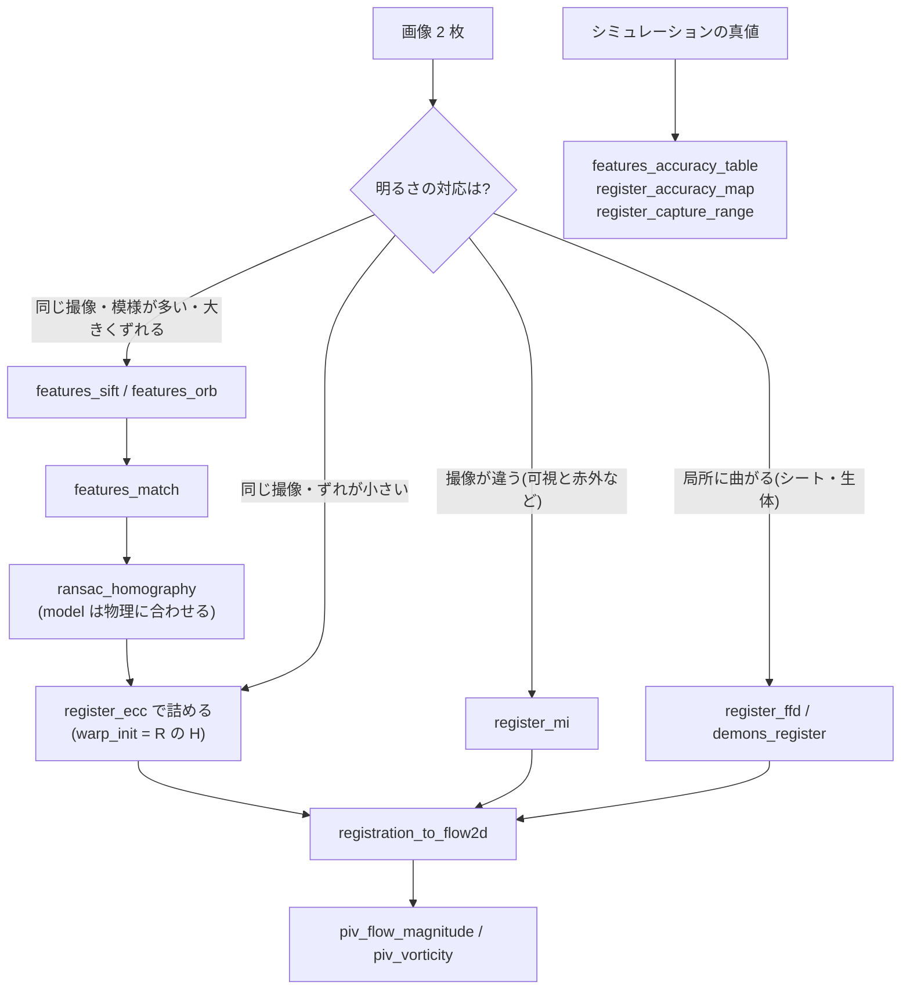

# 照合と位置合わせ(特徴点・頑健推定・強度による位置合わせと、真値による精度の地図) — 使い方ガイド

## この族は何をする道具箱か

2 枚の画像の「どこがどこに対応するか」を決める 12 op / 2 カテゴリ(numpy + scipy のみ。台帳は
`opsmatchreg.py`、実体は `featmatch.py` と `intensityreg.py`):

- **featmatch(6)** — 点で合わせる。`features_sift`(DoG + 128 次元)/ `features_orb`(FAST + 向きつき BRIEF)/
  `features_match`(比の検定 + 相互最近傍、L2 と Hamming)/ `ransac_homography`(MSAC + 適応回数 + 局所最適化、
  並進・相似・アフィン・射影)/ `ransac_fundamental`(正規化 8 点法 + Sampson 距離)/
  **`features_accuracy_table`**(既知の変換で合成した組で、条件ごとの再現率・照合精度・推定誤差の表)。
- **intensityreg(6)** — 明るさで合わせる。`register_ecc`(相関係数の最大化、並進〜射影)/ `register_mi`
  (正規化相互情報量、剛体・相似・アフィン、撮像の違う組)/ `register_ffd`(3 次 B-spline の自由変形)/
  `registration_to_flow2d`(結果 → 変形場)/ **`register_accuracy_map`**(既知の場で合成した組で、画素ごとの誤差)/
  **`register_capture_range`**(初期のずれごとの成功率)。

太字の 3 本が、物理・撮像のシミュレーションで真値を作れる Fullseye だけの層です。標準のアルゴリズムの
上に「**この条件ならどこまで信頼できるか**」を数で載せます。

## なぜ足したか —— 在庫を数えた結果(2026-11-03)

監査(`completeness_audit_2026_11_03`)で、スケール不変の特徴と照合は OpenCV・scikit-image・kornia の
全部にあるのに Fullseye は数を数えるだけ(`xcv_orb_count`)、強度による位置合わせは ECC・MI 目的の
アフィン・B-spline FFD が無い、と出ました。

| 既にあったもの | 何をするか | この族との関係 |
|---|---|---|
| `features.harris_corners` / `fast_corners` / `match_descriptors` | Harris・FAST + 正規化パッチ + 比の検定 | 並存。`features_orb` は `fast_corners` を再利用。`features_match` の実数の規則は `match_descriptors` と同じ組を返す(テストで固定)。パッチ記述子は回転・拡大に不変でない(部品の PoC で 37 度回転の 4 隅誤差 158 px) |
| `mosaic.proj_match_points_ransac` | (row, col)・正規化なし DLT・固定回数の RANSAC | 並存。座標の順が逆なので混ぜない。`ransac_homography` は正規化 DLT(`twoview._homography_dlt`)を再利用 |
| `mosaic.gen_projective_mosaic` | H で貼り合わせ | そのまま使う(H の向きが同じ (x, y))。新しい貼り合わせ op は作らない |
| `reconstruction.match_fundamental_matrix_ransac` / `twoview.fundamental_8point` | F の推定 | `ransac_fundamental` は `fundamental_8point` を再利用 |
| `aoi.register_image` | 位相相関の並進 + 当てになるかの量 | 精度の地図・収束の範囲の比べる相手(`method="phase"`) |
| `deformreg.demons_register` | demons の密な場 | 比べる相手(`method="demons"`)。**場の向きを揃えた**ので画素ごとにそのまま比べられる |
| `imgmetrics.mutual_information` | MI の指標 | 指標。`register_mi` の目的関数は振り分けつきの別の推定量 |
| `deform_ffd` | B-spline の変形を**掛ける**(拡張) | 推定はしない。`register_ffd` が推定 |

**新しい型語彙は 1 つも作っていません**(`image2d` / `table` / `flow2d`)。表は `kind` の印つきで、
違う `kind` を渡すと `ValueError` です。

## 使う順序



## 最小の例

```python
import numpy as np
import featmatch, intensityreg

img = featmatch.synthetic_scene((128, 128), seed=3)
H = featmatch.condition_homography(img.shape, rotate_deg=30.0, scale=0.8)   # 真値
img2, _ = featmatch.warp_homography(img, H)
m = featmatch.features_match(featmatch.features_sift(img), featmatch.features_sift(img2))
h = featmatch.ransac_homography(m)
print("4 隅誤差 %.3f px" % featmatch.corner_error(h["H"], H, img.shape))

g = intensityreg.smooth_test_field(img.shape, amplitude=2.0, wavelength=48)  # 真の変形場
acc = intensityreg.register_accuracy_map(img, g, method="ffd")
print("FFD の EPE 平均 %.3f px / 95%% 点 %.3f px" % (acc["epe_mean"], acc["epe_p95"]))
```

## 符号の約束(ここを間違えると黙って逆を向く)

- 特徴点の座標は **(x, y)**、H は pts1 → pts2。
- `register_*` の `warp` は fixed の (x, y) を moving の (x, y) へ写す: `moving(W p) ≈ fixed(p)`
  (OpenCV の `findTransformECC` と同じ向き)。
- `flow2d` は `(2, H, W)` の `(dy, dx)` で、**動く画像の内容の前向き変位**(demons と同じ):
  `deformreg.warp_by_field(moving, dx, dy)` が fixed に重なる。`flow(p) = p - W p`。

## 測ってわかったこと(数は PoC とテストが固定)

- **SIFT は OpenCV と同じ桁**: 256 px の合成場面で点の数 139(OpenCV 5.0 は 138)、回転 30 度・0.7 倍の対で
  4 隅誤差 0.17 px(OpenCV 0.16 px)。SIFT のコントラストのしきい値は絶対値なので、**利得 0.5 で点が 6 割減る**
  (記述子は正規化で残り、照合精度は 1.00 のまま)。
- **ECC の縁の偏り**: 平滑化の届く縁(折り返しの値)を照合に入れると、整数の並進でも σ に比例して偏る
  (σ=1.1 で 0.05〜0.06 px)。この族は 3σ の帯を外すので偏りは 0.006 px 以下、アフィンの 4 隅誤差は
  0.012 px(同じ対で OpenCV 0.178 px)。
- **ECC は撮像の違う組を拒む**: 白黒反転・折り返しのある明るさでは相関の 2 次近似の分母が負になり `ValueError`
  (OpenCV と同じ)。`nonpositive="step"` は相関を正へ戻す一歩で続ける(初期のずれ 32 px の成功率
  0.25 → 0.625)が、反転の組でも「相関 0.35」へ進むので `min_rho` を床にする。
- **ピラミッドは常に範囲を広げるわけではない**: この合成場面では ECC の 3 段は 1 段より成功率が低かった
  (粗い段は 32 px でぼけて相関が落ちる)。
- **収束の範囲**(128 px、並進): 位相相関 32 px 以上 / ECC 16 px / MI(剛体)8 px / demons 4 px / FFD 2 px。
  回転 6 度が入ると位相相関は 2 px のずれでも成功率 0。
- **可視と赤外**(放射の式で作った基板): 真の位置で相関係数 -0.74。MI は 4 隅誤差 0.17 px、ECC は拒否、
  位相相関は consistent=False。
- **貼り合わせの自由度**: 重なり 80 px の帯に正しい組が 9 つだけのとき、8 自由度の射影は帯の外へ外挿して
  4 隅誤差 9.4 px、並進の模型は 0.08 px。**物理に合った最小の模型を選ぶ**(`model=`)。
- **FFD の限界**(印刷したシート): 2 方向の模様のある所は 0.025 px(demons 0.125 px)。縦棒だけの
  バーコードでは縦の誤差が横の 25 倍(開口問題)、余白は 67 倍。格子 8 / 12 / 16 px で波長 24 px の皺の
  誤差 0.06 / 0.33 / 0.51 px。曲げの罰だけだと余白で推定が 34 px まで暴れ、`membrane_weight=0.1` で 3.6 px
  —— 模様のある所の精度と引き換えなので既定は曲げだけ。

## 限界(正直に)

- 学習した記述子(HardNet・SuperPoint・LoFTR)は無い。AKAZE も無い(非線形拡散のスケール空間は未実装)。
- ORB の BRIEF の対は学習した rBRIEF の表ではなく乱数で固定した対で、OpenCV の ORB とビット単位で一致しない。
- `ransac_fundamental` は平面・純回転の退化を判定しない。7 点法は無い(最小標本 8)。
- `register_ffd` は微分同相(折り返し無し)を保証しない。
- MI の最適化は Powell 法(`scipy.optimize`)で、GPU の影の経路では外側が CPU に残る。GPU の速さは測っていない。
- 精度の表・地図の合成は平面の変換と滑らかな場だけ(視差・遮蔽・鏡面反射・局所の影は入らない)。
