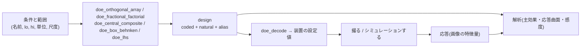

# 実験計画・多変量解析・感度解析 — 使い方ガイド

## この族が答えている問い

実物の画像から物理モデルの係数を合わせたい(ユーザーの言葉では「誤差をフィードバックして係数を自動で調整したい」)。
その前に答えておくべき問いが 3 つあります。

1. **どの条件で撮る(計算する)か。** 条件を 1 つずつ振ると、組み合わせの効果(照明を寝かせたら露光を減らす、のような)が見えません。
   4 条件 x 3 水準を全部撮ると 81 回。直交表 L9 なら 9 回で、どの 2 条件の組も均等に出ます。
2. **何が効いたか。** 効かないつまみは合わせても意味が無く、交互作用でしか効かないつまみは 1 つずつ見ても見落とします。
3. **データから決まるのはどれか。** 2 つのつまみが絵を同じように動かすなら、決まるのは片方ずつではなく組み合わせ(例: 屈折率 x 膜厚)だけです。

この族はその道具箱です。台帳は `opsmultivar.py`、計画は `doe.py`。

## 計画(plan / coding)

| やりたいこと | op | 真値・出典 |
|---|---|---|
| 少ない回数で多くの条件を振る(田口の直交表) | `doe_orthogonal_array` | L4・L8・L9・L12・L16・L18・L27 を**公表された表から写した**(York 大学の公開表)。NIST Dataplot の L*.DAT と行まで一致することをテストが毎回確かめる |
| 2 水準の一部実施(どれとどれが交絡するかつき) | `doe_fractional_factorial` | 生成子は NIST/SEMATECH e-Handbook Table 3.17。分解能と交絡表は生成子から計算し、表の分解能と一致 |
| 二次の応答曲面を当てるための計画 | `doe_central_composite` / `doe_box_behnken` | 回転可能な α = F^{1/4}(NIST Table 3.23)、3 因子の点は NIST Table 3.24 と一致 |
| シミュレーションの入力を偏りなく埋める | `doe_lhs` | 各条件の n 区間にちょうど 1 点(McKay ら 1979 の定義を返り値で検査) |
| 記録した条件を計画と同じ座標へ / 計画を装置の設定値へ | `doe_encode` / `doe_decode` | 線形と対数(条件ごと) |

返り値は新しい型 `design` です。**符号化(−1..+1)の行列と自然単位の行列を両方**、因子名・単位・範囲・尺度・交絡表と一緒に持ちます。
`matrix` と分けた理由: 2 つの行列は形も dtype も同じで、取り違えた二次の当てはめは例外なしに別の中心の曲面を返すからです。



```python
import fullseye as fs

plan = fs.ledger.doe_orthogonal_array("L9", [("angle", 15, 75, "deg"), ("power", 0.5, 1.5, "a.u."),
                                             ("exposure", 2, 8, "ms"), ("gain", 0, 12, "dB")])
settings = fs.ledger.doe_decode(plan)        # 9 x 4、自然単位
print(plan["alias"][:2])                     # どの交互作用がどの列に乗るか

frac = fs.ledger.doe_fractional_factorial(["gain", "light", "exp", "angle", "filter"], 2)
print(frac["meta"]["resolution_roman"], frac["alias"][0])   # III  gain = light*angle = exp*filter
```

## 落とし穴(計画を選ぶ前に読む)

- **分解能 III の一部実施では、主効果と 2 因子交互作用が同じ列になる。** `examples/doe_plan_tour.py` は、ゲインが何もしていない
  のに 2^(5-2) の 8 回が「ゲインの効果 6」と答える場面を再現します(全 32 回では 0)。`alias` に事前に書いてあります。
- **L12・L18 は非正則**: 交互作用は 1 列に乗らず、他の列に薄く広がります(L12 は残り 9 列に 1/9 ずつ)。交互作用を見たいなら
  L8・L16・L27 のような正則な表で、`alias` が空になる列に割り付けます(L18 の 1 列目 x 2 列目だけは例外的に他の列に乗りません)。
- **回転可能な中心複合計画の軸の点は範囲の外に出ます。** `meta["outside_range"]` が名指しします。装置がそこまで振れないなら
  `inscribed=True` で全体を縮めるか、`alpha="face"`(3 水準)にします。
- **範囲は推測しません。** `doe_encode` は lo/hi を必ず受け取ります(データの最小・最大を範囲にすると、計画と記録で符号化がずれる)。

## 出典(公開文献のみ)

McKay, Beckman & Conover 1979, Technometrics 21(2):239 / Taguchi 1987(System of Experimental Design)、表は University of York
"Orthogonal Arrays (Taguchi Designs)" と NIST Dataplot / Bose & Bush 1952, Ann. Math. Stat. 23:508 / Box & Hunter 1961,
Technometrics 3(3):311 / Box & Wilson 1951, JRSS B 13(1):1 / Box & Behnken 1960, Technometrics 2(4):455 /
NIST/SEMATECH e-Handbook of Statistical Methods 5.3.3.4.7, 5.3.3.6.

## 解析(analysis / features)

| やりたいこと | op | 真値・出典 |
|---|---|---|
| 画像を名前と単位つきの特徴量の表に | `feat_image_vector` | 飽和・暗部・エントロピーは `data_range`(センサや形式の範囲)を**必ず受け取る**。データの最大値は白レベルではない |
| 特徴量の独立な次元の数 | `mv_pca` | PCA = SVD(固有値が相関/共分散行列の固有値と一致)。次元数は累積寄与・平行分析(Horn 1965)・MDL(`mathspectral.n_sources_mdl` を再利用、標準化しないときだけ)の 3 通り |
| 条件 ⇔ 画像の特徴量の回帰 | `mv_pls` | NIPALS(Wold ら 2001)と SIMPLS(de Jong 1993)の 2 実装が 1 変数 y で一致。交差検証の Q² と、Q²_a ≥ 0.0975 の成分数の規則、VIP |
| 最良の条件と曲面の形 | `rsm_fit` | 二次式の停留点 = 解析解、正準解析(最大・最小・鞍点・尾根)、純誤差との当てはまりの悪さの F 検定。**計画が支えない次数は、交絡する項を名指しして拒否**(2 水準の計画に二次を当てると `x1^2 = 1`) |
| 主効果の応答表 | `doe_main_effects` | 水準ごとの平均と log s。SN 比も出すが、推奨の水準は平均と散らばりを分けて読む(Box 1988。SN 比は 1 つの数に混ぜる) |

```python
import numpy as np
import fullseye as fs

l9 = fs.ledger.doe_orthogonal_array("L9", [("angle", 15, 75, "deg"), ("power", 0.5, 1.5, "a.u."),
                                           ("exposure", 2, 8, "ms"), ("gain", 0, 12, "dB")])
c = l9["coded"]
Y = np.stack([10 - 3 * c[:, 0] + 0.5 * c[:, 2] + 0.2 * s for s in (-1, 0, 1)], axis=1)   # 9 条件 x 3 回(装置の出力の代わり)
me = fs.ledger.doe_main_effects(l9, Y, goal="larger")
print(me["best_levels"], me["sn_agrees"])

ccd = fs.ledger.doe_central_composite([("angle", 4, 20, "deg"), ("exposure", 6, 30, "ms")], center=5, inscribed=True)
x = ccd["coded"]
y13 = 17 - (x[:, 0] - 0.2) ** 2 - 2 * (x[:, 1] + 0.1) ** 2 + 0.01 * np.cos(np.arange(len(x)))
rs = fs.ledger.rsm_fit(ccd, y13)
print(rs["canonical"]["kind"], rs["stationary"]["natural"], rs["lack_of_fit"]["testable"])
```

`examples/multivar_inspection_tour.py` は検査カメラの例で、主効果(角度が 8 割、強さ・露光・ゲインは同じ山形)、
応答曲面(当てはまりの悪さが有意 = 二次では飽和の折れを表せない、という合図)、PCA(特徴量 9 本の独立な情報は 2 次元)、
PLS(画像から照明の角度は読めるが、露光は読めない)を出します。
