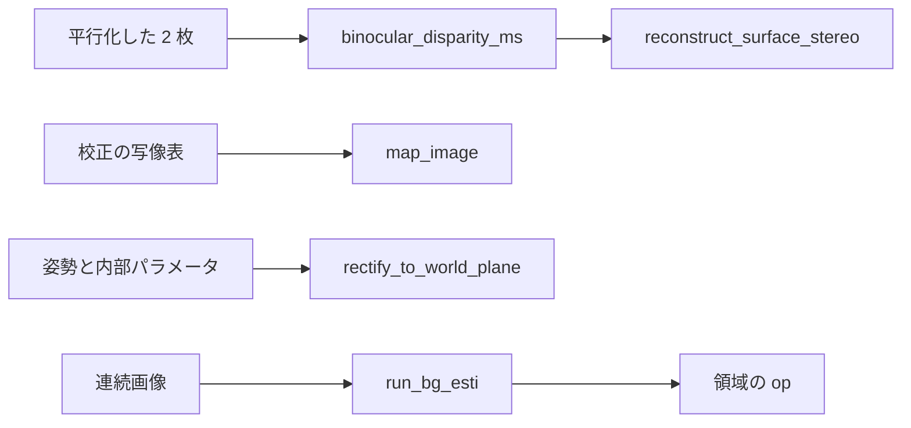

# 工業用ビジョンの定番の演算 — 使い方ガイド

## この族は何をする道具箱か

工業用の画像処理の現場でよく呼ばれる古典の演算を、1 つの台帳にまとめた族です。47 op / 10 カテゴリ
(numpy と scipy のみ。台帳は `opsmv.py`、実体は `mvimage.py` / `mvstereo.py` / `mvmorph.py` /
`mvtrack.py` / `mvclass.py` / `mvtext.py` と既存のモジュール)。

- **stereo(3)** — `binocular_disparity_ms` / `binocular_distance_ms` /
  `reconstruct_surface_stereo`: 平行化した 2 枚 → 視差 → 距離 → 点群。無効の画素は NaN。
- **resample(4)** — `map_image` / `rectify_to_world_plane` / `change_radial_distortion_image` /
  `crop_rectangle2`: 写像の適用、平面の正面図、除算モデルの歪みの変換、回転矩形の切り出し。
- **gray(5)** — `atan2_image` / `area_center_gray` / `gray_histo` / `gray_projections` /
  `get_grayval_contour_xld`: 灰色値を重みにした計測と、輪郭に沿った読み取り。
- **detect(3)** — `points_lepetit` / `create_ncc_model` / `find_ncc_models`: 注目点と複数テンプレート。
- **pose(1)** — `get_circle_pose`: 楕円の像から 3-D の円(解は 2 つ)。
- **morphology(9)** — `golay_elements` / `hit_or_miss_golay` / `hit_or_miss_seq` / `thickening_hit_miss` /
  `thickening_golay` / `thickening_seq` / `morph_hat` / `morph_skiz` / `opening_seg`。
- **curve(1)** — `gen_nurbs_interp`: 点列を全部通る B スプライン。`nurbs_curve` へ渡せる。
- **tracking(5)** — `filter_kalman` / `create_bg_esti` / `run_bg_esti` / `give_bg_esti` /
  `update_bg_esti`: カルマンの 1 周期と画素ごとの背景推定。
- **classify(12)** — `train_class_gmm` / `classify_class_gmm` / `evaluate_class_gmm` /
  `train_class_knn` / `classify_class_knn` / `train_class_mlp` / `classify_class_mlp` /
  `train_class_svm` / `classify_class_svm` /
  `create_lexicon` / `lookup_lexicon` / `suggest_lexicon`。
- **text(4)** — `text_line_orientation` / `text_line_slant` / `segment_characters` /
  `select_characters`。

## 流れ



## 最初の 1 本

```python
import numpy as np
import fullseye as fs

rng = np.random.default_rng(0)
right = rng.random((48, 96))
left = np.roll(right, 6, axis=1)                     # 真の視差は 6 画素
res = fs.ledger.binocular_disparity_ms(left, right, max_disp=12)
print(float(np.nanmedian(res["disparity"])))         # 6.0
```

## 組み合わせ

- `binocular_disparity_ms` → `reconstruct_surface_stereo`: 返りの `disparity` をそのまま渡す。NaN は
  点を作らない。
- `gen_radial_distortion_map` → `map_image`: 写像表の `row_map` / `col_map` をそのまま適用する。
- `find_caltab` / `find_marks_and_pose` → `rectify_to_world_plane`: 求めた姿勢で平面の正面図を作り、
  画素を実寸で測る。
- `gen_nurbs_interp` → `nurbs_curve`: 点列を通る曲線を任意の密度で標本化する。
- `create_bg_esti` → `run_bg_esti` → `opening_circle` などの領域の op: 前景の `mask` を後段へ渡す。

## 落とし穴

- **`binocular_disparity_ms` の返りは NaN を含む。** 左端の `max_disp` 列と左右一致で落ちた画素は
  無効。平均を取る前に `valid` を見る。
- **`image_to_world_plane` と `rectify_to_world_plane` は別物。** 前者は点を写す校正族の op で、後者が
  画像を平行化する。
- **`gray_projections` は和ではなく平均。** 領域の画素が無い行と列は 0.0 になる。
- **`gray_histo` は `[0, 1]` の外の画素を拒む。** 8 bit の配列は 255 で割ってから渡す。
- **Golay の文字は 5 つだけ。** `l` / `m` / `e` / `i` は教科書の形、`c` はこの repo の定義で、他の
  製品の同名の文字と同じ形かは確かめていない。`thickening_seq(region, "c")` は 4 連結の領域を
  外接矩形まで埋める。凸包ではない。
- **`get_circle_pose` の解は 2 つ。** 1 枚の像からは区別できない。別の手がかりで選ぶ。
- **向きの規約。** `crop_rectangle2` の `phi` はこの repo の矩形と同じで、正だと右へ進むほど行が増える。
  行の軸が下向きなので、反時計回りを正とする慣習とは符号が逆になる。

## 出典

各 op の docstring に論文と教科書を挙げた。Lepetit と Fua(2006)、Hirschmüller(2008)、Lenz と
Fritsch(1990)、Shiu と Ahmad(1989)、Ridder ほか(1995)、Piegl と Tiller(1997)、Serra(1982)、
Soille(2003)。
