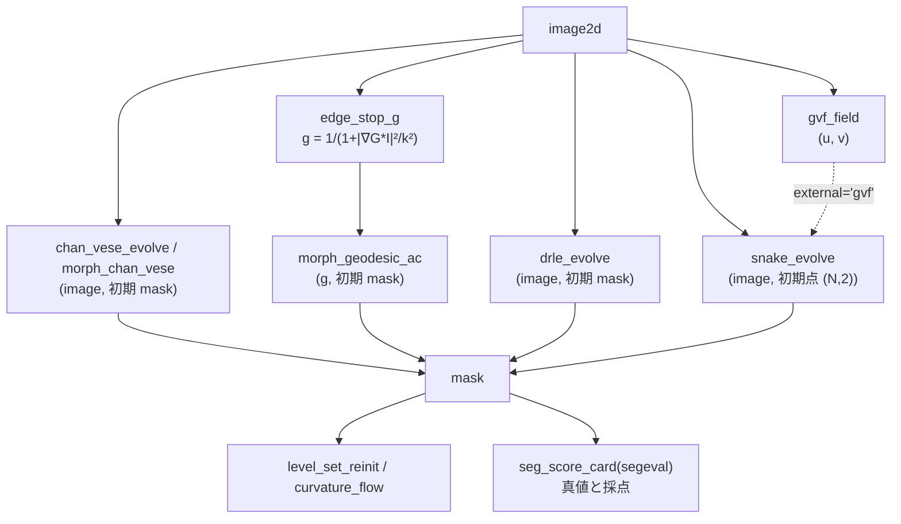

# Variational and active contours, level sets — which contour stops where, and what it guarantees

This is the category **contour** (implementation `segcontour`, 10 op) of the 2nd wave of the segmentation expansion.
Whereas thresholds and watersheds "assign pixels all at once", the methods here **move a curve (or a function φ whose zero level set
is the curve) little by little in the direction in which the energy decreases**. No learned model is involved —— every op
has **a theorem or a 2nd implementation as its gate** (table below).

Conventions (common to all ops): pixel indices are (row, col). Snake points are [row, col] in (N, 2). For level sets,
**φ < 0 is the inside**. If you pass a mask (bool), it is converted to a signed distance by the distance transform before use.
Every op returns a `table` (dict), and for ops that have `mask`, that is the final region. Invalid input raises `ValueError`
(it is not silently fixed).

## The 3 families

- **Parametric (point sequence)** — `snake_evolve`: the semi-implicit update of Kass–Witkin–Terzopoulos 1988,
  x_t = (A + γI)^(-1)(γ x_(t-1) − f_x). The external force is chosen with `external`: `edge` (gradient magnitude) / `gvf` / `potential` / `none`.
  `gvf_field` is the gradient vector flow of Xu–Prince 1998 (a field in which the force is diffused far away from the edges), an external force
  for **pulling the snake into concavities**.
- **Region fitting (without edges)** — `chan_vese_energy` / `chan_vese_evolve` (Chan–Vese 2001.
  The difference from a 2-valued image approximated by the inside and outside means c1, c2 + length), `morph_chan_vese` (the
  morphological approximation of Márquez-Neila et al. 2014, MorphACWE).
- **Stopping at edges (geodesic)** — `edge_stop_g` (g = 1 / (1 + |∇G_σ*I|² / k²), small at edges),
  `morph_geodesic_ac` (morphological GAC, MorphGAC. Its input is g), `drle_evolve` (the distance-regularized
  level set of Li et al. 2010, without reinitialization).
- **Level-set tools** — `level_set_reinit` (turns φ into the signed distance with the same zero level set, Sussman et al. 1994 +
  Russo–Smereka 2000), `curvature_flow` (mean curvature flow. The area of a closed curve decreases as dA/dt = −2π).

## Gates (what is guaranteed and what is not)

| op | Gate (where the ground truth comes from) | What is not guaranteed |
|---|---|---|
| `snake_evolve` | With external force 0, a circle's radius is multiplied by γ/(γ + λ₁) in 1 iteration (eigenvalue of a circulant matrix, exact). If γ ≥ L (the Lipschitz constant of the external force), the energy is monotonically non-increasing (descent lemma). 2nd implementation = skimage `active_contour` | With γ < L, `max_px_move` or `resample_every`, monotonicity breaks (measured in `n_increase`) |
| `gvf_field` | The Euler equation is linear → solved in 2 ways, by a direct sparse solve and by iteration, with residual ≈ 0 and agreement | The stability condition for the time step is from memory (`method="direct"` is recommended) |
| `chan_vese_*` | Exact gradient of the discrete energy + Armijo backtracking gives monotonic non-increase. The convex-relaxation version returns the duality gap | The paper itself does not claim monotonic decrease (it is a property of the discretization here) |
| `morph_*` | Across the data step, the fitting energy is monotonically non-increasing (separable per pixel). 2nd implementation = the skimage functions of the same name | The smoothing step can raise the energy (the measured value is returned) |
| `level_set_reinit` | Within the band \|∇φ\| ≈ 1, Hausdorff of the zero level set ≤ 1 px, agreement with the signed distance of the distance transform | Values outside the band |
| `drle_evolve` | Measures and returns quantiles of \|∇φ\| near the zero level set (checking Li's claim that "the shape of a distance function is preserved") | The energy can increase because of the explicit step (`n_increase`) |
| `curvature_flow` | dA/dt = −2π (turning number 1, even if not convex); for a circle r² = r₀² − 2t | After the time at which the curve vanishes |

## Flow



## Shortest usage

```python
import numpy as np
import fullseye as fs

yy, xx = np.mgrid[0:64, 0:64]
truth = (yy - 32) ** 2 + (xx - 31) ** 2 <= 14 ** 2           # 半径 14 の円盤(真値)
img = 0.2 + 0.6 * truth                                       # 明るい円盤

init = np.zeros((64, 64), bool)
init[10:50, 12:52] = True                                     # 食い違う四角から始める
cv = fs.ledger.chan_vese_evolve(img, init, n_iter=60)          # 縁を使わない当てはめ
assert cv["n_increase"] == 0                                  # エネルギーは 1 度も増えない

g = fs.ledger.edge_stop_g(img, sigma=1.0, k=0.1)["g"]         # 縁で小さい画像
outer = np.pad(np.ones((56, 56), bool), 4)                   # 外から囲んで縮める
gac = fs.ledger.morph_geodesic_ac(g, outer, n_iter=150, balloon=-1.0, threshold=0.5)
# ★threshold を省くと(auto = g の 40 % 点)、平坦な合成画像では g ≡ 1 が 4 割を超えて閾値 = 1 になり
#   風船が一度も働かない —— 輪郭は初期の四角のまま止まる(下の症状表)。

for m in (cv["mask"], gac["mask"]):
    card = fs.ledger.seg_score_card(m.astype(int), truth.astype(int))
    assert card["dice"] > 0.95

flow = fs.ledger.curvature_flow(truth, t_end=20.0)            # 面積は dA/dt = −2π で減る
assert abs(flow["area_rate"] - flow["area_rate_theory"]) < 0.05 * abs(flow["area_rate_theory"])
```

## Symptom → cause

| Symptom | Cause | Remedy |
|---|---|---|
| The snake does not enter a concavity (the inside of a U shape) | The gradient external force exists only near the edges (the phenomenon in the figure of Xu–Prince 1998) | Use `gvf_field` as the external force (`external="gvf"`), or re-place the points with `resample_every` |
| The snake shrinks into a point before reaching the edge | Where the external force does not reach, only the internal energy (α, β) acts, and a circle shrinks by a factor of γ/(γ+λ₁) each step | Bring the initial contour closer to the edge, raise `sigma` to widen the reach of the external force, raise `kappa` |
| The snake's energy increases (`n_increase` > 0) | γ < L (`gamma_ge_lipschitz` is False), or `max_px_move` destroyed the property of the proximal gradient | Make γ at least `lipschitz` |
| Chan–Vese takes a whole half because of an illumination gradient | The global 2-means sees uneven illumination as "2 regions" (the limit of methods that do not use edges) | Use the edge-stopping `morph_geodesic_ac` / `drle_evolve`, or apply flat-field correction first |
| Touching grains become 1 region | Contour methods have only 2 phases (inside and outside) and no force to split between grains | Split the resulting mask with a watershed (`watersheds_marker`) or `blob_split` |
| `level_set_reinit` / `curvature_flow` raise `ValueError` | φ does not have both an inside (φ < 0) and an outside (a uniform image was passed as φ) | Pass a mask (containing both inside and outside) |
| `drle_evolve` raises `ValueError` (CFL) | μ·dt ≥ 1/4 | Set `mu` to the default (0.2/dt), lower `dt` |
| The GAC contour stays as initialized and does not move even 1 pixel | `threshold="auto"` (the 40 % point of g) becomes 1 on a flat background, and there are no pixels where the balloon acts (g > threshold/\|balloon\|) | Give `threshold` as a number (e.g. 0.5). Be suspicious if the returned `threshold` is 1.0 |
| GAC spreads over the whole image / vanishes | The sign of the balloon `balloon` is opposite to how the initial contour was placed | Negative (shrink) if enclosing from outside, positive (inflate) if placed inside |

## Primary sources

- Kass, Witkin, Terzopoulos 1988, "Snakes: Active contour models": <https://doi.org/10.1007/BF00133570>
- Xu, Prince 1998, "Snakes, shapes, and gradient vector flow": <https://doi.org/10.1109/83.661186>
- Chan, Vese 2001, "Active contours without edges": <https://doi.org/10.1109/83.902291>
- Caselles, Kimmel, Sapiro 1997, "Geodesic active contours": <https://doi.org/10.1023/A:1007979827043>
- Márquez-Neila, Baumela, Álvarez 2014, "A morphological approach to curvature-based evolution of curves and surfaces": <https://doi.org/10.1109/TPAMI.2013.106>
- Sussman, Smereka, Osher 1994, "A level set approach for computing solutions to incompressible two-phase flow": <https://doi.org/10.1006/jcph.1994.1155>
- Russo, Smereka 2000, "A remark on computing distance functions": <https://doi.org/10.1006/jcph.1999.6345>
- Li, Xu, Gui, Fox 2010, "Distance regularized level set evolution and its application to image segmentation": <https://doi.org/10.1109/TIP.2010.2069690>
- Gage, Hamilton 1986, "The heat equation shrinking convex plane curves": <https://doi.org/10.4310/jdg/1214439902>
- Grayson 1987, "The heat equation shrinks embedded plane curves to round points": <https://doi.org/10.4310/jdg/1214441371>

The docstring of `segcontour` separates the formulas checked against the original papers' typeset pages from the places that rest only on secondary sources or memory
(the stability condition for the GVF time step, the wording of the equivalence of the morphological operators with the PDE, the source of the CFL condition of DRLSE).

## Related

- `segeval` (the scoring yardstick) and `segworld` (synthetic worlds with ground truth): the `segmentation_scoring_and_worlds` guide.
  The limits of contour methods (illumination gradients, shadows, touching grains) become visible in numbers on the synthetic worlds (PoC `examples/poc_active_contours.py`).
- The existing `sk_chan_vese` (2-D registry, skimage's Chan–Vese): the reference against which `chan_vese_evolve` is checked.
- The 9 op of the HALCON Segmentation chapter (the `halcon_segmentation` guide): the side that assigns pixels all at once.
