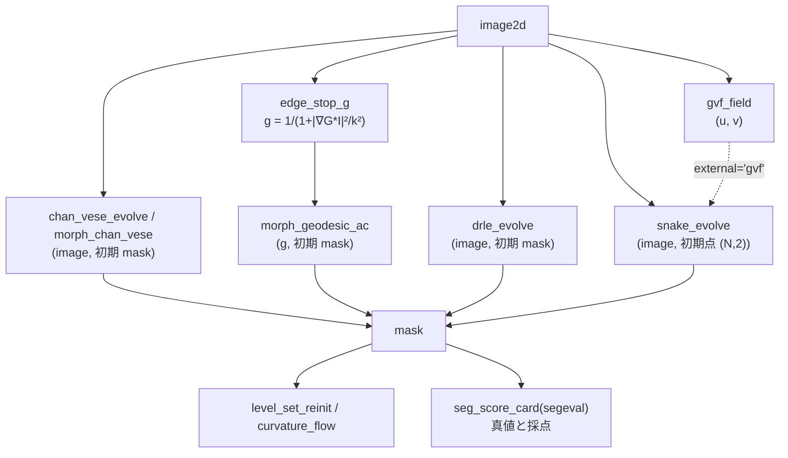

# 变分、主动轮廓与水平集 —— 哪种轮廓停在哪里、保证什么

这是分割扩充第 2 批的类别 **contour**(实现为 `segcontour`,10 op)。
阈值和分水岭是"一次性地给像素分类",而这里的方法是**把曲线(或以曲线为零水平集的
函数 φ)沿能量下降的方向一点点移动**。不使用学习器 —— 每个 op
都有**定理或第 2 实现作为门**(见下表)。

约定(所有 op 通用): 像素下标为 (row, col)。snake 的点为 (N, 2) 的 [row, col]。水平集中
**φ < 0 为内侧**。传入掩膜(bool)时,先用距离变换转换为有符号距离再使用。
返回值都是 `table`(dict),带有 `mask` 的 op 中它就是最终的区域。输入不合法时抛出 `ValueError`
(不会悄悄修正)。

## 3 类方法

- **参数化(点列)** —— `snake_evolve`: Kass–Witkin–Terzopoulos 1988 的半隐式更新
  x_t = (A + γI)^(-1)(γ x_(t-1) − f_x)。外力用 `external` 选择: `edge`(梯度大小)/ `gvf` / `potential` / `none`。
  `gvf_field` 是 Xu–Prince 1998 的梯度向量流(把力扩散到远离边缘处的场),是用来
  **把 snake 拉进凹陷处**的外力。
- **区域拟合(不使用边缘)** —— `chan_vese_energy` / `chan_vese_evolve`(Chan–Vese 2001。
  与用内外均值 c1・c2 近似的 2 值图像之差 + 长度)、`morph_chan_vese`(Márquez-Neila 等 2014 的
  形态学近似,MorphACWE)。
- **在边缘处停止(测地)** —— `edge_stop_g`(g = 1 / (1 + |∇G_σ*I|² / k²),在边缘处较小)、
  `morph_geodesic_ac`(形态学 GAC,MorphGAC。输入为 g)、`drle_evolve`(Li 等 2010 的距离正则化
  水平集,无需重新初始化)。
- **水平集工具** —— `level_set_reinit`(把 φ 转换为零水平集相同的有符号距离,Sussman 等 1994 +
  Russo–Smereka 2000)、`curvature_flow`(平均曲率流。闭曲线的面积按 dA/dt = −2π 减少)。

## 门(保证什么、不保证什么)

| op | 门(真值的来源) | 不保证的内容 |
|---|---|---|
| `snake_evolve` | 外力为 0 的圆在 1 次迭代中半径变为 γ/(γ + λ₁) 倍(循环矩阵的特征值,严格)。若 γ ≥ L(外力的 Lipschitz 常数),能量单调不增(下降引理)。第 2 实现 = skimage `active_contour` | 使用 γ < L・`max_px_move`・`resample_every` 时单调性会中断(实测值见 `n_increase`) |
| `gvf_field` | Euler 方程是线性的 → 用稀疏矩阵直接求解和迭代 2 种方式求解,残差 ≈ 0 且两者一致 | 时间步长的稳定条件依据记忆(推荐 `method="direct"`) |
| `chan_vese_*` | 离散能量的精确梯度 + Armijo 回溯,保证单调不增。凸松弛版返回对偶间隙 | 论文本身并未主张单调减少(这是此处离散化的性质) |
| `morph_*` | 数据步前后拟合能量单调不增(按像素可分离)。第 2 实现 = skimage 的同名函数 | 平滑步可能使能量上升(返回实测值) |
| `level_set_reinit` | 窄带内 \|∇φ\| ≈ 1,零水平集的 Hausdorff ≤ 1 px,与距离变换的有符号距离一致 | 窄带外的值 |
| `drle_evolve` | 测量并返回零水平集附近 \|∇φ\| 的分位数(确认 Li 的主张"保持距离函数的形状") | 由于是显式步长,能量有时会增加(`n_increase`) |
| `curvature_flow` | dA/dt = −2π(旋转数 1,即使非凸),圆的情况 r² = r₀² − 2t | 曲线消失时刻之后 |

## 流程



## 最简用法

```python
import numpy as np
import fullseye as fs

yy, xx = np.mgrid[0:64, 0:64]
truth = (yy - 32) ** 2 + (xx - 31) ** 2 <= 14 ** 2           # 半径 14 の円盤(真値)
img = 0.2 + 0.6 * truth                                       # 明るい円盤

init = np.zeros((64, 64), bool)
init[10:50, 12:52] = True                                     # 食い違う四角から始める
cv = fs.ledger.chan_vese_evolve(img, init, n_iter=60)          # 縁を使わない当てはめ
assert cv["n_increase"] == 0                                  # エネルギーは 1 度も増えない

g = fs.ledger.edge_stop_g(img, sigma=1.0, k=0.1)["g"]         # 縁で小さい画像
outer = np.pad(np.ones((56, 56), bool), 4)                   # 外から囲んで縮める
gac = fs.ledger.morph_geodesic_ac(g, outer, n_iter=150, balloon=-1.0, threshold=0.5)
# ★threshold を省くと(auto = g の 40 % 点)、平坦な合成画像では g ≡ 1 が 4 割を超えて閾値 = 1 になり
#   風船が一度も働かない —— 輪郭は初期の四角のまま止まる(下の症状表)。

for m in (cv["mask"], gac["mask"]):
    card = fs.ledger.seg_score_card(m.astype(int), truth.astype(int))
    assert card["dice"] > 0.95

flow = fs.ledger.curvature_flow(truth, t_end=20.0)            # 面積は dA/dt = −2π で減る
assert abs(flow["area_rate"] - flow["area_rate_theory"]) < 0.05 * abs(flow["area_rate_theory"])
```

## 症状 → 原因

| 症状 | 原因 | 对策 |
|---|---|---|
| snake 进不了凹陷处(U 字形的内侧) | 梯度外力只存在于边缘附近(Xu–Prince 1998 图中的现象) | 用 `gvf_field` 作外力(`external="gvf"`),或用 `resample_every` 重新布点 |
| snake 在到达边缘之前就缩成一个点 | 在外力达不到的地方只有内部能量(α・β)起作用,圆每次缩为 γ/(γ+λ₁) 倍 | 让初始轮廓靠近边缘、增大 `sigma` 扩大外力的作用范围、增大 `kappa` |
| snake 的能量增加(`n_increase` > 0) | γ < L(`gamma_ge_lipschitz` 为 False),或 `max_px_move` 破坏了近端梯度的性质 | 使 γ 不小于 `lipschitz` |
| Chan–Vese 因照明梯度把一整半区域都划进去 | 全局的 2 均值把照明不均看作"2 个区域"(不使用边缘的方法的局限) | 用在边缘处停止的 `morph_geodesic_ac` / `drle_evolve`,或先做平场校正 |
| 相互接触的颗粒变成 1 个区域 | 轮廓法只有 2 相(内与外),没有把颗粒之间分开的力 | 用分水岭(`watersheds_marker`)或 `blob_split` 分割结果 mask |
| `level_set_reinit` / `curvature_flow` 抛出 `ValueError` | φ 没有同时包含内侧(φ < 0)和外侧(把均匀图像当作 φ 传入) | 传入掩膜(同时包含内外) |
| `drle_evolve` 抛出 `ValueError`(CFL) | μ·dt ≥ 1/4 | 把 `mu` 设为默认值(0.2/dt)、减小 `dt` |
| GAC 的轮廓保持初始状态,1 个像素也不动 | `threshold="auto"`(g 的 40 % 分位点)在平坦背景下变为 1,不存在气球力起作用的像素(g > threshold/\|balloon\|) | 用数值给出 `threshold`(例如 0.5)。若返回的 `threshold` 为 1.0 就要怀疑 |
| GAC 扩展到全图 / 消失 | 气球 `balloon` 的符号与初始放置方式相反 | 从外侧包围时取负(收缩),放在内侧时取正(膨胀) |

## 一手资料

- Kass, Witkin, Terzopoulos 1988, "Snakes: Active contour models": <https://doi.org/10.1007/BF00133570>
- Xu, Prince 1998, "Snakes, shapes, and gradient vector flow": <https://doi.org/10.1109/83.661186>
- Chan, Vese 2001, "Active contours without edges": <https://doi.org/10.1109/83.902291>
- Caselles, Kimmel, Sapiro 1997, "Geodesic active contours": <https://doi.org/10.1023/A:1007979827043>
- Márquez-Neila, Baumela, Álvarez 2014, "A morphological approach to curvature-based evolution of curves and surfaces": <https://doi.org/10.1109/TPAMI.2013.106>
- Sussman, Smereka, Osher 1994, "A level set approach for computing solutions to incompressible two-phase flow": <https://doi.org/10.1006/jcph.1994.1155>
- Russo, Smereka 2000, "A remark on computing distance functions": <https://doi.org/10.1006/jcph.1999.6345>
- Li, Xu, Gui, Fox 2010, "Distance regularized level set evolution and its application to image segmentation": <https://doi.org/10.1109/TIP.2010.2069690>
- Gage, Hamilton 1986, "The heat equation shrinking convex plane curves": <https://doi.org/10.4310/jdg/1214439902>
- Grayson 1987, "The heat equation shrinks embedded plane curves to round points": <https://doi.org/10.4310/jdg/1214441371>

`segcontour` 的 docstring 中,把已对照原论文版面确认的公式,与仅停留在二手资料・记忆的部分(GVF 时间步长的
稳定条件、形态学算子与 PDE 等价性的表述、DRLSE 的 CFL 条件的出处)分开写明。

## 相关

- `segeval`(评分的尺子)与 `segworld`(带真值的合成世界): `segmentation_scoring_and_worlds` 指南。
  轮廓法的局限(照明梯度・阴影・相互接触的颗粒)在合成世界上可以用数值看出来(PoC `examples/poc_active_contours.py`)。
- 已有的 `sk_chan_vese`(2-D 注册表,skimage 的 Chan–Vese): `chan_vese_evolve` 的对照对象。
- HALCON Segmentation 章的 9 op(`halcon_segmentation` 指南): 一次性给像素分类的一方。
