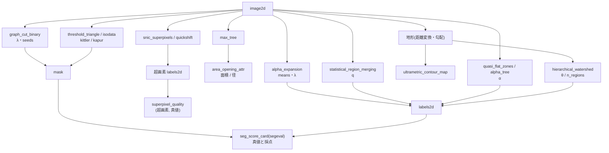

# Segmentation from graph, hierarchy and threshold theorems — what is exact, and where the partition breaks down

These are the categories **graph** (12 op) and **threshold** (4 op) of the 3rd wave of the segmentation expansion. Both are implemented in
`seggraph`. No learned model is involved (rule-based numpy + scipy). Every op has **a theorem or a 2nd implementation as its gate**,
and those gates are written in the table below.

Conventions (common to all ops): pixel indices are (row, col). The edges of the 4-neighbourhood are held as 2 arrays, "right" and "down". Label images are int64 and
numbered **from 1** (0 = outside the mask / background). 2-valued results are a bool `mask`. Every op returns a `table` (dict), and
invalid input raises `ValueError` (it is not silently fixed). No random numbers are used (ties in quick shift are broken by pixel index).
The number of pixels per 1 image is limited to `MAX_PIXELS` = 1,000,000 (Union-Find / queues run in Python, so larger inputs are refused up front).

## The 4 families

- **Energy minimization (graph cut)** — `graph_cut_binary`: minimizes the 2-label E = Σ D_p(x_p) + λ Σ w_pq [x_p ≠ x_q]
  **exactly** by a minimum cut of an s-t graph (Boykov–Jolly 2001). It can be hard-constrained with `seeds` (labels2d, 1 = background, 2 = object).
  `alpha_expansion`: the multi-label version. For each label α it solves the 2-label move "switch / do not switch" exactly by graph cut,
  and accepts it only when the energy goes down (Boykov–Veksler–Zabih 2001). Not a global solution but a local solution with the guarantee **E ≤ 2c E\***.
- **Merging and trees (hierarchy)** — `statistical_region_merging` (SRM, Nock–Nielsen 2004): joins neighbours with a merging predicate in ascending order of their difference.
  `max_tree` / `area_opening_attr`: builds the component tree and removes nodes with small area (or bounding-box diameter) — an attribute opening
  (Salembier et al. 1998). `quasi_flat_zones` / `alpha_tree`: equivalence classes of pixels that can be joined by a path whose neighbour differences are at most α (Soille 2008).
- **Hierarchy of the relief (watershed)** — `hierarchical_watershed`: attaches dynamics (the depth of the shallower basin) to the edges of the minimum spanning forest,
  and joins along edges at or below the threshold θ (Najman–Schmitt 1996, Cousty et al. 2009). `ultrametric_contour_map`: a map (UCM) that holds, as the edge strength, the
  "smallest θ at which 2 adjacent pixels end up in the same region". **The partitions for all θ can be read from 1 tree**.
- **Superpixels and scoring** — `snic_superpixels` (Achanta–Süsstrunk 2017, non-iterative), `quickshift` (Vedaldi–Soatto 2008),
  `superpixel_quality` (boundary recall, CUSE, ASA, UE; from 2 labels2d, the superpixels and the ground truth).
- **Thresholds (threshold category)** — `threshold_triangle` (Zack et al. 1977) / `threshold_isodata` (Ridler–Calvard 1978) /
  `threshold_kittler` (Kittler–Illingworth 1986, minimum error) / `threshold_kapur` (Kapur–Sahoo–Wong 1985, maximum entropy).
  Each returns, in addition to `threshold` and `mask`, **the criterion curve** (distance, J, H) —— so the basis of the threshold can be inspected afterwards.

## Gates (what is guaranteed and what is not)

| op | Gate (where the ground truth comes from) | What is not guaranteed |
|---|---|---|
| `graph_cut_binary` | Max flow = min cut (exact agreement with integer capacities, `flow_value_int` = `cut_value_int`), cut value + constant = energy, agreement with the brute-force minimum at 12 pixels or fewer, per-pixel decision at λ = 0 | Real-valued input is minimized as an integer energy scaled by `scale` and rounded → the gap to the real-valued minimum is at most `quantization_bound` (returned) |
| `alpha_expansion` | The sequence of accepted values `energies` is monotonically decreasing, the 2-label minimum of each move ≤ the current value, E ≤ 2c E\* (BVZ 2001 Theorem 6.1, Potts c = 1) | A global solution. In the PoC's 3×3 trap, E = 72 / E\* = 57 (ratio 1.26, inside the upper bound 2) |
| `statistical_region_merging` | None (the coefficients of the predicate and the wording of the error-bound theorem could not be confirmed in the original paper) | Monotonicity of the number of regions with respect to q —— returned only as a measurement, not used as a gate |
| `max_tree` / `area_opening_attr` | The opening is idempotent, anti-extensive and increasing (a connected opening by an increasing attribute is an algebraic opening); pixel-exact agreement and agreement in node count with skimage's `area_opening` / `diameter_opening` | Non-increasing attributes (this op accepts only area and diameter) |
| `quasi_flat_zones` / `alpha_tree` | "Connected components after dropping edges with difference > α" = "connected components of the edges of the minimum spanning tree with weight ≤ α" (the cut property of the minimum spanning tree); nested as α increases | When α is large, **the chaining effect** connects everything along gradients (a property of α-connectivity itself) |
| `hierarchical_watershed` / `ultrametric_contour_map` | The distance between basins is an ultrametric (d(x, z) ≤ max(d(x, y), d(y, z)) for all 3-tuples), nested as θ increases, number of surviving basins = number of minima with dynamics > θ | How the relief is built (distance transform, gradient magnitude …) is the caller's responsibility |
| `snic_superpixels` / `quickshift` | All SNIC labels are 4-connected (counted and returned as `all_connected`), quick shift is nested as τ (`max_dist`) increases, 2nd implementation = skimage `slic` / `quickshift` with close boundary recall | The form of the SNIC distance is the squared (2nd-power) form of SLIC (the extraction of equation (1) of the paper is garbled and needs checking) |
| `threshold_isodata` | Satisfies the fixed point t = (μ_≤t + μ_>t)/2 exactly **on the pixels** (residual `residual` = 0), within 1 bin of skimage | Images with an illumination gradient (symptom table below) |
| `threshold_triangle` | Within 1 bin of skimage | The endpoint height 0 and the choice of the tail side follow the skimage / ImageJ convention (the original needs checking) |
| `threshold_kittler` | Within 2.5 bins of the Bayes minimum-error threshold (root of a 2nd-order equation) for a mixture of 2 Gaussians, within a few bins of SimpleITK (if present) | The position within an interval where J is flat (empty bins) (ties go to the first bin) |
| `threshold_kapur` | Agreement with the brute-force maximum entropy, within a few bins of SimpleITK (if present) | Same as above |

## Flow



## Shortest usage

```python
import numpy as np
import fullseye as fs

rng = np.random.default_rng(0)
yy, xx = np.mgrid[0:64, 0:64]
truth = (yy - 32) ** 2 + (xx - 30) ** 2 <= 15 ** 2                 # 半径 15 の円盤(真値)
img = np.clip(0.2 + 0.55 * truth + 0.12 * rng.standard_normal((64, 64)), 0.0, 1.0)

gc = fs.ledger.graph_cut_binary(img, lam=0.1)                        # 平滑項つきの 2 値化(厳密な最小)
assert gc["flow_value_int"] == gc["cut_value_int"]                  # 最大フロー = 最小カット
iso = fs.ledger.threshold_isodata(img)
assert iso["residual"] == 0.0                                       # 画素の上の不動点
for m in (gc["mask"], iso["mask"]):
    card = fs.ledger.seg_score_card(m.astype(int), truth.astype(int))
    print(round(card["dice"], 3))                                   # graph cut のほうが雑音に強い

# 地形の階層: 距離変換の窪みを盆地にして、θ を振らずに「2 領域になる最小の θ」を引く
from scipy import ndimage as ndi
two = ((yy - 32) ** 2 + (xx - 22) ** 2 <= 100) | ((yy - 32) ** 2 + (xx - 41) ** 2 <= 100)
relief = -ndi.distance_transform_edt(two)
hw = fs.ledger.hierarchical_watershed(relief, n_regions=2, mask=two)
assert hw["n_regions"] == 2                                         # 触れ合う 2 粒がくびれで割れる

sp = fs.ledger.snic_superpixels(img, n_segments=64)
assert sp["all_connected"]                                          # SNIC の構成上の保証(数えて確かめる)
q = fs.ledger.superpixel_quality(sp["labels"], truth.astype(int))
print(round(q["boundary_recall"], 3), round(q["cuse"], 3))
```

## Symptom → cause

| Symptom | Cause | Remedy |
|---|---|---|
| Raising λ in graph cut removed the noise, but also removed thin lines (width 1 to 3 px) | The smoothness term does not distinguish "thin objects" from "noise" (it only penalizes edge length). In the PoC, λ = 0.1 gives grain Dice +0.13 and line Dice −0.11 to −0.15 | Lower the penalty where edges are strong with `contrast_sigma`, constrain thin objects with `seeds`, or pick them up with another op (ridge detection) |
| `alpha_expansion` stays at the per-pixel decision and does not move even 1 time (`n_accepted` = 0) | The noise is small compared with the step differences, and the per-pixel decision is already the minimum. Or λ is too small | Not an anomaly. Look at `energies` and `move_minima`; raise λ if you want to try the smoothness term |
| The result of `alpha_expansion` is worse than the global solution | Expansion gives a local solution (only the guarantee E ≤ 2c E\*). 1 move expands only 1 label, so there are local solutions that cannot be escaped without moving 2 labels at the same time (the PoC's 3×3, λ = 12: every pixel stops at label 2 with E = 72, global solution 57) | Rerun with a different `init` and take the smaller, review `pairwise` / λ. The ratio never exceeds the upper bound `bound_factor` |
| SRM merges 2 regions of different texture into 1 at every q | The predicate looks only at **the region means**. A world where the means are the same and only the texture differs cannot be split (in the PoC, for all 3 seeds it does no better than "everything in 1 region") | First build an image of local variance or texture features and pass that |
| SRM raises `ValueError` (out of range) | Pixel values are mapped to [0, g − 1] with `value_range` (default (0, 1)). Values outside the range are not silently clipped | Set `value_range` to the actual range of the image |
| With an illumination gradient, isodata takes a whole half | Isodata is the midpoint of the means of 2 groups. With a gradient, the "bright side" and the "dark side" become the 2 groups (Dice 0.29 to 0.41 in the PoC) | Kittler (keeps the variances of the 2 groups separately; Dice 0.93 to 0.99 in the same world), or flat-field correction first |
| The triangle and Kapur thresholds stick to the foot of the background peak | The triangle method takes "the bin farthest from the line joining the peak and the end of the tail", Kapur the sum of entropies —— both tend to be decided at the foot of a large peak. If the two peaks are clearly separated, all 4 methods give Dice ≥ 0.95 | Accept that they are tools for images with small objects and a large background peak. For bimodal images use isodata / Kittler |
| The Kittler / Kapur threshold differs greatly from SimpleITK, but `mask` is the same | If empty bins continue between the 2 peaks, J / H is flat over that interval (any split there gives the same partition). Here **the first bin** is taken (measured: 0.29 and 0.47 on a 2-level image with noise 0.03, identical masks) | Compare `mask` and the criterion curve (`criterion` / `entropy`), not the threshold value |
| The hierarchical watershed splits into more regions than grains at θ = 0 | The distance-transform relief has shallow spurious minima (over-segmentation). In the PoC, 10 grains give 19 regions at θ = 0 | Raise θ (in the PoC, θ = 0.5 to 3.5 gives exactly the number of grains), or give the number with `n_regions` |
| The hierarchical watershed merges grains into 1 at a large θ | Basins with dynamics at or below θ are merged (under-segmentation). 1 region at θ = 8 | Look at `ultrametric_contour_map` and choose the band of θ in which the number of grains is stable |
| Quick shift gives 1 region over the whole image | The features are (y, x, ratio·I). With ratio = 1, the brightness step (0..1) is smaller than 1 pixel in space, so the branches are not cut at the step | Raise `ratio` (for a step of 0.55, ratio 20 gives 11), lower `max_dist` |
| No method can extract a part that has a shadow (Dice < 0.5) | Shadows and dark faces cannot be distinguished from the part by brightness (the same limit as in the 1st and 2nd waves) | Change the lighting, estimate the shadow separately. Outside the ops of this layer |
| Every op raises `ValueError` (MAX_PIXELS) | Input exceeding 1,000,000 pixels per 1 image is refused up front (because Python loops are run) | Downscale, or crop a region of interest |

## Primary sources

- Boykov, Jolly 2001, "Interactive graph cuts for optimal boundary & region segmentation of objects in N-D images": <https://doi.org/10.1109/ICCV.2001.937505>
- Boykov, Veksler, Zabih 2001, "Fast approximate energy minimization via graph cuts": <https://doi.org/10.1109/34.969114>
- Nock, Nielsen 2004, "Statistical region merging": <https://doi.org/10.1109/TPAMI.2004.110>
- Salembier, Oliveras, Garrido 1998, "Antiextensive connected operators for image and sequence processing": <https://doi.org/10.1109/83.663500>
- Najman, Couprie 2006, "Building the component tree in quasi-linear time": <https://doi.org/10.1109/TIP.2006.877518>
- Soille 2008, "Constrained connectivity for hierarchical image partitioning and simplification": <https://doi.org/10.1109/TPAMI.2007.70817>
- Najman, Schmitt 1996, "Geodesic saliency of watershed contours and hierarchical segmentation": <https://doi.org/10.1109/34.546254>
- Cousty, Bertrand, Najman, Couprie 2009, "Watershed cuts: minimum spanning forests and the drop of water principle": <https://doi.org/10.1109/TPAMI.2008.173>
- Achanta, Süsstrunk 2017, "Superpixels and polygons using simple non-iterative clustering": <https://doi.org/10.1109/CVPR.2017.520>
- Vedaldi, Soatto 2008, "Quick shift and kernel methods for mode seeking": <https://doi.org/10.1007/978-3-540-88693-8_52>
- Zack, Rogers, Latt 1977, "Automatic measurement of sister chromatid exchange frequency" (triangle method): <https://doi.org/10.1177/25.7.70454>
- Ridler, Calvard 1978, "Picture thresholding using an iterative selection method": <https://doi.org/10.1109/TSMC.1978.4310039>
- Kittler, Illingworth 1986, "Minimum error thresholding": <https://doi.org/10.1016/0031-3203(86)90030-0>
- Kapur, Sahoo, Wong 1985, "A new method for gray-level picture thresholding using the entropy of the histogram": <https://doi.org/10.1016/0734-189X(85)90125-2>

The docstring of `seggraph` separates the formulas checked against the original papers' typeset pages (Theorem 6.1 of BVZ 2001, the weight table of Boykov–Jolly, SNIC's
Algorithm 1 and equation (2) for CUSE, the tree of quick shift) from the places that rest only on memory or widely used implementations (the coefficients of the SRM predicate,
the construction conventions of Kittler / Kapur / the triangle method, the wording of the theorem watershed cut = minimum spanning forest).

## Related

- `segeval` (the scoring yardstick) and `segworld` (synthetic worlds with ground truth): the `segmentation_scoring_and_worlds` guide.
  Which method wins in which world (touching grains, noise and thin lines, texture, illumination gradient) is shown in numbers by the PoC
  `examples/poc_graph_hierarchy_segmentation.py`.
- The existing 2-D registry: `sk_area_opening` (skimage, the reference for `area_opening_attr`), `sk_slic` / `sg_slic_superpixels`
  (SLIC), `binary_threshold` / `auto_threshold` (Otsu), `xsitk_maxentropy_thresh` (SimpleITK's maximum entropy,
  returns only the mask —— `threshold_kapur` is the dependency-free version with the criterion curve).
- Active contours and level sets (the `active_contours_and_level_sets` guide), the 9 op of the HALCON Segmentation chapter
  (the `halcon_segmentation` guide): the other categories of the same ledger `opssegmentation`.
