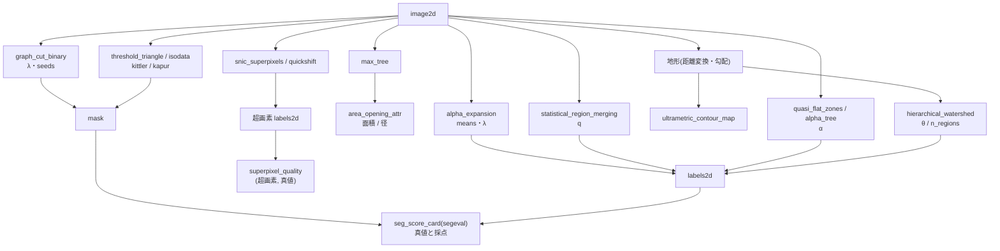

# 用图、层次与阈值定理做分割 —— 什么是严格的,分割在哪里失效

这是分割扩充第 3 批的类别 **graph**(12 op)和 **threshold**(4 op)。两者的实现都在
`seggraph` 中。不使用学习器(numpy + scipy 的基于规则的实现)。每个 op 都有**定理或第 2 实现作为门**,
这些门写在下表中。

约定(所有 op 通用): 像素下标为 (row, col)。4 邻域的边按"右"和"下"分为 2 组。标签图像为 int64,
**从 1 开始**编号(0 = 掩膜之外 / 背景)。2 值结果是 bool 的 `mask`。返回值都是 `table`(dict),
输入不合法时抛出 `ValueError`(不会悄悄修正)。不使用随机数(quick shift 的平局按像素编号决定)。
每 1 幅图像的像素数上限为 `MAX_PIXELS` = 100 万(因为要在 Python 中运行 Union-Find / 队列,所以事先拒绝)。

## 4 类方法

- **能量最小化(图割)** —— `graph_cut_binary`: 用 s-t 图的最小割**严格地**最小化 2 值的 E = Σ D_p(x_p) + λ Σ w_pq [x_p ≠ x_q]
  (Boykov–Jolly 2001)。可以用 `seeds`(labels2d,1 = 背景・2 = 物体)施加硬约束。
  `alpha_expansion`: 多标签版。对每个标签 α,用图割严格求解"换 / 不换"的 2 值移动,
  只在能量下降时接受(Boykov–Veksler–Zabih 2001)。不是全局解,而是带有 **E ≤ 2c E\*** 保证的局部解。
- **合并与树(层次)** —— `statistical_region_merging`(SRM,Nock–Nielsen 2004): 按相邻差值的升序,用合并谓词连接。
  `max_tree` / `area_opening_attr`: 构建成分树,删除面积(或外接矩形的径)较小的节点的属性开运算
  (Salembier 等 1998)。`quasi_flat_zones` / `alpha_tree`: 能通过相邻差值不超过 α 的路径连接的像素的等价类(Soille 2008)。
- **地形的层次(分水岭)** —— `hierarchical_watershed`: 给最小生成森林的边赋予 dynamics(较浅一侧盆地的深度),
  用不超过阈值 θ 的边连接(Najman–Schmitt 1996、Cousty 等 2009)。`ultrametric_contour_map`: 以相邻 2 个像素
  "成为同一区域的最小 θ"作为边缘强度的图(UCM)。**从 1 棵树就能读出所有 θ 下的分割**。
- **超像素与评分** —— `snic_superpixels`(Achanta–Süsstrunk 2017,非迭代)、`quickshift`(Vedaldi–Soatto 2008)、
  `superpixel_quality`(边界召回率・CUSE・ASA・UE,输入为超像素与真值的 2 幅 labels2d)。
- **阈值(threshold 类别)** —— `threshold_triangle`(Zack 等 1977)/ `threshold_isodata`(Ridler–Calvard 1978)/
  `threshold_kittler`(Kittler–Illingworth 1986,最小误差)/ `threshold_kapur`(Kapur–Sahoo–Wong 1985,最大熵)。
  它们除 `threshold`・`mask` 外都返回**判据曲线**(距离・J・H)—— 事后可以查看阈值的依据。

## 门(保证什么、不保证什么)

| op | 门(真值的来源) | 不保证的内容 |
|---|---|---|
| `graph_cut_binary` | 最大流 = 最小割(整数容量下严格一致,`flow_value_int` = `cut_value_int`)、割的值 + 常数 = 能量、在 12 像素以下与穷举的最小值一致、λ = 0 时为逐像素判定 | 实数输入是把乘以 `scale` 倍后取整的整数能量最小化 → 与实数最小值之差不超过 `quantization_bound`(会返回) |
| `alpha_expansion` | 接受序列 `energies` 单调递减、每次移动的 2 值最小值 ≤ 当前值、E ≤ 2c E\*(BVZ 2001 Theorem 6.1,Potts c = 1) | 全局解。PoC 的 3×3 陷阱中 E = 72 / E\* = 57(比值 1.26,在上界 2 以内) |
| `statistical_region_merging` | 无(谓词的系数・误差上界定理的表述未能在原论文中确认) | 区域数对 q 的单调性 —— 只作为实测值返回,不作为门 |
| `max_tree` / `area_opening_attr` | 开运算满足幂等・反扩展・递增(递增属性的连通开运算是代数开运算),与 skimage 的 `area_opening` / `diameter_opening` 像素一致・节点数一致 | 非递增的属性(本 op 只接受面积和径) |
| `quasi_flat_zones` / `alpha_tree` | "去掉差值 > α 的边后的连通成分" = "最小生成树中权重 ≤ α 的边的连通成分"(最小生成树的割性质),α 增大时嵌套 | α 较大时,**链式效应**会沿梯度把全部连在一起(α-连通本身的性质) |
| `hierarchical_watershed` / `ultrametric_contour_map` | 盆地之间的距离是 ultrametric(对所有 3 元组 d(x, z) ≤ max(d(x, y), d(y, z)))、θ 增大时嵌套、存活盆地数 = dynamics > θ 的极小值个数 | 地形的构造方式(距离变换・梯度大小 …)由调用方负责 |
| `snic_superpixels` / `quickshift` | SNIC 的所有标签都是 4-连通(计数后作为 `all_connected` 返回),quick shift 在增大 τ(`max_dist`)时嵌套,第 2 实现 = skimage `slic` / `quickshift`,边界召回率接近 | SNIC 距离的形式是 SLIC 的 2 次方形式(论文式 (1) 的提取有乱码,需要确认) |
| `threshold_isodata` | **在像素上**严格满足不动点 t = (μ_≤t + μ_>t)/2(残差 `residual` = 0),与 skimage 相差 1 个 bin 以内 | 有照明梯度的图像(见下面的症状表) |
| `threshold_triangle` | 与 skimage 相差 1 个 bin 以内 | 端点高度 0・尾部一侧的选择遵循 skimage / ImageJ 的约定(原典需要确认) |
| `threshold_kittler` | 对 2 个高斯的混合,与 Bayes 最小误差阈值(2 次方程的根)相差 2.5 个 bin 以内,与 SimpleITK 相差数个 bin 以内(若可用) | J 平坦的区间(空 bin)中的位置(平局取第一个 bin) |
| `threshold_kapur` | 与穷举的最大熵一致,与 SimpleITK 相差数个 bin 以内(若可用) | 同上 |

## 流程



## 最简用法

```python
import numpy as np
import fullseye as fs

rng = np.random.default_rng(0)
yy, xx = np.mgrid[0:64, 0:64]
truth = (yy - 32) ** 2 + (xx - 30) ** 2 <= 15 ** 2                 # 半径 15 の円盤(真値)
img = np.clip(0.2 + 0.55 * truth + 0.12 * rng.standard_normal((64, 64)), 0.0, 1.0)

gc = fs.ledger.graph_cut_binary(img, lam=0.1)                        # 平滑項つきの 2 値化(厳密な最小)
assert gc["flow_value_int"] == gc["cut_value_int"]                  # 最大フロー = 最小カット
iso = fs.ledger.threshold_isodata(img)
assert iso["residual"] == 0.0                                       # 画素の上の不動点
for m in (gc["mask"], iso["mask"]):
    card = fs.ledger.seg_score_card(m.astype(int), truth.astype(int))
    print(round(card["dice"], 3))                                   # graph cut のほうが雑音に強い

# 地形の階層: 距離変換の窪みを盆地にして、θ を振らずに「2 領域になる最小の θ」を引く
from scipy import ndimage as ndi
two = ((yy - 32) ** 2 + (xx - 22) ** 2 <= 100) | ((yy - 32) ** 2 + (xx - 41) ** 2 <= 100)
relief = -ndi.distance_transform_edt(two)
hw = fs.ledger.hierarchical_watershed(relief, n_regions=2, mask=two)
assert hw["n_regions"] == 2                                         # 触れ合う 2 粒がくびれで割れる

sp = fs.ledger.snic_superpixels(img, n_segments=64)
assert sp["all_connected"]                                          # SNIC の構成上の保証(数えて確かめる)
q = fs.ledger.superpixel_quality(sp["labels"], truth.astype(int))
print(round(q["boundary_recall"], 3), round(q["cuse"], 3))
```

## 症状 → 原因

| 症状 | 原因 | 对策 |
|---|---|---|
| 提高图割的 λ 后噪声消失了,但细线(宽 1〜3 px)也消失了 | 平滑项不区分"细的物体"和"噪声"(只对边缘长度施加惩罚)。PoC 中 λ = 0.1 使颗粒的 Dice +0.13、线的 Dice −0.11〜−0.15 | 用 `contrast_sigma` 降低强边缘处的惩罚、用 `seeds` 约束细的物体,或用别的 op(脊线检测)来拾取 |
| `alpha_expansion` 停留在逐像素判定,1 次也不移动(`n_accepted` = 0) | 噪声相对于台阶差较小,逐像素判定已经是最小值。或者 λ 太小 | 并非异常。查看 `energies` 和 `move_minima`,若想试平滑项就增大 λ |
| `alpha_expansion` 的结果比全局解差 | expansion 是局部解(只有 E ≤ 2c E\* 的保证)。1 次移动只扩展 1 个标签,因此存在不同时移动 2 个标签就无法跳出的局部解(PoC 的 3×3,λ = 12: 全部像素停在标签 2,E = 72,全局解 57) | 改变 `init` 重新运行并取较小者、重新审视 `pairwise` / λ。比值不会超过上界 `bound_factor` |
| SRM 在任何 q 下都把质感不同的 2 个区域合成 1 个 | 谓词只看**区域的均值**。均值相同而只有质感不同的世界无法分开(PoC 中 3 个 seed 都不比"全部为 1 个区域"更好) | 先生成局部方差・纹理特征的图像再传入 |
| SRM 抛出 `ValueError`(超出范围) | 用 `value_range`(默认 (0, 1))把像素值映射到 [0, g − 1]。超出范围的值不会被悄悄截断 | 把 `value_range` 设为图像的实际范围 |
| 照明梯度使 isodata 把一整半区域都划进去 | isodata 取 2 个群的均值的中点。有梯度时"亮的一侧"和"暗的一侧"成为 2 个群(PoC 中 Dice 0.29〜0.41) | Kittler(分别保留 2 个群的方差,在同一世界中 Dice 0.93〜0.99),或先做平场校正 |
| 三角法・Kapur 的阈值贴在背景峰的山脚 | 三角法取"离连接峰顶与尾端的直线最远的 bin",Kapur 取熵之和 —— 两者都容易由大峰的山脚决定。若双峰分明,4 种方法的 Dice 都 ≥ 0.95 | 把它们看作面向物体小・背景峰大的图像的工具。双峰时用 isodata / Kittler |
| Kittler / Kapur 的阈值与 SimpleITK 相差很大,`mask` 却相同 | 2 个峰之间若连续出现空 bin,J / H 在该区间平坦(在哪里分割结果都一样)。这里取**第一个 bin**(实测: 在噪声 0.03 的 2 级图像上为 0.29 和 0.47,掩膜相同) | 不比较阈值的数值,而比较 `mask` 和判据曲线(`criterion` / `entropy`) |
| 层次分水岭在 θ = 0 时分出的区域比颗粒多 | 距离变换的地形中存在浅的伪极小值(过分割)。PoC 中 10 个颗粒在 θ = 0 时为 19 个区域 | 增大 θ(PoC 中 θ = 0.5〜3.5 时恰好等于颗粒数),或用 `n_regions` 给出数目 |
| 层次分水岭在 θ 较大时把颗粒合成 1 个 | dynamics 不超过 θ 的盆地会被合并(欠分割)。θ = 8 时为 1 个区域 | 查看 `ultrametric_contour_map`,选择颗粒数稳定的 θ 区间 |
| quick shift 在全图上只有 1 个区域 | 特征为 (y, x, ratio·I)。ratio = 1 时亮度台阶(0..1)小于空间上的 1 个像素,树枝不会在台阶处切断 | 增大 `ratio`(台阶 0.55 时 ratio 20 得到 11)、减小 `max_dist` |
| 有阴影的零件用任何方法都提取不出来(Dice < 0.5) | 阴影和暗面无法通过亮度与零件区分(与第 1・2 批相同的局限) | 改变照明、单独估计阴影。超出本层 op 的范围 |
| 所有 op 都抛出 `ValueError`(MAX_PIXELS) | 每 1 幅超过 100 万像素的输入会被事先拒绝(因为要运行 Python 循环) | 缩小图像,或裁出感兴趣区域 |

## 一手资料

- Boykov, Jolly 2001, "Interactive graph cuts for optimal boundary & region segmentation of objects in N-D images": <https://doi.org/10.1109/ICCV.2001.937505>
- Boykov, Veksler, Zabih 2001, "Fast approximate energy minimization via graph cuts": <https://doi.org/10.1109/34.969114>
- Nock, Nielsen 2004, "Statistical region merging": <https://doi.org/10.1109/TPAMI.2004.110>
- Salembier, Oliveras, Garrido 1998, "Antiextensive connected operators for image and sequence processing": <https://doi.org/10.1109/83.663500>
- Najman, Couprie 2006, "Building the component tree in quasi-linear time": <https://doi.org/10.1109/TIP.2006.877518>
- Soille 2008, "Constrained connectivity for hierarchical image partitioning and simplification": <https://doi.org/10.1109/TPAMI.2007.70817>
- Najman, Schmitt 1996, "Geodesic saliency of watershed contours and hierarchical segmentation": <https://doi.org/10.1109/34.546254>
- Cousty, Bertrand, Najman, Couprie 2009, "Watershed cuts: minimum spanning forests and the drop of water principle": <https://doi.org/10.1109/TPAMI.2008.173>
- Achanta, Süsstrunk 2017, "Superpixels and polygons using simple non-iterative clustering": <https://doi.org/10.1109/CVPR.2017.520>
- Vedaldi, Soatto 2008, "Quick shift and kernel methods for mode seeking": <https://doi.org/10.1007/978-3-540-88693-8_52>
- Zack, Rogers, Latt 1977, "Automatic measurement of sister chromatid exchange frequency"(三角法): <https://doi.org/10.1177/25.7.70454>
- Ridler, Calvard 1978, "Picture thresholding using an iterative selection method": <https://doi.org/10.1109/TSMC.1978.4310039>
- Kittler, Illingworth 1986, "Minimum error thresholding": <https://doi.org/10.1016/0031-3203(86)90030-0>
- Kapur, Sahoo, Wong 1985, "A new method for gray-level picture thresholding using the entropy of the histogram": <https://doi.org/10.1016/0734-189X(85)90125-2>

`seggraph` 的 docstring 中,把已对照原论文版面确认的公式(BVZ 2001 的 Theorem 6.1・Boykov–Jolly 的权重表・SNIC 的
Algorithm 1 与 CUSE 的式 (2)・quick shift 的树),与仅停留在记忆或广泛使用的实现上的部分(SRM 谓词的系数、
Kittler / Kapur / 三角法的作图约定、分水岭割 = 最小生成森林这一定理的表述)分开写明。

## 相关

- `segeval`(评分的尺子)与 `segworld`(带真值的合成世界): `segmentation_scoring_and_worlds` 指南。
  在哪个世界中哪种方法胜出(相互接触的颗粒・噪声与细线・质感・照明梯度),由 PoC
  `examples/poc_graph_hierarchy_segmentation.py` 用数值展示。
- 已有的 2-D 注册表: `sk_area_opening`(skimage,`area_opening_attr` 的对照对象)、`sk_slic` / `sg_slic_superpixels`
  (SLIC)、`binary_threshold` / `auto_threshold`(大津)、`xsitk_maxentropy_thresh`(SimpleITK 的最大熵,
  只返回掩膜 —— `threshold_kapur` 是带判据曲线・无依赖的版本)。
- 主动轮廓与水平集(`active_contours_and_level_sets` 指南)、HALCON Segmentation 章的 9 op
  (`halcon_segmentation` 指南): 同一台账 `opssegmentation` 中的其他类别。
