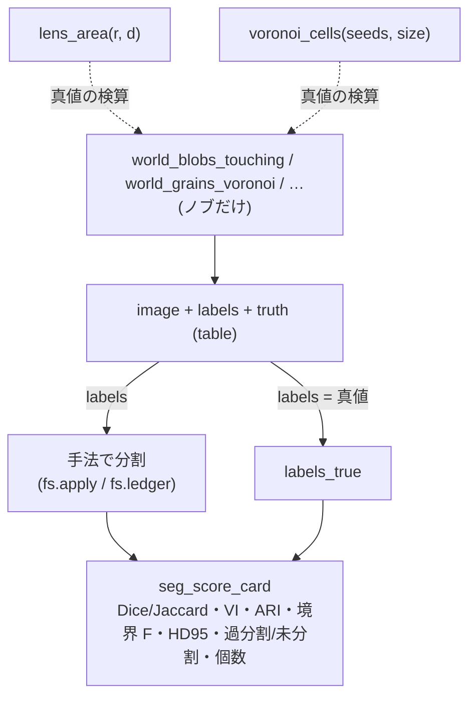

# Scoring segmentations and synthetic worlds with ground truth — which metric is blind to which failure

The 2 categories of the 1st wave of the segmentation expansion: `segeval` (**score**, 8 scoring yardsticks) and
`segworld` (**world**, 8 synthetic worlds with closed-form ground truth). The former counts "how much the prediction differs
from the ground truth"; the latter builds, with ground truth, inputs that "break 1 method in principle". No learned model
is involved —— only yardsticks that have **a theorem or a 2nd implementation as their gate**, and only worlds that have **closed-form ground truth**.

## score (`segeval`): 1 predicted label image × 1 ground-truth label image → numbers

Both inputs are `labels2d` (non-negative integers, 0 is background). The output is a `table` (a flat dict).

- **Contingency table and correspondence** — `seg_confusion_table`: a table of pixel counts with rows = truth, columns = prediction. The correspondence is not Hungarian
  but **maximum overlap** (argmax per row and per column); if they select each other it is `mutual`, and if the whole is 1-to-1 it is
  `unique_matching`.
- **Region overlap** — `seg_dice_jaccard`: on the mask (union of everything other than background), or per label with `per_label`.
  The identity D = 2J/(1+J) is the gate.
- **Boundary closeness** — `seg_boundary_f` (whether the other boundary lies within the tolerance distance τ = the Martin-style BF score) /
  `seg_hausdorff` (the worst deviation, HD95 too) / `seg_mean_surface_distance` (average symmetric surface distance ASSD).
- **Counting failures** — `seg_under_over_segmentation` (over- and under-segmentation by majority-vote multiplicity) /
  `seg_object_counts_match` (split, merged, missing, false and matched by the degrees of a bipartite (2-part) graph).
- **Score card** — `seg_score_card`: all of the above + VI, Rand and ARI from the existing `segcompare` on 1 sheet.

## world (`segworld`): knobs → image + ground-truth labels + closed-form ground truth

`world_*` takes no input (only knobs) and returns a `table` holding `image`, `labels` and `truth`.
Each world has **a reason to break 1 method**:

- `world_blobs_touching` — touching circles (threshold + connected components merges them. Ground truth = the closed form of the lens area).
- `world_grains_voronoi` — crystal grains (thin grain-boundary lines. Ground truth = area and edge length of the Voronoi polygons).
- `world_parts_with_shadow` — industrial parts with shadows (dark faces and shadows that fool thresholds).
- `world_texture_regions` — regions with the same mean that differ only in texture (cannot be cut by a threshold).
- `world_gradient_illumination` — dark objects on an illumination gradient (a global threshold breaks; flat-field correction fixes it).
- `world_thin_structures` — lines and cracks 1 to 3 px wide (disappear with smoothing).
- `lens_area` — the overlap area of 2 circles of equal radius (closed form, the core of the ground truth of `world_blobs_touching`).
- `voronoi_cells` — a Voronoi partition within a rectangle (polygons, areas, interior edge lengths. The core of `world_grains_voronoi`).

## Flow



## Shortest usage

```python
import fullseye as fs

wld = fs.ledger.world_blobs_touching(n=8, overlap=0.25, seed=0)   # ノブ → 真値つきの世界
truth_labels = wld["labels"]

# 手法の予測(ここでは真値をそのまま採点 = 満点を確かめる)
card = fs.ledger.seg_score_card(truth_labels, truth_labels)
assert card["dice"] == 1.0 and card["voi"] == 0.0 and card["counts_match"]

# 融合に盲目なマスクの物差し vs 融合を見る個数の物差し
merged = truth_labels.copy()
merged[merged > 0] = 1                                            # 全部 1 つにつぶす(最悪の未分割)
cm = fs.ledger.seg_object_counts_match(merged, truth_labels)
assert cm["merged"] == 1 and not cm["counts_match"]               # Dice は高いままでも個数は崩れる
```

## Symptom → cause (so as not to be fooled by scoring)

| Symptom | Cause | Yardstick to look at |
|---|---|---|
| Dice / Jaccard are high but objects are missing | Mask yardsticks are **blind to merging and splitting** (they look only at pixel overlap) | `merged` / `split` of `seg_object_counts_match`, `seg_under_over_segmentation` |
| Boundary F is high but there are countless regions | Boundary yardsticks are **blind to over-segmentation** (full marks as long as the cracks match) | `over` of `seg_under_over_segmentation`, `voi` of `seg_score_card` |
| ASSD is small but it misses badly at 1 place | The mean is **insensitive to outliers** | `seg_hausdorff` (worst case, HD95) |
| `seg_hausdorff` raises `ValueError` | One side is 1 colour (no boundary) = there is no surface to measure | Check that the input has 2 or more labels |
| Label 0 of `class_2dim_unsup` turns into background | In k-means **0 is a class number**, not background | Renumber from 1 before passing to `blob_features` |
| It matches the ground truth but does not get full marks | The method returns **a full-pixel partition** (no concept of background) | The mask Dice is `—`; compare with ARI / VI |

## Primary sources

- Martin et al. 2004, "Learning to Detect Natural Image Boundaries" (boundary precision and recall with a tolerance distance):
  <https://www2.eecs.berkeley.edu/Research/Projects/CS/vision/grouping/papers/mfm-pami-boundary.pdf>
- Perazzi et al. 2016, DAVIS benchmark (use of the boundary F score): <https://davischallenge.org/>
- Meilă 2007, "Comparing clusterings — an information based distance" (VI): <https://doi.org/10.1016/j.jmva.2006.11.013>
- Hubert & Arabie 1985, "Comparing partitions" (adjusted Rand index): <https://doi.org/10.1007/BF01908075>
- Taha & Hanbury 2015, "Metrics for evaluating 3D medical image segmentation" (overview of Dice/Jaccard/Hausdorff/ASSD): <https://doi.org/10.1186/s12880-015-0068-x>

## Related

- `segcompare` (the implementation of VI, Rand and ARI). `seg_score_card` calls it.
- `metrics3d.voxel_dice` / `voxel_iou` / `hausdorff_distance` (2nd implementations of the mask Dice and the point-cloud Hausdorff, the gates of the tests).
- The 9 op of the HALCON Segmentation chapter (`docs/ops/segmentation/guides/halcon_segmentation.md`): the side that **makes** partitions.
  These 2 categories are the side that **scores** the partitions made.
