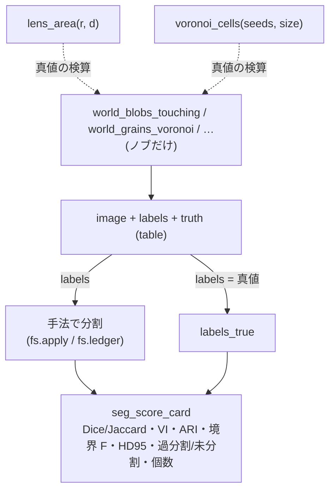

# 分割评分与带真值的合成世界 —— 哪种度量对哪种失效视而不见

分割扩充第 1 批的 2 个类别: `segeval`(**score**,8 把评分的尺子)和
`segworld`(**world**,8 个带闭式真值的合成世界)。前者计算"预测与真值相差多少",
后者生成"在原理上能让 1 种方法失效"的带真值输入。不使用学习器 ——
只收录每把尺子都有**定理或第 2 实现作为门**、每个世界都有**闭式真值**的内容。

## score(`segeval`): 1 幅预测标签 × 1 幅真值标签 → 数值

两个输入都是 `labels2d`(非负整数,0 为背景)。输出为 `table`(扁平的 dict)。

- **列联表与对应** —— `seg_confusion_table`: 行 = 真值、列 = 预测的像素数表。对应关系不用 Hungarian,
  而用**最大重叠**(按行/按列取 argmax),相互选中则为 `mutual`,整体为 1 对 1 则为
  `unique_matching`。
- **区域重叠** —— `seg_dice_jaccard`: 对掩膜(背景以外的并集)计算,或用 `per_label` 按标签计算。
  恒等式 D = 2J/(1+J) 是门。
- **边界的接近程度** —— `seg_boundary_f`(在容许距离 τ 以内是否有对方的边界 = Martin 式的 BF 值)/
  `seg_hausdorff`(最坏的偏差,也给出 HD95)/ `seg_mean_surface_distance`(平均表面距离 ASSD)。
- **计数上的失效** —— `seg_under_over_segmentation`(用多数表决的重数表示过分割/欠分割)/
  `seg_object_counts_match`(用 2 部图的度表示分裂、融合、缺失、虚假、一致)。
- **评分表** —— `seg_score_card`: 以上全部 + 已有 `segcompare` 的 VI、Rand、ARI 汇总到 1 张表。

## world(`segworld`): 旋钮 → 图像 + 真值标签 + 闭式真值

`world_*` 不接受输入(只有旋钮),返回带有 `image`、`labels`、`truth` 的 `table`。
每个世界都有**让 1 种方法失效的理由**:

- `world_blobs_touching` —— 相互接触的圆(阈值 + 连通成分会把它们融合。真值 = 透镜形面积的闭式)。
- `world_grains_voronoi` —— 晶粒(晶界的细线。真值 = Voronoi 多边形的面积、边长)。
- `world_parts_with_shadow` —— 带阴影的工业零件(欺骗阈值的暗面和阴影)。
- `world_texture_regions` —— 均值相同而只有质感不同的区域(阈值切不开)。
- `world_gradient_illumination` —— 照明梯度上的暗物体(全局阈值失效,平场校正可修复)。
- `world_thin_structures` —— 宽 1〜3 px 的线和裂纹(平滑后会消失)。
- `lens_area` —— 等半径 2 个圆重叠部分的面积(闭式,`world_blobs_touching` 真值的核心)。
- `voronoi_cells` —— 矩形内的 Voronoi 划分(多边形、面积、内部边长。`world_grains_voronoi` 的核心)。

## 流程



## 最简用法

```python
import fullseye as fs

wld = fs.ledger.world_blobs_touching(n=8, overlap=0.25, seed=0)   # ノブ → 真値つきの世界
truth_labels = wld["labels"]

# 手法の予測(ここでは真値をそのまま採点 = 満点を確かめる)
card = fs.ledger.seg_score_card(truth_labels, truth_labels)
assert card["dice"] == 1.0 and card["voi"] == 0.0 and card["counts_match"]

# 融合に盲目なマスクの物差し vs 融合を見る個数の物差し
merged = truth_labels.copy()
merged[merged > 0] = 1                                            # 全部 1 つにつぶす(最悪の未分割)
cm = fs.ledger.seg_object_counts_match(merged, truth_labels)
assert cm["merged"] == 1 and not cm["counts_match"]               # Dice は高いままでも個数は崩れる
```

## 症状 → 原因(为了不被评分蒙骗)

| 症状 | 原因 | 应看的尺子 |
|---|---|---|
| Dice、Jaccard 很高,物体却不够 | 掩膜类尺子**对融合、分裂视而不见**(只看像素重叠) | `seg_object_counts_match` 的 `merged` / `split`、`seg_under_over_segmentation` |
| 边界 F 很高,区域却多得数不清 | 边界类尺子**对过分割视而不见**(只要裂缝对上就是满分) | `seg_under_over_segmentation` 的 `over`、`seg_score_card` 的 `voi` |
| ASSD 很小,却在 1 处严重偏离 | 平均值**对离群值不敏感** | `seg_hausdorff`(最坏值,HD95) |
| `seg_hausdorff` 抛出 `ValueError` | 一方只有 1 种颜色(没有边界)= 没有可测量的表面 | 确认输入中有 2 个以上的标签 |
| `class_2dim_unsup` 的标签 0 被当成背景 | k-means 的 **0 是类别编号**,不是背景 | 传给 `blob_features` 之前从 1 开始重新编号 |
| 与真值一致却得不到满分 | 方法返回的是**全像素划分**(没有背景的概念) | 掩膜的 Dice 为 `—`,用 ARI / VI 比较 |

## 一手资料

- Martin et al. 2004, "Learning to Detect Natural Image Boundaries"(带容许距离的边界精确率、召回率):
  <https://www2.eecs.berkeley.edu/Research/Projects/CS/vision/grouping/papers/mfm-pami-boundary.pdf>
- Perazzi et al. 2016, DAVIS benchmark(边界 F 值的应用): <https://davischallenge.org/>
- Meilă 2007, "Comparing clusterings — an information based distance"(VI): <https://doi.org/10.1016/j.jmva.2006.11.013>
- Hubert & Arabie 1985, "Comparing partitions"(adjusted Rand index): <https://doi.org/10.1007/BF01908075>
- Taha & Hanbury 2015, "Metrics for evaluating 3D medical image segmentation"(Dice/Jaccard/Hausdorff/ASSD 的整理): <https://doi.org/10.1186/s12880-015-0068-x>

## 相关

- `segcompare`(VI、Rand、ARI 的实现)。`seg_score_card` 会调用它。
- `metrics3d.voxel_dice` / `voxel_iou` / `hausdorff_distance`(掩膜 Dice、点云 Hausdorff 的第 2 实现,测试的门)。
- HALCON Segmentation 章的 9 op(`docs/ops/segmentation/guides/halcon_segmentation.md`): **生成**分割的一方。
  这 2 个类别是对生成的分割**评分**的一方。
