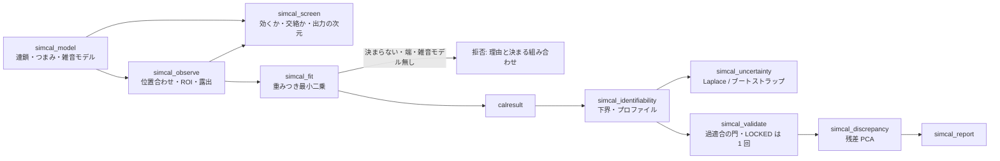

# sim-to-real 較正 — 使い方ガイド

## この族が答えている問い

実物の画像を与えたら、誤差をフィードバックして、計算に使う係数(周辺減光の強さ、ボケの幅、膜の厚さ、カメラの利得 …)を
自動で合わせたい。ここで一番危ないのは、**画像が決めていない係数にもっともらしい数を出してしまう**ことです。

- 照明の強さとカメラの利得は、どちらも画像を同じように明るくします。画像から決まるのは積だけで、1 つずつの値は決まりません。
- 1 波長で一様な膜を撮ると、屈折率 n と膜厚 d は n x d(光路長)の形でしか効きません。
- 白い板を撮った画像では、ボケ(PSF の幅)は何も変えません。

最適化はこういう場合も「収束」して数を返します。この族は、その数を**返さずに拒否**し、代わりに理由と、画像が決めている
組み合わせ(照明 x 利得 = 899.4 のような)を返します。台帳は `opssimcal.py`、本体は `simcal.py`。

## 流れ



## 模型(model)

| やりたいこと | op | 要点 |
|---|---|---|
| 順方向の模型を組む | `simcal_model` | 連鎖の各段は登録済みの op(例 `thin_film_reflectance`)か組み込みの段(`stage:gain_offset`・`stage:scale`・`stage:radial_cos4`・`stage:radial_poly`・`stage:gaussian_blur`・`stage:as_image`・`stage:mc_sample`)。つまみは 1 つの段の 1 つの引数に結びつき、単位・範囲・線形 / 対数・事前分布を持つ。組んだ時点で 1 回走らせ、走らない模型は拒否 |
| 模型を走らせる | `simcal_simulate` | 条件(露光・波長 …)ごとに 2-D の画像 1 枚 |
| 実画像を付ける | `simcal_observe` | 位相相関(`phase_correlation_fft`)で整数画素のずれを戻し、巻き込んだ縁は使わない。**露出の正規化と利得つまみの同時は拒否**(どちらも信号を倍にするので区別できず、正規化した雑音を 2 回数える) |

雑音モデルは必須です。EMVA 1288 の線形カメラなら `{"kind": "emva", "K": ..., "sigma_d": ..., "dark": ...}`
(`sensorchar.emva_photon_transfer` の結果をそのまま渡せる。暗雑音が推定できなかった場合は上限を使う)、
単純な場合は `{"kind": "gaussian", "sigma": ...}`。雑音の分散が無いと「決まる」の物差しが無いので、当てはめは拒否します。

モンテカルロの描画器のような**確率的な模型**は `stochastic={"seed": s, "sample_var": "estimate"}` で受けます。
種を固定する(共通乱数)と模型が決定的になり、ヤコビアンが壊れません。模型自身の標本の分散は雑音に足します ——
足さないと残差が雑音より大きく見え、後段の門が誤作動します。

## 合わせ(fit)

| やりたいこと | op | 要点 |
|---|---|---|
| どのつまみが効くか、交絡しているか | `simcal_screen` | 雑音で割った出力の主成分ごとに Morris / Sobol'(`sens_morris` / `sens_sobol` を再利用)。全範囲を動かしても雑音の 1.96 倍に届かないつまみは「効かない」。共線性指数(`mv_confounding`)で交絡の組、`mv_residual_pca` で雑音を越える出力の次元数 |
| 係数を合わせる | `simcal_fit` | 雑音の分散で重みをつけた最小二乗(重みは予測で更新)。出発点は計画(ラテン超方格)の最良点。`lm`(範囲を出る一歩はそのまま取らない)・`nm`・`multistart`。**決まらない・効かない・範囲の端 1 % に張りつく**つまみがあれば拒否し、理由と決まる組み合わせを返す。`allow_undetermined=True` なら、それらのつまみには値を付けずに残りを返す |

当てはめが違う谷(薄膜の隣の干渉次数など)に落ちたときは、値は返しますが `fit.warnings` に
「χ²/自由度が雑音の何倍か、multistart を試せ」と書きます。

## 検査(check / report)

どの検査も calresult を受けて calresult を返し、**支えられない点推定は理由をつけて取り下げます**(`undetermined` に移す)。

| やりたいこと | op | 要点 |
|---|---|---|
| どこまで決まるか | `simcal_identifiability` | Fisher 情報 J^T W J と Cramér-Rao 下界(`mathestimation.crlb_gaussian` と同じ定義、直線の模型で一致をテストが確かめる)、条件数(1e6 超で警告)、相関、共線性指数、**プロファイル尤度**(他のつまみを合わせ直しながら 1 つを動かし、χ² が χ²₁(95 %) = 3.84 上がる所)。片側しか閉じなければ「上限だけ」「下限だけ」として点推定を取り下げる。`at=` に真値を渡せば合成の研究で下界だけを計算できる |
| どれだけ確かか | `simcal_uncertainty` | Laplace(Fisher 情報の逆、対数のつまみは非対称の区間)かパラメトリック・ブートストラップ。点推定の無い結果は拒否 |
| 取り置いた画像で持つか | `simcal_validate` | 過適合の門 5 つ(初期値より良い / 保留 ÷ 学習 ≤ 1 + τ / 利得と黒レベルだけの模型より良い / 範囲・事前・端 / 自由なつまみ ≤ 画像が持つ方向の数)。どれか 1 つで拒否。LOCKED は 1 回だけ(2 回目は拒否) |
| 模型に何が足りないか | `simcal_discrepancy` | 雑音で割った残差の PCA(`mv_residual_pca`)を Tracy-Widom 99 % の端と比べる(素の Marchenko-Pastur の端は純雑音でも 10〜14 % 越える)。構造があれば、その形(地図)と「不確かさは楽観側」の注記 |
| 表 1 枚 | `simcal_report` | つまみごとの値・単位・区間・分類と、走らせた門。走らせなかった門は not run |

8 次の周辺減光の多項式は、画像の中では cos⁴ と同じくらいよく合います(保留の誤差も変わらない)。拒否するのは当てはめの交絡と、
「自由なつまみ 10 > 画像が持つ方向 6」の門です —— 画像の過適合は、保留の誤差より先に「決まらない」として現れます。

## 最初の 1 本

```python
import fullseye as fs

m = fs.ledger.simcal_model()                  # 例の模型: チャート -> cos^4 の周辺減光 -> 利得と黒レベル(合成の観測つき)
print(fs.ledger.simcal_screen(m)["class"])    # {'f': 'determined', 'gain': 'determined', 'offset': 'determined'}
r = fs.ledger.simcal_fit(m)
print(r["status"], {k: round(v, 2) for k, v in r["theta_hat"].items()})
# accepted {'f': 22.09, 'gain': 899.05, 'offset': 63.56}   (真値 22 / 900 / 64)
```

## 例

`examples/simcal_tour.py` —— 利得 x 照明の拒否と積、1 波長と 31 波長の膜、白い板とチャートのボケ、ずれた画像の位置合わせ。

`examples/simcal_checks_tour.py` —— 40 組の真値で回収を採点(39 組が 3 σ_CRLB 以内、雑音を見誤ると 29 組)、上限しか言えないボケ、8 次の多項式の拒否、光軸のずれたレンズの残差 PCA。
