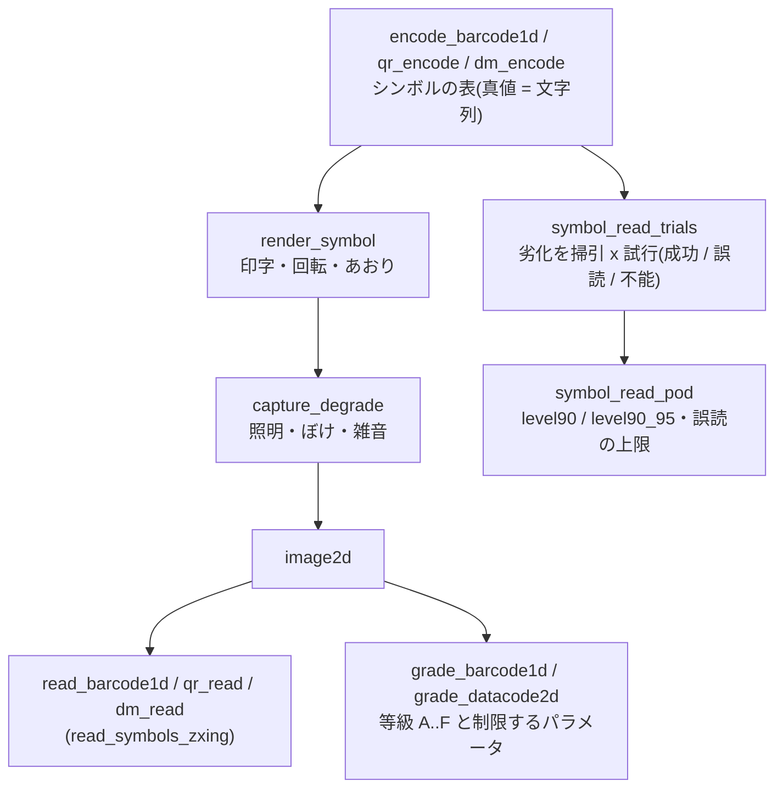

# 記号の読み取り(1-D / 2-D コード・印字品質・読み取りの POD・OCR) — 使い方ガイド

## この族は何をする道具箱か

製造ラインのトレーサビリティで毎日使う**記号**を、作る・撮る・読む・格付けする・
「どこまで劣化しても読めるか」を確率で言う、までを 1 つの鎖にした層です
(台帳は `opssymbol.py`、numpy と scipy のみ。zxing-cpp は optional)。

- **barcode1d** — `encode_barcode1d`(EAN-13 / UPC-A / Code 128・GS1-128 / Code 39 / ITF)/
  `ean_check_digit` / `barcode_scan_profiles` / `decode_barcode_profile` / `read_barcode1d`。
- **datacode2d** — `qr_encode` / `qr_decode_modules` / `qr_locate` / `qr_sample` / `qr_read`、
  `dm_encode` / `dm_decode_modules` / `dm_locate` / `dm_sample` / `dm_read`(Data Matrix ECC200)。
  Reed-Solomon は自前(`symrs.py`)で、**ブロックごとに直した語数**を返す。
- **symbol_capture** — `render_symbol`(印字のにじみ・刻印の点・回転・あおり、面積で積分)/
  `capture_degrade`(照明の傾き・周辺減光・デフォーカスの一様円・動きぶれ・ガウス・
  ショット雑音・読み出し雑音・量子化)。
- **print_quality** — `grade_barcode_profile` / `grade_barcode1d`(ISO/IEC 15416 の考え方)/
  `grade_datacode2d`(ISO/IEC 15415 の考え方)。
- **read_pod** — `symbol_read` / `symbol_read_trials` / `symbol_read_pod`: 物理劣化を 1 つ
  掃引し、MIL-HDBK-1823A の hit/miss(既存の `pod` 族)で「90 % 読める劣化量」とその
  95 % 信頼の保守側を返す。
- **symbol_bridge** — `read_symbols_zxing`(zxing-cpp、Apache-2.0、`pip install zxing-cpp`。
  無ければ `ImportError`。黙って自前の読み取り器に切り替えない)。

## 流れ



## 最初の 1 本

```python
import numpy as np
import fullseye as fs

sym = fs.ledger.encode_barcode1d("490123456789", "ean13")       # 検査数字は自動 → 4901234567894
img = fs.ledger.render_symbol(sym, 3.0, rotate_deg=20.0)         # モジュール 3 px、20° 回転
img = fs.ledger.capture_degrade(img, defocus_px=4.0, full_well_e=20000.0,
                                read_noise_e=10.0, bits=8, seed=1)
print(fs.ledger.read_barcode1d(img, ("ean13",))["text"])         # 4901234567894
print(fs.ledger.grade_barcode1d(fs.ledger.render_symbol(sym, 6.0))["letter"])   # A

tr = fs.ledger.symbol_read_trials(sym, "defocus_px", np.linspace(2, 16, 8), trials=30,
                                  module_px=3.0, refine=True, level_jitter=0.05)
pod = fs.ledger.symbol_read_pod(tr)
print(pod["level90"], pod["level90_95"], pod["misread_total"])
```

## 落とし穴(実測に基づく)

1. **全体系を許すと短読みで誤読する。** ぼけた EAN-13 を全体系で読むと、断片が 2 桁や
   6 桁の ITF として返った(ITF に検査数字が無いため)。読み取り器は ITF の最短 6 桁・
   太細比 1.8..3.4・走査線 2 本以上の一致を要求し、`symbol_read_trials` は表の体系だけを
   有効にする。現場でも**使う体系だけ**を有効にしてください。
2. **「読める」と「品質が良い」は別の問い。** EAN-13 は像面のぼけ円が 2.2 モジュールでも
   90 % 読める(Fullseye の読み取り器)が、そのぼけで撮ったシンボルの等級は F(変調 0.10)。
   等級は「どの読み取り器でも読める余裕」、POD は「この読み取り器・この撮像で読めるか」。
3. **d90 は点推定、使うのは d90/95。** 30 回 x 8 水準の掃引の d90 で 201 枚撮り直すと
   読取率は 0.79 だった。保守側の d90/95 と、撮り直しに対する曲線の当てはまりで判断する
   (`examples/poc_symbol_package_1d.py`)。
4. **劣化量だけで決まる読み取りは POD にならない。** 雑音も揺らぎも無い撮像では、ある
   水準を境に全部読める/全部読めない(完全分離)。`symbol_read_pod` は傾きの無い曲線を
   作らず、全数成功の実証(29/29 の論法)を返す。
5. **非単調の POD。** zxing-cpp 3.1.1 はくっきりした**ドットピーン**の Data Matrix を
   読まず(24 方向中 0)、ぼけで点がつながると読む —— 読取率がぼけに対して増える。
   `symbol_read_pod` は `monotone = False` の旗を立てる(`examples/poc_symbol_part_dpm.py`)。
6. **DPM の点と測定開口。** 直径 0.8 X の点を開口 0.8 X で測ると点の縁が入り、SC が
   0.35 → 0.318 に下がる。点の内側に収まる開口(0.4 X)なら閉形式どおり。
7. **これは認証された検証器ではない。** 規格の本文は写しておらず、等級の境界は公開の解説の
   値、細部は docstring に Fullseye の実装として書いた。固定パターンの損傷は簡略化
   (最悪のモジュール)。

---

Copyright (c) 2026 Kazufumi Furuse. Licensed under the Apache License, Version 2.0.
