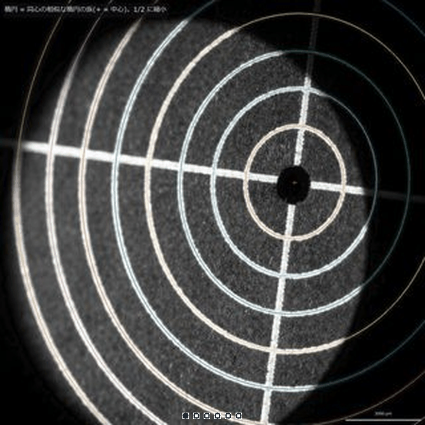
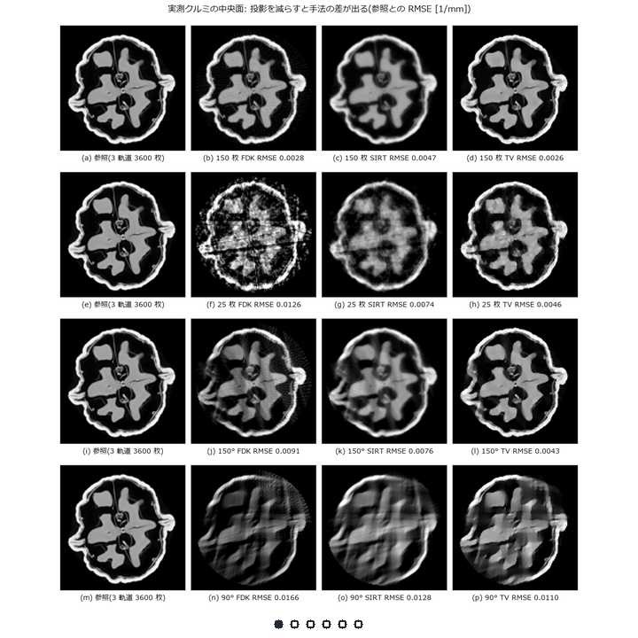
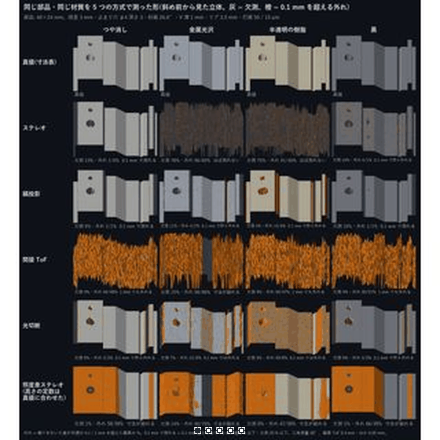
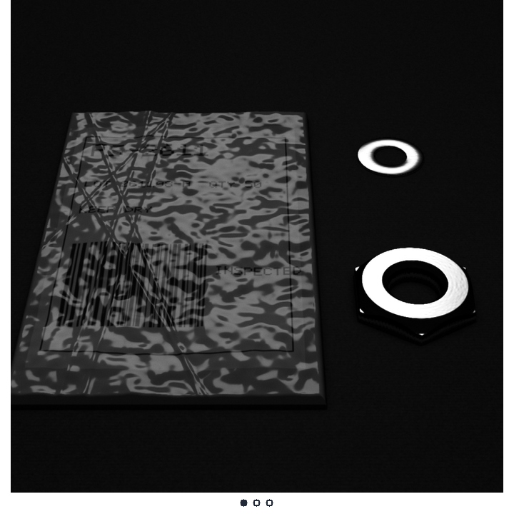
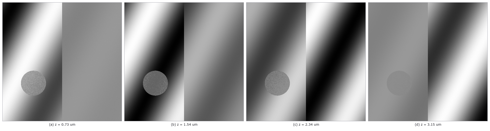
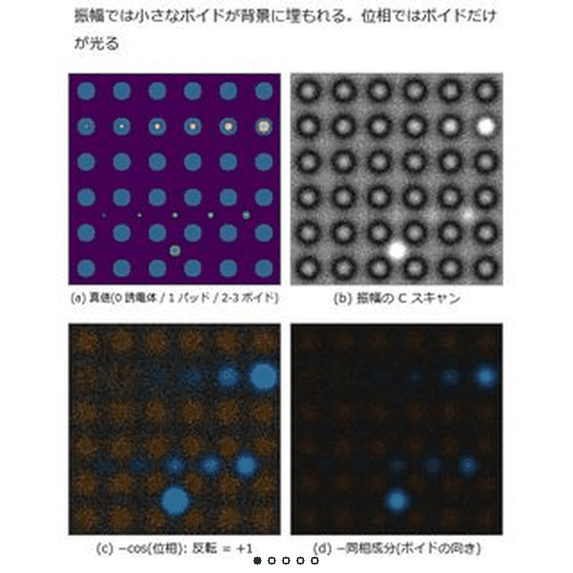

<div class="vlang" markdown="1">

[日本語](../index.md) · [English](../en/index.md) · [简体中文](../zh/index.md) · [繁體中文](../tw/index.md) · [한국어](../ko/index.md) · **Deutsch** · [हिन्दी](../hi/index.md) · [Français](../fr/index.md)

</div>

# Fullseye — ViEW2026

**Präsentation: Do., 3. Dez. 2026, 14:40–15:50 Uhr JST, Interaktive Session 2, IS2-19** (Pacifico Yokohama, Annex Hall)

<div class="vintro"><div class="vt"><p>Fullseye ist eine Plattform für Bildprüfung, 3-D-Messung und Physiksimulation. Sie übergibt typisierte Operatoren der klassischen Bildverarbeitung und Physiksimulation (einschließlich Sensorik wie Optikdesign) über MCP und RAG an eine KI, lässt sie für jede Aufgabe eine Kombination ausarbeiten und löst die Aufgabe interaktiv, geprüft durch Typkonsistenz und Bewertung gegen Ground Truth, die die Physik- und Bildgebungssimulation erzeugt. Open Source (Apache-2.0).</p><p>Auch aus C/C++ aufrufbar (Vorschau): ein Entwicklungs-SDK, das 805 op als C-Funktionen aufruft (es bettet Python mit pybind11 ein; verwenden Sie dafür eine Python-Umgebung mit installiertem Fullseye). Beschreibung → <a href="https://github.com/furuse-kazufumi/fullseye/blob/master/docs/C_API.md"><code>C_API.md</code></a></p></div></div>

Kachel antippen öffnet Video oder Abbildung (▶ = bewegt).

Diese Seite zeigt nur 30 Exponate. Die übrigen 286 stehen auf der [Zusatzseite](more.md).

<style>
.vlang { font-size: 14px; line-height: 2; }
.vg { display: grid; grid-template-columns: repeat(2, minmax(0, 1fr)); gap: 8px; margin: 12px 0 20px; }
.vg.vs { grid-template-columns: repeat(3, minmax(0, 1fr)); gap: 6px; }
@media (min-width: 600px) { .vg { grid-template-columns: repeat(3, minmax(0, 1fr)); } .vg.vs { grid-template-columns: repeat(5, minmax(0, 1fr)); } }
@media (min-width: 900px) { .vg { grid-template-columns: repeat(4, minmax(0, 1fr)); } .vg.vs { grid-template-columns: repeat(7, minmax(0, 1fr)); } }
.vg a, .vser a { display: block; position: relative; text-decoration: none; color: inherit; }
.vg img { display: block; width: 100%; max-width: 100%; height: auto; aspect-ratio: 1 / 1; object-fit: cover; border-radius: 6px; background: #222; }
.vg picture { display: block; width: 100%; aspect-ratio: 1 / 1; overflow: hidden; border-radius: 6px; background: #fff; }
.vg picture img { height: 100%; aspect-ratio: auto; object-fit: contain; border-radius: 0; background: #fff; }
.vg b { position: absolute; top: 6px; right: 6px; background: rgba(0,0,0,.6); color: #fff; font-size: 12px; padding: 1px 6px; border-radius: 9px; }
.vg span { display: block; font-size: 13px; line-height: 1.3; margin-top: 3px; }
.vg.vs span { font-size: 11px; }
.vser { display: grid; grid-template-columns: repeat(2, minmax(0, 1fr)); gap: 8px; margin: 12px 0 20px; }
@media (min-width: 600px) { .vser { grid-template-columns: repeat(3, minmax(0, 1fr)); } }
.vser img { display: block; width: 100%; max-width: 100%; height: auto; aspect-ratio: 16 / 9; object-fit: cover; border-radius: 8px; background: #222; }
.vser strong { display: block; font-size: 14px; margin-top: 3px; line-height: 1.3; }
.vser span { display: block; font-size: 12px; line-height: 1.3; }
details.vall { margin: 6px 0; }
details.vall > summary { font-size: 15px; padding: 6px 0; cursor: pointer; }
.vl li { margin-bottom: 8px; }
li, p, code { overflow-wrap: anywhere; }
.vintro { display: flex; gap: 20px; align-items: flex-start; margin: 14px 0; }
.vintro img { flex: 0 0 300px; width: 300px; max-width: 100%; height: auto; border-radius: 6px; }
.vintro .vt p { margin: 0 0 8px; }
.vc { display: flex; gap: 16px; align-items: flex-start; margin: 18px 0; }
.vc > a:first-child { flex: 0 0 260px; position: relative; display: block; text-decoration: none; color: inherit; }
.vc > a img { display: block; width: 100%; max-width: 100%; height: auto; aspect-ratio: 1 / 1; object-fit: cover; border-radius: 6px; background: #222; }
.vc > a picture { display: block; width: 100%; aspect-ratio: 1 / 1; overflow: hidden; border-radius: 6px; background: #fff; }
.vc > a picture img { height: 100%; aspect-ratio: auto; object-fit: contain; border-radius: 0; background: #fff; }
.vc > a b { position: absolute; top: 6px; right: 6px; background: rgba(0,0,0,.6); color: #fff; font-size: 12px; padding: 1px 6px; border-radius: 9px; }
.vc > a .vtb { position: absolute; left: 6px; bottom: 6px; max-width: calc(100% - 12px); background: rgba(0,0,0,.66); color: #fff; font-size: 12px; font-style: normal; line-height: 1.4; padding: 1px 7px; border-radius: 9px; }
.vt { flex: 1 1 auto; min-width: 0; }
.vt .vh { font-size: 17px; font-weight: 600; line-height: 1.4; margin: 0 0 6px; }
.vt p { margin: 0 0 6px; }
.vt .vm { font-size: 14px; color: #57606a; }
.vt details { font-size: 14px; margin: 4px 0; }
.vt summary { cursor: pointer; }
.vc.vv { margin: 10px 0; }
.vc.vv > a:first-child { flex-basis: 96px; }
@media (max-width: 600px) {
  .vintro { flex-direction: column-reverse; gap: 8px; }
  .vintro img { flex: 0 0 auto; width: 100%; max-width: 240px; }
  .vc { flex-direction: column; gap: 8px; }
  .vc > a:first-child { flex: 0 0 auto; width: 240px; max-width: 100%; }
  .vc.vv { flex-direction: row; gap: 12px; }
  .vc.vv > a:first-child { width: 80px; flex: 0 0 80px; }
}
</style>

## Selbst ausprobieren

Die Abbildungen der Arbeit lassen sich selbst bedienen, auch auf dem Smartphone. Methoden wechseln Sie über die Tabs, 3-D-Ansichten drehen Sie per Ziehen.

<div class="vc vv"><a class="vvi" href="../viewers/poc_cad_scan_deviation.html?lang=de"></a><div class="vt"><div class="vh"><a href="../viewers/poc_cad_scan_deviation.html?lang=de">CAD gegen Scan-Punktwolke</a></div><p>Die Ausrichtung schluckt Defekte: Ein Bauteil mit dem Sollwert 1.2 µm zeigt eine nicht vorhandene Delle von 121 µm.</p></div></div>

<div class="vc vv"><a class="vvi" href="../viewers/poc_photoelasticity.html?lang=de"></a><div class="vt"><div class="vh"><a href="../viewers/poc_photoelasticity.html?lang=de">Spannungsoptik</a></div><p>Beim Drehen des Analysators wandern die spannungsoptischen Streifen und die mittlere Intensität in der Scheibe ändert sich (im Bereich 0–135°)</p></div></div>

<div class="vc vv"><a class="vvi" href="../viewers/poc_polarization_specular.html?lang=de"></a><div class="vt"><div class="vh"><a href="../viewers/poc_polarization_specular.html?lang=de">Polarisation</a></div><p>Polarisation entfernt spiegelnde Reflexe; der Rest hängt vom Einfallswinkel ab und ist nahe dem Brewster-Winkel am kleinsten (Durchlauf an einer synthetischen Streifenszene)</p></div></div>

## Im Mittelpunkt

<div class="vc"><a href="../../articles/assets/poc/poc_industrial_oct/01_real_paint_bscans.png"><picture><source media="(prefers-reduced-motion: reduce)" srcset="../../articles/assets/poc/poc_industrial_oct/01_real_paint_bscans.png"></picture><i class="vtb">Ground Truth: Reale Daten</i></a><div class="vt"><div class="vh"><a href="../../articles/assets/poc/poc_industrial_oct/01_real_paint_bscans.png">Lackschichtdicke ohne Schnitt (industrielle OCT)</a></div><p>Lack- und Filmschichten werden ohne Schneiden in der Tiefe betrachtet. Aus öffentlichen Rohspektren von Autolack gemessene Klarlackschichten stimmen bis auf 3,6 µm mit Mikroskopmessungen derselben Tafeln überein. Die Übereinstimmung mit der OCT der Veröffentlichung reproduziert nur dieselben Daten, und für nicht trennbare dünne Schichten wird kein Wert ausgegeben.</p><p class="vm">Ground Truth: Reale Daten · <a href="more.html#d-poc-industrial-oct">Details</a></p></div></div>

<div class="vc"><a href="../../articles/assets/poc/poc_phase_measuring_deflectometry/03_photo_vs_pmd.png"><picture><source media="(prefers-reduced-motion: reduce)" srcset="../../articles/assets/poc/poc_phase_measuring_deflectometry/03_photo_vs_pmd.png"></picture><i class="vtb">Ground Truth: Synthetisch</i></a><div class="vt"><div class="vh"><a href="../../articles/assets/poc/poc_phase_measuring_deflectometry/03_photo_vs_pmd.png">Eine bei diffusem Licht unsichtbare Delle erscheint im Spiegelbild von Streifen (synthetisch)</a></div><p>Eine sehr flache Delle in glänzendem Lack ist auf einem Foto unter diffusem Licht kaum zu sehen. Streifen auf einen der Oberfläche zugewandten Schirm zu projizieren und die Krümmung ihres Spiegelbilds auszuwerten liefert die Oberflächenkrümmung und hebt eine eingesetzte, 3 µm tiefe Delle hervor. Dies ist eine synthetische Szene; Fotos unter schrägem Licht wurden nicht verglichen.</p><p class="vm">Ground Truth: Synthetisch · <a href="more.html#d-poc-phase-measuring-deflectometry">Details</a></p></div></div>

<div class="vc"><a href="../../articles/assets/poc/poc_thin_film_reflectometry/01_real_micrograph_thickness.png"><picture><source media="(prefers-reduced-motion: reduce)" srcset="../../articles/assets/poc/poc_thin_film_reflectometry/01_real_micrograph_thickness.png"></picture><i class="vtb">Ground Truth: Reale Daten</i></a><div class="vt"><div class="vh"><a href="../../articles/assets/poc/poc_thin_film_reflectometry/01_real_micrograph_thickness.png">Oxidschichtdicke aus Mikrografiefarben ablesen</a></div><p>Die Dicke einer Oxidschicht auf Silizium lässt sich aus Interferenzstreifen und Farben im reflektierten Licht ablesen. Pixelweise aus einer von anderen veröffentlichten realen Mikrografie gelesen, betrug der Zentralwert 87,4 nm. Das liegt etwa ein Zehntel unter der aus der Veröffentlichung abgeleiteten Referenz, und die Farbempfindlichkeit der Kamera ist unbekannt.</p><p class="vm">Ground Truth: Reale Daten · <a href="more.html#d-poc-thin-film-reflectometry">Details</a></p></div></div>

<div class="vc"><a href="../../articles/assets/poc/poc_registration_basin/06_real_scan_icp.mp4"><picture><source media="(prefers-reduced-motion: reduce)" srcset="../../articles/assets/poc/poc_registration_basin/07_real_scan_still.png"></picture><b>&#9654;</b><i class="vtb">Ground Truth: Reale Daten</i></a><div class="vt"><div class="vh"><a href="../../articles/assets/poc/poc_registration_basin/06_real_scan_icp.mp4">Auf echter Tiefe schrumpft das ICP-Konvergenzgebiet</a></div><p>An einem gemessenen Bauteil und einer synthetischen Halterung wurde geprüft, aus welcher Entfernung eine Registrierung noch zum selben Endpunkt zurückkehren kann. Über Zufallsstarts und Überschreitungsregeln hinweg halbierte sich der Erfolg bis zu 31,5 Grad früher als bei rundum verteilten Punkten. Der Endpunkt weicht von der Ground Truth ab; gemessen wird daher der Rückkehrbereich und nicht die Posengenauigkeit.</p><p class="vm">Ground Truth: Reale Daten · <a href="more.html#d-poc-registration-basin">Details</a></p></div></div>

<div class="vc"><a href="../../articles/assets/poc/poc_hyperspectral_foreign_matter/04_real_pork_belly.png"><picture><source media="(prefers-reduced-motion: reduce)" srcset="../../articles/assets/poc/poc_hyperspectral_foreign_matter/01_real_polymer_flakes.png"></picture><i class="vtb">Ground Truth: Reale Daten</i></a><div class="vt"><div class="vh"><a href="../../articles/assets/poc/poc_hyperspectral_foreign_matter/04_real_pork_belly.png">Fremdkörper auf Schweinebauch mit nahinfraroter Spektralbildgebung finden</a></div><p>Öffentliche reale Bilder dienten als nahinfrarote Spektraldaten, um Fremdkörper auf Schweinebauch zu klassifizieren. Pixelweise an getrennten Aufnahmen bewertet, wurde der Großteil bei 1,1 % Fehlalarmen erkannt. Mit weniger Bändern nahmen die Fehlalarme zu, und das Versagen einer Farbkamera bei gleichfarbigem Material wurde nur an synthetischen Daten gezeigt.</p><p class="vm">Ground Truth: Reale Daten · <a href="more.html#d-poc-hyperspectral-foreign-matter">Details</a></p></div></div>

<div class="vc"><a href="../../articles/assets/poc/poc_cad_scan_deviation/14_align_orbit.gif"><picture><source media="(prefers-reduced-motion: reduce)" srcset="../../articles/assets/poc/poc_cad_scan_deviation/01_scene.png"></picture><b>&#9654;</b><i class="vtb">Ground Truth: Synthetisch</i></a><div class="vt"><div class="vh"><a href="../../articles/assets/poc/poc_cad_scan_deviation/14_align_orbit.gif">Die Ausrichtung bestimmt, wo ein Teil außerhalb der Toleranz erscheint: CAD gegen Scan (synthetisch)</a></div><p>Das Ausrichten eines Scans am Entwurf nimmt einen Teil der Abweichung auf und verschiebt die scheinbar toleranzwidrige Stelle. Bei einem Bauteil mit bekannter Verformung erscheint in der Mitte, wo die wahre Abweichung winzig ist, ein 121 µm tiefer Messwert. Das Ergebnis ist synthetisch, und ein punktweise abgetasteter Entwurf zeigt selbst ohne Defekt toleranzwidrige Kanten.</p><p class="vm">Ground Truth: Synthetisch · <a href="more.html#d-poc-cad-scan-deviation">Details</a></p></div></div>

<div class="vc"><a href="../../articles/assets/poc/poc_fourier_ptychography/01_usaf_4x_fp_20x.png"><picture><source media="(prefers-reduced-motion: reduce)" srcset="../../articles/assets/poc/poc_fourier_ptychography/01_usaf_4x_fp_20x.png"></picture><i class="vtb">Ground Truth: Synthetisch</i></a><div class="vt"><div class="vh"><a href="../../articles/assets/poc/poc_fourier_ptychography/01_usaf_4x_fp_20x.png">Ein 4x-Objektiv erreicht ein kohärent beleuchtetes 20x (Fourier-Ptychographie, synthetisch)</a></div><p>Ein schwaches Objektiv erfasst ein weites Feld, verfehlt aber feine Details. Auf einem synthetischen Testbild erreichten aus vielen Beleuchtungswinkeln aufgenommene und im Frequenzraum verbundene Bilder ein 20x-Objektiv unter einfarbigem Parallellicht. Unter gewöhnlichem Licht löst dieses Objektiv weiterhin feiner auf, und bei zu geringer Beleuchtungsüberlappung wird keine Antwort ausgegeben.</p><p class="vm">Ground Truth: Synthetisch · <a href="more.html#d-poc-fourier-ptychography">Details</a></p></div></div>

<div class="vc"><a href="../../articles/assets/poc/poc_itof_multifreq/12_public_raw_unwrap.png"><picture><source media="(prefers-reduced-motion: reduce)" srcset="../../articles/assets/poc/poc_itof_multifreq/01_warehouse_unwrap.png"></picture><i class="vtb">Ground Truth: Synthetisch</i></a><div class="vt"><div class="vh"><a href="../../articles/assets/poc/poc_itof_multifreq/12_public_raw_unwrap.png">Wo indirekte ToF-Tiefe versagt (synthetisch)</a></div><p>Eine indirekte ToF-Kamera misst die Entfernung aus der Phasenverzögerung modulierten Lichts. Bei synthetischen Signalen hält die Kombination dreier Frequenzen die Entfernung bis 18,7 m eindeutig. Mehrwegausbreitung und Objektkanten lassen die Entfernung ohne Warnung springen.</p><p class="vm">Ground Truth: Synthetisch · <a href="more.html#d-poc-itof-multifreq">Details</a></p></div></div>

<div class="vc"><a href="../../articles/assets/poc/poc_telecentric_metrology/08_real_alignment_plate.png"><picture><source media="(prefers-reduced-motion: reduce)" srcset="../../articles/assets/poc/poc_telecentric_metrology/08_real_alignment_plate.png"></picture><i class="vtb">Ground Truth: Reale Daten</i></a><div class="vt"><div class="vh"><a href="../../articles/assets/poc/poc_telecentric_metrology/08_real_alignment_plate.png">An öffentlichen telezentrischen Bildern gemessene Vergrößerung stimmt innerhalb der Streuung der Veröffentlichung überein</a></div><p>In einem Bild erscheint ein abgestuftes Bauteil durch ein gewöhnliches Objektiv dort größer, wo es näher ist. Die an öffentlichen realen Bildern eines telezentrischen Objektivs gemessene Vergrößerung stimmt mit der Veröffentlichung überein; deren eigene Werte streuen jedoch um ±0,25 %, sodass die Übereinstimmung nicht feiner ausgelegt wird. Nicht wandernde Ringmittelpunkte auf einer geneigten Platte dienen als Beleg.</p><p class="vm">Ground Truth: Reale Daten · <a href="more.html#d-poc-telecentric-metrology">Details</a></p></div></div>

<div class="vc"><a href="../../articles/assets/poc/poc_virtual_sem_kv_cd_bse/05_sem_same_part_3kv_3detectors.png"><picture><source media="(prefers-reduced-motion: reduce)" srcset="../../articles/assets/poc/poc_virtual_sem_kv_cd_bse/05_sem_same_part_3kv_3detectors.png"></picture><i class="vtb">Ground Truth: Veröffentlichte Werte</i></a><div class="vt"><div class="vh"><a href="../../articles/assets/poc/poc_virtual_sem_kv_cd_bse/05_sem_same_part_3kv_3detectors.png">Virtuelles SEM: Das Bild ändert sich mit der Spannung (Modell anhand gemessener Rückstreuung bewertet)</a></div><p>Ein SEM-Bild ist kein Foto der Oberfläche, sondern eine Zählung der Elektronen, die nach Streuung im Festkörper austreten. Ein Modell, das jedes Elektron verfolgt, wurde mit gemessenen Rückstreudaten für 7 Elemente geprüft. Da keine realen Bilder mit bekannter Linienbreite vorliegen, bleibt die Verschiebung der Linienbreitenmessung mit der Strahlenergie innerhalb des Modells.</p><p class="vm">Ground Truth: Veröffentlichte Werte · <a href="more.html#d-poc-virtual-sem-kv-cd-bse">Details</a></p></div></div>

<div class="vc"><a href="../../articles/assets/poc/poc_real_tum_rgbd_slam/02_trajectory.png"><picture><source media="(prefers-reduced-motion: reduce)" srcset="../../articles/assets/poc/poc_real_tum_rgbd_slam/02_trajectory.png"></picture><i class="vtb">Ground Truth: Reale Daten</i></a><div class="vt"><div class="vh"><a href="../../articles/assets/poc/poc_real_tum_rgbd_slam/02_trajectory.png">Bild-zu-Bild-Ausrichtung an öffentlichen RGB-D-Daten bewertet: Fehler 0,45-0,82-mal so groß wie bei konstantem Tempo, je nach der pro Teilung gewählten Ausreißerkappung (eine Folge mit 32 Bildern)</a></div><p>An einer öffentlichen Tiefenfolge eines Schreibtischs wurde die Bild-zu-Bild-Ausrichtung mit Motion-Capture-Ground-Truth verglichen. Der Fehler lag unter dem ohne Ausrichtung, doch der Gewinn gegenüber einer Schätzung mit konstantem Tempo hing von der Ausreißerkappung und der Wahl unter 8 Teilungen ab. Ebenenresiduen in kleinen Fenstern wuchsen mit der Entfernung, ein quadratisches Gesetz bestätigte sich nicht.</p><p class="vm">Ground Truth: Reale Daten · <a href="more.html#d-poc-real-tum-rgbd-slam">Details</a></p></div></div>

<div class="vc"><a href="../../articles/assets/poc/poc_good_sample_variation_model/04_visa_explanation.png"><picture><source media="(prefers-reduced-motion: reduce)" srcset="../../articles/assets/poc/poc_good_sample_variation_model/01_band_width_alignment.png"></picture><i class="vtb">Ground Truth: Reale Daten</i></a><div class="vt"><div class="vh"><a href="../../articles/assets/poc/poc_good_sample_variation_model/04_visa_explanation.png">Fehler aus Gutteil-Streuung: die erklärte Fehlalarmrate hält bei echten Bildern nicht</a></div><p>Eine klassische Prüfung lernt die übliche pixelweise Streuung aus Gutteilen und markiert Abweichungen davon. Hier wird das Band durch eine vorab festgelegte Fehlalarmrate bestimmt und an 200 öffentlichen realen Bildern bewertet. Die Ausrichtung war wichtiger als die Zahl der Gutteile, und die festgelegte Rate wurde nicht eingehalten.</p><p class="vm">Ground Truth: Reale Daten · <a href="more.html#d-poc-good-sample-variation-model">Details</a></p></div></div>

<div class="vc"><a href="../../articles/assets/poc/poc_real_walnut_cbct/07_geometry_mistakes.png"><picture><source media="(prefers-reduced-motion: reduce)" srcset="../../articles/assets/poc/poc_real_walnut_cbct/07_geometry_mistakes.png"></picture><i class="vtb">Ground Truth: Reale Daten</i></a><div class="vt"><div class="vh"><a href="../../articles/assets/poc/poc_real_walnut_cbct/07_geometry_mistakes.png">Gemessene CT: Wird der vertikale Versatz ignoriert, entsteht eine andere Schicht, und nur eine externe Referenz zeigt den Fehler</a></div><p>Eine Walnuss wurde tatsächlich mit einem Kegelstrahl gescannt und mit FDK sowie iterativen Verfahren rekonstruiert. Bei einer Bewertung von 300 Projektionen anhand der Referenz der Autoren erzeugt das Vernachlässigen der vertikalen Verschiebung eine andere, weiter entfernte Schicht. Die Daten sind in sich konsistent, daher kann sich das Residuum nach der Reprojektion nicht ändern.</p><p class="vm">Ground Truth: Reale Daten · <a href="more.html#d-poc-real-walnut-cbct">Details</a></p></div></div>

<div class="vc"><a href="../../articles/assets/poc/poc_bottle_pattern_inverse/01_checker_through_bottle.png"><picture><source media="(prefers-reduced-motion: reduce)" srcset="../../articles/assets/poc/poc_bottle_pattern_inverse/01_checker_through_bottle.png"></picture><i class="vtb">Ground Truth: Synthetisch</i></a><div class="vt"><div class="vh"><a href="../../articles/assets/poc/poc_bottle_pattern_inverse/01_checker_through_bottle.png">Eine Glasflasche aus Hintergrundstreifen zurücklesen (Simulation): Rekonstruktion unter gemeinsamen Annahmen und untrennbare Größen</a></div><p>Eine transparente Flasche verzerrt die Streifen hinter ihr. Für jedes Pixel wird die sichtbare Hintergrundposition bestimmt, die Flaschengeometrie samt Brechzahlen rückwärts angepasst und an den Ground-Truth-Werten von 5 Füllzuständen der Simulation bewertet. Untrennbare Größen werden ebenfalls gemeldet, und an einer echten Flasche wurde nichts geprüft.</p><p class="vm">Ground Truth: Synthetisch · <a href="more.html#d-poc-bottle-pattern-inverse">Details</a></p></div></div>

<div class="vc"><a href="../../articles/assets/poc/poc_ai_built_inspection_scored/01_crack_real.png"><picture><source media="(prefers-reduced-motion: reduce)" srcset="../../articles/assets/poc/poc_ai_built_inspection_scored/01_crack_real.png"></picture><i class="vtb">Ground Truth: Reale Daten</i></a><div class="vt"><div class="vh"><a href="../../articles/assets/poc/poc_ai_built_inspection_scored/01_crack_real.png">Eine AI erstellt Prüfungen, bewertet an öffentlichen realen Daten (lokale LLMs lieferten bei Rissen in 5 von 60 Durchläufen eine über dem Zufall liegende Prüfung, bei Kerzenflecken nie)</a></div><p>Ein lokales LLM erhielt eine sprachlich formulierte Aufgabe, erstellte Prüfrezepte allein über MCP und wurde an öffentlichen realen Bildern bewertet. Nur wenige Durchläufe bei Rissen übertrafen den Zufall, und keiner erreichte eine Basislinie aus einer einzigen Statistik (AUROC 0,999). Bei Kerzenflecken funktionierte keiner; auch Cloud-LLM-Durchläufe blieben unter nicht übereinstimmenden Bedingungen hinter den vorhandenen Rezepten zurück.</p><p class="vm">Ground Truth: Reale Daten · <a href="more.html#d-poc-ai-built-inspection-scored">Details</a></p></div></div>

<div class="vc"><a href="../../articles/assets/poc/poc_3d_sensor_modalities/01_map.png"><picture><source media="(prefers-reduced-motion: reduce)" srcset="../../articles/assets/poc/poc_3d_sensor_modalities/01_map.png"></picture><i class="vtb">Ground Truth: Synthetisch</i></a><div class="vt"><div class="vh"><a href="../../articles/assets/poc/poc_3d_sensor_modalities/01_map.png">Simulation von fünf 3-D-Messverfahren an einem Bauteil: materialspezifische Ausfälle</a></div><p>In dieser Simulation messen Modelle mehrerer Tiefenmessverfahren dasselbe Bauteil aus mattem, glänzendem metallischem, durchscheinendem und schwarzem Material. Formfehler wurden mit einem gemeinsamen Maßstab von 0,1 mm gezählt und mit der Maßtabelle verglichen. Die Auflösungen unterscheiden sich um Größenordnungen; zu lesen ist daher, wo jedes Verfahren versagt, nicht eine Rangliste.</p><p class="vm">Ground Truth: Synthetisch · <a href="more.html#d-poc-3d-sensor-modalities">Details</a></p></div></div>

## Weitere Empfehlungen

<div class="vc"><a href="../../articles/assets/poc/poc_photoelasticity/03_load_and_isoclinics.mp4"><picture><source media="(prefers-reduced-motion: reduce)" srcset="../../articles/assets/poc/poc_photoelasticity/01_polariscope.png"></picture><b>&#9654;</b><i class="vtb">Ground Truth: Synthetisch</i></a><div class="vt"><div class="vh"><a href="../../articles/assets/poc/poc_photoelasticity/03_load_and_isoclinics.mp4">Spannung in einer gedrückten Scheibe erscheint als Streifen (Photoelastizität, synthetisch)</a></div><p>Durch Polarisatoren betrachtet zeigt ein belasteter transparenter Kunststoff seine inneren Spannungen als Streifen. Die Spannung in einer gedrückten Scheibe wurde aus Polarisationsbildern rekonstruiert, selbst wo die Streifenordnung 0,5 überschreitet und die Phase umläuft. Die meisten Fehler nach der Abwicklung liegen an einer seit Langem bekannten Vorzeichenumkehr, nicht am Umlauf.</p><p class="vm">Ground Truth: Synthetisch · <a href="more.html#d-poc-photoelasticity">Details</a></p></div></div>

<div class="vc"><a href="../../articles/assets/poc/poc_equipment_selection_map/02_equipment_at_a_glance.png"><picture><source media="(prefers-reduced-motion: reduce)" srcset="../../articles/assets/poc/poc_equipment_selection_map/02_equipment_at_a_glance.png"></picture><i class="vtb">Ground Truth: Synthetisch</i></a><div class="vt"><div class="vh"><a href="../../articles/assets/poc/poc_equipment_selection_map/02_equipment_at_a_glance.png">Ausrüstungskarte: dieselben Fehler mit 60 Licht-, Kamera- und Objektivkombinationen (synthetischer Test)</a></div><p>Wir haben Ausrüstung für die Sichtprüfung vorab am selben Fehler getestet. Mit 60 Kombinationen aus Beleuchtung, Kameras und Objektiven wurde samt Streuung über Wiederholungen kartiert, wie kleine Fehler erkannt werden. Es handelt sich um einen synthetischen Test, nicht um die Leistung realer Geräte.</p><p class="vm">Ground Truth: Synthetisch · <a href="more.html#d-poc-equipment-selection-map">Details</a></p></div></div>

<div class="vc"><a href="../../articles/assets/poc/poc_real_stereo_multiscanline/02_failure_map.png"><picture><source media="(prefers-reduced-motion: reduce)" srcset="../../articles/assets/poc/poc_real_stereo_multiscanline/02_failure_map.png"></picture><i class="vtb">Ground Truth: Reale Daten</i></a><div class="vt"><div class="vh"><a href="../../articles/assets/poc/poc_real_stereo_multiscanline/02_failure_map.png">Disparität, Fläche und Kreislage aus echtem Stereo</a></div><p>Aus einem realen Stereobildpaar berechnen wir Disparität, Entfernung, Flächen und sogar die Lage eines Kreises. Das Ergebnis wird mit der von Middlebury 2014 bereitgestellten Ground-Truth-Disparität bewertet und mit OpenCV verglichen. Auf den bei beiden gültigen Pixeln sind die Verfahren etwa gleichwertig; der größte Teil des Abstands entsteht durch die jeweils ungültig gesetzten Pixel.</p><p class="vm">Ground Truth: Reale Daten · <a href="more.html#d-poc-real-stereo-multiscanline">Details</a></p></div></div>

<div class="vc"><a href="../../articles/assets/poc/poc_polarization_specular/09_glare_removed_label.png"><picture><source media="(prefers-reduced-motion: reduce)" srcset="../../articles/assets/poc/poc_polarization_specular/01_raw_polarizer_mosaic.png"></picture><i class="vtb">Ground Truth: Synthetisch</i></a><div class="vt"><div class="vh"><a href="../../articles/assets/poc/poc_polarization_specular/09_glare_removed_label.png">Polarisation entfernt 90 % der Folienreflexe; bei diesem Licht genügt ein fester Filter (synthetisch)</a></div><p>Eine Kamera mit Polarisator auf jedem Pixel zerlegt ein Etikett hinter glänzender Folie in diffuse und Glanzanteile. Rund 90 % des Glanzes verschwinden, doch unter diesem Licht liest ein fester Polarisationsfilter den Druck besser. Erst bei breiterem Licht holt die Kamera auf; die Szene ist synthetisch und nicht mit realen Bildern abgeglichen.</p><p class="vm">Ground Truth: Synthetisch · <a href="more.html#d-poc-polarization-specular">Details</a></p></div></div>

<div class="vc"><a href="../../articles/assets/poc/poc_solar_el_inspection/10_real_el_overlay.png"><picture><source media="(prefers-reduced-motion: reduce)" srcset="../../articles/assets/poc/poc_solar_el_inspection/15_real_cover.png"></picture><i class="vtb">Ground Truth: Öffentliche Realdaten (Referenz: gemessene I-V-Kennlinie)</i></a><div class="vt"><div class="vh"><a href="../../articles/assets/poc/poc_solar_el_inspection/10_real_el_overlay.png">Echte EL-Bilder von Solarzellen: Dunkelflächen unter Masken folgen dem Leistungsverlust, eine ganzflächige Abdunklung nicht</a></div><p>An öffentlichen EL-Bildern realer Zellen wurde die Rangfolge der dunklen Fläche mit dem Leistungsverlust aus I-V-Kurven verglichen. Die bei synthetischen Zellen wirksame Gitterunterteilung entfernte auch Randstreifenmasken, und eine neu abgestimmte Variante übertraf die mittlere Helligkeit allein nicht klar (Rangkorrelation 0,57). Wird die ganze Zelle dunkler, folgt keine Flächenzählung dem Verlust.</p><p class="vm">Ground Truth: Öffentliche Realdaten (Referenz: gemessene I-V-Kennlinie) · <a href="more.html#d-poc-solar-el-inspection">Details</a></p></div></div>

<div class="vc"><a href="../../articles/assets/poc/poc_interferometry_step/09_csi_scan_explained.mp4"><picture><source media="(prefers-reduced-motion: reduce)" srcset="../../articles/assets/poc/poc_interferometry_step/01_surface_interferograms.png"></picture><b>&#9654;</b><i class="vtb">Ground Truth: Synthetisch</i></a><div class="vt"><div class="vh"><a href="../../articles/assets/poc/poc_interferometry_step/09_csi_scan_explained.mp4">Nanometerstufen per Weißlichtinterferometrie (synthetisch)</a></div><p>An synthetisierten Scans wurde die Stufe zurückgemessen, die ein Weißlichtinterferometer aus dem maximalen Streifenkontrast abliest. Eine Einzelmessung streut mit einer Standardabweichung von mindestens 10,5 nm, und die im Mittel der Wiederholungen verbleibende Verzerrung geht im Rauschen unter. Bei zu grobem Scanabstand bleibt selbst ohne Rauschen ein Fehler.</p><p class="vm">Ground Truth: Synthetisch · <a href="more.html#d-poc-interferometry-step">Details</a></p></div></div>

<div class="vc"><a href="../../articles/assets/poc/poc_tdi_linescan/11_tdi_1_vs_64_closeup.png"><picture><source media="(prefers-reduced-motion: reduce)" srcset="../../articles/assets/poc/poc_tdi_linescan/01_tdi_stages_defects.png"></picture><i class="vtb">Ground Truth: Synthetisch</i></a><div class="vt"><div class="vh"><a href="../../articles/assets/poc/poc_tdi_linescan/11_tdi_1_vs_64_closeup.png">TDI-Stufen heben schwache Fehler auf dunkler Linie hervor (synthetisch)</a></div><p>Bewegte Folie oder Stahlbänder werden mit einem Zeilensensor abgebildet. Bei einem synthetischen Stahlband mit eingesetzten schwachen Fehlern und einem typischen Sensormodell traten im Rauschen verborgene Fehler nach dem Stapeln von 64 Belichtungsstufen auf einer dunklen Linie hervor. Laufen Transport und Aufnahme auseinander, verschmiert das gestapelte Bild.</p><p class="vm">Ground Truth: Synthetisch · <a href="more.html#d-poc-tdi-linescan">Details</a></p></div></div>

<div class="vc"><a href="../../articles/assets/poc/poc_illumination_cone_vs_na/07_cone_cover.png"><picture><source media="(prefers-reduced-motion: reduce)" srcset="../../articles/assets/poc/poc_illumination_cone_vs_na/07_cone_cover.png"></picture><i class="vtb">Ground Truth: Synthetisch</i></a><div class="vt"><div class="vh"><a href="../../articles/assets/poc/poc_illumination_cone_vs_na/07_cone_cover.png">Der Lichtkegel entscheidet, ob Dellen und Kratzer sichtbar sind (synthetisch)</a></div><p>Bei nahezu spiegelndem Metall können Breite und Achse jedes Lichtkegels flache Dellen und Haarkratzer zeigen oder verbergen. In einer synthetischen Anordnung mit gleichförmigen Kegeln verbarg ein Kegelhalbwinkel von 4° die Haarlinien und ließ nur den Kratzer dunkel. Dies ist die Physik hinter der Ausrüstungskarte und noch nicht mit realen Fotos abgeglichen.</p><p class="vm">Ground Truth: Synthetisch · <a href="more.html#d-poc-illumination-cone-vs-na">Details</a></p></div></div>

<div class="vc"><a href="../../articles/assets/poc/poc_real_defect_floor/03_defect_floor_explained.mp4"><b>&#9654;</b><i class="vtb">Ground Truth: Realer Hintergrund</i></a><div class="vt"><div class="vh"><a href="../../articles/assets/poc/poc_real_defect_floor/03_defect_floor_explained.mp4">Trotz angeglichenem Rauschen ist die Nachweisgrenze für schwache Fehler auf realen Hintergründen 2,03-3,47-mal schlechter</a></div><p>Prüfteams schätzen oft an einem synthetischen Bild aus flachem Feld und Rauschen, wie schwache Fehler sie erkennen können. Bei angeglichenem Rauschen erhöhte jeder reale Hintergrund die Nachweisgrenze auf mindestens das 2,03-Fache der synthetischen. Bestimmt wurde die Grenze nicht vom Rauschen, sondern von Hintergrundstrukturen wie Mörtelfugen.</p><p class="vm">Ground Truth: Realer Hintergrund · <a href="more.html#d-poc-real-defect-floor">Details</a></p></div></div>

<div class="vc"><a href="../../articles/assets/poc/poc_mixed_case_depalletizing/08_depal_robot_video.mp4"><picture><source media="(prefers-reduced-motion: reduce)" srcset="../../articles/assets/poc/poc_mixed_case_depalletizing/01_overview_same_pattern.png"></picture><b>&#9654;</b><i class="vtb">Ground Truth: Synthetisch</i></a><div class="vt"><div class="vh"><a href="../../articles/assets/poc/poc_mixed_case_depalletizing/08_depal_robot_video.mp4">Gemischte Kartons: Tiefenstufe, V-Nut oder Farbrille (Simulation)</a></div><p>In simulierten Szenen werden ähnlich aussehende Kartons anhand von Tiefen- und Farbdaten von oben unterschieden und anschließend abgeladen. Eine Tiefenstufe trennt keinen; ob Tiefenmulden oder dunkle Farblinien gewinnen, wechselt über 28 Ausführungen der Klappnaht. Bei identischem Aufdruck begünstigen tiefe Nuten die Farbe; nur breite, ungeklebte Schnitte über flachen Nuten begünstigen die Tiefe.</p><p class="vm">Ground Truth: Synthetisch · <a href="more.html#d-poc-mixed-case-depalletizing">Details</a></p></div></div>

<div class="vc"><a href="../../articles/assets/poc/poc_tem_ctf_thon_rings/17_real_cover.png"><picture><source media="(prefers-reduced-motion: reduce)" srcset="../../articles/assets/poc/poc_tem_ctf_thon_rings/02_thon_rings_four_defoci.png"></picture><i class="vtb">Ground Truth: Reale Daten (Referenz: CTFFIND3-Schätzung der Autoren)</i></a><div class="vt"><div class="vh"><a href="../../articles/assets/poc/poc_tem_ctf_thon_rings/17_real_cover.png">Defokus aus echten TEM-Bildern, bis auf 0,21 % an den Werten der Autoren</a></div><p>In einem Transmissionselektronenmikroskop kehrt Defokus das Vorzeichen feiner Details zwischen hell und dunkel um. Die Schätzung des Defokus aus öffentlichen realen Mikrografien stimmte bis auf 0,21 % mit der Software der Autoren überein. Material- und Halbleiter-TEM lesen den Fokus aus denselben konzentrischen Ringen, getestet wurden jedoch nur öffentliche biologische Daten.</p><p class="vm">Ground Truth: Reale Daten (Referenz: CTFFIND3-Schätzung der Autoren) · <a href="more.html#d-poc-tem-ctf-thon-rings">Details</a></p></div></div>

<div class="vc"><a href="../../articles/assets/poc/poc_sam_hybrid_bonding_voids/03_amplitude_vs_phase.png"><picture><source media="(prefers-reduced-motion: reduce)" srcset="../../articles/assets/poc/poc_sam_hybrid_bonding_voids/03_amplitude_vs_phase.png"></picture><i class="vtb">Ground Truth: Synthetisch</i></a><div class="vt"><div class="vh"><a href="../../articles/assets/poc/poc_sam_hybrid_bonding_voids/03_amplitude_vs_phase.png">Hohlräume in der Bondfläche über die Phase des Ultraschallechos finden (Simulation)</a></div><p>Diese Simulation sucht mit einem akustischen Rastermikroskop nach kleinen Hohlräumen in der Bondfläche gestapelter Chips. Hohlräume ab 16 um erschienen im Echophasenbild invertiert und hell. Im Helligkeitsbild verbergen sich viele kleine Hohlräume unter guten Pixeln.</p><p class="vm">Ground Truth: Synthetisch · <a href="more.html#d-poc-sam-hybrid-bonding-voids">Details</a></p></div></div>

<div class="vc"><a href="../../articles/assets/poc/poc_lidar_terrain_change/13_real_dod.png"><picture><source media="(prefers-reduced-motion: reduce)" srcset="../../articles/assets/poc/poc_lidar_terrain_change/01_geometry.png"></picture><i class="vtb">Ground Truth: Reale Daten</i></a><div class="vt"><div class="vh"><a href="../../articles/assets/poc/poc_lidar_terrain_change/13_real_dod.png">Airborne-LiDAR zweier Jahre: ohne Offset-Abzug wirkt alles abgetragen</a></div><p>Beim Subtrahieren öffentlicher Airborne-LiDAR-Daten desselben Parks aus zwei Jahren wirkt das ganze Gebiet abgesunken, als wäre es abgetragen worden. Nach Ausrichtung des Versatzes von 0,183 m auf flachem Boden bleibt nur die Änderung am Gebäude. An einem synthetischen Hang, wo die Änderung einen großen Teil der Szene bedeckt, absorbiert die Ausrichtung die Änderung und das Volumen bricht zusammen.</p><p class="vm">Ground Truth: Reale Daten · <a href="more.html#d-poc-lidar-terrain-change">Details</a></p></div></div>

<div class="vc"><a href="../../articles/assets/poc/poc_moire_alignment/09_overlay_cover.png"><picture><source media="(prefers-reduced-motion: reduce)" srcset="../../articles/assets/poc/poc_moire_alignment/02_one_nm_steps.png"></picture><i class="vtb">Ground Truth: Synthetisch</i></a><div class="vt"><div class="vh"><a href="../../articles/assets/poc/poc_moire_alignment/09_overlay_cover.png">Zwei unsichtbare Gitter: Moiré-Streifen zeigen Nanometer-Versatz (synthetisch)</a></div><p>In der Lithografie müssen Maske und Wafer nanometergenau überlagert werden. Überlagerte Gitter, die für die Kamera zu fein sind, erzeugen Streifen; bei ausschließlich weißem Rauschen las ein synthetischer Test Nanometerschritte mit einem Fehler von 0,08 nm. Die reale Ausrichtungsgenauigkeit ist viel gröber und wird von systematischen Fehlern wie Markenasymmetrie und Abstand bestimmt, die im Test fehlen.</p><p class="vm">Ground Truth: Synthetisch · <a href="more.html#d-poc-moire-alignment">Details</a></p></div></div>

## Artikelserien (englische Artikel auf Qiita)

<div class="vser">
<a href="https://qiita.com/furuse-kazufumi/items/8a8f23e53b19ee8cdc10"><strong>Ein Messmuseum auf Papier</strong><span>PoCs mit selbst gesetzter Ground Truth</span></a>
<a href="https://qiita.com/furuse-kazufumi/items/a82bf9f341cc4f04ca75"><strong>Tischtennis</strong><span>Absprung und Reibung aus Video</span></a>
<a href="https://qiita.com/furuse-kazufumi/items/05de90f4d316cd7c681c"><strong>Autonomes Fahren</strong><span>Bewertet mit Sätzen und Zweitimplementierungen</span></a>
<a href="https://qiita.com/furuse-kazufumi/items/638f0b0aa7865e17c67c"><strong>Konnektom (Gehirnverdrahtung)</strong><span>Ein Fliegen-Sehmodell im Körper, gemessen</span></a>
<a href="https://qiita.com/furuse-kazufumi/items/569720dbae0c6471c96e"><strong>Humanoiden-Sportfest</strong><span>Ein Sportfest daheim, Schiedsrichter ist die Bildverarbeitung</span></a>
</div>

Siehe auch die [Zusatzseite: weitere PoCs](more.md).

<details markdown="1">
<summary><b>Ausprobieren</b> (Python 3.11)</summary>

```
pip install fullseye
git clone https://github.com/furuse-kazufumi/fullseye
cd fullseye
python examples/poc_focus_stacking.py
```

Der Fokus-Stacking-PoC läuft etwa 20 Sekunden und gibt seine Zahlen gegen Ground Truth sowie `PASS` aus. Abbildungen landen in `out/figures/poc_focus_stacking/`.

</details>

<details markdown="1">
<summary><b>Links</b></summary>

- [GitHub (Quellcode)](https://github.com/furuse-kazufumi/fullseye)
- [Galerie (alle Abbildungen)](../../GALLERY.en.md)
- [Operatoren finden / aus einer KI nutzen (RAG)](../../AI_RAG_GUIDE.de.md) · [Über MCP nutzen](../../MCP.md) _(ja)_
- [Dokumentationsindex](../../README.de.md)

</details>

<details markdown="1">
<summary><b>Paper</b></summary>

- **Titel**: Fullseye：型付き演算子と物理シミュレーションに基づく画像検査・三次元計測基盤 _(ja)_ (eine Plattform für Bildprüfung und 3-D-Messung auf Basis typisierter Operatoren und Physiksimulation)
- **Autor**: Kazufumi Furuse (unabhängiger Forscher)
- **Veranstaltung**: ViEW2026, Workshop zur praktischen Anwendung von Bildverarbeitung
- **Paper-PDF**: [日本語](../paper/101.pdf) · [English](../paper/101_en.pdf) · [简体中文](../paper/101_zh.pdf)

**Zusammenfassung (aus dem Japanischen übersetzt)**: Wir stellen Fullseye vor, eine Open-Source-Plattform, die Verarbeitungen für Bildprüfung und 3-D-Messung als Ketten von Operatoren mit deklarierten Ein- und Ausgabedatentypen aufbaut, sie quantitativ gegen eine durch Physik- und Abbildungssimulation erzeugte Ground Truth bewertet und Ablauf, Bewertung und Fehlerbedingungen zur Wiederverwendung festhält. Sie besteht aus rund 3,000 typisierten Operatoren, einer Prüfung, die Typfehler vor der Ausführung ablehnt, einer mehrsprachigen Operatorsuche (RAG) und über 200 Machbarkeitsprogrammen mit Ground Truth. Berichtet werden die quantitative Bewertung repräsentativer Beispiele und die Unterscheidung zwischen synthetischer, gemessener und Hardware-Validierung.

</details>
