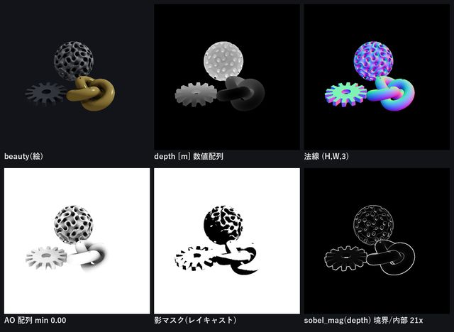
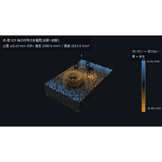
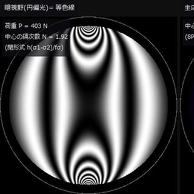
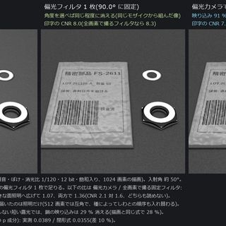
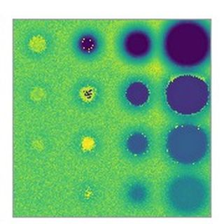
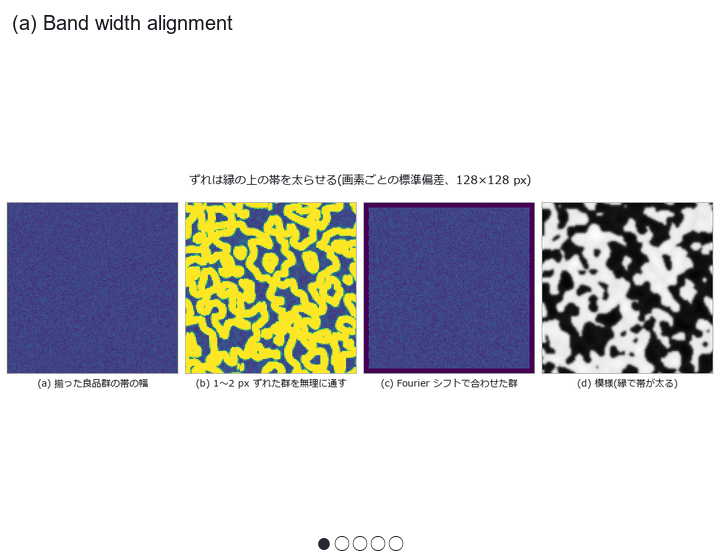
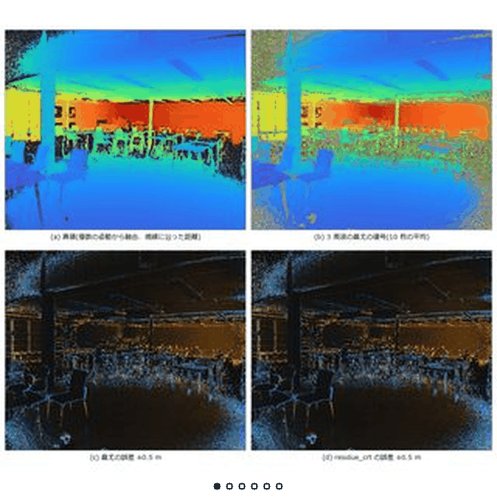
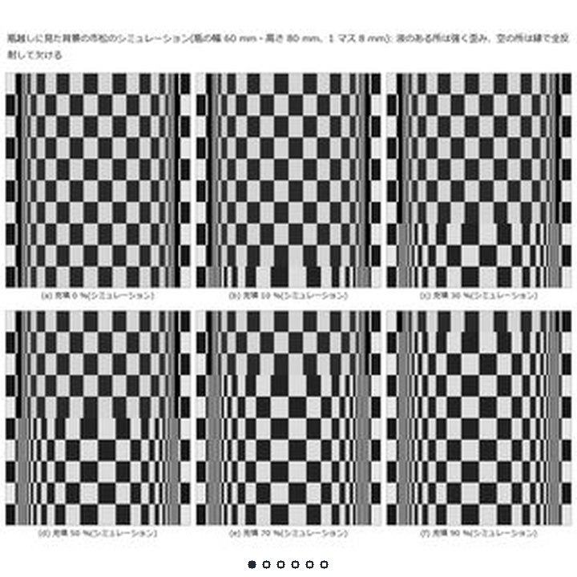
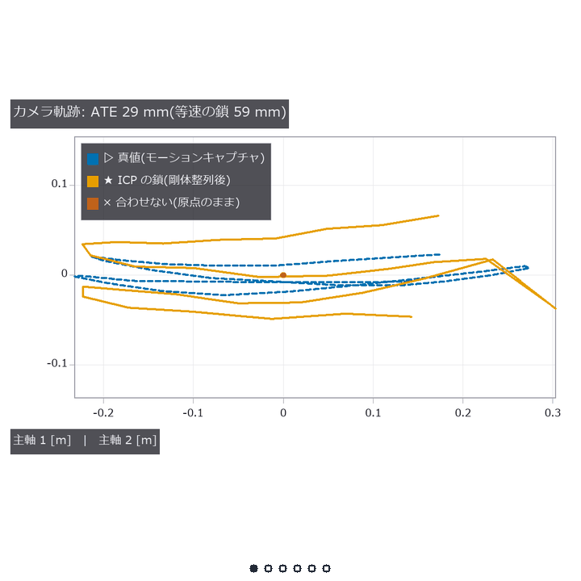

<div class="vlang" markdown="1">

[日本語](../index.md) · [English](../en/index.md) · [简体中文](../zh/index.md) · [繁體中文](../tw/index.md) · [한국어](../ko/index.md) · **Deutsch** · [हिन्दी](../hi/index.md) · [Français](../fr/index.md)

</div>

# Fullseye — ViEW2026

**Präsentation: Do., 3. Dez. 2026, 14:40–15:50 Uhr JST, Interaktive Session 2, IS2-19** (Pacifico Yokohama, Annex Hall)

<div class="vintro"><div class="vt"><p>Eine Plattform, die Physiksimulation (einschließlich Sensorik wie Optikdesign und 3-D-Messung) und klassische Bildverarbeitung über MCP und RAG an eine KI übergibt, sie für jede Aufgabe eine Kombination ausarbeiten lässt und die Aufgabe interaktiv löst, geprüft durch Typkonsistenz und Bewertung gegen Ground Truth. Open Source (Apache-2.0).</p></div></div>

Kachel antippen öffnet Video oder Abbildung (▶ = bewegt).

Diese Seite zeigt nur 20 Exponate. Die übrigen 294 stehen auf der [Zusatzseite](more.md).

<style>
.vlang { font-size: 14px; line-height: 2; }
.vg { display: grid; grid-template-columns: repeat(2, minmax(0, 1fr)); gap: 8px; margin: 12px 0 20px; }
.vg.vs { grid-template-columns: repeat(3, minmax(0, 1fr)); gap: 6px; }
@media (min-width: 600px) { .vg { grid-template-columns: repeat(3, minmax(0, 1fr)); } .vg.vs { grid-template-columns: repeat(5, minmax(0, 1fr)); } }
@media (min-width: 900px) { .vg { grid-template-columns: repeat(4, minmax(0, 1fr)); } .vg.vs { grid-template-columns: repeat(7, minmax(0, 1fr)); } }
.vg a, .vser a { display: block; position: relative; text-decoration: none; color: inherit; }
.vg img { display: block; width: 100%; max-width: 100%; height: auto; aspect-ratio: 1 / 1; object-fit: cover; border-radius: 6px; background: #222; }
.vg picture { display: block; width: 100%; aspect-ratio: 1 / 1; overflow: hidden; border-radius: 6px; background: #fff; }
.vg picture img { height: 100%; aspect-ratio: auto; object-fit: contain; border-radius: 0; background: #fff; }
.vg b { position: absolute; top: 6px; right: 6px; background: rgba(0,0,0,.6); color: #fff; font-size: 12px; padding: 1px 6px; border-radius: 9px; }
.vg span { display: block; font-size: 13px; line-height: 1.3; margin-top: 3px; }
.vg.vs span { font-size: 11px; }
.vser { display: grid; grid-template-columns: repeat(2, minmax(0, 1fr)); gap: 8px; margin: 12px 0 20px; }
@media (min-width: 600px) { .vser { grid-template-columns: repeat(3, minmax(0, 1fr)); } }
.vser img { display: block; width: 100%; max-width: 100%; height: auto; aspect-ratio: 16 / 9; object-fit: cover; border-radius: 8px; background: #222; }
.vser strong { display: block; font-size: 14px; margin-top: 3px; line-height: 1.3; }
.vser span { display: block; font-size: 12px; line-height: 1.3; }
details.vall { margin: 6px 0; }
details.vall > summary { font-size: 15px; padding: 6px 0; cursor: pointer; }
.vl li { margin-bottom: 8px; }
li, p, code { overflow-wrap: anywhere; }
.vintro { display: flex; gap: 20px; align-items: flex-start; margin: 14px 0; }
.vintro img { flex: 0 0 300px; width: 300px; max-width: 100%; height: auto; border-radius: 6px; }
.vintro .vt p { margin: 0 0 8px; }
.vc { display: flex; gap: 16px; align-items: flex-start; margin: 18px 0; }
.vc > a:first-child { flex: 0 0 260px; position: relative; display: block; text-decoration: none; color: inherit; }
.vc > a img { display: block; width: 100%; max-width: 100%; height: auto; aspect-ratio: 1 / 1; object-fit: cover; border-radius: 6px; background: #222; }
.vc > a picture { display: block; width: 100%; aspect-ratio: 1 / 1; overflow: hidden; border-radius: 6px; background: #fff; }
.vc > a picture img { height: 100%; aspect-ratio: auto; object-fit: contain; border-radius: 0; background: #fff; }
.vc > a b { position: absolute; top: 6px; right: 6px; background: rgba(0,0,0,.6); color: #fff; font-size: 12px; padding: 1px 6px; border-radius: 9px; }
.vt { flex: 1 1 auto; min-width: 0; }
.vt .vh { font-size: 17px; font-weight: 600; line-height: 1.4; margin: 0 0 6px; }
.vt p { margin: 0 0 6px; }
.vt .vm { font-size: 14px; color: #57606a; }
.vt details { font-size: 14px; margin: 4px 0; }
.vt summary { cursor: pointer; }
.vc.vv { margin: 10px 0; }
.vc.vv > a:first-child { flex-basis: 96px; }
@media (max-width: 600px) {
  .vintro { flex-direction: column-reverse; gap: 8px; }
  .vintro img { flex: 0 0 auto; width: 100%; max-width: 240px; }
  .vc { flex-direction: column; gap: 8px; }
  .vc > a:first-child { flex: 0 0 auto; width: 240px; max-width: 100%; }
  .vc.vv { flex-direction: row; gap: 12px; }
  .vc.vv > a:first-child { width: 80px; flex: 0 0 80px; }
}
</style>

## Selbst ausprobieren

Die Abbildungen der Arbeit lassen sich selbst bedienen, auch auf dem Smartphone. Methoden wechseln Sie über die Tabs, 3-D-Ansichten drehen Sie per Ziehen.

<div class="vc vv"><a class="vvi" href="../viewers/poc_cad_scan_deviation.html?lang=de"></a><div class="vt"><div class="vh"><a href="../viewers/poc_cad_scan_deviation.html?lang=de">CAD gegen Scan-Punktwolke</a></div><p>Die Ausrichtung schluckt Defekte: Ein Bauteil mit dem Sollwert 1.2 µm zeigt eine nicht vorhandene Delle von 121 µm.</p></div></div>

<div class="vc vv"><a class="vvi" href="../viewers/poc_photoelasticity.html?lang=de"></a><div class="vt"><div class="vh"><a href="../viewers/poc_photoelasticity.html?lang=de">Spannungsoptik</a></div><p>Beim Drehen des Analysators wandern die spannungsoptischen Streifen und die mittlere Intensität in der Scheibe ändert sich (im Bereich 0–135°)</p></div></div>

<div class="vc vv"><a class="vvi" href="../viewers/poc_polarization_specular.html?lang=de"></a><div class="vt"><div class="vh"><a href="../viewers/poc_polarization_specular.html?lang=de">Polarisation</a></div><p>Polarisation entfernt spiegelnde Reflexe; der Rest hängt vom Einfallswinkel ab und ist nahe dem Brewster-Winkel am kleinsten (Durchlauf an einer synthetischen Streifenszene)</p></div></div>

<div class="vc vv"><a class="vvi" href="../viewers/poc_thermography_ndt.html?lang=de"></a><div class="vt"><div class="vh"><a href="../viewers/poc_thermography_ndt.html?lang=de">Tiefenschätzung mit Impuls-Thermografie</a></div><p>Allein das Kürzen des Anpassungsfensters von 25 s auf 4 s verkleinert den größten Tiefenfehler der 8 kleinen Defekte von +612 % auf −14 %. Die Ursache war die Wahl des Fensters, nicht die Physik.</p></div></div>

## Im Mittelpunkt

Einige PoC-Beschreibungen sind auf Englisch.

<div class="vc"><a href="../../articles/assets/poc/poc_phase_measuring_deflectometry/03_photo_vs_pmd.png"><picture><source media="(prefers-reduced-motion: reduce)" srcset="../../articles/assets/poc/poc_phase_measuring_deflectometry/03_photo_vs_pmd.png"></picture></a><div class="vt"><div class="vh"><a href="../../articles/assets/poc/poc_phase_measuring_deflectometry/03_photo_vs_pmd.png">A dent invisible in a diffusely lit photo appears in a fringe mirror image (synthetic)</a></div><p>A very shallow dent in glossy paint barely shows in a photograph under diffuse light. Projecting fringes on a screen facing the surface and reading how their mirror image bends gives curvature, and a planted dent 3 µm deep stands out. This is a synthetic scene, and photographs under oblique light were not compared.</p><p class="vm">Ground Truth: Synthetisch · <a href="more.md#d-poc-phase-measuring-deflectometry">Details</a></p></div></div>

<div class="vc"><a href="../../articles/assets/poc/poc_industrial_oct/01_real_paint_bscans.png"><picture><source media="(prefers-reduced-motion: reduce)" srcset="../../articles/assets/poc/poc_industrial_oct/01_real_paint_bscans.png"></picture></a><div class="vt"><div class="vh"><a href="../../articles/assets/poc/poc_industrial_oct/01_real_paint_bscans.png">Paint layer thickness without cutting (industrial OCT)</a></div><p>We want to see paint and film layers in depth without cutting. Clear-coat thicknesses from public raw interference spectra of automotive paint agree within 3.6 µm with microscope measurements of the same panels. Agreement with the paper's own values only reproduces the same data, and the panel matching is inferred.</p><p class="vm">Ground Truth: Reale Daten · <a href="more.md#d-poc-industrial-oct">Details</a></p></div></div>

<div class="vc"><a href="../../articles/assets/poc/poc_hyperspectral_foreign_matter/04_real_pork_belly.png"><picture><source media="(prefers-reduced-motion: reduce)" srcset="../../articles/assets/poc/poc_hyperspectral_foreign_matter/01_real_polymer_flakes.png"></picture></a><div class="vt"><div class="vh"><a href="../../articles/assets/poc/poc_hyperspectral_foreign_matter/04_real_pork_belly.png">Finding foreign objects on pork belly with near-infrared spectral imaging</a></div><p>Public real images were used as near-infrared spectral data to classify debris lying on pork belly. Scored per pixel on separate captures, most of it was detected at 1.1 % false alarms. With fewer bands the false alarms grew, and that a colour camera fails on same-coloured matter is shown only on synthetic data.</p><p class="vm">Ground Truth: Reale Daten · <a href="more.md#d-poc-hyperspectral-foreign-matter">Details</a></p></div></div>

<div class="vc"><a href="../../articles/assets/poc/poc_thin_film_reflectometry/01_real_micrograph_thickness.png"><picture><source media="(prefers-reduced-motion: reduce)" srcset="../../articles/assets/poc/poc_thin_film_reflectometry/01_real_micrograph_thickness.png"></picture></a><div class="vt"><div class="vh"><a href="../../articles/assets/poc/poc_thin_film_reflectometry/01_real_micrograph_thickness.png">Reading oxide thickness from micrograph colours</a></div><p>Oxide thickness on silicon can be read from interference fringes and colours in reflected light. Read per pixel from a real micrograph published by others, the central value was 87.4 nm. That is about a tenth below the reference derived from the paper, and the camera's colour sensitivity is unknown.</p><p class="vm">Ground Truth: Reale Daten · <a href="more.md#d-poc-thin-film-reflectometry">Details</a></p></div></div>

<div class="vc"><a href="../../articles/assets/poc/poc_telecentric_metrology/08_real_alignment_plate.png"><picture><source media="(prefers-reduced-motion: reduce)" srcset="../../articles/assets/poc/poc_telecentric_metrology/08_real_alignment_plate.png"></picture></a><div class="vt"><div class="vh"><a href="../../articles/assets/poc/poc_telecentric_metrology/08_real_alignment_plate.png">Magnification measured on public telecentric images agrees with the paper within the paper's own spread</a></div><p>In one image, a stepped part looks larger where it is nearer through an ordinary lens. The magnification measured on public real images from a telecentric lens agrees with the paper, whose own values spread by ±0.25 %, so the match is not read as finer. Ring centres on a tilted plate that do not drift are evidence.</p><p class="vm">Ground Truth: Reale Daten · <a href="more.md#d-poc-telecentric-metrology">Details</a></p></div></div>

<div class="vc"><a href="../../articles/assets/poc/poc_virtual_sem_kv_cd_bse/05_sem_same_part_3kv_3detectors.png"><picture><source media="(prefers-reduced-motion: reduce)" srcset="../../articles/assets/poc/poc_virtual_sem_kv_cd_bse/05_sem_same_part_3kv_3detectors.png"></picture></a><div class="vt"><div class="vh"><a href="../../articles/assets/poc/poc_virtual_sem_kv_cd_bse/05_sem_same_part_3kv_3detectors.png">Virtual SEM: the image changes with voltage (model scored against measured backscatter)</a></div><p>An SEM image is not a photo of the surface but a tally of electrons escaping after scattering in the solid. A model that tracks each electron was checked against measured backscatter data for 7 elements. With no real images of known linewidth, the shift of the linewidth reading with beam energy stays inside the model.</p><p class="vm">Ground Truth: Veröffentlichte Werte · <a href="more.md#d-poc-virtual-sem-kv-cd-bse">Details</a></p></div></div>

<div class="vc"><a href="../../articles/assets/poc/poc_cad_scan_deviation/14_align_orbit.gif"><picture><source media="(prefers-reduced-motion: reduce)" srcset="../../articles/assets/poc/poc_cad_scan_deviation/01_scene.png"></picture><b>&#9654;</b></a><div class="vt"><div class="vh"><a href="../../articles/assets/poc/poc_cad_scan_deviation/14_align_orbit.gif">The alignment decides where a part looks out of tolerance: CAD versus scan</a></div><p>Aligning a scan to its design absorbs part of the deviation and moves where it looks out of tolerance. On a part with a known warp, a reading 121 µm deep appears at the centre where the true deviation is tiny. This is synthetic, and a point-sampled design shows out-of-tolerance edges even without a defect.</p><p class="vm">Ground Truth: Synthetisch · <a href="more.md#d-poc-cad-scan-deviation">Details</a></p></div></div>

<div class="vc"><a href="../../articles/assets/poc/poc_good_sample_variation_model/04_visa_explanation.png"><picture><source media="(prefers-reduced-motion: reduce)" srcset="../../articles/assets/poc/poc_good_sample_variation_model/01_band_width_alignment.png"></picture></a><div class="vt"><div class="vh"><a href="../../articles/assets/poc/poc_good_sample_variation_model/04_visa_explanation.png">Flagging defects from good-part variation: the declared false-alarm rate fails on real images</a></div><p>A classic inspection learns the usual per-pixel variation from good parts and flags what falls outside. Here the band is set by a false-alarm rate declared in advance and scored on 200 public real images. Alignment mattered more than the number of good parts, and the declared rate was not kept.</p><p class="vm">Ground Truth: Reale Daten · <a href="more.md#d-poc-good-sample-variation-model">Details</a></p></div></div>

<div class="vc"><a href="../../articles/assets/poc/poc_itof_multifreq/12_public_raw_unwrap.png"><picture><source media="(prefers-reduced-motion: reduce)" srcset="../../articles/assets/poc/poc_itof_multifreq/01_warehouse_unwrap.png"></picture></a><div class="vt"><div class="vh"><a href="../../articles/assets/poc/poc_itof_multifreq/12_public_raw_unwrap.png">Where indirect ToF depth breaks (synthetic)</a></div><p>An indirect ToF camera measures distance from the phase delay of modulated light. On synthetic signals, combining three frequencies keeps the distance unambiguous out to 18.7 m. Multipath and object edges make the distance jump without any warning.</p><p class="vm">Ground Truth: Synthetisch · <a href="more.md#d-poc-itof-multifreq">Details</a></p></div></div>

<div class="vc"><a href="../../articles/assets/poc/poc_ai_built_inspection_scored/01_crack_real.png"><picture><source media="(prefers-reduced-motion: reduce)" srcset="../../articles/assets/poc/poc_ai_built_inspection_scored/01_crack_real.png"></picture></a><div class="vt"><div class="vh"><a href="../../articles/assets/poc/poc_ai_built_inspection_scored/01_crack_real.png">An AI assembles inspections, scored on public real data (local LLMs rarely succeed)</a></div><p>We gave a local LLM a task in natural language and let it assemble an inspection recipe through MCP alone. Scored per image on 400 public crack images against the labels from their source, it produced a sorting recipe in only a few runs. It never managed the candle task and stayed below the existing recipes.</p><p class="vm">Ground Truth: Reale Daten · <a href="more.md#d-poc-ai-built-inspection-scored">Details</a></p></div></div>

<div class="vc"><a href="../../articles/assets/poc/poc_bottle_pattern_inverse/01_checker_through_bottle.png"><picture><source media="(prefers-reduced-motion: reduce)" srcset="../../articles/assets/poc/poc_bottle_pattern_inverse/01_checker_through_bottle.png"></picture></a><div class="vt"><div class="vh"><a href="../../articles/assets/poc/poc_bottle_pattern_inverse/01_checker_through_bottle.png">Reading a glass bottle back from background stripes (simulation): recovery under shared assumptions, and what cannot be separated</a></div><p>A transparent bottle distorts the stripes behind it. For each pixel we find where the background is seen, fit the bottle geometry and indices backwards, and score 5 fill states against the true values of the simulation. Quantities that are inseparable are reported too, and nothing was checked on a real bottle.</p><p class="vm">Ground Truth: Synthetisch · <a href="more.md#d-poc-bottle-pattern-inverse">Details</a></p></div></div>

<div class="vc"><a href="../../articles/assets/poc/poc_real_tum_rgbd_slam/02_trajectory.png"><picture><source media="(prefers-reduced-motion: reduce)" srcset="../../articles/assets/poc/poc_real_tum_rgbd_slam/02_trajectory.png"></picture></a><div class="vt"><div class="vh"><a href="../../articles/assets/poc/poc_real_tum_rgbd_slam/02_trajectory.png">Scoring frame-to-frame alignment on public RGB-D data: whether it beats a constant-velocity guess depends on the split</a></div><p>On one public sequence of desk depth images, frame-to-frame alignment was checked against motion-capture truth. Error fell to 0.42 times even on the worst split, but whether it beats a steady-speed guess hinges on how frames are split. Small-window plane residuals grew with distance, and no square law was confirmed.</p><p class="vm">Ground Truth: Reale Daten · <a href="more.md#d-poc-real-tum-rgbd-slam">Details</a></p></div></div>

<div class="vc"><a href="../../articles/assets/poc/poc_real_walnut_cbct/07_geometry_mistakes.png"><picture><source media="(prefers-reduced-motion: reduce)" srcset="../../articles/assets/poc/poc_real_walnut_cbct/07_geometry_mistakes.png"></picture></a><div class="vt"><div class="vh"><a href="../../articles/assets/poc/poc_real_walnut_cbct/07_geometry_mistakes.png">Measured CT: ignoring the vertical offset reconstructs a different slice, and only an outside reference reveals it</a></div><p>A walnut was really scanned in a cone beam and reconstructed with FDK and iterative methods. With 300 projections scored against the authors' reference, neglecting the vertical shift rebuilds a different slice, further away. Those data are self-consistent, so the residual after reprojecting cannot change.</p><p class="vm">Ground Truth: Reale Daten · <a href="more.md#d-poc-real-walnut-cbct">Details</a></p></div></div>

<div class="vc"><a href="../../articles/assets/poc/poc_3d_sensor_modalities/01_map.png"><picture><source media="(prefers-reduced-motion: reduce)" srcset="../../articles/assets/poc/poc_3d_sensor_modalities/01_map.png"></picture></a><div class="vt"><div class="vh"><a href="../../articles/assets/poc/poc_3d_sensor_modalities/01_map.png">Simulating five 3-D sensing methods on one part: where each breaks, by material</a></div><p>In this simulation, models of several depth-sensing methods measure one part in matte, glossy metal, translucent and black materials. Shape errors were counted with a common 0.1 mm yardstick and compared with the dimension table. Their resolutions differ by orders of magnitude, so read where each breaks, not a ranking.</p><p class="vm">Ground Truth: Synthetisch · <a href="more.md#d-poc-3d-sensor-modalities">Details</a></p></div></div>

## Weitere Empfehlungen

Einige PoC-Beschreibungen sind auf Englisch.

<div class="vc"><a href="../../articles/assets/poc/poc_equipment_selection_map/02_equipment_at_a_glance.png"><picture><source media="(prefers-reduced-motion: reduce)" srcset="../../articles/assets/poc/poc_equipment_selection_map/02_equipment_at_a_glance.png"></picture></a><div class="vt"><div class="vh"><a href="../../articles/assets/poc/poc_equipment_selection_map/02_equipment_at_a_glance.png">Equipment map: the same flaws through 60 light, camera and lens sets (synthetic test)</a></div><p>We pre-tested visual inspection equipment on the same flaw. With 60 combinations of lighting, camera and lens we mapped how small a flaw is found, with the spread across repeats. It is a synthetic test, not the performance of real equipment.</p><p class="vm">Ground Truth: Synthetisch · <a href="more.md#d-poc-equipment-selection-map">Details</a></p></div></div>

<div class="vc"><a href="../../articles/assets/poc/poc_real_stereo_multiscanline/02_failure_map.png"><picture><source media="(prefers-reduced-motion: reduce)" srcset="../../articles/assets/poc/poc_real_stereo_multiscanline/02_failure_map.png"></picture></a><div class="vt"><div class="vh"><a href="../../articles/assets/poc/poc_real_stereo_multiscanline/02_failure_map.png">Disparity, surface and circle pose from real stereo</a></div><p>Using a real pair of stereo images, we compute disparity, distance, surfaces and even the pose of a circle. The result is scored with the true disparity that Middlebury 2014 supplies and compared with OpenCV. On pixels valid in both, the two are about equal, and most of the gap is which pixels each invalidates.</p><p class="vm">Ground Truth: Reale Daten · <a href="more.md#d-poc-real-stereo-multiscanline">Details</a></p></div></div>

<div class="vc"><a href="../../articles/assets/poc/poc_real_defect_floor/03_defect_floor_explained.mp4"><b>&#9654;</b></a><div class="vt"><div class="vh"><a href="../../articles/assets/poc/poc_real_defect_floor/03_defect_floor_explained.mp4">Matched noise, yet weak flaws hide on real backgrounds</a></div><p>Inspection teams often estimate how weak a flaw they can catch on a synthetic image of a flat field plus noise. With the noise level matched, real backgrounds raised the detection limit, by 3.47 times on the worst, a brick wall. The limit was set not by noise but by structure in the background, such as mortar joints.</p><p class="vm">Ground Truth: Realer Hintergrund · <a href="more.md#d-poc-real-defect-floor">Details</a></p></div></div>

<div class="vc"><a href="../../articles/assets/poc/poc_sam_hybrid_bonding_voids/03_amplitude_vs_phase.png"><picture><source media="(prefers-reduced-motion: reduce)" srcset="../../articles/assets/poc/poc_sam_hybrid_bonding_voids/03_amplitude_vs_phase.png"></picture></a><div class="vt"><div class="vh"><a href="../../articles/assets/poc/poc_sam_hybrid_bonding_voids/03_amplitude_vs_phase.png">Finding bond-plane voids by ultrasonic echo phase (simulation)</a></div><p>This simulation searches for small voids in the bonding plane of stacked chips with a scanning acoustic microscope. The voids of 16 um or more appeared inverted and bright in the echo-phase image. In the brightness image many small voids hide among good pixels.</p><p class="vm">Ground Truth: Synthetisch · <a href="more.md#d-poc-sam-hybrid-bonding-voids">Details</a></p></div></div>

<div class="vc"><a href="../../articles/assets/poc/poc_photoelasticity/03_load_and_isoclinics.mp4"><picture><source media="(prefers-reduced-motion: reduce)" srcset="../../articles/assets/poc/poc_photoelasticity/01_polariscope.png"></picture><b>&#9654;</b></a><div class="vt"><div class="vh"><a href="../../articles/assets/poc/poc_photoelasticity/03_load_and_isoclinics.mp4">Stress in a squeezed disc shows as fringes (photoelasticity, synthetic)</a></div><p>Through polarisers, a loaded transparent plastic shows its internal stress as fringes. Stress in a squeezed disc was recovered from polarisation images, including pixels where the fringe order exceeds 0.5 and the phase wraps. Most errors left after unwrapping came from the well-known sign ambiguity, not the wrapping.</p><p class="vm">Ground Truth: Synthetisch · <a href="more.md#d-poc-photoelasticity">Details</a></p></div></div>

<div class="vc"><a href="../../articles/assets/poc/poc_mixed_case_depalletizing/08_depal_robot_video.mp4"><picture><source media="(prefers-reduced-motion: reduce)" srcset="../../articles/assets/poc/poc_mixed_case_depalletizing/01_overview_same_pattern.png"></picture><b>&#9654;</b></a><div class="vt"><div class="vh"><a href="../../articles/assets/poc/poc_mixed_case_depalletizing/08_depal_robot_video.mp4">Mixed cartons: depth step, V-groove or colour groove (simulation)</a></div><p>In a rendered scene, packed cartons with identical prints are told apart from overhead depth and colour, then unloaded. A depth step splits none, and whether depth dips or dark colour lines win flips across 28 flap-seam builds. The outcome depends strongly on how the scene is built, such as edge rounding and the seams.</p><p class="vm">Ground Truth: Synthetisch · <a href="more.md#d-poc-mixed-case-depalletizing">Details</a></p></div></div>

## Artikelserien (englische Artikel auf Qiita)

<div class="vser">
<a href="https://qiita.com/furuse-kazufumi/items/8a8f23e53b19ee8cdc10"><strong>Ein Messmuseum auf Papier</strong><span>PoCs mit selbst gesetzter Ground Truth</span></a>
<a href="https://qiita.com/furuse-kazufumi/items/a82bf9f341cc4f04ca75"><strong>Tischtennis</strong><span>Absprung und Reibung aus Video</span></a>
<a href="https://qiita.com/furuse-kazufumi/items/05de90f4d316cd7c681c"><strong>Autonomes Fahren</strong><span>Bewertet mit Sätzen und Zweitimplementierungen</span></a>
<a href="https://qiita.com/furuse-kazufumi/items/638f0b0aa7865e17c67c"><strong>Konnektom (Gehirnverdrahtung)</strong><span>Ein Fliegen-Sehmodell im Körper, gemessen</span></a>
<a href="https://qiita.com/furuse-kazufumi/items/569720dbae0c6471c96e"><strong>Humanoiden-Sportfest</strong><span>Ein Sportfest daheim, Schiedsrichter ist die Bildverarbeitung</span></a>
</div>

Siehe auch die [Zusatzseite: weitere PoCs](more.md).

<details markdown="1">
<summary><b>Ausprobieren</b> (Python 3.11)</summary>

```
pip install fullseye
git clone https://github.com/furuse-kazufumi/fullseye
cd fullseye
python examples/poc_focus_stacking.py
```

Der Fokus-Stacking-PoC läuft etwa 20 Sekunden und gibt seine Zahlen gegen Ground Truth sowie `PASS` aus. Abbildungen landen in `out/figures/poc_focus_stacking/`.

</details>

<details markdown="1">
<summary><b>Links</b></summary>

- [GitHub (Quellcode)](https://github.com/furuse-kazufumi/fullseye)
- [Galerie (alle Abbildungen)](../../GALLERY.en.md)
- [Operatoren finden / aus einer KI nutzen (RAG)](../../AI_RAG_GUIDE.de.md) · [Über MCP nutzen](../../MCP.md) _(ja)_
- [Dokumentationsindex](../../README.de.md)

</details>

<details markdown="1">
<summary><b>Paper</b></summary>

- **Titel**: Fullseye：型付き演算子と物理シミュレーションに基づく画像検査・三次元計測基盤 _(ja)_ (eine Plattform für Bildprüfung und 3-D-Messung auf Basis typisierter Operatoren und Physiksimulation)
- **Autor**: Kazufumi Furuse (unabhängiger Forscher)
- **Veranstaltung**: ViEW2026, Workshop zur praktischen Anwendung von Bildverarbeitung
- **Paper-PDF**: [English](../paper/101_en.pdf) · [简体中文](../paper/101_zh.pdf)(日本語: ab 2026-11-26 verfügbar)

**Zusammenfassung (aus dem Japanischen übersetzt)**: Wir stellen Fullseye vor, eine Open-Source-Plattform, die Verarbeitungen für Bildprüfung und 3-D-Messung als Ketten von Operatoren mit deklarierten Ein- und Ausgabedatentypen aufbaut, sie quantitativ gegen eine durch Physik- und Abbildungssimulation erzeugte Ground Truth bewertet und Ablauf, Bewertung und Fehlerbedingungen zur Wiederverwendung festhält. Sie besteht aus rund 3,000 typisierten Operatoren, einer Prüfung, die Typfehler vor der Ausführung ablehnt, einer mehrsprachigen Operatorsuche (RAG) und über 200 Machbarkeitsprogrammen mit Ground Truth. Berichtet werden die quantitative Bewertung repräsentativer Beispiele und die Unterscheidung zwischen synthetischer, gemessener und Hardware-Validierung.

</details>
