<div class="vlang" markdown="1">

[日本語](../index.md) · **English** · [简体中文](../zh/index.md) · [繁體中文](../tw/index.md) · [한국어](../ko/index.md) · [Deutsch](../de/index.md) · [हिन्दी](../hi/index.md) · [Français](../fr/index.md)

</div>

# Fullseye — ViEW2026

Physics simulation and image processing, combined with AI and checked against ground truth.

**Presenting: Thu 3 Dec 2026, 14:40–15:50 JST, Interactive Session 2, IS2-19** (Pacifico Yokohama)

Tap a tile to open the video or figure (▶ = moving).

[About Fullseye (reading)](about.md)

This page shows only 20 exhibits. The other 293 are on the [Extras page](more.md).

<style>
.vlang { font-size: 14px; line-height: 2; }
.vg { display: grid; grid-template-columns: repeat(2, minmax(0, 1fr)); gap: 8px; margin: 12px 0 20px; }
.vg.vs { grid-template-columns: repeat(3, minmax(0, 1fr)); gap: 6px; }
@media (min-width: 600px) { .vg { grid-template-columns: repeat(3, minmax(0, 1fr)); } .vg.vs { grid-template-columns: repeat(5, minmax(0, 1fr)); } }
@media (min-width: 900px) { .vg { grid-template-columns: repeat(4, minmax(0, 1fr)); } .vg.vs { grid-template-columns: repeat(7, minmax(0, 1fr)); } }
.vg a, .vser a { display: block; position: relative; text-decoration: none; color: inherit; }
.vg img { display: block; width: 100%; max-width: 100%; height: auto; aspect-ratio: 1 / 1; object-fit: cover; border-radius: 6px; background: #222; }
.vg picture { display: block; width: 100%; aspect-ratio: 1 / 1; overflow: hidden; border-radius: 6px; background: #fff; }
.vg picture img { height: 100%; aspect-ratio: auto; object-fit: contain; border-radius: 0; background: #fff; }
.vg b { position: absolute; top: 6px; right: 6px; background: rgba(0,0,0,.6); color: #fff; font-size: 12px; padding: 1px 6px; border-radius: 9px; }
.vg span { display: block; font-size: 13px; line-height: 1.3; margin-top: 3px; }
.vg.vs span { font-size: 11px; }
.vser { display: grid; grid-template-columns: repeat(2, minmax(0, 1fr)); gap: 8px; margin: 12px 0 20px; }
@media (min-width: 600px) { .vser { grid-template-columns: repeat(3, minmax(0, 1fr)); } }
.vser img { display: block; width: 100%; max-width: 100%; height: auto; aspect-ratio: 16 / 9; object-fit: cover; border-radius: 8px; background: #222; }
.vser strong { display: block; font-size: 14px; margin-top: 3px; line-height: 1.3; }
.vser span { display: block; font-size: 12px; line-height: 1.3; }
details.vall { margin: 6px 0; }
details.vall > summary { font-size: 15px; padding: 6px 0; cursor: pointer; }
.vl li { margin-bottom: 8px; }
</style>

## Try it yourself

Run the paper's figures yourself, on a phone too. Switch methods with the tabs and drag the 3-D views to rotate them.

- **[Layer structure in industrial OCT](../viewers/industrial_oct_anim3d.html?lang=en)**: Sweep through depth and explore a coating B-scan and its layer-thickness measurement. (4.0 MB)
- **[Surface shape by deflectometry](../viewers/phase_measuring_deflectometry_anim3d.html?lang=en)**: Sweep the fringe phase and watch a surface dent invisible in a photograph emerge. (14.9 MB)
- **[CAD versus a scanned point cloud](../viewers/poc_cad_scan_deviation.html?lang=en)**: Alignment absorbs defects: a part whose true value is 1.2 µm shows a 121 µm dent that does not exist.
- **[LiDAR terrain change](../viewers/poc_lidar_terrain_change.html?lang=en)**: Plain differencing makes the whole unchanged block look 0.183 m lower. Correct it and only the real change is left.
- **[Template tracking](../viewers/poc_template_tracking.html?lang=en)**: Even after it switches to a look-alike object, the tracker keeps reporting 'found'.
- **[Pulse thermography depth](../viewers/poc_thermography_ndt.html?lang=en)**: Cutting the fit window from 25 s to 4 s shrinks the worst depth error of small flaws from +627% to ±14%. The cause was the choice of window, not the physics.
- **[Talbot carpet and grating X-ray images](../viewers/poc_grating_interferometry.html?lang=en)**: In absorption the crack's contrast-to-noise ratio is only 1.34; in dark field it rises to 13.5, and turning the grating even reveals the fibre direction.
- **[Micron dents in a mirror image of stripes](../viewers/poc_phase_measuring_deflectometry.html?lang=en)**: In a photograph the signal is 0.17 times the noise and nothing shows; in the curvature map built from the mirror image of stripes, a dent 1 µm deep stands 57 times above the noise.
- **[How sharply an asteroid's surface bends](../viewers/poc_asteroid_curvature.html?lang=en)**: Curvature computed from the points of a real asteroid, with ridges and boulder edges shown in colour. The ruler is checked first on a sphere whose answer is known.
- **[Focus stacking](../viewers/poc_focus_stacking.html?lang=en)**: Raising the f-number brings the focus-stacked image closer to the true texture
- **[White-light steps](../viewers/poc_interferometry_step.html?lang=en)**: More noise widens the step error in white-light interferometry
- **[Polarization](../viewers/poc_polarization_specular.html?lang=en)**: Polarisation strips specular glare; what remains changes with incidence angle and is smallest near the Brewster angle (swept on a synthetic fringe scene)
- **[Photoelasticity](../viewers/poc_photoelasticity.html?lang=en)**: Rotating the analyser moves the photoelastic fringes and changes the mean intensity inside the disc (over 0–135°)
- **[Fly compound eye](../viewers/poc_compound_eye.html?lang=en)**: Higher per-view SNR brings the compound-eye image closer to its noise-free image
- **[Joint voids (CT)](../viewers/poc_ct_void_morphology.html?lang=en)**: Raising the threshold expands the segmented voids and increases their volume fraction
- **[Active contours](../viewers/poc_active_contours.html?lang=en)**: More iterations bring the GVF contour closer to its final shape

## Showcase

Some PoC descriptions are in English.

<div class="vg">
<a href="../../articles/assets/poc/poc_phase_measuring_deflectometry/03_photo_vs_pmd.png"><picture><source media="(prefers-reduced-motion: reduce)" srcset="../../articles/assets/poc/poc_phase_measuring_deflectometry/03_photo_vs_pmd.png"></picture><span>A dent invisible in photos appears in a fringe mirror image</span></a>
<a href="../../articles/assets/poc/poc_industrial_oct/01_real_paint_bscans.png"><picture><source media="(prefers-reduced-motion: reduce)" srcset="../../articles/assets/poc/poc_industrial_oct/01_real_paint_bscans.png"></picture><span>Paint layer thickness without cutting (industrial OCT)</span></a>
<a href="../../articles/assets/poc/poc_hyperspectral_foreign_matter/04_real_pork_belly.png"><picture><source media="(prefers-reduced-motion: reduce)" srcset="../../articles/assets/poc/poc_hyperspectral_foreign_matter/01_real_polymer_flakes.png">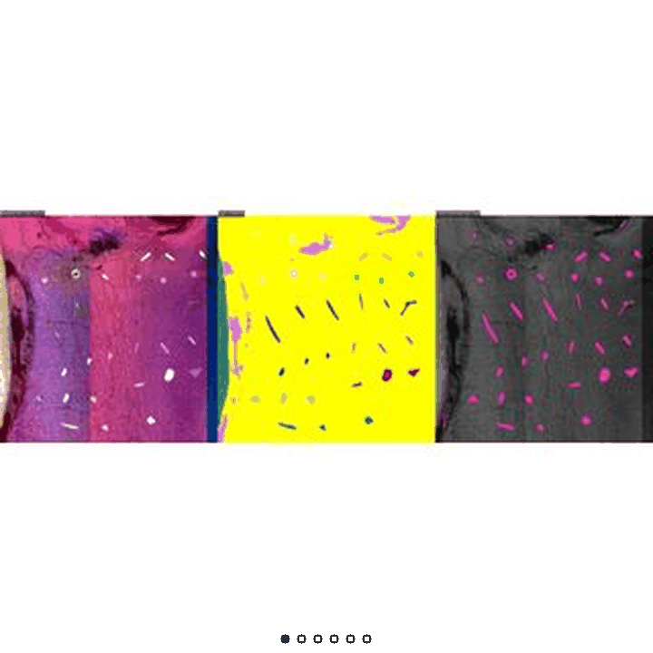</picture><span>Finding meat-coloured foreign matter with spectral imaging</span></a>
<a href="../../articles/assets/poc/poc_thin_film_reflectometry/01_real_micrograph_thickness.png"><picture><source media="(prefers-reduced-motion: reduce)" srcset="../../articles/assets/poc/poc_thin_film_reflectometry/01_real_micrograph_thickness.png"></picture><span>Oxide thickness mapped from micrograph colours</span></a>
<a href="../../articles/assets/poc/poc_telecentric_metrology/08_real_alignment_plate.png"><picture><source media="(prefers-reduced-motion: reduce)" srcset="../../articles/assets/poc/poc_telecentric_metrology/08_real_alignment_plate.png">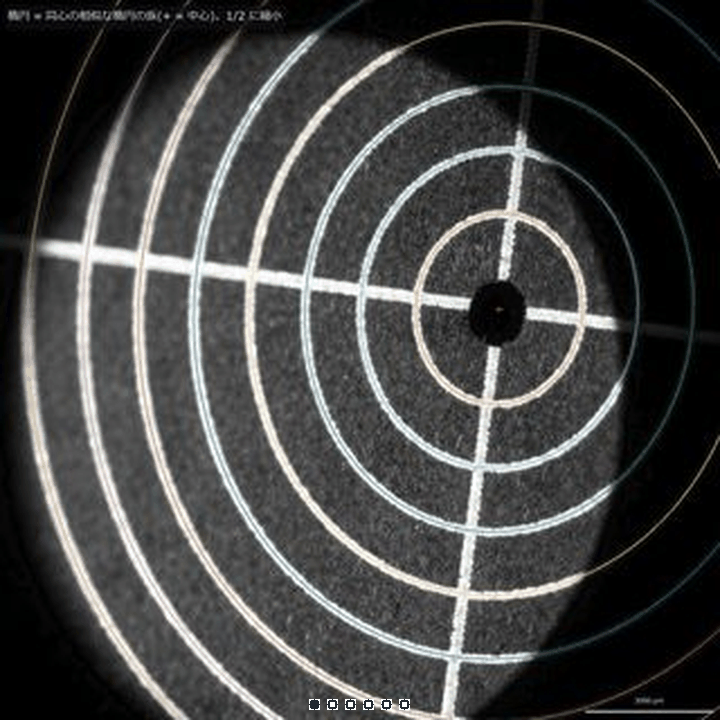</picture><span>Magnification checked to 0.05 % on public telecentric images</span></a>
<a href="../../articles/assets/poc/poc_virtual_sem_kv_cd_bse/05_sem_same_part_3kv_3detectors.png"><picture><source media="(prefers-reduced-motion: reduce)" srcset="../../articles/assets/poc/poc_virtual_sem_kv_cd_bse/05_sem_same_part_3kv_3detectors.png"></picture><span>Virtual SEM: voltage changes both image and line width</span></a>
<a href="../../articles/assets/poc/poc_cad_scan_deviation/14_align_orbit.gif"><picture><source media="(prefers-reduced-motion: reduce)" srcset="../../articles/assets/poc/poc_cad_scan_deviation/01_scene.png"></picture><b>&#9654;</b><span>Alignment hides defects: CAD versus scan</span></a>
<a href="../../articles/assets/poc/poc_good_sample_variation_model/04_visa_explanation.png"><picture><source media="(prefers-reduced-motion: reduce)" srcset="../../articles/assets/poc/poc_good_sample_variation_model/01_band_width_alignment.png">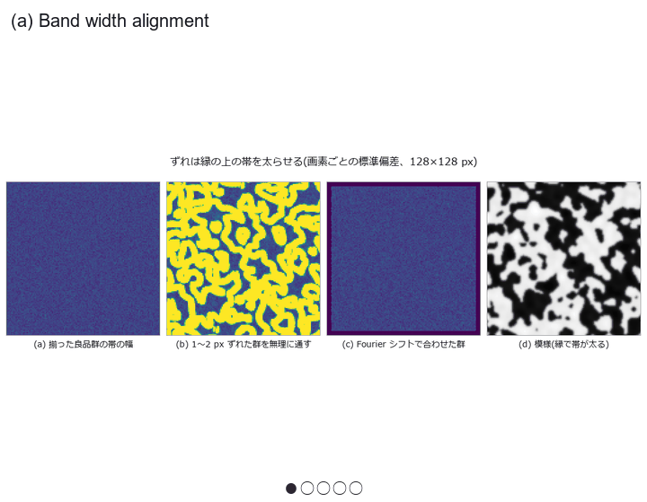</picture><span>Flagging defects from good-part variation: the declared false-alarm rate fails on real images</span></a>
<a href="../../articles/assets/poc/poc_code_matching_breakdown/05_highlight_sweep.gif"><picture><source media="(prefers-reduced-motion: reduce)" srcset="../../articles/assets/poc/poc_code_matching_breakdown/01_breakdown_occlusion.png">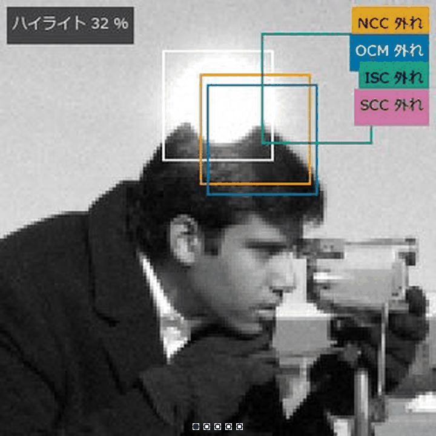</picture><b>&#9654;</b><span>Code matching that survives glare and occlusion</span></a>
<a href="../../articles/assets/poc/poc_ai_built_inspection_scored/01_crack_real.png"><picture><source media="(prefers-reduced-motion: reduce)" srcset="../../articles/assets/poc/poc_ai_built_inspection_scored/01_crack_real.png"></picture><span>Scoring inspections built by an AI on real data</span></a>
<a href="../../articles/assets/poc/poc_bottle_pattern_inverse/01_checker_through_bottle.png"><picture><source media="(prefers-reduced-motion: reduce)" srcset="../../articles/assets/poc/poc_bottle_pattern_inverse/01_checker_through_bottle.png">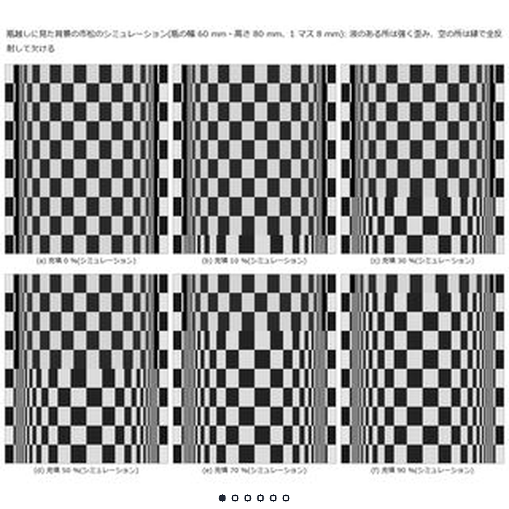</picture><span>Reading a glass bottle back from background stripes (simulation): recovery under shared assumptions, what cannot be separated or detected</span></a>
<a href="../../articles/assets/poc/poc_real_tum_rgbd_slam/02_trajectory.png"><picture><source media="(prefers-reduced-motion: reduce)" srcset="../../articles/assets/poc/poc_real_tum_rgbd_slam/02_trajectory.png">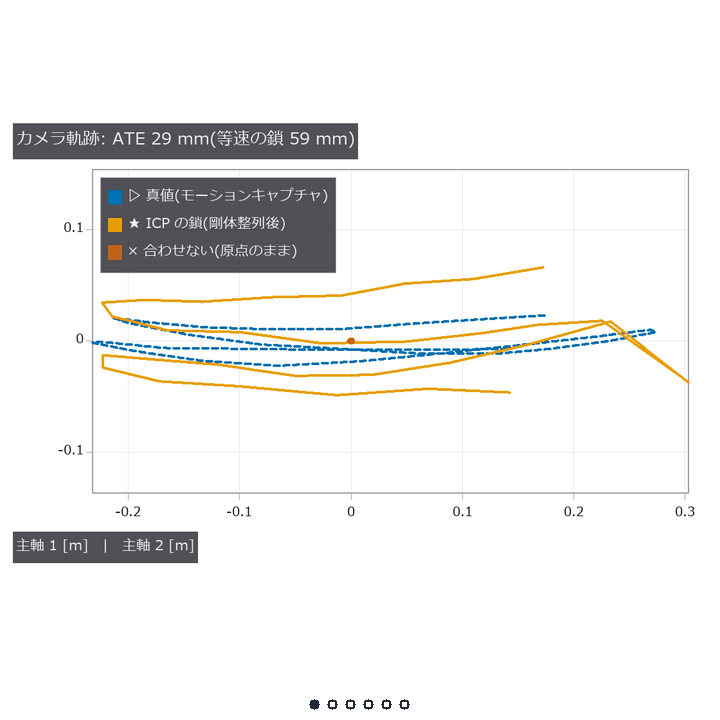</picture><span>Scoring Frame-to-Frame Alignment on Public RGB-D Data: The Error Falls to 0.42 Times, About Level With a Constant-Velocity Guess</span></a>
<a href="../../articles/assets/poc/poc_real_walnut_cbct/07_geometry_mistakes.png"><picture><source media="(prefers-reduced-motion: reduce)" srcset="../../articles/assets/poc/poc_real_walnut_cbct/07_geometry_mistakes.png"></picture><span>Measured CT: ignoring the vertical offset lands 2.6x farther from the reference, yet the residual cannot tell</span></a>
<a href="../../articles/assets/poc/poc_3d_sensor_modalities/01_map.png"><picture><source media="(prefers-reduced-motion: reduce)" srcset="../../articles/assets/poc/poc_3d_sensor_modalities/01_map.png"></picture><span>One part, five 3-D sensing methods</span></a>
</div>

<div class="vl" markdown="1">

- [A dent invisible in photos appears in a fringe mirror image](../../articles/assets/poc/poc_phase_measuring_deflectometry/03_photo_vs_pmd.png) (figure): A very shallow dent in glossy paint is practically invisible in an ordinary photograph. Projecting fringes on a screen in front of the surface and reading how their mirror image bends gives curvature, and a dent 3 µm deep stands out clearly. The flat-looking photo sits next to curvature maps in which the dents appear.
  A dent a few micrometres deep in a glossy surface (a painted car panel, a cover glass) is all but invisible in a lit photograph, because a mirror only shows the light. Put a screen in front of the surface, show phase-shifted fringes and photograph their mirror image: a tilt of 1e-3 rad moves the reflected point 0.6 mm on a screen 30 cm away. Six new ops (`deflectometry`, category `deflectometry` of `opsspecular`): the rig, the screen pattern, the forward render (height field to fringe mirror image, with a diffuse fraction, scatter, the back reflection of glass, aperture-integrated focus and noise), phase to normals (via `match3d.normal_from_reflection`), slope to curvature (one derivative, no integration) and the closed-form sensitivity.  **On a painted panel with 3 µm and 1 µm dents, 0.8 µm waviness and 0.12 µm polishing marks the photograph's defect signal peaks at 0.00066 (0.17 of one 8-bit step) while the curvature map shows the dents at SNR 110 and 57, and the integrated depth is within 0.5 % of the truth. Phase noise matches sqrt(2/N) sigma/b at 1.00 and slope noise is 0.67 of sigma_u/(2d), the sqrt(4/9) of bilinear resampling. Where it breaks: lifting the part by 0.3 mm adds the apparent tilt dz sin(theta)/d (to 0.1 %) and a 388 m bowl while the dent depth moves 0.7 %; a 2 % screen-distance error makes dents 2.3 % shallower; a 1 µm dent survives a diffuse fraction of 0.85 and fringe orders start to jump at 0.9; on uncoated cover glass the back-surface light is bent the other way by the dent's wedge, so the slope sensitivity shrinks to the closed-form 0.246 (measured 0.246) and dents look a quarter as deep; with an 8 mm aperture, focusing on the surface leaves 0.60 of the fringe amplitude and focusing on the screen leaves 0.52 of the depth. Nothing learned, nothing calibrated, 22 gates.** [source](https://github.com/furuse-kazufumi/fullseye/blob/master/examples/poc_phase_measuring_deflectometry.py)
  Fullseye ops used: `absolute_phase` · `deflectometry_phase_to_slope` · `deflectometry_render` · `deflectometry_rig` · `deflectometry_screen_pattern` · `deflectometry_sensitivity` · `fresnel_dielectric` · `integrate` · `sfp_height` · `slope_to_curvature` · `text_box` · `wrapped_phase`
- [Paint layer thickness without cutting (industrial OCT)](../../articles/assets/poc/poc_industrial_oct/01_real_paint_bscans.png) (figure): We want to see the layers of paint and multilayer film in depth without cutting them. Clear-coat thicknesses computed from public raw interference spectra of automotive paint agree with the paper's OCT values within 1.5 µm. Layers too thin to separate are reported as unmeasurable instead of guessed.
  Optical coherence tomography sees the layer stack of paints, conformal coatings, adhesive layers and multilayer films, and voids and delaminations inside them, without cutting. Thirteen new ops (`octscan`, category `oct` of `opsoptics`): closed-form design numbers before measuring, interferogram simulators driven by the material table, k-linearisation, dispersion compensation and estimation, A- and B-scans, layer thickness through the group index (refusing layers that cannot be separated), boundary tracing, surface flattening and an entry point for raw spectra.  **Real data: public raw spectra of automotive paint panels (CC BY 4.0) processed with Fullseye ops alone give clear-coat thicknesses within 1.5 µm of the paper's OCT and 3.6 µm of the microscope, base coats within 2.3 µm of the microscope for three of four panels (one is 7.6 µm off and unresolved), a refusal under the white base coat, and an autocorrelation ghost lying flat at the clear coat's optical thickness. Synthetic: thickness through the group index within 0.04 µm of the truth, SNR, roll-off and dispersion broadening matching the closed forms, refusal below 1.4 point-spread widths, a coating-thickness map and void/delamination detection.** [source](https://github.com/furuse-kazufumi/fullseye/blob/master/examples/poc_industrial_oct.py)
  Fullseye ops used: `glass` · `material_optical_constants` · `oct_ascan` · `oct_bscan` · `oct_bscan_boundaries` · `oct_bscan_flatten` · `oct_bscan_simulate` · `oct_design` · `oct_dispersion_broadening` · `oct_dispersion_compensate` · `oct_dispersion_estimate` · `oct_from_spectra` · `oct_interferogram` · `oct_k_linearize` · `oct_layer_thickness`
  Terms: OCT — A non-contact method that uses low-coherence interference to measure depth-resolved reflectivity and form cross-sectional images.
- [Finding meat-coloured foreign matter with spectral imaging](../../articles/assets/poc/poc_hyperspectral_foreign_matter/04_real_pork_belly.png) (figure): Foreign matter the same colour as meat or kernels cannot be told apart by a colour camera. Classifying public real images as spectral data detected debris on pork belly with 1.1 % false alarms. With fewer bands the false alarms grew, so a band set that sufficed on synthetic data did not suffice on real data.
  Two public hyperspectral datasets (both CC BY 4.0; fetched and cached, not committed) are classified with Fullseye's ops (read_envi, spec_continuum_removal, spec_angle_mapper, spec_band_selection_fisher) and scored against their own labels. Shredded plastics, six classes (RODARE 3390, a 400–2500 nm spectral camera): continuum removal + SAM reaches a mean class recall of 0.816 (0.439 on raw reflectance — dark flakes lose to additive baselines). A library from a separate scan of reference samples separates PP / PET / PE at 0.878; this PoC's material-table physics alone gives 0.628 (chance 0.333). Black plastic reflects 0.03 with a C-H trough one sixth as deep. The test header still carried 450 fwhm values for 360 bands and the fail-closed reader refused it; the wavelength labels were verified on the polymer troughs and only fwhm was fixed in a copy.  **Foreign objects on pork belly, ten classes (Zenodo 17242553, an InGaAs line-scan spectral camera): split by capture, 656k test pixels; SAM gives AUC 0.92 with 10 % false alarms, LDA on all 184 bands detects 0.92 at 1.1 % false alarms, six Fisher bands give 2.1 % and three give 23 % — three bands sufficed in simulation but not on real data. The simulation (material absorption bands, Kubelka–Munk, halogen × fused-silica lens × InGaAs; eight new ops) covers the failure modes: colour-matched foreign matter at RGB AUC 0.48, kernels at 12 % moisture 98 % rejected, a 200 K lamp drift after the white reference 49 %, and carbon black at 1 wt % burying PP vs PE in single-pixel noise. The gap between simulated 1.000 and real 0.82–0.92 is the size of the inverse crime. Parameters were checked against primary sources (USGS spectra, papers, datasheets): PE band strengths cut 2–3x, PET's two deepest bands added, and the table's water k switched to Segelstein 1981.** [source](https://github.com/furuse-kazufumi/fullseye/blob/master/examples/poc_hyperspectral_foreign_matter.py)
  Fullseye ops used: `carbon_black_absorption` · `hyperspectral_band_weights` · `hyperspectral_capture` · `ingaas_photodiode_qe` · `kubelka_munk_reflectance` · `material_nir_absorption` · `median` · `nir_model_info` · `spectral_reflectance_from_material` · `text_box`
  Terms: SAM — A classifier that compares spectra by the angle between their vectors, making it invariant to a common multiplicative scale.
- [Oxide thickness mapped from micrograph colours](../../articles/assets/poc/poc_thin_film_reflectometry/01_real_micrograph_thickness.png) (figure): Oxide thickness on silicon can be read from interference fringes and colours in reflected light. From a real micrograph published by other researchers, a per-pixel thickness map was drawn, centred on 87.4 nm. It stays below the reference value, and the camera's colour sensitivity is unknown.
  Five ops (`filmoptics`, category `film` of `opsoptics`) measure the thickness of SiO₂ on silicon from the interference fringes of its reflectance; films and substrates are keys of the material table. The core is scoring on other people's measured data (both CC BY 4.0). In the microspectroscopy of Schwarz et al. (2024) the measured reflectance of bare silicon agrees with the table's silicon to 0.4 % (median); a normal-incidence fit gives 92.9 nm against the 98.5 nm reference (−5.7 %), and choosing the NA by the residual (0.5) gives 95.8 nm (−2.7 %); the coverage of the measurement spot is read back over 11 spectra with a mean error of 0.6 points. From the real colour micrograph of the same sample, a white balance on the bare silicon alone gives a per-pixel thickness map with a median of 87.4 nm (−11 %, camera sensitivities unknown). With the low-cost spectrometers of Sánchez-Arriaga et al. (2023) the 476.3 nm standard is within 2 % in all five spectra; the 198.7 nm standard reads a median of 6.6 % thick, and in one spectrum the best candidate is 51 nm while the right value is the second candidate. The FFT method flags the 98 nm film as unreliable (closed-form limit 554 nm).  **Synthetic chapters: Airy agreement 3e-15, fringe count within one, FFT limit 538 nm closed form versus 525 nm measured, closed-form biases for wrong index, angle and NA, 59 % hue agreement with the published colour chart in the first three orders (a weak gate), and a modelled wafer (radial comet to the edge, edge bead, off-centre rings, each tied to the literature or labelled a model) mapped within 0.17 nm RMS by a 31-band camera while 14 % of RGB pixels keep several candidates. Nothing learned, 37 gates.** [source](https://github.com/furuse-kazufumi/fullseye/blob/master/examples/poc_thin_film_reflectometry.py)
  Fullseye ops used: `annotate_colorbar` · `blackbody_spectrum` · `film_color` · `film_thickness_fft` · `film_thickness_fit` · `film_thickness_map` · `multilayer_reflectance` · `spectrum` · `text_box` · `thinning`
- [Magnification checked to 0.05 % on public telecentric images](../../articles/assets/poc/poc_telecentric_metrology/08_real_alignment_plate.png) (figure): Measured in one image, a stepped part looks larger where it is nearer, so an ordinary lens misreads its dimensions. On the published real images from a telecentric lens, the magnification matched the paper within 0.05 %. In the synthetic chapter, telecentric magnification barely moves with object height.
  The lead chapter measures the paper's raw telecentric images (Stark et al., Sci. Rep. 15, 28690, 2025, CC BY 4.0) with Fullseye's metrology ops and checks them against the paper: a family of ellipses sharing one centre and shape, fitted to the eight rings of an alignment plate (1 mm spacing) tilted by 29.5°, gives 252.13 ± 0.04 px/mm along the major axis, +0.05 % from the paper's K1 = 252.0 px/mm (the paper's own K1 and K2 spread by ±0.25 %, so the match is not read as finer than that). The telecentric signature: the centres of the concentric rings on the tilted plate do not drift with r² (β = 0.0035 ± 0.0034 px/mm², where a 25 mm entocentric lens would give 1.40 and move the outer centre by 101 px), so the entrance pupil lies beyond 10.5 m. Fitting a free ellipse to each ring instead fails on the outer rings whose arcs are shadowed down to 36–180°. A 3D-printed resin sphere (nominal radius 2.5 mm) is not a usable reference: its outline radius moves 8 % with the threshold. The synthetic chapters that follow sweep the failure conditions. Die bonding and connector-pin inspection measure features at different heights in one image. An ordinary (entocentric) lens magnifies nearer faces more, so the same dimension reads differently above and below a step; a telecentric lens puts the stop at a focal point so the chief rays run parallel to the axis. Seven new ops (`telecentric`, category `telecentric` of `opsoptics`): the same BK7-class singlet (f = 100 mm) with only the stop moved (entocentric, object-side and bi-telecentric), the real chief ray found by aiming at the stop itself so it works with the entrance pupil at infinity (where `raytrace.chief_ray` stops), magnification versus height, the error across a step, defocus blur, vignetting and a pinhole camera at the entrance pupil for `render3d`. Moving the object 5 mm closer on a fixed image plane changes the magnification by +6.9 % for a 25 mm machine-vision lens at 75 mm, +1.7 % for the 100 mm entocentric lens and −0.013 % for the telecentric ones; the real rays agree with L/(L − Δz) to 7e-5, and refocusing does not help (m = −f/(s − f) moves by +2.6 %). Rendered through the three lenses, a 5 mm pin top reads 6.9 % too large with the short lens (closed form to 7e-4) and its reading moves 8.6 % over a 6 mm stroke; 2,053 pixels of the bore wall show and only 0.948 of the hole bottom is visible (circle-overlap closed form 0.949), while the bi-telecentric view sees the whole bottom and no wall. The parts are rendered with real material appearance (a brushed aluminium fixture plate, a gold-plated pin, a black moulded package with tinned leads; machining marks and metal colours from complex refractive indices, a clear-coat resin, shadows and ambient occlusion), and under coaxial, dome and low-angle ring lighting a circle metrology model applied to the rendered image reads the pin top within 0.33 % of the closed form, +8.3 to 8.4 % across a 6 mm stroke for the short lens and within ±0.16 % for the bi-telecentric one; at a coarser 47 µm per pixel the low-angle ring reading drifts by 2 % because the dark-field edge is weak. What remains: the singlet's pupil spherical aberration leaves 0.05° at 8 mm field (growing as h³) and 3 % distortion for the object-side design (0.005 % bi-telecentric); a stop shift moves the entrance pupil to −f²/δ as Newton's equation says (0.04 % at 0.5 mm field, 11.8 % more at 8 mm); a residual 0.1° shifts a point 9.2 µm across a 5 mm step (closed form 8.7 µm). The front lens sets the field: the 50 % point at 11.6 mm falls 0.8 mm short of the paraxial overlap because pupil aberration shifts and widens the bundle. The blur slope matches |m|·NA/√2 within 0.5 %, and NA 0.033 (the smallest that resolves 22 µm) caps the depth of field at 0.68 mm.  **A second implementation, the open-source optiland, gives the same chief-ray image height to 9e-8 mm (with the same index from a public glass catalogue, so it checks the tracing and aiming code). Nothing learned, nothing calibrated, 29 gates.** [source](https://github.com/furuse-kazufumi/fullseye/blob/master/examples/poc_telecentric_metrology.py)
  Fullseye ops used: `add_metrology_object_circle_measure` · `annotate_scale_bar` · `apply_metrology_model` · `blast_normals` · `cast_shadow` · `chief_ray` · `chief_ray_angle` · `clearcoat_shade` · `create_metrology_model` · `defocus_spot_vs_depth` · `finish_shade` · `gen_measure_rectangle2` · `glass_catalog` · `lens_equivalent_pinhole` · `lens_system` · `magnification_vs_depth` · `measure_pos` · `metal_mirror_rgb` · `micro_normals` · `paraxial_trace` · `telecentric_lens` · `telecentricity_error` · `text_box` · `tonemap_reinhard` · `trace_rays` · `vignetting_vs_field`
- [Virtual SEM: voltage changes both image and line width](../../articles/assets/poc/poc_virtual_sem_kv_cd_bse/05_sem_same_part_3kv_3detectors.png) (figure): An SEM image is not a photo of the surface but a tally of electrons escaping after scattering inside the solid. A model that tracks each electron was checked against measured backscatter data for 7 elements. On the same line, the beam energy decides which sidewall height is read as the linewidth.
  An SEM image is not a photograph of the surface: it is a tally of what comes out of the interaction volume of primary electrons scattering inside the solid. Eight new ops (`sem_electron_mc`, `sem_yield_curve`, `sem_se_universal_curve`, `sem_line_profile`, `sem_cd_measure`, `sem_image`, `sem_charging_series`, `sem_se_escape_fraction`) and the material-table op `material_electron_properties` build a Monte Carlo that tracks electrons one by one (Joy's single scattering, Browning's 1994 Mott fit for elastic scattering, the Joy-Luo stopping power), and every stage is scored against outside measurements. The backscatter coefficient for 7 elements (C to Au) at 5/10/20/30 keV falls inside the measured bands of Joy's database plus or minus 0.04; switching back to screened Rutherford fails for W and Au. The maximum penetration is 0.83 to 1.04 of the Kanaya-Okayama range and the depth grows as E^1.75 (Si) and E^1.52 (Au) against 1.67. The shape of the secondary-electron yield matches the Lin and Joy 2005 universal curve within RMS 0.076 for C to Ag, with Emax within -4 to +7 % of their table (not fitted); W and Au have heavier tails (SE2 dominates, unresolved). The user's guess that W on Si is invisible in SE but stands out in backscatter Z contrast holds only for flush W at 1 kV (SE +5 %, BSE +96 %); at 5 kV SE shows it too (+80 %) because the SE2 made by exiting backscattered electrons carries Z. W buried 150 nm deep shows +3 % at 1 kV even in backscatter and +154 % at 20 kV (information depth). For CD-SEM, a PMMA line (40 nm at the base) with an 88 degree sidewall measures 39.1 nm at 1 kV and 39.9 nm at 20 kV by threshold: low voltage measures high on the sidewall (0.33), high voltage at the foot (0.03); at 80 degrees the difference is small and reversed, so this is no general rule.  **A vertical sidewall reads wide at every voltage (+0.3 to +1.0 nm). Charging: at 0.5 kV (eta + delta > 1) the insulator charges positive, darkens and stops at the potential that solves eta + delta F(V*) = 1 by an independent bisection (to 2e-15 V); at 20 kV it keeps charging negative and brightens (phenomenological). A defect found on the way is kept on record: free paths were drawn in the starting material and walked straight through material boundaries, so a 0.01 nm Si cap changed W's eta from 0.425 to 0.329 (now truncated at the boundary, with a regression gate). No real-image chapter yet: no CC BY CD-SEM images with ground-truth line widths were found.** [source](https://github.com/furuse-kazufumi/fullseye/blob/master/examples/poc_virtual_sem_kv_cd_bse.py)
  Fullseye ops used: `material_electron_properties` · `sem_cd_measure` · `sem_charging_series` · `sem_electron_mc` · `sem_image` · `sem_line_profile` · `sem_se_escape_fraction` · `sem_se_universal_curve` · `sem_yield_curve` · `threshold`
- [Alignment hides defects: CAD versus scan](../../articles/assets/poc/poc_cad_scan_deviation/14_align_orbit.gif) (GIF): Aligning a scan to its design can absorb a defect or move it elsewhere. Known dents and warps were added to a part; even the defect-free control produced 66.5 square mm of false rejected area. Rigid-like deviations shrink, while nearest points jump across edges and create a fictitious dent.
  An analytic machined part carries a known local dent, a bow and a wear band, all applied as exact displacements along the surface normal, and the scan is synthesized with a known pose, noise and one-sided occlusion. After alignment the signed deviation and the out-of-tolerance area show that the local dent is diluted by only 3.7 %, while a 121 um dent appears at the centre of the part where the truth is just 1.2 um (closed form predicts -120 um).  **What survives depends on how much the defect resembles the six rigid-body degrees of freedom; along the edges the nearest neighbour jumps to the adjacent face, producing 66.5 mm^2 of false out-of-tolerance area even in a defect-free control.** [source](https://github.com/furuse-kazufumi/fullseye/blob/master/examples/poc_cad_scan_deviation.py)
  Fullseye ops used: `box_sdf` · `chamfer_distance` · `color_bar` · `esdf` · `estimate_normals` · `estimate_oriented_normals` · `face_areas` · `gicp` · `hausdorff_distance` · `icp_point2plane` · `icp_point2point_3d` · `query_distance` · `register_fpfh` · `sphere_sdf` · `text_box` · `voxel_grid_downsample`
- [Flagging defects from good-part variation: the declared false-alarm rate fails on real images](../../articles/assets/poc/poc_good_sample_variation_model/04_visa_explanation.png) (figure): A classic inspection learns the usual per-pixel variation from good parts and flags what falls outside. Here the band is set by a false-alarm rate declared in advance and scored on 200 public real images. Alignment mattered more than the number of good parts, and the declared rate was not kept.
  The inspection classic, learning every pixel's usual value and spread from many good samples and flagging what leaves the band, as an op family whose band width is derived from a declared per-pixel false-alarm rate instead of being set by hand (five new varmodel_* ops plus four method-independent anomeval metrics). For normal good samples a new pixel's deviation follows a t prediction interval, so the band width is closed-form. False-alarm rates counted on synthetic good samples fall inside the binomial 4-sigma band for per-pixel std, one pooled variance, empirical-Bayes shrinkage (Smyth 2004) and median/MAD, and the pooled variance fails when the noise differs per pixel. With five good samples the std band is 9.4 sigma wide (the t4 tail); shrinkage brings it to 5.0 and lifts the detection of 5-sigma flaws from 0.13 to 0.52. A good set shifted by 1-2 px is refused; forced through, the band on edges grows 22-fold and misses every edge flaw, and registering by a 1/20-px Fourier shift brings it back to 1.07. With three of twenty "good" samples carrying the same flaw, std misses the real flaw there (0.00) while median/MAD finds it (0.98). On the public VisA pcb1 data (CC BY 4.0, 200 test images) the registered band reaches pixel AUROC 0.808 and AUPRO 0.678 against 0.705 and 0.460 unregistered; golden comparison scores a higher pixel AUROC (0.826) but a lower AUPRO (0.519).  **The declared 1e-3 false-alarm rate is not kept on real images (3.8 %), and recalibrating on held-out good images only reaches 2.4 %: a difference between the training and test captures remains that a translation cannot remove. A stochastic texture (DAGM 2007, CC BY 4.0) has no structure in its mean image, its alignment is reported as unobservable and detection is at chance (pixel AUROC 0.465): where the method works and where it does not, both in numbers.** [source](https://github.com/furuse-kazufumi/fullseye/blob/master/examples/poc_good_sample_variation_model.py)
  Fullseye ops used: `anomaly_image_auroc` · `anomaly_pixel_auroc` · `anomaly_pro` · `anomaly_region_overlap` · `dc_rpca_sparse` · `varmodel_alignment` · `varmodel_calibrate` · `varmodel_fit` · `varmodel_score`
- [Code matching that survives glare and occlusion](../../articles/assets/poc/poc_code_matching_breakdown/05_highlight_sweep.gif) (GIF): Normalised cross-correlation, the usual template matcher, fails when part of the target is hidden or glare washes it out. Matchers comparing the sign of brightness changes were tested on 40 templates from public real photos. They withstand occlusion far better, yet every method stays weak to rotation.
  Normalised cross-correlation (NCC) compares brightness values, so it is fragile when part of the template is occluded, saturated by a highlight or darkened on one side. Four matchers that compare the direction of brightness change as codes (orientation code matching, increment sign correlation, the selective correlation coefficient and the Radial Reach Filter, re-implemented from the published equations) are added as six codematch ops and scored on 40 templates of 32 x 32 cut from five public CC0 photographs. Half the hits are lost at 10 % occlusion for NCC, 36 % for SCC, 63 % for ISC and 67 % for OCM; at 6 %, 10 %, 44 % and 53 % saturated highlight. All four are weak to rotation (7-9 degrees). SCC selects only pixels whose codes agree, which inflates correlation at unrelated positions (selection bias); taken literally it broke before NCC, and a floor at the uncorrelated usage rate plus 4 sigma fixes it.  **On 11 flat sky templates NCC misses 10 with correlation around 0.82, while the code matchers refuse or answer correctly (no wrong answer). Gates: a brute-force second implementation, the existing NCC, invariance to monotone maps, commutation with rot90 (broken by a probe that swaps the cyclic difference for the absolute one) and a closed-form model of the values at the true position (|z| <= 3.6 over 1,080 trials).** [source](https://github.com/furuse-kazufumi/fullseye/blob/master/examples/poc_code_matching_breakdown.py)
  Fullseye ops used: `isc_match` · `ncc_locate` · `ocm_match` · `radial_reach_filter` · `reflect` · `scc_match` · `text_box`
  Terms: OCM — A template-matching method that quantizes each pixel's gradient orientation and compares the resulting orientation codes.
- [Scoring inspections built by an AI on real data](../../articles/assets/poc/poc_ai_built_inspection_scored/01_crack_real.png) (figure): We gave an AI a task in natural language and let it assemble the inspection recipe. It was scored on 400 public crack images against the labels from their source, and each failure was sorted into tool, MCP or model. Cloud LLMs beat chance but did not reach the existing recipes.
  A task is given in natural language and an LLM uses only Fullseye's MCP server (minimal profile) to find operators (index search), check the type chain and, as instructed, try candidates on six development images before returning a recipe (an operator chain), scored against the ground truth of public real data. Only a local generator script calls the LLM; every recipe, including runs that returned none, is saved as JSON with a pinned fingerprint and replayed deterministically through the same entry point as MCP. Tasks: cracks in concrete walls (Özgenel 2019, CC BY 4.0; 400 test images with the provider's labels) and the VisA candle set (CC BY 4.0; 197 test images with pixel masks). A recipe 'sorts' when the lower end of the 95% interval of its balanced accuracy is above 0.5 and it does not flag 95% or more of the images; this is beating chance, not a usable inspection. How the runs were redone (found by a review independent of the author): batch 1 sent no context length and the server default of 4,096 tokens very likely dropped the task text. The development images were read in 1 of 40 runs in batch 1, 40 of 40 in batch 2 (context 32,768) and 39 of 40 in batch 3, after fixing the MCP server (task files listed, missing names refused with readable names, out-of-range knobs rejected by the validator, a fix for knobs inside params, crack and stain queries reaching bothat and hx_plane_deviation). Results (local 14B and 32B code-tuned models, ten runs each per task): recipes that sort cracks: 1, 3 and 1 of 20 in batches 1-3 (0 to 2 per model and batch), so the local models rarely succeed and do not repeat it. The best of them on cracks, a batch-2 14B recipe (0.995 detected, 0.45 false alarms, balanced accuracy 0.773), beats every cloud run; none sort candles in any batch. Most batch 2 and 3 recipes were edge detectors flagging 95% or more of the images (26 of 40 and 31 of 40); without the rule that excludes them, batch-3 crack counts would be 32B 1/10, 14B 4/10. The MCP fixes did not raise success, and from batch 2 on almost every failure is attributed to the model (batch 1 failures were all attributed to the tool; the MCP rule alone would claim 23 of its 39 failures). A cloud LLM agent (separate column, MCP before the fixes) had the same MCP, task text, system prompt, no pixels and a 24-call cap (the local tool counted calls only at the start of a turn and ran up to 33; the 10 runs over the cap are scored with the recipe cut at call 24). Not matched: the local runs get one nudge each for answering without a trial or without JSON, the cloud model's product name is deliberately not written and its temperature is not exposed by the general-purpose coding agent that ran it, and all six cloud runs cut or parsed the printed responses with their own commands (a breach of the brief; the local models read the whole truncated response). All three cloud runs sort cracks, but with 0.32-0.52 false alarms, i.e. only above chance (best 0.81 detected, 0.32 false alarms); one of three sorts candles (0.26, 0.12). References: on cracks, an existing recipe (the hairline-scratch recipe applied unchanged) detects 0.69 with 0.01 false alarms, above the best cloud run. The developer-built recipe (by the cloud LLM that develops this PoC, knowing the internals, from the same six images with no trial limit; not a human) detects 0.98 with 0.08 false alarms and the learned-from-good baseline (memory bank, 20 good images to learn, 10 others for the threshold; not callable through MCP) 0.98 and 0.18. On candles the developer recipe also stays at chance (0.63, 0.73: the wick hole cannot be excluded and the per-image normalisation of the black top-hat reverses the area ranking); the learned baseline gives 0.53 and 0.13. Model names are generic and the LLM endpoint is never recorded. A 72B model was stopped after its first request did not return within 600 s. [source](https://github.com/furuse-kazufumi/fullseye/blob/master/examples/poc_ai_built_inspection_scored.py)
  Fullseye ops used: `patchbank_fit` · `patchbank_score` · `anomaly_image_auroc` · `anomaly_region_overlap` · `bothat` · `threshold` · `hx_plane_deviation` · `select_shape` · `median` · `gaussian`
  Terms: MCP — An open protocol through which an AI application calls external tools and data: it hands the AI each tool's name, argument schema and results.; LLM — A large neural network trained on text that writes prose or code on request; a smaller one run on one's own computer is called a local LLM.
- [Reading a glass bottle back from background stripes (simulation): recovery under shared assumptions, what cannot be separated or detected](../../articles/assets/poc/poc_bottle_pattern_inverse/01_checker_through_bottle.png) (figure): A transparent bottle distorts the stripes behind it. For each pixel we find where the background is seen, fit the bottle geometry and indices backwards, and score 5 fill states against the true values of the simulation. Quantities that are inseparable and errors that stay undetectable are reported too.
  A transparent bottle distorts the stripes behind it. For every pixel the map u says where on the background the ray lands, and radius, wall, n_glass, n_liquid and the fill line are fitted back from it (all in simulation). Two new ops (`watervision`, category `watervision` of `opsoptics`): `bottle_background_map` (the same bottle and camera as `bottle_image`, returning the background coordinate u instead of a brightness) and `bottle_fit_from_pattern` (a fit of the u map returning standard deviations, the correlation matrix, a condition number, the weakest direction and a `separated` flag). Disclosure of the truth and of the shared assumptions: the truth is the input of a simulation made here (R 30 mm, wall 1.5 mm, n_glass 1.52, water 1.333 or oil 1.47, five fills), not a measurement of a real bottle. The observation (a vector-Snell trace) and the forward model of the fit (a closed form on concentric circles) are separate derivations, but both assume the same world: concentric circles with a uniform wall, a horizontal 2-D section, an ideal pinhole, a perfectly flat background, exactly known distances and pixel pitch, no dispersion, a flat liquid surface and point sampling. The result is a recovery under the same assumptions, not evidence that a real bottle can be measured. A paraxial 2x2 ray matrix checks the centre slope (2.2e-5). (1) Without noise all 10 configurations come back to a relative 9.5e-13 and the fill line is exactly on the row boundary; an empty and a full bottle return no fill line. (2) Four-step stripes of periods 256, 32 and 4 mm, shot at 8 bit with 1.5 grey levels of noise, give u back (noise 7.1 um = 0.11 px): R within 1.4e-6, n_liquid within 2.8e-6, fill line 0 px. With 300 noise trials on one row the worst case is 1.8e-5 for R and 1.7e-5 for n_liquid; the sigma predicted from the covariance is 0.67 to 1.00 of the empirical one, so it leans towards an underestimate. (3) The two readings of the fill line (the jump between rows of the stripe map and the backlit brightness) agree to 0 px, but they share the same row split, so this is not an independent measurement; with a 3 mm meniscus the two brightness readings split by 1.15 mm, and the stripe side has no meniscus, so it is unchecked. (4) What cannot be separated: wall and n_glass correlate at -0.92 (cond 11). With the edge pixels even a 0.1 mm wall comes back, but with the usable window narrowed to the middle 25 % the relative sigma of the wall grows 800 times and a 0.1 mm wall does not come back (0.05). The `separated` flag is a rule of thumb for noise-only error, not a guarantee: its threshold was set to 1 % after looking at 1600 trials (at 0.25 it missed 15-20 % of the wrong wall estimates and 73-76 % of the trials with n_glass off by 0.02; at 1 % it missed 0 of the 92 wrong trials of this sweep). With the pattern distance unknown its correlation with n_liquid is -0.999. (5) Precision is not accuracy: noise alone gives n_glass a sigma of 3e-5, but a 1 mm error of the pattern distance moves it by 0.011 (355 times) and a 1 mm error of the camera distance by 0.0029. (6) An error that cannot be detected: an inner wall shifted 0.3 mm (20 % of the wall) along the line of sight in a full bottle (an independently written scalar trace) moves n_glass by -0.095 while the residual stays at the noise floor and converged and separated stay true; in a half-filled bottle the residual grows 8 times and gives it away, but the flag knows nothing of eccentricity. (7) Break-it probes: fixing n_glass at 1.4 raises the residual 414 times and reversing Snell's law 80,000 times. Vertical refraction is not modelled. No learning, no calibration (distances are known), 37 gates. [source](https://github.com/furuse-kazufumi/fullseye/blob/master/examples/poc_bottle_pattern_inverse.py)
  Fullseye ops used: `bottle_background_map` · `bottle_image` · `bottle_fit_from_pattern` · `fill_level_from_image`
- [Scoring Frame-to-Frame Alignment on Public RGB-D Data: The Error Falls to 0.42 Times, About Level With a Constant-Velocity Guess](../../articles/assets/poc/poc_real_tum_rgbd_slam/02_trajectory.png) (figure): On public depth images of a desk, frame-to-frame alignment was checked against motion-capture truth. Error fell to 0.42 of no alignment, yet it was no better than assuming steady speed. Small-window plane residuals grew with distance, but quantisation and window size blur whether the law is a square.
  From the real RGB-D data published by the Technical University of Munich (TUM) — freiburg1_xyz, a desk scene captured with a Kinect, CC BY 4.0, Sturm, Engelhard, Endres, Burgard and Cremers, IROS 2012 — we ship 32 depth images (every 5th of 798, about 5 s, 3.9 MB) byte-for-byte as distributed (SHA-256 pinned) and score two externally obtained truths. Trajectory (motion-capture truth): `depth_to_organized_points`, `normals_from_depth` and `occlusion_edges` make points and normals; 31 neighbouring pairs are aligned with `icp_point2plane`; the relative pose error against the truth is the RPE, and the chained positions after a rigid alignment give the ATE. Three baselines. Not aligning (identity) is the weakest: its RPE is just the size of the true motion and its ATE just the spread of the path (a chain that adds the mean true motion every step also gives 155.7 mm). So a constant-velocity baseline was added (reuse the previous pair's true relative pose, an oracle). ICP's `trim` (the fraction of far correspondences dropped) had four candidates, None / 0.1 / 0.2 / 0.3, picked on the first 15 pairs (0.2) and scored on the last 16: translation RPE 26.2 mm against 62.8 mm for not aligning (ratio 0.42), rotation 1.61 degrees against 3.69. That ratio is imprecise: 94 % of the second half's sum of squares comes from three pairs right after the split (pairs 16-18); without them it is 7.4 mm (median 7.9 mm), and a bootstrap over pairs gives a 95 % interval of 0.12 to 0.67 for the ratio. Against constant velocity (pairs 1-30): constant velocity 23.8 mm, ICP with trim 0.2 19.6 mm (0.82 times, about the same), trim 0.1 10.7 mm, default (no trim) 36.7 mm, not aligning 60.4 mm. ATE is 29.0 mm for ICP, 59.4 mm for the constant-velocity chain and 155.9 mm for not aligning (path 1.77 m, final drift 39.3 mm). The choice depends on the split: on the second half alone trim 0.1 is best at 13.4 mm, while the 0.2 picked on the first half gives 26.2 mm. Over eight splits (second to first, even to odd, odd to even, four folds) the ratio is 0.10 to 0.42, the split used here being the worst, and trim 0.1 is picked in seven of them. Over all 31 pairs, trim 0.1 gives 10.6 mm and 0.2 gives 19.3 mm. Replacing the ROS default intrinsics with the nominal IR values moves the all-pairs RPE from 19.3 mm to 19.7 mm. Window residuals (not a noise measurement): plane-fit residuals (`fit_plane_3d`, along the depth axis) of 6,736 windows of 24 x 24 pixels, as medians per distance bin at Z = 0.66 / 0.80 / 0.98 / 1.19 / 1.42 / 1.73 / 2.86 m, are 1.40 / 1.75 / 2.46 / 3.48 / 3.53 / 3.62 / 13.26 mm, increasing monotonically. They mix sensor noise with disparity quantisation, relief inside the window and the window's physical width (wider when farther), so they neither support nor refute the Z-squared shape of Khoshelham and Elberink 2012, Eq. (7). The log-log slope up to 2 m is 0.90 to 1.31 depending on window size and bins (1.07 for 24 pixels and the standard bins, 1.41 over all bins). Quantising a noise-free tilted plane on a disparity grid estimated from the bundled depth values (step 0.00288 per metre, alignment 0.65) gives window residuals growing with slope 1.99 and explains 59-88 % of the measured median from 1.4 m outward (30-44 % nearer). With windows of 12 / 24 / 48 pixels the median at Z = 1 m is 1.77 / 2.46 / 5.22 mm, so it is not a window-independent sensor noise. Estimator check: a tilted plane with quantisation (1/5000 m) only gives 0.052 mm, and 3 mm of added noise comes back as 2.98 mm. Large planes taken from the whole image with `plane_segmentation` plus `euclidean_cluster` leave 8.77 mm at Z = 0.9-1.1 m (53 planes), 3.6 times the 2.46 mm of windows at the same distance, because they include the desk's relief and the way planes are picked. The paper's printed coefficient |m/(f b)| = 2.85e-5 and half-pixel disparity noise are as quoted, but its unit could not be confirmed from the text, so the absolute value is marked unconfirmed and is not used in any gate. There are 21 gates (all-zero, NaN and wrong-shape depth rejected, 71-77 % valid pixels, a floor on points, the truth sampling interval, and a mark that real data was read), set after seeing the results. The window gates 'increases monotonically' and 'far side at least 1.5 times the near side' pass for Z and for Z-squared alike and cannot exclude Z-squared. Limits: no dense depth truth, so absolute depth error is not measured; one sequence of 32 frames; no head-to-head with published SLAM systems; the extrinsics between the pose truth and the depth camera are not corrected; the chosen trim changes with the split; the RPE interval is about 0.17 s (not TUM's standard 1 s). [source](https://github.com/furuse-kazufumi/fullseye/blob/master/examples/poc_real_tum_rgbd_slam.py)
  Fullseye ops used: `depth_to_organized_points` · `normals_from_depth` · `occlusion_edges` · `icp_point2plane` · `fit_plane_3d` · `plane_segmentation` · `euclidean_cluster`
- [Measured CT: ignoring the vertical offset lands 2.6x farther from the reference, yet the residual cannot tell](../../articles/assets/poc/poc_real_walnut_cbct/07_geometry_mistakes.png) (figure): A walnut was really scanned in a cone beam, and the data were reconstructed with FDK and iterative methods. Using 300 projections and scoring against the reference from its authors, the result that ignores the vertical shift ends up much more distant. But the residual after reprojection cannot reveal the gap.
  A publicly released, measured cone-beam CT scan (Der Sarkissian et al. 2019, one walnut, CC BY 4.0) is reconstructed with Fullseye's scan-mode operators, comparing FDK and three iterative methods (SIRT, OS-SART and total variation, TV) against the reference the providers built from all three of their orbits. It uses 300 of the 1200 projections of the middle orbit (1.2 degree steps), binned 6x6 for the mid-plane and 8x8 for 3-D; a fetch tool pulls only the needed members out of a 6 GB zip with HTTP Range requests (1309 members, pinned by a SHA-256 list). Geometry: read as the circular orbit of `ct_scan_geometry`, the providers' 300 vectors give the SOD and SDD of the scanner's settings file; the two things a circular orbit cannot express (a 0.50 degree in-plane detector roll and a 7.2 pixel vertical offset) are removed by resampling the projections with `warp_parametric`. Mid-plane: FDK on all 300 views scores RMSE 0.0023 /mm and SSIM 0.94 against the reference, and SSIM 0.96 with mean ratio 0.9988 against the providers' FDK (ASTRA, 1200 views). Most of the gap to that FDK's 0.0009 is the coarse grid: rebuilt at 0.1 mm and box-averaged it is 0.0013. At 25 views FDK, SIRT, OS-SART and TV give 0.0126, 0.0074, 0.0067 and 0.0046: TV holds up best, with its weight 1e-05 chosen without the reference, by the reprojection error on views it did not use. With a 90 degree range every method is over four times worse than 300-view FDK (TV 0.0110); TV fills the missing directions with flat patches whose shapes differ from the reference. 3-D: Fullseye's FDK and ASTRA's FDK correlate at 0.9946, and both degrade the same way towards the lower end (0.0026 to 0.0101 for Fullseye, 0.0008 to 0.0099 for ASTRA): a circular orbit does not fully measure the planes away from the mid-plane (Tuy's condition). Geometry mistakes: the adjoint identity <Ax,y> = <x,A^T y> holds to 1e-15 on this scanner's geometry, but it only says the projector pair is matched (mismatching the geometries of A and A^T gives 1.1). Ignoring the vertical offset worsens the RMSE to 0.0060, yet the reprojection residual drops to 0.0850 from 0.0870: a blind spot of the residual. A 0.3 mm lateral shift gives 0.0096 and a reversed rotation 0.0209; the 0.5 degree roll barely matters on a 0.3 mm mid-plane grid. Dual energy: the data hold one energy, so the second energy is a closed-form synthesis, not measured data. Its noise is built from the difference of two real projections taken at the same angle (inside the object the model underestimates the measured noise by a factor 1.25); basis 0 carries 5.06 times the single-energy noise (condition number 15.5). The flat fields are 3.5 times quieter than one projection at the same binning, so noise built from them would be underestimated. [source](https://github.com/furuse-kazufumi/fullseye/blob/master/examples/poc_real_walnut_cbct.py)
  Fullseye ops used: `ct_scan_geometry` · `fdk_reconstruct` · `sirt_reconstruct` · `os_sart_reconstruct` · `tv_reconstruct` · `ct_forward_project` · `ct_adjoint_project` · `rmse` · `ssim`
  Terms: cone-beam CT — A CT geometry in which a point source illuminates a flat-panel detector with a cone of X-rays, so one rotation records a whole volume.; FDK — An approximate cone-beam reconstruction that weights the projections, ramp-filters them row by row and back-projects them; it is exact only in the mid-plane of the orbit.; SIRT — An iterative reconstruction that back-projects the residual of all projections at once and corrects the image step by step, usable where no inversion formula exists.; OS-SART — An iterative method that splits the projections into ordered subsets and applies the SIRT update one subset at a time, which converges faster early on.; total variation — The sum of gradient magnitudes of an image; regularising with it favours piecewise-constant images and fills missing data with flat patches.
- [One part, five 3-D sensing methods](../../articles/assets/poc/poc_3d_sensor_modalities/01_map.png) (figure): The same part was measured by several depth-sensing methods in matte, glossy metal, translucent and black materials. Shape errors were counted with a common 0.1 mm yardstick and compared with the dimension table. Which material breaks which method, and where, differs from method to method.
  Trade-show booths show one method on its best part. Here one part with a 3 mm step, a blind hole, a 26.6 degree slope, a V-groove, a rib and shallow dents (50 and 15 um) is measured in four materials (matte, glossy metal, translucent resin, black) by five methods (stereo, fringe projection with phase shifting, indirect ToF, light section and photometric stereo) and compared with the dimension table. Imaging is rendered physically (reflection, shadows, machining texture, subsurface scattering, lens blur and vignetting, coherent speckle, one specular bounce, V-groove interreflection, 12-bit sensor noise). Shape errors are counted on one common scale for every method, 0.1 mm and 1 mm, and a uniform offset is reported separately. Stereo, fringe projection and light section all triangulate at 30 degrees, and every method uses auto-exposure capped at 8x the matte exposure. On matte, noise is 4.5 um for fringe projection, 6.6 um for stereo, 14.3 um for light section (flat plate) and 1.34 mm for ToF. The order depends on conditions (stereo at +/-5 degrees gives 20.9 um). ToF with 0.4 mm pixels has 94% of pixels off by more than 0.1 mm even on matte. On glossy metal, 56% of the V-groove is off in fringe projection from the specular double bounce (10% on matte), and ToF, whose exposure locks onto the specular return, has 86% off by more than 1 mm. On translucent resin, stereo loses its texture (75% missing), while fringe projection sinks uniformly by -67 um but its flat-area shape errors stay at 10%. Photometric stereo loses the step by 2.9 mm (the same for three random seeds). The 50 um dent is read by photometric stereo to +7 um, fringe projection to +3 um and light section to -3 um; ToF cannot read it. Light-section speckle noise agrees with the operator's independent 2-D coherent-imaging simulation under the same conditions (ratio 0.87 to 0.96; the 13% shortfall at 0.05 mm pixels is unresolved). It is 1.09 to 1.38 times the Dorsch formula itself (10.35 um) and 0.74 to 0.85 times the value with the operator's empirical sqrt(w/L) factor (the fringe and ToF noise formulas are self-consistency checks of the same noise model). Real data support only the edge behaviour: just outside a step, correlation-based methods fatten (keep the upper height) while ToF floats between object and background. Real stereo (Middlebury 2014) fattens 39% / floats 9%; on the same T-LESS scene the structured-light depth sensor fattens 34% / floats 5% and the ToF depth sensor floats 48% / fattens 18%, and counting in the depth sensors' native pixels keeps the direction (ToF floats 52%, structured light 11%). Material parameters are the author's values; the material claims are simulation only. On the acceptance-test yardstick (the same evaluation operators as poc_virtual_acceptance_3d, two 8 mm spheres and a flat plate) the probing form error PF on matte, as the median over 200 random 200-point subsets, is 0.027 mm for fringe projection, 0.038 for photometric stereo, 0.380 for stereo and 4.87 for ToF. Light section gives 0.104 mm (5-95%: 0.077 to 0.129; 0.173 with all points), so it cannot be said to be within 0.1 mm (a limit). On glossy metal fringe projection rises to 0.238 mm. PF is a range and grows with the point count, so the density-independent residual RMS is listed too. Unlike the earlier single-method deep dives (acceptance testing, three ToF exhibits, fringe interreflection, two light-section floors, two real-stereo exhibits, photometric stereo), this one renders the same part in the same materials from raw images for all five methods and decodes them on one yardstick. The verdict 'measurable to 0.1 mm' means at most 5% of pixels beyond 0.1 mm, at most 1% beyond 1 mm and at most 20% missing. [source](https://github.com/furuse-kazufumi/fullseye/blob/master/examples/poc_3d_sensor_modalities.py)
  Fullseye ops used: `binocular_disparity_ms` · `photometric_stereo_robust` · `integrate_normals` · `wrapped_phase` · `absolute_phase` · `itof_capture` · `itof_phase_amplitude` · `itof_flying_pixel_mask` · `laser_line_center_centroid` · `light_section_speckle_floor` · `form_factors_2d`

</div>

## Featured

Some PoC descriptions are in English.

<div class="vg">
<a href="../../articles/assets/poc/poc_equipment_selection_map/02_equipment_at_a_glance.png"><picture><source media="(prefers-reduced-motion: reduce)" srcset="../../articles/assets/poc/poc_equipment_selection_map/02_equipment_at_a_glance.png"></picture><span>Equipment map: the same flaws through 60 light, camera and lens sets</span></a>
<a href="../../articles/assets/poc/poc_real_stereo_multiscanline/02_failure_map.png"><picture><source media="(prefers-reduced-motion: reduce)" srcset="../../articles/assets/poc/poc_real_stereo_multiscanline/02_failure_map.png">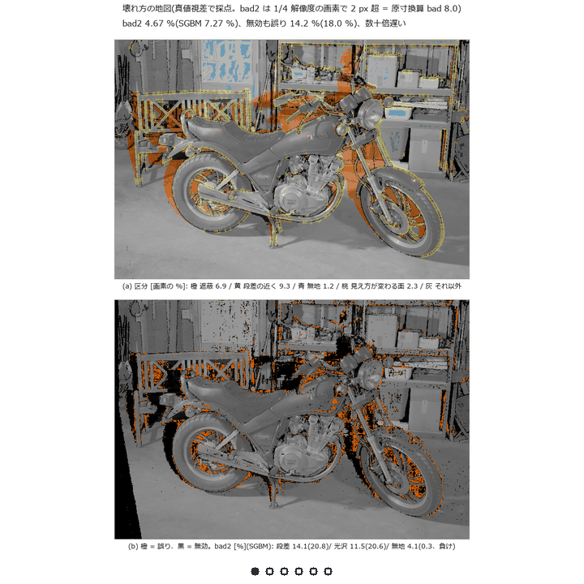</picture><span>Disparity, surface and circle pose from real stereo</span></a>
<a href="../../articles/assets/poc/poc_real_defect_floor/03_defect_floor_explained.mp4">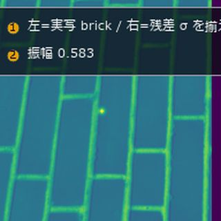<b>&#9654;</b><span>Matched noise, yet faint flaws hide on real backgrounds</span></a>
<a href="../../articles/assets/poc/poc_sam_hybrid_bonding_voids/03_amplitude_vs_phase.png"><picture><source media="(prefers-reduced-motion: reduce)" srcset="../../articles/assets/poc/poc_sam_hybrid_bonding_voids/03_amplitude_vs_phase.png"></picture><span>Finding bond-plane voids by ultrasonic echo phase</span></a>
<a href="../../articles/assets/poc/poc_photoelasticity/03_load_and_isoclinics.mp4"><picture><source media="(prefers-reduced-motion: reduce)" srcset="../../articles/assets/poc/poc_photoelasticity/01_polariscope.png">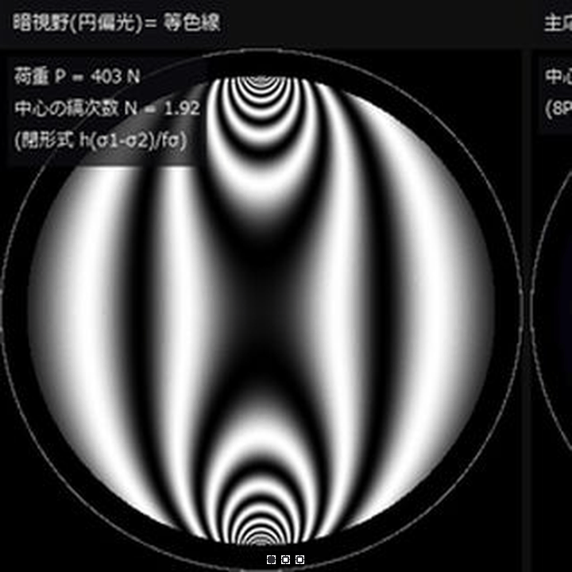</picture><b>&#9654;</b><span>Stress in a squeezed disc shows as fringes (photoelasticity)</span></a>
<a href="../../articles/assets/poc/poc_mixed_case_depalletizing/08_depal_robot_video.mp4"><picture><source media="(prefers-reduced-motion: reduce)" srcset="../../articles/assets/poc/poc_mixed_case_depalletizing/01_overview_same_pattern.png">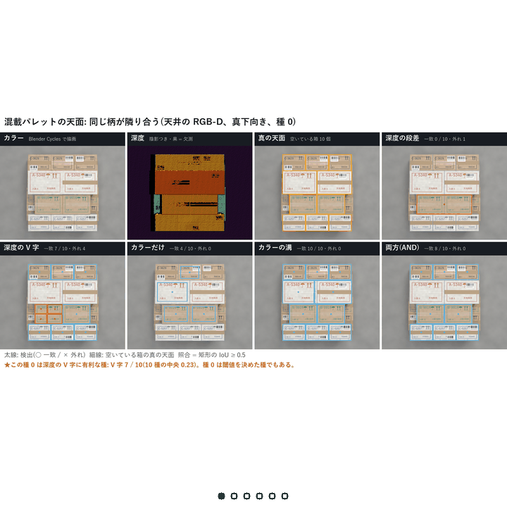</picture><b>&#9654;</b><span>Mixed cartons: depth step, V-groove or colour groove</span></a>
</div>

<div class="vl" markdown="1">

- [Equipment map: the same flaws through 60 light, camera and lens sets](../../articles/assets/poc/poc_equipment_selection_map/02_equipment_at_a_glance.png) (figure): We pre-tested visual inspection equipment on the same flaw. With 60 combinations of lighting, camera and lens we mapped how small a flaw is found, with the spread across repeats. It is a synthetic test, not the performance of real equipment.
  Inspection equipment is usually chosen one component at a time, each shown at its best by its own vendor. This synthetic test images the same parts and flaws with six lights (coaxial, dome, 70-degree ring, 30-degree ring, 10-degree dark field, and a phase-shifted fringe screen for deflectometry) x five cameras (monochrome, colour, polarisation, SWIR, hyperspectral) x two lenses (telecentric, ordinary), and reports a90/95 (MIL-HDBK-1823A). Every cell sets its threshold for a 1 % false-call rate on the flaw-free sites it is scored on (a definition for comparing at equal false-call rate; a threshold carried over from training gives 1.1 % pooled and up to 8 % in a single cell). Exposure is capped at 10 ms per field of view (photon counts are not equalised), the coaxial diffuser is twice the field width, and three site seed sets give median and min-max. Machined aluminium scratch parallel to the polishing lines: coaxial light with a telecentric lens is among the best (monochrome 39 um, colour 34 um); dark field with monochrome finds it under every seed set at 76-79 um, and a 30-degree ring with monochrome at 73-74 um at the full budget (at the small CI budget it flips to x with the seeds). Whether bright field needs a telecentric lens depends on the coaxial size: with a diffuser as wide as the field, an ordinary lens detects the largest scratches 80 % of the time (telecentric 100 %); at twice the field an ordinary lens also finds them (92 um, 2.4 times the telecentric value). Dome and high ring confuse the scratch with the polishing lines; the hyperspectral camera's 128 um pixel is too coarse. Shallow paint dent: coaxial, dome and 30-degree ring find nothing with any camera. The fringe screen finds it in all 10 cells (best 21 um) and raking dark field also in all 10 (best 28 um, 1.3 times the fringe value with a cheaper light). The floor is orange peel: cutting its slope from 0.10 to 0.02 degrees takes the fringe a90/95 from 22 to 4.8 um. Raking light wobbles at the small CI budget but settles at the full budget. The dome shows a dent as a bright blob only where its camera hole is mirrored in the slope (60-80 mm from the field centre), so detection moves between 0.33 and 0.92 across the field. The line-scan hyperspectral answer depends on the exposure cap: for the raking-light dent it is 214 um at 10 ms per field (a 30 kHz line rate no real instrument reaches), 16 um at 100 ms, 9.6 um at 1 s, and 9.9 um with the bands simply summed, so it wins on electrons. Black burn speck in resin: found by every set except the fringe screen; a 30-degree ring with a colour camera and ordinary lens (89 um) is enough. White PE fragment in white PP: no visible camera finds it, which is the input (the material table gives both the same visible absorption), not a finding; one SWIR band sees -0.22 % and fails; the 10 nm x 71 band camera finds it under the dome at 678-746 um (about 2 mm under coaxial light). 67 cells hit the exposure cap. Real data (both CC BY 4.0) support only the camera-band axis for polymers, as pixel-level AUC: plastic pieces on pork belly (Ghimpeteanu et al., Zenodo doi:10.5281/zenodo.17242553) go from 0.493 (chance) with one SWIR band to 0.937 / 0.959 / 0.994 with 2 / 6 / 184 bands; PP vs PE fragments (Arbash et al., RODARE doi:10.14278/rodare.3390) reach about 0.63 with monochrome, colour or one SWIR band and 0.882 with 950-1650 nm spectra in 20 nm bins (0.754 when extended to 2231 nm with 110 training pixels). The binning, the window and the real-data gate thresholds were chosen after seeing the data. Lighting, lens and the um values are comparisons inside this synthetic test, not hardware specs; many material values, light levels and price tiers are estimates. a90/95 is the Wald (delta-method) upper bound, and each fit uses 90 flawed sites (MIL-HDBK-1823A recommends at least 40 for a-hat data; the reduced CI run uses 36). The Wald bound is optimistic: in 2000 trials on synthetic data with a known a90, it is at or above the true a90 in 0.89 of fits with 40 sites and 0.92 with 100 (nominal 0.95). A likelihood-ratio bound would be about 4 % larger at the median (39 % or more in the top quarter). The values above are the Wald ones. [source](https://github.com/furuse-kazufumi/fullseye/blob/master/examples/poc_equipment_selection_map.py)
  Fullseye ops used: `pod_ahat_fit` · `pod_from_ahat` · `pod_false_call` · `wrapped_phase` · `absolute_phase` · `hyperspectral_band_weights` · `material_nir_absorption` · `nir_model_info` · `carbon_black_absorption` · `blackbody_spectrum` · `silicon_photodiode_qe` · `ingaas_photodiode_qe` · `spectral_integral` · `bandpass_spectrum`
  Terms: SWIR — The short-wave infrared band, roughly around 1 to 3 µm, where material absorption can distinguish objects that look alike in visible light.; a90/95 — The flaw size at which the lower one-sided 95% confidence bound on the POD reaches 90%.
- [Disparity, surface and circle pose from real stereo](../../articles/assets/poc/poc_real_stereo_multiscanline/02_failure_map.png) (figure): Using a real pair of stereo images, we compute disparity, distance, surfaces and even the pose of a circle. The result is scored with the true disparity that Middlebury 2014 supplies and compared with OpenCV. Where it breaks is shown on a map.
  From a real stereo pair (Middlebury 2014 motorcycle, with ground-truth disparity), binocular_disparity_ms gives disparity, binocular_distance_ms and reconstruct_surface_stereo give distance and surface, and get_circle_pose gives the pose of the rear wheel rim; all are scored against the ground-truth disparity and against OpenCV (SGBM, reprojectImageTo3D, matchTemplate). Valid-pixel bad-2 is 4.67% with mean error 0.960 px at 90.0% density (SGBM 7.27% / 1.315 px / 88.4%). Counting invalid pixels as errors gives 14.23% (SGBM 18.00%); on pixels where both are valid it is 4.45% vs 4.95%, so half of the gap comes from which pixels each method declares invalid. On those same pixels SGBM's mean error is slightly lower (0.918 vs 0.912 px), and it runs tens to over a hundred times faster (55 to 108 times observed; the ratio swings with the measuring environment). Where it breaks: occlusions (6.9%, counted geometrically from the ground truth) are 57% invalidated by the left-right check. Errors remain near depth discontinuities (bad-2 14.1%) and on surfaces whose brightness differs between the views at the true correspondence (a proxy for reflection and gloss, 11.5%); everything else is at 0.85%. 'Textureless fails' applies only to the flattest 1.2% of pixels, but there SGBM wins clearly (bad-2 0.31% vs 4.14%, invalid 0.0% vs 14.5%); the concrete floor matches best at 0.68%. The 'ms' in the name means multi-scanline, not multi-scale: going from 2 to 4 aggregation paths takes bad-2 from 5.55% to 4.67%, and a half-resolution pass run outside the operator gives 8.31%. Distance with doffs has a median relative error of 0.37%, and the point cloud matches OpenCV to 0.0006 mm. The circle pose shows the operator is right and the geometry is ill-conditioned: on the rim (semi-major axis 62 px, 223 degrees of arc) the centre is 23.5 mm and the normal 7.74 degrees off, but points taken on the true circle give 1.2e-6 degrees. Adding noise equal to the 0.52 px gap between the edge points and the true circle gives a median normal error of 5.79 degrees (95th percentile 9.39). The two solutions differ by 0.007 px in reprojection and cannot be told apart, yet their normals are 50.7 degrees apart. The same edge lifted to 3-D with the estimated disparity gives 2.3 mm and 1.59 degrees. points_lepetit with crop_rectangle2, create_ncc_model and find_ncc_models gives bad-2 13.8% (random pixels 16.3%), 2.2% above score 0.9, with best positions identical to OpenCV's matchTemplate at every point. On the 15 MiddEval3 training scenes (non-occluded) the median bad-2 is 6.52% vs SGBM 10.20%, lower in 14 scenes on valid pixels but in 12 when invalid pixels count as errors (SGBM is better on Playroom, Playtable and Shelves). The SGBM reference uses near-default settings that were not tuned. Changing exposure or lighting barely moves it (-0.18 / +0.94 points vs SGBM +4.99 / +18.08; under lighting it invalidates more pixels). But on the pair that differs only in rectification (Playtable, mean vertical residual 0.24 px) it worsens by 12.1 points while SGBM moves 0.6: it is sensitive to vertical misalignment (cause not yet verified). [source](https://github.com/furuse-kazufumi/fullseye/blob/master/examples/poc_real_stereo_multiscanline.py)
  Fullseye ops used: `binocular_disparity_ms` · `binocular_distance_ms` · `reconstruct_surface_stereo` · `get_circle_pose` · `points_lepetit` · `crop_rectangle2` · `create_ncc_model` · `find_ncc_models`
- [Matched noise, yet faint flaws hide on real backgrounds](../../articles/assets/poc/poc_real_defect_floor/03_defect_floor_explained.mp4) (video): Inspection teams often estimate how faint a scratch they can catch on a synthetic image of a flat field plus noise. With the noise level matched, a real brick background raised the detection limit by up to 3.47 times. The limit was set not by noise but by structure in the background, such as mortar joints.
  The same planted defect grows on a real brick texture and on a synthetic background with matched noise. **Even with matched noise, the detection limit on real textures is 2.03-3.47x the synthetic one (defects of known position and amplitude).** [source](https://github.com/furuse-kazufumi/fullseye/blob/master/examples/poc_real_defect_floor.py)
  Fullseye ops used: `laplace_of_gauss` · `annotate_inset` · `annotate_legend` · `ellipse` · `reflect` · `median`
- [Finding bond-plane voids by ultrasonic echo phase](../../articles/assets/poc/poc_sam_hybrid_bonding_voids/03_amplitude_vs_phase.png) (figure): Small voids in the bonding plane of stacked chips are searched for with a scanning acoustic microscope. Every void of 16 um or more appeared inverted and bright in the echo-phase image. In the brightness image many small voids hide among good pixels.
  A thinned 100 um silicon die over a hybrid bond (SiO2 1 + 1 um, Cu pads 1 + 1 um of 40 um diameter at 80 um pitch) with voids of 5 to 24 um placed on pads and in the dielectric, imaged by a focused scanning acoustic microscope (1 mm of water, F/3); echoes come from a layer transfer matrix checked against a bottom-up Airy recursion (Airy multiple-reflection formula), a time-domain ray sum and the optical thin-film formula to 1e-12. Read at the expected time of the bond plane, the dielectric echo is at -91 deg and the Cu pad at +84 deg (thin layers give quadrature echoes) while voids are inverted (-175 deg in the dielectric, +159 deg on a pad). In the amplitude image 8 of 12 voids hide inside the brightness range of intact pixels: an inverted echo adds at right angles to a quadrature background, so voids of 9 to 16 um change the amplitude by 0.4 to 3.5 sigma but the phase-aware statistic by 3.0 to 8.9 sigma; the phase image flags every void of 16 um and up and 1 of 26,724 intact pixels. The conventional single-sample polarity of an intact Cu pad flips 5 times between 140 and 400 MHz. The optimal frequency has a closed form (139.16 MHz for a 10 um void, equal to brute force) and the front-echo tail sets a floor of 130 MHz.  **POD (a-hat vs a, 88 voids): a90/95 of the phase-aware detector is 12.4 / 13.9 / 57.6 um at 150 / 200 / 300 MHz against 16.6 / 19.3 / 101.6 um for amplitude only, under the same baseline and threshold rule. Synthetic: 1-D plane-wave longitudinal layers, a Gaussian lateral PSF, no refraction aberration, silicon attenuation set to 0 (unverified), no kissing bonds.** [source](https://github.com/furuse-kazufumi/fullseye/blob/master/examples/poc_sam_hybrid_bonding_voids.py)
  Fullseye ops used: `acoustic_layer_stack` · `acoustic_interface_coefficients` · `acoustic_material_table` · `pulse_echo_ascan` · `echo_phase_polarity` · `sam_cscan` · `sam_frequency_tradeoff` · `pod_ahat_fit` · `pod_from_ahat` · `pod_false_call`
  Terms: SAM — An instrument that scans focused ultrasound over a specimen and images internal interfaces or defects from echo amplitude, phase, or arrival time.; Airy — The formula for a parallel plate's transmittance obtained by summing its infinite series of multiple reflections.
- [Stress in a squeezed disc shows as fringes (photoelasticity)](../../articles/assets/poc/poc_photoelasticity/03_load_and_isoclinics.mp4) (video): Viewed through polarisers, a loaded transparent plastic shows its internal stress as fringes. Stress in a squeezed disc was recovered from polarisation images, including pixels where the fringe order exceeds 0.5 and the phase wraps. Most errors left after unwrapping came from the sign ambiguity, not the wrapping.
  Rotating the analyser moves the photoelastic fringes and changes the mean intensity inside the disc (over 0–135°) **Centre fringe order 2.38, as the closed form says. The op's polariscope matches the textbook to 2.2e-16.** [source](https://github.com/furuse-kazufumi/fullseye/blob/master/examples/poc_photoelasticity.py)
  Fullseye ops used: `axes_frame` · `axes_transform` · `brazilian_disc_stress` · `mueller_apply` · `mueller_element` · `photoelastic_phase_estimate` · `photoelastic_polarization_images` · `photoelastic_retardation` · `plot_series` · `polariscope_intensity` · `principal_stress` · `retardation_convert` · `text_box` · `ticks` · `unwrap_phase_2d`
  Terms: Mueller matrix — A real 4-by-4 matrix acting on a Stokes vector to describe how an optical element or sample changes polarization.
- [Mixed cartons: depth step, V-groove or colour groove](../../articles/assets/poc/poc_mixed_case_depalletizing/08_depal_robot_video.mp4) (video): Packed cartons with identical prints are told apart from overhead depth and colour, then unloaded. A depth step splits none, and whether depth dips or dark colour lines win flips across 28 flap-seam builds. With identical prints, deep grooves favour colour; only wide, untaped cuts over shallow grooves favour depth.
  Cartons of different sizes, prints, tape, labels, crush and shrink wrap are stacked two layers high on a JIS T11 pallet and imaged by an overhead RGB-D camera (2.70 m, 960 x 720), 10 pallets for each of 5 conditions (self-made scenes, not external real data). In the base scenes each carton has a 4 mm edge radius and a flap-seam groove along the middle of its top (0.8-2.0 mm, no gap, kraft tape on 70 % and clear tape on 30 %); 40 % of the tops bulge by 3-8 mm. Colour is rendered with Blender Cycles; depth comes from the same geometry through the physics of a pattern-projection sensor. Top faces are segmented with depth_to_organized_points, bilateral_filter_depth, fill_holes, normals_from_depth and watersheds_marker and measured with ransac_plane and fit_rectangle2. Five cues, all classical methods by the same author: depth step / depth V-groove (a step region split along a shallow depth groove, read with crop_rectangle2) / colour only (a weak baseline) / colour groove (a step region split along a dark colour groove) / both (AND). Base-scene first-frame recall (IoU >= 0.5, median of 10 seeds), step / V-groove / colour only / colour groove / both: tight 0.39 / 0.63 / 0.29 / 0.64 / 0.45, identical 0.00 / 0.23 / 0.17 / 0.69 / 0.67, gaps 1.00 / 0.88 / 0.44 / 1.00 / 1.00, shrink 0.44 / 0.32 / 0.35 / 0.50 / 0.48, crushed 0.56 / 0.60 / 0.48 / 0.74 / 0.62. On the unseen seeds 3-9 alone: tight 0.33 / 0.60 / 0.29 / 0.57 / 0.40 (the V-groove slightly ahead), identical 0.00 / 0.17 / 0.17 / 0.71 / 0.67. The V-groove leaves a median 2.5-9.0 false detections per image, the colour groove none. With tight seams the V-groove and the colour groove find about as many faces and the colour groove over-splits less; with identical neighbours the V-groove also splits at the flap seam. Flap-seam map (tight and identical, median of seeds 3-5, all cartons built alike, 28 builds): groove depth 0.2 / 0.5 / 1.0 / 2.0 mm x gap 0 / 0.5 / 1.5 mm x tape (kraft / clear / none). On identical neighbours, under kraft or no tape, the V-groove matches or beats the colour groove when the groove is 1 mm or less (kraft 0.5 mm: 1.00 against 0.83) and collapses at 2 mm, where the colour groove wins (kraft 2 mm: 0.29 against 0.83). With an untaped 1.5 mm gap over a groove of 1 mm or less the colour groove also splits along the dark line of the seam and the V-groove is ahead (1 mm groove: 1.00 against 0.71; 0.2 and 0.5 mm: 1.00 against 0.83; with a 0.5 mm gap they tie). Under clear tape the V-groove drops to 0.57-0.67 even without a gap and the winner varies by cell (0.5 mm gap, 2 mm groove: both 0.29-0.43). With tight seams the differences are small, flipping within 0.57-0.82. The base scenes sat on the deep, gap-free side, which favoured the colour groove. Dependence on the scene: shrinking the edge radius from 4 to 2 to 1 mm takes V-groove recall on identical neighbours from 0.29 to 0.00 to 0.00, and without flap seams and bulges it is 0.83 (numerically rendered, 5 seeds). VALLEY_MIN = 0.5 mm was set after looking at seeds 0-2. The claim gates were set after seeing the results (base scenes on all and on unseen seeds, the map on 3 seeds). The gap-condition floor (>= 0.85) was already there for the step and AND; the colour groove was added after seeing the results, and with the CI stand-in colour (seed 0) it sits at 0.86, a margin of 0.01. Pick-one-and-re-image success (10 seeds, rule-based judgement): tight 0.36 / 0.44 / 0.31 / 0.58 / 0.53, identical 0.12 / 0.28 / 0.23 / 0.53 / 0.44, crushed 0.32 / 0.28 / 0.26 / 0.48 / 0.42, gaps 0.91 / 0.61 / 0.33 / 0.90 / 0.89 (footprint across two cartons = double pick; off the edge, plane residual over 6 mm or peel-moment ratio over 1 = drop; carton on top = snag; carton plus 1.8 kg of tooling above the 12.5 kg payload = overload, which the 11 kg type D exceeds at 12.8 kg). Real-data chapter: on HOPE (real depth from an active-stereo depth camera, 50 val images, 325 faces of box-shaped objects; tabletop toy grocery boxes seen obliquely at 0.5-1 m) the plane-then-rectangle measurement with the same set of operators (segmentation steps and thresholds implemented separately) gives recall 0.705, long-side error median -2.0 mm (absolute median 5.6 mm), normal error 2.6 degrees and 43 false detections per image (background 1395, non-box objects 622, other faces of scored boxes 118, heavily occluded boxes 19). It does not support the headline claim. Credit: Tyree, Tremblay, To, Cheng, Mosier, Smith, Birchfield, IROS 2022 (BOP format). The bundled dataset_info.md says 'Licensed under the CC BY-NC-SA 4.0 license' while the BOP download page says 'license: CC BY-SA 4.0'; we treat it as non-commercial and show numbers only. The video (about 48 s) shows, per condition, one successful and one failed pick by the colour-groove cue with a UR10e (MuJoCo Menagerie model, BSD-3-Clause, plain colours; not affiliated with, endorsed or warranted by any company) on a linear axis driven by inverse kinematics. Limits: the scenes and thresholds come from the same author (no external basis for the edge radius or the flap-seam build; clear tape is assumed transparent to both depth and colour); with the stand-in colour used in CI the ranking of the colour-based cues flips, so the CI gates cover only depth-only claims and the gap floor. [source](https://github.com/furuse-kazufumi/fullseye/blob/master/examples/poc_mixed_case_depalletizing.py)
  Fullseye ops used: `depth_to_organized_points` · `bilateral_filter_depth` · `fill_holes` · `normals_from_depth` · `watersheds_marker` · `ransac_plane` · `fit_rectangle2` · `crop_rectangle2` · `area_intersection_rectangle2`

</div>

## Article series (articles on Qiita)

<div class="vser">
<a href="https://qiita.com/furuse-kazufumi/items/8a8f23e53b19ee8cdc10">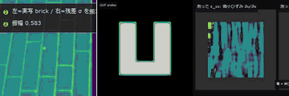<strong>A Metrology Museum on Paper</strong><span>Every PoC with its own planted ground truth</span></a>
<a href="https://qiita.com/furuse-kazufumi/items/a82bf9f341cc4f04ca75">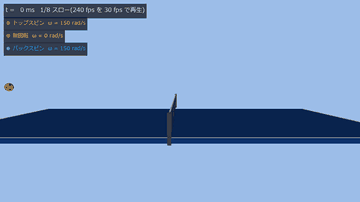<strong>Table tennis</strong><span>Bounce and friction measured from video</span></a>
<a href="https://qiita.com/furuse-kazufumi/items/05de90f4d316cd7c681c">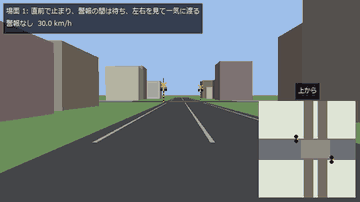<strong>Autonomous driving</strong><span>Scored by theorems and second implementations</span></a>
<a href="https://qiita.com/furuse-kazufumi/items/638f0b0aa7865e17c67c">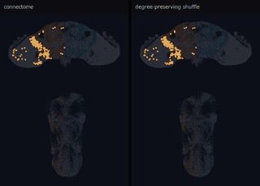<strong>Connectome (brain wiring)</strong><span>A fly visual model on a body, measured</span></a>
<a href="https://qiita.com/furuse-kazufumi/items/569720dbae0c6471c96e">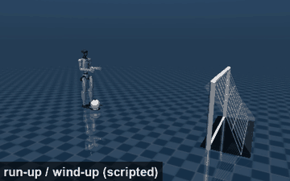<strong>Humanoid sports day</strong><span>A home sports day refereed by image processing</span></a>
</div>

## What Fullseye is

A foundation that hands physics simulation (including sensing such as optical design and 3-D measurement) and classic image processing to an AI through MCP and RAG, lets it work out a combination for each task, and solves the task interactively while checking type consistency and evaluating against ground truth. Open source (Apache-2.0).

See [Extras: more PoCs](more.md), too.

<details markdown="1">
<summary><b>Try it</b> (Python 3.11)</summary>

```
pip install fullseye
git clone https://github.com/furuse-kazufumi/fullseye
cd fullseye
python examples/poc_focus_stacking.py
```

The focus-stacking PoC runs in about 20 seconds and prints its numbers against ground truth and `PASS`. Figures go to `out/figures/poc_focus_stacking/`.

</details>

<details markdown="1">
<summary><b>Links</b></summary>

- [GitHub (source code)](https://github.com/furuse-kazufumi/fullseye)
- [Gallery (all figures)](../../GALLERY.en.md)
- [Find operators / use them from an AI (RAG)](../../AI_RAG_GUIDE.en.md) · [Use from MCP](../../MCP.md) _(ja)_
- [Documentation index](../../README.en.md)

</details>

<details markdown="1">
<summary><b>Paper</b></summary>

- **Title**: Fullseye：型付き演算子と物理シミュレーションに基づく画像検査・三次元計測基盤 _(ja)_ (an image-inspection and 3-D measurement foundation built on typed operators and physics simulation)
- **Author**: Kazufumi Furuse (independent researcher)
- **Venue**: ViEW2026, Workshop on Practical Use of Vision Technology
- **Paper PDF**: [English](../paper/101_en.pdf) · [简体中文](../paper/101_zh.pdf)(日本語: available from 2026-11-26)

**Abstract (translated from Japanese)**: We propose Fullseye, an open-source foundation that builds image-inspection and 3-D measurement processing as chains of operators with declared input and output data types, evaluates it quantitatively against ground truth produced by physics and imaging simulation, and records the procedure, the evaluation and the failure conditions so they can be reused. It consists of about 3,000 typed operators, a check that rejects type mismatches before execution, multilingual operator search (RAG), and more than 200 proof-of-concept programs with ground truth. We report quantitative evaluation of representative examples and the distinction between synthetic, measured and real-hardware validation stages.

</details>
