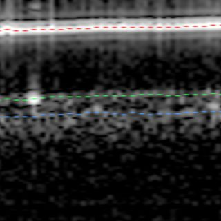
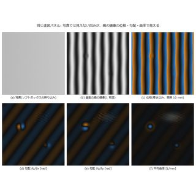
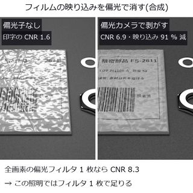
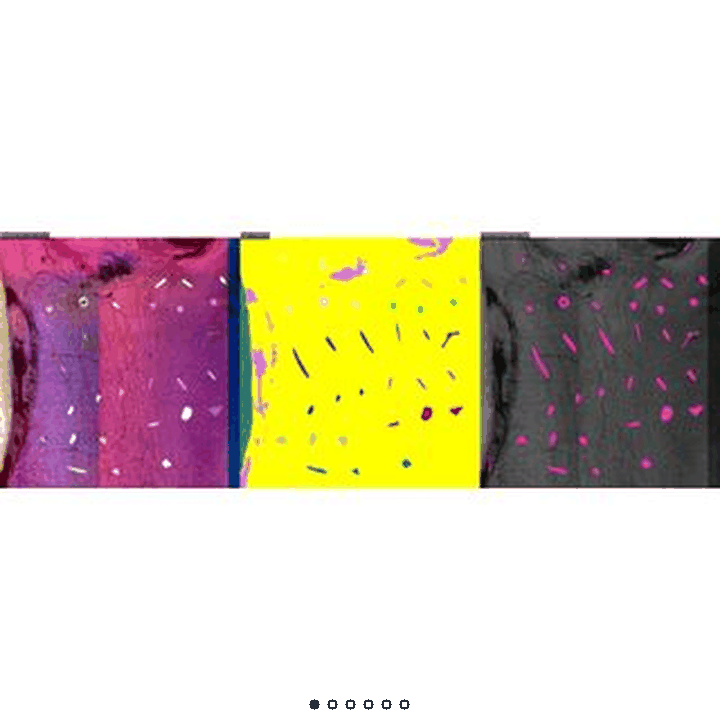
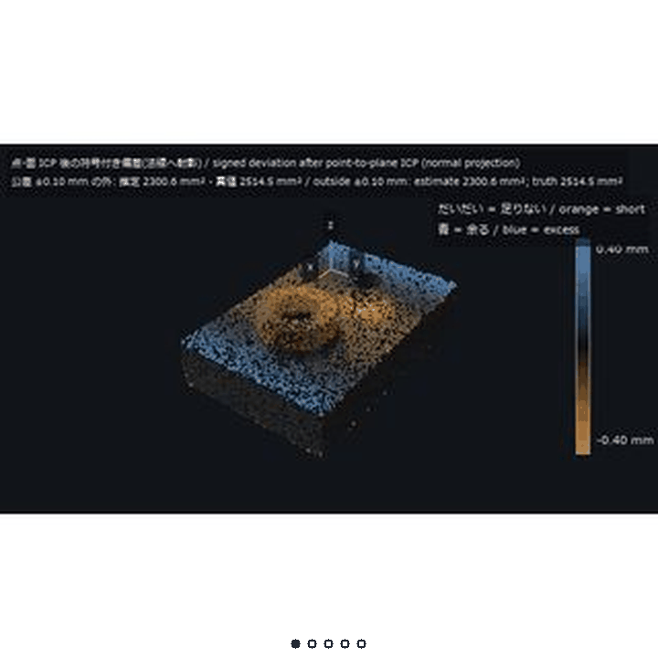

<div class="vlang" markdown="1">

[日本語](../index.md) · **English** · [简体中文](../zh/index.md) · [繁體中文](../tw/index.md) · [한국어](../ko/index.md) · [Deutsch](../de/index.md) · [हिन्दी](../hi/index.md) · [Français](../fr/index.md)

</div>

# Fullseye — ViEW2026

**Presenting: Thu 3 Dec 2026, 14:40–15:50 JST, Interactive Session 2, IS2-19** (Pacifico Yokohama, Annex Hall)

<div class="vintro"><div class="vt"><p>Fullseye is a foundation for image inspection, 3-D measurement and physics simulation. It hands typed classic image-processing operators and physics simulation (including sensing such as optical design) to an AI through MCP and RAG, lets it work out a combination for each task, and solves the task interactively while checking type consistency and evaluating against ground truth that the physics and imaging simulation produces. Open source (Apache-2.0).</p><p><a href="about.html">About Fullseye (reading)</a></p></div></div>

Tap a tile to open the video or figure (▶ = moving).

This page shows only 30 exhibits. The other 286 are on the [Extras page](more.md).

<style>
.vlang { font-size: 14px; line-height: 2; }
.vg { display: grid; grid-template-columns: repeat(2, minmax(0, 1fr)); gap: 8px; margin: 12px 0 20px; }
.vg.vs { grid-template-columns: repeat(3, minmax(0, 1fr)); gap: 6px; }
@media (min-width: 600px) { .vg { grid-template-columns: repeat(3, minmax(0, 1fr)); } .vg.vs { grid-template-columns: repeat(5, minmax(0, 1fr)); } }
@media (min-width: 900px) { .vg { grid-template-columns: repeat(4, minmax(0, 1fr)); } .vg.vs { grid-template-columns: repeat(7, minmax(0, 1fr)); } }
.vg a, .vser a { display: block; position: relative; text-decoration: none; color: inherit; }
.vg img { display: block; width: 100%; max-width: 100%; height: auto; aspect-ratio: 1 / 1; object-fit: cover; border-radius: 6px; background: #222; }
.vg picture { display: block; width: 100%; aspect-ratio: 1 / 1; overflow: hidden; border-radius: 6px; background: #fff; }
.vg picture img { height: 100%; aspect-ratio: auto; object-fit: contain; border-radius: 0; background: #fff; }
.vg b { position: absolute; top: 6px; right: 6px; background: rgba(0,0,0,.6); color: #fff; font-size: 12px; padding: 1px 6px; border-radius: 9px; }
.vg span { display: block; font-size: 13px; line-height: 1.3; margin-top: 3px; }
.vg.vs span { font-size: 11px; }
.vser { display: grid; grid-template-columns: repeat(2, minmax(0, 1fr)); gap: 8px; margin: 12px 0 20px; }
@media (min-width: 600px) { .vser { grid-template-columns: repeat(3, minmax(0, 1fr)); } }
.vser img { display: block; width: 100%; max-width: 100%; height: auto; aspect-ratio: 16 / 9; object-fit: cover; border-radius: 8px; background: #222; }
.vser strong { display: block; font-size: 14px; margin-top: 3px; line-height: 1.3; }
.vser span { display: block; font-size: 12px; line-height: 1.3; }
details.vall { margin: 6px 0; }
details.vall > summary { font-size: 15px; padding: 6px 0; cursor: pointer; }
.vl li { margin-bottom: 8px; }
li, p, code { overflow-wrap: anywhere; }
.vintro { display: flex; gap: 20px; align-items: flex-start; margin: 14px 0; }
.vintro img { flex: 0 0 300px; width: 300px; max-width: 100%; height: auto; border-radius: 6px; }
.vintro .vt p { margin: 0 0 8px; }
.vc { display: flex; gap: 16px; align-items: flex-start; margin: 18px 0; }
.vc > a:first-child { flex: 0 0 260px; position: relative; display: block; text-decoration: none; color: inherit; }
.vc > a img { display: block; width: 100%; max-width: 100%; height: auto; aspect-ratio: 1 / 1; object-fit: cover; border-radius: 6px; background: #222; }
.vc > a picture { display: block; width: 100%; aspect-ratio: 1 / 1; overflow: hidden; border-radius: 6px; background: #fff; }
.vc > a picture img { height: 100%; aspect-ratio: auto; object-fit: contain; border-radius: 0; background: #fff; }
.vc > a b { position: absolute; top: 6px; right: 6px; background: rgba(0,0,0,.6); color: #fff; font-size: 12px; padding: 1px 6px; border-radius: 9px; }
.vc > a .vtb { position: absolute; left: 6px; bottom: 6px; max-width: calc(100% - 12px); background: rgba(0,0,0,.66); color: #fff; font-size: 12px; font-style: normal; line-height: 1.4; padding: 1px 7px; border-radius: 9px; }
.vt { flex: 1 1 auto; min-width: 0; }
.vt .vh { font-size: 17px; font-weight: 600; line-height: 1.4; margin: 0 0 6px; }
.vt p { margin: 0 0 6px; }
.vt .vm { font-size: 14px; color: #57606a; }
.vt details { font-size: 14px; margin: 4px 0; }
.vt summary { cursor: pointer; }
.vc.vv { margin: 10px 0; }
.vc.vv > a:first-child { flex-basis: 96px; }
@media (max-width: 600px) {
  .vintro { flex-direction: column-reverse; gap: 8px; }
  .vintro img { flex: 0 0 auto; width: 100%; max-width: 240px; }
  .vc { flex-direction: column; gap: 8px; }
  .vc > a:first-child { flex: 0 0 auto; width: 240px; max-width: 100%; }
  .vc.vv { flex-direction: row; gap: 12px; }
  .vc.vv > a:first-child { width: 80px; flex: 0 0 80px; }
}
</style>

## Try it yourself

Run the paper's figures yourself, on a phone too. Switch methods with the tabs and drag the 3-D views to rotate them.

<div class="vc vv"><a class="vvi" href="../viewers/industrial_oct_anim3d.html?lang=en"></a><div class="vt"><div class="vh"><a href="../viewers/industrial_oct_anim3d.html?lang=en">Layer structure in industrial OCT</a></div><p>Sweep through depth and explore a coating B-scan and its layer-thickness measurement. (4.0 MB)</p></div></div>

<div class="vc vv"><a class="vvi" href="../viewers/phase_measuring_deflectometry_anim3d.html?lang=en"></a><div class="vt"><div class="vh"><a href="../viewers/phase_measuring_deflectometry_anim3d.html?lang=en">Surface shape by deflectometry</a></div><p>Sweep the fringe phase and watch a surface dent invisible in a photograph emerge. (14.9 MB)</p></div></div>

<div class="vc vv"><a class="vvi" href="../viewers/poc_cad_scan_deviation.html?lang=en"></a><div class="vt"><div class="vh"><a href="../viewers/poc_cad_scan_deviation.html?lang=en">CAD versus a scanned point cloud</a></div><p>Alignment absorbs defects: a part whose true value is 1.2 µm shows a 121 µm dent that does not exist.</p></div></div>

<div class="vc vv"><a class="vvi" href="../viewers/poc_photoelasticity.html?lang=en"></a><div class="vt"><div class="vh"><a href="../viewers/poc_photoelasticity.html?lang=en">Photoelasticity</a></div><p>Rotating the analyser moves the photoelastic fringes and changes the mean intensity inside the disc (over 0–135°)</p></div></div>

<div class="vc vv"><a class="vvi" href="../viewers/poc_polarization_specular.html?lang=en"></a><div class="vt"><div class="vh"><a href="../viewers/poc_polarization_specular.html?lang=en">Polarization</a></div><p>Polarisation strips specular glare; what remains changes with incidence angle and is smallest near the Brewster angle (swept on a synthetic fringe scene)</p></div></div>

## Showcase

<div class="vc"><a href="../../articles/assets/poc/poc_industrial_oct/01_real_paint_bscans.png"><picture><source media="(prefers-reduced-motion: reduce)" srcset="../../articles/assets/poc/poc_industrial_oct/01_real_paint_bscans.png"></picture><i class="vtb">Ground truth: Real data</i></a><div class="vt"><div class="vh"><a href="../../articles/assets/poc/poc_industrial_oct/01_real_paint_bscans.png">Paint layer thickness without cutting (industrial OCT)</a></div><p>Paint and film layers are seen in depth without cutting. Clear coats measured from public raw spectra of car paint agree with microscope readings of the same panels within 3.6 µm. Matching the paper's OCT only reproduces the same data, and layers too thin to separate get no value.</p><p class="vm">Ground truth: Real data · <a href="more.html#d-poc-industrial-oct">Details</a></p></div></div>

<div class="vc"><a href="../../articles/assets/poc/poc_phase_measuring_deflectometry/03_photo_vs_pmd.png"><picture><source media="(prefers-reduced-motion: reduce)" srcset="../../articles/assets/poc/poc_phase_measuring_deflectometry/03_photo_vs_pmd.png"></picture><i class="vtb">Ground truth: Synthetic</i></a><div class="vt"><div class="vh"><a href="../../articles/assets/poc/poc_phase_measuring_deflectometry/03_photo_vs_pmd.png">A dent invisible in a diffusely lit photo appears in a fringe mirror image (synthetic)</a></div><p>A very shallow dent in glossy paint barely shows in a photograph under diffuse light. Projecting fringes on a screen facing the surface and reading how their mirror image bends gives curvature, and a planted dent 3 µm deep stands out. This is a synthetic scene, and photographs under oblique light were not compared.</p><p class="vm">Ground truth: Synthetic · <a href="more.html#d-poc-phase-measuring-deflectometry">Details</a></p></div></div>

<div class="vc"><a href="../../articles/assets/poc/poc_thin_film_reflectometry/01_real_micrograph_thickness.png"><picture><source media="(prefers-reduced-motion: reduce)" srcset="../../articles/assets/poc/poc_thin_film_reflectometry/01_real_micrograph_thickness.png"></picture><i class="vtb">Ground truth: Real data</i></a><div class="vt"><div class="vh"><a href="../../articles/assets/poc/poc_thin_film_reflectometry/01_real_micrograph_thickness.png">Reading oxide thickness from micrograph colours</a></div><p>Oxide thickness on silicon can be read from interference fringes and colours in reflected light. Read per pixel from a real micrograph published by others, the central value was 87.4 nm. That is about a tenth below the reference derived from the paper, and the camera's colour sensitivity is unknown.</p><p class="vm">Ground truth: Real data · <a href="more.html#d-poc-thin-film-reflectometry">Details</a></p></div></div>

<div class="vc"><a href="../../articles/assets/poc/poc_registration_basin/06_real_scan_icp.mp4"><picture><source media="(prefers-reduced-motion: reduce)" srcset="../../articles/assets/poc/poc_registration_basin/07_real_scan_still.png"></picture><b>&#9654;</b><i class="vtb">Ground truth: Real data</i></a><div class="vt"><div class="vh"><a href="../../articles/assets/poc/poc_registration_basin/06_real_scan_icp.mp4">ICP's basin shrinks on real depth</a></div><p>On a measured part and a synthetic bracket, we tested how far registration can start and return to the same endpoint. Across seeds and crossing rules, success halved up to 31.5 degrees earlier than with all-around points. The endpoint is off the truth, so this measures recovery range, not pose accuracy.</p><p class="vm">Ground truth: Real data · <a href="more.html#d-poc-registration-basin">Details</a></p></div></div>

<div class="vc"><a href="../../articles/assets/poc/poc_hyperspectral_foreign_matter/04_real_pork_belly.png"><picture><source media="(prefers-reduced-motion: reduce)" srcset="../../articles/assets/poc/poc_hyperspectral_foreign_matter/01_real_polymer_flakes.png"></picture><i class="vtb">Ground truth: Real data</i></a><div class="vt"><div class="vh"><a href="../../articles/assets/poc/poc_hyperspectral_foreign_matter/04_real_pork_belly.png">Finding foreign objects on pork belly with near-infrared spectral imaging</a></div><p>Public real images were used as near-infrared spectral data to classify debris lying on pork belly. Scored per pixel on separate captures, most of it was detected at 1.1 % false alarms. With fewer bands the false alarms grew, and that a colour camera fails on same-coloured matter is shown only on synthetic data.</p><p class="vm">Ground truth: Real data · <a href="more.html#d-poc-hyperspectral-foreign-matter">Details</a></p></div></div>

<div class="vc"><a href="../../articles/assets/poc/poc_cad_scan_deviation/14_align_orbit.gif"><picture><source media="(prefers-reduced-motion: reduce)" srcset="../../articles/assets/poc/poc_cad_scan_deviation/01_scene.png"></picture><b>&#9654;</b><i class="vtb">Ground truth: Synthetic</i></a><div class="vt"><div class="vh"><a href="../../articles/assets/poc/poc_cad_scan_deviation/14_align_orbit.gif">The alignment decides where a part looks out of tolerance: CAD versus scan (synthetic)</a></div><p>Aligning a scan to its design absorbs part of the deviation and moves where it looks out of tolerance. On a part with a known warp, a reading 121 µm deep appears at the centre where the true deviation is tiny. This is synthetic, and a point-sampled design shows out-of-tolerance edges even without a defect.</p><p class="vm">Ground truth: Synthetic · <a href="more.html#d-poc-cad-scan-deviation">Details</a></p></div></div>

<div class="vc"><a href="../../articles/assets/poc/poc_fourier_ptychography/01_usaf_4x_fp_20x.png"><picture><source media="(prefers-reduced-motion: reduce)" srcset="../../articles/assets/poc/poc_fourier_ptychography/01_usaf_4x_fp_20x.png"></picture><i class="vtb">Ground truth: Synthetic</i></a><div class="vt"><div class="vh"><a href="../../articles/assets/poc/poc_fourier_ptychography/01_usaf_4x_fp_20x.png">A 4x objective matches a coherently lit 20x (Fourier ptychography, synthetic)</a></div><p>A low-power objective sees a wide field but misses fine detail. On a synthetic chart, images lit from many angles and joined in frequency space matched a 20x objective under single-colour parallel light. Under ordinary light that objective still resolves finer, and too little illumination overlap returns no answer.</p><p class="vm">Ground truth: Synthetic · <a href="more.html#d-poc-fourier-ptychography">Details</a></p></div></div>

<div class="vc"><a href="../../articles/assets/poc/poc_itof_multifreq/12_public_raw_unwrap.png"><picture><source media="(prefers-reduced-motion: reduce)" srcset="../../articles/assets/poc/poc_itof_multifreq/01_warehouse_unwrap.png"></picture><i class="vtb">Ground truth: Synthetic</i></a><div class="vt"><div class="vh"><a href="../../articles/assets/poc/poc_itof_multifreq/12_public_raw_unwrap.png">Where indirect ToF depth breaks (synthetic)</a></div><p>An indirect ToF camera measures distance from the phase delay of modulated light. On synthetic signals, combining three frequencies keeps the distance unambiguous out to 18.7 m. Multipath and object edges make the distance jump without any warning.</p><p class="vm">Ground truth: Synthetic · <a href="more.html#d-poc-itof-multifreq">Details</a></p></div></div>

<div class="vc"><a href="../../articles/assets/poc/poc_telecentric_metrology/08_real_alignment_plate.png"><picture><source media="(prefers-reduced-motion: reduce)" srcset="../../articles/assets/poc/poc_telecentric_metrology/08_real_alignment_plate.png"></picture><i class="vtb">Ground truth: Real data</i></a><div class="vt"><div class="vh"><a href="../../articles/assets/poc/poc_telecentric_metrology/08_real_alignment_plate.png">Magnification measured on public telecentric images agrees with the paper within the paper's own spread</a></div><p>In one image, a stepped part looks larger where it is nearer through an ordinary lens. The magnification measured on public real images from a telecentric lens agrees with the paper, whose own values spread by ±0.25 %, so the match is not read as finer. Ring centres on a tilted plate that do not drift are evidence.</p><p class="vm">Ground truth: Real data · <a href="more.html#d-poc-telecentric-metrology">Details</a></p></div></div>

<div class="vc"><a href="../../articles/assets/poc/poc_virtual_sem_kv_cd_bse/05_sem_same_part_3kv_3detectors.png"><picture><source media="(prefers-reduced-motion: reduce)" srcset="../../articles/assets/poc/poc_virtual_sem_kv_cd_bse/05_sem_same_part_3kv_3detectors.png"></picture><i class="vtb">Ground truth: Published values</i></a><div class="vt"><div class="vh"><a href="../../articles/assets/poc/poc_virtual_sem_kv_cd_bse/05_sem_same_part_3kv_3detectors.png">Virtual SEM: the image changes with voltage (model scored against measured backscatter)</a></div><p>An SEM image is not a photo of the surface but a tally of electrons escaping after scattering in the solid. A model that tracks each electron was checked against measured backscatter data for 7 elements. With no real images of known linewidth, the shift of the linewidth reading with beam energy stays inside the model.</p><p class="vm">Ground truth: Published values · <a href="more.html#d-poc-virtual-sem-kv-cd-bse">Details</a></p></div></div>

<div class="vc"><a href="../../articles/assets/poc/poc_real_tum_rgbd_slam/02_trajectory.png"><picture><source media="(prefers-reduced-motion: reduce)" srcset="../../articles/assets/poc/poc_real_tum_rgbd_slam/02_trajectory.png"></picture><i class="vtb">Ground truth: Real data</i></a><div class="vt"><div class="vh"><a href="../../articles/assets/poc/poc_real_tum_rgbd_slam/02_trajectory.png">Scoring frame-to-frame alignment on public RGB-D data: error 0.45-0.82 times a constant-velocity guess, depending on the outlier trimming each split selects (one 32-frame sequence)</a></div><p>On one public desk depth sequence, frame-to-frame alignment was checked against motion-capture truth. Error fell below no alignment, but the gain over a steady-speed guess hinged on outlier trimming and on which of 8 splits was used. Plane residuals in small windows grew with distance, but no square law was confirmed.</p><p class="vm">Ground truth: Real data · <a href="more.html#d-poc-real-tum-rgbd-slam">Details</a></p></div></div>

<div class="vc"><a href="../../articles/assets/poc/poc_good_sample_variation_model/04_visa_explanation.png"><picture><source media="(prefers-reduced-motion: reduce)" srcset="../../articles/assets/poc/poc_good_sample_variation_model/01_band_width_alignment.png"></picture><i class="vtb">Ground truth: Real data</i></a><div class="vt"><div class="vh"><a href="../../articles/assets/poc/poc_good_sample_variation_model/04_visa_explanation.png">Flagging defects from good-part variation: the declared false-alarm rate fails on real images</a></div><p>A classic inspection learns the usual per-pixel variation from good parts and flags what falls outside. Here the band is set by a false-alarm rate declared in advance and scored on 200 public real images. Alignment mattered more than the number of good parts, and the declared rate was not kept.</p><p class="vm">Ground truth: Real data · <a href="more.html#d-poc-good-sample-variation-model">Details</a></p></div></div>

<div class="vc"><a href="../../articles/assets/poc/poc_real_walnut_cbct/07_geometry_mistakes.png"><picture><source media="(prefers-reduced-motion: reduce)" srcset="../../articles/assets/poc/poc_real_walnut_cbct/07_geometry_mistakes.png"></picture><i class="vtb">Ground truth: Real data</i></a><div class="vt"><div class="vh"><a href="../../articles/assets/poc/poc_real_walnut_cbct/07_geometry_mistakes.png">Measured CT: ignoring the vertical offset reconstructs a different slice, and only an outside reference reveals it</a></div><p>A walnut was really scanned in a cone beam and reconstructed with FDK and iterative methods. With 300 projections scored against the authors' reference, neglecting the vertical shift rebuilds a different slice, further away. Those data are self-consistent, so the residual after reprojecting cannot change.</p><p class="vm">Ground truth: Real data · <a href="more.html#d-poc-real-walnut-cbct">Details</a></p></div></div>

<div class="vc"><a href="../../articles/assets/poc/poc_bottle_pattern_inverse/01_checker_through_bottle.png"><picture><source media="(prefers-reduced-motion: reduce)" srcset="../../articles/assets/poc/poc_bottle_pattern_inverse/01_checker_through_bottle.png"></picture><i class="vtb">Ground truth: Synthetic</i></a><div class="vt"><div class="vh"><a href="../../articles/assets/poc/poc_bottle_pattern_inverse/01_checker_through_bottle.png">Reading a glass bottle back from background stripes (simulation): recovery under shared assumptions, and what cannot be separated</a></div><p>A transparent bottle distorts the stripes behind it. For each pixel we find where the background is seen, fit the bottle geometry and indices backwards, and score 5 fill states against the true values of the simulation. Quantities that are inseparable are reported too, and nothing was checked on a real bottle.</p><p class="vm">Ground truth: Synthetic · <a href="more.html#d-poc-bottle-pattern-inverse">Details</a></p></div></div>

<div class="vc"><a href="../../articles/assets/poc/poc_ai_built_inspection_scored/01_crack_real.png"><picture><source media="(prefers-reduced-motion: reduce)" srcset="../../articles/assets/poc/poc_ai_built_inspection_scored/01_crack_real.png"></picture><i class="vtb">Ground truth: Real data</i></a><div class="vt"><div class="vh"><a href="../../articles/assets/poc/poc_ai_built_inspection_scored/01_crack_real.png">An AI assembles inspections, scored on public real data (local LLMs built an above-chance one for cracks in 5 of 60 runs, for candles in none)</a></div><p>A local LLM was given a task in words and built inspection recipes through MCP alone, scored on public real images. Few runs beat chance on cracks, and none reached a one-statistic baseline (AUROC 0.999). None worked for candle stains, and cloud LLM runs, under unmatched conditions, stayed below the existing recipes.</p><p class="vm">Ground truth: Real data · <a href="more.html#d-poc-ai-built-inspection-scored">Details</a></p></div></div>

<div class="vc"><a href="../../articles/assets/poc/poc_3d_sensor_modalities/01_map.png"><picture><source media="(prefers-reduced-motion: reduce)" srcset="../../articles/assets/poc/poc_3d_sensor_modalities/01_map.png"></picture><i class="vtb">Ground truth: Synthetic</i></a><div class="vt"><div class="vh"><a href="../../articles/assets/poc/poc_3d_sensor_modalities/01_map.png">Simulating five 3-D sensing methods on one part: where each breaks, by material</a></div><p>In this simulation, models of several depth-sensing methods measure one part in matte, glossy metal, translucent and black materials. Shape errors were counted with a common 0.1 mm yardstick and compared with the dimension table. Their resolutions differ by orders of magnitude, so read where each breaks, not a ranking.</p><p class="vm">Ground truth: Synthetic · <a href="more.html#d-poc-3d-sensor-modalities">Details</a></p></div></div>

## Featured

<div class="vc"><a href="../../articles/assets/poc/poc_photoelasticity/03_load_and_isoclinics.mp4"><picture><source media="(prefers-reduced-motion: reduce)" srcset="../../articles/assets/poc/poc_photoelasticity/01_polariscope.png"></picture><b>&#9654;</b><i class="vtb">Ground truth: Synthetic</i></a><div class="vt"><div class="vh"><a href="../../articles/assets/poc/poc_photoelasticity/03_load_and_isoclinics.mp4">Stress in a squeezed disc shows as fringes (photoelasticity, synthetic)</a></div><p>Viewed through polarisers, a loaded transparent plastic shows its internal stress as fringes. Stress in a squeezed disc was recovered from polarisation images, even where the fringe order exceeds 0.5 and the phase wraps. Most errors after unwrapping fall on a long-known sign flip, not the wrapping.</p><p class="vm">Ground truth: Synthetic · <a href="more.html#d-poc-photoelasticity">Details</a></p></div></div>

<div class="vc"><a href="../../articles/assets/poc/poc_equipment_selection_map/02_equipment_at_a_glance.png"><picture><source media="(prefers-reduced-motion: reduce)" srcset="../../articles/assets/poc/poc_equipment_selection_map/02_equipment_at_a_glance.png"></picture><i class="vtb">Ground truth: Synthetic</i></a><div class="vt"><div class="vh"><a href="../../articles/assets/poc/poc_equipment_selection_map/02_equipment_at_a_glance.png">Equipment map: the same flaws through 60 light, camera and lens sets (synthetic test)</a></div><p>We pre-tested visual inspection equipment on the same flaw. With 60 combinations of lighting, cameras and lenses we mapped how small a flaw is found, with the spread across repeats. It is a synthetic test, not the performance of real equipment.</p><p class="vm">Ground truth: Synthetic · <a href="more.html#d-poc-equipment-selection-map">Details</a></p></div></div>

<div class="vc"><a href="../../articles/assets/poc/poc_real_stereo_multiscanline/02_failure_map.png"><picture><source media="(prefers-reduced-motion: reduce)" srcset="../../articles/assets/poc/poc_real_stereo_multiscanline/02_failure_map.png"></picture><i class="vtb">Ground truth: Real data</i></a><div class="vt"><div class="vh"><a href="../../articles/assets/poc/poc_real_stereo_multiscanline/02_failure_map.png">Disparity, surface and circle pose from real stereo</a></div><p>Using a real pair of stereo images, we compute disparity, distance, surfaces and even the pose of a circle. The result is scored with the true disparity that Middlebury 2014 supplies and compared with OpenCV. On pixels valid in both, the two are about equal, and most of the gap is which pixels each invalidates.</p><p class="vm">Ground truth: Real data · <a href="more.html#d-poc-real-stereo-multiscanline">Details</a></p></div></div>

<div class="vc"><a href="../../articles/assets/poc/poc_polarization_specular/09_glare_removed_label.png"><picture><source media="(prefers-reduced-motion: reduce)" srcset="../../articles/assets/poc/poc_polarization_specular/01_raw_polarizer_mosaic.png"></picture><i class="vtb">Ground truth: Synthetic</i></a><div class="vt"><div class="vh"><a href="../../articles/assets/poc/poc_polarization_specular/09_glare_removed_label.png">Polarisation removes 90 % of film glare; under this light one fixed filter is enough (synthetic)</a></div><p>A camera with a polariser on every pixel splits a label behind shiny film into diffuse and glare components. About 90 % of the glare goes, yet under this light a fixed polarising filter reads the print better. The camera catches up only under a wider light; the scene is synthetic and unchecked against real images.</p><p class="vm">Ground truth: Synthetic · <a href="more.html#d-poc-polarization-specular">Details</a></p></div></div>

<div class="vc"><a href="../../articles/assets/poc/poc_solar_el_inspection/10_real_el_overlay.png"><picture><source media="(prefers-reduced-motion: reduce)" srcset="../../articles/assets/poc/poc_solar_el_inspection/15_real_cover.png"></picture><i class="vtb">Ground truth: Public real data (truth: measured I-V)</i></a><div class="vt"><div class="vh"><a href="../../articles/assets/poc/poc_solar_el_inspection/10_real_el_overlay.png">Real solar-cell EL images: masked dark areas track the power loss, whole-cell dimming does not</a></div><p>On public EL images of real cells, the dark area was ranked against power loss from I-V curves. The grid division that worked on synthetic cells erased edge-strip masks, and a retuned one did not clearly beat mean brightness alone (rank correlation 0.57). When the whole cell dims, no area count follows the loss.</p><p class="vm">Ground truth: Public real data (truth: measured I-V) · <a href="more.html#d-poc-solar-el-inspection">Details</a></p></div></div>

<div class="vc"><a href="../../articles/assets/poc/poc_interferometry_step/09_csi_scan_explained.mp4"><picture><source media="(prefers-reduced-motion: reduce)" srcset="../../articles/assets/poc/poc_interferometry_step/01_surface_interferograms.png"></picture><b>&#9654;</b><i class="vtb">Ground truth: Synthetic</i></a><div class="vt"><div class="vh"><a href="../../articles/assets/poc/poc_interferometry_step/09_csi_scan_explained.mp4">Nanometre steps by white-light interferometry (synthetic)</a></div><p>On synthesised scans, the step a white-light interferometer reads from peak fringe contrast was measured back. A single measurement scatters with a standard deviation of at least 10.5 nm, and the bias left in the mean of repeats is lost in noise. With too coarse a scan step, an error remains even without noise.</p><p class="vm">Ground truth: Synthetic · <a href="more.html#d-poc-interferometry-step">Details</a></p></div></div>

<div class="vc"><a href="../../articles/assets/poc/poc_tdi_linescan/11_tdi_1_vs_64_closeup.png"><picture><source media="(prefers-reduced-motion: reduce)" srcset="../../articles/assets/poc/poc_tdi_linescan/01_tdi_stages_defects.png"></picture><i class="vtb">Ground truth: Synthetic</i></a><div class="vt"><div class="vh"><a href="../../articles/assets/poc/poc_tdi_linescan/11_tdi_1_vs_64_closeup.png">Stacking TDI stages lifts faint flaws on a dark line (synthetic)</a></div><p>Moving film or steel strip is imaged with a line sensor. On a synthetic steel strip with planted faint flaws and a typical sensor model, flaws hidden in noise stood out after stacking 64 stages of exposure on a dark line. If transport and capture drift out of sync, the stacked image smears.</p><p class="vm">Ground truth: Synthetic · <a href="more.html#d-poc-tdi-linescan">Details</a></p></div></div>

<div class="vc"><a href="../../articles/assets/poc/poc_illumination_cone_vs_na/07_cone_cover.png"><picture><source media="(prefers-reduced-motion: reduce)" srcset="../../articles/assets/poc/poc_illumination_cone_vs_na/07_cone_cover.png"></picture><i class="vtb">Ground truth: Synthetic</i></a><div class="vt"><div class="vh"><a href="../../articles/assets/poc/poc_illumination_cone_vs_na/07_cone_cover.png">The cone of light decides whether dents and scratches show (synthetic)</a></div><p>On near-mirror metal, the width and axis of each light cone can show or hide shallow dents and hairline scratches. In a synthetic setup with uniform cones, a 4° cone half-angle hid the hairline streaks and left only the scratch dark. It is the physics behind the equipment map, not yet checked against real photos.</p><p class="vm">Ground truth: Synthetic · <a href="more.html#d-poc-illumination-cone-vs-na">Details</a></p></div></div>

<div class="vc"><a href="../../articles/assets/poc/poc_real_defect_floor/03_defect_floor_explained.mp4"><b>&#9654;</b><i class="vtb">Ground truth: Real background</i></a><div class="vt"><div class="vh"><a href="../../articles/assets/poc/poc_real_defect_floor/03_defect_floor_explained.mp4">Matched noise, yet the detection limit for weak flaws is 2.03-3.47 times worse on real backgrounds</a></div><p>Inspection teams often estimate how weak a flaw they can catch on a synthetic image of a flat field plus noise. With matched noise, every real background raised the detection limit to at least 2.03 times the synthetic one. The limit was set not by noise but by structure in the background, such as mortar joints.</p><p class="vm">Ground truth: Real background · <a href="more.html#d-poc-real-defect-floor">Details</a></p></div></div>

<div class="vc"><a href="../../articles/assets/poc/poc_mixed_case_depalletizing/08_depal_robot_video.mp4"><picture><source media="(prefers-reduced-motion: reduce)" srcset="../../articles/assets/poc/poc_mixed_case_depalletizing/01_overview_same_pattern.png"></picture><b>&#9654;</b><i class="vtb">Ground truth: Synthetic</i></a><div class="vt"><div class="vh"><a href="../../articles/assets/poc/poc_mixed_case_depalletizing/08_depal_robot_video.mp4">Mixed cartons: depth step, V-groove or colour groove (simulation)</a></div><p>In simulated scenes, look-alike cartons are told apart from overhead depth and colour, then unloaded. A depth step splits none, and whether depth dips or dark colour lines win flips across 28 flap-seam builds. With identical prints, deep grooves favour colour; only wide, untaped cuts over shallow grooves favour depth.</p><p class="vm">Ground truth: Synthetic · <a href="more.html#d-poc-mixed-case-depalletizing">Details</a></p></div></div>

<div class="vc"><a href="../../articles/assets/poc/poc_tem_ctf_thon_rings/17_real_cover.png"><picture><source media="(prefers-reduced-motion: reduce)" srcset="../../articles/assets/poc/poc_tem_ctf_thon_rings/02_thon_rings_four_defoci.png"></picture><i class="vtb">Ground truth: Real data (reference: the authors' CTFFIND3 estimate)</i></a><div class="vt"><div class="vh"><a href="../../articles/assets/poc/poc_tem_ctf_thon_rings/17_real_cover.png">Defocus from real TEM images, within 0.21 % of the authors' values</a></div><p>In a transmission electron microscope, defocus flips the sign of fine detail between bright and dark. Estimating defocus from public real micrographs matched the authors' own software to within 0.21 %. Materials and semiconductor TEM read focus from the same concentric rings, but only public biological data was tested.</p><p class="vm">Ground truth: Real data (reference: the authors' CTFFIND3 estimate) · <a href="more.html#d-poc-tem-ctf-thon-rings">Details</a></p></div></div>

<div class="vc"><a href="../../articles/assets/poc/poc_sam_hybrid_bonding_voids/03_amplitude_vs_phase.png"><picture><source media="(prefers-reduced-motion: reduce)" srcset="../../articles/assets/poc/poc_sam_hybrid_bonding_voids/03_amplitude_vs_phase.png"></picture><i class="vtb">Ground truth: Synthetic</i></a><div class="vt"><div class="vh"><a href="../../articles/assets/poc/poc_sam_hybrid_bonding_voids/03_amplitude_vs_phase.png">Finding bond-plane voids by ultrasonic echo phase (simulation)</a></div><p>This simulation searches for small voids in the bonding plane of stacked chips with a scanning acoustic microscope. The voids of 16 um or more appeared inverted and bright in the echo-phase image. In the brightness image many small voids hide among good pixels.</p><p class="vm">Ground truth: Synthetic · <a href="more.html#d-poc-sam-hybrid-bonding-voids">Details</a></p></div></div>

<div class="vc"><a href="../../articles/assets/poc/poc_lidar_terrain_change/13_real_dod.png"><picture><source media="(prefers-reduced-motion: reduce)" srcset="../../articles/assets/poc/poc_lidar_terrain_change/01_geometry.png"></picture><i class="vtb">Ground truth: Real data</i></a><div class="vt"><div class="vh"><a href="../../articles/assets/poc/poc_lidar_terrain_change/13_real_dod.png">Two-epoch airborne LiDAR: without removing the offset, everything looks dug out</a></div><p>Subtracting public airborne LiDAR of one park from two years makes the whole area look sunk, as if dug away. Aligning the 0.183 m offset on flat ground leaves only the change around the building. On a synthetic slope where change covers much of the scene, alignment absorbs the change and the volume collapses.</p><p class="vm">Ground truth: Real data · <a href="more.html#d-poc-lidar-terrain-change">Details</a></p></div></div>

<div class="vc"><a href="../../articles/assets/poc/poc_moire_alignment/09_overlay_cover.png"><picture><source media="(prefers-reduced-motion: reduce)" srcset="../../articles/assets/poc/poc_moire_alignment/02_one_nm_steps.png"></picture><i class="vtb">Ground truth: Synthetic</i></a><div class="vt"><div class="vh"><a href="../../articles/assets/poc/poc_moire_alignment/09_overlay_cover.png">Two invisible gratings: moiré fringes read nanometre shifts (synthetic)</a></div><p>Lithography must overlay a mask and a wafer to nanometres. Overlaid gratings too fine for the camera make fringes, and with white noise only, a synthetic test read nanometre steps to 0.08 nm. Real alignment accuracy is far coarser, set by systematic errors such as mark asymmetry and gap, which the test leaves out.</p><p class="vm">Ground truth: Synthetic · <a href="more.html#d-poc-moire-alignment">Details</a></p></div></div>

## Article series (articles on Qiita)

<div class="vser">
<a href="https://qiita.com/furuse-kazufumi/items/8a8f23e53b19ee8cdc10"><strong>A Metrology Museum on Paper</strong><span>Every PoC with its own planted ground truth</span></a>
<a href="https://qiita.com/furuse-kazufumi/items/a82bf9f341cc4f04ca75"><strong>Table tennis</strong><span>Bounce and friction measured from video</span></a>
<a href="https://qiita.com/furuse-kazufumi/items/05de90f4d316cd7c681c"><strong>Autonomous driving</strong><span>Scored by theorems and second implementations</span></a>
<a href="https://qiita.com/furuse-kazufumi/items/638f0b0aa7865e17c67c"><strong>Connectome (brain wiring)</strong><span>A fly visual model on a body, measured</span></a>
<a href="https://qiita.com/furuse-kazufumi/items/569720dbae0c6471c96e"><strong>Humanoid sports day</strong><span>A home sports day refereed by image processing</span></a>
</div>

See [Extras: more PoCs](more.md), too.

<details markdown="1">
<summary><b>Try it</b> (Python 3.11)</summary>

```
pip install fullseye
git clone https://github.com/furuse-kazufumi/fullseye
cd fullseye
python examples/poc_focus_stacking.py
```

The focus-stacking PoC runs in about 20 seconds and prints its numbers against ground truth and `PASS`. Figures go to `out/figures/poc_focus_stacking/`.

</details>

<details markdown="1">
<summary><b>Links</b></summary>

- [GitHub (source code)](https://github.com/furuse-kazufumi/fullseye)
- [Gallery (all figures)](../../GALLERY.en.md)
- [Find operators / use them from an AI (RAG)](../../AI_RAG_GUIDE.en.md) · [Use from MCP](../../MCP.md) _(ja)_
- [Documentation index](../../README.en.md)

</details>

<details markdown="1">
<summary><b>Paper</b></summary>

- **Title**: Fullseye：型付き演算子と物理シミュレーションに基づく画像検査・三次元計測基盤 _(ja)_ (an image-inspection and 3-D measurement foundation built on typed operators and physics simulation)
- **Author**: Kazufumi Furuse (independent researcher)
- **Venue**: ViEW2026, Workshop on Practical Use of Vision Technology
- **Paper PDF**: [日本語](../paper/101.pdf) · [English](../paper/101_en.pdf) · [简体中文](../paper/101_zh.pdf)

**Abstract (translated from Japanese)**: We propose Fullseye, an open-source foundation that builds image-inspection and 3-D measurement processing as chains of operators with declared input and output data types, evaluates it quantitatively against ground truth produced by physics and imaging simulation, and records the procedure, the evaluation and the failure conditions so they can be reused. It consists of about 3,000 typed operators, a check that rejects type mismatches before execution, multilingual operator search (RAG), and more than 200 proof-of-concept programs with ground truth. We report quantitative evaluation of representative examples and the distinction between synthetic, measured and real-hardware validation stages.

</details>
