<div class="vlang" markdown="1">

[日本語](../index.md) · [English](../en/index.md) · [简体中文](../zh/index.md) · [繁體中文](../tw/index.md) · [한국어](../ko/index.md) · [Deutsch](../de/index.md) · [हिन्दी](../hi/index.md) · **Français**

</div>

# Fullseye — ViEW2026

Combiner simulation physique et traitement d'images avec l'IA, et vérifier le résultat par rapport à la vérité terrain.

Touchez une vignette pour ouvrir la vidéo ou la figure (▶ = animé).

<style>
.vlang { font-size: 14px; line-height: 2; }
.vg { display: grid; grid-template-columns: repeat(2, minmax(0, 1fr)); gap: 8px; margin: 12px 0 20px; }
.vg.vs { grid-template-columns: repeat(3, minmax(0, 1fr)); gap: 6px; }
@media (min-width: 600px) { .vg { grid-template-columns: repeat(3, minmax(0, 1fr)); } .vg.vs { grid-template-columns: repeat(5, minmax(0, 1fr)); } }
@media (min-width: 900px) { .vg { grid-template-columns: repeat(4, minmax(0, 1fr)); } .vg.vs { grid-template-columns: repeat(7, minmax(0, 1fr)); } }
.vg a, .vser a { display: block; position: relative; text-decoration: none; color: inherit; }
.vg img { display: block; width: 100%; max-width: 100%; height: auto; aspect-ratio: 1 / 1; object-fit: cover; border-radius: 6px; background: #222; }
.vg b { position: absolute; top: 6px; right: 6px; background: rgba(0,0,0,.6); color: #fff; font-size: 12px; padding: 1px 6px; border-radius: 9px; }
.vg span { display: block; font-size: 13px; line-height: 1.3; margin-top: 3px; }
.vg.vs span { font-size: 11px; }
.vser { display: grid; grid-template-columns: repeat(2, minmax(0, 1fr)); gap: 8px; margin: 12px 0 20px; }
@media (min-width: 600px) { .vser { grid-template-columns: repeat(3, minmax(0, 1fr)); } }
.vser img { display: block; width: 100%; max-width: 100%; height: auto; aspect-ratio: 16 / 9; object-fit: cover; border-radius: 8px; background: #222; }
.vser strong { display: block; font-size: 14px; margin-top: 3px; line-height: 1.3; }
.vser span { display: block; font-size: 12px; line-height: 1.3; }
details.vall { margin: 6px 0; }
details.vall > summary { font-size: 15px; padding: 6px 0; cursor: pointer; }
.vl li { margin-bottom: 8px; }
</style>

## Essayez par vous-même

Manipulez vous-même les figures de l'article, même sur téléphone. Changez de méthode avec les onglets et faites pivoter les vues 3-D en les faisant glisser.

- **[CAO contre nuage de points scanné](../viewers/poc_cad_scan_deviation.html?lang=fr)**: Le recalage absorbe les défauts : une pièce de valeur vraie 1.2 µm montre un creux de 121 µm qui n'existe pas.
- **[Changement de terrain par LiDAR](../viewers/poc_lidar_terrain_change.html?lang=fr)**: Une simple soustraction fait paraître tout le bloc inchangé 0.183 m plus bas. Une fois corrigé, seul le vrai changement reste.
- **[Suivi par modèle](../viewers/poc_template_tracking.html?lang=fr)**: Même après avoir basculé sur un objet qui lui ressemble, le suivi continue de signaler « trouvé ».
- **[Profondeur par thermographie pulsée](../viewers/poc_thermography_ndt.html?lang=fr)**: Raccourcir la fenêtre d'ajustement de 25 s à 4 s ramène la pire erreur de profondeur des petits défauts de +627% à ±14%. La cause était le choix de la fenêtre, pas la physique.
- **[Tapis de Talbot et images X par réseaux](../viewers/poc_grating_interferometry.html?lang=fr)**: En absorption, le rapport contraste/bruit de la fissure n'est que de 1.34 ; en champ sombre il monte à 13.5, et en tournant le réseau on lit même la direction des fibres.
- **[Creux de quelques µm dans l'image-miroir de franges](../viewers/poc_phase_measuring_deflectometry.html?lang=fr)**: Dans une photo, le signal vaut 0.17 fois le bruit et rien n'apparaît ; dans la carte de courbure issue de l'image-miroir de franges, un creux de 1 µm dépasse le bruit de 57 fois.
- **[À quel point la surface d'un astéroïde se courbe](../viewers/poc_asteroid_curvature.html?lang=fr)**: La courbure est calculée à partir des points d'un astéroïde réel ; crêtes et bords de blocs apparaissent en couleur. La règle a d'abord été vérifiée sur une sphère dont la réponse est connue.
- **[Empilement de mise au point](../viewers/poc_focus_stacking.html?lang=fr)**: Augmenter le nombre d’ouverture rapproche l’image empilée de la texture vraie
- **[Marches en interférométrie en lumière blanche](../viewers/poc_interferometry_step.html?lang=fr)**: Le bruit élargit l’erreur de marche en interférométrie en lumière blanche
- **[Suppression des reflets spéculaires par polarisation](../viewers/poc_polarization_specular.html?lang=fr)**: L’erreur de séparation varie avec l’incidence et atteint son minimum près de l’angle de Brewster
- **[Contraintes en photoélasticimétrie](../viewers/poc_photoelasticity.html?lang=fr)**: Tourner l’analyseur déplace les franges photoélastiques et fait osciller leur intensité moyenne
- **[Œil composé de la mouche](../viewers/poc_compound_eye.html?lang=fr)**: Augmenter le SNR par vue rapproche l’image de l’œil composé de l’image sans bruit
- **[Vides dans la couche de jonction](../viewers/poc_ct_void_morphology.html?lang=fr)**: Relever le seuil étend les vides segmentés et augmente leur fraction volumique
- **[Contours actifs](../viewers/poc_active_contours.html?lang=fr)**: Les itérations rapprochent le contour GVF de sa forme finale

## Points forts

Certaines descriptions de PoC sont en anglais.

<div class="vg">
<a href="../../articles/assets/poc/poc_real_defect_floor/02_defect_floor_sweep.gif"><b>&#9654;</b><span>Limite de détection des rayures fines</span></a>
<a href="../../articles/assets/poc/poc_active_contours/06_u_shape_snakes.mp4"><b>&#9654;</b><span>Contours actifs</span></a>
<a href="../../articles/assets/poc/poc_dic_strain/05_tensile_ramp.mp4"><b>&#9654;</b><span>Déformation par DIC</span></a>
<a href="../../articles/assets/poc/poc_focus_stacking/05_focus_sweep.mp4"><b>&#9654;</b><span>Empilement de mise au point</span></a>
<a href="../../articles/assets/poc/poc_registration_basin/05_icp_basin_iterations.mp4"><b>&#9654;</b><span>Recalage de nuages de points</span></a>
<a href="../../articles/assets/poc/poc_stockpile_volume/07_scan_orbit.mp4"><b>&#9654;</b><span>Volume d'un tas de matériau</span></a>
<a href="../../articles/assets/poc/poc_ct_fidelity/01_recon_sweep.png"><span>Reconstruction CT</span></a>
<a href="../../articles/assets/poc/poc_ct_void_morphology/13_section_sweep.mp4"><b>&#9654;</b><span>Vides en CT</span></a>
<a href="../../articles/assets/poc/poc_interferometry_step/03_surface_z_scan.mp4"><b>&#9654;</b><span>Marches en interférométrie en lumière blanche</span></a>
<a href="../../articles/assets/poc/poc_polarization_specular/01_raw_polarizer_mosaic.png"><span>Suppression des reflets spéculaires par polarisation</span></a>
<a href="../../articles/assets/poc/poc_photoelasticity/03_load_and_isoclinics.mp4"><b>&#9654;</b><span>Contraintes en photoélasticimétrie</span></a>
<a href="../../articles/assets/poc/poc_thermography_ndt/02_depth_map.png"><span>Profondeur des défauts par imagerie thermique</span></a>
<a href="../../articles/assets/poc/poc_motion_magnification/05_magnify_video.mp4"><b>&#9654;</b><span>Amplification de micro-vibrations</span></a>
<a href="../../articles/assets/poc/poc_table_tennis_bounce/01_drop_test.mp4"><b>&#9654;</b><span>Rebond d'une balle de ping-pong</span></a>
<a href="../../articles/assets/poc/poc_compound_eye/02_compound_eye_superposition.png"><span>Œil composé</span></a>
<a href="../../articles/assets/poc/poc_pegsim_insertion/04_pegsim_insert_corrected.gif"><b>&#9654;</b><span>Insertion de pion</span></a>
<a href="../../articles/assets/poc/poc_air_hockey_intercept/02_airhockey_prediction_cone_narrows.gif"><b>&#9654;</b><span>Air hockey</span></a>
<a href="../../articles/assets/poc/poc_tacsim_elastic_membrane/03_tacsim_force_sweep.gif"><b>&#9654;</b><span>Capteur visuo-tactile</span></a>
<a href="../../articles/assets/poc/poc_table_tennis_spin/01_side_three_serves.mp4"><b>&#9654;</b><span>Effet de la rotation au tennis de table</span></a>
<a href="../../articles/assets/poc/poc_table_tennis_rally_loop/02_height_misread.mp4"><b>&#9654;</b><span>Échange et erreurs de lecture</span></a>
<a href="../../articles/assets/poc/poc_driving_traffic/01_dashcam_occlusion.mp4"><b>&#9654;</b><span>Circulation et angles morts</span></a>
<a href="../../articles/assets/poc/poc_driving_crossing/01_crossing_dashcam.mp4"><b>&#9654;</b><span>Passages à niveau et carrefours</span></a>
<a href="../../articles/assets/poc/poc_driving_pass/03_mirror_tjunction.mp4"><b>&#9654;</b><span>Miroir routier</span></a>
<a href="../../articles/assets/poc/poc_ttc_rss/06_approach_gif.gif"><b>&#9654;</b><span>Temps avant collision et RSS</span></a>
<a href="../../articles/assets/poc/poc_eye_to_brain/01_eye_sweep.gif"><b>&#9654;</b><span>De l'œil composé au cerveau</span></a>
<a href="../../articles/assets/poc/poc_malecns_activity_wave/01_activity_wave_connectome_vs_shuffle.gif"><b>&#9654;</b><span>Onde dans le cerveau de la mouche</span></a>
<a href="../../articles/assets/poc/poc_microns_brain_wave/04_wave_on_wiring.gif"><b>&#9654;</b><span>Onde dans le cortex visuel de la souris</span></a>
<a href="../../articles/assets/media/evis_stereo_fullseye.mp4"><b>&#9654;</b><span>Les deux yeux du humanoïde</span></a>
<a href="../../articles/assets/media/evis_bean_track_fullseye.mp4"><b>&#9654;</b><span>Suivi du haricot par la caméra au bout des baguettes</span></a>
<a href="../../anim3d/organ_volume.html?lang=fr"><b>&#9654;</b><span>Volume et sphéricité des organes · 0.5 MB</span></a>
<a href="../../view2026/anim3d/interactive_anim3d_viewer.html?lang=fr">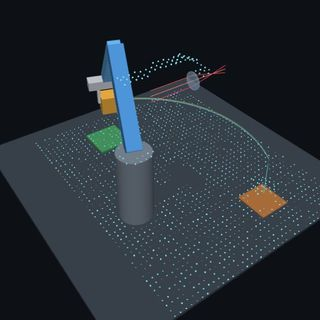<b>&#9654;</b><span>Bras et lentille translucide · 0.3 MB</span></a>
<a href="../../view2026/anim3d/particle_dissolution_anim3d.html?lang=fr">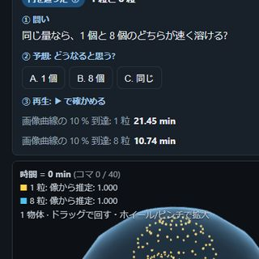<b>&#9654;</b><span>Comment les particules de médicament se dissolvent · 1.9 MB</span></a>
<a href="../../view2026/anim3d/laser_diffraction_anim3d.html?lang=fr"><b>&#9654;</b><span>Measure powder size with rings of light · 0.3 MB</span></a>
<a href="../../view2026/anim3d/tablet_inspection_anim3d.html?lang=fr"><b>&#9654;</b><span>Tablet appearance and colour inspection · 0.5 MB</span></a>
<a href="../../view2026/anim3d/satellite_gsd_anim3d.html?lang=fr">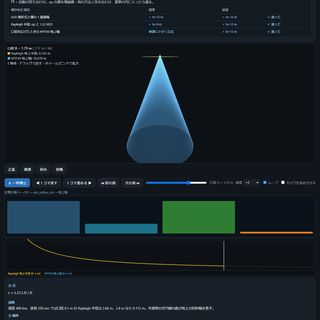<b>&#9654;</b><span>Pourquoi les petits caractères disparaissent depuis l'orbite · 0.2 MB</span></a>
<a href="../../view2026/anim3d/ship_stability_anim3d.html?lang=fr">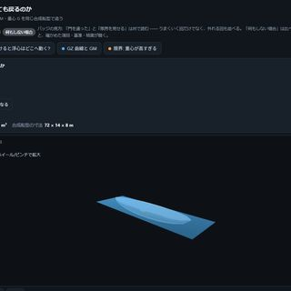<b>&#9654;</b><span>Pourquoi un navire flotte et se redresse · 0.2 MB</span></a>
<a href="../../view2026/anim3d/bridge_dic_anim3d.html?lang=fr">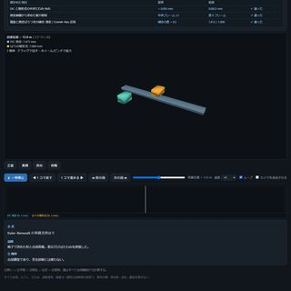<b>&#9654;</b><span>Mesurer la flèche d'un pont avec une caméra distante · 0.6 MB</span></a>
<a href="../../view2026/anim3d/rail_light_section_anim3d.html?lang=fr">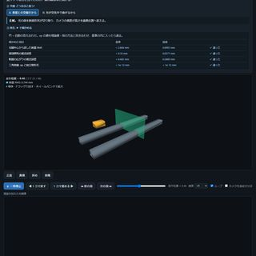<b>&#9654;</b><span>Measure rail wear and gauge with light-section scanning · 0.1 MB</span></a>
<a href="../../view2026/anim3d/salt_xrd_anim3d.html?lang=fr">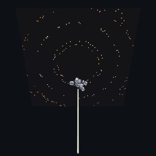<b>&#9654;</b><span>Diffraction des rayons X sur poudre de sel · 2.5 MB</span></a>
<a href="../../anim3d/gauss_bonnet.html?lang=fr">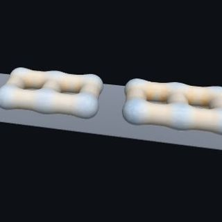<b>&#9654;</b><span>Toute la courbure additionnée · 3.1 MB</span></a>
<a href="../../view2026/anim3d/ultrasound_bmode_anim3d.html?lang=fr">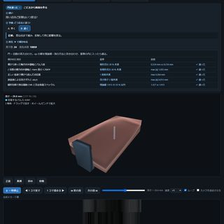<b>&#9654;</b><span>Imagerie ultrasonore en mode B · 0.2 MB</span></a>
<a href="../../view2026/anim3d/oct_retina_anim3d.html?lang=fr">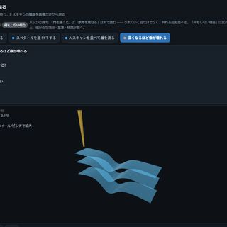<b>&#9654;</b><span>Mesurer les couches rétiniennes par OCT · 0.5 MB</span></a>
<a href="../../view2026/anim3d/pulseox_anim3d.html?lang=fr">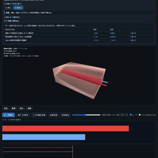<b>&#9654;</b><span>Oxymétrie de pouls à double longueur d’onde · 0.2 MB</span></a>
<a href="../../view2026/anim3d/star_tracker_anim3d.html?lang=fr">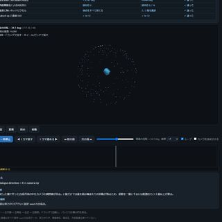<b>&#9654;</b><span>Satellite attitude from one star image · 0.2 MB</span></a>
<a href="../../view2026/anim3d/venue_shadow_anim3d.html?lang=fr">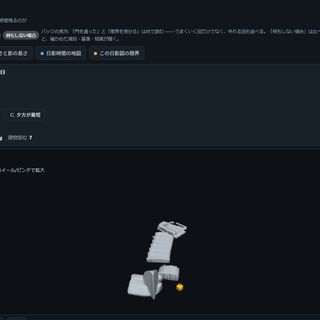<b>&#9654;</b><span>Ombres du solstice d'hiver autour du site · 0.3 MB</span></a>
<a href="../../view2026/anim3d/kelvin_wake_anim3d.html?lang=fr">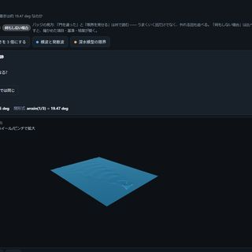<b>&#9654;</b><span>Le sillage en V d'un navire · 0.2 MB</span></a>
<a href="../../view2026/anim3d/catenary_wear_anim3d.html?lang=fr">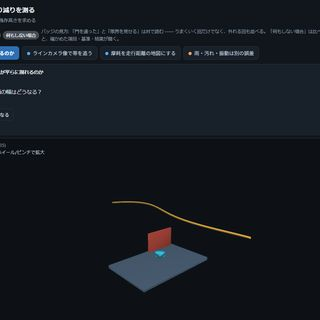<b>&#9654;</b><span>Mesurer l'usure du fil de contact en mouvement · 0.1 MB</span></a>
<a href="../../view2026/anim3d/hypercentric_lens_anim3d.html?lang=fr">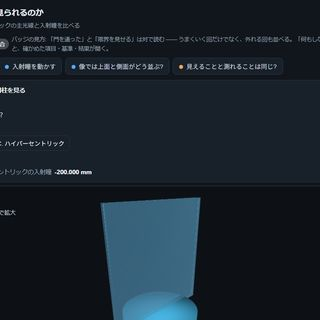<b>&#9654;</b><span>A hypercentric lens sees a cylinder top and side in one image · 0.4 MB</span></a>
<a href="../../view2026/anim3d/borescope_anim3d.html?lang=fr">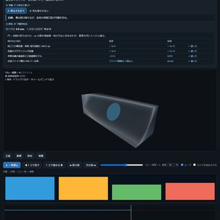<b>&#9654;</b><span>How a borescope sees through a narrow tube · 0.5 MB</span></a>
<a href="../../view2026/anim3d/tunnel_crack_anim3d.html?lang=fr">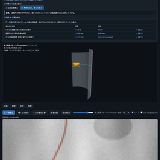<b>&#9654;</b><span>Mesurer une fissure de tunnel de 0.2 mm en mouvement · 0.3 MB</span></a>
<a href="../../view2026/anim3d/shack_hartmann_anim3d.html?lang=fr">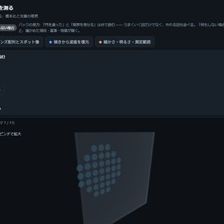<b>&#9654;</b><span>Mesurer un front d'onde à partir du déplacement des taches · 0.4 MB</span></a>
<a href="../../view2026/anim3d/photoelastic_anim3d.html?lang=fr">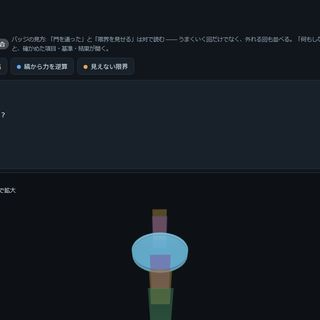<b>&#9654;</b><span>See force as colored fringes · 0.5 MB</span></a>
<a href="../../view2026/anim3d/insar_subsidence_anim3d.html?lang=fr">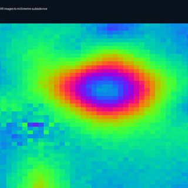<b>&#9654;</b><span>Mesurer depuis l'orbite un affaissement de quelques millimètres · 0.1 MB</span></a>
<a href="../../view2026/anim3d/multibeam_bathymetry_anim3d.html?lang=fr">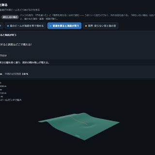<b>&#9654;</b><span>Mapping the seabed with sound from a vessel · 0.2 MB</span></a>
<a href="../../view2026/anim3d/thermo_delamination_anim3d.html?lang=fr">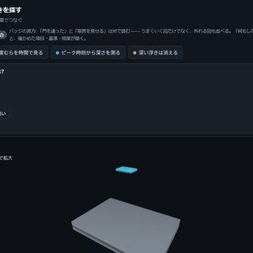<b>&#9654;</b><span>Repérer un décollement du béton par les motifs thermiques · 0.3 MB</span></a>
<a href="../../articles/assets/poc/poc_barcode_1d/03_collapse.png"><span>Code-barres 1-D</span></a>
<a href="../../articles/assets/poc/poc_bearing_diagnosis/03_sk_bands.png"><span>Diagnostic d'anomalies de roulements</span></a>
<a href="../../articles/assets/poc/poc_bilateral_asymmetry/02_gain_vs_amplitude.png"><span>Asymétrie bilatérale</span></a>
<a href="../../articles/assets/poc/poc_crack_width/01_width_sweep.png"><span>Largeur des fissures</span></a>
<a href="../../articles/assets/poc/poc_dimensional_inspection/02_blur_cliff.png"><span>Contrôle dimensionnel de pièces</span></a>
<a href="../../articles/assets/poc/poc_fabric_defect/04_scene.png"><span>Défauts de tissu</span></a>
<a href="../../articles/assets/poc/poc_fiber_orientation/01_scene.png"><span>Orientation des fibres</span></a>
<a href="../../articles/assets/poc/poc_gear_tooth_metrology/03_spectrum.png"><span>Profil de denture des engrenages</span></a>
<a href="../../articles/assets/poc/poc_matrix_code_reading/01_symbol_and_errors.png"><span>Lecture de codes binaires 2-D</span></a>
<a href="../../articles/assets/poc/poc_moire_screen/04_moire_scene.png"><span>Moiré et mura</span></a>
<a href="../../articles/assets/poc/poc_particle_sizing/02_density_sweep.png"><span>Distribution granulométrique</span></a>
<a href="../../articles/assets/poc/poc_strain_history/05_history_video.gif"><b>&#9654;</b><span>Déformation de fluage</span></a>
<a href="../../articles/assets/poc/poc_surface_roughness/04_lambda_c_sweep.png"><span>Rugosité de surface</span></a>
<a href="../../articles/assets/poc/poc_thermal_drift_metrology/04_error_maps.png"><span>Dérive thermique de la caméra</span></a>
<a href="../../articles/assets/poc/poc_veiling_glare/03_mtf_curves.png"><span>Lumière parasite et contraste</span></a>
<a href="../../articles/assets/poc/poc_weld_bead_profile/01_laser_images.png"><span>Profil en coupe du cordon de soudure</span></a>
<a href="../../articles/assets/poc/poc_leak_localization/04_correlation_zoom.png"><span>Détection de fuites par le son</span></a>
<a href="../../articles/assets/poc/poc_machine_condition_fusion/11_sweep_record_length.png"><span>Fusion pour la maintenance des équipements</span></a>
<a href="../../articles/assets/poc/poc_metal_grain_size/08_failure_area.png"><span>Taille de grain</span></a>
<a href="../../articles/assets/poc/poc_recycling_sorting/13_spectra.png"><span>Tri des déchets par matériau</span></a>
<a href="../../articles/assets/poc/poc_screw_thread_metrology/05_tilt_correction.png"><span>Profil des filetages</span></a>
<a href="../../articles/assets/poc/poc_solar_el_inspection/03_scene_map.png"><span>EL des cellules solaires</span></a>
<a href="../../articles/assets/poc/poc_solder_fillet_aoi/07_shift_cliff.png"><span>AOI des soudures</span></a>
<a href="../../articles/assets/poc/poc_asbuilt_wall_deviation/02_aabb_vs_yaw.png"><span>Déformation des murs construits</span></a>
<a href="../../articles/assets/poc/poc_battery_electrode_breathing/03_displacement.png"><span>Respiration des électrodes</span></a>
<a href="../../articles/assets/poc/poc_battery_electrode_tortuosity/02_map_transport.png"><span>Tortuosité des électrodes</span></a>
<a href="../../articles/assets/poc/poc_bump_coplanarity/06_absorbed_defect.png"><span>Coplanarité des bumps</span></a>
<a href="../../articles/assets/poc/poc_die_tilt_tsv_overlay/04_tilt_cliff.png"><span>Inclinaison de la puce et TSV</span></a>
<a href="../../articles/assets/poc/poc_multibeam_bathymetry/18_real_smile.png"><span>Sondage multifaisceaux</span></a>
<a href="../../articles/assets/poc/poc_print_registration/01_plates.png"><span>Défaut de repérage d'impression</span></a>
<a href="../../articles/assets/poc/poc_rail_corrugation/03_transfer_zoom.png"><span>Usure ondulatoire des rails</span></a>
<a href="../../articles/assets/poc/poc_real_coin_metrology/01_scene.png"><span>Pièces de monnaie réelles</span></a>
<a href="../../articles/assets/poc/poc_real_texture_invariance/01_textures.png"><span>Rotation de textures réelles</span></a>
<a href="../../articles/assets/poc/poc_web_roll_periodicity/01_scene_web.png"><span>Défauts des rouleaux de transport</span></a>
<a href="../../articles/assets/poc/poc_weld_bead_scan_angle/10_stripe_width.png"><span>Balayage du cordon de soudure</span></a>
<a href="../../articles/assets/poc/poc_aoi_ct_traceability/03_aoi_and_ct.png"><span>Appariement AOI et CT</span></a>
<a href="../../articles/assets/poc/poc_spc/04_spc_mt_distance.png"><span>Maîtrise statistique des procédés</span></a>
<a href="../../articles/assets/poc/poc_glyph_typo_detection/01_sign_before_after.png"><span>Détection de fautes de frappe dans les images</span></a>
<a href="../../articles/assets/poc/poc_print_layer_inspection/03_tolerance_curve.png"><span>Inspection des couches d'impression 3D</span></a>
<a href="../../articles/assets/poc/poc_measurement_system_analysis/18_divisors.png"><span>R&R de l'instrument de mesure (gauge R&R)</span></a>
<a href="../../articles/assets/poc/poc_attention_identities/03_linear_crossover.png"><span>Identités de l'attention</span></a>
<a href="../../articles/assets/poc/poc_zernike_aberrations/08_edge_ring.png"><span>Aberrations de Zernike</span></a>
<a href="../../articles/assets/poc/poc_mt_hidden_fault/03_mt_vs_univariate_unbalance.png"><span>Détection d'anomalies par la méthode MT</span></a>
<a href="../../articles/assets/poc/poc_text_region_truth/02_text_region_coverage_latin.png"><span>Détection de zones de texte</span></a>
<a href="../../articles/assets/poc/poc_agv_fleet/01_agv_naive_vs_adg.gif"><b>&#9654;</b><span>Entrepôt à AGV</span></a>
<a href="../../articles/assets/poc/poc_tacsim_marker_shear/06_tacslip_fem_vs_halfspace.png"><span>Cisaillement tactile</span></a>
<a href="../../articles/assets/poc/poc_tactile_dipole_torque/04_tactorque_fem_oblique_vs_normal.png"><span>Dipôle tactile</span></a>
<a href="../../articles/assets/poc/poc_food_cutting_measure/01_cutting_track_force.gif"><b>&#9654;</b><span>Découpe d'aliments</span></a>
<a href="../../articles/assets/poc/poc_granular_heap_repose/10_granular_spoon_tilt_dispense.png"><span>Tas de poudre</span></a>
<a href="../../articles/assets/poc/poc_polish_wipe_measure/01_polish_raster_wipe_coat.gif"><b>&#9654;</b><span>Polissage et essuyage</span></a>
<a href="../../articles/assets/poc/poc_powder_grinding_ae/05_d50_vs_time_Citricacid.png"><span>Broyage au mortier</span></a>
<a href="../../articles/assets/poc/poc_powder_scoop_pour/05_scoop_boolean_model_vs_naive.png"><span>Prélèvement et versement de poudre</span></a>
<a href="../../articles/assets/poc/poc_tacdome_large_deformation/01_tacdome_press_sweep.gif"><b>&#9654;</b><span>Contact d'un bout de doigt en dôme souple</span></a>
<a href="../../articles/assets/poc/poc_dose_uniformity_from_grinding/02_cv_vs_grinding_NaCl.png"><span>Uniformité de la dose</span></a>
<a href="../../articles/assets/poc/poc_knife_tactile_toughness/01_handle_length_limit.png"><span>Tenir un couteau avec le bout des doigts</span></a>
<a href="../../articles/assets/poc/poc_residue_crt/05_residue_displacement_table.png"><span>Phase par le théorème des restes chinois</span></a>
<a href="../../articles/assets/poc/poc_pod_lighting/03_pod_curves.png"><span>Probabilité de détection par éclairage</span></a>
<a href="../../articles/assets/poc/poc_emva1288_in_camera_processing/01_datasheet_lies.png"><span>Quand le prétraitement fausse la fiche technique</span></a>
<a href="../../articles/assets/poc/poc_interreflection_fringe_error/02_direct_global.png"><span>Interréflexion dans une rainure blanche et erreur des franges</span></a>
<a href="../../articles/assets/poc/poc_laser_line_speckle_floor/01_line.png"><span>Plancher de speckle d'une ligne laser</span></a>
<a href="../../articles/assets/poc/poc_sam_hybrid_bonding_voids/03_amplitude_vs_phase.png"><span>Détection des vides de collage hybride par la phase</span></a>
<a href="../../articles/assets/poc/poc_si_wafer_pl_defect_visibility/03_pl_real_groove_after_hf.png"><span>Rainure dans l'image PL et longueur de diffusion</span></a>
<a href="../../articles/assets/poc/poc_illumination_cone_vs_na/02_works_by_cone.png"><span>Cône d'éclairage et ON d'observation</span></a>
<a href="../../articles/assets/poc/poc_moire_alignment/01_marks.png"><span>Alignement par moiré (deux réseaux invisibles permettent de lire 1 nm)</span></a>
<a href="../../articles/assets/poc/poc_optics_drawings/06_setup_ring_coaxial.png"><span>Dessins du système optique (coupe, plan d'implantation, plan de fabrication)</span></a>
<a href="../../articles/assets/poc/poc_pocket_interreflection/07_bulczak.png"><span>Interréflexion dans une poche usinée jusqu'à la convergence</span></a>
<a href="../../articles/assets/poc/poc_telecentric_metrology/08_real_alignment_plate.png"><span>Objectif télécentrique et mesure dimensionnelle</span></a>
<a href="../../articles/assets/poc/poc_code_matching_breakdown/05_highlight_sweep.gif"><b>&#9654;</b><span>Appariement de codes sous lumière variable et occlusion</span></a>
<a href="../../articles/assets/poc/poc_dense_bubble_count/03_pair_verdicts.png"><span>Compter des bulles denses (un intervalle quand c'est indécidable)</span></a>
<a href="../../articles/assets/poc/poc_good_sample_variation_model/04_visa_explanation.png"><span>Modèle de variation des pièces bonnes</span></a>
<a href="../../articles/assets/poc/poc_noncoaxial_optics/05_false_defect.png"><span>Optique non coaxiale : images fantômes et repliements d'une lame semi-réfléchissante</span></a>
<a href="../../articles/assets/poc/poc_robust_profile_filter/03_breakdown_curve.png"><span>De combien une rayure creuse la ligne moyenne, et où les filtres robustes cèdent</span></a>
<a href="../../articles/assets/poc/poc_simcal_telecentric/02_real_model_residuals.png"><span>Étalonner un modèle d'imagerie sur une image télécentrique réelle</span></a>
<a href="../../articles/assets/poc/poc_lockin_imaging/02_daylighting.png"><span>Démodulation lock-in par pixel : normales d'éclairage annulaire, séparation de la lumière du jour, ondes thermiques</span></a>
<a href="../../articles/assets/poc/poc_patch_anomaly/01_anomaly_maps.png"><span>Détection d'anomalies à partir des seules bonnes pièces (caractéristiques classiques : distribution contre mémoire)</span></a>
<a href="../../articles/assets/poc/poc_braid_homotopy_classes/01_braid_classes_spacetime.gif"><b>&#9654;</b><span>Classer des plans multi-robots selon leur tresse</span></a>
<a href="../../articles/assets/poc/poc_fourier_ptychography/01_usaf_4x_fp_20x.png"><span>Ptychographie de Fourier (résolution 20x dans un champ 4x)</span></a>
<a href="../../articles/assets/poc/poc_mueller_dofp_observability/01_observability.png"><span>Sept dimensions de Mueller invisibles pour une caméra de polarisation à quatre angles</span></a>
<a href="../../articles/assets/poc/poc_slanted_edge_sfr_limits/01_sfr_limits.png"><span>La SFR à bord incliné fausse le MTF50 à cause du gamma</span></a>
<a href="../../articles/assets/poc/poc_wavefront_aberration_limits/01_aberration_limits.png"><span>Limites de l'approximation de Maréchal selon la forme de l'aberration</span></a>
<a href="../../articles/assets/poc/poc_car_parking/05_truths.png"><span>La courbe la plus courte</span></a>
<a href="../../articles/assets/poc/poc_complex_plane_fields/05_mandelbrot.png"><span>Le plan complexe en surface</span></a>
<a href="../../articles/assets/poc/poc_allsky_cloud_cover/04_allsky.png"><span>Couverture nuageuse par caméra plein ciel</span></a>
<a href="../../articles/assets/poc/poc_cell_counting/03_count_cancellation.png"><span>Comptage de cellules se chevauchant</span></a>
<a href="../../articles/assets/poc/poc_pigment_unmixing/03_thickness_cliff.png"><span>Séparation des couches de pigments</span></a>
<a href="../../articles/assets/poc/poc_dtof_ranging/01_light_front.gif"><b>&#9654;</b><span>Télémétrie par photons</span></a>
<a href="../../articles/assets/poc/poc_document_scan/02_shadow_tradeoff.png"><span>Redresser le document</span></a>
<a href="../../articles/assets/poc/poc_camera_calibration/05_calibration_convergence.gif"><b>&#9654;</b><span>Calibrage de caméra</span></a>
<a href="../../articles/assets/poc/poc_camera_shake_deblur/05_kernel_angle_sweep.gif"><b>&#9654;</b><span>Correction du flou de bougé</span></a>
<a href="../../articles/assets/poc/poc_battery_ct_degradation/01_xray_projection.png"><span>Dégradation des batteries observée par CT</span></a>
<a href="../../articles/assets/poc/poc_particle_tracking/05_tracking_links.gif"><b>&#9654;</b><span>Suivi de particules</span></a>
<a href="../../articles/assets/poc/poc_driving_school/01_course_plan.png"><span>Auto-école</span></a>
<a href="../../articles/assets/poc/poc_one_stroke_epicycles/07_epicycles.gif"><b>&#9654;</b><span>Dessin d'un seul trait et épicycles</span></a>
<a href="../../articles/assets/poc/poc_astro_photometry/02_cosmic_ray.png"><span>Précision de la photométrie stellaire</span></a>
<a href="../../articles/assets/poc/poc_nuclei_ploidy/01_histograms.png"><span>Ploïdie nucléaire</span></a>
<a href="../../articles/assets/poc/poc_white_balance/02_bias_cliff.png"><span>Balance des blancs</span></a>
<a href="../../articles/assets/poc/poc_lightfield_depth/03_raw_mla.png"><span>Profondeur à partir du champ lumineux</span></a>
<a href="../../articles/assets/poc/poc_forensics_roc/01_score_maps.png"><span>ROC de la détection de falsification</span></a>
<a href="../../articles/assets/poc/poc_panorama_drift/05_chain_drift_video.gif"><b>&#9654;</b><span>Décalage du panorama</span></a>
<a href="../../articles/assets/poc/poc_dehazing/05_haze_sweep.gif"><b>&#9654;</b><span>Suppression de la brume</span></a>
<a href="../../articles/assets/poc/poc_bev_sensor_fusion/02_shadow_map.png"><span>Fusion de vues en vue aérienne (BEV)</span></a>
<a href="../../articles/assets/poc/poc_template_tracking/05_twin_vs_flat_occluder.gif"><b>&#9654;</b><span>Suivi par modèle</span></a>
<a href="../../articles/assets/poc/poc_world_terrain/01_scene_terrain.png"><span>Élargir le monde</span></a>
<a href="../../articles/assets/poc/poc_beats_fringes_and_screens/05_grating.png"><span>Un seul battement</span></a>
<a href="../../articles/assets/poc/poc_dem_terrain/05_terrain_flight.gif"><b>&#9654;</b><span>Mesure du relief</span></a>
<a href="../../articles/assets/poc/poc_vessel_network/04_murray.png"><span>Ramifications du réseau vasculaire</span></a>
<a href="../../articles/assets/poc/poc_real_stain_unmix/02_blind.png"><span>Séparation des colorations sur prises réelles</span></a>
<a href="../../articles/assets/poc/poc_pv_thermal_survey/08_raw_aerial_thermal.png"><span>Imagerie thermique photovoltaïque</span></a>
<a href="../../articles/assets/poc/poc_fresco_craquelure/03_width_cliff.png"><span>Réseau de craquelures d'un tableau</span></a>
<a href="../../articles/assets/poc/poc_real_stereo_depth/01_scene.png"><span>Stéréo sur images réelles</span></a>
<a href="../../articles/assets/poc/poc_superresolution_limits/05_growth.gif"><b>&#9654;</b><span>Limites de la super-résolution</span></a>
<a href="../../articles/assets/poc/poc_cad_scan_deviation/14_align_orbit.gif"><b>&#9654;</b><span>Écart entre CAO et nuage de points</span></a>
<a href="../../articles/assets/poc/poc_timelapse_growth/05_growth_merge.gif"><b>&#9654;</b><span>Time-lapse de croissance</span></a>
<a href="../../articles/assets/poc/poc_driving_longitudinal/01_drive_with_time.gif"><b>&#9654;</b><span>Inertie et pentes</span></a>
<a href="../../articles/assets/poc/poc_illusions_and_perpetual_drawing/15_seam.png"><span>Dessin sans fin</span></a>
<a href="../../articles/assets/poc/poc_sea_ice_concentration/04_summary.png"><span>Concentration de glace de mer</span></a>
<a href="../../articles/assets/poc/poc_wound_area_tracking/06_healing_video.gif"><b>&#9654;</b><span>Variation de l'aire de la plaie</span></a>
<a href="../../articles/assets/poc/poc_fiber_light_guide/03_lp_b_v_diagram.png"><span>Fibres optiques et guides de lumière (modes, dispersion, diamètre de mode)</span></a>
<a href="../../articles/assets/poc/poc_weld_radiograph_porosity/06_map_toe_backgrounds.png"><span>Porosité des soudures</span></a>
<a href="../../articles/assets/poc/poc_prnu_camera_fingerprint/12_denoisers.png"><span>Empreinte de la caméra</span></a>
<a href="../../articles/assets/poc/poc_rotation_invariance_audit/01_rotation_frames.png"><span>Audit de l'invariance par rotation</span></a>
<a href="../../articles/assets/poc/poc_colormap_readability/13_categorical_overflow.png"><span>Lecture des fausses couleurs</span></a>
<a href="../../articles/assets/poc/poc_crop_phenotyping/01_capsule_calibration.png"><span>Surface foliaire des cultures</span></a>
<a href="../../articles/assets/poc/poc_traffic_counting/05_counting_video.gif"><b>&#9654;</b><span>Comptage du trafic</span></a>
<a href="../../articles/assets/poc/poc_driving_weather/01_sun_day.gif"><b>&#9654;</b><span>Soleil et météo</span></a>
<a href="../../articles/assets/poc/poc_theorems_as_pictures/03_ford.png"><span>Schéma où les théorèmes deviennent des barrières</span></a>
<a href="../../articles/assets/poc/poc_solar_limb_darkening/04_sunspot.png"><span>Assombrissement centre-bord et contour</span></a>
<a href="../../articles/assets/poc/poc_bone_trabecular_thickness/04_resolution_table.png"><span>Épaisseur des travées osseuses</span></a>
<a href="../../articles/assets/poc/poc_material_optical_library/14_lens_axial_colour.png"><span>Bibliothèque de propriétés optiques des matériaux (83 matériaux issus d'un même tableau)</span></a>
<a href="../../articles/assets/poc/poc_thermal_radiometry/06_cliff_curves.png"><span>Imagerie thermique et température</span></a>
<a href="../../articles/assets/poc/poc_video_physics_consistency/01_monocular_clip.gif"><b>&#9654;</b><span>Cohérence physique d'une vidéo : balistique ou propulsé, dilatation du temps</span></a>
<a href="../../articles/assets/poc/poc_public_camera_heading/04_sun_track.png"><span>Orientation des caméras publiques</span></a>
<a href="../../articles/assets/poc/poc_real_deblur_honesty/03_cliffs.png"><span>Correction du flou sur prises réelles</span></a>
<a href="../../articles/assets/poc/poc_dfm_thickness_overhang/06_overhang_map.png"><span>Facilité de fabrication</span></a>
<a href="../../articles/assets/poc/poc_xyt_event_surface/07_arrival_video.gif"><b>&#9654;</b><span>Surface des temps d'arrivée</span></a>
<a href="../../articles/assets/poc/poc_driving_decisions/02_signal_prediction.gif"><b>&#9654;</b><span>Scènes de décision</span></a>
<a href="../../articles/assets/poc/poc_what_a_picture_cannot_check/05_dimension.png"><span>Ce que les images ne peuvent pas vérifier</span></a>
<a href="../../articles/assets/poc/poc_star_astrometry/02_phase_systematic.png"><span>Précision de l'astrométrie stellaire</span></a>
<a href="../../articles/assets/poc/poc_colocalization_crosstalk/01_scene_channels.png"><span>Colocalisation de fluorescence</span></a>
<a href="../../articles/assets/poc/poc_nir_silicon_transmission/06_scene_through_wafer.png"><span>Transmission en proche infrarouge à travers une plaquette de Si (choix de la longueur d'onde de la LED)</span></a>
<a href="../../articles/assets/poc/poc_emva1288_sensor/04_spectrogram.png"><span>Mesure EMVA 1288</span></a>
<a href="../../articles/assets/poc/poc_public_camera_heading_real/06_numbers.png"><span>Orientation de la caméra (prises réelles)</span></a>
<a href="../../articles/assets/poc/poc_fly_vision/02_fly_vision_rotation.png"><span>Étage visuel initial de la mouche</span></a>
<a href="../../articles/assets/poc/poc_lidar_terrain_change/13_real_dod.png"><span>Volume de terre d'un talus</span></a>
<a href="../../articles/assets/poc/poc_beam_modal_video/14_beam_video.gif"><b>&#9654;</b><span>Identification modale par vidéo</span></a>
<a href="../../articles/assets/poc/poc_driving_endless_map/02_dashcam.gif"><b>&#9654;</b><span>La carte sans fin</span></a>
<a href="../../articles/assets/poc/poc_calipers_under_illusion/16_audit.png"><span>Diagnostic d'instruments de mesure par illusions d'optique</span></a>
<a href="../../articles/assets/poc/poc_vegetation_cover/01_mixed_pixel_response.png"><span>Taux de couverture végétale d'un champ</span></a>
<a href="../../articles/assets/poc/poc_mri_bias_field/04_amplitude_sweep_methods.png"><span>Champ de biais IRM</span></a>
<a href="../../articles/assets/poc/poc_hyperspectral_foreign_matter/04_real_pork_belly.png"><span>Tri par imagerie hyperspectrale de corps étrangers d'aspect identique</span></a>
<a href="../../articles/assets/poc/poc_am_thermal_to_ct/08_protrusion_by_facing.png"><span>Fabrication additive et CT</span></a>
<a href="../../articles/assets/poc/poc_carla_bridge/01_carla_two_worlds.png"><span>Prise de vue dans 2 mondes</span></a>
<a href="../../articles/assets/poc/poc_fly_optomotor_steering/03_wide_eye.png"><span>Contrôle de trajectoire de la mouche</span></a>
<a href="../../articles/assets/poc/poc_mesh_quality_repair/14_decimate_orbit.gif"><b>&#9654;</b><span>Réparation de maillage</span></a>
<a href="../../articles/assets/poc/poc_cold_chain_excursion/13_excursion_body.png"><span>Température du transport réfrigéré</span></a>
<a href="../../articles/assets/poc/poc_driving_lateral/01_lateral_dashcam.gif"><b>&#9654;</b><span>Mouvement latéral</span></a>
<a href="../../articles/assets/poc/poc_water_level/04_reflection.png"><span>Niveau d'eau d'une rivière</span></a>
<a href="../../articles/assets/poc/poc_larval_connectome_reservoir/01_adjacency_binned_connectome_vs_shuffle.png"><span>Calcul sur le câblage larvaire</span></a>
<a href="../../articles/assets/poc/poc_lens_file_roundtrip/02_spot_diagram.png"><span>Fichiers de conception optique (.zmx) : lire, analyser, corriger, réécrire</span></a>
<a href="../../articles/assets/poc/poc_pxrd_phase_peel/01_phase_peel.gif"><b>&#9654;</b><span>Séparation des phases par diffraction des rayons X</span></a>
<a href="../../articles/assets/poc/poc_driving_commonroad/01_commonroad_scene.png"><span>Notation avec CommonRoad</span></a>
<a href="../../articles/assets/poc/poc_vanishing_detail_and_morphing_area/09_area_from_picture.png"><span>Détails qui disparaissent et surface</span></a>
<a href="../../articles/assets/poc/poc_pipe_wall_loss/03_map_truth.png"><span>Amincissement de paroi des tuyauteries</span></a>
<a href="../../articles/assets/poc/poc_warehouse_flow/12_clearance_map.png"><span>Temps de séjour en entrepôt</span></a>
<a href="../../articles/assets/poc/poc_driving_humanoids/03_humanoids_crossing.gif"><b>&#9654;</b><span>Silhouette humaine au passage piéton</span></a>
<a href="../../articles/assets/poc/poc_change_detection_misreg/08_plot_residual_vs_fp.png"><span>Détection de changements</span></a>
<a href="../../articles/assets/poc/poc_connectome_motor_bottleneck/01_funnel.png"><span>Quantification du mouvement</span></a>
<a href="../../articles/assets/poc/poc_lens_global_search/01_lens_global_search.png"><span>Substitution de verre et recherche globale multi-départ</span></a>
<a href="../../articles/assets/poc/poc_sem_wafer_defect_edge_bias/04_sem_edge_inflation.png"><span>Élargissement des bords en MEB</span></a>
<a href="../../articles/assets/poc/poc_driving_japan_town/06_japan_road_table.png"><span>Une véritable ville japonaise</span></a>
<a href="../../articles/assets/poc/poc_graph_hierarchy_segmentation/03_graph_cut_lambda.png"><span>Segmentation par graphe</span></a>
<a href="../../articles/assets/poc/poc_print_warpage_risk/10_warp_map.png"><span>Gauchissement des couches imprimées</span></a>
<a href="../../articles/assets/poc/poc_crack_width_timeseries/11_series_video.gif"><b>&#9654;</b><span>Propagation des fissures</span></a>
<a href="../../articles/assets/poc/poc_exoplanet_transit/01_scene_starfield.png"><span>Transit d'une exoplanète</span></a>
<a href="../../articles/assets/poc/poc_em_branch_territory/03_radius_recovery.png"><span>Territoires des branches</span></a>
<a href="../../articles/assets/poc/poc_lens_merit_operands/01_lens_merit_operands.png"><span>Concevoir un triplet à partir d'un tableau d'exigences (bornes d'épaisseur de bord, verre comme variable)</span></a>
<a href="../../articles/assets/poc/poc_shape_from_polarization/07_failures.png"><span>Mesure du noir brillant et du verre par polarisation</span></a>
<a href="../../articles/assets/poc/poc_driving_town/06_town_rules_table.png"><span>Assembler une ville</span></a>
<a href="../../articles/assets/poc/poc_segmentation_gauntlet/11_gauntlet_texture.gif"><b>&#9654;</b><span>Barrière de segmentation</span></a>
<a href="../../articles/assets/poc/poc_safety_clearance/13_map_distance_slice.png"><span>Distance entre personne et machine</span></a>
<a href="../../articles/assets/poc/poc_settlement_significance/04_lod_by_zone.png"><span>Tassement ou nouvelle mesure</span></a>
<a href="../../articles/assets/poc/poc_leaf_disease_area/09_grade_confusion.png"><span>Lésions foliaires</span></a>
<a href="../../articles/assets/poc/poc_em_second_opinion/04_holdout_numbers.png"><span>Contre-vérification du calibrage EM</span></a>
<a href="../../articles/assets/poc/poc_zoom_configurations/01_zoom_configurations.png"><span>Objectifs zoom comme différences d'une même prescription (multi-configuration)</span></a>
<a href="../../articles/assets/poc/poc_gw_detector_pseudo_simulation/04_power_sweep.gif"><b>&#9654;</b><span>Simulation approchée d'un télescope à ondes gravitationnelles</span></a>
<a href="../../articles/assets/poc/poc_peg_failure_recovery/01_pegfail_where_it_breaks_offset_flip.png"><span>Récupération après échec d'insertion</span></a>
<a href="../../articles/assets/poc/poc_iqa_fsim_gmsd_vif/06_iqa_tid2013_published_vs_reproduced.png"><span>Concordance des indicateurs perceptuels</span></a>
<a href="../../articles/assets/poc/poc_scan_to_bim_asbuilt/09_element_verdicts.png"><span>Écart entre conception et réalisation</span></a>
<a href="../../articles/assets/poc/poc_live4d/05_interpolation.png"><span>3D+t sur le vivant</span></a>
<a href="../../articles/assets/poc/poc_river_surface_velocity/13_accumulate_pairs.gif"><b>&#9654;</b><span>Vitesse de surface d'une rivière</span></a>
<a href="../../articles/assets/poc/poc_connectome_across_decades/01_jaccard_across_decades.png"><span>Schéma de câblage d'il y a 40 ans</span></a>
<a href="../../articles/assets/poc/poc_lens_solves_afocal/01_lens_solves_afocal.png"><span>Garder les relations d'une conception sous forme de solves (F/# qui suit le diaphragme, afocal, image courbe, asphères impaires)</span></a>
<a href="../../articles/assets/poc/poc_chromatic_confocal/08_real_groove_from_paper_figures.png"><span>Capteur confocal chromatique (lecture de la hauteur par la couleur)</span></a>
<a href="../../articles/assets/poc/poc_peg_insertion_tactile/01_pegtactile_two_membranes_read.png"><span>Insertion de cheville par membrane de doigt</span></a>
<a href="../../articles/assets/poc/poc_iqa_tid2013/03_tid2013_srocc_by_distortion.png"><span>Indicateurs de qualité d'image et TID2013</span></a>
<a href="../../articles/assets/poc/poc_structure_4d_deterioration/12_years_video.gif"><b>&#9654;</b><span>Vieillissement des structures</span></a>
<a href="../../articles/assets/poc/poc_video_cube/06_em_stack_cube.png"><span>Cube spatio-temporel vidéo</span></a>
<a href="../../articles/assets/poc/poc_tree_ring_dendro/01_scene.png"><span>Largeur des cernes de croissance</span></a>
<a href="../../articles/assets/poc/poc_connectome_across_worms/01_occupancy_matrix.png"><span>Variabilité individuelle chez le ver</span></a>
<a href="../../articles/assets/poc/poc_zmx_public_verify/04_inspection_scores.png"><span>Vérification indépendante de prescriptions .zmx publiques</span></a>
<a href="../../articles/assets/poc/poc_industrial_oct/01_real_paint_bscans.png"><span>OCT industrielle (épaisseur des couches de peinture et défauts internes)</span></a>
<a href="../../articles/assets/poc/poc_peg_symmetry_search/04_pegsym_two_point_depth_vs_tilt_direction.png"><span>Symétrie de la cheville</span></a>
<a href="../../articles/assets/poc/poc_zebra_stripes_fly_eye/03_tau_readout.gif"><b>&#9654;</b><span>L'œil de la mouche face à des rayures</span></a>
<a href="../../articles/assets/poc/poc_symmetry_restoration/10_false_symmetry_table.png"><span>Compléter par symétrie</span></a>
<a href="../../articles/assets/poc/poc_periodic_video_boundary/05_contamination_map.png"><span>Vidéo périodique</span></a>
<a href="../../articles/assets/poc/poc_datacenter_thermal_field/01_scene_truth.png"><span>Reconstruction du champ thermique 3-D</span></a>
<a href="../../articles/assets/poc/poc_connectome_lr_symmetry/02_lr_pair_asymmetry.png"><span>Symétrie gauche-droite du ver</span></a>
<a href="../../articles/assets/poc/poc_itof_multifreq/12_public_raw_unwrap.png"><span>ToF indirect (repliement et trajets multiples)</span></a>
<a href="../../articles/assets/poc/poc_reproducible_icp/06_gpu_fp64_emulation_phi_4_0.png"><span>ICP reproductible au bit près</span></a>
<a href="../../articles/assets/poc/poc_simcal_pixel_shift/06_real_tiles.png"><span>Étalonner les décalages du pixel-shift et l'ouverture (carte de l'indéterminé)</span></a>
<a href="../../articles/assets/poc/poc_livestock_body_volume/14_hull_orbit.gif"><b>&#9654;</b><span>Poids du bétail</span></a>
<a href="../../articles/assets/poc/poc_ball_bounce/07_rally_two_rackets.gif"><b>&#9654;</b><span>Suivi d'une balle de tennis de table</span></a>
<a href="../../articles/assets/poc/poc_geodetic_height_frames/12_tool_gap.png"><span>Le piège des hauteurs de référence</span></a>
<a href="../../articles/assets/poc/poc_em_split_merge_score/01_split_vs_merge_by_threshold.png"><span>Évaluation de la segmentation EM</span></a>
<a href="../../articles/assets/poc/poc_phase_measuring_deflectometry/08_ambiguity_map.png"><span>Des creux de l'ordre du µm invisibles sur une photo, révélés par l'image miroir des franges (déflectométrie)</span></a>
<a href="../../articles/assets/poc/poc_tacscalib_sphere_lut/12_tacscalib_where_it_breaks.png"><span>Calibrage du capteur tactile</span></a>
<a href="../../articles/assets/poc/poc_water_transparent_media/04_slope_histogram.png"><span>L'eau et les milieux transparents : vagues, réfraction dans un bassin, couleur sous l'eau, caustique d'une bouteille</span></a>
<a href="../../articles/assets/poc/poc_pallet_load_utilization/01_scene.png"><span>Taux de chargement des palettes</span></a>
<a href="../../articles/assets/poc/poc_kendama/05_catch_gif.gif"><b>&#9654;</b><span>Kendama</span></a>
<a href="../../articles/assets/poc/poc_real_sky_photometry/03_snr_lies.png"><span>Ciel profond réel</span></a>
<a href="../../articles/assets/poc/poc_em_wiring_errors/04_count_only_prediction.png"><span>Erreurs de segmentation et câblage</span></a>
<a href="../../articles/assets/poc/poc_pixel_shift/13_real_chart_strips.png"><span>Décalage de pixels (fausses couleurs et repliement)</span></a>
<a href="../../articles/assets/poc/poc_simcal_thin_film/08_real_determined_vs_combinations.png"><span>Étalonnage d'un modèle de couche mince sur des images réelles (coefficients déterminés et combinaisons indéterminées)</span></a>
<a href="../../articles/assets/poc/poc_photograph_through_prescription/09_ghost_overlay.png"><span>Photographier une scène 3-D à travers la prescription réelle de l'objectif : profondeur de champ, bokeh en œil de chat, éclairement des coins, franges colorées, images fantômes</span></a>
<a href="../../articles/assets/poc/poc_endless_zoom_and_turning_solids/12_perspective_law.png"><span>Zoom sans fin</span></a>
<a href="../../articles/assets/poc/poc_diabolo_model_and_vision/01_diabolo_throw_axis_from_image.gif"><b>&#9654;</b><span>Diabolo</span></a>
<a href="../../articles/assets/poc/poc_search_sweep_width/10_lateral_range_curves.png"><span>Largeur de balayage de recherche</span></a>
<a href="../../articles/assets/poc/poc_swc_tree_truth/02_sholl_3d_vs_projected.png"><span>Squelettes à partir d'arbres réels</span></a>
<a href="../../articles/assets/poc/poc_tdi_linescan/01_tdi_stages_defects.png"><span>Caméra linéaire TDI et objectifs pour caméra linéaire</span></a>
<a href="../../articles/assets/poc/poc_water_inspection_images/12_hull_images.png"><span>L'eau dans les images d'inspection : caustiques au fond d'un bassin, une bouteille vue de côté, une plaque mouillée, une coque sous l'eau</span></a>
<a href="../../articles/assets/poc/poc_four_dimensions_by_three_d_tools/07_tesseract_irrational.gif"><b>&#9654;</b><span>Traiter 4 dimensions avec des outils 3-D</span></a>
<a href="../../articles/assets/poc/poc_swarm_obstacle_from_flow/03_swarmflow_centerline_linearised.png"><span>Détection d'obstacle par essaim</span></a>
<a href="../../articles/assets/poc/poc_geodetic_benchmarks_real/02_by_provenance.png"><span>Deux hauteurs (données réelles)</span></a>
<a href="../../articles/assets/poc/poc_worm_neurites_grow/01_neurite_length_growth.png"><span>Croissance des neurites</span></a>
<a href="../../articles/assets/poc/poc_tem_ctf_thon_rings/12_real_empiar_10028.png"><span>MET virtuel (anneaux de Thon et défocalisation)</span></a>
<a href="../../articles/assets/poc/poc_plateau_venue_lod2/01_venue_itokawa_top.png"><span>Les bâtiments du site et l'astéroïde Itokawa à la même échelle : le CityGML LOD2 de PLATEAU en maillage</span></a>
<a href="../../articles/assets/poc/poc_gravitational_lens_invariants/01_images_vs_u.png"><span>Lentille gravitationnelle</span></a>
<a href="../../articles/assets/poc/poc_physarum_maze/04_lattice_tubes.png"><span>Labyrinthe du myxomycète</span></a>
<a href="../../articles/assets/poc/poc_thin_film_reflectometry/01_real_micrograph_thickness.png"><span>Épaisseur de couche mince par réflectométrie spectrale (évaluée sur des données mesurées publiques, couleurs d'interférence des wafers)</span></a>
<a href="../../articles/assets/poc/poc_rover_slip_risk_path/07_two_soils_scene.png"><span>Glissement des roues du rover martien</span></a>
<a href="../../articles/assets/poc/poc_physarum_transport/05_five_truths.png"><span>Transport optimal du myxomycète</span></a>
<a href="../../articles/assets/poc/poc_virtual_sem_kv_cd_bse/05_sem_same_part_3kv_3detectors.png"><span>MEB virtuel et tension d'accélération</span></a>
<a href="../../articles/assets/poc/poc_weed_rice_ratio/05_real_examples.png"><span>Classer en 4 niveaux le taux de couverture des adventices en rizière</span></a>
<a href="../../articles/assets/poc/poc_skeleton_run_length_vs_voi/01_merge_size_erl_vs_voi.png"><span>Longueur de parcours et VOI</span></a>
<a href="../../articles/assets/poc/poc_dual_energy_xray/05_material_colour.png"><span>Os et verre dans la viande, séparés par deux énergies de rayons X (rayons X bi-énergie)</span></a>
<a href="../../articles/assets/poc/poc_worm_core_persists/03_core_map.png"><span>Noyau du cerveau du ver</span></a>
<a href="../../articles/assets/poc/poc_grating_interferometry/05_three_images.png"><span>Interférométrie à réseaux (fibres, fissures et pores en champ sombre)</span></a>
<a href="../../articles/assets/poc/poc_worm_synapses_vs_neurites/01_density_by_stage.png"><span>Synapses et neurites</span></a>
<a href="../../articles/assets/poc/poc_spectrometer_illumination/03_slit_image_smile.png"><span>Spectromètre et éclairage (largeur de bande et structure de la lampe)</span></a>
<a href="../../articles/assets/poc/poc_flybrain_pointcloud/04_footprints.png"><span>Le cerveau de la mouche en 126 000 corps cellulaires</span></a>
<a href="../../articles/assets/poc/poc_lens_tolerancing/05_rebudget.png"><span>Budgéter les tolérances selon la FTM, le rendement et la course de compensation</span></a>
<a href="../../articles/assets/poc/poc_plenoptic_camera/01_camera_section.png"><span>Une caméra plénoptique fondée sur une prescription : des micro-images brutes à la refocalisation et à la distance</span></a>
<a href="../../articles/assets/poc/poc_sem_tem_same_particle/08_tem_focus_sweep.gif"><b>&#9654;</b><span>Les mêmes particules en imagerie à balayage et en transmission</span></a>
<a href="../../articles/assets/poc/poc_tof_camera/09_dtof_light_front.gif"><b>&#9654;</b><span>Temps de vol indirect et direct sur une même scène 3-D : trajets multiples, pixels mixtes, pile-up et erreur de volume</span></a>
<a href="../../articles/assets/poc/poc_omni360_inspection/08_anaglyph_and_limits.png"><span>Inspection omnidirectionnelle et affichage stéréoscopique</span></a>
</div>

## Série d'articles (articles sur Qiita)

<div class="vser">
<a href="https://qiita.com/furuse-kazufumi/items/8a8f23e53b19ee8cdc10"><strong>Un musée de la métrologie sur papier</strong><span>Un musée de PoC, chacun avec sa propre vérité terrain intégrée</span></a>
<a href="https://qiita.com/furuse-kazufumi/items/a82bf9f341cc4f04ca75"><strong>Tennis de table</strong><span>Mesure du rebond et du frottement à partir de la vidéo</span></a>
<a href="https://qiita.com/furuse-kazufumi/items/05de90f4d316cd7c681c"><strong>Conduite autonome</strong><span>Évalué par des théorèmes et des secondes implémentations</span></a>
<a href="https://qiita.com/furuse-kazufumi/items/638f0b0aa7865e17c67c"><strong>Connectome (schéma de câblage du cerveau)</strong><span>Un modèle visuel de mouche installé sur un corps, puis mesuré</span></a>
<a href="https://qiita.com/furuse-kazufumi/items/569720dbae0c6471c96e"><strong>Journée sportive des humanoïdes</strong><span>Une journée sportive à domicile arbitrée par le traitement d'images</span></a>
</div>

## Ce qu'il permet de faire

97 sujets, chacun avec une page d'explication (utilisation et limites) et des liens vers des exemples exécutables.

<div class="vl" markdown="1">

**Trouver**

- Découper des régions, les sélectionner et les compter: [explication](../../capabilities/blob-and-region.md) _(ja)_ · exemples [poc_cell_counting](https://github.com/furuse-kazufumi/fullseye/blob/master/examples/poc_cell_counting.py) · [poc_particle_sizing](https://github.com/furuse-kazufumi/fullseye/blob/master/examples/poc_particle_sizing.py) · [poc_real_coin_metrology](https://github.com/furuse-kazufumi/fullseye/blob/master/examples/poc_real_coin_metrology.py) · [poc_dense_bubble_count](https://github.com/furuse-kazufumi/fullseye/blob/master/examples/poc_dense_bubble_count.py)
- Séparer culture et adventices dans une image RVB de champ par la couleur et la texture, puis classer le taux de couverture des adventices selon des seuils déclarés à l'avance (sans réseau appris): [explication](../../capabilities/crop-weed-cover-grade.md) _(ja)_ · exemples [poc_weed_rice_ratio](https://github.com/furuse-kazufumi/fullseye/blob/master/examples/poc_weed_rice_ratio.py)
- Séparer épaisseur et matériau avec deux énergies de rayons X (bi-énergie et comptage de photons : spectre, fenêtres d'énergie, décomposition en base, numéro atomique effectif): [explication](../../capabilities/dual-energy-xray-material-discrimination.md) _(ja)_ · exemples [poc_dual_energy_xray](https://github.com/furuse-kazufumi/fullseye/blob/master/examples/poc_dual_energy_xray.py)
- Corriger le texte contenu dans une image par rapport à la chaîne attendue: [explication](../../capabilities/fix-text-in-images.md) _(ja)_ · exemples [fix_text_in_image](https://github.com/furuse-kazufumi/fullseye/blob/master/examples/fix_text_in_image.py) · [poc_glyph_typo_detection](https://github.com/furuse-kazufumi/fullseye/blob/master/examples/poc_glyph_typo_detection.py)
- Signaler ce qui diffère de pièces bonnes alignées (modèle de variation par pixel, taux de fausses alarmes déclaré): [explication](../../capabilities/good-sample-variation-model.md) _(ja)_ · exemples [poc_good_sample_variation_model](https://github.com/furuse-kazufumi/fullseye/blob/master/examples/poc_good_sample_variation_model.py) · [anomaly_eval_metrics](https://github.com/furuse-kazufumi/fullseye/blob/master/examples/anomaly_eval_metrics.py)
- Prétraitement pour l'OCR (correction de l'inclinaison, binarisation locale, découpage des lignes): [explication](../../capabilities/ocr-preprocessing.md) _(ja)_ · exemples [gallery2d_segmentation](https://github.com/furuse-kazufumi/fullseye/blob/master/examples/gallery2d_segmentation.py) · [poc_matrix_code_reading](https://github.com/furuse-kazufumi/fullseye/blob/master/examples/poc_matrix_code_reading.py) · [gallery2d_region](https://github.com/furuse-kazufumi/fullseye/blob/master/examples/gallery2d_region.py)
- Apprendre des seules bonnes pièces et désigner les patchs qui s'en écartent (caractéristiques classiques : loi normale par position ou banque mémoire, point de fonctionnement à rappel garanti): [explication](../../capabilities/patch-feature-anomaly-detection.md) _(ja)_ · exemples [poc_patch_anomaly](https://github.com/furuse-kazufumi/fullseye/blob/master/examples/poc_patch_anomaly.py) · [anomaly_eval_metrics](https://github.com/furuse-kazufumi/fullseye/blob/master/examples/anomaly_eval_metrics.py)
- Distinguer, par la PSF de diffusion des porteurs et le type de défaut, pourquoi une rainure fine n'est plus visible sur une image PL (inspection PL/EL des plaquettes de Si et des cellules solaires): [explication](../../capabilities/pl-carrier-diffusion-visibility.md) _(ja)_ · exemples [poc_si_wafer_pl_defect_visibility](https://github.com/furuse-kazufumi/fullseye/blob/master/examples/poc_si_wafer_pl_defect_visibility.py)
- Détecter de petites cibles ponctuelles et en déterminer la position au niveau sous-pixel: [explication](../../capabilities/point-target-detection.md) _(ja)_ · exemples [poc_search_sweep_width](https://github.com/furuse-kazufumi/fullseye/blob/master/examples/poc_search_sweep_width.py) · [poc_astro_photometry](https://github.com/furuse-kazufumi/fullseye/blob/master/examples/poc_astro_photometry.py)
- Appariement de gabarits robuste à l'éclairage inégal, aux reflets et aux occlusions (comparer le sens de la variation de luminosité comme un code, refuser les gabarits indéterminés): [explication](../../capabilities/robust-code-matching.md) _(ja)_ · exemples [poc_code_matching_breakdown](https://github.com/furuse-kazufumi/fullseye/blob/master/examples/poc_code_matching_breakdown.py)
- Détecter les vides d'un collage hybride par la phase de l'écho ultrasonore et non par sa luminosité (C-scans au microscope acoustique à balayage, compromis sur la fréquence, POD): [explication](../../capabilities/sam-bond-voids.md) _(ja)_ · exemples [poc_sam_hybrid_bonding_voids](https://github.com/furuse-kazufumi/fullseye/blob/master/examples/poc_sam_hybrid_bonding_voids.py)
- Défauts de relief de surface, de la conception de l'éclairage à la détection: [explication](../../capabilities/surface-defects-with-lighting.md) _(ja)_ · exemples [illumination_design_demo](https://github.com/furuse-kazufumi/fullseye/blob/master/examples/illumination_design_demo.py) · [photometric_stereo](https://github.com/furuse-kazufumi/fullseye/blob/master/examples_3d/photometric_stereo.py) · [poc_bump_coplanarity](https://github.com/furuse-kazufumi/fullseye/blob/master/examples/poc_bump_coplanarity.py)
- Positionnement (suivi de la ligne de mesure par appariement de gabarit): [explication](../../capabilities/template-alignment.md) _(ja)_ · exemples [poc_template_tracking](https://github.com/furuse-kazufumi/fullseye/blob/master/examples/poc_template_tracking.py) · [gallery2d_contour_measure](https://github.com/furuse-kazufumi/fullseye/blob/master/examples/gallery2d_contour_measure.py) · [poc_search_sweep_width](https://github.com/furuse-kazufumi/fullseye/blob/master/examples/poc_search_sweep_width.py)

**Mesurer**

- Estimer la matrice intrinsèque K à partir de plusieurs vues d'une cible plane (méthode de Zhang): [explication](../../capabilities/camera-intrinsics-calibration.md) _(ja)_ · exemples [camera_intrinsics_calibration](https://github.com/furuse-kazufumi/fullseye/blob/master/examples/camera_intrinsics_calibration.py)
- Voir le plan complexe comme une « surface » (coloration de phase, bassins d'attraction, temps d'échappement, écoulement autour d'une aile): [explication](../../capabilities/complex-plane-fields.md) _(ja)_ · exemples [poc_complex_plane_fields](https://github.com/furuse-kazufumi/fullseye/blob/master/examples/poc_complex_plane_fields.py)
- Mesurer en forme fermée la distance à laquelle un motif périodique se replie sur un réseau d'échantillonnage, et le temps de collision faussé par les franges (yeux composés et caméras d'inspection): [explication](../../capabilities/compound-eye-aliasing-and-ttc.md) _(ja)_ · exemples [poc_zebra_stripes_fly_eye](https://github.com/furuse-kazufumi/fullseye/blob/master/examples/poc_zebra_stripes_fly_eye.py)
- Remesurer les valeurs de la fiche technique d'une caméra selon la procédure EMVA 1288 et observer dans quelle mesure le prétraitement interne à la caméra les déplace (Linear et General): [explication](../../capabilities/emva1288-camera-datasheets.md) _(ja)_ · exemples [poc_emva1288_sensor](https://github.com/furuse-kazufumi/fullseye/blob/master/examples/poc_emva1288_sensor.py) · [poc_emva1288_in_camera_processing](https://github.com/furuse-kazufumi/fullseye/blob/master/examples/poc_emva1288_in_camera_processing.py)
- Estimer les coefficients de distorsion à partir de lignes censées être droites (plumb-line, sans damier): [explication](../../capabilities/estimate-lens-distortion.md) _(ja)_ · exemples [estimate_lens_distortion](https://github.com/furuse-kazufumi/fullseye/blob/master/examples/estimate_lens_distortion.py)
- Ptychographie de Fourier (éclairage LED oblique, récupération de phase vers amplitude et phase à grande ouverture, refus sans convergence): [explication](../../capabilities/fourier-ptychography.md) _(ja)_ · exemples [poc_fourier_ptychography](https://github.com/furuse-kazufumi/fullseye/blob/master/examples/poc_fourier_ptychography.py)
- Placer les mesures sur le globe terrestre (ECEF, références de hauteur, ENU local): [explication](../../capabilities/geodetic-frames.md) _(ja)_ · exemples [poc_geodetic_height_frames](https://github.com/furuse-kazufumi/fullseye/blob/master/examples/poc_geodetic_height_frames.py) · [poc_geodetic_benchmarks_real](https://github.com/furuse-kazufumi/fullseye/blob/master/examples/poc_geodetic_benchmarks_real.py) · [dem_geodesy_tour](https://github.com/furuse-kazufumi/fullseye/blob/master/examples/dem_geodesy_tour.py)
- Interférométrie à réseaux (Talbot / Talbot-Lau) : transmission, phase différentielle et champ sombre à partir d'un seul balayage par pas de phase: [explication](../../capabilities/grating-interferometry.md) _(ja)_ · exemples [poc_grating_interferometry](https://github.com/furuse-kazufumi/fullseye/blob/master/examples/poc_grating_interferometry.py)
- OCT industrielle (spectre d'interférence → linéarisation en k → compensation de dispersion → A-scans / B-scans → épaisseur des couches par l'indice de groupe): [explication](../../capabilities/industrial-oct.md) _(ja)_ · exemples [poc_industrial_oct](https://github.com/furuse-kazufumi/fullseye/blob/master/examples/poc_industrial_oct.py)
- Mesurer le diamètre intérieur d'une pièce circulaire jusqu'au mm: [explication](../../capabilities/inner-diameter-in-mm.md) _(ja)_ · exemples [example_inner_diameter_mm](https://github.com/furuse-kazufumi/fullseye/blob/master/examples/example_inner_diameter_mm.py) · [poc_dimensional_inspection](https://github.com/furuse-kazufumi/fullseye/blob/master/examples/poc_dimensional_inspection.py) · [poc_real_coin_metrology](https://github.com/furuse-kazufumi/fullseye/blob/master/examples/poc_real_coin_metrology.py)
- Temps de vol indirect (par phase) : déroulement multifréquence et modes de défaillance (repliement, trajets multiples, pixels de bord mélangés, harmoniques, lumière ambiante): [explication](../../capabilities/itof-multifreq.md) _(ja)_ · exemples [poc_itof_multifreq](https://github.com/furuse-kazufumi/fullseye/blob/master/examples/poc_itof_multifreq.py)
- Le plancher d'erreur de la coupe lumineuse laser est fixé par le speckle (imagerie cohérente, statistiques du speckle, incertitude de triangulation): [explication](../../capabilities/laser-speckle-floor.md) _(ja)_ · exemples [poc_laser_line_speckle_floor](https://github.com/furuse-kazufumi/fullseye/blob/master/examples/poc_laser_line_speckle_floor.py)
- Prédire avant la prise de vue de combien les interréflexions dans les creux faussent la projection de franges et le ToF (transport global de la lumière, séparation direct/global, décalage de phase micro): [explication](../../capabilities/light-transport.md) _(ja)_ · exemples [poc_interreflection_fringe_error](https://github.com/furuse-kazufumi/fullseye/blob/master/examples/poc_interreflection_fringe_error.py)
- Démodulation lock-in par pixel (imagerie à corrélation temporelle : amplitude, phase et continu ; normales d'éclairage annulaire, séparation de lumière codée, ondes thermiques): [explication](../../capabilities/lockin-demodulation.md) _(ja)_ · exemples [poc_lockin_imaging](https://github.com/furuse-kazufumi/fullseye/blob/master/examples/poc_lockin_imaging.py)
- Quelle part de ce chiffre revient à la méthode de mesure (R&R du système de mesure et incertitude de mesure): [explication](../../capabilities/measurement-system-and-uncertainty.md) _(ja)_ · exemples [poc_measurement_system_analysis](https://github.com/furuse-kazufumi/fullseye/blob/master/examples/poc_measurement_system_analysis.py)
- Alignement par moiré (deux réseaux de pas légèrement différents, phase des franges, décalage en nm, paires différentielles et distance de Talbot): [explication](../../capabilities/moire-alignment.md) _(ja)_ · exemples [poc_moire_alignment](https://github.com/furuse-kazufumi/fullseye/blob/master/examples/poc_moire_alignment.py)
- Mesurer des creux de l'ordre du µm sur une surface brillante grâce à l'image miroir de franges (déflectométrie à mesure de phase : franges → phase → pente → courbure): [explication](../../capabilities/phase-measuring-deflectometry.md) _(ja)_ · exemples [poc_phase_measuring_deflectometry](https://github.com/furuse-kazufumi/fullseye/blob/master/examples/poc_phase_measuring_deflectometry.py)
- Mesurer les contraintes par photoélasticité (champ de contraintes, franges, images de polarisation, retard et axe): [explication](../../capabilities/photoelasticity.md) _(ja)_ · exemples [poc_photoelasticity](https://github.com/furuse-kazufumi/fullseye/blob/master/examples/poc_photoelasticity.py)
- Calculer la planéité à partir d'un nuage de points 3-D: [explication](../../capabilities/planarity-from-point-cloud.md) _(ja)_ · exemples [geometry_metrology](https://github.com/furuse-kazufumi/fullseye/blob/master/examples_3d/geometry_metrology.py) · [poc_bump_coplanarity](https://github.com/furuse-kazufumi/fullseye/blob/master/examples/poc_bump_coplanarity.py) · [poc_scan_to_bim_asbuilt](https://github.com/furuse-kazufumi/fullseye/blob/master/examples/poc_scan_to_bim_asbuilt.py)
- À partir de quelle taille un défaut est-il détecté (probabilité de détection POD et a90/95, MIL-HDBK-1823A): [explication](../../capabilities/probability-of-detection.md) _(ja)_ · exemples [poc_pod_lighting](https://github.com/furuse-kazufumi/fullseye/blob/master/examples/poc_pod_lighting.py)
- Une ligne moyenne que ni les rayures ni les pics ne peuvent tirer (régression gaussienne robuste et filtre spline, profil et surface): [explication](../../capabilities/robust-gaussian-spline-profile-filter.md) _(ja)_ · exemples [poc_robust_profile_filter](https://github.com/furuse-kazufumi/fullseye/blob/master/examples/poc_robust_profile_filter.py) · [example_robust_profile_filter](https://github.com/furuse-kazufumi/fullseye/blob/master/examples/example_robust_profile_filter.py)
- Détecter les rayures fines et mesurer leur largeur: [explication](../../capabilities/scratch-detection-and-width.md) _(ja)_ · exemples [example_scratch_width](https://github.com/furuse-kazufumi/fullseye/blob/master/examples/example_scratch_width.py) · [poc_crack_width](https://github.com/furuse-kazufumi/fullseye/blob/master/examples/poc_crack_width.py) · [poc_solar_el_inspection](https://github.com/furuse-kazufumi/fullseye/blob/master/examples/poc_solar_el_inspection.py)
- Mesurer, avec vérité terrain, de combien le bord brillant d'un SEM grossit les dimensions: [explication](../../capabilities/sem-edge-effect-metrology.md) _(ja)_ · exemples [poc_sem_wafer_defect_edge_bias](https://github.com/furuse-kazufumi/fullseye/blob/master/examples/poc_sem_wafer_defect_edge_bias.py)
- Mesurer les mêmes particules en imagerie à balayage et en transmission et comparer les deux biais de taille: [explication](../../capabilities/sem-tem-same-particle.md) _(ja)_ · exemples [poc_sem_tem_same_particle](https://github.com/furuse-kazufumi/fullseye/blob/master/examples/poc_sem_tem_same_particle.py)
- Indicateurs de conception optique séquentielle (surface de lentille idéale, énergie encerclée, FTM tangentielle et sagittale, FTM à travers le foyer): [explication](../../capabilities/sequential-lens-design-metrics.md) _(ja)_ · exemples [optical_design_metrics](https://github.com/furuse-kazufumi/fullseye/blob/master/examples/optical_design_metrics.py) · [poc_zoom_configurations](https://github.com/furuse-kazufumi/fullseye/blob/master/examples/poc_zoom_configurations.py) · [poc_lens_global_search](https://github.com/furuse-kazufumi/fullseye/blob/master/examples/poc_lens_global_search.py) · [poc_lens_merit_operands](https://github.com/furuse-kazufumi/fullseye/blob/master/examples/poc_lens_merit_operands.py) · [poc_lens_solves_afocal](https://github.com/furuse-kazufumi/fullseye/blob/master/examples/poc_lens_solves_afocal.py)
- Mesurer la forme de pièces noires brillantes et de verre par polarisation (reconstruction de forme à partir de la polarisation, ensemble d'ambiguïtés, estimation de l'indice de réfraction): [explication](../../capabilities/shape-from-polarization.md) _(ja)_ · exemples [poc_shape_from_polarization](https://github.com/furuse-kazufumi/fullseye/blob/master/examples/poc_shape_from_polarization.py)
- Ajuster les coefficients d'un modèle physique à des images réelles (calibrage sim-to-real) — aucune valeur pour un coefficient que les images ne déterminent pas ; on renvoie à la place la combinaison déterminée et la raison: [explication](../../capabilities/sim-to-real-calibration.md) _(ja)_ · exemples [simcal_tour](https://github.com/furuse-kazufumi/fullseye/blob/master/examples/simcal_tour.py) · [simcal_checks_tour](https://github.com/furuse-kazufumi/fullseye/blob/master/examples/simcal_checks_tour.py)
- Mesurer des dimensions sur une image au niveau sous-pixel: [explication](../../capabilities/subpixel-2d-metrology.md) _(ja)_ · exemples [poc_dimensional_inspection](https://github.com/furuse-kazufumi/fullseye/blob/master/examples/poc_dimensional_inspection.py) · [poc_screw_thread_metrology](https://github.com/furuse-kazufumi/fullseye/blob/master/examples/poc_screw_thread_metrology.py) · [poc_calipers_under_illusion](https://github.com/furuse-kazufumi/fullseye/blob/master/examples/poc_calipers_under_illusion.py)
- Objectifs télécentriques et mesure dimensionnelle (inclinaison du rayon principal → grandissement variable avec la hauteur → vignetage et flou): [explication](../../capabilities/telecentric-metrology.md) _(ja)_ · exemples [poc_telecentric_metrology](https://github.com/furuse-kazufumi/fullseye/blob/master/examples/poc_telecentric_metrology.py)
- Un microscope électronique en transmission virtuel (longueur d'onde des électrons, CTF, images en contraste de phase, défocalisation à partir des anneaux de Thon, correction): [explication](../../capabilities/tem-phase-contrast-and-ctf.md) _(ja)_ · exemples [poc_tem_ctf_thon_rings](https://github.com/furuse-kazufumi/fullseye/blob/master/examples/poc_tem_ctf_thon_rings.py)
- Mesurer la pente, l'écoulement de l'eau et la visibilité sur un terrain: [explication](../../capabilities/terrain-and-visibility.md) _(ja)_ · exemples [poc_dem_terrain](https://github.com/furuse-kazufumi/fullseye/blob/master/examples/poc_dem_terrain.py) · [dem_terrain_analysis_tour](https://github.com/furuse-kazufumi/fullseye/blob/master/examples/dem_terrain_analysis_tour.py)
- Mesurer une même scène 3-D par temps de vol indirect et direct: [explication](../../capabilities/tof-camera.md) _(ja)_ · exemples [poc_tof_camera](https://github.com/furuse-kazufumi/fullseye/blob/master/examples/poc_tof_camera.py)
- Un MEB virtuel — résoudre l'interaction électron-solide par Monte Carlo et, noté sur des mesures, voir comment la tension, le détecteur et la charge modifient l'image et la largeur de ligne mesurée: [explication](../../capabilities/virtual-sem-monte-carlo.md) _(ja)_ · exemples [poc_virtual_sem_kv_cd_bse](https://github.com/furuse-kazufumi/fullseye/blob/master/examples/poc_virtual_sem_kv_cd_bse.py)
- Calculer un volume ou un volume de terrassement à partir d'un scan 3-D: [explication](../../capabilities/volume-from-3d-scan.md) _(ja)_ · exemples [poc_stockpile_volume](https://github.com/furuse-kazufumi/fullseye/blob/master/examples/poc_stockpile_volume.py) · [poc_lidar_terrain_change](https://github.com/furuse-kazufumi/fullseye/blob/master/examples/poc_lidar_terrain_change.py)
- Ce qu'une image ne permet pas de vérifier (ordre d'un intégrateur, exposants de Lyapunov, bifurcations, dimension de corrélation, surfaces minimales): [explication](../../capabilities/what-a-picture-cannot-check.md) _(ja)_ · exemples [poc_what_a_picture_cannot_check](https://github.com/furuse-kazufumi/fullseye/blob/master/examples/poc_what_a_picture_cannot_check.py)

**Lumière et couleur**

- Capteur de déplacement confocal chromatique (dispersion du verre optique → table de calibrage → spectre de retour → hauteur et épaisseur): [explication](../../capabilities/chromatic-confocal-sensor.md) _(ja)_ · exemples [poc_chromatic_confocal](https://github.com/furuse-kazufumi/fullseye/blob/master/examples/poc_chromatic_confocal.py)
- Mesurer la couleur (XYZ / Lab / écart de couleur): [explication](../../capabilities/colour-and-delta-e.md) _(ja)_ · exemples [poc_white_balance](https://github.com/furuse-kazufumi/fullseye/blob/master/examples/poc_white_balance.py) · [poc_pigment_unmixing](https://github.com/furuse-kazufumi/fullseye/blob/master/examples/poc_pigment_unmixing.py)
- Calculer réflexions multiples, diffusions multiples et itérations jusqu'à la convergence — en rendant la preuve de convergence et l'erreur résiduelle, et sans valeur si elle ne converge pas: [explication](../../capabilities/convergent-forward-models.md) _(ja)_ · exemples [converge_tour](https://github.com/furuse-kazufumi/fullseye/blob/master/examples/converge_tour.py)
- Fibres optiques et guides de lumière (dispersion du verre → modes LP → diamètre de mode → efficacité de l'éclairage): [explication](../../capabilities/fiber-and-light-guide.md) _(ja)_ · exemples [poc_fiber_light_guide](https://github.com/furuse-kazufumi/fullseye/blob/master/examples/poc_fiber_light_guide.py)
- Spectromètre à réseau et éclairage de microscope (largeur de bande, smile/keystone, Köhler/critique, demi-miroir coaxial): [explication](../../capabilities/grating-spectrometer-and-illumination.md) _(ja)_ · exemples [poc_spectrometer_illumination](https://github.com/furuse-kazufumi/fullseye/blob/master/examples/poc_spectrometer_illumination.py)
- Faire apparaître ou effacer les petites inclinaisons d'une surface spéculaire avec le cône d'éclairage et l'ON d'observation (intersection de calottes sphériques → bandes de pente → impacts, rayures, surface satinée): [explication](../../capabilities/illumination-cone-vs-na.md) _(ja)_ · exemples [poc_illumination_cone_vs_na](https://github.com/furuse-kazufumi/fullseye/blob/master/examples/poc_illumination_cone_vs_na.py)
- Compter l'interréflexion dans les pièces concaves jusqu'à la convergence sans perdre la vérité photométrique (facteurs de forme 3D, radiosité progressive, rendu d'inspection avec réflexions): [explication](../../capabilities/interreflection-to-convergence.md) _(ja)_ · exemples [poc_pocket_interreflection](https://github.com/furuse-kazufumi/fullseye/blob/master/examples/poc_pocket_interreflection.py)
- Fichiers de conception optique (lecture et écriture de prescriptions séquentielles .zmx, inventaire des mots-clés, import fail-closed): [explication](../../capabilities/lens-prescription-files.md) _(ja)_ · exemples [poc_lens_file_roundtrip](https://github.com/furuse-kazufumi/fullseye/blob/master/examples/poc_lens_file_roundtrip.py)
- Consulter les propriétés optiques des matériaux dans une seule table (83 verres optiques, cristaux, semi-conducteurs, métaux, liquides et plastiques, avec coefficients et tables numériques issus de la littérature primaire, et point d'entrée pour importer un catalogue de verres): [explication](../../capabilities/material-optical-property-library.md) _(ja)_ · exemples [poc_material_optical_library](https://github.com/furuse-kazufumi/fullseye/blob/master/examples/poc_material_optical_library.py)
- Trier par hyperspectral proche infrarouge des corps étrangers d'apparence identique (bandes d'absorption de la table des matériaux → réflectance de la couche diffusante → nombre d'électrons par bande de l'InGaAs): [explication](../../capabilities/nir-hyperspectral-sorting.md) _(ja)_ · exemples [poc_hyperspectral_foreign_matter](https://github.com/furuse-kazufumi/fullseye/blob/master/examples/poc_hyperspectral_foreign_matter.py)
- Optique non coaxiale (miroirs de repliement, lames semi-réfléchissantes, lames inclinées, Scheimpflug et images fantômes): [explication](../../capabilities/noncoaxial-optics.md) _(ja)_ · exemples [poc_noncoaxial_optics](https://github.com/furuse-kazufumi/fullseye/blob/master/examples/poc_noncoaxial_optics.py)
- Calculer la réflexion, la réfraction et les interférences de la lumière: [explication](../../capabilities/optics-and-materials.md) _(ja)_ · exemples [glass_and_mirror_optics](https://github.com/furuse-kazufumi/fullseye/blob/master/examples/glass_and_mirror_optics.py) · [appearance_structural_colour](https://github.com/furuse-kazufumi/fullseye/blob/master/examples/appearance_structural_colour.py)
- Imagerie par décalage de pixel (toutes les couleurs avec des décalages d'1 pixel, suppression du repliement avec des décalages d'un demi-pixel, jusqu'aux conditions de défaillance): [explication](../../capabilities/pixel-shift-imaging.md) _(ja)_ · exemples [poc_pixel_shift](https://github.com/furuse-kazufumi/fullseye/blob/master/examples/poc_pixel_shift.py)
- Supprimer la réflexion spéculaire avec quatre orientations de polarisation (séparation diélectriques et métaux): [explication](../../capabilities/polarisation-specular-removal.md) _(ja)_ · exemples [example_polarization_metal](https://github.com/furuse-kazufumi/fullseye/blob/master/examples/example_polarization_metal.py) · [poc_polarization_specular](https://github.com/furuse-kazufumi/fullseye/blob/master/examples/poc_polarization_specular.py) · [specular_photometric](https://github.com/furuse-kazufumi/fullseye/blob/master/examples/specular_photometric.py)
- Lire une trame brute de caméra polarimétrique en Stokes, DoLP et Mueller: [explication](../../capabilities/polarization-imaging.md) _(ja)_ · exemples [polarization_camera_pipeline](https://github.com/furuse-kazufumi/fullseye/blob/master/examples/polarization_camera_pipeline.py) · [poc_polarization_specular](https://github.com/furuse-kazufumi/fullseye/blob/master/examples/poc_polarization_specular.py)
- Transformer une trame brute Bayer en image affichable par une formule explicable étape par étape: [explication](../../capabilities/raw-to-display-isp.md) _(ja)_ · exemples [raw_to_display_isp](https://github.com/furuse-kazufumi/fullseye/blob/master/examples/raw_to_display_isp.py)
- La chaîne spectrale source lumineuse × objet × capteur (Planck, CIE A, LED, filtres, QE du Si, produits et intégrales de courbes): [explication](../../capabilities/spectral-radiometry-chain.md) _(ja)_ · exemples [poc_nir_silicon_transmission](https://github.com/furuse-kazufumi/fullseye/blob/master/examples/poc_nir_silicon_transmission.py)
- Caméras linéaires TDI et objectifs pour caméra linéaire (nombre d'étages et SNR, FTM du défaut de synchronisation, éclairement et FTM selon la hauteur d'image): [explication](../../capabilities/tdi-linescan-and-lens.md) _(ja)_ · exemples [poc_tdi_linescan](https://github.com/furuse-kazufumi/fullseye/blob/master/examples/poc_tdi_linescan.py)
- Mesure de l'épaisseur d'une couche mince par réflectométrie spectrale (matrice de transfert → couleur d'interférence → FFT, ajustement de modèle, cartes d'épaisseur): [explication](../../capabilities/thin-film-reflectometry.md) _(ja)_ · exemples [poc_thin_film_reflectometry](https://github.com/furuse-kazufumi/fullseye/blob/master/examples/poc_thin_film_reflectometry.py)
- L'eau dans les images d'inspection (caustiques au fond d'un bassin, une bouteille vue de côté avec son niveau, une surface mouillée, une coque sous l'eau): [explication](../../capabilities/water-inspection-images.md) _(ja)_ · exemples [poc_water_inspection_images](https://github.com/furuse-kazufumi/fullseye/blob/master/examples/poc_water_inspection_images.py)
- L'eau et les milieux transparents (vagues, Fresnel et réfraction à la surface, couleur et diffusion sous l'eau, une bouteille comme lentille): [explication](../../capabilities/water-transparent-media.md) _(ja)_ · exemples [poc_water_transparent_media](https://github.com/furuse-kazufumi/fullseye/blob/master/examples/poc_water_transparent_media.py)

**Ondes et signaux**

- Mesurer la direction avec un réseau, et séparer distance et vitesse: [explication](../../capabilities/beamforming-and-range-doppler.md) _(ja)_ · exemples [poc_multibeam_bathymetry](https://github.com/furuse-kazufumi/fullseye/blob/master/examples/poc_multibeam_bathymetry.py) · [poc_bev_sensor_fusion](https://github.com/furuse-kazufumi/fullseye/blob/master/examples/poc_bev_sensor_fusion.py)
- Un seul battement (modes de membrane, franges d'interférence, ordres de diffraction, moiré d'impression, et transformation du son en encre): [explication](../../capabilities/beats-fringes-and-screens.md) _(ja)_ · exemples [poc_beats_fringes_and_screens](https://github.com/furuse-kazufumi/fullseye/blob/master/examples/poc_beats_fringes_and_screens.py)
- Concevoir en forme fermée les cavités d'interféromètre, le budget de bruit quantique et une forme d'onde connue dans un bruit coloré (les équations du télescope à ondes gravitationnelles appliquées aux interféromètres d'inspection, aux vibromètres et à l'AE): [explication](../../capabilities/gw-interferometer-quantum-noise-and-matched-filter.md) _(ja)_ · exemples [poc_gw_detector_pseudo_simulation](https://github.com/furuse-kazufumi/fullseye/blob/master/examples/poc_gw_detector_pseudo_simulation.py)
- Détecter les défauts périodiques dans un signal 1-D: [explication](../../capabilities/periodic-defects-in-1d-signals.md) _(ja)_ · exemples [poc_web_roll_periodicity](https://github.com/furuse-kazufumi/fullseye/blob/master/examples/poc_web_roll_periodicity.py) · [poc_rail_corrugation](https://github.com/furuse-kazufumi/fullseye/blob/master/examples/poc_rail_corrugation.py) · [poc_bearing_diagnosis](https://github.com/furuse-kazufumi/fullseye/blob/master/examples/poc_bearing_diagnosis.py)
- Diagnostiquer des anomalies à partir des vibrations et du son: [explication](../../capabilities/vibration-and-acoustics.md) _(ja)_ · exemples [poc_bearing_diagnosis](https://github.com/furuse-kazufumi/fullseye/blob/master/examples/poc_bearing_diagnosis.py) · [poc_rail_corrugation](https://github.com/furuse-kazufumi/fullseye/blob/master/examples/poc_rail_corrugation.py)

**Reconstruire**

- Corriger la distorsion de l'objectif sur l'image entière (en barillet, en coussinet, tangentielle): [explication](../../capabilities/lens-distortion-correction.md) _(ja)_ · exemples [lens_undistort](https://github.com/furuse-kazufumi/fullseye/blob/master/examples/lens_undistort.py)
- Reconstruire des coupes à partir de projections (CT): [explication](../../capabilities/tomography-reconstruction.md) _(ja)_ · exemples [poc_ct_fidelity](https://github.com/furuse-kazufumi/fullseye/blob/master/examples/poc_ct_fidelity.py) · [poc_ct_void_morphology](https://github.com/furuse-kazufumi/fullseye/blob/master/examples/poc_ct_void_morphology.py)
- Sculpter un solide à partir de silhouettes (intersection de volumes visuels): [explication](../../capabilities/visual-hull-from-silhouettes.md) _(ja)_ · exemples [space_carving](https://github.com/furuse-kazufumi/fullseye/blob/master/examples_3d/space_carving.py) · [poc_livestock_body_volume](https://github.com/furuse-kazufumi/fullseye/blob/master/examples/poc_livestock_body_volume.py)

**Construire un flux de travail**

- Aligner et superposer: [explication](../../capabilities/align-and-stack.md) _(ja)_ · exemples [poc_astro_photometry](https://github.com/furuse-kazufumi/fullseye/blob/master/examples/poc_astro_photometry.py) · [poc_registration_basin](https://github.com/furuse-kazufumi/fullseye/blob/master/examples/poc_registration_basin.py)
- Comparer à une image de référence (golden), mesurer les défauts et juger lot par lot: [explication](../../capabilities/golden-compare.md) _(ja)_ · exemples [golden_compare](https://github.com/furuse-kazufumi/fullseye/blob/master/examples/golden_compare.py)
- Valider une recette d'inspection et une spécification sur des jeux connus de pièces bonnes et défectueuses avant le déploiement, et mesurer les marges: [explication](../../capabilities/inspection-fixture.md) _(ja)_ · exemples [inspection_fixture](https://github.com/furuse-kazufumi/fullseye/blob/master/examples/inspection_fixture.py)
- Inspecter un dossier en une seule fois, juger selon une spécification, puis produire agrégation, SPC, rapport et journal d'audit: [explication](../../capabilities/inspection-workflow.md) _(ja)_ · exemples [inspection_workflow](https://github.com/furuse-kazufumi/fullseye/blob/master/examples/inspection_workflow.py)
- Budgéter les tolérances de fabrication d'un objectif selon la FTM et le rendement: [explication](../../capabilities/lens-tolerancing.md) _(ja)_ · exemples [poc_lens_tolerancing](https://github.com/furuse-kazufumi/fullseye/blob/master/examples/poc_lens_tolerancing.py)
- Ne calculer qu'une fois la validation, les voisinages et les noyaux de transformation: [explication](../../capabilities/reuse-computation-results.md) _(ja)_ · exemples [perf_pointcloud_descriptors](https://github.com/furuse-kazufumi/fullseye/blob/master/examples/perf_pointcloud_descriptors.py) · [perf_monogenic_metrics](https://github.com/furuse-kazufumi/fullseye/blob/master/examples/perf_monogenic_metrics.py) · [perf_prepared_volume_probe](https://github.com/furuse-kazufumi/fullseye/blob/master/examples/perf_prepared_volume_probe.py) · [perf_polarization_analyze](https://github.com/furuse-kazufumi/fullseye/blob/master/examples/perf_polarization_analyze.py) · [perf_hankel_plan_and_piv_stream](https://github.com/furuse-kazufumi/fullseye/blob/master/examples/perf_hankel_plan_and_piv_stream.py)
- Écrire en JSON les valeurs de retour typées d'un op et les relire à l'identique bit à bit: [explication](../../capabilities/typed-results-as-json.md) _(ja)_ · exemples [typed_results_json](https://github.com/furuse-kazufumi/fullseye/blob/master/examples/typed_results_json.py)
- Rendre lisibles en Markdown les valeurs de retour typées d'un op, en y intégrant du JSON pour la relecture: [explication](../../capabilities/typed-results-as-markdown.md) _(ja)_ · exemples [typed_results_markdown](https://github.com/furuse-kazufumi/fullseye/blob/master/examples/typed_results_markdown.py)
- Exporter des résultats d'inspection typés dans un rapport Excel (.xlsx): [explication](../../capabilities/xlsx-report.md) _(ja)_ · exemples [xlsx_report](https://github.com/furuse-kazufumi/fullseye/blob/master/examples/xlsx_report.py)

**Afficher**

- Transformer les résultats en figures lisibles par l'humain: [explication](../../capabilities/figures-and-annotation.md) _(ja)_ · exemples [poc_colormap_readability](https://github.com/furuse-kazufumi/fullseye/blob/master/examples/poc_colormap_readability.py) · [poc_dem_terrain](https://github.com/furuse-kazufumi/fullseye/blob/master/examples/poc_dem_terrain.py)
- Transformer les résultats en une page autonome à manipuler (onglets, badges, 3-D, vidéo, langues): [explication](../../capabilities/interactive-poc-viewer.md) _(ja)_ · exemples [interactive_poc_viewer](https://github.com/furuse-kazufumi/fullseye/blob/master/examples/interactive_poc_viewer.py) · [interactive_anim3d_viewer](https://github.com/furuse-kazufumi/fullseye/blob/master/examples/interactive_anim3d_viewer.py)
- Tracer des lignes et des régions sans connaître la couleur du fond (couleur inversée): [explication](../../capabilities/inverted-colour-overlays.md) _(ja)_ · exemples [annotate_paper_tour](https://github.com/furuse-kazufumi/fullseye/blob/master/examples/annotate_paper_tour.py)
- Dessiner directement un nuage de points en image couleur (empreintes sous-pixel, composition triée par profondeur, addition conservant la quantité de lumière): [explication](../../capabilities/point-cloud-to-picture.md) _(ja)_ · exemples [points_render_basics](https://github.com/furuse-kazufumi/fullseye/blob/master/examples_3d/points_render_basics.py) · [poc_flybrain_pointcloud](https://github.com/furuse-kazufumi/fullseye/blob/master/examples/poc_flybrain_pointcloud.py)
- Placer du texte et des tableaux à l'endroit souhaité sur une image: [explication](../../capabilities/text-and-tables-on-images.md) _(ja)_ · exemples [annotate_paper_tour](https://github.com/furuse-kazufumi/fullseye/blob/master/examples/annotate_paper_tour.py)

**Dessiner**

- Transformer une photographie en une seule ligne (pointillé, circuit, cercles en rotation): [explication](../../capabilities/one-stroke-drawing.md) _(ja)_ · exemples [poc_one_stroke_epicycles](https://github.com/furuse-kazufumi/fullseye/blob/master/examples/poc_one_stroke_epicycles.py)
- Dessins de systèmes optiques (coupes de lentilles, schémas d'implantation de systèmes d'imagerie et dessins de fabrication de lentilles simples en SVG / DXF): [explication](../../capabilities/optics-drawings.md) _(ja)_ · exemples [poc_optics_drawings](https://github.com/furuse-kazufumi/fullseye/blob/master/examples/poc_optics_drawings.py)
- Photographier une scène 3-D à travers la prescription réelle de l'objectif (profondeur de champ, bokeh en œil de chat, éclairement des coins, franges colorées, images fantômes): [explication](../../capabilities/photograph-through-prescription.md) _(ja)_ · exemples [poc_photograph_through_prescription](https://github.com/furuse-kazufumi/fullseye/blob/master/examples/poc_photograph_through_prescription.py)
- Créer des images qui trompent l'œil et noter le système de mesure (illusions d'optique, dessin infini, vidéos en boucle): [explication](../../capabilities/pictures-that-carry-their-own-truth.md) _(ja)_ · exemples [poc_illusions_and_perpetual_drawing](https://github.com/furuse-kazufumi/fullseye/blob/master/examples/poc_illusions_and_perpetual_drawing.py)
- Caméra plénoptique fondée sur une prescription optique: [explication](../../capabilities/plenoptic-camera.md) _(ja)_ · exemples [poc_plenoptic_camera](https://github.com/furuse-kazufumi/fullseye/blob/master/examples/poc_plenoptic_camera.py)
- Des figures où un théorème fait barrière (Apollonius, Ford, dôme géodésique, phyllotaxie, IFS, courbes remplissant l'espace): [explication](../../capabilities/theorems-as-pictures.md) _(ja)_ · exemples [poc_theorems_as_pictures](https://github.com/furuse-kazufumi/fullseye/blob/master/examples/poc_theorems_as_pictures.py)

</div>

[Liste des 172 exemples d'utilisation qui ne sont pas des PoC](https://github.com/furuse-kazufumi/fullseye/blob/master/examples/README.md)

## Tout voir

283 PoC et 5 exemples de robots. Ouvrez un groupe pour afficher ses vignettes.

<noscript><p><a href="../../GALLERY.en.html">(Sans JavaScript, toutes les figures sont visibles sur la page de la galerie.)</a></p></noscript>

<details class="vall"><summary><b>Les yeux du robot (Fullseye se charge de la perception)</b> (4)</summary>
<div class="vg vs">
<a href="../../articles/assets/media/evis_stereo_fullseye.mp4"><b>&#9654;</b><span>Les deux yeux du humanoïde</span></a>
<a href="../../articles/assets/media/evis_bean_track_fullseye.mp4"><b>&#9654;</b><span>Suivi du haricot par la caméra au bout des baguettes</span></a>
<a href="../../view2026/media/evis_fullseye_walk.gif"><b>&#9654;</b><span>La marche en RGB, profondeur et DVS</span></a>
<a href="../../view2026/media/vision_adaptive_walk.png"><span>Voir les marches et choisir sa démarche</span></a>
</div>
</details>

<details class="vall"><summary><b>Corps de robots (politiques entraînées exécutées dans Fullseye)</b> (1)</summary>
<div class="vg vs">
<a href="../../view2026/media/g1_run_fullseye.gif"><b>&#9654;</b><span>Le robot humanoïde G1 en course</span></a>
</div>
</details>

<details class="vall"><summary><b>Inspection industrielle</b> (50)</summary>
<div class="vg vs">
<a href="../../articles/assets/poc/poc_barcode_1d/01_misread_split.png"><span>Code-barres 1-D</span></a>
<a href="../../articles/assets/poc/poc_battery_electrode_tortuosity/01_scene.png"><span>Tortuosité des électrodes</span></a>
<a href="../../articles/assets/poc/poc_bearing_diagnosis/01_envelope_vs_raw.png"><span>Diagnostic d'anomalies de roulements</span></a>
<a href="../../articles/assets/poc/poc_bump_coplanarity/01_scene.png"><span>Coplanarité des bumps</span></a>
<a href="../../articles/assets/poc/poc_crack_width/01_width_sweep.png"><span>Largeur des fissures</span></a>
<a href="../../articles/assets/poc/poc_fabric_defect/01_auc_by_type.png"><span>Défauts de tissu</span></a>
<a href="../../articles/assets/poc/poc_leak_localization/01_scene.png"><span>Détection de fuites par le son</span></a>
<a href="../../articles/assets/poc/poc_machine_condition_fusion/01_scene_machine.png"><span>Fusion pour la maintenance des équipements</span></a>
<a href="../../articles/assets/poc/poc_matrix_code_reading/01_symbol_and_errors.png"><span>Lecture de codes binaires 2-D</span></a>
<a href="../../articles/assets/poc/poc_moire_screen/01_failure_split_plot.png"><span>Moiré et mura</span></a>
<a href="../../articles/assets/poc/poc_print_registration/01_plates.png"><span>Défaut de repérage d'impression</span></a>
<a href="../../articles/assets/poc/poc_real_defect_floor/02_defect_floor_sweep.gif"><b>&#9654;</b><span>Limite de détection des défauts faibles</span></a>
<a href="../../articles/assets/poc/poc_real_texture_invariance/01_textures.png"><span>Rotation de textures réelles</span></a>
<a href="../../articles/assets/poc/poc_recycling_sorting/01_scene.png"><span>Tri des déchets par matériau</span></a>
<a href="../../articles/assets/poc/poc_solar_el_inspection/01_zero_point_map.png"><span>EL des cellules solaires</span></a>
<a href="../../articles/assets/poc/poc_solder_fillet_aoi/01_ring_lut.png"><span>AOI des soudures</span></a>
<a href="../../articles/assets/poc/poc_spc/01_spc_xbar_chart.png"><span>Maîtrise statistique des procédés</span></a>
<a href="../../articles/assets/poc/poc_mt_hidden_fault/01_mt_hidden_cloud.png"><span>Détection d'anomalies par la méthode MT</span></a>
<a href="../../articles/assets/poc/poc_text_region_truth/01_text_region_scene.png"><span>Détection de zones de texte</span></a>
<a href="../../articles/assets/poc/poc_thermal_drift_metrology/01_separate_drifts.png"><span>Dérive thermique de la caméra</span></a>
<a href="../../articles/assets/poc/poc_thermal_radiometry/01_floor.png"><span>Imagerie thermique et température</span></a>
<a href="../../articles/assets/poc/poc_thermography_ndt/01_depth_table.png"><span>Profondeur des défauts par imagerie thermique</span></a>
<a href="../../articles/assets/poc/poc_veiling_glare/01_verdict.png"><span>Lumière parasite et contraste</span></a>
<a href="../../articles/assets/poc/poc_emva1288_sensor/01_raw_dark_flat_saturation.png"><span>Mesure EMVA 1288</span></a>
<a href="../../articles/assets/poc/poc_emva1288_in_camera_processing/01_datasheet_lies.png"><span>Quand le prétraitement fausse la fiche technique</span></a>
<a href="../../articles/assets/poc/poc_web_roll_periodicity/01_scene_web.png"><span>Défauts des rouleaux de transport</span></a>
<a href="../../articles/assets/poc/poc_weld_bead_profile/01_laser_images.png"><span>Profil en coupe du cordon de soudure</span></a>
<a href="../../articles/assets/poc/poc_weld_bead_scan_angle/01_scene.png"><span>Balayage du cordon de soudure</span></a>
<a href="../../articles/assets/poc/poc_weld_radiograph_porosity/01_scene_radiograph.png"><span>Porosité des soudures</span></a>
<a href="../../articles/assets/poc/poc_glyph_typo_detection/01_sign_before_after.png"><span>Détection de fautes de frappe dans les images</span></a>
<a href="../../articles/assets/poc/poc_print_layer_inspection/01_slice_stack.png"><span>Inspection des couches d'impression 3D</span></a>
<a href="../../articles/assets/poc/poc_agv_fleet/01_agv_naive_vs_adg.mp4"><b>&#9654;</b><span>Entrepôt à AGV</span></a>
<a href="../../articles/assets/poc/poc_am_thermal_to_ct/01_melt_pool_frames.mp4"><b>&#9654;</b><span>Fabrication additive et CT</span></a>
<a href="../../articles/assets/poc/poc_sam_hybrid_bonding_voids/03_amplitude_vs_phase.png"><span>Détection des vides de collage hybride par la phase</span></a>
<a href="../../articles/assets/poc/poc_si_wafer_pl_defect_visibility/01_pl_groove_vs_diffusion_length.png"><span>Rainure dans l'image PL et longueur de diffusion</span></a>
<a href="../../articles/assets/poc/poc_illumination_cone_vs_na/06_hairline_cone_sweep.gif"><b>&#9654;</b><span>Cône d'éclairage et ON d'observation</span></a>
<a href="../../articles/assets/poc/poc_tdi_linescan/01_tdi_stages_defects.png"><span>Caméra linéaire TDI et objectifs pour caméra linéaire</span></a>
<a href="../../articles/assets/poc/poc_industrial_oct/01_real_paint_bscans.png"><span>OCT industrielle (épaisseur des couches de peinture et défauts internes)</span></a>
<a href="../../articles/assets/poc/poc_fourier_ptychography/01_usaf_4x_fp_20x.png"><span>Ptychographie de Fourier (résolution 20x dans un champ 4x)</span></a>
<a href="../../articles/assets/poc/poc_dense_bubble_count/12_pair_merging.gif"><b>&#9654;</b><span>Compter des bulles denses (un intervalle quand c'est indécidable)</span></a>
<a href="../../articles/assets/poc/poc_virtual_sem_kv_cd_bse/05_sem_same_part_3kv_3detectors.png"><span>MEB virtuel et tension d'accélération</span></a>
<a href="../../articles/assets/poc/poc_grating_interferometry/12_real_three_images.png"><span>Interférométrie à réseaux (fibres, fissures et pores en champ sombre)</span></a>
<a href="../../articles/assets/poc/poc_dual_energy_xray/04_tray_single_vs_basis.png"><span>Os et verre dans la viande, séparés par deux énergies de rayons X (rayons X bi-énergie)</span></a>
<a href="../../articles/assets/poc/poc_code_matching_breakdown/05_highlight_sweep.gif"><b>&#9654;</b><span>Appariement de codes sous lumière variable et occlusion</span></a>
<a href="../../articles/assets/poc/poc_good_sample_variation_model/01_band_width_alignment.png"><span>Modèle de variation des pièces bonnes</span></a>
<a href="../../articles/assets/poc/poc_patch_anomaly/01_anomaly_maps.png"><span>Détection d'anomalies à partir des seules bonnes pièces (caractéristiques classiques : distribution contre mémoire)</span></a>
<a href="../../articles/assets/poc/poc_braid_homotopy_classes/01_braid_classes_spacetime.gif"><b>&#9654;</b><span>Classer des plans multi-robots selon leur tresse</span></a>
<a href="../../articles/assets/poc/poc_wavefront_aberration_limits/01_aberration_limits.png"><span>Limites de l'approximation de Maréchal selon la forme de l'aberration</span></a>
<a href="../../articles/assets/poc/poc_mueller_dofp_observability/01_observability.png"><span>Sept dimensions de Mueller invisibles pour une caméra de polarisation à quatre angles</span></a>
<a href="../../articles/assets/poc/poc_slanted_edge_sfr_limits/01_sfr_limits.png"><span>La SFR à bord incliné fausse le MTF50 à cause du gamma</span></a>
</div>
</details>

<details class="vall"><summary><b>Métrologie dimensionnelle et de forme</b> (55)</summary>
<div class="vg vs">
<a href="../../articles/assets/poc/poc_aoi_ct_traceability/01_inspection_and_reconstructed_ct.png"><span>Appariement AOI et CT</span></a>
<a href="../../articles/assets/poc/poc_asbuilt_wall_deviation/01_scene.png"><span>Déformation des murs construits</span></a>
<a href="../../articles/assets/poc/poc_battery_electrode_breathing/01_scene.png"><span>Respiration des électrodes</span></a>
<a href="../../articles/assets/poc/poc_bilateral_asymmetry/01_floor_vs_spacing.png"><span>Asymétrie bilatérale</span></a>
<a href="../../articles/assets/poc/poc_dic_strain/05_tensile_ramp.mp4"><b>&#9654;</b><span>Déformation par DIC</span></a>
<a href="../../articles/assets/poc/poc_die_tilt_tsv_overlay/01_scene.png"><span>Inclinaison de la puce et TSV</span></a>
<a href="../../articles/assets/poc/poc_dimensional_inspection/01_slot_bias.png"><span>Contrôle dimensionnel de pièces</span></a>
<a href="../../articles/assets/poc/poc_fiber_orientation/01_scene.png"><span>Orientation des fibres</span></a>
<a href="../../articles/assets/poc/poc_gear_tooth_metrology/01_scene.png"><span>Profil de denture des engrenages</span></a>
<a href="../../articles/assets/poc/poc_interferometry_step/03_surface_z_scan.mp4"><b>&#9654;</b><span>Marches en interférométrie en lumière blanche</span></a>
<a href="../../articles/assets/poc/poc_metal_grain_size/01_scene.png"><span>Taille de grain</span></a>
<a href="../../articles/assets/poc/poc_multibeam_bathymetry/17_survey.mp4"><b>&#9654;</b><span>Sondage multifaisceaux</span></a>
<a href="../../articles/assets/poc/poc_particle_sizing/01_scene.png"><span>Distribution granulométrique</span></a>
<a href="../../articles/assets/poc/poc_photoelasticity/03_load_and_isoclinics.mp4"><b>&#9654;</b><span>Contraintes en photoélasticimétrie</span></a>
<a href="../../articles/assets/poc/poc_rail_corrugation/01_planted_components.png"><span>Usure ondulatoire des rails</span></a>
<a href="../../articles/assets/poc/poc_real_coin_metrology/01_scene.png"><span>Pièces de monnaie réelles</span></a>
<a href="../../articles/assets/poc/poc_screw_thread_metrology/01_zero_spectrum.png"><span>Profil des filetages</span></a>
<a href="../../articles/assets/poc/poc_stockpile_volume/07_scan_orbit.mp4"><b>&#9654;</b><span>Volume d'un tas de matériau</span></a>
<a href="../../articles/assets/poc/poc_strain_history/05_history_video.mp4"><b>&#9654;</b><span>Déformation de fluage</span></a>
<a href="../../articles/assets/poc/poc_surface_roughness/01_surface_components.png"><span>Rugosité de surface</span></a>
<a href="../../articles/assets/poc/poc_tacsim_elastic_membrane/03_tacsim_force_sweep.gif"><b>&#9654;</b><span>Capteur visuo-tactile</span></a>
<a href="../../articles/assets/poc/poc_tacsim_marker_shear/02_tacslip_stick_circle_shrinks.gif"><b>&#9654;</b><span>Cisaillement tactile</span></a>
<a href="../../articles/assets/poc/poc_tactile_dipole_torque/02_tactorque_dipole_grows_with_M.gif"><b>&#9654;</b><span>Dipôle tactile</span></a>
<a href="../../articles/assets/poc/poc_granular_heap_repose/11_granular_datum_tilt_sweep.gif"><b>&#9654;</b><span>Tas de poudre</span></a>
<a href="../../articles/assets/poc/poc_food_cutting_measure/01_cutting_track_force.gif"><b>&#9654;</b><span>Découpe d'aliments</span></a>
<a href="../../articles/assets/poc/poc_tacdome_large_deformation/01_tacdome_press_sweep.gif"><b>&#9654;</b><span>Contact d'un bout de doigt en dôme souple</span></a>
<a href="../../articles/assets/poc/poc_polish_wipe_measure/01_polish_raster_wipe_coat.gif"><b>&#9654;</b><span>Polissage et essuyage</span></a>
<a href="../../articles/assets/poc/poc_powder_scoop_pour/03_scoop_stream_synthetic_frames.gif"><b>&#9654;</b><span>Prélèvement et versement de poudre</span></a>
<a href="../../articles/assets/poc/poc_powder_grinding_ae/07_psd_fining_during_grinding.gif"><b>&#9654;</b><span>Broyage au mortier</span></a>
<a href="../../articles/assets/poc/poc_pxrd_phase_peel/01_phase_peel.gif"><b>&#9654;</b><span>Séparation des phases par diffraction des rayons X</span></a>
<a href="../../articles/assets/poc/poc_dose_uniformity_from_grinding/01_cv_bias_decomposition.png"><span>Uniformité de la dose</span></a>
<a href="../../articles/assets/poc/poc_knife_tactile_toughness/06_cut_with_fingertip_pads.gif"><b>&#9654;</b><span>Tenir un couteau avec le bout des doigts</span></a>
<a href="../../articles/assets/poc/poc_measurement_system_analysis/16_breakdown_movie.gif"><b>&#9654;</b><span>R&R de l'instrument de mesure (gauge R&R)</span></a>
<a href="../../articles/assets/poc/poc_pod_lighting/03_pod_curves.png"><span>Probabilité de détection par éclairage</span></a>
<a href="../../articles/assets/poc/poc_laser_line_speckle_floor/01_line.png"><span>Plancher de speckle d'une ligne laser</span></a>
<a href="../../articles/assets/poc/poc_shape_from_polarization/05_normals.png"><span>Mesure du noir brillant et du verre par polarisation</span></a>
<a href="../../articles/assets/poc/poc_phase_measuring_deflectometry/03_photo_vs_pmd.png"><span>Des creux de l'ordre du µm invisibles sur une photo, révélés par l'image miroir des franges (déflectométrie)</span></a>
<a href="../../articles/assets/poc/poc_interreflection_fringe_error/02_direct_global.png"><span>Interréflexion dans une rainure blanche et erreur des franges</span></a>
<a href="../../articles/assets/poc/poc_zernike_aberrations/06_through_focus.gif"><b>&#9654;</b><span>Aberrations de Zernike</span></a>
<a href="../../articles/assets/poc/poc_attention_identities/01_attention_masks.png"><span>Identités de l'attention</span></a>
<a href="../../articles/assets/poc/poc_residue_crt/03_residue_rotation_needle.gif"><b>&#9654;</b><span>Phase par le théorème des restes chinois</span></a>
<a href="../../articles/assets/poc/poc_sem_wafer_defect_edge_bias/01_sem_se_bse_bias.png"><span>Élargissement des bords en MEB</span></a>
<a href="../../articles/assets/poc/poc_chromatic_confocal/04_spectrum_vs_height.gif"><b>&#9654;</b><span>Capteur confocal chromatique (lecture de la hauteur par la couleur)</span></a>
<a href="../../articles/assets/poc/poc_moire_alignment/03_fringe_flow.gif"><b>&#9654;</b><span>Alignement par moiré (deux réseaux invisibles permettent de lire 1 nm)</span></a>
<a href="../../articles/assets/poc/poc_telecentric_metrology/04_work_up_down.gif"><b>&#9654;</b><span>Objectif télécentrique et mesure dimensionnelle</span></a>
<a href="../../articles/assets/poc/poc_itof_multifreq/14_flying_pixels_orbit.gif"><b>&#9654;</b><span>ToF indirect (repliement et trajets multiples)</span></a>
<a href="../../articles/assets/poc/poc_optics_drawings/06_setup_ring_coaxial.png"><span>Dessins du système optique (coupe, plan d'implantation, plan de fabrication)</span></a>
<a href="../../articles/assets/poc/poc_pocket_interreflection/02_residuals.png"><span>Interréflexion dans une poche usinée jusqu'à la convergence</span></a>
<a href="../../articles/assets/poc/poc_tem_ctf_thon_rings/01_thon_ring_sweep.gif"><b>&#9654;</b><span>MET virtuel (anneaux de Thon et défocalisation)</span></a>
<a href="../../articles/assets/poc/poc_noncoaxial_optics/05_false_defect.png"><span>Optique non coaxiale : images fantômes et repliements d'une lame semi-réfléchissante</span></a>
<a href="../../articles/assets/poc/poc_lockin_imaging/01_ring_amp_phase.png"><span>Démodulation lock-in par pixel : normales d'éclairage annulaire, séparation de la lumière du jour, ondes thermiques</span></a>
<a href="../../articles/assets/poc/poc_spectrometer_illumination/03_slit_image_smile.png"><span>Spectromètre et éclairage (largeur de bande et structure de la lampe)</span></a>
<a href="../../articles/assets/poc/poc_simcal_telecentric/02_real_model_residuals.png"><span>Étalonner un modèle d'imagerie sur une image télécentrique réelle</span></a>
<a href="../../articles/assets/poc/poc_robust_profile_filter/04_scratched_surface.png"><span>De combien une rayure creuse la ligne moyenne, et où les filtres robustes cèdent</span></a>
<a href="../../articles/assets/poc/poc_sem_tem_same_particle/08_tem_focus_sweep.gif"><b>&#9654;</b><span>Les mêmes particules en imagerie à balayage et en transmission</span></a>
</div>
</details>

<details class="vall"><summary><b>Forme 3-D</b> (20)</summary>
<div class="vg vs">
<a href="../../articles/assets/poc/poc_battery_ct_degradation/01_xray_projection.png"><span>Dégradation des batteries observée par CT</span></a>
<a href="../../articles/assets/poc/poc_bev_sensor_fusion/01_scene_bev.png"><span>Fusion de vues en vue aérienne (BEV)</span></a>
<a href="../../articles/assets/poc/poc_cad_scan_deviation/14_align_orbit.mp4"><b>&#9654;</b><span>Écart entre CAO et nuage de points</span></a>
<a href="../../articles/assets/poc/poc_crop_phenotyping/01_capsule_calibration.png"><span>Surface foliaire des cultures</span></a>
<a href="../../articles/assets/poc/poc_ct_void_morphology/13_section_sweep.mp4"><b>&#9654;</b><span>Vides dans la couche de jonction</span></a>
<a href="../../articles/assets/poc/poc_dfm_thickness_overhang/01_scene.png"><span>Facilité de fabrication</span></a>
<a href="../../articles/assets/poc/poc_lidar_terrain_change/12_flight.gif"><b>&#9654;</b><span>Volume de terre d'un talus</span></a>
<a href="../../articles/assets/poc/poc_livestock_body_volume/14_hull_orbit.mp4"><b>&#9654;</b><span>Poids du bétail</span></a>
<a href="../../articles/assets/poc/poc_mesh_quality_repair/14_decimate_orbit.mp4"><b>&#9654;</b><span>Réparation de maillage</span></a>
<a href="../../articles/assets/poc/poc_pallet_load_utilization/01_scene.png"><span>Taux de chargement des palettes</span></a>
<a href="../../articles/assets/poc/poc_pipe_wall_loss/01_scene_pipe.png"><span>Amincissement de paroi des tuyauteries</span></a>
<a href="../../articles/assets/poc/poc_print_warpage_risk/01_scene.png"><span>Gauchissement des couches imprimées</span></a>
<a href="../../articles/assets/poc/poc_safety_clearance/01_conditions.png"><span>Distance entre personne et machine</span></a>
<a href="../../articles/assets/poc/poc_scan_to_bim_asbuilt/01_scene_plan_section.png"><span>Écart entre conception et réalisation</span></a>
<a href="../../articles/assets/poc/poc_structure_4d_deterioration/12_years_video.mp4"><b>&#9654;</b><span>Vieillissement des structures</span></a>
<a href="../../articles/assets/poc/poc_symmetry_restoration/01_scene.png"><span>Compléter par symétrie</span></a>
<a href="../../articles/assets/poc/poc_endless_zoom_and_turning_solids/03_zoom_loop.gif"><b>&#9654;</b><span>Zoom sans fin</span></a>
<a href="../../articles/assets/poc/poc_four_dimensions_by_three_d_tools/03_hopf_turn.gif"><b>&#9654;</b><span>Traiter 4 dimensions avec des outils 3-D</span></a>
<a href="../../articles/assets/poc/poc_plateau_venue_lod2/01_venue_itokawa_top.png"><span>Les bâtiments du site et l'astéroïde Itokawa à la même échelle : le CityGML LOD2 de PLATEAU en maillage</span></a>
<a href="../../view2026/anim3d/star_tracker_anim3d.html?lang=fr"><b>&#9654;</b><span>Estimate satellite attitude from a synthetic star image</span></a>
</div>
</details>

<details class="vall"><summary><b>Géométrie et calibrage</b> (19)</summary>
<div class="vg vs">
<a href="../../articles/assets/poc/poc_simcal_thin_film/08_real_determined_vs_combinations.png"><span>Étalonnage d'un modèle de couche mince sur des images réelles (coefficients déterminés et combinaisons indéterminées)</span></a>
<a href="../../articles/assets/poc/poc_camera_calibration/05_calibration_convergence.mp4"><b>&#9654;</b><span>Calibrage de caméra</span></a>
<a href="../../articles/assets/poc/poc_panorama_drift/05_chain_drift_video.mp4"><b>&#9654;</b><span>Décalage du panorama</span></a>
<a href="../../articles/assets/poc/poc_real_stereo_depth/01_scene.png"><span>Stéréo sur images réelles</span></a>
<a href="../../articles/assets/poc/poc_registration_basin/05_icp_basin_iterations.mp4"><b>&#9654;</b><span>Recalage de nuages de points</span></a>
<a href="../../articles/assets/poc/poc_rotation_invariance_audit/02_rotating_coin.gif"><b>&#9654;</b><span>Audit de l'invariance par rotation</span></a>
<a href="../../articles/assets/poc/poc_carla_bridge/01_carla_two_worlds.png"><span>Prise de vue dans 2 mondes</span></a>
<a href="../../articles/assets/poc/poc_driving_town/04_town_drive_through.gif"><b>&#9654;</b><span>Assembler une ville</span></a>
<a href="../../articles/assets/poc/poc_driving_japan_town/03_japan_town_drive.gif"><b>&#9654;</b><span>Une véritable ville japonaise</span></a>
<a href="../../articles/assets/poc/poc_driving_commonroad/01_commonroad_scene.png"><span>Notation avec CommonRoad</span></a>
<a href="../../articles/assets/poc/poc_pegsim_insertion/04_pegsim_insert_corrected.gif"><b>&#9654;</b><span>Insertion de pion</span></a>
<a href="../../articles/assets/poc/poc_air_hockey_intercept/02_airhockey_prediction_cone_narrows.gif"><b>&#9654;</b><span>Air hockey</span></a>
<a href="../../articles/assets/poc/poc_peg_failure_recovery/05_pegfail_wrist_camera_wedging_detect_recover.gif"><b>&#9654;</b><span>Récupération après échec d'insertion</span></a>
<a href="../../articles/assets/poc/poc_tacscalib_sphere_lut/02_tacscalib_synthetic_relight.gif"><b>&#9654;</b><span>Calibrage du capteur tactile</span></a>
<a href="../../articles/assets/poc/poc_peg_insertion_tactile/03_pegtactile_whitney_insertion_through_membranes.gif"><b>&#9654;</b><span>Insertion de cheville par membrane de doigt</span></a>
<a href="../../articles/assets/poc/poc_peg_symmetry_search/01_pegsym_rotating_shapes_read_mod_2pi_over_n.gif"><b>&#9654;</b><span>Symétrie de la cheville</span></a>
<a href="../../articles/assets/poc/poc_reproducible_icp/01_error_staircase_ozaki1.png"><span>ICP reproductible au bit près</span></a>
<a href="../../articles/assets/poc/poc_public_camera_heading/02_yaw_sweep.gif"><b>&#9654;</b><span>Orientation des caméras publiques</span></a>
<a href="../../articles/assets/poc/poc_public_camera_heading_real/02_sunset_follow.gif"><b>&#9654;</b><span>Orientation de la caméra (prises réelles)</span></a>
</div>
</details>

<details class="vall"><summary><b>Qualité d'image et restauration</b> (24)</summary>
<div class="vg vs">
<a href="../../articles/assets/poc/poc_zebra_stripes_fly_eye/02_reversal_ring.gif"><b>&#9654;</b><span>L'œil de la mouche face à des rayures</span></a>
<a href="../../articles/assets/poc/poc_camera_shake_deblur/05_kernel_angle_sweep.mp4"><b>&#9654;</b><span>Correction du flou de bougé</span></a>
<a href="../../articles/assets/poc/poc_colormap_readability/01_gain_profile.png"><span>Lecture des fausses couleurs</span></a>
<a href="../../articles/assets/poc/poc_compound_eye/01_compound_eye_scaling.png"><span>Œil composé de la mouche</span></a>
<a href="../../articles/assets/poc/poc_ct_fidelity/01_recon_sweep.png"><span>Limites de la reconstruction CT</span></a>
<a href="../../articles/assets/poc/poc_dehazing/05_haze_sweep.mp4"><b>&#9654;</b><span>Suppression de la brume</span></a>
<a href="../../articles/assets/poc/poc_dtof_ranging/01_light_front.mp4"><b>&#9654;</b><span>Télémétrie par photons</span></a>
<a href="../../articles/assets/poc/poc_focus_stacking/05_focus_sweep.mp4"><b>&#9654;</b><span>Empilement de mise au point</span></a>
<a href="../../articles/assets/poc/poc_lightfield_depth/01_scene_and_depth.png"><span>Profondeur à partir du champ lumineux</span></a>
<a href="../../articles/assets/poc/poc_real_deblur_honesty/01_restore.png"><span>Correction du flou sur prises réelles</span></a>
<a href="../../articles/assets/poc/poc_superresolution_limits/05_growth.mp4"><b>&#9654;</b><span>Limites de la super-résolution</span></a>
<a href="../../articles/assets/poc/poc_iqa_tid2013/01_tid2013_mos_vs_psnr.png"><span>Indicateurs de qualité d'image et TID2013</span></a>
<a href="../../articles/assets/poc/poc_iqa_fsim_gmsd_vif/01_iqa_tid2013_mos_vs_fsim.png"><span>Concordance des indicateurs perceptuels</span></a>
<a href="../../articles/assets/poc/poc_vanishing_detail_and_morphing_area/06_morph_loop.gif"><b>&#9654;</b><span>Détails qui disparaissent et surface</span></a>
<a href="../../articles/assets/poc/poc_segmentation_gauntlet/08_gauntlet_blobs.gif"><b>&#9654;</b><span>Barrière de segmentation</span></a>
<a href="../../articles/assets/poc/poc_active_contours/06_u_shape_snakes.mp4"><b>&#9654;</b><span>Contours actifs</span></a>
<a href="../../articles/assets/poc/poc_graph_hierarchy_segmentation/08_watershed_theta_sweep.mp4"><b>&#9654;</b><span>Segmentation par graphe</span></a>
<a href="../../articles/assets/poc/poc_pixel_shift/12_four_shot_capture.gif"><b>&#9654;</b><span>Décalage de pixels (fausses couleurs et repliement)</span></a>
<a href="../../articles/assets/poc/poc_water_transparent_media/04_pool_views.png"><span>L'eau et les milieux transparents : vagues, réfraction dans un bassin, couleur sous l'eau, caustique d'une bouteille</span></a>
<a href="../../articles/assets/poc/poc_photograph_through_prescription/01_chart_good_vs_detuned.png"><span>Photographier une scène 3-D à travers la prescription réelle de l'objectif : profondeur de champ, bokeh en œil de chat, éclairement des coins, franges colorées, images fantômes</span></a>
<a href="../../articles/assets/poc/poc_water_inspection_images/04_bottles.png"><span>L'eau dans les images d'inspection : caustiques au fond d'un bassin, une bouteille vue de côté, une plaque mouillée, une coque sous l'eau</span></a>
<a href="../../articles/assets/poc/poc_simcal_pixel_shift/02_undetermined_map_star.png"><span>Étalonner les décalages du pixel-shift et l'ouverture (carte de l'indéterminé)</span></a>
<a href="../../articles/assets/poc/poc_plenoptic_camera/03_raw_microimages.png"><b>&#9654;</b><span>Une caméra plénoptique fondée sur une prescription : des micro-images brutes à la refocalisation et à la distance</span></a>
<a href="../../articles/assets/poc/poc_tof_camera/01_scene_viewer.png"><span>Temps de vol indirect et direct sur une même scène 3-D : trajets multiples, pixels mixtes, pile-up et erreur de volume</span></a>
</div>
</details>

<details class="vall"><summary><b>Couleur et séparation</b> (17)</summary>
<div class="vg vs">
<a href="../../articles/assets/poc/poc_fiber_light_guide/03_lp_b_v_diagram.png"><span>Fibres optiques et guides de lumière (modes, dispersion, diamètre de mode)</span></a>
<a href="../../articles/assets/poc/poc_thin_film_reflectometry/12_thickness_sweep.gif"><b>&#9654;</b><span>Épaisseur de couche mince par réflectométrie spectrale (évaluée sur des données mesurées publiques, couleurs d'interférence des wafers)</span></a>
<a href="../../articles/assets/poc/poc_hyperspectral_foreign_matter/19_band_sweep.gif"><b>&#9654;</b><span>Tri par imagerie hyperspectrale de corps étrangers d'aspect identique</span></a>
<a href="../../articles/assets/poc/poc_nir_silicon_transmission/05_best_led_sweep.gif"><b>&#9654;</b><span>Transmission en proche infrarouge à travers une plaquette de Si (choix de la longueur d'onde de la LED)</span></a>
<a href="../../articles/assets/poc/poc_material_optical_library/07_silicon_window_thickness.gif"><b>&#9654;</b><span>Bibliothèque de propriétés optiques des matériaux (83 matériaux issus d'un même tableau)</span></a>
<a href="../../articles/assets/poc/poc_pigment_unmixing/01_per_field_auc.png"><span>Séparation des couches de pigments</span></a>
<a href="../../articles/assets/poc/poc_polarization_specular/01_raw_polarizer_mosaic.png"><span>Suppression des reflets spéculaires par polarisation</span></a>
<a href="../../articles/assets/poc/poc_real_stain_unmix/01_separation.png"><span>Séparation des colorations sur prises réelles</span></a>
<a href="../../articles/assets/poc/poc_white_balance/01_casts.png"><span>Balance des blancs</span></a>
<a href="../../articles/assets/poc/poc_lens_file_roundtrip/02_spot_diagram.png"><span>Fichiers de conception optique (.zmx) : lire, analyser, corriger, réécrire</span></a>
<a href="../../articles/assets/poc/poc_zoom_configurations/01_zoom_configurations.png"><span>Objectifs zoom comme différences d'une même prescription (multi-configuration)</span></a>
<a href="../../articles/assets/poc/poc_lens_global_search/01_lens_global_search.png"><span>Substitution de verre et recherche globale multi-départ</span></a>
<a href="../../articles/assets/poc/poc_lens_merit_operands/01_lens_merit_operands.png"><span>Concevoir un triplet à partir d'un tableau d'exigences (bornes d'épaisseur de bord, verre comme variable)</span></a>
<a href="../../articles/assets/poc/poc_lens_solves_afocal/01_lens_solves_afocal.png"><span>Garder les relations d'une conception sous forme de solves (F/# qui suit le diaphragme, afocal, image courbe, asphères impaires)</span></a>
<a href="../../articles/assets/poc/poc_omni360_inspection/08_anaglyph_and_limits.png"><span>Inspection omnidirectionnelle et affichage stéréoscopique</span></a>
<a href="../../articles/assets/poc/poc_zmx_public_verify/01_independent_verification.png"><span>Vérification indépendante de prescriptions .zmx publiques</span></a>
<a href="../../articles/assets/poc/poc_lens_tolerancing/01_sensitivity.png"><b>&#9654;</b><span>Budgéter les tolérances selon la FTM, le rendement et la course de compensation</span></a>
</div>
</details>

<details class="vall"><summary><b>Mesurer le temps comme une 3-D</b> (21)</summary>
<div class="vg vs">
<a href="../../articles/assets/poc/poc_beam_modal_video/14_beam_video.mp4"><b>&#9654;</b><span>Identification modale par vidéo</span></a>
<a href="../../articles/assets/poc/poc_cold_chain_excursion/01_scene_slices.png"><span>Température du transport réfrigéré</span></a>
<a href="../../articles/assets/poc/poc_crack_width_timeseries/11_series_video.mp4"><b>&#9654;</b><span>Propagation des fissures</span></a>
<a href="../../articles/assets/poc/poc_motion_magnification/05_magnify_video.mp4"><b>&#9654;</b><span>Amplification de micro-vibrations</span></a>
<a href="../../articles/assets/poc/poc_particle_tracking/05_tracking_links.mp4"><b>&#9654;</b><span>Suivi de particules</span></a>
<a href="../../articles/assets/poc/poc_settlement_significance/01_scene.png"><span>Tassement ou nouvelle mesure</span></a>
<a href="../../articles/assets/poc/poc_template_tracking/05_twin_vs_flat_occluder.mp4"><b>&#9654;</b><span>Suivi par modèle</span></a>
<a href="../../articles/assets/poc/poc_timelapse_growth/05_growth_merge.mp4"><b>&#9654;</b><span>Time-lapse de croissance</span></a>
<a href="../../articles/assets/poc/poc_traffic_counting/05_counting_video.mp4"><b>&#9654;</b><span>Comptage du trafic</span></a>
<a href="../../articles/assets/poc/poc_warehouse_flow/01_heat_ambiguity.png"><span>Temps de séjour en entrepôt</span></a>
<a href="../../articles/assets/poc/poc_xyt_event_surface/07_arrival_video.mp4"><b>&#9654;</b><span>Surface des temps d'arrivée</span></a>
<a href="../../articles/assets/poc/poc_video_cube/02_cube_orbit.gif"><b>&#9654;</b><span>Cube spatio-temporel vidéo</span></a>
<a href="../../articles/assets/poc/poc_live4d/01_beating_orbit.gif"><b>&#9654;</b><span>3D+t sur le vivant</span></a>
<a href="../../articles/assets/poc/poc_diabolo_model_and_vision/01_diabolo_throw_axis_from_image.gif"><b>&#9654;</b><span>Diabolo</span></a>
<a href="../../articles/assets/poc/poc_swarm_obstacle_from_flow/01_swarmflow_hidden_obstacle_emerges.gif"><b>&#9654;</b><span>Détection d'obstacle par essaim</span></a>
<a href="../../articles/assets/poc/poc_ball_bounce/06_rally_gif.gif"><b>&#9654;</b><span>Suivi d'une balle de tennis de table</span></a>
<a href="../../articles/assets/poc/poc_kendama/05_catch_gif.gif"><b>&#9654;</b><span>Kendama</span></a>
<a href="../../articles/assets/poc/poc_table_tennis_spin/01_side_three_serves.mp4"><b>&#9654;</b><span>Effet de la rotation au tennis de table</span></a>
<a href="../../articles/assets/poc/poc_table_tennis_bounce/01_drop_test.mp4"><b>&#9654;</b><span>Rebond d'une balle de ping-pong</span></a>
<a href="../../articles/assets/poc/poc_table_tennis_rally_loop/01_landing_cloud.mp4"><b>&#9654;</b><span>Échange et erreurs de lecture</span></a>
<a href="../../articles/assets/poc/poc_periodic_video_boundary/02_loop.gif"><b>&#9654;</b><span>Vidéo périodique</span></a>
</div>
</details>

<details class="vall"><summary><b>Connectome et neurones</b> (20)</summary>
<div class="vg vs">
<a href="../../articles/assets/poc/poc_fly_vision/01_fly_vision_scene.png"><span>Étage visuel initial de la mouche</span></a>
<a href="../../articles/assets/poc/poc_larval_connectome_reservoir/01_adjacency_binned_connectome_vs_shuffle.png"><span>Calcul sur le câblage larvaire</span></a>
<a href="../../articles/assets/poc/poc_malecns_activity_wave/01_activity_wave_connectome_vs_shuffle.gif"><b>&#9654;</b><span>Onde dans le cerveau de la mouche</span></a>
<a href="../../articles/assets/poc/poc_eye_to_brain/01_eye_sweep.gif"><b>&#9654;</b><span>De l'œil composé au cerveau</span></a>
<a href="../../articles/assets/poc/poc_em_second_opinion/02_suspects_on_the_cube.gif"><b>&#9654;</b><span>Contre-vérification du calibrage EM</span></a>
<a href="../../articles/assets/poc/poc_connectome_motor_bottleneck/03_activity_flow.gif"><b>&#9654;</b><span>Quantification du mouvement</span></a>
<a href="../../articles/assets/poc/poc_microns_brain_wave/01_brain_wave.gif"><b>&#9654;</b><span>Onde MICrONS</span></a>
<a href="../../articles/assets/poc/poc_em_branch_territory/02_territory_turning.gif"><b>&#9654;</b><span>Territoires des branches</span></a>
<a href="../../articles/assets/poc/poc_connectome_lr_symmetry/01_lr_jaccard_closed_form.png"><span>Symétrie gauche-droite du ver</span></a>
<a href="../../articles/assets/poc/poc_connectome_across_worms/02_wiring_across_development.gif"><b>&#9654;</b><span>Variabilité individuelle chez le ver</span></a>
<a href="../../articles/assets/poc/poc_connectome_across_decades/01_jaccard_across_decades.png"><span>Schéma de câblage d'il y a 40 ans</span></a>
<a href="../../articles/assets/poc/poc_worm_neurites_grow/01_neurite_length_growth.png"><span>Croissance des neurites</span></a>
<a href="../../articles/assets/poc/poc_em_split_merge_score/01_split_vs_merge_by_threshold.png"><span>Évaluation de la segmentation EM</span></a>
<a href="../../articles/assets/poc/poc_em_wiring_errors/01_proofreading_order.png"><span>Erreurs de segmentation et câblage</span></a>
<a href="../../articles/assets/poc/poc_worm_synapses_vs_neurites/01_density_by_stage.png"><span>Synapses et neurites</span></a>
<a href="../../articles/assets/poc/poc_skeleton_run_length_vs_voi/01_merge_size_erl_vs_voi.png"><span>Longueur de parcours et VOI</span></a>
<a href="../../articles/assets/poc/poc_swc_tree_truth/01_swc_projection.png"><span>Squelettes à partir d'arbres réels</span></a>
<a href="../../articles/assets/poc/poc_fly_optomotor_steering/06_follow.gif"><b>&#9654;</b><span>Contrôle de trajectoire de la mouche</span></a>
<a href="../../articles/assets/poc/poc_worm_core_persists/04_core_map_gif.gif"><b>&#9654;</b><span>Noyau du cerveau du ver</span></a>
<a href="../../articles/assets/poc/poc_flybrain_pointcloud/03_rotation.gif"><b>&#9654;</b><span>Le cerveau de la mouche en 126 000 corps cellulaires</span></a>
</div>
</details>

<details class="vall"><summary><b>Médical et biologique</b> (9)</summary>
<div class="vg vs">
<a href="../../articles/assets/poc/poc_bone_trabecular_thickness/01_scene_truth.png"><span>Épaisseur des travées osseuses</span></a>
<a href="../../articles/assets/poc/poc_cell_counting/01_scene_dense.png"><span>Comptage de cellules se chevauchant</span></a>
<a href="../../articles/assets/poc/poc_colocalization_crosstalk/01_scene_channels.png"><span>Colocalisation de fluorescence</span></a>
<a href="../../articles/assets/poc/poc_mri_bias_field/01_controls.png"><span>Champ de biais IRM</span></a>
<a href="../../articles/assets/poc/poc_nuclei_ploidy/01_histograms.png"><span>Ploïdie nucléaire</span></a>
<a href="../../articles/assets/poc/poc_vessel_network/01_scene.png"><span>Ramifications du réseau vasculaire</span></a>
<a href="../../articles/assets/poc/poc_wound_area_tracking/06_healing_video.mp4"><b>&#9654;</b><span>Variation de l'aire de la plaie</span></a>
<a href="../../articles/assets/poc/poc_physarum_maze/02_maze_tubes_gif.gif"><b>&#9654;</b><span>Labyrinthe du myxomycète</span></a>
<a href="../../articles/assets/poc/poc_physarum_transport/01_transport_tubes_gif.gif"><b>&#9654;</b><span>Transport optimal du myxomycète</span></a>
</div>
</details>

<details class="vall"><summary><b>Astronomie et environnement</b> (23)</summary>
<div class="vg vs">
<a href="../../articles/assets/poc/poc_gw_detector_pseudo_simulation/04_power_sweep.gif"><b>&#9654;</b><span>Simulation approchée d'un télescope à ondes gravitationnelles</span></a>
<a href="../../articles/assets/poc/poc_allsky_cloud_cover/01_jacobian.png"><span>Couverture nuageuse par caméra plein ciel</span></a>
<a href="../../articles/assets/poc/poc_astro_photometry/01_stack_scaling.png"><span>Précision de la photométrie stellaire</span></a>
<a href="../../articles/assets/poc/poc_change_detection_misreg/01_plot_fp_vs_shift.png"><span>Détection de changements</span></a>
<a href="../../articles/assets/poc/poc_datacenter_thermal_field/01_scene_truth.png"><span>Reconstruction du champ thermique 3-D</span></a>
<a href="../../articles/assets/poc/poc_dem_terrain/05_terrain_flight.mp4"><b>&#9654;</b><span>Mesure du relief</span></a>
<a href="../../articles/assets/poc/poc_exoplanet_transit/01_scene_starfield.png"><span>Transit d'une exoplanète</span></a>
<a href="../../articles/assets/poc/poc_geodetic_height_frames/01_geoid_frames.png"><span>Le piège des hauteurs de référence</span></a>
<a href="../../articles/assets/poc/poc_leaf_disease_area/01_scene.png"><span>Lésions foliaires</span></a>
<a href="../../articles/assets/poc/poc_pv_thermal_survey/01_norm_table.png"><span>Imagerie thermique photovoltaïque</span></a>
<a href="../../articles/assets/poc/poc_real_sky_photometry/01_scene.png"><span>Ciel profond réel</span></a>
<a href="../../articles/assets/poc/poc_river_surface_velocity/13_accumulate_pairs.gif"><b>&#9654;</b><span>Vitesse de surface d'une rivière</span></a>
<a href="../../articles/assets/poc/poc_sea_ice_concentration/01_scene.png"><span>Concentration de glace de mer</span></a>
<a href="../../articles/assets/poc/poc_search_sweep_width/01_scene.png"><span>Largeur de balayage de recherche</span></a>
<a href="../../articles/assets/poc/poc_solar_limb_darkening/01_scene.png"><span>Assombrissement centre-bord et contour</span></a>
<a href="../../articles/assets/poc/poc_star_astrometry/01_snr_sweep.png"><span>Précision de l'astrométrie stellaire</span></a>
<a href="../../articles/assets/poc/poc_tree_ring_dendro/01_scene.png"><span>Largeur des cernes de croissance</span></a>
<a href="../../articles/assets/poc/poc_vegetation_cover/01_mixed_pixel_response.png"><span>Taux de couverture végétale d'un champ</span></a>
<a href="../../articles/assets/poc/poc_water_level/01_scene.png"><span>Niveau d'eau d'une rivière</span></a>
<a href="../../articles/assets/poc/poc_rover_slip_risk_path/03_rover_slip_update.gif"><b>&#9654;</b><span>Glissement des roues du rover martien</span></a>
<a href="../../articles/assets/poc/poc_geodetic_benchmarks_real/01_residual_sorted.png"><span>Deux hauteurs (données réelles)</span></a>
<a href="../../articles/assets/poc/poc_gravitational_lens_invariants/10_source_crossing.gif"><b>&#9654;</b><span>Lentille gravitationnelle</span></a>
<a href="../../articles/assets/poc/poc_weed_rice_ratio/05_real_examples.png"><span>Classer en 4 niveaux le taux de couverture des adventices en rizière</span></a>
</div>
</details>

<details class="vall"><summary><b>Sciences forensiques et documents</b> (5)</summary>
<div class="vg vs">
<a href="../../articles/assets/poc/poc_document_scan/01_rectify_zero_points.png"><span>Redresser le document</span></a>
<a href="../../articles/assets/poc/poc_forensics_roc/01_score_maps.png"><span>ROC de la détection de falsification</span></a>
<a href="../../articles/assets/poc/poc_fresco_craquelure/01_ridge_ops.png"><span>Réseau de craquelures d'un tableau</span></a>
<a href="../../articles/assets/poc/poc_prnu_camera_fingerprint/01_scene.png"><span>Empreinte de la caméra</span></a>
<a href="../../articles/assets/poc/poc_video_physics_consistency/01_monocular_clip.gif"><b>&#9654;</b><span>Cohérence physique d'une vidéo : balistique ou propulsé, dilatation du temps</span></a>
</div>
</details>

<details class="vall"><summary><b>Conduite autonome</b> (13)</summary>
<div class="vg vs">
<a href="../../articles/assets/poc/poc_car_parking/04_parking_gif.gif"><b>&#9654;</b><span>La courbe la plus courte</span></a>
<a href="../../articles/assets/poc/poc_driving_school/05_drive_gif.gif"><b>&#9654;</b><span>Auto-école</span></a>
<a href="../../articles/assets/poc/poc_ttc_rss/06_approach_gif.gif"><b>&#9654;</b><span>Temps avant collision et distance de sécurité</span></a>
<a href="../../articles/assets/poc/poc_world_terrain/06_drive_gif.gif"><b>&#9654;</b><span>Élargir le monde</span></a>
<a href="../../articles/assets/poc/poc_driving_longitudinal/01_drive_with_time.gif"><b>&#9654;</b><span>Inertie et pentes</span></a>
<a href="../../articles/assets/poc/poc_driving_weather/01_sun_day.gif"><b>&#9654;</b><span>Soleil et météo</span></a>
<a href="../../articles/assets/poc/poc_driving_endless_map/01_minimap_stream.mp4"><b>&#9654;</b><span>La carte sans fin</span></a>
<a href="../../articles/assets/poc/poc_driving_traffic/01_dashcam_occlusion.mp4"><b>&#9654;</b><span>Circulation et angles morts</span></a>
<a href="../../articles/assets/poc/poc_driving_decisions/01_decisions_mirrors_ambulance.mp4"><b>&#9654;</b><span>Scènes de décision</span></a>
<a href="../../articles/assets/poc/poc_driving_lateral/01_lateral_dashcam.mp4"><b>&#9654;</b><span>Mouvement latéral</span></a>
<a href="../../articles/assets/poc/poc_driving_humanoids/03_humanoids_crossing.mp4"><b>&#9654;</b><span>Silhouette humaine au passage piéton</span></a>
<a href="../../articles/assets/poc/poc_driving_crossing/01_crossing_dashcam.mp4"><b>&#9654;</b><span>Passages à niveau et carrefours</span></a>
<a href="../../articles/assets/poc/poc_driving_pass/01_overtake_dashcam.mp4"><b>&#9654;</b><span>Dépassement et angle mort</span></a>
</div>
</details>

<details class="vall"><summary><b>Images mathématiques</b> (7)</summary>
<div class="vg vs">
<a href="../../articles/assets/poc/poc_one_stroke_epicycles/07_epicycles.gif"><b>&#9654;</b><span>Dessin d'un seul trait et épicycles</span></a>
<a href="../../articles/assets/poc/poc_complex_plane_fields/01_rational.png"><span>Le plan complexe en surface</span></a>
<a href="../../articles/assets/poc/poc_theorems_as_pictures/01_apollonian.png"><span>Schéma où les théorèmes deviennent des barrières</span></a>
<a href="../../articles/assets/poc/poc_beats_fringes_and_screens/01_membrane.png"><span>Un seul battement</span></a>
<a href="../../articles/assets/poc/poc_what_a_picture_cannot_check/01_rk4.png"><span>Ce que les images ne peuvent pas vérifier</span></a>
<a href="../../articles/assets/poc/poc_illusions_and_perpetual_drawing/14_loop.gif"><b>&#9654;</b><span>Dessin sans fin</span></a>
<a href="../../articles/assets/poc/poc_calipers_under_illusion/01_caliper_on_cafe_wall.png"><span>Diagnostic d'instruments de mesure par illusions d'optique</span></a>
</div>
</details>

<script>
document.querySelectorAll("details.vall").forEach(function (d) {
  d.addEventListener("toggle", function () {
    if (!d.open) return;
    d.querySelectorAll("img[data-src]").forEach(function (i) {
      i.src = i.getAttribute("data-src"); i.removeAttribute("data-src");
    });
  });
});
</script>

## Ce que l'on voit et la valeur mesurée

Chaque valeur est mesurée par rapport à la vérité terrain que chaque PoC a elle-même définie (forme close, solution analytique ou valeur publiée) ; l'exécution du PoC affiche la même valeur.

<div class="vl" markdown="1">

**Inspection d'images et mesure d'aspect**

- [Limite de détection des rayures fines](../../articles/assets/poc/poc_real_defect_floor/02_defect_floor_sweep.gif) (GIF): The usual way to estimate "how faint a defect can we still catch" is to measure the limit on a synthetic image: a flat field plus white noise. This exhibit measures how optimistic that estimate is, while keeping an exact ground truth. The backgrounds are three CC0 photographs (brick / grass / gravel); what is planted into them is a Gaussian defect of known position, width and amplitude. The control is a synthetic field whose **residual sigma — the variation the detector actually sees — is matched to the real one**, so the amount of noise is equal and only structure differs. The verdict is the smallest amplitude at which the planted position becomes the peak of the response; no threshold is involved, so per-image normalisation inside an operator cannot skew it. **Matching the noise is not enough: the real backgrounds raise the floor by 2.03x to 3.47x.** What sets the floor is structure, not noise. The gap survives all 18 knob settings (three background windows x two defect sizes x three grounds, 1.72x-4.56x) and both detectors — a matched filter and fullseye's `laplace_of_gauss`. **A prediction that failed:** "the gap widens for larger defects" turned out to be an artefact of the amplitude grid — on 34 steps the two sizes round to different grid points, on 60 steps both land at 3.30x. The grid is a knob too. **"Real data is position-dependent" is also wrong:** the spread of the floor across positions is 16.8x on brick but 2.4x on grass and 3.3x on gravel, indistinguishable from the 3.3x of the matched synthetic control. What creates the spread is the mortar lattice — a structure — not the fact that the image is a photograph. **And the null model wins on a single metric.** Taking the brightest raw pixel, with no background removed, localises the defect at 0.65x-0.90x the amplitude the matched filter needs, because the matched filter amplifies the background's structure too; false alarms on a defect-free surface tie at 0 on brick. The two separate the moment the lamp drifts by 2 %: the null model fires 10.3 times per 10,000 pixels while the matched filter stays at 0.0, because a raw-pixel threshold is an absolute brightness. **Count localisation, false alarms and drift separately, or a useless detector can be made to win.**
  Le même défaut, de plus en plus marqué, est inséré dans un fond réel (briques) et dans un fond synthétique de niveau de bruit identique. **Même à niveau de bruit égal, la limite de détection sur le fond réel est de 2.03 à 3.47 fois celle du fond synthétique (pour des défauts de position et d'amplitude connues).** [source](https://github.com/furuse-kazufumi/fullseye/blob/master/examples/poc_real_defect_floor.py)
- [Contours actifs](../../articles/assets/poc/poc_active_contours/06_u_shape_snakes.mp4) (vidéo): Segmentation expansion, batch 2 — new module segcontour, 10 ops (snake, gradient vector flow, Chan–Vese energy and evolution, morphological Chan–Vese, morphological geodesic active contour with the edge-stopping function, signed-distance reinitialisation, DRLSE (distance-regularized level-set evolution), mean curvature flow). Each op is gated by a closed form or a second implementation: with no external force a circular snake shrinks exactly as the circulant-matrix eigenvalues say (error 3e-14) and matches skimage's active_contour to 1e-13 / curvature flow loses area at dA/dt = −2π (circle −6.2767, a concave star −6.2822) / after reinitialisation |∇φ| sits at 0.987–1.012 (10–90 %) and the zero level set does not move / the classical snake's energy never rises (γ ≥ L, 0 increases), and Chan–Vese (alternating minimisation of the convex relaxation) is monotone in all four worlds / Dice 0.995 against the existing op sk_chan_vese. Scored with batch 1's segeval and segworld: the classical snake cannot enter a U-shaped concavity (it bridges it completely and also floats off the flat sides — the edge-gradient force only reaches near edges), while the same α, β, γ with a GVF external force goes in (1.0 % bridged, Dice 0.993) / under an illumination gradient global two-mean Chan–Vese loses (J = 0.187) and edge-stopping local methods win (geodesic AC 0.960, DRLSE 0.938) / touching blobs score Dice 0.97 as a mask yet all 10 merge into one / on shadowed parts every contour method stays below J 0.7. Honestly: Chan–Vese 2001 does not claim monotone descent (the gate is on the convex side); the GVF, morphological-snake, DRLSE and Sussman equations were not checked against the original papers; DRLSE's energy rose 247 times on the gradient world (explicit steps, not gated). 12 gates, 6.4 s.
  Les itérations rapprochent le contour GVF de sa forme finale **En remplaçant uniquement la force externe par le GVF, on obtient un Dice de 0.993 (par rapport au vrai contour).** [source](https://github.com/furuse-kazufumi/fullseye/blob/master/examples/poc_active_contours.py)
  Terms: GVF — An external force for active contours that diffuses image gradients into a smooth vector field, extending capture range and reaching concavities.; DRLSE — A level-set evolution method whose distance regularization keeps the level-set function near a signed-distance function without reinitialization.; Dice — A 0-to-1 overlap score equal to twice the intersection size divided by the sum of the two region sizes.
- [Déformation par DIC](../../articles/assets/poc/poc_dic_strain/05_tensile_ramp.mp4) (vidéo): Displacement and strain read from a speckle pair in which 3000 Gaussian spots were moved by the deformation map and redrawn, not interpolated. For a true shift of 0.37 px the window-correlation estimator (piv) is biased by 0.0002 px with 0.0022 px scatter, 167x better than the null that answers 'no motion'. A rigid rotation manufactures several hundred µε of false strain under the small-strain definition; Green-Lagrange gives exactly 0.
  On lit la carte des déformations à partir d'images de speckle tout en augmentant la charge d'un essai de traction (la machine d'essai tourne en même temps de 2 degrés). **La vraie déformation est de 3000 µε. La petite déformation donne 2341 µε, sous-estimée à cause de la rotation, tandis que Green-Lagrange donne 2961 µε (théorie : 3005 µε).** [source](https://github.com/furuse-kazufumi/fullseye/blob/master/examples/poc_dic_strain.py)
  Terms: DIC — A method that correlates local surface patterns before and after deformation to measure displacement and derive strain.
- [Code-barres 1-D](../../articles/assets/poc/poc_barcode_1d/03_collapse.png) (figure): Barcode tests must distinguish a wrong value from no value instead of counting returned answers alone. A simple code was degraded in four ways; strict reading gave a 7.3 % misread rate. A permissive reader appears more successful because it always returns digits, but creates far more wrong answers.
  A home-made simple code (not a real standard) damaged four ways, with success, misread and unreadable counted as three separate outcomes. Over the 384 images past the onset of damage, the strict decoder that checks run structure misreads 7.3 %, while the lenient decoder that always returns nine digits misreads 46.1 % — and has the higher success rate (47.7 % versus 40.1 %). The tilt cliff is pure geometry (predicted 15.95 degrees) and lands between 15 and 16 degrees. [source](https://github.com/furuse-kazufumi/fullseye/blob/master/examples/poc_barcode_1d.py)
- [Diagnostic d'anomalies de roulements](../../articles/assets/poc/poc_bearing_diagnosis/03_sk_bands.png) (figure): Bearing diagnosis needs a limit for finding fault impacts inside noise. A known impulse train was buried until the amplitude trace still detected every trial at -18.4 dB SNR. This processing reaches deeper than raw frequencies, but produces false alarms unless its cutoff comes from fault-free records.
  An impulse train synthesised at the closed-form defect frequency (BPFO 104.556 Hz), sunk into noise, with detection rates of the raw spectrum and the envelope spectrum side by side. The worst SNR at which 10 of 10 seeds still detect is -0.9 dB for the raw spectrum and -18.4 dB for the envelope, a 17.5 dB gap. But a record with no defect at all still produces a global prominence of 43; had the threshold not been set from the null recording, this PoC would have been its own false positive. [source](https://github.com/furuse-kazufumi/fullseye/blob/master/examples/poc_bearing_diagnosis.py)
- [Asymétrie bilatérale](../../articles/assets/poc/poc_bilateral_asymmetry/02_gain_vs_amplitude.png) (figure): A reference plane for left-right asymmetry may be pulled toward a one-sided deformation. A known bulge was added to a symmetric skull; the best-fit plane moved by 2.92 mm. The optimized plane shifts toward the bulge and removes part of the asymmetry that should be reported.
  A perfectly symmetric synthetic skull with a known bulge added on one side, mirrored and overlaid. Even a perfectly symmetric specimen never scores 0: the floor drops from 1.33 mm (point-to-point) to 0.030 mm (point-to-plane) to 0.012 mm (neighbourhood smoothing). The residual-minimising plane is dragged 2.92 mm / 1.72 degrees by a 6.33 mm bulge, and 46 % of the asymmetry disappears. [source](https://github.com/furuse-kazufumi/fullseye/blob/master/examples/poc_bilateral_asymmetry.py)
- [Largeur des fissures](../../articles/assets/poc/poc_crack_width/01_width_sweep.png) (figure): Cracks from 0.05 to 2.0 mm wide in a field where 1 px = 0.20 mm, measured by thresholding-and-counting and by integrating the intensity deficit across the crack. Thresholding returns nothing at or below 0.20 mm and reports 0.200 mm for all four true widths between 0.25 and 0.40 mm. Integration tracks continuously down to 0.05 mm (0.25 px), but curved illumination adds a +0.1741 mm offset under a first-order baseline (+0.0062 mm with second order).
  Cracks from 0.05 to 2.0 mm wide in a field where 1 px = 0.20 mm, measured by thresholding-and-counting and by integrating the intensity deficit across the crack. Thresholding returns nothing at or below 0.20 mm and reports 0.200 mm for all four true widths between 0.25 and 0.40 mm. Integration tracks continuously down to 0.05 mm (0.25 px), but curved illumination adds a +0.1741 mm offset under a first-order baseline (+0.0062 mm with second order). [source](https://github.com/furuse-kazufumi/fullseye/blob/master/examples/poc_crack_width.py)
- [Contrôle dimensionnel de pièces](../../articles/assets/poc/poc_dimensional_inspection/02_blur_cliff.png) (figure): A part defined by a signed distance function (slot width 50.50 px, 1 px = 12.5 µm), imaged through a known PSF (point spread function) and noise and measured by four caliper systems. Otsu's integer width (the null) has an RMS error of 0.464 px = 5.8 µm; the buried 1-D measuring implementation is biased by -0.0113 px = -0.14 µm, 41x better. Once the edge spacing drops below 3.09 PSF widths the width comes out systematically large, and the API keeps returning success.
  A part defined by a signed distance function (slot width 50.50 px, 1 px = 12.5 µm), imaged through a known PSF (point spread function) and noise and measured by four caliper systems. Otsu's integer width (the null) has an RMS error of 0.464 px = 5.8 µm; the buried 1-D measuring implementation is biased by -0.0113 px = -0.14 µm, 41x better. Once the edge spacing drops below 3.09 PSF widths the width comes out systematically large, and the API keeps returning success. [source](https://github.com/furuse-kazufumi/fullseye/blob/master/examples/poc_dimensional_inspection.py)
  Terms: PSF — The spatial response of an imaging system to a point object, describing how that point is blurred in the image.; Otsu — A histogram thresholding method that chooses the threshold maximizing the variance between the two resulting classes.
- [Défauts de tissu](../../articles/assets/poc/poc_fabric_defect/04_scene.png) (figure): Three defect classes (thread break, stain, dim patch) buried in a weave of period 8 px, with the detector's score map and per-class ROC (true-positive versus false-positive curve) curves side by side. The everyday recipe 'notch out the grid, remove low frequencies' pools to an AUC of 0.8113 and looks like a pass, but the dim-patch class alone scores 0.4746, worse than chance. The one line that removes low frequencies was deleting the defect along with the lighting; drop it and the class recovers to 0.9998.
  Three defect classes (thread break, stain, dim patch) buried in a weave of period 8 px, with the detector's score map and per-class ROC (true-positive versus false-positive curve) curves side by side. The everyday recipe 'notch out the grid, remove low frequencies' pools to an AUC of 0.8113 and looks like a pass, but the dim-patch class alone scores 0.4746, worse than chance. The one line that removes low frequencies was deleting the defect along with the lighting; drop it and the class recovers to 0.9998. [source](https://github.com/furuse-kazufumi/fullseye/blob/master/examples/poc_fabric_defect.py)
  Terms: ROC — A curve of true-positive rate against false-positive rate as the decision threshold varies, showing a binary detector's trade-off.
- [Orientation des fibres](../../articles/assets/poc/poc_fiber_orientation/01_scene.png) (figure): Orientation of 140 fibres drawn from a von Mises distribution, read with a structure tensor. For a true mean of 177.9 degrees the arithmetic mean reports 105.55 degrees (-72.33), while the doubled-angle circular mean is off by +0.17 degrees — with not one bit of the image or the measurement changed. Weighting every pixel equally drops the orientation index by -31.3 %.
  Orientation of 140 fibres drawn from a von Mises distribution, read with a structure tensor. For a true mean of 177.9 degrees the arithmetic mean reports 105.55 degrees (-72.33), while the doubled-angle circular mean is off by +0.17 degrees — with not one bit of the image or the measurement changed. Weighting every pixel equally drops the orientation index by -31.3 %. [source](https://github.com/furuse-kazufumi/fullseye/blob/master/examples/poc_fiber_orientation.py)
- [Profil de denture des engrenages](../../articles/assets/poc/poc_gear_tooth_metrology/03_spectrum.png) (figure): Eccentricity and tooth profile read from a gear drawn with the closed-form involute. The null's least-squares circle has a diameter of 47.278 mm, which is neither the pitch (48), tip (52) nor root (43) circle. One missing tooth turns an eccentricity of 0.050 mm into 0.1285 mm (+157 %); the traditional method of one sample per tooth returns 0.0501 mm (+0.2 %).
  Eccentricity and tooth profile read from a gear drawn with the closed-form involute. The null's least-squares circle has a diameter of 47.278 mm, which is neither the pitch (48), tip (52) nor root (43) circle. One missing tooth turns an eccentricity of 0.050 mm into 0.1285 mm (+157 %); the traditional method of one sample per tooth returns 0.0501 mm (+0.2 %). [source](https://github.com/furuse-kazufumi/fullseye/blob/master/examples/poc_gear_tooth_metrology.py)
- [Lecture de codes binaires 2-D](../../articles/assets/poc/poc_matrix_code_reading/01_symbol_and_errors.png) (figure): A code with QR-style layout and random data bits (no error correction), damaged by blur, tilt and occlusion, with the raw bit error rate counted directly. The nulls sit at chance (0.526 / 0.507) while the reader scores 0.0000. Cliffs: 78 degrees of tilt, two modules of finder-pattern occlusion; run beside the condition that receives the true homography, localisation is always the stage that fails first.
  A code with QR-style layout and random data bits (no error correction), damaged by blur, tilt and occlusion, with the raw bit error rate counted directly. The nulls sit at chance (0.526 / 0.507) while the reader scores 0.0000. Cliffs: 78 degrees of tilt, two modules of finder-pattern occlusion; run beside the condition that receives the true homography, localisation is always the stage that fails first. [source](https://github.com/furuse-kazufumi/fullseye/blob/master/examples/poc_matrix_code_reading.py)
- [Moiré et mura](../../articles/assets/poc/poc_moire_screen/04_moire_scene.png) (figure): Moire (beat fringe between periodic patterns) from the interference of the display's stripes with the camera's pixel grid, overlaid on genuine luminance non-uniformity in one image. At a smoothing σ of 8 px the total error is +0.9 %, made of +8.3 % moire leakage cancelling -7.4 % attenuation of the real defect. At k = 0.67 the fundamental beat looks safe, yet the third harmonic lands in the defect band and the leakage reaches +202.6 % of the true value.
  Moire (beat fringe between periodic patterns) from the interference of the display's stripes with the camera's pixel grid, overlaid on genuine luminance non-uniformity in one image. At a smoothing σ of 8 px the total error is +0.9 %, made of +8.3 % moire leakage cancelling -7.4 % attenuation of the real defect. At k = 0.67 the fundamental beat looks safe, yet the third harmonic lands in the defect band and the leakage reaches +202.6 % of the true value. [source](https://github.com/furuse-kazufumi/fullseye/blob/master/examples/poc_moire_screen.py)
  Terms: Moiré — A long-period fringe produced at the difference spatial frequency when two patterns with slightly different pitch or orientation are superposed.
- [Distribution granulométrique](../../articles/assets/poc/poc_particle_sizing/02_density_sweep.png) (figure): D10 / D50 / D90 from a synthetic scatter of particles, with merges (pulling large) and edge cuts (pulling small) counted separately. At an area fraction of 13.8 % the D50 error is +0.55 % — because 28 merges and 19 edge cuts happen to balance. Number- and area-weighting give D50 values of 26.9 and 44.7 µm (1.66x) from the same blobs.
  D10 / D50 / D90 from a synthetic scatter of particles, with merges (pulling large) and edge cuts (pulling small) counted separately. At an area fraction of 13.8 % the D50 error is +0.55 % — because 28 merges and 19 edge cuts happen to balance. Number- and area-weighting give D50 values of 26.9 and 44.7 µm (1.66x) from the same blobs. [source](https://github.com/furuse-kazufumi/fullseye/blob/master/examples/poc_particle_sizing.py)
- [Déformation de fluage](../../articles/assets/poc/poc_strain_history/05_history_video.gif) (GIF): One hour of creep in 25 frames, with strain history from accumulating adjacent-frame displacements versus comparing each frame directly with the reference. At the end, cumulative errs by 61 µε and direct by 1878 µε — cumulative wins 31x and the textbook crossover in time never appears (it lives on the noise axis instead). Thinning from 24 to 4 steps worsens cumulative from -60 to -606 µε; what matters is the deformation per step, not the number of steps.
  One hour of creep in 25 frames, with strain history from accumulating adjacent-frame displacements versus comparing each frame directly with the reference. At the end, cumulative errs by 61 µε and direct by 1878 µε — cumulative wins 31x and the textbook crossover in time never appears (it lives on the noise axis instead). Thinning from 24 to 4 steps worsens cumulative from -60 to -606 µε; what matters is the deformation per step, not the number of steps. [source](https://github.com/furuse-kazufumi/fullseye/blob/master/examples/poc_strain_history.py)
- [Rugosité de surface](../../articles/assets/poc/poc_surface_roughness/04_lambda_c_sweep.png) (figure): A surface synthesised from a prescribed PSD (so the true Sq follows analytically from Parseval), with tilt, waviness, lay and scratches added before the roughness parameters are measured. Calling the raw rms 'Sq' overstates it 20x; removing only the plane still leaves 1.8x. At 8 µm sampling Sa is -3.5 % (pass) while Sz is -19.8 % (fail); Sz keeps growing with evaluation area and never plateaus, so there is no such thing as the true Sz.
  A surface synthesised from a prescribed PSD (so the true Sq follows analytically from Parseval), with tilt, waviness, lay and scratches added before the roughness parameters are measured. Calling the raw rms 'Sq' overstates it 20x; removing only the plane still leaves 1.8x. At 8 µm sampling Sa is -3.5 % (pass) while Sz is -19.8 % (fail); Sz keeps growing with evaluation area and never plateaus, so there is no such thing as the true Sz. [source](https://github.com/furuse-kazufumi/fullseye/blob/master/examples/poc_surface_roughness.py)
- [Dérive thermique de la caméra](../../articles/assets/poc/poc_thermal_drift_metrology/04_error_maps.png) (figure): A 40 mm square measured by a camera whose focal length, mount and principal point drift with temperature ΔT, the error split into a + b·R in image radius. At ΔT = 15 K the constant term is +224.5 ppm (the single-cause control gives +225.3 ppm). Drift rises above the noise floor (23 ppm for a 25-frame average) only from ΔT = 1.6 K; below that, the honest report is that no temperature effect is visible.
  A 40 mm square measured by a camera whose focal length, mount and principal point drift with temperature ΔT, the error split into a + b·R in image radius. At ΔT = 15 K the constant term is +224.5 ppm (the single-cause control gives +225.3 ppm). Drift rises above the noise floor (23 ppm for a 25-frame average) only from ΔT = 1.6 K; below that, the honest report is that no temperature effect is visible. [source](https://github.com/furuse-kazufumi/fullseye/blob/master/examples/poc_thermal_drift_metrology.py)
- [Lumière parasite et contraste](../../articles/assets/poc/poc_veiling_glare/03_mtf_curves.png) (figure): A PSF (point spread function) whose core stays sharp while only its tail is made heavier, with the slanted-edge MTF (modulation transfer function) and the black level of a dark square measured on the same image. Raising the tail fraction from 0 to 0.20 moves MTF50 from 0.2347 to 0.2249 cyc/px (-4.2 %, still passing) while the black level goes from 0.0 to 15.7 % (failing). A ±16 px measurement window captures only 6 % of the tail's energy; a glare figure means nothing until the measurement extent is declared.
  A PSF (point spread function) whose core stays sharp while only its tail is made heavier, with the slanted-edge MTF (modulation transfer function) and the black level of a dark square measured on the same image. Raising the tail fraction from 0 to 0.20 moves MTF50 from 0.2347 to 0.2249 cyc/px (-4.2 %, still passing) while the black level goes from 0.0 to 15.7 % (failing). A ±16 px measurement window captures only 6 % of the tail's energy; a glare figure means nothing until the measurement extent is declared. [source](https://github.com/furuse-kazufumi/fullseye/blob/master/examples/poc_veiling_glare.py)
  Terms: MTF — The magnitude of the optical transfer function, showing how image contrast is transferred at each spatial frequency.; PSF — The spatial response of an imaging system to a point object, describing how that point is blurred in the image.; MTF50 — The spatial frequency at which MTF falls to 50% of its low-frequency value, used as a single-number resolution summary.
- [Profil en coupe du cordon de soudure](../../articles/assets/poc/poc_weld_bead_profile/01_laser_images.png) (figure): The profile h(x) recovered from the row position of a single laser line, with reinforcement height, width and undercut read off it. The centroid beats the null (integer argmax per column) by 9.3x, and with zero noise the log-parabola is exact to machine precision, 12 orders better than a plain parabola; at 1 % noise the two are 0.00272 versus 0.00260 mm, indistinguishable. Five spatter points break all three estimators together to 0.11 mm (40x); what matters is not refinement but which peak you pick.
  The profile h(x) recovered from the row position of a single laser line, with reinforcement height, width and undercut read off it. The centroid beats the null (integer argmax per column) by 9.3x, and with zero noise the log-parabola is exact to machine precision, 12 orders better than a plain parabola; at 1 % noise the two are 0.00272 versus 0.00260 mm, indistinguishable. Five spatter points break all three estimators together to 0.11 mm (40x); what matters is not refinement but which peak you pick. [source](https://github.com/furuse-kazufumi/fullseye/blob/master/examples/poc_weld_bead_profile.py)
- [Détection de fuites par le son](../../articles/assets/poc/poc_leak_localization/04_correlation_zoom.png) (figure): Locating a leak in a 120 m buried main from the arrival-time difference at two sensors, with the source, sound speed, attenuation and reflections all planted as ground truth. With the true sound speed the estimate lands within 0.0107 m at 0 dB SNR (1.2x the Knapp-Carter bound of 0.0091 m); the threshold was predicted at -20.1 dB but measured at -12.5 dB, below which the error jumps to 36.0 m — the whole search window. Yet a 10 % error in the assumed sound speed alone moves the dig by 1.798 m (against the predicted (dc/c)(x-L/2) = 1.800 m), and on a pipe that changes from ductile iron to plastic mid-run the time difference is exactly zero, so iron, plastic or their average all miss by 18.001 m: no calibration of a single speed can fix a factor multiplying zero. The reflection prediction failed — GCC-PHAT beat the plain correlation by only 10 %, because 0.121 m of its 0.121 m RMS is bias, and whitening acts on the magnitude while the delay lives in the phase.
  Locating a leak in a 120 m buried main from the arrival-time difference at two sensors, with the source, sound speed, attenuation and reflections all planted as ground truth. With the true sound speed the estimate lands within 0.0107 m at 0 dB SNR (1.2x the Knapp-Carter bound of 0.0091 m); the threshold was predicted at -20.1 dB but measured at -12.5 dB, below which the error jumps to 36.0 m — the whole search window. Yet a 10 % error in the assumed sound speed alone moves the dig by 1.798 m (against the predicted (dc/c)(x-L/2) = 1.800 m), and on a pipe that changes from ductile iron to plastic mid-run the time difference is exactly zero, so iron, plastic or their average all miss by 18.001 m: no calibration of a single speed can fix a factor multiplying zero. The reflection prediction failed — GCC-PHAT beat the plain correlation by only 10 %, because 0.121 m of its 0.121 m RMS is bias, and whitening acts on the magnitude while the delay lives in the phase. [source](https://github.com/furuse-kazufumi/fullseye/blob/master/examples/poc_leak_localization.py)
- [Fusion pour la maintenance des équipements](../../articles/assets/poc/poc_machine_condition_fusion/11_sweep_record_length.png) (figure): Six states of a rotating machine (healthy, misalignment, unbalance, outer-race spall, poor lubrication, looseness) are built from closed-form bearing defect frequencies, the exact steady fin-equation solution for the casing temperature, and a planted shaft offset, then classified from three sensors. Fused accuracy is 100.0 % — but vibration alone is also 100.0 %: thermal and geometry add nothing. Misalignment reaches 100.0 % from any single sensor (correlations with the true severity 0.843 / 0.841 / 0.978 — three faces of one number), while thermal alone can never separate healthy, unbalance and looseness (48/48 confusions inside that trio) and dropping vibration takes them from 100.0 % to 50.0 % / 31.2 %. Fusion only earns its keep once vibration breaks: at noise sigma 1.6 it lifts 45.8 % to 78.1 %. The cliffs were predicted on single features: the 0.5X order bin needs T > 2/f_r = 68.6 ms (measured d' 2.45 -> 4.32 across the 50 -> 70 ms step), the thermal spread dies past the 66 mm half-diameter (d' 0.00 at 96 mm pitch). The sideband prediction 1/T < FTF = 86.1 ms was wrong; the peak-reading window condition 1.2/FTF = 103 ms is the right one.
  Six states of a rotating machine (healthy, misalignment, unbalance, outer-race spall, poor lubrication, looseness) are built from closed-form bearing defect frequencies, the exact steady fin-equation solution for the casing temperature, and a planted shaft offset, then classified from three sensors. Fused accuracy is 100.0 % — but vibration alone is also 100.0 %: thermal and geometry add nothing. Misalignment reaches 100.0 % from any single sensor (correlations with the true severity 0.843 / 0.841 / 0.978 — three faces of one number), while thermal alone can never separate healthy, unbalance and looseness (48/48 confusions inside that trio) and dropping vibration takes them from 100.0 % to 50.0 % / 31.2 %. Fusion only earns its keep once vibration breaks: at noise sigma 1.6 it lifts 45.8 % to 78.1 %. The cliffs were predicted on single features: the 0.5X order bin needs T > 2/f_r = 68.6 ms (measured d' 2.45 -> 4.32 across the 50 -> 70 ms step), the thermal spread dies past the 66 mm half-diameter (d' 0.00 at 96 mm pitch). The sideband prediction 1/T < FTF = 86.1 ms was wrong; the peak-reading window condition 1.2/FTF = 103 ms is the right one. [source](https://github.com/furuse-kazufumi/fullseye/blob/master/examples/poc_machine_condition_fusion.py)
- [Taille de grain](../../articles/assets/poc/poc_metal_grain_size/08_failure_area.png) (figure): Grains are synthesized as a 2-D Voronoi tessellation with 2-px boundaries, then etching unevenness, noise and boundary gaps are added; ASTM E112 grain size G is measured by the planimetric method (Otsu + connected components) and the lineal-intercept method (local threshold + test lines in 4 directions). The planimetric method survives noise alone (-0.02) and etching unevenness alone (-0.40) but dies under both (+3.82), and loses one G step at 7.2 % boundary gaps; the intercept method holds to 40.7 % — the predicted 29.3 % was wrong because only 0.76 f of the boundary actually disappears in the mask. A duplex structure gives a whole-field G of 7.82 that matches neither the fine (9.01) nor the coarse (6.15) population; only 4 of 64 tiles fall within ±0.5 of it.
  Grains are synthesized as a 2-D Voronoi tessellation with 2-px boundaries, then etching unevenness, noise and boundary gaps are added; ASTM E112 grain size G is measured by the planimetric method (Otsu + connected components) and the lineal-intercept method (local threshold + test lines in 4 directions). The planimetric method survives noise alone (-0.02) and etching unevenness alone (-0.40) but dies under both (+3.82), and loses one G step at 7.2 % boundary gaps; the intercept method holds to 40.7 % — the predicted 29.3 % was wrong because only 0.76 f of the boundary actually disappears in the mask. A duplex structure gives a whole-field G of 7.82 that matches neither the fine (9.01) nor the coarse (6.15) population; only 4 of 64 tiles fall within ±0.5 of it. [source](https://github.com/furuse-kazufumi/fullseye/blob/master/examples/poc_metal_grain_size.py)
  Terms: Otsu — A histogram thresholding method that chooses the threshold maximizing the variance between the two resulting classes.
- [Tri des déchets par matériau](../../articles/assets/poc/poc_recycling_sorting/13_spectra.png) (figure): Fragments on a belt carry material, dirt, wetness, tilt and occlusion in known amounts, imaged in 64 SWIR (short-wave infrared) bands. Per-fragment degradation is closed form, s(l)=g*R(l)*exp(-w*A_w(l))+(a*u(l)+c), so invariance can be predicted before measuring: the spectral angle is invariant to the multiplicative g (0.995 to 0.990 as dirt goes 0 to 0.8; 0.993 at 70 degrees of tilt), and a second derivative annihilates the linear baseline (raw SAM falls 0.995 to 0.827 under an additive baseline while the derivative stays at 0.995 at every level). Two predictions failed: wetness is largely removed by the second derivative (0.818 against 0.282 for raw SAM) because a second derivative weights Gaussian bands by 1/sigma^2 ((43/70)^2 = 0.37), and continuum removal beats raw SAM while the baseline is weak (0.983 vs 0.865) but loses once it is strong (0.736 vs 0.827). Featureless metal vanishes under differentiation (recall 0.06) and a flatness gate restores it to 0.98.
  Fragments on a belt carry material, dirt, wetness, tilt and occlusion in known amounts, imaged in 64 SWIR (short-wave infrared) bands. Per-fragment degradation is closed form, s(l)=g*R(l)*exp(-w*A_w(l))+(a*u(l)+c), so invariance can be predicted before measuring: the spectral angle is invariant to the multiplicative g (0.995 to 0.990 as dirt goes 0 to 0.8; 0.993 at 70 degrees of tilt), and a second derivative annihilates the linear baseline (raw SAM falls 0.995 to 0.827 under an additive baseline while the derivative stays at 0.995 at every level). Two predictions failed: wetness is largely removed by the second derivative (0.818 against 0.282 for raw SAM) because a second derivative weights Gaussian bands by 1/sigma^2 ((43/70)^2 = 0.37), and continuum removal beats raw SAM while the baseline is weak (0.983 vs 0.865) but loses once it is strong (0.736 vs 0.827). Featureless metal vanishes under differentiation (recall 0.06) and a flatness gate restores it to 0.98. [source](https://github.com/furuse-kazufumi/fullseye/blob/master/examples/poc_recycling_sorting.py)
  Terms: SWIR — The short-wave infrared band, roughly around 1 to 3 µm, where material absorption can distinguish objects that look alike in visible light.; SAM — A classifier that compares spectra by the angle between their vectors, making it invariant to a common multiplicative scale.
- [Profil des filetages](../../articles/assets/poc/poc_screw_thread_metrology/05_tilt_correction.png) (figure): An M6-like silhouette drawn from the ISO 68-1 basic triangle in closed form (1 px = 25 µm). An FFT of the binarised column widths reports half the true pitch, 20 px, because the two profiles are offset by P/2 and their sum is constant. Tilting the axis by 3 degrees splits the flank angles into 33.18 / 26.74 degrees: their half-sum 29.81 is the true flank angle and their half-difference 3.19 estimates the tilt. Pitch measured on one flank drifts at first order (+3.28 / -2.79 %) while the crest spacing drifts at second order (-0.12 %); undoing the tilt leaves P -0.009 % and d2 +0.033 %.
  An M6-like silhouette drawn from the ISO 68-1 basic triangle in closed form (1 px = 25 µm). An FFT of the binarised column widths reports half the true pitch, 20 px, because the two profiles are offset by P/2 and their sum is constant. Tilting the axis by 3 degrees splits the flank angles into 33.18 / 26.74 degrees: their half-sum 29.81 is the true flank angle and their half-difference 3.19 estimates the tilt. Pitch measured on one flank drifts at first order (+3.28 / -2.79 %) while the crest spacing drifts at second order (-0.12 %); undoing the tilt leaves P -0.009 % and d2 +0.033 %. [source](https://github.com/furuse-kazufumi/fullseye/blob/master/examples/poc_screw_thread_metrology.py)
- [EL des cellules solaires](../../articles/assets/poc/poc_solar_el_inspection/03_scene_map.png) (figure): A crystalline-silicon cell (100 fingers, 3 busbars, 70 grains) is rendered in closed form as an EL image with two electrically isolated regions (true inactive area 4.77 %), 5 cracks and 8 finger interruptions, then imaged through cos^4 vignetting and photon noise. The zero-point global threshold reports a dark-pixel fraction of 21.7 % as the inactive area, but 42 % of those pixels are fingers and busbars and 33 % are grains and vignetting; only 20 % are truly inactive. Dividing out the grid with row/column profiles and gating each defect type separately gives 4.61 % (-0.15 points), crack recall 0.88–1.00 and 8/8 interruptions. Because sk_frangi normalises by the per-image maximum, a calibration line only fixes the scale if it is the strongest ridge in the image (a line like the real cracks responds 0.69, a 3 px black line 1.00); without calibration the defect-free cell produces 147 px of false cracks. From grain contrast c=0.24 false cracks and swallowed interruption bands start together, and the crack-width cliff at 1.25 px follows the linear width-times-depth rule (predicted 1.38 px).
  A crystalline-silicon cell (100 fingers, 3 busbars, 70 grains) is rendered in closed form as an EL image with two electrically isolated regions (true inactive area 4.77 %), 5 cracks and 8 finger interruptions, then imaged through cos^4 vignetting and photon noise. The zero-point global threshold reports a dark-pixel fraction of 21.7 % as the inactive area, but 42 % of those pixels are fingers and busbars and 33 % are grains and vignetting; only 20 % are truly inactive. Dividing out the grid with row/column profiles and gating each defect type separately gives 4.61 % (-0.15 points), crack recall 0.88–1.00 and 8/8 interruptions. Because sk_frangi normalises by the per-image maximum, a calibration line only fixes the scale if it is the strongest ridge in the image (a line like the real cracks responds 0.69, a 3 px black line 1.00); without calibration the defect-free cell produces 147 px of false cracks. From grain contrast c=0.24 false cracks and swallowed interruption bands start together, and the crack-width cliff at 1.25 px follows the linear width-times-depth rule (predicted 1.38 px). [source](https://github.com/furuse-kazufumi/fullseye/blob/master/examples/poc_solar_el_inspection.py)
- [AOI des soudures](../../articles/assets/poc/poc_solder_fillet_aoi/07_shift_cliff.png) (figure): A 1608 chip's pads and terminations carry circular-arc fillets fixed by contact angle and cross-section area; three ring lights at different elevations (red 30-40°, green 15-30°, blue 0-15° of surface tilt) are integrated over a GGX (microfacet reflection model) lobe to synthesise the AOI image, and joints are graded good / insufficient / bridge / tombstone. With an 18° contact angle the concave arc rises to 72° at the wall, so even the lowest ring sees only 28.8 % of the height (predicted): naively integrating the band tilts recovers 0.284 of the true height. Extrapolating the arc to the wall from the positions where the colour changes lands at +1.7 % ± 5.3 % for free arcs, but once extra solder pins the toe at the pad edge it drifts to -42.3 %. A 0.16 mm placement offset steepens the toe past 30°, the green band vanishes and a good joint is called insufficient although its true height has risen (predicted 0.16 mm; the truth only fails at 0.28 mm). Surface roughness, against expectation, does not move the dark edge; it breaks at roughness 0.5 together with the loss of the red band and at 0.6 the whole fillet drops below the dark threshold. The zero point (Lab distance of the pad mean colour) is 100 % right under reference conditions yet flags 56 % of good joints and 68 % of bridges once offset, roughness and lighting vary — no discrimination — while the arc-based grading scores good 98 % / insufficient 98 % / bridge 100 % / tombstone 88 %, the misses all being lifts of 8.7-11.0°.
  A 1608 chip's pads and terminations carry circular-arc fillets fixed by contact angle and cross-section area; three ring lights at different elevations (red 30-40°, green 15-30°, blue 0-15° of surface tilt) are integrated over a GGX (microfacet reflection model) lobe to synthesise the AOI image, and joints are graded good / insufficient / bridge / tombstone. With an 18° contact angle the concave arc rises to 72° at the wall, so even the lowest ring sees only 28.8 % of the height (predicted): naively integrating the band tilts recovers 0.284 of the true height. Extrapolating the arc to the wall from the positions where the colour changes lands at +1.7 % ± 5.3 % for free arcs, but once extra solder pins the toe at the pad edge it drifts to -42.3 %. A 0.16 mm placement offset steepens the toe past 30°, the green band vanishes and a good joint is called insufficient although its true height has risen (predicted 0.16 mm; the truth only fails at 0.28 mm). Surface roughness, against expectation, does not move the dark edge; it breaks at roughness 0.5 together with the loss of the red band and at 0.6 the whole fillet drops below the dark threshold. The zero point (Lab distance of the pad mean colour) is 100 % right under reference conditions yet flags 56 % of good joints and 68 % of bridges once offset, roughness and lighting vary — no discrimination — while the arc-based grading scores good 98 % / insufficient 98 % / bridge 100 % / tombstone 88 %, the misses all being lifts of 8.7-11.0°. [source](https://github.com/furuse-kazufumi/fullseye/blob/master/examples/poc_solder_fillet_aoi.py)
  Terms: GGX — A microfacet reflection model using the long-tailed Trowbridge–Reitz distribution of facet normals.
- [Déformation des murs construits](../../articles/assets/poc/poc_asbuilt_wall_deviation/02_aabb_vs_yaw.png) (figure): Point-cloud dimensions can confuse room heading or furniture with wall position. A room with known tilt and bulges was rotated, while its plane-pair error stayed at +2.24 mm. Bounding boxes grow with heading and sample count; plane fitting jumps to furniture when outliers become the majority.
  A 6.0 x 4.0 x 2.7 m indoor point cloud carries known defects: wall plumb errors of 1.20-9.00 mrad, a 5.00 mrad plan-view squareness error, and a 9 mm out-of-plane bulge. The naive axis-aligned bounding box over-reports the width by 19.1 mm, and rotating the room by just 1 deg relative to the scanner axes adds 80.1 mm (611.1 mm at 10 deg) — it is measuring W cos psi + D sin psi, the room's heading, while the plane-pair distance stays at +2.24 mm regardless. The AABB also grows with sample size (+14.9 to +19.7 mm for 256x more points, the 2-sigma-sqrt(2 ln N) extreme-value law), so adding measurements makes it worse. Furniture outliers break the two estimators differently: least squares is off by 11x the truth at 10 % contamination (66.3 mrad vs a closed-form 63.8), while RANSAC holds to 45 % and then jumps onto the cabinet at 55 % — where the plumb error stays a harmless 0.13 mrad but the plane itself is 449.9 mm out, so one number hides the failure. A single bulge corrupts plumb (-1.258 mrad), squareness (+0.500 mrad) and the internal dimension (+2.2 mm) at once, all predicted in closed form to within 0.06 mrad. [source](https://github.com/furuse-kazufumi/fullseye/blob/master/examples/poc_asbuilt_wall_deviation.py)
- [Respiration des électrodes](../../articles/assets/poc/poc_battery_electrode_breathing/03_displacement.png) (figure): Slight electrode growth must be separated from brightness changes between scans. Layer boundaries were tracked across two cross-sections, recovering a stack increase of +2.136 µm. A fixed brightness crossing reports false strain after an offset, whereas the gradient peak remains at zero.
  Electrode swelling is read from two cross-sections by tracking layer boundaries to sub-pixel accuracy. Ground truth: anode 1.00 %, cathode 0.20 %, separator 0 %, stack 480.0 -> 482.136 um (+2.136 um = +0.4450 %). Counting binarised pixels resolves 0 of 12 layers, while a fixed-threshold crossing is also sub-pixel and lands on the answer with no noise (+0.004495) — what kills it is the control group: with zero strain, an illumination offset of +0.10 alone yields -1.07e-02, a false strain 2.4x the true one and of the opposite sign, and a gain of x1.30 halves the crossings so the measurement fails outright. The gradient-peak estimator (measure_pos) stays at exactly 0.0 under both. Doubting our own '1.8e-14 px error' and shifting the stack by fractions of a pixel showed that figure to be an artefact of putting the truth on pixel centres: the real error is peak locking, RMS 0.0088 / max 0.0122 px, worth 3.0 % on the anode's strain. The cliff has two steps, and the one where boundary counts collapse arrives 5.5x earlier than the predicted 3-sigma limit. [source](https://github.com/furuse-kazufumi/fullseye/blob/master/examples/poc_battery_electrode_breathing.py)
- [Tortuosité des électrodes](../../articles/assets/poc/poc_battery_electrode_tortuosity/02_map_transport.png) (figure): The question is whether porosity alone can determine how far transport detours through an electrode. Diffusion was solved in coating layers with altered particle shape, producing a through-thickness tortuosity of 6.794. Nearly equal porosity can hide strongly directional paths, which the empirical rule misses.
  A synthetic micro-CT of a lithium-ion electrode coating, measured for porosity and tortuosity. Against the shop-floor default (Bruggeman tau = eps^-0.5) we put the real thing: the steady-state diffusion equation solved on the same volume. At eps = 0.4448 the rule gives 1.499 against a true 1.843 (-18.6 %), and sweeping eps from 0.691 to 0.168 widens the error from -8.2 % to -69.1 % (fitted exponents 1.78 and 2.70 — never 1.5). The geodesic tortuosity that imaging papers report (1.182) merely has a square that hugs Bruggeman to within 1 %; neither goes near the truth. The decisive control: hold porosity at 0.4448 vs 0.4510 and flatten the particles 4:1, and through-plane tau jumps 1.843 -> 6.794 (anisotropy 0.97 -> 4.20) while the rule returns the same 1.5 for both — in-plane looks right (-8 %), through-plane collapses (-78 %). Closed pores peak at 1.92 % and are not the culprit; the necks, 0.40 of a particle radius wide, are. We predicted a resolution cliff and found none: coarsening the voxel 5.5x moves eps by -0.4 % but tau by +72 %, with no warning of any kind. [source](https://github.com/furuse-kazufumi/fullseye/blob/master/examples/poc_battery_electrode_tortuosity.py)
  Terms: Bruggeman — An effective-medium relation that approximates transport in a porous material by a power of porosity, often used as a baseline for tortuosity or effective diffusivity.
- [Coplanarité des bumps](../../articles/assets/poc/poc_bump_coplanarity/06_absorbed_defect.png) (figure): Warpage removal can absorb a genuinely low bump into the correction surface. Curves fitted to a seeded pillar field left a 1.23 µm readout error after quadratic correction. Raising the order does not help, and a broad low-order defect vanishes into reported warpage while missed bumps increase.
  A height map of 256 Cu pillars is planted with 50 µm PV warpage, 4 µm 1-sigma pillar-to-pillar spread and six short bumps. The zero point — subtract only a least-squares plane, the JEDEC seating plane — reads the individual deviation with 8.84 µm RMS error (2.2x the real spread), raising 58 false rejects while missing one genuinely short bump. A quadratic reference surface brings it to 1.23 µm with zero false rejects; a cubic one is worse (1.37 µm), because the planted high-order mode is quartic and the four extra terms only absorb real signal. The cliff is predictable from geometry: the quadratic fit degrades to the 4 µm level at 169.9 µm PV (predicted) versus 169.4 µm (measured). Adding a real low-order defect — the centre sagging 8 µm — removes 88.2 % of it from the residual while the short-bump detection count stays at 5 of 6, and misses rise from 0 to 2; the lost signal reappears as warpage growing 30.06 to 36.20 µm. [source](https://github.com/furuse-kazufumi/fullseye/blob/master/examples/poc_bump_coplanarity.py)
- [Inclinaison de la puce et TSV](../../articles/assets/poc/poc_die_tilt_tsv_overlay/04_tilt_cliff.png) (figure): Two stacked dies carry a 7x7 TSV lattice with a planted overlay of (+0.800, -0.450) um, +0.01500 deg of rotation and a die tilt of (1.20, 0.70) deg; a single CT volume is the whole measurement. Comparing the top-surface via openings directly misses by 2.419 um — 2.4x the +-1.0 um spec, and larger than the 0.918 um real overlay. The bias matches the closed form 'die thickness x lateral part of the top-surface normal' to a ratio of 0.996 / 0.999, and re-projecting each via down its own fitted axis recovers the truth to 0.0023 um. The prediction that failed: tilt fakes rotation as well as translation, through the sin(alpha)sin(beta) shear of Rx Ry — predicted +0.00733 deg against +0.00696 deg measured as the difference from the zero-tilt control. Axis correction does not remove it; only de-projecting with the measured tilt does. The cliff lands at 0.492 deg measured against 0.491 deg predicted.
  Two stacked dies carry a 7x7 TSV lattice with a planted overlay of (+0.800, -0.450) um, +0.01500 deg of rotation and a die tilt of (1.20, 0.70) deg; a single CT volume is the whole measurement. Comparing the top-surface via openings directly misses by 2.419 um — 2.4x the +-1.0 um spec, and larger than the 0.918 um real overlay. The bias matches the closed form 'die thickness x lateral part of the top-surface normal' to a ratio of 0.996 / 0.999, and re-projecting each via down its own fitted axis recovers the truth to 0.0023 um. The prediction that failed: tilt fakes rotation as well as translation, through the sin(alpha)sin(beta) shear of Rx Ry — predicted +0.00733 deg against +0.00696 deg measured as the difference from the zero-tilt control. Axis correction does not remove it; only de-projecting with the measured tilt does. The cliff lands at 0.492 deg measured against 0.491 deg predicted. [source](https://github.com/furuse-kazufumi/fullseye/blob/master/examples/poc_die_tilt_tsv_overlay.py)
- [Sondage multifaisceaux](../../articles/assets/poc/poc_multibeam_bathymetry/18_real_smile.png) (figure): [Under revision, 2026-10-31] The constant-layer ray trace omits Snell refraction in the first layer. The 'first-order convergence' and '+1.2994 m with two layers' below come from that error and will be replaced. Multibeam echosounding: get the water-column sound-speed profile wrong and a flat seafloor curls up (the classic smile / frown). Only the outer beams break — nadir is almost untouched, which is exactly the part the field checks with a bar check. The ground truth is planted here: a perfectly horizontal bottom at 50.0 m, sound speed 1520 to 1480 m/s (gradient -0.800 /s), 141 beams over +/-70 degrees, and the verdict comes from a real standard, IHO S-44 Order 1a (TVU at 50 m = 0.8201 m). The cliff was predicted twice before measuring: a rough expansion, dz = (g D^2 / 2 c0) tan^2(theta), gives 48.15 degrees, and the exact closed form (rays are circular arcs inside a constant-gradient layer) gives 48.68. The measurement with echo detection disabled lands on 48.68 — the exact form is right to 2.0e-11 m, while the expansion misses by 0.53 degrees (within 3.0 % out to 45 degrees, 19.4 % high at 70). One prediction was wrong: echo detection was expected to be a negligible floor, but the full-chain cliff is 47.95 degrees, 0.73 degrees earlier. At 70 degrees the illuminated strip stretches the echo to 21396 us (171 times the nadir value) and skews it, pulling the amplitude peak 0.725 m shallow — which is why real systems switch to phase detection on the outer beams. Controls separate the culprit: refraction alone is -2.6974 m, angle estimation contributes 0.000000 m and echo detection -0.2221 m. The textbook footprint formula is only 34 % of the truth at 70 degrees (cos^2 gives 8.21 m against a measured 24.14 m) because a steered array widens its beam as 1/cos(theta), so the correct exponent is three (cos^3 is off by -0.6 %). Discretisation alone can breach the standard: treating each cast layer as iso-velocity puts +1.2994 m on a 65-degree beam with two layers, converging first order to +0.0785 m with 32. The only check available without truth is the overlap between adjacent lines: 2.697 m of disagreement at the edge (3.3 times TVU) but exactly 0.0000 m in the middle of the overlap, where both lines use the same beam angle and the errors cancel — so it is invisible unless the full swath edge is compared. With upward refraction the outer beams never reach bottom: nothing is recorded rather than recorded wrongly (critical angle predicted at 73.90 degrees, bracketed by the last beam that arrives at 73.0 and the first that does not at 74.0). Across a 200-case grid of 25 sound-speed differences and 8 depths, 78.0 % of +/-65-degree swaths fail Order 1a at the edge. Finally, a one-way documentation hole was closed on the way: the vector-form refract only told callers to loop one ray at a time, never mentioning that refract_rays already returns a per-ray TIR mask.
  [Under revision, 2026-10-31] The constant-layer ray trace omits Snell refraction in the first layer. The 'first-order convergence' and '+1.2994 m with two layers' below come from that error and will be replaced. Multibeam echosounding: get the water-column sound-speed profile wrong and a flat seafloor curls up (the classic smile / frown). Only the outer beams break — nadir is almost untouched, which is exactly the part the field checks with a bar check. The ground truth is planted here: a perfectly horizontal bottom at 50.0 m, sound speed 1520 to 1480 m/s (gradient -0.800 /s), 141 beams over +/-70 degrees, and the verdict comes from a real standard, IHO S-44 Order 1a (TVU at 50 m = 0.8201 m). The cliff was predicted twice before measuring: a rough expansion, dz = (g D^2 / 2 c0) tan^2(theta), gives 48.15 degrees, and the exact closed form (rays are circular arcs inside a constant-gradient layer) gives 48.68. The measurement with echo detection disabled lands on 48.68 — the exact form is right to 2.0e-11 m, while the expansion misses by 0.53 degrees (within 3.0 % out to 45 degrees, 19.4 % high at 70). One prediction was wrong: echo detection was expected to be a negligible floor, but the full-chain cliff is 47.95 degrees, 0.73 degrees earlier. At 70 degrees the illuminated strip stretches the echo to 21396 us (171 times the nadir value) and skews it, pulling the amplitude peak 0.725 m shallow — which is why real systems switch to phase detection on the outer beams. Controls separate the culprit: refraction alone is -2.6974 m, angle estimation contributes 0.000000 m and echo detection -0.2221 m. The textbook footprint formula is only 34 % of the truth at 70 degrees (cos^2 gives 8.21 m against a measured 24.14 m) because a steered array widens its beam as 1/cos(theta), so the correct exponent is three (cos^3 is off by -0.6 %). Discretisation alone can breach the standard: treating each cast layer as iso-velocity puts +1.2994 m on a 65-degree beam with two layers, converging first order to +0.0785 m with 32. The only check available without truth is the overlap between adjacent lines: 2.697 m of disagreement at the edge (3.3 times TVU) but exactly 0.0000 m in the middle of the overlap, where both lines use the same beam angle and the errors cancel — so it is invisible unless the full swath edge is compared. With upward refraction the outer beams never reach bottom: nothing is recorded rather than recorded wrongly (critical angle predicted at 73.90 degrees, bracketed by the last beam that arrives at 73.0 and the first that does not at 74.0). Across a 200-case grid of 25 sound-speed differences and 8 depths, 78.0 % of +/-65-degree swaths fail Order 1a at the edge. Finally, a one-way documentation hole was closed on the way: the vector-form refract only told callers to loop one ray at a time, never mentioning that refract_rays already returns a per-ray TIR mask. [source](https://github.com/furuse-kazufumi/fullseye/blob/master/examples/poc_multibeam_bathymetry.py)
- [Défaut de repérage d'impression](../../articles/assets/poc/poc_print_registration/01_plates.png) (figure): Measuring print misregistration from the printed sheet. Four CMYK plates carry the conventional screen angles (C 15, M 75, Y 0, K 45 degrees) at 133 lpi scanned at 1200 dpi, giving a screen pitch of 9.02 px, and each plate is displaced by a known amount. The central claim is geometry: a halftone is a lattice, so correlation recovers not the displacement d but d modulo the screen lattice. Along the lattice axes that limit is p/2 = 4.51 px and along the diagonal p/sqrt(2) = 6.38 px; beyond it the measurement folds back. Stated in closed form before measuring, it matches at 144 of 148 points (four plates by 37 sweep positions) to within 0.1096 px. The four exceptions are ties on the boundary of the fundamental cell, with at most 0.165 px of margin, and reducing modulo the lattice makes every point agree: the estimator is not wrong, it returns one of the lattice-equivalent answers, and two independent estimators fold identically. The consequence is concrete. A true displacement of 9.64 px, 4.8 times the 2.0 px tolerance, appears as 1.09 to 3.32 px depending only on the screen angle, so two of the four plates look like they pass — from one sheet displaced by one amount. The null baseline, the centroid of ink, does not fold but loses its scale: the slope follows the closed form k = 1 - beta, where beta is the ink of the flat background over the total ink, predicted 0.3983 against 0.3711 measured. One effect was not predicted at all: a 0.9864 px ripple at the screen pitch, caused by rows of dots entering and leaving at the window edge, which a tapered-window control drops to 0.0048 px. Switching to an FM (stochastic) screen removes the folding entirely, with an error of at most 0.0029 px across the whole sweep, which places the blame on the periodicity of the AM screen rather than on the estimator, at the cost of 0.91 times the contrast. A window containing a registration mark reads correctly to 0.0823 px, but with 0.600 % paper stretch and 0.120 degrees of plate rotation the error grows linearly with distance at 0.006319 px per px and exceeds tolerance from 316.5 px predicted, 322.5 px measured — 44 % of the sheet. Two rulers reverse the ranking: raw correlation is the most accurate at 0.0071 px yet agrees with the pass/fail verdict only 67.6 % of the time, while low-pass filtering agrees 89.2 % of the time at 94 times the error; a two-stage estimator that picks the representative with the blunt method and refines with the sharp one wins both, and it fails exactly at the points where the coarse error exceeded the cell radius of 4.511 px. The synthesiser itself was a trap: at 150 lpi and 1200 dpi the pitch is exactly 8.00 px, every dot samples in phase, and the centroid jumps 1.4 px for each 0.5 px of displacement — avoiding the integer ratio is the fix, not supersampling. Finally, an operator used outside its domain failed confidently: fs.frame_align returned inlier_ratio 1.00 and rms_px 0.645 while missing the true (0.00, +1.30) by 80.85 px, and the answer was not even a lattice vector. That finding was fixed in the operator: its docstring now records the measurement, and the vote histogram's runner-up over winner is returned as vote_margin — 1.000 on this halftone against 0.143 on a star field, where the agreement ratio is 1.00 in both.
  Measuring print misregistration from the printed sheet. Four CMYK plates carry the conventional screen angles (C 15, M 75, Y 0, K 45 degrees) at 133 lpi scanned at 1200 dpi, giving a screen pitch of 9.02 px, and each plate is displaced by a known amount. The central claim is geometry: a halftone is a lattice, so correlation recovers not the displacement d but d modulo the screen lattice. Along the lattice axes that limit is p/2 = 4.51 px and along the diagonal p/sqrt(2) = 6.38 px; beyond it the measurement folds back. Stated in closed form before measuring, it matches at 144 of 148 points (four plates by 37 sweep positions) to within 0.1096 px. The four exceptions are ties on the boundary of the fundamental cell, with at most 0.165 px of margin, and reducing modulo the lattice makes every point agree: the estimator is not wrong, it returns one of the lattice-equivalent answers, and two independent estimators fold identically. The consequence is concrete. A true displacement of 9.64 px, 4.8 times the 2.0 px tolerance, appears as 1.09 to 3.32 px depending only on the screen angle, so two of the four plates look like they pass — from one sheet displaced by one amount. The null baseline, the centroid of ink, does not fold but loses its scale: the slope follows the closed form k = 1 - beta, where beta is the ink of the flat background over the total ink, predicted 0.3983 against 0.3711 measured. One effect was not predicted at all: a 0.9864 px ripple at the screen pitch, caused by rows of dots entering and leaving at the window edge, which a tapered-window control drops to 0.0048 px. Switching to an FM (stochastic) screen removes the folding entirely, with an error of at most 0.0029 px across the whole sweep, which places the blame on the periodicity of the AM screen rather than on the estimator, at the cost of 0.91 times the contrast. A window containing a registration mark reads correctly to 0.0823 px, but with 0.600 % paper stretch and 0.120 degrees of plate rotation the error grows linearly with distance at 0.006319 px per px and exceeds tolerance from 316.5 px predicted, 322.5 px measured — 44 % of the sheet. Two rulers reverse the ranking: raw correlation is the most accurate at 0.0071 px yet agrees with the pass/fail verdict only 67.6 % of the time, while low-pass filtering agrees 89.2 % of the time at 94 times the error; a two-stage estimator that picks the representative with the blunt method and refines with the sharp one wins both, and it fails exactly at the points where the coarse error exceeded the cell radius of 4.511 px. The synthesiser itself was a trap: at 150 lpi and 1200 dpi the pitch is exactly 8.00 px, every dot samples in phase, and the centroid jumps 1.4 px for each 0.5 px of displacement — avoiding the integer ratio is the fix, not supersampling. Finally, an operator used outside its domain failed confidently: fs.frame_align returned inlier_ratio 1.00 and rms_px 0.645 while missing the true (0.00, +1.30) by 80.85 px, and the answer was not even a lattice vector. That finding was fixed in the operator: its docstring now records the measurement, and the vote histogram's runner-up over winner is returned as vote_margin — 1.000 on this halftone against 0.143 on a star field, where the agreement ratio is 1.00 in both. [source](https://github.com/furuse-kazufumi/fullseye/blob/master/examples/poc_print_registration.py)
- [Usure ondulatoire des rails](../../articles/assets/poc/poc_rail_corrugation/03_transfer_zoom.png) (figure): Reading track irregularity with a chord (versine) — the distance from the mid-point to a chord drawn between two points, still the working method in track recording and in acceptance of rail re-profiling. The null baseline, reading the versine directly as height, ranges from 0.0 % to 200.0 % of the truth depending on wavelength: one and the same 10 m chord reads lambda=10 m at +100 %, lambda=1.5 m at +50 %, lambda=30 m at -50 %, and lambda=5.0 / 2.5 / 1.0 m at -100 %. Over-reading and under-reading happen at once, so no single correction factor repairs it. The blind spots are exact geometry: |H(lambda)| = |1 - cos(pi L / lambda)| is exactly zero at lambda = L/(2n) and doubles at lambda = L/(2n+1). Across ten wavelengths and two chords, twenty cases, prediction and measurement differ by at most 0.00000, and a 0.600 mm undulation at lambda=5.00 m gives a versine whose largest absolute value over 200 m is 0.00000 mm. Sorting into third-octave wavelength bands does not remove it (the ratio spans 0.00041 to 2.000, a factor of 4924), and the operator's total_power earned its place here: the band sum is only 0.519 of the sum over all FFT bins, and the missing 48 % is the 30 m irregularity sitting below f_min — invisible if only the bands are read. Dividing by |H| to invert diverges to 6.9e7 mm at the blind wavelengths, and regularising it makes three wavelengths quietly report 'no irregularity'. Two chords (10 m and 6 m) recover eight of the ten wavelengths to within 0.1 %, but the shared blind spot is not a point: it is the comb lambda = 1.000/k. One prediction was wrong — the planted lambda=0.100 m also survived, and it turned out to be the k=10 tooth. The relative spacing of the comb equals lambda itself, so it thickens toward short wavelengths: the corrugation band 0.03-0.30 m alone holds 30 blind wavelengths. At the 0.25 m sampling of a recording car, a 30 mm corrugation reappears as a 0.750 m undulation of 0.0528 mm, nine times the 0.00584 mm floor of a control with the short waves switched off. An asymmetric chord (3.7 m and 6.3 m arms) removes the long-wave blind spots, but |H| = 0 requires a/lambda and b/lambda to be integers together, so the blind spots move to lambda = gcd(a, b)/k = 0.100 m: the chord built to measure corrugation is blind inside the corrugation band.
  Reading track irregularity with a chord (versine) — the distance from the mid-point to a chord drawn between two points, still the working method in track recording and in acceptance of rail re-profiling. The null baseline, reading the versine directly as height, ranges from 0.0 % to 200.0 % of the truth depending on wavelength: one and the same 10 m chord reads lambda=10 m at +100 %, lambda=1.5 m at +50 %, lambda=30 m at -50 %, and lambda=5.0 / 2.5 / 1.0 m at -100 %. Over-reading and under-reading happen at once, so no single correction factor repairs it. The blind spots are exact geometry: |H(lambda)| = |1 - cos(pi L / lambda)| is exactly zero at lambda = L/(2n) and doubles at lambda = L/(2n+1). Across ten wavelengths and two chords, twenty cases, prediction and measurement differ by at most 0.00000, and a 0.600 mm undulation at lambda=5.00 m gives a versine whose largest absolute value over 200 m is 0.00000 mm. Sorting into third-octave wavelength bands does not remove it (the ratio spans 0.00041 to 2.000, a factor of 4924), and the operator's total_power earned its place here: the band sum is only 0.519 of the sum over all FFT bins, and the missing 48 % is the 30 m irregularity sitting below f_min — invisible if only the bands are read. Dividing by |H| to invert diverges to 6.9e7 mm at the blind wavelengths, and regularising it makes three wavelengths quietly report 'no irregularity'. Two chords (10 m and 6 m) recover eight of the ten wavelengths to within 0.1 %, but the shared blind spot is not a point: it is the comb lambda = 1.000/k. One prediction was wrong — the planted lambda=0.100 m also survived, and it turned out to be the k=10 tooth. The relative spacing of the comb equals lambda itself, so it thickens toward short wavelengths: the corrugation band 0.03-0.30 m alone holds 30 blind wavelengths. At the 0.25 m sampling of a recording car, a 30 mm corrugation reappears as a 0.750 m undulation of 0.0528 mm, nine times the 0.00584 mm floor of a control with the short waves switched off. An asymmetric chord (3.7 m and 6.3 m arms) removes the long-wave blind spots, but |H| = 0 requires a/lambda and b/lambda to be integers together, so the blind spots move to lambda = gcd(a, b)/k = 0.100 m: the chord built to measure corrugation is blind inside the corrugation band. [source](https://github.com/furuse-kazufumi/fullseye/blob/master/examples/poc_rail_corrugation.py)
- [Pièces de monnaie réelles](../../articles/assets/poc/poc_real_coin_metrology/01_scene.png) (figure): The real photograph famous for 'a global threshold cannot work here, the lighting falls away across the frame' (scikit-image coins). The background does slope, 0.427 to 0.161 down the rows and 0.331 to 0.059 across the columns — and yet a plain global Otsu with hole filling and an area floor of 150 lands exactly on the true 24. The truth is fixed by three independent paths agreeing (an area plateau spanning 50 to 800, a Hough circle search with the radii stated explicitly, and Sobel plus hole filling) and then checked one-to-one, each circle falling inside exactly one component. The margin, however, is 0.05: adding a little more of the same slope drops the count to 22. A correct answer is not evidence of a safe one. At +0.30 the median area moves by only -0.33 % while the worst single coin moves -27.26 %, and the drift correlates with row position at r = -0.91 — true area does not depend on where a coin sits, so that correlation is error, entire. Flattening with gray_tophat keeps the count but shrinks the median area to 0.29x, and the raw component count differs by 30 % between 4- and 8-connectivity.
  The real photograph famous for 'a global threshold cannot work here, the lighting falls away across the frame' (scikit-image coins). The background does slope, 0.427 to 0.161 down the rows and 0.331 to 0.059 across the columns — and yet a plain global Otsu with hole filling and an area floor of 150 lands exactly on the true 24. The truth is fixed by three independent paths agreeing (an area plateau spanning 50 to 800, a Hough circle search with the radii stated explicitly, and Sobel plus hole filling) and then checked one-to-one, each circle falling inside exactly one component. The margin, however, is 0.05: adding a little more of the same slope drops the count to 22. A correct answer is not evidence of a safe one. At +0.30 the median area moves by only -0.33 % while the worst single coin moves -27.26 %, and the drift correlates with row position at r = -0.91 — true area does not depend on where a coin sits, so that correlation is error, entire. Flattening with gray_tophat keeps the count but shrinks the median area to 0.29x, and the raw component count differs by 30 % between 4- and 8-connectivity. [source](https://github.com/furuse-kazufumi/fullseye/blob/master/examples/poc_real_coin_metrology.py)
  Terms: Otsu — A histogram thresholding method that chooses the threshold maximizing the variance between the two resulting classes.
- [Rotation de textures réelles](../../articles/assets/poc/poc_real_texture_invariance/01_textures.png) (figure): Three real textures (brick, grass, gravel, all CC0) rotated by known angles, measuring how far the descriptor drifts from itself. The benchmark is set before measuring: the smallest distance between materials, 0.01250 between grass and gravel, is the resolution of the task, and any rotation drift beyond it means a rotated sample is further from itself than from a different material. The anisotropic brick drifts 0.0433 at five degrees and 0.1205 at sixty, 9.6 times the resolution, while grass and gravel stay at 0.0005 to 0.0024, effectively invariant. Two controls isolate the cause: interpolation alone, measured by rotating plus seven and back minus seven degrees, contributes 0.03685 for brick, and an exact ninety-degree rotation with no interpolation at all still gives 0.08501, or 6.8 times the resolution. Anisotropy can be measured independently and explains the ranking: the global concentration of gradient orientation is 0.309 for brick against 0.027 and 0.029 for the others. Switching to rotation-invariant encodings brings brick from 9.64 down through 5.49 to 1.72 — never below one — while the isotropic pair improves tenfold, from 0.17 to 0.02. LBP's rotation invariance applies to the cyclic shift of a local pattern; it cannot remove the orientation distribution of the material itself.
  Three real textures (brick, grass, gravel, all CC0) rotated by known angles, measuring how far the descriptor drifts from itself. The benchmark is set before measuring: the smallest distance between materials, 0.01250 between grass and gravel, is the resolution of the task, and any rotation drift beyond it means a rotated sample is further from itself than from a different material. The anisotropic brick drifts 0.0433 at five degrees and 0.1205 at sixty, 9.6 times the resolution, while grass and gravel stay at 0.0005 to 0.0024, effectively invariant. Two controls isolate the cause: interpolation alone, measured by rotating plus seven and back minus seven degrees, contributes 0.03685 for brick, and an exact ninety-degree rotation with no interpolation at all still gives 0.08501, or 6.8 times the resolution. Anisotropy can be measured independently and explains the ranking: the global concentration of gradient orientation is 0.309 for brick against 0.027 and 0.029 for the others. Switching to rotation-invariant encodings brings brick from 9.64 down through 5.49 to 1.72 — never below one — while the isotropic pair improves tenfold, from 0.17 to 0.02. LBP's rotation invariance applies to the cyclic shift of a local pattern; it cannot remove the orientation distribution of the material itself. [source](https://github.com/furuse-kazufumi/fullseye/blob/master/examples/poc_real_texture_invariance.py)
- [Défauts des rouleaux de transport](../../articles/assets/poc/poc_web_roll_periodicity/01_scene_web.png) (figure): In roll-to-roll production of film, battery electrode, copper foil and paper, a single scar on a conveying roller prints itself onto the web once per roller circumference. Can the machine-direction spectrum of a defect map recover that circumference and name the culprit against a table of pi*D? Reading the naive spectral maximum names a real but innocent roller: an impulse train has a comb whose harmonics are as tall as the fundamental, so the maximum grabs C/2 = 235.62 mm, and that lands on the cooling roller at 314.16 mm in the table. A circumference that exists nowhere would be caught; one that exists elsewhere in the table passes review. That error stays at 235.9 mm as the miss rate goes from 0 to 50 % — a constant error is not evidence of robustness, it is the same mistake repeated. The fix is fail-closed: take the lowest frequency at which harmonics k=1..3 all stand. The null baseline, the median spacing between detected defects, is right when detection is perfect (-0.03 mm) but at a 40 % miss rate it errs by 472.1 mm and the mean by 813.5 mm, while the comb method holds at 3.2 mm — a missed defect removes amplitude without moving phase. A 25 mm meander, uncorrected, splits one roller's defect line into two across the web (periodic defects remaining in the lane fall from 100 % to 44 %), yet the MD spectrum is bit-for-bit unchanged: meander only breaks methods that cut lanes in the cross direction. Sixty control trials with only healthy rollers give a 1.7 % false-positive rate, and the floor is not zero — the healthy side reaches 3.99 times the band median, above the 2.5 threshold on its own, so what actually holds the line is the demand that every harmonic stand. There are two cliffs. The prediction L_crit = C^2/dC = 14137 mm matches the measured resolution cliff at 14000 mm, a ratio of 0.99. But the detection cliff, the shortest record that still always reports, is 17000 mm — longer. Shortening the record makes you say nothing before it makes you say the wrong roller, so the cliff Rayleigh predicted correctly is never reached. The criterion itself needed repair: at 24 trials a clean 0 % existed, at 120 trials 2 % survives even at the longest record, so 0 % was a small-sample artefact rather than a floor. The most frequent wrong answer, at seven of nine sweep points, is the cooling roller, and 471.24 / 314.16 = 1.500 is exactly 3:2: an integer ratio inside the table gives the comb method a misidentification of its own. The two gaps this PoC found have since been filled: fs.point_spectrum takes a periodogram straight from event positions and carries its own resolution in the return value, and fs.peak_subbin refines a peak below the bin without clamping the shift, since a vertex further than half a sample away means the index was not a maximum at all.
  In roll-to-roll production of film, battery electrode, copper foil and paper, a single scar on a conveying roller prints itself onto the web once per roller circumference. Can the machine-direction spectrum of a defect map recover that circumference and name the culprit against a table of pi*D? Reading the naive spectral maximum names a real but innocent roller: an impulse train has a comb whose harmonics are as tall as the fundamental, so the maximum grabs C/2 = 235.62 mm, and that lands on the cooling roller at 314.16 mm in the table. A circumference that exists nowhere would be caught; one that exists elsewhere in the table passes review. That error stays at 235.9 mm as the miss rate goes from 0 to 50 % — a constant error is not evidence of robustness, it is the same mistake repeated. The fix is fail-closed: take the lowest frequency at which harmonics k=1..3 all stand. The null baseline, the median spacing between detected defects, is right when detection is perfect (-0.03 mm) but at a 40 % miss rate it errs by 472.1 mm and the mean by 813.5 mm, while the comb method holds at 3.2 mm — a missed defect removes amplitude without moving phase. A 25 mm meander, uncorrected, splits one roller's defect line into two across the web (periodic defects remaining in the lane fall from 100 % to 44 %), yet the MD spectrum is bit-for-bit unchanged: meander only breaks methods that cut lanes in the cross direction. Sixty control trials with only healthy rollers give a 1.7 % false-positive rate, and the floor is not zero — the healthy side reaches 3.99 times the band median, above the 2.5 threshold on its own, so what actually holds the line is the demand that every harmonic stand. There are two cliffs. The prediction L_crit = C^2/dC = 14137 mm matches the measured resolution cliff at 14000 mm, a ratio of 0.99. But the detection cliff, the shortest record that still always reports, is 17000 mm — longer. Shortening the record makes you say nothing before it makes you say the wrong roller, so the cliff Rayleigh predicted correctly is never reached. The criterion itself needed repair: at 24 trials a clean 0 % existed, at 120 trials 2 % survives even at the longest record, so 0 % was a small-sample artefact rather than a floor. The most frequent wrong answer, at seven of nine sweep points, is the cooling roller, and 471.24 / 314.16 = 1.500 is exactly 3:2: an integer ratio inside the table gives the comb method a misidentification of its own. The two gaps this PoC found have since been filled: fs.point_spectrum takes a periodogram straight from event positions and carries its own resolution in the return value, and fs.peak_subbin refines a peak below the bin without clamping the shift, since a vertex further than half a sample away means the index was not a maximum at all. [source](https://github.com/furuse-kazufumi/fullseye/blob/master/examples/poc_web_roll_periodicity.py)
- [Balayage du cordon de soudure](../../articles/assets/poc/poc_weld_bead_scan_angle/10_stripe_width.png) (figure): A fillet-weld cross-section is built in closed form with convexity, leg lengths, throat and undercut depth varied along the weld line by known functions, then the triangulation angle is swept from 15 to 70 degrees. Height resolution improves as 1/sin(theta) while any face rising steeper than cot(theta) hides in its own shadow, so the far parent plate turns away exactly at the predicted 37.0 degrees and the far undercut starts vanishing earlier, at 20.8-34.5 degrees (the deeper the groove, the sooner). The dangerous parts are that at 28 degrees every cross-section still reports a value while 25 % of the groove span is unmeasured and the depth reads 27 % shallow, and that raising the angle further drops the deepest cross-sections out of the average (true mean drifting 0.260 to 0.047 mm) — a survivorship bias; the optimal angle differs per measurand at 20 / 24 / 36 / 64 degrees.
  A fillet-weld cross-section is built in closed form with convexity, leg lengths, throat and undercut depth varied along the weld line by known functions, then the triangulation angle is swept from 15 to 70 degrees. Height resolution improves as 1/sin(theta) while any face rising steeper than cot(theta) hides in its own shadow, so the far parent plate turns away exactly at the predicted 37.0 degrees and the far undercut starts vanishing earlier, at 20.8-34.5 degrees (the deeper the groove, the sooner). The dangerous parts are that at 28 degrees every cross-section still reports a value while 25 % of the groove span is unmeasured and the depth reads 27 % shallow, and that raising the angle further drops the deepest cross-sections out of the average (true mean drifting 0.260 to 0.047 mm) — a survivorship bias; the optimal angle differs per measurand at 20 / 24 / 36 / 64 degrees. [source](https://github.com/furuse-kazufumi/fullseye/blob/master/examples/poc_weld_bead_scan_angle.py)
- [Appariement AOI et CT](../../articles/assets/poc/poc_aoi_ct_traceability/03_aoi_and_ct.png) (figure): Full visual inspection and sampled CT must assign the same index to each joint. Unequal-sided fiducials fixed this correspondence, then top-ranked candidates caught 19 % of interface-touching voids. Apparent void rankings can agree while most life-limiting parts are missed.
  The real line has two stages: AOI images every unit from above, X-ray CT samples a few and images the inside. What the floor wants to know is how far the CT numbers follow from the AOI numbers — which is not a question about one instrument's accuracy but about whether two instruments' indices point at the same joint. A regular array does not match one-to-one on point positions alone: all 30 pads of a 6x5 grid have degenerate distance signatures (9 distinct ones), because the grid maps onto itself and the orientation cannot be read. Fiducials with three distinct side lengths (3600/5200/6325 um) pin rotation and reflection uniquely, and the correspondence is recovered exactly under translation, rotation and re-indexing. With that closed, AOI's apparent void fraction correlates 0.973 with CT volume fraction and the worst five agree 5/5 — yet of the 27 parts carrying an interface-touching void (the kind that shortens life), those five catch only 19 %. Agreeing on the ranking does not mean catching the dangerous ones. The failed first attempt (Kabsch alone) is kept. [source](https://github.com/furuse-kazufumi/fullseye/blob/master/examples/poc_aoi_ct_traceability.py)
- [Maîtrise statistique des procédés](../../articles/assets/poc/poc_spc/04_spc_mt_distance.png) (figure): A series of dimensions and defect counts measured by machine vision, fed through four SPC ops that use no learning at all (each a textbook closed-form with an exact identity to check against). The Xbar-R chart catches a +4σ shift planted at the tail across 4 subgroups at once (n=5 constants A2/D3/D4 = 0.577/0.000/2.115, ISO 8258); CUSUM catches a +0.8σ sustained drift that Shewhart 3σ never flags, at #45 (right after the drift starts). Process capability separates "capable" from "capable at the current centre": centred on the spec midpoint Cpk = Cp = 1.307, shifted by +1 Cpk = 0.981 < Cp. Multivariate T² folds the simultaneous drift of three correlated measurements into one verdict (UCL from the F-distribution). As with image restoration, a process running and a process in control are measured separately.
  A series of dimensions and defect counts measured by machine vision, fed through four SPC ops that use no learning at all (each a textbook closed-form with an exact identity to check against). The Xbar-R chart catches a +4σ shift planted at the tail across 4 subgroups at once (n=5 constants A2/D3/D4 = 0.577/0.000/2.115, ISO 8258); CUSUM catches a +0.8σ sustained drift that Shewhart 3σ never flags, at #45 (right after the drift starts). Process capability separates "capable" from "capable at the current centre": centred on the spec midpoint Cpk = Cp = 1.307, shifted by +1 Cpk = 0.981 < Cp. Multivariate T² folds the simultaneous drift of three correlated measurements into one verdict (UCL from the F-distribution). As with image restoration, a process running and a process in control are measured separately. [source](https://github.com/furuse-kazufumi/fullseye/blob/master/examples/poc_spc.py)
  Terms: Xbar-R — A paired control-chart method that tracks subgroup means and ranges to monitor process location and spread.; CUSUM — A control chart that accumulates deviations from a reference value to detect small sustained shifts in the mean.; Shewhart — A control chart that compares a process statistic with a center line and control limits to flag changes unlikely under common-cause variation.
- [Détection de fautes de frappe dans les images](../../articles/assets/poc/poc_glyph_typo_detection/01_sign_before_after.png) (figure): Because the intended string is given as input, no 6000-way classification is needed: each cell is compared against one specified character. The threshold is not guessed but derived from the 95th percentile of the distance between the same character in different typefaces (0.058). The distance is the 99th percentile rather than the mean — a substitution usually keeps one radical and swaps the rest, so the mean sinks the 検/横 pair to 0.0171, below the typeface floor, making it undetectable in principle. On a synthetic sign all four planted errors are found with no false alarms, and after replacement the distance drops from 0.0805 to 0.0325, below the floor for all four.
  Because the intended string is given as input, no 6000-way classification is needed: each cell is compared against one specified character. The threshold is not guessed but derived from the 95th percentile of the distance between the same character in different typefaces (0.058). The distance is the 99th percentile rather than the mean — a substitution usually keeps one radical and swaps the rest, so the mean sinks the 検/横 pair to 0.0171, below the typeface floor, making it undetectable in principle. On a synthetic sign all four planted errors are found with no false alarms, and after replacement the distance drops from 0.0805 to 0.0325, below the floor for all four. [source](https://github.com/furuse-kazufumi/fullseye/blob/master/examples/poc_glyph_typo_detection.py)
- [Inspection des couches d'impression 3D](../../articles/assets/poc/poc_print_layer_inspection/03_tolerance_curve.png) (figure): 3D-printer data flows shape (mesh) → layers (slices) → path (G-code) → the layer images taken during printing. The new family printpath (11 ops, numpy + stdlib, no new types) closes that loop with the existing vocabulary (mesh / voxel / table / image2d), so the truth can be planted by hand. A box with a square hole and a gear-like boss with a round hole sliced at 0.2 mm give layer-mask areas matching the closed form (184.00 mm² exactly and within 0.07 %), a layer where only the hole remains is empty (contours oriented by the triangle normals, nonzero winding), the extrusion of a path that walks the contours equals perimeter × width × height / filament area exactly, G-code round-trips through write and read (relative coordinates, relative E, retracts, G92 and inches are honoured; arcs and missing coordinates are refused), and 3MF round-trips too. Inspection: six gaps and six blobs (1–4 mm) planted into the expected layer raster (gcode_layer_image) are caught by print_layer_defect_map with sign, recall 0.959 and zero false positives at a 3 px (0.3 mm) tolerance; a 0.2 mm camera shift drops recall to 0.895 and precision to 0.946 because the tolerance eats the defect edges — the curve over tolerance is shown as it is.
  3D-printer data flows shape (mesh) → layers (slices) → path (G-code) → the layer images taken during printing. The new family printpath (11 ops, numpy + stdlib, no new types) closes that loop with the existing vocabulary (mesh / voxel / table / image2d), so the truth can be planted by hand. A box with a square hole and a gear-like boss with a round hole sliced at 0.2 mm give layer-mask areas matching the closed form (184.00 mm² exactly and within 0.07 %), a layer where only the hole remains is empty (contours oriented by the triangle normals, nonzero winding), the extrusion of a path that walks the contours equals perimeter × width × height / filament area exactly, G-code round-trips through write and read (relative coordinates, relative E, retracts, G92 and inches are honoured; arcs and missing coordinates are refused), and 3MF round-trips too. Inspection: six gaps and six blobs (1–4 mm) planted into the expected layer raster (gcode_layer_image) are caught by print_layer_defect_map with sign, recall 0.959 and zero false positives at a 3 px (0.3 mm) tolerance; a 0.2 mm camera shift drops recall to 0.895 and precision to 0.946 because the tolerance eats the defect edges — the curve over tolerance is shown as it is. [source](https://github.com/furuse-kazufumi/fullseye/blob/master/examples/poc_print_layer_inspection.py)
- [R&R de l'instrument de mesure (gauge R&R)](../../articles/assets/poc/poc_measurement_system_analysis/18_divisors.png) (figure): Separate how much of a number comes from the parts and how much from the act of measuring, then combine the components of one measurement into a reportable uncertainty - scored entirely from outside the picture. The analysis-of-variance decomposition closes algebraically (1e-16); repeatability equals the mean of the per-cell sample variance numpy computes independently; the published worked example is reproduced to 1.5e-06 with contribution percentages 3.4/4.4/7.8/92.2 exactly. Keeping or pooling the interaction moves EV by 7.3 %, so the model actually used is reported; a negative variance component appears in 24 of 40 runs when the true component is zero and is declared, not hidden. Ignoring correlation errs in both directions on the same data (0.0702 -> 0.1945, a 2.8x overestimate, while reactance goes the other way). The effective degrees of freedom are truncated immediately before the t lookup (16.64 -> 16, k = 2.1199). At a stationary point the propagation law returns u = 0 and says so through structure rather than silently; Monte Carlo returns [0, 150]e-6 there. A sum of four rectangular distributions has an exact Irwin-Hall interval of -3.879407, against which the normal approximation is structurally 0.040521 too wide.
  Separate how much of a number comes from the parts and how much from the act of measuring, then combine the components of one measurement into a reportable uncertainty - scored entirely from outside the picture. The analysis-of-variance decomposition closes algebraically (1e-16); repeatability equals the mean of the per-cell sample variance numpy computes independently; the published worked example is reproduced to 1.5e-06 with contribution percentages 3.4/4.4/7.8/92.2 exactly. Keeping or pooling the interaction moves EV by 7.3 %, so the model actually used is reported; a negative variance component appears in 24 of 40 runs when the true component is zero and is declared, not hidden. Ignoring correlation errs in both directions on the same data (0.0702 -> 0.1945, a 2.8x overestimate, while reactance goes the other way). The effective degrees of freedom are truncated immediately before the t lookup (16.64 -> 16, k = 2.1199). At a stationary point the propagation law returns u = 0 and says so through structure rather than silently; Monte Carlo returns [0, 150]e-6 there. A sum of four rectangular distributions has an exact Irwin-Hall interval of -3.879407, against which the normal approximation is structurally 0.040521 too wide. [source](https://github.com/furuse-kazufumi/fullseye/blob/master/examples/poc_measurement_system_analysis.py)
  Terms: Gauge R&R — A measurement-system analysis in which multiple appraisers repeatedly measure parts to separate equipment repeatability from appraiser reproducibility.
- [Identités de l'attention](../../articles/assets/poc/poc_attention_identities/03_linear_crossover.png) (figure): Every speed and memory trick in the lineage that leads to large language models turns out to be a regrouping of the same arithmetic rather than an approximation, and each identity can be checked to machine precision. The operators are a new family of ten, written in numpy alone - no torch - and the input is a sequence of image patches (a 64 by 64 picture cut into sixty-four eight-by-eight tiles), so attention here is literally the entrance to a vision transformer and the claims hold on the picture side too. The first finding is that tiled attention with an online softmax, the core of FlashAttention, is exact: across seven tile sizes from one row to sixty-four the worst disagreement with the one-pass computation is 1.33e-15. What makes it fast is not a different computation but never forming the T by T matrix at all. A prediction was wrong here: error was expected to accumulate with the number of tiles, and it does, but sixty-four tiles give 1.33e-15 against 1.22e-15 for one - a factor of 1.1. The second is that linear attention is associativity and nothing else: (QK^T)V and Q(K^T V) agree to 1.18e-15, and the causal running-state form to 9.39e-16. The quadratic and linear costs are two bracketings of one product, and the operation counts stand in a ratio of exactly T over d (32 at T of 2048, an integer) -- which is why the crossover sits at T equal to d. A second prediction was half right: the measured time ratio stalls at fifteen or sixteen instead of the thirty-two the formula promises, because the quadratic path becomes bandwidth-bound. Time, though, is decided by the machine: the same commit measured 11.6x here and 2.0x on the CI runner, so this PoC gates on the operation-count identity alone and reports the timing without a verdict.
  Every speed and memory trick in the lineage that leads to large language models turns out to be a regrouping of the same arithmetic rather than an approximation, and each identity can be checked to machine precision. The operators are a new family of ten, written in numpy alone - no torch - and the input is a sequence of image patches (a 64 by 64 picture cut into sixty-four eight-by-eight tiles), so attention here is literally the entrance to a vision transformer and the claims hold on the picture side too. The first finding is that tiled attention with an online softmax, the core of FlashAttention, is exact: across seven tile sizes from one row to sixty-four the worst disagreement with the one-pass computation is 1.33e-15. What makes it fast is not a different computation but never forming the T by T matrix at all. A prediction was wrong here: error was expected to accumulate with the number of tiles, and it does, but sixty-four tiles give 1.33e-15 against 1.22e-15 for one - a factor of 1.1. The second is that linear attention is associativity and nothing else: (QK^T)V and Q(K^T V) agree to 1.18e-15, and the causal running-state form to 9.39e-16. The quadratic and linear costs are two bracketings of one product, and the operation counts stand in a ratio of exactly T over d (32 at T of 2048, an integer) -- which is why the crossover sits at T equal to d. A second prediction was half right: the measured time ratio stalls at fifteen or sixteen instead of the thirty-two the formula promises, because the quadratic path becomes bandwidth-bound. Time, though, is decided by the machine: the same commit measured 11.6x here and 2.0x on the CI runner, so this PoC gates on the operation-count identity alone and reports the timing without a verdict. [source](https://github.com/furuse-kazufumi/fullseye/blob/master/examples/poc_attention_identities.py)
- [Aberrations de Zernike](../../articles/assets/poc/poc_zernike_aberrations/08_edge_ring.png) (figure): A picture of an optical aberration can be scored as a picture: the coefficients can be read back out of it, and what comes back agrees with closed forms. The only operators used are ones already in the box - fit_zernike, which takes a disk image to a dictionary of coefficients, and wavefront_stats, which reports RMS, peak-to-valley and the Strehl ratio. Zernike polynomials form an orthogonal system on the unit disk and are the vocabulary of aberration itself: (2,0) is defocus, (2,+-2) astigmatism, (3,+-1) coma, (4,0) spherical. The twenty-eight modes with n at most six - the closed form (n+1)(n+2)/2 - all equal one exactly at the rim, and the number of radial zeros matches (n-|m|)/2 for every one of them. Orthogonality agrees with the closed form pi/(2(n+1))(1+delta) to 4.86e-06 on the diagonal, with 5.50e-07 off it. The first finding is that the operator's own disclosure named the wrong cause. Its docstring used to say that at the default sampling up to ten percent leaks between modes, and advised raising the polar resolution. But the leak barely falls with resolution - the ratio per doubling never reaches two. The real cause is the zero background outside the pupil: the outermost ring draws the step into its bilinear interpolation. Extending the polynomial two percent past the rim, which moves the step away from the edge, takes the leak to 0.000041. This finding first corrected the disclosure (2026-10-07) and then the operator itself: since 2026-10-14 its polar grid is area-weighted, with Gauss-Legendre radial nodes that never sit on the rim, and the default worst leak across four modes fell from 0.098 to 0.021. The nodes crowd towards the rim, so discarding the outermost ring only halves what is left (0.0105); removing the step is what removes it. The second finding is that the picture turns while the measurement does not: rotation multiplies each coefficient by a phase, so the paired amplitude is exactly invariant - 1.1e-16 across six angles, and the sum of squares identical to the last bit - and even after drawing the wavefront and reading it back, three rotations spread the amplitude by 2.03e-09. The third is that the rings of the point spread function are set by a Bessel zero: the first dark ring sits at the first zero of J1 divided by pi, 1.219670 in units of lambda over D, and reading it off the picture lands within 3.6e-04 across a threefold range of pupil size. An unaberrated Strehl ratio is exactly one, and the Marechal approximation that wavefront_stats returns differs from the exact diffraction integral by 8.8e-06 at an RMS of 0.02 waves but by 2.0e-02 at 0.18 - a gap that opens by a factor of 2308. The fourth concerns interference fringes: the gradient of spherical aberration vanishes at a radius of one over root two, and the fringes open into a broad band exactly there; measured off the picture the radius comes out at 0.70462 against 0.70711, with the error falling in inverse proportion to the number of fringes. The fifth is that the rotational symmetry of the point spread reveals the azimuthal order, but even orders appear at twice their own frequency. Modes with m of zero are exactly rotationally symmetric; odd orders appear at their own harmonic; even orders vanish there exactly and appear only at twice it - which is why astigmatism looks fourfold rather than twofold. The reason is that an even order makes the wavefront periodic over half a turn, the pupil field centrosymmetric, and the first-order cross term identically zero, so halving the aberration divides the odd harmonics by two and the even ones by four, measured at 2.06 and 3.67. The sixth is that tone mapping is not decoration: rendering the outer rings linearly collapses them to a single level of an eight-bit image, while an inverse hyperbolic sine gives sixty-six - and because that curve is strictly monotone, not one of five thousand sampled pixel pairs changes order. Three predictions were wrong and have been left in, along with two defects in the author's own measurement. No new operator was added.
  A picture of an optical aberration can be scored as a picture: the coefficients can be read back out of it, and what comes back agrees with closed forms. The only operators used are ones already in the box - fit_zernike, which takes a disk image to a dictionary of coefficients, and wavefront_stats, which reports RMS, peak-to-valley and the Strehl ratio. Zernike polynomials form an orthogonal system on the unit disk and are the vocabulary of aberration itself: (2,0) is defocus, (2,+-2) astigmatism, (3,+-1) coma, (4,0) spherical. The twenty-eight modes with n at most six - the closed form (n+1)(n+2)/2 - all equal one exactly at the rim, and the number of radial zeros matches (n-|m|)/2 for every one of them. Orthogonality agrees with the closed form pi/(2(n+1))(1+delta) to 4.86e-06 on the diagonal, with 5.50e-07 off it. The first finding is that the operator's own disclosure named the wrong cause. Its docstring used to say that at the default sampling up to ten percent leaks between modes, and advised raising the polar resolution. But the leak barely falls with resolution - the ratio per doubling never reaches two. The real cause is the zero background outside the pupil: the outermost ring draws the step into its bilinear interpolation. Extending the polynomial two percent past the rim, which moves the step away from the edge, takes the leak to 0.000041. This finding first corrected the disclosure (2026-10-07) and then the operator itself: since 2026-10-14 its polar grid is area-weighted, with Gauss-Legendre radial nodes that never sit on the rim, and the default worst leak across four modes fell from 0.098 to 0.021. The nodes crowd towards the rim, so discarding the outermost ring only halves what is left (0.0105); removing the step is what removes it. The second finding is that the picture turns while the measurement does not: rotation multiplies each coefficient by a phase, so the paired amplitude is exactly invariant - 1.1e-16 across six angles, and the sum of squares identical to the last bit - and even after drawing the wavefront and reading it back, three rotations spread the amplitude by 2.03e-09. The third is that the rings of the point spread function are set by a Bessel zero: the first dark ring sits at the first zero of J1 divided by pi, 1.219670 in units of lambda over D, and reading it off the picture lands within 3.6e-04 across a threefold range of pupil size. An unaberrated Strehl ratio is exactly one, and the Marechal approximation that wavefront_stats returns differs from the exact diffraction integral by 8.8e-06 at an RMS of 0.02 waves but by 2.0e-02 at 0.18 - a gap that opens by a factor of 2308. The fourth concerns interference fringes: the gradient of spherical aberration vanishes at a radius of one over root two, and the fringes open into a broad band exactly there; measured off the picture the radius comes out at 0.70462 against 0.70711, with the error falling in inverse proportion to the number of fringes. The fifth is that the rotational symmetry of the point spread reveals the azimuthal order, but even orders appear at twice their own frequency. Modes with m of zero are exactly rotationally symmetric; odd orders appear at their own harmonic; even orders vanish there exactly and appear only at twice it - which is why astigmatism looks fourfold rather than twofold. The reason is that an even order makes the wavefront periodic over half a turn, the pupil field centrosymmetric, and the first-order cross term identically zero, so halving the aberration divides the odd harmonics by two and the even ones by four, measured at 2.06 and 3.67. The sixth is that tone mapping is not decoration: rendering the outer rings linearly collapses them to a single level of an eight-bit image, while an inverse hyperbolic sine gives sixty-six - and because that curve is strictly monotone, not one of five thousand sampled pixel pairs changes order. Three predictions were wrong and have been left in, along with two defects in the author's own measurement. No new operator was added. [source](https://github.com/furuse-kazufumi/fullseye/blob/master/examples/poc_zernike_aberrations.py)
  Terms: Zernike Polynomials — An orthogonal polynomial basis on the unit disk used to decompose pupil wavefront error into terms such as defocus and astigmatism.; PSF — The spatial response of an imaging system to a point object, describing how that point is blurred in the image.; Strehl — An image-quality ratio of the on-axis peak intensity of an aberrated point-spread function to that of the corresponding diffraction-limited system.
- [Détection d'anomalies par la méthode MT](../../articles/assets/poc/poc_mt_hidden_fault/03_mt_vs_univariate_unbalance.png) (figure): The 20 features (vibration, thermal, shape) of the machine-condition PoC: 48 healthy records form a Mahalanobis–Taguchi unit space, and 32 further healthy records set both thresholds — univariate max|z| and MD — at zero false alarms. Healthy machines have strongly correlated features (coupling vs. global temperature: ρ=0.999), so a record that breaks the correlation is far in distance while every single feature stays in range. Of the 169 fault records the univariate rule called "all features normal", the MT method flags 79 (47 %); the upper-left region of the scatter (left of the univariate threshold, above the MD threshold) is exactly that set. Two exact identities: the unit space's mean MD² equals (N−1)/N (from the ddof=1 definition), and for two features the point (+z, −z) has MD² = z²/(1−ρ) in closed form. The customary |z|>3 fires by chance 12.5 % of the time with 20 features. Mild faults are a linear blend between normal (0) and fault (1) — the original PoC's "severity × fault value" produced, at the mild end, a machine quieter and cooler than normal, and detection was not monotone in severity. Synthetic material; the fraction is an upper bound for this correlation structure.
  The 20 features (vibration, thermal, shape) of the machine-condition PoC: 48 healthy records form a Mahalanobis–Taguchi unit space, and 32 further healthy records set both thresholds — univariate max|z| and MD — at zero false alarms. Healthy machines have strongly correlated features (coupling vs. global temperature: ρ=0.999), so a record that breaks the correlation is far in distance while every single feature stays in range. Of the 169 fault records the univariate rule called "all features normal", the MT method flags 79 (47 %); the upper-left region of the scatter (left of the univariate threshold, above the MD threshold) is exactly that set. Two exact identities: the unit space's mean MD² equals (N−1)/N (from the ddof=1 definition), and for two features the point (+z, −z) has MD² = z²/(1−ρ) in closed form. The customary |z|>3 fires by chance 12.5 % of the time with 20 features. Mild faults are a linear blend between normal (0) and fault (1) — the original PoC's "severity × fault value" produced, at the mild end, a machine quieter and cooler than normal, and detection was not monotone in severity. Synthetic material; the fraction is an upper bound for this correlation structure. [source](https://github.com/furuse-kazufumi/fullseye/blob/master/examples/poc_mt_hidden_fault.py)
- [Détection de zones de texte](../../articles/assets/poc/poc_text_region_truth/02_text_region_coverage_latin.png) (figure): fullseye stopped at OCR pre-processing and had no layer answering "where is the text". Recognisers (trained models) stay out by design, so the geometry of text alone — a stroke has nearly constant width — drives a classical detector (Stroke Width Transform, Epshtein 2010) in three ops, graded on text we rendered ourselves (ink pixels known to the pixel). Three truths: for a rectangular stroke of width w the SWT equals w at every pixel (edges are defined as the inner boundary pixels on the ink side and width = centre-to-centre distance of opposing boundary pixels + 1, which makes it an exact integer); doubling the image doubles the median from 5 to 10; and the fraction of drawn ink that falls inside candidate boxes (recall). Latin text at size ≥ 32 reaches 80–90 % ink recall, CJK (kanji/kana) 60–79 %, box precision about 50 % (boxes include the glyphs' white space). A 6 sizes × 4 noise levels table shows that what breaks detection is small text, not noise (the dip at size 16 below size 12 is printed as unexplained). Without a CJK font the example runs Latin only and says so.
  fullseye stopped at OCR pre-processing and had no layer answering "where is the text". Recognisers (trained models) stay out by design, so the geometry of text alone — a stroke has nearly constant width — drives a classical detector (Stroke Width Transform, Epshtein 2010) in three ops, graded on text we rendered ourselves (ink pixels known to the pixel). Three truths: for a rectangular stroke of width w the SWT equals w at every pixel (edges are defined as the inner boundary pixels on the ink side and width = centre-to-centre distance of opposing boundary pixels + 1, which makes it an exact integer); doubling the image doubles the median from 5 to 10; and the fraction of drawn ink that falls inside candidate boxes (recall). Latin text at size ≥ 32 reaches 80–90 % ink recall, CJK (kanji/kana) 60–79 %, box precision about 50 % (boxes include the glyphs' white space). A 6 sizes × 4 noise levels table shows that what breaks detection is small text, not noise (the dip at size 16 below size 12 is printed as unexplained). Without a CJK font the example runs Latin only and says so. [source](https://github.com/furuse-kazufumi/fullseye/blob/master/examples/poc_text_region_truth.py)
- [Entrepôt à AGV](../../articles/assets/poc/poc_agv_fleet/01_agv_naive_vs_adg.gif) (GIF): The author's remark: "we have done nothing on AGVs, the simple vehicles manufacturing uses everywhere". A transport plan for 12 vehicles on a floor grid is built with focal-search CBS (cost 96 ≤ 1.1 × lower bound 88), then executed 1000 times with each vehicle delayed with probability 0.3 per step. Naive execution ("move if the next cell is free") jams in 641 of 1000 runs; execution that follows the action dependency graph (ADG, Hönig et al. 2019) has 0 collisions and 0 deadlocks. Of the 641 jams, 640 were a vehicle that had arrived and stayed parked in the aisle; only 1 was a cycle of waits. Gates: the CBS sum of costs matches the optimum of A* over the joint state of all vehicles (a second implementation) in 40 / 40 cases, focal search ≤ 1.3 × optimum in 40 / 40, a concrete instance that prioritized planning cannot solve in any order (CBS and joint A* both cost 9), and every VDA 5050 order passes the structural rules. Honestly: one step is a fixed time on a discrete grid; acceleration, turning and vehicle size are not modelled.
  The author's remark: "we have done nothing on AGVs, the simple vehicles manufacturing uses everywhere". A transport plan for 12 vehicles on a floor grid is built with focal-search CBS (cost 96 ≤ 1.1 × lower bound 88), then executed 1000 times with each vehicle delayed with probability 0.3 per step. Naive execution ("move if the next cell is free") jams in 641 of 1000 runs; execution that follows the action dependency graph (ADG, Hönig et al. 2019) has 0 collisions and 0 deadlocks. Of the 641 jams, 640 were a vehicle that had arrived and stayed parked in the aisle; only 1 was a cycle of waits. Gates: the CBS sum of costs matches the optimum of A* over the joint state of all vehicles (a second implementation) in 40 / 40 cases, focal search ≤ 1.3 × optimum in 40 / 40, a concrete instance that prioritized planning cannot solve in any order (CBS and joint A* both cost 9), and every VDA 5050 order passes the structural rules. Honestly: one step is a fixed time on a discrete grid; acceleration, turning and vehicle size are not modelled. [source](https://github.com/furuse-kazufumi/fullseye/blob/master/examples/poc_agv_fleet.py)
- [Cisaillement tactile](../../articles/assets/poc/poc_tacsim_marker_shear/06_tacslip_fem_vs_halfspace.png) (figure): The second exhibit of the second physics-simulation × Fullseye round (the first read force from a normal indentation). Two things come from outside. Closed forms (Johnson, Contact Mechanics, CUP 1985): the Cattaneo 1938 / Mindlin 1949 partial-slip solution (§7.2) — a sphere pressed with normal P and then loaded tangentially with Q < μP has a stick circle c/a = (1 − Q/μP)^{1/3}, a shear traction q = q′ − q″ (the difference of two Hertz-shaped tractions, pinned at the Coulomb limit μp(r) in the slip annulus), a rigid-sphere tangential displacement δx = 3μP(2−ν)/(16Ga)[1 − (1−Q/μP)^{2/3}], an initial tangential stiffness kt = 8Ga/(2−ν), and a uniform surface displacement inside the stick circle; the inner solution for one Hertz-shaped tangential traction (eq. 3.91); the radial surface displacement under normal load (eq. 3.41b); and the Cerruti half-space solution for a tangential point load (eq. 3.22). Finite-element nodal displacements of a finite-thickness dome-shaped gel (shipped with the Robo-Touch/Taxim repository, MIT; used only when FULLSEYE_TAXIM_DATA is set, never copied into the repo). Published qualitative facts (Yuan, Dong & Adelson, Sensors 2017): slip starts at the periphery and the entropy of the marker-displacement histogram rises under partial slip. Three things are our own: outside the contact circle and in the slip annulus there is no closed form, so the Cerruti kernel is discretised as pixel averages (analytic centre pixel, 4h ln(1+√2)) and convolved by FFT (ūx 0.017 % and ūy 0.03 % against eq. 3.91 inside the circle, stick-core uniformity std 0.006 %); a similarity-law inverse model g(x) − (c/a)²g(x·a/c) that yields the field for any stick radius from one convolution (c/a to 0.001 on the true displacements); and marker images drawn by moving the centres before rendering (no interpolation). The subjects are Fullseye's existing ops: blob2d.blob_label / blob_features (centroids), pivops.piv_cross_correlate (window correlation, second implementation), the sub-pixel extrema of backends_subpix, backends_tactile.tac_shear_field (a separate subject), measure.fit_circle, and tacsim's Hertz table and membrane rendering. New module tacslip, 20 ops. The dimensions were chosen to kill the resolution trap first: R = 6 mm, P = 0.5 N, E 0.2 MPa, ν 0.48 → a = 2.05 mm = 32.9 px (62.5 µm/px), markers at 0.5 mm = 8 px (radius 2.5 px) giving 53 inside the contact circle, full-slip δx = 514 µm = 8.2 px; μ = 0.5 is an assumption (the value that reproduces the plan's anchor of 70.5 µm). Figures: a triptych of reference / loaded / tracked vectors (uniform motion inside the stick circle, lag in the slip annulus, a 1/r tail outside), a GIF ramping the tangential force 0 → μP (the closed-form stick circle in green and the fitted c in red coincide, and the core vanishes at full slip), the two terms of q(r), δx–Q (closed-form line and stick-core medians), entropy vs Q/μP, finite elements vs half-space (decay of r·u and the angular form of dx(θ)), and where it breaks (lattice aliasing, density, noise). 20 gates (the two finite-element gates when the data is present; gates alone 2.8 s, with figures 19 s): ∫q dA = Q (6e-7), the closed-form c/a and the full-slip flag, dδx/dQ(0) = 1/kt (1e-6) and the 70.6 µm anchor, ūr(a)/δ = 2(1−2ν)/(3π(1−ν)) = 1.6 % (derived), the Cerruti convolution against eq. 3.91, stick-core uniformity, the far field 1/r (1.016 at 3a), the centroid round trip (iterated Gaussian-weighted 0.003 px, binary 0.16 px, lattice-wide common bias 0.010 → 0.004 px), markers move at most 0.187 px under the normal load alone = the maximum of |ūr| (at r = 0.93a, 1.022 × ūr(a)), tracking RMS 0.007–0.010 px (Q/μP 0.25–0.9, 961/961 matched), PIV reads a 5 px shift of an 8 px lattice as −3.000 px (4.999 on a jittered lattice) and agrees to 0.03 px in the stick core once the search is capped at ±3.8 px, the inversion's Q/μP error 0.026 → 0.007, c/a 0.011, Q 0.4–0.9 %, μ 10.2 → 1.2 % (μ and Q separate once G, ν and a are known, but the error in μ is the error in c/a amplified by 2c/(1−c²) = 10.4 → 1.2), the model-free stick radius 2.3–4.7 px (= the marker pitch), c/a 0.000 and a 42 % spread of the core at full slip, exponent 0.341 (closed form 1/3), entropy 0.078 → 0.677 non-decreasing, tac_shear_field does not separate stick from slip (core 0.043, annulus 0.039), Q/μP within 0.03 even at a 16 px pitch (13 markers inside) and tracking RMS 0.031 px at pixel noise σ 0.05, and for the finite elements r·dz falls to half of the 1/r law at r½ = 2.27 mm (0.88 at 1 mm, 0.57 at 2 mm, 0.32 at 3 mm) while dx(θ) at r = 1.5–2 mm follows Cerruti's A + B cos²θ (R² 0.78–0.80) with ν 0.49–0.51 and exceeds the half-space bound of 2 at r = 3 mm (2.4). Honestly: half-space, small strain, rigid sphere, Coulomb friction, quasi-static (no time evolution of incipient slip, no viscoelasticity; the shear strain near the edge approaches 0.25 at full slip, outside linear elasticity), μ is poorly determined at low Q (10 % at Q/μP 0.25), the finite-element data is a point-like load (contact smaller than the 0.16 mm node spacing) with unknown force so the stick circle cannot be tested and only shapes are compared (even the normal-load case carries dy/dz = 0.25 of asymmetry), correlation and nearest-neighbour matching cannot in principle measure |u| ≥ pitch/2 (the matching relies on the image border being far field), and 53 markers quantise the entropy. Traps: correlation on a regular lattice aliases at the lattice period (a 64→32 multipass jumps to ±8/±16 in its first pass), the 6.4 px core displacement lands 1.6 px from the neighbouring reference position so even nearest-neighbour seeds jump (hence growing the matching inward from the border), the centroid of a 2 px disc carries ±0.03 px of pixel-locking that becomes a lattice-wide common mode and shifts c/a by 0.02 (a 2.5 px radius plus iterated Gaussian weights cut it to a third; a free rigid-shift term is degenerate with the 1/r tail and makes it worse), the maximum of ūr sits inside the edge at 0.93a, neighbouring marker fringes merge in the slip annulus as the spacing shrinks from 8 to 6 px, and a model that interpolates fields on a c/a grid is off by 0.01. δx_full ≈ marker pitch is the worst pairing — a real sensor wants pitch > 2·δx_full or an aperiodic layout.
  The second exhibit of the second physics-simulation × Fullseye round (the first read force from a normal indentation). Two things come from outside. Closed forms (Johnson, Contact Mechanics, CUP 1985): the Cattaneo 1938 / Mindlin 1949 partial-slip solution (§7.2) — a sphere pressed with normal P and then loaded tangentially with Q < μP has a stick circle c/a = (1 − Q/μP)^{1/3}, a shear traction q = q′ − q″ (the difference of two Hertz-shaped tractions, pinned at the Coulomb limit μp(r) in the slip annulus), a rigid-sphere tangential displacement δx = 3μP(2−ν)/(16Ga)[1 − (1−Q/μP)^{2/3}], an initial tangential stiffness kt = 8Ga/(2−ν), and a uniform surface displacement inside the stick circle; the inner solution for one Hertz-shaped tangential traction (eq. 3.91); the radial surface displacement under normal load (eq. 3.41b); and the Cerruti half-space solution for a tangential point load (eq. 3.22). Finite-element nodal displacements of a finite-thickness dome-shaped gel (shipped with the Robo-Touch/Taxim repository, MIT; used only when FULLSEYE_TAXIM_DATA is set, never copied into the repo). Published qualitative facts (Yuan, Dong & Adelson, Sensors 2017): slip starts at the periphery and the entropy of the marker-displacement histogram rises under partial slip. Three things are our own: outside the contact circle and in the slip annulus there is no closed form, so the Cerruti kernel is discretised as pixel averages (analytic centre pixel, 4h ln(1+√2)) and convolved by FFT (ūx 0.017 % and ūy 0.03 % against eq. 3.91 inside the circle, stick-core uniformity std 0.006 %); a similarity-law inverse model g(x) − (c/a)²g(x·a/c) that yields the field for any stick radius from one convolution (c/a to 0.001 on the true displacements); and marker images drawn by moving the centres before rendering (no interpolation). The subjects are Fullseye's existing ops: blob2d.blob_label / blob_features (centroids), pivops.piv_cross_correlate (window correlation, second implementation), the sub-pixel extrema of backends_subpix, backends_tactile.tac_shear_field (a separate subject), measure.fit_circle, and tacsim's Hertz table and membrane rendering. New module tacslip, 20 ops. The dimensions were chosen to kill the resolution trap first: R = 6 mm, P = 0.5 N, E 0.2 MPa, ν 0.48 → a = 2.05 mm = 32.9 px (62.5 µm/px), markers at 0.5 mm = 8 px (radius 2.5 px) giving 53 inside the contact circle, full-slip δx = 514 µm = 8.2 px; μ = 0.5 is an assumption (the value that reproduces the plan's anchor of 70.5 µm). Figures: a triptych of reference / loaded / tracked vectors (uniform motion inside the stick circle, lag in the slip annulus, a 1/r tail outside), a GIF ramping the tangential force 0 → μP (the closed-form stick circle in green and the fitted c in red coincide, and the core vanishes at full slip), the two terms of q(r), δx–Q (closed-form line and stick-core medians), entropy vs Q/μP, finite elements vs half-space (decay of r·u and the angular form of dx(θ)), and where it breaks (lattice aliasing, density, noise). 20 gates (the two finite-element gates when the data is present; gates alone 2.8 s, with figures 19 s): ∫q dA = Q (6e-7), the closed-form c/a and the full-slip flag, dδx/dQ(0) = 1/kt (1e-6) and the 70.6 µm anchor, ūr(a)/δ = 2(1−2ν)/(3π(1−ν)) = 1.6 % (derived), the Cerruti convolution against eq. 3.91, stick-core uniformity, the far field 1/r (1.016 at 3a), the centroid round trip (iterated Gaussian-weighted 0.003 px, binary 0.16 px, lattice-wide common bias 0.010 → 0.004 px), markers move at most 0.187 px under the normal load alone = the maximum of |ūr| (at r = 0.93a, 1.022 × ūr(a)), tracking RMS 0.007–0.010 px (Q/μP 0.25–0.9, 961/961 matched), PIV reads a 5 px shift of an 8 px lattice as −3.000 px (4.999 on a jittered lattice) and agrees to 0.03 px in the stick core once the search is capped at ±3.8 px, the inversion's Q/μP error 0.026 → 0.007, c/a 0.011, Q 0.4–0.9 %, μ 10.2 → 1.2 % (μ and Q separate once G, ν and a are known, but the error in μ is the error in c/a amplified by 2c/(1−c²) = 10.4 → 1.2), the model-free stick radius 2.3–4.7 px (= the marker pitch), c/a 0.000 and a 42 % spread of the core at full slip, exponent 0.341 (closed form 1/3), entropy 0.078 → 0.677 non-decreasing, tac_shear_field does not separate stick from slip (core 0.043, annulus 0.039), Q/μP within 0.03 even at a 16 px pitch (13 markers inside) and tracking RMS 0.031 px at pixel noise σ 0.05, and for the finite elements r·dz falls to half of the 1/r law at r½ = 2.27 mm (0.88 at 1 mm, 0.57 at 2 mm, 0.32 at 3 mm) while dx(θ) at r = 1.5–2 mm follows Cerruti's A + B cos²θ (R² 0.78–0.80) with ν 0.49–0.51 and exceeds the half-space bound of 2 at r = 3 mm (2.4). Honestly: half-space, small strain, rigid sphere, Coulomb friction, quasi-static (no time evolution of incipient slip, no viscoelasticity; the shear strain near the edge approaches 0.25 at full slip, outside linear elasticity), μ is poorly determined at low Q (10 % at Q/μP 0.25), the finite-element data is a point-like load (contact smaller than the 0.16 mm node spacing) with unknown force so the stick circle cannot be tested and only shapes are compared (even the normal-load case carries dy/dz = 0.25 of asymmetry), correlation and nearest-neighbour matching cannot in principle measure |u| ≥ pitch/2 (the matching relies on the image border being far field), and 53 markers quantise the entropy. Traps: correlation on a regular lattice aliases at the lattice period (a 64→32 multipass jumps to ±8/±16 in its first pass), the 6.4 px core displacement lands 1.6 px from the neighbouring reference position so even nearest-neighbour seeds jump (hence growing the matching inward from the border), the centroid of a 2 px disc carries ±0.03 px of pixel-locking that becomes a lattice-wide common mode and shifts c/a by 0.02 (a 2.5 px radius plus iterated Gaussian weights cut it to a third; a free rigid-shift term is degenerate with the 1/r tail and makes it worse), the maximum of ūr sits inside the edge at 0.93a, neighbouring marker fringes merge in the slip annulus as the spacing shrinks from 8 to 6 px, and a model that interpolates fields on a c/a grid is off by 0.01. δx_full ≈ marker pitch is the worst pairing — a real sensor wants pitch > 2·δx_full or an aperiodic layout. [source](https://github.com/furuse-kazufumi/fullseye/blob/master/examples/poc_tacsim_marker_shear.py)
- [Dipôle tactile](../../articles/assets/poc/poc_tactile_dipole_torque/04_tactorque_fem_oblique_vs_normal.png) (figure): The third exhibit of the second physics-simulation × Fullseye round (the first read force from a normal indentation, the second shear and stick/slip from a marker array). The re-implemented method is Fuchioka & Hamaya, ICRA 2024 (arXiv 2404.15626): learning-free and optics-free, it treats the divergence ∇·v of the marker displacement field as a 'charge' (the normal-force distribution, by analogy with Gauss's law), takes the dipole p = (1/N) Σ r_i (∇·v)_i about the midpoint of the positive and negative charge centroids, and reads the tilt torque orthogonal to the dipole, τ = [c_x p_y, −c_y p_x], with c calibrated linearly against a force sensor. The essential step is zeroing after the grasp. The authors' code has no licence, so it was never read; everything comes from the equations in the paper. The sensor family is retrographic sensing (Johnson & Adelson 2009). Two things come from outside. Closed forms (Johnson, Contact Mechanics, CUP 1985): the pressure under a flat circular punch p = P/(2πa√(a²−r²)) (eq. 3.34) plus the antisymmetric term 3Mx/(2πa³√(a²−r²)) for a tilting moment (∫ x p dA = M, no lift-off for M ≤ Pa/3, derived), the Boussinesq half-space surface displacements of a normal point load (§3.2: ū_r = −(1−2ν)P/(4πGr), ū_z = (1−ν)P/(2πGr)), the surface displacements of a Hertz pressure (eqs. 3.41b, 3.42a), the elliptical Hertz pressure (eq. 4.24), no-slip torsion (Reissner–Sagoci) q_θ = 3M_z r/(4πa³√(a²−r²)) with β = 3M_z/(16Ga³), and the Cattaneo–Mindlin partial slip of the previous exhibit. Finite-element nodal displacements of a finite-thickness dome-shaped gel (shipped with the Robo-Touch/Taxim repository, MIT; used only when FULLSEYE_TAXIM_DATA is set, never copied into the repo). Three things are our own derivations, all turned into gates: Gauss's law is exact in the half-space — since ∇·(r̂/r) = 2πδ² in two dimensions, ∇·ū = −(1−2ν)p/(2G), so the area-weighted dipole is proportional to the first moment of pressure (= the tilt moment M) regardless of the indenter's shape (but the coefficient −(1−2ν)/(2G) vanishes as ν → 0.5: a real sensor's signal comes from the bulging of the finite-thickness gel); the divergence of the Cerruti point-load field, −(1−ν)Qx/(2πGr³) — a pure shear produces a false tilt of (1−ν)/(1−2ν)·Q·R over the whole window (13·Q·R at ν 0.48), so the window is limited to the stick circle (the tilt charge concentrates at the edge singularity and wants a window ≥ a + 1.5 pitch; the two cannot both hold, so a small window gives a fixed fraction 0.47 that calibration absorbs); and the baseline form (|u| as charge) is identically zero for a zeroed symmetric tilt because |u| is even in M. The subjects are existing ops: tacslip.marker_track (centroids and matching), the tacslip.cerruti_kernel convolution (an independent implementation of torsion), sceneflow.flow_divergence / flow_curl (second implementation on the grid), pivops.piv_vorticity (−curl under its (dy, dx) convention). New module tactorque, 17 ops. Dimensions: flat punch a = 3 mm, P = 2 N (lift-off at M = 2 N·mm), 16 mm field, 128 px gate grid (125 µm/px), 256 px image grid (62.5 µm/px), 0.5 mm markers. Figures: marker image + tracked vectors (×40) + dipole arrow (1:1 crop) with the divergence map of the tracked field, a GIF ramping M 0 → 1.5 N·mm (the dipole grows and the points land on the closed-form line), the decomposition maps (divergence → tilt, curl → torsion, mean → translation), FEM normal vs oblique (divergence scatter + radial profile), where it breaks (noise ∝ σ, a shear leak that moves six decades with the window radius, −57 % for a window 2 mm off-centre), and the coefficient for three shapes. 17 gates (the two FEM gates when the data is present; measured without the FEM data, gates alone 2.0 s, with figures 29 s): grid integrals of the punch pressure Σp h² = P to 0.57 % and Σx p h² = M to 0.86 % (the 1/√ edge) and the lift-off fail-closed, the Boussinesq kernel against 3.41b (0.03 %), 3.42a (0.01 %) and the punch u_z (0.35 %), the Gauss identity to 0.21 % (identical at ν 0.48 and 0.3, confirming the (1−2ν) scaling), zero dipole under pure normal load (8e-16, three forms), D ∝ M with R² = 1.000000, the coefficient within 0.035 % of the closed form, D_y/D_x 4e-4 and origin independence 1e-4 (net lattice charge −8e-4), the baseline form 3e-4, a coefficient spread over punch / sphere / ridge of 0.001 % dense and 0.25 % on the 0.5 mm lattice, torsion ∫r q dA = M_z 0.99, β −0.47 %, uniformity 0.14 %, rigid rotation −0.5 %, curl −0.5 %, piv_vorticity = −curl to 1e-16 (the flat punch's q/(μp) peaks at 0.238, so no-slip is exact there), a Hertz contact's partial-slip twist at 0.5 / 0.8 of full slip read by the default to ×0.999 / ×1.000 where the 0.4.0 no-slip relation over-reads ×1.330 / ×1.851 (fixed on 2026-10-06: the old gates synthesised and read with the same no-slip model, so they could not see it), the superposed decomposition (tilt 2.35 % with torsion→tilt cross-talk, 0.22 % alone; torsion 0.5 %; translation 0.038 px), the pure-shear leak ≤ 0.0012 N·mm inside the stick circle minus the fit radius vs 32.5 N·mm over the full window (derived 31.2), centroid noise 0.03 px → σ_M = 0.114 N·mm (window 1.5a, 252 markers), 0.72 over the full window and 0.038 at 0.01 px (∝ σ), 11/11 spelling-breaks plus nan-not-zero, scattered least squares = central differences to 1e-15 (5 points; the 9-point fit differs by 11 % at the edge), the image pipeline (M1 error 0.7 %, tracking RMS 0.0054 px, 961/961 matched), and the FEM: core divergence +0.019 with a ring of −0.0036 (bulging, opposite in sign to the half-space) and an oblique-load dipole ΔD_x = −6.4e-11 m³ for Δt_x = +19 µm (the shear-leak sign). Honestly: the half-space coefficient does not give the magnitude on a real (finite, nearly incompressible) gel — 1 N·mm is 0.06 px at ν 0.48, the same position as the paper's calibration; three Johnson equation numbers (tilted punch, punch u_z, Reissner–Sagoci) were not checked against the text and are verified numerically by independent implementations; Lubkin's 1951 closed form for partial-slip torsion is not implemented (partial slip is corrected with cuttouch's numerical solution); the paper's per-object calibration factors are a finite-thickness effect (the half-space is shape-free) and no real sensor was tested here; viscoelasticity, the time evolution of incipient slip and optical flow are out of scope. Traps: the 9-point (3×3) plane fit is a row-averaged difference and is 11 % off at the edge (5 points reproduce central differences), the mean curl/2 is 11 % low at the edge (hence the rigid-rotation least squares), torsion picks up the sub-pixel lattice phase and leaks 2 % into tilt, and the origin-independence gate breaks at the lattice's net charge of 1e-3, so its threshold is 1e-3 rather than 1e-6.
  The third exhibit of the second physics-simulation × Fullseye round (the first read force from a normal indentation, the second shear and stick/slip from a marker array). The re-implemented method is Fuchioka & Hamaya, ICRA 2024 (arXiv 2404.15626): learning-free and optics-free, it treats the divergence ∇·v of the marker displacement field as a 'charge' (the normal-force distribution, by analogy with Gauss's law), takes the dipole p = (1/N) Σ r_i (∇·v)_i about the midpoint of the positive and negative charge centroids, and reads the tilt torque orthogonal to the dipole, τ = [c_x p_y, −c_y p_x], with c calibrated linearly against a force sensor. The essential step is zeroing after the grasp. The authors' code has no licence, so it was never read; everything comes from the equations in the paper. The sensor family is retrographic sensing (Johnson & Adelson 2009). Two things come from outside. Closed forms (Johnson, Contact Mechanics, CUP 1985): the pressure under a flat circular punch p = P/(2πa√(a²−r²)) (eq. 3.34) plus the antisymmetric term 3Mx/(2πa³√(a²−r²)) for a tilting moment (∫ x p dA = M, no lift-off for M ≤ Pa/3, derived), the Boussinesq half-space surface displacements of a normal point load (§3.2: ū_r = −(1−2ν)P/(4πGr), ū_z = (1−ν)P/(2πGr)), the surface displacements of a Hertz pressure (eqs. 3.41b, 3.42a), the elliptical Hertz pressure (eq. 4.24), no-slip torsion (Reissner–Sagoci) q_θ = 3M_z r/(4πa³√(a²−r²)) with β = 3M_z/(16Ga³), and the Cattaneo–Mindlin partial slip of the previous exhibit. Finite-element nodal displacements of a finite-thickness dome-shaped gel (shipped with the Robo-Touch/Taxim repository, MIT; used only when FULLSEYE_TAXIM_DATA is set, never copied into the repo). Three things are our own derivations, all turned into gates: Gauss's law is exact in the half-space — since ∇·(r̂/r) = 2πδ² in two dimensions, ∇·ū = −(1−2ν)p/(2G), so the area-weighted dipole is proportional to the first moment of pressure (= the tilt moment M) regardless of the indenter's shape (but the coefficient −(1−2ν)/(2G) vanishes as ν → 0.5: a real sensor's signal comes from the bulging of the finite-thickness gel); the divergence of the Cerruti point-load field, −(1−ν)Qx/(2πGr³) — a pure shear produces a false tilt of (1−ν)/(1−2ν)·Q·R over the whole window (13·Q·R at ν 0.48), so the window is limited to the stick circle (the tilt charge concentrates at the edge singularity and wants a window ≥ a + 1.5 pitch; the two cannot both hold, so a small window gives a fixed fraction 0.47 that calibration absorbs); and the baseline form (|u| as charge) is identically zero for a zeroed symmetric tilt because |u| is even in M. The subjects are existing ops: tacslip.marker_track (centroids and matching), the tacslip.cerruti_kernel convolution (an independent implementation of torsion), sceneflow.flow_divergence / flow_curl (second implementation on the grid), pivops.piv_vorticity (−curl under its (dy, dx) convention). New module tactorque, 17 ops. Dimensions: flat punch a = 3 mm, P = 2 N (lift-off at M = 2 N·mm), 16 mm field, 128 px gate grid (125 µm/px), 256 px image grid (62.5 µm/px), 0.5 mm markers. Figures: marker image + tracked vectors (×40) + dipole arrow (1:1 crop) with the divergence map of the tracked field, a GIF ramping M 0 → 1.5 N·mm (the dipole grows and the points land on the closed-form line), the decomposition maps (divergence → tilt, curl → torsion, mean → translation), FEM normal vs oblique (divergence scatter + radial profile), where it breaks (noise ∝ σ, a shear leak that moves six decades with the window radius, −57 % for a window 2 mm off-centre), and the coefficient for three shapes. 17 gates (the two FEM gates when the data is present; measured without the FEM data, gates alone 2.0 s, with figures 29 s): grid integrals of the punch pressure Σp h² = P to 0.57 % and Σx p h² = M to 0.86 % (the 1/√ edge) and the lift-off fail-closed, the Boussinesq kernel against 3.41b (0.03 %), 3.42a (0.01 %) and the punch u_z (0.35 %), the Gauss identity to 0.21 % (identical at ν 0.48 and 0.3, confirming the (1−2ν) scaling), zero dipole under pure normal load (8e-16, three forms), D ∝ M with R² = 1.000000, the coefficient within 0.035 % of the closed form, D_y/D_x 4e-4 and origin independence 1e-4 (net lattice charge −8e-4), the baseline form 3e-4, a coefficient spread over punch / sphere / ridge of 0.001 % dense and 0.25 % on the 0.5 mm lattice, torsion ∫r q dA = M_z 0.99, β −0.47 %, uniformity 0.14 %, rigid rotation −0.5 %, curl −0.5 %, piv_vorticity = −curl to 1e-16 (the flat punch's q/(μp) peaks at 0.238, so no-slip is exact there), a Hertz contact's partial-slip twist at 0.5 / 0.8 of full slip read by the default to ×0.999 / ×1.000 where the 0.4.0 no-slip relation over-reads ×1.330 / ×1.851 (fixed on 2026-10-06: the old gates synthesised and read with the same no-slip model, so they could not see it), the superposed decomposition (tilt 2.35 % with torsion→tilt cross-talk, 0.22 % alone; torsion 0.5 %; translation 0.038 px), the pure-shear leak ≤ 0.0012 N·mm inside the stick circle minus the fit radius vs 32.5 N·mm over the full window (derived 31.2), centroid noise 0.03 px → σ_M = 0.114 N·mm (window 1.5a, 252 markers), 0.72 over the full window and 0.038 at 0.01 px (∝ σ), 11/11 spelling-breaks plus nan-not-zero, scattered least squares = central differences to 1e-15 (5 points; the 9-point fit differs by 11 % at the edge), the image pipeline (M1 error 0.7 %, tracking RMS 0.0054 px, 961/961 matched), and the FEM: core divergence +0.019 with a ring of −0.0036 (bulging, opposite in sign to the half-space) and an oblique-load dipole ΔD_x = −6.4e-11 m³ for Δt_x = +19 µm (the shear-leak sign). Honestly: the half-space coefficient does not give the magnitude on a real (finite, nearly incompressible) gel — 1 N·mm is 0.06 px at ν 0.48, the same position as the paper's calibration; three Johnson equation numbers (tilted punch, punch u_z, Reissner–Sagoci) were not checked against the text and are verified numerically by independent implementations; Lubkin's 1951 closed form for partial-slip torsion is not implemented (partial slip is corrected with cuttouch's numerical solution); the paper's per-object calibration factors are a finite-thickness effect (the half-space is shape-free) and no real sensor was tested here; viscoelasticity, the time evolution of incipient slip and optical flow are out of scope. Traps: the 9-point (3×3) plane fit is a row-averaged difference and is 11 % off at the edge (5 points reproduce central differences), the mean curl/2 is 11 % low at the edge (hence the rigid-rotation least squares), torsion picks up the sub-pixel lattice phase and leaks 2 % into tilt, and the origin-independence gate breaks at the lattice's net charge of 1e-3, so its threshold is 1e-3 rather than 1e-6. [source](https://github.com/furuse-kazufumi/fullseye/blob/master/examples/poc_tactile_dipole_torque.py)
- [Découpe d'aliments](../../articles/assets/poc/poc_food_cutting_measure/01_cutting_track_force.gif) (GIF): The physics-simulation × Fullseye series. The subject is robotic food slicing (arXiv:2404.02569, ICRA 2024). Without learning, rules alone close the chain image → knife height → soft-wrist deflection → force → toughness R. New module cutting, 16 ops plus 1 mujoco facade. Ground truth comes from outside on three fronts. (1) Closed-form cutting mechanics: equations 1.1–1.4 of Atkins, Interface Focus 6:20160019 (2016) (frictionless push + slice, V/(Rw) = 1/(1+ξ²), H = ξV, F_res/(Rw) = 1/√(1+ξ²)) with the numbers in the text (H/Rw peaks at 0.5 at ξ = 1; a tilted blade moved vertically gives ξ = tan i), and equation 2.6 of Williams & Patel, Interface Focus 6:20150108 (2016) (wedge + Coulomb friction, minimum 1/(1 − sin β)) with the worked example (μ = 0.2 gives θo = 79° and a minimum of 1.24). The slice/push equations with friction and blade angle were not read, so they are not implemented and the combination raises ValueError. (2) The physics engine MuJoCo (--full): the blade rendered by an orthographic camera is followed by the same tracker and compared with the wrist constraint force, where the food resistance is replaced each step by a joint friction loss R·w_eff·g(ξ). A soft body matches the stiffness order of magnitude but does not fracture (the blade sinks in), and a gate pins that. (3) Finite-element blade forces (--full, optional, non-commercial): the CSV published with arXiv:2105.12244 (CC BY-NC 4.0) is read from an environment variable and compared by shape only (the data is not in the repo and not in the figures). ★Slice-thickness edges are read by unmixing each row into three colours (background, food, blade): the background fraction steps 1 → 0 at the end face and the blade fraction 0 → 1 at the blade face, so the sum inside a window is the edge position. Blur does not change the sum, so widening the window from the step's second moment removes the bias — the thickness bias at 4 px blur goes from −18 µm to +11 µm, and 8 px is refused because the blade band is too thin for the blur (the prototype passed silently at −37 µm). ★For a thin slice the reference food colour comes from the body beyond the blade, so a left-right illumination gradient shifts it by 13 %: estimating the illumination from the blade band's brightness and correcting brings 66 µm down to 5 µm. Figures: a GIF of a synthetic cut (estimated edge line, dashed where hidden, truth, tip and the force curve), the edge-on image with both edges, the thickness distribution and scatter over 40 images, the cut-surface profile, where it breaks, the slice/push closed form; with --full: a MuJoCo GIF and the force of a blade pressed into a soft body. 14 gates (numpy, CPU 0.95 s) plus 7 with --full: closed forms 1e-16, H/Rw maximum 0.5000 at ξ 1.000, θo 78.69° and minimum 1.2440, angle 0.017°, hidden mid-span edge 8.2 µm, tip 0.24 mm, depth 29 µm (0.12 px), thickness 0.1–5 mm with bias 6.9 µm and per-row RMS 18.5 µm, tilt 0.021°, roughness floor Rq 11 µm, R 393.6 (truth 400, −1.6 %) and ξ 0.561 (truth 0.570), R 500.0 in a world with 1.25× force (self-reported); --full (8 px/mm and 20 px/mm): angle 0.0014°, edge 1.1 µm, depth 2.2 µm, thickness bias 2.8 µm and RMS 10.4 µm, ≤ 5 µm up to noise 0.05 with 0.1 refused, MuJoCo soft body F/(E·A·δ/H) 1.106 / 1.074 / 1.059, the blade saturating at 0.76 N, render → track 0.9 µm and 0.0007°, wrist force 0.083 N ≤ c·v 0.150 N, FEM residual / steady value ≤ 0.068 over 6 curves. Honestly: no force truth comes from outside — the synthetic forces and the fit use the same Atkins model, so the image → R chain checks the plumbing (in a world with 1.25× force, R simply comes out 1.25× and toughness cannot be separated from friction). The food is assumed not to deform, the blade edge straight and single-bevelled. No measured toughness values are quoted. No public cutting dataset with images was found. The MuJoCo soft body keeps oscillating by ±5–11 % while held. Traps we hit: the image centre is ((H−1)/2, (W−1)/2) (H/2 shifts it by 62.5 µm), MuJoCo's friction loss is viscous-soft by default, and estimating ξ from the entry part of the trajectory gives 0.63 (truth 0.57).
  The physics-simulation × Fullseye series. The subject is robotic food slicing (arXiv:2404.02569, ICRA 2024). Without learning, rules alone close the chain image → knife height → soft-wrist deflection → force → toughness R. New module cutting, 16 ops plus 1 mujoco facade. Ground truth comes from outside on three fronts. (1) Closed-form cutting mechanics: equations 1.1–1.4 of Atkins, Interface Focus 6:20160019 (2016) (frictionless push + slice, V/(Rw) = 1/(1+ξ²), H = ξV, F_res/(Rw) = 1/√(1+ξ²)) with the numbers in the text (H/Rw peaks at 0.5 at ξ = 1; a tilted blade moved vertically gives ξ = tan i), and equation 2.6 of Williams & Patel, Interface Focus 6:20150108 (2016) (wedge + Coulomb friction, minimum 1/(1 − sin β)) with the worked example (μ = 0.2 gives θo = 79° and a minimum of 1.24). The slice/push equations with friction and blade angle were not read, so they are not implemented and the combination raises ValueError. (2) The physics engine MuJoCo (--full): the blade rendered by an orthographic camera is followed by the same tracker and compared with the wrist constraint force, where the food resistance is replaced each step by a joint friction loss R·w_eff·g(ξ). A soft body matches the stiffness order of magnitude but does not fracture (the blade sinks in), and a gate pins that. (3) Finite-element blade forces (--full, optional, non-commercial): the CSV published with arXiv:2105.12244 (CC BY-NC 4.0) is read from an environment variable and compared by shape only (the data is not in the repo and not in the figures). ★Slice-thickness edges are read by unmixing each row into three colours (background, food, blade): the background fraction steps 1 → 0 at the end face and the blade fraction 0 → 1 at the blade face, so the sum inside a window is the edge position. Blur does not change the sum, so widening the window from the step's second moment removes the bias — the thickness bias at 4 px blur goes from −18 µm to +11 µm, and 8 px is refused because the blade band is too thin for the blur (the prototype passed silently at −37 µm). ★For a thin slice the reference food colour comes from the body beyond the blade, so a left-right illumination gradient shifts it by 13 %: estimating the illumination from the blade band's brightness and correcting brings 66 µm down to 5 µm. Figures: a GIF of a synthetic cut (estimated edge line, dashed where hidden, truth, tip and the force curve), the edge-on image with both edges, the thickness distribution and scatter over 40 images, the cut-surface profile, where it breaks, the slice/push closed form; with --full: a MuJoCo GIF and the force of a blade pressed into a soft body. 14 gates (numpy, CPU 0.95 s) plus 7 with --full: closed forms 1e-16, H/Rw maximum 0.5000 at ξ 1.000, θo 78.69° and minimum 1.2440, angle 0.017°, hidden mid-span edge 8.2 µm, tip 0.24 mm, depth 29 µm (0.12 px), thickness 0.1–5 mm with bias 6.9 µm and per-row RMS 18.5 µm, tilt 0.021°, roughness floor Rq 11 µm, R 393.6 (truth 400, −1.6 %) and ξ 0.561 (truth 0.570), R 500.0 in a world with 1.25× force (self-reported); --full (8 px/mm and 20 px/mm): angle 0.0014°, edge 1.1 µm, depth 2.2 µm, thickness bias 2.8 µm and RMS 10.4 µm, ≤ 5 µm up to noise 0.05 with 0.1 refused, MuJoCo soft body F/(E·A·δ/H) 1.106 / 1.074 / 1.059, the blade saturating at 0.76 N, render → track 0.9 µm and 0.0007°, wrist force 0.083 N ≤ c·v 0.150 N, FEM residual / steady value ≤ 0.068 over 6 curves. Honestly: no force truth comes from outside — the synthetic forces and the fit use the same Atkins model, so the image → R chain checks the plumbing (in a world with 1.25× force, R simply comes out 1.25× and toughness cannot be separated from friction). The food is assumed not to deform, the blade edge straight and single-bevelled. No measured toughness values are quoted. No public cutting dataset with images was found. The MuJoCo soft body keeps oscillating by ±5–11 % while held. Traps we hit: the image centre is ((H−1)/2, (W−1)/2) (H/2 shifts it by 62.5 µm), MuJoCo's friction loss is viscous-soft by default, and estimating ξ from the entry part of the trajectory gives 0.63 (truth 0.57). [source](https://github.com/furuse-kazufumi/fullseye/blob/master/examples/poc_food_cutting_measure.py)
- [Tas de poudre](../../articles/assets/poc/poc_granular_heap_repose/10_granular_spoon_tilt_dispense.png) (figure): The physics-simulation × Fullseye series continues (after pegsim, tacsim, tacslip, tactorque, puck and pegfail). The prior work on powder weighing (Kadokawa, Hamaya, Tanaka, IROS 2023, doi 10.1109/iros55552.2023.10342463) observes only the scale reading and has no vision. This exhibit fills in the other side — reading the angle of repose, volume, mass, flowability and discharge rate from the shape of the heap (a side image and a heightmap) — with the new module granular (23 ops plus 2 mujoco facades), learning-free. Ground truth comes from outside on four fronts. (1) Closed forms: the cone V = (π/3)R²H, H = R tan φ, m = ρ_b V; the Beverloo, Leniger and van de Velde (1961) discharge law W = C ρ_b √g (D₀ − k d)^{5/2} (C ≈ 0.58, k ≈ 1.4 as summarised by Nedderman 1992). (2) A published table: Table 1 of USP general chapter <1174> Powder Flow (angle of repose → flow property, after Carr 1965) — the table is in whole degrees, so the angle is rounded first (30.4 → excellent, 30.5 → good, below 25 is outside the table). (3) A published value: 25.2 ± 0.8 degrees for 1 mm glass beads (Sunday, Murdoch, Tardivel, Schwartz, Michel, MNRAS 2020, arXiv 2009.10448 §5.4); the way of measuring (separate lines on the left and right upper edges of a side image, tails and apex excluded, §5.3) is taken from the same paper. (4) A second implementation (--full): 1,200 rigid spheres in MuJoCo 3 (r 4 mm, sliding friction 0.16, rolling 0.09·R) flow out of a square orifice (48 mm) in a flat-bottomed hopper and build a heap. The side-image measurement reads the coverage of the edge pixel directly as a sub-pixel position (edge method): with uniform noise ±0.1 on the coverage it stays within 0.0064 degrees. ★The column-sum method (summed coverage = powder height) shrinks tan φ by the ratio 0.975 that clipping the noise to [0, 1] leaves in the powder pixels, and reads −0.63 degrees low — at first misread as a toe-rounding bias, until it survived with no rounding at all. The heightmap path takes the mode of the demops.dem_slope histogram (noise only ever raises the gradient: +0.12 degrees at σ 0.05 px, +0.37 at 0.1 px). ★A tilted datum β = 5 degrees adds to the angle of repose: the flanks read 33.62 / 26.10 degrees = the closed form atan(tan φ ± tan β), the 7.52-degree left-right difference raises the alarm (datum_tilt_check), and subtracting tangents brings back 30.0000. The heightmap mode reads 5.00 degrees — the ground itself, because the ground cells take over the histogram (29.9994 once the datum is passed). A sheared datum and a camera roll differ to first order on one flank (33.62 vs 35.00), so the two corrections must not be confused. Figures: the two lines fitted to a side image (1:1), the slope histogram, where resolution breaks it (heap widths 25–400 px), toe rounding, apex blunting, the tilted datum and a 50 px heap (×10, pixels visible), Beverloo's W(D₀), the flowability bands with the published and MuJoCo values, the spoon tilt, and a GIF sweeping the datum tilt from −8 to +8 degrees; with --full: a GIF of the spheres flowing out of the orifice into a heap (bin walls and floor drawn), the lines fitted to the sphere heap's side with the published 25.2-degree slope, the heightmap, the discharged mass against Beverloo's slope, and a table of MuJoCo vs the outside references. 20 gates (numpy, 1.3 s) plus 5 with --full (MuJoCo, 34 s): cone round trips 1.8e-16, heightmap volume 3.5e-7, side-image round trip 0.0000 degrees, Beverloo exponent n = 2.5074 and C = 0.5894 from six synthetic discharge heightmap videos with σ 0.5 mm (noiseless n = 2.5000000), W(30 mm, 1 mm, 1500) = 0.3769 kg/s, toe rounding −0.248 → −0.001 degrees with 15 % of the toe excluded, apex blunting −0.554 → −0.004, resolution (noise ±0.1, 4 angles × 6 seeds: 0.197 degrees for a 50 px heap and 0.624 for 25 px from the side, 1.097 for 50 px from the heightmap), 16 flowability boundaries, ValueError for spelling breaks and for heaps that are absent or cut off, the spoon rule θ_c = φ − atan(2h₀/L) (our own derivation: 18.69 degrees at L 50 mm, h₀ 5 mm; φ as h₀ → 0. On 2026-10-05 the wedge slope was corrected from the small-angle tan φ − tan θ (20.67 degrees then) to the exact tan(φ − θ), and a container with no lip wall, which spills from θ = 0⁺, was added), container fill 0.6300 with a 3.000-degree surface, mass from video (the same cone on both sides, so it checks the plumbing only), the MJCF string and the entry points; --full: the heap formed (0 runaways, 114 left in the stagnant layer of the bin, 38.4 mm tall = 4.8 diameters), the mean of four azimuths (22.4 / 23.0 / 18.9 / 24.4) 22.17 degrees vs the published 25.2 ± 0.8 → −3.03 (gate −7 to +1), the median of the heightmap smoothed over two diameters 25.74 degrees (the unsmoothed mode 65.5 = sphere rims), discharge 0.906 kg/s vs Beverloo 0.911 kg/s (square orifice as an equivalent diameter of 54.2 mm, ρ_b 1312 kg/m³ measured in the bin). Honestly: the synthetic side image shares its edge model with the measurement, so the noiseless round trip checks the plumbing; the only independent subjects are the noise and MuJoCo's spheres. Why the MuJoCo heap sits 3 degrees below the published value (rigid soft contact without cohesion, a rolling-friction model unlike DEM, a heap only five diameters tall, 18.9–24.4 degrees by azimuth from the square orifice's flow) is not resolved. The 0.99 ratio to Beverloo agrees too well to be trusted and is kept as an order-of-magnitude gate (1.02 and 1.14 in earlier configurations; D₀/d = 6.8 is near the jamming limit; 14 frames in the band). The per-material table of Al-Hashemi & Al-Amoudi 2018 (CC BY 4.0) could not be retrieved and is not included; the empirical formula of Zhou et al. 2002 was not read. Milligram weighing is beyond the volume resolution of an image (it works for gram-scale gravel and beads; milligrams belong to the scale). Container fill assumes the image is the inner wall (wall detection is not implemented). Traps we hit: on a smooth floor (μ 0.16) the 1,200 spheres spread into a single layer 0.15 m in radius and no heap formed — a single-sphere test showed rolling resistance saturates at the sliding limit μ_s g (1.6 m/s² for rolling coefficients of both 0.01 and 0.1), so the floor was made rough with μ 1.0 (as experiments glue sandpaper to the base); a soft-contact time constant below 2·timestep diverges (the op refuses it); the Newton solver stalls on a dense heap beyond 280 s → CG with an elliptic cone.
  The physics-simulation × Fullseye series continues (after pegsim, tacsim, tacslip, tactorque, puck and pegfail). The prior work on powder weighing (Kadokawa, Hamaya, Tanaka, IROS 2023, doi 10.1109/iros55552.2023.10342463) observes only the scale reading and has no vision. This exhibit fills in the other side — reading the angle of repose, volume, mass, flowability and discharge rate from the shape of the heap (a side image and a heightmap) — with the new module granular (23 ops plus 2 mujoco facades), learning-free. Ground truth comes from outside on four fronts. (1) Closed forms: the cone V = (π/3)R²H, H = R tan φ, m = ρ_b V; the Beverloo, Leniger and van de Velde (1961) discharge law W = C ρ_b √g (D₀ − k d)^{5/2} (C ≈ 0.58, k ≈ 1.4 as summarised by Nedderman 1992). (2) A published table: Table 1 of USP general chapter <1174> Powder Flow (angle of repose → flow property, after Carr 1965) — the table is in whole degrees, so the angle is rounded first (30.4 → excellent, 30.5 → good, below 25 is outside the table). (3) A published value: 25.2 ± 0.8 degrees for 1 mm glass beads (Sunday, Murdoch, Tardivel, Schwartz, Michel, MNRAS 2020, arXiv 2009.10448 §5.4); the way of measuring (separate lines on the left and right upper edges of a side image, tails and apex excluded, §5.3) is taken from the same paper. (4) A second implementation (--full): 1,200 rigid spheres in MuJoCo 3 (r 4 mm, sliding friction 0.16, rolling 0.09·R) flow out of a square orifice (48 mm) in a flat-bottomed hopper and build a heap. The side-image measurement reads the coverage of the edge pixel directly as a sub-pixel position (edge method): with uniform noise ±0.1 on the coverage it stays within 0.0064 degrees. ★The column-sum method (summed coverage = powder height) shrinks tan φ by the ratio 0.975 that clipping the noise to [0, 1] leaves in the powder pixels, and reads −0.63 degrees low — at first misread as a toe-rounding bias, until it survived with no rounding at all. The heightmap path takes the mode of the demops.dem_slope histogram (noise only ever raises the gradient: +0.12 degrees at σ 0.05 px, +0.37 at 0.1 px). ★A tilted datum β = 5 degrees adds to the angle of repose: the flanks read 33.62 / 26.10 degrees = the closed form atan(tan φ ± tan β), the 7.52-degree left-right difference raises the alarm (datum_tilt_check), and subtracting tangents brings back 30.0000. The heightmap mode reads 5.00 degrees — the ground itself, because the ground cells take over the histogram (29.9994 once the datum is passed). A sheared datum and a camera roll differ to first order on one flank (33.62 vs 35.00), so the two corrections must not be confused. Figures: the two lines fitted to a side image (1:1), the slope histogram, where resolution breaks it (heap widths 25–400 px), toe rounding, apex blunting, the tilted datum and a 50 px heap (×10, pixels visible), Beverloo's W(D₀), the flowability bands with the published and MuJoCo values, the spoon tilt, and a GIF sweeping the datum tilt from −8 to +8 degrees; with --full: a GIF of the spheres flowing out of the orifice into a heap (bin walls and floor drawn), the lines fitted to the sphere heap's side with the published 25.2-degree slope, the heightmap, the discharged mass against Beverloo's slope, and a table of MuJoCo vs the outside references. 20 gates (numpy, 1.3 s) plus 5 with --full (MuJoCo, 34 s): cone round trips 1.8e-16, heightmap volume 3.5e-7, side-image round trip 0.0000 degrees, Beverloo exponent n = 2.5074 and C = 0.5894 from six synthetic discharge heightmap videos with σ 0.5 mm (noiseless n = 2.5000000), W(30 mm, 1 mm, 1500) = 0.3769 kg/s, toe rounding −0.248 → −0.001 degrees with 15 % of the toe excluded, apex blunting −0.554 → −0.004, resolution (noise ±0.1, 4 angles × 6 seeds: 0.197 degrees for a 50 px heap and 0.624 for 25 px from the side, 1.097 for 50 px from the heightmap), 16 flowability boundaries, ValueError for spelling breaks and for heaps that are absent or cut off, the spoon rule θ_c = φ − atan(2h₀/L) (our own derivation: 18.69 degrees at L 50 mm, h₀ 5 mm; φ as h₀ → 0. On 2026-10-05 the wedge slope was corrected from the small-angle tan φ − tan θ (20.67 degrees then) to the exact tan(φ − θ), and a container with no lip wall, which spills from θ = 0⁺, was added), container fill 0.6300 with a 3.000-degree surface, mass from video (the same cone on both sides, so it checks the plumbing only), the MJCF string and the entry points; --full: the heap formed (0 runaways, 114 left in the stagnant layer of the bin, 38.4 mm tall = 4.8 diameters), the mean of four azimuths (22.4 / 23.0 / 18.9 / 24.4) 22.17 degrees vs the published 25.2 ± 0.8 → −3.03 (gate −7 to +1), the median of the heightmap smoothed over two diameters 25.74 degrees (the unsmoothed mode 65.5 = sphere rims), discharge 0.906 kg/s vs Beverloo 0.911 kg/s (square orifice as an equivalent diameter of 54.2 mm, ρ_b 1312 kg/m³ measured in the bin). Honestly: the synthetic side image shares its edge model with the measurement, so the noiseless round trip checks the plumbing; the only independent subjects are the noise and MuJoCo's spheres. Why the MuJoCo heap sits 3 degrees below the published value (rigid soft contact without cohesion, a rolling-friction model unlike DEM, a heap only five diameters tall, 18.9–24.4 degrees by azimuth from the square orifice's flow) is not resolved. The 0.99 ratio to Beverloo agrees too well to be trusted and is kept as an order-of-magnitude gate (1.02 and 1.14 in earlier configurations; D₀/d = 6.8 is near the jamming limit; 14 frames in the band). The per-material table of Al-Hashemi & Al-Amoudi 2018 (CC BY 4.0) could not be retrieved and is not included; the empirical formula of Zhou et al. 2002 was not read. Milligram weighing is beyond the volume resolution of an image (it works for gram-scale gravel and beads; milligrams belong to the scale). Container fill assumes the image is the inner wall (wall detection is not implemented). Traps we hit: on a smooth floor (μ 0.16) the 1,200 spheres spread into a single layer 0.15 m in radius and no heap formed — a single-sphere test showed rolling resistance saturates at the sliding limit μ_s g (1.6 m/s² for rolling coefficients of both 0.01 and 0.1), so the floor was made rough with μ 1.0 (as experiments glue sandpaper to the base); a soft-contact time constant below 2·timestep diverges (the op refuses it); the Newton solver stalls on a dense heap beyond 280 s → CG with an elliptic cone. [source](https://github.com/furuse-kazufumi/fullseye/blob/master/examples/poc_granular_heap_repose.py)
- [Polissage et essuyage](../../articles/assets/poc/poc_polish_wipe_measure/01_polish_raster_wipe_coat.gif) (GIF): The physics-simulation × Fullseye series continues. Imitation learning for grinding (DIPCOM, arXiv:2410.19235) and variable-compliance wiping (Comp-ACT, arXiv:2406.14990) learn the stiffness that keeps contact. The ledger had parked them as "thin on vision", but the result of the work (how much was removed, what area was wiped) can be measured from images, so they are built here as parts that remain without learning. New module polish, 13 ops plus 3 mujoco facades. From outside: Preston's law dh/dt = k_p p v (the 1927 original was not read; the form and the order of k_p, 2e-13 to 2e-12 m²/N for ceria on glass, come from eq. (1) and the text of Shen et al. 2018, J. Am. Ceram. Soc.), contact pressure (uniform for a flat pad, Hertz for a sphere via tacsim's hertz_sphere), derived closed forms (the profile of a straight stroke, the wiped band width and the minimum force that wipes, the area of parallel strokes, and roughness decaying as exp(−k_p k_w v t) on an elastic-bed pad), and MuJoCo. (1) Two implementations of the removal map (direct integration per segment / FFT convolution of the path's line density with the pressure window) differ by 0.37 % of peak rms, volume ratio 3.6e-4. (2) The profile of one stroke matches the closed forms (flat 2k_p p √(a² − y²); Hertz k_p (E*/R)(a² − y²), whose curvature does not depend on force; an asinh form for a spinning flat pad) within 0.26 %, volume per length = k_p F (0.99964 / 1.00002). (3) The band width read with Otsu from a film image (Beer–Lambert, 1 % noise) matches the closed form within 0.28 % for flat and Hertz tools at four forces each. Trap: Otsu's threshold means a residual film of about 1/3 of h0; forgetting that is up to 36 % off. Below the minimum wiping force of 1.90 N no pixel is clean; the area of four parallel strokes is within 0.30 % at four pitches (placing the pattern on pixel centres drops a whole column at the edge, −1.7 %; it is offset by 0.3 px). (4) From before/after height maps (20 nm roughness, 1 nm noise, re-mounting) the removed depth of 240 nm is read with 1.41 nm rms and Preston's coefficient within 0.04 % (using the outer frame as the reference is 42 % off). (5) Elastic bed: while the whole surface touches, the rms stays within 0.20 % of the exponential, Sq ratio 0.1351 vs 0.1353 from roughness. When only the peaks touch it is 19 % off. (6) MuJoCo (--full): a cylindrical tool is pressed on a plate through a wrist spring (300 N/m and 10 kN/m) and moved. The compliant wrist's force follows the spring's closed form (99th percentile 0.05 %), friction = μ; the stiff wrist lifts off at 19.2 mm against 19.8 mm in closed form. The band width wiped with MuJoCo's forces matches the closed form of a stroke with varying force (median 0.55 % / 0.17 %). Band-width variation: 0.02 % compliant, 13 % stiff, 83 / 309 columns left unwiped: why one wipes with variable compliance, shown from band-width images without learning. Figures: a moving picture of parallel wiping, stroke profiles vs closed form, band width vs force, height maps and the depth reading, roughness decay on the elastic bed, area vs pitch; with --full: the force along a stroke and the bands wiped with MuJoCo's forces. 10 gates (default, 1.9 s) plus 5 with --full (15 s with figures). Honestly: the film-removal coefficient for wiping is a placeholder (the band gate checks that the closed form and the image agree for the same coefficient). The flat pad's uniform pressure assumes a rigid flat (the Boussinesq edge pressure is not included). The elastic bed is an assumption, and the height maps assume no lateral shift. MuJoCo's default contact was too soft and gave forces 6–17 % low, so the contact was stiffened and an elliptic cone used. Chip formation in grinding is not modelled.
  The physics-simulation × Fullseye series continues. Imitation learning for grinding (DIPCOM, arXiv:2410.19235) and variable-compliance wiping (Comp-ACT, arXiv:2406.14990) learn the stiffness that keeps contact. The ledger had parked them as "thin on vision", but the result of the work (how much was removed, what area was wiped) can be measured from images, so they are built here as parts that remain without learning. New module polish, 13 ops plus 3 mujoco facades. From outside: Preston's law dh/dt = k_p p v (the 1927 original was not read; the form and the order of k_p, 2e-13 to 2e-12 m²/N for ceria on glass, come from eq. (1) and the text of Shen et al. 2018, J. Am. Ceram. Soc.), contact pressure (uniform for a flat pad, Hertz for a sphere via tacsim's hertz_sphere), derived closed forms (the profile of a straight stroke, the wiped band width and the minimum force that wipes, the area of parallel strokes, and roughness decaying as exp(−k_p k_w v t) on an elastic-bed pad), and MuJoCo. (1) Two implementations of the removal map (direct integration per segment / FFT convolution of the path's line density with the pressure window) differ by 0.37 % of peak rms, volume ratio 3.6e-4. (2) The profile of one stroke matches the closed forms (flat 2k_p p √(a² − y²); Hertz k_p (E*/R)(a² − y²), whose curvature does not depend on force; an asinh form for a spinning flat pad) within 0.26 %, volume per length = k_p F (0.99964 / 1.00002). (3) The band width read with Otsu from a film image (Beer–Lambert, 1 % noise) matches the closed form within 0.28 % for flat and Hertz tools at four forces each. Trap: Otsu's threshold means a residual film of about 1/3 of h0; forgetting that is up to 36 % off. Below the minimum wiping force of 1.90 N no pixel is clean; the area of four parallel strokes is within 0.30 % at four pitches (placing the pattern on pixel centres drops a whole column at the edge, −1.7 %; it is offset by 0.3 px). (4) From before/after height maps (20 nm roughness, 1 nm noise, re-mounting) the removed depth of 240 nm is read with 1.41 nm rms and Preston's coefficient within 0.04 % (using the outer frame as the reference is 42 % off). (5) Elastic bed: while the whole surface touches, the rms stays within 0.20 % of the exponential, Sq ratio 0.1351 vs 0.1353 from roughness. When only the peaks touch it is 19 % off. (6) MuJoCo (--full): a cylindrical tool is pressed on a plate through a wrist spring (300 N/m and 10 kN/m) and moved. The compliant wrist's force follows the spring's closed form (99th percentile 0.05 %), friction = μ; the stiff wrist lifts off at 19.2 mm against 19.8 mm in closed form. The band width wiped with MuJoCo's forces matches the closed form of a stroke with varying force (median 0.55 % / 0.17 %). Band-width variation: 0.02 % compliant, 13 % stiff, 83 / 309 columns left unwiped: why one wipes with variable compliance, shown from band-width images without learning. Figures: a moving picture of parallel wiping, stroke profiles vs closed form, band width vs force, height maps and the depth reading, roughness decay on the elastic bed, area vs pitch; with --full: the force along a stroke and the bands wiped with MuJoCo's forces. 10 gates (default, 1.9 s) plus 5 with --full (15 s with figures). Honestly: the film-removal coefficient for wiping is a placeholder (the band gate checks that the closed form and the image agree for the same coefficient). The flat pad's uniform pressure assumes a rigid flat (the Boussinesq edge pressure is not included). The elastic bed is an assumption, and the height maps assume no lateral shift. MuJoCo's default contact was too soft and gave forces 6–17 % low, so the contact was stiffened and an elliptic cone used. Chip formation in grinding is not modelled. [source](https://github.com/furuse-kazufumi/fullseye/blob/master/examples/poc_polish_wipe_measure.py)
- [Broyage au mortier](../../articles/assets/poc/poc_powder_grinding_ae/05_d50_vs_time_Citricacid.png) (figure): The physics-simulation × Fullseye series, the third powder exhibit (after granular and scoop). The subject is research in which a robot grinds powder in a mortar and monitors it by acoustic emission (AE). Its published data (Zenodo concept DOI 10.5281/zenodo.18064323, CC BY 4.0) — laser-diffraction size distributions (NaCl / citric acid / monosodium glutamate × three independent runs × seven times from 3 to 25 min, plus before grinding, 60 min and by hand) and six raw AE waveforms — are the outside truth. The data are not in the repo (117 distributions and 6 AE files are extracted and passed via the environment variable FULLSEYE_GRIND_DATA; CI without them runs only the 12 numpy gates). New module grind, 13 ops, no facade. (1) The D50 definition: reading how the instrument CSV pairs bin edges with volume rows, the header's Dx(50) equals log-diameter linear interpolation of the cumulative at the edges for all 117 files (max difference 3.2e-15). One stage of the published analysis code puts the cumulative at the lower edge and comes out one bin (ratio 1.136) small: −11.80 to −11.98 %. (2) Fitting comminution laws (Reddy's eqs. (1) and (5)–(7), dE = −C dx/xⁿ: Kick n = 1, Bond 1.5, Rittinger 2) to net grinding time (rms of log D50, 21 points): NaCl Rittinger 0.050, citric acid Bond 0.100, MSG Bond 0.156. Kick is never best. But a Monte Carlo rebuilding the three laws at each material's times, shrinkage and residual shows how often the true law wins: citric acid 92–100 % (20× shrinkage), MSG 70–92 %, NaCl 58–78 % (2.7×) — NaCl's "Rittinger is best" cannot be trusted. Extrapolating to before grinding (a measurement not used in the fit): −6 / −18 / −11 % with the best law; with n free it worsens to +34 / +57 % (overfitting). (3) Spread over three independent runs (cv of D50, rms over seven times): NaCl 5.2 %, citric acid 6.5 %, MSG 13.2 %. Repeat measurements of the same powder have cv 0.8–17.1 %, not necessarily smaller than independent runs. At 25 min every pair of materials is more than 12 standard errors apart. (4) The apparent first-order rate of the oversize R(200 µm) (Deniz 2004, after Austin) is 0.17–0.20 /min, slower in the second half (departing from first order). (5) AE band power (0.1–1 MHz) matches the published analysis code run on the same six files with a difference of 0.0, and the band integral of acoustics.stft's density via Parseval at 0.982–1.052. From 3 to 25 min: NaCl 185 → 31 mV², citric acid 806 → 7.1, MSG 2209 → 184, all in the same direction as D50. (6) At 60 min citric acid is coarser (39.9 µm) than at 25 min (11.4 µm) — agglomeration — and no monotonically fining law can represent it. Figures: synthetic particles with volume vs number basis, law identifiability (synthetic), D50 curves of three materials with three laws, a GIF of the distribution fining, AE spectrograms (start and end on the same colour scale), AE band power vs D50, band power per frame, first-order oversize rate, a table of where the laws break at 60 min, identifiability on the real design. 12 gates (numpy, 0.6 s) plus 10 with data; --full runs 10× the Monte Carlo (25 s with figures). Honestly: energy ∝ net time is an assumption (used only to compare laws). AE has two points per material, so monotonicity and exponents are two-point ratios and no correlation strength can be claimed. The paper's text, Bond 1952 and Austin's original were not read. The 60 min and pre-grinding measurements used different instrument settings. D50 from images is gated on synthetic images only.
  The physics-simulation × Fullseye series, the third powder exhibit (after granular and scoop). The subject is research in which a robot grinds powder in a mortar and monitors it by acoustic emission (AE). Its published data (Zenodo concept DOI 10.5281/zenodo.18064323, CC BY 4.0) — laser-diffraction size distributions (NaCl / citric acid / monosodium glutamate × three independent runs × seven times from 3 to 25 min, plus before grinding, 60 min and by hand) and six raw AE waveforms — are the outside truth. The data are not in the repo (117 distributions and 6 AE files are extracted and passed via the environment variable FULLSEYE_GRIND_DATA; CI without them runs only the 12 numpy gates). New module grind, 13 ops, no facade. (1) The D50 definition: reading how the instrument CSV pairs bin edges with volume rows, the header's Dx(50) equals log-diameter linear interpolation of the cumulative at the edges for all 117 files (max difference 3.2e-15). One stage of the published analysis code puts the cumulative at the lower edge and comes out one bin (ratio 1.136) small: −11.80 to −11.98 %. (2) Fitting comminution laws (Reddy's eqs. (1) and (5)–(7), dE = −C dx/xⁿ: Kick n = 1, Bond 1.5, Rittinger 2) to net grinding time (rms of log D50, 21 points): NaCl Rittinger 0.050, citric acid Bond 0.100, MSG Bond 0.156. Kick is never best. But a Monte Carlo rebuilding the three laws at each material's times, shrinkage and residual shows how often the true law wins: citric acid 92–100 % (20× shrinkage), MSG 70–92 %, NaCl 58–78 % (2.7×) — NaCl's "Rittinger is best" cannot be trusted. Extrapolating to before grinding (a measurement not used in the fit): −6 / −18 / −11 % with the best law; with n free it worsens to +34 / +57 % (overfitting). (3) Spread over three independent runs (cv of D50, rms over seven times): NaCl 5.2 %, citric acid 6.5 %, MSG 13.2 %. Repeat measurements of the same powder have cv 0.8–17.1 %, not necessarily smaller than independent runs. At 25 min every pair of materials is more than 12 standard errors apart. (4) The apparent first-order rate of the oversize R(200 µm) (Deniz 2004, after Austin) is 0.17–0.20 /min, slower in the second half (departing from first order). (5) AE band power (0.1–1 MHz) matches the published analysis code run on the same six files with a difference of 0.0, and the band integral of acoustics.stft's density via Parseval at 0.982–1.052. From 3 to 25 min: NaCl 185 → 31 mV², citric acid 806 → 7.1, MSG 2209 → 184, all in the same direction as D50. (6) At 60 min citric acid is coarser (39.9 µm) than at 25 min (11.4 µm) — agglomeration — and no monotonically fining law can represent it. Figures: synthetic particles with volume vs number basis, law identifiability (synthetic), D50 curves of three materials with three laws, a GIF of the distribution fining, AE spectrograms (start and end on the same colour scale), AE band power vs D50, band power per frame, first-order oversize rate, a table of where the laws break at 60 min, identifiability on the real design. 12 gates (numpy, 0.6 s) plus 10 with data; --full runs 10× the Monte Carlo (25 s with figures). Honestly: energy ∝ net time is an assumption (used only to compare laws). AE has two points per material, so monotonicity and exponents are two-point ratios and no correlation strength can be claimed. The paper's text, Bond 1952 and Austin's original were not read. The 60 min and pre-grinding measurements used different instrument settings. D50 from images is gated on synthetic images only. [source](https://github.com/furuse-kazufumi/fullseye/blob/master/examples/poc_powder_grinding_ae.py)
- [Prélèvement et versement de poudre](../../articles/assets/poc/poc_powder_scoop_pour/05_scoop_boolean_model_vs_naive.png) (figure): The physics-simulation × Fullseye series, continuing granular (repose angle, volume and Beverloo discharge of a heap). Prior work on powder weighing (Kadokawa, Hamaya, Tanaka, IROS 2023) observes only the scale's mass. Here side-view images give the amount scooped into a spoon and the flow rate when tilting to pour. New module scoop, 15 ops plus 2 mujoco facades. (1) Scooped amount: a spherical-cap bowl (rim radius a, depth h) levelled holds V = πh(3a² + h²)/6 (1.4e-5 from 300³ voxels); a heaped spoon adds a cone at the repose angle above the rim (matching granular's heap_volume_cone). Side-view volume is read in Pappus form π Σ|x − x_axis| c: linear in coverage, so a flat powder surface crossing a row midway does not bias it (trap: summing discs with the row width as diameter undercounts by f², −1.5 %). A metal bowl hides everything below the rim, so the levelled closed form plus the solid of revolution above the rim is used; an empty region above the rim raises ValueError, since levelled vs short cannot be told from the side. An elongated heap (elliptic cone 1.6 : 1) is −0.01 % from the voxel truth with the elliptic sum of two orthogonal views; one view as a solid of revolution is −37.5 % / +60.0 %. (2) Grain count (MuJoCo, --full): the bowl is built from 118 thin plates and rigid balls (radius 2 mm) are stacked inside and released (dropping them from above bounced out all but 172 of 500). Volume from two views × a packing fraction calibrated once (ν = 0.539, smaller than the true packing because the silhouette is the outer envelope of the grains) gives the other five counts within +3.2 / +0.1 / −0.5 / −3.8 / −4.3 %. Read as a metal bowl, 600 balls whose heap reaches the rim are +1.0 %; 330 balls just starting to heap are +9.3 % → flagged rim_full=False. At radius 3.5 mm (rim radius / grain diameter 4.3) the same calibration is −9.5 % → the rule scoop_image_limit sends a/d < 5 to the scale. (3) Pour rate: speed by PIV (median of all frame pairs of pivops.piv_cross_correlate), line density by inverting the time-averaged coverage with the Boolean model c = 1 − exp(−nπr²) and integrating across, rate = λ v. On synthetic streams the speed is within 0.82 % and the rate 0.98–1.03× the realised crossings; the naive c/(πr²) is 0.60–0.73×. Tilting an open-lipped trough (665 balls) at 15°/s in MuJoCo, the image rate is 0.98–1.04× the balls crossing a line (five intervals at 6–26°, 160–482 balls/s; naive 0.88–0.95), speed within 1.6 % of free fall √(v₀² + 2gs), and the time-integrated amount −5.8 % of the balls that left. The rate is 0.42× a Beverloo estimate with the lip layer as an equivalent diameter (order of magnitude only). (4) Dependence on tilt (own derivation): in a container with no lip wall the front is a repose slope from the start, so the retained section is A(θ) = ∫₀ᴸ min(h₀, x tan(φ − θ)) dx and powder spills from θ = 0⁺. Fitting φ and depth to MuJoCo's poured fraction, the lip wedge has RMS 0.023 and a container with a lip wall (granular's lip="wall", initially full to the lip) 0.050; 2 % has left at 1.3° < its θ_c of 5.4°. On this derivation granular's wedge slope was corrected from the small-angle tan φ − tan θ (RMS 0.038) to the exact tan(φ − θ), and the lip-wedge formula now lives in one place in granular (the walled container fits worse once exact: the approximation's error happened to cancel the error of assuming a lip wall). Reading what remains from the image cross-section (minus grain radius × free-surface length) lags the count by up to 0.09. Figures: side views of scoops, two views of an elliptic heap, a GIF of a synthetic stream, speed vs free fall, Boolean model vs naive, the two tilt models, image or scale; with --full: MuJoCo bowls, a pouring GIF, poured fraction, image rate vs count, a table against references. 15 gates (default, 0.7 s) plus 10 with --full (71 s with figures). Honestly: side-view volume assumes axial symmetry or elliptic sections. Volume → count needs one packing calibration (ν rises with amount, ±4 %). The Boolean model assumes independent grain positions and fails in dense flow near the lip. The tilt comparison fits φ and depth (not independent), and neither model has the flat back layer actually flowing and thinning (primary sources not read). MuJoCo uses soft contacts of rigid, non-cohesive, monodisperse balls; µm powders are not covered.
  The physics-simulation × Fullseye series, continuing granular (repose angle, volume and Beverloo discharge of a heap). Prior work on powder weighing (Kadokawa, Hamaya, Tanaka, IROS 2023) observes only the scale's mass. Here side-view images give the amount scooped into a spoon and the flow rate when tilting to pour. New module scoop, 15 ops plus 2 mujoco facades. (1) Scooped amount: a spherical-cap bowl (rim radius a, depth h) levelled holds V = πh(3a² + h²)/6 (1.4e-5 from 300³ voxels); a heaped spoon adds a cone at the repose angle above the rim (matching granular's heap_volume_cone). Side-view volume is read in Pappus form π Σ|x − x_axis| c: linear in coverage, so a flat powder surface crossing a row midway does not bias it (trap: summing discs with the row width as diameter undercounts by f², −1.5 %). A metal bowl hides everything below the rim, so the levelled closed form plus the solid of revolution above the rim is used; an empty region above the rim raises ValueError, since levelled vs short cannot be told from the side. An elongated heap (elliptic cone 1.6 : 1) is −0.01 % from the voxel truth with the elliptic sum of two orthogonal views; one view as a solid of revolution is −37.5 % / +60.0 %. (2) Grain count (MuJoCo, --full): the bowl is built from 118 thin plates and rigid balls (radius 2 mm) are stacked inside and released (dropping them from above bounced out all but 172 of 500). Volume from two views × a packing fraction calibrated once (ν = 0.539, smaller than the true packing because the silhouette is the outer envelope of the grains) gives the other five counts within +3.2 / +0.1 / −0.5 / −3.8 / −4.3 %. Read as a metal bowl, 600 balls whose heap reaches the rim are +1.0 %; 330 balls just starting to heap are +9.3 % → flagged rim_full=False. At radius 3.5 mm (rim radius / grain diameter 4.3) the same calibration is −9.5 % → the rule scoop_image_limit sends a/d < 5 to the scale. (3) Pour rate: speed by PIV (median of all frame pairs of pivops.piv_cross_correlate), line density by inverting the time-averaged coverage with the Boolean model c = 1 − exp(−nπr²) and integrating across, rate = λ v. On synthetic streams the speed is within 0.82 % and the rate 0.98–1.03× the realised crossings; the naive c/(πr²) is 0.60–0.73×. Tilting an open-lipped trough (665 balls) at 15°/s in MuJoCo, the image rate is 0.98–1.04× the balls crossing a line (five intervals at 6–26°, 160–482 balls/s; naive 0.88–0.95), speed within 1.6 % of free fall √(v₀² + 2gs), and the time-integrated amount −5.8 % of the balls that left. The rate is 0.42× a Beverloo estimate with the lip layer as an equivalent diameter (order of magnitude only). (4) Dependence on tilt (own derivation): in a container with no lip wall the front is a repose slope from the start, so the retained section is A(θ) = ∫₀ᴸ min(h₀, x tan(φ − θ)) dx and powder spills from θ = 0⁺. Fitting φ and depth to MuJoCo's poured fraction, the lip wedge has RMS 0.023 and a container with a lip wall (granular's lip="wall", initially full to the lip) 0.050; 2 % has left at 1.3° < its θ_c of 5.4°. On this derivation granular's wedge slope was corrected from the small-angle tan φ − tan θ (RMS 0.038) to the exact tan(φ − θ), and the lip-wedge formula now lives in one place in granular (the walled container fits worse once exact: the approximation's error happened to cancel the error of assuming a lip wall). Reading what remains from the image cross-section (minus grain radius × free-surface length) lags the count by up to 0.09. Figures: side views of scoops, two views of an elliptic heap, a GIF of a synthetic stream, speed vs free fall, Boolean model vs naive, the two tilt models, image or scale; with --full: MuJoCo bowls, a pouring GIF, poured fraction, image rate vs count, a table against references. 15 gates (default, 0.7 s) plus 10 with --full (71 s with figures). Honestly: side-view volume assumes axial symmetry or elliptic sections. Volume → count needs one packing calibration (ν rises with amount, ±4 %). The Boolean model assumes independent grain positions and fails in dense flow near the lip. The tilt comparison fits φ and depth (not independent), and neither model has the flat back layer actually flowing and thinning (primary sources not read). MuJoCo uses soft contacts of rigid, non-cohesive, monodisperse balls; µm powders are not covered. [source](https://github.com/furuse-kazufumi/fullseye/blob/master/examples/poc_powder_scoop_pour.py)
  Terms: PIV — A flow-measurement method that estimates a velocity field from the displacement of particle patterns between images separated by a short time.
- [Contact d'un bout de doigt en dôme souple](../../articles/assets/poc/poc_tacdome_large_deformation/01_tacdome_press_sweep.gif) (GIF): The physics-simulation × Fullseye series (vision-based touch), the next step beyond tacsim (a Hertz membrane, small strain). The primary source is the PDF of T. Mu et al., "A scaling law for large-deformation contact in soft materials" (arXiv:2509.18581, 2025). It is set up as a soft dome fingertip sensor (a hemisphere, height L = radius R = 8 mm, μ = 0.1 MPa as design assumptions) pressed onto a flat object. The framework: the linear solution F_L = C δⁿ for a profile f = c rᵖ (n = 1 + 1/p), large deformation F = κₙ(δ/L) F_L, the contact radius of eq. (4) (incomplete beta) and the universal form κ = (1 − 10/9·δ/L)⁻¹. New module tacdome, 12 ops, all numpy. ★The linear coefficient of eq. (3): the print, read from a 400 dpi image of the page, says (4+2n)/(1+n), which gives κ₁(0.5) = −1.667 for a cylinder (a negative force). Integrating the paper's own model (a neo-Hookean cylindrical spring of length L − g at every point of the 1-D profile) gives c₁ = 2n/(1+n) and c₂ = n/(2+n), and a contact radius identical to eq. (4) — the quadratic term and eq. (4) agree with the print; only the linear term differs. A variant with all springs of length L gives (1.008, 0.258), matching neither reading. The appendix is not on arXiv and was not read. Ground truth from outside on three fronts: the exact uniaxial compression of an incompressible neo-Hookean cylinder (1.9e-15 from the derived κ₁), the small-strain Hertz limit (1e-12 from tacsim, the subject), and the paper's universal k = 10/9 (least squares of the derived κ₁⁻¹ gives 1.1060, 0.5 % off). Second implementation = midpoint rule over the spring bed (8.5e-9 from the closed form); three routes to eq. (4) agree to 1e-15. The derived κ⁻¹(0.5) = 0.429 / 0.493 / 0.545 (n = 1 / 1.5 / 2) has the same order as the inset of the paper's Fig. 4B. The subject's result — how wrong it is depends on what you observe: for a hemispherical fingertip, Hertz force read from indentation is −4.10 / −27.79 / −50.70 % at δ/L = 0.05 / 0.3 / 0.5 and the radius −1.71 / −11.70 / −22.20 %. But reading force from the contact radius with Hertz (how a vision-based tactile sensor reads it), κ and the radius growth nearly cancel: max +5.39 % (d = 0.4). A cone does not cancel (−18.95 % at d = 0.5); a flat punch cannot be read, since its radius does not fix δ. From the internal camera image (192 px, 0.117 mm/px) the area method (a linear sum of unclipped coverage) gives the radius within 0.004 %, the inverted force within 0.013 % and 0.411 % with noise σ = 0.03; fitting measure.fit_circle to edge pixels gives −0.61 to −2.51 %. With --full: 0.0049 % radius and 0.0146 % force over 20 points at 512 px; a MuJoCo soft body (a linear-elastic cube compressed without friction) matches only the linear limit (stiffness ratio 0.98–0.99 at small strain) and collapses to 0.18 at ε = 0.31 — useless as a large-deformation truth (gated at small strain only). Figures: a GIF of the press (internal camera image, spring bed, force curve), force for three shapes, the κ⁻¹ band and three readings, a/a_L with the exact cylinder, the Hertz error, a 24× crop of the contact edge; with --full: the soft-body stiffness ratio. 13 gates (default, 0.2 s) plus 2 with --full (41 s with figures). Honestly: Fig. 5C (radius vs force) is not reproduced (the derived model differs by 0–1.7 % in radius at equal force; the sensor dimensions in the appendix were not read). Nor is "all shapes fall in a narrow band described by the universal form" (the universal form is 10.9 % above the sphere and 22.7 % above the cone). The cylinder experiments include friction and are not gated. The hemisphere is approximated by a paraboloid; frictionless, quasi-static, incompressible; idealised lighting. Trap we hit: the figure captions printed the pixel pitch in metres labelled as mm (0.000 mm/px), fixed on inspection during integration.
  The physics-simulation × Fullseye series (vision-based touch), the next step beyond tacsim (a Hertz membrane, small strain). The primary source is the PDF of T. Mu et al., "A scaling law for large-deformation contact in soft materials" (arXiv:2509.18581, 2025). It is set up as a soft dome fingertip sensor (a hemisphere, height L = radius R = 8 mm, μ = 0.1 MPa as design assumptions) pressed onto a flat object. The framework: the linear solution F_L = C δⁿ for a profile f = c rᵖ (n = 1 + 1/p), large deformation F = κₙ(δ/L) F_L, the contact radius of eq. (4) (incomplete beta) and the universal form κ = (1 − 10/9·δ/L)⁻¹. New module tacdome, 12 ops, all numpy. ★The linear coefficient of eq. (3): the print, read from a 400 dpi image of the page, says (4+2n)/(1+n), which gives κ₁(0.5) = −1.667 for a cylinder (a negative force). Integrating the paper's own model (a neo-Hookean cylindrical spring of length L − g at every point of the 1-D profile) gives c₁ = 2n/(1+n) and c₂ = n/(2+n), and a contact radius identical to eq. (4) — the quadratic term and eq. (4) agree with the print; only the linear term differs. A variant with all springs of length L gives (1.008, 0.258), matching neither reading. The appendix is not on arXiv and was not read. Ground truth from outside on three fronts: the exact uniaxial compression of an incompressible neo-Hookean cylinder (1.9e-15 from the derived κ₁), the small-strain Hertz limit (1e-12 from tacsim, the subject), and the paper's universal k = 10/9 (least squares of the derived κ₁⁻¹ gives 1.1060, 0.5 % off). Second implementation = midpoint rule over the spring bed (8.5e-9 from the closed form); three routes to eq. (4) agree to 1e-15. The derived κ⁻¹(0.5) = 0.429 / 0.493 / 0.545 (n = 1 / 1.5 / 2) has the same order as the inset of the paper's Fig. 4B. The subject's result — how wrong it is depends on what you observe: for a hemispherical fingertip, Hertz force read from indentation is −4.10 / −27.79 / −50.70 % at δ/L = 0.05 / 0.3 / 0.5 and the radius −1.71 / −11.70 / −22.20 %. But reading force from the contact radius with Hertz (how a vision-based tactile sensor reads it), κ and the radius growth nearly cancel: max +5.39 % (d = 0.4). A cone does not cancel (−18.95 % at d = 0.5); a flat punch cannot be read, since its radius does not fix δ. From the internal camera image (192 px, 0.117 mm/px) the area method (a linear sum of unclipped coverage) gives the radius within 0.004 %, the inverted force within 0.013 % and 0.411 % with noise σ = 0.03; fitting measure.fit_circle to edge pixels gives −0.61 to −2.51 %. With --full: 0.0049 % radius and 0.0146 % force over 20 points at 512 px; a MuJoCo soft body (a linear-elastic cube compressed without friction) matches only the linear limit (stiffness ratio 0.98–0.99 at small strain) and collapses to 0.18 at ε = 0.31 — useless as a large-deformation truth (gated at small strain only). Figures: a GIF of the press (internal camera image, spring bed, force curve), force for three shapes, the κ⁻¹ band and three readings, a/a_L with the exact cylinder, the Hertz error, a 24× crop of the contact edge; with --full: the soft-body stiffness ratio. 13 gates (default, 0.2 s) plus 2 with --full (41 s with figures). Honestly: Fig. 5C (radius vs force) is not reproduced (the derived model differs by 0–1.7 % in radius at equal force; the sensor dimensions in the appendix were not read). Nor is "all shapes fall in a narrow band described by the universal form" (the universal form is 10.9 % above the sphere and 22.7 % above the cone). The cylinder experiments include friction and are not gated. The hemisphere is approximated by a paraboloid; frictionless, quasi-static, incompressible; idealised lighting. Trap we hit: the figure captions printed the pixel pitch in metres labelled as mm (0.000 mm/px), fixed on inspection during integration. [source](https://github.com/furuse-kazufumi/fullseye/blob/master/examples/poc_tacdome_large_deformation.py)
- [Uniformité de la dose](../../articles/assets/poc/poc_dose_uniformity_from_grinding/02_cv_vs_grinding_NaCl.png) (figure): The sequel to grind (measuring mortar grinding). Take one dose from a well-mixed powder and its content varies just because the number of drug particles fluctuates as Poisson. From the compound Poisson process we derive CV² = (πρ/6)·D63³/D (D63 = cube root of the ratio of the 6th to the 3rd number-weighted moment); from a volume-basis size distribution the identity D63³ = E_v[d³] gives it without assuming a shape. Fitting a comminution law to D63 inverts to the grinding time at which the CV reaches a target (6.25 %, equivalent to an acceptance value of 15, or a stage-1 pass probability). Closed form vs Monte Carlo (drawing diameters and summing, no formula): max difference / standard error 1.72 over 8 conditions; identities to 1e-16. ★The pilot run's "CV from photos is consistently −6 % at four sizes" was an artefact: the four sizes were the same 12 images in pixel units (gate 4). With independent batches the main cause is dropping particles that touch the frame edge (0.956); Miles–Lantuéjoul weights plus a lognormal fit give 1.001 and halve the spread (±0.102 → ±0.060). A powder at CV 6.25 % passes stage 1 only about half the time (chi-square 0.563, 0.501 with the mean-offset term). On published laser-diffraction data (outside the repo, FULLSEYE_GRIND_DATA) a lognormal from D16/D50/D84 overestimates the CV by a median 1,336× (bimodal powders), so it is unusable; reaching CV 6.25 % at 5 mg takes NaCl 24 min, citric acid 28 min and MSG 31 min (the last two extrapolated), and 0.1 mg needs 96–206 min. Honestly: the CV is only the particle-count floor, the acceptance numbers come from secondary sources, and fitting the law to D63 is an assumption. 13 gates (11 on CI without data, 2.3 s); default 1,000 Monte Carlo draws and 30 image batches, --full 8,000 and 200.
  The sequel to grind (measuring mortar grinding). Take one dose from a well-mixed powder and its content varies just because the number of drug particles fluctuates as Poisson. From the compound Poisson process we derive CV² = (πρ/6)·D63³/D (D63 = cube root of the ratio of the 6th to the 3rd number-weighted moment); from a volume-basis size distribution the identity D63³ = E_v[d³] gives it without assuming a shape. Fitting a comminution law to D63 inverts to the grinding time at which the CV reaches a target (6.25 %, equivalent to an acceptance value of 15, or a stage-1 pass probability). Closed form vs Monte Carlo (drawing diameters and summing, no formula): max difference / standard error 1.72 over 8 conditions; identities to 1e-16. ★The pilot run's "CV from photos is consistently −6 % at four sizes" was an artefact: the four sizes were the same 12 images in pixel units (gate 4). With independent batches the main cause is dropping particles that touch the frame edge (0.956); Miles–Lantuéjoul weights plus a lognormal fit give 1.001 and halve the spread (±0.102 → ±0.060). A powder at CV 6.25 % passes stage 1 only about half the time (chi-square 0.563, 0.501 with the mean-offset term). On published laser-diffraction data (outside the repo, FULLSEYE_GRIND_DATA) a lognormal from D16/D50/D84 overestimates the CV by a median 1,336× (bimodal powders), so it is unusable; reaching CV 6.25 % at 5 mg takes NaCl 24 min, citric acid 28 min and MSG 31 min (the last two extrapolated), and 0.1 mg needs 96–206 min. Honestly: the CV is only the particle-count floor, the acceptance numbers come from secondary sources, and fitting the law to D63 is an assumption. 13 gates (11 on CI without data, 2.3 s); default 1,000 Monte Carlo draws and 30 image batches, --full 8,000 and 200. [source](https://github.com/furuse-kazufumi/fullseye/blob/master/examples/poc_dose_uniformity_from_grinding.py)
- [Tenir un couteau avec le bout des doigts](../../articles/assets/poc/poc_knife_tactile_toughness/01_handle_length_limit.png) (figure): The chain of cutting (measuring food cutting from images) and pegtactile (contact wrench from two fingertip membranes). Pinch the spine of a kitchen knife between two pads and recover, from the membrane images alone, the push V, the pull H and the moment M_x, then read the blade's contact position Ly = (M_x + Lz·H)/V, the slice/push ratio ξ̂ = H/V and the toughness R. ★What we found and fixed: pegtactile.pad_tactile_read reads the pad torsion with the no-slip (Reissner–Sagoci) relation, but torsion of a Hertz contact always slips from the edge, so it over-reads M — on partial-slip images ×1.328 at half the full-slip torque and ×2.022 at 0.85 (within 0.4 % of the numerical prediction). Splitting the contact into 64 rings and solving partial slip with the Cerruti-kernel influence matrix (both limits are closed forms: β/β_RS 0.9986 as c → a, the full-slip torque +0.11 % as c → 0) corrects it to within 0.2 %. A MuJoCo cut (4 frames for the default gates, 14 for the figures) → from the pad images alone R̂ 59.86 J/m² (set 60), ξ̂ 0.0701 (tan θ 0.0699), contact position error median 0.01 mm and max 0.48 mm (6.09 mm if the no-slip reading is kept). How long a handle can be held: at a 4 N grip the knife cannot be read once the blade contact is more than 6.0 mm from the grasp (13.2 mm at 8 N, 31.3 mm at 16 N), and outside that range the result carries readable = False. Honestly: the membrane synthesis and the correction use the same numerical solution (whether a real gel behaves like a half-space in partial slip is untested), shear and torsion are superposed, V is the formula written into MuJoCo's friction loss, and H was made as ξV. 13 gates (3.0 s; without mujoco a closed-form cut stands in); --full runs all 79 frames, 96 rings and 17 positions.
  The chain of cutting (measuring food cutting from images) and pegtactile (contact wrench from two fingertip membranes). Pinch the spine of a kitchen knife between two pads and recover, from the membrane images alone, the push V, the pull H and the moment M_x, then read the blade's contact position Ly = (M_x + Lz·H)/V, the slice/push ratio ξ̂ = H/V and the toughness R. ★What we found and fixed: pegtactile.pad_tactile_read reads the pad torsion with the no-slip (Reissner–Sagoci) relation, but torsion of a Hertz contact always slips from the edge, so it over-reads M — on partial-slip images ×1.328 at half the full-slip torque and ×2.022 at 0.85 (within 0.4 % of the numerical prediction). Splitting the contact into 64 rings and solving partial slip with the Cerruti-kernel influence matrix (both limits are closed forms: β/β_RS 0.9986 as c → a, the full-slip torque +0.11 % as c → 0) corrects it to within 0.2 %. A MuJoCo cut (4 frames for the default gates, 14 for the figures) → from the pad images alone R̂ 59.86 J/m² (set 60), ξ̂ 0.0701 (tan θ 0.0699), contact position error median 0.01 mm and max 0.48 mm (6.09 mm if the no-slip reading is kept). How long a handle can be held: at a 4 N grip the knife cannot be read once the blade contact is more than 6.0 mm from the grasp (13.2 mm at 8 N, 31.3 mm at 16 N), and outside that range the result carries readable = False. Honestly: the membrane synthesis and the correction use the same numerical solution (whether a real gel behaves like a half-space in partial slip is untested), shear and torsion are superposed, V is the formula written into MuJoCo's friction loss, and H was made as ξV. 13 gates (3.0 s; without mujoco a closed-form cut stands in); --full runs all 79 frames, 96 rings and 17 positions. [source](https://github.com/furuse-kazufumi/fullseye/blob/master/examples/poc_knife_tactile_toughness.py)
- [Phase par le théorème des restes chinois](../../articles/assets/poc/poc_residue_crt/05_residue_displacement_table.png) (figure): A phase reports a quantity only modulo its period: a part with four holes cannot tell its orientation apart every 90 degrees, and the phase of a 9 px band cannot tell displacements apart every 9 px. When the periods share no common divisor, the residues fix the value uniquely over their least common multiple (the Chinese remainder theorem) — the same arithmetic Ozaki scheme II uses to rebuild an exact FP64 product from INT8 products. The new family `residue` (5 ops) is graded in three steps. The theorem: integer CRT (Garner's mixed radix) matches brute force over all of 0..692, and the real-valued version reproduces it bit for bit on integer input; with one redundant band it names the corrupted band (88.9 % of 3,000 cases) and otherwise answers 'undecidable' — never blaming the wrong band. Orientation: a part carrying 3-, 4- and 5-fold rings, each of which folds back every 120 / 90 / 72 degrees on its own (the sawtooth in the figure), is fixed over the full 360 degrees with a maximum error of 0.05 degrees, 0.84 degrees with 40 % of one ring smudged, and the ring with the worst residual pointed at the smudged one 27 of 30 times. Displacement: two regions of the public scikit-image textures moving separately by 20–30 px leave 1.8–2.9 % of the grass pixels far from the boundary off by more than 1 px, against about 50 % for the best pyramid Lucas-Kanade (3–6 levels), 100 % for an ideal single-band phase method, and a single value from global phase correlation. Where it breaks is in the same table: within 1.5 sigma of the boundary (36–85 %), photographs with large flat areas (camera, 23–36 %), and fields that change inside the window (50 % at 6 px amplitude) — a band narrow enough to keep the local frequency stable needs a window too wide to follow the field.
  A phase reports a quantity only modulo its period: a part with four holes cannot tell its orientation apart every 90 degrees, and the phase of a 9 px band cannot tell displacements apart every 9 px. When the periods share no common divisor, the residues fix the value uniquely over their least common multiple (the Chinese remainder theorem) — the same arithmetic Ozaki scheme II uses to rebuild an exact FP64 product from INT8 products. The new family `residue` (5 ops) is graded in three steps. The theorem: integer CRT (Garner's mixed radix) matches brute force over all of 0..692, and the real-valued version reproduces it bit for bit on integer input; with one redundant band it names the corrupted band (88.9 % of 3,000 cases) and otherwise answers 'undecidable' — never blaming the wrong band. Orientation: a part carrying 3-, 4- and 5-fold rings, each of which folds back every 120 / 90 / 72 degrees on its own (the sawtooth in the figure), is fixed over the full 360 degrees with a maximum error of 0.05 degrees, 0.84 degrees with 40 % of one ring smudged, and the ring with the worst residual pointed at the smudged one 27 of 30 times. Displacement: two regions of the public scikit-image textures moving separately by 20–30 px leave 1.8–2.9 % of the grass pixels far from the boundary off by more than 1 px, against about 50 % for the best pyramid Lucas-Kanade (3–6 levels), 100 % for an ideal single-band phase method, and a single value from global phase correlation. Where it breaks is in the same table: within 1.5 sigma of the boundary (36–85 %), photographs with large flat areas (camera, 23–36 %), and fields that change inside the window (50 % at 6 px amplitude) — a band narrow enough to keep the local frequency stable needs a window too wide to follow the field. [source](https://github.com/furuse-kazufumi/fullseye/blob/master/examples/poc_residue_crt.py)
- [Probabilité de détection par éclairage](../../articles/assets/poc/poc_pod_lighting/03_pod_curves.png) (figure): V-groove scratches 2-300 µm wide on hairline-finished metal, rendered with the illumination physics, imaged by the same camera and processed by the same chain under three lightings; the truth is the scratch width that was put in. The design formula says the smallest resolvable size is 202 µm, yet with a 70° ring - where the flank mirrors the light into the camera - a90/95 is 8.9 µm, under a dome 27.1 µm, and with a 30° ring 105 of 120 scratches stay below the recording threshold and the a90/95 lies beyond the sizes tested (flagged as extrapolation). Re-rendering 200 scratches at the fitted a90 gives a measured detection rate of 0.910 / 0.845 (band 0.9 +/- 0.064); the hit/miss GLM agrees with the â-vs-a a90 to 0.15 / 0.18 SE; ignoring censoring flattens the slope by up to 4.7 SE; and unflawed sites given random sizes are refused a curve.
  V-groove scratches 2-300 µm wide on hairline-finished metal, rendered with the illumination physics, imaged by the same camera and processed by the same chain under three lightings; the truth is the scratch width that was put in. The design formula says the smallest resolvable size is 202 µm, yet with a 70° ring - where the flank mirrors the light into the camera - a90/95 is 8.9 µm, under a dome 27.1 µm, and with a 30° ring 105 of 120 scratches stay below the recording threshold and the a90/95 lies beyond the sizes tested (flagged as extrapolation). Re-rendering 200 scratches at the fitted a90 gives a measured detection rate of 0.910 / 0.845 (band 0.9 +/- 0.064); the hit/miss GLM agrees with the â-vs-a a90 to 0.15 / 0.18 SE; ignoring censoring flattens the slope by up to 4.7 SE; and unflawed sites given random sizes are refused a curve. [source](https://github.com/furuse-kazufumi/fullseye/blob/master/examples/poc_pod_lighting.py)
  Terms: POD — A curve giving the probability that a specified inspection procedure detects a flaw as a function of flaw size or another explanatory variable.; a90/95 — The flaw size at which the lower one-sided 95% confidence bound on the POD reaches 90%.
- [Quand le prétraitement fausse la fiche technique](../../articles/assets/poc/poc_emva1288_in_camera_processing/01_datasheet_lies.png) (figure): One synthetic sensor with planted values (eta 0.45, K 0.25 DN/e-, dark noise 6 e-, 12 bit, 640 x 512, column and pixel DSNU (dark signal non-uniformity) and PRNU (photo-response non-uniformity), 30 hot pixels) is put through one in-camera processing step at a time and re-measured with the EMVA 1288 (image-sensor characterization standard) Release 4.0 Linear procedure, against the planted truth. The quantum efficiency moves by 0 % under a x2 digital gain (K +100 %, saturation capacity -51 %), by +83 % under a denoiser that mixes in 30 % of a 3 x 3 mean (0.825, still below 1 and plausible; saturation capacity +89 %, maximum SNR +2.8 dB), by -53 % under sharpening, by +87 % under recursive temporal denoising (alpha 0.8), by 0 % under factory-map defect correction (DSNU -10 %, defects 29 -> 0) and by +156 % under log companding (eta > 1, so the sensitivity-threshold operator refuses). Linear processing is predictable in closed form: with S = sum(w^2)/sum(w)^2 * alpha^2/(2 - alpha), K' = sum(w) S K and eta' = eta/S; prediction and measurement agree within 3 % for K, eta and sigma_d (an exact form that filters the raw quantisation noise too) and within 4 % for DSNU and PRNU with per-component gains. The standard's equation 51 linearity check catches only the companding (171 %); denoising, sharpening and temporal filtering keep the photon transfer straight and only tilt it (0.4-1.2 %). A direct test of assumption 3 (temporal noise independent between pixels and between images; this library's check, not a number of the standard) catches those three through the neighbour correlation of a frame difference (+0.098 / -0.072, as predicted) and the correlation with the frame after next (0.199 = 1 - alpha). Defect correction escapes every check. Release 4.0 General recovers the input SNR of the sensor behind the compander within 5 % its PRNU within 5 % and a relative quantum efficiency scan within 2 % (Linear PRNU: -39 %; equation 74 as printed is off by 589 % when the photon counts differ between wavelengths, the ratio should divide), but keeps the denoising lie: the input SNR stays 1/sqrt(S) = 1.35 times the truth, and the General SNRmax of the denoised camera reads 217, 1.71 times the truth at saturation, because saturation is set on the processed output while raw pixels clip earlier. The section 8.1 highpass drops a 9-pixel border, so one hot pixel there is invisible to section 8.8. Synthetic sensor, simplified processing, uniform illumination.
  One synthetic sensor with planted values (eta 0.45, K 0.25 DN/e-, dark noise 6 e-, 12 bit, 640 x 512, column and pixel DSNU (dark signal non-uniformity) and PRNU (photo-response non-uniformity), 30 hot pixels) is put through one in-camera processing step at a time and re-measured with the EMVA 1288 (image-sensor characterization standard) Release 4.0 Linear procedure, against the planted truth. The quantum efficiency moves by 0 % under a x2 digital gain (K +100 %, saturation capacity -51 %), by +83 % under a denoiser that mixes in 30 % of a 3 x 3 mean (0.825, still below 1 and plausible; saturation capacity +89 %, maximum SNR +2.8 dB), by -53 % under sharpening, by +87 % under recursive temporal denoising (alpha 0.8), by 0 % under factory-map defect correction (DSNU -10 %, defects 29 -> 0) and by +156 % under log companding (eta > 1, so the sensitivity-threshold operator refuses). Linear processing is predictable in closed form: with S = sum(w^2)/sum(w)^2 * alpha^2/(2 - alpha), K' = sum(w) S K and eta' = eta/S; prediction and measurement agree within 3 % for K, eta and sigma_d (an exact form that filters the raw quantisation noise too) and within 4 % for DSNU and PRNU with per-component gains. The standard's equation 51 linearity check catches only the companding (171 %); denoising, sharpening and temporal filtering keep the photon transfer straight and only tilt it (0.4-1.2 %). A direct test of assumption 3 (temporal noise independent between pixels and between images; this library's check, not a number of the standard) catches those three through the neighbour correlation of a frame difference (+0.098 / -0.072, as predicted) and the correlation with the frame after next (0.199 = 1 - alpha). Defect correction escapes every check. Release 4.0 General recovers the input SNR of the sensor behind the compander within 5 % its PRNU within 5 % and a relative quantum efficiency scan within 2 % (Linear PRNU: -39 %; equation 74 as printed is off by 589 % when the photon counts differ between wavelengths, the ratio should divide), but keeps the denoising lie: the input SNR stays 1/sqrt(S) = 1.35 times the truth, and the General SNRmax of the denoised camera reads 217, 1.71 times the truth at saturation, because saturation is set on the processed output while raw pixels clip earlier. The section 8.1 highpass drops a 9-pixel border, so one hot pixel there is invisible to section 8.8. Synthetic sensor, simplified processing, uniform illumination. [source](https://github.com/furuse-kazufumi/fullseye/blob/master/examples/poc_emva1288_in_camera_processing.py)
  Terms: DSNU — Spatial pixel-to-pixel variation of the mean dark signal when an image sensor receives no light.; PRNU — Spatial pixel-to-pixel variation in an image sensor's response under uniform illumination.; EMVA 1288 — A standard measurement procedure and set of quantities for sensitivity, noise, saturation, and non-uniformity of machine-vision image sensors.
- [Interréflexion dans une rainure blanche et erreur des franges](../../articles/assets/poc/poc_interreflection_fringe_error/02_direct_global.png) (figure): A white Lambertian part (albedo 0.85, no gloss, no metal) with three 1 mm grooves - a 90 deg inner corner, a 60 deg V-groove and a pocket with rounded corners - measured by fringe projection; the truth is a light-transport matrix (2-D radiosity from Hottel's crossed-strings form factors) and a direct-only rendering with zero bounces. Shifting stripes parallel to the grooves eight times separates direct and global light (Nayar et al. 2006): the global image glows only inside the concave features, 1.28 times the direct light at the bottom of the inner corner and 5.1 times in the 60 deg groove, within 2.2 % / 6.3 % of the truth; the error falls monotonically from 128 to 8 px stripes and collapses to 54 % at 4 px, narrower than a pixel's footprint. The fringe phase error is predictable before measuring: the argument of the direct-plus-global phasor from the transport matrix matches the error decoded by wrapped_phase from rendered fringes to 1e-15 rad and never exceeds asin(global/direct). One fringe over a 4 mm field misreads height by 282 / 579 / 183 um RMS; two-level temporal unwrapping (one fringe, then 16 px) picks the wrong order in 329 of 480 pixels (up to 7 orders) and barely helps; micro phase shifting (Gupta & Nayar 2012, periods 16 / 16.2 / 15.8 px, beat 1296 px) brings it to 0.76 / 1.97 / 0.02 um, leaving up to 19 um at the few pixels next to a V vertex. Continuous-wave ToF in a white room corner (4 m, 20 MHz) sees the corner rounded and up to 24 cm too far. Lambertian, extruded (2-D) shapes only; specular interreflection needs Mitsuba and is not modelled.
  A white Lambertian part (albedo 0.85, no gloss, no metal) with three 1 mm grooves - a 90 deg inner corner, a 60 deg V-groove and a pocket with rounded corners - measured by fringe projection; the truth is a light-transport matrix (2-D radiosity from Hottel's crossed-strings form factors) and a direct-only rendering with zero bounces. Shifting stripes parallel to the grooves eight times separates direct and global light (Nayar et al. 2006): the global image glows only inside the concave features, 1.28 times the direct light at the bottom of the inner corner and 5.1 times in the 60 deg groove, within 2.2 % / 6.3 % of the truth; the error falls monotonically from 128 to 8 px stripes and collapses to 54 % at 4 px, narrower than a pixel's footprint. The fringe phase error is predictable before measuring: the argument of the direct-plus-global phasor from the transport matrix matches the error decoded by wrapped_phase from rendered fringes to 1e-15 rad and never exceeds asin(global/direct). One fringe over a 4 mm field misreads height by 282 / 579 / 183 um RMS; two-level temporal unwrapping (one fringe, then 16 px) picks the wrong order in 329 of 480 pixels (up to 7 orders) and barely helps; micro phase shifting (Gupta & Nayar 2012, periods 16 / 16.2 / 15.8 px, beat 1296 px) brings it to 0.76 / 1.97 / 0.02 um, leaving up to 19 um at the few pixels next to a V vertex. Continuous-wave ToF in a white room corner (4 m, 20 MHz) sees the corner rounded and up to 24 cm too far. Lambertian, extruded (2-D) shapes only; specular interreflection needs Mitsuba and is not modelled. [source](https://github.com/furuse-kazufumi/fullseye/blob/master/examples/poc_interreflection_fringe_error.py)
- [Plancher de speckle d'une ligne laser](../../articles/assets/poc/poc_laser_line_speckle_floor/01_line.png) (figure): A sequel to the weld-bead scan: the same laser line, re-rendered by coherent imaging (rough-surface phase, observation pupil, |E|^2) instead of a smooth band plus additive noise; the truth is the height put into the rendering. The three-point log-parabola that beat the brightest-pixel estimator 8.6-fold under additive noise falls to the brightest pixel's error under speckle (12.7 vs 13.1 µm) and is twice as bad as the centroid (6.4 µm, 0.93 of Dorsch's floor C·λ/(2π sin u sin θ) = 6.9 µm) - three samples around the peak follow the brightest grain. Averaging 100 frames of a static part leaves the error at 6.91 -> 6.79 µm; moving the part gives 1/sqrt(N) (0.099). The additive-noise model wrongly promises that averaging helps. Errors over aperture and triangulation angle follow the formula with slopes -0.94 / -0.99 at 0.84-0.90 of its value. Four-times-larger pixels blunt the visible contrast from 1.02 to 0.80 yet move the centroid by 1.6e-13 µm.
  A sequel to the weld-bead scan: the same laser line, re-rendered by coherent imaging (rough-surface phase, observation pupil, |E|^2) instead of a smooth band plus additive noise; the truth is the height put into the rendering. The three-point log-parabola that beat the brightest-pixel estimator 8.6-fold under additive noise falls to the brightest pixel's error under speckle (12.7 vs 13.1 µm) and is twice as bad as the centroid (6.4 µm, 0.93 of Dorsch's floor C·λ/(2π sin u sin θ) = 6.9 µm) - three samples around the peak follow the brightest grain. Averaging 100 frames of a static part leaves the error at 6.91 -> 6.79 µm; moving the part gives 1/sqrt(N) (0.099). The additive-noise model wrongly promises that averaging helps. Errors over aperture and triangulation angle follow the formula with slopes -0.94 / -0.99 at 0.84-0.90 of its value. Four-times-larger pixels blunt the visible contrast from 1.02 to 0.80 yet move the centroid by 1.6e-13 µm. [source](https://github.com/furuse-kazufumi/fullseye/blob/master/examples/poc_laser_line_speckle_floor.py)
- [Détection des vides de collage hybride par la phase](../../articles/assets/poc/poc_sam_hybrid_bonding_voids/03_amplitude_vs_phase.png) (figure): A thinned 100 um silicon die over a hybrid bond (SiO2 1 + 1 um, Cu pads 1 + 1 um of 40 um diameter at 80 um pitch) with voids of 5 to 24 um placed on pads and in the dielectric, imaged by a focused scanning acoustic microscope (1 mm of water, F/3); echoes come from a layer transfer matrix checked against a bottom-up Airy recursion (Airy multiple-reflection formula), a time-domain ray sum and the optical thin-film formula to 1e-12. Read at the expected time of the bond plane, the dielectric echo is at -91 deg and the Cu pad at +84 deg (thin layers give quadrature echoes) while voids are inverted (-175 deg in the dielectric, +159 deg on a pad). In the amplitude image 8 of 12 voids hide inside the brightness range of intact pixels: an inverted echo adds at right angles to a quadrature background, so voids of 9 to 16 um change the amplitude by 0.4 to 3.5 sigma but the phase-aware statistic by 3.0 to 8.9 sigma; the phase image flags every void of 16 um and up and 1 of 26,724 intact pixels. The conventional single-sample polarity of an intact Cu pad flips 5 times between 140 and 400 MHz. The optimal frequency has a closed form (139.16 MHz for a 10 um void, equal to brute force) and the front-echo tail sets a floor of 130 MHz. POD (a-hat vs a, 88 voids): a90/95 of the phase-aware detector is 12.4 / 13.9 / 57.6 um at 150 / 200 / 300 MHz against 16.6 / 19.3 / 101.6 um for amplitude only, under the same baseline and threshold rule. Synthetic: 1-D plane-wave longitudinal layers, a Gaussian lateral PSF, no refraction aberration, silicon attenuation set to 0 (unverified), no kissing bonds.
  A thinned 100 um silicon die over a hybrid bond (SiO2 1 + 1 um, Cu pads 1 + 1 um of 40 um diameter at 80 um pitch) with voids of 5 to 24 um placed on pads and in the dielectric, imaged by a focused scanning acoustic microscope (1 mm of water, F/3); echoes come from a layer transfer matrix checked against a bottom-up Airy recursion (Airy multiple-reflection formula), a time-domain ray sum and the optical thin-film formula to 1e-12. Read at the expected time of the bond plane, the dielectric echo is at -91 deg and the Cu pad at +84 deg (thin layers give quadrature echoes) while voids are inverted (-175 deg in the dielectric, +159 deg on a pad). In the amplitude image 8 of 12 voids hide inside the brightness range of intact pixels: an inverted echo adds at right angles to a quadrature background, so voids of 9 to 16 um change the amplitude by 0.4 to 3.5 sigma but the phase-aware statistic by 3.0 to 8.9 sigma; the phase image flags every void of 16 um and up and 1 of 26,724 intact pixels. The conventional single-sample polarity of an intact Cu pad flips 5 times between 140 and 400 MHz. The optimal frequency has a closed form (139.16 MHz for a 10 um void, equal to brute force) and the front-echo tail sets a floor of 130 MHz. POD (a-hat vs a, 88 voids): a90/95 of the phase-aware detector is 12.4 / 13.9 / 57.6 um at 150 / 200 / 300 MHz against 16.6 / 19.3 / 101.6 um for amplitude only, under the same baseline and threshold rule. Synthetic: 1-D plane-wave longitudinal layers, a Gaussian lateral PSF, no refraction aberration, silicon attenuation set to 0 (unverified), no kissing bonds. [source](https://github.com/furuse-kazufumi/fullseye/blob/master/examples/poc_sam_hybrid_bonding_voids.py)
  Terms: SAM — An instrument that scans focused ultrasound over a specimen and images internal interfaces or defects from echo amplitude, phase, or arrival time.; Airy — The formula for a parallel plate's transmittance obtained by summing its infinite series of multiple reflections.
- [Rainure dans l'image PL et longueur de diffusion](../../articles/assets/poc/poc_si_wafer_pl_defect_visibility/03_pl_real_groove_after_hf.png) (figure): A photoluminescence (PL) image glows only after the excess carriers have diffused, so a second PSF (point spread function) set by the diffusion length L = sqrt(D tau) (the 2-D Green function K0(r/L)/2 pi L^2) sits on top of the optical one. Three new ops: `pl_diffusion_psf` (the kernel, sum 1), `pl_image_simulate` (an exact grid solve of the steady-state diffusion equation from an excitation map and a recombination map) and `pl_groove_visibility` (closed-form contrast, CNR and visibility boundary L* from groove width, diffusion length and noise). The pre-run prediction that the same groove fades on a better wafer with a longer diffusion length came out half right: a shadow groove (missing excitation, 1 - exp(-w/2L)) fades from 11.8 to 1.6 % as L goes 20 to 160 um, but a sink groove (a recombination line, Donolato's SL/(SL+2D)) deepens from 48.9 to 89.0 % (grid closed form to 1e-10, continuous form within 2.4 %, Donolato within 1.7 %). Public measured data (laser grooves in Si wafers after HF treatment at 0 min / 55 min / 1 week, CC BY 4.0, DOI 10.5281/zenodo.19603335) are read from the raw images, the paper's histogram (L1 0) and line scans (RMS within 1.1 %) are reproduced first, and then the groove is deeper (50 to 35 %) and wider (FWHM 1.32 to 0.42 mm) right after HF: the sink direction. The PL level is no proxy for the diffusion length (55 min has the lowest level but intermediate depth and width). In an embedded-groove POD the longer-L 0 min ground makes the shadow a90 4.6 times larger (hidden) and the sink a90 0.28 times (revealed); the measured a90 is more than an order of magnitude looser than the white-noise closed form, so the limit is set by the structure of the ground, not by noise. The real-data stage runs only when the environment variable is set; no data is bundled.
  A photoluminescence (PL) image glows only after the excess carriers have diffused, so a second PSF (point spread function) set by the diffusion length L = sqrt(D tau) (the 2-D Green function K0(r/L)/2 pi L^2) sits on top of the optical one. Three new ops: `pl_diffusion_psf` (the kernel, sum 1), `pl_image_simulate` (an exact grid solve of the steady-state diffusion equation from an excitation map and a recombination map) and `pl_groove_visibility` (closed-form contrast, CNR and visibility boundary L* from groove width, diffusion length and noise). The pre-run prediction that the same groove fades on a better wafer with a longer diffusion length came out half right: a shadow groove (missing excitation, 1 - exp(-w/2L)) fades from 11.8 to 1.6 % as L goes 20 to 160 um, but a sink groove (a recombination line, Donolato's SL/(SL+2D)) deepens from 48.9 to 89.0 % (grid closed form to 1e-10, continuous form within 2.4 %, Donolato within 1.7 %). Public measured data (laser grooves in Si wafers after HF treatment at 0 min / 55 min / 1 week, CC BY 4.0, DOI 10.5281/zenodo.19603335) are read from the raw images, the paper's histogram (L1 0) and line scans (RMS within 1.1 %) are reproduced first, and then the groove is deeper (50 to 35 %) and wider (FWHM 1.32 to 0.42 mm) right after HF: the sink direction. The PL level is no proxy for the diffusion length (55 min has the lowest level but intermediate depth and width). In an embedded-groove POD the longer-L 0 min ground makes the shadow a90 4.6 times larger (hidden) and the sink a90 0.28 times (revealed); the measured a90 is more than an order of magnitude looser than the white-noise closed form, so the limit is set by the structure of the ground, not by noise. The real-data stage runs only when the environment variable is set; no data is bundled. [source](https://github.com/furuse-kazufumi/fullseye/blob/master/examples/poc_si_wafer_pl_defect_visibility.py)
  Terms: PSF — The spatial response of an imaging system to a point object, describing how that point is blurred in the image.
- [Cône d'éclairage et ON d'observation](../../articles/assets/poc/poc_illumination_cone_vs_na/02_works_by_cone.png) (figure): For shallow dents, scratches on a hairline finish and satin unevenness on near-specular metal parts, what shows is set less by the type of light than by the half-angle α and axis of the cone of light reaching each point, relative to the cone the camera accepts (object-side NA, half-angle β): the illumination-NA / objective-NA relation of Koehler illumination and the knife edge of schlieren optics. Reflection is an isometry of the sphere of directions, so the brightness is the intersection of two spherical caps, a closed form: slopes below |α − β|/2 do not show, slopes beyond (α + β)/2 go dark. Five new ops in `illumdesign` (`solid_angle_light`, `solid_angle_boundaries`, `solid_angle_brightness`, `solid_angle_sweep`, `solid_angle_render`). The closed form agrees with the projected-solid-angle pupil integral to 0.002. Through a telecentric lens of NA 0.033 a 2 µm dent (steepest slope 0.25°) shows as a ring only with α = β (contrast −0.091 measured on the image, closed form to 1e-4) and vanishes at α = 0.5° and 7°, as the closed form predicts. The closed form picks α between 3.5° and 6.1° to hide hairline marks (99th-percentile slope 0.82°) while blackening a 4° scratch: at α = 4° the marks fluctuate 0.014 times as much as at α = β and the scratch contrast is −1.00. Tilting the cone by β puts the flat ground at 0.39 and splits the dent's flanks into 0.53 and 0.25 (closed form 0.54 / 0.25), so the slope sign reads as bright or dark. Satin patches (micro-facet spread 1.3° against 0.8°) give −0.20 at α = β and −0.02 at α = 7°. Where it breaks: ±0.25° waviness makes the background swing 1.6 times the dent's dip at α = β, so a threshold cannot pick the dent; a micro-facet spread of 0.25° already cuts the contrast to a third, and at 4° no cone gets above 0.001. No comparison photographs taken with only the illumination solid angle changed were found under a reusable licence, so the check against real images is still open. Nothing learned, nothing calibrated, 15 gates.
  For shallow dents, scratches on a hairline finish and satin unevenness on near-specular metal parts, what shows is set less by the type of light than by the half-angle α and axis of the cone of light reaching each point, relative to the cone the camera accepts (object-side NA, half-angle β): the illumination-NA / objective-NA relation of Koehler illumination and the knife edge of schlieren optics. Reflection is an isometry of the sphere of directions, so the brightness is the intersection of two spherical caps, a closed form: slopes below |α − β|/2 do not show, slopes beyond (α + β)/2 go dark. Five new ops in `illumdesign` (`solid_angle_light`, `solid_angle_boundaries`, `solid_angle_brightness`, `solid_angle_sweep`, `solid_angle_render`). The closed form agrees with the projected-solid-angle pupil integral to 0.002. Through a telecentric lens of NA 0.033 a 2 µm dent (steepest slope 0.25°) shows as a ring only with α = β (contrast −0.091 measured on the image, closed form to 1e-4) and vanishes at α = 0.5° and 7°, as the closed form predicts. The closed form picks α between 3.5° and 6.1° to hide hairline marks (99th-percentile slope 0.82°) while blackening a 4° scratch: at α = 4° the marks fluctuate 0.014 times as much as at α = β and the scratch contrast is −1.00. Tilting the cone by β puts the flat ground at 0.39 and splits the dent's flanks into 0.53 and 0.25 (closed form 0.54 / 0.25), so the slope sign reads as bright or dark. Satin patches (micro-facet spread 1.3° against 0.8°) give −0.20 at α = β and −0.02 at α = 7°. Where it breaks: ±0.25° waviness makes the background swing 1.6 times the dent's dip at α = β, so a threshold cannot pick the dent; a micro-facet spread of 0.25° already cuts the contrast to a third, and at 4° no cone gets above 0.001. No comparison photographs taken with only the illumination solid angle changed were found under a reusable licence, so the check against real images is still open. Nothing learned, nothing calibrated, 15 gates. [source](https://github.com/furuse-kazufumi/fullseye/blob/master/examples/poc_illumination_cone_vs_na.py)
- [Alignement par moiré (deux réseaux invisibles permettent de lire 1 nm)](../../articles/assets/poc/poc_moire_alignment/01_marks.png) (figure): Alignment in lithography and nanoimprint overlays a mask and a wafer to nanometres. Two gratings of slightly different pitch (mask 2.00 µm, wafer 2.04 µm) are each erased by the camera blur (the direct image has a standard deviation of 9e-6), yet overlaid they make 102 µm fringes that magnify the shift fiftyfold. Eight new ops (`moirealign`, category `moire_align` of `opsoptics`): magnification and capture range, the Talbot effect of the proximity gap, the synthetic mark image, the fringe phase by lock-in (least squares at the known frequency) or by Takeda's FFT method, phase to shift, the differential pair, reading a single, differential or four-quadrant 2-D mark, and the noise lower bound. The magnification depends on which grating moves: measured from the images 50.000 for the wafer and 51.000 for the mask (the often quoted M = p_w/|Δp| is the mask-moving case). Eleven 1 nm steps are read with an RMS error of 0.08 nm, and the Monte-Carlo spread matches the phase lower bound (Rife-Boorstyn times the Hann factor 1.5 times 2 for a noisy reference) with a ratio of 1.00. Against the baseline (a resolvable 20 µm bar mark read by cross-correlation and parabolic sub-pixel interpolation) the RMS error is 91 times smaller, but most of that is the parabola's bias (it reads 17 % short); the random error alone differs only 2.5-fold (0.077 vs 0.19 nm), and the breakdown is printed. With a coarser camera (0.5 to 2 µm pixels) the correlation worsens 2.3-fold while the moiré does not change. Two pairs with opposite pitch differences cancel a 300 nm drift of the whole mark (one pair alone is off by 300/M = 6.2 nm) and a 30 % illumination tilt to within 0.03 nm, and a 2 % camera-scale error moves the reading by 0.007 nm because the conversion depends only on the pitches (the correlation is off by the full 2 %). The reading wraps every pitch (1.01 µm for the differential pair); a coarse correlation fixes the order and reads 0 to 5 µm with 0.14 nm RMS. Across a proximity gap the fringes return at the Talbot length (the lensless self-image distance 2p²/λ) of 14.5 µm and flip sign at half of it, and a flip between reference and measurement makes the reading jump by half a period (1020 nm). Honest limit: the 0.1 nm figures are a white-noise floor; published alignment accuracies of 10 to 30 nm are set by systematic errors such as mark asymmetry, gap and tilt. Nothing learned, nothing calibrated, 32 gates.
  Alignment in lithography and nanoimprint overlays a mask and a wafer to nanometres. Two gratings of slightly different pitch (mask 2.00 µm, wafer 2.04 µm) are each erased by the camera blur (the direct image has a standard deviation of 9e-6), yet overlaid they make 102 µm fringes that magnify the shift fiftyfold. Eight new ops (`moirealign`, category `moire_align` of `opsoptics`): magnification and capture range, the Talbot effect of the proximity gap, the synthetic mark image, the fringe phase by lock-in (least squares at the known frequency) or by Takeda's FFT method, phase to shift, the differential pair, reading a single, differential or four-quadrant 2-D mark, and the noise lower bound. The magnification depends on which grating moves: measured from the images 50.000 for the wafer and 51.000 for the mask (the often quoted M = p_w/|Δp| is the mask-moving case). Eleven 1 nm steps are read with an RMS error of 0.08 nm, and the Monte-Carlo spread matches the phase lower bound (Rife-Boorstyn times the Hann factor 1.5 times 2 for a noisy reference) with a ratio of 1.00. Against the baseline (a resolvable 20 µm bar mark read by cross-correlation and parabolic sub-pixel interpolation) the RMS error is 91 times smaller, but most of that is the parabola's bias (it reads 17 % short); the random error alone differs only 2.5-fold (0.077 vs 0.19 nm), and the breakdown is printed. With a coarser camera (0.5 to 2 µm pixels) the correlation worsens 2.3-fold while the moiré does not change. Two pairs with opposite pitch differences cancel a 300 nm drift of the whole mark (one pair alone is off by 300/M = 6.2 nm) and a 30 % illumination tilt to within 0.03 nm, and a 2 % camera-scale error moves the reading by 0.007 nm because the conversion depends only on the pitches (the correlation is off by the full 2 %). The reading wraps every pitch (1.01 µm for the differential pair); a coarse correlation fixes the order and reads 0 to 5 µm with 0.14 nm RMS. Across a proximity gap the fringes return at the Talbot length (the lensless self-image distance 2p²/λ) of 14.5 µm and flip sign at half of it, and a flip between reference and measurement makes the reading jump by half a period (1020 nm). Honest limit: the 0.1 nm figures are a white-noise floor; published alignment accuracies of 10 to 30 nm are set by systematic errors such as mark asymmetry, gap and tilt. Nothing learned, nothing calibrated, 32 gates. [source](https://github.com/furuse-kazufumi/fullseye/blob/master/examples/poc_moire_alignment.py)
  Terms: Moiré — A long-period fringe produced at the difference spatial frequency when two patterns with slightly different pitch or orientation are superposed.
- [Dessins du système optique (coupe, plan d'implantation, plan de fabrication)](../../articles/assets/poc/poc_optics_drawings/06_setup_ring_coaxial.png) (figure): In inspection and metrology meetings the lens layout and the setup drawing (working distance, field of view, lighting angles) are the common language, and ordering a lens needs an ISO 10110 element drawing. Fullseye evaluated prescriptions with real rays and produced optical budgets, but drew nothing. Eight new ops (`optdraw`, category `drawing` of `opsoptics`) draw a meridional lens layout (surface sags, edges, stop, image plane, real rays aimed at the stop and coloured by field, EFL / BFL / track / image-height dimensions and a prescription table), a side and top view of a vision setup (field-of-view cone, working distance, depth-of-field band, five light families with elevation angles) and an ISO 10110 three-field element drawing whose tolerances come from the `tolerance_analysis` dictionary, and write them as SVG (true scale at 100 %) and DXF R12 with layers and line types using only the standard library. The gates score the files read back, not the picture: two textbook Cooke triplets match their published EFL to 7e-6 and 2e-5, drawn surfaces match the closed-form sphere sag to 6e-7 mm, ray kinks lie on the surfaces to 5e-7 mm, chief rays match `raytrace.chief_ray` to 5e-7 mm and dimension texts match at the printed precision. Telecentric lenses with the entrance pupil at infinity draw too, their chief-ray angles agreeing with `telecentric.chief_ray_angle` (a separate implementation) to 3e-7 degrees. An open-source DXF library (MIT) read all eleven files with zero audit errors. Inspecting the setup drawing at full size exposed a real bug: the drawn field of view (sensor × WD / f) and the budget magnification f/(WD − f) disagreed by 14 % in the same drawing, because `optscene.vision_layout` placed the pinhole at the focal length instead of the image distance f·WD/(WD − f); it is fixed, and a gate now counts the pixels of a 12 mm plate in a captured image (124 px against 124.2). Broken drawings turn every gate red. No training, no calibration, 53 gates.
  In inspection and metrology meetings the lens layout and the setup drawing (working distance, field of view, lighting angles) are the common language, and ordering a lens needs an ISO 10110 element drawing. Fullseye evaluated prescriptions with real rays and produced optical budgets, but drew nothing. Eight new ops (`optdraw`, category `drawing` of `opsoptics`) draw a meridional lens layout (surface sags, edges, stop, image plane, real rays aimed at the stop and coloured by field, EFL / BFL / track / image-height dimensions and a prescription table), a side and top view of a vision setup (field-of-view cone, working distance, depth-of-field band, five light families with elevation angles) and an ISO 10110 three-field element drawing whose tolerances come from the `tolerance_analysis` dictionary, and write them as SVG (true scale at 100 %) and DXF R12 with layers and line types using only the standard library. The gates score the files read back, not the picture: two textbook Cooke triplets match their published EFL to 7e-6 and 2e-5, drawn surfaces match the closed-form sphere sag to 6e-7 mm, ray kinks lie on the surfaces to 5e-7 mm, chief rays match `raytrace.chief_ray` to 5e-7 mm and dimension texts match at the printed precision. Telecentric lenses with the entrance pupil at infinity draw too, their chief-ray angles agreeing with `telecentric.chief_ray_angle` (a separate implementation) to 3e-7 degrees. An open-source DXF library (MIT) read all eleven files with zero audit errors. Inspecting the setup drawing at full size exposed a real bug: the drawn field of view (sensor × WD / f) and the budget magnification f/(WD − f) disagreed by 14 % in the same drawing, because `optscene.vision_layout` placed the pinhole at the focal length instead of the image distance f·WD/(WD − f); it is fixed, and a gate now counts the pixels of a 12 mm plate in a captured image (124 px against 124.2). Broken drawings turn every gate red. No training, no calibration, 53 gates. [source](https://github.com/furuse-kazufumi/fullseye/blob/master/examples/poc_optics_drawings.py)
- [Interréflexion dans une poche usinée jusqu'à la convergence](../../articles/assets/poc/poc_pocket_interreflection/07_bulczak.png) (figure): In a concave part such as a machined pocket, light reflected by one wall lights the floor (interreflection). The inspection renderer render_optscene counts direct light only, and render_studio, which solves interreflection, has no meaningful absolute brightness. Seven new ops (radiosity3d, category radiosity of opsoptics) add render_optscene_gi: the same scene and lights, the direct photometry kept to 1e-16, plus n bounces or the converged sum (Cohen et al. 1988 progressive radiosity, stopped on the residual unshot energy, our choice since the paper gives no number). In a pocket of albedo 0.7, 48 % of the floor's brightness is interreflection. Calibrating albedo and light intensity with simcal: the direct-only model fits with albedo 1.32 (more light out than in), chi^2/nu 24 and four structured residual components, and is rejected; one bounce gives 0.87 and chi^2/nu 7.9; the converged model returns 0.6996 / 0.9999 (truth 0.70 / 1.00), chi^2/nu 1.01 and white residuals. Seven bounces bring the remainder under the 1.3 % noise (observed ratio 0.51, a GCI-style estimate trusted only in the asymptotic range). Howell's catalogue values 0.199825 / 0.200044 are reproduced in closed form and numerically, and Table 2 of Bulczak, Lambers and Kolb 2018 (Sensors, CC BY 4.0: one bounce cuts the measured error to 0.20-0.47 of direct-only) is set beside this PoC's 0.53.
  In a concave part such as a machined pocket, light reflected by one wall lights the floor (interreflection). The inspection renderer render_optscene counts direct light only, and render_studio, which solves interreflection, has no meaningful absolute brightness. Seven new ops (radiosity3d, category radiosity of opsoptics) add render_optscene_gi: the same scene and lights, the direct photometry kept to 1e-16, plus n bounces or the converged sum (Cohen et al. 1988 progressive radiosity, stopped on the residual unshot energy, our choice since the paper gives no number). In a pocket of albedo 0.7, 48 % of the floor's brightness is interreflection. Calibrating albedo and light intensity with simcal: the direct-only model fits with albedo 1.32 (more light out than in), chi^2/nu 24 and four structured residual components, and is rejected; one bounce gives 0.87 and chi^2/nu 7.9; the converged model returns 0.6996 / 0.9999 (truth 0.70 / 1.00), chi^2/nu 1.01 and white residuals. Seven bounces bring the remainder under the 1.3 % noise (observed ratio 0.51, a GCI-style estimate trusted only in the asymptotic range). Howell's catalogue values 0.199825 / 0.200044 are reproduced in closed form and numerically, and Table 2 of Bulczak, Lambers and Kolb 2018 (Sensors, CC BY 4.0: one bounce cuts the measured error to 0.20-0.47 of direct-only) is set beside this PoC's 0.53. [source](https://github.com/furuse-kazufumi/fullseye/blob/master/examples/poc_pocket_interreflection.py)
- [Objectif télécentrique et mesure dimensionnelle](../../articles/assets/poc/poc_telecentric_metrology/08_real_alignment_plate.png) (figure): The lead chapter measures the paper's raw telecentric images (Stark et al., Sci. Rep. 15, 28690, 2025, CC BY 4.0) with Fullseye's metrology ops and checks them against the paper: a family of ellipses sharing one centre and shape, fitted to the eight rings of an alignment plate (1 mm spacing) tilted by 29.5°, gives 252.13 ± 0.04 px/mm along the major axis, +0.05 % from the paper's K1 = 252.0 px/mm (the paper's own K1 and K2 spread by ±0.25 %, so the match is not read as finer than that). The telecentric signature: the centres of the concentric rings on the tilted plate do not drift with r² (β = 0.0035 ± 0.0034 px/mm², where a 25 mm entocentric lens would give 1.40 and move the outer centre by 101 px), so the entrance pupil lies beyond 10.5 m. Fitting a free ellipse to each ring instead fails on the outer rings whose arcs are shadowed down to 36–180°. A 3D-printed resin sphere (nominal radius 2.5 mm) is not a usable reference: its outline radius moves 8 % with the threshold. The synthetic chapters that follow sweep the failure conditions. Die bonding and connector-pin inspection measure features at different heights in one image. An ordinary (entocentric) lens magnifies nearer faces more, so the same dimension reads differently above and below a step; a telecentric lens puts the stop at a focal point so the chief rays run parallel to the axis. Seven new ops (`telecentric`, category `telecentric` of `opsoptics`): the same BK7-class singlet (f = 100 mm) with only the stop moved (entocentric, object-side and bi-telecentric), the real chief ray found by aiming at the stop itself so it works with the entrance pupil at infinity (where `raytrace.chief_ray` stops), magnification versus height, the error across a step, defocus blur, vignetting and a pinhole camera at the entrance pupil for `render3d`. Moving the object 5 mm closer on a fixed image plane changes the magnification by +6.9 % for a 25 mm machine-vision lens at 75 mm, +1.7 % for the 100 mm entocentric lens and −0.013 % for the telecentric ones; the real rays agree with L/(L − Δz) to 7e-5, and refocusing does not help (m = −f/(s − f) moves by +2.6 %). Rendered through the three lenses, a 5 mm pin top reads 6.9 % too large with the short lens (closed form to 7e-4) and its reading moves 8.6 % over a 6 mm stroke; 2,053 pixels of the bore wall show and only 0.948 of the hole bottom is visible (circle-overlap closed form 0.949), while the bi-telecentric view sees the whole bottom and no wall. The parts are rendered with real material appearance (a brushed aluminium fixture plate, a gold-plated pin, a black moulded package with tinned leads; machining marks and metal colours from complex refractive indices, a clear-coat resin, shadows and ambient occlusion), and under coaxial, dome and low-angle ring lighting a circle metrology model applied to the rendered image reads the pin top within 0.33 % of the closed form, +8.3 to 8.4 % across a 6 mm stroke for the short lens and within ±0.16 % for the bi-telecentric one; at a coarser 47 µm per pixel the low-angle ring reading drifts by 2 % because the dark-field edge is weak. What remains: the singlet's pupil spherical aberration leaves 0.05° at 8 mm field (growing as h³) and 3 % distortion for the object-side design (0.005 % bi-telecentric); a stop shift moves the entrance pupil to −f²/δ as Newton's equation says (0.04 % at 0.5 mm field, 11.8 % more at 8 mm); a residual 0.1° shifts a point 9.2 µm across a 5 mm step (closed form 8.7 µm). The front lens sets the field: the 50 % point at 11.6 mm falls 0.8 mm short of the paraxial overlap because pupil aberration shifts and widens the bundle. The blur slope matches |m|·NA/√2 within 0.5 %, and NA 0.033 (the smallest that resolves 22 µm) caps the depth of field at 0.68 mm. A second implementation, the open-source optiland, gives the same chief-ray image height to 9e-8 mm (with the same index from a public glass catalogue, so it checks the tracing and aiming code). Nothing learned, nothing calibrated, 29 gates.
  The lead chapter measures the paper's raw telecentric images (Stark et al., Sci. Rep. 15, 28690, 2025, CC BY 4.0) with Fullseye's metrology ops and checks them against the paper: a family of ellipses sharing one centre and shape, fitted to the eight rings of an alignment plate (1 mm spacing) tilted by 29.5°, gives 252.13 ± 0.04 px/mm along the major axis, +0.05 % from the paper's K1 = 252.0 px/mm (the paper's own K1 and K2 spread by ±0.25 %, so the match is not read as finer than that). The telecentric signature: the centres of the concentric rings on the tilted plate do not drift with r² (β = 0.0035 ± 0.0034 px/mm², where a 25 mm entocentric lens would give 1.40 and move the outer centre by 101 px), so the entrance pupil lies beyond 10.5 m. Fitting a free ellipse to each ring instead fails on the outer rings whose arcs are shadowed down to 36–180°. A 3D-printed resin sphere (nominal radius 2.5 mm) is not a usable reference: its outline radius moves 8 % with the threshold. The synthetic chapters that follow sweep the failure conditions. Die bonding and connector-pin inspection measure features at different heights in one image. An ordinary (entocentric) lens magnifies nearer faces more, so the same dimension reads differently above and below a step; a telecentric lens puts the stop at a focal point so the chief rays run parallel to the axis. Seven new ops (`telecentric`, category `telecentric` of `opsoptics`): the same BK7-class singlet (f = 100 mm) with only the stop moved (entocentric, object-side and bi-telecentric), the real chief ray found by aiming at the stop itself so it works with the entrance pupil at infinity (where `raytrace.chief_ray` stops), magnification versus height, the error across a step, defocus blur, vignetting and a pinhole camera at the entrance pupil for `render3d`. Moving the object 5 mm closer on a fixed image plane changes the magnification by +6.9 % for a 25 mm machine-vision lens at 75 mm, +1.7 % for the 100 mm entocentric lens and −0.013 % for the telecentric ones; the real rays agree with L/(L − Δz) to 7e-5, and refocusing does not help (m = −f/(s − f) moves by +2.6 %). Rendered through the three lenses, a 5 mm pin top reads 6.9 % too large with the short lens (closed form to 7e-4) and its reading moves 8.6 % over a 6 mm stroke; 2,053 pixels of the bore wall show and only 0.948 of the hole bottom is visible (circle-overlap closed form 0.949), while the bi-telecentric view sees the whole bottom and no wall. The parts are rendered with real material appearance (a brushed aluminium fixture plate, a gold-plated pin, a black moulded package with tinned leads; machining marks and metal colours from complex refractive indices, a clear-coat resin, shadows and ambient occlusion), and under coaxial, dome and low-angle ring lighting a circle metrology model applied to the rendered image reads the pin top within 0.33 % of the closed form, +8.3 to 8.4 % across a 6 mm stroke for the short lens and within ±0.16 % for the bi-telecentric one; at a coarser 47 µm per pixel the low-angle ring reading drifts by 2 % because the dark-field edge is weak. What remains: the singlet's pupil spherical aberration leaves 0.05° at 8 mm field (growing as h³) and 3 % distortion for the object-side design (0.005 % bi-telecentric); a stop shift moves the entrance pupil to −f²/δ as Newton's equation says (0.04 % at 0.5 mm field, 11.8 % more at 8 mm); a residual 0.1° shifts a point 9.2 µm across a 5 mm step (closed form 8.7 µm). The front lens sets the field: the 50 % point at 11.6 mm falls 0.8 mm short of the paraxial overlap because pupil aberration shifts and widens the bundle. The blur slope matches |m|·NA/√2 within 0.5 %, and NA 0.033 (the smallest that resolves 22 µm) caps the depth of field at 0.68 mm. A second implementation, the open-source optiland, gives the same chief-ray image height to 9e-8 mm (with the same index from a public glass catalogue, so it checks the tracing and aiming code). Nothing learned, nothing calibrated, 29 gates. [source](https://github.com/furuse-kazufumi/fullseye/blob/master/examples/poc_telecentric_metrology.py)
- [Appariement de codes sous lumière variable et occlusion](../../articles/assets/poc/poc_code_matching_breakdown/05_highlight_sweep.gif) (GIF): Normalised cross-correlation (NCC) compares brightness values, so it is fragile when part of the template is occluded, saturated by a highlight or darkened on one side. Four matchers that compare the direction of brightness change as codes (orientation code matching, increment sign correlation, the selective correlation coefficient and the Radial Reach Filter, re-implemented from the published equations) are added as six codematch ops and scored on 40 templates of 32 x 32 cut from five public CC0 photographs. Half the hits are lost at 10 % occlusion for NCC, 36 % for SCC, 63 % for ISC and 67 % for OCM; at 6 %, 10 %, 44 % and 53 % saturated highlight. All four are weak to rotation (7-9 degrees). SCC selects only pixels whose codes agree, which inflates correlation at unrelated positions (selection bias); taken literally it broke before NCC, and a floor at the uncorrelated usage rate plus 4 sigma fixes it. On 11 flat sky templates NCC misses 10 with correlation around 0.82, while the code matchers refuse or answer correctly (no wrong answer). Gates: a brute-force second implementation, the existing NCC, invariance to monotone maps, commutation with rot90 (broken by a probe that swaps the cyclic difference for the absolute one) and a closed-form model of the values at the true position (|z| <= 3.6 over 1,080 trials).
  Normalised cross-correlation (NCC) compares brightness values, so it is fragile when part of the template is occluded, saturated by a highlight or darkened on one side. Four matchers that compare the direction of brightness change as codes (orientation code matching, increment sign correlation, the selective correlation coefficient and the Radial Reach Filter, re-implemented from the published equations) are added as six codematch ops and scored on 40 templates of 32 x 32 cut from five public CC0 photographs. Half the hits are lost at 10 % occlusion for NCC, 36 % for SCC, 63 % for ISC and 67 % for OCM; at 6 %, 10 %, 44 % and 53 % saturated highlight. All four are weak to rotation (7-9 degrees). SCC selects only pixels whose codes agree, which inflates correlation at unrelated positions (selection bias); taken literally it broke before NCC, and a floor at the uncorrelated usage rate plus 4 sigma fixes it. On 11 flat sky templates NCC misses 10 with correlation around 0.82, while the code matchers refuse or answer correctly (no wrong answer). Gates: a brute-force second implementation, the existing NCC, invariance to monotone maps, commutation with rot90 (broken by a probe that swaps the cyclic difference for the absolute one) and a closed-form model of the values at the true position (|z| <= 3.6 over 1,080 trials). [source](https://github.com/furuse-kazufumi/fullseye/blob/master/examples/poc_code_matching_breakdown.py)
  Terms: OCM — A template-matching method that quantizes each pixel's gradient orientation and compares the resulting orientation codes.
- [Compter des bulles denses (un intervalle quand c'est indécidable)](../../articles/assets/poc/poc_dense_bubble_count/03_pair_verdicts.png) (figure): Overlapping bubbles show up as peaks of the distance transform, and as the neck between them gets shallower the image stops deciding whether there are two bubbles or one. The existing chain (blob_distance, blob_seeds, blob_split) picks one h and always returns one number, so it calls two circles at overlap 0.8 a single bubble. The new op blob_count_interval measures each peak's prominence (0-dimensional persistence), returns an interval when the relative prominence falls inside a band, and opens the upper bound when the inscribed circles of the counted peaks cannot explain the area. The relative prominence of two equal circles follows the closed form 1 − sqrt(1 − (1 − o)²) to within 1.6 px, and upscaling by 2 leaves every answer unchanged. Confident errors appear only beyond the overlap where the union becomes indistinguishable from an ellipse of aspect 1.1 (0.86 to 0.90 by the closed form). On the BBBC005 ground-truth masks (CC0) the small objects are counted with a relative error of 0.34 % (connected components 9.4 %); for the deeply overlapping large objects the op declines to give a number on 286 of 300 images and makes no confident error. Semi-synthetic clusters built from real oxygen-bubble shapes of a water electrolyser (PEMWE, CC BY 4.0, hand-drawn masks) give 2 confident errors in 65 scenes and an ALCON2009-style score (centroid inside each bubble's box, implemented here) of 0.95 on the clusters it answers. Widening the shape tolerance until 95 % of isolated bubbles pass lets hidden bubbles through and raises the error rate from 3 % to 19 % — the sweep shows the trade-off between counting more and never being silently wrong. When irregular bubbles overlap deeply, even the upper bound of the declined interval can miss by one; the op documents this limit.
  Overlapping bubbles show up as peaks of the distance transform, and as the neck between them gets shallower the image stops deciding whether there are two bubbles or one. The existing chain (blob_distance, blob_seeds, blob_split) picks one h and always returns one number, so it calls two circles at overlap 0.8 a single bubble. The new op blob_count_interval measures each peak's prominence (0-dimensional persistence), returns an interval when the relative prominence falls inside a band, and opens the upper bound when the inscribed circles of the counted peaks cannot explain the area. The relative prominence of two equal circles follows the closed form 1 − sqrt(1 − (1 − o)²) to within 1.6 px, and upscaling by 2 leaves every answer unchanged. Confident errors appear only beyond the overlap where the union becomes indistinguishable from an ellipse of aspect 1.1 (0.86 to 0.90 by the closed form). On the BBBC005 ground-truth masks (CC0) the small objects are counted with a relative error of 0.34 % (connected components 9.4 %); for the deeply overlapping large objects the op declines to give a number on 286 of 300 images and makes no confident error. Semi-synthetic clusters built from real oxygen-bubble shapes of a water electrolyser (PEMWE, CC BY 4.0, hand-drawn masks) give 2 confident errors in 65 scenes and an ALCON2009-style score (centroid inside each bubble's box, implemented here) of 0.95 on the clusters it answers. Widening the shape tolerance until 95 % of isolated bubbles pass lets hidden bubbles through and raises the error rate from 3 % to 19 % — the sweep shows the trade-off between counting more and never being silently wrong. When irregular bubbles overlap deeply, even the upper bound of the declined interval can miss by one; the op documents this limit. [source](https://github.com/furuse-kazufumi/fullseye/blob/master/examples/poc_dense_bubble_count.py)
- [Modèle de variation des pièces bonnes](../../articles/assets/poc/poc_good_sample_variation_model/04_visa_explanation.png) (figure): The inspection classic, learning every pixel's usual value and spread from many good samples and flagging what leaves the band, as an op family whose band width is derived from a declared per-pixel false-alarm rate instead of being set by hand (five new varmodel_* ops plus four method-independent anomeval metrics). For normal good samples a new pixel's deviation follows a t prediction interval, so the band width is closed-form. False-alarm rates counted on synthetic good samples fall inside the binomial 4-sigma band for per-pixel std, one pooled variance, empirical-Bayes shrinkage (Smyth 2004) and median/MAD, and the pooled variance fails when the noise differs per pixel. With five good samples the std band is 9.4 sigma wide (the t4 tail); shrinkage brings it to 5.0 and lifts the detection of 5-sigma flaws from 0.13 to 0.52. A good set shifted by 1-2 px is refused; forced through, the band on edges grows 22-fold and misses every edge flaw, and registering by a 1/20-px Fourier shift brings it back to 1.07. With three of twenty "good" samples carrying the same flaw, std misses the real flaw there (0.00) while median/MAD finds it (0.98). On the public VisA pcb1 data (CC BY 4.0, 200 test images) the registered band reaches pixel AUROC 0.808 and AUPRO 0.678 against 0.705 and 0.460 unregistered; golden comparison scores a higher pixel AUROC (0.826) but a lower AUPRO (0.519). The declared 1e-3 false-alarm rate is not kept on real images (3.8 %), and recalibrating on held-out good images only reaches 2.4 %: a difference between the training and test captures remains that a translation cannot remove. A stochastic texture (DAGM 2007, CC BY 4.0) has no structure in its mean image, its alignment is reported as unobservable and detection is at chance (pixel AUROC 0.465): where the method works and where it does not, both in numbers.
  The inspection classic, learning every pixel's usual value and spread from many good samples and flagging what leaves the band, as an op family whose band width is derived from a declared per-pixel false-alarm rate instead of being set by hand (five new varmodel_* ops plus four method-independent anomeval metrics). For normal good samples a new pixel's deviation follows a t prediction interval, so the band width is closed-form. False-alarm rates counted on synthetic good samples fall inside the binomial 4-sigma band for per-pixel std, one pooled variance, empirical-Bayes shrinkage (Smyth 2004) and median/MAD, and the pooled variance fails when the noise differs per pixel. With five good samples the std band is 9.4 sigma wide (the t4 tail); shrinkage brings it to 5.0 and lifts the detection of 5-sigma flaws from 0.13 to 0.52. A good set shifted by 1-2 px is refused; forced through, the band on edges grows 22-fold and misses every edge flaw, and registering by a 1/20-px Fourier shift brings it back to 1.07. With three of twenty "good" samples carrying the same flaw, std misses the real flaw there (0.00) while median/MAD finds it (0.98). On the public VisA pcb1 data (CC BY 4.0, 200 test images) the registered band reaches pixel AUROC 0.808 and AUPRO 0.678 against 0.705 and 0.460 unregistered; golden comparison scores a higher pixel AUROC (0.826) but a lower AUPRO (0.519). The declared 1e-3 false-alarm rate is not kept on real images (3.8 %), and recalibrating on held-out good images only reaches 2.4 %: a difference between the training and test captures remains that a translation cannot remove. A stochastic texture (DAGM 2007, CC BY 4.0) has no structure in its mean image, its alignment is reported as unobservable and detection is at chance (pixel AUROC 0.465): where the method works and where it does not, both in numbers. [source](https://github.com/furuse-kazufumi/fullseye/blob/master/examples/poc_good_sample_variation_model.py)
- [Optique non coaxiale : images fantômes et repliements d'une lame semi-réfléchissante](../../articles/assets/poc/poc_noncoaxial_optics/05_false_defect.png) (figure): Inspection optics rarely keep one straight axis: coaxial epi-illumination looks through a 45° beamsplitter, fold mirrors shrink the machine, and a tilted sensor brings a tilted part into focus. `raytrace` traced coaxial systems only and could not compute the ghost a beamsplitter's back face makes. Thirteen new ops (`raytrace3d`, category `noncoaxial`) and `optdraw.noncoaxial_drawing` give every surface a 3-D pose (coordinate breaks decenter, then rotate x → y → z; undo reverses them) and trace with `raytrace`'s own surface equations: eight coaxial prescriptions match `raytrace.trace_rays` exactly (within 1e-12). A 45° fold reproduces the Householder mirror image of the unfolded image to 3e-14 mm, one reflection reverses the image and two restore it, and folding the camera arm of a coaxial inspection lens with two mirrors cuts the height from 393 to 249 mm with an unchanged image. Tilted-plate shift (Smith) matches real rays to 1e-12 mm and astigmatism (Coddington; the tangential image lies farther) to 1e-6 mm, and the Scheimpflug image tilt tan θ' = m tan θ to 2e-4 degrees. The two-reflection ghost between the beamsplitter's back and front faces carries 2.6 % of the image (Fresnel at 28° to 1e-6) and lays a shifted copy of a dent on a mirror-like part (m × 2t tan θ' cos θ = 2.6 mm); a simple detector reports it as a false dent 0.010 mm from the predicted spot. A quarter-wave MgF2 layer only reaches 2.1 % at 45°; a two-layer coating tuned for the angle (0.38 %) drops the ghost to 0.19 % and the false dent disappears, and a 1° wedge throws the ghost 9.5 mm off the sensor. As a second implementation the open-source tracer optiland (MIT), built with the same absolute surface poses, agrees on every surface intersection of six systems to 1e-13 mm (CI checks recorded values to 1e-7 mm). Broken frames, fold orders and ghost paths turn the gates red. No training, no calibration, 19 gates.
  Inspection optics rarely keep one straight axis: coaxial epi-illumination looks through a 45° beamsplitter, fold mirrors shrink the machine, and a tilted sensor brings a tilted part into focus. `raytrace` traced coaxial systems only and could not compute the ghost a beamsplitter's back face makes. Thirteen new ops (`raytrace3d`, category `noncoaxial`) and `optdraw.noncoaxial_drawing` give every surface a 3-D pose (coordinate breaks decenter, then rotate x → y → z; undo reverses them) and trace with `raytrace`'s own surface equations: eight coaxial prescriptions match `raytrace.trace_rays` exactly (within 1e-12). A 45° fold reproduces the Householder mirror image of the unfolded image to 3e-14 mm, one reflection reverses the image and two restore it, and folding the camera arm of a coaxial inspection lens with two mirrors cuts the height from 393 to 249 mm with an unchanged image. Tilted-plate shift (Smith) matches real rays to 1e-12 mm and astigmatism (Coddington; the tangential image lies farther) to 1e-6 mm, and the Scheimpflug image tilt tan θ' = m tan θ to 2e-4 degrees. The two-reflection ghost between the beamsplitter's back and front faces carries 2.6 % of the image (Fresnel at 28° to 1e-6) and lays a shifted copy of a dent on a mirror-like part (m × 2t tan θ' cos θ = 2.6 mm); a simple detector reports it as a false dent 0.010 mm from the predicted spot. A quarter-wave MgF2 layer only reaches 2.1 % at 45°; a two-layer coating tuned for the angle (0.38 %) drops the ghost to 0.19 % and the false dent disappears, and a 1° wedge throws the ghost 9.5 mm off the sensor. As a second implementation the open-source tracer optiland (MIT), built with the same absolute surface poses, agrees on every surface intersection of six systems to 1e-13 mm (CI checks recorded values to 1e-7 mm). Broken frames, fold orders and ghost paths turn the gates red. No training, no calibration, 19 gates. [source](https://github.com/furuse-kazufumi/fullseye/blob/master/examples/poc_noncoaxial_optics.py)
- [De combien une rayure creuse la ligne moyenne, et où les filtres robustes cèdent](../../articles/assets/poc/poc_robust_profile_filter/03_breakdown_curve.png) (figure): Subtracting the waviness before measuring roughness lets a deep scratch pull a linear Gaussian mean line down, so the healthy surface beside it turns into false ridges (2.5 times the true roughness on a profile with 4.3 % scratch samples). The three new `roughness` ops down-weight the scratch with Tukey's biweight and iterate, and the mean line stays put (0.97 times). The transfer functions match their closed forms (0.5 at the cutoff; the existing `surface_filter` gave 0.5095 because of the standard's literal truncation and was fixed by widening it). The breakdown lies between 35 % and 40 % contamination: at 40 % the mean line is off by 3.5 µm and no better than the linear one. Fixing the weight function to 1 fails the gate, and a non-converging iteration is refused. The truth is closed forms plus a synthetic waviness; no real stylus profile has been checked yet.
  Subtracting the waviness before measuring roughness lets a deep scratch pull a linear Gaussian mean line down, so the healthy surface beside it turns into false ridges (2.5 times the true roughness on a profile with 4.3 % scratch samples). The three new `roughness` ops down-weight the scratch with Tukey's biweight and iterate, and the mean line stays put (0.97 times). The transfer functions match their closed forms (0.5 at the cutoff; the existing `surface_filter` gave 0.5095 because of the standard's literal truncation and was fixed by widening it). The breakdown lies between 35 % and 40 % contamination: at 40 % the mean line is off by 3.5 µm and no better than the linear one. Fixing the weight function to 1 fails the gate, and a non-converging iteration is refused. The truth is closed forms plus a synthetic waviness; no real stylus profile has been checked yet. [source](https://github.com/furuse-kazufumi/fullseye/blob/master/examples/poc_robust_profile_filter.py)
- [Étalonner un modèle d'imagerie sur une image télécentrique réelle](../../articles/assets/poc/poc_simcal_telecentric/02_real_model_residuals.png) (figure): An imaging model with plate tilt, orientation, scale, radial distortion k1 and the inverse entrance-pupil distance 1/L (telecentricity) is calibrated with simcal on the ring centrelines of a real 29.5-degree tilted alignment plate (Stark et al., Sci. Rep. 2025, CC BY 4.0). With a noise level independent of the model (local-quadratic pure error, 1.12 px) the absolute chi-square gate fails (p = 7e-9) and the numbers are withdrawn: the 1.35 px residual carries smooth ring-by-ring discrepancy. Adding it as white variance passes all six gates, and only after checking that a ring jackknife agrees with the Laplace uncertainty are numbers reported: 252.14 ± 0.18 px/mm (paper K1 = 252.0) and 1/L = 0.50 ± 0.18 per metre, i.e. the entrance pupil is farther than 1.16 m (2 sigma), which rules out the ordinary f = 100 mm (302 mm) and f = 25 mm lenses. On synthetic data the eight coefficients are recovered at the bound, the ordinary lens's 1/L = 3.31 per metre within 0.1 sigma of the closed form, an untilted plate makes the orientation 'no influence', and a low-order discrepancy makes Laplace 2.4 times optimistic, which the jackknife catches. The 2.7-sigma offset of 1/L from zero is unresolved. No training.
  An imaging model with plate tilt, orientation, scale, radial distortion k1 and the inverse entrance-pupil distance 1/L (telecentricity) is calibrated with simcal on the ring centrelines of a real 29.5-degree tilted alignment plate (Stark et al., Sci. Rep. 2025, CC BY 4.0). With a noise level independent of the model (local-quadratic pure error, 1.12 px) the absolute chi-square gate fails (p = 7e-9) and the numbers are withdrawn: the 1.35 px residual carries smooth ring-by-ring discrepancy. Adding it as white variance passes all six gates, and only after checking that a ring jackknife agrees with the Laplace uncertainty are numbers reported: 252.14 ± 0.18 px/mm (paper K1 = 252.0) and 1/L = 0.50 ± 0.18 per metre, i.e. the entrance pupil is farther than 1.16 m (2 sigma), which rules out the ordinary f = 100 mm (302 mm) and f = 25 mm lenses. On synthetic data the eight coefficients are recovered at the bound, the ordinary lens's 1/L = 3.31 per metre within 0.1 sigma of the closed form, an untilted plate makes the orientation 'no influence', and a low-order discrepancy makes Laplace 2.4 times optimistic, which the jackknife catches. The 2.7-sigma offset of 1/L from zero is unresolved. No training. [source](https://github.com/furuse-kazufumi/fullseye/blob/master/examples/poc_simcal_telecentric.py)
- [Démodulation lock-in par pixel : normales d'éclairage annulaire, séparation de la lumière du jour, ondes thermiques](../../articles/assets/poc/poc_lockin_imaging/02_daylighting.png) (figure): Per-pixel quadrature demodulation (lock-in) is made a general op on an image sequence, and the three uses of a time-correlation image sensor are shown as variants of one function. Nine new ops (`lockin`, category `lockin` of `opsoptics`): `lockin_demodulate` (amplitude, phase, DC, in-phase, quadrature and the window leakage), `lockin_amplitude`, `lockin_phase`, `lockin_noise_floor` (closed-form amplitude and phase noise from the SNR), `lockin_walsh_codes`, `lockin_separate` (coded lights by least squares), `lockin_ring_synthesize`, `lockin_ring_normals` (normals from the first-harmonic response of a multipole-modulated ring) and `lockin_thermal_wave` (exact surface temperature of a periodically heated plate). A sinusoid of amplitude 2.5, phase 0.7 rad and DC 1.5 is returned to 6.6e-15, and detuning the reference rolls the amplitude off as a sinc (0.4977 at delta-f times T = 0.6033, 0 at 1.0). A length that is not a whole number of periods is refused for the rectangular window; declaring hann returns the leakage in the table (amplitude error 0.0156 at 3.75 periods against a declared bound of 0.0157). With white noise the phase standard deviation at component SNR 45, 11 and 1.7 is 0.0220, 0.0888 and 0.7244 rad measured against 0.0221, 0.0887 and 0.7306 from the closed form of the Rice phase distribution, within 0.9 % (the small-noise approximation is 19 % off at SNR 1.7). (a) Running the phase of an 8-source ring once around the azimuth makes the albedo drop out of the first-harmonic response and leaves the normals: on a surface with an albedo stripe pattern (tilt up to 28.8 degrees) the angle error is 1.0e-13 degrees, and the correlation with the true tilt is -0.035 for the mean image against 1.000000 for the ring normals. The quadrupole reads 0 on a Lambertian surface (3.5e-16). With noise sigma 0.004 the gradient error is 0.0069 measured against 0.0069 predicted (normal-angle RMS 0.56 degrees). A slope beyond the shadow limit is marked invalid instead of given a normal. (b) Three lights switched by Walsh codes are separated to 1.9e-15 even with daylight 2.6 to 4.2 times the lamp, while the best two-frame difference has an error of 0.94 (as large as the lamp image). Under flicker and slow drift the error of lamp 1 is 0.053, 0.031 after a drift column is added, and the flicker shows in the residual image. (c) A 3 mm CFRP plate heated at 0.2 Hz (thermal diffusion length 0.818 mm) has a phase that equals the exact -45 degrees + arg coth((1+j)L/mu) to 1.0e-15, and uneven heating changes the amplitude but not the phase (difference 5.6e-16). The phase standard deviation of the sound area under noise is 0.0213 rad measured against 0.0214 predicted. Voids at 0.3 / 0.6 / 1.0 / 1.5 mm are read from the phase as 0.30 / 0.60 / 1.00 / 1.54 mm (the phase peaks at L/mu = 1.963; deeper voids cannot be read uniquely). Detuning the reference by 10 %, a wrong zenith angle, an undeclared window and dependent codes each turn a gate red or are refused. No learning, no calibration, 25 gates.
  Per-pixel quadrature demodulation (lock-in) is made a general op on an image sequence, and the three uses of a time-correlation image sensor are shown as variants of one function. Nine new ops (`lockin`, category `lockin` of `opsoptics`): `lockin_demodulate` (amplitude, phase, DC, in-phase, quadrature and the window leakage), `lockin_amplitude`, `lockin_phase`, `lockin_noise_floor` (closed-form amplitude and phase noise from the SNR), `lockin_walsh_codes`, `lockin_separate` (coded lights by least squares), `lockin_ring_synthesize`, `lockin_ring_normals` (normals from the first-harmonic response of a multipole-modulated ring) and `lockin_thermal_wave` (exact surface temperature of a periodically heated plate). A sinusoid of amplitude 2.5, phase 0.7 rad and DC 1.5 is returned to 6.6e-15, and detuning the reference rolls the amplitude off as a sinc (0.4977 at delta-f times T = 0.6033, 0 at 1.0). A length that is not a whole number of periods is refused for the rectangular window; declaring hann returns the leakage in the table (amplitude error 0.0156 at 3.75 periods against a declared bound of 0.0157). With white noise the phase standard deviation at component SNR 45, 11 and 1.7 is 0.0220, 0.0888 and 0.7244 rad measured against 0.0221, 0.0887 and 0.7306 from the closed form of the Rice phase distribution, within 0.9 % (the small-noise approximation is 19 % off at SNR 1.7). (a) Running the phase of an 8-source ring once around the azimuth makes the albedo drop out of the first-harmonic response and leaves the normals: on a surface with an albedo stripe pattern (tilt up to 28.8 degrees) the angle error is 1.0e-13 degrees, and the correlation with the true tilt is -0.035 for the mean image against 1.000000 for the ring normals. The quadrupole reads 0 on a Lambertian surface (3.5e-16). With noise sigma 0.004 the gradient error is 0.0069 measured against 0.0069 predicted (normal-angle RMS 0.56 degrees). A slope beyond the shadow limit is marked invalid instead of given a normal. (b) Three lights switched by Walsh codes are separated to 1.9e-15 even with daylight 2.6 to 4.2 times the lamp, while the best two-frame difference has an error of 0.94 (as large as the lamp image). Under flicker and slow drift the error of lamp 1 is 0.053, 0.031 after a drift column is added, and the flicker shows in the residual image. (c) A 3 mm CFRP plate heated at 0.2 Hz (thermal diffusion length 0.818 mm) has a phase that equals the exact -45 degrees + arg coth((1+j)L/mu) to 1.0e-15, and uneven heating changes the amplitude but not the phase (difference 5.6e-16). The phase standard deviation of the sound area under noise is 0.0213 rad measured against 0.0214 predicted. Voids at 0.3 / 0.6 / 1.0 / 1.5 mm are read from the phase as 0.30 / 0.60 / 1.00 / 1.54 mm (the phase peaks at L/mu = 1.963; deeper voids cannot be read uniquely). Detuning the reference by 10 %, a wrong zenith angle, an undeclared window and dependent codes each turn a gate red or are refused. No learning, no calibration, 25 gates. [source](https://github.com/furuse-kazufumi/fullseye/blob/master/examples/poc_lockin_imaging.py)
  Terms: lock-in — A method that correlates with in-phase and quadrature references at a known frequency to recover a periodic signal's amplitude and phase from broadband noise.
- [Détection d'anomalies à partir des seules bonnes pièces (caractéristiques classiques : distribution contre mémoire)](../../articles/assets/poc/poc_patch_anomaly/01_anomaly_maps.png) (figure): The most common family in inspection research, learning the features of good samples and flagging patches that leave them, built with classical features (multi-resolution gradients, Gabor, rotation-invariant LBP, spectral bands, colour) instead of a deep network, with the variants compared on one yard-stick (pixel AUROC (area under the ROC curve), AUPRO (area under the per-region-overlap curve), image AUROC, F1 max). Eight new ops: patch_features, patchdist_fit / patchdist_score, patchbank_fit / patchbank_score, and the evaluation additions anomaly_pixel_f1_max, anomaly_image_f1_max and anomaly_operating_point. On a synthetic stochastic texture (smooth random fields with planted spots and thin scratches) the per-position normal distribution scores an AUPRO of 0.375 with 20 good images and loses to the pooled distribution (0.559) and a 10 % memory bank (0.603), in the same order at 5, 20 and 80 good images: it estimates 51 dimensions from few samples per position. Where n <= D makes the covariance singular the shrinkage is declared (intensity 0.374 at 5 good images, 0.067 at 80) and an undeclared one is refused. The existing variation model scores a pixel AUROC of 0.785 on the texture (the memory bank 0.881) and is refused on a weave whose phase differs every time. A logical anomaly, a vertical bar moved by 24 px, is missed by a memory that ignores position (anomaly score 0.9 times that of good images) and found when a position weight is added (3.9 times). Thinning the memory to 10 % keeps AUPRO at 0.638 against 0.684 and cuts the scoring CPU time from 12.55 s to 0.84 s. The operating point that guarantees recall 0.8 at confidence 0.9 keeps its promise in 0.957 of 300 repetitions of the calibrate-on-30-defects procedure, against 0.503 for simply taking the 80 % point of the calibration defects, at the price of more false alarms (0.369 against 0.211). On the public DAGM 2007 Class1 data (a stochastic texture, CC BY 4.0) the variation model scores a pixel AUROC of 0.436, below chance; a gradient-only memory bank reaches 0.768 (AUPRO 0.474) but its per-image AUROC is 0.53, and growing the feature to 51 dimensions drops it to 0.623. On VisA pcb1 (CC BY 4.0, 20 good images) the 10 % memory bank reaches pixel AUROC 0.990, AUPRO 0.875 and image AUROC 0.935 (the variation model: 0.808 and 0.678), and adding the position weight lowers it to 0.969 and 0.790; candle scores 0.895 and 0.734.
  The most common family in inspection research, learning the features of good samples and flagging patches that leave them, built with classical features (multi-resolution gradients, Gabor, rotation-invariant LBP, spectral bands, colour) instead of a deep network, with the variants compared on one yard-stick (pixel AUROC (area under the ROC curve), AUPRO (area under the per-region-overlap curve), image AUROC, F1 max). Eight new ops: patch_features, patchdist_fit / patchdist_score, patchbank_fit / patchbank_score, and the evaluation additions anomaly_pixel_f1_max, anomaly_image_f1_max and anomaly_operating_point. On a synthetic stochastic texture (smooth random fields with planted spots and thin scratches) the per-position normal distribution scores an AUPRO of 0.375 with 20 good images and loses to the pooled distribution (0.559) and a 10 % memory bank (0.603), in the same order at 5, 20 and 80 good images: it estimates 51 dimensions from few samples per position. Where n <= D makes the covariance singular the shrinkage is declared (intensity 0.374 at 5 good images, 0.067 at 80) and an undeclared one is refused. The existing variation model scores a pixel AUROC of 0.785 on the texture (the memory bank 0.881) and is refused on a weave whose phase differs every time. A logical anomaly, a vertical bar moved by 24 px, is missed by a memory that ignores position (anomaly score 0.9 times that of good images) and found when a position weight is added (3.9 times). Thinning the memory to 10 % keeps AUPRO at 0.638 against 0.684 and cuts the scoring CPU time from 12.55 s to 0.84 s. The operating point that guarantees recall 0.8 at confidence 0.9 keeps its promise in 0.957 of 300 repetitions of the calibrate-on-30-defects procedure, against 0.503 for simply taking the 80 % point of the calibration defects, at the price of more false alarms (0.369 against 0.211). On the public DAGM 2007 Class1 data (a stochastic texture, CC BY 4.0) the variation model scores a pixel AUROC of 0.436, below chance; a gradient-only memory bank reaches 0.768 (AUPRO 0.474) but its per-image AUROC is 0.53, and growing the feature to 51 dimensions drops it to 0.623. On VisA pcb1 (CC BY 4.0, 20 good images) the 10 % memory bank reaches pixel AUROC 0.990, AUPRO 0.875 and image AUROC 0.935 (the variation model: 0.808 and 0.678), and adding the position weight lowers it to 0.969 and 0.790; candle scores 0.895 and 0.734. [source](https://github.com/furuse-kazufumi/fullseye/blob/master/examples/poc_patch_anomaly.py)
  Terms: AUROC — The area under the receiver-operating-characteristic curve, summarizing ranking performance across thresholds on a 0-to-1 scale.; ROC — A curve of true-positive rate against false-positive rate as the decision threshold varies, showing a binary detector's trade-off.; AUPRO — An anomaly-localization metric integrating per-region overlap against false-positive rate over a specified false-positive range.
- [Classer des plans multi-robots selon leur tresse](../../articles/assets/poc/poc_braid_homotopy_classes/01_braid_classes_spacetime.gif) (GIF): Stack moving vehicles and fixed pillars along time and you get a braid; two plans that deform into each other with their ends held fixed are exactly the plans with the same braid. The times at which neighbouring strands swap order along a projection axis are solved in closed form into a signed crossing sequence (a braid word), and three independent deciders — Dynnikov coordinates, Dehornoy handle reduction and the Artin representation — decide whether two words are the same braid (background: homotopy in planar multi-agent path planning, doi:10.1613/jair.1.19243). The figure spins three differently wound plans of three robots as space-time braids. Gates: the braid relations hold under the Dynnikov action in 1311 cases with integer error 0 and real error 2.8e-14, while the non-relation σ₁σ₂ = σ₂σ₁ breaks in 100/100. The three deciders agree on 100/100 equal and 100/100 different braids; Dynnikov coordinates match the MIT-licensed reference implementation in 240/240. One robot around a pillar: shortest cost per class [14, 14, 30, 30, 46] = closed form 14 + 16m. 61 candidates from the agvfleet planners (CBS + prioritised with waypoints) fall into 26 classes, and the CBS optimum 40 represents the cheapest one. A commutator a b a⁻¹ b⁻¹ has all windings 0 yet a non-trivial braid. Trap: point-symmetric grid moves create projection triple points that no change of angle removes — a tiny constant per-strand offset resolves them. Honestly: there are infinitely many classes, and only those the candidate sampler finds are listed (waypoint sampling found 3 of 8).
  Stack moving vehicles and fixed pillars along time and you get a braid; two plans that deform into each other with their ends held fixed are exactly the plans with the same braid. The times at which neighbouring strands swap order along a projection axis are solved in closed form into a signed crossing sequence (a braid word), and three independent deciders — Dynnikov coordinates, Dehornoy handle reduction and the Artin representation — decide whether two words are the same braid (background: homotopy in planar multi-agent path planning, doi:10.1613/jair.1.19243). The figure spins three differently wound plans of three robots as space-time braids. Gates: the braid relations hold under the Dynnikov action in 1311 cases with integer error 0 and real error 2.8e-14, while the non-relation σ₁σ₂ = σ₂σ₁ breaks in 100/100. The three deciders agree on 100/100 equal and 100/100 different braids; Dynnikov coordinates match the MIT-licensed reference implementation in 240/240. One robot around a pillar: shortest cost per class [14, 14, 30, 30, 46] = closed form 14 + 16m. 61 candidates from the agvfleet planners (CBS + prioritised with waypoints) fall into 26 classes, and the CBS optimum 40 represents the cheapest one. A commutator a b a⁻¹ b⁻¹ has all windings 0 yet a non-trivial braid. Trap: point-symmetric grid moves create projection triple points that no change of angle removes — a tiny constant per-strand offset resolves them. Honestly: there are infinitely many classes, and only those the candidate sampler finds are listed (waypoint sampling found 3 of 8). [source](https://github.com/furuse-kazufumi/fullseye/blob/master/examples/poc_braid_homotopy_classes.py)
- [Ptychographie de Fourier (résolution 20x dans un champ 4x)](../../articles/assets/poc/poc_fourier_ptychography/01_usaf_4x_fp_20x.png) (figure): Keep the wide field of a low-magnification objective, take a set of images under LED illumination from many angles, stitch them in frequency space and recover a 20x-equivalent resolution and the phase by iterative phase retrieval. Six new ops (`fourierptycho`, category `fpm` of `opsoptics`): closed-form design numbers before measuring (synthetic NA, cut-off period, pupil overlap, LED count, sampling, LEDs on the bright-/dark-field boundary), a USAF target, a capture simulator (noise, aberrations, LED misalignment, reflective heights), an entry point for measured data, a reconstruction with joint pupil recovery and LED position correction that returns its convergence history, stop reason and synthetic NA and refuses unless it converges, and an element-by-element USAF read-out. With a 4x / NA 0.1 objective and 13 x 13 LEDs (synthetic NA 0.424) one image resolves G7 E4 (5.53 um; closed form 5.32 um) and FP resolves G9 E5 (1.22 um; closed form 1.25 um), the same element as a 20x / NA 0.40 coherent image. Phase within 0.13 rad rms of the band-limited truth; reflective 20-40 nm steps within 4.0 nm rms. Lowering the pupil overlap from 64 % to 7 %, 43 % and above converge while 32 % and below are refused, bracketing the published 35 % minimum; the residual alone cannot tell (18 % overlap has a smaller residual than 64 %). Pupil aberrations of 0.12 waves rms are recovered to 0.005 waves and an LED array offset of (0.6, -0.4) mm, 1 deg and 1.5 mm is read back as (0.62, -0.36) mm, 0.93 deg and 1.25 mm. Flipping the sign of k yields the phase-conjugate image with the same residual. On public FP data of a USAF target (not shipped; run only when present) FP resolves G9 E3 (1.55 um) against the closed-form 1.60 um from the published set-up; a single raw image resolves G7 E3. Nothing learned, nothing calibrated, 33 gates.
  Keep the wide field of a low-magnification objective, take a set of images under LED illumination from many angles, stitch them in frequency space and recover a 20x-equivalent resolution and the phase by iterative phase retrieval. Six new ops (`fourierptycho`, category `fpm` of `opsoptics`): closed-form design numbers before measuring (synthetic NA, cut-off period, pupil overlap, LED count, sampling, LEDs on the bright-/dark-field boundary), a USAF target, a capture simulator (noise, aberrations, LED misalignment, reflective heights), an entry point for measured data, a reconstruction with joint pupil recovery and LED position correction that returns its convergence history, stop reason and synthetic NA and refuses unless it converges, and an element-by-element USAF read-out. With a 4x / NA 0.1 objective and 13 x 13 LEDs (synthetic NA 0.424) one image resolves G7 E4 (5.53 um; closed form 5.32 um) and FP resolves G9 E5 (1.22 um; closed form 1.25 um), the same element as a 20x / NA 0.40 coherent image. Phase within 0.13 rad rms of the band-limited truth; reflective 20-40 nm steps within 4.0 nm rms. Lowering the pupil overlap from 64 % to 7 %, 43 % and above converge while 32 % and below are refused, bracketing the published 35 % minimum; the residual alone cannot tell (18 % overlap has a smaller residual than 64 %). Pupil aberrations of 0.12 waves rms are recovered to 0.005 waves and an LED array offset of (0.6, -0.4) mm, 1 deg and 1.5 mm is read back as (0.62, -0.36) mm, 0.93 deg and 1.25 mm. Flipping the sign of k yields the phase-conjugate image with the same residual. On public FP data of a USAF target (not shipped; run only when present) FP resolves G9 E3 (1.55 um) against the closed-form 1.60 um from the published set-up; a single raw image resolves G7 E3. Nothing learned, nothing calibrated, 33 gates. [source](https://github.com/furuse-kazufumi/fullseye/blob/master/examples/poc_fourier_ptychography.py)
- [Sept dimensions de Mueller invisibles pour une caméra de polarisation à quatre angles](../../articles/assets/poc/poc_mueller_dofp_observability/01_observability.png) (figure): The design matrix formed by 0, 45, 90 and 135 degree linear micro-analysers has SVD-computed rank 9 of 16; the number is not hard-coded. Adding quarter-wave-plate states on generation and analysis raises the rank to 16. Fullseye's Mueller chain and an independent Kronecker design equation agree within 1.39e-17. Across 200 trials with 0.2 percent read noise, median relative Mueller error falls from 41.64 percent for linear-only measurements to 1.40 percent with the QWP states.
  The design matrix formed by 0, 45, 90 and 135 degree linear micro-analysers has SVD-computed rank 9 of 16; the number is not hard-coded. Adding quarter-wave-plate states on generation and analysis raises the rank to 16. Fullseye's Mueller chain and an independent Kronecker design equation agree within 1.39e-17. Across 200 trials with 0.2 percent read noise, median relative Mueller error falls from 41.64 percent for linear-only measurements to 1.40 percent with the QWP states. [source](https://github.com/furuse-kazufumi/fullseye/blob/master/examples/poc_mueller_dofp_observability.py)
  Terms: Mueller matrix — A real 4-by-4 matrix acting on a Stokes vector to describe how an optical element or sample changes polarization.
- [La SFR à bord incliné fausse le MTF50 à cause du gamma](../../articles/assets/poc/poc_slanted_edge_sfr_limits/01_sfr_limits.png) (figure): For a 3.45 um pixel, F/5.6 and 550 nm system, 21 angles, five gamma values and four noise levels produce 420 computed conditions. Fullseye's diffraction MTF agrees with the circular-pupil closed form below 1e-12; including the pixel aperture gives a true MTF50 of 0.34551 cycles per pixel. The independent area-sampled edge route differs by at most 0.01076 cycles per pixel when linear and noiseless. Failures beyond 10 percent already appear at the smallest swept angle, 1.0 degree, and nonlinear tone response moves the result as strongly as angle selection.
  For a 3.45 um pixel, F/5.6 and 550 nm system, 21 angles, five gamma values and four noise levels produce 420 computed conditions. Fullseye's diffraction MTF agrees with the circular-pupil closed form below 1e-12; including the pixel aperture gives a true MTF50 of 0.34551 cycles per pixel. The independent area-sampled edge route differs by at most 0.01076 cycles per pixel when linear and noiseless. Failures beyond 10 percent already appear at the smallest swept angle, 1.0 degree, and nonlinear tone response moves the result as strongly as angle selection. [source](https://github.com/furuse-kazufumi/fullseye/blob/master/examples/poc_slanted_edge_sfr_limits.py)
  Terms: MTF50 — The spatial frequency at which MTF falls to 50% of its low-frequency value, used as a single-number resolution summary.; MTF — The magnitude of the optical transfer function, showing how image contrast is transferred at each spatial frequency.
- [Limites de l'approximation de Maréchal selon la forme de l'aberration](../../articles/assets/poc/poc_wavefront_aberration_limits/01_aberration_limits.png) (figure): Four Noll-normalised modes—defocus, astigmatism, coma and spherical aberration—are swept over 121 points each, 484 conditions in total. On-axis Strehl from Fullseye's PSF FFT agrees with an independent pupil integral to a maximum absolute error of 6.66e-16. The 5 percent failure boundaries of the Marechal approximation are 0.1283, 0.2012, 0.1633 and 0.1458 waves RMS, showing that RMS alone does not determine Strehl. The lower row shows the computed PSF images at 0.20 waves RMS.
  Four Noll-normalised modes—defocus, astigmatism, coma and spherical aberration—are swept over 121 points each, 484 conditions in total. On-axis Strehl from Fullseye's PSF FFT agrees with an independent pupil integral to a maximum absolute error of 6.66e-16. The 5 percent failure boundaries of the Marechal approximation are 0.1283, 0.2012, 0.1633 and 0.1458 waves RMS, showing that RMS alone does not determine Strehl. The lower row shows the computed PSF images at 0.20 waves RMS. [source](https://github.com/furuse-kazufumi/fullseye/blob/master/examples/poc_wavefront_aberration_limits.py)
  Terms: Strehl — An image-quality ratio of the on-axis peak intensity of an aberrated point-spread function to that of the corresponding diffraction-limited system.; PSF — The spatial response of an imaging system to a point object, describing how that point is blurred in the image.
- [Redresser le document](../../articles/assets/poc/poc_document_scan/02_shadow_tradeoff.png) (figure): A document imaged under a known homography and lighting, rectified, and scored by corner and grid error in pixels. The estimate reaches a grid RMS of 1.091 px (doing nothing: 37.376 px), but swapping in the same-named function with a different model (affine) is 32x worse and raises no exception. Shadow strength 0.45 gives a corner RMS of 6.81 px; 0.55 gives 66.06 px — a cliff.
  A document imaged under a known homography and lighting, rectified, and scored by corner and grid error in pixels. The estimate reaches a grid RMS of 1.091 px (doing nothing: 37.376 px), but swapping in the same-named function with a different model (affine) is 32x worse and raises no exception. Shadow strength 0.45 gives a corner RMS of 6.81 px; 0.55 gives 66.06 px — a cliff. [source](https://github.com/furuse-kazufumi/fullseye/blob/master/examples/poc_document_scan.py)
- [Correction du flou de bougé](../../articles/assets/poc/poc_camera_shake_deblur/05_kernel_angle_sweep.gif) (GIF): Deblurring depends on estimating motion direction and length correctly. Known linear motion was applied, and restoration was scored against the original at 20 dB SNR. A wrong angle loses to no correction, while one kernel cannot undo rotational shake whose direction changes across the frame.
  A known linear blur kernel applied and inverted, with the ceiling set by noise and by kernel estimation error. Without noise the image recovers from 22.38 to 56.41 dB; at 20 dB SNR the gain is 1.82 dB. A kernel angle off by 19.4 degrees is beaten by doing nothing, and undoing rotational blur with a single kernel makes the centre of rotation worse by -49.41 dB. [source](https://github.com/furuse-kazufumi/fullseye/blob/master/examples/poc_camera_shake_deblur.py)
- [ROC de la détection de falsification](../../articles/assets/poc/poc_forensics_roc/01_score_maps.png) (figure): Ten forgeries made by pasting a JPEG q60 patch onto a q92 background and saving at q95, scored with a per-pixel ROC (true-positive versus false-positive curve). ELA's single number points the opposite way from the textbook (paste / background = 0.58x), and an untouched image still yields an AUC of 0.797 from position bias alone. The ghost-valley depth reaches an AUC of 0.997, which falls to 0.975 after one whole-image recompression at q75.
  Ten forgeries made by pasting a JPEG q60 patch onto a q92 background and saving at q95, scored with a per-pixel ROC (true-positive versus false-positive curve). ELA's single number points the opposite way from the textbook (paste / background = 0.58x), and an untouched image still yields an AUC of 0.797 from position bias alone. The ghost-valley depth reaches an AUC of 0.997, which falls to 0.975 after one whole-image recompression at q75. [source](https://github.com/furuse-kazufumi/fullseye/blob/master/examples/poc_forensics_roc.py)
  Terms: ROC — A curve of true-positive rate against false-positive rate as the decision threshold varies, showing a binary detector's trade-off.
- [Suppression de la brume](../../articles/assets/poc/poc_dehazing/05_haze_sweep.gif) (GIF): A hazy image built from depth, airlight and extinction so that the true transmission and the true scene are both known, then dehazed and scored. The overall +4.04 dB hides a -1.49 dB degradation of the near field covered by +4.03 dB mid and +11.28 dB far. Above 782 m visibility dehazing does harm, and adding noise raises PSNR (an accidental cancellation).
  A hazy image built from depth, airlight and extinction so that the true transmission and the true scene are both known, then dehazed and scored. The overall +4.04 dB hides a -1.49 dB degradation of the near field covered by +4.03 dB mid and +11.28 dB far. Above 782 m visibility dehazing does harm, and adding noise raises PSNR (an accidental cancellation). [source](https://github.com/furuse-kazufumi/fullseye/blob/master/examples/poc_dehazing.py)
- [Réseau de craquelures d'un tableau](../../articles/assets/poc/poc_fresco_craquelure/03_width_cliff.png) (figure): A Voronoi crack network is drawn in closed form for two ground-truth types — drying cracks (small tortuous cells) and age cracks (large grid-like cells) — with paint blotches, varnish gloss, raking light, blur and noise, then measured with a ridge op → skeleton → junction chain. Truth separates the types on all three indicators (cell diameter 18.0 vs 45.2 px, straightness 0.960 vs 1.000, degree-4 fraction 0.20 vs 0.83), yet the age type's degree-4 fraction drifts toward the drying value under texture (0.87 → 0.64) and raking light (0.70) while diameter and straightness stay put. Both predicted cliffs failed to appear: recall is still 0.696 at 0.15 px width and false positives only 0.382 at texture contrast 0.64. Raking light widens cracks one-sidedly by +0.37 px and shifts the centreline 0.75 px toward the light.
  A Voronoi crack network is drawn in closed form for two ground-truth types — drying cracks (small tortuous cells) and age cracks (large grid-like cells) — with paint blotches, varnish gloss, raking light, blur and noise, then measured with a ridge op → skeleton → junction chain. Truth separates the types on all three indicators (cell diameter 18.0 vs 45.2 px, straightness 0.960 vs 1.000, degree-4 fraction 0.20 vs 0.83), yet the age type's degree-4 fraction drifts toward the drying value under texture (0.87 → 0.64) and raking light (0.70) while diameter and straightness stay put. Both predicted cliffs failed to appear: recall is still 0.696 at 0.15 px width and false positives only 0.382 at texture contrast 0.64. Raking light widens cracks one-sidedly by +0.37 px and shifts the centreline 0.75 px toward the light. [source](https://github.com/furuse-kazufumi/fullseye/blob/master/examples/poc_fresco_craquelure.py)
- [Limites de la super-résolution](../../articles/assets/poc/poc_superresolution_limits/05_growth.gif) (GIF): Observations made by downsampling the truth, with single-image upscaling, iterative back-projection and drizzle scored on a resolution table. No single-image upscaler beats the bicubic null by more than +0.036 dB. Drizzling 16 sub-pixel-shifted frames gains +13.96 dB in the undersampled condition, and the modulation of a period-6 pattern beyond Nyquist rises from 0.03 to 0.38.
  Observations made by downsampling the truth, with single-image upscaling, iterative back-projection and drizzle scored on a resolution table. No single-image upscaler beats the bicubic null by more than +0.036 dB. Drizzling 16 sub-pixel-shifted frames gains +13.96 dB in the undersampled condition, and the modulation of a period-6 pattern beyond Nyquist rises from 0.03 to 0.38. [source](https://github.com/furuse-kazufumi/fullseye/blob/master/examples/poc_superresolution_limits.py)
- [Empreinte de la caméra](../../articles/assets/poc/poc_prnu_camera_fingerprint/12_denoisers.png) (figure): Two virtual cameras carry a fixed sensitivity pattern K; the fingerprint is estimated from 30 residuals and matched. Under clean conditions the same camera scores a median PCE of 2192 against 15.7 for the other (AUC 1.000), but JPEG-like quantisation at quality 50 cuts PCE to 3.6 % and a 0.5x downscale to 1.5 % — and what killed it was the residual extractor, not the geometry. A camera with K = 0 still yields a 'fingerprint' with PCE 1706 if the same background is shot 30 times: the scene turns into a fingerprint.
  Two virtual cameras carry a fixed sensitivity pattern K; the fingerprint is estimated from 30 residuals and matched. Under clean conditions the same camera scores a median PCE of 2192 against 15.7 for the other (AUC 1.000), but JPEG-like quantisation at quality 50 cuts PCE to 3.6 % and a 0.5x downscale to 1.5 % — and what killed it was the residual extractor, not the geometry. A camera with K = 0 still yields a 'fingerprint' with PCE 1706 if the same background is shot 30 times: the scene turns into a fingerprint. [source](https://github.com/furuse-kazufumi/fullseye/blob/master/examples/poc_prnu_camera_fingerprint.py)
  Terms: PRNU — Spatial pixel-to-pixel variation in an image sensor's response under uniform illumination.; PCE — A camera-fingerprint matching score that normalizes the main correlation peak by the correlation energy away from that peak.
- [Lecture des fausses couleurs](../../articles/assets/poc/poc_colormap_readability/13_categorical_overflow.png) (figure): A smooth field with provably zero steps was painted and the false edges counted in CIE L* and CIEDE2000 (perceptual colour-difference formula): jet raises 3, hsv 4, while viridis and gray raise none. Their positions follow in closed form from the sRGB transfer function and the CIE Y weights — jet's lightness reversals are predicted at 0.3750 / 0.4490 / 0.6250 and measured at 0.3750 / 0.4492 / 0.6250 (max error 0.0002). A real step only out-shouts the false edges above 0.296 %FS with jet versus 0.050 %FS with viridis, matching a prediction made from the colormap LUT alone: jet demands a 5.9x taller step. The value-to-colour mapping matters more than the palette — over a 4.3-decade 1/r^2 field the effective number of distinguishable levels goes from 1.4 (linear) to 76.0 (rank) — and a single outlier costs log 41 % of them (27.4 to 16.3) while percentile and rank are untouched.
  A smooth field with provably zero steps was painted and the false edges counted in CIE L* and CIEDE2000 (perceptual colour-difference formula): jet raises 3, hsv 4, while viridis and gray raise none. Their positions follow in closed form from the sRGB transfer function and the CIE Y weights — jet's lightness reversals are predicted at 0.3750 / 0.4490 / 0.6250 and measured at 0.3750 / 0.4492 / 0.6250 (max error 0.0002). A real step only out-shouts the false edges above 0.296 %FS with jet versus 0.050 %FS with viridis, matching a prediction made from the colormap LUT alone: jet demands a 5.9x taller step. The value-to-colour mapping matters more than the palette — over a 4.3-decade 1/r^2 field the effective number of distinguishable levels goes from 1.4 (linear) to 76.0 (rank) — and a single outlier costs log 41 % of them (27.4 to 16.3) while percentile and rank are untouched. [source](https://github.com/furuse-kazufumi/fullseye/blob/master/examples/poc_colormap_readability.py)
  Terms: CIEDE2000 — A CIE colour-difference formula in CIELAB that corrects the lightness, chroma, and hue terms to better follow visual differences.
- [Cohérence physique d'une vidéo : balistique ou propulsé, dilatation du temps](../../articles/assets/poc/poc_video_physics_consistency/01_monocular_clip.gif) (GIF): A synthetic car box filmed by a monocular camera 45 m away (960 × 540, 30 fps, one pixel ≈ 7.5 cm) is tracked by its bounding box and scaled by the known car size; the planar track sits 2.8 cm (median) from the truth. Fitting gravity + drag against gravity + drag + constant thrust and choosing by the AIC difference classifies 79 of 80 clips (40 ballistic, 40 thrusted): thrusted ΔAIC is at least 382, while one ballistic clip reaches 10.4 and is misjudged (noise alone scatters around −4 with a χ² width). Thrust magnitude comes back with a median estimate/truth ratio of 1.022, and 2.5 % of g (0.25 m/s²) is still visible with a median ΔAIC of 79. Stretching the clock by k makes g look like g/k², so k is inverted in closed form: at most 0.32 % error for k in [0.5, 4], position 1.000 against a 200-clip clean null, and 2 false positives in 100 further clean clips. A ballistic clip slowed 1.5× reads as an upward thrust of 5.46 m/s² (closed form g(1 − 1/k²) = 5.45): vertical thrust and time stretch are degenerate in a monocular view. No learning, no real footage.
  A synthetic car box filmed by a monocular camera 45 m away (960 × 540, 30 fps, one pixel ≈ 7.5 cm) is tracked by its bounding box and scaled by the known car size; the planar track sits 2.8 cm (median) from the truth. Fitting gravity + drag against gravity + drag + constant thrust and choosing by the AIC difference classifies 79 of 80 clips (40 ballistic, 40 thrusted): thrusted ΔAIC is at least 382, while one ballistic clip reaches 10.4 and is misjudged (noise alone scatters around −4 with a χ² width). Thrust magnitude comes back with a median estimate/truth ratio of 1.022, and 2.5 % of g (0.25 m/s²) is still visible with a median ΔAIC of 79. Stretching the clock by k makes g look like g/k², so k is inverted in closed form: at most 0.32 % error for k in [0.5, 4], position 1.000 against a 200-clip clean null, and 2 false positives in 100 further clean clips. A ballistic clip slowed 1.5× reads as an upward thrust of 5.46 m/s² (closed form g(1 − 1/k²) = 5.45): vertical thrust and time stretch are degenerate in a monocular view. No learning, no real footage. [source](https://github.com/furuse-kazufumi/fullseye/blob/master/examples/poc_video_physics_consistency.py)
- [Correction du flou sur prises réelles](../../articles/assets/poc/poc_real_deblur_honesty/03_cliffs.png) (figure): The truth here is a real photograph (scikit-image camera, CC0) and only the degradation is planted: a straight 11-pixel blur at 20 degrees plus noise of sigma 0.004. Doing nothing scores 24.04 dB, and a Wiener filter at the commonly used nsr of 0.005 scores 23.66 — it loses to the null. Stopping there would be misrepresenting the method: sweeping nsr gives 19.18 dB at 0.0005 and 25.40 dB at 0.02, so a fixed knob is not a comparison at all. The knob moves the result by 6.22 dB while deconvolving at all is worth 1.36 dB, a factor of 4.6 — the setting matters more than the method. Applying three rulers to the same seven results puts three different methods first: PSNR picks the correct-PSF Wiener at 25.40 dB, gradient energy picks motion_deblur at 0.2986, which is 1.54 times the truth's own 0.1936 — an image sharper than the truth wins — and blur_effect picks unsharp. The methods those reference-free rulers choose cost 4.98 dB and 3.26 dB against the best. In fairness, blur_effect does rank the truth itself above every method: it measures blur correctly and still loses you three decibels when used to choose. Mistaking the blur length as 21 instead of 11 costs 5.48 dB against doing nothing while raising the gradient energy to 1.37 times the truth, so it looks like it worked. The cliffs: at sigma 0.016 the gain falls to 0.05 dB, and the gain over blur length peaks at 5 pixels, falling at both ends because a short blur has little to remove and a long one has destroyed the information.
  The truth here is a real photograph (scikit-image camera, CC0) and only the degradation is planted: a straight 11-pixel blur at 20 degrees plus noise of sigma 0.004. Doing nothing scores 24.04 dB, and a Wiener filter at the commonly used nsr of 0.005 scores 23.66 — it loses to the null. Stopping there would be misrepresenting the method: sweeping nsr gives 19.18 dB at 0.0005 and 25.40 dB at 0.02, so a fixed knob is not a comparison at all. The knob moves the result by 6.22 dB while deconvolving at all is worth 1.36 dB, a factor of 4.6 — the setting matters more than the method. Applying three rulers to the same seven results puts three different methods first: PSNR picks the correct-PSF Wiener at 25.40 dB, gradient energy picks motion_deblur at 0.2986, which is 1.54 times the truth's own 0.1936 — an image sharper than the truth wins — and blur_effect picks unsharp. The methods those reference-free rulers choose cost 4.98 dB and 3.26 dB against the best. In fairness, blur_effect does rank the truth itself above every method: it measures blur correctly and still loses you three decibels when used to choose. Mistaking the blur length as 21 instead of 11 costs 5.48 dB against doing nothing while raising the gradient energy to 1.37 times the truth, so it looks like it worked. The cliffs: at sigma 0.016 the gain falls to 0.05 dB, and the gain over blur length peaks at 5 pixels, falling at both ends because a short blur has little to remove and a long one has destroyed the information. [source](https://github.com/furuse-kazufumi/fullseye/blob/master/examples/poc_real_deblur_honesty.py)
  Terms: Wiener — A linear filter that uses signal and noise statistics to minimize mean squared estimation error.
- [Étage visuel initial de la mouche](../../articles/assets/poc/poc_fly_vision/02_fly_vision_rotation.png) (figure): One eye assembled from a 721-ommatidium hexagonal lattice → acceptance function → lamina DC removal → Hassenstein-Reichardt correlators → HS opponent sum, turning under a 1/f banded sky. The direction and waveform of self-rotation are readable (correlation with the true yaw rate +0.785, +0.880 with a membrane low-pass, sign agreement 0.92), but skipping the lamina DC removal makes the correlator emit a DC × high-pass ripple and the correlation drops to +0.504. Walking forward without turning, the full-field readout turns into a −0.689 'rotation'; restricting to the upper field still leaks −0.221 because acceptance functions straddle the horizon (0.000 above el = 2Δρ). The opponent ratio discards speed, so a 1.4°/s flow from a dome 20 m away reads −0.612. The LGMD η peak comes α·l/|v| before collision (−0.1570 s, predicted −0.1567 s) at θ = 23.97° (predicted 24.02°; 24.6° for the exact subtense of a sphere, a quartic root), the sphere τ rides d/|v| with RMS 1e-5 s, and the disk formula misapplied to a sphere reads cos²(θ/2) = 0.75× at 60°. Twelve grating directions give DSI 0.798 with preferred direction 0°.
  One eye assembled from a 721-ommatidium hexagonal lattice → acceptance function → lamina DC removal → Hassenstein-Reichardt correlators → HS opponent sum, turning under a 1/f banded sky. The direction and waveform of self-rotation are readable (correlation with the true yaw rate +0.785, +0.880 with a membrane low-pass, sign agreement 0.92), but skipping the lamina DC removal makes the correlator emit a DC × high-pass ripple and the correlation drops to +0.504. Walking forward without turning, the full-field readout turns into a −0.689 'rotation'; restricting to the upper field still leaks −0.221 because acceptance functions straddle the horizon (0.000 above el = 2Δρ). The opponent ratio discards speed, so a 1.4°/s flow from a dome 20 m away reads −0.612. The LGMD η peak comes α·l/|v| before collision (−0.1570 s, predicted −0.1567 s) at θ = 23.97° (predicted 24.02°; 24.6° for the exact subtense of a sphere, a quartic root), the sphere τ rides d/|v| with RMS 1e-5 s, and the disk formula misapplied to a sphere reads cos²(θ/2) = 0.75× at 60°. Twelve grating directions give DSI 0.798 with preferred direction 0°. [source](https://github.com/furuse-kazufumi/fullseye/blob/master/examples/poc_fly_vision.py)
- [Contrôle de trajectoire de la mouche](../../articles/assets/poc/poc_fly_optomotor_steering/03_wide_eye.png) (figure): A vehicle whose heading drifts under a disturbance, carrying nothing but a compound eye and closed-form circuitry, holds its course: the fly's optomotor response built out of fullseye operators alone and measured next to a ground-truth gyro. Every stage is a closed form and nothing is trained: hexagonal sampling (fly_hex_resample), lamina adaptation and band-pass (fly_lamina_filter), the ON/OFF split (fly_onoff_split), direction selectivity in all six lattice directions (fly_t4t5_field), the local flow (fly_flow_from_directions), a linear fit against the matched filter (fly_matched_filter / fly_egomotion_from_flow), and a six-neuron, eight-synapse steering circuit run as conductances (graph_conductance_states). Each stage has an exact identity: brightening the whole scene ten thousand times leaves the lamina output unchanged (Weber, 7e-16), the three-arm T4 model with Haag et al. 2016's verbatim constants (tau = 250 ms, k = 5/5/10) returns the paper's 24.9636 and 0.8195 on its two-column stimulus, and the paper's claim that the two mechanisms are complementary becomes a product identity (4.161 x 7.321 = 30.461 = the whole model) that holds to machine precision; the matched filter's 1.7 rad/s comes back to nine digits. The limits are measured too: on the classical striped drum the estimate tracks a time-varying rotation at 0.976 correlation, in a natural 1/f scene at 0.897, and the single calibration gain it needs is 2.64 on the drum against 6.76 and 7.88 in natural scenes - 3.0x between kinds of scene and 1.16x between two scenes of identical statistics, because a correlation detector reports contrast-weighted motion rather than velocity. A single 80-degree eye measuring the same +0.5 rad/s across twelve scenes scatters by 1.05 of its mean and gets the sign of the rotation wrong in four of them; merging three eyes into 250 degrees with fly_eye_merge drops the scatter to 0.44 and the sign errors to zero - the width of a compound eye is not decoration. In closed loop (calibrated in scene A, flown in an unseen scene B) the open loop drifts 51 degrees, the visual reflex 33, and the ground-truth gyro 23: a reflex has no absolute heading and cannot null the drift, which is where the central complex would come in. Writing the steering on the connectome side gives the same 33 degrees, and the membrane potential is a convex combination of the reversal potentials so it cannot diverge. No data ships; the scenes are generated from seeds by fly_sky_1f.
  A vehicle whose heading drifts under a disturbance, carrying nothing but a compound eye and closed-form circuitry, holds its course: the fly's optomotor response built out of fullseye operators alone and measured next to a ground-truth gyro. Every stage is a closed form and nothing is trained: hexagonal sampling (fly_hex_resample), lamina adaptation and band-pass (fly_lamina_filter), the ON/OFF split (fly_onoff_split), direction selectivity in all six lattice directions (fly_t4t5_field), the local flow (fly_flow_from_directions), a linear fit against the matched filter (fly_matched_filter / fly_egomotion_from_flow), and a six-neuron, eight-synapse steering circuit run as conductances (graph_conductance_states). Each stage has an exact identity: brightening the whole scene ten thousand times leaves the lamina output unchanged (Weber, 7e-16), the three-arm T4 model with Haag et al. 2016's verbatim constants (tau = 250 ms, k = 5/5/10) returns the paper's 24.9636 and 0.8195 on its two-column stimulus, and the paper's claim that the two mechanisms are complementary becomes a product identity (4.161 x 7.321 = 30.461 = the whole model) that holds to machine precision; the matched filter's 1.7 rad/s comes back to nine digits. The limits are measured too: on the classical striped drum the estimate tracks a time-varying rotation at 0.976 correlation, in a natural 1/f scene at 0.897, and the single calibration gain it needs is 2.64 on the drum against 6.76 and 7.88 in natural scenes - 3.0x between kinds of scene and 1.16x between two scenes of identical statistics, because a correlation detector reports contrast-weighted motion rather than velocity. A single 80-degree eye measuring the same +0.5 rad/s across twelve scenes scatters by 1.05 of its mean and gets the sign of the rotation wrong in four of them; merging three eyes into 250 degrees with fly_eye_merge drops the scatter to 0.44 and the sign errors to zero - the width of a compound eye is not decoration. In closed loop (calibrated in scene A, flown in an unseen scene B) the open loop drifts 51 degrees, the visual reflex 33, and the ground-truth gyro 23: a reflex has no absolute heading and cannot null the drift, which is where the central complex would come in. Writing the steering on the connectome side gives the same 33 degrees, and the membrane potential is a convex combination of the reversal potentials so it cannot diverge. No data ships; the scenes are generated from seeds by fly_sky_1f. [source](https://github.com/furuse-kazufumi/fullseye/blob/master/examples/poc_fly_optomotor_steering.py)
- [Détails qui disparaissent et surface](../../articles/assets/poc/poc_vanishing_detail_and_morphing_area/09_area_from_picture.png) (figure): Both a picture that mixes high and low frequencies and a shape that morphs smoothly carry exact truths that can be measured straight off the image - and the customary way of making them is the one that misses those truths. The first concerns orthogonality. Splitting an image into low and high parts with an ideal frequency mask makes the two exactly orthogonal, so the energies add: across four cut-off frequencies the relative discrepancy in E(low) + E(high) - E(original) is 1.9e-16. The textbook construction - blur with a Gaussian, call the remainder the high part - misses by 0.53 % to 3.10 %, even though both reconstruct the original exactly when added back: being invertible and being orthogonal are different properties. The discrepancy is also not monotone in the blur: the worst case is the weakest blur and the best is in the middle of the range, so neither strengthening nor weakening it fixes the problem. The second concerns distance. Binning k pixels - what moving away does - has the transfer function sin(pi f k)/(k sin(pi f)), which is exactly zero when f times k is an integer, so a pattern of period p pixels vanishes exactly when binned at p pixels (1.4e-14 over five periods). More strongly, the binned picture can be written pixel by pixel in closed form - the amplitude and the fact that the binned pixel's centre shifts by (k-1)/2 - agreeing to 2.8e-14 over every pixel for bin widths 1 through 48. The third concerns shape. Interpolating polygon vertices linearly makes the enclosed area an exact quadratic in t, so three frames predict all of them (2.4e-15 across three shapes), and this survives measurement from the picture: rasterising the polygon and counting brings the deviation from 1.10 % on a 128 grid down to 0.053 % on a 512 grid with each pixel split four ways - and splitting a pixel into 4x4 gives exactly the same number as using a four times finer grid. The fourth is where measurement from a picture breaks. Morphing to the same polygon with its vertices reversed makes the signed area linear in t, vanishing at t = 0.5 where the polygon collapses to a line, and the quadratic prediction holds to 3.4e-15; but a picture only yields positive area, so the parabola folds and the three-frame prediction is off by exactly one quarter of the maximum - measured at 25.0 % for two different shapes. Even the size of the error has a closed form. The fifth pairs two exact spline properties: Catmull-Rom passes through its control points at distance 0.0e+00, while a Bezier curve does not pass through them but never leaves their convex hull (401 of 401 points across four sets) - exactly complementary guarantees. Three predictions were wrong and have been left in: that the bin width at which a hybrid image switches could be predicted from the cut-off frequency as 1/(2 fc), when in fact tripling the cut-off barely moves the measured switch because what governs it is the period the high-frequency picture actually contains; that the Gaussian discrepancy would grow with the blur; and that reading amplitude off the picture's maximum and minimum would match the closed form, when at a bin width of six it reads 20.7 % low because the pixels never land on the crest - the formula is right even where no pixel sits. No new operator was added.
  Both a picture that mixes high and low frequencies and a shape that morphs smoothly carry exact truths that can be measured straight off the image - and the customary way of making them is the one that misses those truths. The first concerns orthogonality. Splitting an image into low and high parts with an ideal frequency mask makes the two exactly orthogonal, so the energies add: across four cut-off frequencies the relative discrepancy in E(low) + E(high) - E(original) is 1.9e-16. The textbook construction - blur with a Gaussian, call the remainder the high part - misses by 0.53 % to 3.10 %, even though both reconstruct the original exactly when added back: being invertible and being orthogonal are different properties. The discrepancy is also not monotone in the blur: the worst case is the weakest blur and the best is in the middle of the range, so neither strengthening nor weakening it fixes the problem. The second concerns distance. Binning k pixels - what moving away does - has the transfer function sin(pi f k)/(k sin(pi f)), which is exactly zero when f times k is an integer, so a pattern of period p pixels vanishes exactly when binned at p pixels (1.4e-14 over five periods). More strongly, the binned picture can be written pixel by pixel in closed form - the amplitude and the fact that the binned pixel's centre shifts by (k-1)/2 - agreeing to 2.8e-14 over every pixel for bin widths 1 through 48. The third concerns shape. Interpolating polygon vertices linearly makes the enclosed area an exact quadratic in t, so three frames predict all of them (2.4e-15 across three shapes), and this survives measurement from the picture: rasterising the polygon and counting brings the deviation from 1.10 % on a 128 grid down to 0.053 % on a 512 grid with each pixel split four ways - and splitting a pixel into 4x4 gives exactly the same number as using a four times finer grid. The fourth is where measurement from a picture breaks. Morphing to the same polygon with its vertices reversed makes the signed area linear in t, vanishing at t = 0.5 where the polygon collapses to a line, and the quadratic prediction holds to 3.4e-15; but a picture only yields positive area, so the parabola folds and the three-frame prediction is off by exactly one quarter of the maximum - measured at 25.0 % for two different shapes. Even the size of the error has a closed form. The fifth pairs two exact spline properties: Catmull-Rom passes through its control points at distance 0.0e+00, while a Bezier curve does not pass through them but never leaves their convex hull (401 of 401 points across four sets) - exactly complementary guarantees. Three predictions were wrong and have been left in: that the bin width at which a hybrid image switches could be predicted from the cut-off frequency as 1/(2 fc), when in fact tripling the cut-off barely moves the measured switch because what governs it is the period the high-frequency picture actually contains; that the Gaussian discrepancy would grow with the blur; and that reading amplitude off the picture's maximum and minimum would match the closed form, when at a bin width of six it reads 20.7 % low because the pixels never land on the crest - the formula is right even where no pixel sits. No new operator was added. [source](https://github.com/furuse-kazufumi/fullseye/blob/master/examples/poc_vanishing_detail_and_morphing_area.py)
- [Segmentation par graphe](../../articles/assets/poc/poc_graph_hierarchy_segmentation/03_graph_cut_lambda.png) (figure): Segmentation expansion, batch 3 — new module seggraph, 16 ops. Gates: graph cut matches the brute-force minimum on 40 problems of 3×4 pixels, and max flow = min cut (exactly, in integers, even at 160×160) / α-expansion stays within E ≤ 2c·E* on all 80 problems (Boykov–Veksler–Zabih 2001, Theorem 6.1), and a 3×3 trap shows it can stop at a local optimum / area opening on the component tree is idempotent and anti-extensive and matches skimage pixel for pixel / quasi-flat zones = connected components of the minimum spanning tree cut at α (six values of α), nested as α grows / the hierarchical watershed has 0 ultrametric violations over all triples of 107 basins, and the surviving basins are those with dynamics > θ / every SNIC superpixel is 4-connected and its boundary recall is within 0.05 of SLIC / isodata is a fixed point, triangle matches skimage, Kapur is the brute-force maximum. Which method wins where: on touching blobs the hierarchical watershed gives 19 regions at θ = 0 (over-segmented), exactly 10 blobs for θ = 0.5–3.5, and one region at large θ / graph cut at λ = 0.1 raises Dice on noisy blobs by +0.13 and lowers it on 1–3 px lines by −0.13 at the same λ / SRM gets down to 0.74–0.90 bit of VI on grains but on same-mean texture regions never beats a single region at any q / under an illumination gradient Kittler scores Dice 0.93–0.99 and isodata 0.29–0.41. Three sweep videos (θ, q, λ). Honestly: SRM's predicate constants, the original conventions of Kittler, Kapur and the triangle method, and SNIC's equation (1) were not checked against the papers. 13 gates, 6.4 s.
  Segmentation expansion, batch 3 — new module seggraph, 16 ops. Gates: graph cut matches the brute-force minimum on 40 problems of 3×4 pixels, and max flow = min cut (exactly, in integers, even at 160×160) / α-expansion stays within E ≤ 2c·E* on all 80 problems (Boykov–Veksler–Zabih 2001, Theorem 6.1), and a 3×3 trap shows it can stop at a local optimum / area opening on the component tree is idempotent and anti-extensive and matches skimage pixel for pixel / quasi-flat zones = connected components of the minimum spanning tree cut at α (six values of α), nested as α grows / the hierarchical watershed has 0 ultrametric violations over all triples of 107 basins, and the surviving basins are those with dynamics > θ / every SNIC superpixel is 4-connected and its boundary recall is within 0.05 of SLIC / isodata is a fixed point, triangle matches skimage, Kapur is the brute-force maximum. Which method wins where: on touching blobs the hierarchical watershed gives 19 regions at θ = 0 (over-segmented), exactly 10 blobs for θ = 0.5–3.5, and one region at large θ / graph cut at λ = 0.1 raises Dice on noisy blobs by +0.13 and lowers it on 1–3 px lines by −0.13 at the same λ / SRM gets down to 0.74–0.90 bit of VI on grains but on same-mean texture regions never beats a single region at any q / under an illumination gradient Kittler scores Dice 0.93–0.99 and isodata 0.29–0.41. Three sweep videos (θ, q, λ). Honestly: SRM's predicate constants, the original conventions of Kittler, Kapur and the triangle method, and SNIC's equation (1) were not checked against the papers. 13 gates, 6.4 s. [source](https://github.com/furuse-kazufumi/fullseye/blob/master/examples/poc_graph_hierarchy_segmentation.py)
  Terms: SNIC — A priority-queue region-growing method that produces connected superpixels without iterative clustering.; SLIC — A local clustering method that groups pixels into approximately uniform superpixels using a distance over colour and image position.
- [Barrière de segmentation](../../articles/assets/poc/poc_segmentation_gauntlet/11_gauntlet_texture.gif) (GIF): Before adding segmentation methods, the measures and the ground truth come first — new modules segeval (contingency table, Dice (region-overlap coefficient)/Jaccard (set-overlap coefficient), boundary F, Hausdorff (maximum nearest-set distance)/ASSD, over/under-segmentation, object-count matching, a score card; each op gated by an identity or a second implementation) and segworld (six synthetic worlds with ground truth: touching equal-radius blobs with the closed-form lens area, Voronoi grains whose boundary length matches scipy's ridges to 1e-9, parts with shadows, same-mean regions differing only in texture, an illumination gradient, and 1–3 px thin structures). Ten existing methods (Otsu, local threshold, Niblack, Sauvola, Chan–Vese, random walker, two watersheds, Felzenszwalb, SLIC) run with default knobs across every world. Gates: truth vs truth scores perfectly on every measure in all six worlds / mask measures are blind to merging (Otsu scores J=0.95 while 9 of 10 blobs are merged) / boundary measures are blind to over-segmentation (gradient watershed BF=1.00 with 339 over-segmented) / Sauvola gets every grain count right but drops the boundary band, J=0.91 / on parts with shadows every method scores J < 0.3, and even a threshold oracle that sees the truth only J=0.29 / textures: mask methods ARI < 0.3, local-σ k-means ARI=0.92 / illumination gradient: global Otsu J=0.21, flat-fielded J=1.00 / thin structures: Otsu's boundary F is 1.00 yet noise grains over-segment 29. Honestly: method knobs are fixed at defaults (some would recover if tuned), boundary F is the distance-transform BF rather than Martin 2004's bipartite matching, and the edge condition in count matching is our own definition. 10 gates, 2.0 s.
  Before adding segmentation methods, the measures and the ground truth come first — new modules segeval (contingency table, Dice (region-overlap coefficient)/Jaccard (set-overlap coefficient), boundary F, Hausdorff (maximum nearest-set distance)/ASSD, over/under-segmentation, object-count matching, a score card; each op gated by an identity or a second implementation) and segworld (six synthetic worlds with ground truth: touching equal-radius blobs with the closed-form lens area, Voronoi grains whose boundary length matches scipy's ridges to 1e-9, parts with shadows, same-mean regions differing only in texture, an illumination gradient, and 1–3 px thin structures). Ten existing methods (Otsu, local threshold, Niblack, Sauvola, Chan–Vese, random walker, two watersheds, Felzenszwalb, SLIC) run with default knobs across every world. Gates: truth vs truth scores perfectly on every measure in all six worlds / mask measures are blind to merging (Otsu scores J=0.95 while 9 of 10 blobs are merged) / boundary measures are blind to over-segmentation (gradient watershed BF=1.00 with 339 over-segmented) / Sauvola gets every grain count right but drops the boundary band, J=0.91 / on parts with shadows every method scores J < 0.3, and even a threshold oracle that sees the truth only J=0.29 / textures: mask methods ARI < 0.3, local-σ k-means ARI=0.92 / illumination gradient: global Otsu J=0.21, flat-fielded J=1.00 / thin structures: Otsu's boundary F is 1.00 yet noise grains over-segment 29. Honestly: method knobs are fixed at defaults (some would recover if tuned), boundary F is the distance-transform BF rather than Martin 2004's bipartite matching, and the edge condition in count matching is our own definition. 10 gates, 2.0 s. [source](https://github.com/furuse-kazufumi/fullseye/blob/master/examples/poc_segmentation_gauntlet.py)
  Terms: Dice — A 0-to-1 overlap score equal to twice the intersection size divided by the sum of the two region sizes.; Jaccard — A 0-to-1 set-similarity score equal to intersection size divided by union size.; Hausdorff — A distance between two point sets given by the larger of their two directed maximum nearest-neighbour distances.; Otsu — A histogram thresholding method that chooses the threshold maximizing the variance between the two resulting classes.; Niblack — A local thresholding method that sets each pixel's threshold from the mean and standard deviation in its neighbourhood.; Sauvola — A document-oriented refinement of Niblack thresholding that uses the local mean and a normalized local standard deviation.
- [Concordance des indicateurs perceptuels](../../articles/assets/poc/poc_iqa_fsim_gmsd_vif/06_iqa_tid2013_published_vs_reproduced.png) (figure): The second exhibit of the IQA series (the first covered PSNR / SSIM (structural similarity)). The first exhibit had listed FSIM / FSIMc / VIFP as 'not implemented, published values only'; here they are implemented in numpy + scipy alone (new module iqafsim, 7 ops: fsim / fsimc / fsim_pair / gmsd / gmsd_map / vifp / phase_congruency_pc) and GMSD, absent from the distribution, is added. Primary sources are four papers: FSIM = Zhang, Zhang, Mou & Zhang, IEEE TIP 2011 (phase congruency after Kovesi 1999; his public code is MIT, so the noise-threshold heuristics come from there), GMSD = Xue, Zhang, Mou & Bovik, IEEE TIP 2014, VIF = Sheikh & Bovik, IEEE TIP 2006 in its pixel-domain form (the 'VIFP' row of the TID2013 paper; the steerable 'VIF' row is a different implementation and is not reproduced). The FSIM authors' code is for research and education only, so nothing was ported: the index was written from the paper's equations and only the constants were checked against §IV-A. The truth comes in three grades. (1) The author-value files FSIMc.txt / FSIM.txt / VIFP.txt (3,000 rows, four decimals), row by row: max |difference| 5.0e-5 / 5.0e-5 / 6.8e-5 — inside the rounding width. (2) The four-digit rank correlations of Tables 4/5 of the TID2013 paper: unrounded values give FSIM 0.8008 / 0.6295 (paper 0.8007 / 0.6300), FSIMc 0.8510 / 0.6665 (0.8510 / 0.6669), VIFP 0.6080 / 0.4560 (0.6084 / 0.4567); rounding our values to four decimals as the authors did reproduces all three on the full set and on the seven subsets (Noise / Actual / Simple / Exotic / New / Color / Full) with Δ 0.0000. (3) GMSD has no author file (the distribution is from 2013, GMSD from 2014); it is checked against a secondary source (Nafchi et al. 2016), |ρ| 0.8044 / 0.6339, to 0.0006 / 0.0005 — stated in the table as a grade lower. The input conventions were found by measurement (no page states them): FSIM.txt and VIFP.txt are computed on the same limited-range integer luma Y′ (16–235) as PSNR / SSIM, while FSIMc.txt is computed on the colour bitmaps via full-range YIQ. So FSIM.txt is not the FSIM component inside the FSIMc computation (measuring FSIM on the colour image's Y misses FSIM.txt by up to 0.0318 — kept as a counter-example gate). Figures: four MOS scatter plots (SROCC and published value in the title), SROCC per distortion type for 24 types (under 18, colour saturation, the three luma-only indices collapse and only FSIMc survives), and a table with the grade of the truth as a column. 26 gates (10 synthetic, 6 on the default real subset, 10 more with --full): identities FSIM = FSIMc = 1, GMSD = 0, VIF = 1; monotonic in noise σ (rank correlation ∓1); FSIM / GMSD symmetric and VIF asymmetric (it divides by the reference's information); phase-congruency gain invariance (1e-10 with ε = 1e-12; the 2.8e-5 residual at the default ε = 1e-4 scales exactly with ε); the even-kernel 'same' convention; round(1.5) = 2; correlation 0.66 with the existing monogenic phase congruency as a second implementation; GMS range and VIF > 1 under contrast enhancement (the authors' maximum 1.1379 is also distortion 17); fail-closed; agreement of the four-digit and three-digit published tables; on real data the three row-wise gates, the counter-example, GMSD's negative correlation and the per-type table. Default is the first 120 pairs (reference I01, 24 types × 5 levels) in 30 s; --full runs all 3,000 pairs in 11 minutes. Honestly: four-digit agreement comes from following the same conventions, not from the indices' merit (FSIMc 0.851 ranks first, VIFP 0.608 thirteenth); GMSD is checked only against a secondary source; steerable VIF is not implemented; distortions 16–18 are weak for all four. Traps: scipy's even-kernel 'same' is half a pixel off (a 2×2 average gives a different answer), round(1.5) goes away from zero, ε belongs in the unit-vector normalisation only (in the denominator it breaks gain invariance by 3e-5), GMSD's sign (the published tables list |ρ|; the first run failed by −1.6), and the paper's four-digit tables are computed from the authors' four-decimal text files (rounding ties 106–122 pairs of distortion 18 and moves the New / Color columns in the fourth digit).
  The second exhibit of the IQA series (the first covered PSNR / SSIM (structural similarity)). The first exhibit had listed FSIM / FSIMc / VIFP as 'not implemented, published values only'; here they are implemented in numpy + scipy alone (new module iqafsim, 7 ops: fsim / fsimc / fsim_pair / gmsd / gmsd_map / vifp / phase_congruency_pc) and GMSD, absent from the distribution, is added. Primary sources are four papers: FSIM = Zhang, Zhang, Mou & Zhang, IEEE TIP 2011 (phase congruency after Kovesi 1999; his public code is MIT, so the noise-threshold heuristics come from there), GMSD = Xue, Zhang, Mou & Bovik, IEEE TIP 2014, VIF = Sheikh & Bovik, IEEE TIP 2006 in its pixel-domain form (the 'VIFP' row of the TID2013 paper; the steerable 'VIF' row is a different implementation and is not reproduced). The FSIM authors' code is for research and education only, so nothing was ported: the index was written from the paper's equations and only the constants were checked against §IV-A. The truth comes in three grades. (1) The author-value files FSIMc.txt / FSIM.txt / VIFP.txt (3,000 rows, four decimals), row by row: max |difference| 5.0e-5 / 5.0e-5 / 6.8e-5 — inside the rounding width. (2) The four-digit rank correlations of Tables 4/5 of the TID2013 paper: unrounded values give FSIM 0.8008 / 0.6295 (paper 0.8007 / 0.6300), FSIMc 0.8510 / 0.6665 (0.8510 / 0.6669), VIFP 0.6080 / 0.4560 (0.6084 / 0.4567); rounding our values to four decimals as the authors did reproduces all three on the full set and on the seven subsets (Noise / Actual / Simple / Exotic / New / Color / Full) with Δ 0.0000. (3) GMSD has no author file (the distribution is from 2013, GMSD from 2014); it is checked against a secondary source (Nafchi et al. 2016), |ρ| 0.8044 / 0.6339, to 0.0006 / 0.0005 — stated in the table as a grade lower. The input conventions were found by measurement (no page states them): FSIM.txt and VIFP.txt are computed on the same limited-range integer luma Y′ (16–235) as PSNR / SSIM, while FSIMc.txt is computed on the colour bitmaps via full-range YIQ. So FSIM.txt is not the FSIM component inside the FSIMc computation (measuring FSIM on the colour image's Y misses FSIM.txt by up to 0.0318 — kept as a counter-example gate). Figures: four MOS scatter plots (SROCC and published value in the title), SROCC per distortion type for 24 types (under 18, colour saturation, the three luma-only indices collapse and only FSIMc survives), and a table with the grade of the truth as a column. 26 gates (10 synthetic, 6 on the default real subset, 10 more with --full): identities FSIM = FSIMc = 1, GMSD = 0, VIF = 1; monotonic in noise σ (rank correlation ∓1); FSIM / GMSD symmetric and VIF asymmetric (it divides by the reference's information); phase-congruency gain invariance (1e-10 with ε = 1e-12; the 2.8e-5 residual at the default ε = 1e-4 scales exactly with ε); the even-kernel 'same' convention; round(1.5) = 2; correlation 0.66 with the existing monogenic phase congruency as a second implementation; GMS range and VIF > 1 under contrast enhancement (the authors' maximum 1.1379 is also distortion 17); fail-closed; agreement of the four-digit and three-digit published tables; on real data the three row-wise gates, the counter-example, GMSD's negative correlation and the per-type table. Default is the first 120 pairs (reference I01, 24 types × 5 levels) in 30 s; --full runs all 3,000 pairs in 11 minutes. Honestly: four-digit agreement comes from following the same conventions, not from the indices' merit (FSIMc 0.851 ranks first, VIFP 0.608 thirteenth); GMSD is checked only against a secondary source; steerable VIF is not implemented; distortions 16–18 are weak for all four. Traps: scipy's even-kernel 'same' is half a pixel off (a 2×2 average gives a different answer), round(1.5) goes away from zero, ε belongs in the unit-vector normalisation only (in the denominator it breaks gain invariance by 3e-5), GMSD's sign (the published tables list |ρ|; the first run failed by −1.6), and the paper's four-digit tables are computed from the authors' four-decimal text files (rounding ties 106–122 pairs of distortion 18 and moves the New / Color columns in the fourth digit). [source](https://github.com/furuse-kazufumi/fullseye/blob/master/examples/poc_iqa_fsim_gmsd_vif.py)
  Terms: FSIM — An image-similarity index using phase congruency as the primary feature and gradient magnitude as a secondary feature.; FSIMc — The colour extension of FSIM, adding chromatic-difference terms to the feature-similarity score.; GMSD — An image-quality metric defined as the standard deviation of a gradient-magnitude similarity map between reference and test images.; SSIM — An image-quality index comparing local luminance, contrast, and structure between two images.; VIFP — A pixel-domain image-quality metric measuring the fraction of reference information preserved through a natural-image and visual-system model.
- [Indicateurs de qualité d'image et TID2013](../../articles/assets/poc/poc_iqa_tid2013/03_tid2013_srocc_by_distortion.png) (figure): The first image-side PoC under the new rule of bringing the truth in from outside. Truth = TID2013 (Ponomarenko et al., 25 references × 24 distortions × 5 levels = 3,000 images, MOS from 971 observers); reference = the 14 metric value files the authors ship with the data (psnr.txt, ssim.txt, …) and their published rank-correlation table. The new module iqatid (11 ops): the authors' luminance convention (BT.601 limited-range integer Y′, not stated on the page and found by measurement; full-range Y is 1.321 dB off), Spearman with average ranks and Kendall τ_b (these two reproduce all 14 published rows), the published table, the index reader with validation (3,000 rows, the name set must match the files on disk, case-insensitive), evaluation, comparison with the authors' values and per-distortion correlation. Figures: MOS vs PSNR / SSIM scatter, SROCC per distortion type (local block distortion 0.15 / 0.63, contrast 0.44 / 0.45 and saturation 0.22 / 0.22 are weak), histograms of the differences to the authors' values, a table of published / reproduced / Fullseye values for 14 metrics, and one reference–distorted pair with its SSIM map. 21 gates: closed forms for the rank correlations (monotone 1, reversed −1, hand-computed ties ρ = 8.5/√95 and τ_b = 7/√90, 1e-12 against the second implementation in graphinv), Y′ endpoints 16 / 235, PSNR of a 1-LSB shift = 48.13 dB, SSIM identity 1, the 14-row published table. Real data, 3,000 pairs in 110 s: Fullseye's RGB PSNR matches the authors' PSNRc to four decimals (max 0.00005 dB), luminance PSNR matches to 0.00017 dB on the 2,774 pairs outside reference I12 (I12's 115 pairs have 28 pixels whose luminance lands exactly on .5 and round the other way, 0.00058 dB; reported as a separate gate rather than silently dropped), SSIM on Y′ to 0.000051, rank correlations PSNR 0.6395 / 0.4699 (published 0.640 / 0.470) and SSIM 0.6370 / 0.4635 (0.637 / 0.464), and the 14 authors' rows reproduced to 0.00048. The authors write exact matches of luminance PSNR as 100000.0 (111 rows, all saturation changes). Honestly: the four-decimal agreement comes from following the same original implementation's conventions (the old ssim_index.m: 11×11 Gaussian σ 1.5, borders cropped, no downsampling), not from SSIM being good (it ranks 10th of 14). FSIM / FSIMc / VIF / GMSD are not implemented; only their published values are tabulated. Images and MOS are not committed (research-and-education-only terms, FULLSEYE_TID2013_DATA). CI runs the synthetic gates only.
  The first image-side PoC under the new rule of bringing the truth in from outside. Truth = TID2013 (Ponomarenko et al., 25 references × 24 distortions × 5 levels = 3,000 images, MOS from 971 observers); reference = the 14 metric value files the authors ship with the data (psnr.txt, ssim.txt, …) and their published rank-correlation table. The new module iqatid (11 ops): the authors' luminance convention (BT.601 limited-range integer Y′, not stated on the page and found by measurement; full-range Y is 1.321 dB off), Spearman with average ranks and Kendall τ_b (these two reproduce all 14 published rows), the published table, the index reader with validation (3,000 rows, the name set must match the files on disk, case-insensitive), evaluation, comparison with the authors' values and per-distortion correlation. Figures: MOS vs PSNR / SSIM scatter, SROCC per distortion type (local block distortion 0.15 / 0.63, contrast 0.44 / 0.45 and saturation 0.22 / 0.22 are weak), histograms of the differences to the authors' values, a table of published / reproduced / Fullseye values for 14 metrics, and one reference–distorted pair with its SSIM map. 21 gates: closed forms for the rank correlations (monotone 1, reversed −1, hand-computed ties ρ = 8.5/√95 and τ_b = 7/√90, 1e-12 against the second implementation in graphinv), Y′ endpoints 16 / 235, PSNR of a 1-LSB shift = 48.13 dB, SSIM identity 1, the 14-row published table. Real data, 3,000 pairs in 110 s: Fullseye's RGB PSNR matches the authors' PSNRc to four decimals (max 0.00005 dB), luminance PSNR matches to 0.00017 dB on the 2,774 pairs outside reference I12 (I12's 115 pairs have 28 pixels whose luminance lands exactly on .5 and round the other way, 0.00058 dB; reported as a separate gate rather than silently dropped), SSIM on Y′ to 0.000051, rank correlations PSNR 0.6395 / 0.4699 (published 0.640 / 0.470) and SSIM 0.6370 / 0.4635 (0.637 / 0.464), and the 14 authors' rows reproduced to 0.00048. The authors write exact matches of luminance PSNR as 100000.0 (111 rows, all saturation changes). Honestly: the four-decimal agreement comes from following the same original implementation's conventions (the old ssim_index.m: 11×11 Gaussian σ 1.5, borders cropped, no downsampling), not from SSIM being good (it ranks 10th of 14). FSIM / FSIMc / VIF / GMSD are not implemented; only their published values are tabulated. Images and MOS are not committed (research-and-education-only terms, FULLSEYE_TID2013_DATA). CI runs the synthetic gates only. [source](https://github.com/furuse-kazufumi/fullseye/blob/master/examples/poc_iqa_tid2013.py)
- [L'œil de la mouche face à des rayures](../../articles/assets/poc/poc_zebra_stripes_fly_eye/03_tau_readout.gif) (GIF): Tabanid flies cannot slow down in a controlled way before zebra stripes (Caro et al. 2019) and fly faster, keep away and do not land near stripes or checkerboards (How et al. 2020). This PoC counts how much of the folk claim that stripes spoil the sense of distance can be explained by the closed forms of a compound eye and a Hassenstein–Reichardt correlator. Six new ops: `fly_view_plane_texture` samples a periodic frontal surface analytically under the hexagonal lattice and a Gaussian acceptance function (no image resampling, 1e-9 against the closed form), `sampling_alias_distance` returns the distance P cos^2(theta)/(sqrt(3) dphi) beyond which a period P aliases on a lattice of pitch dphi (also the working-distance rule of an inspection camera), `fly_expansion_readout` reads tau from the flow over the whole eye, `traj_tau_dot` gives tau and tau-dot along a measured trajectory, `fly_vogel_lattice` is a Fibonacci (Vogel-spiral) eye and `lattice_moire_peak` the sharpness of the moire. A 7 cm stripe aliases for a tabanid eye (dphi 1.1 deg) beyond 2.105 m head-on and 0.526 m at 60 deg, while a Drosophila eye (4.63 / 8.23 deg) blurs it away (MTF 0.024). The HR sign reversal agrees with the closed form in more than 97 % of ommatidia, retreats to the periphery on approach, and the azimuthal pairs switch from 'receding' to 'approaching' at 1.71 m against a predicted 1.65 to 1.77 m. The aperture effect of vertical stripes returns exactly 2 tau in both the radial fit and the divergence (closed form 2, measured 1.992) and a checkerboard restores tau, which reproduces in numbers the logic of How et al. 2020 that avoidance of checkerboards rules out the aperture effect. The temporal frequency v tan(theta)/P during the approach does not depend on distance, so the correlator loses the range. The Fibonacci eye (same 721 ommatidia, same mean spacing) wins on moire diffusion (peak sharpness 2521 hexagonal / 4.3 Vogel / 5.2 jittered hexagonal), the hexagon resolves best just below Nyquist (residual 0.021 / 0.035 / 0.022), false flow is set by pair spacing rather than by lattice regularity (every azimuthal pair of the hexagon is reversed, every diagonal pair is correct), and a fovea (density power 0.5 to 0.8) sharpens the true-frequency peak from 5.2 to 11.0. The external truth (How et al. 2020's Dryad 3-D trajectories, CC0) runs when placed and is skipped with an explicit 'not placed' otherwise. Dettlaff 2026 (arXiv:2605.17049, preprint, single author, code not public) is named as the moire hypothesis this is compared against. Nothing is learned; one gain is calibrated.
  Tabanid flies cannot slow down in a controlled way before zebra stripes (Caro et al. 2019) and fly faster, keep away and do not land near stripes or checkerboards (How et al. 2020). This PoC counts how much of the folk claim that stripes spoil the sense of distance can be explained by the closed forms of a compound eye and a Hassenstein–Reichardt correlator. Six new ops: `fly_view_plane_texture` samples a periodic frontal surface analytically under the hexagonal lattice and a Gaussian acceptance function (no image resampling, 1e-9 against the closed form), `sampling_alias_distance` returns the distance P cos^2(theta)/(sqrt(3) dphi) beyond which a period P aliases on a lattice of pitch dphi (also the working-distance rule of an inspection camera), `fly_expansion_readout` reads tau from the flow over the whole eye, `traj_tau_dot` gives tau and tau-dot along a measured trajectory, `fly_vogel_lattice` is a Fibonacci (Vogel-spiral) eye and `lattice_moire_peak` the sharpness of the moire. A 7 cm stripe aliases for a tabanid eye (dphi 1.1 deg) beyond 2.105 m head-on and 0.526 m at 60 deg, while a Drosophila eye (4.63 / 8.23 deg) blurs it away (MTF 0.024). The HR sign reversal agrees with the closed form in more than 97 % of ommatidia, retreats to the periphery on approach, and the azimuthal pairs switch from 'receding' to 'approaching' at 1.71 m against a predicted 1.65 to 1.77 m. The aperture effect of vertical stripes returns exactly 2 tau in both the radial fit and the divergence (closed form 2, measured 1.992) and a checkerboard restores tau, which reproduces in numbers the logic of How et al. 2020 that avoidance of checkerboards rules out the aperture effect. The temporal frequency v tan(theta)/P during the approach does not depend on distance, so the correlator loses the range. The Fibonacci eye (same 721 ommatidia, same mean spacing) wins on moire diffusion (peak sharpness 2521 hexagonal / 4.3 Vogel / 5.2 jittered hexagonal), the hexagon resolves best just below Nyquist (residual 0.021 / 0.035 / 0.022), false flow is set by pair spacing rather than by lattice regularity (every azimuthal pair of the hexagon is reversed, every diagonal pair is correct), and a fovea (density power 0.5 to 0.8) sharpens the true-frequency peak from 5.2 to 11.0. The external truth (How et al. 2020's Dryad 3-D trajectories, CC0) runs when placed and is skipped with an explicit 'not placed' otherwise. Dettlaff 2026 (arXiv:2605.17049, preprint, single author, code not public) is named as the moire hypothesis this is compared against. Nothing is learned; one gain is calibrated. [source](https://github.com/furuse-kazufumi/fullseye/blob/master/examples/poc_zebra_stripes_fly_eye.py)
- [Étalonner les décalages du pixel-shift et l'ouverture (carte de l'indéterminé)](../../articles/assets/poc/poc_simcal_pixel_shift/06_real_tiles.png) (figure): Sim-to-real calibration (simcal) of pixel-shift offsets, pixel aperture and the lens Q = λN/p from the captured frames, refusing numbers that the data cannot fix. The centrepiece is an 'undetermined map' of a Siemens star cut into 8-pixel tiles: on the spokes the shift is fixed only along the tangent, the Cramér-Rao ellipses stretch radially, and the 'determined combination' simcal returns lies within 2.5 degrees of the closed-form tangent. This chapter found a bug in simcal (the determined combination was divided by the sensitivity column norms instead of multiplied), now fixed with a regression test. Injected ±0.1 px shifts are recovered at the Cramér-Rao bound (Fisher-distance chi-square p = 0.62); a noise model off by 4x fails the same gate (p = 3e-21). A rotated frame fitted by translation only is rejected by the residual PCA and the absolute chi-square gate. With half-pixel shifts the fitted aperture and Q give a resolution gain of 1.420 ± 0.005 (closed form 1.414), and Q = 2.5 is lens-limited with gain 1; a stuck row actuator and a 60 DN dim capture both make it refuse the gain. On real raw frames (PixelShift200, Qian et al., ICCP 2022, CC BY 4.0) the G-to-G diagonal pairs agree tile by tile with phase correlation (paired t-test p = 0.22 / 0.30) and the cross-colour pair is refused (chi-square per dof 31). No training.
  Sim-to-real calibration (simcal) of pixel-shift offsets, pixel aperture and the lens Q = λN/p from the captured frames, refusing numbers that the data cannot fix. The centrepiece is an 'undetermined map' of a Siemens star cut into 8-pixel tiles: on the spokes the shift is fixed only along the tangent, the Cramér-Rao ellipses stretch radially, and the 'determined combination' simcal returns lies within 2.5 degrees of the closed-form tangent. This chapter found a bug in simcal (the determined combination was divided by the sensitivity column norms instead of multiplied), now fixed with a regression test. Injected ±0.1 px shifts are recovered at the Cramér-Rao bound (Fisher-distance chi-square p = 0.62); a noise model off by 4x fails the same gate (p = 3e-21). A rotated frame fitted by translation only is rejected by the residual PCA and the absolute chi-square gate. With half-pixel shifts the fitted aperture and Q give a resolution gain of 1.420 ± 0.005 (closed form 1.414), and Q = 2.5 is lens-limited with gain 1; a stuck row actuator and a 60 DN dim capture both make it refuse the gain. On real raw frames (PixelShift200, Qian et al., ICCP 2022, CC BY 4.0) the G-to-G diagonal pairs agree tile by tile with phase correlation (paired t-test p = 0.22 / 0.30) and the cross-colour pair is refused (chi-square per dof 31). No training. [source](https://github.com/furuse-kazufumi/fullseye/blob/master/examples/poc_simcal_pixel_shift.py)
- [L'eau et les milieux transparents : vagues, réfraction dans un bassin, couleur sous l'eau, caustique d'une bouteille](../../articles/assets/poc/poc_water_transparent_media/04_slope_histogram.png) (figure): Water is a moving lens seen from above and a colour filter that thickens with distance seen from below. Ten new ops (`watermedia`, category `watermedia` of `opsoptics`): `ocean_spectrum` (S(omega) of Pierson-Moskowitz and JONSWAP, significant height and period), `ocean_height_field` (a Tessendorf FFT sea: height, slopes, normals, choppiness, depth), `fresnel_water_air` (the index of water is the real part of the material table with dispersion; flags total internal reflection), `snell_window` (window radius and apparent depth), `refracted_view` (where an underwater point appears, as a stationary point of the optical path: bisection on a flat surface, Newton iteration on a wavy one with the vector Snell law verified and failures returned as NaN), `water_attenuation` (Pope & Fry pure-water absorption, Smith & Baker scattering, Solonenko & Mobley a, b and Kd of the Jerlov types), `underwater_image` (Akkaynak & Treibitz image formation: direct signal plus backscatter), `phase_function_hg` / `scattering_phase_petzold` (the Petzold volume scattering function) and `cylinder_lens_caustic` (paraxial focus and real-ray caustic of a cylinder). (1) A Pierson-Moskowitz sea at 8 m/s: significant height 1.3656 m (0.21 U^2/g = 1.3705 m, 0.36 %), peak 1.0753 rad/s (0.877 g/U = 1.0751, 2e-4), JONSWAP with gamma = 1 equals PM to 1e-9, the height is real (imaginary part 3.5e-16), the spatial variance is within 0.02 % of the integral of the spectrum (8 seeds) and a single mode has the period 2 pi / omega to 2.8e-16. Against Cox & Munk (0.003 + 0.00512 U) the slope variance of the resolved waves alone is 11 % at 5 m/s and 16 % at 10 m/s (PM has no capillary waves); carrying the saturation range to the capillary wave number 370 /m gives 98 % (-2.5 %) at 5 m/s but 61 % (-38.7 %) at 10 m/s, kept in the gates as the limit that the constant alpha of PM does not grow with the wind. (2) A checkerboard on the bottom of a 2 m pool: the apparent depth straight above is d / n to 0, the found path satisfies Snell's law to 7.8e-16, the flat refraction point agrees with the quartic to 1e-15 and with a direct minimisation of the optical path to 2.8e-8, and on a wavy surface the backward ray trace that builds the image returns to the same bottom point within 9.6e-9 m. In a fisheye looking up from under water the total internal reflection starts within one pixel (1.5 degrees) after the critical angle 48.59 degrees. (3) A water-filled bottle (R = 30 mm, n = 1.52, wall 1.5 mm, water 1.333): paraxial focus 61.24 mm, marginal ray 40.01 mm (spherical aberration 21.23 mm); the paraxial focus of a rod matches n R / (2 (n - 1)) and the real-ray focus matches the trigonometric chord to 3.6e-14. The power is 0.01633 /mm filled and -0.00120 /mm empty (ratio 13.6); on a screen 50 mm behind, the centre is 4.88 times the incident light where there is water (peak 13.97) and 0.94 times where the bottle is empty. (4) A colour chart at 1, 5 and 15 m: the Pope & Fry absorption has its minimum 0.00442 /m at 417.5 nm and 0.624 /m at 700 nm (table values), Beer-Lambert agrees with glassmirror to 1.1e-16, a count of 200,000 photons follows the exponential law to 0.2 sigma, Kd at 500 nm is 0.029 < 0.064 < 0.109 < 0.120 (I < II < III < 1C), red decays 12.2 times faster than blue in Jerlov I (transmission over 10 m: red 0.074, green 0.557, blue 0.807) and the R of the red patch at 15 m is 0.010. (5) Limits: the flat-surface apparent depth d / n is wrong the more obliquely one looks (7 % too deep at 30 degrees, 52 % at 60). The probes that break the answer on purpose (an index of 1.4, alpha changed by 10 %, Snell's law reversed) turn a gate red. No learning, no calibration, 43 gates.
  Water is a moving lens seen from above and a colour filter that thickens with distance seen from below. Ten new ops (`watermedia`, category `watermedia` of `opsoptics`): `ocean_spectrum` (S(omega) of Pierson-Moskowitz and JONSWAP, significant height and period), `ocean_height_field` (a Tessendorf FFT sea: height, slopes, normals, choppiness, depth), `fresnel_water_air` (the index of water is the real part of the material table with dispersion; flags total internal reflection), `snell_window` (window radius and apparent depth), `refracted_view` (where an underwater point appears, as a stationary point of the optical path: bisection on a flat surface, Newton iteration on a wavy one with the vector Snell law verified and failures returned as NaN), `water_attenuation` (Pope & Fry pure-water absorption, Smith & Baker scattering, Solonenko & Mobley a, b and Kd of the Jerlov types), `underwater_image` (Akkaynak & Treibitz image formation: direct signal plus backscatter), `phase_function_hg` / `scattering_phase_petzold` (the Petzold volume scattering function) and `cylinder_lens_caustic` (paraxial focus and real-ray caustic of a cylinder). (1) A Pierson-Moskowitz sea at 8 m/s: significant height 1.3656 m (0.21 U^2/g = 1.3705 m, 0.36 %), peak 1.0753 rad/s (0.877 g/U = 1.0751, 2e-4), JONSWAP with gamma = 1 equals PM to 1e-9, the height is real (imaginary part 3.5e-16), the spatial variance is within 0.02 % of the integral of the spectrum (8 seeds) and a single mode has the period 2 pi / omega to 2.8e-16. Against Cox & Munk (0.003 + 0.00512 U) the slope variance of the resolved waves alone is 11 % at 5 m/s and 16 % at 10 m/s (PM has no capillary waves); carrying the saturation range to the capillary wave number 370 /m gives 98 % (-2.5 %) at 5 m/s but 61 % (-38.7 %) at 10 m/s, kept in the gates as the limit that the constant alpha of PM does not grow with the wind. (2) A checkerboard on the bottom of a 2 m pool: the apparent depth straight above is d / n to 0, the found path satisfies Snell's law to 7.8e-16, the flat refraction point agrees with the quartic to 1e-15 and with a direct minimisation of the optical path to 2.8e-8, and on a wavy surface the backward ray trace that builds the image returns to the same bottom point within 9.6e-9 m. In a fisheye looking up from under water the total internal reflection starts within one pixel (1.5 degrees) after the critical angle 48.59 degrees. (3) A water-filled bottle (R = 30 mm, n = 1.52, wall 1.5 mm, water 1.333): paraxial focus 61.24 mm, marginal ray 40.01 mm (spherical aberration 21.23 mm); the paraxial focus of a rod matches n R / (2 (n - 1)) and the real-ray focus matches the trigonometric chord to 3.6e-14. The power is 0.01633 /mm filled and -0.00120 /mm empty (ratio 13.6); on a screen 50 mm behind, the centre is 4.88 times the incident light where there is water (peak 13.97) and 0.94 times where the bottle is empty. (4) A colour chart at 1, 5 and 15 m: the Pope & Fry absorption has its minimum 0.00442 /m at 417.5 nm and 0.624 /m at 700 nm (table values), Beer-Lambert agrees with glassmirror to 1.1e-16, a count of 200,000 photons follows the exponential law to 0.2 sigma, Kd at 500 nm is 0.029 < 0.064 < 0.109 < 0.120 (I < II < III < 1C), red decays 12.2 times faster than blue in Jerlov I (transmission over 10 m: red 0.074, green 0.557, blue 0.807) and the R of the red patch at 15 m is 0.010. (5) Limits: the flat-surface apparent depth d / n is wrong the more obliquely one looks (7 % too deep at 30 degrees, 52 % at 60). The probes that break the answer on purpose (an index of 1.4, alpha changed by 10 %, Snell's law reversed) turn a gate red. No learning, no calibration, 43 gates. [source](https://github.com/furuse-kazufumi/fullseye/blob/master/examples/poc_water_transparent_media.py)
- [Photographier une scène 3-D à travers la prescription réelle de l'objectif : profondeur de champ, bokeh en œil de chat, éclairement des coins, franges colorées, images fantômes](../../articles/assets/poc/poc_photograph_through_prescription/09_ghost_overlay.png) (figure): A lens-design screen reports spot diagrams and MTF (modulation transfer function) numbers but not what the prescription records when it photographs a document one metre away. The exit pupil is sampled from the sensor, every ray is traced backwards through the whole prescription (Kolb, Mitchell & Hanrahan 1995), the scene is shaded in object space, and photons, shot noise, read noise and quantisation follow. Eight new ops (`lensrender`, category `lensrender` of `opsoptics`): `lens_scene` (validated planes, spheres, meshes and lights), `exit_pupil_samples`, `trace_sensor_rays` (sensor, pupil, every surface backwards; vignetted and totally reflected rays are NaN and flagged), `scene_radiance` (Lambertian plus Blinn-Phong plus shadows), `render_scene_through_lens` (irradiance, electrons, noise, image), `bokeh_shape` (the cat's eye), `render_ghost_overlay` (two-reflection ghosts) and `render_compare_prescriptions` (a quality table per prescription). (1) The backward trace is the reverse of `ray_bundle` (entrance point 8.7e-15 mm, direction 4.2e-16); a white plane through an ideal lens gives pi L sin^2(alpha) to 2e-6 relative, a point source lands on one pixel with the photon count I Omega t QE lambda/hc to 1e-6, the 15 checkerboard edges follow `distortion_map` to 0.096 px (the distortion is 5.2 px at the outer edge) and the lateral colour at 0.7 field follows `chromatic_shift` to 0.08 px. (2) Two triplets of the same EFL and F-number (one with its radii detuned by 1.5 times 7 to 10 %) photograph a resolution chart at 1 m: the on-axis RMS spot is 10.7 and 53.4 um (5.0 times), the 10-90 % edge rise 4.6 and 15.4 px, MTF50 0.116 and 0.053 cyc/px, in the order of `spot_stats`. (3) The bokeh of a point at 0.5 m through an ideal lens is the thin-lens circle of confusion to 0.31 %, and F/8 is 0.349 times F/2.8 (2.8/8 = 0.350). With a round baffle 20 mm behind an ideal lens the cat's-eye area ratio agrees with the closed form for the overlap of two discs, 0.635, to 1.6 % (hull 0.625, rendered 0.639, pupil pass 0.636) and is symmetric about the meridional plane to 3.6e-15 mm. At the corner of the triplet field curvature makes the blur disc itself 1.3 times larger, so its area ratio does not equal the pupil pass (stated). (4) The relative illumination of a white plane follows `lensimage` to 1.61 % up to 0.7 field and differs by 3.2 % at 8.7 degrees (object-side against image-side cos^4); a singlet with the stop in front gives a -6.6 % barrel grid. (5) The energy ratios of 15 ghosts equal the closed form r^2 (1-r)^(2(j-i)-2) to 4.4e-16, the centroids agree with `ghost_analysis` to 8e-4 px and a reflectance of 0 gives an overlay of exactly 0. (6) The contrast of a 0.2 mm scratch (10.4 um on the sensor) is 0.547 through the good lens and 0.261 (48 %) through the detuned one, against 0.542 and 0.261 from an independent prediction (forward-traced spot convolved with the line). (7) Honest limit: geometric optics has no diffraction, so the point image of the good lens stopped down to F/11 is drawn at 0.32 times the Airy disc (at F/6.25, aberration-limited, it is 2.7 times). (8) Break-it probes (reversed index ratio, aperture radius off by 10 %, focus moved to 1.5 m) turn the gates red. Learning 0, calibration 0, 30 gates.
  A lens-design screen reports spot diagrams and MTF (modulation transfer function) numbers but not what the prescription records when it photographs a document one metre away. The exit pupil is sampled from the sensor, every ray is traced backwards through the whole prescription (Kolb, Mitchell & Hanrahan 1995), the scene is shaded in object space, and photons, shot noise, read noise and quantisation follow. Eight new ops (`lensrender`, category `lensrender` of `opsoptics`): `lens_scene` (validated planes, spheres, meshes and lights), `exit_pupil_samples`, `trace_sensor_rays` (sensor, pupil, every surface backwards; vignetted and totally reflected rays are NaN and flagged), `scene_radiance` (Lambertian plus Blinn-Phong plus shadows), `render_scene_through_lens` (irradiance, electrons, noise, image), `bokeh_shape` (the cat's eye), `render_ghost_overlay` (two-reflection ghosts) and `render_compare_prescriptions` (a quality table per prescription). (1) The backward trace is the reverse of `ray_bundle` (entrance point 8.7e-15 mm, direction 4.2e-16); a white plane through an ideal lens gives pi L sin^2(alpha) to 2e-6 relative, a point source lands on one pixel with the photon count I Omega t QE lambda/hc to 1e-6, the 15 checkerboard edges follow `distortion_map` to 0.096 px (the distortion is 5.2 px at the outer edge) and the lateral colour at 0.7 field follows `chromatic_shift` to 0.08 px. (2) Two triplets of the same EFL and F-number (one with its radii detuned by 1.5 times 7 to 10 %) photograph a resolution chart at 1 m: the on-axis RMS spot is 10.7 and 53.4 um (5.0 times), the 10-90 % edge rise 4.6 and 15.4 px, MTF50 0.116 and 0.053 cyc/px, in the order of `spot_stats`. (3) The bokeh of a point at 0.5 m through an ideal lens is the thin-lens circle of confusion to 0.31 %, and F/8 is 0.349 times F/2.8 (2.8/8 = 0.350). With a round baffle 20 mm behind an ideal lens the cat's-eye area ratio agrees with the closed form for the overlap of two discs, 0.635, to 1.6 % (hull 0.625, rendered 0.639, pupil pass 0.636) and is symmetric about the meridional plane to 3.6e-15 mm. At the corner of the triplet field curvature makes the blur disc itself 1.3 times larger, so its area ratio does not equal the pupil pass (stated). (4) The relative illumination of a white plane follows `lensimage` to 1.61 % up to 0.7 field and differs by 3.2 % at 8.7 degrees (object-side against image-side cos^4); a singlet with the stop in front gives a -6.6 % barrel grid. (5) The energy ratios of 15 ghosts equal the closed form r^2 (1-r)^(2(j-i)-2) to 4.4e-16, the centroids agree with `ghost_analysis` to 8e-4 px and a reflectance of 0 gives an overlay of exactly 0. (6) The contrast of a 0.2 mm scratch (10.4 um on the sensor) is 0.547 through the good lens and 0.261 (48 %) through the detuned one, against 0.542 and 0.261 from an independent prediction (forward-traced spot convolved with the line). (7) Honest limit: geometric optics has no diffraction, so the point image of the good lens stopped down to F/11 is drawn at 0.32 times the Airy disc (at F/6.25, aberration-limited, it is 2.7 times). (8) Break-it probes (reversed index ratio, aperture radius off by 10 %, focus moved to 1.5 m) turn the gates red. Learning 0, calibration 0, 30 gates. [source](https://github.com/furuse-kazufumi/fullseye/blob/master/examples/poc_photograph_through_prescription.py)
  Terms: MTF — The magnitude of the optical transfer function, showing how image contrast is transferred at each spatial frequency.
- [L'eau dans les images d'inspection : caustiques au fond d'un bassin, une bouteille vue de côté, une plaque mouillée, une coque sous l'eau](../../articles/assets/poc/poc_water_inspection_images/12_hull_images.png) (figure): Water changes what an inspection camera records in four ways: a wavy surface lays a bright web of caustics over the pattern on the floor, a bottle with liquid is a cylindrical lens, a wet surface is darker and glossier, and in murky water a lamp beside the lens makes a veil of backscatter. Seven new ops (`watervision`, category `watervision` of `opsoptics`): `caustic_irradiance` (the irradiance on a floor by a photon count and by the Jacobian of the surface-to-floor map), `bottle_image` (a side view of a bottle ray-cast in the horizontal section of every row, backlit or frontlit, with bubbles and a meniscus), `fill_level_from_image` (the fill line read back from the image), `wet_surface_appearance` (the Lekner and Dorf wet surface), `wet_dry_inspection_pair` (one plate rendered dry and wet, with the defect contrast), `underwater_inspection_image` (a hull seen with a lamp at the camera, and the per-pixel SNR) and `caustic_floor_segmentation` (the caustic lines as a mask). (1) Pool floor: a flat surface gives a uniform cos(theta) T to 1e-9, the photon total equals the incident beam times the mean transmittance to 1e-6 (periodic wrap), the photon count and the Jacobian agree to 0.30 % relative RMS on a smooth surface, at the folds (66 pixels on a surface of 0.2 m waves) the wavefront method returns inf and a flag while the photons count a finite value 5.0 times the mean, and doubling the ray density changes the result by 0.85 %. The crack detector (the registry's `canny`) fires on the edges of the caustics at 3 m/s and its precision falls to 0.05 (1.00 on a plate without them); removing the edges with the caustic segmentation brings it back to 1.00 (recall 1.00 to 0.45). At 6 m/s the relative threshold loses to the gradient of the caustic edges (recall 0.15), masking does not bring the crack back (0.00), and dividing by the irradiance does (1.00 / 1.00). (2) Bottle (R = 30 mm, n = 1.52, water 1.333): rows above and below the line are bit identical to the empty and the full section, the central brightness ratio 1.0816 matches the ratio of the Fresnel transmittance products of the four interfaces to 1e-9, the half width of the lit band of the filled section is 9.50 mm (9.91 mm predicted from the paraxial focus of 62.13 mm, -4.1 %), the fill line is within 1 pixel for five fills and two lights (difference 0), and the outer diameter of the dark ring of a bubble is 54 pixels (53.3 from the paraxial 2 x 2 matrix, magnification 1.333). (3) Wet surface: a film of 0 leaves the albedo unchanged, the closed form agrees with an independent quadrature to 1.1e-16, wet over dry is 0.673 at a = 0.5, the diffuse contrast of a scratch goes from 0.411 to 0.494 (0.494 predicted), the total from 0.449 to 0.558, and the glint pixels from 361 to 127. (4) Hull (1, 3 and 6 m, Jerlov I and 3C): the SNR falls monotonically with distance, pure water as the distance tends to 0 equals the clear-water case to 2.7e-11, and the veil in the centre is about 5 times that in the corner. (5) Limit: the bottle is traced section by section and ignores the vertical tilt of the rays; at a tilt of 40 degrees the half width of the band moves by 29 % (a vertical cylinder is exact with effective indices, a shoulder is not covered). No learning, no calibration, 39 gates.
  Water changes what an inspection camera records in four ways: a wavy surface lays a bright web of caustics over the pattern on the floor, a bottle with liquid is a cylindrical lens, a wet surface is darker and glossier, and in murky water a lamp beside the lens makes a veil of backscatter. Seven new ops (`watervision`, category `watervision` of `opsoptics`): `caustic_irradiance` (the irradiance on a floor by a photon count and by the Jacobian of the surface-to-floor map), `bottle_image` (a side view of a bottle ray-cast in the horizontal section of every row, backlit or frontlit, with bubbles and a meniscus), `fill_level_from_image` (the fill line read back from the image), `wet_surface_appearance` (the Lekner and Dorf wet surface), `wet_dry_inspection_pair` (one plate rendered dry and wet, with the defect contrast), `underwater_inspection_image` (a hull seen with a lamp at the camera, and the per-pixel SNR) and `caustic_floor_segmentation` (the caustic lines as a mask). (1) Pool floor: a flat surface gives a uniform cos(theta) T to 1e-9, the photon total equals the incident beam times the mean transmittance to 1e-6 (periodic wrap), the photon count and the Jacobian agree to 0.30 % relative RMS on a smooth surface, at the folds (66 pixels on a surface of 0.2 m waves) the wavefront method returns inf and a flag while the photons count a finite value 5.0 times the mean, and doubling the ray density changes the result by 0.85 %. The crack detector (the registry's `canny`) fires on the edges of the caustics at 3 m/s and its precision falls to 0.05 (1.00 on a plate without them); removing the edges with the caustic segmentation brings it back to 1.00 (recall 1.00 to 0.45). At 6 m/s the relative threshold loses to the gradient of the caustic edges (recall 0.15), masking does not bring the crack back (0.00), and dividing by the irradiance does (1.00 / 1.00). (2) Bottle (R = 30 mm, n = 1.52, water 1.333): rows above and below the line are bit identical to the empty and the full section, the central brightness ratio 1.0816 matches the ratio of the Fresnel transmittance products of the four interfaces to 1e-9, the half width of the lit band of the filled section is 9.50 mm (9.91 mm predicted from the paraxial focus of 62.13 mm, -4.1 %), the fill line is within 1 pixel for five fills and two lights (difference 0), and the outer diameter of the dark ring of a bubble is 54 pixels (53.3 from the paraxial 2 x 2 matrix, magnification 1.333). (3) Wet surface: a film of 0 leaves the albedo unchanged, the closed form agrees with an independent quadrature to 1.1e-16, wet over dry is 0.673 at a = 0.5, the diffuse contrast of a scratch goes from 0.411 to 0.494 (0.494 predicted), the total from 0.449 to 0.558, and the glint pixels from 361 to 127. (4) Hull (1, 3 and 6 m, Jerlov I and 3C): the SNR falls monotonically with distance, pure water as the distance tends to 0 equals the clear-water case to 2.7e-11, and the veil in the centre is about 5 times that in the corner. (5) Limit: the bottle is traced section by section and ignores the vertical tilt of the rays; at a tilt of 40 degrees the half width of the band moves by 29 % (a vertical cylinder is exact with effective indices, a shoulder is not covered). No learning, no calibration, 39 gates. [source](https://github.com/furuse-kazufumi/fullseye/blob/master/examples/poc_water_inspection_images.py)

**Mesure tridimensionnelle et traitement géométrique**

- [Empilement de mise au point](../../articles/assets/poc/poc_focus_stacking/05_focus_sweep.mp4) (vidéo): An all-in-focus image and a depth map pulled from 17 frames blurred by the closed-form circle of confusion. The all-in-focus image reaches 33.69 dB (null = the middle frame, 28.52 dB), yet the depth from the same fusion loses to the null by 6x (0.16x) in textureless regions. A relative confidence scores 0.9575 there, higher than the 0.9381 of textured regions; rejecting by absolute value (1038x apart) brings the RMS from 0.918 to 0.817 mm.
  Augmenter le nombre d’ouverture rapproche l’image empilée de la texture vraie **PSNR de l'image entièrement nette 33.69 dB (1 image centrale : 28.52 dB), erreur de profondeur 0.467 mm (zones texturées).** [source](https://github.com/furuse-kazufumi/fullseye/blob/master/examples/poc_focus_stacking.py)
- [Recalage de nuages de points](../../articles/assets/poc/poc_registration_basin/05_icp_basin_iterations.mp4) (vidéo): ICP (iterative closest point) success rate contoured against the initial pose error, with the point cloud re-sampled on every trial. With no translation offset, success drops below 50 % at 90 degrees for point-to-point and 120 degrees for point-to-plane. Spheres and cylinders converge to the same residual with an arbitrary pose; with the global method all 16 of 16 trials appear converged and the pose is wrong — undetectable from the residual.
  ICP exécuté 1 itération à la fois à partir d'erreurs de rotation initiales de 30, 90 et 150 degrés. **Erreur de rotation après 60 itérations : 0.6 degré pour 30 et 90 degrés (succès), 179.5 degrés pour 150 degrés (échec).** [source](https://github.com/furuse-kazufumi/fullseye/blob/master/examples/poc_registration_basin.py)
  Terms: ICP — A registration method that alternates nearest-point correspondence with rigid-transform estimation between two point clouds.
- [Volume d'un tas de matériau](../../articles/assets/poc/poc_stockpile_volume/07_scan_orbit.mp4) (vidéo): Stockpile inventory from a 3-D scan, for mining, aggregates and ports. The pile and the ground beneath it are written as separate formulas, and making the pile a sum of three cones at a 37 degree angle of repose closes the volume analytically at 3572.6089 m^3, matching a numerical integration at 0.025 m cells. The point is that the single number everyone quotes is fixed by a surface nobody measured: the ground under the pile. The first cliff is the assumed base, stated in closed form as dV = -A dh before measuring and matching to 0.0000 m^3 over seven offsets. The surprise is not the agreement but the size: 5 cm, which no survey would call an error, is 1.269 % of the inventory, or 72.5 t at a bulk density of 1.6 t/m^3 — three truckloads. The second cliff is occlusion. A cone is a ruled surface, so the visible fraction is arccos((H - h_s)/(D tan phi))/pi, matching to within 0.0201 over six geometries, and that residual halves with the cell size (0.0339, 0.0171, 0.0120 at 1.2, 0.6 and 0.4 m), which identifies it as discretisation rather than a wrong model. One prediction was wrong: interpolating across the occluded side was expected to under-estimate the volume, since a cone is concave and a chord passes below it, but the measurement is +17.20 %, an over-estimate. The far side is hidden all the way to the toe, so the triangulation connects the ridge not to the pile but to the ground beyond it, and a chord thrown 30 m past the ridge has a slope of 0.37 m/m that passes above the true 0.75 m/m slope. Then a cancellation trap: with the same single scan, using the true ground gives +17.20 % while the field practice of a horizontal base at the mean perimeter height gives +0.51 %. Nothing improved — the perimeter was lifted by the same interpolation, by +0.728 m, and the subtraction hides it; using only the perimeter points that were actually seen returns +12.05 %. A contaminated ruler applied to a contaminated object makes the error look like it went away. The same shape recurs with a berm of spoil at the toe: the outlier-resistant RANSAC fit reads worse (+2.48 %) than total least squares (+0.61 %), but RANSAC correctly rejected the berm and returned to the no-berm answer of +1.91 %, while TLS looked good because the berm's lift happened to cancel the bias from the undulating ground. Averaging the perimeter cancels the ground's tilt whenever the footprint is roughly symmetric — the flat control reads +0.01 % — so the remaining +1.79 % is entirely undulation, and fitting a tilted plane makes it worse (+1.91 %): more freedom does not mean less bias. The rulers disagree on the winner, with the horizontal base slightly better on volume and the fitted plane six times better on the centroid (0.07 m against 0.42 m), which is the quantity a loading plan uses. And the two errors do not add: -0.70 % expected against +0.51 % measured, because the occlusion fill moves the perimeter that fixes the base. Finally, a real bug was found and fixed: dem_viewshed reported every cell above the observer's eye as not visible — the apex of a cone on open flat ground read 0.0, none of the 1541 cells above eye level were visible, and the occluded fraction came out 0.8863 against a closed-form 0.5710. Line-of-sight samples rounded onto the target cell itself, occluding it against its own height; skipping those samples restores 1.0 at the apex and 0.5900 for the occluded fraction. The existing tests missed it because they only checked flat ground and what lies behind a wall, never whether the wall itself is visible.
  En tournant autour du tas, le nombre de positions de scan 3-D passe de 1 à 3. La couleur représente la différence entre la surface interpolée et la surface réelle. **L'erreur sur la quantité en stock passe de +17.20 % à +0.05 % (base réelle ; la vérité terrain du volume est la forme fermée 3572.6089 m³).** [source](https://github.com/furuse-kazufumi/fullseye/blob/master/examples/poc_stockpile_volume.py)
- [Calibrage de caméra](../../articles/assets/poc/poc_camera_calibration/05_calibration_convergence.gif) (GIF): A small reprojection residual does not ensure correct camera focal length. Grid points from known poses were recalibrated, yielding 7.334 % focal-length error for shallow board tilt. The residual barely changes while internal parameters collapse, yet optimization still returns a plausible answer.
  Grid points projected with known intrinsics and poses, re-calibrated, and the error split by component. With the board tilted 32 / 8 / 2 degrees the reprojection RMS spans 0.0688 to 0.0690 px (ratio 1.00) while the focal-length error spans 0.026 to 7.334 % (281x). With a distorting camera the degeneracy gate never fires, and the non-linear optimiser returns an answer even for a fronto-parallel board. [source](https://github.com/furuse-kazufumi/fullseye/blob/master/examples/poc_camera_calibration.py)
- [Dégradation des batteries observée par CT](../../articles/assets/poc/poc_battery_ct_degradation/01_xray_projection.png) (figure): Battery cells with the same exterior can hide different causes of swelling or voiding. Known defects were put into stacked electrodes and imaged by CT; only 29.4 % of electrode swelling reached the outside. Cells with matching can heights separate internally, so outside dimensions cannot identify the cause.
  A prismatic lithium-ion cell — stacked electrodes inside an aluminium can — is built with ground truth, degraded by known fields (uniform swelling, local swelling, inter-layer gas voids, electrode misalignment), and then imaged for real: forward projection, beam hardening, photon noise and FBP (filtered back-projection) reconstruction. Only 29.4 % of a 10 % electrode swelling reaches the outside, and a caliper across the centre reads 3.6 times the volume-equivalent mean (+0.235 vs +0.066 mm). Three cells tuned to the same external bulge differ by 0.000 mm in can height yet separate internally (void fraction 0.00 vs 5.20 %, layer flatness 0.0156 vs 0.0784 mm), and the resolution cliff for those internal numbers is set by the 0.120 mm inter-layer gap, not the 0.200 mm electrode — voxel/thickness = 0.30, where the sampling-theorem prediction said 0.80. [source](https://github.com/furuse-kazufumi/fullseye/blob/master/examples/poc_battery_ct_degradation.py)
  Terms: FBP — A tomographic reconstruction method that filters projection data and then back-projects it over all measured angles.
- [Décalage du panorama](../../articles/assets/poc/poc_panorama_drift/05_chain_drift_video.gif) (GIF): 36 frames cut from a cylindrical panorama by a known rotation sequence and chained pairwise around a full turn. Adjacent seams agree to 0.12 px, yet the one closing seam opens by 1.5 px (13x). The buried `bundle_adjust_mosaic` did not beat the chain (30 of 36 frames were left as the identity); the worst pose error goes from 1.65 px for the chain to 0.56 px with global optimisation.
  36 frames cut from a cylindrical panorama by a known rotation sequence and chained pairwise around a full turn. Adjacent seams agree to 0.12 px, yet the one closing seam opens by 1.5 px (13x). The buried `bundle_adjust_mosaic` did not beat the chain (30 of 36 frames were left as the identity); the worst pose error goes from 1.65 px for the chain to 0.56 px with global optimisation. [source](https://github.com/furuse-kazufumi/fullseye/blob/master/examples/poc_panorama_drift.py)
- [Fusion de vues en vue aérienne (BEV)](../../articles/assets/poc/poc_bev_sensor_fusion/02_shadow_map.png) (figure): For distant vehicles, a small image calibration error becomes a physical shift in a bird's-eye map. Opposite-side range sensors were fused on one grid, tracing the reprojection shift at 22 m. Complementary views create the gain, but growing yaw error makes fusion worse than one sensor.
  An analytic street scene (a tall lead truck, plus two distant cars each hidden in the other sensor's shadow) is fused from a left-mirror LiDAR (laser ranging) and a right-mirror depth camera into one bird's-eye grid, then swept over rotation, translation and timing errors in the extrinsics. Fusion reaches an occupancy IoU of 0.7033 against 0.5417 for the best single sensor — and every bit of that gain comes from complementary visibility, not accuracy. One pixel of reprojection error becomes 0.083 m at 22 m; the cliff is set by the object width, not the 0.2 m cell (IoU drops only 5.8 % when 68 % of the points have already crossed a cell); by 3 deg of yaw the fusion has fallen below the single sensor. [source](https://github.com/furuse-kazufumi/fullseye/blob/master/examples/poc_bev_sensor_fusion.py)
  Terms: LiDAR — A sensor that measures range using laser light, commonly by time of flight, to produce a three-dimensional point cloud.; IoU — A 0-to-1 overlap score equal to the area of the intersection of two regions divided by the area of their union.
- [Stéréo sur images réelles](../../articles/assets/poc/poc_real_stereo_depth/01_scene.png) (figure): The first exhibit in this museum measured on a **real photograph** (Middlebury 2014 motorcycle, with ground-truth disparity). The distributor's own note says the holes in the truth are NaN; they are +inf, so np.nanmedian reports a median disparity of 44.97 px instead of 42.55 px, while fill_disparity and apply_cmap — which test with isfinite — handle them correctly. The default max_disp=16 scores bad2 95.06 %: any search range below the true maximum of 59.91 px loses the whole foreground, so the cliff sits between 48 and 64, which geometry predicts before any measurement. Against a 94.04 % null, SGM scores 15.81 %, and discarding the least confident 40 % takes it to 6.80 %. Converting to metric depth bends the scene: depth_from_disparity had no principal-point offset, and ignoring the real doffs of 31.086 px puts points 1.519 to 5.243 times too far — no single scale repairs it, since the best factor of 0.3733 still leaves 958.3 mm RMS over a 2889 mm range, pushing far surfaces +1676 mm out and pulling near ones -926 mm in. The argument was added here, and it reproduces the closed form exactly.
  The first exhibit in this museum measured on a **real photograph** (Middlebury 2014 motorcycle, with ground-truth disparity). The distributor's own note says the holes in the truth are NaN; they are +inf, so np.nanmedian reports a median disparity of 44.97 px instead of 42.55 px, while fill_disparity and apply_cmap — which test with isfinite — handle them correctly. The default max_disp=16 scores bad2 95.06 %: any search range below the true maximum of 59.91 px loses the whole foreground, so the cliff sits between 48 and 64, which geometry predicts before any measurement. Against a 94.04 % null, SGM scores 15.81 %, and discarding the least confident 40 % takes it to 6.80 %. Converting to metric depth bends the scene: depth_from_disparity had no principal-point offset, and ignoring the real doffs of 31.086 px puts points 1.519 to 5.243 times too far — no single scale repairs it, since the best factor of 0.3733 still leaves 958.3 mm RMS over a 2889 mm range, pushing far surfaces +1676 mm out and pulling near ones -926 mm in. The argument was added here, and it reproduces the closed form exactly. [source](https://github.com/furuse-kazufumi/fullseye/blob/master/examples/poc_real_stereo_depth.py)
- [Écart entre CAO et nuage de points](../../articles/assets/poc/poc_cad_scan_deviation/14_align_orbit.gif) (GIF): Aligning a scan to its design can absorb a defect or move it elsewhere. Known dents and warps were added to a part; even the defect-free control produced 66.5 square mm of false rejected area. Rigid-like deviations shrink, while nearest points jump across edges and create a fictitious dent.
  An analytic machined part carries a known local dent, a bow and a wear band, all applied as exact displacements along the surface normal, and the scan is synthesized with a known pose, noise and one-sided occlusion. After alignment the signed deviation and the out-of-tolerance area show that the local dent is diluted by only 3.7 %, while a 121 um dent appears at the centre of the part where the truth is just 1.2 um (closed form predicts -120 um). What survives depends on how much the defect resembles the six rigid-body degrees of freedom; along the edges the nearest neighbour jumps to the adjacent face, producing 66.5 mm^2 of false out-of-tolerance area even in a defect-free control. [source](https://github.com/furuse-kazufumi/fullseye/blob/master/examples/poc_cad_scan_deviation.py)
- [Audit de l'invariance par rotation](../../articles/assets/poc/poc_rotation_invariance_audit/01_rotation_frames.png) (figure): Shape features are routinely called rotation-invariant, but the pixel grid is not invariant under rotation, so the claim usually breaks at a helper — how the boundary is counted, how the image is interpolated, where the threshold lands. A real photograph (scikit-image `coins`, Greek coins from Pompeii, British Museum) is turned through a full circle in 5-degree steps and the wobble is split into three arms: **A** rotate the greyscale and re-threshold (what people actually do), **B** rotate the 0-degree binary mask with nearest neighbour (re-rasterisation only), **C** multiples of 90 degrees via `np.rot90` (exact). The rotation itself is done with scipy, not with fullseye — measuring your own invariance with your own rotation hides errors that lean the same way. **Arm C is exactly 0.00 % for all seven quantities**: the measurements carry no orientation bias at all, so every bit of the wobble is the cost of re-laying the boundary on the grid. **The prediction was wrong**: rotating the *binary mask* turns out to be far worse than interpolating the grey — perimeter 2.52 % (A) vs 9.47 % (B), circularity 4.82 % vs 20.45 %. Nearest-neighbour rotation re-lays a staircase; interpolating the grey re-derives the boundary from the underlying continuous signal. **Rotate the greyscale, never the mask.** A synthetic square anchors the closed form: the 4-connected staircase perimeter of a square rotated 45 degrees is bounded by `4L → 4L√2` (+41.4 %), but the measured swing is 7.91 % because `regionprops` applies a Crofton-style correction — the closed form is a ceiling, not a prediction. Finally, check the denominator: Hu[1] is ~0 for a near-circular blob (3.9e-04), so its 29.6 % relative spread means nothing at all.
  Shape features are routinely called rotation-invariant, but the pixel grid is not invariant under rotation, so the claim usually breaks at a helper — how the boundary is counted, how the image is interpolated, where the threshold lands. A real photograph (scikit-image `coins`, Greek coins from Pompeii, British Museum) is turned through a full circle in 5-degree steps and the wobble is split into three arms: **A** rotate the greyscale and re-threshold (what people actually do), **B** rotate the 0-degree binary mask with nearest neighbour (re-rasterisation only), **C** multiples of 90 degrees via `np.rot90` (exact). The rotation itself is done with scipy, not with fullseye — measuring your own invariance with your own rotation hides errors that lean the same way. **Arm C is exactly 0.00 % for all seven quantities**: the measurements carry no orientation bias at all, so every bit of the wobble is the cost of re-laying the boundary on the grid. **The prediction was wrong**: rotating the *binary mask* turns out to be far worse than interpolating the grey — perimeter 2.52 % (A) vs 9.47 % (B), circularity 4.82 % vs 20.45 %. Nearest-neighbour rotation re-lays a staircase; interpolating the grey re-derives the boundary from the underlying continuous signal. **Rotate the greyscale, never the mask.** A synthetic square anchors the closed form: the 4-connected staircase perimeter of a square rotated 45 degrees is bounded by `4L → 4L√2` (+41.4 %), but the measured swing is 7.91 % because `regionprops` applies a Crofton-style correction — the closed form is a ceiling, not a prediction. Finally, check the denominator: Hu[1] is ~0 for a near-circular blob (3.9e-04), so its 29.6 % relative spread means nothing at all. [source](https://github.com/furuse-kazufumi/fullseye/blob/master/examples/poc_rotation_invariance_audit.py)
- [Surface foliaire des cultures](../../articles/assets/poc/poc_crop_phenotyping/01_capsule_calibration.png) (figure): A maize canopy built from analytic leaf surfaces (one-sided area pi/4·L·W, leaf angle and projection coefficient both closed-form) is viewed through an exact nadir z-buffer to measure cover, occlusion and leaf angle. Inverting cover with Beer-Lambert underestimates a true leaf area index of 4.85 by 52.2 % even with the exact extinction coefficient, and stalls just above the ceiling of 2.26 predicted from two-scale clumping (measured 2.70). Occlusion changes nadir cover by not one bit; what breaks the estimate is the folding of projection — an average of 3.49 leaves cover a cell yet are counted once — and quadrupling point density buys only +1.92 in the largest resolvable index.
  A maize canopy built from analytic leaf surfaces (one-sided area pi/4·L·W, leaf angle and projection coefficient both closed-form) is viewed through an exact nadir z-buffer to measure cover, occlusion and leaf angle. Inverting cover with Beer-Lambert underestimates a true leaf area index of 4.85 by 52.2 % even with the exact extinction coefficient, and stalls just above the ceiling of 2.26 predicted from two-scale clumping (measured 2.70). Occlusion changes nadir cover by not one bit; what breaks the estimate is the folding of projection — an average of 3.49 leaves cover a cell yet are counted once — and quadrupling point density buys only +1.92 in the largest resolvable index. [source](https://github.com/furuse-kazufumi/fullseye/blob/master/examples/poc_crop_phenotyping.py)
  Terms: Beer–Lambert — The law stating that transmission through a homogeneous absorbing medium decreases exponentially with concentration and optical path length.
- [Orientation des caméras publiques](../../articles/assets/poc/poc_public_camera_heading/04_sun_track.png) (figure): Public fixed cameras (road, weather, tourism) publish their position but not their orientation, or only a coarse one (a road direction code, an id hash, a manual gizmo); without the orientation a frame cannot be placed on a map, a DEM or a 3-D city. The new geocam family (7 ops, numpy + scipy) recovers the (yaw, pitch, roll) of a camera at a known position from the picture itself, with no learning, from two independent cues that check each other. (1) Skyline: the 360-degree ridge rendered from a DEM at the camera position (dem_skyline, with earth curvature and refraction and the horizon dip as the floor outside the DEM) is matched against the sky/terrain boundary extracted by dynamic programming (skyline_extract, Lie et al. 2005); camera_orientation_from_skyline returns the whole residual curve over yaw and the margin to the runner-up valley. (2) Sun: the apparent sun position is a closed form of time and place (sun_position, NOAA, checked against equinox and solstice values); two or more saturated sun discs picked from time-stamped frames (sun_pixel_position, which refuses clouds and sky bands by their fill ratio) fix the rotation exactly as the SVD solution of Wahba's problem (camera_orientation_from_sun). On a synthetic camera with a known pose (synthetic DEM, sky, a cloud, a foreground pole, noise, known intrinsics) the skyline route errs by 0.058 / 0.030 / 0.006 deg, the sun route by 0.002 / 0.001 / 0.009 deg (5 frames; the first and last frame alone give a yaw error of 0.001 deg), and the two routes agree to 0.061 deg. Controls: a road-direction prior of the kind public metadata gives is off by 7.5 deg, and on a flat DEM the ridge is the same in every direction so the op returns ambiguous instead of being silently 137 deg wrong. Prior work: Lalonde et al. IJCV 2010 (sun and sky, 3 deg on 22 webcams) and Baatz et al. ECCV 2012 (skylines, the large-scale position-unknown version). Honest breakdown: synthetic only (real data - Fintraffic weather cameras + NLS elevation in Finland, Statens vegvesen + Kartverket DTM10 in Norway - is the next step and raw frames are never committed), the intrinsics K are required (an error in K turns into pitch and roll), skylines need mountains and the sun needs to be in the picture.
  Public fixed cameras (road, weather, tourism) publish their position but not their orientation, or only a coarse one (a road direction code, an id hash, a manual gizmo); without the orientation a frame cannot be placed on a map, a DEM or a 3-D city. The new geocam family (7 ops, numpy + scipy) recovers the (yaw, pitch, roll) of a camera at a known position from the picture itself, with no learning, from two independent cues that check each other. (1) Skyline: the 360-degree ridge rendered from a DEM at the camera position (dem_skyline, with earth curvature and refraction and the horizon dip as the floor outside the DEM) is matched against the sky/terrain boundary extracted by dynamic programming (skyline_extract, Lie et al. 2005); camera_orientation_from_skyline returns the whole residual curve over yaw and the margin to the runner-up valley. (2) Sun: the apparent sun position is a closed form of time and place (sun_position, NOAA, checked against equinox and solstice values); two or more saturated sun discs picked from time-stamped frames (sun_pixel_position, which refuses clouds and sky bands by their fill ratio) fix the rotation exactly as the SVD solution of Wahba's problem (camera_orientation_from_sun). On a synthetic camera with a known pose (synthetic DEM, sky, a cloud, a foreground pole, noise, known intrinsics) the skyline route errs by 0.058 / 0.030 / 0.006 deg, the sun route by 0.002 / 0.001 / 0.009 deg (5 frames; the first and last frame alone give a yaw error of 0.001 deg), and the two routes agree to 0.061 deg. Controls: a road-direction prior of the kind public metadata gives is off by 7.5 deg, and on a flat DEM the ridge is the same in every direction so the op returns ambiguous instead of being silently 137 deg wrong. Prior work: Lalonde et al. IJCV 2010 (sun and sky, 3 deg on 22 webcams) and Baatz et al. ECCV 2012 (skylines, the large-scale position-unknown version). Honest breakdown: synthetic only (real data - Fintraffic weather cameras + NLS elevation in Finland, Statens vegvesen + Kartverket DTM10 in Norway - is the next step and raw frames are never committed), the intrinsics K are required (an error in K turns into pitch and roll), skylines need mountains and the sun needs to be in the picture. [source](https://github.com/furuse-kazufumi/fullseye/blob/master/examples/poc_public_camera_heading.py)
- [Facilité de fabrication](../../articles/assets/poc/poc_dfm_thickness_overhang/06_overhang_map.png) (figure): A synthetic part with known design values (thin walls, a slot, ribs near 45 deg, holes) is voxelised, then wall thickness, support area and tool clearance are measured. Across the 45 deg threshold the support area jumps 185.22 -> 576.10 mm^2 — 3.11x for 0.2 deg — and that step vanishes entirely when the isosurface is taken from a distance field, and loses 12 % under smoothing. Thickness collapses onto a 2-voxel lattice (the inscribed sphere does not help), and clearance errors go both ways: at 0.500 mm voxels the slot appears 2.000 mm wide and admits a tool that does not fit.
  A synthetic part with known design values (thin walls, a slot, ribs near 45 deg, holes) is voxelised, then wall thickness, support area and tool clearance are measured. Across the 45 deg threshold the support area jumps 185.22 -> 576.10 mm^2 — 3.11x for 0.2 deg — and that step vanishes entirely when the isosurface is taken from a distance field, and loses 12 % under smoothing. Thickness collapses onto a 2-voxel lattice (the inscribed sphere does not help), and clearance errors go both ways: at 0.500 mm voxels the slot appears 2.000 mm wide and admits a tool that does not fit. [source](https://github.com/furuse-kazufumi/fullseye/blob/master/examples/poc_dfm_thickness_overhang.py)
- [Orientation de la caméra (prises réelles)](../../articles/assets/poc/poc_public_camera_heading_real/06_numbers.png) (figure): The synthetic PoC (poc_public_camera_heading) got away with 'the sun is a small saturated disc'; real road cameras did not. Probing the 24 hours of 20-21 September from Finland's 807 Fintraffic weather cameras (CC BY 4.0, no key) at sun elevations of 2-12 degrees, the look-alone gate (sun_pixel_position) called station-name text, signs, white cars and lens droplets the sun (24/24 wrong on the first probe), the sun is not a disc but a bloom whose size depends on exposure and which the station-name band clips, and the cameras look down at the road with sky in the top third only. Two ops were added to geocam: sun_bloom_fit (a Kasa circle fitted to the unclipped rim of the largest saturated blob; the centroid sits 12 px off on average, away from the cut) and camera_orientation_from_sun_candidates (RANSAC over per-frame candidates for the one blob that moves at the sun's rate in a fixed camera, with road-camera priors |roll| <= 12 deg, pitch -40..0 deg, HFOV 25-120 deg rejecting unphysical hypotheses, the focal length searched at the same time, and no votes from below-horizon times). Over 807 stations x 24 h exactly one sunset could be tracked (E18, Hamina; official metadata says direction UNKNOWN): from 5 frames (15:01-16:01 UTC) yaw 267.9, pitch -4.6, roll 0.9 deg, f 1439 px (HFOV 48 deg), residual 0.34 deg. Independent check: the lane vanishing point (medoid over several daytime frames) turned into a world bearing with the same pose is 272.7 deg against 275.3 deg for the E18 segment in OpenStreetMap - 2.5 deg apart. The weak degrees of freedom are not hidden: under leave-one-out yaw moves 1.3 deg but roll 10 deg and f 2 % (the limit of a one-hour low-elevation arc). On the same frames the look-alone gate said 'sun' 22 times: 3 exact, 2 on the sun but off-centre, 17 something else. Raw frames are never committed; only the aggregate (times, circle fits, vanishing point, road bearing) ships. Sources: Fintraffic / Digitraffic (CC BY 4.0), OpenStreetMap (ODbL).
  The synthetic PoC (poc_public_camera_heading) got away with 'the sun is a small saturated disc'; real road cameras did not. Probing the 24 hours of 20-21 September from Finland's 807 Fintraffic weather cameras (CC BY 4.0, no key) at sun elevations of 2-12 degrees, the look-alone gate (sun_pixel_position) called station-name text, signs, white cars and lens droplets the sun (24/24 wrong on the first probe), the sun is not a disc but a bloom whose size depends on exposure and which the station-name band clips, and the cameras look down at the road with sky in the top third only. Two ops were added to geocam: sun_bloom_fit (a Kasa circle fitted to the unclipped rim of the largest saturated blob; the centroid sits 12 px off on average, away from the cut) and camera_orientation_from_sun_candidates (RANSAC over per-frame candidates for the one blob that moves at the sun's rate in a fixed camera, with road-camera priors |roll| <= 12 deg, pitch -40..0 deg, HFOV 25-120 deg rejecting unphysical hypotheses, the focal length searched at the same time, and no votes from below-horizon times). Over 807 stations x 24 h exactly one sunset could be tracked (E18, Hamina; official metadata says direction UNKNOWN): from 5 frames (15:01-16:01 UTC) yaw 267.9, pitch -4.6, roll 0.9 deg, f 1439 px (HFOV 48 deg), residual 0.34 deg. Independent check: the lane vanishing point (medoid over several daytime frames) turned into a world bearing with the same pose is 272.7 deg against 275.3 deg for the E18 segment in OpenStreetMap - 2.5 deg apart. The weak degrees of freedom are not hidden: under leave-one-out yaw moves 1.3 deg but roll 10 deg and f 2 % (the limit of a one-hour low-elevation arc). On the same frames the look-alone gate said 'sun' 22 times: 3 exact, 2 on the sun but off-centre, 17 something else. Raw frames are never committed; only the aggregate (times, circle fits, vanishing point, road bearing) ships. Sources: Fintraffic / Digitraffic (CC BY 4.0), OpenStreetMap (ODbL). [source](https://github.com/furuse-kazufumi/fullseye/blob/master/examples/poc_public_camera_heading_real.py)
- [Volume de terre d'un talus](../../articles/assets/poc/poc_lidar_terrain_change/13_real_dod.png) (figure): A synthetic slope carries an excavation and a deposit of known volume; two epochs of airborne points are differenced both vertically (DoD) and along the local surface normal (M3C2). The expected "cos-θ shrinkage on a slope" never appears — integrating vertical differences over horizontal area cancels the cosine, and the excavated volume stays within -0.011 % from 0 to 40 degrees. What breaks is the registration: when the changed area covers 33 % of the scene, ICP absorbs the change itself and the net volume collapses from a true -30.4 m3 to -3.8 m3, while a no-change control alone already fabricates 83.8 m3 of phantom excavation.
  A synthetic slope carries an excavation and a deposit of known volume; two epochs of airborne points are differenced both vertically (DoD) and along the local surface normal (M3C2). The expected "cos-θ shrinkage on a slope" never appears — integrating vertical differences over horizontal area cancels the cosine, and the excavated volume stays within -0.011 % from 0 to 40 degrees. What breaks is the registration: when the changed area covers 33 % of the scene, ICP absorbs the change itself and the net volume collapses from a true -30.4 m3 to -3.8 m3, while a no-change control alone already fabricates 83.8 m3 of phantom excavation. [source](https://github.com/furuse-kazufumi/fullseye/blob/master/examples/poc_lidar_terrain_change.py)
- [Prise de vue dans 2 mondes](../../articles/assets/poc/poc_carla_bridge/01_carla_two_worlds.png) (figure): The author's wish: "put the finished form of everything we built into the most realistic environment there is" — so, both environments. Our own world (all ground truth, not photoreal) and the external photoreal simulator CARLA 0.9.16 (code MIT, assets CC-BY; photoreal, but its formulas are hidden) are joined by a bridge, carlabridge (25 ops, numpy only). On a straight in Town04 a lead car is placed 8–64 m ahead and RGB, depth and semantic images are captured; the recorded poses (left-handed, degrees) are mapped to our right-handed frame and the image-plane distance to the rear face is computed in closed form; the same rule-based perception (median depth over car-labelled pixels) is applied to CARLA's image and to our own world re-rendered with the same intrinsics and mounting. CARLA's depth sits +0.10 m from the truth in every frame (bounding-box origin offset), our re-render within ±0.3 m, the car pixel count follows 1/d² in both (log-log slopes −1.94 / −1.99) with pixel ratios 0.90–1.08. Gates: rotation matrices equal CARLA's own get_matrix, camera pose equals look_at, depth round-trips within one quantisation step, world → record → re-render is pixel-identical. Honestly: CARLA's truth itself cannot be verified — what is verified is that the conventions are invertible and agree with the closed form; agreement is not proof of correctness. CARLA imagery uses CC-BY assets (CARLA team).
  The author's wish: "put the finished form of everything we built into the most realistic environment there is" — so, both environments. Our own world (all ground truth, not photoreal) and the external photoreal simulator CARLA 0.9.16 (code MIT, assets CC-BY; photoreal, but its formulas are hidden) are joined by a bridge, carlabridge (25 ops, numpy only). On a straight in Town04 a lead car is placed 8–64 m ahead and RGB, depth and semantic images are captured; the recorded poses (left-handed, degrees) are mapped to our right-handed frame and the image-plane distance to the rear face is computed in closed form; the same rule-based perception (median depth over car-labelled pixels) is applied to CARLA's image and to our own world re-rendered with the same intrinsics and mounting. CARLA's depth sits +0.10 m from the truth in every frame (bounding-box origin offset), our re-render within ±0.3 m, the car pixel count follows 1/d² in both (log-log slopes −1.94 / −1.99) with pixel ratios 0.90–1.08. Gates: rotation matrices equal CARLA's own get_matrix, camera pose equals look_at, depth round-trips within one quantisation step, world → record → re-render is pixel-identical. Honestly: CARLA's truth itself cannot be verified — what is verified is that the conventions are invertible and agree with the closed form; agreement is not proof of correctness. CARLA imagery uses CC-BY assets (CARLA team). [source](https://github.com/furuse-kazufumi/fullseye/blob/master/examples/poc_carla_bridge.py)
- [Réparation de maillage](../../articles/assets/poc/poc_mesh_quality_repair/14_decimate_orbit.gif) (GIF): A closed triangle mesh is built from the boolean union of a sphere, a torus and a box, then seeded with a known count of each defect class — holes, flipped faces, non-manifold edges, degenerate slivers, duplicated vertices and self-intersection — and tracked with both the topological counts and the volume/area. The Euler characteristic does not move at all for 5 of the 6 classes, and 6 holes plus 6 duplicated faces leave the vertex, edge, face and chi counts identical to the healthy part. Repair does not bring the quantities back: filling a 45-degree cap hole on a sphere changes the surface area by +6.868 % where the closed form predicts -2.145 % (the rim is a staircase, not a circle), and pushing just 6 vertices inward passes all three topological checks while the area is +4.414 % and the volume -0.332 % — a 13-fold disagreement.
  A closed triangle mesh is built from the boolean union of a sphere, a torus and a box, then seeded with a known count of each defect class — holes, flipped faces, non-manifold edges, degenerate slivers, duplicated vertices and self-intersection — and tracked with both the topological counts and the volume/area. The Euler characteristic does not move at all for 5 of the 6 classes, and 6 holes plus 6 duplicated faces leave the vertex, edge, face and chi counts identical to the healthy part. Repair does not bring the quantities back: filling a 45-degree cap hole on a sphere changes the surface area by +6.868 % where the closed form predicts -2.145 % (the rim is a staircase, not a circle), and pushing just 6 vertices inward passes all three topological checks while the area is +4.414 % and the volume -0.332 % — a 13-fold disagreement. [source](https://github.com/furuse-kazufumi/fullseye/blob/master/examples/poc_mesh_quality_repair.py)
- [Notation avec CommonRoad](../../articles/assets/poc/poc_driving_commonroad/01_commonroad_scene.png) (figure): The user's remark "setting your own traps and clearing them yourself has its limits" led to a new rule: bring at least one of the truth, the gate or the subject in from outside. Earlier driving PoCs planted their own ground truth in a synthetic world, wrote their own gates and scored their own driver. Here the scenario is a public CommonRoad (TUM) scenario (BSD-3), the judge is TUM's drivability-checker (it does not install on Windows, so it runs in WSL and tools/check_solution_json.py writes the verdict as JSON), and only the driver is ours. The new module drivecommonroad (10 ops) reads 2020a XML itself (lanelet boundaries, dynamic obstacles, planning problem, sign 274 speed limits, stopLine), chains lanelets by successor, drives with IDM longitudinally and pure pursuit laterally under kinematic single-track (KS) dynamics (rear-axle reference, RK4, BMW_320i parameters copied from commonroad-vehicle-models' parameters_vehicle2), stops at stop lines and writes the official solution XML (ksTrajectory). It also carries a second implementation of the judge (feasibility by re-integrating the recorded inputs to 2 cm / 0.03 rad, collision by separating axes, road boundary by point-in-polygon) to set beside the official JSON. Figures: a bird's-eye view (lanelets, obstacle tracks, ego, goal lanelet), speed and acceleration, gaps to each obstacle, six frames (start, before the junction, turning left, closest to oncoming, entering the goal lanelet, stopped), a table of our verdicts against the official ones, and the sweep table. 22 gates: on the synthetic T-junction the reader (4 lanelets, 1 obstacle, 274 → 13.89 m/s), route 98.84 m = Σ centrelines (1e-6), KS straight line to 1e-9 and circle radius l_wb/tan δ (1e-6), goal reached with |a| ≤ 3 and v ≤ limit, stop 0.90 m short of the stop line, feasible (max_pos_err 0), no collision, a driver that ignores the car ahead collides at (step 52, obstacle 2), the blocked scene stops short, 201 ksStates = steps with positions = rear axle + b (1e-12). On the real ZAM_Tjunction-1_1_T-1 (12 lanelets, 5 obstacles, limit 14.0, route 347.6 m) the default IDM hits oncoming car 1; the 14th gap-acceptance setting (a_lat 8.0, lookahead 5.0) yields a 148-state run (v_max 9.82 m/s, 0.83 m lateral error) that the official checker accepts: valid, goal reached, feasible, no collision, n_states 148. The negative control (the gentle default driver) collides at (68, 1) in our check and the official checker also reports obstacle_collision true and valid false (feasible true), so our five verdicts agree with the official ones for both runs. Honestly: ZAM is not solvable by IDM alone and was solved by the sweep (no yielding behaviour; waiting would miss the goal time window); 8 m/s² lateral is uncomfortable though inside the checker's friction circle (8.1 < 11.5); the public 2020a scenarios contain no traffic lights, stop lines or stop signs 206, so rule scoring is synthetic only; the official verdict is the WSL JSON (our feasibility re-integrates the recorded inputs with the same RK4, hence zero error); a longitudinal-only driver still collides in Speyer and Moabit. Source: CommonRoad scenarios (TUM, BSD-3). The data are not committed (FULLSEYE_COMMONROAD_DATA).
  The user's remark "setting your own traps and clearing them yourself has its limits" led to a new rule: bring at least one of the truth, the gate or the subject in from outside. Earlier driving PoCs planted their own ground truth in a synthetic world, wrote their own gates and scored their own driver. Here the scenario is a public CommonRoad (TUM) scenario (BSD-3), the judge is TUM's drivability-checker (it does not install on Windows, so it runs in WSL and tools/check_solution_json.py writes the verdict as JSON), and only the driver is ours. The new module drivecommonroad (10 ops) reads 2020a XML itself (lanelet boundaries, dynamic obstacles, planning problem, sign 274 speed limits, stopLine), chains lanelets by successor, drives with IDM longitudinally and pure pursuit laterally under kinematic single-track (KS) dynamics (rear-axle reference, RK4, BMW_320i parameters copied from commonroad-vehicle-models' parameters_vehicle2), stops at stop lines and writes the official solution XML (ksTrajectory). It also carries a second implementation of the judge (feasibility by re-integrating the recorded inputs to 2 cm / 0.03 rad, collision by separating axes, road boundary by point-in-polygon) to set beside the official JSON. Figures: a bird's-eye view (lanelets, obstacle tracks, ego, goal lanelet), speed and acceleration, gaps to each obstacle, six frames (start, before the junction, turning left, closest to oncoming, entering the goal lanelet, stopped), a table of our verdicts against the official ones, and the sweep table. 22 gates: on the synthetic T-junction the reader (4 lanelets, 1 obstacle, 274 → 13.89 m/s), route 98.84 m = Σ centrelines (1e-6), KS straight line to 1e-9 and circle radius l_wb/tan δ (1e-6), goal reached with |a| ≤ 3 and v ≤ limit, stop 0.90 m short of the stop line, feasible (max_pos_err 0), no collision, a driver that ignores the car ahead collides at (step 52, obstacle 2), the blocked scene stops short, 201 ksStates = steps with positions = rear axle + b (1e-12). On the real ZAM_Tjunction-1_1_T-1 (12 lanelets, 5 obstacles, limit 14.0, route 347.6 m) the default IDM hits oncoming car 1; the 14th gap-acceptance setting (a_lat 8.0, lookahead 5.0) yields a 148-state run (v_max 9.82 m/s, 0.83 m lateral error) that the official checker accepts: valid, goal reached, feasible, no collision, n_states 148. The negative control (the gentle default driver) collides at (68, 1) in our check and the official checker also reports obstacle_collision true and valid false (feasible true), so our five verdicts agree with the official ones for both runs. Honestly: ZAM is not solvable by IDM alone and was solved by the sweep (no yielding behaviour; waiting would miss the goal time window); 8 m/s² lateral is uncomfortable though inside the checker's friction circle (8.1 < 11.5); the public 2020a scenarios contain no traffic lights, stop lines or stop signs 206, so rule scoring is synthetic only; the official verdict is the WSL JSON (our feasibility re-integrates the recorded inputs with the same RK4, hence zero error); a longitudinal-only driver still collides in Speyer and Moabit. Source: CommonRoad scenarios (TUM, BSD-3). The data are not committed (FULLSEYE_COMMONROAD_DATA). [source](https://github.com/furuse-kazufumi/fullseye/blob/master/examples/poc_driving_commonroad.py)
- [Amincissement de paroi des tuyauteries](../../articles/assets/poc/poc_pipe_wall_loss/03_map_truth.png) (figure): A synthetic pipe carries a pit, a full-circumference thinning band, invert corrosion, a weld bead, ovality and a sagging axis, all at known depths; the in-pipe range sensor is then deliberately run off-axis before the bore is unwrapped. A 4.0 mm axis offset alone flags 44.8 % of a corrosion-free round pipe as wall loss — within 1.84 points of the geometric prediction that an offset e appears as a one-cycle sinusoid of amplitude e — and the fictitious loss volume is 149.9 times the real pit. Removing the one-cycle term removes the fiction, but 79 % of invert corrosion (the commonest defect in sewers) lives in that same harmonic, so its detection falls from 100.0 % to 34.4 %; only constraining the axis the way physics does (a straight line plus a sag) keeps both.
  A synthetic pipe carries a pit, a full-circumference thinning band, invert corrosion, a weld bead, ovality and a sagging axis, all at known depths; the in-pipe range sensor is then deliberately run off-axis before the bore is unwrapped. A 4.0 mm axis offset alone flags 44.8 % of a corrosion-free round pipe as wall loss — within 1.84 points of the geometric prediction that an offset e appears as a one-cycle sinusoid of amplitude e — and the fictitious loss volume is 149.9 times the real pit. Removing the one-cycle term removes the fiction, but 79 % of invert corrosion (the commonest defect in sewers) lives in that same harmonic, so its detection falls from 100.0 % to 34.4 %; only constraining the axis the way physics does (a straight line plus a sag) keeps both. [source](https://github.com/furuse-kazufumi/fullseye/blob/master/examples/poc_pipe_wall_loss.py)
- [Une véritable ville japonaise](../../articles/assets/poc/poc_driving_japan_town/06_japan_road_table.png) (figure): The author's wish: "if possible, do it on a Japanese map". The bundled maps of external photoreal simulators are European or American towns with right-hand traffic, and adding a Japanese town would need an editor build and Japanese assets, so we build Japan in our own world instead. The road network is an OpenStreetMap extract (equirectangular projection; widths from OSM tags or the Road Structure Ordinance lane widths as defaults). The road shape is the raster union of edges drawn as width-carrying segments, traced into boundary loops by Fullseye's own contour tracer (contours_xld, whose area equals the pixel count exactly); the holes are city blocks, given pavements and kerbs. Buildings come from MLIT's Project PLATEAU CityGML (LOD1 footprint and height → extruded prisms, driveplateau). The street furniture follows the regulation dimensions: the stop sign (330-A, 80 cm side), the stop line (45 cm), the road lettering 止まれ (Traffic Regulation Standard figure (1): 240 × 80 cm per character, 1 m apart, vertical), Japanese crosswalks with 45 cm stripes parallel to travel, crossbucks, utility poles and curve mirrors. The route is the shortest path (respecting one-way streets) shifted to the left-hand lane centre, with signals, stop signs and level crossings as stop lines, driven by drivetown's through-run under the JP rule pack. Figures: Ginza 0.7 × 0.6 km from above, a bird's-eye view with 852 PLATEAU buildings, an on-board drive-through (stop at red → go on green → stop sign), the same run's frames, the furniture before a stop sign with its label image, the road-network table and the speed profile. 24 gates: 0.001° of latitude = 111.3195 m and agreement with a second implementation to 1e-9, straight-road union area = L w + π(w/2)² within 0.04 %, loop area = pixel count × step² within 1.5e-11 m², 4 holes in the 3 × 3 grid, shortest path 160 m with stop lines at 76.25 / 156.25 m in closed form, right-hand route mirrored, a 320 m detour around a reversed one-way street, two stops 0.54 m short of their lines with town_checks ok, the stop-sign plate 0.8 m on a side with its top at 2.5 m, the 止まれ column 9.2 m long, sign and lettering visible in the frame before the stop sign, and a 30 m synthetic CityGML prism. On real data: 586 OSM edges, 122 blocks, 852 buildings, area gate 5e-8 m², and a 461 m route to a signalled junction driven with 7 stops, ok. Honestly: 60 % of widths are class defaults where OSM has no tag; no lane assignment, signal phases, other vehicles or pedestrians; the 止まれ glyphs are polyline approximations (official dimensions); crossbuck plate sizes are assumed; slivers under 4 m² are not built; PLATEAU ground relief is ignored. Figure credits: roads © OpenStreetMap contributors (ODbL), buildings: MLIT Project PLATEAU. The data themselves are not committed. _(ja)_
  The author's wish: "if possible, do it on a Japanese map". The bundled maps of external photoreal simulators are European or American towns with right-hand traffic, and adding a Japanese town would need an editor build and Japanese assets, so we build Japan in our own world instead. The road network is an OpenStreetMap extract (equirectangular projection; widths from OSM tags or the Road Structure Ordinance lane widths as defaults). The road shape is the raster union of edges drawn as width-carrying segments, traced into boundary loops by Fullseye's own contour tracer (contours_xld, whose area equals the pixel count exactly); the holes are city blocks, given pavements and kerbs. Buildings come from MLIT's Project PLATEAU CityGML (LOD1 footprint and height → extruded prisms, driveplateau). The street furniture follows the regulation dimensions: the stop sign (330-A, 80 cm side), the stop line (45 cm), the road lettering 止まれ (Traffic Regulation Standard figure (1): 240 × 80 cm per character, 1 m apart, vertical), Japanese crosswalks with 45 cm stripes parallel to travel, crossbucks, utility poles and curve mirrors. The route is the shortest path (respecting one-way streets) shifted to the left-hand lane centre, with signals, stop signs and level crossings as stop lines, driven by drivetown's through-run under the JP rule pack. Figures: Ginza 0.7 × 0.6 km from above, a bird's-eye view with 852 PLATEAU buildings, an on-board drive-through (stop at red → go on green → stop sign), the same run's frames, the furniture before a stop sign with its label image, the road-network table and the speed profile. 24 gates: 0.001° of latitude = 111.3195 m and agreement with a second implementation to 1e-9, straight-road union area = L w + π(w/2)² within 0.04 %, loop area = pixel count × step² within 1.5e-11 m², 4 holes in the 3 × 3 grid, shortest path 160 m with stop lines at 76.25 / 156.25 m in closed form, right-hand route mirrored, a 320 m detour around a reversed one-way street, two stops 0.54 m short of their lines with town_checks ok, the stop-sign plate 0.8 m on a side with its top at 2.5 m, the 止まれ column 9.2 m long, sign and lettering visible in the frame before the stop sign, and a 30 m synthetic CityGML prism. On real data: 586 OSM edges, 122 blocks, 852 buildings, area gate 5e-8 m², and a 461 m route to a signalled junction driven with 7 stops, ok. Honestly: 60 % of widths are class defaults where OSM has no tag; no lane assignment, signal phases, other vehicles or pedestrians; the 止まれ glyphs are polyline approximations (official dimensions); crossbuck plate sizes are assumed; slivers under 4 m² are not built; PLATEAU ground relief is ignored. Figure credits: roads © OpenStreetMap contributors (ODbL), buildings: MLIT Project PLATEAU. The data themselves are not committed. _(ja)_ [source](https://github.com/furuse-kazufumi/fullseye/blob/master/examples/poc_driving_japan_town.py)
- [Gauchissement des couches imprimées](../../articles/assets/poc/poc_print_warpage_risk/10_warp_map.png) (figure): Seven synthetic parts are sliced into layers with a known constant per-layer shrinkage strain; warpage is first predicted in closed form from the layer-area history alone, then measured with an incremental layer-birth finite-element solve. A predictor that looks only at the final shape returns exactly zero (2.712e-21), and the history-based closed form lands within 0.4 % on 4 of the 7 shapes — but the moment the area is averaged along the length, where the material sits is lost. Three parts whose layer-area histories match to the last square millimetre bow by 0.4109 / 0.3809 / 0.3271 mm (a 26 % spread), and the force peeling them off the build plate differs by 48x (11.8 vs 573.5 N), flipping the pass/fail verdict.
  Seven synthetic parts are sliced into layers with a known constant per-layer shrinkage strain; warpage is first predicted in closed form from the layer-area history alone, then measured with an incremental layer-birth finite-element solve. A predictor that looks only at the final shape returns exactly zero (2.712e-21), and the history-based closed form lands within 0.4 % on 4 of the 7 shapes — but the moment the area is averaged along the length, where the material sits is lost. Three parts whose layer-area histories match to the last square millimetre bow by 0.4109 / 0.3809 / 0.3271 mm (a 26 % spread), and the force peeling them off the build plate differs by 48x (11.8 vs 573.5 N), flipping the pass/fail verdict. [source](https://github.com/furuse-kazufumi/fullseye/blob/master/examples/poc_print_warpage_risk.py)
- [Assembler une ville](../../articles/assets/poc/poc_driving_town/06_town_rules_table.png) (figure): The foundation for the author's plan "one capstone per PoC series, driving first". The intersection, railway crossing, slope and parallel-parking bay that earlier PoCs placed and scored one at a time are joined into a single road by the new module drivetown (10 ops): element k+1's entry is placed onto element k's exit in closed form with a 0.05 m overlap. The default town has 9 elements over 235.1 m. A longitudinal-only driver follows the centreline, treats the next stop line as a stationary lead vehicle for IDM braking, waits 2 s at the intersection and looks left and right at the crossing before moving on, and if the warning is active it waits until the barrier is up (the crossing carries gated warning posts, booms and a train driven by the interpretation-standard state machine). The rule pack town_rules gives JP = left-hand traffic with a mandatory stop and look at crossings, US and DE = right-hand traffic stopping only while the warning is active; packs other than JP are marked verified False because their primary sources have not been checked. Figures: the town from above (polygons, centreline, stop lines, stopping positions, signals), speed and acceleration over time, an on-board drive-through (stopped at red → moving on green → booms down → train passing → booms up and moving → before the slope), and a table of 9 rule-pack runs, and the 159-scene curriculum ledger. 38 gates: with a train warning at 20 s the car leaves the crossing at 65.50 s ≥ booms fully up at 65.45 s with zero time on the crossing while forbidden, JP stops twice while US/DE stop once without a train, the right-hand stop line mirrors about the intersection centre (s 40.95 ↔ 65.95), the boom covers 1078 pixels and the train 46,129 pixels in the on-board frames, joint position error minus overlap 1.1e-14 at all 8 joints with zero heading error, total length equals Σ centerline_length − 0.05 × 8 exactly, stop-line positions in closed form from the regulation dimensions, stops 0.537 / 0.536 m short of the lines, |a| at most 1.877 ≤ 3, trapezoidal ∫v dt matches s to 3.9e-11 m, braking distance ≥ v²/2b, the existing crossing_stop_check passes, and the same commands fed to long_simulate (RK4) stop within 0.002 m. Honestly: lateral motion is pinned to the centreline, the signal is "green after 2 s" without reading the lamp, there are no other vehicles or pedestrians, and the US/DE hold times reuse the JP values.
  The foundation for the author's plan "one capstone per PoC series, driving first". The intersection, railway crossing, slope and parallel-parking bay that earlier PoCs placed and scored one at a time are joined into a single road by the new module drivetown (10 ops): element k+1's entry is placed onto element k's exit in closed form with a 0.05 m overlap. The default town has 9 elements over 235.1 m. A longitudinal-only driver follows the centreline, treats the next stop line as a stationary lead vehicle for IDM braking, waits 2 s at the intersection and looks left and right at the crossing before moving on, and if the warning is active it waits until the barrier is up (the crossing carries gated warning posts, booms and a train driven by the interpretation-standard state machine). The rule pack town_rules gives JP = left-hand traffic with a mandatory stop and look at crossings, US and DE = right-hand traffic stopping only while the warning is active; packs other than JP are marked verified False because their primary sources have not been checked. Figures: the town from above (polygons, centreline, stop lines, stopping positions, signals), speed and acceleration over time, an on-board drive-through (stopped at red → moving on green → booms down → train passing → booms up and moving → before the slope), and a table of 9 rule-pack runs, and the 159-scene curriculum ledger. 38 gates: with a train warning at 20 s the car leaves the crossing at 65.50 s ≥ booms fully up at 65.45 s with zero time on the crossing while forbidden, JP stops twice while US/DE stop once without a train, the right-hand stop line mirrors about the intersection centre (s 40.95 ↔ 65.95), the boom covers 1078 pixels and the train 46,129 pixels in the on-board frames, joint position error minus overlap 1.1e-14 at all 8 joints with zero heading error, total length equals Σ centerline_length − 0.05 × 8 exactly, stop-line positions in closed form from the regulation dimensions, stops 0.537 / 0.536 m short of the lines, |a| at most 1.877 ≤ 3, trapezoidal ∫v dt matches s to 3.9e-11 m, braking distance ≥ v²/2b, the existing crossing_stop_check passes, and the same commands fed to long_simulate (RK4) stop within 0.002 m. Honestly: lateral motion is pinned to the centreline, the signal is "green after 2 s" without reading the lamp, there are no other vehicles or pedestrians, and the US/DE hold times reuse the JP values. [source](https://github.com/furuse-kazufumi/fullseye/blob/master/examples/poc_driving_town.py)
- [Distance entre personne et machine](../../articles/assets/poc/poc_safety_clearance/13_map_distance_slice.png) (figure): A ten-capsule articulated body and a moving arm are synthesised so that the true surface-to-surface minimum separation is known in closed form at every instant, and the speed-and-separation-monitoring verdict is then scored against it. Representing the person by one centroid inside a 0.30 m sphere reports the distance +0.166 m too far while a hazard is present and misses 14.3 % of the dangerous frames (28.6 % for a foot-level scanner) — with almost no false alarms, so the failure is strictly one-sided. With a single camera behind the person, 48.6 % of the dangerous frames have the estimate decided by a body part that is not the true nearest one, and 18.1 % are missed; a second camera restores 0 %, but the uncertainty claimed from repeatability, 0.036 m, is only one fifth of the 0.178 m bias that occlusion actually produces.
  A ten-capsule articulated body and a moving arm are synthesised so that the true surface-to-surface minimum separation is known in closed form at every instant, and the speed-and-separation-monitoring verdict is then scored against it. Representing the person by one centroid inside a 0.30 m sphere reports the distance +0.166 m too far while a hazard is present and misses 14.3 % of the dangerous frames (28.6 % for a foot-level scanner) — with almost no false alarms, so the failure is strictly one-sided. With a single camera behind the person, 48.6 % of the dangerous frames have the estimate decided by a body part that is not the true nearest one, and 18.1 % are missed; a second camera restores 0 %, but the uncertainty claimed from repeatability, 0.036 m, is only one fifth of the 0.178 m bias that occlusion actually produces. [source](https://github.com/furuse-kazufumi/fullseye/blob/master/examples/poc_safety_clearance.py)
- [Récupération après échec d'insertion](../../articles/assets/poc/poc_peg_failure_recovery/01_pegfail_where_it_breaks_offset_flip.png) (figure): The capstone of the peg-in-hole thread of the physics-simulation × Fullseye series (pegsim, soft-wrist insertion, 2026.195). The prior work (Shirasaka, Beltran-Hernandez, Hamaya, Ushiku, arXiv:2509.17666, ICRA 2026, code unpublished) structures soft-wrist insertion as contact formation — a sequence of contact states that constrain the degrees of freedom one by one — and lets a VLM judge the failure mode from the final pose and an image before picking a recovery skill. Here the VLM is replaced by a rule table: the observation (contact kind none / plate / chamfer / one_point / two_point / floor, depth band above / mouth / hole / bottom, stall, whether the tilt at the onset of two-point contact is above c/μ, whether the force ratio lies inside the jamming parallelogram, whether the tip offset from the hole centre is within W + c_r) is discretised into a six-field signature and looked up in a 12-row table. At most one row matches (a validator first checks pairwise exclusivity and that all 8 classes are reachable); if none does the answer is unknown (the table decides 362 of the 576 signatures in the vocabulary and never guesses the rest: fail-closed). Ground truth comes from outside on two fronts. (1) The theorem: Whitney 1982 (the original is paywalled and unread; the equations are from the author's own MIT OCW 2.875 Class 3 slides): wedging θ > c/μ (p.28), the jamming parallelogram λ = l/(2rμ) (p.34). The four vertices are re-derived from the planar statics of two-point contact (both points sliding down with Coulomb friction: F_x = f₂ − f₁, F_z = μ(f₁ + f₂), M = μrf₁ − (μr + l)f₂) and agree with pegsim's vertices (the OCW values) to 2.2e-16 — this derivation fixes the sign convention of the force ratios (e_x from the wall the tip touches towards the opposite mouth edge, F_z positive when pushing, M = M⃗·(e_x × ẑ)). (2) The physics engine: MuJoCo's contact points, normal forces and the wrist force sensor (--full). The tip load (F⃗, M⃗_tip) is read from the deflection of the wrist springs (a rule that needs no external F/T sensor): over the 3,458 quasi-static ticks spent stalled, the estimated load plus gravity balances the sum of the contact forces to 0.35 N, and agrees with the wrist force sensor (site frame → world) to 0.026 N. Failures are injected on purpose: an offset of 2.5 mm the chamfer cannot catch (> W + c_r = 1.2 mm), wedging with μ 0.8 and θ₀ 4.5° (> c/μ = 2.76°), jamming with θ₀ 3° and a +3 mm lateral target shift towards the tilt once the tip is 4 mm in, a plug at 6 mm depth, a decoy hole 26 mm away. The chain is descend (slow at 2.5 N, 12 N cap) → stall (advance < 0.05 mm over a 30-tick window, armed after 0.5 mm of progress) → signature → table → recovery primitive (lift 6 mm and re-centre with the wrist RGB-D / lift 10 mm and return to the fixture target / retract 4 mm and undo the measured tilt / pick the 0.5 mm carriage × 0.5° wrist step that maximises the parallelogram margin in a linear model / lift and abort). Figures: the flip probability of the offset field when σ = 0.05 mm noise is added at the W + c_r = 1.2 mm boundary (0.508 at the boundary, 0.168 / 0.157 at ±1σ, within 0.03 of Φ(−1); dashed = theory), the confusion matrix of the 6 injected classes (6 / 6 from truth signatures, 6 / 6 from the vision signatures), the jamming diagram with the trajectory of force ratios estimated from the wrist load (the tick where the jam stall is detected lies outside its own-depth parallelogram at l = 5.3 mm with margin −0.50, the 321 ticks of nominal two-point sliding lie inside with min 0.18 / median 0.20 — the diagram widens with depth, so two parallelograms are drawn), depth vs tick for the wedge (stall → wedging in the same tick → retract + tilt reset → re-descend and succeed), a 48-frame wrist-camera GIF ('detected: wedging -> retract_reduce_tilt' appears, then the re-descent), and the release-probe table. ★The release probe shows Whitney's distinction physically: the wedge (μ 0.8, θ 4.7°) stays at 5.90 mm when the push is removed (F_z 2.03 → 0.64 N) and even when pulled by 2 mm (F_z −0.39 N) — compression is stored inside; the jam (μ 0.3, θ 4.4°, F_x 1.3 N) advances under its own weight from 6.25 to 7.21 mm once the lateral force is also removed and comes back to 5.30 mm when pulled — a matter of force direction. 12 gates (numpy only, 0.6 s) plus 8 with --full (MuJoCo, 14 s, 35 s with figures): table completeness and exclusivity, parallelogram vertices 2.2e-16, the wedging boundary at c/μ ∓ 1e-9 rad (7.353° at μ 0.3, 2.755° at 0.8), stall detection (no false alarm on three monotone descents plus a hover, onset 27 ticks after the true stop, armed at tick 17), all 362 row signatures classify to their row, three unknown signatures and four spelling breaks, the closed-form wrist load to 1e-12, flip probability = Φ(−|z|), synthetic RGB-D (analytic ray cast, no mujoco) offsets at four poses to 0.002 mm → field → class = truth, discretisation boundaries, the summary latency of 30 ticks and the confusion matrix, the MJCF (two force/torque sensors, the plug, 109 decoy geoms plus a 4-box frame, ValueError for a plug outside the hole or an overlapping decoy); --full: force closure, the injection grid 6 classes × {no recovery, recovery} with 6 / 6 from truth and from vision signatures and 0/5 → 5/5 (the blocked hole is correctly aborted = success), detection latencies of 32–33 ticks (= 30-tick window + ≤ 10 confirmation), 9 for the plug and 18 for the decoy, the release probe, the jamming-diagram margin (the "inside" threshold 0.15 sits between the stalled −0.50 and the sliding 0.18 — MuJoCo's sliding boundary is ≈ 0.15 inside Whitney's line: a 36-gon wall and soft contact), wedging only above the boundary (μ 0.8 at θ₀ 2.0° inserts, μ 0.3 at θ₀ 4.5° jams instead), the vision anchor (0.016 mm with one hole, perturbed to 0.47 mm by the decoy — stated honestly), and the recorded run. Honestly: no VLM baseline is built (nothing is lined up against something that does not exist). The 5/5 is one condition per class and is not comparable with the paper's real-robot success rate. The "vision signature" is the hover-time wrist RGB-D anchor plus encoder integration (the tip is invisible once inside the hole). The jam test is valid only while stalled with F_z ≥ 1 N (while moving the ratios are ill-conditioned and the margin reaches −1.6 although the peg advances). A +1.6 mm shift stalls at the force cap with the ratio inside — unknown, and the table stays silent. The recovery primitives are scripted (lifts of 4 / 6 / 10 mm, ≤ 6 iterations, ≤ 3 recoveries per run). Only one jam direction (the opposite side slides in). The compliant-support condition for avoiding wedging (S = L_g/(L_g² + K_θ/K_x)) is not used because the inequality cannot be read from the slides. No tactile sensing (tacslip).
  The capstone of the peg-in-hole thread of the physics-simulation × Fullseye series (pegsim, soft-wrist insertion, 2026.195). The prior work (Shirasaka, Beltran-Hernandez, Hamaya, Ushiku, arXiv:2509.17666, ICRA 2026, code unpublished) structures soft-wrist insertion as contact formation — a sequence of contact states that constrain the degrees of freedom one by one — and lets a VLM judge the failure mode from the final pose and an image before picking a recovery skill. Here the VLM is replaced by a rule table: the observation (contact kind none / plate / chamfer / one_point / two_point / floor, depth band above / mouth / hole / bottom, stall, whether the tilt at the onset of two-point contact is above c/μ, whether the force ratio lies inside the jamming parallelogram, whether the tip offset from the hole centre is within W + c_r) is discretised into a six-field signature and looked up in a 12-row table. At most one row matches (a validator first checks pairwise exclusivity and that all 8 classes are reachable); if none does the answer is unknown (the table decides 362 of the 576 signatures in the vocabulary and never guesses the rest: fail-closed). Ground truth comes from outside on two fronts. (1) The theorem: Whitney 1982 (the original is paywalled and unread; the equations are from the author's own MIT OCW 2.875 Class 3 slides): wedging θ > c/μ (p.28), the jamming parallelogram λ = l/(2rμ) (p.34). The four vertices are re-derived from the planar statics of two-point contact (both points sliding down with Coulomb friction: F_x = f₂ − f₁, F_z = μ(f₁ + f₂), M = μrf₁ − (μr + l)f₂) and agree with pegsim's vertices (the OCW values) to 2.2e-16 — this derivation fixes the sign convention of the force ratios (e_x from the wall the tip touches towards the opposite mouth edge, F_z positive when pushing, M = M⃗·(e_x × ẑ)). (2) The physics engine: MuJoCo's contact points, normal forces and the wrist force sensor (--full). The tip load (F⃗, M⃗_tip) is read from the deflection of the wrist springs (a rule that needs no external F/T sensor): over the 3,458 quasi-static ticks spent stalled, the estimated load plus gravity balances the sum of the contact forces to 0.35 N, and agrees with the wrist force sensor (site frame → world) to 0.026 N. Failures are injected on purpose: an offset of 2.5 mm the chamfer cannot catch (> W + c_r = 1.2 mm), wedging with μ 0.8 and θ₀ 4.5° (> c/μ = 2.76°), jamming with θ₀ 3° and a +3 mm lateral target shift towards the tilt once the tip is 4 mm in, a plug at 6 mm depth, a decoy hole 26 mm away. The chain is descend (slow at 2.5 N, 12 N cap) → stall (advance < 0.05 mm over a 30-tick window, armed after 0.5 mm of progress) → signature → table → recovery primitive (lift 6 mm and re-centre with the wrist RGB-D / lift 10 mm and return to the fixture target / retract 4 mm and undo the measured tilt / pick the 0.5 mm carriage × 0.5° wrist step that maximises the parallelogram margin in a linear model / lift and abort). Figures: the flip probability of the offset field when σ = 0.05 mm noise is added at the W + c_r = 1.2 mm boundary (0.508 at the boundary, 0.168 / 0.157 at ±1σ, within 0.03 of Φ(−1); dashed = theory), the confusion matrix of the 6 injected classes (6 / 6 from truth signatures, 6 / 6 from the vision signatures), the jamming diagram with the trajectory of force ratios estimated from the wrist load (the tick where the jam stall is detected lies outside its own-depth parallelogram at l = 5.3 mm with margin −0.50, the 321 ticks of nominal two-point sliding lie inside with min 0.18 / median 0.20 — the diagram widens with depth, so two parallelograms are drawn), depth vs tick for the wedge (stall → wedging in the same tick → retract + tilt reset → re-descend and succeed), a 48-frame wrist-camera GIF ('detected: wedging -> retract_reduce_tilt' appears, then the re-descent), and the release-probe table. ★The release probe shows Whitney's distinction physically: the wedge (μ 0.8, θ 4.7°) stays at 5.90 mm when the push is removed (F_z 2.03 → 0.64 N) and even when pulled by 2 mm (F_z −0.39 N) — compression is stored inside; the jam (μ 0.3, θ 4.4°, F_x 1.3 N) advances under its own weight from 6.25 to 7.21 mm once the lateral force is also removed and comes back to 5.30 mm when pulled — a matter of force direction. 12 gates (numpy only, 0.6 s) plus 8 with --full (MuJoCo, 14 s, 35 s with figures): table completeness and exclusivity, parallelogram vertices 2.2e-16, the wedging boundary at c/μ ∓ 1e-9 rad (7.353° at μ 0.3, 2.755° at 0.8), stall detection (no false alarm on three monotone descents plus a hover, onset 27 ticks after the true stop, armed at tick 17), all 362 row signatures classify to their row, three unknown signatures and four spelling breaks, the closed-form wrist load to 1e-12, flip probability = Φ(−|z|), synthetic RGB-D (analytic ray cast, no mujoco) offsets at four poses to 0.002 mm → field → class = truth, discretisation boundaries, the summary latency of 30 ticks and the confusion matrix, the MJCF (two force/torque sensors, the plug, 109 decoy geoms plus a 4-box frame, ValueError for a plug outside the hole or an overlapping decoy); --full: force closure, the injection grid 6 classes × {no recovery, recovery} with 6 / 6 from truth and from vision signatures and 0/5 → 5/5 (the blocked hole is correctly aborted = success), detection latencies of 32–33 ticks (= 30-tick window + ≤ 10 confirmation), 9 for the plug and 18 for the decoy, the release probe, the jamming-diagram margin (the "inside" threshold 0.15 sits between the stalled −0.50 and the sliding 0.18 — MuJoCo's sliding boundary is ≈ 0.15 inside Whitney's line: a 36-gon wall and soft contact), wedging only above the boundary (μ 0.8 at θ₀ 2.0° inserts, μ 0.3 at θ₀ 4.5° jams instead), the vision anchor (0.016 mm with one hole, perturbed to 0.47 mm by the decoy — stated honestly), and the recorded run. Honestly: no VLM baseline is built (nothing is lined up against something that does not exist). The 5/5 is one condition per class and is not comparable with the paper's real-robot success rate. The "vision signature" is the hover-time wrist RGB-D anchor plus encoder integration (the tip is invisible once inside the hole). The jam test is valid only while stalled with F_z ≥ 1 N (while moving the ratios are ill-conditioned and the margin reaches −1.6 although the peg advances). A +1.6 mm shift stalls at the force cap with the ratio inside — unknown, and the table stays silent. The recovery primitives are scripted (lifts of 4 / 6 / 10 mm, ≤ 6 iterations, ≤ 3 recoveries per run). Only one jam direction (the opposite side slides in). The compliant-support condition for avoiding wedging (S = L_g/(L_g² + K_θ/K_x)) is not used because the inequality cannot be read from the slides. No tactile sensing (tacslip). [source](https://github.com/furuse-kazufumi/fullseye/blob/master/examples/poc_peg_failure_recovery.py)
- [Écart entre conception et réalisation](../../articles/assets/poc/poc_scan_to_bim_asbuilt/09_element_verdicts.png) (figure): A synthetic room carries known construction errors — leaning walls, a sloping and sagging floor, off-size columns, displaced openings — and is re-measured by a simulated scan from three stations with column shadows, incidence-dependent noise, mixed pixels and registration error. One number for the whole building (mean distance to the design model) moves by only 1.41 mm between a perfect building and a defective one; aligning the cloud in one piece shrinks the wall lean to 69 % of truth and hands 0.89 mrad of tilt to a ceiling that is perfectly level (a closed-form prediction of what the fit absorbs matches the measurement to 0.05 mrad). The cliff is set by the height of the surviving surface rather than by the dropout rate: at the same 90 % loss, dropping points at random costs 0.098 mrad while keeping only the lower band costs 1.234 mrad — 12.6 times worse.
  A synthetic room carries known construction errors — leaning walls, a sloping and sagging floor, off-size columns, displaced openings — and is re-measured by a simulated scan from three stations with column shadows, incidence-dependent noise, mixed pixels and registration error. One number for the whole building (mean distance to the design model) moves by only 1.41 mm between a perfect building and a defective one; aligning the cloud in one piece shrinks the wall lean to 69 % of truth and hands 0.89 mrad of tilt to a ceiling that is perfectly level (a closed-form prediction of what the fit absorbs matches the measurement to 0.05 mrad). The cliff is set by the height of the surviving surface rather than by the dropout rate: at the same 90 % loss, dropping points at random costs 0.098 mrad while keeping only the lower band costs 1.234 mrad — 12.6 times worse. [source](https://github.com/furuse-kazufumi/fullseye/blob/master/examples/poc_scan_to_bim_asbuilt.py)
- [Insertion de cheville par membrane de doigt](../../articles/assets/poc/poc_peg_insertion_tactile/01_pegtactile_two_membranes_read.png) (figure): The capstone of the physics-simulation × Fullseye series (pegsim 2026.195, pegfail 2026.201) and of the three vision-based tactile exhibits (tacsim, tacslip, tactorque). Elastic membranes are mounted on the two fingertips; the contact wrench the peg receives from the hole is recovered from the two membrane images alone, and Whitney's contact states (none / chamfer / one point / two points, and wedging or jamming once stalled) are called by learning-free rules. In the same insertion the wrist stiffness k is identified from wrist-camera deflection × tactile force, and the symmetry of the peg shape (n-fold) and of the apparatus (two fingers are not rotationally symmetric) is measured by equivariance gates. New module pegtactile, 19 ops, plus 2 added to existing modules (tacsim.contact_radius_fit_pixelwise = contact radius without radial bins; tacslip.mindlin_fit_vector = a two-coefficient Mindlin fit for directed shear) and 4 mujoco facades. Ground truth comes from outside on four fronts. (1) The theorem: Whitney 1982 (paywalled and unread; the equations are from the author's own MIT OCW 2.875 Class 3 slides): the two-point depth l₂(θ) = (2R − r(cosθ + secθ))/tanθ and the wedging boundary θ = c/μ. (2) Contact-mechanics closed forms (Johnson 1985): Hertz, Cattaneo–Mindlin, Cerruti, no-slip torsion and the full-slip torque (since 2026-10-06 torsion is synthesised and read with a numerical partial-slip solution whose two limits are these; the 0.4.0 no-slip reading over-reads partial-slip images by +33 % at half the full-slip torque and the gates missed it because the synthesis was no-slip too — gate 2b). (3) Group actions (rotate the shape or the scene and the answer rotates by the same amount). (4) MuJoCo's contact points and forces, the wrist force/torque sensor and the set wrist-spring values (--full). MuJoCo has no membrane, so the pad loads are a statics map that distributes the exposure-averaged contact wrench plus gravity to the two pads. ★The wedging boundary is the blind spot of a wrench-only rule: where the slope c/θ of the line from mouth to tip equals μ, the edge of the tip's friction cone passes through the mouth contact and a two-point wrench is indistinguishable from a single mouth contact (2 of 36 closed-form cases, θ 3°, μ 0.8). Adding Whitney's geometry (force two-point when depth ≥ W + l₂(θ)) gives 36/36. ★Rotating the scene by 90° moves the tilting moment from a shear couple to pad torsion: reading torsion keeps the agreement at 97.6 → 96.8 %; dropping it gives 47.6 %. Figures: the two membrane images and their readings, a GIF of Whitney's closed-form insertion read through the membranes, the radial-bin trap, the wrench-only blind spot, shape orientation (Fourier phase vs second moments); with --full: an insertion GIF (hole cross-section, wrist camera, both membranes, state band), time series of four runs, wrist stiffness F = kΔx, the two-point onset, and the agreement after a 90° rotation. 11 gates (numpy, 3.5 s) plus 12 with --full (3 heavy numpy + 9 MuJoCo): statics round trip 4.4e-16; membrane round trip P 0.011 %, q 2.8 mN (4.4 mN over 20 cases), torsion 0.015 mN·m, direction 0.12°; false shear at zero load 12.1 mN on a regular marker grid → 0.7 mN with jitter; slope error of P̂ 8.5 % with bins → 0.018 % per pixel; Whitney's 36 cases 34 with the wrench only → 36 with geometry; two-point μ within 0.0008 (normal force 0.6 N); n-fold symmetry 0/3/4/6/1; Fourier-phase orientation 0.001–0.018° (keyed 0.59°) vs second moments off by 10–59°; wrist RGB-D equivariance 3.2 µm (0.000 µm under the mirror); MuJoCo: map vs force sensor 0.41 mN and 0.023 mN·m, tactile wrench |ΔF| median 2.7 / max 7.0 mN, state agreement 97.7 % (98.2 % with the true wrench), two-point onset within 0.04 mm of the closed form, wall μ 0.292 from one-point and 0.2998 from two-point sliding (set 0.3), wedging / jamming 2/2, wrist camera 1.2 µm, k_t 599.9–601.1 N/m (set 600), k_r 1.496–1.512 N·m/rad (set 1.5). Honestly: MuJoCo has no membrane, so the pad loads come from a statics map (symmetric left/right split assumed, peg inertia ignored — 11.7 mN vertical lies outside it). Synthesis and inversion use the same closed-form family, so errors of the membrane model (finite thickness, large deformation) are invisible to these gates (tacslip's finite-element comparison covers that). k is identified only in two-point intervals. Each condition is run once. There is no MuJoCo insertion of square or hexagonal pegs (symmetry is gated on the perception ops only). Traps we hit: pixel locking of a regular marker grid, radial-bin contact radii that skew the slope of P̂ by 40 % and k by +3.7 % through the two-pad difference, instantaneous contact forces are impulses (averaged over the exposure), and without pruning the candidate points a two-point line of action reads as one point.
  The capstone of the physics-simulation × Fullseye series (pegsim 2026.195, pegfail 2026.201) and of the three vision-based tactile exhibits (tacsim, tacslip, tactorque). Elastic membranes are mounted on the two fingertips; the contact wrench the peg receives from the hole is recovered from the two membrane images alone, and Whitney's contact states (none / chamfer / one point / two points, and wedging or jamming once stalled) are called by learning-free rules. In the same insertion the wrist stiffness k is identified from wrist-camera deflection × tactile force, and the symmetry of the peg shape (n-fold) and of the apparatus (two fingers are not rotationally symmetric) is measured by equivariance gates. New module pegtactile, 19 ops, plus 2 added to existing modules (tacsim.contact_radius_fit_pixelwise = contact radius without radial bins; tacslip.mindlin_fit_vector = a two-coefficient Mindlin fit for directed shear) and 4 mujoco facades. Ground truth comes from outside on four fronts. (1) The theorem: Whitney 1982 (paywalled and unread; the equations are from the author's own MIT OCW 2.875 Class 3 slides): the two-point depth l₂(θ) = (2R − r(cosθ + secθ))/tanθ and the wedging boundary θ = c/μ. (2) Contact-mechanics closed forms (Johnson 1985): Hertz, Cattaneo–Mindlin, Cerruti, no-slip torsion and the full-slip torque (since 2026-10-06 torsion is synthesised and read with a numerical partial-slip solution whose two limits are these; the 0.4.0 no-slip reading over-reads partial-slip images by +33 % at half the full-slip torque and the gates missed it because the synthesis was no-slip too — gate 2b). (3) Group actions (rotate the shape or the scene and the answer rotates by the same amount). (4) MuJoCo's contact points and forces, the wrist force/torque sensor and the set wrist-spring values (--full). MuJoCo has no membrane, so the pad loads are a statics map that distributes the exposure-averaged contact wrench plus gravity to the two pads. ★The wedging boundary is the blind spot of a wrench-only rule: where the slope c/θ of the line from mouth to tip equals μ, the edge of the tip's friction cone passes through the mouth contact and a two-point wrench is indistinguishable from a single mouth contact (2 of 36 closed-form cases, θ 3°, μ 0.8). Adding Whitney's geometry (force two-point when depth ≥ W + l₂(θ)) gives 36/36. ★Rotating the scene by 90° moves the tilting moment from a shear couple to pad torsion: reading torsion keeps the agreement at 97.6 → 96.8 %; dropping it gives 47.6 %. Figures: the two membrane images and their readings, a GIF of Whitney's closed-form insertion read through the membranes, the radial-bin trap, the wrench-only blind spot, shape orientation (Fourier phase vs second moments); with --full: an insertion GIF (hole cross-section, wrist camera, both membranes, state band), time series of four runs, wrist stiffness F = kΔx, the two-point onset, and the agreement after a 90° rotation. 11 gates (numpy, 3.5 s) plus 12 with --full (3 heavy numpy + 9 MuJoCo): statics round trip 4.4e-16; membrane round trip P 0.011 %, q 2.8 mN (4.4 mN over 20 cases), torsion 0.015 mN·m, direction 0.12°; false shear at zero load 12.1 mN on a regular marker grid → 0.7 mN with jitter; slope error of P̂ 8.5 % with bins → 0.018 % per pixel; Whitney's 36 cases 34 with the wrench only → 36 with geometry; two-point μ within 0.0008 (normal force 0.6 N); n-fold symmetry 0/3/4/6/1; Fourier-phase orientation 0.001–0.018° (keyed 0.59°) vs second moments off by 10–59°; wrist RGB-D equivariance 3.2 µm (0.000 µm under the mirror); MuJoCo: map vs force sensor 0.41 mN and 0.023 mN·m, tactile wrench |ΔF| median 2.7 / max 7.0 mN, state agreement 97.7 % (98.2 % with the true wrench), two-point onset within 0.04 mm of the closed form, wall μ 0.292 from one-point and 0.2998 from two-point sliding (set 0.3), wedging / jamming 2/2, wrist camera 1.2 µm, k_t 599.9–601.1 N/m (set 600), k_r 1.496–1.512 N·m/rad (set 1.5). Honestly: MuJoCo has no membrane, so the pad loads come from a statics map (symmetric left/right split assumed, peg inertia ignored — 11.7 mN vertical lies outside it). Synthesis and inversion use the same closed-form family, so errors of the membrane model (finite thickness, large deformation) are invisible to these gates (tacslip's finite-element comparison covers that). k is identified only in two-point intervals. Each condition is run once. There is no MuJoCo insertion of square or hexagonal pegs (symmetry is gated on the perception ops only). Traps we hit: pixel locking of a regular marker grid, radial-bin contact radii that skew the slope of P̂ by 40 % and k by +3.7 % through the two-pad difference, instantaneous contact forces are impulses (averaged over the exposure), and without pruning the candidate points a two-point line of action reads as one point. [source](https://github.com/furuse-kazufumi/fullseye/blob/master/examples/poc_peg_insertion_tactile.py)
- [Vieillissement des structures](../../articles/assets/poc/poc_structure_4d_deterioration/12_years_video.gif) (GIF): A bridge girder (7 planes + 2 cylinders) carries known deflection, section loss, bearing settlement and a crack across three epochs, re-scanned each time from different positions, densities and poses. Re-measuring with zero deterioration already yields a nearest-neighbour "change" of 21.07 mm median and 42.64 mm max, and the false repair volume above a 1 mm threshold (5.098 L) reaches 87 % of the real one (5.882 L). Registering on all points absorbs 0.689 of the mid-span deflection (closed form 2/3) and invents a -1.737 mm uplift at the supports, while the undetermined along-span direction shows up not on the girder planes but only on the bearing cylinder, as a spurious 41.2 mm horizontal shift.
  A bridge girder (7 planes + 2 cylinders) carries known deflection, section loss, bearing settlement and a crack across three epochs, re-scanned each time from different positions, densities and poses. Re-measuring with zero deterioration already yields a nearest-neighbour "change" of 21.07 mm median and 42.64 mm max, and the false repair volume above a 1 mm threshold (5.098 L) reaches 87 % of the real one (5.882 L). Registering on all points absorbs 0.689 of the mid-span deflection (closed form 2/3) and invents a -1.737 mm uplift at the supports, while the undetermined along-span direction shows up not on the girder planes but only on the bearing cylinder, as a spurious 41.2 mm horizontal shift. [source](https://github.com/furuse-kazufumi/fullseye/blob/master/examples/poc_structure_4d_deterioration.py)
- [Symétrie de la cheville](../../articles/assets/poc/poc_peg_symmetry_search/04_pegsym_two_point_depth_vs_tilt_direction.png) (figure): The physics-simulation × Fullseye series continues (soft-wrist peg insertion, failure classification, two-finger membranes). The subject is research that uses symmetry for learning (Symmetry-aware RL, ICRA 2024, arXiv:2402.18002; the abstract was read as the primary source); here the group identities themselves are the gates, building the parts that remain without learning. Regular n-gon prisms (n = 3, 4, 6) and a keyed square with one corner cut by 1.8 mm (symmetry n = 1) are inserted into holes of the same shape offset outward by 0.2 mm (45° chamfer, 0.5 mm). New module pegsym, 15 ops plus 6 mujoco facades. (1) Reading orientation: images are rectified to a top view of the plane (the hole mouth from the wrist camera, the peg end face from an upward camera), and the complex Fourier phase of the contour gives the angle modulo 2π/n. Second moments are isotropic for n ≥ 3 and carry no orientation (a trap). Synthetic equivariance over 40 angles per period: 0.054° for regular polygons, 0.19° keyed; from MuJoCo images the relative angle is within 0.05° (regular) and 0.70° keyed (bias from a hole that is not similar). (2) Rotation window (derived): φ = π/n − arccos((A + δ + W)cos(π/n)/A) (written with atan2) matches a linear program with free translation (second implementation) to 2.8e-11 rad; windows are 4.75° triangle, 8.72° square, 20.85° hexagon. (3) The friction limit (derived, found in MuJoCo): only the hexagon captured just 7.25° in MuJoCo. For a vertex resting on the mouth to slide down the chamfer the peg must turn, and the moment balance about the axis says it turns only if sin²β > (√(1 + 8μ²) − 1)/2. Within 0.5° of MuJoCo at six points μ = 0–0.5 (μ = 0.3: closed form 6.76°, MuJoCo 7.25°). (4) Number of tries: the closed-form expectation of sweeping one period with steps at most twice the window agrees within 3 % with an error grid judged by a linear program on the mouth (triangle 6.97 / 6.96, square 3.36 / 3.29, hexagon 1.31 / 1.29, keyed 10.98 / 11.02). Blind searches in MuJoCo (12 hole orientations × 4 shapes) match the predicted tries in 47 / 48, with means of 3.50 (square) and 11.00 (keyed). Using the image reading as the estimate inserts 16 / 16 on the first try; rebuilding the hole rotated by an extra 2πk/n gives the same tries (6 / 6). (5) Two-point contact of polygons: no closed form was found, so an exact solution was built from a linear program on convex-hull vertices plus bisection. A square tilted about an axis parallel to a face matches Whitney's cylinder formula to 3.4e-11 m and the small-angle limit of eq. (2.28) of Goli et al. 2024 (R. Soc. Open Sci.) to 1.00000; a second implementation with MuJoCo's distance function agrees within 6.5 µm of lateral clearance. (6) Spiral: at first the search skipped turns near the centre and left 64 / 11,285 holes in the cover → arc length is now accumulated on a fine grid. With steps meeting the sufficient condition there are no holes, and the expected count is within 3.6 % of the swept-area approximation. Figures: a GIF of three rotating shapes and their readings, tries vs symmetry, window margin, two-point depth vs tilt direction, spiral cover; with --full: a GIF of the MuJoCo blind search, window vs friction, and the rectified wrist and upward views. 10 gates (default, 1.8 s) plus 7 with --full (42 s with figures). Honestly: the peg orientation is read by a fixed upward camera mid-process (the wrist camera alone cannot see the end face). The friction limit is derived for a 45° chamfer, quasi-statics and a weak spring about the axis; for the square at μ ≥ 0.5 MuJoCo is 0.7° wider (shown as a breakdown, not gated). Sturges's square-peg wedging was not read. The nested count for searching translation and rotation together is an independence approximation and is not gated.
  The physics-simulation × Fullseye series continues (soft-wrist peg insertion, failure classification, two-finger membranes). The subject is research that uses symmetry for learning (Symmetry-aware RL, ICRA 2024, arXiv:2402.18002; the abstract was read as the primary source); here the group identities themselves are the gates, building the parts that remain without learning. Regular n-gon prisms (n = 3, 4, 6) and a keyed square with one corner cut by 1.8 mm (symmetry n = 1) are inserted into holes of the same shape offset outward by 0.2 mm (45° chamfer, 0.5 mm). New module pegsym, 15 ops plus 6 mujoco facades. (1) Reading orientation: images are rectified to a top view of the plane (the hole mouth from the wrist camera, the peg end face from an upward camera), and the complex Fourier phase of the contour gives the angle modulo 2π/n. Second moments are isotropic for n ≥ 3 and carry no orientation (a trap). Synthetic equivariance over 40 angles per period: 0.054° for regular polygons, 0.19° keyed; from MuJoCo images the relative angle is within 0.05° (regular) and 0.70° keyed (bias from a hole that is not similar). (2) Rotation window (derived): φ = π/n − arccos((A + δ + W)cos(π/n)/A) (written with atan2) matches a linear program with free translation (second implementation) to 2.8e-11 rad; windows are 4.75° triangle, 8.72° square, 20.85° hexagon. (3) The friction limit (derived, found in MuJoCo): only the hexagon captured just 7.25° in MuJoCo. For a vertex resting on the mouth to slide down the chamfer the peg must turn, and the moment balance about the axis says it turns only if sin²β > (√(1 + 8μ²) − 1)/2. Within 0.5° of MuJoCo at six points μ = 0–0.5 (μ = 0.3: closed form 6.76°, MuJoCo 7.25°). (4) Number of tries: the closed-form expectation of sweeping one period with steps at most twice the window agrees within 3 % with an error grid judged by a linear program on the mouth (triangle 6.97 / 6.96, square 3.36 / 3.29, hexagon 1.31 / 1.29, keyed 10.98 / 11.02). Blind searches in MuJoCo (12 hole orientations × 4 shapes) match the predicted tries in 47 / 48, with means of 3.50 (square) and 11.00 (keyed). Using the image reading as the estimate inserts 16 / 16 on the first try; rebuilding the hole rotated by an extra 2πk/n gives the same tries (6 / 6). (5) Two-point contact of polygons: no closed form was found, so an exact solution was built from a linear program on convex-hull vertices plus bisection. A square tilted about an axis parallel to a face matches Whitney's cylinder formula to 3.4e-11 m and the small-angle limit of eq. (2.28) of Goli et al. 2024 (R. Soc. Open Sci.) to 1.00000; a second implementation with MuJoCo's distance function agrees within 6.5 µm of lateral clearance. (6) Spiral: at first the search skipped turns near the centre and left 64 / 11,285 holes in the cover → arc length is now accumulated on a fine grid. With steps meeting the sufficient condition there are no holes, and the expected count is within 3.6 % of the swept-area approximation. Figures: a GIF of three rotating shapes and their readings, tries vs symmetry, window margin, two-point depth vs tilt direction, spiral cover; with --full: a GIF of the MuJoCo blind search, window vs friction, and the rectified wrist and upward views. 10 gates (default, 1.8 s) plus 7 with --full (42 s with figures). Honestly: the peg orientation is read by a fixed upward camera mid-process (the wrist camera alone cannot see the end face). The friction limit is derived for a 45° chamfer, quasi-statics and a weak spring about the axis; for the square at μ ≥ 0.5 MuJoCo is 0.7° wider (shown as a breakdown, not gated). Sturges's square-peg wedging was not read. The nested count for searching translation and rotation together is an independence approximation and is not gated. [source](https://github.com/furuse-kazufumi/fullseye/blob/master/examples/poc_peg_symmetry_search.py)
- [Compléter par symétrie](../../articles/assets/poc/poc_symmetry_restoration/10_false_symmetry_table.png) (figure): A bilaterally symmetric mask is synthesised so that both the complete shape and the true mirror plane are known, then one side is broken off with a sphere. With the true plane, symmetric restoration reaches 0.81 mm RMS and beats harmonic hole filling (1.60 mm) — but it loses the moment the plane is off by 1.39 deg (84 arcmin) or 1.41 mm. The error is predicted by the surface-normal component of the mirror displacement (4.6 % relative error; the naive 2d sin a misses by 50.6 %), so the cliff follows from geometry alone. Losing 3.1 % of the points already flips the PCA candidate ranking onto a 90-degree-wrong axis, and on a shape that is not truly symmetric the restoration fabricates 3436 mm3 of ornament or erases 3495 mm3 — even with the exact plane.
  A bilaterally symmetric mask is synthesised so that both the complete shape and the true mirror plane are known, then one side is broken off with a sphere. With the true plane, symmetric restoration reaches 0.81 mm RMS and beats harmonic hole filling (1.60 mm) — but it loses the moment the plane is off by 1.39 deg (84 arcmin) or 1.41 mm. The error is predicted by the surface-normal component of the mirror displacement (4.6 % relative error; the naive 2d sin a misses by 50.6 %), so the cliff follows from geometry alone. Losing 3.1 % of the points already flips the PCA candidate ranking onto a 90-degree-wrong axis, and on a shape that is not truly symmetric the restoration fabricates 3436 mm3 of ornament or erases 3495 mm3 — even with the exact plane. [source](https://github.com/furuse-kazufumi/fullseye/blob/master/examples/poc_symmetry_restoration.py)
- [ICP reproductible au bit près](../../articles/assets/poc/poc_reproducible_icp/06_gpu_fp64_emulation_phi_4_0.png) (figure): The same 200,000-point cloud, with only the point order shuffled, is fed to Kabsch. An ordinary FP64 matrix product (DGEMM) moves its low bits with the summation order, so 11 shuffles gave 12 different rotations (largest difference 1.7e-15). The new module ozakimm (6 ops) splits the reduction into exact integer partial products (Ozaki-I = fixed-point slices of 7 bits, Ozaki-II = Chinese remainder theorem) and returns one set of bits regardless of point order or BLAS thread count 1/2/4/8. Each extra slice drops the error by about 2⁻⁷ until it reaches the FP64 level (the reference is the exact product computed with Python integers), and the slice count is chosen from a guaranteed error bound (9 / 11 / 13 slices for φ = 0.5 / 2 / 4). The bound is never violated over 9,216 elements. Scaling the input by a power of two scales the answer exactly, so the defect reported in arXiv 2606.29129 for the old fast mode — the answer breaking under a mere constant factor — is absent. The ICP family (five functions in registration / match3d / gicp) gained reproducible=True: aligning a 20,000-point wavy surface in 5 point orders gives 5 different poses by default for every one of them and a single pose with reproducible=True (difference from the default |ΔR| ≤ 3.3e-15; the whole ICP is 2-5 times slower, so the default stays as it was). Honestly: it is not faster on the CPU (11-60 times slower than DGEMM for square matrices; 0.68 ms → 170 ms for the 3×3 cross-covariance of 200,000 points). To make FP64 fast on a GPU, cuBLAS 13.4 FP64 emulation (opt-in) reached 17.8-23.8 TFLOPS at n = 8192 on one local machine (native 1.67; 13.3 fell back to native for inputs with a wide exponent span). cuBLAS does not guarantee bitwise reproducibility while emulating, so: speed from cuBLAS, reproducibility from here.
  The same 200,000-point cloud, with only the point order shuffled, is fed to Kabsch. An ordinary FP64 matrix product (DGEMM) moves its low bits with the summation order, so 11 shuffles gave 12 different rotations (largest difference 1.7e-15). The new module ozakimm (6 ops) splits the reduction into exact integer partial products (Ozaki-I = fixed-point slices of 7 bits, Ozaki-II = Chinese remainder theorem) and returns one set of bits regardless of point order or BLAS thread count 1/2/4/8. Each extra slice drops the error by about 2⁻⁷ until it reaches the FP64 level (the reference is the exact product computed with Python integers), and the slice count is chosen from a guaranteed error bound (9 / 11 / 13 slices for φ = 0.5 / 2 / 4). The bound is never violated over 9,216 elements. Scaling the input by a power of two scales the answer exactly, so the defect reported in arXiv 2606.29129 for the old fast mode — the answer breaking under a mere constant factor — is absent. The ICP family (five functions in registration / match3d / gicp) gained reproducible=True: aligning a 20,000-point wavy surface in 5 point orders gives 5 different poses by default for every one of them and a single pose with reproducible=True (difference from the default |ΔR| ≤ 3.3e-15; the whole ICP is 2-5 times slower, so the default stays as it was). Honestly: it is not faster on the CPU (11-60 times slower than DGEMM for square matrices; 0.68 ms → 170 ms for the 3×3 cross-covariance of 200,000 points). To make FP64 fast on a GPU, cuBLAS 13.4 FP64 emulation (opt-in) reached 17.8-23.8 TFLOPS at n = 8192 on one local machine (native 1.67; 13.3 fell back to native for inputs with a wide exponent span). cuBLAS does not guarantee bitwise reproducibility while emulating, so: speed from cuBLAS, reproducibility from here. [source](https://github.com/furuse-kazufumi/fullseye/blob/master/examples/poc_reproducible_icp.py)
- [Poids du bétail](../../articles/assets/poc/poc_livestock_body_volume/14_hull_orbit.gif) (GIF): Estimate an animal's volume from the intersection of multi-view silhouettes (the visual hull) and convert it to weight. A visual hull is always an upper bound, so the question is not whether it is good but that it is always high. The closed form corrected the field rule of thumb: K cameras do not give a K-gon. Under parallel projection each camera contributes two support lines perpendicular to its line of sight, and two opposing cameras contribute the same pair, so the number of distinct tangents is K for even K and 2K for odd K. Three cameras and six cameras are therefore geometrically identical (closed form 1.16772 both times, the measured 0.013 difference being discretisation only), half of an even rig is wasted, and 13 cameras (1.03056) beat 16 (1.04768). Requiring 2 % on weight needs 13 cameras if odd counts are allowed and 24 if not — the naive circular reading of (K/pi)tan(pi/K) says 13, so a team building an even-numbered rig is short by 11. Against the exact ellipse (a/b = 2.76) the measurements sit just above the closed form at every K, confirming it as a lower bound. The centre of this exhibit is separating the error you can buy down from the one you cannot: the phantom between the legs falls from 7.13 % to 1.37 % going from 4 to 48 cameras, while the hollow of the back falls only 3.8 points (56.4 % to 52.6 %) for the same twelvefold increase, because a concavity that never reaches the outline leaves no trace in any silhouette. One pixel of segmentation error is likewise unbuyable, worth +3.21 % per pixel (23.7 kg), matching Steiner's dV/V = (S/V)delta to a ratio of 1.04 — though the text records that two opposing effects happened to cancel there. The rulers disagree on the winner: volume-derived and allometric weight both prefer 24 cameras with a two-pixel erosion, while the height of the centroid prefers no erosion at all, since the thin legs disappear first. One prediction was wrong: a tape measure wraps the body, so the 3-D convex hull was expected to be the strong method for heart girth, but it measured +55.2 % — the hull of the whole body fills in under the belly and drags the cross-section down to the ground. The convex hull of a section and the section of a convex hull are not the same object. A tooling hole was found and closed on the way: the OpenCV-convention pose helper that space carving requires was unreachable from every public tier, while the name look_at in the public API belonged to the OpenGL-convention version, so grabbing the wrong one returned an empty hull with no exception at all.
  Estimate an animal's volume from the intersection of multi-view silhouettes (the visual hull) and convert it to weight. A visual hull is always an upper bound, so the question is not whether it is good but that it is always high. The closed form corrected the field rule of thumb: K cameras do not give a K-gon. Under parallel projection each camera contributes two support lines perpendicular to its line of sight, and two opposing cameras contribute the same pair, so the number of distinct tangents is K for even K and 2K for odd K. Three cameras and six cameras are therefore geometrically identical (closed form 1.16772 both times, the measured 0.013 difference being discretisation only), half of an even rig is wasted, and 13 cameras (1.03056) beat 16 (1.04768). Requiring 2 % on weight needs 13 cameras if odd counts are allowed and 24 if not — the naive circular reading of (K/pi)tan(pi/K) says 13, so a team building an even-numbered rig is short by 11. Against the exact ellipse (a/b = 2.76) the measurements sit just above the closed form at every K, confirming it as a lower bound. The centre of this exhibit is separating the error you can buy down from the one you cannot: the phantom between the legs falls from 7.13 % to 1.37 % going from 4 to 48 cameras, while the hollow of the back falls only 3.8 points (56.4 % to 52.6 %) for the same twelvefold increase, because a concavity that never reaches the outline leaves no trace in any silhouette. One pixel of segmentation error is likewise unbuyable, worth +3.21 % per pixel (23.7 kg), matching Steiner's dV/V = (S/V)delta to a ratio of 1.04 — though the text records that two opposing effects happened to cancel there. The rulers disagree on the winner: volume-derived and allometric weight both prefer 24 cameras with a two-pixel erosion, while the height of the centroid prefers no erosion at all, since the thin legs disappear first. One prediction was wrong: a tape measure wraps the body, so the 3-D convex hull was expected to be the strong method for heart girth, but it measured +55.2 % — the hull of the whole body fills in under the belly and drags the cross-section down to the ground. The convex hull of a section and the section of a convex hull are not the same object. A tooling hole was found and closed on the way: the OpenCV-convention pose helper that space carving requires was unreachable from every public tier, while the name look_at in the public API belonged to the OpenGL-convention version, so grabbing the wrong one returned an empty hull with no exception at all. [source](https://github.com/furuse-kazufumi/fullseye/blob/master/examples/poc_livestock_body_volume.py)
- [Calibrage du capteur tactile](../../articles/assets/poc/poc_tacscalib_sphere_lut/12_tacscalib_where_it_breaks.png) (figure): The physics-simulation × Fullseye series continues from tacsim (elastic membrane + camera, 2026.196). tacsim synthesised its own three-colour Lambertian images and inverted them itself — the truth and the subject were both home-made. This exhibit brings in real images (the calibration packs published under the MIT licence by the authors of arXiv:2109.04027), calibrates the forward map (normal → colour) and solves the inverse along two independent routes: a linear 12-parameter illumination I_c = a_c + l_c · n (inverted by photometric_stereo = the subject) and an example-based gradient LUT (tilt θ and azimuth φ cut into 125 × 125 bins, mean colour per bin, also a version with a quadratic in position). New module tacscalib, 10 ops, numpy only. Two truths come from outside: the known ball radius (inside the contact circle the membrane follows the sphere, so the normal is the closed form n = (−x, −y, √(R² − r²))/R) and hand-marked contact circles (integer pixels, radii in 2 px steps = a weak truth). R enters both calibration and evaluation, so the gates test whether the calibration generalises to other images, not R itself — calibrate on the 24 even frames, measure on the 24 odd ones. ★A dead band in the prototype was fixed: fitting the position quadratic only to well-populated bins dropped every low-tilt bin, and pixels with tilt 0–15° snapped to 0 or 15° (barely visible in the median angular error; only the profile plot showed it). Sparse bins now borrow the position terms of the angularly nearest polynomial bin and fit only their own constant — on the real hold-out, the median |Δθ| for true tilt < 15° drops from 4.84° to 1.89°. The price: the tilt floor on flat ground rises from 0.4° to 3.3° (the colour difference between a small tilt and flat sinks into the 3.6 DN background noise = a resolution limit). Single-row bins carry pure noise and bias the depth by +18.5 %; a minimum of 10 rows gives +6.0 %. ★The inverse lookup rewrites the distance as one feature inner product (|k|² = AᵀQA) and runs coarse → fine (pick the top two 3 × 3-bin blocks by their representatives): the same bin as brute force for 90.0 % of pixels, median angular error within 0.10°, 2.4× faster. 9 gates (synthetic, 1.3 s) plus 10 with --full (real data, 42 s): illumination round trip 4.8e-15, quantisation floor 0.430°, with ±40 % position gain 0.726° with position terms vs 4.600° without, dead band 13.24° → 0.58°, coefficients mapped in closed form to an external quadratic-LUT format agree to 7.1e-15 DN; real hold-out of 24 frames: RGB residual linear 7.92 DN (72-parameter position model 4.63, background noise 3.60), median angular error linear 10.71° / LUT without position 8.58° / LUT with position 4.17° / the external pre-calibrated LUT 3.57°*, contact_radius_ring (the subject) radius −0.25 px (−12.9 px with its default search radius), depth +4.7 % against 595 µm with a profile RMS of 7.1 µm, 7.59 / 8.83 / 3.70° for the position LUT with 1 / 4 / 24 calibration frames, and the second sensor's linear residual 30.8 DN = 3.9× the first. Figures: a synthetic press with the error maps of three routes, a GIF circling the light (reconstruction vs the true spherical cap), the dead band before and after; with --full: a real frame → reconstruction → true cap, a real-data GIF, profiles, residual maps, error maps, the sensor-plane error map, the position scatter, the calibration-count curve and the radial tilt. All at 1:1. Honestly: there is no truth for force or indentation depth. Angular errors are for the nearest-bin LUT (no interpolation). *The external LUT was built from the same 48 frames, so it is a reference, not a hold-out. The second pack has no primary source for ball diameter or pixel pitch (only a code comment giving 0.0266 mm/px), so only radius-independent quantities (the ratio of linear residuals) are gated and the angular errors are ranked only. The position LUT breaks in the image corners (extrapolation where few calibration balls landed). Trap we hit: with all centres on integer pixels the synthetic data never produces sparse bins, so the dead band is invisible in principle (reproduced with sub-pixel offsets). Two issues in existing ops (contact_radius_ring's default search radius cuts the circle at a quarter of the window; photometric.angular_error_deg's 1.15e-4° floor) were fixed in a later commit (default search radius: −12.9 px → −0.25 px, and the default is now part of gate 12).
  The physics-simulation × Fullseye series continues from tacsim (elastic membrane + camera, 2026.196). tacsim synthesised its own three-colour Lambertian images and inverted them itself — the truth and the subject were both home-made. This exhibit brings in real images (the calibration packs published under the MIT licence by the authors of arXiv:2109.04027), calibrates the forward map (normal → colour) and solves the inverse along two independent routes: a linear 12-parameter illumination I_c = a_c + l_c · n (inverted by photometric_stereo = the subject) and an example-based gradient LUT (tilt θ and azimuth φ cut into 125 × 125 bins, mean colour per bin, also a version with a quadratic in position). New module tacscalib, 10 ops, numpy only. Two truths come from outside: the known ball radius (inside the contact circle the membrane follows the sphere, so the normal is the closed form n = (−x, −y, √(R² − r²))/R) and hand-marked contact circles (integer pixels, radii in 2 px steps = a weak truth). R enters both calibration and evaluation, so the gates test whether the calibration generalises to other images, not R itself — calibrate on the 24 even frames, measure on the 24 odd ones. ★A dead band in the prototype was fixed: fitting the position quadratic only to well-populated bins dropped every low-tilt bin, and pixels with tilt 0–15° snapped to 0 or 15° (barely visible in the median angular error; only the profile plot showed it). Sparse bins now borrow the position terms of the angularly nearest polynomial bin and fit only their own constant — on the real hold-out, the median |Δθ| for true tilt < 15° drops from 4.84° to 1.89°. The price: the tilt floor on flat ground rises from 0.4° to 3.3° (the colour difference between a small tilt and flat sinks into the 3.6 DN background noise = a resolution limit). Single-row bins carry pure noise and bias the depth by +18.5 %; a minimum of 10 rows gives +6.0 %. ★The inverse lookup rewrites the distance as one feature inner product (|k|² = AᵀQA) and runs coarse → fine (pick the top two 3 × 3-bin blocks by their representatives): the same bin as brute force for 90.0 % of pixels, median angular error within 0.10°, 2.4× faster. 9 gates (synthetic, 1.3 s) plus 10 with --full (real data, 42 s): illumination round trip 4.8e-15, quantisation floor 0.430°, with ±40 % position gain 0.726° with position terms vs 4.600° without, dead band 13.24° → 0.58°, coefficients mapped in closed form to an external quadratic-LUT format agree to 7.1e-15 DN; real hold-out of 24 frames: RGB residual linear 7.92 DN (72-parameter position model 4.63, background noise 3.60), median angular error linear 10.71° / LUT without position 8.58° / LUT with position 4.17° / the external pre-calibrated LUT 3.57°*, contact_radius_ring (the subject) radius −0.25 px (−12.9 px with its default search radius), depth +4.7 % against 595 µm with a profile RMS of 7.1 µm, 7.59 / 8.83 / 3.70° for the position LUT with 1 / 4 / 24 calibration frames, and the second sensor's linear residual 30.8 DN = 3.9× the first. Figures: a synthetic press with the error maps of three routes, a GIF circling the light (reconstruction vs the true spherical cap), the dead band before and after; with --full: a real frame → reconstruction → true cap, a real-data GIF, profiles, residual maps, error maps, the sensor-plane error map, the position scatter, the calibration-count curve and the radial tilt. All at 1:1. Honestly: there is no truth for force or indentation depth. Angular errors are for the nearest-bin LUT (no interpolation). *The external LUT was built from the same 48 frames, so it is a reference, not a hold-out. The second pack has no primary source for ball diameter or pixel pitch (only a code comment giving 0.0266 mm/px), so only radius-independent quantities (the ratio of linear residuals) are gated and the angular errors are ranked only. The position LUT breaks in the image corners (extrapolation where few calibration balls landed). Trap we hit: with all centres on integer pixels the synthetic data never produces sparse bins, so the dead band is invisible in principle (reproduced with sub-pixel offsets). Two issues in existing ops (contact_radius_ring's default search radius cuts the circle at a quarter of the window; photometric.angular_error_deg's 1.15e-4° floor) were fixed in a later commit (default search radius: −12.9 px → −0.25 px, and the default is now part of gate 12). [source](https://github.com/furuse-kazufumi/fullseye/blob/master/examples/poc_tacscalib_sphere_lut.py)
- [Taux de chargement des palettes](../../articles/assets/poc/poc_pallet_load_utilization/01_scene.png) (figure): Two loads with opposite defects sit on a 1200 x 1000 mm pallet: load A hides a 400 x 400 x 420 mm cavity under a bridging layer plus 20 / 50 / 120 mm slots, while load B is solid but overhangs by 90 mm and tops out 100 mm above the 1800 mm limit. Solving the middle-layer height in closed form (995.0 mm) makes their apparent utilization identical — 62.65 % vs 62.67 %, a 0.02 pt gap — yet A's 3.11 pt is invisible void and B's is 2.10 pt overhang plus 0.58 pt over-height, so one load gets restacked and the other gets rejected. Treating the load as one envelope reports 113.90 % (AABB) and 166.44 % (PCA box) for load B, and the IoU between the true solid and the top-down extrusion is 0.9493 / 1.0000 — both read as 'good agreement'. One knob, the height-map cell size, breaks the answer in two opposite directions: a slot of width w survives only as max(0, 1 - g/w) (a 20 mm slot is gone at g = 40 mm, and at g = w exactly the grid phase decides all-or-nothing — 1 alignment in 5 sees everything), while a load that overhangs by nothing acquires a false overhang of perimeter x g/2 x height that overtakes load B's genuine 0.0450 m3 from g = 40 mm on.
  Two loads with opposite defects sit on a 1200 x 1000 mm pallet: load A hides a 400 x 400 x 420 mm cavity under a bridging layer plus 20 / 50 / 120 mm slots, while load B is solid but overhangs by 90 mm and tops out 100 mm above the 1800 mm limit. Solving the middle-layer height in closed form (995.0 mm) makes their apparent utilization identical — 62.65 % vs 62.67 %, a 0.02 pt gap — yet A's 3.11 pt is invisible void and B's is 2.10 pt overhang plus 0.58 pt over-height, so one load gets restacked and the other gets rejected. Treating the load as one envelope reports 113.90 % (AABB) and 166.44 % (PCA box) for load B, and the IoU between the true solid and the top-down extrusion is 0.9493 / 1.0000 — both read as 'good agreement'. One knob, the height-map cell size, breaks the answer in two opposite directions: a slot of width w survives only as max(0, 1 - g/w) (a 20 mm slot is gone at g = 40 mm, and at g = w exactly the grid phase decides all-or-nothing — 1 alignment in 5 sees everything), while a load that overhangs by nothing acquires a false overhang of perimeter x g/2 x height that overtakes load B's genuine 0.0450 m3 from g = 40 mm on. [source](https://github.com/furuse-kazufumi/fullseye/blob/master/examples/poc_pallet_load_utilization.py)
- [Étalonnage d'un modèle de couche mince sur des images réelles (coefficients déterminés et combinaisons indéterminées)](../../articles/assets/poc/poc_simcal_thin_film/08_real_determined_vs_combinations.png) (figure): Fit the coefficients of a thin-film forward model to real images, and give no number to a coefficient the data do not determine (sim-to-real calibration with the `simcal` ops, planned and screened with `multivar`). Model: transfer matrix (`filmoptics`) x black-body illuminant (`spectralrad`) x CIE 1931 to sRGB x gain, gamma and vignetting. Planning: seven knobs on an L18 array; Morris screening puts illumination x gain into one combination (sensitivity ratio 1.0000) and a 500 nm film seen at one wavelength fixes only A^1 d^0.93 (optical path n d); for the 98 nm film the interface reflectance dominates and the exponent departs from n d, stated. Core, public measured data (Schwarz et al. 2024, CC BY 4.0): fitting thickness, Cauchy A and B, NA and gain to the 100 % coverage microspectroscopy gives no point estimate (local collinearity gamma > 10) but a 95 % profile-likelihood interval of [94.6, 99.0] nm (width 4.4 nm) that contains the paper's 98.5 nm reference; the noise comes from a separate measurement (bare silicon) and all six over-fitting gates pass on held-out wavelengths. The normal-incidence model with the table index gives a narrow [93.02, 93.07] nm that misses the reference and is rejected by the absolute chi-square gate (chi2/nu 1.98). On the real micrograph only the colour temperature and the vignetting are determined; thickness, index, dispersion, gain and gamma are combinations - a point versus grooves in the chi-square landscape. Fixing the index gives d = 86.65 nm within 0.2 nm but 12 % low, and the absolute gate (chi2/nu 11.7) and the residual PCA (two components) reject it: the camera's spectral sensitivities are missing from the model. Synthetic: 40 of 40 seeds within 3 CRLB; the residual PCA finds a dispersion-free model at 500 nm and four angles. Honest limit: a constant index with free A is not rejectable on a 98 nm film (B has only an upper limit). Four probes flip the gates. Nothing learned, 17 gates.
  Fit the coefficients of a thin-film forward model to real images, and give no number to a coefficient the data do not determine (sim-to-real calibration with the `simcal` ops, planned and screened with `multivar`). Model: transfer matrix (`filmoptics`) x black-body illuminant (`spectralrad`) x CIE 1931 to sRGB x gain, gamma and vignetting. Planning: seven knobs on an L18 array; Morris screening puts illumination x gain into one combination (sensitivity ratio 1.0000) and a 500 nm film seen at one wavelength fixes only A^1 d^0.93 (optical path n d); for the 98 nm film the interface reflectance dominates and the exponent departs from n d, stated. Core, public measured data (Schwarz et al. 2024, CC BY 4.0): fitting thickness, Cauchy A and B, NA and gain to the 100 % coverage microspectroscopy gives no point estimate (local collinearity gamma > 10) but a 95 % profile-likelihood interval of [94.6, 99.0] nm (width 4.4 nm) that contains the paper's 98.5 nm reference; the noise comes from a separate measurement (bare silicon) and all six over-fitting gates pass on held-out wavelengths. The normal-incidence model with the table index gives a narrow [93.02, 93.07] nm that misses the reference and is rejected by the absolute chi-square gate (chi2/nu 1.98). On the real micrograph only the colour temperature and the vignetting are determined; thickness, index, dispersion, gain and gamma are combinations - a point versus grooves in the chi-square landscape. Fixing the index gives d = 86.65 nm within 0.2 nm but 12 % low, and the absolute gate (chi2/nu 11.7) and the residual PCA (two components) reject it: the camera's spectral sensitivities are missing from the model. Synthetic: 40 of 40 seeds within 3 CRLB; the residual PCA finds a dispersion-free model at 500 nm and four angles. Honest limit: a constant index with free A is not rejectable on a 98 nm film (B has only an upper limit). Four probes flip the gates. Nothing learned, 17 gates. [source](https://github.com/furuse-kazufumi/fullseye/blob/master/examples/poc_simcal_thin_film.py)
- [Zoom sans fin](../../articles/assets/poc/poc_endless_zoom_and_turning_solids/12_perspective_law.png) (figure): Motion that never ends still carries equations you can score without watching it end: an infinite zoom returns to the identical picture once you have zoomed by the self-similarity ratio, and a rotating solid returns after 2 pi. Neither loop is made by cutting back to the first frame; both follow from the construction, so the truth is exactly zero difference. The material is Pascal's triangle mod 2 - the same truth that rule 90 satisfies - and the hierarchy of its gaps has a closed form: with I = floor(u*2^D), J = floor(v*2^D) and b the position of the highest set bit of I & J, the depth is d = D - b. Halving u shifts I right by one, so b drops by one and d rises by exactly one, which is why zooming never costs resolution: every pixel is decided by an integer bit test rather than by magnifying a raster. Over a loop that zooms eight-fold, frame(T) and frame(0) differ by 0.0e+00. The first core finding is that the measured dimension does not move at all under zoom: the existing fractal_dimension operator returns the same value across six zoom levels with a standard deviation of exactly zero, and where the depth of the approximant matches the pixel grid it equals log2(3) = 1.584962500721 to within 8.9e-16 - an agreement, not an approximation. The second is that the same operator returns 0.0 when handed an approximant finer than the pixels; that zero does not mean there is no structure, it means the structure is finer than the sampling, and indeed the level-9 approximant has zero foreground pixels out of 262,144. The third is that 2 pi does not close in floating point: building the rotation from the angle 2*pi*i/T leaves 1.40e-12 in the normals at i = T because sin(2 pi) is -2.45e-16, while closing the period on the integer index instead gives exactly zero. The fourth is a prediction that was wrong and has been left in: the silhouette area of a cube under orthographic projection is a^2(|cos| + |sin|), and the measured two per cent residual was read as the bevel that marching cubes puts on the corners - but pushing the camera from a distance of 6 to 96 dropped the residual from 0.128 to 0.004 for the exact cube and the marching-cubes cube alike, so the floor was perspective, not the mesh. The bevel shows up instead in a quantity that distance does not fix: the ratio of maximum to minimum silhouette area converges to sqrt(2) = 1.4142 for the exact cube but stops at 1.3958 for the extracted surface. Separating one residual into two causes came from sweeping the distance. Two smaller findings: the four-fold symmetry of the depth field is exact while the rendered image breaks it by 1.1e-16, which is the order of summation in a 2x2 average rather than any mathematics; and the two labyrinths of the gyroid have a volume ratio of 0.500000000000, which follows from the odd symmetry. No new operator was added.
  Motion that never ends still carries equations you can score without watching it end: an infinite zoom returns to the identical picture once you have zoomed by the self-similarity ratio, and a rotating solid returns after 2 pi. Neither loop is made by cutting back to the first frame; both follow from the construction, so the truth is exactly zero difference. The material is Pascal's triangle mod 2 - the same truth that rule 90 satisfies - and the hierarchy of its gaps has a closed form: with I = floor(u*2^D), J = floor(v*2^D) and b the position of the highest set bit of I & J, the depth is d = D - b. Halving u shifts I right by one, so b drops by one and d rises by exactly one, which is why zooming never costs resolution: every pixel is decided by an integer bit test rather than by magnifying a raster. Over a loop that zooms eight-fold, frame(T) and frame(0) differ by 0.0e+00. The first core finding is that the measured dimension does not move at all under zoom: the existing fractal_dimension operator returns the same value across six zoom levels with a standard deviation of exactly zero, and where the depth of the approximant matches the pixel grid it equals log2(3) = 1.584962500721 to within 8.9e-16 - an agreement, not an approximation. The second is that the same operator returns 0.0 when handed an approximant finer than the pixels; that zero does not mean there is no structure, it means the structure is finer than the sampling, and indeed the level-9 approximant has zero foreground pixels out of 262,144. The third is that 2 pi does not close in floating point: building the rotation from the angle 2*pi*i/T leaves 1.40e-12 in the normals at i = T because sin(2 pi) is -2.45e-16, while closing the period on the integer index instead gives exactly zero. The fourth is a prediction that was wrong and has been left in: the silhouette area of a cube under orthographic projection is a^2(|cos| + |sin|), and the measured two per cent residual was read as the bevel that marching cubes puts on the corners - but pushing the camera from a distance of 6 to 96 dropped the residual from 0.128 to 0.004 for the exact cube and the marching-cubes cube alike, so the floor was perspective, not the mesh. The bevel shows up instead in a quantity that distance does not fix: the ratio of maximum to minimum silhouette area converges to sqrt(2) = 1.4142 for the exact cube but stops at 1.3958 for the extracted surface. Separating one residual into two causes came from sweeping the distance. Two smaller findings: the four-fold symmetry of the depth field is exact while the rendered image breaks it by 1.1e-16, which is the order of summation in a 2x2 average rather than any mathematics; and the two labyrinths of the gyroid have a volume ratio of 0.500000000000, which follows from the odd symmetry. No new operator was added. [source](https://github.com/furuse-kazufumi/fullseye/blob/master/examples/poc_endless_zoom_and_turning_solids.py)
- [Traiter 4 dimensions avec des outils 3-D](../../articles/assets/poc/poc_four_dimensions_by_three_d_tools/07_tesseract_irrational.gif) (GIF): The topology and algebra of four dimensions can be scored exactly by ordinary three-dimensional operators already in the box: fitting a circle to a point cloud, the signed volume of a closed mesh, tube meshing and rasterising. The Hopf fibration splits the three-sphere into circles indexed by points of the two-sphere: viewing a point of S^3 as a pair of complex numbers, the fibre over a point of S^2 is the circle q(t) = (cos(theta/2) e^{it}, sin(theta/2) e^{i(t+phi)}), and stereographic projection carries it to an exact circle in space - a Villarceau circle. The first finding is that a four-dimensional circle becomes a two-dimensional point: pushing one fibre through the Hopf map leaves a spread of 8.9e-16 on the sphere, so all 256 sampled points collapse onto one. The second is that the circle-fitting operator recognises it: the projected radius ranges from 0.70 to 7.34 across latitudes, yet the fit residual and the departure from a single plane both stay in the 1e-14 range - a theorem, not an approximation. The third is that two distinct fibres always link exactly once, that the integer emerges from the Gauss integral, and that even the rate of convergence is predictable: doubling the discretisation divides the error by exactly four, measured at 4.01, 4.00, 4.00 and 4.00, confirming the predicted second order. The fourth concerns rotation: in four dimensions a rotation acts in two planes at once, and the motion closes only for rational ratios. A tesseract - 16 vertices, 32 edges, 24 faces, 8 cells, Euler characteristic exactly 0, hypervolume exactly 16 for edge 2 - turned simultaneously in the xy and zw planes returns after sixty steps for ratios 1:2, 2:3 and 3:4 with a difference of 0.0e+00, while the minimum separation along the way stays above 0.23, so it is not the trivial case of nothing having moved. For the golden ratio, refining the step to 400 and running twenty thousand steps still leaves a minimum separation of 0.0257. The period closes because the angle is built from an integer remainder rather than accumulated arithmetic. The fifth finding separates two sources of error in the volume of a tube. Writing two closed forms - one for a circular cross-section on a circular centreline, one for a regular m-gon cross-section on a circular centreline - makes the discrepancy against the second completely independent of m: for a fixed centreline the three cross-sections agree to 7.8e-16. The cross-section's own contribution then vanishes as 1/m^2 exactly as its closed form says, with ratios 3.99 and 4.00. One prediction was wrong and has been left in: the centreline's contribution was expected to vanish as 1/n^2, but doubling and quadrupling the sample count divides it by only 2.09 and 4.15, that is as 1/n - and since the perimeter of the inscribed polygon converges as 1/n^2, the residue cannot come from the perimeter but from the thickness at the joints. Consequently neither knob alone suffices: 96 sides alone stalls at -0.001588 and 1600 centreline points alone at -0.003064, while turning both reaches -0.000925. No new operator was added.
  The topology and algebra of four dimensions can be scored exactly by ordinary three-dimensional operators already in the box: fitting a circle to a point cloud, the signed volume of a closed mesh, tube meshing and rasterising. The Hopf fibration splits the three-sphere into circles indexed by points of the two-sphere: viewing a point of S^3 as a pair of complex numbers, the fibre over a point of S^2 is the circle q(t) = (cos(theta/2) e^{it}, sin(theta/2) e^{i(t+phi)}), and stereographic projection carries it to an exact circle in space - a Villarceau circle. The first finding is that a four-dimensional circle becomes a two-dimensional point: pushing one fibre through the Hopf map leaves a spread of 8.9e-16 on the sphere, so all 256 sampled points collapse onto one. The second is that the circle-fitting operator recognises it: the projected radius ranges from 0.70 to 7.34 across latitudes, yet the fit residual and the departure from a single plane both stay in the 1e-14 range - a theorem, not an approximation. The third is that two distinct fibres always link exactly once, that the integer emerges from the Gauss integral, and that even the rate of convergence is predictable: doubling the discretisation divides the error by exactly four, measured at 4.01, 4.00, 4.00 and 4.00, confirming the predicted second order. The fourth concerns rotation: in four dimensions a rotation acts in two planes at once, and the motion closes only for rational ratios. A tesseract - 16 vertices, 32 edges, 24 faces, 8 cells, Euler characteristic exactly 0, hypervolume exactly 16 for edge 2 - turned simultaneously in the xy and zw planes returns after sixty steps for ratios 1:2, 2:3 and 3:4 with a difference of 0.0e+00, while the minimum separation along the way stays above 0.23, so it is not the trivial case of nothing having moved. For the golden ratio, refining the step to 400 and running twenty thousand steps still leaves a minimum separation of 0.0257. The period closes because the angle is built from an integer remainder rather than accumulated arithmetic. The fifth finding separates two sources of error in the volume of a tube. Writing two closed forms - one for a circular cross-section on a circular centreline, one for a regular m-gon cross-section on a circular centreline - makes the discrepancy against the second completely independent of m: for a fixed centreline the three cross-sections agree to 7.8e-16. The cross-section's own contribution then vanishes as 1/m^2 exactly as its closed form says, with ratios 3.99 and 4.00. One prediction was wrong and has been left in: the centreline's contribution was expected to vanish as 1/n^2, but doubling and quadrupling the sample count divides it by only 2.09 and 4.15, that is as 1/n - and since the perimeter of the inscribed polygon converges as 1/n^2, the residue cannot come from the perimeter but from the thickness at the joints. Consequently neither knob alone suffices: 96 sides alone stalls at -0.001588 and 1600 centreline points alone at -0.003064, while turning both reaches -0.000925. No new operator was added. [source](https://github.com/furuse-kazufumi/fullseye/blob/master/examples/poc_four_dimensions_by_three_d_tools.py)
- [Les bâtiments du site et l'astéroïde Itokawa à la même échelle : le CityGML LOD2 de PLATEAU en maillage](../../articles/assets/poc/poc_plateau_venue_lod2/01_venue_itokawa_top.png) (figure): The author's idea: put Itokawa (about 535 m) next to the venue buildings and the size becomes tangible. A new op, plateau_lod2_mesh, reads the ViEW2026 venue (Pacifico Yokohama, Minato Mirai) from MLIT's Project PLATEAU 3D city model (CityGML 2.0, LOD2): the building body and each BuildingPart become one part, and the thematic surfaces (ground, wall, roof) are triangulated (holes bridged to the outer ring and ear-clipped, outward orientation kept). Coordinates go exactly from EPSG:6697 (latitude, longitude, height) through GRS80 Earth-centred Cartesian coordinates into the ENU frame [m] of the tangent plane at the ground centroid. A CRS other than 6697, unknown geometry, a thematic surface not in the table, an unresolved xlink or a height unit other than metres is refused rather than skipped (fail-closed). The seven venue parts (hotel tower with the conference centre = one PLATEAU part, the National Convention Hall, the exhibition hall, the annex hall, the North building and two low-rise annexes) ship as a 112 kB npz; the recipe and its gates stay in the tool. Gates: a synthetic gabled building gives heights of 12 / 4 m, volumes of 2000 / 144 m³ (divergence theorem) and a holed-roof area of 2·20·√41 + 36 − 4 m² in closed form (1e-5), the ellipsoid round trip holds to 1e-6 m, over the seven venue parts the mesh height (highest roof point minus lowest ground point) differs from CityGML measuredHeight by at most 0.045 m (within half the 0.1 m rounding step), the extents measured by a second formula (equirectangular) on coordinates pulled from the raw bytes by regex differ by 0.005 m, and every face points outward. Itokawa's 535 m length is 2.0 times the exhibition hall's long side of 263 m and 3.8 hotel-tower heights of 142.1 m. Figures: the venue (left) and Itokawa (right) dropped onto the same 2 m grid seen from above, and a silhouette from the south. Honestly: the bundled 3000-point cloud spans 562 × 298 × 244 m along its principal axes, 1 to 17 % more than the published 535 × 294 × 209 m, a difference in how axes and extents are taken, so it is not a gate. This PLATEAU vintage carries no building names, so the parts were identified by coordinates and checked against public map positions. The geoid height is ignored (6e-6 relative horizontal error). Attribution: processed from the 3D City Model (Project PLATEAU), Yokohama City (FY2020), MLIT Japan (https://www.geospatial.jp/ckan/dataset/plateau-14100-yokohama-city-2020), PDL1.0, compatible with CC BY 4.0. The extraction of seven parts, the coordinate conversion and the triangulation are Fullseye's own processing, not an MLIT product. The Itokawa points are decimated from the Gaskell shape model (PDS Small Bodies Node).
  The author's idea: put Itokawa (about 535 m) next to the venue buildings and the size becomes tangible. A new op, plateau_lod2_mesh, reads the ViEW2026 venue (Pacifico Yokohama, Minato Mirai) from MLIT's Project PLATEAU 3D city model (CityGML 2.0, LOD2): the building body and each BuildingPart become one part, and the thematic surfaces (ground, wall, roof) are triangulated (holes bridged to the outer ring and ear-clipped, outward orientation kept). Coordinates go exactly from EPSG:6697 (latitude, longitude, height) through GRS80 Earth-centred Cartesian coordinates into the ENU frame [m] of the tangent plane at the ground centroid. A CRS other than 6697, unknown geometry, a thematic surface not in the table, an unresolved xlink or a height unit other than metres is refused rather than skipped (fail-closed). The seven venue parts (hotel tower with the conference centre = one PLATEAU part, the National Convention Hall, the exhibition hall, the annex hall, the North building and two low-rise annexes) ship as a 112 kB npz; the recipe and its gates stay in the tool. Gates: a synthetic gabled building gives heights of 12 / 4 m, volumes of 2000 / 144 m³ (divergence theorem) and a holed-roof area of 2·20·√41 + 36 − 4 m² in closed form (1e-5), the ellipsoid round trip holds to 1e-6 m, over the seven venue parts the mesh height (highest roof point minus lowest ground point) differs from CityGML measuredHeight by at most 0.045 m (within half the 0.1 m rounding step), the extents measured by a second formula (equirectangular) on coordinates pulled from the raw bytes by regex differ by 0.005 m, and every face points outward. Itokawa's 535 m length is 2.0 times the exhibition hall's long side of 263 m and 3.8 hotel-tower heights of 142.1 m. Figures: the venue (left) and Itokawa (right) dropped onto the same 2 m grid seen from above, and a silhouette from the south. Honestly: the bundled 3000-point cloud spans 562 × 298 × 244 m along its principal axes, 1 to 17 % more than the published 535 × 294 × 209 m, a difference in how axes and extents are taken, so it is not a gate. This PLATEAU vintage carries no building names, so the parts were identified by coordinates and checked against public map positions. The geoid height is ignored (6e-6 relative horizontal error). Attribution: processed from the 3D City Model (Project PLATEAU), Yokohama City (FY2020), MLIT Japan (https://www.geospatial.jp/ckan/dataset/plateau-14100-yokohama-city-2020), PDL1.0, compatible with CC BY 4.0. The extraction of seven parts, the coordinate conversion and the triangulation are Fullseye's own processing, not an MLIT product. The Itokawa points are decimated from the Gaskell shape model (PDS Small Bodies Node). [source](https://github.com/furuse-kazufumi/fullseye/blob/master/examples/poc_plateau_venue_lod2.py)

**Tomographie à rayons X et traitement de volumes**

- [Reconstruction CT](../../articles/assets/poc/poc_ct_fidelity/01_recon_sweep.png) (figure): Shepp-Logan re-imaged with 180 down to 12 projections, FBP (filtered back-projection) placed beside two nulls: a blank image and unfiltered back-projection. With 12 projections FBP (RMSE 0.2576) is worse than the blank image (0.2420). A check that never looks at the reconstruction — the row sums of the sinogram — caught a -3.34 % mass loss that RMSE could not see; fixing the ramp filter's DC bin brought it to -0.0099 %.
  Le fantôme de Shepp-Logan est de nouveau imagé avec un nombre de projections réduit de 180 à 12, puis reconstruit. **La FBP à 12 projections a une RMSE de 0.2576, pire même que l'image vide (0.2420). Une vérification de la masse a révélé une perte de −3.34 %, corrigée à −0.0099 %.** [source](https://github.com/furuse-kazufumi/fullseye/blob/master/examples/poc_ct_fidelity.py)
  Terms: FBP — A tomographic reconstruction method that filters projection data and then back-projects it over all measured angles.
- [Vides en CT](../../articles/assets/poc/poc_ct_void_morphology/13_section_sweep.mp4) (vidéo): A synthetic die-attach bond line carries five void populations whose volume fraction is held exactly at 3.000 % while only their depth, shape and proximity change, re-imaged as an X-ray CT with a PSF (point spread function), noise and beam-hardening cupping. The naive zero point — threshold, then report void fraction — separates the five conditions by only 0.17 points (2.46 to 2.63 %), yet the interface area shadowed by flat voids is 2.09x that of volume-matched spheres (14.49 vs 6.92 %) and the largest cluster spans 13.1x further when the voids are chained (80.0 vs 6.1 %). The predicted cliff never arrives: at 60 um voxels the void fraction still reads 3.21 % (it only wobbles by 1.36 points with the grid phase), while flatness becomes unmeasurable and the interface-deficit metric drops from 14.16 to 9.78 % — the degradation runs toward 'pass', which is the worst possible direction.
  Relever le seuil étend les vides segmentés et augmente leur fraction volumique **Le taux de vides est de 2.46 % contre 2.63 %, mais la médiane de la distance à l'interface est de 60.0 µm contre 10.0 µm.** [source](https://github.com/furuse-kazufumi/fullseye/blob/master/examples/poc_ct_void_morphology.py)
  Terms: PSF — The spatial response of an imaging system to a point object, describing how that point is blurred in the image.
- [Comptage de cellules se chevauchant](../../articles/assets/poc/poc_cell_counting/03_count_cancellation.png) (figure): Overlapping cells can yield the right total without the right individuals. Overlap was increased in images with known counts, then segmentation was scored on the densest set of 78 cells. Split and merge errors remain where count bias nearly vanishes, so totals cannot select the best setting.
  Synthetic overlapping cells with the count, over-segmentation and under-segmentation tallied separately. In the densest condition the null misses 25 of 78 cells, every one of them an under-segmentation. Sweeping the seed suppression finds a balance point where the count bias is +0.3 cells while 13.3 segmentation errors remain; report the count alone and it passes as the best setting. [source](https://github.com/furuse-kazufumi/fullseye/blob/master/examples/poc_cell_counting.py)
- [Ploïdie nucléaire](../../articles/assets/poc/poc_nuclei_ploidy/01_histograms.png) (figure): Fluorescent nuclei whose DNA content D and area A were drawn with independent spread, classified by area and by integrated intensity. Even the true area misclassifies 15.4 %; integrated intensity misclassifies 0 %. Forgetting to subtract background leaves the classification intact while the DNA index alone breaks from 2.115 to 1.702 (-20 %) — invisible if you only watch the classification.
  Fluorescent nuclei whose DNA content D and area A were drawn with independent spread, classified by area and by integrated intensity. Even the true area misclassifies 15.4 %; integrated intensity misclassifies 0 %. Forgetting to subtract background leaves the classification intact while the DNA index alone breaks from 2.115 to 1.702 (-20 %) — invisible if you only watch the classification. [source](https://github.com/furuse-kazufumi/fullseye/blob/master/examples/poc_nuclei_ploidy.py)
- [Ramifications du réseau vasculaire](../../articles/assets/poc/poc_vessel_network/04_murray.png) (figure): A synthetic vessel tree obeying Murray's law exactly, skeletonised and measured for branch points, radii and the exponent. Counting branch pixels directly gives 47 pixels for 25 branches; grouping them into connected components gives exactly 25. Spurs come not from the skeletonisation but from boundary roughness (spurious branches 0 → 72), and radii within 3 px of a branch are overestimated by +26.2 %.
  A synthetic vessel tree obeying Murray's law exactly, skeletonised and measured for branch points, radii and the exponent. Counting branch pixels directly gives 47 pixels for 25 branches; grouping them into connected components gives exactly 25. Spurs come not from the skeletonisation but from boundary roughness (spurious branches 0 → 72), and radii within 3 px of a branch are overestimated by +26.2 %. [source](https://github.com/furuse-kazufumi/fullseye/blob/master/examples/poc_vessel_network.py)
- [Variation de l'aire de la plaie](../../articles/assets/poc/poc_wound_area_tracking/06_healing_video.gif) (GIF): A star-shaped wound on a millimetre plane (closed-form area), photographed day by day through a pinhole camera to estimate the healing constant k. A 4 % change in distance moves the area by 7.7 %; with the distance drifting 1.2 % per day the null reports k = 0.1424 against a true 0.1200 (+18.7 %). Its standard deviation, 0.0049, is smaller than the 0.0059 of recalibrating every time — the most stable and the most wrong answer.
  A star-shaped wound on a millimetre plane (closed-form area), photographed day by day through a pinhole camera to estimate the healing constant k. A 4 % change in distance moves the area by 7.7 %; with the distance drifting 1.2 % per day the null reports k = 0.1424 against a true 0.1200 (+18.7 %). Its standard deviation, 0.0049, is smaller than the 0.0059 of recalibrating every time — the most stable and the most wrong answer. [source](https://github.com/furuse-kazufumi/fullseye/blob/master/examples/poc_wound_area_tracking.py)
- [Épaisseur des travées osseuses](../../articles/assets/poc/poc_bone_trabecular_thickness/04_resolution_table.png) (figure): Reported trabecular thickness changes with the definition of truth even on one image. Blur and noise were applied to known-width struts, and distribution overlap was measured at 60 µm pixels. Two biases cancel in the average while the thickness distribution loses agreement as resolution falls.
  A 2-D trabecular network drawn in closed form as a set of segments (median width 120 µm), observed through partial-volume blur, CT noise and a cupping bias. There is more than one ground truth: the length-weighted mean width is 104.8 µm, the largest-inscribed-circle definition gives 121.6 µm and the plate model 118.4 µm — the choice of truth moves the answer by 9–16 % before any threshold does. The resolution cliff hits the distribution, not the mean (overlap with truth 0.83 → 0.09 at 60 µm pixels; the mean survives because quantisation at -29.5 % and Otsu thickening at +26.6 % cancel). Noise breaks from two sides, speckles from σ 0.10 and gaps from σ 0.15, and an area opening removes only the speckles. [source](https://github.com/furuse-kazufumi/fullseye/blob/master/examples/poc_bone_trabecular_thickness.py)
- [Colocalisation de fluorescence](../../articles/assets/poc/poc_colocalization_crosstalk/01_scene_channels.png) (figure): Two channels of vesicle-like puncta are scattered over a synthetic cell body, with 0 / 25 / 50 / 100 % of the B puncta placed exactly on A puncta so the true colocalization is known. After the bleed-through matrix [[1, α], [β, 1]], cytoplasm, PSF and photon noise, two unrelated channels give Pearson r=0.203 and Otsu-Manders M1=0.132 at α=β=10 %. Estimating α=0.0996 (truth 0.10) from single-stain controls and unmixing linearly restores r to 0.007, but Manders stays at 0.699 even for 100 % (the Gaussian tails below the Otsu threshold are lost; closed-form prediction 0.750). Pearson crosses 0.5 at symmetric α=0.282 (predicted 2−√3=0.268); blur only breaks Manders, with a step at σ=2.5 px where Otsu's foreground jumps from puncta to the whole cell. The Costes shuffle test calls pure bleed-through 'significant' at p=0.000.
  Two channels of vesicle-like puncta are scattered over a synthetic cell body, with 0 / 25 / 50 / 100 % of the B puncta placed exactly on A puncta so the true colocalization is known. After the bleed-through matrix [[1, α], [β, 1]], cytoplasm, PSF and photon noise, two unrelated channels give Pearson r=0.203 and Otsu-Manders M1=0.132 at α=β=10 %. Estimating α=0.0996 (truth 0.10) from single-stain controls and unmixing linearly restores r to 0.007, but Manders stays at 0.699 even for 100 % (the Gaussian tails below the Otsu threshold are lost; closed-form prediction 0.750). Pearson crosses 0.5 at symmetric α=0.282 (predicted 2−√3=0.268); blur only breaks Manders, with a step at σ=2.5 px where Otsu's foreground jumps from puncta to the whole cell. The Costes shuffle test calls pure bleed-through 'significant' at p=0.000. [source](https://github.com/furuse-kazufumi/fullseye/blob/master/examples/poc_colocalization_crosstalk.py)
  Terms: PSF — The spatial response of an imaging system to a point object, describing how that point is blurred in the image.; Otsu — A histogram thresholding method that chooses the threshold maximizing the variance between the two resulting classes.
- [Champ de biais IRM](../../articles/assets/poc/poc_mri_bias_field/04_amplitude_sweep_methods.png) (figure): A brain-slice phantom of elliptical shells (skull / CSF / wrinkled cortex / WM, areas known from geometry) is multiplied by a surface-coil bias field and Rician noise, and the three tissue areas are measured with global three-class Otsu (xsk2_multiotsu). At 30 % amplitude GM is +20.2 % and WM -7.7 % while GM+WM is +0.0 % — the sum hides the error — and removing the noise flips the sign (GM -11.8 %). The geometric cliff prediction was 30 %; the measured cliff is 17.5 %. Naively smoothing log I damages a field-free image by GM +81.8 %; iterating on the segmentation residual (Wells-type) holds +1.8 % even at 40 %. Every corrector fails once the field is as fine as 4 px, and at SNR 15 GM is +8.5 % even without a field (WM is 2.6× larger, so the error lands on the smaller tissue).
  A brain-slice phantom of elliptical shells (skull / CSF / wrinkled cortex / WM, areas known from geometry) is multiplied by a surface-coil bias field and Rician noise, and the three tissue areas are measured with global three-class Otsu (xsk2_multiotsu). At 30 % amplitude GM is +20.2 % and WM -7.7 % while GM+WM is +0.0 % — the sum hides the error — and removing the noise flips the sign (GM -11.8 %). The geometric cliff prediction was 30 %; the measured cliff is 17.5 %. Naively smoothing log I damages a field-free image by GM +81.8 %; iterating on the segmentation residual (Wells-type) holds +1.8 % even at 40 %. Every corrector fails once the field is as fine as 4 px, and at SNR 15 GM is +8.5 % even without a field (WM is 2.6× larger, so the error lands on the smaller tissue). [source](https://github.com/furuse-kazufumi/fullseye/blob/master/examples/poc_mri_bias_field.py)
  Terms: Otsu — A histogram thresholding method that chooses the threshold maximizing the variance between the two resulting classes.
- [Calcul sur le câblage larvaire](../../articles/assets/poc/poc_larval_connectome_reservoir/01_adjacency_binned_connectome_vs_shuffle.png) (figure): The complete larval Drosophila connectome (Winding 2023: 2,952 neurons, 110,677 edges) used as a fixed recurrent network with only a closed-form ridge readout reads an MNIST subset (4,000 train, 1,000 test) at 91.9 % (ridge on raw pixels: 77.6 %). Prior work stops there; this exhibit adds the controls: a graph with every neuron's in- and out-degree preserved but the edges rewired reaches 91.6 %, a random graph of the same density 91.9 %, a Gaussian random reservoir 91.5 %. The gap is +0.3 points over 3 seeds. What the readout uses is the reservoir as a mechanism, not the wiring evolution chose. The setting (input scale and regularisation) is chosen once on the connectome's validation split and reused for every control.
  The complete larval Drosophila connectome (Winding 2023: 2,952 neurons, 110,677 edges) used as a fixed recurrent network with only a closed-form ridge readout reads an MNIST subset (4,000 train, 1,000 test) at 91.9 % (ridge on raw pixels: 77.6 %). Prior work stops there; this exhibit adds the controls: a graph with every neuron's in- and out-degree preserved but the edges rewired reaches 91.6 %, a random graph of the same density 91.9 %, a Gaussian random reservoir 91.5 %. The gap is +0.3 points over 3 seeds. What the readout uses is the reservoir as a mechanism, not the wiring evolution chose. The setting (input scale and regularisation) is chosen once on the connectome's validation split and reused for every control. [source](https://github.com/furuse-kazufumi/fullseye/blob/master/examples/poc_larval_connectome_reservoir.py)
- [Quantification du mouvement](../../articles/assets/poc/poc_connectome_motor_bottleneck/01_funnel.png) (figure): You do not think about individual muscles when you raise an arm: the tens of thousands of brain states must be folded into a few commands somewhere, and in the fly that somewhere is visible in the wiring — MaleCNS v1.0 (Janelia, CC BY 4.0): 32,164 central-brain interneurons → the narrow neck of 1,314 descending neurons (DN) → 13,161 nerve-cord interneurons → 708 motor neurons (MN). With four ops added to conngraph (graph_layer_propagate / graph_block_shuffle / states_participation_ratio / states_layer_dimension) the brain → DN → VNC → MN subgraph (4,022 neurons) is driven by 400 random sparse stimuli and the effective dimension of each layer's states (participation ratio, Gao et al. 2017) is read. With sparse firing (kWTA 10 %) it falls monotonically 282 > 61 > 8.7 > 2.4; picking 708 columns of the brain states still gives 249, so the fall is not the layer size. A control that keeps every receiver's input weights but shuffles who sends them leaves the MN at 21.9 — the VNC → muscle stage compresses by the specific wiring, while the neck (DN) stage matches the control (61 vs 62) and compresses by convergence alone. Honest breakdown: the raw PR is also pulled by a heavy tail (a few stimuli drive the MN 17× harder than the median), so the direction-only dimension (every response scaled to unit norm) was measured too — real wiring 25 vs control 54 (kWTA), 7 vs 42 (linear). The same formula on Physical AI: joint trajectories of a humanoid robot's RL walking and running score 1.5–4.1 (median 3.2), dance 9.3, fight 11.9, and evis muscle activations (up to 73 muscles) 5.8–9.6. An order-of-magnitude comparison, not a claim of identity. Raw data and subgraphs are never committed.
  You do not think about individual muscles when you raise an arm: the tens of thousands of brain states must be folded into a few commands somewhere, and in the fly that somewhere is visible in the wiring — MaleCNS v1.0 (Janelia, CC BY 4.0): 32,164 central-brain interneurons → the narrow neck of 1,314 descending neurons (DN) → 13,161 nerve-cord interneurons → 708 motor neurons (MN). With four ops added to conngraph (graph_layer_propagate / graph_block_shuffle / states_participation_ratio / states_layer_dimension) the brain → DN → VNC → MN subgraph (4,022 neurons) is driven by 400 random sparse stimuli and the effective dimension of each layer's states (participation ratio, Gao et al. 2017) is read. With sparse firing (kWTA 10 %) it falls monotonically 282 > 61 > 8.7 > 2.4; picking 708 columns of the brain states still gives 249, so the fall is not the layer size. A control that keeps every receiver's input weights but shuffles who sends them leaves the MN at 21.9 — the VNC → muscle stage compresses by the specific wiring, while the neck (DN) stage matches the control (61 vs 62) and compresses by convergence alone. Honest breakdown: the raw PR is also pulled by a heavy tail (a few stimuli drive the MN 17× harder than the median), so the direction-only dimension (every response scaled to unit norm) was measured too — real wiring 25 vs control 54 (kWTA), 7 vs 42 (linear). The same formula on Physical AI: joint trajectories of a humanoid robot's RL walking and running score 1.5–4.1 (median 3.2), dance 9.3, fight 11.9, and evis muscle activations (up to 73 muscles) 5.8–9.6. An order-of-magnitude comparison, not a claim of identity. Raw data and subgraphs are never committed. [source](https://github.com/furuse-kazufumi/fullseye/blob/master/examples/poc_connectome_motor_bottleneck.py)
- [Territoires des branches](../../articles/assets/poc/poc_em_branch_territory/03_radius_recovery.png) (figure): A neuron cut out of serial EM sections becomes a graph of branches once skeletonised, but the per-branch volume and radius that morphometry needs (the compartment parameters of cable theory) can only be counted after every voxel of the volume is told which branch it belongs to. A distance transform returns how far the nearest skeleton is (a value) and discards which skeleton voxel is nearest (a direction), so on its own it cannot draw branch territories. On a synthetic dendrite with true branch labels (5 branches of different radius, one detached piece, 6 debris blobs), the pieces are held per component by vol_rle_components and selected by volume (8 components, 2 kept, 6 debris dropped), the branch ids of skeletonize_vol -> skeleton_branches3d are placed on the skeleton, and vol_nearest_label hands every voxel the id of its nearest branch (a Voronoi partition) which is then cut to the piece: the territories agree with the true nearest axis on 0.978 of the voxels and the per-branch volumes are within 2.9 %. The radius from vol_nearest_seed_vector (surface-to-skeleton displacement) plus 0.5 (the surface voxel centre sits half a voxel inside the boundary) is within 0.24 voxel for every branch, the same accuracy as the classic distance transform on the skeleton (0.23 voxel), but this one gives a radius at every surface voxel. The value-only classic (carve balls around the junctions, then connected components) either fails to separate the branches when the ball is small (agreement 0.63-0.65 for r = 0-4) or throws volume away when it is large (0.78 at r = 6 with 22 % unassigned) - the evidence that the direction is needed. Honest breakdown: skeleton branches end at every junction, so the trunk becomes three branch ids (9 ids onto 6 true branches, matched by majority overlap), and the +0.5 on the radius is a known discretisation bias added explicitly.
  A neuron cut out of serial EM sections becomes a graph of branches once skeletonised, but the per-branch volume and radius that morphometry needs (the compartment parameters of cable theory) can only be counted after every voxel of the volume is told which branch it belongs to. A distance transform returns how far the nearest skeleton is (a value) and discards which skeleton voxel is nearest (a direction), so on its own it cannot draw branch territories. On a synthetic dendrite with true branch labels (5 branches of different radius, one detached piece, 6 debris blobs), the pieces are held per component by vol_rle_components and selected by volume (8 components, 2 kept, 6 debris dropped), the branch ids of skeletonize_vol -> skeleton_branches3d are placed on the skeleton, and vol_nearest_label hands every voxel the id of its nearest branch (a Voronoi partition) which is then cut to the piece: the territories agree with the true nearest axis on 0.978 of the voxels and the per-branch volumes are within 2.9 %. The radius from vol_nearest_seed_vector (surface-to-skeleton displacement) plus 0.5 (the surface voxel centre sits half a voxel inside the boundary) is within 0.24 voxel for every branch, the same accuracy as the classic distance transform on the skeleton (0.23 voxel), but this one gives a radius at every surface voxel. The value-only classic (carve balls around the junctions, then connected components) either fails to separate the branches when the ball is small (agreement 0.63-0.65 for r = 0-4) or throws volume away when it is large (0.78 at r = 6 with 22 % unassigned) - the evidence that the direction is needed. Honest breakdown: skeleton branches end at every junction, so the trunk becomes three branch ids (9 ids onto 6 true branches, matched by majority overlap), and the +0.5 on the radius is a known discretisation bias added explicitly. [source](https://github.com/furuse-kazufumi/fullseye/blob/master/examples/poc_em_branch_territory.py)
- [Contre-vérification du calibrage EM](../../articles/assets/poc/poc_em_second_opinion/04_holdout_numbers.png) (figure): Automatic segmentation of serial EM sections leaves merges (two cells under one id) and splits (one cell under two ids); every prior detector is a deep network. This PoC counts the same two errors without learning, from one premise read two ways — a cell membrane (dark ridge) belongs only on label boundaries: a membrane chord crossing the inside of a label = merge suspect (closed rings, i.e. mitochondria, are excluded by their hole), a boundary without membrane = split suspect. Artificial merges and splits are injected into the ground-truth labels of CREMI sample A (12 slices of 512², raw data never committed); with thresholds chosen on the first 6 slices and every number reported on the last 6, splits reach AUC 1.00 (TPR 1.00 / FPR 0.11) and merges AUC 0.83 against area-matched negatives (TPR 0.12 / FPR 0.01; random 0.53, area only 0.70). Merge detection is weak: membrane-rich cells score like chords. Because an injected merge is the union of two large labels, measuring without area matching yields 0.87 from 'big label = suspicious' alone — the reason holdout_threshold, which separates the slices that choose the threshold from the slices that are measured, is an operator. The animation rotates the stacked cube with suspects on top (magenta = merge, cyan = split, brightness = score). New family emproof (7 ops, numpy + scipy only).
  Automatic segmentation of serial EM sections leaves merges (two cells under one id) and splits (one cell under two ids); every prior detector is a deep network. This PoC counts the same two errors without learning, from one premise read two ways — a cell membrane (dark ridge) belongs only on label boundaries: a membrane chord crossing the inside of a label = merge suspect (closed rings, i.e. mitochondria, are excluded by their hole), a boundary without membrane = split suspect. Artificial merges and splits are injected into the ground-truth labels of CREMI sample A (12 slices of 512², raw data never committed); with thresholds chosen on the first 6 slices and every number reported on the last 6, splits reach AUC 1.00 (TPR 1.00 / FPR 0.11) and merges AUC 0.83 against area-matched negatives (TPR 0.12 / FPR 0.01; random 0.53, area only 0.70). Merge detection is weak: membrane-rich cells score like chords. Because an injected merge is the union of two large labels, measuring without area matching yields 0.87 from 'big label = suspicious' alone — the reason holdout_threshold, which separates the slices that choose the threshold from the slices that are measured, is an operator. The animation rotates the stacked cube with suspects on top (magenta = merge, cyan = split, brightness = score). New family emproof (7 ops, numpy + scipy only). [source](https://github.com/furuse-kazufumi/fullseye/blob/master/examples/poc_em_second_opinion.py)
- [Schéma de câblage d'il y a 40 ans](../../articles/assets/poc/poc_connectome_across_decades/01_jaccard_across_decades.png) (figure): The origin of C. elegans wiring diagrams, White 1986 (hand-traced from electron micrographs, adult N2U), stacked with the two adults of Witvliet 2021 on their 215 common cells with graph_edge_consensus. The overlap (Jaccard) is 0.508 between the two adults reconstructed the same way and 0.431 / 0.442 between 1986 N2U and the 2021 adults: the era-and-method difference is 0.07, small next to the individual difference 1 - 0.508 = 0.49. 1,015 connections are present in all three, 36 times the 28 of a degree-preserving null. The 451 connections present in both 2021 adults but missing in 1986 are thin (2.0 synapses on average), clearly separated from those present in all three (5.7). Found by the checks: binning the rounded mean of two animals produced an odd/even zigzag from numpy's round-half-to-even (2.5 -> 2); counting the integer sum removed it. Honest breakdown: the N2U on nemanode was supplemented with muscles by the Zhen lab in 2020, so the era difference includes re-annotation; JSH is an L4 larva and is left out. No data is bundled; without it the example runs on a synthetic set.
  The origin of C. elegans wiring diagrams, White 1986 (hand-traced from electron micrographs, adult N2U), stacked with the two adults of Witvliet 2021 on their 215 common cells with graph_edge_consensus. The overlap (Jaccard) is 0.508 between the two adults reconstructed the same way and 0.431 / 0.442 between 1986 N2U and the 2021 adults: the era-and-method difference is 0.07, small next to the individual difference 1 - 0.508 = 0.49. 1,015 connections are present in all three, 36 times the 28 of a degree-preserving null. The 451 connections present in both 2021 adults but missing in 1986 are thin (2.0 synapses on average), clearly separated from those present in all three (5.7). Found by the checks: binning the rounded mean of two animals produced an odd/even zigzag from numpy's round-half-to-even (2.5 -> 2); counting the integer sum removed it. Honest breakdown: the N2U on nemanode was supplemented with muscles by the Zhen lab in 2020, so the era difference includes re-annotation; JSH is an L4 larva and is left out. No data is bundled; without it the example runs on a synthetic set. [source](https://github.com/furuse-kazufumi/fullseye/blob/master/examples/poc_connectome_across_decades.py)
  Terms: Jaccard — A 0-to-1 set-similarity score equal to intersection size divided by union size.
- [Variabilité individuelle chez le ver](../../articles/assets/poc/poc_connectome_across_worms/01_occupancy_matrix.png) (figure): The chemical-synapse wiring of 8 genetically identical C. elegans (Witvliet 2021, from birth to adulthood), stacked on the 183 cells present in all 8, with graph_edge_consensus counting how many worms carry each connection. 442 connections are present in all 8 worms; a degree-preserving null that rewires every worm independently while keeping each cell's in- and out-degree gives at most 0 in 20 samples. This core is 15 % of the 2,977 connections in the union but carries 57 % of the synapses summed over the 8 worms. Pairwise Jaccard falls with the difference in estimated age (0.51 on average for neighbouring stages, 0.33-0.34 between the newborn and the adults), and the two same-age adults overlap by only 0.53 - no more than neighbouring stages. Along the developmental order, 701 connections appear and stay to the end while 55 disappear. Ground truth is a closed form on a synthetic series: with a core of C connections in every worm and u unique connections per worm, h[K] = C, h[1] = K*u, every pairwise Jaccard is C/(C+2u), and stable/added/lost/flicker = C/u/u/(K-2)u, matched by the op down to the integer. Against the paper: it calls a connection stable when present in at least 7 datasets and reports about 43 % of adult connections as stable, while a naive cell-level count gives 34.5 %. Matching the authors' per-connection classification table shows that the paper labels every cell-level connection of a left/right pair stable once the pooled pair connection is present in at least 7 worms (48.9 %); that rule alone reproduces 789 of the paper's 792 stable connections (99.6 %), and removing variable and dynamic connections first gives 45.4 %. No data is bundled (the nemanode.org data carries no explicit licence); without it the example runs on a synthetic series.
  The chemical-synapse wiring of 8 genetically identical C. elegans (Witvliet 2021, from birth to adulthood), stacked on the 183 cells present in all 8, with graph_edge_consensus counting how many worms carry each connection. 442 connections are present in all 8 worms; a degree-preserving null that rewires every worm independently while keeping each cell's in- and out-degree gives at most 0 in 20 samples. This core is 15 % of the 2,977 connections in the union but carries 57 % of the synapses summed over the 8 worms. Pairwise Jaccard falls with the difference in estimated age (0.51 on average for neighbouring stages, 0.33-0.34 between the newborn and the adults), and the two same-age adults overlap by only 0.53 - no more than neighbouring stages. Along the developmental order, 701 connections appear and stay to the end while 55 disappear. Ground truth is a closed form on a synthetic series: with a core of C connections in every worm and u unique connections per worm, h[K] = C, h[1] = K*u, every pairwise Jaccard is C/(C+2u), and stable/added/lost/flicker = C/u/u/(K-2)u, matched by the op down to the integer. Against the paper: it calls a connection stable when present in at least 7 datasets and reports about 43 % of adult connections as stable, while a naive cell-level count gives 34.5 %. Matching the authors' per-connection classification table shows that the paper labels every cell-level connection of a left/right pair stable once the pooled pair connection is present in at least 7 worms (48.9 %); that rule alone reproduces 789 of the paper's 792 stable connections (99.6 %), and removing variable and dynamic connections first gives 45.4 %. No data is bundled (the nemanode.org data carries no explicit licence); without it the example runs on a synthetic series. [source](https://github.com/furuse-kazufumi/fullseye/blob/master/examples/poc_connectome_across_worms.py)
- [Symétrie gauche-droite du ver](../../articles/assets/poc/poc_connectome_lr_symmetry/02_lr_pair_asymmetry.png) (figure): The chemical-synapse wiring of the C. elegans hermaphrodite (Cook 2019; n=300, |E|=3,669, 98 left/right pairs): the edge-set overlap (Jaccard) between the wiring and the same wiring with every L/R pair swapped. The measured 0.473 sits between perfect symmetry (1.000) and a degree-preserving null that rewires edges while keeping every degree (0.080 ± 0.002, z 159). Ground truth is a counting closed form: in a mirrored synthetic wiring with m edges per side, moving k right-hand edges gives Jaccard = (m−k)/(m+k), and the op matches it down to the integer numerator and denominator at all 16 steps k=0..120. Per-pair asymmetry falls smoothly from 0.7 to 0.15 — the expected "concentration in a few pairs" turned out to be only about twice uniform (top 10 pairs carry 20 %, uniform would be 10 %). Leading pairs: HSN 60 %, PVN 57 %, RMG 53 %, URX 48 %. No data is bundled; without it the example runs on the synthetic mirrored wiring (Jaccard 0.500 = (120−40)/(120+40)).
  The chemical-synapse wiring of the C. elegans hermaphrodite (Cook 2019; n=300, |E|=3,669, 98 left/right pairs): the edge-set overlap (Jaccard) between the wiring and the same wiring with every L/R pair swapped. The measured 0.473 sits between perfect symmetry (1.000) and a degree-preserving null that rewires edges while keeping every degree (0.080 ± 0.002, z 159). Ground truth is a counting closed form: in a mirrored synthetic wiring with m edges per side, moving k right-hand edges gives Jaccard = (m−k)/(m+k), and the op matches it down to the integer numerator and denominator at all 16 steps k=0..120. Per-pair asymmetry falls smoothly from 0.7 to 0.15 — the expected "concentration in a few pairs" turned out to be only about twice uniform (top 10 pairs carry 20 %, uniform would be 10 %). Leading pairs: HSN 60 %, PVN 57 %, RMG 53 %, URX 48 %. No data is bundled; without it the example runs on the synthetic mirrored wiring (Jaccard 0.500 = (120−40)/(120+40)). [source](https://github.com/furuse-kazufumi/fullseye/blob/master/examples/poc_connectome_lr_symmetry.py)
  Terms: Jaccard — A 0-to-1 set-similarity score equal to intersection size divided by union size.
- [Évaluation de la segmentation EM](../../articles/assets/poc/poc_em_split_merge_score/01_split_vs_merge_by_threshold.png) (figure): The errors of automatic neuron segmentation for connectomics are of two kinds: a split cuts one neuron into two, a merge glues two neurons into one. seg_variation_of_information returns VOI divided into split and merge. Injecting one error at a time into the ground truth of CREMI sample A (z = 40, 512 squared) with the existing seg_inject_split / seg_inject_merge, the 4 splits raise only split and the 4 merges only merge, each by exactly (m/N)·H2(m1/m) bits (error < 1e-12; exact for any division of real data). A classic segmentation (membrane response -> threshold -> connected components -> membrane pixels assigned to the nearest cell) goes from over-split at the 60th percentile (split 1.14 / merge 0.18) to over-merged at the 85th (split 0.05 / merge 5.02), with the lowest VOI (1.263) at the 65th, just before the crossing. Found by the checks: leaving membrane pixels as background (label 0) counts the whole background as one huge region and inflates merge 2.4-fold (2.07 against 0.85 at the 70th percentile), making every threshold look over-merged. scikit-image, the second implementation, agrees on the adapted Rand error, but its precision is divided by the truth pairs, the opposite of its docstring. Raw data is not bundled.
  The errors of automatic neuron segmentation for connectomics are of two kinds: a split cuts one neuron into two, a merge glues two neurons into one. seg_variation_of_information returns VOI divided into split and merge. Injecting one error at a time into the ground truth of CREMI sample A (z = 40, 512 squared) with the existing seg_inject_split / seg_inject_merge, the 4 splits raise only split and the 4 merges only merge, each by exactly (m/N)·H2(m1/m) bits (error < 1e-12; exact for any division of real data). A classic segmentation (membrane response -> threshold -> connected components -> membrane pixels assigned to the nearest cell) goes from over-split at the 60th percentile (split 1.14 / merge 0.18) to over-merged at the 85th (split 0.05 / merge 5.02), with the lowest VOI (1.263) at the 65th, just before the crossing. Found by the checks: leaving membrane pixels as background (label 0) counts the whole background as one huge region and inflates merge 2.4-fold (2.07 against 0.85 at the 70th percentile), making every threshold look over-merged. scikit-image, the second implementation, agrees on the adapted Rand error, but its precision is divided by the truth pairs, the opposite of its docstring. Raw data is not bundled. [source](https://github.com/furuse-kazufumi/fullseye/blob/master/examples/poc_em_split_merge_score.py)
- [Erreurs de segmentation et câblage](../../articles/assets/poc/poc_em_wiring_errors/04_count_only_prediction.png) (figure): A connectome is read by dropping synapse annotations (a pre and a post point) onto segmented neurons, so segmentation errors turn into wiring errors — but not all of them. seg_wiring_variation retakes the pixel VOI at the 2n synapse ends only. This construction is the synapse VI of Plaza et al. 2014 (Focused proofreading); what is new here is the numpy-only implementation, the connection level, the injection experiment and the proofreading-order comparison. On the ground truth of CREMI sample A (125 slices × 625 squared, 115 synapses, 107 connections), one error at a time was injected into each of the 54 neurons carrying synapses: cut in half at the median x, or glued to the neighbour it touches most. The ends VOI matched the closed form (s/2n)·H2(s1/s) in all 108 cases (largest error 1.4e-17). 23 of the 54 cuts change the wiring by not a single bit (no synapse end on one side of the cut). Wiring damage per pixel bit (median) is 1.30 for merges and 0.58 for splits; the rank correlation of pixel and ends VOI is 0.60. Fixing the top 20 errors by pixel VOI removes 41 % of the wiring damage — far better than random (19 %) but short of the wiring order (49 %). Found by the checks: computing a conditional entropy as H(a,b) − H(a) left 8.9e-16 of rounding dust on a pure relabelling and failed the 'identical means 0' gate; the direct sum −Σ p log2(n_ij / n_i) makes it exactly 0. VOI over synapses grouped by connection alone stays 0 when a one-synapse connection is cut (most of the 107), so the ends level is primary. The same errors are also scored by NRI (Reilly 2018, the F-score of pairs of ends; the new op seg_synapse_nri, exactly 1 − adapted Rand error over the ends), with the gate that an error costing 0 ends-VOI bits also costs 0 NRI. The rank correlation of NRI loss with ends VOI is 1.00, with pixel VOI 0.59. Inside 1.30 / 0.58: each error's wiring / pixel ratio is identically density × balance (a gate on all 108). Merges have balance ≈ 1 so their ratio is the density; the cut discount comes mostly from how few ends a neuron has (median 3: even evenly spread ends give an expected H2 of 0.62 by the binomial closed form, measured 0.53). The new op seg_wiring_exposure returns the count-only prediction per neuron (bound s/2n, binomial expectation); over the 54 cuts 0.677 measured / 0.788 predicted / 1.000 bound. Raw data is not bundled.
  A connectome is read by dropping synapse annotations (a pre and a post point) onto segmented neurons, so segmentation errors turn into wiring errors — but not all of them. seg_wiring_variation retakes the pixel VOI at the 2n synapse ends only. This construction is the synapse VI of Plaza et al. 2014 (Focused proofreading); what is new here is the numpy-only implementation, the connection level, the injection experiment and the proofreading-order comparison. On the ground truth of CREMI sample A (125 slices × 625 squared, 115 synapses, 107 connections), one error at a time was injected into each of the 54 neurons carrying synapses: cut in half at the median x, or glued to the neighbour it touches most. The ends VOI matched the closed form (s/2n)·H2(s1/s) in all 108 cases (largest error 1.4e-17). 23 of the 54 cuts change the wiring by not a single bit (no synapse end on one side of the cut). Wiring damage per pixel bit (median) is 1.30 for merges and 0.58 for splits; the rank correlation of pixel and ends VOI is 0.60. Fixing the top 20 errors by pixel VOI removes 41 % of the wiring damage — far better than random (19 %) but short of the wiring order (49 %). Found by the checks: computing a conditional entropy as H(a,b) − H(a) left 8.9e-16 of rounding dust on a pure relabelling and failed the 'identical means 0' gate; the direct sum −Σ p log2(n_ij / n_i) makes it exactly 0. VOI over synapses grouped by connection alone stays 0 when a one-synapse connection is cut (most of the 107), so the ends level is primary. The same errors are also scored by NRI (Reilly 2018, the F-score of pairs of ends; the new op seg_synapse_nri, exactly 1 − adapted Rand error over the ends), with the gate that an error costing 0 ends-VOI bits also costs 0 NRI. The rank correlation of NRI loss with ends VOI is 1.00, with pixel VOI 0.59. Inside 1.30 / 0.58: each error's wiring / pixel ratio is identically density × balance (a gate on all 108). Merges have balance ≈ 1 so their ratio is the density; the cut discount comes mostly from how few ends a neuron has (median 3: even evenly spread ends give an expected H2 of 0.62 by the binomial closed form, measured 0.53). The new op seg_wiring_exposure returns the count-only prediction per neuron (bound s/2n, binomial expectation); over the 54 cuts 0.677 measured / 0.788 predicted / 1.000 bound. Raw data is not bundled. [source](https://github.com/furuse-kazufumi/fullseye/blob/master/examples/poc_em_wiring_errors.py)
- [Squelettes à partir d'arbres réels](../../articles/assets/poc/poc_swc_tree_truth/02_sholl_3d_vs_projected.png) (figure): The vessel-network PoC used a synthetic tree as truth; here the truth is a real tree — NeuroMorpho.Org SWC files (coordinates, radius and parent id per node; three mouse neocortical neurons, CC BY 4.0). SWC carries structural constraints (exactly one root, parent id < child id, nodes = edges + 1) that are gates in themselves: a broken tree is not graded. The 3-D Sholl count (intersections of branches with spheres around the soma) depends only on distances from the origin, so across 12 rotations not a single integer moves. Image measurement, however, runs on a projection — the projected Sholl count moves by up to 9–16 intersections with viewing angle, and the bifurcation count against ground truth 16 / 11 / 37 becomes 22–28 / 15–24 / 41–49 over 12 viewing angles (the excess is branch crossings that thinning turns into junctions), while skeleton length shrinks to 0.72–0.82 of the cable length. The precision of a "tree measurement" is set by the line of sight, not the tree. No data is bundled; without it the example runs on a synthetic tree that satisfies the same constraints (a tangled 3-D synthetic tree projects worse than the real ones — and says so).
  The vessel-network PoC used a synthetic tree as truth; here the truth is a real tree — NeuroMorpho.Org SWC files (coordinates, radius and parent id per node; three mouse neocortical neurons, CC BY 4.0). SWC carries structural constraints (exactly one root, parent id < child id, nodes = edges + 1) that are gates in themselves: a broken tree is not graded. The 3-D Sholl count (intersections of branches with spheres around the soma) depends only on distances from the origin, so across 12 rotations not a single integer moves. Image measurement, however, runs on a projection — the projected Sholl count moves by up to 9–16 intersections with viewing angle, and the bifurcation count against ground truth 16 / 11 / 37 becomes 22–28 / 15–24 / 41–49 over 12 viewing angles (the excess is branch crossings that thinning turns into junctions), while skeleton length shrinks to 0.72–0.82 of the cable length. The precision of a "tree measurement" is set by the line of sight, not the tree. No data is bundled; without it the example runs on a synthetic tree that satisfies the same constraints (a tangled 3-D synthetic tree projects worse than the real ones — and says so). [source](https://github.com/furuse-kazufumi/fullseye/blob/master/examples/poc_swc_tree_truth.py)
- [Croissance des neurites](../../articles/assets/poc/poc_worm_neurites_grow/01_neurite_length_growth.png) (figure): The neurite skeletons of the 8 C. elegans of Witvliet 2021 (birth to adult), converted to SWC trees and measured with tree_from_swc / tree_morphometry / tree_sholl. 1,727 trees (the 61 skeletons that break into fragments are measured per fragment and summed) all pass the structural promises (one root, parent id < child id, nodes = edges + 1) and the Sholl closed form (area under the curve = sum |d_child - d_parent|). Second implementation: on the 1,586 single-fragment skeletons the op's longest path matches the maximum of the authors' per-node dist_to_root to a relative 1.75e-9. Found by the checks: the authors' length field is not the sum of segment lengths (median 0.89 of it; 1,360 of 1,586 disagree) and cannot be a gate; dist_to_root also lists nodes without coordinates (54 of 196 skeletons in the first animal), so only nodes with coordinates are compared; writing coordinates to SWC with 3 decimals shifted the path by 1.9e-6. Total length grows from 2,806 um at birth to 12,038 um in the adult, 4.29-fold (3.86-fold on the 195 cells present in all 8), against about 5-fold in the paper; summing the authors' own length field also gives 3.95-fold, so the 5-fold itself does not come out of a plain sum of this file (the order of magnitude agrees). The L3 total is close to L2 because of specimen shrinkage, which the authors correct by 1.1. No data is bundled.
  The neurite skeletons of the 8 C. elegans of Witvliet 2021 (birth to adult), converted to SWC trees and measured with tree_from_swc / tree_morphometry / tree_sholl. 1,727 trees (the 61 skeletons that break into fragments are measured per fragment and summed) all pass the structural promises (one root, parent id < child id, nodes = edges + 1) and the Sholl closed form (area under the curve = sum |d_child - d_parent|). Second implementation: on the 1,586 single-fragment skeletons the op's longest path matches the maximum of the authors' per-node dist_to_root to a relative 1.75e-9. Found by the checks: the authors' length field is not the sum of segment lengths (median 0.89 of it; 1,360 of 1,586 disagree) and cannot be a gate; dist_to_root also lists nodes without coordinates (54 of 196 skeletons in the first animal), so only nodes with coordinates are compared; writing coordinates to SWC with 3 decimals shifted the path by 1.9e-6. Total length grows from 2,806 um at birth to 12,038 um in the adult, 4.29-fold (3.86-fold on the 195 cells present in all 8), against about 5-fold in the paper; summing the authors' own length field also gives 3.95-fold, so the 5-fold itself does not come out of a plain sum of this file (the order of magnitude agrees). The L3 total is close to L2 because of specimen shrinkage, which the authors correct by 1.1. No data is bundled. [source](https://github.com/furuse-kazufumi/fullseye/blob/master/examples/poc_worm_neurites_grow.py)
- [Labyrinthe du myxomycète](../../articles/assets/poc/poc_physarum_maze/04_lattice_tubes.png) (figure): The slime mould Physarum leaves the shortest path of a maze by nothing more than thickening and thinning its tubes with the flow through them (Tero 2010). Its dynamics (Kirchhoff pressures, dD/dt = |Q| − D) are proved to converge to the indicator of the shortest path when it is unique (Bonifaci 2012). Two new ops run it — graph_physarum_path on a weighted graph and physarum_route on a cost image (neighbouring pixels joined by a tube of length (c_u+c_v)/2) — with Dijkstra (scipy) and route_through_array (skimage) as the truth. On five 15×15 lattices, a 21×21 perfect maze and a 32×32 terrain the mould's route equals the minimum-cost path in every case (difference < 1e-9). At 600 iterations the lattice routes already match 5/5 (the Afterman PoC had 4/5); by 3,000 iterations 3/5 have converged to the indicator (> 0.99 on the path, < 0.01 elsewhere) and the two cut off are those whose gap to the runner-up route (the exact second-shortest, from Dijkstra with each edge of the shortest path removed in turn) is smallest, 0.009 and 0.032 — the gap sets the speed. The Lyapunov function V = Σ L·D fell in the maze from 227,280 to 133.60 (shortest path 133.59) without rising once over 23 intervals, and the inequality flow length Σ|Q|L ≥ shortest path held exactly throughout. Where many routes tie (uniform cost) the tubes never settle on one, and the op refuses.
  The slime mould Physarum leaves the shortest path of a maze by nothing more than thickening and thinning its tubes with the flow through them (Tero 2010). Its dynamics (Kirchhoff pressures, dD/dt = |Q| − D) are proved to converge to the indicator of the shortest path when it is unique (Bonifaci 2012). Two new ops run it — graph_physarum_path on a weighted graph and physarum_route on a cost image (neighbouring pixels joined by a tube of length (c_u+c_v)/2) — with Dijkstra (scipy) and route_through_array (skimage) as the truth. On five 15×15 lattices, a 21×21 perfect maze and a 32×32 terrain the mould's route equals the minimum-cost path in every case (difference < 1e-9). At 600 iterations the lattice routes already match 5/5 (the Afterman PoC had 4/5); by 3,000 iterations 3/5 have converged to the indicator (> 0.99 on the path, < 0.01 elsewhere) and the two cut off are those whose gap to the runner-up route (the exact second-shortest, from Dijkstra with each edge of the shortest path removed in turn) is smallest, 0.009 and 0.032 — the gap sets the speed. The Lyapunov function V = Σ L·D fell in the maze from 227,280 to 133.60 (shortest path 133.59) without rising once over 23 intervals, and the inequality flow length Σ|Q|L ≥ shortest path held exactly throughout. Where many routes tie (uniform cost) the tubes never settle on one, and the op refuses. [source](https://github.com/furuse-kazufumi/fullseye/blob/master/examples/poc_physarum_maze.py)
- [Transport optimal du myxomycète](../../articles/assets/poc/poc_physarum_transport/05_five_truths.png) (figure): The maze PoC had one source and one sink. Give the same dynamics (Kirchhoff pressures, Q = D (p_u − p_v)/L, dD/dt = |Q| − D) a supply vector (sum 0) instead, and it converges to L1 optimal transport on the graph — the Beckmann problem, i.e. the 1-Wasserstein distance (Bonifaci 2017; Facca, Karrenbauer, Kolev and Mehlhorn 2020; Facca, Cardin and Putti 2018 for the continuum). Two new ops, graph_physarum_transport (weighted graph + supply) and physarum_transport_image (two mass images, pixels joined by unit tubes = EMD in the Manhattan metric), return the cost Σ L|Q| (an upper bound) together with the Kantorovich–Rubinstein lower bound — b·φ for the McShane envelope φ of the pressure, made 1-Lipschitz. The true distance always lies between them, so the gap certifies how far the current flow is from optimal, and the run stops when it closes. Ten truths: on five random trees the closed form Σ L_e|subtree supply| matches to 1.7e-15 (the flow on a tree is unique; 37–38 iterations); on an uneven 1-D grid the existing op wasserstein_1d agrees at 0.316477; on a 12-vs-12 complete bipartite graph the Hungarian minimum assignment 0.163242 is met at 0.163244 (459 iterations) and the surviving tubes are exactly the optimal assignment (≥ 1.00 on it, ≤ 0.001 elsewhere); on a 6×6 grid of random mass the LP (HiGHS) optimum 0.591849 is matched; a disk shifted by (5, 8) pixels gives EMD 13.000086 = |dr| + |dc| as the theorem says; with one source and one sink the lower bound equals Dijkstra's distance 9.367260049 exactly (the envelope of the pressure is the shortest-path potential). The metric axioms (symmetry, linearity in length and mass, triangle inequality) hold. Disk → two disks (24×24) reaches EMD 12.0001 in 183 iterations, filmed in 36 frames as the tubes form. 9.1 s in all. Honestly: the mould is not faster than the Hungarian algorithm or the network simplex. Its merits are that a local rule alone reaches the optimum, that it batches in parallel, and that it certifies its own answer.
  The maze PoC had one source and one sink. Give the same dynamics (Kirchhoff pressures, Q = D (p_u − p_v)/L, dD/dt = |Q| − D) a supply vector (sum 0) instead, and it converges to L1 optimal transport on the graph — the Beckmann problem, i.e. the 1-Wasserstein distance (Bonifaci 2017; Facca, Karrenbauer, Kolev and Mehlhorn 2020; Facca, Cardin and Putti 2018 for the continuum). Two new ops, graph_physarum_transport (weighted graph + supply) and physarum_transport_image (two mass images, pixels joined by unit tubes = EMD in the Manhattan metric), return the cost Σ L|Q| (an upper bound) together with the Kantorovich–Rubinstein lower bound — b·φ for the McShane envelope φ of the pressure, made 1-Lipschitz. The true distance always lies between them, so the gap certifies how far the current flow is from optimal, and the run stops when it closes. Ten truths: on five random trees the closed form Σ L_e|subtree supply| matches to 1.7e-15 (the flow on a tree is unique; 37–38 iterations); on an uneven 1-D grid the existing op wasserstein_1d agrees at 0.316477; on a 12-vs-12 complete bipartite graph the Hungarian minimum assignment 0.163242 is met at 0.163244 (459 iterations) and the surviving tubes are exactly the optimal assignment (≥ 1.00 on it, ≤ 0.001 elsewhere); on a 6×6 grid of random mass the LP (HiGHS) optimum 0.591849 is matched; a disk shifted by (5, 8) pixels gives EMD 13.000086 = |dr| + |dc| as the theorem says; with one source and one sink the lower bound equals Dijkstra's distance 9.367260049 exactly (the envelope of the pressure is the shortest-path potential). The metric axioms (symmetry, linearity in length and mass, triangle inequality) hold. Disk → two disks (24×24) reaches EMD 12.0001 in 183 iterations, filmed in 36 frames as the tubes form. 9.1 s in all. Honestly: the mould is not faster than the Hungarian algorithm or the network simplex. Its merits are that a local rule alone reaches the optimum, that it batches in parallel, and that it certifies its own answer. [source](https://github.com/furuse-kazufumi/fullseye/blob/master/examples/poc_physarum_transport.py)
- [Longueur de parcours et VOI](../../articles/assets/poc/poc_skeleton_run_length_vs_voi/01_merge_size_erl_vs_voi.png) (figure): Automatic segmentations are scored either by VOI (split / merge, from the contingency table) or by ERL (expected run length, Januszewski 2018): how far along the ground-truth skeleton one can travel inside one object. The new op tree_run_length counts the runs of a skeleton painted with candidate labels and treats runs of merged objects as length 0. With Witvliet 2021's 1,713 skeletons (12+ nodes) as ground truth, one candidate error at a time was injected (the candidates are synthetic, not a segmenter's output). One cut: ERL matches the closed form (A² + (L − A − |e|)²)/L (A = cable of the cut-off subtree, counted by a second traversal) on all 1,713 skeletons (relative 4e-15), and VOI split matches (m/N)·H2 (3.5e-16). On 100 unbranched skeletons, cutting in the middle leaves ERL at 0.48 L, cutting near an end 0.80 L. Gluing the far q of skeleton a onto skeleton b's object (856 pairs): VOI merge rises monotonically from 0.142 bits at q = 5 % to 0.662 at 50 %, while the ERL of the receiving skeleton b is 0 for every q (loss 1.000) and a's loss follows the cut formula 1 − (1 − q)². Cutting 65 unbranched skeletons at 3 points uniform along the cable, the run fractions follow Dirichlet(1,…,1): mean Σl²/L'² ÷ 2/(m+2) = 1.023. Found by the checks: the first version claimed that a's loss was independent of q — wrong; ERL zeroes the runs of the merged object, and the rest of a survives intact; the constant loss falls on b, which that object covers entirely. Sampling cut positions uniformly over node indices instead of cable biased the ratio to 0.945, because edge lengths are uneven. Raw data is not bundled.
  Automatic segmentations are scored either by VOI (split / merge, from the contingency table) or by ERL (expected run length, Januszewski 2018): how far along the ground-truth skeleton one can travel inside one object. The new op tree_run_length counts the runs of a skeleton painted with candidate labels and treats runs of merged objects as length 0. With Witvliet 2021's 1,713 skeletons (12+ nodes) as ground truth, one candidate error at a time was injected (the candidates are synthetic, not a segmenter's output). One cut: ERL matches the closed form (A² + (L − A − |e|)²)/L (A = cable of the cut-off subtree, counted by a second traversal) on all 1,713 skeletons (relative 4e-15), and VOI split matches (m/N)·H2 (3.5e-16). On 100 unbranched skeletons, cutting in the middle leaves ERL at 0.48 L, cutting near an end 0.80 L. Gluing the far q of skeleton a onto skeleton b's object (856 pairs): VOI merge rises monotonically from 0.142 bits at q = 5 % to 0.662 at 50 %, while the ERL of the receiving skeleton b is 0 for every q (loss 1.000) and a's loss follows the cut formula 1 − (1 − q)². Cutting 65 unbranched skeletons at 3 points uniform along the cable, the run fractions follow Dirichlet(1,…,1): mean Σl²/L'² ÷ 2/(m+2) = 1.023. Found by the checks: the first version claimed that a's loss was independent of q — wrong; ERL zeroes the runs of the merged object, and the rest of a survives intact; the constant loss falls on b, which that object covers entirely. Sampling cut positions uniformly over node indices instead of cable biased the ratio to 0.945, because edge lengths are uneven. Raw data is not bundled. [source](https://github.com/furuse-kazufumi/fullseye/blob/master/examples/poc_skeleton_run_length_vs_voi.py)
- [Noyau du cerveau du ver](../../articles/assets/poc/poc_worm_core_persists/03_core_map.png) (figure): The chemical-synapse wirings of Witvliet 2021's 8 animals (0 h after birth → adult) are peeled with three new ops: graph_kcore (k-core / weighted s-core; in, out, total, undirected), graph_rich_club_curve (the rich-club coefficient for every k, divided by the degree-preserving null) and graph_core_persistence (the cells that stay in the deepest shell of all K animals). Gates are theorems: a complete graph is one shell of index n − 1, a tree 1, a cycle 2; the s-core of a 0/1 matrix equals the k-core exactly; weights × c → indices × c; the undirected k-core agrees with networkx on every node; φ(k) equals the single-k graph_rich_club for every k. Peeled by synapse count, the deepest (in-degree s-core) shell stays at 6–10 cells through development while its index deepens from 7 to 55, and the interneuron pair RIA is in the deepest shell of all 8 (10 motor and 2 interneuron classes; no muscle or glia). Peeled by 0/1, the k-core is coarse even in the adult (index 3–5) and its deepest shell swells to 150 cells. 51 cells persist in at least one of the 4 core types (in / out × k / s) — the published value of Yadav & Singh 2026 (bioRxiv); their 'only AIBR, RIBL, RIAR among head neurons' does not match the RIAL, RIAR persistent in all 4 types under my definition, and is recorded as is. A rich-club band exists at every stage (peak ratio 1.4–3.3, k = 1–28 in the adult). Figures: the 8 wirings on the neuron positions (skeleton roots, viewed along the body axis) aligned to the adult by Procrustes, and a moving figure interpolating between stages as connections grow and the core changes hands. ≈ 17 s.
  The chemical-synapse wirings of Witvliet 2021's 8 animals (0 h after birth → adult) are peeled with three new ops: graph_kcore (k-core / weighted s-core; in, out, total, undirected), graph_rich_club_curve (the rich-club coefficient for every k, divided by the degree-preserving null) and graph_core_persistence (the cells that stay in the deepest shell of all K animals). Gates are theorems: a complete graph is one shell of index n − 1, a tree 1, a cycle 2; the s-core of a 0/1 matrix equals the k-core exactly; weights × c → indices × c; the undirected k-core agrees with networkx on every node; φ(k) equals the single-k graph_rich_club for every k. Peeled by synapse count, the deepest (in-degree s-core) shell stays at 6–10 cells through development while its index deepens from 7 to 55, and the interneuron pair RIA is in the deepest shell of all 8 (10 motor and 2 interneuron classes; no muscle or glia). Peeled by 0/1, the k-core is coarse even in the adult (index 3–5) and its deepest shell swells to 150 cells. 51 cells persist in at least one of the 4 core types (in / out × k / s) — the published value of Yadav & Singh 2026 (bioRxiv); their 'only AIBR, RIBL, RIAR among head neurons' does not match the RIAL, RIAR persistent in all 4 types under my definition, and is recorded as is. A rich-club band exists at every stage (peak ratio 1.4–3.3, k = 1–28 in the adult). Figures: the 8 wirings on the neuron positions (skeleton roots, viewed along the body axis) aligned to the adult by Procrustes, and a moving figure interpolating between stages as connections grow and the core changes hands. ≈ 17 s. [source](https://github.com/furuse-kazufumi/fullseye/blob/master/examples/poc_worm_core_persists.py)
- [Synapses et neurites](../../articles/assets/poc/poc_worm_synapses_vs_neurites/01_density_by_stage.png) (figure): Witvliet 2021's eight animals carry both a skeleton (shape) and a wiring diagram (synapses) per individual. From the total neurite length measured by the tree ops and the total number of chemical synapses, density rises ×1.32 from 0.462 /µm at birth to 0.611 at 16 h of L1, and afterwards wobbles (max / min) by 1.14 — consistent with the paper's "density is maintained except during L1" (the gate is "the L1 rise exceeds the later wobble", with no number hard-coded). Cell by cell, over the 178 cells with a skeleton and synapses in both animals 1 and 8, the rank correlation between neurite growth (median ×3.7) and synapse gain (median ×6.0) is 0.23 (97.5th percentile of a cell-shuffling null: 0.17): not zero, but shape alone does not decide it. Density rose in 82 % of cells. Comparing the matrices of animals 1 and 8 with the new op graph_strength_growth, of the 6,674 new synapses 3,232 thickened existing connections, 3,627 made new ones, −159 were on connections that vanished and −26 on ones that thinned (the four sum exactly to 6,674). The rank correlation between partners at birth and the gain is 0.58 for inputs / 0.51 for outputs, and the top-decile hubs' share falls from 34 % to 28 % of inputs and 24 % to 20 % of outputs — "hubs disproportionately add inputs" does not appear under this definition (the paper's quantity is defined differently, so this is not a contradiction). Raw data is not bundled.
  Witvliet 2021's eight animals carry both a skeleton (shape) and a wiring diagram (synapses) per individual. From the total neurite length measured by the tree ops and the total number of chemical synapses, density rises ×1.32 from 0.462 /µm at birth to 0.611 at 16 h of L1, and afterwards wobbles (max / min) by 1.14 — consistent with the paper's "density is maintained except during L1" (the gate is "the L1 rise exceeds the later wobble", with no number hard-coded). Cell by cell, over the 178 cells with a skeleton and synapses in both animals 1 and 8, the rank correlation between neurite growth (median ×3.7) and synapse gain (median ×6.0) is 0.23 (97.5th percentile of a cell-shuffling null: 0.17): not zero, but shape alone does not decide it. Density rose in 82 % of cells. Comparing the matrices of animals 1 and 8 with the new op graph_strength_growth, of the 6,674 new synapses 3,232 thickened existing connections, 3,627 made new ones, −159 were on connections that vanished and −26 on ones that thinned (the four sum exactly to 6,674). The rank correlation between partners at birth and the gain is 0.58 for inputs / 0.51 for outputs, and the top-decile hubs' share falls from 34 % to 28 % of inputs and 24 % to 20 % of outputs — "hubs disproportionately add inputs" does not appear under this definition (the paper's quantity is defined differently, so this is not a contradiction). Raw data is not bundled. [source](https://github.com/furuse-kazufumi/fullseye/blob/master/examples/poc_worm_synapses_vs_neurites.py)
- [Le cerveau de la mouche en 126 000 corps cellulaires](../../articles/assets/poc/poc_flybrain_pointcloud/04_footprints.png) (figure): From the MaleCNS v1.0 annotations (Janelia FlyEM × Google Research, the whole male CNS, CC BY 4.0) the positions and superclasses of 126,104 brain cell bodies (VNC and ascending excluded) are drawn as a point cloud from the front, side and top and in rotation (optic-lobe intrinsic 81,055, central-brain intrinsic 31,997, visual projection 9,162, descending 1,308, ...). Fullseye had no op that turns a point cloud into a colour picture; the brain on the back of the ViEW 2026 business card was placed point by point in hand-written numpy. The new op `points_render` (ops3d / render) splats sub-pixel footprints (gaussian / disc / point) and either alpha-composites them in depth order or adds them conserving the total light. The gates use values the renderer never computes: 99.5 % of the cell bodies labelled L land in the right half of the front view (seen from the front the fly's left is on the right); 4,050 Kenyon cells picked by type name sit dorsal and posterior of 437 antennal-lobe neurons; the column sums of the front and top views (two different cameras) agree mirrored to 1.8e-15; the additive image sums to the point count within 1.2e-16; each class's image centroid lies on the closed-form projection within 1.4e-5 px. The op has 37 unit gates (its z-buffer matches render_point_depth on every pixel; a quarter turn about the axis equals numpy.rot90), and ten deliberate breakages (no depth sort, half-pixel shift, transposed rotation, transmittance off by one, ...) all turn them red. Cutting the Gaussian at 3 sigma moved centroids by 0.017 px and a circular cut made column sums depend on the row by 1e-5; the cut is now 4 sigma per axis. Raw data is never committed (cached from local feather files; without them a synthetic brain runs the same gates and the recorded values are printed).
  From the MaleCNS v1.0 annotations (Janelia FlyEM × Google Research, the whole male CNS, CC BY 4.0) the positions and superclasses of 126,104 brain cell bodies (VNC and ascending excluded) are drawn as a point cloud from the front, side and top and in rotation (optic-lobe intrinsic 81,055, central-brain intrinsic 31,997, visual projection 9,162, descending 1,308, ...). Fullseye had no op that turns a point cloud into a colour picture; the brain on the back of the ViEW 2026 business card was placed point by point in hand-written numpy. The new op `points_render` (ops3d / render) splats sub-pixel footprints (gaussian / disc / point) and either alpha-composites them in depth order or adds them conserving the total light. The gates use values the renderer never computes: 99.5 % of the cell bodies labelled L land in the right half of the front view (seen from the front the fly's left is on the right); 4,050 Kenyon cells picked by type name sit dorsal and posterior of 437 antennal-lobe neurons; the column sums of the front and top views (two different cameras) agree mirrored to 1.8e-15; the additive image sums to the point count within 1.2e-16; each class's image centroid lies on the closed-form projection within 1.4e-5 px. The op has 37 unit gates (its z-buffer matches render_point_depth on every pixel; a quarter turn about the axis equals numpy.rot90), and ten deliberate breakages (no depth sort, half-pixel shift, transposed rotation, transmittance off by one, ...) all turn them red. Cutting the Gaussian at 3 sigma moved centroids by 0.017 px and a circular cut made column sums depend on the row by 1e-5; the cut is now 4 sigma per axis. Raw data is never committed (cached from local feather files; without them a synthetic brain runs the same gates and the recorded values are printed). [source](https://github.com/furuse-kazufumi/fullseye/blob/master/examples/poc_flybrain_pointcloud.py)

**Optique, interférométrie et polarisation**

- [Marches en interférométrie en lumière blanche](../../articles/assets/poc/poc_interferometry_step/03_surface_z_scan.mp4) (vidéo): A synthesised coherence-scanning stack with steps of 50 to 500 nm measured back. At 1 % noise the bias stays within 2.4 nm and the standard deviation within 14.1 nm, almost independent of step height. The null (envelope's maximum sample) errs by exactly half the scan step, and at 0.14 µm, just inside the Nyquist ceiling of 0.15 µm, the noise-free error is already +14.1 nm.
  Le bruit élargit l’erreur de marche en interférométrie en lumière blanche **Biais inférieur à 2.4 nm pour un bruit de 1 % (marches de 50 à 500 nm). La méthode de décalage de phase saute de λ/2 à 0.153 µm.** [source](https://github.com/furuse-kazufumi/fullseye/blob/master/examples/poc_interferometry_step.py)
- [Suppression des reflets spéculaires par polarisation](../../articles/assets/poc/poc_polarization_specular/01_raw_polarizer_mosaic.png) (figure): Diffuse and specular components synthesised as s/p terms with the degree of polarisation from the Fresnel equations, and the separation scored against them. At 20 degrees of incidence the polarisation method wins by only 1.2x. The diffuse error matches the closed form R_p·E exactly and vanishes at the Brewster angle of 56.31 degrees — the diffuse term of `polarization_separate` is systematically high by that amount.
  L’erreur de séparation varie avec l’incidence et atteint son minimum près de l’angle de Brewster **L'erreur de la composante diffuse coïncide avec la forme fermée R_p·E et vaut 0 à l'angle de Brewster de 56.31 degrés.** [source](https://github.com/furuse-kazufumi/fullseye/blob/master/examples/poc_polarization_specular.py)
- [Contraintes en photoélasticimétrie](../../articles/assets/poc/poc_photoelasticity/03_load_and_isoclinics.mp4) (vidéo): The closed-form stress field of a diametrally loaded disc (4.2441 MPa at the centre, fringe order 2.380) turned into polariscope images by the Mueller-matrix (4-by-4 polarization-transfer matrix) ops and read back to stress. The op-built polariscope matches the textbook formula to 2.2e-16 across 125 cases. Phase wraps in the 84.2 % of pixels above fringe order 0.5, and unwrapping breaks first not where stress is highest but at the isotropic point, where modulation vanishes.
  Tourner l’analyseur déplace les franges photoélastiques et fait osciller leur intensité moyenne **L'ordre de frange au centre est de 2.38 (conforme à la forme fermée). Le système polarimétrique de l'op s'écarte au plus de 2.2e-16 de la formule du manuel.** [source](https://github.com/furuse-kazufumi/fullseye/blob/master/examples/poc_photoelasticity.py)
  Terms: Mueller matrix — A real 4-by-4 matrix acting on a Stokes vector to describe how an optical element or sample changes polarization.
- [Séparation des couches de pigments](../../articles/assets/poc/poc_pigment_unmixing/03_thickness_cliff.png) (figure): A spectral cube of ground, underdrawing, glaze and fading stacked in layers, then unmixed. Splitting the visible range into 16 bands does no better than RGB (recall 0.118 versus 0.119); what won was adding near-infrared. The same detector scores an AUC of 1.000 on ultramarine, 0.630 on azurite and 0.013 on losses — averaged, all of that vanishes. Restoring the unfaded colour barely beat the null, ΔE00 16.79 → 16.46.
  A spectral cube of ground, underdrawing, glaze and fading stacked in layers, then unmixed. Splitting the visible range into 16 bands does no better than RGB (recall 0.118 versus 0.119); what won was adding near-infrared. The same detector scores an AUC of 1.000 on ultramarine, 0.630 on azurite and 0.013 on losses — averaged, all of that vanishes. Restoring the unfaded colour barely beat the null, ΔE00 16.79 → 16.46. [source](https://github.com/furuse-kazufumi/fullseye/blob/master/examples/poc_pigment_unmixing.py)
- [Télémétrie par photons](../../articles/assets/poc/poc_dtof_ranging/01_light_front.gif) (GIF): Range read from an arrival-time histogram built by bin-integrating a Gaussian at the round-trip time and drawing Poisson samples. With 200 photons the raw peak position errs by 11.02 mm and the gated centroid by 2.29 mm, riding the 31.83 mm/√N bound at 1.00 to 1.07x. With background the plain centroid collapses by two orders (564 mm at SBR 0.031), and the family's recommended Gaussian fit at 8.82 mm loses to a gated centroid a user can write in six lines.
  Range read from an arrival-time histogram built by bin-integrating a Gaussian at the round-trip time and drawing Poisson samples. With 200 photons the raw peak position errs by 11.02 mm and the gated centroid by 2.29 mm, riding the 31.83 mm/√N bound at 1.00 to 1.07x. With background the plain centroid collapses by two orders (564 mm at SBR 0.031), and the family's recommended Gaussian fit at 8.82 mm loses to a gated centroid a user can write in six lines. [source](https://github.com/furuse-kazufumi/fullseye/blob/master/examples/poc_dtof_ranging.py)
- [Balance des blancs](../../articles/assets/poc/poc_white_balance/02_bias_cliff.png) (figure): Linear RGB synthesised from 24 known spectral reflectances and known illuminants, with illuminant estimation scored by recovery angular error. Max-RGB is best at a median of 1.06 degrees over 11 illuminants, but removing the single brightest patch takes it to 8.45 degrees, and tripling exposure to saturate 43 % of pixels takes it to 13.61 degrees, identical to doing nothing. Even a diagonal correction with the true illuminant leaves a mean ΔE00 of 5.07 at 2500 K.
  Linear RGB synthesised from 24 known spectral reflectances and known illuminants, with illuminant estimation scored by recovery angular error. Max-RGB is best at a median of 1.06 degrees over 11 illuminants, but removing the single brightest patch takes it to 8.45 degrees, and tripling exposure to saturate 43 % of pixels takes it to 13.61 degrees, identical to doing nothing. Even a diagonal correction with the true illuminant leaves a mean ΔE00 of 5.07 at 2500 K. [source](https://github.com/furuse-kazufumi/fullseye/blob/master/examples/poc_white_balance.py)
- [Profondeur à partir du champ lumineux](../../articles/assets/poc/poc_lightfield_depth/03_raw_mla.png) (figure): A 9×9 light field rendered by analytic inverse mapping, with focus-measure, EPI (epipolar-plane image)-slope and two-view block matching scored against the true slope map. The winner beats the constant null by 22x, but beats two-view matching — which uses only 2 of the 81 views — by just 1.6x, and only with cubic interpolation. The default linear interpolation snaps to integer slopes, reading a true 1.30 as 1.4750 (11.9 % in depth).
  A 9×9 light field rendered by analytic inverse mapping, with focus-measure, EPI (epipolar-plane image)-slope and two-view block matching scored against the true slope map. The winner beats the constant null by 22x, but beats two-view matching — which uses only 2 of the 81 views — by just 1.6x, and only with cubic interpolation. The default linear interpolation snaps to integer slopes, reading a true 1.30 as 1.4750 (11.9 % in depth). [source](https://github.com/furuse-kazufumi/fullseye/blob/master/examples/poc_lightfield_depth.py)
  Terms: EPI — A slice of a light field over one spatial and one angular coordinate, where a 3-D point traces a line whose slope depends on depth.
- [Séparation des colorations sur prises réelles](../../articles/assets/poc/poc_real_stain_unmix/02_blind.png) (figure): Colour deconvolution of a real immunostain (haematoxylin plus DAB). On synthetic data it separates perfectly — recompose one stain at unit concentration, solve again, and recovery is 1.0000 with 0.0000 crosstalk — so anyone looking only at synthesis concludes the problem is solved. On the real slide the haematoxylin concentration runs down to -4.446 and 11.51 % of pixels are negative, which is physically impossible: a negative concentration means the dye emitted light. Rotating the stain vectors within their plane by plus or minus twenty degrees moves the haematoxylin median from 0.0471 to 0.1348, a factor of 2.86, and DAB from 0.3590 to 0.1836 — while the residual channel, the quantity everyone reads as goodness of fit, stays at 0.0345 with a total spread of 3.3e-16. The geometry says why: the plane the two stains span is unchanged by a rotation inside it, so the component orthogonal to that plane cannot move. The negative fraction of the rotated stain is equally blind, fixed at 11.51 %, because its dual vector changes length but not direction. Only the partner moves, from 0.00 % at minus twenty degrees to 30.38 % at plus twenty: the watchdog has to watch the other stain, not itself, and being monotone it bounds the error from one side only. The round trip through recompose closes to 1e-06, which refutes none of this.
  Colour deconvolution of a real immunostain (haematoxylin plus DAB). On synthetic data it separates perfectly — recompose one stain at unit concentration, solve again, and recovery is 1.0000 with 0.0000 crosstalk — so anyone looking only at synthesis concludes the problem is solved. On the real slide the haematoxylin concentration runs down to -4.446 and 11.51 % of pixels are negative, which is physically impossible: a negative concentration means the dye emitted light. Rotating the stain vectors within their plane by plus or minus twenty degrees moves the haematoxylin median from 0.0471 to 0.1348, a factor of 2.86, and DAB from 0.3590 to 0.1836 — while the residual channel, the quantity everyone reads as goodness of fit, stays at 0.0345 with a total spread of 3.3e-16. The geometry says why: the plane the two stains span is unchanged by a rotation inside it, so the component orthogonal to that plane cannot move. The negative fraction of the rotated stain is equally blind, fixed at 11.51 %, because its dual vector changes length but not direction. Only the partner moves, from 0.00 % at minus twenty degrees to 30.38 % at plus twenty: the watchdog has to watch the other stain, not itself, and being monotone it bounds the error from one side only. The round trip through recompose closes to 1e-06, which refutes none of this. [source](https://github.com/furuse-kazufumi/fullseye/blob/master/examples/poc_real_stain_unmix.py)
- [Imagerie thermique photovoltaïque](../../articles/assets/poc/poc_pv_thermal_survey/08_raw_aerial_thermal.png) (figure): A megawatt PV array synthesised from a closed-form steady-state heat balance, seeded with known electrical faults (an in-cell hotspot, a bypassed string) and with real-but-not-electrical temperature differences (shading, soiling). A hotspot dissipating 320 W/m² is 11.20 K before dilution yet reaches the camera as 4.23 K — and the dilution comes not from the lateral conduction we expected (x0.960) but from the camera (x0.511). A control scene containing no electrical fault at all still raises 6 blobs when the whole-image mean is the reference (1 healthy, 5 non-fault). The cliff is set by the minimum-area gate rather than the threshold: the hotspot disappears at 1.0 m/s of wind, matching the area-based prediction of 1.1 m/s while the peak-based prediction of 3.0 m/s is wrong. Row-to-row shading warms the sunlit cells of the same string by +4.68 K, only 0.87 K away from the genuine string fault at +5.55 K.
  A megawatt PV array synthesised from a closed-form steady-state heat balance, seeded with known electrical faults (an in-cell hotspot, a bypassed string) and with real-but-not-electrical temperature differences (shading, soiling). A hotspot dissipating 320 W/m² is 11.20 K before dilution yet reaches the camera as 4.23 K — and the dilution comes not from the lateral conduction we expected (x0.960) but from the camera (x0.511). A control scene containing no electrical fault at all still raises 6 blobs when the whole-image mean is the reference (1 healthy, 5 non-fault). The cliff is set by the minimum-area gate rather than the threshold: the hotspot disappears at 1.0 m/s of wind, matching the area-based prediction of 1.1 m/s while the peak-based prediction of 3.0 m/s is wrong. Row-to-row shading warms the sunlit cells of the same string by +4.68 K, only 0.87 K away from the genuine string fault at +5.55 K. [source](https://github.com/furuse-kazufumi/fullseye/blob/master/examples/poc_pv_thermal_survey.py)
- [Fibres optiques et guides de lumière (modes, dispersion, diamètre de mode)](../../articles/assets/poc/poc_fiber_light_guide/03_lp_b_v_diagram.png) (figure): Inspection light travels in light guides (fibre bundles) and interferometric or spectroscopic light in single-mode fibre; both are set by the dispersion of the glass (the material table) and the guiding equations. Seven new ops (`fiberoptics`, category `fiber` of `opsoptics`): group index, material dispersion, numerical aperture, V number, LP_lm modes from the weakly guiding characteristic equation, the LP01 mode field diameter and light-guide efficiency. Fused silica has group index 1.4626 at 1.55 µm, its material-dispersion zero at 1272.8 nm and D = 21.9 ps/(nm km) at 1.55 µm, all within the published ranges. The mode count switches from 2 to 6 within 0.001 of the Bessel zero 2.4048, reaches 456 at V = 30 against V²/2 = 450, and the LP01 b(V) agrees with the Rudolph-Neumann fit to 0.24 %. LP02 is bound only exponentially weakly just above its cutoff and becomes resolvable in floating point about 0.05 above it, a limit now written into the operator. The mode field diameter agrees with Marcuse's 1977 fit to 0.8 %, while the second-moment definition is 11 % larger at V = 1.2, so an MFD means nothing without its definition. A core radius of 4.1 µm and NA 0.12 give a cutoff of 1285 nm and an MFD of 9.06 µm at 1310 nm, inside the ITU-T G.652 range of 8.6 to 9.5 µm. A Lambertian LED fills a bundle of smaller NA as (NA_bundle/NA_source)², and the chain LED, 2 m light guide, 775 µm silicon wafer and silicon sensor yields 2.2e-4 electrons per photon. Nothing learned, nothing calibrated, 17 gates.
  Inspection light travels in light guides (fibre bundles) and interferometric or spectroscopic light in single-mode fibre; both are set by the dispersion of the glass (the material table) and the guiding equations. Seven new ops (`fiberoptics`, category `fiber` of `opsoptics`): group index, material dispersion, numerical aperture, V number, LP_lm modes from the weakly guiding characteristic equation, the LP01 mode field diameter and light-guide efficiency. Fused silica has group index 1.4626 at 1.55 µm, its material-dispersion zero at 1272.8 nm and D = 21.9 ps/(nm km) at 1.55 µm, all within the published ranges. The mode count switches from 2 to 6 within 0.001 of the Bessel zero 2.4048, reaches 456 at V = 30 against V²/2 = 450, and the LP01 b(V) agrees with the Rudolph-Neumann fit to 0.24 %. LP02 is bound only exponentially weakly just above its cutoff and becomes resolvable in floating point about 0.05 above it, a limit now written into the operator. The mode field diameter agrees with Marcuse's 1977 fit to 0.8 %, while the second-moment definition is 11 % larger at V = 1.2, so an MFD means nothing without its definition. A core radius of 4.1 µm and NA 0.12 give a cutoff of 1285 nm and an MFD of 9.06 µm at 1310 nm, inside the ITU-T G.652 range of 8.6 to 9.5 µm. A Lambertian LED fills a bundle of smaller NA as (NA_bundle/NA_source)², and the chain LED, 2 m light guide, 775 µm silicon wafer and silicon sensor yields 2.2e-4 electrons per photon. Nothing learned, nothing calibrated, 17 gates. [source](https://github.com/furuse-kazufumi/fullseye/blob/master/examples/poc_fiber_light_guide.py)
- [Porosité des soudures](../../articles/assets/poc/poc_weld_radiograph_porosity/06_map_toe_backgrounds.png) (figure): A radiograph drawn in closed form with Beer–Lambert (exponential absorption law): 10 mm plate, arc-shaped reinforcement, spherical pores, plus scatter, unsharpness and film grain. The fixed-threshold baseline counts the weld toe as pores (124 blobs, total area 15.19 mm² against 7.93 true). The detection cliff is predictable from CNR = 16.12·d²: Rose's CNR = 4 misses (0.50 mm), while the prediction that includes smoothing and the 3 px minimum area gives 0.58 mm against 0.57 mm measured. The 9 px window cap of the background-estimation op (rectangular opening) becomes a cliff: detection drops below 50 % from 2.0 mm and reaches 0 % at 2.5 mm — choosing the op chooses the measuring range. Scatter at SPR = 1 shrinks the volumetric diameter by (1+SPR)^(-1/3): -22.6 % measured against -20.6 % predicted. Images misgraded by one class: 90 % for the baseline, 23 % with the volumetric diameter.
  A radiograph drawn in closed form with Beer–Lambert (exponential absorption law): 10 mm plate, arc-shaped reinforcement, spherical pores, plus scatter, unsharpness and film grain. The fixed-threshold baseline counts the weld toe as pores (124 blobs, total area 15.19 mm² against 7.93 true). The detection cliff is predictable from CNR = 16.12·d²: Rose's CNR = 4 misses (0.50 mm), while the prediction that includes smoothing and the 3 px minimum area gives 0.58 mm against 0.57 mm measured. The 9 px window cap of the background-estimation op (rectangular opening) becomes a cliff: detection drops below 50 % from 2.0 mm and reaches 0 % at 2.5 mm — choosing the op chooses the measuring range. Scatter at SPR = 1 shrinks the volumetric diameter by (1+SPR)^(-1/3): -22.6 % measured against -20.6 % predicted. Images misgraded by one class: 90 % for the baseline, 23 % with the volumetric diameter. [source](https://github.com/furuse-kazufumi/fullseye/blob/master/examples/poc_weld_radiograph_porosity.py)
  Terms: Beer–Lambert — The law stating that transmission through a homogeneous absorbing medium decreases exponentially with concentration and optical path length.
- [Bibliothèque de propriétés optiques des matériaux (83 matériaux issus d'un même tableau)](../../articles/assets/poc/poc_material_optical_library/14_lens_axial_colour.png) (figure): So that the observing optics (lenses, windows, mirrors, films) and the observed object (wafer, mould, solder) can read the same material table, 86 glasses, crystals, semiconductors, metals, liquids and plastics are put into one record type. Sixteen new ops (`materials`, category `matprop` of `opsoptics`): `material_table` / `material_record`, `material_optical_constants` (n, k, α, ε and normal reflectance at one wavelength, with the source), `material_dispersion` / `material_extinction` / `material_absorption` / `material_transmittance` / `material_reflectance` (all as pairs (λ nm, value), the same shape as source and QE curves), `abbe_number` / `glass_map`, `thermo_optic_coefficient` (catalogue formula A), `plate_focus_shift` (focus shift and longitudinal spherical aberration of a plane-parallel plate), `silicon_free_carrier_absorption` (Schroder 1978), `material_from_sellmeier` / `material_from_curves` and `read_glass_catalog_agf` (the user's own .agf, all 13 dispersion formulas of that format). The numbers are the primary literature of the refractiveindex.info database (CC0) only; vendor catalogues are not bundled. The n_d / V_d of all 46 glasses agree with the catalogue values to 4e-6 / 0.005, and the second implementation optiland 0.6.3 agrees at 23 points to 5e-10. Silicon (Green 2008) reproduces the three-decade drop k(1.0 µm) 5.09e-4 to k(1.2 µm) 2.1e-7, so a 775 µm wafer transmits 0.3 % at 1.0 µm and 52 % at 1.2 µm (closed form to 1e-9). Silver reflects 0.982 at 500 nm, aluminium dips to 0.866 at 820 nm, gold rises from 0.475 at 500 nm to 0.971 at 700 nm, and the colours come from the colour-matching functions, not from paint. Polycarbonate disperses 2.3 times more than BK7-class glass, which has dn/dT 1.62e-6 /K at the e line. Step 2 makes the lens (`raytrace`), mirror (`glassmirror`) and scene (`optscene.scene_material`) ops read the same table: lenses of other makers' glasses and plastics match the thick-lens closed form at the F, d and C lines to 1e-14 mm, and axial colour follows 1/V_d within 3 % for five materials; the 20 Sellmeier sets raytrace had copied by hand are the same curves to 4e-16. Finding: the first table used REELS-derived data for W and Pt, with 550 nm reflectances of 0.84 / 0.93 against 0.50 / 0.64-0.73 from other measurements; W now uses Weaver, Pt Tselin 2024, and a gate checks against an independent dataset. Nothing learned, nothing calibrated, 46 gates.
  So that the observing optics (lenses, windows, mirrors, films) and the observed object (wafer, mould, solder) can read the same material table, 86 glasses, crystals, semiconductors, metals, liquids and plastics are put into one record type. Sixteen new ops (`materials`, category `matprop` of `opsoptics`): `material_table` / `material_record`, `material_optical_constants` (n, k, α, ε and normal reflectance at one wavelength, with the source), `material_dispersion` / `material_extinction` / `material_absorption` / `material_transmittance` / `material_reflectance` (all as pairs (λ nm, value), the same shape as source and QE curves), `abbe_number` / `glass_map`, `thermo_optic_coefficient` (catalogue formula A), `plate_focus_shift` (focus shift and longitudinal spherical aberration of a plane-parallel plate), `silicon_free_carrier_absorption` (Schroder 1978), `material_from_sellmeier` / `material_from_curves` and `read_glass_catalog_agf` (the user's own .agf, all 13 dispersion formulas of that format). The numbers are the primary literature of the refractiveindex.info database (CC0) only; vendor catalogues are not bundled. The n_d / V_d of all 46 glasses agree with the catalogue values to 4e-6 / 0.005, and the second implementation optiland 0.6.3 agrees at 23 points to 5e-10. Silicon (Green 2008) reproduces the three-decade drop k(1.0 µm) 5.09e-4 to k(1.2 µm) 2.1e-7, so a 775 µm wafer transmits 0.3 % at 1.0 µm and 52 % at 1.2 µm (closed form to 1e-9). Silver reflects 0.982 at 500 nm, aluminium dips to 0.866 at 820 nm, gold rises from 0.475 at 500 nm to 0.971 at 700 nm, and the colours come from the colour-matching functions, not from paint. Polycarbonate disperses 2.3 times more than BK7-class glass, which has dn/dT 1.62e-6 /K at the e line. Step 2 makes the lens (`raytrace`), mirror (`glassmirror`) and scene (`optscene.scene_material`) ops read the same table: lenses of other makers' glasses and plastics match the thick-lens closed form at the F, d and C lines to 1e-14 mm, and axial colour follows 1/V_d within 3 % for five materials; the 20 Sellmeier sets raytrace had copied by hand are the same curves to 4e-16. Finding: the first table used REELS-derived data for W and Pt, with 550 nm reflectances of 0.84 / 0.93 against 0.50 / 0.64-0.73 from other measurements; W now uses Weaver, Pt Tselin 2024, and a gate checks against an independent dataset. Nothing learned, nothing calibrated, 46 gates. [source](https://github.com/furuse-kazufumi/fullseye/blob/master/examples/poc_material_optical_library.py)
- [Imagerie thermique et température](../../articles/assets/poc/poc_thermal_radiometry/06_cliff_curves.png) (figure): Take a thermal camera's digital numbers all the way back to temperature, with the truth planted: L = tau [ eps L_bb(T_obj) + (1-eps) L_bb(T_refl) ] + (1-tau) L_bb(T_atm). The floor is measured first — 1.75e-06 K round trip, 6.28e-03 K with quantisation, 2.71e-02 K with NETD — and re-measured off the calibration knots, because at exactly 350.0 K the error came out identically zero and calling that a floor would be a lie. The closed form was printed before measuring, and it was wrong: the naive Planck exponent n = c2/(lambda T) misses the numerical derivative by up to 16.6 %, and the culprit is not the choice of effective wavelength but the missing e^x/(e^x - 1) factor; with it the error is 0.00 %. The direction of the cliff was wrong too. 'Colder is steeper' was printed, but the absolute error grows with temperature (0.233 K at 305 K against 16.907 K at 800 K for a 5 % emissivity error), with a measured log-log slope of 2.717 that decomposes exactly as T/n = 1.741 plus a reflection term of 0.977 — the closed form had said so all along and was misread. 'Colder is steeper' does hold when the error is scaled by the rise above ambient, but the culprit is different: the emissivity term only moves 1.40 times and converges, while getting the reflected temperature wrong moves 972 times. The centre of the exhibit is that uncertainty does not add. With emissivity 0.60 +/- 0.05, reflected temperature 300 +/- 5 K and a correlation of +0.7, a '95 % interval' actually contains the truth 88.03 % of the time under independent root-sum-square and 94.44 % under a correlated Monte Carlo — and the floor was measured first, since at zero correlation the two agree (95.03 % and 94.52 %), so the gap is the neglected correlation itself and nothing else. The RSS interval is 20.2 % too narrow; at a correlation of -0.7 it becomes 99.64 %, too wide. Assuming independence is neither the safe side nor the dangerous side — it is the unknown side. On an acceptance decision over 40000 trials the false-accept rate runs 8.03 % ignoring uncertainty, 0.81 % with RSS and 0.14 % with the correlated Monte Carlo: RSS lets through 5.6 times as many bad parts. Of eight unit and convention mistakes, three raise and five pass silently — and the same mistake (writing the reflected temperature in Celsius) passes quietly at emissivity 0.95 while raising at 0.10, so whether the code stops depends on the scene, not on the kind of error. In the image itself a bolt at emissivity 0.10 sitting directly over the heat source reads 62.3 K colder than the painted metal around it at the same 375.0 K: the hottest place looks the healthiest. Correcting with an emissivity map recovers 375.0 K, but trades bias for variance — the residual is 6.4 times noisier on the bolt than on the paint. Along the way a real defect was found and fixed: the robust noise estimate collapses to zero on integer digital numbers, and the downstream point-target detector was silently returning nothing at all.
  Take a thermal camera's digital numbers all the way back to temperature, with the truth planted: L = tau [ eps L_bb(T_obj) + (1-eps) L_bb(T_refl) ] + (1-tau) L_bb(T_atm). The floor is measured first — 1.75e-06 K round trip, 6.28e-03 K with quantisation, 2.71e-02 K with NETD — and re-measured off the calibration knots, because at exactly 350.0 K the error came out identically zero and calling that a floor would be a lie. The closed form was printed before measuring, and it was wrong: the naive Planck exponent n = c2/(lambda T) misses the numerical derivative by up to 16.6 %, and the culprit is not the choice of effective wavelength but the missing e^x/(e^x - 1) factor; with it the error is 0.00 %. The direction of the cliff was wrong too. 'Colder is steeper' was printed, but the absolute error grows with temperature (0.233 K at 305 K against 16.907 K at 800 K for a 5 % emissivity error), with a measured log-log slope of 2.717 that decomposes exactly as T/n = 1.741 plus a reflection term of 0.977 — the closed form had said so all along and was misread. 'Colder is steeper' does hold when the error is scaled by the rise above ambient, but the culprit is different: the emissivity term only moves 1.40 times and converges, while getting the reflected temperature wrong moves 972 times. The centre of the exhibit is that uncertainty does not add. With emissivity 0.60 +/- 0.05, reflected temperature 300 +/- 5 K and a correlation of +0.7, a '95 % interval' actually contains the truth 88.03 % of the time under independent root-sum-square and 94.44 % under a correlated Monte Carlo — and the floor was measured first, since at zero correlation the two agree (95.03 % and 94.52 %), so the gap is the neglected correlation itself and nothing else. The RSS interval is 20.2 % too narrow; at a correlation of -0.7 it becomes 99.64 %, too wide. Assuming independence is neither the safe side nor the dangerous side — it is the unknown side. On an acceptance decision over 40000 trials the false-accept rate runs 8.03 % ignoring uncertainty, 0.81 % with RSS and 0.14 % with the correlated Monte Carlo: RSS lets through 5.6 times as many bad parts. Of eight unit and convention mistakes, three raise and five pass silently — and the same mistake (writing the reflected temperature in Celsius) passes quietly at emissivity 0.95 while raising at 0.10, so whether the code stops depends on the scene, not on the kind of error. In the image itself a bolt at emissivity 0.10 sitting directly over the heat source reads 62.3 K colder than the painted metal around it at the same 375.0 K: the hottest place looks the healthiest. Correcting with an emissivity map recovers 375.0 K, but trades bias for variance — the residual is 6.4 times noisier on the bolt than on the paint. Along the way a real defect was found and fixed: the robust noise estimate collapses to zero on integer digital numbers, and the downstream point-target detector was silently returning nothing at all. [source](https://github.com/furuse-kazufumi/fullseye/blob/master/examples/poc_thermal_radiometry.py)
- [Transmission en proche infrarouge à travers une plaquette de Si (choix de la longueur d'onde de la LED)](../../articles/assets/poc/poc_nir_silicon_transmission/06_scene_through_wafer.png) (figure): The back side of a silicon die is inspected with near-infrared light, where silicon is transparent; but those wavelengths are also where a silicon sensor stops responding, so the same absorption edge is a window for the object and a wall for the sensor. One Si record of the material table (Green 2008) is used for both the wafer transmittance and the photodiode QE. Nine new ops (`spectralrad`, category `spectral` of `opsoptics`), all returning pairs (λ nm, value) like the material curves: blackbody, CIE illuminant A, LED, band-pass, Si photodiode QE, energy-to-photon conversion, curve product, integral and summary. CIE A matches its table to 1.6e-6, the blackbody obeys Wien and Stefan–Boltzmann, and the QE matches its closed form to 4e-19. The best LED peak moves to longer wavelengths as the wafer thickens (50 µm: 935 nm, 775 µm: 1065 nm). The usual 1050 nm LED is within 5 % of the best for a thick wafer but yields 3.4 times fewer electrons through a 50 µm die; 1200 nm, where the wafer is most transparent, gives 28 times fewer with a silicon sensor. A deeper collecting sensor (3 to 50 µm) gives 16 times more signal without moving the optimum, which the wafer sets. A CNR of 20 through 775 µm needs 1.2e6 photons per open pixel, and the CNR measured in the images matches e/√(e + read²) within 10 %. Lowering the focus mechanically by the wafer thickness misses by t(1 − 1/n) = 557 µm (W20 = 2.6 waves, diffraction PSF) and widens edges eightfold. Chapter 6 (2026-10-15) puts the same wafer and back-side wiring into a 3-D scene and images it with rays through `optscene`'s wavelength integral (the LED spectrum split into 15 wavelengths, silicon n and k from the material table, a telecentric lens, the silicon sensor's QE). The open pixels match an independently written integral ∫LED·λ·(1 − R)²e^{−αt}·QE to 0.3 % (2.8 % at 1200 nm), the wafer is opaque at 850 nm (5e-9), and the wiring shadows fall on exactly the pixels the geometry predicts. Nothing learned, nothing calibrated, 26 gates.
  The back side of a silicon die is inspected with near-infrared light, where silicon is transparent; but those wavelengths are also where a silicon sensor stops responding, so the same absorption edge is a window for the object and a wall for the sensor. One Si record of the material table (Green 2008) is used for both the wafer transmittance and the photodiode QE. Nine new ops (`spectralrad`, category `spectral` of `opsoptics`), all returning pairs (λ nm, value) like the material curves: blackbody, CIE illuminant A, LED, band-pass, Si photodiode QE, energy-to-photon conversion, curve product, integral and summary. CIE A matches its table to 1.6e-6, the blackbody obeys Wien and Stefan–Boltzmann, and the QE matches its closed form to 4e-19. The best LED peak moves to longer wavelengths as the wafer thickens (50 µm: 935 nm, 775 µm: 1065 nm). The usual 1050 nm LED is within 5 % of the best for a thick wafer but yields 3.4 times fewer electrons through a 50 µm die; 1200 nm, where the wafer is most transparent, gives 28 times fewer with a silicon sensor. A deeper collecting sensor (3 to 50 µm) gives 16 times more signal without moving the optimum, which the wafer sets. A CNR of 20 through 775 µm needs 1.2e6 photons per open pixel, and the CNR measured in the images matches e/√(e + read²) within 10 %. Lowering the focus mechanically by the wafer thickness misses by t(1 − 1/n) = 557 µm (W20 = 2.6 waves, diffraction PSF) and widens edges eightfold. Chapter 6 (2026-10-15) puts the same wafer and back-side wiring into a 3-D scene and images it with rays through `optscene`'s wavelength integral (the LED spectrum split into 15 wavelengths, silicon n and k from the material table, a telecentric lens, the silicon sensor's QE). The open pixels match an independently written integral ∫LED·λ·(1 − R)²e^{−αt}·QE to 0.3 % (2.8 % at 1200 nm), the wafer is opaque at 850 nm (5e-9), and the wiring shadows fall on exactly the pixels the geometry predicts. Nothing learned, nothing calibrated, 26 gates. [source](https://github.com/furuse-kazufumi/fullseye/blob/master/examples/poc_nir_silicon_transmission.py)
- [Mesure EMVA 1288](../../articles/assets/poc/poc_emva1288_sensor/04_spectrogram.png) (figure): The quantum efficiency η, system gain K, dark noise σ_d, saturation, SNR, dynamic range, DSNU (dark signal non-uniformity) and PRNU (photo-response non-uniformity) on a camera datasheet are numbers produced by the procedure of EMVA 1288 (image-sensor characterization standard) Release 4.0 Linear. This exhibit **synthesises a sensor from a physical model** (Poisson photons → electrons → dark noise and dark current → gain K → quantisation and saturation, with column, row and pixel DSNU and a PRNU pattern) and recovers the planted values with **the standard's estimators**, the new op family sensorchar (10 ops). Synthesis and estimation use different equations. Gates: recovery — from the photon transfer (eq. 50) of mean and temporal variance of image pairs at equal exposure (eqs. 16, 18) K to -0.66 %, from dark images σ_d to +0.13 % (eq. 53), from the response slope η to +0.67 % (eq. 52), dark current to +0.6 %, the column/row/pixel spatial variances (eq. 42) and DSNU +0.6 %, PRNU -0.1 % / identities — SNR(μ_p.min) = 1 (eqs. 26 and 21 are written independently) and the ideal sensor = √μ_p (eq. 23) to machine precision, slope 1 → 1/2 (eq. 22) / validity — below a dark variance of 0.24 DN² σ_d is not estimated (eqs. 53, 54), and for a flat sensor that is where the estimate really breaks / published values — on manufacturers' published EMVA 1288 data for 38 models the maximum SNR = √μ_e.sat (eq. 55) holds within 0.49 dB for all / linearity — the closed form of the linearity error (eqs. 58–63) matches an independent weighted least-squares fit to 3.9e-13 / defect pixels — the 9 planted ones are counted back. Found on the way: taking σ_d from the photon-transfer **intercept** is off by +53.5 % (the standard measures it directly from dark images). A DSNU pattern dithers the quantiser, so even at K = 0.10, which the standard calls unmeasurable, σ_d comes out within 0.7 % (flat: 29.8 %) — the standard's limit is conservative. Ledger entry no. 8 gives a DR of 68.9 dB from its 21.0 ke⁻ saturation and 7 e⁻ dark noise, but lists 74 dB — one of the two columns seems to come from other conditions (not checked; the ledger is left as is and the gate names it). The rest of the standard (added 2026-10-13): on the simulated camera described in section 5 of the standard (640 x 480, two 1.5 DN sinusoids in the DSNU, illumination falling 3 % towards the corners) the PRNU reads 0.831 % without the section 8.1 highpass filter (planted 0.5 %, +66 %) and 0.497 % with it (lower by the filter's white gain 0.9885); the DSNU drops from 21.25 to 18.83 e- because the 25-pixel sinusoid passes at 38 %, as the transfer function predicts; the section 8.6 spectrogram recovers the sinusoid amplitudes as 1.46 / 1.50 DN with equation 72; the factor 0.92 printed in equation 86 of appendix C.5 disagrees with the measured 0.960 (Parseval, 1 - 1/25). The equation 51 linearity check (mean relative deviation of the local slope < 3 %) needs pixels: a linear 128 x 160 sensor failed it once in six runs, a 512 x 640 one never. Honestly: a synthetic sensor, uniform illumination in sections 1-7, and the published values are rounded integers without K, so the DR check treats the quantisation noise as zero. How in-camera processing moves the numbers is the sequel poc_emva1288_in_camera_processing. 14 gates, about 4 s.
  The quantum efficiency η, system gain K, dark noise σ_d, saturation, SNR, dynamic range, DSNU (dark signal non-uniformity) and PRNU (photo-response non-uniformity) on a camera datasheet are numbers produced by the procedure of EMVA 1288 (image-sensor characterization standard) Release 4.0 Linear. This exhibit **synthesises a sensor from a physical model** (Poisson photons → electrons → dark noise and dark current → gain K → quantisation and saturation, with column, row and pixel DSNU and a PRNU pattern) and recovers the planted values with **the standard's estimators**, the new op family sensorchar (10 ops). Synthesis and estimation use different equations. Gates: recovery — from the photon transfer (eq. 50) of mean and temporal variance of image pairs at equal exposure (eqs. 16, 18) K to -0.66 %, from dark images σ_d to +0.13 % (eq. 53), from the response slope η to +0.67 % (eq. 52), dark current to +0.6 %, the column/row/pixel spatial variances (eq. 42) and DSNU +0.6 %, PRNU -0.1 % / identities — SNR(μ_p.min) = 1 (eqs. 26 and 21 are written independently) and the ideal sensor = √μ_p (eq. 23) to machine precision, slope 1 → 1/2 (eq. 22) / validity — below a dark variance of 0.24 DN² σ_d is not estimated (eqs. 53, 54), and for a flat sensor that is where the estimate really breaks / published values — on manufacturers' published EMVA 1288 data for 38 models the maximum SNR = √μ_e.sat (eq. 55) holds within 0.49 dB for all / linearity — the closed form of the linearity error (eqs. 58–63) matches an independent weighted least-squares fit to 3.9e-13 / defect pixels — the 9 planted ones are counted back. Found on the way: taking σ_d from the photon-transfer **intercept** is off by +53.5 % (the standard measures it directly from dark images). A DSNU pattern dithers the quantiser, so even at K = 0.10, which the standard calls unmeasurable, σ_d comes out within 0.7 % (flat: 29.8 %) — the standard's limit is conservative. Ledger entry no. 8 gives a DR of 68.9 dB from its 21.0 ke⁻ saturation and 7 e⁻ dark noise, but lists 74 dB — one of the two columns seems to come from other conditions (not checked; the ledger is left as is and the gate names it). The rest of the standard (added 2026-10-13): on the simulated camera described in section 5 of the standard (640 x 480, two 1.5 DN sinusoids in the DSNU, illumination falling 3 % towards the corners) the PRNU reads 0.831 % without the section 8.1 highpass filter (planted 0.5 %, +66 %) and 0.497 % with it (lower by the filter's white gain 0.9885); the DSNU drops from 21.25 to 18.83 e- because the 25-pixel sinusoid passes at 38 %, as the transfer function predicts; the section 8.6 spectrogram recovers the sinusoid amplitudes as 1.46 / 1.50 DN with equation 72; the factor 0.92 printed in equation 86 of appendix C.5 disagrees with the measured 0.960 (Parseval, 1 - 1/25). The equation 51 linearity check (mean relative deviation of the local slope < 3 %) needs pixels: a linear 128 x 160 sensor failed it once in six runs, a 512 x 640 one never. Honestly: a synthetic sensor, uniform illumination in sections 1-7, and the published values are rounded integers without K, so the DR check treats the quantisation noise as zero. How in-camera processing moves the numbers is the sequel poc_emva1288_in_camera_processing. 14 gates, about 4 s. [source](https://github.com/furuse-kazufumi/fullseye/blob/master/examples/poc_emva1288_sensor.py)
  Terms: EMVA 1288 — A standard measurement procedure and set of quantities for sensitivity, noise, saturation, and non-uniformity of machine-vision image sensors.; DSNU — Spatial pixel-to-pixel variation of the mean dark signal when an image sensor receives no light.; PRNU — Spatial pixel-to-pixel variation in an image sensor's response under uniform illumination.
- [Tri par imagerie hyperspectrale de corps étrangers d'aspect identique](../../articles/assets/poc/poc_hyperspectral_foreign_matter/04_real_pork_belly.png) (figure): Two public hyperspectral datasets (both CC BY 4.0; fetched and cached, not committed) are classified with Fullseye's ops (read_envi, spec_continuum_removal, spec_angle_mapper, spec_band_selection_fisher) and scored against their own labels. Shredded plastics, six classes (RODARE 3390, a 400–2500 nm spectral camera): continuum removal + SAM reaches a mean class recall of 0.816 (0.439 on raw reflectance — dark flakes lose to additive baselines). A library from a separate scan of reference samples separates PP / PET / PE at 0.878; this PoC's material-table physics alone gives 0.628 (chance 0.333). Black plastic reflects 0.03 with a C-H trough one sixth as deep. The test header still carried 450 fwhm values for 360 bands and the fail-closed reader refused it; the wavelength labels were verified on the polymer troughs and only fwhm was fixed in a copy. Foreign objects on pork belly, ten classes (Zenodo 17242553, an InGaAs line-scan spectral camera): split by capture, 656k test pixels; SAM gives AUC 0.92 with 10 % false alarms, LDA on all 184 bands detects 0.92 at 1.1 % false alarms, six Fisher bands give 2.1 % and three give 23 % — three bands sufficed in simulation but not on real data. The simulation (material absorption bands, Kubelka–Munk, halogen × fused-silica lens × InGaAs; eight new ops) covers the failure modes: colour-matched foreign matter at RGB AUC 0.48, kernels at 12 % moisture 98 % rejected, a 200 K lamp drift after the white reference 49 %, and carbon black at 1 wt % burying PP vs PE in single-pixel noise. The gap between simulated 1.000 and real 0.82–0.92 is the size of the inverse crime. Parameters were checked against primary sources (USGS spectra, papers, datasheets): PE band strengths cut 2–3x, PET's two deepest bands added, and the table's water k switched to Segelstein 1981.
  Two public hyperspectral datasets (both CC BY 4.0; fetched and cached, not committed) are classified with Fullseye's ops (read_envi, spec_continuum_removal, spec_angle_mapper, spec_band_selection_fisher) and scored against their own labels. Shredded plastics, six classes (RODARE 3390, a 400–2500 nm spectral camera): continuum removal + SAM reaches a mean class recall of 0.816 (0.439 on raw reflectance — dark flakes lose to additive baselines). A library from a separate scan of reference samples separates PP / PET / PE at 0.878; this PoC's material-table physics alone gives 0.628 (chance 0.333). Black plastic reflects 0.03 with a C-H trough one sixth as deep. The test header still carried 450 fwhm values for 360 bands and the fail-closed reader refused it; the wavelength labels were verified on the polymer troughs and only fwhm was fixed in a copy. Foreign objects on pork belly, ten classes (Zenodo 17242553, an InGaAs line-scan spectral camera): split by capture, 656k test pixels; SAM gives AUC 0.92 with 10 % false alarms, LDA on all 184 bands detects 0.92 at 1.1 % false alarms, six Fisher bands give 2.1 % and three give 23 % — three bands sufficed in simulation but not on real data. The simulation (material absorption bands, Kubelka–Munk, halogen × fused-silica lens × InGaAs; eight new ops) covers the failure modes: colour-matched foreign matter at RGB AUC 0.48, kernels at 12 % moisture 98 % rejected, a 200 K lamp drift after the white reference 49 %, and carbon black at 1 wt % burying PP vs PE in single-pixel noise. The gap between simulated 1.000 and real 0.82–0.92 is the size of the inverse crime. Parameters were checked against primary sources (USGS spectra, papers, datasheets): PE band strengths cut 2–3x, PET's two deepest bands added, and the table's water k switched to Segelstein 1981. [source](https://github.com/furuse-kazufumi/fullseye/blob/master/examples/poc_hyperspectral_foreign_matter.py)
  Terms: SAM — A classifier that compares spectra by the angle between their vectors, making it invariant to a common multiplicative scale.
- [Fabrication additive et CT](../../articles/assets/poc/poc_am_thermal_to_ct/08_protrusion_by_facing.png) (figure): [Under revision, 2026-10-31] The thermal images (a single track) and the CT (a different build) come from separate experiments, so they cannot be linked as one part, and the real-data numbers are recorded values, not this run's output. The PoC will be restructured. In-situ thermography of metal additive manufacturing (laser powder-bed fusion, In718) linked to post-build X-ray CT with existing Fullseye ops. Real data: National Institute of Standards and Technology (NIST) open data (thermography doi:10.18434/mds2-2716; XCT doi:10.18434/mds2-2291, measured at the Georgia Institute of Technology), subsets extracted 2026-10-02 and thresholded/cropped/false-coloured here (modified; provided by NIST AS IS, https://www.nist.gov/open/license). The data is not shipped; without it the same gates run on synthetic data with ground truth. Gates: raw signal (DL) is never called temperature — conversion requires emissivity ε, the same saturated 4095 DL reads 1401 °C at ε=1 and 1641 °C at ε=0.3 (239 K apart), saturation is a lower bound, 0 means no measurement (the formula would pin it at −204 °C) / 24 laser-on segments in the scan command = 24 bursts in the thermal video, with a +2.3 % period mismatch recorded as unresolved (on synthetic data an injected 2.3 % reads back as +2.31 %) / pixel pitch from scan speed 21.31 µm (max 0.20 % across conditions) / melt-pool length varies 15× more between conditions than between repeats / CT matches the design STL cross-section at Dice 0.981, and surface protrusion is 63 µm on down-facing surfaces (hole ceilings) vs 32 µm up-facing — powder hangs only from down-facing surfaces / no internal voids (detection limit ~63 µm; the 7 enclosed air pockets all lie within 0.02 mm of the surface, trapped by stuck powder). Honestly: the calibration formula was read from an unclosed attribute string, the 1336 °C liquidus is assumed, CT voxel size is back-computed from design dimensions, and the 2.3 % time-axis mismatch is unresolved.
  [Under revision, 2026-10-31] The thermal images (a single track) and the CT (a different build) come from separate experiments, so they cannot be linked as one part, and the real-data numbers are recorded values, not this run's output. The PoC will be restructured. In-situ thermography of metal additive manufacturing (laser powder-bed fusion, In718) linked to post-build X-ray CT with existing Fullseye ops. Real data: National Institute of Standards and Technology (NIST) open data (thermography doi:10.18434/mds2-2716; XCT doi:10.18434/mds2-2291, measured at the Georgia Institute of Technology), subsets extracted 2026-10-02 and thresholded/cropped/false-coloured here (modified; provided by NIST AS IS, https://www.nist.gov/open/license). The data is not shipped; without it the same gates run on synthetic data with ground truth. Gates: raw signal (DL) is never called temperature — conversion requires emissivity ε, the same saturated 4095 DL reads 1401 °C at ε=1 and 1641 °C at ε=0.3 (239 K apart), saturation is a lower bound, 0 means no measurement (the formula would pin it at −204 °C) / 24 laser-on segments in the scan command = 24 bursts in the thermal video, with a +2.3 % period mismatch recorded as unresolved (on synthetic data an injected 2.3 % reads back as +2.31 %) / pixel pitch from scan speed 21.31 µm (max 0.20 % across conditions) / melt-pool length varies 15× more between conditions than between repeats / CT matches the design STL cross-section at Dice 0.981, and surface protrusion is 63 µm on down-facing surfaces (hole ceilings) vs 32 µm up-facing — powder hangs only from down-facing surfaces / no internal voids (detection limit ~63 µm; the 7 enclosed air pockets all lie within 0.02 mm of the surface, trapped by stuck powder). Honestly: the calibration formula was read from an unclosed attribute string, the 1336 °C liquidus is assumed, CT voxel size is back-computed from design dimensions, and the 2.3 % time-axis mismatch is unresolved. [source](https://github.com/furuse-kazufumi/fullseye/blob/master/examples/poc_am_thermal_to_ct.py)
- [Fichiers de conception optique (.zmx) : lire, analyser, corriger, réécrire](../../articles/assets/poc/poc_lens_file_roundtrip/02_spot_diagram.png) (figure): The plain-text prescription (.zmx) that commercial sequential ray-tracing programs save becomes a `raytrace` prescription, goes through real rays, Seidel sums, PSF (point spread function), MTF (modulation transfer function) and optimisation, and is written back in the same format. Four new ops (`lensfile`, category `lensfile` of `opsoptics`): read, pick a field / wavelength, write, and a keyword inventory. Every keyword is classified as read, ignored (with a reason) or unsupported; unsupported surfaces (coordinate breaks, ideal lenses, toroids ...), an r² aspheric term and glass names that exist in the material table only as an alias are refused, and approximations are imported only with allow_partial and are marked. Against what ray-optics (BSD-3) and optiland (MIT) computed from the very same files with their own readers, first-order data agree to 6e-16 on four designs, the Seidel sums to 6e-8 and 14 real rays to 3e-8 mm on the image. Swapping the middle element of the triplet to a 648/338 flint blows the RMS spot from 13.9 to 332 µm; `lensopt` on the six curvatures brings it back to 14.1 µm at the original 50.02 mm focal length, and the written .zmx reads back identically. Building this exposed and fixed a defect in `raytrace`: the conic intersection took the root with the smallest |t|, so a concave surface after a long air gap turned every ray into a 'vignetted' one. No learning, no calibration, 21 gates.
  The plain-text prescription (.zmx) that commercial sequential ray-tracing programs save becomes a `raytrace` prescription, goes through real rays, Seidel sums, PSF (point spread function), MTF (modulation transfer function) and optimisation, and is written back in the same format. Four new ops (`lensfile`, category `lensfile` of `opsoptics`): read, pick a field / wavelength, write, and a keyword inventory. Every keyword is classified as read, ignored (with a reason) or unsupported; unsupported surfaces (coordinate breaks, ideal lenses, toroids ...), an r² aspheric term and glass names that exist in the material table only as an alias are refused, and approximations are imported only with allow_partial and are marked. Against what ray-optics (BSD-3) and optiland (MIT) computed from the very same files with their own readers, first-order data agree to 6e-16 on four designs, the Seidel sums to 6e-8 and 14 real rays to 3e-8 mm on the image. Swapping the middle element of the triplet to a 648/338 flint blows the RMS spot from 13.9 to 332 µm; `lensopt` on the six curvatures brings it back to 14.1 µm at the original 50.02 mm focal length, and the written .zmx reads back identically. Building this exposed and fixed a defect in `raytrace`: the conic intersection took the root with the smallest |t|, so a concave surface after a long air gap turned every ray into a 'vignetted' one. No learning, no calibration, 21 gates. [source](https://github.com/furuse-kazufumi/fullseye/blob/master/examples/poc_lens_file_roundtrip.py)
  Terms: PSF — The spatial response of an imaging system to a point object, describing how that point is blurred in the image.; MTF — The magnitude of the optical transfer function, showing how image contrast is transferred at each spatial frequency.
- [Séparation des phases par diffraction des rayons X](../../articles/assets/poc/poc_pxrd_phase_peel/01_phase_peel.gif) (GIF): Shine X-rays on a powder mixture and the detector records the Debye rings (powder-diffraction rings) of every phase on top of each other. The new module pxrd (14 ops), with no learning, calibrates the detector's centre, distance and tilt on the rings of a Si standard (at a 3° tilt: centre 0.011 px, distance 0.0009 %, tilt 3.004°, direction −40.01°, rms 0.019°), integrates azimuthally into a 2θ profile, takes the crystallite size from the peak widths by Scherrer (354 Å, truth 350 Å), peels the phases off one at a time against a reference dictionary built from CIFs (NNLS forward selection, in the order NaCl > CaF₂ > corundum, rwp 0.546 → 0.179), indexes the 8 peaks left in the residual as cubic F with a = 4.2170 Å (truth 4.2170), and names MgO among four candidates (MgO, NiO, CaO, KCl). The four-phase fractions (35 / 30 / 20 / 15 wt%) come back to within 0.04 wt%. The external reference is the NIST SRM 640g certificate: from a = 0.543 110 9 nm and Cu Kα1, Bragg plus the extinction rules reproduce its 11 tabulated lines to 0.00044° and produce no other line up to 140°. The phases are COD CIFs (CC0, kept outside the repository). Traps: integrating a 5°-tilted detector as if flat turns the rings into ellipses and splits 10 peaks into 23; a sample lattice only 0.4 % larger than the reference collapses the fractions, which return once the lattice is refined. Honestly: synthesis and analysis share one physical model, so 0.04 wt% only shows that the model's quantities survive geometry, pixels, noise and overlap. The leak was measured by deliberate mismatch: a wrong peak shape costs 0.33 wt%, ions versus neutral atoms 0.06 wt%, a crystallite size off by −29 % 0.97 wt%. Microabsorption, preferred orientation and anomalous dispersion are not in the model, and there is no external reference for intensities (measured relative intensities) yet.
  Shine X-rays on a powder mixture and the detector records the Debye rings (powder-diffraction rings) of every phase on top of each other. The new module pxrd (14 ops), with no learning, calibrates the detector's centre, distance and tilt on the rings of a Si standard (at a 3° tilt: centre 0.011 px, distance 0.0009 %, tilt 3.004°, direction −40.01°, rms 0.019°), integrates azimuthally into a 2θ profile, takes the crystallite size from the peak widths by Scherrer (354 Å, truth 350 Å), peels the phases off one at a time against a reference dictionary built from CIFs (NNLS forward selection, in the order NaCl > CaF₂ > corundum, rwp 0.546 → 0.179), indexes the 8 peaks left in the residual as cubic F with a = 4.2170 Å (truth 4.2170), and names MgO among four candidates (MgO, NiO, CaO, KCl). The four-phase fractions (35 / 30 / 20 / 15 wt%) come back to within 0.04 wt%. The external reference is the NIST SRM 640g certificate: from a = 0.543 110 9 nm and Cu Kα1, Bragg plus the extinction rules reproduce its 11 tabulated lines to 0.00044° and produce no other line up to 140°. The phases are COD CIFs (CC0, kept outside the repository). Traps: integrating a 5°-tilted detector as if flat turns the rings into ellipses and splits 10 peaks into 23; a sample lattice only 0.4 % larger than the reference collapses the fractions, which return once the lattice is refined. Honestly: synthesis and analysis share one physical model, so 0.04 wt% only shows that the model's quantities survive geometry, pixels, noise and overlap. The leak was measured by deliberate mismatch: a wrong peak shape costs 0.33 wt%, ions versus neutral atoms 0.06 wt%, a crystallite size off by −29 % 0.97 wt%. Microabsorption, preferred orientation and anomalous dispersion are not in the model, and there is no external reference for intensities (measured relative intensities) yet. [source](https://github.com/furuse-kazufumi/fullseye/blob/master/examples/poc_pxrd_phase_peel.py)
  Terms: Debye rings — Concentric diffraction lines formed on a 2-D detector when randomly oriented crystallites produce a diffraction cone for each lattice spacing.
- [Substitution de verre et recherche globale multi-départ](../../articles/assets/poc/poc_lens_global_search/01_lens_global_search.png) (figure): A model glass (n_d, V_d) is swapped for a catalogue glass, and the local optimiser is run from many starting points to collect the local optima. Three new ops (`lensglobal`, category `lensglobal` of `opsoptics`): `glass_nearest` (the k nearest catalogue glasses in the Abbe plane, distance nd_vd or partial_dispersion with a P_g,F term), `lens_substitute_glasses` (replace the model glasses of a system by the k-th nearest catalogue glass; beyond the tolerance it is a ValueError and nothing is swapped partially) and `lens_global_search` (multi-start; the local optimiser is `lensopt.optimize_lens` itself, the merit is not re-implemented; every local optimum is returned in merit order, coinciding ones are flagged as duplicates, the same seed gives the same result). Each of 8 catalogue glasses is its own nearest neighbour at distance 0, and a model glass made from it is swapped back to its name. The powers of a thin achromat (crown 1.5168 / 64.17, flint 1.6200 / 36.37) from the closed form phi1 = phi V1/(V1 - V2), phi2 = -phi V2/(V1 - V2) are achromatic to 1e-12, and after the swap the F-C power difference becomes phi1'/V1' + phi2'/V2' (+5.9e-5 of the power for the nearest pair, -4.5e-3 for k = 2); the traced value agrees with the hand computation to 4e-11 relative. Three external truths for the search. (a) Bending a singlet: the best shape factor at apertures 5 / 3 mm, 0.7374 / 0.7383, extrapolated in ap^2 gives 0.7388, within 1e-3 of the third-order q* = 2(n^2 - 1)/(n + 2) = 0.7397. (b) A thin achromat: all 8 starts reach the closed-form powers to 9.8e-9 relative and collapse into one optimum. (c) A three-curvature achromat: 19 of 20 starts fall into the shallow optimum (merit 1.18e-5) and one reaches the deep one (5.04e-6); a single start stays in the shallow one. Honest note: the local optimiser's default EFL weight is too stiff for a small-aperture system and stalls at merit 5e-10, so (b) was run with efl_weight = 1. Learning 0, calibration 0, 10 gates.
  A model glass (n_d, V_d) is swapped for a catalogue glass, and the local optimiser is run from many starting points to collect the local optima. Three new ops (`lensglobal`, category `lensglobal` of `opsoptics`): `glass_nearest` (the k nearest catalogue glasses in the Abbe plane, distance nd_vd or partial_dispersion with a P_g,F term), `lens_substitute_glasses` (replace the model glasses of a system by the k-th nearest catalogue glass; beyond the tolerance it is a ValueError and nothing is swapped partially) and `lens_global_search` (multi-start; the local optimiser is `lensopt.optimize_lens` itself, the merit is not re-implemented; every local optimum is returned in merit order, coinciding ones are flagged as duplicates, the same seed gives the same result). Each of 8 catalogue glasses is its own nearest neighbour at distance 0, and a model glass made from it is swapped back to its name. The powers of a thin achromat (crown 1.5168 / 64.17, flint 1.6200 / 36.37) from the closed form phi1 = phi V1/(V1 - V2), phi2 = -phi V2/(V1 - V2) are achromatic to 1e-12, and after the swap the F-C power difference becomes phi1'/V1' + phi2'/V2' (+5.9e-5 of the power for the nearest pair, -4.5e-3 for k = 2); the traced value agrees with the hand computation to 4e-11 relative. Three external truths for the search. (a) Bending a singlet: the best shape factor at apertures 5 / 3 mm, 0.7374 / 0.7383, extrapolated in ap^2 gives 0.7388, within 1e-3 of the third-order q* = 2(n^2 - 1)/(n + 2) = 0.7397. (b) A thin achromat: all 8 starts reach the closed-form powers to 9.8e-9 relative and collapse into one optimum. (c) A three-curvature achromat: 19 of 20 starts fall into the shallow optimum (merit 1.18e-5) and one reaches the deep one (5.04e-6); a single start stays in the shallow one. Honest note: the local optimiser's default EFL weight is too stiff for a small-aperture system and stalls at merit 5e-10, so (b) was run with efl_weight = 1. Learning 0, calibration 0, 10 gates. [source](https://github.com/furuse-kazufumi/fullseye/blob/master/examples/poc_lens_global_search.py)
- [Élargissement des bords en MEB](../../articles/assets/poc/poc_sem_wafer_defect_edge_bias/04_sem_edge_inflation.png) (figure): [Under revision, 2026-10-31] 'Subtracting the known beam PSF (point spread function) width removes the area bias' holds only for the chosen threshold 1.02 (the bias remains at 1.05 and 1.10), and the real-data stage set its threshold from the ground-truth mask area. The claim will be restated. In SEM images secondary electrons are emitted more on slopes (yield proportional to sec theta), so step edges are rimmed bright and the finite beam (PSF) widens that rim. The new op `sem_render` builds this image with closed-form ground truth: flat surfaces render uniform, a uniform slope is exactly sec theta brighter (error 0e+00), and the bright-edge width equals the PSF width. On synthetic data (exact true area), threshold to connected components to features shows the shape agrees (median Dice 0.885) while the area is systematically inflated (ratio 1.09 to 1.70). The inflation follows the closed form area excess roughly perimeter times effective edge width (effective width over PSF median 1.01), and subtracting the known beam PSF width removes the bias (0.261 to 0.008). A textbook case where pass and fail cannot be folded into one number: count shape agreement and dimensional bias separately. Scored on public wafer-defect data (Carinthia-S, CC BY 4.0, DOI 10.5281/zenodo.16895427; 6 classes with expert masks, 4591 images, class 5 has 4), the stage-0 mask-convention check finds the gradient peak sits inside the mask boundary (cm about -1.3 px: the expert masks include the bright edge), with per-class median Dice 0.51 / 0.70 / 0.79. The real defects are dark pits, opposite in polarity to the synthetic bright mounds, which the run prints honestly. An embedded-defect POD yields a90/95. The real-data stage runs only when the environment variable is set; no data is bundled in the repo.
  [Under revision, 2026-10-31] 'Subtracting the known beam PSF (point spread function) width removes the area bias' holds only for the chosen threshold 1.02 (the bias remains at 1.05 and 1.10), and the real-data stage set its threshold from the ground-truth mask area. The claim will be restated. In SEM images secondary electrons are emitted more on slopes (yield proportional to sec theta), so step edges are rimmed bright and the finite beam (PSF) widens that rim. The new op `sem_render` builds this image with closed-form ground truth: flat surfaces render uniform, a uniform slope is exactly sec theta brighter (error 0e+00), and the bright-edge width equals the PSF width. On synthetic data (exact true area), threshold to connected components to features shows the shape agrees (median Dice 0.885) while the area is systematically inflated (ratio 1.09 to 1.70). The inflation follows the closed form area excess roughly perimeter times effective edge width (effective width over PSF median 1.01), and subtracting the known beam PSF width removes the bias (0.261 to 0.008). A textbook case where pass and fail cannot be folded into one number: count shape agreement and dimensional bias separately. Scored on public wafer-defect data (Carinthia-S, CC BY 4.0, DOI 10.5281/zenodo.16895427; 6 classes with expert masks, 4591 images, class 5 has 4), the stage-0 mask-convention check finds the gradient peak sits inside the mask boundary (cm about -1.3 px: the expert masks include the bright edge), with per-class median Dice 0.51 / 0.70 / 0.79. The real defects are dark pits, opposite in polarity to the synthetic bright mounds, which the run prints honestly. An embedded-defect POD yields a90/95. The real-data stage runs only when the environment variable is set; no data is bundled in the repo. [source](https://github.com/furuse-kazufumi/fullseye/blob/master/examples/poc_sem_wafer_defect_edge_bias.py)
  Terms: PSF — The spatial response of an imaging system to a point object, describing how that point is blurred in the image.
- [Concevoir un triplet à partir d'un tableau d'exigences (bornes d'épaisseur de bord, verre comme variable)](../../articles/assets/poc/poc_lens_merit_operands/01_lens_merit_operands.png) (figure): A designer's merit function is a table of requirements: "edge thickness at least 1 mm here, EFL 50 mm, a small wavefront". Keep that table as rows, each with a target, a weight and, for a bound, a one-sided form, and say what pulls the optimiser as a percentage per row. Six new ops (`lensmerit`, category `lensmerit` of `opsoptics`): `merit_operands_list` (name, meaning, unit and arguments of 32 operands; the 7th slice added `ANGM` / `RSAN` for afocal systems) / `merit_evaluate` (per row value, target, weight, contribution (w (value - target))^2 and share; a bound row contributes 0 while it holds) / `merit_default` (whole-pupil ray rows plus the EFL hold; spot or wavefront, chief-ray or centroid reference) / `merit_boundary_operands` (edge thickness of every glass, centre-thickness and air-gap bounds) / `optimize_lens_operands` (the variables, damped least squares and step sizes of `lensopt` unchanged, plus an outer discrete loop that picks the glass of `g<i>` from a candidate list) / `merit_contributions` (which row dominates, as percentages). The edge thickness is t - sag_i(h_i) + sag_(i+1)(h_(i+1)) at the clear semi-diameters of both surfaces, conic and even aspheric terms included. Scored against closed forms: the thin-achromat power split phi1 = phi V1/(V1 - V2), phi2 = -phi V2/(V1 - V2) (an EFFL + AXCL = 0 optimisation lands on it to 1.7e-14 relative), the plano-convex edge thickness to 1.8e-15, the real ray height and angle of incidence after a refracting sphere against Snell's law to 1.1e-13, the working F-number of an ideal lens against f/2h to 1.2e-7. The default table (spot, chief-ray reference) equals `lensopt.merit_function` to 0.0 relative (the gate is 1e-9). Against the recorded numbers of an independent implementation (an MIT-licensed open-source library) the EFL agrees to 1.4e-14, the real ray positions at the image to 1.8e-14 mm and the on-axis OPD to 8.5e-11 waves; the off-axis OPD differs by 0.03 % of the peak at 14 deg and 0.25 % at 20 deg (a convention: the other implementation's reference sphere has the distance from the image point to the exit-pupil centre as its radius, `raytrace.opd_samples` the axial distance only). A Cooke-type triplet (the classic 40-degree radii moved by 7-10 %, thin edges, EFL 58 mm) is optimised with a table of wavefront (3 fields x F, d, C) + an EFL hold of 50 mm + bounds (edge thickness >= 1 mm, centre thickness 2-8 mm, air gap >= 0.5 mm): merit 1.03e5 -> 33.9 (1/3041), EFL 57.98 -> 50.0015 mm, edge thickness 1.83 / 2.38 / 0.10 -> 3.37 / 3.78 / 1.00 mm, RMS spot (on axis, 8.4 deg, 12 deg) 25 / 13 / 22 -> 5.8 / 8.4 / 12 um. The dominant row moves from the EFL hold (82 %) to the wavefront row at 12 deg (71 %). From a start whose negative lens has the wrong glass (a crown), with axial- and lateral-colour rows added, the continuous variables alone leave the axial colour at -1.02 mm (glass cannot be fixed by continuous variables). Letting `g2` choose among 6 model glasses picks a dense flint: AXCL -1.02 -> -0.059 mm (1/17), LACL at 12 deg -0.051 -> -3.3e-4 mm (1/154), merit 1.26e4 -> 47 (1/265). Honest notes: with bound weight 10 the centre thickness stopped 0.06 mm short, so 100 is used; the optimisation spends its 40 iterations at the active edge bound (1.001 mm); the reduced CI budget (one outer loop) ends at merit 45.6, AXCL 1/18 and LACL 1/167. Learning 0, calibration 0, 25 gates.
  A designer's merit function is a table of requirements: "edge thickness at least 1 mm here, EFL 50 mm, a small wavefront". Keep that table as rows, each with a target, a weight and, for a bound, a one-sided form, and say what pulls the optimiser as a percentage per row. Six new ops (`lensmerit`, category `lensmerit` of `opsoptics`): `merit_operands_list` (name, meaning, unit and arguments of 32 operands; the 7th slice added `ANGM` / `RSAN` for afocal systems) / `merit_evaluate` (per row value, target, weight, contribution (w (value - target))^2 and share; a bound row contributes 0 while it holds) / `merit_default` (whole-pupil ray rows plus the EFL hold; spot or wavefront, chief-ray or centroid reference) / `merit_boundary_operands` (edge thickness of every glass, centre-thickness and air-gap bounds) / `optimize_lens_operands` (the variables, damped least squares and step sizes of `lensopt` unchanged, plus an outer discrete loop that picks the glass of `g<i>` from a candidate list) / `merit_contributions` (which row dominates, as percentages). The edge thickness is t - sag_i(h_i) + sag_(i+1)(h_(i+1)) at the clear semi-diameters of both surfaces, conic and even aspheric terms included. Scored against closed forms: the thin-achromat power split phi1 = phi V1/(V1 - V2), phi2 = -phi V2/(V1 - V2) (an EFFL + AXCL = 0 optimisation lands on it to 1.7e-14 relative), the plano-convex edge thickness to 1.8e-15, the real ray height and angle of incidence after a refracting sphere against Snell's law to 1.1e-13, the working F-number of an ideal lens against f/2h to 1.2e-7. The default table (spot, chief-ray reference) equals `lensopt.merit_function` to 0.0 relative (the gate is 1e-9). Against the recorded numbers of an independent implementation (an MIT-licensed open-source library) the EFL agrees to 1.4e-14, the real ray positions at the image to 1.8e-14 mm and the on-axis OPD to 8.5e-11 waves; the off-axis OPD differs by 0.03 % of the peak at 14 deg and 0.25 % at 20 deg (a convention: the other implementation's reference sphere has the distance from the image point to the exit-pupil centre as its radius, `raytrace.opd_samples` the axial distance only). A Cooke-type triplet (the classic 40-degree radii moved by 7-10 %, thin edges, EFL 58 mm) is optimised with a table of wavefront (3 fields x F, d, C) + an EFL hold of 50 mm + bounds (edge thickness >= 1 mm, centre thickness 2-8 mm, air gap >= 0.5 mm): merit 1.03e5 -> 33.9 (1/3041), EFL 57.98 -> 50.0015 mm, edge thickness 1.83 / 2.38 / 0.10 -> 3.37 / 3.78 / 1.00 mm, RMS spot (on axis, 8.4 deg, 12 deg) 25 / 13 / 22 -> 5.8 / 8.4 / 12 um. The dominant row moves from the EFL hold (82 %) to the wavefront row at 12 deg (71 %). From a start whose negative lens has the wrong glass (a crown), with axial- and lateral-colour rows added, the continuous variables alone leave the axial colour at -1.02 mm (glass cannot be fixed by continuous variables). Letting `g2` choose among 6 model glasses picks a dense flint: AXCL -1.02 -> -0.059 mm (1/17), LACL at 12 deg -0.051 -> -3.3e-4 mm (1/154), merit 1.26e4 -> 47 (1/265). Honest notes: with bound weight 10 the centre thickness stopped 0.06 mm short, so 100 is used; the optimisation spends its 40 iterations at the active edge bound (1.001 mm); the reduced CI budget (one outer loop) ends at merit 45.6, AXCL 1/18 and LACL 1/167. Learning 0, calibration 0, 25 gates. [source](https://github.com/furuse-kazufumi/fullseye/blob/master/examples/poc_lens_merit_operands.py)
- [Mesure du noir brillant et du verre par polarisation](../../articles/assets/poc/poc_shape_from_polarization/07_failures.png) (figure): A black-glossy resin dome (n 1.57) and a glass lens (n 1.52), measured from one raw mosaic of a 4-direction on-chip polariser sensor; the truth is the analytic normals and heights used to render them. Median normal error 0.53 deg on the dome and 1.09 deg on the lens, dome height RMS 0.62 px out of 37.9 px; photometric stereo with four lights sees only the highlights on the same dome and is off by a median 26.4 deg (50x; 2,408 of 7,921 pixels get no normal at all). The ambiguity is kept: before disambiguation every pixel has four normals (two zeniths straddling Brewster's angle x the pi azimuth), the two zeniths merging on the 57.5 deg Brewster ring; convexity plus the Brewster ridge picks one. A calibration ball gives n = 1.5691 (truth 1.57) by fitting the Fresnel curve, while reading tan(theta) at the DoLP maximum gives 1.715 - a noise spike. Where it breaks: assuming n = 1.50 costs 0.89 deg and 1.40 costs 2.21 deg (exactly 0 at the truth); noise concentrates on the Brewster ring (1.27 deg) and at the apex (4.87 deg) against 0.57 deg on the flanks; 30 % diffuse light mixed in costs 7.4 deg (the two polarisations are 90 deg apart and cancel).
  A black-glossy resin dome (n 1.57) and a glass lens (n 1.52), measured from one raw mosaic of a 4-direction on-chip polariser sensor; the truth is the analytic normals and heights used to render them. Median normal error 0.53 deg on the dome and 1.09 deg on the lens, dome height RMS 0.62 px out of 37.9 px; photometric stereo with four lights sees only the highlights on the same dome and is off by a median 26.4 deg (50x; 2,408 of 7,921 pixels get no normal at all). The ambiguity is kept: before disambiguation every pixel has four normals (two zeniths straddling Brewster's angle x the pi azimuth), the two zeniths merging on the 57.5 deg Brewster ring; convexity plus the Brewster ridge picks one. A calibration ball gives n = 1.5691 (truth 1.57) by fitting the Fresnel curve, while reading tan(theta) at the DoLP maximum gives 1.715 - a noise spike. Where it breaks: assuming n = 1.50 costs 0.89 deg and 1.40 costs 2.21 deg (exactly 0 at the truth); noise concentrates on the Brewster ring (1.27 deg) and at the apex (4.87 deg) against 0.57 deg on the flanks; 30 % diffuse light mixed in costs 7.4 deg (the two polarisations are 90 deg apart and cancel). [source](https://github.com/furuse-kazufumi/fullseye/blob/master/examples/poc_shape_from_polarization.py)
- [Objectifs zoom comme différences d'une même prescription (multi-configuration)](../../articles/assets/poc/poc_zoom_configurations/01_zoom_configurations.png) (figure): Several configurations that differ only in a spacing or a curvature, such as wide, standard and tele, are held as differences of one prescription instead of copies. Five new ops (`lensconfig`, category `lensconfig` of `opsoptics`): resolve all configurations, resolve one, the operand-by-configuration table, one metric (EFL, back focal length, RMS spot, MTF, encircled energy) per configuration, and append a configuration. `lens_file_read` / `lens_file_write` read and write the `MNUM` table of the design file (.zmx) with its `THIC` / `CRVT` / `GLSS` / `PRAM` rows; the row layout was checked on 24 public zoom-lens files. For two thin lenses (f1 = 100, f2 = 60 mm) at separations 10 / 20 / 30 mm the EFL and back focal length match the closed form f1 f2 / (f1 + f2 - d) to 1e-9, and for one ideal lens whose f changes per configuration the encircled energy is the Airy 83.8 % (worst difference 1e-4). A Cooke triplet with the gap between the first two lenses changed (the image distance refocused per configuration) has EFL 50.26 / 50.02 / 49.79 mm and on-axis RMS spot 3.6 / 12.0 / 26.2 um. Written to a .zmx with an MNUM table and read back, every overridden value and the EFL agree to 1e-12 per configuration and write-read-write gives the same table. A system whose aperture, field or wavelength differs between configurations cannot be carried by the verified rows, so the writer refuses it instead of dropping the difference. Learning 0, calibration 0, 14 gates.
  Several configurations that differ only in a spacing or a curvature, such as wide, standard and tele, are held as differences of one prescription instead of copies. Five new ops (`lensconfig`, category `lensconfig` of `opsoptics`): resolve all configurations, resolve one, the operand-by-configuration table, one metric (EFL, back focal length, RMS spot, MTF, encircled energy) per configuration, and append a configuration. `lens_file_read` / `lens_file_write` read and write the `MNUM` table of the design file (.zmx) with its `THIC` / `CRVT` / `GLSS` / `PRAM` rows; the row layout was checked on 24 public zoom-lens files. For two thin lenses (f1 = 100, f2 = 60 mm) at separations 10 / 20 / 30 mm the EFL and back focal length match the closed form f1 f2 / (f1 + f2 - d) to 1e-9, and for one ideal lens whose f changes per configuration the encircled energy is the Airy 83.8 % (worst difference 1e-4). A Cooke triplet with the gap between the first two lenses changed (the image distance refocused per configuration) has EFL 50.26 / 50.02 / 49.79 mm and on-axis RMS spot 3.6 / 12.0 / 26.2 um. Written to a .zmx with an MNUM table and read back, every overridden value and the EFL agree to 1e-12 per configuration and write-read-write gives the same table. A system whose aperture, field or wavelength differs between configurations cannot be carried by the verified rows, so the writer refuses it instead of dropping the difference. Learning 0, calibration 0, 14 gates. [source](https://github.com/furuse-kazufumi/fullseye/blob/master/examples/poc_zoom_configurations.py)
  Terms: MTF — The magnitude of the optical transfer function, showing how image contrast is transferred at each spatial frequency.; Airy pattern — The diffraction image of a circular aperture. The Airy-disc radius to the first dark ring is 1.22 λF.
- [Simulation approchée d'un télescope à ondes gravitationnelles](../../articles/assets/poc/poc_gw_detector_pseudo_simulation/04_power_sweep.gif) (GIF): How much of a km-scale Michelson interferometer reading a strain of 1e-21 can be reproduced in closed form, scored on the public GW150914 data (GWOSC) and the published numbers. Twelve new ops: the arm cavity (`fabry_perot_response` gives finesse 445 and a 42 Hz pole from the public aLIGO design values, `cavity_strain_transfer`, `michelson_dc_readout`, `pdh_error_signal` with the slope of Black 2001 to 0.9999), the quantum-noise budget (`quantum_noise_budget`: shot x radiation pressure = SQL^2/2 as an identity, and the second implementation gwinc 0.6.2 agrees within 0.96 to 1.12 at eight frequencies) and the signal side (`psd_welch` -> `whiten_by_psd` -> `matched_filter_snr` / `optimal_snr`, `chirp_newtonian`, `chirp_mass_from_track`, `coincidence_delay`). On the real data, whitening plus a 35-350 Hz band correlates at 0.959 / 0.935 with the published Fig. 1 of PRL 116, 061102; the matched filter with the numerical-relativity waveform gives SNR 19.0 (H1) / 13.1 (L1) against the published ~20 / 13, a network SNR of 23.1 against 24, and L1 leading by 7.1 ms against 6.9 ms. The Newtonian chirp reaches only 9.1 / 5.6 (no merger or ringdown). The ratio to the design curve (T1800044) is 0.42 at 20 Hz, 1.99 at 100 Hz and 0.33 at 1 kHz, which the table attributes to signal recycling and thermal noise. The take-home for inspection: a known waveform in 1/f^2 coloured noise is recovered by the whitened matched filter at the injected height, while plain correlation keeps 0.98 for a narrowband tone but only 0.50 for a chirp and 0.37 for a ring-down. The real-data stage runs when the files are placed and says 'not placed' otherwise. Nothing is learned, nothing is calibrated.
  How much of a km-scale Michelson interferometer reading a strain of 1e-21 can be reproduced in closed form, scored on the public GW150914 data (GWOSC) and the published numbers. Twelve new ops: the arm cavity (`fabry_perot_response` gives finesse 445 and a 42 Hz pole from the public aLIGO design values, `cavity_strain_transfer`, `michelson_dc_readout`, `pdh_error_signal` with the slope of Black 2001 to 0.9999), the quantum-noise budget (`quantum_noise_budget`: shot x radiation pressure = SQL^2/2 as an identity, and the second implementation gwinc 0.6.2 agrees within 0.96 to 1.12 at eight frequencies) and the signal side (`psd_welch` -> `whiten_by_psd` -> `matched_filter_snr` / `optimal_snr`, `chirp_newtonian`, `chirp_mass_from_track`, `coincidence_delay`). On the real data, whitening plus a 35-350 Hz band correlates at 0.959 / 0.935 with the published Fig. 1 of PRL 116, 061102; the matched filter with the numerical-relativity waveform gives SNR 19.0 (H1) / 13.1 (L1) against the published ~20 / 13, a network SNR of 23.1 against 24, and L1 leading by 7.1 ms against 6.9 ms. The Newtonian chirp reaches only 9.1 / 5.6 (no merger or ringdown). The ratio to the design curve (T1800044) is 0.42 at 20 Hz, 1.99 at 100 Hz and 0.33 at 1 kHz, which the table attributes to signal recycling and thermal noise. The take-home for inspection: a known waveform in 1/f^2 coloured noise is recovered by the whitened matched filter at the injected height, while plain correlation keeps 0.98 for a narrowband tone but only 0.50 for a chirp and 0.37 for a ring-down. The real-data stage runs when the files are placed and says 'not placed' otherwise. Nothing is learned, nothing is calibrated. [source](https://github.com/furuse-kazufumi/fullseye/blob/master/examples/poc_gw_detector_pseudo_simulation.py)
- [Garder les relations d'une conception sous forme de solves (F/# qui suit le diaphragme, afocal, image courbe, asphères impaires)](../../articles/assets/poc/poc_lens_solves_afocal/01_lens_solves_afocal.png) (figure): A design is a bundle of relations, not a list of numbers. Keep "the image plane is the paraxial focus", "F/# is 5" and "this surface is concentric with the previous one" as rules on the surface, so that changing the stop radius or a glass lets the rest settle again. Nine new ops (`lenssolve`, category `lenssolve` of `opsoptics`): `lens_apply_solves` (a copy with every solve resolved) / `lens_solve_set` / `lens_solve_clear` / `lens_solves_list` (rule, solved value, achieved quantity and error) / `afocal_system` / `lens_afocal_report` (angular magnification, exit pupil and angular aberration per field in arcminutes) / `lens_image_surface` / `lens_petzval_radius` / `lens_zmx_solves_roundtrip`. A rule sits in `solve` of the surface dict (`R` / `t` next to it hold the solved value) and every `raytrace` trace resolves it first. `raytrace` gained an image-surface curvature `image_R`, `afocal`, and the aspheric terms `a2` (r^2) and `odd` (r^i, i = 1..8); `lensmerit` gained the angular magnification `ANGM` and the angular spot `RSAN`. Scored against closed forms: the chief-ray height and marginal-ray angle solves equal the hand solution of one linear equation (error 0), the F/# solve has two roots (positive and negative power) and matches both closed-form roots to 3e-17, the aplanatic surface images its object point exactly (spot RMS 3.4e-16 mm; an ordinary R = -3 mm surface 0.51 mm), a concentric ball does not bend a ray aimed at its centre (2.2e-16). A double-Gauss type (an F/# = 5 solve on the front curvature of the last element, a paraxial-image solve on the image distance) re-settles as the stop radius moves from 5.0 to 7.6 mm: the F/# stays 5 (error 8.9e-16) and the image distance follows the paraxial focus (4.4e-16); the last curvature moves R 79 -> 768 mm, the EFL 78.9 -> 119.9 mm, the image distance 47.5 -> 74.6 mm. The frozen-numbers version drifts from F/# 6.34 to 4.17. Honest limit: holding the F/# while the stop opens without redesigning the other surfaces, the RMS spot at 10 deg is 65.8 -> 25.6 um and worse in between (a solve keeps a relation, not the image quality). The F/# solve has two roots (curvature -0.046711 and +0.005637 /mm); the other is a diverging system of EFL -100 mm. Afocal: the ideal-lens Keplerian (f1 = 100, f2 = 25) and Galilean (f2 = -25) telescopes have angular magnification -4 / +4 exactly (EFL = inf does not raise) and angular aberration below 7.5e-13 arcmin. A real telescope of two achromatic doublets (separation 119.9076 mm, angular magnification -4.026, exit pupil of radius 2.48 mm at 30.4 mm) has angular spot RMS 0.60 / 0.71 / 1.05 / 1.63 / 2.55 arcmin at 0 / 0.25 / 0.5 / 0.75 / 1 deg, an on-axis wavefront of 0.041 waves (diffraction limited) and an angular-magnification distortion of 0.85 % at 1 deg. The afocal flag round-trips through a NOTE line of the `.zmx` (the format's own afocal line cannot be established from a real file, so none is invented). Curved image surface: for a thin meniscus (concave to the object, f = 99.8 mm) at zero Seidel astigmatism, the image surface of the Petzval radius -151.68 mm (equal to the thin-lens closed form -N f and to the Seidel sum) shrinks the RMS spot at 0.7 field from 1.94 um on the flat plane to 0.226 um (the best-plane floor is 0.222 um); the field-curvature term goes 1.93 -> 0.046 um (1/42). Odd aspheres: the sag matches the hand-written polynomial to 2.2e-16, the intersection satisfies the surface equation to 2.8e-16, and B = 0 is bit-identical to the even asphere. A conical (r^1) plate focuses rays onto a line 102 mm long instead of a point, and the axis crossings match the Snell closed form to 7.1e-14. One term added to a spherical-aberration corrector plate: r^4 takes the on-axis RMS 14.0 -> 0.030 um (1/467), r^3 to 1.97 um (1/7.1), r^1 to 8.3 um, r^2 to 11.5 um. `.zmx`: three pickups (`CURV c 4 source scale offset`, `PZUP`, `PPAR`) and three rules written as NOTE lines make write -> read -> write a fixed point (difference 1.4e-14); no solve is frozen and dropped. Limits: only the pickups have a form that real files show, so the other kinds (chief / marginal ray, F/#, concentric, aplanatic) round-trip through NOTE lines; odd terms (r^1 above all) are not smooth at the vertex, the r^1 term has no paraxial power, and the Seidel sums, the non-coaxial tracer and PSF / MTF refuse a2 / odd and afocal. Learning 0, calibration 0, 35 gates.
  A design is a bundle of relations, not a list of numbers. Keep "the image plane is the paraxial focus", "F/# is 5" and "this surface is concentric with the previous one" as rules on the surface, so that changing the stop radius or a glass lets the rest settle again. Nine new ops (`lenssolve`, category `lenssolve` of `opsoptics`): `lens_apply_solves` (a copy with every solve resolved) / `lens_solve_set` / `lens_solve_clear` / `lens_solves_list` (rule, solved value, achieved quantity and error) / `afocal_system` / `lens_afocal_report` (angular magnification, exit pupil and angular aberration per field in arcminutes) / `lens_image_surface` / `lens_petzval_radius` / `lens_zmx_solves_roundtrip`. A rule sits in `solve` of the surface dict (`R` / `t` next to it hold the solved value) and every `raytrace` trace resolves it first. `raytrace` gained an image-surface curvature `image_R`, `afocal`, and the aspheric terms `a2` (r^2) and `odd` (r^i, i = 1..8); `lensmerit` gained the angular magnification `ANGM` and the angular spot `RSAN`. Scored against closed forms: the chief-ray height and marginal-ray angle solves equal the hand solution of one linear equation (error 0), the F/# solve has two roots (positive and negative power) and matches both closed-form roots to 3e-17, the aplanatic surface images its object point exactly (spot RMS 3.4e-16 mm; an ordinary R = -3 mm surface 0.51 mm), a concentric ball does not bend a ray aimed at its centre (2.2e-16). A double-Gauss type (an F/# = 5 solve on the front curvature of the last element, a paraxial-image solve on the image distance) re-settles as the stop radius moves from 5.0 to 7.6 mm: the F/# stays 5 (error 8.9e-16) and the image distance follows the paraxial focus (4.4e-16); the last curvature moves R 79 -> 768 mm, the EFL 78.9 -> 119.9 mm, the image distance 47.5 -> 74.6 mm. The frozen-numbers version drifts from F/# 6.34 to 4.17. Honest limit: holding the F/# while the stop opens without redesigning the other surfaces, the RMS spot at 10 deg is 65.8 -> 25.6 um and worse in between (a solve keeps a relation, not the image quality). The F/# solve has two roots (curvature -0.046711 and +0.005637 /mm); the other is a diverging system of EFL -100 mm. Afocal: the ideal-lens Keplerian (f1 = 100, f2 = 25) and Galilean (f2 = -25) telescopes have angular magnification -4 / +4 exactly (EFL = inf does not raise) and angular aberration below 7.5e-13 arcmin. A real telescope of two achromatic doublets (separation 119.9076 mm, angular magnification -4.026, exit pupil of radius 2.48 mm at 30.4 mm) has angular spot RMS 0.60 / 0.71 / 1.05 / 1.63 / 2.55 arcmin at 0 / 0.25 / 0.5 / 0.75 / 1 deg, an on-axis wavefront of 0.041 waves (diffraction limited) and an angular-magnification distortion of 0.85 % at 1 deg. The afocal flag round-trips through a NOTE line of the `.zmx` (the format's own afocal line cannot be established from a real file, so none is invented). Curved image surface: for a thin meniscus (concave to the object, f = 99.8 mm) at zero Seidel astigmatism, the image surface of the Petzval radius -151.68 mm (equal to the thin-lens closed form -N f and to the Seidel sum) shrinks the RMS spot at 0.7 field from 1.94 um on the flat plane to 0.226 um (the best-plane floor is 0.222 um); the field-curvature term goes 1.93 -> 0.046 um (1/42). Odd aspheres: the sag matches the hand-written polynomial to 2.2e-16, the intersection satisfies the surface equation to 2.8e-16, and B = 0 is bit-identical to the even asphere. A conical (r^1) plate focuses rays onto a line 102 mm long instead of a point, and the axis crossings match the Snell closed form to 7.1e-14. One term added to a spherical-aberration corrector plate: r^4 takes the on-axis RMS 14.0 -> 0.030 um (1/467), r^3 to 1.97 um (1/7.1), r^1 to 8.3 um, r^2 to 11.5 um. `.zmx`: three pickups (`CURV c 4 source scale offset`, `PZUP`, `PPAR`) and three rules written as NOTE lines make write -> read -> write a fixed point (difference 1.4e-14); no solve is frozen and dropped. Limits: only the pickups have a form that real files show, so the other kinds (chief / marginal ray, F/#, concentric, aplanatic) round-trip through NOTE lines; odd terms (r^1 above all) are not smooth at the vertex, the r^1 term has no paraxial power, and the Seidel sums, the non-coaxial tracer and PSF / MTF refuse a2 / odd and afocal. Learning 0, calibration 0, 35 gates. [source](https://github.com/furuse-kazufumi/fullseye/blob/master/examples/poc_lens_solves_afocal.py)
- [Capteur confocal chromatique (lecture de la hauteur par la couleur)](../../articles/assets/poc/poc_chromatic_confocal/08_real_groove_from_paper_figures.png) (figure): [Under revision, 2026-10-31] The spherical aberration added by a transparent plate appears to be scaled by an extra 1/n, and the read-out correction shares the assumption, so the gates cancel it. An exact phase integration suggests the corrected residual is about -0.58 um rather than -0.07 um. It will be verified and replaced. Focusing white light with a lens of strong axial colour puts each wavelength's focus at a different height; only the colour in focus on the surface returns through the pinhole to the spectrometer, so the colour that comes back is the height (Molesini 1984). The sensor is assembled from the objective's prescription (`raytrace`) and the glass dispersion of the material table (`materials`), and the measured objects (a borosilicate-crown plate, gold, aluminium, silicon) come from the same table. Six new ops (`chromconf`, category `confocal` of `opsoptics`): the probe calibration (prescription to focus position per wavelength), the confocal axial response (mirror sinc²(u/2), point sinc⁴(u/4), with longitudinal spherical aberration), the return spectrum of a surface and layer stack (Fresnel, tilt, roughness, spectrometer, noise), peak picking, readout of heights and plate thickness, and the closed-form limits. An aspheric dense-flint singlet (V_d 20.9; f 16 mm, NA 0.16) spreads the 450-700 nm foci over 1,191 µm; the paraxial focus matches the thick-lens closed form to 4e-12 µm and the axial response width matches 0.443 λ/(1 − cos α) (∝ λ/NA²). The asphere cancels spherical aberration at 575 nm only: at 450 nm the marginal focus is 40 µm short and the calibrated peak moves by half of that, at 0.74 of the height. A spherical singlet of the same focal length smears the response 29-fold; a hyperchromat (negative fluor crown + positive dense flint) gives 1.63 times the range per focal length. With the design calibration the estimators are biased by 0.060 (Gaussian), 0.108 (parabolic), 0.293 (centroid) and 2.04 µm (peak bin); calibrating by moving a mirror, as a real instrument does, removes the Gaussian bias (0.014 µm) but not the parabolic one (0.090 µm, it oscillates with the bin grid). Under noise the ranking flips: the centroid scales as √N and the Gaussian scatters 4.4 times more. A 500 µm borosilicate-crown plate reads −1.23 µm thin with the paraxial index correction, −0.07 µm with the NA correction and −2.18 µm with the catalogue n_d; four plates (including sapphire and PMMA) are within 0.1 %. Nothing returns from a mirror tilted beyond 8.8-9.5°; gold pulls the reading 0.15 µm far near 509 nm, as the reflectance-slope / response-curvature closed form predicts (dividing by gold's reflectance brings it to 0.005 µm); films under 32 µm merge into one peak (Sparrow: 30.6 µm) and the readout refuses them; a white LED's spectrum biases by 0.93 µm until divided by a white reference (0.014 µm). Real images: from Fig. 6(b) of Qin et al., Sensors 24(20):6649 (2024, CC BY 4.0) the standard groove reads 66.095 µm against the 66.14 µm reference (−0.045 µm) and the paper's own fit of 66.244 µm (−0.149 µm), one figure pixel being 0.33 µm; the raw spectral image of Fig. 3(a) shows the step as 4.0 pixels but carries no µm scale, so this re-reads the paper's result rather than validating the sensor model. Nothing learned, one synthetic mirror calibration, 33 gates (+6 with the real figures).
  [Under revision, 2026-10-31] The spherical aberration added by a transparent plate appears to be scaled by an extra 1/n, and the read-out correction shares the assumption, so the gates cancel it. An exact phase integration suggests the corrected residual is about -0.58 um rather than -0.07 um. It will be verified and replaced. Focusing white light with a lens of strong axial colour puts each wavelength's focus at a different height; only the colour in focus on the surface returns through the pinhole to the spectrometer, so the colour that comes back is the height (Molesini 1984). The sensor is assembled from the objective's prescription (`raytrace`) and the glass dispersion of the material table (`materials`), and the measured objects (a borosilicate-crown plate, gold, aluminium, silicon) come from the same table. Six new ops (`chromconf`, category `confocal` of `opsoptics`): the probe calibration (prescription to focus position per wavelength), the confocal axial response (mirror sinc²(u/2), point sinc⁴(u/4), with longitudinal spherical aberration), the return spectrum of a surface and layer stack (Fresnel, tilt, roughness, spectrometer, noise), peak picking, readout of heights and plate thickness, and the closed-form limits. An aspheric dense-flint singlet (V_d 20.9; f 16 mm, NA 0.16) spreads the 450-700 nm foci over 1,191 µm; the paraxial focus matches the thick-lens closed form to 4e-12 µm and the axial response width matches 0.443 λ/(1 − cos α) (∝ λ/NA²). The asphere cancels spherical aberration at 575 nm only: at 450 nm the marginal focus is 40 µm short and the calibrated peak moves by half of that, at 0.74 of the height. A spherical singlet of the same focal length smears the response 29-fold; a hyperchromat (negative fluor crown + positive dense flint) gives 1.63 times the range per focal length. With the design calibration the estimators are biased by 0.060 (Gaussian), 0.108 (parabolic), 0.293 (centroid) and 2.04 µm (peak bin); calibrating by moving a mirror, as a real instrument does, removes the Gaussian bias (0.014 µm) but not the parabolic one (0.090 µm, it oscillates with the bin grid). Under noise the ranking flips: the centroid scales as √N and the Gaussian scatters 4.4 times more. A 500 µm borosilicate-crown plate reads −1.23 µm thin with the paraxial index correction, −0.07 µm with the NA correction and −2.18 µm with the catalogue n_d; four plates (including sapphire and PMMA) are within 0.1 %. Nothing returns from a mirror tilted beyond 8.8-9.5°; gold pulls the reading 0.15 µm far near 509 nm, as the reflectance-slope / response-curvature closed form predicts (dividing by gold's reflectance brings it to 0.005 µm); films under 32 µm merge into one peak (Sparrow: 30.6 µm) and the readout refuses them; a white LED's spectrum biases by 0.93 µm until divided by a white reference (0.014 µm). Real images: from Fig. 6(b) of Qin et al., Sensors 24(20):6649 (2024, CC BY 4.0) the standard groove reads 66.095 µm against the 66.14 µm reference (−0.045 µm) and the paper's own fit of 66.244 µm (−0.149 µm), one figure pixel being 0.33 µm; the raw spectral image of Fig. 3(a) shows the step as 4.0 pixels but carries no µm scale, so this re-reads the paper's result rather than validating the sensor model. Nothing learned, one synthetic mirror calibration, 33 gates (+6 with the real figures). [source](https://github.com/furuse-kazufumi/fullseye/blob/master/examples/poc_chromatic_confocal.py)
- [Vérification indépendante de prescriptions .zmx publiques](../../articles/assets/poc/poc_zmx_public_verify/04_inspection_scores.png) (figure): Four prescriptions are calculated with a separate reader and ray tracer, comparing EFL, BFL, real rays and RMS spots. At infinity focus with a 1 mm entrance pupil and a 256 by 256 sensor of 5.5 um pixels, illumination, distortion, colour shift, MTF and visibility of a three-pixel scratch are scored. The OPD reference-sphere and pupil-mapping convention difference is retained as a figure. No learning, no calibration, two gates.
  Four prescriptions are calculated with a separate reader and ray tracer, comparing EFL, BFL, real rays and RMS spots. At infinity focus with a 1 mm entrance pupil and a 256 by 256 sensor of 5.5 um pixels, illumination, distortion, colour shift, MTF and visibility of a three-pixel scratch are scored. The OPD reference-sphere and pupil-mapping convention difference is retained as a figure. No learning, no calibration, two gates. [source](https://github.com/furuse-kazufumi/fullseye/blob/master/examples/poc_zmx_public_verify.py)
  Terms: MTF — The magnitude of the optical transfer function, showing how image contrast is transferred at each spatial frequency.
- [OCT industrielle (épaisseur des couches de peinture et défauts internes)](../../articles/assets/poc/poc_industrial_oct/01_real_paint_bscans.png) (figure): Optical coherence tomography sees the layer stack of paints, conformal coatings, adhesive layers and multilayer films, and voids and delaminations inside them, without cutting. Thirteen new ops (`octscan`, category `oct` of `opsoptics`): closed-form design numbers before measuring, interferogram simulators driven by the material table, k-linearisation, dispersion compensation and estimation, A- and B-scans, layer thickness through the group index (refusing layers that cannot be separated), boundary tracing, surface flattening and an entry point for raw spectra. Real data: public raw spectra of automotive paint panels (CC BY 4.0) processed with Fullseye ops alone give clear-coat thicknesses within 1.5 µm of the paper's OCT and 3.6 µm of the microscope, base coats within 2.3 µm of the microscope for three of four panels (one is 7.6 µm off and unresolved), a refusal under the white base coat, and an autocorrelation ghost lying flat at the clear coat's optical thickness. Synthetic: thickness through the group index within 0.04 µm of the truth, SNR, roll-off and dispersion broadening matching the closed forms, refusal below 1.4 point-spread widths, a coating-thickness map and void/delamination detection.
  Optical coherence tomography sees the layer stack of paints, conformal coatings, adhesive layers and multilayer films, and voids and delaminations inside them, without cutting. Thirteen new ops (`octscan`, category `oct` of `opsoptics`): closed-form design numbers before measuring, interferogram simulators driven by the material table, k-linearisation, dispersion compensation and estimation, A- and B-scans, layer thickness through the group index (refusing layers that cannot be separated), boundary tracing, surface flattening and an entry point for raw spectra. Real data: public raw spectra of automotive paint panels (CC BY 4.0) processed with Fullseye ops alone give clear-coat thicknesses within 1.5 µm of the paper's OCT and 3.6 µm of the microscope, base coats within 2.3 µm of the microscope for three of four panels (one is 7.6 µm off and unresolved), a refusal under the white base coat, and an autocorrelation ghost lying flat at the clear coat's optical thickness. Synthetic: thickness through the group index within 0.04 µm of the truth, SNR, roll-off and dispersion broadening matching the closed forms, refusal below 1.4 point-spread widths, a coating-thickness map and void/delamination detection. [source](https://github.com/furuse-kazufumi/fullseye/blob/master/examples/poc_industrial_oct.py)
  Terms: OCT — A non-contact method that uses low-coherence interference to measure depth-resolved reflectivity and form cross-sectional images.
- [ToF indirect (repliement et trajets multiples)](../../articles/assets/poc/poc_itof_multifreq/12_public_raw_unwrap.png) (figure): Continuous-wave indirect time of flight (modulated light, correlation sampled at four phase steps) taken from raw buckets to depth and into its failure modes. Eight new ops (`itof`, category `itof` of `opsoptics`): a capture model with shot noise, ambient light, extra paths and pixel-aperture mixing; phase, amplitude and offset; the closed-form noise budget; multi-frequency unwrapping by exhaustive maximum-likelihood hypotheses, `residue_crt` or the two-frequency beat; a wrong-order probability bound; two-path separation by matrix pencil; a flying-pixel mask; and cyclic-error correction. Depth noise matches c/(4πf)·√((B+σ_r²)/2)/A to 0.999-1.029 over 11 conditions with SNR ≥ 3, and Lange's formula exactly. 16/80/120 MHz is unambiguous to 18.7 m; the wrong-order rate is 0.116 at σ_φ = 0.33 rad (union bound 0.132). On the same raw signal `residue_crt` gives 0.1161, on par with maximum likelihood, because it now picks its anchor the Wang-Xia way (the band with the smallest noise variance); anchoring on 16 MHz, as before the fix, gave 0.556. With 80/100/120 MHz, shelves beyond 7.5 m silently fold to near range. A box under packaging film is pulled forward at one frequency (matching `tof_multipath_phase`); an 8-frequency matrix pencil (20-160 MHz) recovers every pixel to 2 cm at 0.8 m separation but nothing at 0.2 m or less. A room corner reads 8-99 mm too far everywhere, matching the one-bounce transport to 1e-15 m. The mask flags 97 % of the pixels floating off box edges and removes 0.03 % of step-free pixels. The ±84.8 mm square-wave cyclic error matches atan(u/(1−u)) and inverts to the 2.1 mm noise floor. Sunlight at 50 times the signal raises far wrong-order errors from 12 % to 93 %. Direct ToF on the same tabletop neither floats edges nor shifts under the film. On public raw sensor data (3 frequencies × 3 steps; Lawin, Forssén, Ovrén, ECCV 2016; Zenodo; CC BY 4.0) jumps over 30 cm are 0.131 for maximum likelihood and 0.131 for `residue_crt` (10-frame average; 0.293 before the anchor fix); discarding low-margin pixels keeps 68 % at 0.020. Nothing learned; calibrated only by 16 rail points and the left half of the real data; 30 gates.
  Continuous-wave indirect time of flight (modulated light, correlation sampled at four phase steps) taken from raw buckets to depth and into its failure modes. Eight new ops (`itof`, category `itof` of `opsoptics`): a capture model with shot noise, ambient light, extra paths and pixel-aperture mixing; phase, amplitude and offset; the closed-form noise budget; multi-frequency unwrapping by exhaustive maximum-likelihood hypotheses, `residue_crt` or the two-frequency beat; a wrong-order probability bound; two-path separation by matrix pencil; a flying-pixel mask; and cyclic-error correction. Depth noise matches c/(4πf)·√((B+σ_r²)/2)/A to 0.999-1.029 over 11 conditions with SNR ≥ 3, and Lange's formula exactly. 16/80/120 MHz is unambiguous to 18.7 m; the wrong-order rate is 0.116 at σ_φ = 0.33 rad (union bound 0.132). On the same raw signal `residue_crt` gives 0.1161, on par with maximum likelihood, because it now picks its anchor the Wang-Xia way (the band with the smallest noise variance); anchoring on 16 MHz, as before the fix, gave 0.556. With 80/100/120 MHz, shelves beyond 7.5 m silently fold to near range. A box under packaging film is pulled forward at one frequency (matching `tof_multipath_phase`); an 8-frequency matrix pencil (20-160 MHz) recovers every pixel to 2 cm at 0.8 m separation but nothing at 0.2 m or less. A room corner reads 8-99 mm too far everywhere, matching the one-bounce transport to 1e-15 m. The mask flags 97 % of the pixels floating off box edges and removes 0.03 % of step-free pixels. The ±84.8 mm square-wave cyclic error matches atan(u/(1−u)) and inverts to the 2.1 mm noise floor. Sunlight at 50 times the signal raises far wrong-order errors from 12 % to 93 %. Direct ToF on the same tabletop neither floats edges nor shifts under the film. On public raw sensor data (3 frequencies × 3 steps; Lawin, Forssén, Ovrén, ECCV 2016; Zenodo; CC BY 4.0) jumps over 30 cm are 0.131 for maximum likelihood and 0.131 for `residue_crt` (10-frame average; 0.293 before the anchor fix); discarding low-margin pixels keeps 68 % at 0.020. Nothing learned; calibrated only by 16 rail points and the left half of the real data; 30 gates. [source](https://github.com/furuse-kazufumi/fullseye/blob/master/examples/poc_itof_multifreq.py)
- [Des creux de l'ordre du µm invisibles sur une photo, révélés par l'image miroir des franges (déflectométrie)](../../articles/assets/poc/poc_phase_measuring_deflectometry/08_ambiguity_map.png) (figure): A dent a few micrometres deep in a glossy surface (a painted car panel, a cover glass) is all but invisible in a lit photograph, because a mirror only shows the light. Put a screen in front of the surface, show phase-shifted fringes and photograph their mirror image: a tilt of 1e-3 rad moves the reflected point 0.6 mm on a screen 30 cm away. Six new ops (`deflectometry`, category `deflectometry` of `opsspecular`): the rig, the screen pattern, the forward render (height field to fringe mirror image, with a diffuse fraction, scatter, the back reflection of glass, aperture-integrated focus and noise), phase to normals (via `match3d.normal_from_reflection`), slope to curvature (one derivative, no integration) and the closed-form sensitivity. On a painted panel with 3 µm and 1 µm dents, 0.8 µm waviness and 0.12 µm polishing marks the photograph's defect signal peaks at 0.00066 (0.17 of one 8-bit step) while the curvature map shows the dents at SNR 110 and 57, and the integrated depth is within 0.5 % of the truth. Phase noise matches sqrt(2/N) sigma/b at 1.00 and slope noise is 0.67 of sigma_u/(2d), the sqrt(4/9) of bilinear resampling. Where it breaks: lifting the part by 0.3 mm adds the apparent tilt dz sin(theta)/d (to 0.1 %) and a 388 m bowl while the dent depth moves 0.7 %; a 2 % screen-distance error makes dents 2.3 % shallower; a 1 µm dent survives a diffuse fraction of 0.85 and fringe orders start to jump at 0.9; on uncoated cover glass the back-surface light is bent the other way by the dent's wedge, so the slope sensitivity shrinks to the closed-form 0.246 (measured 0.246) and dents look a quarter as deep; with an 8 mm aperture, focusing on the surface leaves 0.60 of the fringe amplitude and focusing on the screen leaves 0.52 of the depth. Nothing learned, nothing calibrated, 22 gates.
  A dent a few micrometres deep in a glossy surface (a painted car panel, a cover glass) is all but invisible in a lit photograph, because a mirror only shows the light. Put a screen in front of the surface, show phase-shifted fringes and photograph their mirror image: a tilt of 1e-3 rad moves the reflected point 0.6 mm on a screen 30 cm away. Six new ops (`deflectometry`, category `deflectometry` of `opsspecular`): the rig, the screen pattern, the forward render (height field to fringe mirror image, with a diffuse fraction, scatter, the back reflection of glass, aperture-integrated focus and noise), phase to normals (via `match3d.normal_from_reflection`), slope to curvature (one derivative, no integration) and the closed-form sensitivity. On a painted panel with 3 µm and 1 µm dents, 0.8 µm waviness and 0.12 µm polishing marks the photograph's defect signal peaks at 0.00066 (0.17 of one 8-bit step) while the curvature map shows the dents at SNR 110 and 57, and the integrated depth is within 0.5 % of the truth. Phase noise matches sqrt(2/N) sigma/b at 1.00 and slope noise is 0.67 of sigma_u/(2d), the sqrt(4/9) of bilinear resampling. Where it breaks: lifting the part by 0.3 mm adds the apparent tilt dz sin(theta)/d (to 0.1 %) and a 388 m bowl while the dent depth moves 0.7 %; a 2 % screen-distance error makes dents 2.3 % shallower; a 1 µm dent survives a diffuse fraction of 0.85 and fringe orders start to jump at 0.9; on uncoated cover glass the back-surface light is bent the other way by the dent's wedge, so the slope sensitivity shrinks to the closed-form 0.246 (measured 0.246) and dents look a quarter as deep; with an 8 mm aperture, focusing on the surface leaves 0.60 of the fringe amplitude and focusing on the screen leaves 0.52 of the depth. Nothing learned, nothing calibrated, 22 gates. [source](https://github.com/furuse-kazufumi/fullseye/blob/master/examples/poc_phase_measuring_deflectometry.py)
- [Décalage de pixels (fausses couleurs et repliement)](../../articles/assets/poc/poc_pixel_shift/13_real_chart_strips.png) (figure): The lead chapter runs on real raw data: four pixel-shift frames from a 35 mm full-frame mirrorless camera with sensor shift (PixelShift200, Qian et al., ICCP 2022, CC BY 4.0) of a resolution chart. The camera cycles (0,0)→(1,0)→(1,−1)→(0,−1); passing the op's default order flags 23.2 % of the static scene as moving (0.09 % with the right order). The merge matches the authors' own merged RGGB to a correlation of 0.99999996, false colour on the achromatic chart drops from 0.054 (single frame, bilinear) to 0.025, and bars finer than 0.25 cyc/px keep 1.67 times the contrast; a good demosaic (AHD in rawpy) comes within 1 % of the four-frame contrast with 0.020 colour, because the chart's finest bars stop at 0.31 cyc/px. The synthetic chapters that follow sweep the failure conditions. What pixel shift (moving the sensor by one or half a pixel with a piezo actuator) adds to visual inspection and what it does not. Six new ops (`pixelshift`, category `pixelshift` of `opsoptics`): shift sequences with actuator error, an exact box-aperture capture through a shifted Bayer or monochrome sensor, a grid merge with the nominal shifts that refuses sequences that cannot fill the grid, a motion mask, a false-colour metric and the closed-form budget (sinc times diffraction MTF, Q = λN/p). Four 1-pixel shifts take false colour from 0.043-0.084 to zero on PCB traces, cloth, halftone print and a resolution chart (zero by construction when static and exact: R, G and B at every pixel see the same point through the same aperture). Half-pixel shifts move the FFT peak of 0.6-0.9 cyc/px gratings from the alias 1 − f₀ back to f₀, with heights matching 0.4·sinc(f₀) to 2e-14. The slanted-edge MTF50 is 0.478 single, 0.475 shifted and 0.467 cyc/px closed form: shifting removes aliasing, not MTF loss. Drizzle, an independent implementation, puts the peak at 0.700, and at 0.300 if handed the sensor shifts unchanged, because its sign convention is the opposite. With 3.45 µm pixels and f/1.4 to f/22 the 0.7 cyc/px modulation follows sinc times the diffraction MTF to 0.0008, vanishes beyond Q = 1.43, and the resolution gain ends at Q* = 1.47, before the aliasing boundary Q = 2. A 0.5 fill factor gives 3.2 times the modulation at 0.8 cyc/px. Failure modes: a single frame off by 0.05 px gives the colour error 2πf·a·sinc·δ/√2 to 1.2 %; random error of 0.1 px gives false colour 0.012 against 0.053 for a single demosaic. A moving part at 0.25 px per frame still beats a single demosaic (0.161 against 0.205), but from 0.5 px per frame the merge is worse; falling back to one frame where the greens disagree reaches the single-frame ceiling with no false detections on static areas. Noise falls as σ/√c for R and B and σ/√(2c) for G within 2.1 %, but on a moving grating more frames mean more error (0.081 to 0.273 from 4 to 16 frames). Nothing learned, nothing calibrated, 34 gates.
  The lead chapter runs on real raw data: four pixel-shift frames from a 35 mm full-frame mirrorless camera with sensor shift (PixelShift200, Qian et al., ICCP 2022, CC BY 4.0) of a resolution chart. The camera cycles (0,0)→(1,0)→(1,−1)→(0,−1); passing the op's default order flags 23.2 % of the static scene as moving (0.09 % with the right order). The merge matches the authors' own merged RGGB to a correlation of 0.99999996, false colour on the achromatic chart drops from 0.054 (single frame, bilinear) to 0.025, and bars finer than 0.25 cyc/px keep 1.67 times the contrast; a good demosaic (AHD in rawpy) comes within 1 % of the four-frame contrast with 0.020 colour, because the chart's finest bars stop at 0.31 cyc/px. The synthetic chapters that follow sweep the failure conditions. What pixel shift (moving the sensor by one or half a pixel with a piezo actuator) adds to visual inspection and what it does not. Six new ops (`pixelshift`, category `pixelshift` of `opsoptics`): shift sequences with actuator error, an exact box-aperture capture through a shifted Bayer or monochrome sensor, a grid merge with the nominal shifts that refuses sequences that cannot fill the grid, a motion mask, a false-colour metric and the closed-form budget (sinc times diffraction MTF, Q = λN/p). Four 1-pixel shifts take false colour from 0.043-0.084 to zero on PCB traces, cloth, halftone print and a resolution chart (zero by construction when static and exact: R, G and B at every pixel see the same point through the same aperture). Half-pixel shifts move the FFT peak of 0.6-0.9 cyc/px gratings from the alias 1 − f₀ back to f₀, with heights matching 0.4·sinc(f₀) to 2e-14. The slanted-edge MTF50 is 0.478 single, 0.475 shifted and 0.467 cyc/px closed form: shifting removes aliasing, not MTF loss. Drizzle, an independent implementation, puts the peak at 0.700, and at 0.300 if handed the sensor shifts unchanged, because its sign convention is the opposite. With 3.45 µm pixels and f/1.4 to f/22 the 0.7 cyc/px modulation follows sinc times the diffraction MTF to 0.0008, vanishes beyond Q = 1.43, and the resolution gain ends at Q* = 1.47, before the aliasing boundary Q = 2. A 0.5 fill factor gives 3.2 times the modulation at 0.8 cyc/px. Failure modes: a single frame off by 0.05 px gives the colour error 2πf·a·sinc·δ/√2 to 1.2 %; random error of 0.1 px gives false colour 0.012 against 0.053 for a single demosaic. A moving part at 0.25 px per frame still beats a single demosaic (0.161 against 0.205), but from 0.5 px per frame the merge is worse; falling back to one frame where the greens disagree reaches the single-frame ceiling with no false detections on static areas. Noise falls as σ/√c for R and B and σ/√(2c) for G within 2.1 %, but on a moving grating more frames mean more error (0.081 to 0.273 from 4 to 16 frames). Nothing learned, nothing calibrated, 34 gates. [source](https://github.com/furuse-kazufumi/fullseye/blob/master/examples/poc_pixel_shift.py)
  Terms: MTF — The magnitude of the optical transfer function, showing how image contrast is transferred at each spatial frequency.
- [Caméra linéaire TDI et objectifs pour caméra linéaire](../../articles/assets/poc/poc_tdi_linescan/01_tdi_stages_defects.png) (figure): Moving material (film, steel strip, wafers) is imaged with line sensors, and on a dark line TDI (time-delay integration) adds N stages of exposure. Six new ops (`linescan`, category `linescan` of `opsoptics`): TDI SNR from the EMVA 1288 linear model (charge-domain and digital summation), the closed-form MTF of a synchronisation error and of yaw, an acquisition that transports a reflectance map past the sensor (speed error, yaw, weave, encoder sync, lens, noise), a ray-traced profile of illumination and MTF across the image height, per-column lens maps and two example lenses. On a dark cold-rolled steel strip at 40 photons per stage, the SNR measured from the temporal noise of image pairs matches equation 21 within 1.2 % at every stage count. Digital summation gains exactly √N (×8.09 at 64 stages), charge summation pays the read noise once and gains ×26.9. Detection of a faint scratch, pinholes and an inclusion goes from 0 of 3 at one stage to 3 of 3 at 64 stages with no false alarms. A speed error ε smears the image by N·ε pixels and the scan MTF follows |sinc(f N ε)|, printed first and then measured on a sine chart: largest difference 0.0035 over 45 conditions. A ±3 % speed ripple drops the local MTF to 0.64 when free-running and is fully removed by encoder sync; the cross-direction blur of yaw, |sinc(f N sin θ)|, is not (largest difference 0.0017). The same triplet optimised for a 57 mm line (f 90) and for a 2/3-inch format (f 35, a C-mount lens reused) was ray-traced: illumination splits exactly into cos⁴ × pupil × distortion (2e-16), the line-scan lens keeps 0.976 at the end of the sensor (cos⁴ alone gives 0.855; barrel distortion of −2.9 % adds ×1.111), and the C-mount lens delivers no light beyond 19.7 mm. Flat-field correction evens the brightness (0.961 to 1.000) but leaves the sine modulation unchanged (difference 0.0006), and the CNR of an inclusion at 14 mm stays at 1.52 to 1.54 with the C-mount lens against 2.49 with the line-scan lens. Nothing learned, nothing calibrated, 19 gates.
  Moving material (film, steel strip, wafers) is imaged with line sensors, and on a dark line TDI (time-delay integration) adds N stages of exposure. Six new ops (`linescan`, category `linescan` of `opsoptics`): TDI SNR from the EMVA 1288 linear model (charge-domain and digital summation), the closed-form MTF of a synchronisation error and of yaw, an acquisition that transports a reflectance map past the sensor (speed error, yaw, weave, encoder sync, lens, noise), a ray-traced profile of illumination and MTF across the image height, per-column lens maps and two example lenses. On a dark cold-rolled steel strip at 40 photons per stage, the SNR measured from the temporal noise of image pairs matches equation 21 within 1.2 % at every stage count. Digital summation gains exactly √N (×8.09 at 64 stages), charge summation pays the read noise once and gains ×26.9. Detection of a faint scratch, pinholes and an inclusion goes from 0 of 3 at one stage to 3 of 3 at 64 stages with no false alarms. A speed error ε smears the image by N·ε pixels and the scan MTF follows |sinc(f N ε)|, printed first and then measured on a sine chart: largest difference 0.0035 over 45 conditions. A ±3 % speed ripple drops the local MTF to 0.64 when free-running and is fully removed by encoder sync; the cross-direction blur of yaw, |sinc(f N sin θ)|, is not (largest difference 0.0017). The same triplet optimised for a 57 mm line (f 90) and for a 2/3-inch format (f 35, a C-mount lens reused) was ray-traced: illumination splits exactly into cos⁴ × pupil × distortion (2e-16), the line-scan lens keeps 0.976 at the end of the sensor (cos⁴ alone gives 0.855; barrel distortion of −2.9 % adds ×1.111), and the C-mount lens delivers no light beyond 19.7 mm. Flat-field correction evens the brightness (0.961 to 1.000) but leaves the sine modulation unchanged (difference 0.0006), and the CNR of an inclusion at 14 mm stays at 1.52 to 1.54 with the C-mount lens against 2.49 with the line-scan lens. Nothing learned, nothing calibrated, 19 gates. [source](https://github.com/furuse-kazufumi/fullseye/blob/master/examples/poc_tdi_linescan.py)
  Terms: TDI — A line-sensor technique that sums charge or signals over multiple stages in step with image motion to increase exposure and SNR.; EMVA 1288 — A standard measurement procedure and set of quantities for sensitivity, noise, saturation, and non-uniformity of machine-vision image sensors.; MTF — The magnitude of the optical transfer function, showing how image contrast is transferred at each spatial frequency.
- [MET virtuel (anneaux de Thon et défocalisation)](../../articles/assets/poc/poc_tem_ctf_thon_rings/12_real_empiar_10028.png) (figure): A TEM turns the phase of electrons that pass a thin specimen into intensity through the spherical aberration Cs and the defocus Δf. The transfer, CTF = −sin(χ + arcsin w), flips sign with spatial frequency and draws its zeros as concentric Thon rings in the power spectrum. Eleven new ops (`temsim`, category `tem` of `opsoptics`): electron wavelength, Scherzer defocus, 2-D and 1-D CTF, projected potential, amorphous film, weak-phase image, multislice, power spectrum, CTF estimation and correction. Imaging reuses `coherent_image` with the pupil e^{iχ}, electron scattering factors come from the X-ray factors of `pxrd` via Mott–Bethe, `lomb_scargle` seeds the ring period from samples uneven in k², and `phase_correlation_fft` aligns frames. Wavelengths match the published values to five digits (1.9687 pm at 300 kV; 13.7 % longer without relativity), CTF zeros match the closed form to 1.7e-12 1/Å, the first zero at Scherzer focus is 0.6580 Cs^¼ λ^¾, and a sinusoidal phase grating diffracts as J_n(φ₀)² to 1.6e-13. The mean inner potential of Si is 13.83 V against the neutral-atom 13.71 V (above the measured 12.48 V by the bonding share); Cu's f_e(0) is 10.5 % low, a limit of the X-ray fit. The image best resembles the projected potential at 900 Å, within 7 % of Scherzer's 842 Å, and fine detail reverses at exact focus (correlation −0.30). Four synthetic micrographs give Δf within 13 Å and astigmatism within 50 Å and 5.2°, with jackknife errors that cover the misses; noise only, too low a dose, near-focus and a fit trapped in a wrong valley with only nine tiles are all refused. A 2 % pixel-size error scales Δf by 1.039 (closed form 1.0404). Ten drifting frames lose their rings when summed (fit resolution 15.6 Å) and regain them when aligned (5.3 Å). Phase flipping raises the correlation with the potential from 0.09 to 0.84, Wiener to 0.87, and a 10 % defocus error drops it to 0.10. On three real micrographs (EMPIAR-10028, CC0) the estimate agrees with the authors' CTFFIND3 values to −55, +65 and −0.5 Å (within 0.2 %). Nothing learned, nothing calibrated, 36 gates.
  A TEM turns the phase of electrons that pass a thin specimen into intensity through the spherical aberration Cs and the defocus Δf. The transfer, CTF = −sin(χ + arcsin w), flips sign with spatial frequency and draws its zeros as concentric Thon rings in the power spectrum. Eleven new ops (`temsim`, category `tem` of `opsoptics`): electron wavelength, Scherzer defocus, 2-D and 1-D CTF, projected potential, amorphous film, weak-phase image, multislice, power spectrum, CTF estimation and correction. Imaging reuses `coherent_image` with the pupil e^{iχ}, electron scattering factors come from the X-ray factors of `pxrd` via Mott–Bethe, `lomb_scargle` seeds the ring period from samples uneven in k², and `phase_correlation_fft` aligns frames. Wavelengths match the published values to five digits (1.9687 pm at 300 kV; 13.7 % longer without relativity), CTF zeros match the closed form to 1.7e-12 1/Å, the first zero at Scherzer focus is 0.6580 Cs^¼ λ^¾, and a sinusoidal phase grating diffracts as J_n(φ₀)² to 1.6e-13. The mean inner potential of Si is 13.83 V against the neutral-atom 13.71 V (above the measured 12.48 V by the bonding share); Cu's f_e(0) is 10.5 % low, a limit of the X-ray fit. The image best resembles the projected potential at 900 Å, within 7 % of Scherzer's 842 Å, and fine detail reverses at exact focus (correlation −0.30). Four synthetic micrographs give Δf within 13 Å and astigmatism within 50 Å and 5.2°, with jackknife errors that cover the misses; noise only, too low a dose, near-focus and a fit trapped in a wrong valley with only nine tiles are all refused. A 2 % pixel-size error scales Δf by 1.039 (closed form 1.0404). Ten drifting frames lose their rings when summed (fit resolution 15.6 Å) and regain them when aligned (5.3 Å). Phase flipping raises the correlation with the potential from 0.09 to 0.84, Wiener to 0.87, and a 10 % defocus error drops it to 0.10. On three real micrographs (EMPIAR-10028, CC0) the estimate agrees with the authors' CTFFIND3 values to −55, +65 and −0.5 Å (within 0.2 %). Nothing learned, nothing calibrated, 36 gates. [source](https://github.com/furuse-kazufumi/fullseye/blob/master/examples/poc_tem_ctf_thon_rings.py)
  Terms: Thon rings — Concentric rings in a TEM image power spectrum that follow CTF zeros and sign changes and are used to estimate defocus and astigmatism.; CTF — In transmission electron microscopy, the function describing the sign and strength with which specimen spatial frequencies transfer to the image under aberration and defocus.
- [Épaisseur de couche mince par réflectométrie spectrale (évaluée sur des données mesurées publiques, couleurs d'interférence des wafers)](../../articles/assets/poc/poc_thin_film_reflectometry/01_real_micrograph_thickness.png) (figure): Five ops (`filmoptics`, category `film` of `opsoptics`) measure the thickness of SiO₂ on silicon from the interference fringes of its reflectance; films and substrates are keys of the material table. The core is scoring on other people's measured data (both CC BY 4.0). In the microspectroscopy of Schwarz et al. (2024) the measured reflectance of bare silicon agrees with the table's silicon to 0.4 % (median); a normal-incidence fit gives 92.9 nm against the 98.5 nm reference (−5.7 %), and choosing the NA by the residual (0.5) gives 95.8 nm (−2.7 %); the coverage of the measurement spot is read back over 11 spectra with a mean error of 0.6 points. From the real colour micrograph of the same sample, a white balance on the bare silicon alone gives a per-pixel thickness map with a median of 87.4 nm (−11 %, camera sensitivities unknown). With the low-cost spectrometers of Sánchez-Arriaga et al. (2023) the 476.3 nm standard is within 2 % in all five spectra; the 198.7 nm standard reads a median of 6.6 % thick, and in one spectrum the best candidate is 51 nm while the right value is the second candidate. The FFT method flags the 98 nm film as unreliable (closed-form limit 554 nm). Synthetic chapters: Airy agreement 3e-15, fringe count within one, FFT limit 538 nm closed form versus 525 nm measured, closed-form biases for wrong index, angle and NA, 59 % hue agreement with the published colour chart in the first three orders (a weak gate), and a modelled wafer (radial comet to the edge, edge bead, off-centre rings, each tied to the literature or labelled a model) mapped within 0.17 nm RMS by a 31-band camera while 14 % of RGB pixels keep several candidates. Nothing learned, 37 gates.
  Five ops (`filmoptics`, category `film` of `opsoptics`) measure the thickness of SiO₂ on silicon from the interference fringes of its reflectance; films and substrates are keys of the material table. The core is scoring on other people's measured data (both CC BY 4.0). In the microspectroscopy of Schwarz et al. (2024) the measured reflectance of bare silicon agrees with the table's silicon to 0.4 % (median); a normal-incidence fit gives 92.9 nm against the 98.5 nm reference (−5.7 %), and choosing the NA by the residual (0.5) gives 95.8 nm (−2.7 %); the coverage of the measurement spot is read back over 11 spectra with a mean error of 0.6 points. From the real colour micrograph of the same sample, a white balance on the bare silicon alone gives a per-pixel thickness map with a median of 87.4 nm (−11 %, camera sensitivities unknown). With the low-cost spectrometers of Sánchez-Arriaga et al. (2023) the 476.3 nm standard is within 2 % in all five spectra; the 198.7 nm standard reads a median of 6.6 % thick, and in one spectrum the best candidate is 51 nm while the right value is the second candidate. The FFT method flags the 98 nm film as unreliable (closed-form limit 554 nm). Synthetic chapters: Airy agreement 3e-15, fringe count within one, FFT limit 538 nm closed form versus 525 nm measured, closed-form biases for wrong index, angle and NA, 59 % hue agreement with the published colour chart in the first three orders (a weak gate), and a modelled wafer (radial comet to the edge, edge bead, off-centre rings, each tied to the literature or labelled a model) mapped within 0.17 nm RMS by a 31-band camera while 14 % of RGB pixels keep several candidates. Nothing learned, 37 gates. [source](https://github.com/furuse-kazufumi/fullseye/blob/master/examples/poc_thin_film_reflectometry.py)
- [MEB virtuel et tension d'accélération](../../articles/assets/poc/poc_virtual_sem_kv_cd_bse/05_sem_same_part_3kv_3detectors.png) (figure): An SEM image is not a photograph of the surface: it is a tally of what comes out of the interaction volume of primary electrons scattering inside the solid. Eight new ops (`sem_electron_mc`, `sem_yield_curve`, `sem_se_universal_curve`, `sem_line_profile`, `sem_cd_measure`, `sem_image`, `sem_charging_series`, `sem_se_escape_fraction`) and the material-table op `material_electron_properties` build a Monte Carlo that tracks electrons one by one (Joy's single scattering, Browning's 1994 Mott fit for elastic scattering, the Joy-Luo stopping power), and every stage is scored against outside measurements. The backscatter coefficient for 7 elements (C to Au) at 5/10/20/30 keV falls inside the measured bands of Joy's database plus or minus 0.04; switching back to screened Rutherford fails for W and Au. The maximum penetration is 0.83 to 1.04 of the Kanaya-Okayama range and the depth grows as E^1.75 (Si) and E^1.52 (Au) against 1.67. The shape of the secondary-electron yield matches the Lin and Joy 2005 universal curve within RMS 0.076 for C to Ag, with Emax within -4 to +7 % of their table (not fitted); W and Au have heavier tails (SE2 dominates, unresolved). The user's guess that W on Si is invisible in SE but stands out in backscatter Z contrast holds only for flush W at 1 kV (SE +5 %, BSE +96 %); at 5 kV SE shows it too (+80 %) because the SE2 made by exiting backscattered electrons carries Z. W buried 150 nm deep shows +3 % at 1 kV even in backscatter and +154 % at 20 kV (information depth). For CD-SEM, a PMMA line (40 nm at the base) with an 88 degree sidewall measures 39.1 nm at 1 kV and 39.9 nm at 20 kV by threshold: low voltage measures high on the sidewall (0.33), high voltage at the foot (0.03); at 80 degrees the difference is small and reversed, so this is no general rule. A vertical sidewall reads wide at every voltage (+0.3 to +1.0 nm). Charging: at 0.5 kV (eta + delta > 1) the insulator charges positive, darkens and stops at the potential that solves eta + delta F(V*) = 1 by an independent bisection (to 2e-15 V); at 20 kV it keeps charging negative and brightens (phenomenological). A defect found on the way is kept on record: free paths were drawn in the starting material and walked straight through material boundaries, so a 0.01 nm Si cap changed W's eta from 0.425 to 0.329 (now truncated at the boundary, with a regression gate). No real-image chapter yet: no CC BY CD-SEM images with ground-truth line widths were found.
  An SEM image is not a photograph of the surface: it is a tally of what comes out of the interaction volume of primary electrons scattering inside the solid. Eight new ops (`sem_electron_mc`, `sem_yield_curve`, `sem_se_universal_curve`, `sem_line_profile`, `sem_cd_measure`, `sem_image`, `sem_charging_series`, `sem_se_escape_fraction`) and the material-table op `material_electron_properties` build a Monte Carlo that tracks electrons one by one (Joy's single scattering, Browning's 1994 Mott fit for elastic scattering, the Joy-Luo stopping power), and every stage is scored against outside measurements. The backscatter coefficient for 7 elements (C to Au) at 5/10/20/30 keV falls inside the measured bands of Joy's database plus or minus 0.04; switching back to screened Rutherford fails for W and Au. The maximum penetration is 0.83 to 1.04 of the Kanaya-Okayama range and the depth grows as E^1.75 (Si) and E^1.52 (Au) against 1.67. The shape of the secondary-electron yield matches the Lin and Joy 2005 universal curve within RMS 0.076 for C to Ag, with Emax within -4 to +7 % of their table (not fitted); W and Au have heavier tails (SE2 dominates, unresolved). The user's guess that W on Si is invisible in SE but stands out in backscatter Z contrast holds only for flush W at 1 kV (SE +5 %, BSE +96 %); at 5 kV SE shows it too (+80 %) because the SE2 made by exiting backscattered electrons carries Z. W buried 150 nm deep shows +3 % at 1 kV even in backscatter and +154 % at 20 kV (information depth). For CD-SEM, a PMMA line (40 nm at the base) with an 88 degree sidewall measures 39.1 nm at 1 kV and 39.9 nm at 20 kV by threshold: low voltage measures high on the sidewall (0.33), high voltage at the foot (0.03); at 80 degrees the difference is small and reversed, so this is no general rule. A vertical sidewall reads wide at every voltage (+0.3 to +1.0 nm). Charging: at 0.5 kV (eta + delta > 1) the insulator charges positive, darkens and stops at the potential that solves eta + delta F(V*) = 1 by an independent bisection (to 2e-15 V); at 20 kV it keeps charging negative and brightens (phenomenological). A defect found on the way is kept on record: free paths were drawn in the starting material and walked straight through material boundaries, so a 0.01 nm Si cap changed W's eta from 0.425 to 0.329 (now truncated at the boundary, with a regression gate). No real-image chapter yet: no CC BY CD-SEM images with ground-truth line widths were found. [source](https://github.com/furuse-kazufumi/fullseye/blob/master/examples/poc_virtual_sem_kv_cd_bse.py)
- [Os et verre dans la viande, séparés par deux énergies de rayons X (rayons X bi-énergie)](../../articles/assets/poc/poc_dual_energy_xray/05_material_colour.png) (figure): A single X-ray transmission image of food measures one number per pixel, L = -ln(I/I0), so a thick piece of meat and a thin hard foreign body cannot be told apart. A detector that counts photons in two energy windows can: the shape of mu(E) differs by material, so thickness and material separate in every pixel (the Alvarez and Macovski 1976 basis decomposition). Fourteen new ops (`spectral_xray` in `opstomography`): the X-ray columns of the material table (`material_xray_attenuation` and three more, a subset of NIST SRD 126 plus a mixture rule) and ten `dualxray` ops (tube spectrum, beam quality, detector channels, projection, basis decomposition, CRLB, R value, effective Z, discrimination error rate). mu/rho matches the NIST published values (Cu at 8 keV 52.55; across the K edge 38.4 to 278.4), and the tube model's half-value layers agree with the eight IEC 61267 qualities to within 5.8 % (the model was shaped on a public spectrum calculator (MIT); the IEC values were not used to fit it). On a meat tray 25 to 60 mm thick the bone-and-glass step is 0.9 times the meat unevenness, one threshold flags 86 % of the meat, and even the high band shows two false lumps at the edge of a meat overlap, whereas the Al image from a lean-meat plus Al decomposition has 0 false lumps. A confounded pair of thick PE and thin Al gives d' = 0 in one window; the two-window error rate Phi(-d'/2) agrees with Monte Carlo to 0.004, and the Al thickness below which they cannot be separated (5 % error) is 0.125 mm in closed form and 0.126 mm measured, 0.364 mm under 40 mm of meat. The decomposition noise reaches 0.995 and 0.997 times the Cramer-Rao bound. How it breaks: decomposing without knowing 25 % charge sharing turns meat into Al, and a monochromatic approximation biases Al by -1.5 mm under 6 cm of meat; the apparent Z of a buried foreign body also moves with density (PVC at 13.9 reads as 18.7). Learning 0, calibration 0, 21 gates.
  A single X-ray transmission image of food measures one number per pixel, L = -ln(I/I0), so a thick piece of meat and a thin hard foreign body cannot be told apart. A detector that counts photons in two energy windows can: the shape of mu(E) differs by material, so thickness and material separate in every pixel (the Alvarez and Macovski 1976 basis decomposition). Fourteen new ops (`spectral_xray` in `opstomography`): the X-ray columns of the material table (`material_xray_attenuation` and three more, a subset of NIST SRD 126 plus a mixture rule) and ten `dualxray` ops (tube spectrum, beam quality, detector channels, projection, basis decomposition, CRLB, R value, effective Z, discrimination error rate). mu/rho matches the NIST published values (Cu at 8 keV 52.55; across the K edge 38.4 to 278.4), and the tube model's half-value layers agree with the eight IEC 61267 qualities to within 5.8 % (the model was shaped on a public spectrum calculator (MIT); the IEC values were not used to fit it). On a meat tray 25 to 60 mm thick the bone-and-glass step is 0.9 times the meat unevenness, one threshold flags 86 % of the meat, and even the high band shows two false lumps at the edge of a meat overlap, whereas the Al image from a lean-meat plus Al decomposition has 0 false lumps. A confounded pair of thick PE and thin Al gives d' = 0 in one window; the two-window error rate Phi(-d'/2) agrees with Monte Carlo to 0.004, and the Al thickness below which they cannot be separated (5 % error) is 0.125 mm in closed form and 0.126 mm measured, 0.364 mm under 40 mm of meat. The decomposition noise reaches 0.995 and 0.997 times the Cramer-Rao bound. How it breaks: decomposing without knowing 25 % charge sharing turns meat into Al, and a monochromatic approximation biases Al by -1.5 mm under 6 cm of meat; the apparent Z of a buried foreign body also moves with density (PVC at 13.9 reads as 18.7). Learning 0, calibration 0, 21 gates. [source](https://github.com/furuse-kazufumi/fullseye/blob/master/examples/poc_dual_energy_xray.py)
- [Interférométrie à réseaux (fibres, fissures et pores en champ sombre)](../../articles/assets/poc/poc_grating_interferometry/05_three_images.png) (figure): A grating interferometer's dark field (the loss of fringe amplitude) shows what absorption hides: fibre orientation, a 2 µm crack and a cluster of pores. Eight new ops (`gratinginterf`, category `grating_interf` of `opsoptics`): closed-form design (fractional Talbot distances for π, π/2 and absorption gratings, the cone-beam distance d' = Ld/(L − d), analyser and Lau source-grating periods), the Talbot carpet (the intensity I(x, z) behind the grating laid out along distance z, like a woven fringe pattern), computed as a sum over diffraction orders, the visibility loss from source size, Gaussian focal spots and source gratings, a phase-stepping forward model, estimation of the steps per period from the sine-fit residual, retrieval of transmission, differential phase and dark field from sample and reference stacks, dark field to scattering width, and integration of the differential phase into phase and thickness (refusing wrapped input). The four visibility maxima of the carpet sit on the fractional Talbot distances (m − 1/2)p²/(4λ) to within the 0.89 mm grid, at height 1.2732 (4/π for a square wave), and agree with an FFT propagation of the sampled field to 8e-4. A 2 mm focal spot washes the fringes out to x0.001; a source grating at the Lau period (41 slits) restores 2/π = 0.637, and detuning it by 1/41 kills them again (matching an incoherent point sum to 6e-5). In a short-fibre composite plate the 2 µm crack reaches CNR 13.5 in the dark field against 1.34 in absorption, the cos 2ω of four grating directions recovers fibre orientation to a median 2.7° (90th percentile 6.6°), and the weld line behind the hole reads 89.8° for 90°. Probe: with only 0° and 90° the diagonal fibres are off by 30.3°. Integrating the differential phase recovers a rod's thickness to 1.0 %, and the op refuses once the true |φ| exceeds π. Honest limit: a slab whose sharp edge pushes a single pixel past π wraps invisibly and the op silently returns -857 µm for 2000 µm. Assuming P = N for a scan of 20.85 steps per period leaves 0.063 rad of phase error, the estimated P 0.022 rad; dividing the residual by the fitted mean biases the minimum by +0.03 steps (the op divides by the raw mean). Real data (CC BY 4.0, Zenodo 16944391): 20.80 and 22.30 steps per period for the 22-frame reference and 24-frame object scans (residual 0.0073 to 0.0044); the strongly absorbing sphere scatters little (-ln D 0.17) while the fibre bundle scatters strongly (0.55), and the differential phase changes sign across the sphere. Nothing learned, nothing calibrated, 22 gates (with the real-data chapter run; 19 when the data is absent, as in CI).
  A grating interferometer's dark field (the loss of fringe amplitude) shows what absorption hides: fibre orientation, a 2 µm crack and a cluster of pores. Eight new ops (`gratinginterf`, category `grating_interf` of `opsoptics`): closed-form design (fractional Talbot distances for π, π/2 and absorption gratings, the cone-beam distance d' = Ld/(L − d), analyser and Lau source-grating periods), the Talbot carpet (the intensity I(x, z) behind the grating laid out along distance z, like a woven fringe pattern), computed as a sum over diffraction orders, the visibility loss from source size, Gaussian focal spots and source gratings, a phase-stepping forward model, estimation of the steps per period from the sine-fit residual, retrieval of transmission, differential phase and dark field from sample and reference stacks, dark field to scattering width, and integration of the differential phase into phase and thickness (refusing wrapped input). The four visibility maxima of the carpet sit on the fractional Talbot distances (m − 1/2)p²/(4λ) to within the 0.89 mm grid, at height 1.2732 (4/π for a square wave), and agree with an FFT propagation of the sampled field to 8e-4. A 2 mm focal spot washes the fringes out to x0.001; a source grating at the Lau period (41 slits) restores 2/π = 0.637, and detuning it by 1/41 kills them again (matching an incoherent point sum to 6e-5). In a short-fibre composite plate the 2 µm crack reaches CNR 13.5 in the dark field against 1.34 in absorption, the cos 2ω of four grating directions recovers fibre orientation to a median 2.7° (90th percentile 6.6°), and the weld line behind the hole reads 89.8° for 90°. Probe: with only 0° and 90° the diagonal fibres are off by 30.3°. Integrating the differential phase recovers a rod's thickness to 1.0 %, and the op refuses once the true |φ| exceeds π. Honest limit: a slab whose sharp edge pushes a single pixel past π wraps invisibly and the op silently returns -857 µm for 2000 µm. Assuming P = N for a scan of 20.85 steps per period leaves 0.063 rad of phase error, the estimated P 0.022 rad; dividing the residual by the fitted mean biases the minimum by +0.03 steps (the op divides by the raw mean). Real data (CC BY 4.0, Zenodo 16944391): 20.80 and 22.30 steps per period for the 22-frame reference and 24-frame object scans (residual 0.0073 to 0.0044); the strongly absorbing sphere scatters little (-ln D 0.17) while the fibre bundle scatters strongly (0.55), and the differential phase changes sign across the sphere. Nothing learned, nothing calibrated, 22 gates (with the real-data chapter run; 19 when the data is absent, as in CI). [source](https://github.com/furuse-kazufumi/fullseye/blob/master/examples/poc_grating_interferometry.py)
  Terms: Talbot effect — A near-field diffraction effect in which coherent illumination of a periodic structure reproduces its image, or fractional images, at specific free-space distances without a lens.; Lau — An interferometric arrangement that divides a spatially incoherent extended source with a source grating and uses a period condition to recover visibility at another grating.; Talbot carpet — A two-dimensional plot of intensity behind a periodic grating versus transverse position and propagation distance, showing self-images and fractional self-images as a woven pattern.
- [Spectromètre et éclairage (largeur de bande et structure de la lampe)](../../articles/assets/poc/poc_spectrometer_illumination/03_slit_image_smile.png) (figure): The hyperspectral PoC used a 10 nm band and the chromatic confocal PoC a spectrometer line width as given numbers. This exhibit builds those numbers from the entrance slit, the grating grooves, the mirror focal lengths and the detector pixels with the grating equation, and the unevenness of microscope and coaxial lighting from which plane of the source is imaged where. Eight new ops: in `gratingspec` (new category `spectrometer` of `opsoptics`) the grating equation with dispersion, resolving power mN and overlapping orders; the first-order Czerny-Turner design with Shafer's coma condition; the bandpass as the FWHM of slit image, pixel and diffraction convolved, with the etendue; smile and keystone from the 3-D grating equation that keeps the direction cosine along the grooves; and the detector reading of an input spectrum with second- and third-order overlap. In `illumdesign`: the Koehler or critical illumination train, the specimen irradiance by paraxial backward tracing to the source, and the coaxial half mirror with its round-trip R·T and the image of a mirror-like or matte part. Against two published spectrometers (CC BY 4.0 papers) the Shafer angle comes out 14.9679° (published 14.968°), the camera focal length 68.88 mm (r = 136 mm), the slit-image widths 39.2 / 43.7 / 52.6 µm (40 / 43 / 50) and the resolution 0.397 nm (0.385 to 0.391); only the 0.4 nm centre resolution of Feng 2021 disagrees, the slit image alone giving 0.49 nm from the paper's own values, and the gap is left open. Narrow slits stop at the diffraction floor 0.886 λ/(mN) (within 5e-4 for a rectangular pupil), wide slits keep light times resolution constant; the mercury pair at 576.96 / 579.07 nm splits with a 50 µm slit and merges into one false peak at 150 µm. A 4 mm slit image bows 41.9 µm (3 pixels) towards longer wavelengths, within 0.2 % of the closed form, and the Littrow curvature radius matches f/(2 tan β); a broken model that reuses the in-plane equation shows no smile and fails the gate. The 253.65 and 365.02 nm mercury lines appear in second order as false lines at 507.30 and 730.04 nm and vanish behind a 400 nm long-pass filter. For an InGaAs spectrometer at 900 to 1700 nm the hyperspectral 10 nm corresponds to a 75 µm slit (trapezoidal, not Gaussian). Widening the visible spectrometer slit of the chromatic confocal sensor merges the two surfaces of thin glass plates until the readout refuses them. Critical illumination copies a coiled filament into the field (CV 0.53), Koehler illumination removes it (CV 2e-16), and moving the aperture stop 4 mm off the condenser focal plane lets the stripes leak back. The coaxial round trip is R·T = 1/4 at 50/50, matching the optscene coaxial light. Nothing learned, nothing calibrated, 40 gates.
  The hyperspectral PoC used a 10 nm band and the chromatic confocal PoC a spectrometer line width as given numbers. This exhibit builds those numbers from the entrance slit, the grating grooves, the mirror focal lengths and the detector pixels with the grating equation, and the unevenness of microscope and coaxial lighting from which plane of the source is imaged where. Eight new ops: in `gratingspec` (new category `spectrometer` of `opsoptics`) the grating equation with dispersion, resolving power mN and overlapping orders; the first-order Czerny-Turner design with Shafer's coma condition; the bandpass as the FWHM of slit image, pixel and diffraction convolved, with the etendue; smile and keystone from the 3-D grating equation that keeps the direction cosine along the grooves; and the detector reading of an input spectrum with second- and third-order overlap. In `illumdesign`: the Koehler or critical illumination train, the specimen irradiance by paraxial backward tracing to the source, and the coaxial half mirror with its round-trip R·T and the image of a mirror-like or matte part. Against two published spectrometers (CC BY 4.0 papers) the Shafer angle comes out 14.9679° (published 14.968°), the camera focal length 68.88 mm (r = 136 mm), the slit-image widths 39.2 / 43.7 / 52.6 µm (40 / 43 / 50) and the resolution 0.397 nm (0.385 to 0.391); only the 0.4 nm centre resolution of Feng 2021 disagrees, the slit image alone giving 0.49 nm from the paper's own values, and the gap is left open. Narrow slits stop at the diffraction floor 0.886 λ/(mN) (within 5e-4 for a rectangular pupil), wide slits keep light times resolution constant; the mercury pair at 576.96 / 579.07 nm splits with a 50 µm slit and merges into one false peak at 150 µm. A 4 mm slit image bows 41.9 µm (3 pixels) towards longer wavelengths, within 0.2 % of the closed form, and the Littrow curvature radius matches f/(2 tan β); a broken model that reuses the in-plane equation shows no smile and fails the gate. The 253.65 and 365.02 nm mercury lines appear in second order as false lines at 507.30 and 730.04 nm and vanish behind a 400 nm long-pass filter. For an InGaAs spectrometer at 900 to 1700 nm the hyperspectral 10 nm corresponds to a 75 µm slit (trapezoidal, not Gaussian). Widening the visible spectrometer slit of the chromatic confocal sensor merges the two surfaces of thin glass plates until the readout refuses them. Critical illumination copies a coiled filament into the field (CV 0.53), Koehler illumination removes it (CV 2e-16), and moving the aperture stop 4 mm off the condenser focal plane lets the stripes leak back. The coaxial round trip is R·T = 1/4 at 50/50, matching the optscene coaxial light. Nothing learned, nothing calibrated, 40 gates. [source](https://github.com/furuse-kazufumi/fullseye/blob/master/examples/poc_spectrometer_illumination.py)
- [Budgéter les tolérances selon la FTM, le rendement et la course de compensation](../../articles/assets/poc/poc_lens_tolerancing/05_rebudget.png) (figure): A public triplet prescription receives explicit rows for curvature, thickness, refractive index, Abbe number, decentre, tilt, astigmatic surface irregularity, wedge, and group decentre. Eight new operations combine distributions, central-difference sensitivity, Monte Carlo, a Wilson 95% yield interval, multiple compensators, and assembly travel. The weak-wedge image shift agrees with f(n-1)alpha to 6e-8; the real-ray OPD RMS of one fringe of astigmatic irregularity agrees with the closed form to 1.3%. In the 16-trial CI run yield is 0.688 and becomes 1.000 with inner-gap and image-plane compensation. Uniform, normal, and truncated-normal distributions at the same plus/minus tolerance yield 0.750 / 1.000 / 1.000; tightening the leading row while loosening low-sensitivity rows gives 0.833. Learning 0, calibration 0.
  A public triplet prescription receives explicit rows for curvature, thickness, refractive index, Abbe number, decentre, tilt, astigmatic surface irregularity, wedge, and group decentre. Eight new operations combine distributions, central-difference sensitivity, Monte Carlo, a Wilson 95% yield interval, multiple compensators, and assembly travel. The weak-wedge image shift agrees with f(n-1)alpha to 6e-8; the real-ray OPD RMS of one fringe of astigmatic irregularity agrees with the closed form to 1.3%. In the 16-trial CI run yield is 0.688 and becomes 1.000 with inner-gap and image-plane compensation. Uniform, normal, and truncated-normal distributions at the same plus/minus tolerance yield 0.750 / 1.000 / 1.000; tightening the leading row while loosening low-sensitivity rows gives 0.833. Learning 0, calibration 0. [source](https://github.com/furuse-kazufumi/fullseye/blob/master/examples/poc_lens_tolerancing.py)
  Terms: MTF — The magnitude of the optical transfer function, showing how image contrast is transferred at each spatial frequency.; Wilson 95 % — A binomial-proportion confidence interval obtained by inverting the normal score test, generally more reliable than the Wald interval for small samples.
- [Une caméra plénoptique fondée sur une prescription : des micro-images brutes à la refocalisation et à la distance](../../articles/assets/poc/poc_plenoptic_camera/01_camera_section.png) (figure): [Under revision, 2026-10-31] The depth, refocus and EPI (epipolar-plane image) figures are made from a separately synthesised light field, not by decoding the captured raw image, and distance is a three-way assignment to candidate depths, not continuous ranging. It will be replaced by a version that decodes the raw image through to depth. A synthetic prescription-based camera traces a main lens, periodic spherical MLA and sensor backwards. Its raw frame shows the three physical signatures: a lattice of microimage discs, dark inter-disc corners, and shifted scene fragments inside each disc; decoding adds slanted disparity lines in the EPI. The white-frame gates measure 21.33% dark corners (closed form 21.46%), a 9.92e-6 rim/core intensity ratio, a 0.06667 cycle/pixel lattice peak, and 0.6 px/view EPI motion. Removing the aperture gives 0% dark corners and fails the gate; boundary rays and excessive calibration residuals also fail closed.
  [Under revision, 2026-10-31] The depth, refocus and EPI (epipolar-plane image) figures are made from a separately synthesised light field, not by decoding the captured raw image, and distance is a three-way assignment to candidate depths, not continuous ranging. It will be replaced by a version that decodes the raw image through to depth. A synthetic prescription-based camera traces a main lens, periodic spherical MLA and sensor backwards. Its raw frame shows the three physical signatures: a lattice of microimage discs, dark inter-disc corners, and shifted scene fragments inside each disc; decoding adds slanted disparity lines in the EPI. The white-frame gates measure 21.33% dark corners (closed form 21.46%), a 9.92e-6 rim/core intensity ratio, a 0.06667 cycle/pixel lattice peak, and 0.6 px/view EPI motion. Removing the aperture gives 0% dark corners and fails the gate; boundary rays and excessive calibration residuals also fail closed. [source](https://github.com/furuse-kazufumi/fullseye/blob/master/examples/poc_plenoptic_camera.py)
  Terms: EPI — A slice of a light field over one spatial and one angular coordinate, where a 3-D point traces a line whose slope depends on depth.
- [Les mêmes particules en imagerie à balayage et en transmission](../../articles/assets/poc/poc_sem_tem_same_particle/08_tem_focus_sweep.gif) (GIF): One ledger of fourteen spherical and faceted particles drives both images. Area-equivalent diameter, maximum slope, watershed splitting of touching pairs, stereo height and limited-angle reconstruction are scored against the shared truth. For a 52 nm particle the scanning-image threshold is +4.16 nm, the transmission image is -0.18 nm at focus and +9.82 nm at 12000 nm defocus. The scanning bias follows the closed-form Gaussian rim width 2 sqrt(2 ln 2) sigma, while the dark transmission fringe follows sqrt(lambda defocus) within ten per cent. Material contrast is checked against published backscatter coefficients; 3-D measurements are checked against parallel-projection geometry and a full-angle reconstruction. No new operators, no learning and no calibration.
  One ledger of fourteen spherical and faceted particles drives both images. Area-equivalent diameter, maximum slope, watershed splitting of touching pairs, stereo height and limited-angle reconstruction are scored against the shared truth. For a 52 nm particle the scanning-image threshold is +4.16 nm, the transmission image is -0.18 nm at focus and +9.82 nm at 12000 nm defocus. The scanning bias follows the closed-form Gaussian rim width 2 sqrt(2 ln 2) sigma, while the dark transmission fringe follows sqrt(lambda defocus) within ten per cent. Material contrast is checked against published backscatter coefficients; 3-D measurements are checked against parallel-projection geometry and a full-angle reconstruction. No new operators, no learning and no calibration. [source](https://github.com/furuse-kazufumi/fullseye/blob/master/examples/poc_sem_tem_same_particle.py)
- [Temps de vol indirect et direct sur une même scène 3-D : trajets multiples, pixels mixtes, pile-up et erreur de volume](../../articles/assets/poc/poc_tof_camera/09_dtof_light_front.gif) (GIF): The same 320 by 240 scene is shown as IR amplitude, colour-coded distance over 1.5–6.0 m, and a point cloud. The amplitude-distribution W1 distance between synthesis and measurement is 0.145 (gate 0.594). The remaining figures add physical effects one at a time; compare amplitude with range noise (log slope -0.878 in measurements and -1.027 in synthesis); reproduce wall-junction bowing (-551 mm measured and +75 mm synthetic, with matching signs after aligning profile direction); separate transparent-pane returns 1.35 m apart; expose mixed pixels around a thin pole; show direct time-of-flight histograms and decoded depth; and tabulate three box-volume errors (+0.16, +0.47 and +0.29 percent). The final animation is a 48-frame, 576 by 432, 8 fps light front moving from 1.4 to 6.2 m. Real frames are not redistributed: only curves and aggregate measurements are shown. No new ops, no learning, no calibration, 13 gates.
  The same 320 by 240 scene is shown as IR amplitude, colour-coded distance over 1.5–6.0 m, and a point cloud. The amplitude-distribution W1 distance between synthesis and measurement is 0.145 (gate 0.594). The remaining figures add physical effects one at a time; compare amplitude with range noise (log slope -0.878 in measurements and -1.027 in synthesis); reproduce wall-junction bowing (-551 mm measured and +75 mm synthetic, with matching signs after aligning profile direction); separate transparent-pane returns 1.35 m apart; expose mixed pixels around a thin pole; show direct time-of-flight histograms and decoded depth; and tabulate three box-volume errors (+0.16, +0.47 and +0.29 percent). The final animation is a 48-frame, 576 by 432, 8 fps light front moving from 1.4 to 6.2 m. Real frames are not redistributed: only curves and aggregate measurements are shown. No new ops, no learning, no calibration, 13 gates. [source](https://github.com/furuse-kazufumi/fullseye/blob/master/examples/poc_tof_camera.py)
- [Inspection omnidirectionnelle et affichage stéréoscopique](../../articles/assets/poc/poc_omni360_inspection/08_anaglyph_and_limits.png) (figure): A synthetic 3 m-radius tunnel is captured by two fisheyes and stitched back to a panorama: measured seam error 0.01569 and 0.000 percent blind pixels. The same scene checks solid-angle weighting, moving viewports, 16 of 32 requested tiles, spherical stereo that recovers 3 m as 3.000000 m, rotation correction that raises WS-PSNR from 20.13 to 33.51 dB, cylindrical defect unwrapping, and an actual red/cyan pair. Ideal filters have zero leakage; 10 percent leakage measures 0.0693/0.0014 for the two eyes. On-screen parallax is 1.80 mm. Eight chapters, eight figures, and a 30-frame video. No learning and no calibration.
  A synthetic 3 m-radius tunnel is captured by two fisheyes and stitched back to a panorama: measured seam error 0.01569 and 0.000 percent blind pixels. The same scene checks solid-angle weighting, moving viewports, 16 of 32 requested tiles, spherical stereo that recovers 3 m as 3.000000 m, rotation correction that raises WS-PSNR from 20.13 to 33.51 dB, cylindrical defect unwrapping, and an actual red/cyan pair. Ideal filters have zero leakage; 10 percent leakage measures 0.0693/0.0014 for the two eyes. On-screen parallax is 1.80 mm. Eight chapters, eight figures, and a 30-frame video. No learning and no calibration. [source](https://github.com/furuse-kazufumi/fullseye/blob/master/examples/poc_omni360_inspection.py)

**Thermique, acoustique et séries temporelles**

- [Profondeur des défauts par imagerie thermique](../../articles/assets/poc/poc_thermography_ndt/02_depth_map.png) (figure): Surface temperature after a flash, generated from the exact 1-D heat-conduction solution, with delamination depth estimated from the image sequence. Where the diameter is at least four times the depth the estimate lands within a few percent; at 0.5 mm deep and 2 mm across it is off by +627 %. The cause is not lateral diffusion but the fitting window: shortening it from 25 s to 4 s brings that case back to -9 %.
  Carte de la profondeur de 16 délaminages, lue à partir de la température de surface après un chauffage flash. **Un défaut de 0.5 mm de profondeur et de 2 mm de diamètre donne +612 % avec une fenêtre temporelle d'ajustement de 25 s, et −9 % avec une fenêtre ramenée à 4 s.** [source](https://github.com/furuse-kazufumi/fullseye/blob/master/examples/poc_thermography_ndt.py)
- [Amplification de micro-vibrations](../../articles/assets/poc/poc_motion_magnification/05_magnify_video.mp4) (vidéo): A vibration of known amplitude 0.02 px at 3.7 Hz, synthesised to test whether motion magnification helps measurement. Exact to machine precision up to α = 200. But magnification does not improve measurement precision — multiplying the phase by α multiplies the noise by α. On a cantilever, phase correlation returns 0.15 px, the area average of 0.30 and 0.00 px, a number that exists nowhere.
  Une surface vibrant de 0.1 px. À gauche, la vidéo brute ; à droite, la vidéo amplifiée 10 fois. **Pour une amplitude réelle de 0.1000 px, on mesure 0.10012 sur la vidéo brute et 0.10013 px après amplification. L'amplification est un outil de visualisation et n'améliore pas la mesure.** [source](https://github.com/furuse-kazufumi/fullseye/blob/master/examples/poc_motion_magnification.py)
- [Couverture nuageuse par caméra plein ciel](../../articles/assets/poc/poc_allsky_cloud_cover/04_allsky.png) (figure): One cloud occupies different pixel areas at different positions in an all-sky image. Spherical caps were projected through a fisheye model and counted out to a zenith angle of 82 degrees. Pixel counting increasingly overstates clouds near the horizon, while geometric and detection errors partly cancel.
  Spherical-cap clouds (closed-form solid angle) placed in an equidistant fisheye sky, with cloud fraction counted by pixel ratio and by solid-angle weight. The same cloud reads 0.00789 at the zenith and 0.01142 at 82 degrees (1.45x). Geometry alone errs by -5.02 %, detection alone by +37.95 %, and the naive count cancels them to +29.73 %. [source](https://github.com/furuse-kazufumi/fullseye/blob/master/examples/poc_allsky_cloud_cover.py)
- [Suivi de particules](../../articles/assets/poc/poc_particle_tracking/05_tracking_links.gif) (GIF): A video of 400 particles tracked, with the diffusion coefficient D read from the trajectories. Ambiguous mislinks pull D down to 0.925x; mislinks caused by missing targets push it up to 3.429x in the same video — one error rate cannot tell you the direction. What helps is not a one-to-one constraint but a single line imposing a maximum link distance (3.429 → 1.304).
  A video of 400 particles tracked, with the diffusion coefficient D read from the trajectories. Ambiguous mislinks pull D down to 0.925x; mislinks caused by missing targets push it up to 3.429x in the same video — one error rate cannot tell you the direction. What helps is not a one-to-one constraint but a single line imposing a maximum link distance (3.429 → 1.304). [source](https://github.com/furuse-kazufumi/fullseye/blob/master/examples/poc_particle_tracking.py)
- [Précision de la photométrie stellaire](../../articles/assets/poc/poc_astro_photometry/02_cosmic_ray.png) (figure): The question is whether stacking more star fields reduces photometric error at the theoretical rate. Fields with known stellar brightness were stacked until aperture-photometry error fell to 0.1616 %. The expected improvement appears, while rejection averaging stays closer to truth when a cosmic ray is present.
  A star field placed to specification and stacked N deep, to see whether aperture-photometry error falls as 1/√N. From N = 1 to 16 the median error drops from 0.6350 % to 0.1616 %, within 4.6 % of theory in all eight cases. One cosmic ray pushes the plain mean to +5.89 % while κ-σ clipping holds +0.30 %; the rejection rate does not move, so 'the rejection rate went up, therefore it worked' is not an available argument. [source](https://github.com/furuse-kazufumi/fullseye/blob/master/examples/poc_astro_photometry.py)
- [Suivi par modèle](../../articles/assets/poc/poc_template_tracking/05_twin_vs_flat_occluder.gif) (GIF): A camera moved by a known similarity transform, exposing the three ways template tracking fails: losing the target, drifting quietly, and being confidently wrong. All 152 of the 152 drifted frames passed the peak threshold calibrated without occlusion and reported 'found'. The only absolute quantity measurable without ground truth is forward-backward inconsistency.
  A camera moved by a known similarity transform, exposing the three ways template tracking fails: losing the target, drifting quietly, and being confidently wrong. All 152 of the 152 drifted frames passed the peak threshold calibrated without occlusion and reported 'found'. The only absolute quantity measurable without ground truth is forward-backward inconsistency. [source](https://github.com/furuse-kazufumi/fullseye/blob/master/examples/poc_template_tracking.py)
- [Mesure du relief](../../articles/assets/poc/poc_dem_terrain/05_terrain_flight.gif) (GIF): Slope, curvature and sky-view factor checked against closed forms on a plane, a cone and a Gaussian hill. Halving the cell size cuts the hill's curvature error by about four — a discretisation error, not a wrong formula. The sky-view factor takes 2.03 s on a 513×513 grid with 8 directions; before the rewrite it took 41.9 s, and the tests had only ever checked that it runs.
  Slope, curvature and sky-view factor checked against closed forms on a plane, a cone and a Gaussian hill. Halving the cell size cuts the hill's curvature error by about four — a discretisation error, not a wrong formula. The sky-view factor takes 2.03 s on a 513×513 grid with 8 directions; before the rewrite it took 41.9 s, and the tests had only ever checked that it runs. [source](https://github.com/furuse-kazufumi/fullseye/blob/master/examples/poc_dem_terrain.py)
- [Time-lapse de croissance](../../articles/assets/poc/poc_timelapse_growth/05_growth_merge.gif) (GIF): A video of colonies spreading and merging, read as a (t, y, x) volume with 3-D connected components. Pixel area makes merging look early (-1.16 frames for pair 0-1) while rounding onto the frame grid makes it look late (+0.94); the two oppose, so the sum looks small. The default 26-connectivity of `vol_label` merged a near miss with a gap of 0.92.
  A video of colonies spreading and merging, read as a (t, y, x) volume with 3-D connected components. Pixel area makes merging look early (-1.16 frames for pair 0-1) while rounding onto the frame grid makes it look late (+0.94); the two oppose, so the sum looks small. The default 26-connectivity of `vol_label` merged a near miss with a gap of 0.92. [source](https://github.com/furuse-kazufumi/fullseye/blob/master/examples/poc_timelapse_growth.py)
- [Concentration de glace de mer](../../articles/assets/poc/poc_sea_ice_concentration/04_summary.png) (figure): Ice concentration from a PSF (point spread function)-blurred two-band ice/water image, by hard classification and by linear unmixing. Hard classification is off by -4.2 points, unmixing by +0.02. The bias is explained by the perimeter fraction (R² = 0.984) and crosses zero near a concentration of 0.49 — validate only there and it passes.
  Ice concentration from a PSF (point spread function)-blurred two-band ice/water image, by hard classification and by linear unmixing. Hard classification is off by -4.2 points, unmixing by +0.02. The bias is explained by the perimeter fraction (R² = 0.984) and crosses zero near a concentration of 0.49 — validate only there and it passes. [source](https://github.com/furuse-kazufumi/fullseye/blob/master/examples/poc_sea_ice_concentration.py)
  Terms: PSF — The spatial response of an imaging system to a point object, describing how that point is blurred in the image.
- [Comptage du trafic](../../articles/assets/poc/poc_traffic_counting/05_counting_video.gif) (GIF): A synthetic traffic video counted per frame, by a virtual loop, and by connected components in a (t, x) slit image. The per-frame maximum reports 7 for 10 vehicles passed — it measures a different quantity. All three failure conditions are written with one constant, vehicle length over speed = L/V (9.0 frames); at a frame interval of 16 the bands fragment and 10 vehicles become 49.
  A synthetic traffic video counted per frame, by a virtual loop, and by connected components in a (t, x) slit image. The per-frame maximum reports 7 for 10 vehicles passed — it measures a different quantity. All three failure conditions are written with one constant, vehicle length over speed = L/V (9.0 frames); at a frame interval of 16 the bands fragment and 10 vehicles become 49. [source](https://github.com/furuse-kazufumi/fullseye/blob/master/examples/poc_traffic_counting.py)
- [Assombrissement centre-bord et contour](../../articles/assets/poc/poc_solar_limb_darkening/04_sunspot.png) (figure): A limb-darkened solar disc seen through seeing, its radius measured by the 50 % rule, by gradient maximum and by model fitting. The prediction 'bias scales with the darkening coefficient' failed: at u = 0.8 the bias is -12.76 px (pure geometry predicts -13.14 px). The cancellation point near threshold 0.26, where blur appears to have no effect, moves to 0.38 when u changes.
  A limb-darkened solar disc seen through seeing, its radius measured by the 50 % rule, by gradient maximum and by model fitting. The prediction 'bias scales with the darkening coefficient' failed: at u = 0.8 the bias is -12.76 px (pure geometry predicts -13.14 px). The cancellation point near threshold 0.26, where blur appears to have no effect, moves to 0.38 when u changes. [source](https://github.com/furuse-kazufumi/fullseye/blob/master/examples/poc_solar_limb_darkening.py)
- [Surface des temps d'arrivée](../../articles/assets/poc/poc_xyt_event_surface/07_arrival_video.gif) (GIF): The arrival-time surface of wavefronts spreading from point sources, extracted as an isosurface of the (x, y, t) volume. The null (first frame above threshold) is biased by Δt/2, which more frames cannot remove; linear sub-frame interpolation is 27x better (0.0209 ms). Parabolic interpolation loses to linear, and linear is at its best (a 3.8x margin) when the threshold sits at the Gaussian's inflection point θ = 0.6065.
  The arrival-time surface of wavefronts spreading from point sources, extracted as an isosurface of the (x, y, t) volume. The null (first frame above threshold) is biased by Δt/2, which more frames cannot remove; linear sub-frame interpolation is 27x better (0.0209 ms). Parabolic interpolation loses to linear, and linear is at its best (a 3.8x margin) when the threshold sits at the Gaussian's inflection point θ = 0.6065. [source](https://github.com/furuse-kazufumi/fullseye/blob/master/examples/poc_xyt_event_surface.py)
- [Précision de l'astrométrie stellaire](../../articles/assets/poc/poc_star_astrometry/02_phase_systematic.png) (figure): Stars rendered from known celestial coordinates, located by four methods and compared with the Fisher-information bound. At S/N 298 the centroid (null) sits at 5.56x the bound and the background-subtracted centroid at 1.03x; no method beats the bound. At the faint end the null appears to beat it (0.2790 px versus 0.3471 px), but with a sensitivity of 0.038 it is merely returning the rounded initial guess.
  Stars rendered from known celestial coordinates, located by four methods and compared with the Fisher-information bound. At S/N 298 the centroid (null) sits at 5.56x the bound and the background-subtracted centroid at 1.03x; no method beats the bound. At the faint end the null appears to beat it (0.2790 px versus 0.3471 px), but with a sensitivity of 0.038 it is merely returning the rounded initial guess. [source](https://github.com/furuse-kazufumi/fullseye/blob/master/examples/poc_star_astrometry.py)
- [Identification modale par vidéo](../../articles/assets/poc/poc_beam_modal_video/14_beam_video.gif) (GIF): A correct vibration frequency in video does not ensure correct damping. Noise and lighting flicker were added to a freely decaying cantilever; modal frequencies stayed within 0.06 Hz. At low amplitude, damping fails before frequency and varies with the estimator used on the same time series.
  A cantilever beam (closed-form Euler–Bernoulli modes) decaying freely in three modes is rendered into video with sensor noise, 100 Hz lighting flicker, camera shake and rolling shutter, then identified with phase-based displacement (phase_displacement) and PIV (piv_cross_correlate). All three natural frequencies come out within 0.06 Hz, but the damping ratio of mode 1 from the very same series is 0.0778 (half-power), 0.0188 (envelope) or 0.0181 (fit) against a true 0.02. Sweeping the amplitude from 0.02 to 2 px, the quantities break in the order f → ζ → MAC_2 → MAC_3: at 0.02 px the phase method still has f_1 within +0.030 Hz while ζ_1 is 0.23 of the truth. At 48.5 fps the flicker alias lands exactly on f_1 = 3.00 Hz; a single-pixel brightness zero-point cannot report ζ at all, while the phase method survives at 0.0191. [source](https://github.com/furuse-kazufumi/fullseye/blob/master/examples/poc_beam_modal_video.py)
  Terms: PIV — A flow-measurement method that estimates a velocity field from the displacement of particle patterns between images separated by a short time.
- [Taux de couverture végétale d'un champ](../../articles/assets/poc/poc_vegetation_cover/01_mixed_pixel_response.png) (figure): Cover fraction from a four-band field image, scored against the per-pixel leaf area fraction. The null (Otsu on the green channel) overshoots by +16.3 pp at mid-season, and since every method scatters by under 0.5 pp, nearly all of the difference is bias. At emergence on wet soil the null's cover bias is -0.2 pp while precision and recall are both 0.000 — the number is right and not a single pixel is.
  Cover fraction from a four-band field image, scored against the per-pixel leaf area fraction. The null (Otsu on the green channel) overshoots by +16.3 pp at mid-season, and since every method scatters by under 0.5 pp, nearly all of the difference is bias. At emergence on wet soil the null's cover bias is -0.2 pp while precision and recall are both 0.000 — the number is right and not a single pixel is. [source](https://github.com/furuse-kazufumi/fullseye/blob/master/examples/poc_vegetation_cover.py)
  Terms: Otsu — A histogram thresholding method that chooses the threshold maximizing the variance between the two resulting classes.
- [Température du transport réfrigéré](../../articles/assets/poc/poc_cold_chain_excursion/13_excursion_body.png) (figure): The question is whether one temperature record represents every product in a cold load. Product loggers were moved through a field with wall heat and door openings; 82.4 % of placements missed failing goods. Wall heat creates false passes, whereas short door pulses warm air but not product and reverse the error.
  Twelve hours of a 12.0 m x 2.4 m reefer hold, built as a single (t, y, x) volume of 720 min x 60 x 12 cells with known closed-form physics: distance from the supply vent, infiltration from each of the four walls, five door-opening pulses, and first-order thermal lag (5 min for air, 64-91 min for product). 108 of 490 product cells (22.0 %) truly fail, yet a single logger taped in the product reports PASS for 82.4 % of the placements. Turning the causes off one at a time separates the failure modes: walls alone give 95.5 % false passes and 0.0 % false alarms, while walls off and doors on drop true failures to 2.0 % but raise false alarms to 3.5 % — and a logger in the product then passes 100 % of the time, because short pulses never enter the product. The cliffs can be predicted on paper: the time-constant cliff measured at 19-138 min matches a two-stage (hold air + logger) model within 18 % relative, and the sampling-interval and 0.5 K quantisation cliffs match their predictions exactly. Converted to "minutes allowed at 12 °C", the three metrics computed from the same record differ by 4.6x (60 / 276 / 197 min) and disagree on the verdict at 82 of 720 placements (11.4 %). [source](https://github.com/furuse-kazufumi/fullseye/blob/master/examples/poc_cold_chain_excursion.py)
- [Niveau d'eau d'une rivière](../../articles/assets/poc/poc_water_level/04_reflection.png) (figure): The waterline detected on an obliquely photographed staff gauge and converted to stage. Linear conversion from two gauge marks bends off by up to -6.4 cm (at 1.00 m), and the sign is decided not by the stage but by whether the reading interpolates (-6.6 cm) or extrapolates (+16.3 cm). A four-point homography brings it under 0.2 cm; what remains is waterline detection, not perspective.
  The waterline detected on an obliquely photographed staff gauge and converted to stage. Linear conversion from two gauge marks bends off by up to -6.4 cm (at 1.00 m), and the sign is decided not by the stage but by whether the reading interpolates (-6.6 cm) or extrapolates (+16.3 cm). A four-point homography brings it under 0.2 cm; what remains is waterline detection, not perspective. [source](https://github.com/furuse-kazufumi/fullseye/blob/master/examples/poc_water_level.py)
- [Temps de séjour en entrepôt](../../articles/assets/poc/poc_warehouse_flow/12_clearance_map.png) (figure): A synthetic warehouse floor plan with 26 tracked workers and AGVs, in which replenishment waits, queueing, aisle interference, system waits and stockouts were planted with known times and durations, then read as one (t, y, x) volume. Of the naive 321.5 s of "total dwell", only 198.0 s (61.6 %) is real waiting; the rest is productive work and creep. Removing all queueing or all aisle interference moves that single number by -39.0 s versus -38.0 s, so it cannot say which to fix, while the per-kind counts drop to zero only for the kind that was removed. A stockout moves dwell by -17.0 s but adds 94.6 m of walking, and the three degradation axes each kill a different kind: sampling interval kills the short waits, occlusion kills the waits pressed against racks, and ID merging kills the two kinds defined by a relation between two people.
  A synthetic warehouse floor plan with 26 tracked workers and AGVs, in which replenishment waits, queueing, aisle interference, system waits and stockouts were planted with known times and durations, then read as one (t, y, x) volume. Of the naive 321.5 s of "total dwell", only 198.0 s (61.6 %) is real waiting; the rest is productive work and creep. Removing all queueing or all aisle interference moves that single number by -39.0 s versus -38.0 s, so it cannot say which to fix, while the per-kind counts drop to zero only for the kind that was removed. A stockout moves dwell by -17.0 s but adds 94.6 m of walking, and the three degradation axes each kill a different kind: sampling interval kills the short waits, occlusion kills the waits pressed against racks, and ID merging kills the two kinds defined by a relation between two people. [source](https://github.com/furuse-kazufumi/fullseye/blob/master/examples/poc_warehouse_flow.py)
- [Détection de changements](../../articles/assets/poc/poc_change_detection_misreg/08_plot_residual_vs_fp.png) (figure): In two-date subtraction, unchanged edges can appear as change solely from misregistration. Known land changes were inserted before shifting the images, revealing a false-positive cliff at 0.5 px. Residual alignment error follows the same cliff, which radiometric correction cannot remove.
  A two-date synthetic land surface (fields, roads, buildings, forest, lake) with planted changes (new buildings, clear-cut, lake expansion); date 2 is degraded by sub-pixel shift, small rotation and an illumination change, and the false-positive area of plain differencing is measured. False positives stay at the noise floor up to 0.3 px and jump at 0.5 px (matching the PSF-derived onset δ*=τσ√2π/C=0.351 px), reaching 7175 px at 3 px. The edge-length × shift rule gives 0.78× at 3 px but cannot explain the cliff; the PSF+noise edge-ledger prediction is within 0.84–1.07×. Three registration paths (PIV, keypoints, LK) bring the residual down to 0.02–0.13 px, but the only phase-correlation path is 3-D and integer-valued (residual 0.72 px), and its 995 px of false positives lands on the shift-only sweep read at the same residual (915 px). Clear-cut recall is 0.33 even with perfect alignment; the illumination-only 17198 px vanish with radiometric normalisation while the 3497 px from shift do not. [source](https://github.com/furuse-kazufumi/fullseye/blob/master/examples/poc_change_detection_misreg.py)
  Terms: PSF — The spatial response of an imaging system to a point object, describing how that point is blurred in the image.
- [Propagation des fissures](../../articles/assets/poc/poc_crack_width_timeseries/11_series_video.gif) (GIF): A wall at 1 px = 0.15 mm, rephotographed for twelve epochs over three years, with a crack opening at a true 0.040 mm/yr. Thresholding and counting pixels understates the width by 25.0 % yet overstates the growth rate by +153.0 %, and invents +0.0117 mm/yr of growth in a control where the width is frozen (the culprit is blur, isolated by switching one nuisance at a time). Integrating the intensity deficit gives +3.1 % on the rate and +0.0005 mm/yr on the control. The thresholded rate swings from 0.0241 to 0.1038 mm/yr on initial width alone — it depends on whether a one-pixel step happens to fall inside the observation window.
  A wall at 1 px = 0.15 mm, rephotographed for twelve epochs over three years, with a crack opening at a true 0.040 mm/yr. Thresholding and counting pixels understates the width by 25.0 % yet overstates the growth rate by +153.0 %, and invents +0.0117 mm/yr of growth in a control where the width is frozen (the culprit is blur, isolated by switching one nuisance at a time). Integrating the intensity deficit gives +3.1 % on the rate and +0.0005 mm/yr on the control. The thresholded rate swings from 0.0241 to 0.1038 mm/yr on initial width alone — it depends on whether a one-pixel step happens to fall inside the observation window. [source](https://github.com/furuse-kazufumi/fullseye/blob/master/examples/poc_crack_width_timeseries.py)
- [Transit d'une exoplanète](../../articles/assets/poc/poc_exoplanet_transit/01_scene_starfield.png) (figure): A synthetic star field (240 frames) carries a 10 ppt limb-darkened transit on the target only, with transparency variation, sub-pixel drift, flat-field non-uniformity and photon noise injected from separate random streams; fullseye's star_detect → frame_align → aperture_photometry extracts the light curve. The zero point (target aperture sum alone) breaks under clouds to a depth error of +72 ppt; the ratio to comparison stars gives -0.13 ppt / T14 -0.9 fr. Comparison-star choice moves the residual rms from 1.91 to 11.43 ppt (6.0x), and inverse-variance weights computed from raw variance are fooled by clouds into 1.52x worse than a plain sum. The small-aperture cliff at 1σ was not the predicted centroid error but the op's aperture-mask staircase (supersample=8: a static star sits 1.69x above theory, 0.93x at 32). The SNR=5 detection limit is 1.48 ppt measured vs 1.45 ppt theory with a known ephemeris, 2.0 ppt blind, where the duration breaks before the depth. Drift 2 px and a 3 % flat are harmless alone (0.16 / 0.08 ppt) but multiply into a 0.94 ppt false depth, 2.97 ppt (30 % of truth) at 4 px.
  A synthetic star field (240 frames) carries a 10 ppt limb-darkened transit on the target only, with transparency variation, sub-pixel drift, flat-field non-uniformity and photon noise injected from separate random streams; fullseye's star_detect → frame_align → aperture_photometry extracts the light curve. The zero point (target aperture sum alone) breaks under clouds to a depth error of +72 ppt; the ratio to comparison stars gives -0.13 ppt / T14 -0.9 fr. Comparison-star choice moves the residual rms from 1.91 to 11.43 ppt (6.0x), and inverse-variance weights computed from raw variance are fooled by clouds into 1.52x worse than a plain sum. The small-aperture cliff at 1σ was not the predicted centroid error but the op's aperture-mask staircase (supersample=8: a static star sits 1.69x above theory, 0.93x at 32). The SNR=5 detection limit is 1.48 ppt measured vs 1.45 ppt theory with a known ephemeris, 2.0 ppt blind, where the duration breaks before the depth. Drift 2 px and a 3 % flat are harmless alone (0.16 / 0.08 ppt) but multiply into a 0.94 ppt false depth, 2.97 ppt (30 % of truth) at 4 px. [source](https://github.com/furuse-kazufumi/fullseye/blob/master/examples/poc_exoplanet_transit.py)
- [Tassement ou nouvelle mesure](../../articles/assets/poc/poc_settlement_significance/04_lod_by_zone.png) (figure): A 24 x 16 m road surface settling above a tunnel drive, measured from two epochs of point cloud. The nearest-neighbour baseline (C2C) returns a median of 47.74 mm even with zero change — that is just the point spacing — and carries no sign. M3C2 averages -2.43 mm, matching the truth, but only 275 of 551 cores (49.9 %) exceed their level of detection, and those average -4.34 mm: the single averaged number agrees with neither. LoD is a map of the surface, not of the settlement, ranging 0.51 to 3.58 mm across zones. Summing only the significant cores shrinks the volume from 0.8569 to 0.7643 m3, and that shortfall is predictable in advance from the per-core LoD (0.867 predicted versus 0.892 measured).
  A 24 x 16 m road surface settling above a tunnel drive, measured from two epochs of point cloud. The nearest-neighbour baseline (C2C) returns a median of 47.74 mm even with zero change — that is just the point spacing — and carries no sign. M3C2 averages -2.43 mm, matching the truth, but only 275 of 551 cores (49.9 %) exceed their level of detection, and those average -4.34 mm: the single averaged number agrees with neither. LoD is a map of the surface, not of the settlement, ranging 0.51 to 3.58 mm across zones. Summing only the significant cores shrinks the volume from 0.8569 to 0.7643 m3, and that shortfall is predictable in advance from the per-core LoD (0.867 predicted versus 0.892 measured). [source](https://github.com/furuse-kazufumi/fullseye/blob/master/examples/poc_settlement_significance.py)
- [Lésions foliaires](../../articles/assets/poc/poc_leaf_disease_area/09_grade_confusion.png) (figure): A closed-form leaf outline with lesions of known area, over soil, side lighting, clipped highlights and a shadow, gives ground truth for disease severity (lesion pixels / leaf pixels). A fixed threshold on the green channel (the zero point) is off by +65.2 pt with soil alone; cutting the leaf with the illuminant-projected G and the lesions with Lab a* lands at -0.8 pt on the standard scene. Illumination falloff up to 50 % does not move a*, but clipped highlights produce only false positives for a* (+12.6 pt at 20 % coverage, 0.0 false negatives) versus +2.0 pt for hue, which is invariant to added white. With a 4 px soft lesion edge, choosing the 25 % or 75 % opacity contour as the boundary alone shifts the severity by ±3.5 pt (predicted within 0.4 pt by Steiner's formula), and of 40 images placed within ±3 pt of a grade boundary, 19-35 are misgraded on soil by every method — on black cloth with a brightness leaf mask, a fixed hue threshold misgrades 8.
  A closed-form leaf outline with lesions of known area, over soil, side lighting, clipped highlights and a shadow, gives ground truth for disease severity (lesion pixels / leaf pixels). A fixed threshold on the green channel (the zero point) is off by +65.2 pt with soil alone; cutting the leaf with the illuminant-projected G and the lesions with Lab a* lands at -0.8 pt on the standard scene. Illumination falloff up to 50 % does not move a*, but clipped highlights produce only false positives for a* (+12.6 pt at 20 % coverage, 0.0 false negatives) versus +2.0 pt for hue, which is invariant to added white. With a 4 px soft lesion edge, choosing the 25 % or 75 % opacity contour as the boundary alone shifts the severity by ±3.5 pt (predicted within 0.4 pt by Steiner's formula), and of 40 images placed within ±3 pt of a grade boundary, 19-35 are misgraded on soil by every method — on black cloth with a brightness leaf mask, a fixed hue threshold misgrades 8. [source](https://github.com/furuse-kazufumi/fullseye/blob/master/examples/poc_leaf_disease_area.py)
- [3D+t sur le vivant](../../articles/assets/poc/poc_live4d/05_interpolation.png) (figure): A video generator invents plausible motion. The new family live4d (14 ops, numpy + scipy only, one new word: volseq = a volume series (T, Z, Y, X)) invents nothing; instead it offers four ways to make real motion visible, each pinned to numbers on synthetic series with known truth. (1) Magnify: a shell whose radius beats by 0.1 voxel (invisible) is magnified x8 by volseq_magnify_motion (a 3-D version of Wu et al.'s linear Eulerian magnification); the radius amplitude read back is 7.89 x and the period is unchanged. (2) Flow: the displacement field of two blobs separating at a known ±0.75 voxel/frame (vol_flow_3d, 3-D Lucas–Kanade) reads +0.776 / −0.776 where there is gradient, and the pathlines (volseq_pathline_render) become one solid coloured by time. (3) Interpolate: a series made at twice the rate, halved and refilled by volseq_interpolate_flow, matches the removed frames with RMSE 0.0016 when the motion per step is twice the blob size (a linear blend: 0.0207) — while below about 0.8 sigma per step the blend is as good and the warp's resampling costs a little (plotted honestly). (4) Height: from a focus-sweep series (a moving bump) focus_sweep_height_video recovers the height field with RMSE 0.31 planes. Live cells in 3D+t from the Cell Tracking Challenge (Fluo-N3DH-CHO, raw data never committed) run through the same path.
  A video generator invents plausible motion. The new family live4d (14 ops, numpy + scipy only, one new word: volseq = a volume series (T, Z, Y, X)) invents nothing; instead it offers four ways to make real motion visible, each pinned to numbers on synthetic series with known truth. (1) Magnify: a shell whose radius beats by 0.1 voxel (invisible) is magnified x8 by volseq_magnify_motion (a 3-D version of Wu et al.'s linear Eulerian magnification); the radius amplitude read back is 7.89 x and the period is unchanged. (2) Flow: the displacement field of two blobs separating at a known ±0.75 voxel/frame (vol_flow_3d, 3-D Lucas–Kanade) reads +0.776 / −0.776 where there is gradient, and the pathlines (volseq_pathline_render) become one solid coloured by time. (3) Interpolate: a series made at twice the rate, halved and refilled by volseq_interpolate_flow, matches the removed frames with RMSE 0.0016 when the motion per step is twice the blob size (a linear blend: 0.0207) — while below about 0.8 sigma per step the blend is as good and the warp's resampling costs a little (plotted honestly). (4) Height: from a focus-sweep series (a moving bump) focus_sweep_height_video recovers the height field with RMSE 0.31 planes. Live cells in 3D+t from the Cell Tracking Challenge (Fluo-N3DH-CHO, raw data never committed) run through the same path. [source](https://github.com/furuse-kazufumi/fullseye/blob/master/examples/poc_live4d.py)
- [Vitesse de surface d'une rivière](../../articles/assets/poc/poc_river_surface_velocity/13_accumulate_pairs.gif) (GIF): A power-law surface velocity profile (8 m wide, 1.5 m/s peak) is the ground truth; foam tracers are advected frame by frame and imaged for 60 frames by an oblique bank camera with a known homography, with sky reflection, ripples and noise injected separately. fullseye's piv_cross_correlate → warp_by_plane (orthorectification) → piv_to_velocity yields u(y) and discharge Q = h∫u dy. The zero point (correlate the oblique frames, convert with one scale) errs +0.31 m/s near bank and -0.28 m/s far bank, the apparent width collapses to 3.3 m and Q is -57 %. Orthorectification gives 0.074 m/s RMS and Q -7.8 %, yet even the control group's Q -3.0 % is mostly (-2.5 %) the bank trapezoid rule, unrelated to velocity. The tracer-density cliff arrives as outliers, not NaNs (44 % flagged at 0.05 %; ensemble correlation does not rescue the lost windows). Widening the window smears the bank velocity by only -0.008 m/s, orders below the predicted window x gradient, while Q drifts from -1.1 to -7.0 %. Static reflections matter only when fine-grained: the estimate is first pulled (ratio 0.70) then pinned to zero (0.03), and a temporal median restores 0.998. The dt cliff is pair loss, not the quarter rule: removing the search limit leaves the cliff at the same k=4.
  A power-law surface velocity profile (8 m wide, 1.5 m/s peak) is the ground truth; foam tracers are advected frame by frame and imaged for 60 frames by an oblique bank camera with a known homography, with sky reflection, ripples and noise injected separately. fullseye's piv_cross_correlate → warp_by_plane (orthorectification) → piv_to_velocity yields u(y) and discharge Q = h∫u dy. The zero point (correlate the oblique frames, convert with one scale) errs +0.31 m/s near bank and -0.28 m/s far bank, the apparent width collapses to 3.3 m and Q is -57 %. Orthorectification gives 0.074 m/s RMS and Q -7.8 %, yet even the control group's Q -3.0 % is mostly (-2.5 %) the bank trapezoid rule, unrelated to velocity. The tracer-density cliff arrives as outliers, not NaNs (44 % flagged at 0.05 %; ensemble correlation does not rescue the lost windows). Widening the window smears the bank velocity by only -0.008 m/s, orders below the predicted window x gradient, while Q drifts from -1.1 to -7.0 %. Static reflections matter only when fine-grained: the estimate is first pulled (ratio 0.70) then pinned to zero (0.03), and a temporal median restores 0.998. The dt cliff is pair loss, not the quarter rule: removing the search limit leaves the cliff at the same k=4. [source](https://github.com/furuse-kazufumi/fullseye/blob/master/examples/poc_river_surface_velocity.py)
- [Cube spatio-temporel vidéo](../../articles/assets/poc/poc_video_cube/06_em_stack_cube.png) (figure): Video Summagator (Nguyen, Niu and Liu, ACM CHI 2012) turns a clip into an (x, y, t) cube, renders the static background faintly and moving objects densely, and lets you cut and rotate the cube to jump to a scene. The new family videocube re-implements it in 6 ops (numpy + scipy only, no new types): frame-difference magnitude as opacity (video_spacetime_cube), front-to-back alpha compositing from any viewpoint with trails coloured by time (blue = start, red = end; vol_render_transfer), cuts (video_cube_cut: x-t slit scans), orbits (video_cube_orbit), keyframes (video_summary_keyframes) and animated GIF export (video_write_gif, the reusable exit). On a synthetic surveillance clip with three objects of known row, onset and speed, the onset read from the first row of each slit-scan streak and the speed read from its slope match the truth exactly (±0 frames; +2.00 / −1.50 / +1.00 px/frame), and the keyframes catch all three onsets (a random choice of 4 frames catches 0.21 on average). The same operators applied to a z-stack of fly-brain EM sections (CREMI sample A, 32 sections, raw data never committed) turn membranes into depth-coloured tubes with neurites running through the stack. In Studio, Tools ▸ Video cube runs it interactively (drag to orbit, slide the cut plane, click the slit scan to jump to that frame, open .npy / GIF / video / .hdf stacks, Save GIF).
  Video Summagator (Nguyen, Niu and Liu, ACM CHI 2012) turns a clip into an (x, y, t) cube, renders the static background faintly and moving objects densely, and lets you cut and rotate the cube to jump to a scene. The new family videocube re-implements it in 6 ops (numpy + scipy only, no new types): frame-difference magnitude as opacity (video_spacetime_cube), front-to-back alpha compositing from any viewpoint with trails coloured by time (blue = start, red = end; vol_render_transfer), cuts (video_cube_cut: x-t slit scans), orbits (video_cube_orbit), keyframes (video_summary_keyframes) and animated GIF export (video_write_gif, the reusable exit). On a synthetic surveillance clip with three objects of known row, onset and speed, the onset read from the first row of each slit-scan streak and the speed read from its slope match the truth exactly (±0 frames; +2.00 / −1.50 / +1.00 px/frame), and the keyframes catch all three onsets (a random choice of 4 frames catches 0.21 on average). The same operators applied to a z-stack of fly-brain EM sections (CREMI sample A, 32 sections, raw data never committed) turn membranes into depth-coloured tubes with neurites running through the stack. In Studio, Tools ▸ Video cube runs it interactively (drag to orbit, slide the cut plane, click the slit scan to jump to that frame, open .npy / GIF / video / .hdf stacks, Save GIF). [source](https://github.com/furuse-kazufumi/fullseye/blob/master/examples/poc_video_cube.py)
- [Largeur des cernes de croissance](../../articles/assets/poc/poc_tree_ring_dendro/01_scene.png) (figure): A 36-ring disc is synthesised in closed form with an off-centre pith, eccentric growth, circumferential wobble, wandering cracks, decay spots, grain texture and blur. A single-ray peak count (baseline) gets the ring count right in only 18 of 24 directions, yet the 6 wrong directions still give a width-series correlation of median 0.900. The consensus method (pith-centred polar unwrap, radius normalised by the disc edge, theta-median, 24 sector measure lines, median) returns exactly 36 rings, 0 missing, width correlation 0.996 (mean error 0.13 px). A 20 px pith error leaves the width correlation at 0.994: the cosine modulation lands on the radii (slope -14.9 px), not on the widths (-0.02 px); what it removes is the innermost rings (predicted 2 / measured 2). The thinnest ring is lost at 2.5 px (consensus) and 3.0 px (baseline), and at blur sigma 4 px the baseline counts 13 false rings.
  A 36-ring disc is synthesised in closed form with an off-centre pith, eccentric growth, circumferential wobble, wandering cracks, decay spots, grain texture and blur. A single-ray peak count (baseline) gets the ring count right in only 18 of 24 directions, yet the 6 wrong directions still give a width-series correlation of median 0.900. The consensus method (pith-centred polar unwrap, radius normalised by the disc edge, theta-median, 24 sector measure lines, median) returns exactly 36 rings, 0 missing, width correlation 0.996 (mean error 0.13 px). A 20 px pith error leaves the width correlation at 0.994: the cosine modulation lands on the radii (slope -14.9 px), not on the widths (-0.02 px); what it removes is the innermost rings (predicted 2 / measured 2). The thinnest ring is lost at 2.5 px (consensus) and 3.0 px (baseline), and at blur sigma 4 px the baseline counts 13 false rings. [source](https://github.com/furuse-kazufumi/fullseye/blob/master/examples/poc_tree_ring_dendro.py)
- [Vidéo périodique](../../articles/assets/poc/poc_periodic_video_boundary/05_contamination_map.png) (figure): Periodic material carries an exact invariant that any temporal operator must satisfy: for a video of period T, an operator that handles the periodic boundary correctly obeys op(roll(v,k)) == roll(op(v),k) exactly, and any implementation that pads the ends by replication, clamping or truncation breaks it. Because perpetual_loop makes every time-dependent quantity a function of theta, the seam is never created rather than removed (seam ratio 1.0509, where 1 and not 0 is the correct answer), so the truth for that equality is exactly zero difference. No new operator was added. The core finding is that a perfect score came out of an empty output: run with its defaults, three_frame_difference reports a maximum difference of 0.0e+00 and zero contaminated frames, yet only 0 of 32 frames carry any content - the default threshold of 0.1 exceeds the material's largest frame-to-frame change of 0.0841, so nothing is detected at all, and an empty output shifts to another empty output, agreeing trivially. Lowering the threshold to 0.03 gives the same operator 30 of 32 frames of content, 4 contaminated frames and a maximum difference of 1.000 - the perfect score was a lie. Scanning all sixteen single-input video-to-video operators in the ledger splits them into three groups: windowed operators contaminate only the ends (2 frames for causal frame differencing and optical-flow magnitude, 4 for the moving average, 8 for windowed background subtraction, temporal bilateral and temporal median), so trimming that many frames leaves the rest exactly equivariant; recursive or globally normalising operators contaminate all 32 frames and trimming does not help; and three operators return almost nothing, which reads as zero contamination but is not a pass. The contaminated frames are predictable not merely in count but as a set: a window of width w contaminates roll(B,k) union B, and across w = 3, 5, 7, 9, 11 and 13 the predicted set matched exactly (4, 8, 12, 16, 19, 21). The naive prediction of w-1 frames fails in all six cases and 2(w-1) fails at w = 11, where the two bands overlap by exactly one frame at T = 32 with a shift of 9. The first prediction assumed a centred window and was wrong; subtracting the mismatched sets showed contamination only at the head with the tail untouched, which means the window is trailing rather than centred - the orientation of a window can be read off the shape of the contaminated set without reading the implementation.
  Periodic material carries an exact invariant that any temporal operator must satisfy: for a video of period T, an operator that handles the periodic boundary correctly obeys op(roll(v,k)) == roll(op(v),k) exactly, and any implementation that pads the ends by replication, clamping or truncation breaks it. Because perpetual_loop makes every time-dependent quantity a function of theta, the seam is never created rather than removed (seam ratio 1.0509, where 1 and not 0 is the correct answer), so the truth for that equality is exactly zero difference. No new operator was added. The core finding is that a perfect score came out of an empty output: run with its defaults, three_frame_difference reports a maximum difference of 0.0e+00 and zero contaminated frames, yet only 0 of 32 frames carry any content - the default threshold of 0.1 exceeds the material's largest frame-to-frame change of 0.0841, so nothing is detected at all, and an empty output shifts to another empty output, agreeing trivially. Lowering the threshold to 0.03 gives the same operator 30 of 32 frames of content, 4 contaminated frames and a maximum difference of 1.000 - the perfect score was a lie. Scanning all sixteen single-input video-to-video operators in the ledger splits them into three groups: windowed operators contaminate only the ends (2 frames for causal frame differencing and optical-flow magnitude, 4 for the moving average, 8 for windowed background subtraction, temporal bilateral and temporal median), so trimming that many frames leaves the rest exactly equivariant; recursive or globally normalising operators contaminate all 32 frames and trimming does not help; and three operators return almost nothing, which reads as zero contamination but is not a pass. The contaminated frames are predictable not merely in count but as a set: a window of width w contaminates roll(B,k) union B, and across w = 3, 5, 7, 9, 11 and 13 the predicted set matched exactly (4, 8, 12, 16, 19, 21). The naive prediction of w-1 frames fails in all six cases and 2(w-1) fails at w = 11, where the two bands overlap by exactly one frame at T = 32 with a shift of 9. The first prediction assumed a centred window and was wrong; subtracting the mismatched sets showed contamination only at the head with the tail untouched, which means the window is trailing rather than centred - the orientation of a window can be read off the shape of the contaminated set without reading the implementation. [source](https://github.com/furuse-kazufumi/fullseye/blob/master/examples/poc_periodic_video_boundary.py)
- [Reconstruction du champ thermique 3-D](../../articles/assets/poc/poc_datacenter_thermal_field/01_scene_truth.png) (figure): A temperature field for a 12 x 8.4 x 3.0 m server room is written as a formula, then reconstructed from a grid of temperature sensors to find three overloaded racks. The null baseline, the mean of all sensors spread over the whole room, gives an RMSE of 2.192 degrees and finds no hot spot at all; the best method, a thin-plate RBF, gives 0.214, ten times better. The cliff can be stated in closed form before measuring: on a grid of spacing d the point furthest from a peak is the cell centre at d*sqrt(3)/2, so a Gaussian of width sigma is recovered at exp(-3d^2/8sigma^2) and halves at d* = 1.3596 sigma. Isolating the geometry, prediction and measurement differ by at most 1.2e-15. What failed was not the formula but the quantity a site can actually measure: the peak of a reconstructed field carries the background's reconstruction error at the same place, so a naive measurement exceeds the prediction by up to +0.2598 and the cliff looks shallower than it is. The sigma=0.22 m rack is recovered at 0.000014 at d=1.20 m, effectively gone, yet naively appears to hold 0.1609 — what remains is the background error. The closed form is a floor, not a curve: at the same d=0.60 m, recovery jumps from 0.0615 at a cell centre to 1.0 directly above a sensor, so only the worst phase is usable for design. Random placement does not remove blind spots; it only reshuffles which rack falls into one. Measured, 6.17 % of random points exceed the grid's worst distance against a Poisson prediction of 6.58 %. The grid never breaks its geometric lower bound while random placement broke it for two of the three racks: with the same sensor count, only one of them supports a guarantee. Swapping the interpolator moves the coefficient, not the exponent — all three slopes of log recovery against d^2 sit within 3.05 % of the predicted -3.0612 — but the prediction that the cliff position is method-independent was wrong: the thin-plate spline overshoots its own nodes by a factor of 1.372 and shifts the half-recovery spacing from 0.4777 to 0.6015 m, a 26 % move. The follow-up prediction, that an overshooting method raises the false peaks by the same factor, was also wrong: the nearest-neighbour floor is 0.975 degrees, 6.5 times the sensor noise, because a staircase approximation of a smooth background is itself a step. No method wins all three rulers at once, and at d=1.20 m linear interpolation falls outside the convex hull for 71.2 % of the evaluation points, silently becoming nearest-neighbour at the walls. The gap this PoC found has since been filled: fs.interp_scattered interpolates a field from scattered N-D points and returns the fraction of query points that fell outside the convex hull — the 71.2 % measured here is exactly the quantity that would otherwise turn silently into NaN or into another method under the first method's name.
  A temperature field for a 12 x 8.4 x 3.0 m server room is written as a formula, then reconstructed from a grid of temperature sensors to find three overloaded racks. The null baseline, the mean of all sensors spread over the whole room, gives an RMSE of 2.192 degrees and finds no hot spot at all; the best method, a thin-plate RBF, gives 0.214, ten times better. The cliff can be stated in closed form before measuring: on a grid of spacing d the point furthest from a peak is the cell centre at d*sqrt(3)/2, so a Gaussian of width sigma is recovered at exp(-3d^2/8sigma^2) and halves at d* = 1.3596 sigma. Isolating the geometry, prediction and measurement differ by at most 1.2e-15. What failed was not the formula but the quantity a site can actually measure: the peak of a reconstructed field carries the background's reconstruction error at the same place, so a naive measurement exceeds the prediction by up to +0.2598 and the cliff looks shallower than it is. The sigma=0.22 m rack is recovered at 0.000014 at d=1.20 m, effectively gone, yet naively appears to hold 0.1609 — what remains is the background error. The closed form is a floor, not a curve: at the same d=0.60 m, recovery jumps from 0.0615 at a cell centre to 1.0 directly above a sensor, so only the worst phase is usable for design. Random placement does not remove blind spots; it only reshuffles which rack falls into one. Measured, 6.17 % of random points exceed the grid's worst distance against a Poisson prediction of 6.58 %. The grid never breaks its geometric lower bound while random placement broke it for two of the three racks: with the same sensor count, only one of them supports a guarantee. Swapping the interpolator moves the coefficient, not the exponent — all three slopes of log recovery against d^2 sit within 3.05 % of the predicted -3.0612 — but the prediction that the cliff position is method-independent was wrong: the thin-plate spline overshoots its own nodes by a factor of 1.372 and shifts the half-recovery spacing from 0.4777 to 0.6015 m, a 26 % move. The follow-up prediction, that an overshooting method raises the false peaks by the same factor, was also wrong: the nearest-neighbour floor is 0.975 degrees, 6.5 times the sensor noise, because a staircase approximation of a smooth background is itself a step. No method wins all three rulers at once, and at d=1.20 m linear interpolation falls outside the convex hull for 71.2 % of the evaluation points, silently becoming nearest-neighbour at the walls. The gap this PoC found has since been filled: fs.interp_scattered interpolates a field from scattered N-D points and returns the fraction of query points that fell outside the convex hull — the 71.2 % measured here is exactly the quantity that would otherwise turn silently into NaN or into another method under the first method's name. [source](https://github.com/furuse-kazufumi/fullseye/blob/master/examples/poc_datacenter_thermal_field.py)
- [Suivi d'une balle de tennis de table](../../articles/assets/poc/poc_ball_bounce/07_rally_two_rackets.gif) (GIF): Robot table tennis has had the same visual stance since 1988: find the ball in several cameras, triangulate it into a 3-D point, look ahead with an equation of motion that includes drag and Magnus lift, predict across the bounce and, if you can, measure spin from the markings. This exhibit builds that whole chain from numpy ops and scores it against a truth the world itself holds (ball centre, pose, contact time and angular velocity are formulas fixed at generation). First the theorems of mechanics: with drag and Magnus set to zero the RK4 flight matches the closed-form parabola to 1e-12, and the least-squares parabola returns g = 9.81 to 4.0e-15. Over 500 random impacts (e ∈ [0.3, 1], μ ∈ [0, 0.6]) the angular momentum about the contact point is conserved to a relative 4.9e-16 at worst, 136 impacts reach rolling and 364 keep sliding. Dropped from 30.5 cm with e = 0.90 the apexes are 24.7, 20.0, 16.2 and 13.1 cm, within 3.0e-07 of the closed form e^{2k}h₀; the first bounce of 24.7 cm sits inside the ITTF 24–26 cm rule, both the apex list and the contact intervals give back e = 0.900000, and the total time to rest, 4.736 s, sits beside the closed-form 4.738 s. Then a 40 mm ball with 14 markings is placed on an ITTF table and a topspin shot (ω = 240 rad/s) is filmed at 100 fps for 0.6 s by two cameras plus one close-up (rendering 61 frames × 2 cameras took 22.0 s). The true contact is at t = 0.3094 s, point (0.507, 0.052), v [5.15, −0.28, −2.65] → [5.01, −0.17, 2.39], ω [0, 240, 0] → [8.5, 250.6, 0] (grip). Chromaticity detection finds the ball in 122 / 122 frames with a centre error of 0.152 px at the median, 0.299 px at the 90th percentile and 2.094 px at worst (image radius ≈ 4.3 px). DLT triangulation is 3.8e-15 m from the truth's own projections and, from the detections, 1.61 mm at the median, 4.25 mm at the 90th percentile and 23.56 mm at worst (median reprojection rms 0.094 px). The constant-acceleration Kalman filter is exact for a parabola, so its innovation on the parabolic truth is at most 8.2e-09 m (2.3e-03 m on the drag-plus-Magnus truth, which lies outside the model), and its velocity from the detections is off by 0.074 m/s at the median (|v| ≈ 5.9 m/s). The local minimum of z lands at t = 0.31, 0.6 ms from the truth. Fitting the initial state by a 6-parameter Gauss–Newton to the 15 frames (0.15 s) before the bounce (the true trajectory comes back to 3.2e-13) and predicting across the bounce puts the landing point 0.4 cm off (0.5 ms in time) when the true spin is known, 20.2 cm off when spin is ignored, and 6.6 cm off with a parabola even given the true spin — the difference is the Magnus term. On the close-up camera at the bounce (1000 fps, strobe) 19 / 19 frame pairs pair at least two markings, and the Kabsch rotation gives a median angular velocity of [1.7, 256.6, −2.1] rad/s against the truth [8.5, 250.6, 0] (|ω| 2394 rpm), a relative error of 3.7 %. The coefficient of restitution from equation-of-motion fits to 12 frames on each side gives v_z −2.637 → 2.403, e = 0.9114 (truth 0.90). Honestly: a parabolic fit gives 0.9398, 4.4 % off, because it absorbs drag and Magnus into g; the ball detection runs on synthetic footage with a known colour and no real lighting, blur or background; and the aerodynamic coefficients are textbook values with the truth built from the same formula (this is not a test of aerodynamics). 10 gates, 42.0 s. Finally two freely moving rackets (15 × 16 cm blades, ≤ 6 m/s) rally against each other: a feeder that returns near its previous target keeps the rally to the 12-hit cap, while an attacker aiming fast at the far corners ends it after 9 hits (a rewind mechanism previews each shot with the true physics and retries a miss; the attacker still misses after 99 rewinds). Gaussian noise on the perceived position leaves the rally length unchanged up to 5 cm (the blade's margin) and cuts it to 2 hits at 10 cm — the rally length scores perception, prediction and control as one number.
  Robot table tennis has had the same visual stance since 1988: find the ball in several cameras, triangulate it into a 3-D point, look ahead with an equation of motion that includes drag and Magnus lift, predict across the bounce and, if you can, measure spin from the markings. This exhibit builds that whole chain from numpy ops and scores it against a truth the world itself holds (ball centre, pose, contact time and angular velocity are formulas fixed at generation). First the theorems of mechanics: with drag and Magnus set to zero the RK4 flight matches the closed-form parabola to 1e-12, and the least-squares parabola returns g = 9.81 to 4.0e-15. Over 500 random impacts (e ∈ [0.3, 1], μ ∈ [0, 0.6]) the angular momentum about the contact point is conserved to a relative 4.9e-16 at worst, 136 impacts reach rolling and 364 keep sliding. Dropped from 30.5 cm with e = 0.90 the apexes are 24.7, 20.0, 16.2 and 13.1 cm, within 3.0e-07 of the closed form e^{2k}h₀; the first bounce of 24.7 cm sits inside the ITTF 24–26 cm rule, both the apex list and the contact intervals give back e = 0.900000, and the total time to rest, 4.736 s, sits beside the closed-form 4.738 s. Then a 40 mm ball with 14 markings is placed on an ITTF table and a topspin shot (ω = 240 rad/s) is filmed at 100 fps for 0.6 s by two cameras plus one close-up (rendering 61 frames × 2 cameras took 22.0 s). The true contact is at t = 0.3094 s, point (0.507, 0.052), v [5.15, −0.28, −2.65] → [5.01, −0.17, 2.39], ω [0, 240, 0] → [8.5, 250.6, 0] (grip). Chromaticity detection finds the ball in 122 / 122 frames with a centre error of 0.152 px at the median, 0.299 px at the 90th percentile and 2.094 px at worst (image radius ≈ 4.3 px). DLT triangulation is 3.8e-15 m from the truth's own projections and, from the detections, 1.61 mm at the median, 4.25 mm at the 90th percentile and 23.56 mm at worst (median reprojection rms 0.094 px). The constant-acceleration Kalman filter is exact for a parabola, so its innovation on the parabolic truth is at most 8.2e-09 m (2.3e-03 m on the drag-plus-Magnus truth, which lies outside the model), and its velocity from the detections is off by 0.074 m/s at the median (|v| ≈ 5.9 m/s). The local minimum of z lands at t = 0.31, 0.6 ms from the truth. Fitting the initial state by a 6-parameter Gauss–Newton to the 15 frames (0.15 s) before the bounce (the true trajectory comes back to 3.2e-13) and predicting across the bounce puts the landing point 0.4 cm off (0.5 ms in time) when the true spin is known, 20.2 cm off when spin is ignored, and 6.6 cm off with a parabola even given the true spin — the difference is the Magnus term. On the close-up camera at the bounce (1000 fps, strobe) 19 / 19 frame pairs pair at least two markings, and the Kabsch rotation gives a median angular velocity of [1.7, 256.6, −2.1] rad/s against the truth [8.5, 250.6, 0] (|ω| 2394 rpm), a relative error of 3.7 %. The coefficient of restitution from equation-of-motion fits to 12 frames on each side gives v_z −2.637 → 2.403, e = 0.9114 (truth 0.90). Honestly: a parabolic fit gives 0.9398, 4.4 % off, because it absorbs drag and Magnus into g; the ball detection runs on synthetic footage with a known colour and no real lighting, blur or background; and the aerodynamic coefficients are textbook values with the truth built from the same formula (this is not a test of aerodynamics). 10 gates, 42.0 s. Finally two freely moving rackets (15 × 16 cm blades, ≤ 6 m/s) rally against each other: a feeder that returns near its previous target keeps the rally to the 12-hit cap, while an attacker aiming fast at the far corners ends it after 9 hits (a rewind mechanism previews each shot with the true physics and retries a miss; the attacker still misses after 99 rewinds). Gaussian noise on the perceived position leaves the rally length unchanged up to 5 cm (the blade's margin) and cuts it to 2 hits at 10 cm — the rally length scores perception, prediction and control as one number. [source](https://github.com/furuse-kazufumi/fullseye/blob/master/examples/poc_ball_bounce.py)
- [Le piège des hauteurs de référence](../../articles/assets/poc/poc_geodetic_height_frames/12_tool_gap.png) (figure): GNSS returns an ellipsoidal height; maps and drawings use an orthometric one, and the two differ by the geoid undulation — 30 to 40 m around Japan. This exhibit plants a synthetic geoid field and measures which quantities that confusion reaches and which ones it cancels out of. The floor is taken twice: the round trip of the existing operators closes to 1.07e-06 m, and an independent iterative implementation agrees to 7.2e-07 m in latitude — because a round trip alone cannot rule out both directions being wrong the same way. Several closed forms landed: the bound on slope error, atan|grad N|, predicted 0.008771 degrees against 0.008600 measured, with the constant-undulation control at 2.0e-14 degrees, which is exactly zero; the volume error A times the mean undulation agreed to 1.5e-08 cubic metres; the fraction of flat ground whose flow direction reverses was predicted at 76.1 % and measured at 76.2 %. One prediction was badly wrong: the bound on line-of-sight clearance was set at 2.60 m and measured 0.052 m, fifty times smaller, because the linear part of the undulation rides on the sight line and the ground equally and cancels; Earth curvature matters 276 times more. The flat-earth cliff has a closed form but not a single number — at 10 km the prediction of -7.8481 m brackets measurements of -7.8652 m north-south and -7.8303 m east-west, the difference between the meridional and prime-vertical radii. The theme is that the same 36 m is everything or nothing depending on the quantity: it nearly vanishes from differences and survives whole in absolutes, changing an earthwork volume by 3.97e+07 cubic metres and a flooded area from 41.9 % to zero. A control where the design surface is built from the same GNSS shows zero error — a contaminated ruler applied to a contaminated object hides the error. A datum mix-up shifts positions by 446.6 m on average while a relative check between baselines shows only 0.106 m per kilometre, four thousand times less; the danger is not the size but the plausibility. Counting quiet failures against loud ones over a 3600-point global grid, the only mistake that raises is swapping latitude and longitude, and only half the time; radians-for-degrees, a flipped longitude sign, swapped ECEF axes (whose results land in a valid latitude and longitude range 100 % of the time) and feet-for-metres all pass silently. Ten of eleven entries fail quietly. Along the way a real defect was found and fixed: near the Earth's centre the ECEF-to-geodetic conversion returned a latitude of 180 degrees — a value that does not exist, and one its own inverse rejects.
  GNSS returns an ellipsoidal height; maps and drawings use an orthometric one, and the two differ by the geoid undulation — 30 to 40 m around Japan. This exhibit plants a synthetic geoid field and measures which quantities that confusion reaches and which ones it cancels out of. The floor is taken twice: the round trip of the existing operators closes to 1.07e-06 m, and an independent iterative implementation agrees to 7.2e-07 m in latitude — because a round trip alone cannot rule out both directions being wrong the same way. Several closed forms landed: the bound on slope error, atan|grad N|, predicted 0.008771 degrees against 0.008600 measured, with the constant-undulation control at 2.0e-14 degrees, which is exactly zero; the volume error A times the mean undulation agreed to 1.5e-08 cubic metres; the fraction of flat ground whose flow direction reverses was predicted at 76.1 % and measured at 76.2 %. One prediction was badly wrong: the bound on line-of-sight clearance was set at 2.60 m and measured 0.052 m, fifty times smaller, because the linear part of the undulation rides on the sight line and the ground equally and cancels; Earth curvature matters 276 times more. The flat-earth cliff has a closed form but not a single number — at 10 km the prediction of -7.8481 m brackets measurements of -7.8652 m north-south and -7.8303 m east-west, the difference between the meridional and prime-vertical radii. The theme is that the same 36 m is everything or nothing depending on the quantity: it nearly vanishes from differences and survives whole in absolutes, changing an earthwork volume by 3.97e+07 cubic metres and a flooded area from 41.9 % to zero. A control where the design surface is built from the same GNSS shows zero error — a contaminated ruler applied to a contaminated object hides the error. A datum mix-up shifts positions by 446.6 m on average while a relative check between baselines shows only 0.106 m per kilometre, four thousand times less; the danger is not the size but the plausibility. Counting quiet failures against loud ones over a 3600-point global grid, the only mistake that raises is swapping latitude and longitude, and only half the time; radians-for-degrees, a flipped longitude sign, swapped ECEF axes (whose results land in a valid latitude and longitude range 100 % of the time) and feet-for-metres all pass silently. Ten of eleven entries fail quietly. Along the way a real defect was found and fixed: near the Earth's centre the ECEF-to-geodetic conversion returned a latitude of 180 degrees — a value that does not exist, and one its own inverse rejects. [source](https://github.com/furuse-kazufumi/fullseye/blob/master/examples/poc_geodetic_height_frames.py)
- [Kendama](../../articles/assets/poc/poc_kendama/05_catch_gif.gif) (GIF): Robots have played kendama for thirty years (via-points from a human demonstration in 1996, DMPs plus reinforcement learning for ball-in-a-cup in 2009, the 2020 split into offline swing-up and online catching). This exhibit rebuilds that stance from numpy ops. Shape: from the Japan Kendama Association's published values (60 mm ball, 70 mm across the cups, 180 mm assembled) and a user-supplied description of the JKA 16-2 model (160 mm ken, cups of 42 / 38 / 35 mm, string from the cross-piece hole; primary source not checked), the ken (spike, neck, shaft through the cross piece, stepped and ringed grip, base cup) and the cross piece (flaring like trumpets into the big and small cups) are built as solids of revolution, plus a ball with a 17 mm hole; every dimension measured from the vertices matches to 1e-9, and with the spike pushed to the bottom of the hole the assembly is 180 mm long (the 40 mm hole depth is derived as 160 + 60 − 180). Theorems: the AGM returns K(0.5) = 1.685750354812596 to 1e-12; the period 4√(L/g)K(sin θ₀/2) is recovered to 3.0e-4 by the string (effective length 0.42 m) and 8.9e-11 by a rod; tension matches its closed form to 0.26 %; the slack angle is 125.04° (closed form 125.26°); the projection's dissipation is first order in dt (ratio 9.7); the snap loss equals ½mv_r² to 0.2 %. The closed loop acts on images only: two cameras (480 × 360, 100 fps) render the world, the ball is found by chromaticity and triangulated (median error 0.51 mm), slack is declared when the ball is 5 mm closer to the cross-piece hole than the string length for two frames in a row (truth 0.077 s, images 0.100 s), and a gravity-known parabola (6 unknowns) fitted to the frames after that gives the landing point. The true (p, v) is used only to render the world. The controller's stages are explicit: lift straight up (4.9 g, the ken dodges 10 cm towards the string hole) → wait for slack → wait until the ball's underside clears the kendama → carry the cup horizontally under the ball → lower it at touchdown. Only gravity and string tension move the ball; if the kendama touches it the trial fails (a lift without the dodge hits the cross piece at 0.260 s). The same plan with only the trick's pose switched gives, over 20 trials, big cup truth 1.00 / images 1.00 (lateral 2.40 mm), small cup 1.00 / 1.00, base cup 0.95 / 0.95, candle (truth) 0.95; lowering at touchdown cuts the mean relative speed from 0.91 to 0.61 m/s (big cup). The landing-point error falls with the number of post-slack frames, 10.51 mm (3 frames) → 0.98 mm (44). Pixel noise of 0 / 0.5 / 1 / 2 / 8 / 16 px gives 1.00 / 1.00 / 1.00 / 1.00 / 0.90 / 0.40 — flat up to 2 px because the 21 mm cup rim absorbs it, while the lateral offset grows 2.40 → 4.12 → 12.05 mm. The recommended model (49 mm big cup) also scores 1.00. For a stationary ball the hole direction from two views is off by 1.8° at the median and 4.7° at worst. The world was also turned into 3D Gaussian Splatting before recognition (gsplatnp: Gaussians attached to the world's faces, rendered by EWA projection, front-to-back alpha compositing and Mip-Splatting's opacity compensation; the Gaussians are built from the true shape rather than learned from photos, and reconstruction imperfections are imitated with spacing and error knobs): on 3DGS images at 4 mm spacing the closed loop caught 1 + 2 trials out of 1 + 2 (median triangulation error 0.30 mm); spacing from 2 to 64 mm leaves ball detection at 1.00 (the curvature cap keeps at least 146 Gaussians on the ball), while position error (0.25 at 20 mm) and colour error (0.00 at 0.3) break it. At 480 × 360 the ball's hole is smeared away by the 3DGS blur (1 of 40 poses, mesh 14); at twice the resolution and 2 mm spacing it is read in 16 (median error 2.3°), at 4 mm in none — reading the hole needs pixels on the ball and Gaussians inside the hole. The hole is built as a 40 mm deep cavity, not a disc on the surface (as a disc it vanished under the ball's own Gaussians in 3DGS). Consecutive tricks were added too (the user: "after a catch, carry on from that state and catch in another cup", "10 successes is enough"): the ball is tossed from the cup it sits in (accelerate the cup up and stop it harder than g, and the ball leaves; the apex matches v²/2g to 2e-6 m), the kendama is turned in flight (wrist ≤ 30 rad/s, assumed) to bring the next cup under the landing point, and a hand controller that targets position and velocity matches the ball's speed at the catch (a position-only controller catches nothing with a 20 cm apex). On images alone, moshikame (big ↔ base cup) and the three-cup sequence (big → small → base) both run 10 in a row (grade 5 on the association's moshikame table), relative speed at touchdown 0.41–0.48 m/s, every flight start found from images. Honestly: without noise, 100 in a row is the same cycle repeated; with 2 px of pixel noise moshikame breaks after 3 and the three cups after 6. Honestly: synthetic footage with ground truth, not real video; ball rotation is not simulated (it keeps its last pose once slack); a catch is a geometric test at the moment the ball touches the rim (lateral ≤ rim radius, relative speed ≤ 1 m/s as an assumed threshold, descending) with no bounce or rolling; the 15° tilt of the cup grip, cup depths and the 75 g ball are assumptions. In flight the hole faces down and is almost never seen by both eye-level cameras (0 of 54 frames). Why the candle is harder than the base cup cannot be expressed by a rigid, translating hand. 16 gates, 171.0 s.
  Robots have played kendama for thirty years (via-points from a human demonstration in 1996, DMPs plus reinforcement learning for ball-in-a-cup in 2009, the 2020 split into offline swing-up and online catching). This exhibit rebuilds that stance from numpy ops. Shape: from the Japan Kendama Association's published values (60 mm ball, 70 mm across the cups, 180 mm assembled) and a user-supplied description of the JKA 16-2 model (160 mm ken, cups of 42 / 38 / 35 mm, string from the cross-piece hole; primary source not checked), the ken (spike, neck, shaft through the cross piece, stepped and ringed grip, base cup) and the cross piece (flaring like trumpets into the big and small cups) are built as solids of revolution, plus a ball with a 17 mm hole; every dimension measured from the vertices matches to 1e-9, and with the spike pushed to the bottom of the hole the assembly is 180 mm long (the 40 mm hole depth is derived as 160 + 60 − 180). Theorems: the AGM returns K(0.5) = 1.685750354812596 to 1e-12; the period 4√(L/g)K(sin θ₀/2) is recovered to 3.0e-4 by the string (effective length 0.42 m) and 8.9e-11 by a rod; tension matches its closed form to 0.26 %; the slack angle is 125.04° (closed form 125.26°); the projection's dissipation is first order in dt (ratio 9.7); the snap loss equals ½mv_r² to 0.2 %. The closed loop acts on images only: two cameras (480 × 360, 100 fps) render the world, the ball is found by chromaticity and triangulated (median error 0.51 mm), slack is declared when the ball is 5 mm closer to the cross-piece hole than the string length for two frames in a row (truth 0.077 s, images 0.100 s), and a gravity-known parabola (6 unknowns) fitted to the frames after that gives the landing point. The true (p, v) is used only to render the world. The controller's stages are explicit: lift straight up (4.9 g, the ken dodges 10 cm towards the string hole) → wait for slack → wait until the ball's underside clears the kendama → carry the cup horizontally under the ball → lower it at touchdown. Only gravity and string tension move the ball; if the kendama touches it the trial fails (a lift without the dodge hits the cross piece at 0.260 s). The same plan with only the trick's pose switched gives, over 20 trials, big cup truth 1.00 / images 1.00 (lateral 2.40 mm), small cup 1.00 / 1.00, base cup 0.95 / 0.95, candle (truth) 0.95; lowering at touchdown cuts the mean relative speed from 0.91 to 0.61 m/s (big cup). The landing-point error falls with the number of post-slack frames, 10.51 mm (3 frames) → 0.98 mm (44). Pixel noise of 0 / 0.5 / 1 / 2 / 8 / 16 px gives 1.00 / 1.00 / 1.00 / 1.00 / 0.90 / 0.40 — flat up to 2 px because the 21 mm cup rim absorbs it, while the lateral offset grows 2.40 → 4.12 → 12.05 mm. The recommended model (49 mm big cup) also scores 1.00. For a stationary ball the hole direction from two views is off by 1.8° at the median and 4.7° at worst. The world was also turned into 3D Gaussian Splatting before recognition (gsplatnp: Gaussians attached to the world's faces, rendered by EWA projection, front-to-back alpha compositing and Mip-Splatting's opacity compensation; the Gaussians are built from the true shape rather than learned from photos, and reconstruction imperfections are imitated with spacing and error knobs): on 3DGS images at 4 mm spacing the closed loop caught 1 + 2 trials out of 1 + 2 (median triangulation error 0.30 mm); spacing from 2 to 64 mm leaves ball detection at 1.00 (the curvature cap keeps at least 146 Gaussians on the ball), while position error (0.25 at 20 mm) and colour error (0.00 at 0.3) break it. At 480 × 360 the ball's hole is smeared away by the 3DGS blur (1 of 40 poses, mesh 14); at twice the resolution and 2 mm spacing it is read in 16 (median error 2.3°), at 4 mm in none — reading the hole needs pixels on the ball and Gaussians inside the hole. The hole is built as a 40 mm deep cavity, not a disc on the surface (as a disc it vanished under the ball's own Gaussians in 3DGS). Consecutive tricks were added too (the user: "after a catch, carry on from that state and catch in another cup", "10 successes is enough"): the ball is tossed from the cup it sits in (accelerate the cup up and stop it harder than g, and the ball leaves; the apex matches v²/2g to 2e-6 m), the kendama is turned in flight (wrist ≤ 30 rad/s, assumed) to bring the next cup under the landing point, and a hand controller that targets position and velocity matches the ball's speed at the catch (a position-only controller catches nothing with a 20 cm apex). On images alone, moshikame (big ↔ base cup) and the three-cup sequence (big → small → base) both run 10 in a row (grade 5 on the association's moshikame table), relative speed at touchdown 0.41–0.48 m/s, every flight start found from images. Honestly: without noise, 100 in a row is the same cycle repeated; with 2 px of pixel noise moshikame breaks after 3 and the three cups after 6. Honestly: synthetic footage with ground truth, not real video; ball rotation is not simulated (it keeps its last pose once slack); a catch is a geometric test at the moment the ball touches the rim (lateral ≤ rim radius, relative speed ≤ 1 m/s as an assumed threshold, descending) with no bounce or rolling; the 15° tilt of the cup grip, cup depths and the 75 g ball are assumptions. In flight the hole faces down and is almost never seen by both eye-level cameras (0 of 54 frames). Why the candle is harder than the base cup cannot be expressed by a rigid, translating hand. 16 gates, 171.0 s. [source](https://github.com/furuse-kazufumi/fullseye/blob/master/examples/poc_kendama.py)
- [Ciel profond réel](../../articles/assets/poc/poc_real_sky_photometry/03_snr_lies.png) (figure): Gaussian stars of known flux planted in the real background of the Hubble Deep Field (NASA/STScI, public domain) — the truth is certain because it was planted, and only the background is real. The real sky is not Gaussian: a robust spread of 1,474 e- against a plain standard deviation of 6,698 e- (4.54x), so taking std for noise reports a detection limit 4.5 times too generous. The background is not one number either, ranging 3,176 to 8,448 e- across 195 tiles of 64x64, which leaves up to 3.6 sigma of systematic error after a single global subtraction. Even in the emptiest thirty per cent of the field a fixed amount leaks into the aperture: recovery runs 4.38x at F = 2,000 e- and 1.058x at 100,000, and it is an addition rather than a factor — 1 + C/(F·frac) fits all five points to within 0.9 %, with C = 6,677 e-, a mere 3.0 % of background times effective area. Predicting first that the bias falls below 10 % from 67,521 e- and then measuring there gives 1.086 against the predicted 1.100. In crowded positions the order of magnitude changes, 341x down to 7.80x: a median is robust to outliers, but when half the field is contaminated the median is the contamination. The confidence lies in the same direction — the op reports an SNR of 19.2 where the closed form on the same background gives 4.2 — so gating on S/N passes the contaminated measurements first.
  Gaussian stars of known flux planted in the real background of the Hubble Deep Field (NASA/STScI, public domain) — the truth is certain because it was planted, and only the background is real. The real sky is not Gaussian: a robust spread of 1,474 e- against a plain standard deviation of 6,698 e- (4.54x), so taking std for noise reports a detection limit 4.5 times too generous. The background is not one number either, ranging 3,176 to 8,448 e- across 195 tiles of 64x64, which leaves up to 3.6 sigma of systematic error after a single global subtraction. Even in the emptiest thirty per cent of the field a fixed amount leaks into the aperture: recovery runs 4.38x at F = 2,000 e- and 1.058x at 100,000, and it is an addition rather than a factor — 1 + C/(F·frac) fits all five points to within 0.9 %, with C = 6,677 e-, a mere 3.0 % of background times effective area. Predicting first that the bias falls below 10 % from 67,521 e- and then measuring there gives 1.086 against the predicted 1.100. In crowded positions the order of magnitude changes, 341x down to 7.80x: a median is robust to outliers, but when half the field is contaminated the median is the contamination. The confidence lies in the same direction — the op reports an SNR of 19.2 where the closed form on the same background gives 4.2 — so gating on S/N passes the contaminated measurements first. [source](https://github.com/furuse-kazufumi/fullseye/blob/master/examples/poc_real_sky_photometry.py)
- [Diabolo](../../articles/assets/poc/poc_diabolo_model_and_vision/01_diabolo_throw_axis_from_image.gif) (GIF): The physics-simulation × Fullseye series. The primary source is the LaTeX source of an analytic diabolo model for robot learning (von Drigalski et al., ICRA 2021, arXiv:2011.09068; the state-transition conditions exist only in a figure, which was read as an image). The public implementation (BSD-3) was read for comparison only; no code was copied. The model is a point mass + an auxiliary spheroid formed by the string + gravity; one step = forward Euler → project back if outside the spheroid → spin by eq. (2) ω_t = ω_{t−1} + μ Δ_string. Learning-free, all rules. New module diabolo, 16 ops plus 1 mujoco facade. ★Where the paper as printed does not hold (found by transcribing it and putting gates on it): (1) eq. (1b) b = √(a² − |x_L − x_R|/2) subtracts a length from a squared length; at the paper's real dimensions (string 1.45 m, stick gap 1.10 m) the radicand is negative = NaN. Fixed with the ellipse identity a² = b² + c² (at 0.3 m the printed form gives 0.613 m, the correct value is 0.709 m). (2) LOOSE → ON with s < c_F as drawn overlaps the ON → LOOSE band and flips every step → read as s ≤ c_L. (3) Eq. (2) telescopes and is step-independent (16.57 → 16.59 rad/s for 2 → 1 ms steps), whereas the public implementation's spin rule scales inversely with the step (ratio 2.02); with μ = 1/r, eq. (2) equals rolling without slipping. (4) The public implementation's normal is not the gradient and is off by up to 12.2° — here the nearest point and the true normal are used, as in the text. Ground truth comes from outside on three fronts. (1) Closed forms: the focal identity d_L + d_R = l (7.5e-16), the forward-Euler drift g t dt/2 in flight, pendulum periods 2π√(b/g) = 1.379 s sideways and 2π√(a²/(bg)) = 2.116 s lengthwise, the static tension m g a/(2b), and the catch time of parabola × spheroid × the plane through the sticks (closed form 0.7214 s, paper model 0.7230 s). (2) An exact string model (our addition): the unilateral constraint d_L + d_R ≤ l of an inextensible string by RATTLE, with an energy spread of 5.3e-6, a power balance of 1.1e-4 and the tension multiplier matching the closed form to 3.6e-11. (3) A second implementation = MuJoCo spatial tendons (--full): within 0.62 / 1.15 / 3.10 mm of the exact string for linear acceleration / swing / throw (excluding 0.3 s after the catch — MuJoCo's soft constraint bounces 40 mm), static tension 3.5e-7. Vision is learning-free (ray-traced synthetic video): the axis and centre come from fitting the exact perspective polygon moments of two circles — the near cup rim and the bottom plate — to the mask moments (42 poses, 0–38° from the line of sight × 6 azimuths: max 0.295°, median 0.059°, centre 0.7 mm); at 45° the bottom plate is hidden by the wall and a 2.80 px residual raises the alarm. Spin comes from the phase of markers on the inner surface plus the width of the motion-blur arc to pick the branch (120 fps, 2 ms exposure: 10–110 rev/s within 0.81 %; phase alone folds 70 / 90 / 110 rev/s, beyond the 60 rev/s Nyquist, to −50 / −30 / −10 = the wagon-wheel illusion). Tension comes from the V of stick-tip markers and the axle (0.46 % from the closed form). Tracking a throw (3 m away, 41 frames) gives a centre RMS of 8.9 mm and a median axis error of 1.71°, and the state machine run on the tracked positions agrees 100 % with the true states. Figures: a GIF of the throw with the axis read from the image, the true axis, the state and a 3× inset; the sag (fixed vs printed equation, the NaN boundary); tension (closed form, exact string, image, MuJoCo); heights and differences of the three models; the step dependence of the spin rules; with --full: a GIF of the spin illusion (phase only vs branch picked by the blur arc), a table of axis errors (tilt × azimuth) and a table of where it breaks. 18 gates (default, 3.1 s) plus 7 with --full (42 s). Honestly: the outside truths are the paper's equations, closed forms and MuJoCo only; nothing is matched against real footage or public data (errors in the equations were found, but whether the model fits a real diabolo is not checked). The μ and damping of eq. (2) and the attitude (tilt and precession) are in neither the paper nor the model; the axis read from the image is the pose given at render time, not a result of the dynamics. Rendering is idealised (flat colours, Lambert shading, plain background), and the axis estimate needs the inside of the near cup to be visible (up to 38°). The string is a point; wrapping on the axle, string mass and stretch are not modelled. Traps we hit: the throw-tracking centre error was printed in metres labelled as mm (100× better than at close range was the giveaway), threshold-based marker detection dropped to zero above 30 rev/s under motion blur, and the exact model and MuJoCo were first built as a bead threaded on the string, which bounced at the apex.
  The physics-simulation × Fullseye series. The primary source is the LaTeX source of an analytic diabolo model for robot learning (von Drigalski et al., ICRA 2021, arXiv:2011.09068; the state-transition conditions exist only in a figure, which was read as an image). The public implementation (BSD-3) was read for comparison only; no code was copied. The model is a point mass + an auxiliary spheroid formed by the string + gravity; one step = forward Euler → project back if outside the spheroid → spin by eq. (2) ω_t = ω_{t−1} + μ Δ_string. Learning-free, all rules. New module diabolo, 16 ops plus 1 mujoco facade. ★Where the paper as printed does not hold (found by transcribing it and putting gates on it): (1) eq. (1b) b = √(a² − |x_L − x_R|/2) subtracts a length from a squared length; at the paper's real dimensions (string 1.45 m, stick gap 1.10 m) the radicand is negative = NaN. Fixed with the ellipse identity a² = b² + c² (at 0.3 m the printed form gives 0.613 m, the correct value is 0.709 m). (2) LOOSE → ON with s < c_F as drawn overlaps the ON → LOOSE band and flips every step → read as s ≤ c_L. (3) Eq. (2) telescopes and is step-independent (16.57 → 16.59 rad/s for 2 → 1 ms steps), whereas the public implementation's spin rule scales inversely with the step (ratio 2.02); with μ = 1/r, eq. (2) equals rolling without slipping. (4) The public implementation's normal is not the gradient and is off by up to 12.2° — here the nearest point and the true normal are used, as in the text. Ground truth comes from outside on three fronts. (1) Closed forms: the focal identity d_L + d_R = l (7.5e-16), the forward-Euler drift g t dt/2 in flight, pendulum periods 2π√(b/g) = 1.379 s sideways and 2π√(a²/(bg)) = 2.116 s lengthwise, the static tension m g a/(2b), and the catch time of parabola × spheroid × the plane through the sticks (closed form 0.7214 s, paper model 0.7230 s). (2) An exact string model (our addition): the unilateral constraint d_L + d_R ≤ l of an inextensible string by RATTLE, with an energy spread of 5.3e-6, a power balance of 1.1e-4 and the tension multiplier matching the closed form to 3.6e-11. (3) A second implementation = MuJoCo spatial tendons (--full): within 0.62 / 1.15 / 3.10 mm of the exact string for linear acceleration / swing / throw (excluding 0.3 s after the catch — MuJoCo's soft constraint bounces 40 mm), static tension 3.5e-7. Vision is learning-free (ray-traced synthetic video): the axis and centre come from fitting the exact perspective polygon moments of two circles — the near cup rim and the bottom plate — to the mask moments (42 poses, 0–38° from the line of sight × 6 azimuths: max 0.295°, median 0.059°, centre 0.7 mm); at 45° the bottom plate is hidden by the wall and a 2.80 px residual raises the alarm. Spin comes from the phase of markers on the inner surface plus the width of the motion-blur arc to pick the branch (120 fps, 2 ms exposure: 10–110 rev/s within 0.81 %; phase alone folds 70 / 90 / 110 rev/s, beyond the 60 rev/s Nyquist, to −50 / −30 / −10 = the wagon-wheel illusion). Tension comes from the V of stick-tip markers and the axle (0.46 % from the closed form). Tracking a throw (3 m away, 41 frames) gives a centre RMS of 8.9 mm and a median axis error of 1.71°, and the state machine run on the tracked positions agrees 100 % with the true states. Figures: a GIF of the throw with the axis read from the image, the true axis, the state and a 3× inset; the sag (fixed vs printed equation, the NaN boundary); tension (closed form, exact string, image, MuJoCo); heights and differences of the three models; the step dependence of the spin rules; with --full: a GIF of the spin illusion (phase only vs branch picked by the blur arc), a table of axis errors (tilt × azimuth) and a table of where it breaks. 18 gates (default, 3.1 s) plus 7 with --full (42 s). Honestly: the outside truths are the paper's equations, closed forms and MuJoCo only; nothing is matched against real footage or public data (errors in the equations were found, but whether the model fits a real diabolo is not checked). The μ and damping of eq. (2) and the attitude (tilt and precession) are in neither the paper nor the model; the axis read from the image is the pose given at render time, not a result of the dynamics. Rendering is idealised (flat colours, Lambert shading, plain background), and the axis estimate needs the inside of the near cup to be visible (up to 38°). The string is a point; wrapping on the axle, string mass and stretch are not modelled. Traps we hit: the throw-tracking centre error was printed in metres labelled as mm (100× better than at close range was the giveaway), threshold-based marker detection dropped to zero above 30 rev/s under motion blur, and the exact model and MuJoCo were first built as a bead threaded on the string, which bounced at the apex. [source](https://github.com/furuse-kazufumi/fullseye/blob/master/examples/poc_diabolo_model_and_vision.py)
- [Largeur de balayage de recherche](../../articles/assets/poc/poc_search_sweep_width/10_lateral_range_curves.png) (figure): Measure the lateral range curve p(x) from aerial imagery — detection probability as a function of cross-track distance — and hand its area, W = integral of p dx, to the search plan as the sweep width. This is where image processing and decision-making meet in a single number. The definition itself is demonstrated first: four curves of different shape (the measured p, a rectangle of width W, a triangle of base 2W, and a bimodal curve that cannot see nadir) all scaled to the same area of 256.2 m detect 0.2559 / 0.2563 / 0.2556 / 0.2566 of targets scattered uniformly over a half-width of 500 m, every one within 0.8 sigma of the predicted 0.2562. The shape vanishes; only the area survives. The cliff sits at coverage C = W v t / A = 1, printed in closed form before measuring: min(1, C) = 1.0000 and 1 - exp(-C) = 0.6321, against a rectangular control measuring 1.0000 and 0.6348 (the excess comes from having a finite 64 tracks; the exact value is 0.6350). Four predictions were wrong. Feeding the real p into a parallel sweep gives only 0.8464, not 1.000, because min(1, C) assumes the rectangular definite range law and a curve with tails overlaps its neighbouring tracks. The flatter curve was expected to be the more rectangle-like and therefore stronger, but it was the weaker (0.7705 against 0.8464): rectangle-like means standing inside W without tails, not being flat — while under random search the two curves tie, since random search only sees area. Ground resolution was expected to fall towards the swath edge, but for a nadir-looking central projection it is constant to 0.0e+00 relative spread; what falls is cos^4 vignetting, atmosphere and off-axis blur (an f-theta lens would coarsen the edge by 2.132 times). And subtracting a global background does nothing, because dividing by the whole-frame median and sigma is an affine map that cannot change the ranking (174.4 to 172.0 m); only a per-location subtraction helps (239.6 m). The optimum altitude lands in the interior at 220 m with W = 258.1 +/- 4.0 m, though 220 and 300 m are honestly not resolved apart; with an aircraft whose speed scales as min(1, h/600) the optimum moves to 420 m, so lowering the altitude to raise W does not work. The chaperone here is the false-alarm count, which concentrates at nadir rather than at the edge (113 in the 0-32 m band, zero in the outermost) because targets and whitecaps dim through the same cos^4: the best-seen place barks the most. Moving only the threshold slides W from 406 m to 170 m, so a sweep width quoted without a false-alarm rate says nothing at all.
  Measure the lateral range curve p(x) from aerial imagery — detection probability as a function of cross-track distance — and hand its area, W = integral of p dx, to the search plan as the sweep width. This is where image processing and decision-making meet in a single number. The definition itself is demonstrated first: four curves of different shape (the measured p, a rectangle of width W, a triangle of base 2W, and a bimodal curve that cannot see nadir) all scaled to the same area of 256.2 m detect 0.2559 / 0.2563 / 0.2556 / 0.2566 of targets scattered uniformly over a half-width of 500 m, every one within 0.8 sigma of the predicted 0.2562. The shape vanishes; only the area survives. The cliff sits at coverage C = W v t / A = 1, printed in closed form before measuring: min(1, C) = 1.0000 and 1 - exp(-C) = 0.6321, against a rectangular control measuring 1.0000 and 0.6348 (the excess comes from having a finite 64 tracks; the exact value is 0.6350). Four predictions were wrong. Feeding the real p into a parallel sweep gives only 0.8464, not 1.000, because min(1, C) assumes the rectangular definite range law and a curve with tails overlaps its neighbouring tracks. The flatter curve was expected to be the more rectangle-like and therefore stronger, but it was the weaker (0.7705 against 0.8464): rectangle-like means standing inside W without tails, not being flat — while under random search the two curves tie, since random search only sees area. Ground resolution was expected to fall towards the swath edge, but for a nadir-looking central projection it is constant to 0.0e+00 relative spread; what falls is cos^4 vignetting, atmosphere and off-axis blur (an f-theta lens would coarsen the edge by 2.132 times). And subtracting a global background does nothing, because dividing by the whole-frame median and sigma is an affine map that cannot change the ranking (174.4 to 172.0 m); only a per-location subtraction helps (239.6 m). The optimum altitude lands in the interior at 220 m with W = 258.1 +/- 4.0 m, though 220 and 300 m are honestly not resolved apart; with an aircraft whose speed scales as min(1, h/600) the optimum moves to 420 m, so lowering the altitude to raise W does not work. The chaperone here is the false-alarm count, which concentrates at nadir rather than at the edge (113 in the 0-32 m band, zero in the outermost) because targets and whitecaps dim through the same cos^4: the best-seen place barks the most. Moving only the threshold slides W from 406 m to 170 m, so a sweep width quoted without a false-alarm rate says nothing at all. [source](https://github.com/furuse-kazufumi/fullseye/blob/master/examples/poc_search_sweep_width.py)
- [Détection d'obstacle par essaim](../../articles/assets/poc/poc_swarm_obstacle_from_flow/03_swarmflow_centerline_linearised.png) (figure): Move the robots of a swarm as SPH (smoothed-particle hydrodynamics) particles and the slowdown of the individuals that hit an obstacle travels upstream as a crowding pressure; around a cylinder the swarm then flows approximately as a potential flow (a weakly compressible swarm with a strong pull back to the free stream is a Darcy flow — a derivation). The new module swarmflow (12 ops) measures the velocity field from overhead video, either by detecting and tracking individuals (blob2d) or by cross-correlation PIV (pivops), and reads the impact point (the stagnation point) and the obstacle's centre and radius from how the flow falls short of the free stream. The references are closed forms: potential flow around a cylinder (surface speed off 2U|sin θ| by 2e-7), the normalisation ∫W dV = 1 of the SPH cubic-spline kernel (within 1e-12 in 1, 2 and 3 dimensions), and Ritter's dam-break solution. On the closed-form field the 2-D fit is exact, and linearising 1/√d along the centre line gives the centre to 0.30 % of R and the radius to +0.09 % (taking the speed at the upstream edge as U gives −16 % — the cylinder's deficit only decays as 1/r², so U is divided back out by the closed form, iteratively). From particle video, PIV gives a velocity rms of 2.1 % of U and a radius of −0.6 %; tracking gives 3.3 % and +0.3 %. On noise only, a vortex or a source, the explained fraction is 0.002–0.080 and nothing is claimed; with an obstacle it is at least 0.761 (threshold 0.5). PIV on a lattice-like swarm grows correlation peaks at the neighbouring lattice positions: 25 % rms unchecked, 2.9 % with a peak ratio of 1.1 and a median test. In a simulated swarm of 1,692 individuals the velocity measured from video matches the individuals' true velocity to 1.4 % rms, and a fit to the upstream side only (before contact) gives the centre to 4.5 % of R and the radius to −10 %; with no obstacle it claims nothing (0.017). Honestly: a swarm is not an exact potential flow — an empty wake stretches behind the obstacle, the surface speed reaches about 1.3U rather than 2U, and the radius comes out 10 % small. The overhead video does show the hole at the obstacle; the estimate does not use it and reads the velocities alone (the value is knowing before contact). Circular obstacles only, with the free stream along +x.
  Move the robots of a swarm as SPH (smoothed-particle hydrodynamics) particles and the slowdown of the individuals that hit an obstacle travels upstream as a crowding pressure; around a cylinder the swarm then flows approximately as a potential flow (a weakly compressible swarm with a strong pull back to the free stream is a Darcy flow — a derivation). The new module swarmflow (12 ops) measures the velocity field from overhead video, either by detecting and tracking individuals (blob2d) or by cross-correlation PIV (pivops), and reads the impact point (the stagnation point) and the obstacle's centre and radius from how the flow falls short of the free stream. The references are closed forms: potential flow around a cylinder (surface speed off 2U|sin θ| by 2e-7), the normalisation ∫W dV = 1 of the SPH cubic-spline kernel (within 1e-12 in 1, 2 and 3 dimensions), and Ritter's dam-break solution. On the closed-form field the 2-D fit is exact, and linearising 1/√d along the centre line gives the centre to 0.30 % of R and the radius to +0.09 % (taking the speed at the upstream edge as U gives −16 % — the cylinder's deficit only decays as 1/r², so U is divided back out by the closed form, iteratively). From particle video, PIV gives a velocity rms of 2.1 % of U and a radius of −0.6 %; tracking gives 3.3 % and +0.3 %. On noise only, a vortex or a source, the explained fraction is 0.002–0.080 and nothing is claimed; with an obstacle it is at least 0.761 (threshold 0.5). PIV on a lattice-like swarm grows correlation peaks at the neighbouring lattice positions: 25 % rms unchecked, 2.9 % with a peak ratio of 1.1 and a median test. In a simulated swarm of 1,692 individuals the velocity measured from video matches the individuals' true velocity to 1.4 % rms, and a fit to the upstream side only (before contact) gives the centre to 4.5 % of R and the radius to −10 %; with no obstacle it claims nothing (0.017). Honestly: a swarm is not an exact potential flow — an empty wake stretches behind the obstacle, the surface speed reaches about 1.3U rather than 2U, and the radius comes out 10 % small. The overhead video does show the hole at the obstacle; the estimate does not use it and reads the velocities alone (the value is knowing before contact). Circular obstacles only, with the free stream along +x. [source](https://github.com/furuse-kazufumi/fullseye/blob/master/examples/poc_swarm_obstacle_from_flow.py)
  Terms: PIV — A flow-measurement method that estimates a velocity field from the displacement of particle patterns between images separated by a short time.
- [Deux hauteurs (données réelles)](../../articles/assets/poc/poc_geodetic_benchmarks_real/02_by_provenance.png) (figure): The synthetic companion (poc_geodetic_height_frames) showed that mixing ellipsoidal and orthometric heights costs tens of metres, using numbers we made ourselves. This exhibit checks the same claim against numbers somebody else measured and published. An NGS datasheet gives, for one mark, the ellipsoidal height h (NAD 83(2011)), the orthometric height H (NAVD 88), the geoid height N (GEOID18) and the Cartesian coordinates (x,y,z) — all four — so 523 marks were taken from the Colorado Front Range, where the geoid is steep enough for interpolation error to show. An existing operator was finally checked against the outside world: dem_geodetic_to_ecef lands within 0.5 mm rms (0.8 mm worst) of the published Cartesian coordinates, and the inverse closes to 7.1e-09 degrees, inside the 9.0e-09-degree floor set by the millimetre rounding of the published data — until now this operator had only been checked against its own inverse, which tests consistency, not correctness. Interpolating a coarse grid costs more than a generation of geoid model: bilinear interpolation of a 0.25-degree GEOID18 grid differs from the published point values by 11.1 cm rms (44.5 cm worst), while GEOID18 minus GEOID12B is -1.0 cm on average (range -9.8 to +6.3 cm). Fifteen of the 523 marks fall outside the grid and are refused rather than clamped, because an extrapolated undulation is not a survey value. A height-frame mix-up does not look like an outlier: putting h into the orthometric column places every single mark exactly on the line -N, lifting the whole table by 16.75 m. And the residual sorts the marks by how they were surveyed even though it never reads that metadata: median |h-H-N| is 1.6 cm for levelling, 1.9 cm for network adjustment, 3.8 cm for GPS observation and 8.3 cm (1.02 m worst) for VERTCON3, a modelled datum conversion. Even the published triples do not close exactly (10.6 cm rms): NAVD 88 comes from levelling and GEOID18 from gravity, and the mismatch shows up here. Only a 56 KB aggregate ships; the raw download stays out of the repository.
  The synthetic companion (poc_geodetic_height_frames) showed that mixing ellipsoidal and orthometric heights costs tens of metres, using numbers we made ourselves. This exhibit checks the same claim against numbers somebody else measured and published. An NGS datasheet gives, for one mark, the ellipsoidal height h (NAD 83(2011)), the orthometric height H (NAVD 88), the geoid height N (GEOID18) and the Cartesian coordinates (x,y,z) — all four — so 523 marks were taken from the Colorado Front Range, where the geoid is steep enough for interpolation error to show. An existing operator was finally checked against the outside world: dem_geodetic_to_ecef lands within 0.5 mm rms (0.8 mm worst) of the published Cartesian coordinates, and the inverse closes to 7.1e-09 degrees, inside the 9.0e-09-degree floor set by the millimetre rounding of the published data — until now this operator had only been checked against its own inverse, which tests consistency, not correctness. Interpolating a coarse grid costs more than a generation of geoid model: bilinear interpolation of a 0.25-degree GEOID18 grid differs from the published point values by 11.1 cm rms (44.5 cm worst), while GEOID18 minus GEOID12B is -1.0 cm on average (range -9.8 to +6.3 cm). Fifteen of the 523 marks fall outside the grid and are refused rather than clamped, because an extrapolated undulation is not a survey value. A height-frame mix-up does not look like an outlier: putting h into the orthometric column places every single mark exactly on the line -N, lifting the whole table by 16.75 m. And the residual sorts the marks by how they were surveyed even though it never reads that metadata: median |h-H-N| is 1.6 cm for levelling, 1.9 cm for network adjustment, 3.8 cm for GPS observation and 8.3 cm (1.02 m worst) for VERTCON3, a modelled datum conversion. Even the published triples do not close exactly (10.6 cm rms): NAVD 88 comes from levelling and GEOID18 from gravity, and the mismatch shows up here. Only a 56 KB aggregate ships; the raw download stays out of the repository. [source](https://github.com/furuse-kazufumi/fullseye/blob/master/examples/poc_geodetic_benchmarks_real.py)
- [Lentille gravitationnelle](../../articles/assets/poc/poc_gravitational_lens_invariants/01_images_vs_u.png) (figure): Gravitational lensing carries exact invariants that can be measured straight off the picture, and the tools that measure them are ordinary 2-D operators already in the box: connected components, area and centroid. Writing a point-mass lens in units of the Einstein radius, a source at position u produces images at theta = (u +/- sqrt(u^2+4))/2 with magnifications mu = (u^2+2)/(2 u sqrt(u^2+4)) +/- 1/2, from which two equalities hold no matter where the source sits: the product of the image positions is exactly -1, and the difference of the magnifications is exactly 1, an integer. Across nine source positions the first moves by 8.9e-16 and the second by 2.2e-16. The first core finding is that the integer comes out of the picture: rendering by tracing image-plane pixels back to the source plane, splitting the result into two images with blob_label and subtracting their areas gives a deviation from 1 of 0.0660, 0.0216 and 0.0126 on grids of 801, 1601 and 3201 - measured from the drawing, not read off the model. The second is that surface brightness is exactly conserved, as Liouville's theorem requires: the interior value of the images stays at 1.000000000000000 while the area falls from 2,322 to 480 pixels, so one frame yields both a quantity that does not change and one that does. The third is that the width of the Einstein ring equals the radius of the source, because the radial magnification on the ring is exactly one half; across four source radii the largest discrepancy is 7.2e-05. The fourth is that the singularity manufactures a one-pixel false image: with the source exactly behind the lens the image should be a single ring, yet the connected components number two, the extra one being the pixel at the lens centre where the deflection diverges - a gate that counts images lies here. Two predictions were wrong and have been left in. The first was that measuring from the picture would struggle where the faint image shrinks, at u = 1.5; in fact the worst case at every resolution was u = 0.3, near the caustic, and the faint image at u = 1.5 still covers 209 pixels - the difficulty is not small images but images stretched into thin arcs. The second was the anti-aliasing itself: the edge coverage was being computed from a distance in the source plane while the pixel width belongs to the image plane, and dividing the distance field by its image-plane gradient dropped the u = 0.3 deviation from 0.0214 to 0.0126. For a singular isothermal sphere the image separation is independent of source position at twice the Einstein radius, with a largest discrepancy of 9.3e-03 over four positions. In the animation of a source crossing behind the lens, the measured magnification tracks the closed form to a relative difference of 0.009 while |u| >= 0.3 and opens to 0.161 closer to the caustic, so the range over which the method works is reported alongside the claim. The figures use a calibration target as the source - four concentric rings and twelve radial spokes - so the shear can be read by eye. No new operator was added.
  Gravitational lensing carries exact invariants that can be measured straight off the picture, and the tools that measure them are ordinary 2-D operators already in the box: connected components, area and centroid. Writing a point-mass lens in units of the Einstein radius, a source at position u produces images at theta = (u +/- sqrt(u^2+4))/2 with magnifications mu = (u^2+2)/(2 u sqrt(u^2+4)) +/- 1/2, from which two equalities hold no matter where the source sits: the product of the image positions is exactly -1, and the difference of the magnifications is exactly 1, an integer. Across nine source positions the first moves by 8.9e-16 and the second by 2.2e-16. The first core finding is that the integer comes out of the picture: rendering by tracing image-plane pixels back to the source plane, splitting the result into two images with blob_label and subtracting their areas gives a deviation from 1 of 0.0660, 0.0216 and 0.0126 on grids of 801, 1601 and 3201 - measured from the drawing, not read off the model. The second is that surface brightness is exactly conserved, as Liouville's theorem requires: the interior value of the images stays at 1.000000000000000 while the area falls from 2,322 to 480 pixels, so one frame yields both a quantity that does not change and one that does. The third is that the width of the Einstein ring equals the radius of the source, because the radial magnification on the ring is exactly one half; across four source radii the largest discrepancy is 7.2e-05. The fourth is that the singularity manufactures a one-pixel false image: with the source exactly behind the lens the image should be a single ring, yet the connected components number two, the extra one being the pixel at the lens centre where the deflection diverges - a gate that counts images lies here. Two predictions were wrong and have been left in. The first was that measuring from the picture would struggle where the faint image shrinks, at u = 1.5; in fact the worst case at every resolution was u = 0.3, near the caustic, and the faint image at u = 1.5 still covers 209 pixels - the difficulty is not small images but images stretched into thin arcs. The second was the anti-aliasing itself: the edge coverage was being computed from a distance in the source plane while the pixel width belongs to the image plane, and dividing the distance field by its image-plane gradient dropped the u = 0.3 deviation from 0.0214 to 0.0126. For a singular isothermal sphere the image separation is independent of source position at twice the Einstein radius, with a largest discrepancy of 9.3e-03 over four positions. In the animation of a source crossing behind the lens, the measured magnification tracks the closed form to a relative difference of 0.009 while |u| >= 0.3 and opens to 0.161 closer to the caustic, so the range over which the method works is reported alongside the claim. The figures use a calibration target as the source - four concentric rings and twelve radial spokes - so the shear can be read by eye. No new operator was added. [source](https://github.com/furuse-kazufumi/fullseye/blob/master/examples/poc_gravitational_lens_invariants.py)
- [Glissement des roues du rover martien](../../articles/assets/poc/poc_rover_slip_risk_path/07_two_soils_scene.png) (figure): On soft sand a wheel turns without the body advancing by the same amount (slip ratio s), and on steeper slopes the rover gets stuck. The existing terrain.traversability is purely geometric and has no notion of soil that cannot hold. With learning-free soil mechanics and light statistics: Bekker pressure–sinkage → numerical integration of Wong–Reece stresses on a rigid wheel → steady slip per slope angle → actual slip from a ground-facing camera's translation and the wheel rotation → slip uncertainty (quantile regression with conformal calibration, and a Gaussian process) → a cost map of CVaR-discounted edge travel time and 8-neighbour Dijkstra. Closed form: traction at τ = 0 equals −Bekker's compaction resistance to 1.9e-7. Dry sand (Mars gravity, 50 kg, 4 wheels) slips 0.219 at 20° and climbs at most 25.2°; the rigid-ground limit is 26.35° (a MuJoCo rigid wheel gives 25.83°, and does not match on sand). Visual-odometry slip error at most 0.0034. Coverage of the nominal 90 % band: quantile regression 0.915; the Gaussian process covers only 0.780 above 8°, is too wide on gentle slopes (0.992), and outside the data answers 'slip 0.29' at 32° (truth: stuck). On a HiRISE DTM (central peak of Balvicar crater, public domain, outside the repo via FULLSEYE_ROVERSLIP_DATA) the mean-shortest path is 672 m and the minimum-risk path 696 m, mean time +1.1 %, probability of getting stuck under true slip 2.23 % → 0.05 %. Traps: Bekker's textbook sinkage factor (3 − n)/3 is 17 % too deep at n = 1.9; the 0.4.0 phase_correlation_fft (no window, full whitening) returned (1, 0) on a non-periodic crop of the ground (truth (−2, −5); its default was fixed on 2026-10-06). Honestly: the slip truth is synthetic, the soil type is unknown, and with one soil the two paths nearly coincide. 18 gates (15 on CI without data or mujoco, 3.1 s, curves at 5° and training data as observed); the figure run and --full use 1° curves and training data through visual odometry.
  On soft sand a wheel turns without the body advancing by the same amount (slip ratio s), and on steeper slopes the rover gets stuck. The existing terrain.traversability is purely geometric and has no notion of soil that cannot hold. With learning-free soil mechanics and light statistics: Bekker pressure–sinkage → numerical integration of Wong–Reece stresses on a rigid wheel → steady slip per slope angle → actual slip from a ground-facing camera's translation and the wheel rotation → slip uncertainty (quantile regression with conformal calibration, and a Gaussian process) → a cost map of CVaR-discounted edge travel time and 8-neighbour Dijkstra. Closed form: traction at τ = 0 equals −Bekker's compaction resistance to 1.9e-7. Dry sand (Mars gravity, 50 kg, 4 wheels) slips 0.219 at 20° and climbs at most 25.2°; the rigid-ground limit is 26.35° (a MuJoCo rigid wheel gives 25.83°, and does not match on sand). Visual-odometry slip error at most 0.0034. Coverage of the nominal 90 % band: quantile regression 0.915; the Gaussian process covers only 0.780 above 8°, is too wide on gentle slopes (0.992), and outside the data answers 'slip 0.29' at 32° (truth: stuck). On a HiRISE DTM (central peak of Balvicar crater, public domain, outside the repo via FULLSEYE_ROVERSLIP_DATA) the mean-shortest path is 672 m and the minimum-risk path 696 m, mean time +1.1 %, probability of getting stuck under true slip 2.23 % → 0.05 %. Traps: Bekker's textbook sinkage factor (3 − n)/3 is 17 % too deep at n = 1.9; the 0.4.0 phase_correlation_fft (no window, full whitening) returned (1, 0) on a non-periodic crop of the ground (truth (−2, −5); its default was fixed on 2026-10-06). Honestly: the slip truth is synthetic, the soil type is unknown, and with one soil the two paths nearly coincide. 18 gates (15 on CI without data or mujoco, 3.1 s, curves at 5° and training data as observed); the figure run and --full use 1° curves and training data through visual odometry. [source](https://github.com/furuse-kazufumi/fullseye/blob/master/examples/poc_rover_slip_risk_path.py)
- [Classer en 4 niveaux le taux de couverture des adventices en rizière](../../articles/assets/poc/poc_weed_rice_ratio/05_real_examples.png) (figure): UAV RGB of rice paddies (WeedyRice-RGBMS, CC BY 4.0). Magenta is the annotated weedy rice, yellow the per-block Fisher discriminant (no learned network, a linear function of ten features). The grade edges, 5 / 25 / 50 %, were declared before evaluation. On 148 test images: grade agreement 0.574 (0.345 for always answering the majority grade), kappa 0.424, cover correlation 0.826, IoU 0.397 (0.189 for the same share scattered at random). Swapping R and G drops kappa to -0.023. Holding out whole flight dates, one late-season date falls to a within-date correlation of 0.14: the bundled split scores other frames of flights it has already seen.
  UAV RGB of rice paddies (WeedyRice-RGBMS, CC BY 4.0). Magenta is the annotated weedy rice, yellow the per-block Fisher discriminant (no learned network, a linear function of ten features). The grade edges, 5 / 25 / 50 %, were declared before evaluation. On 148 test images: grade agreement 0.574 (0.345 for always answering the majority grade), kappa 0.424, cover correlation 0.826, IoU 0.397 (0.189 for the same share scattered at random). Swapping R and G drops kappa to -0.023. Holding out whole flight dates, one late-season date falls to a within-date correlation of 0.14: the bundled split scores other frames of flights it has already seen. [source](https://github.com/furuse-kazufumi/fullseye/blob/master/examples/poc_weed_rice_ratio.py)

**Robotique et perception spatiale**

- [Œil composé](../../articles/assets/poc/poc_compound_eye/02_compound_eye_superposition.png) (figure): A 9×9 plenoptic synthesis of the ommatidial array, measuring the SNR gain when the same point is pooled over N ommatidia. For small apertures √N holds almost exactly (N=5: 2.25 vs 2.24), but for large ones the gain saturates (N=49: 5.33 vs 7.00). The cause is not the noise but the error in the outer 4 pixels of the shifted views: the noise-only gain is 7.05 (√N holds), and excluding an 8-pixel border gives 7.19. The fly's six-fold pooling of R1–R6 sits below the knee. Depth comes from the array (near +1.998, far +0.499 against true 2.00 / 0.50), and a minority occluder is seen through by median pooling (RMS on hidden pixels: single view 0.237 → mean 0.065 → median 0.025).
  Augmenter le SNR par vue rapproche l’image de l’œil composé de l’image sans bruit **Le gain de SNR est de 2.25 pour N=5 (√5 = 2.24) et de 5.33 pour N=49 (√49 = 7.00).** [source](https://github.com/furuse-kazufumi/fullseye/blob/master/examples/poc_compound_eye.py)
- [Insertion de pion](../../articles/assets/poc/poc_pegsim_insertion/04_pegsim_insert_corrected.gif) (GIF): The first exhibit of the physics-simulation × Fullseye series (the physics side of the rule 'home-made traps have a ceiling: bring in the truth, the gate or the subject from outside'). Two things come from outside. The theorem: Whitney 1982 (ASME J. Dyn. Sys. Meas. Control 104(1), DOI 10.1115/1.3149634; the paper itself is paywalled and was not read — the formulas are taken from the author's own MIT OCW 2.875 Class 3 slides: two-point contact depth l/d = c/θ, θ_m = √(2c), wedging if θ > c/μ, the jamming parallelogram with λ = l/(2rμ)). The contact physics: MuJoCo (contact points, normal forces, mj_geomDistance). No learning — only the rule measure → correct → descend → slow down on force. Three things are our own: the two-point depth made exact for a 3-D cylinder, l tan θ = 2R − r(cos θ + sec θ) (derived; l sin θ ≈ 2c_r to fourth order), a second implementation that predicts the number of contact points from the true pose by geometry alone, and a measurement that reads the hole centre (anti-aliased edge lifted onto the plate plane, then a circle fit) and the peg tip (known-radius cylinder on the depth points, the tip from the silhouette end matched against the projected rim circle) in 3-D from one wrist RGB-D frame. New module pegsim, 18 ops (plus 9 facade functions that need mujoco). Figures: wrist-camera overlay (green = truth, red = estimate, yellow = edge points, 3× inset), insertion GIF with correction, GIF of the peg sliding down the chamfer without correction, three theoretical l₂ curves with the MuJoCo measurements, the jamming diagram at l = 2 / 8 mm, and the success table. 23 gates: Whitney's quantities by hand (c = 0.0385, θ_m = 15.9°, chamfer tolerance 1.2 mm, c/μ = 7.35°), l₂ sin θ = 0.3977–0.3999 mm (2c_r = 0.400), the 2-D rectangle approximation is 0.52 mm off at 6° (counter-example), the second implementation switches from one to two points at l₂ ∓ 0.05 mm, PnP identity to 1e-9, the known-radius circle fit agrees with measure.fit_circle to 1e-9 on a full circle and has a median centre error of 0.15 px on a 25° arc (free fit 3.3 px), the synthetic RGB-D (analytic ray cast, no mujoco) gives the hole centre to 0.004 px and the offset to 0.0004 mm, and the image-plane ellipse centre is 0.80 px away from the projected circle centre (why we fit in 3-D). MuJoCo gates: the depth buffer under MSAA holds sample 0 at (−0.125, +0.375) px (pixel centre with offsamples=0); over 8 poses (|ε| ≤ 3 mm, |θ| ≤ 3°) the hole centre is within 0.18 px (free circle) / 0.045 px (drawing radius R + W), the offset within 0.024 / 0.010 mm, the tip's lateral error 0.003 px; l₂ measured by bisection on mj_geomDistance matches the closed form to 0.017–0.070 mm (1.5–6°) with l₂ sin θ = 0.396–0.398 mm; the contact state switches one-point / two-point at l₂ ∓ 0.3 mm; the insertion with ε = (2, 1) mm and θ = 2° succeeds and the first two-point tick has l sin θ = 0.400 mm; 7 servo iterations take the true offset from 2.24 to 0.03 mm; without correction ε₀ = 1 mm is pushed in by the chamfer; the grid ε₀ {0, 1, 2, 3} mm × θ₀ {0, 1.5, 3}° succeeds up to 1 mm without correction (2 mm and more stop at the mouth — the chamfer tolerance is 1.2 mm) and 12 / 12 with it. Honestly: the tip's axial position comes from the coverage of one silhouette pixel and is off by up to 0.50 px (the 0.3 px target is not met); the raw agreement between predicted and simulated contact counts is 0.69 (0.96 within ±1 — soft contacts flicker between 0/1 and 1/2 points); the wrist is a rigid body on springs with no actuator lag, flex or calibration error; wedging cannot occur at θ ≤ 3° with μ = 0.3 and was not provoked; the original paper was not read. Traps: MuJoCo's 4× MSAA depth is the depth at sample 0, not at the pixel centre (measured on a tilted plane; depth is rendered from a second compile with offsamples=0), the default 28 slices of a cylinder pull the radius 0.04 mm inwards (numslices=128), and the first 2-D rectangle approximation D = d/cos θ + l tan θ is 0.5 mm wrong at θ = 6°. Without mujoco the MuJoCo gates are skipped and the 12 numpy gates decide. 37 s.
  Une caméra de poignet mesure la position du trou et le bras s'en rapproche, puis un poignet souple insère le pion (MuJoCo). **Après 7 itérations d'asservissement, le décalage réel passe de 2.24 à 0.03 mm. L'insertion avec correction réussit 12 fois sur 12.** [source](https://github.com/furuse-kazufumi/fullseye/blob/master/examples/poc_pegsim_insertion.py)
- [Air hockey](../../articles/assets/poc/poc_air_hockey_intercept/02_airhockey_prediction_cone_narrows.gif) (GIF): The third exhibit of the physics-simulation × Fullseye series (the first was peg-in-hole, the second the three visuotactile exhibits). The subject is a low-cost air-hockey robot (Shinjo, Beltran-Hernandez, Hamaya, Tanaka, IROS 2024, doi 10.1109/iros58592.2024.10801458): a five-bar linkage driven by position-control servos, with the chain camera → puck detection → velocity estimation → trajectory prediction → motion planning. The chain is rebuilt with existing Fullseye parts (balltrack.ball_detect / ball_track / kalman_ca, ballistics.slide_stop_distance, calib.image_to_world_plane) and the new module puck (26 ops), learning-free and rule-based throughout, with ground truth brought in from outside on three fronts. (1) Closed forms: sliding on the air cushion is Coulomb's uniform deceleration a = μg (stopping distance v₀²/(2μg)); a wall flips the normal component by −e and keeps kₜ of the tangential one (two coefficients of restitution; the notation follows Cross 2022, Eur. J. Phys., doi 10.1088/1361-6404/ac4b47, oblique impact of a disc; the Spong 2001 impact model could not be read and is unverified); between walls the path is stitched from per-segment closed forms (a quadratic or a logarithm) — against the mirror method as a second implementation (no friction, e = kₜ = 1) it agrees to 3e-15 m over 200 launches with up to 17 reflections, and to 1.5e-5 m against semi-implicit Euler at dt = 1e-5. (2) Five-bar kinematics: the closed form of two two-link arms meeting at the striker (circle–circle intersections); FK∘IK returns to 2e-15 m on 400 workspace points and the reach circle l₁ + l₂ separates inside from outside at ±1e-6 m. (3) An external simulator: the table MJCF of the Robot Air Hockey Challenge (Liu et al., arXiv 2411.05718, MIT; the file is not bundled, it lives under the environment variable FULLSEYE_AIRHOCKEY_DATA and is used only with --full). ★The second implementation exposed a model difference: this table excludes the puck–surface contact and slows the puck through joint viscous damping c = 0.005 N·s/m (m = 0.01 kg → c/m = 0.5 /s, a 2 s time constant). It is not Coulomb deceleration (measured log-speed slope −0.4999 /s). The rims are soft contacts, so e and kₜ are not parameters but measured outcomes (e_n = 0.739, kₜ = 0.852). Adding model="viscous" to the predictor matches MuJoCo to 0.110 mm before the first wall and, with the measured e and kₜ, to 0.4 mm 0.4 s after one bounce. Our own Coulomb MJCF (a cylinder on a frictional plane) decelerates 3.3 % away from μg (whether MuJoCo's soft-contact friction or our MJCF settings is not resolved). The synthetic top-down camera draws the puck with coverage anti-aliasing and adds motion during the exposure as the mean of sub-exposures: the blurred centroid advances by v·τ/2 (closed form, matched to 0.004 px — it vanishes if the frame is stamped at mid-exposure). Detection is a facade over ball_detect with the threshold just below the table value, 0.85 — the weight is (threshold − pixel), so at 0.5 the edge pixels are cut and a phase-dependent bias of 0.08 px appears (measured; 0.005 px at 0.85). Velocity is a least-squares fit of the uniform-deceleration model with the direction û fixed (û iterated three times; the viscous case is linear in the basis (1 − e^{−kτ})/k) and σ_v comes from σ²(AᵀA)⁻¹. The striker plan is a rule: IK to the crossing point, each servo at a constant rate ≤ 6 rad/s, too_late if it cannot arrive first, unreachable outside the workspace, no_crossing if the path never crosses (fail-closed). Figures: a 343 px/m frame with the 16 detections, the predicted path and the crossing point (0.0 mm from the truth, 756 ms ahead) next to a 1:1 crop of the puck (nearest neighbour ×8) with the sub-pixel centroid (0.004 px from the truth); a GIF where the 95 % band of the crossing narrows as frames accumulate on a coarse camera (100 px/m, noise σ 0.06); velocity error vs N inside 3σ; a GIF of the five-bar linkage arriving first (move 256 ms, crossing 883 ms); where it breaks (blur, an unknown wall kₜ fans the prediction after a bounce, 45 px per frame breaks ball_track's association); MuJoCo vs the viscous closed form vs Coulomb (three curves with --full). 16 gates (numpy only, 1.6 s, 7 s with figures) plus 6 with --full (MuJoCo, 13 s): stopping distance = ballistics (0), wall energy ratio e², mirror method 3e-15 m, self-consistency + Euler 1.5e-5 m, FK∘IK 2e-15 m, the reach boundary and the reachable interval |y| ≤ 0.369 on the defence line x = −0.75 (the puck can be at |y| ≤ 0.487, so the corners are out of reach — stated honestly), detection centroids over 50 positions max 0.0059 px / rms 0.0024 px (0.012 mm), velocity from exact positions 7e-16 and from detections at N = 12 0.01 % (σ_v 0.2 mm/s), crossing points from noisy detections over 20 launches rms 0.2 mm / max 0.5 mm (threshold 3σ_mc + a 2 mm floor because the 60-sample Monte-Carlo σ itself wobbles by ±10 %), the plan E = (−0.750, 0.350) with a 0.256 s move, 8 m/s → too_late, y = 0.47 → unreachable, blur 0.004 px, six spelling-breaks plus None without a crossing, μ to 0.7 % (the 0.3 s bend is 0.8 px), e 0.7999 and kₜ 0.9001, fast puck 10/10 at 20 and 35 px per frame but 1/10 at 45 and 80 (max_jump 40 px, 27 m/s at 120 fps), kalman_ca innovation 2.7e-13 m; --full: viscous slope −0.4999 /s, closed form 0.110 mm, 0.4 mm after the bounce, Coulomb MJCF 3.3 %, render → colour detection → pinhole bias (−2.6, 2.3) mm and scatter 0.35 mm (0.12 px; the bias comes from the site height and render quantisation and is subtracted in the chain), the full chain over 20 launches: 14 crossed the defence line, all 12 within reach were intercepted, 2 in the corners were declined, crossing error median 1.2 mm / max 14.9 mm (inside the 71.65 mm puck + mallet radius), timing max 21 ms. Honestly: the linkage dimensions (d 0.30, l₁ 0.25, l₂ 0.35 m), the 6 rad/s servo rate, the 40 mm mallet, the defence line x = −0.75 and the closed-form defaults μ 0.02 / e 0.8 / kₜ 0.9 are all assumptions (the paper's hardware numbers could not be read); no real footage is used (synthetic + MuJoCo, no lighting, lens distortion or rolling shutter; the synthetic detection error of 0.006 px is more than an order of magnitude better than reality); the slip/grip regimes and spin of a wall impact are not implemented; e and kₜ are estimated by splitting the track at the frame where the heading changes most (a single bounce only).
  Une caméra grossière suit le palet et prédit son point d'intersection avec la ligne de défense. Plus il y a d'images, plus la bande de prédiction se resserre. **La bande à 95 % du point d'intersection passe de 145 mm pour N = 3 images à 7 mm pour N = 16 images.** [source](https://github.com/furuse-kazufumi/fullseye/blob/master/examples/poc_air_hockey_intercept.py)
- [Capteur visuo-tactile](../../articles/assets/poc/poc_tacsim_elastic_membrane/03_tacsim_force_sweep.gif) (GIF): The second exhibit of the physics-simulation × Fullseye series ('home-made traps have a ceiling: bring in the truth, the gate or the subject from outside'). Two closed-form systems come from outside. Elastic contact: Hertz (Johnson, Contact Mechanics, CUP 1985: a³ = 3FR/(4E*), δ = a²/R, p(r) = p0√(1 − r²/a²), half-space surface displacement δ − r²/(2R) inside and eq. 3.42a outside, value δ/2 and slope −a/R both continuous at r = a). Optics: Woodham's 1980 photometric stereo N = L⁻¹I and the Frankot–Chellappa 1988 normal integration (the principle of reading normals from one image of an elastic membrane lit by three coloured directional lights is Johnson & Adelson, CVPR 2009). Three things are our own: the closed-form radial slope of the outer solution, dh/dr = (2/πR)[r arcsin(a/r) − a√(1 − a²/r²)] (derived; matches numerical differentiation to 5e-9), an inversion that fits this one-parameter Hertz slope model to the radial slope profile of the recovered normal field (it never integrates heights, so FFT amplitude damping, the finite window and the unknown offset do not enter), and a window-truncation correction that adds the Boussinesq far-field tail ū_z ≈ F/(πE*r) as r_max·s̄(r_max) to the 1-D slope integral for δ. The subjects are Fullseye's existing ops (photometric_stereo / integrate_normals / surface_normals / render_lambertian, measure.fit_circle). New module tacsim, 14 ops. Figures: a 1:1 crop around the indentation (62.5 µm/px, a = 0.88 mm = 14 px), synthetic images and recovered heights for a sphere, a cylinder, a straight edge and an 'F' stamp, a GIF ramping the load 0.005 → 0.12 N (left the synthetic image, right the Hertz a–F curve filling with points), the recovered-vs-truth cross-section, the slope profile against the Hertz model, a–F with both readouts, and where it breaks (mis-calibration, noise). 17 gates: limits of the combined modulus, Hertz identities (1e-9), pressure integrals equal F and F/L (0.1 %), inner/outer continuity of the surface displacement and the slope derivation, Frankot–Chellappa round trip 0.11 µm (δ = 261 µm), Woodham exactness (median 0.0001°), the fit route a 0.05–0.26 % and F 0.14–0.79 % (0.02–0.12 N), the δ route δ 0.28–0.84 % and F 0.43–1.26 %, the model-free ring −8.2 to −4.9 % (within 1 pt of the resolution prediction −0.7 px/a = −7.8 to −4.3 %), a ∝ F^{1/3} (exponent 0.3335), window truncation deficit 4.37 % (closed form ū_z(r_max)/δ = 4.7 %), not subtracting the ambient 0.03 reads δ 3.17 % low (predicted ambient/sin 55° = 3.7 %), a 15° elevation mis-calibration spoils only the slopes (0.00° → 5.69°, flat gel 0.05°), pixel noise σ = 0.03 gives 2.7° on normals yet F within 0.5 %, the four shapes round-trip to 0.4–0.6 µm RMS (the stamp 10.8 µm from attached shadows on its 60° walls), the cylinder's geometric half-width √(2Rd − d²) = 1.308 mm (measured 1.312), and tac_contact_mask has recall 0.92 but 1.78× the area. Honestly: small-strain Hertz (δ/R ≈ 0.09), Lambertian, no shadows or speculars, a semi-infinite membrane, no viscoelasticity or markers. The model-free ring sits 5 % inside at a = 14 px (the fit route is primary, the ring is the second implementation). Traps: a thresholded |∇h| band sits 9 % inside because the cusp is asymmetric, FFT integration damps a deep local dimple by 13 %, and the ambient term tilts normals 3.7 % toward flat (the subtraction that a real sensor's reference frame provides is needed). Gates alone 0.7 s, with figures 12 s.
  On augmente la charge d'une sphère appuyant sur une membrane élastique et l'on lit le rayon de contact sur l'image de la membrane. **Par rapport à la forme fermée de Hertz : erreur sur le rayon de contact de 0.05 à 0.26 %, erreur sur la charge de 0.14 à 0.79 % (0.02 à 0.12 N).** [source](https://github.com/furuse-kazufumi/fullseye/blob/master/examples/poc_tacsim_elastic_membrane.py)

**Tennis de table et mesure du mouvement**

- [Rebond d'une balle de ping-pong](../../articles/assets/poc/poc_table_tennis_bounce/01_drop_test.mp4) (vidéo): When a table-tennis ball bounces on the table, restitution e decides how much vertical speed survives and friction trades horizontal speed against spin. If the contact point slides only a little the sliding stops during the bounce and the ball **leaves rolling**; if it slides a lot it **leaves still sliding**. This exhibit films 22 bounces with one high-speed camera from the side (1000 fps, ROI readout) and reads e, the friction coefficient μ and the kind of bounce **from the images alone**, checking them against published values. The plane of motion is known, so one camera gives positions (the centre pixel's line of sight meets that plane). The drag + Magnus equation of motion is fitted before and after the bounce to get the velocities at contact, and the spin is read from the ball's marks in two stages (the new op spin_from_marker_sequence). Gates: the closed forms of Cross 2002 (thin shell: a bounce ending rolling has v_x' = 0.6 v_x + 0.4 rω, one still sliding has Δv_t = μ(1+e)|v_z|, the boundary is (2/5)|s| = μ(1+e)|v_z|) agree with the impulse implementation over 300 random impacts / the ITTF table bounce (Laws 2.1.3: 30 cm → about 23 cm) is 23.0 cm from the video / the slope of e against impact speed, -0.00572 per km/h, is within 1.4 % of the −0.0058 measured by Inaba et al. 2017 / sliding bounces give μ = 0.2500 (truth 0.25) / the kind of bounce agrees with the closed-form boundary (15 / 15) / bounces that end rolling have rω' within 3 % of v_x' / on a frictionless table neither horizontal speed nor spin changes. Found on the way: reading 30 → 23 cm as e = √(23/30) = 0.876 drops the air drag — that table bounces only 21.7 cm, and the e that gives about 23 cm with drag is 0.9019. The formula of Inaba et al. itself (intercept 1.0002) makes a table that bounces 25.5 cm from 30 cm, so the two published values disagree (lab table versus standard, or method, not checked). The apparent μ of a bounce that ends rolling is only a lower bound. Honestly: synthetic video; the table's e(v) joins the ITTF intercept and the slope of Inaba et al.; μ is constant (their measurements rise with contact-point speed); the ball does not deform (buckling from 5.5 m/s). 7 gates, 21.6 s.
  Test de la table ITTF : on lâche une balle de 30 cm et l'on lit la hauteur de rebond sur la vidéo. **Hauteur de rebond lue sur la vidéo : 23.0 cm (vérité terrain 23.0 cm).** [source](https://github.com/furuse-kazufumi/fullseye/blob/master/examples/poc_table_tennis_bounce.py)
- [Effet de la rotation au tennis de table](../../articles/assets/poc/poc_table_tennis_spin/01_side_three_serves.mp4) (vidéo): Two table-tennis balls launched at the same speed and angle land in different places if they spin differently: topspin dips and lands short, backspin floats and lands long, sidespin curves sideways (the Magnus effect, force along ω × v). This exhibit films four balls that differ only in spin (150 rad/s ≈ 1,430 rpm) with two 240 fps cameras and **reads the spin in two ways**. From the curve: fit the drag + Magnus equation of motion to the triangulated pre-bounce track with 9 parameters (position, velocity, spin) — the new op fit_spin, a damped least-squares fit. The perpendicular-spin error is 3.9 % (top), 0.9 % (back), 1.7 % (side), and the landing point predicted from the read spin is within 2 cm of the truth for all four (x = [0.488, 0.754, 1.124] m; top < none < back). From the markings: film the same ball with a 1000 fps close-up camera (20 frames) and fit the motion of the 14 black marks with Kabsch — 4.8 %, 3.2 %, 0.9 %. The two readings are independent (one sees only the track, the other only the marks) and agree within 10 % (a second-implementation gate). Theorem gate: Magnus force is ω × v, so spin parallel to the direction of travel produces no force — the instantaneous acceleration differs by less than 1e-12, and after 0.25 s of flight the track moves 7.1 mm (versus 5.4 cm for perpendicular spin). fit_spin therefore returns this component separately, and the 22 rad/s the fit reports for the no-spin ball lies almost entirely along that unreadable direction. With a short track the curve is buried in detection error and the spin cannot be read (400.3 % → 4.0 %). Found on the way: from the server-side camera the net's white band hides the top half of a low ball beyond the net and shifts the detected centre (up to 26 mm after triangulation) — detections whose radius is under 0.8× their neighbours' are dropped. The op that turns a mark into a direction (marker_direction) assumed the ball sits on the optical axis, so for a ball crossing the frame the change of line of sight showed up as apparent spin (0.01 rad per ms, 7 % of one frame's rotation) — given the camera K it now solves the perspective exactly. Honestly: synthetic video (known colour, no real lighting or blur); the aerodynamic coefficients (C_d = 0.4, spin-ratio C_L) are the same in truth and fit; spin is constant in flight. 8 gates, 34.4 s.
  3 balles frappées à la même vitesse et dans la même direction : la balle à effet lifté plonge, la balle à effet coupé flotte. **Points de chute x = 0.49 / 0.75 / 1.12 m. Les points de chute anticipés à partir de la rotation lue sur la courbure de la trajectoire sont à moins de 2 cm de la vérité terrain pour les 4 balles.** [source](https://github.com/furuse-kazufumi/fullseye/blob/master/examples/poc_table_tennis_spin.py)
- [Échange et erreurs de lecture](../../articles/assets/poc/poc_table_tennis_rally_loop/02_height_misread.mp4) (vidéo): A table-tennis robot reads where the ball is, then computes a return that lands on a chosen point of the opponent's half. If the reading is off by δ, the shot is computed **from the misread position** but the ball leaves **from the true one**, so the landing point moves; past the margin to the edge the ball is out and the rally ends. This exhibit works out, before the shot, how a reading error becomes a landing error (the Jacobian J, 2 × 3) and checks whether noise, latency and broken rallies are explained by it. Gates: without air, the numerical J through aiming, racket planning, impact and flight differs from the closed form ΔL_xy = −δ_xy − (v_xy/|v_z(T)|)δ_z by 2.5e-06 (a 1 cm height error moves the landing 2.1 cm along the table) / with drag and Magnus, the spread of 300 shots with σ = 2 cm readings (along 4.6, across 2.0 cm) is within 1.0 and 0.8 % of J Σ Jᵀ / aiming 6 cm from the edge with σ = 3 cm, the out probability is predicted 0.043 and 300 shots give 0.060 (1.5 σ binomial) / the landing error for latency τ = 5, 10, 20 ms matches J · (−vτ − ½gτ² ẑ) within 0.2–0.6 % / noise-free rallies reach the cap of 10 shots all 4 times, while σ = 6 cm (1.2 × the bound σ* = 5.2 cm from the margin) ends after 9, 8, 2, 7 shots, all out / with no error the ball lands 0.52 mm from the target. Found on the way: the height of the "reading τ old" was written with + ½gτ² (it is −). The gate puts the same reading error on both sides, so the mistake passed; a numerical integral caught it. With large noise (12 cm from the edge, σ = 5 cm) the prediction is 0.017 and the shots give 0.003; an earlier seed missed by 2.7 σ the other way, so 300 shots cannot tell which way the linearisation errs. Honestly: only the ball position is misread (velocity and spin are true), the noise is independent Gaussian per frame, the racket hits exactly as planned, and an out is judged only by the edge margin. 6 gates, 289 s.
  Si l'on lit la hauteur de la balle 5 cm trop haut, le calcul de visée choisit une trajectoire plus basse et la balle tombe trop court. **La balle tombe 10.2 cm avant la cible. La prédiction au premier ordre avant la frappe est 2.06 × 5 cm = 10.3 cm.** [source](https://github.com/furuse-kazufumi/fullseye/blob/master/examples/poc_table_tennis_rally_loop.py)

**Conduite autonome**

- [Circulation et angles morts](../../articles/assets/poc/poc_driving_traffic/01_dashcam_occlusion.mp4) (vidéo): The author's ideas: "there still aren't nearly enough pedestrians and disturbances", "bicycles ride on the road too", "there are cars parked at the kerb", "some people drive badly", "not often, but some run out or cut across", "with a parked car you have to time passing the oncoming traffic", "while a bus is stopped people get on and off and may run out, so take care overtaking — better to wait until it leaves", "if someone is waiting on the pavement, stop", and "re-read the driving textbook and reproduce what is in it". From the National Public Safety Commission notice Rules of the Road, 159 driver scenes were listed in a ledger with their reproduction status (docs/drive/kyosoku_scenarios.json: 8 reproduced, 11 partial, 7 not reproducible with reasons, 133 not started), and a gate makes the ledger and the PoCs name each other. New module drivetraffic, 18 ops. Gates: where a hidden point behind a parked car first becomes visible = the closed form of the sight line grazing the box corner = a sight-line test stepping the eye 2 mm at a time; at the fastest stoppable speed 10.7 km/h all 445 trials stop short of the child and 1.3× fails some / a child on the pavement goes visible → hidden → visible / the passing threshold in closed form = bisection on PET 1 s (1.6e-9 relative), mean wait 9.0 s at 600 oncoming cars/h = Adams' formula / at the bus stop, waiting < passing slowly < passing at speed (closed-form expected count = space-time Poisson MC) / IDM platoons: careful and normal settle at the equilibrium gap, sloppy (reaction longer than headway) crashes at t = 10.8 s / reading lateral wobble by OU maximum likelihood finds 17 / 17 sloppy drivers with no false alarm (position spread: 13 / 17) / no crossing pedestrian missed / rare run-outs: mean = variance = ∫λ, importance sampling agrees with the closed form and naive MC at 1/25.7 the variance / 1.5 m cyclist clearance (a value chosen here) kept in every trial / background subtraction detects 0.133 s after the truth with no earlier false alarm / a 335 m run with no contact. Found on the way: position spread misses one bad driver in four; 2D sight lines are 0.5 s later than the 3D render (safe side); a stopped IDM platoon does not rest at exactly s0; passing slowly doubles the wait from 9.0 to 19.3 s. Honestly: habits, walking speed 1.2 m/s and the clearance are assumptions; blind spots are 2D. 20 gates, 68 s.
  Un enfant surgit de derrière un véhicule garé en bordure de route. Détecté par différence avec l'arrière-plan (sans apprentissage), le véhicule s'arrête. **Détection à t = 7.30 s pour une vérité terrain (retard de 0.133 s), arrêt à 7.09 m avant la trajectoire de l'enfant.** [source](https://github.com/furuse-kazufumi/fullseye/blob/master/examples/poc_driving_traffic.py)
- [Passages à niveau et carrefours](../../articles/assets/poc/poc_driving_crossing/01_crossing_dashcam.mp4) (vidéo): From the not-yet-started part of the Rules-of-the-Road ledger, scenes that rule-based parts can reproduce — level crossings (stop just before and look both ways, never enter during the alarm or with the far side blocked, keep slightly to the middle), right of way (slow down and give way to a wider road, give way to the left), pedestrian crossings (stop beside a stopped car, no overtaking within 30 m) and no-stopping distances. New module drivecrossing, 17 ops; random values pass the sample gate (0.1 % points and KS). Gates: the railway interpretation standard's timing (with barriers: alarm to closed 15 s, closed to arrival 20 s) is met, and the speed at which a fixed start point breaks the minimum is 152 km/h in closed form / the 240 rule-following drivers have no violation, all cross, and nobody is on the track when a train arrives (smallest margin 31.5 s); not stopping no_stop 79, entering during the alarm 157 (matching the state machine; 23 of them on the track) / the sight-triangle closed form 19.03 m = ray brute force, and the probability of an unseen train (building 7.92e-03, no re-check 2.11e-02) agrees between closed form, MC and importance sampling within 1.1σ / joining a wider road never makes the crossing car slow down, while naive driving obstructs in 104 / 240; give-way-to-the-left includes scenes where a car from the right gives way / stop beside a car stopped at a crossing, no pulling ahead of a car within 30 m (cyclists exempt) / art. 44 zones = painted directly on a 1 mm grid; stopping where one wants violates 476 / 1000 (all six kinds) / the alternating lamps read from pixels at 0.833 Hz with phase difference π, and decimation aliases to 0.500 Hz as the formula says. Found on the way: alarm-to-arrival 30 s is the value for crossings without barriers; a fixed start point gives slower trains longer alarms; the alarm can start just after moving off (a dilemma); dirt that slipped past the gates (the train hiding the lamp) was found by looking. Honestly: width ratio 1.5, 'sudden' 2.0 m/s², barrier times and reference distributions are assumptions; 50 flashes per minute is from a secondary source; listening is not modelled. The ledger now reads 33 reproduced, 14 partial, 7 not reproducible, 105 not started. 22 gates, 18.7 s.
  S'arrêter juste avant le passage à niveau, attendre pendant l'alarme, regarder à gauche et à droite, puis traverser (vue du conducteur). **240 conducteurs respectant la règle : 0 infraction, 0 sur la voie à l'arrivée du train. Dans la version où l'on entre pendant l'alarme, 157 conducteurs commettent une infraction, dont 23 sur la voie.** [source](https://github.com/furuse-kazufumi/fullseye/blob/master/examples/poc_driving_crossing.py)
- [Miroir routier](../../articles/assets/poc/poc_driving_pass/03_mirror_tjunction.mp4) (vidéo): From the not-yet-started part of the Rules-of-the-Road ledger, overtaking and what-you-cannot-see scenes that rule-based parts can reproduce — overtaking (wait while sight distance is short of the required D*, art. 30 no-overtaking zones, return once the whole lead car shows in the rear-view mirror), the overtaken car does not speed up, a lane change must not make the follower brake hard, roundabouts (enter slowly, signal left after passing the exit before yours), sight distance over a crest, and curve mirrors. New module drivepass, 17 ops; random values pass the sample gate (0.1 % points and KS). Gates: rear-view-mirror gap closed form 19.75 m = Fermat shortest-path scan / art. 30 zones = brute force over the text / 188 of the 240 rule-following drivers overtake, 0 in zones, smallest PET with oncoming cars 5.62 s; naive: 18 in zones, 44 with PET < 2 s, 240 / 240 cut-ins / the follower's required deceleration in closed form = two-car time march / the ring car's required deceleration = time march along the ring, and the left signal starts exactly when the replay passes the exit; naive obstructs 38 / 240 / three rows of the Road Structure Ordinance's sight-distance table reproduced / distance read from a convex mirror's image size, k·a = exact 3-D ray tracing (30 m → 190.04 m); at 45° the readings split as Coddington says, k_s = 4.75 vertically and k_t = 8.58 horizontally; near blind stretch 8.16 m. Found on the way: a convex mirror makes cars look farther, but faster or slower depending on how speed is read / a 30 m crest 'vicinity' covers only 60 m of the 522 m where sight distance is short / a naive cut-in needs no hard braking from the lead car (the danger shows in headway and PET). Honestly: 'vicinity' 30 m, 'steep' 10 %, 'sudden' 2.0 m/s², crawling 10 km/h, mirror dimensions and reference distributions are assumptions; enforcement order art. 21 was not checked. The ledger now reads 38 reproduced, 17 partial, 7 not reproducible, 97 not started. 24 gates, 3.5 s.
  À un carrefour en T à faible visibilité, un véhicule reflété dans un miroir routier convexe est rendu par tracé de rayons et sa distance est lue. **Un véhicule situé à 29 m du miroir paraît, d'après la taille de son image, à 139 m (lecture verticale en forme fermée : 140 m).** [source](https://github.com/furuse-kazufumi/fullseye/blob/master/examples/poc_driving_pass.py)
- [Temps avant collision et RSS](../../articles/assets/poc/poc_ttc_rss/06_approach_gif.gif) (GIF): A car is coming the other way. How many seconds until impact (τ, Lee 1976) follows from how fast its image grows alone; how many metres to keep is what RSS (Shalev-Shwartz et al. 2017) gives in closed form from response time and acceleration bounds. On the driving-school loop (80 m straight, left-hand traffic) the ego car (8 m/s) films an oncoming car at the same speed with an in-car camera (60°, 640 × 400, 10 Hz), and τ is produced three ways: per pixel in closed form from the depth image and the rigid motion between two frames (truth), from optical flow (Lucas–Kanade, 5 levels) through time_to_contact (radius from the FoE over radial flow), and from the change of the apparent area's square root. Identity: for pure translation the true flow yields the τ one frame later, and adding one frame matches the true τ₀ to 1e-9 (every frame, every pixel). True τ falls from 5 s at exactly one second per second (slope −1). Flow-based τ sits on the truth while the car covers ≥ 150 px and drifts off at range where the flow is sub-pixel (reported honestly). RSS uses the ad-rss-lib parameter table (ρ 1/2 s, accel 3.5, braking 4/8/3, lateral 0.2/0.8, μ 0.1 m), matches its five lateral test values to ±0.01 and the published ≈ 40 / ≈ 80 m at 50 km/h. Lemma 2 agrees with a time integration of the worst case (lead brakes hard, follower accelerates for the response time then brakes) to 1e-6, with exactly zero gap at d₀ = d_min. In the school, braking the instant RSS flags the stopped car ahead leaves a final gap equal to gap(t_b) − (vρ + v²/2b) to 1e-9. The oncoming car in the other lane pushes τ down to 0.3 s yet RSS never flags it, because the lateral safe distance 0.73 m is below the 2.2 m lane gap; when it drifts over at 0.6 m/s the lateral check fails while the longitudinal gap is already inside the 83 m opposite-direction distance, and the worst case collides — the blame is on the drifting car.
  Calcul du temps avant collision τ à partir du flux optique d'un véhicule venant en sens inverse ; pour un véhicule à l'arrêt, arrêt à la distance de sécurité RSS. **Freinage à t = 6.0 s, lorsque RSS signale un danger, avec un arrêt 10.25 m avant l'obstacle.** [source](https://github.com/furuse-kazufumi/fullseye/blob/master/examples/poc_ttc_rss.py)
- [La courbe la plus courte](../../articles/assets/poc/poc_car_parking/05_truths.png) (figure): There are theorems for the shortest path of a front-steered car (minimum turning radius ρ) from pose (x, y, θ) to pose (x', y', θ'). Forward only: Dubins (1957), three segments (arc, line, arc) from six words. With reversing: Reeds and Shepp (1990), at most five segments from 48 words (46 by Sussmann and Tang 1991). Both have closed-form segment lengths, returned by the new ops car_dubins_path and car_reeds_shepp_path. With obstacles, car_hybrid_astar: A* over motion primitives {left, straight, right} × {forward, reverse} on an occupancy grid, pruned per discrete cell (x, y, θ), with the obstacle-free Reeds–Shepp length as an admissible heuristic and an analytic shot from each node to the goal (Dolgov et al. 2010). Correctness: every closed-form candidate is verified by forward integration and discarded if it misses the goal, and the count is returned — over 400 random pairs, 0 rejected, 6.6 RS candidates per pair, and all 18 word families appear both as candidates and as the optimum. A second implementation that solves each word's endpoint equations for the segment lengths by SLSQP from many starts (assuming nothing about the closed-form structure) matches the closed form to 1e-6 on 3 pairs × RS / Dubins (RS 10.132129 / 6.682896 / 3.322408; Dubins 10.132129 / 8.756928 / 4.552667). The theorem's inequalities and symmetries — Euclidean distance ≤ RS ≤ Dubins, reversibility L(s, g) = L(g, s), reflection, rigid-motion invariance, scaling with ρ, the triangle inequality — hold on 400 pairs + 200 triples; Dubins − RS is at most 10.647 m (what reversing buys). For an aligned goal RS = Dubins = distance with word S. On an obstacle-free 40 × 30 m grid Hybrid A* costs 23.353319 m, exactly the RS length 23.353319 m (1 expansion, the first shot goes through), and forward-only equals the Dubins length. Parallel parking (18 × 8 m, cell 0.25 m, 72 heading bins, car 4.5 × 1.8 m, ρ 5.5 m, a 7.5 m bay) costs 16.018 m ≥ the lower bound 7.986 m (the obstacle-free RS path hits the parked cars), 3,385 expansions, 4,203 generated, 42 segments (12 reversed, 8 gear changes), 0.8 s, and the returned poses are collision-free with the rectangular body and satisfy |Δθ| ≤ Δs/ρ. Walling the bay off raises ValueError (no partial path). 16.3 s in all. Honestly: a 6.5 m bay (car length + 2.0 m) was unreachable at this discretisation. Copying the RS formulas with the wrong mod2pi convention ((−π, π] vs [0, 2π)) makes the eight CCSC words never appear — the gate that counts word families caught it.
  There are theorems for the shortest path of a front-steered car (minimum turning radius ρ) from pose (x, y, θ) to pose (x', y', θ'). Forward only: Dubins (1957), three segments (arc, line, arc) from six words. With reversing: Reeds and Shepp (1990), at most five segments from 48 words (46 by Sussmann and Tang 1991). Both have closed-form segment lengths, returned by the new ops car_dubins_path and car_reeds_shepp_path. With obstacles, car_hybrid_astar: A* over motion primitives {left, straight, right} × {forward, reverse} on an occupancy grid, pruned per discrete cell (x, y, θ), with the obstacle-free Reeds–Shepp length as an admissible heuristic and an analytic shot from each node to the goal (Dolgov et al. 2010). Correctness: every closed-form candidate is verified by forward integration and discarded if it misses the goal, and the count is returned — over 400 random pairs, 0 rejected, 6.6 RS candidates per pair, and all 18 word families appear both as candidates and as the optimum. A second implementation that solves each word's endpoint equations for the segment lengths by SLSQP from many starts (assuming nothing about the closed-form structure) matches the closed form to 1e-6 on 3 pairs × RS / Dubins (RS 10.132129 / 6.682896 / 3.322408; Dubins 10.132129 / 8.756928 / 4.552667). The theorem's inequalities and symmetries — Euclidean distance ≤ RS ≤ Dubins, reversibility L(s, g) = L(g, s), reflection, rigid-motion invariance, scaling with ρ, the triangle inequality — hold on 400 pairs + 200 triples; Dubins − RS is at most 10.647 m (what reversing buys). For an aligned goal RS = Dubins = distance with word S. On an obstacle-free 40 × 30 m grid Hybrid A* costs 23.353319 m, exactly the RS length 23.353319 m (1 expansion, the first shot goes through), and forward-only equals the Dubins length. Parallel parking (18 × 8 m, cell 0.25 m, 72 heading bins, car 4.5 × 1.8 m, ρ 5.5 m, a 7.5 m bay) costs 16.018 m ≥ the lower bound 7.986 m (the obstacle-free RS path hits the parked cars), 3,385 expansions, 4,203 generated, 42 segments (12 reversed, 8 gear changes), 0.8 s, and the returned poses are collision-free with the rectangular body and satisfy |Δθ| ≤ Δs/ρ. Walling the bay off raises ValueError (no partial path). 16.3 s in all. Honestly: a 6.5 m bay (car length + 2.0 m) was unreachable at this discretisation. Copying the RS formulas with the wrong mod2pi convention ((−π, π] vs [0, 2π)) makes the eight CCSC words never appear — the gate that counts word families caught it. [source](https://github.com/furuse-kazufumi/fullseye/blob/master/examples/poc_car_parking.py)
- [Auto-école](../../articles/assets/poc/poc_driving_school/01_course_plan.png) (figure): Self-driving demos move, so nobody measures whether they are right. Measuring needs a world that carries its own ground truth. A regulation loop course (oval, 80 m straights, 8 m wide) is built to the dimensions of Appendix 3 of the Road Traffic Act Enforcement Regulations (ordinary licence), with a cross of main roads (7 m, four signals) and the test elements inside — crank (3.5 m wide, 12 m between bends, 1 m fillet), S-curve (3.5 m, outer radius 7.5 m, 3/8 of a circle), slope (8 % / 11 %), parallel parking, turnaround, level crossing (1.1 m gauge) — whose exits rejoin the loop (drivecourse; truth = closed-form polygon areas). The 2-D course becomes a 3-D world with CC0 cars and signals and signs generated procedurally to Japanese standard dimensions (driveworld / roadjp; every face carries a label and a colour), a spinning LiDAR is fired at the mesh (lidarsim; Möller–Trumbore accelerated by azimuth/elevation bins, closed-form plane and box hits as the second implementation) and an in-car camera renders the same faces. Fourteen gates: polygon areas converge monotonically to the closed forms, flat-ground ranges equal h/(−sin e) to 1e-9, LiDAR points projected into the camera agree with the pixel depth and label (two sensors, one world), car points fall inside the placed car boxes (100 %), kerb points build an occupancy grid that is a subset of the true one, the Hybrid A* path (round 13) keeps every corner within half a cell of the kerb line, and the camera reads the signal as red or green (and cannot when the lamps are off). Honestly: the regulation 3.5 m width is unreachable forward-only for a 4.5 × 1.8 m car with max-steer-and-straight primitives; allowing reversing gets through.
  Self-driving demos move, so nobody measures whether they are right. Measuring needs a world that carries its own ground truth. A regulation loop course (oval, 80 m straights, 8 m wide) is built to the dimensions of Appendix 3 of the Road Traffic Act Enforcement Regulations (ordinary licence), with a cross of main roads (7 m, four signals) and the test elements inside — crank (3.5 m wide, 12 m between bends, 1 m fillet), S-curve (3.5 m, outer radius 7.5 m, 3/8 of a circle), slope (8 % / 11 %), parallel parking, turnaround, level crossing (1.1 m gauge) — whose exits rejoin the loop (drivecourse; truth = closed-form polygon areas). The 2-D course becomes a 3-D world with CC0 cars and signals and signs generated procedurally to Japanese standard dimensions (driveworld / roadjp; every face carries a label and a colour), a spinning LiDAR is fired at the mesh (lidarsim; Möller–Trumbore accelerated by azimuth/elevation bins, closed-form plane and box hits as the second implementation) and an in-car camera renders the same faces. Fourteen gates: polygon areas converge monotonically to the closed forms, flat-ground ranges equal h/(−sin e) to 1e-9, LiDAR points projected into the camera agree with the pixel depth and label (two sensors, one world), car points fall inside the placed car boxes (100 %), kerb points build an occupancy grid that is a subset of the true one, the Hybrid A* path (round 13) keeps every corner within half a cell of the kerb line, and the camera reads the signal as red or green (and cannot when the lamps are off). Honestly: the regulation 3.5 m width is unreachable forward-only for a 4.5 × 1.8 m car with max-steer-and-straight primitives; allowing reversing gets through. [source](https://github.com/furuse-kazufumi/fullseye/blob/master/examples/poc_driving_school.py)
  Terms: LiDAR — A sensor that measures range using laser light, commonly by time of flight, to produce a three-dimensional point cloud.
- [Élargir le monde](../../articles/assets/poc/poc_world_terrain/01_scene_terrain.png) (figure): In the previous exhibit the world ended 8 m outside the course and the road had no texture, so the focus of expansion (FoE) of optical flow had to be taken as known. This exhibit widens the world while every part of it keeps its truth from the moment it is generated. Terrain is a sum of random-phase sinusoids (spectral synthesis of fBm, Saupe 1988) with height and gradient in closed form; the 512 × 512 periodogram slope is β̂ = 3.59 against the theorem 2H + 2 = 3.6 (H = 0.8). The distance field to the course is the point–segment closed form with |∇d| = 1 off the road (eikonal); the road is flat within 2 m, blends into the relief over 12 m, and undulates with 0.8 m amplitude. Materials are evaluated in world coordinates recovered from the rendered depth, using Perlin's (2002) gradient noise (zero at lattice points, period 256, analytic derivatives): asphalt grain, grass, dark stains, puddles (reflectance is truth) and worn lane lines (wear is truth). Road pixels seen from the in-car camera match the closed-form height to 0.4 mm at the median and 13.0 cm at the 99th percentile (the chord of the 2 m mesh), every puddle pixel lies inside the course, and line colours equal the wear mix times shading to 0. Seventy trees (prism + cone / ellipsoid of revolution; the conifer volume matches the divergence-theorem mesh volume to 1e-9, the broadleaf crown is inscribed at 0.88 of its bound) are scattered ≥ 4 m from the road and ≥ 5 m apart, the crosswalk has 9 stripes = 16.2 m², and a pedestrian (boxes + a solid of revolution) crosses it. Over 10 s of driving up and down the undulation (pairs of frames at 30 fps) the FoE from the true flow matches foe_from_motion to 6e-14 px (pure-translation flow is radial from the FoE). The FoE estimated by least squares from the Lucas–Kanade flow of the road pixels alone (distance from point to flow line, weighted by angular residual) is 1.9 px off at the median with texture (1.2 px using all pixels) and 57 px off when the same road is left plain. Honestly: worn lines and puddles are misclassified by the best brightness threshold in either direction 25 % of the time — that is the point of the hard objects, and the truth stays exact per pixel. Trees and pedestrians are boxes and solids of revolution; the puddle reflection is a sky-colour mix.
  In the previous exhibit the world ended 8 m outside the course and the road had no texture, so the focus of expansion (FoE) of optical flow had to be taken as known. This exhibit widens the world while every part of it keeps its truth from the moment it is generated. Terrain is a sum of random-phase sinusoids (spectral synthesis of fBm, Saupe 1988) with height and gradient in closed form; the 512 × 512 periodogram slope is β̂ = 3.59 against the theorem 2H + 2 = 3.6 (H = 0.8). The distance field to the course is the point–segment closed form with |∇d| = 1 off the road (eikonal); the road is flat within 2 m, blends into the relief over 12 m, and undulates with 0.8 m amplitude. Materials are evaluated in world coordinates recovered from the rendered depth, using Perlin's (2002) gradient noise (zero at lattice points, period 256, analytic derivatives): asphalt grain, grass, dark stains, puddles (reflectance is truth) and worn lane lines (wear is truth). Road pixels seen from the in-car camera match the closed-form height to 0.4 mm at the median and 13.0 cm at the 99th percentile (the chord of the 2 m mesh), every puddle pixel lies inside the course, and line colours equal the wear mix times shading to 0. Seventy trees (prism + cone / ellipsoid of revolution; the conifer volume matches the divergence-theorem mesh volume to 1e-9, the broadleaf crown is inscribed at 0.88 of its bound) are scattered ≥ 4 m from the road and ≥ 5 m apart, the crosswalk has 9 stripes = 16.2 m², and a pedestrian (boxes + a solid of revolution) crosses it. Over 10 s of driving up and down the undulation (pairs of frames at 30 fps) the FoE from the true flow matches foe_from_motion to 6e-14 px (pure-translation flow is radial from the FoE). The FoE estimated by least squares from the Lucas–Kanade flow of the road pixels alone (distance from point to flow line, weighted by angular residual) is 1.9 px off at the median with texture (1.2 px using all pixels) and 57 px off when the same road is left plain. Honestly: worn lines and puddles are misclassified by the best brightness threshold in either direction 25 % of the time — that is the point of the hard objects, and the truth stays exact per pixel. Trees and pedestrians are boxes and solids of revolution; the puddle reflection is a sky-colour mix. [source](https://github.com/furuse-kazufumi/fullseye/blob/master/examples/poc_world_terrain.py)
- [Inertie et pentes](../../articles/assets/poc/poc_driving_longitudinal/01_drive_with_time.gif) (GIF): The school car so far moved as a list of poses every 2.5 m and stopped dead at the stop line — no time, no speed (the user: "does the car obey inertia, does braking distance depend on speed, are there slopes?"). This exhibit gives the car longitudinal motion: m dv/dt = drive − brake − m g sin θ − c_rr m g cos θ − ½ρC_dA v|v|, and at rest it stays put as long as the brake can hold it. Three truths: the closed form of the stopping distance vρ + (1/2k)ln(1 + k v²/A) (A = b ± g sin θ + c_rr g cos θ; v²/2A without drag) matches the integrator on flat, uphill and downhill × 20/40/60 km/h (15 cases) to 8.5e-14, and the separately written rsssafety stopping distance on flat ground to 5.5e-13; the hill-start roll-back ½a₁τ² + (a₁τ)²/(2a₂) (τ from brake release to drive) matches to 1.8e-15; the energy balance (½v² + g z + rolling, drag and brake work − drive work) holds to 1.2e-9 J/kg throughout. Closed loop: the in-car camera reads the signal (117 / 117 correct within the 20 m it trusts), and on reading amber the car covers the reaction distance, brakes in two stages (the notice deducts for not braking in several steps) and stops 0.500 m before the line, does not move a millimetre on red, and starts after reading green. On the slope course (8 % up) the stop and start roll back 0 m, and the 11 % descent stays under 15 km/h. Scored with the National Police Agency notice (No. 12, 2022): no deductions, 100 points. Knobs are read against closed-form thresholds: a reaction time beyond 2.546 s crosses the line (improper stop position), a road μ below 0.1134 cannot stop in time (rain plugs in here — next part), and a clumsy start with a 1 s pedal change rolls back a little at 9 %, moderately at 10–11 % and fails the test at 12.5 % and above. With the lamps off the reading stays 'unknown' and the car stops and does not start (fail-closed). Honestly: the roll-back distances (0.3 / 0.5 / 1 m) and "2 m or more short of the line is improper" are not in the notice (secondary sources); mass 1300 kg, braking limit and a 0.75 s reaction are assumptions; the stop is planned at the moment of perception and not re-measured (world and model agree, so it stops exactly); the slope's kerbs are drawn at ground level (a driveworld issue). 14 gates, 28.0 s.
  The school car so far moved as a list of poses every 2.5 m and stopped dead at the stop line — no time, no speed (the user: "does the car obey inertia, does braking distance depend on speed, are there slopes?"). This exhibit gives the car longitudinal motion: m dv/dt = drive − brake − m g sin θ − c_rr m g cos θ − ½ρC_dA v|v|, and at rest it stays put as long as the brake can hold it. Three truths: the closed form of the stopping distance vρ + (1/2k)ln(1 + k v²/A) (A = b ± g sin θ + c_rr g cos θ; v²/2A without drag) matches the integrator on flat, uphill and downhill × 20/40/60 km/h (15 cases) to 8.5e-14, and the separately written rsssafety stopping distance on flat ground to 5.5e-13; the hill-start roll-back ½a₁τ² + (a₁τ)²/(2a₂) (τ from brake release to drive) matches to 1.8e-15; the energy balance (½v² + g z + rolling, drag and brake work − drive work) holds to 1.2e-9 J/kg throughout. Closed loop: the in-car camera reads the signal (117 / 117 correct within the 20 m it trusts), and on reading amber the car covers the reaction distance, brakes in two stages (the notice deducts for not braking in several steps) and stops 0.500 m before the line, does not move a millimetre on red, and starts after reading green. On the slope course (8 % up) the stop and start roll back 0 m, and the 11 % descent stays under 15 km/h. Scored with the National Police Agency notice (No. 12, 2022): no deductions, 100 points. Knobs are read against closed-form thresholds: a reaction time beyond 2.546 s crosses the line (improper stop position), a road μ below 0.1134 cannot stop in time (rain plugs in here — next part), and a clumsy start with a 1 s pedal change rolls back a little at 9 %, moderately at 10–11 % and fails the test at 12.5 % and above. With the lamps off the reading stays 'unknown' and the car stops and does not start (fail-closed). Honestly: the roll-back distances (0.3 / 0.5 / 1 m) and "2 m or more short of the line is improper" are not in the notice (secondary sources); mass 1300 kg, braking limit and a 0.75 s reaction are assumptions; the stop is planned at the moment of perception and not re-measured (world and model agree, so it stops exactly); the slope's kerbs are drawn at ground level (a driveworld issue). 14 gates, 28.0 s. [source](https://github.com/furuse-kazufumi/fullseye/blob/master/examples/poc_driving_longitudinal.py)
- [Soleil et météo](../../articles/assets/poc/poc_driving_weather/01_sun_day.gif) (GIF): Autonomous cars drive in sunlight and weather (the user: "it would be nice to reproduce sunlight and weather too"). This exhibit relights the driving-school world in physical units (luminance cd/m², illuminance lx) and, for the in-car camera's image processing (reading lamps by chromaticity), **computes in closed form from the pixel equation where reading fails**, then checks that the rendered reading changes on either side. Sun: elevation and azimuth from date, time and position (NOAA). The 24 values published by the NAOJ Ephemeris Computation Office for Tokyo in 2026 (equinoxes and solstices: sunrise, transit and sunset times, azimuths and altitude) agree to the rounding unit (1 min, 0.1°). Shadow tips agree with h cot(elevation) within a pixel at four elevations. Backlight: the veiling luminance L_v = 10E/θ² (Stiles–Holladay) is white and pulls a lamp's chromaticity toward grey. From the white W* at which chromaticity leaves the detector's tolerance, the threshold θ* = √(10E/W*) predicts read / no-read over a sweep of 3 colours × sun angles with no disagreement. On the March equinox an eastbound car cannot read red during 05:53〜07:05 (predicted from the sun equations, confirmed by rendering). Fog: Koschmieder's law. Fitting the road's vertical luminance profile recovers the visibility from the image (0.96 % error for 30–200 m, 1 % noise). The distance at which a lamp's colour can be read, ln(1 + W*/L_h)/β (L_h = airlight measured from the image's sky), matches the rendered reading within one sweep step. At 200 m visibility red becomes readable 6.6 m before the line, so the speed that can still stop is 17.5 km/h (the stopping-distance closed form solved for v); at 0.9× the car stops before the line, at 1.25× it crosses (closed loop). Rain: the road-design manual's stopping distance D = 0.694V + 0.00394V²/f agrees with the previous part's closed form (second implementation), the wet f lengthens stopping, and the red reflected on the road lies outside the map ROI so it does not disturb reading. Night: with the assumed beam pattern, a pedestrian is found in the image at 60 m (low beam) and 120 m (high beam) (the 40 m / 100 m performance in the vehicle safety standard), and above / below the speed that can stop after detection the car fails / succeeds to stop. With the lamps off every weather reads 'unknown' (fail-closed). Honestly: sky and twilight brightness, lamp luminance, headlamp pattern and the HDR tone curve are assumptions; the veil uses the human-eye scattering formula as a stand-in for the lens; fog is measured in the same uniform Koschmieder world it was rendered in; rain streaks and reflection blur are only for looks. 13 gates, 134.9 s.
  Autonomous cars drive in sunlight and weather (the user: "it would be nice to reproduce sunlight and weather too"). This exhibit relights the driving-school world in physical units (luminance cd/m², illuminance lx) and, for the in-car camera's image processing (reading lamps by chromaticity), **computes in closed form from the pixel equation where reading fails**, then checks that the rendered reading changes on either side. Sun: elevation and azimuth from date, time and position (NOAA). The 24 values published by the NAOJ Ephemeris Computation Office for Tokyo in 2026 (equinoxes and solstices: sunrise, transit and sunset times, azimuths and altitude) agree to the rounding unit (1 min, 0.1°). Shadow tips agree with h cot(elevation) within a pixel at four elevations. Backlight: the veiling luminance L_v = 10E/θ² (Stiles–Holladay) is white and pulls a lamp's chromaticity toward grey. From the white W* at which chromaticity leaves the detector's tolerance, the threshold θ* = √(10E/W*) predicts read / no-read over a sweep of 3 colours × sun angles with no disagreement. On the March equinox an eastbound car cannot read red during 05:53〜07:05 (predicted from the sun equations, confirmed by rendering). Fog: Koschmieder's law. Fitting the road's vertical luminance profile recovers the visibility from the image (0.96 % error for 30–200 m, 1 % noise). The distance at which a lamp's colour can be read, ln(1 + W*/L_h)/β (L_h = airlight measured from the image's sky), matches the rendered reading within one sweep step. At 200 m visibility red becomes readable 6.6 m before the line, so the speed that can still stop is 17.5 km/h (the stopping-distance closed form solved for v); at 0.9× the car stops before the line, at 1.25× it crosses (closed loop). Rain: the road-design manual's stopping distance D = 0.694V + 0.00394V²/f agrees with the previous part's closed form (second implementation), the wet f lengthens stopping, and the red reflected on the road lies outside the map ROI so it does not disturb reading. Night: with the assumed beam pattern, a pedestrian is found in the image at 60 m (low beam) and 120 m (high beam) (the 40 m / 100 m performance in the vehicle safety standard), and above / below the speed that can stop after detection the car fails / succeeds to stop. With the lamps off every weather reads 'unknown' (fail-closed). Honestly: sky and twilight brightness, lamp luminance, headlamp pattern and the HDR tone curve are assumptions; the veil uses the human-eye scattering formula as a stand-in for the lens; fog is measured in the same uniform Koschmieder world it was rendered in; rain streaks and reflection blur are only for looks. 13 gates, 134.9 s. [source](https://github.com/furuse-kazufumi/fullseye/blob/master/examples/poc_driving_weather.py)
- [Scènes de décision](../../articles/assets/poc/poc_driving_decisions/02_signal_prediction.gif) (GIF): The author's ideas: "for signals you also need to predict from the pedestrian light", "you need to check the mirrors", "you have to do the right thing when an ambulance comes", "while a bus is stopped … better to wait until it leaves". Scenes on signal timing, emergency vehicles, amber lights and buses pulling out were taken from last part's Rules-of-the-Road ledger. New module drivedecide, 18 ops. Gates: landmarks drawn through a virtual camera behind the mirror land on the ray-traced Fermat point (12 points, max 0.50 px; without the left-right flip, a median 228 px off) / the convex door mirror's blind-spot polygon disagrees with none of 295 rendered posts, and R 1.4 m cuts a same-width flat mirror's 37.1 m² to 20.4 m² / checking the rear left in the mirror before a left turn, no cyclist is hit in any of 400 trials (closest 1.08 m); with direct view only, 68 trials hit / the check order (mirror → signal about 3 s or 30 m before → change course → cancel) is scored with the driving-test deductions (NPA 丁運発第44号): our car loses 0 and each of 6 broken versions loses its points / the pedestrian lamp 200 m ahead is read from pixels in every frame, and every amber prediction interval contains the truth / over 600 trials the predicting car is never in the dilemma zone at amber, the non-predicting one 48 times under GHM (10 under the stop-line reading) / siren approaching/receding matches the sign of the range rate 99.89 %, and the bearing from the time difference is within 0.11° of geometry / the flashing light aliases to 1.25 Hz at 3.75 fps / for the ambulance the car pulls left and stops short of the junction (art. 40(1)); versions that do not pull left or stop inside the junction fail / the default is to wait for the bus to leave (closest gap 3.18 m); at 40 m the deceleration needed, 2.2957 m/s², equals a 0.1 ms braking simulation with bisection. Found on the way: the dilemma zone changes shape between GHM and the stop-line reading (no dilemma below 43 km/h for the latter); sound alone cannot tell front from back, so the flashing light in the mirror decides 'behind'. Honestly: 1.0 s decision delay, 30 m 'near a junction', 1.0 m 'pulled left' and the mirror dimensions are assumptions; the siren's 960 / 770 Hz and the 3 s amber are unconfirmed. The ledger now reads 15 reproduced, 12 partial, 7 not reproducible, 125 not started. 19 gates, 56.7 s.
  The author's ideas: "for signals you also need to predict from the pedestrian light", "you need to check the mirrors", "you have to do the right thing when an ambulance comes", "while a bus is stopped … better to wait until it leaves". Scenes on signal timing, emergency vehicles, amber lights and buses pulling out were taken from last part's Rules-of-the-Road ledger. New module drivedecide, 18 ops. Gates: landmarks drawn through a virtual camera behind the mirror land on the ray-traced Fermat point (12 points, max 0.50 px; without the left-right flip, a median 228 px off) / the convex door mirror's blind-spot polygon disagrees with none of 295 rendered posts, and R 1.4 m cuts a same-width flat mirror's 37.1 m² to 20.4 m² / checking the rear left in the mirror before a left turn, no cyclist is hit in any of 400 trials (closest 1.08 m); with direct view only, 68 trials hit / the check order (mirror → signal about 3 s or 30 m before → change course → cancel) is scored with the driving-test deductions (NPA 丁運発第44号): our car loses 0 and each of 6 broken versions loses its points / the pedestrian lamp 200 m ahead is read from pixels in every frame, and every amber prediction interval contains the truth / over 600 trials the predicting car is never in the dilemma zone at amber, the non-predicting one 48 times under GHM (10 under the stop-line reading) / siren approaching/receding matches the sign of the range rate 99.89 %, and the bearing from the time difference is within 0.11° of geometry / the flashing light aliases to 1.25 Hz at 3.75 fps / for the ambulance the car pulls left and stops short of the junction (art. 40(1)); versions that do not pull left or stop inside the junction fail / the default is to wait for the bus to leave (closest gap 3.18 m); at 40 m the deceleration needed, 2.2957 m/s², equals a 0.1 ms braking simulation with bisection. Found on the way: the dilemma zone changes shape between GHM and the stop-line reading (no dilemma below 43 km/h for the latter); sound alone cannot tell front from back, so the flashing light in the mirror decides 'behind'. Honestly: 1.0 s decision delay, 30 m 'near a junction', 1.0 m 'pulled left' and the mirror dimensions are assumptions; the siren's 960 / 770 Hz and the 3 s amber are unconfirmed. The ledger now reads 15 reproduced, 12 partial, 7 not reproducible, 125 not started. 19 gates, 56.7 s. [source](https://github.com/furuse-kazufumi/fullseye/blob/master/examples/poc_driving_decisions.py)
- [La carte sans fin](../../articles/assets/poc/poc_driving_endless_map/02_dashcam.gif) (GIF): The author's idea: "if the map kept being generated forward, backward, left and right without end, and map beyond a certain distance disappeared automatically, we could test much longer continuous driving." The world is split into 200 m tiles (i, j) and **each tile's contents come from nothing but its number and the world seed** (a SplitMix64 hash, no random state carried over). Whether and where a road crosses each tile edge comes from **a hash of the edge number**, so both neighbours read the same value and roads always meet at the seam. Relief is Perlin noise on one integer lattice for the whole world (tile number × cells + cell index), interpolated with only the fraction inside the tile, so it is continuous across seams and never loses digits far away. Positions are held as (tile, coordinates inside the tile), and drawing uses the car's tile as the origin (a floating origin). Only the 5 × 5 tiles around the car are held while it drives 50 km, eastward-biased, starting from a tile 1,000 km out. Gates: seams (300 tile pairs, numbers up to ±10⁶) differ in height by 3.3e-15 m and road crossings agree bit for bit / generation order does not matter / the 214 tiles dropped and remade match their first fingerprints (SHA-256) / at most 25 tiles are held / the car never leaves the road centreline / tile coordinates are off by 2e-11 m after 50 km while a float32 global coordinate drifts by 33.42 m (float32 steps are 62.5 mm 1,000 km out). Found on the way: if the flat band around a road is too narrow, ground triangles rise above the road and bury it (the band is half the road width plus the lattice diagonal, about 18 m); the renderer drops any triangle with a vertex behind the camera, so 100 m road strips vanished entirely (strips are cut at the lattice spacing). Honestly: roads are straight polylines from edges to a junction; no buildings, traffic or signs; relief is Perlin only. 6 gates, 26.2 s.
  The author's idea: "if the map kept being generated forward, backward, left and right without end, and map beyond a certain distance disappeared automatically, we could test much longer continuous driving." The world is split into 200 m tiles (i, j) and **each tile's contents come from nothing but its number and the world seed** (a SplitMix64 hash, no random state carried over). Whether and where a road crosses each tile edge comes from **a hash of the edge number**, so both neighbours read the same value and roads always meet at the seam. Relief is Perlin noise on one integer lattice for the whole world (tile number × cells + cell index), interpolated with only the fraction inside the tile, so it is continuous across seams and never loses digits far away. Positions are held as (tile, coordinates inside the tile), and drawing uses the car's tile as the origin (a floating origin). Only the 5 × 5 tiles around the car are held while it drives 50 km, eastward-biased, starting from a tile 1,000 km out. Gates: seams (300 tile pairs, numbers up to ±10⁶) differ in height by 3.3e-15 m and road crossings agree bit for bit / generation order does not matter / the 214 tiles dropped and remade match their first fingerprints (SHA-256) / at most 25 tiles are held / the car never leaves the road centreline / tile coordinates are off by 2e-11 m after 50 km while a float32 global coordinate drifts by 33.42 m (float32 steps are 62.5 mm 1,000 km out). Found on the way: if the flat band around a road is too narrow, ground triangles rise above the road and bury it (the band is half the road width plus the lattice diagonal, about 18 m); the renderer drops any triangle with a vertex behind the camera, so 100 m road strips vanished entirely (strips are cut at the lattice spacing). Honestly: roads are straight polylines from edges to a junction; no buildings, traffic or signs; relief is Perlin only. 6 gates, 26.2 s. [source](https://github.com/furuse-kazufumi/fullseye/blob/master/examples/poc_driving_endless_map.py)
- [Mouvement latéral](../../articles/assets/poc/poc_driving_lateral/01_lateral_dashcam.gif) (GIF): The author's policies: "let the AI work out combinations of parts, and add parts only if they are rule-based" and "if you put random values in, do not accept ones that are statistically far too extreme". From the Rules-of-the-Road ledger: keep left, do not straddle lane lines, do not run onto the shoulder, slow down near corners, turn left close to the left edge along the kerb, turn right just inside the centre. New module drivelateral, 20 ops. Gates: a sample gate (two-sided 0.1 % points one by one with a recorded reason, KS for the population) drops 22 of 24,000 cyclist speeds with KS p = 0.905, and a unit error that passes the one-by-one gate 86 % of the time is caught by KS at D = 0.986 / a clothoid with R 100 m and L 40 m meets the Road Structure Ordinance tables and the manual's 0.5–0.75 m/s³ / 120 planned drivers stay inside the friction circle (max usage 0.48) and under 10 km/h near the corner; without a plan everyone leaves it (usage 1.65–2.42) / nobody straddles the centre line (closest 0.24 m) or runs onto the shoulder (closest 0.34 m) / pure pursuit's steady offset = the 2-DOF formula to 0.0001 m / the off-tracking closed form = the numerical rear-wheel path to 0.2 mm, 0.68 m at 90° / the keep-left turn has no violation and passes the waiting cyclist by 0.66 m, while tracing the corner with the front wheel touches it / a left turn without keeping left leaves a chance of catching a following cyclist, with importance sampling p = 0.00024 consistent with naive MC (12 / 24000) by a Poisson test / wide and early right turns are violations. Found on the way: the kinematic formula gives 41–47 % of the steady offset; off-tracking does not reach steady state in a 90° turn; a one-by-one gate lets unit errors through; rare events are weighted, not dropped. Honestly: linear tyres with no saturation; dimensions, verdict widths and the reference distributions for μ and the rest are assumptions (only the mean cyclist speed and the ordinance tables are primary). The ledger now reads 22 reproduced, 12 partial, 7 not reproducible, 118 not started. 15 gates, 45.1 s.
  The author's policies: "let the AI work out combinations of parts, and add parts only if they are rule-based" and "if you put random values in, do not accept ones that are statistically far too extreme". From the Rules-of-the-Road ledger: keep left, do not straddle lane lines, do not run onto the shoulder, slow down near corners, turn left close to the left edge along the kerb, turn right just inside the centre. New module drivelateral, 20 ops. Gates: a sample gate (two-sided 0.1 % points one by one with a recorded reason, KS for the population) drops 22 of 24,000 cyclist speeds with KS p = 0.905, and a unit error that passes the one-by-one gate 86 % of the time is caught by KS at D = 0.986 / a clothoid with R 100 m and L 40 m meets the Road Structure Ordinance tables and the manual's 0.5–0.75 m/s³ / 120 planned drivers stay inside the friction circle (max usage 0.48) and under 10 km/h near the corner; without a plan everyone leaves it (usage 1.65–2.42) / nobody straddles the centre line (closest 0.24 m) or runs onto the shoulder (closest 0.34 m) / pure pursuit's steady offset = the 2-DOF formula to 0.0001 m / the off-tracking closed form = the numerical rear-wheel path to 0.2 mm, 0.68 m at 90° / the keep-left turn has no violation and passes the waiting cyclist by 0.66 m, while tracing the corner with the front wheel touches it / a left turn without keeping left leaves a chance of catching a following cyclist, with importance sampling p = 0.00024 consistent with naive MC (12 / 24000) by a Poisson test / wide and early right turns are violations. Found on the way: the kinematic formula gives 41–47 % of the steady offset; off-tracking does not reach steady state in a 90° turn; a one-by-one gate lets unit errors through; rare events are weighted, not dropped. Honestly: linear tyres with no saturation; dimensions, verdict widths and the reference distributions for μ and the rest are assumptions (only the mean cyclist speed and the ordinance tables are primary). The ledger now reads 22 reproduced, 12 partial, 7 not reproducible, 118 not started. 15 gates, 45.1 s. [source](https://github.com/furuse-kazufumi/fullseye/blob/master/examples/poc_driving_lateral.py)
- [Silhouette humaine au passage piéton](../../articles/assets/poc/poc_driving_humanoids/03_humanoids_crossing.gif) (GIF): The author's ideas: "let several kinds of humanoid walk in the driving world in place of people", "collisions need not be precise", "draw each object in advance with a mask". From seven real humanoid robots in MuJoCo Menagerie, one procedural gait cycle is built with joint roles taken from the body's shape rather than its names, and the look is made cheap in two ways. New module drivehumanoid (4 ledger ops + fs.humanoid_walk_clip). Gates: grounded every frame and no stance-foot slip / grid-decimated mesh shifts ≤ √3·cell (humanoid 1: 393,270 → 1,497 triangles, cell 5.5 cm, largest shift 6.4 cm) / masked impostors drawn from 16 directions × 12 phases match direct rendering (IoU 0.984–1.000 on the steps), and a wall in front takes 612 pixels to 0. Ten bodies cost 1.02× the ground alone (impostors), 1.23× (decimated) and 4.50× (30,000 triangles each). Honestly: the gait is a periodic formula without balance, impostors are far horizontal pictures scaled down, decimation drops humanoid 1's neck so the head floats (IoU 0.77), and two more models are left out.
  The author's ideas: "let several kinds of humanoid walk in the driving world in place of people", "collisions need not be precise", "draw each object in advance with a mask". From seven real humanoid robots in MuJoCo Menagerie, one procedural gait cycle is built with joint roles taken from the body's shape rather than its names, and the look is made cheap in two ways. New module drivehumanoid (4 ledger ops + fs.humanoid_walk_clip). Gates: grounded every frame and no stance-foot slip / grid-decimated mesh shifts ≤ √3·cell (humanoid 1: 393,270 → 1,497 triangles, cell 5.5 cm, largest shift 6.4 cm) / masked impostors drawn from 16 directions × 12 phases match direct rendering (IoU 0.984–1.000 on the steps), and a wall in front takes 612 pixels to 0. Ten bodies cost 1.02× the ground alone (impostors), 1.23× (decimated) and 4.50× (30,000 triangles each). Honestly: the gait is a periodic formula without balance, impostors are far horizontal pictures scaled down, decimation drops humanoid 1's neck so the head floats (IoU 0.77), and two more models are left out. [source](https://github.com/furuse-kazufumi/fullseye/blob/master/examples/poc_driving_humanoids.py)

**Connectome et neurones**

- [De l'œil composé au cerveau](../../articles/assets/poc/poc_eye_to_brain/01_eye_sweep.gif) (GIF): The MaleCNS annotations give every optic-lobe neuron a hexagonal column (the column that belongs to one ommatidium of the retina). The 892 right-eye columns (top 3 neurons each) plus 1,400 central and descending hubs form a subgraph of 4,076 neurons and 150,487 edges, stimulated at the resolution of a single ommatidium. Animation 1: as the stimulated column moves along a row of the eye, the response (yellow = stimulated, orange = right, blue = left; scale = response peak excluding the stimulus) moves the same way inside the optic lobe — the correlation between the stimulated column and the response centroid is −0.92 for the connectome and +0.01 for the degree-preserving shuffle with the same input matrix. Retinotopy lives in the wiring and not in the degrees. Animation 2: a bar crossing the visual field is resampled onto the ommatidial lattice (`fly_hex_resample`) and each ommatidium's brightness drives its column; the response follows the bar (dorsal and lateral views). In Studio, Tools ▸ Compound eye → brain runs the same parts interactively: hover to stimulate the column under the mouse, drag to orbit, feed the current Studio image through the eye, switch to the shuffle. The column-to-ommatidium mapping is an approximation by normalised hexagonal coordinates. Neither the raw data nor the subgraph is committed (cached from local feather files; without them a synthetic surrogate with hexagonal columns runs the same path).
  Un stimulus correspondant à 1 ommatidie est déplacé le long d'une rangée de l'œil droit de la mouche, puis injecté dans le schéma de câblage du cerveau (connectome) (GIF de 4.4 MB). **Corrélation entre la position de la colonne stimulée et le centroïde de la réponse : connectome −0.92, permutation conservant les degrés +0.01.** [source](https://github.com/furuse-kazufumi/fullseye/blob/master/examples/poc_eye_to_brain.py)
- [Onde dans le cerveau de la mouche](../../articles/assets/poc/poc_malecns_activity_wave/01_activity_wave_connectome_vs_shuffle.gif) (GIF): The previous exhibit ended with 'readout accuracy cannot tell the connectome from a random graph'. This one uses the same reservoir to *look*: the 3,000 somatic neurons of the MaleCNS with the most synapses (344,719 edges) receive a pulse into the right optic lobe only, and the activity is drawn on the rotating 3-D brain and VNC (grey = all 141,781 somata, orange = right, blue = left). Next to it, a graph with every neuron's in- and out-degree preserved but the edges rewired gets the *same pulse through the same input matrix*. Measured: in the connectome the |x|-weighted mean distance from the stimulus grows 88 → 230 µm over 17 steps, and neurons light in order optic (latency 0) → central (2) → descending (2), never reaching the VNC within 36 steps. In the shuffle the activity scatters to 300 µm in 3 steps and 93 % of the farthest quarter of the neurons light within the first period (connectome: 0 %). The spatial structure of the wiring that accuracy could not see is visible in motion. One brightness scale for every frame. Besides the rotating view, a second animation shows the same instant from three fixed directions at once (dorsal, lateral, along the body axis; `views=`). Raw data is never committed (the subgraph is built from local feather files and cached; without them a distance-wired synthetic surrogate runs the same path).
  Une stimulation du lobe optique droit se propage à travers le câblage réel (à gauche) et à travers un câblage reconnecté en conservant les degrés (à droite). **Dans le câblage réel, la distance moyenne d'activité s'étend de 88 → 230 µm en 17 pas ; avec le câblage reconnecté, elle se disperse à 300 µm en 3 pas.** [source](https://github.com/furuse-kazufumi/fullseye/blob/master/examples/poc_malecns_activity_wave.py)
- [Onde dans le cortex visuel de la souris](../../articles/assets/poc/poc_microns_brain_wave/04_wave_on_wiring.gif) (GIF): MICrONS (about 1 mm^3 of mouse V1 plus higher visual areas) is the rare dataset that holds both the electron-microscopy wiring and the two-photon activity of the same neurons. The public tables of Ding et al. 2025 (Nature) — 12,894 neurons with soma position, visual area and a 120-frame trial-averaged response to a natural movie, and 1.69 M pairs from 148 proofread axons (Connected 8,128 / ADP = axon and dendrite touch without a synapse 287 k / Same region 1.40 M) — are read without committing the raw data or the subgraph. The measured responses are shown as they are, a brain wave over the 1 mm^3 turned by points_activity_video (a cell lights only when it is in its own top quartile), and three rulers measure how much of that wave the wiring explains. (1) Like-to-like reproduced: signal correlation is Connected 0.071 > ADP 0.045 > Same region 0.025, and against a permutation null that shuffles the labels within each axon (sd 0.0018) the difference of 0.027 is 15 sd; ADP and Connected pairs have the same soma distance (289 vs 295 um), so ADP is the distance-matched control. (2) Wiring adds to proximity: the correlation of each axon's response with the mean response of its partners (a similarity on the same 120 frames, not a held-out prediction) is 0.24 for the connected ones, 0.18 for the same number of touching-but-unconnected ones and 0.12 for the same number of same-region ones; per axon, the connected partners win 73 % of the time. (3) The wave on the wiring: the 148 measured responses driven through the conngraph reservoir of a 4,096-node subgraph (269 axon-to-axon edges dropped) give a correlation of 0.085 between the one-step-delayed target states and the measured responses, above all 20 degree-preserving shuffles (mean 0.048 ± 0.002, max 0.053), with the same order at 0.3× and 3× gain. Honest breakdown: the absolute value is small — a one-hop graph with 1.8 inputs per target from 148 proofread axons — and the spread of the wave (mean distance from the axons 316 um) equals the control: spatial locality is already in the candidate set (ADP), not in who gets chosen. Without the data a synthetic cortex (8 latent signals plus like-to-like wiring among neighbours) runs the same steps and only the orderings are asserted.
  Les réponses mesurées de 148 axones corrigés sont injectées dans le câblage réel de 1 mm³ de cortex visuel de souris (MICrONS). **Corrélation avec la mesure : câblage réel 0.085, permutation conservant les degrés 0.048.** [source](https://github.com/furuse-kazufumi/fullseye/blob/master/examples/poc_microns_brain_wave.py)

**Les yeux du robot (Fullseye se charge de la perception)**

- [Les deux yeux du humanoïde](../../articles/assets/media/evis_stereo_fullseye.mp4) (vidéo): This exhibit introduces humanoid stereo eyes. The figure shows the subject in motion and the main measurement result.
  Un humanoïde musculo-squelettique frappe un haricot avec des baguettes, filmé par ses propres deux yeux (distance interpupillaire de 64 mm) ; Fullseye calcule à chaque image la disparité stéréo → profondeur. **Erreur sur la distance au haricot : médiane 0.66 %, maximum 1.91 % (229 / 241 images lisibles).** [source](https://github.com/furuse-kazufumi/fullseye/blob/master/tools/gen_evis_media.py)
- [Suivi du haricot par la caméra au bout des baguettes](../../articles/assets/media/evis_bean_track_fullseye.mp4) (vidéo): This exhibit introduces chopstick-cam tracking. The figure shows the subject in motion and the main measurement result.
  Dans la vidéo de la caméra placée au bout des baguettes pour la même scène, Fullseye détecte le haricot et le suit. **Détection sur la totalité des 163 images où il est visible (163 / 163) ; erreur du centroïde, médiane de 0.10 px par rapport à la vérité terrain.** [source](https://github.com/furuse-kazufumi/fullseye/blob/master/tools/gen_evis_media.py)

**Les mathématiques rendues visibles**

- [Le plan complexe en surface](../../articles/assets/poc/poc_complex_plane_fields/05_mandelbrot.png) (figure): Complex analysis makes beautiful pictures, and beautiful pictures are the ones nobody checks. This exhibit draws four of them — domain colouring, Newton's basins, escape time, and potential flow past an aerofoil — and scores each against a truth that is independent of the drawing. Zeros and poles are counted by this family's existing cplx_winding_number (+3, +1, -2, with an out-of-window control that counts 0). The hue winding read from the rendered pixels alone recovers the order of a zero: the argument principle, visible. Cayley's 1879 theorem gives the degree-2 basins in closed form as two half-planes, and all 262,144 pixels agree with zero unconverged; degree 3 is the case Cayley could not settle, and on the same grid the boundary grows from 1,026 to 13,348 pixels — yet the conjugate symmetry stays exact. The main cardioid and period-2 bulb prove interiority without iterating: 85,624 pixels, zero counterexamples, and honestly only 90.1 % of what actually stays. The flow field is holomorphic, so cplx_cr_residual reads 2.06e-04; circulation is path independent; the trailing edge stays finite only because the Kutta condition picked the circulation, and with zero circulation it diverges by more than 20x. The lift exceeds thin-aerofoil theory by exactly the thickness ratio a/b, to under 1e-9.
  Complex analysis makes beautiful pictures, and beautiful pictures are the ones nobody checks. This exhibit draws four of them — domain colouring, Newton's basins, escape time, and potential flow past an aerofoil — and scores each against a truth that is independent of the drawing. Zeros and poles are counted by this family's existing cplx_winding_number (+3, +1, -2, with an out-of-window control that counts 0). The hue winding read from the rendered pixels alone recovers the order of a zero: the argument principle, visible. Cayley's 1879 theorem gives the degree-2 basins in closed form as two half-planes, and all 262,144 pixels agree with zero unconverged; degree 3 is the case Cayley could not settle, and on the same grid the boundary grows from 1,026 to 13,348 pixels — yet the conjugate symmetry stays exact. The main cardioid and period-2 bulb prove interiority without iterating: 85,624 pixels, zero counterexamples, and honestly only 90.1 % of what actually stays. The flow field is holomorphic, so cplx_cr_residual reads 2.06e-04; circulation is path independent; the trailing edge stays finite only because the Kutta condition picked the circulation, and with zero circulation it diverges by more than 20x. The lift exceeds thin-aerofoil theory by exactly the thickness ratio a/b, to under 1e-9. [source](https://github.com/furuse-kazufumi/fullseye/blob/master/examples/poc_complex_plane_fields.py)
- [Dessin d'un seul trait et épicycles](../../articles/assets/poc/poc_one_stroke_epicycles/07_epicycles.gif) (GIF): Hokusai's Great Wave (Met Open Access, CC0) turned into one closed line and then redrawn as a chain of rotating circles. Stylisation always produces a plausible picture, so every stage is gated by a number instead. The stipple follows tone (0.9946 on a ramp, against an evenly spread control) — but correlation hides the exponent: a centroidal Voronoi tessellation puts density at sqrt(weight), not weight (Gersho), measured 0.61, rising to 0.77 with the weight squared. The tour is scored against the minimum spanning tree, which no closed tour can beat (1.142, against 41.3 for coordinate order). Tone correlation is 0.983 against +0.013 for random points. The pen width is solved in closed form and lands at 0.891 of the target ink — the missing 11 % is exactly the stroke overlap. Nyquist is checked before the Fourier step: equal-arc-length resampling cuts corners and shortens the stroke when the sample spacing is coarser than the segments (0.934 of the length at 16,384 samples, 0.984 at 65,536; the error falls as 1/N). Parseval then turns the number of circles into a prediction made before the drawing exists, and the GIF shows the real rotating arms: 1, 4, 16, 90, 600, 4000, with the picture giving itself away as they multiply. The same line leaves as G-code: 15.51 m of stroke, 8.6 minutes on a plotter. Run it on your own photograph with --image.
  Hokusai's Great Wave (Met Open Access, CC0) turned into one closed line and then redrawn as a chain of rotating circles. Stylisation always produces a plausible picture, so every stage is gated by a number instead. The stipple follows tone (0.9946 on a ramp, against an evenly spread control) — but correlation hides the exponent: a centroidal Voronoi tessellation puts density at sqrt(weight), not weight (Gersho), measured 0.61, rising to 0.77 with the weight squared. The tour is scored against the minimum spanning tree, which no closed tour can beat (1.142, against 41.3 for coordinate order). Tone correlation is 0.983 against +0.013 for random points. The pen width is solved in closed form and lands at 0.891 of the target ink — the missing 11 % is exactly the stroke overlap. Nyquist is checked before the Fourier step: equal-arc-length resampling cuts corners and shortens the stroke when the sample spacing is coarser than the segments (0.934 of the length at 16,384 samples, 0.984 at 65,536; the error falls as 1/N). Parseval then turns the number of circles into a prediction made before the drawing exists, and the GIF shows the real rotating arms: 1, 4, 16, 90, 600, 4000, with the picture giving itself away as they multiply. The same line leaves as G-code: 15.51 m of stroke, 8.6 minutes on a plotter. Run it on your own photograph with --image. [source](https://github.com/furuse-kazufumi/fullseye/blob/master/examples/poc_one_stroke_epicycles.py)
- [Un seul battement](../../articles/assets/poc/poc_beats_fringes_and_screens/05_grating.png) (figure): A two-slit fringe and the moire (beat fringe between periodic patterns) of two superposed halftone screens sit in different textbook chapters, but both are the difference of two frequency vectors — one formula, checked here from both ends. Rectangular membrane eigenvalues match pi^2 (m^2/a^2 + n^2/b^2) to 0.00e+00 across the first eight modes of a square, degeneracies included; the widely quoted mn*pi is a *product* and a different sequence. Nodal line counts are the integers m-1 and n-1, so there is no room for rounding. A circular membrane's nodal circles sit at the zeros of J0 — the zeros of J'0 are the antinodes, and mistaking them makes a correct op look broken (it did, once). The fringe period lambda*D/d is measured back by a *different* op, ratio 0.998-1.003 over four settings, and a screen too small for three fringes is refused rather than quietly returning one. Grating orders round-trip through the existing grating_wavelengths to 550.000000 nm, evanescent orders report propagates=False instead of a fabricated angle, and against the existing fraunhofer_pattern a 50 % duty grating drops its even orders (the Fourier coefficients of a square wave vanish at even harmonics) with a 3rd/1st intensity ratio of sinc(m/2)^2 = 1/9 (measured 0.1140). The moire period is predicted in closed form **before drawing** and confirmed by FFT (0.948-0.986) — and the search band matters: without an upper cut the peak is the screen's own 16.7 px, which reads as “the prediction is nowhere near”. Halftoning discards tone but preserves local mean density (0.0517 mean absolute error through a four-period window); engraving ink coverage matches the closed form w/d to 0.0000 across four tones; hatch direction comes from the existing structure_tensor_orientation and lands within 0.3 degrees of a grating whose angle is known by construction; and Lloyd's energy, measured by the existing stipple_energy, decreases monotonically with the cell mean the exact L2 optimum (zero counterexamples over an exhaustive sweep of ten cells).
  A two-slit fringe and the moire (beat fringe between periodic patterns) of two superposed halftone screens sit in different textbook chapters, but both are the difference of two frequency vectors — one formula, checked here from both ends. Rectangular membrane eigenvalues match pi^2 (m^2/a^2 + n^2/b^2) to 0.00e+00 across the first eight modes of a square, degeneracies included; the widely quoted mn*pi is a *product* and a different sequence. Nodal line counts are the integers m-1 and n-1, so there is no room for rounding. A circular membrane's nodal circles sit at the zeros of J0 — the zeros of J'0 are the antinodes, and mistaking them makes a correct op look broken (it did, once). The fringe period lambda*D/d is measured back by a *different* op, ratio 0.998-1.003 over four settings, and a screen too small for three fringes is refused rather than quietly returning one. Grating orders round-trip through the existing grating_wavelengths to 550.000000 nm, evanescent orders report propagates=False instead of a fabricated angle, and against the existing fraunhofer_pattern a 50 % duty grating drops its even orders (the Fourier coefficients of a square wave vanish at even harmonics) with a 3rd/1st intensity ratio of sinc(m/2)^2 = 1/9 (measured 0.1140). The moire period is predicted in closed form **before drawing** and confirmed by FFT (0.948-0.986) — and the search band matters: without an upper cut the peak is the screen's own 16.7 px, which reads as “the prediction is nowhere near”. Halftoning discards tone but preserves local mean density (0.0517 mean absolute error through a four-period window); engraving ink coverage matches the closed form w/d to 0.0000 across four tones; hatch direction comes from the existing structure_tensor_orientation and lands within 0.3 degrees of a grating whose angle is known by construction; and Lloyd's energy, measured by the existing stipple_energy, decreases monotonically with the cell mean the exact L2 optimum (zero counterexamples over an exhaustive sweep of ten cells). [source](https://github.com/furuse-kazufumi/fullseye/blob/master/examples/poc_beats_fringes_and_screens.py)
  Terms: Moiré — A long-period fringe produced at the difference spatial frequency when two patterns with slightly different pitch or orientation are superposed.
- [Dessin sans fin](../../articles/assets/poc/poc_illusions_and_perpetual_drawing/15_seam.png) (figure): What a picture cannot confirm, a closed form can. The material here is a family of generators that never finish on their own - rule 90, Langton's ant, the Apollonian gasket, the chaos game, Barnsley's fern, a flow field, reaction-diffusion and plasma - and for all of them the picture is useless as evidence, since a wrong one merely looks more interesting. So each is scored by an identity that holds independently of the drawing. Row n of rule 90 is exactly the parity of the binomial coefficients, with a residual of zero, computed through Lucas's theorem because accumulating the coefficients themselves silently overflows a 64-bit integer. Langton's ant, once on its highway, repeats the same diagonal displacement every 104 steps and blackens exactly twelve cells net per period - both exact integers. An early claim of fifty-two cells per period was wrong and is recorded as such: the measured rate did not match, and re-measuring gave twelve, because the ant paints and unpaints within each period. Four mutually tangent circles satisfy the Descartes circle theorem to 1.19e-16, and a separate check confirms that every generated circle actually touches its three parents to 9.20e-07 - picking the wrong branch of the square root produces a chain of circles escaping the outer disc while still looking convincingly fractal, which happened. The flow field is built as the curl of a potential, so its divergence vanishes identically; reaction-diffusion with neither feed nor kill conserves total mass; the diamond-square construction never overwrites its four corners. A seamless loop is not made by returning to the first frame at the end: every time-dependent quantity is written as a function of a phase, so the final frame is the same expression as the first and the seam never exists. One measurement bias is included: the two shafts of the Müller-Lyer figure are exactly equal, yet a naive length estimate returns 223 and 225 pixels - and even with no arrowheads it returns 223 against a true 220, because the anti-aliased skirt is counted as ink. A prediction that the bias would grow with arrowhead length was wrong: it reaches two pixels at twenty and does not move up to eighty, so what creates it is whether a skirt lands on the end, not how long the head is. The illusion drawings were removed in this revision: their checks placed a constant and read the same constant back, with no inference in between, and the pictures themselves were straight lines and rectangles that demonstrate nothing about the library. No new operator was added.
  What a picture cannot confirm, a closed form can. The material here is a family of generators that never finish on their own - rule 90, Langton's ant, the Apollonian gasket, the chaos game, Barnsley's fern, a flow field, reaction-diffusion and plasma - and for all of them the picture is useless as evidence, since a wrong one merely looks more interesting. So each is scored by an identity that holds independently of the drawing. Row n of rule 90 is exactly the parity of the binomial coefficients, with a residual of zero, computed through Lucas's theorem because accumulating the coefficients themselves silently overflows a 64-bit integer. Langton's ant, once on its highway, repeats the same diagonal displacement every 104 steps and blackens exactly twelve cells net per period - both exact integers. An early claim of fifty-two cells per period was wrong and is recorded as such: the measured rate did not match, and re-measuring gave twelve, because the ant paints and unpaints within each period. Four mutually tangent circles satisfy the Descartes circle theorem to 1.19e-16, and a separate check confirms that every generated circle actually touches its three parents to 9.20e-07 - picking the wrong branch of the square root produces a chain of circles escaping the outer disc while still looking convincingly fractal, which happened. The flow field is built as the curl of a potential, so its divergence vanishes identically; reaction-diffusion with neither feed nor kill conserves total mass; the diamond-square construction never overwrites its four corners. A seamless loop is not made by returning to the first frame at the end: every time-dependent quantity is written as a function of a phase, so the final frame is the same expression as the first and the seam never exists. One measurement bias is included: the two shafts of the Müller-Lyer figure are exactly equal, yet a naive length estimate returns 223 and 225 pixels - and even with no arrowheads it returns 223 against a true 220, because the anti-aliased skirt is counted as ink. A prediction that the bias would grow with arrowhead length was wrong: it reaches two pixels at twenty and does not move up to eighty, so what creates it is whether a skirt lands on the end, not how long the head is. The illusion drawings were removed in this revision: their checks placed a constant and read the same constant back, with no inference in between, and the pictures themselves were straight lines and rectangles that demonstrate nothing about the library. No new operator was added. [source](https://github.com/furuse-kazufumi/fullseye/blob/master/examples/poc_illusions_and_perpetual_drawing.py)
- [Schéma où les théorèmes deviennent des barrières](../../articles/assets/poc/poc_theorems_as_pictures/03_ford.png) (figure): Mathematically beautiful figures are never checked, because they look right: a slightly wrong implementation still packs circles and still spirals. So six of them are drawn and scored only against a truth that lives outside the picture. Descartes' circle theorem: generation uses the reflection k' = 2(k1+k2+k3) - k4, so tangency is **re-discovered from distances** before being fed to the theorem — over the 164 circles of depth 4, every tangent quadruple agrees to 1e-13. An integral seed (-1, 2, 2, 3) keeps integer curvatures for ever (Lagarias-Mallows-Wilks), catching an error a picture can never show. Ford circles are tangent exactly when |ps - qr| = 1: zero disagreements over 1,081 pairs, and the count matches 1 + sum of Euler's totient. A geodesic dome has exactly 12 degree-5 vertices at every subdivision (V - E + F = 2) — and the degrees are counted by an existing, independent op (graph_degree_table), because counting them again yourself proves nothing. Phyllotactic spirals look like spirals at any angle, so the neighbour **index gaps** are counted instead: 7 of 7 peaks are Fibonacci at the golden angle, 2 of 7 for the controls. Moran's equation solves the dimension before anything is drawn (1.5850 = log3/log2 for Sierpinski) while the existing box-counting op reads 1.6164 off the points — different derivations, different inputs. Non-similarity maps (Barnsley's fern) are refused. Space-filling curves visit each of 4^n cells once with unit steps, and locality is reported as a table, not a slogan (Hilbert 6.38 at k=32 against sqrt(32) = 5.66; raster 16.07).
  Mathematically beautiful figures are never checked, because they look right: a slightly wrong implementation still packs circles and still spirals. So six of them are drawn and scored only against a truth that lives outside the picture. Descartes' circle theorem: generation uses the reflection k' = 2(k1+k2+k3) - k4, so tangency is **re-discovered from distances** before being fed to the theorem — over the 164 circles of depth 4, every tangent quadruple agrees to 1e-13. An integral seed (-1, 2, 2, 3) keeps integer curvatures for ever (Lagarias-Mallows-Wilks), catching an error a picture can never show. Ford circles are tangent exactly when |ps - qr| = 1: zero disagreements over 1,081 pairs, and the count matches 1 + sum of Euler's totient. A geodesic dome has exactly 12 degree-5 vertices at every subdivision (V - E + F = 2) — and the degrees are counted by an existing, independent op (graph_degree_table), because counting them again yourself proves nothing. Phyllotactic spirals look like spirals at any angle, so the neighbour **index gaps** are counted instead: 7 of 7 peaks are Fibonacci at the golden angle, 2 of 7 for the controls. Moran's equation solves the dimension before anything is drawn (1.5850 = log3/log2 for Sierpinski) while the existing box-counting op reads 1.6164 off the points — different derivations, different inputs. Non-similarity maps (Barnsley's fern) are refused. Space-filling curves visit each of 4^n cells once with unit steps, and locality is reported as a table, not a slogan (Hilbert 6.38 at k=32 against sqrt(32) = 5.66; raster 16.07). [source](https://github.com/furuse-kazufumi/fullseye/blob/master/examples/poc_theorems_as_pictures.py)
- [Ce que les images ne peuvent pas vérifier](../../articles/assets/poc/poc_what_a_picture_cannot_check/05_dimension.png) (figure): A Lorenz plot looks like the same butterfly whether the integrator is 1st or 4th order, and a surface looks smooth whether or not its mean curvature vanishes — so for this family the scoring comes entirely from outside the picture. Against the exact solution expm(At)x0, RK4's error falls by 16.0 / 16.0 / 16.0 per halving while the Euler control falls by 2.08 / 2.04 / 2.02; at the same dt = 0.01 that is 2.02e-02 against 3.33e-10. The *sum* of the Lyapunov exponents equals the trace identity -(sigma+1+beta) = -13.666667 to 2.57e-06, independently of the tangent-flow/QR procedure that produced them (lambda1 = 0.9142 against the published 0.906; the conservative control sums to 4.87e-15). The logistic period-doubling points are the exact 3 and 1+sqrt(6), measured at 2.999401 and 3.449260, with delta = 4.7485 against 4.6692 — and the residual is attributed rather than excused: convergence at a bifurcation is algebraic, so the gate is not “the error is small” but “lengthening the burn-in shrinks it 10.9x”. The correlation dimension gives 1.0061 for a circle and 0.6408 for a Cantor set but 1.8789 for a filled square (true value 2); the bias was traced, not guessed — 400 to 3,000 points does not move it, and the cause is the **radius window** (the default 1st-25th percentile of pair distances runs into the boundary, where the correlation sum saturates), with narrowing moving the estimate from 1.887 to 2.050. The field's divergence equals tr(A) and its vorticity A10 - A01 to better than 1e-6, as measured by the **existing PIV ops**, which know nothing about this family; the Lorenz xy slice gives -sigma-1 = -11.000000. A tube swept along a circle is a torus whose analytic volume 2*pi^2*R*r^2 and area 4*pi^2*R*r the existing mesh_volume and mesh_area confirm to 0.997 and 0.999, and a curve containing a straight run keeps its radius at 0.150000000000 (parallel-transport frame). The minimal surfaces have |H| medians of 0.00002-0.00014 against controls of 1.00004 (unit sphere) and 0.50000 (unit cylinder) — evidence the gate is not a pass-through. Catenoid and helicoid agree in Gaussian curvature because they are isometric, but that is only a necessary condition. The gyroid's volume fraction is 0.499928 / 0.499981 / 0.499991 by the body-centred symmetry, while its nodal-approximation residual is reported rather than hidden (|H| over the principal-curvature scale = 0.1250).
  A Lorenz plot looks like the same butterfly whether the integrator is 1st or 4th order, and a surface looks smooth whether or not its mean curvature vanishes — so for this family the scoring comes entirely from outside the picture. Against the exact solution expm(At)x0, RK4's error falls by 16.0 / 16.0 / 16.0 per halving while the Euler control falls by 2.08 / 2.04 / 2.02; at the same dt = 0.01 that is 2.02e-02 against 3.33e-10. The *sum* of the Lyapunov exponents equals the trace identity -(sigma+1+beta) = -13.666667 to 2.57e-06, independently of the tangent-flow/QR procedure that produced them (lambda1 = 0.9142 against the published 0.906; the conservative control sums to 4.87e-15). The logistic period-doubling points are the exact 3 and 1+sqrt(6), measured at 2.999401 and 3.449260, with delta = 4.7485 against 4.6692 — and the residual is attributed rather than excused: convergence at a bifurcation is algebraic, so the gate is not “the error is small” but “lengthening the burn-in shrinks it 10.9x”. The correlation dimension gives 1.0061 for a circle and 0.6408 for a Cantor set but 1.8789 for a filled square (true value 2); the bias was traced, not guessed — 400 to 3,000 points does not move it, and the cause is the **radius window** (the default 1st-25th percentile of pair distances runs into the boundary, where the correlation sum saturates), with narrowing moving the estimate from 1.887 to 2.050. The field's divergence equals tr(A) and its vorticity A10 - A01 to better than 1e-6, as measured by the **existing PIV ops**, which know nothing about this family; the Lorenz xy slice gives -sigma-1 = -11.000000. A tube swept along a circle is a torus whose analytic volume 2*pi^2*R*r^2 and area 4*pi^2*R*r the existing mesh_volume and mesh_area confirm to 0.997 and 0.999, and a curve containing a straight run keeps its radius at 0.150000000000 (parallel-transport frame). The minimal surfaces have |H| medians of 0.00002-0.00014 against controls of 1.00004 (unit sphere) and 0.50000 (unit cylinder) — evidence the gate is not a pass-through. Catenoid and helicoid agree in Gaussian curvature because they are isometric, but that is only a necessary condition. The gyroid's volume fraction is 0.499928 / 0.499981 / 0.499991 by the body-centred symmetry, while its nodal-approximation residual is reported rather than hidden (|H| over the principal-curvature scale = 0.1250). [source](https://github.com/furuse-kazufumi/fullseye/blob/master/examples/poc_what_a_picture_cannot_check.py)
- [Diagnostic d'instruments de mesure par illusions d'optique](../../articles/assets/poc/poc_calipers_under_illusion/16_audit.png) (figure): An optical illusion is a picture whose answer is already known, so it can be used to grade the measuring instrument rather than the thing measured. Fullseye keeps the generators that ship ground truth and the HALCON-style sub-pixel calipers in the same box, so the whole audit closes in one run - and no new operator was added for it. On the cafe-wall figure a line metrology object recovers a mortar slope of exactly 0.0 degrees with a fit residual of exactly 0.0, where the eye insists the rows converge. But one probe was not enough: tested only at shift 0.25, the instrument looked immovable; across the full 5x4 grid of shift and search half-width it tilts by 0.1429 degrees whenever the half-width reaches the 8 px mortar band, and only at shifts 0.125 and 0.375 - it grabs the far boundary. The failure does not show in the answer, which still reads as almost zero, but in the residual, which moves from 0.00 to 1.70; angle-zero and rms-zero agree across all twenty combinations, which is why the gate belongs on the residual. On Mueller-Lyer the caliper also fails, for a different reason than the eye: the arrowheads put extra edges on the measurement line (two become four), so the instrument pairs an arrowhead stroke rather than the shaft. Declaring the expected width to fuzzy pairing turns that into a visible refusal - a score of 0.9988 without arrowheads against 0.0225 with them - rather than a quiet wrong number. Even the bare shaft measures 223.777 px against a truth of 220, but sweeping the length from 140 to 300 px leaves the offset constant at +3.777 px to within 0.0000 px: proportional error would mean a wrong scale, a constant one means the edge was never defined, since the distance between outer edges exceeds the length of the segment by the stroke width. Ebbinghaus is the clean case - the circle caliper returns two radii differing by 2.5e-12 px, with the systematic sub-pixel offset identical on both so it cancels in the difference. Zollner returns a maximum slope of 4.3e-04 degrees across all seven lines; what actually varies is the amount of evidence, since the alternating hatch direction leaves 13 or 19 of 61 sample points accepted. Poggendorff is where the instrument loses: the two collinear segments come back 0.450 degrees apart, because the edge polarity alternates in runs - a thin line has two edges, and its position is undefined until you say which one, or the middle. Pairing both edges and taking the centre brings that to 0.115 degrees and the residual from 2.07 to 0.10/0.39, but not to zero, and this PoC does not claim it was fixed.
  An optical illusion is a picture whose answer is already known, so it can be used to grade the measuring instrument rather than the thing measured. Fullseye keeps the generators that ship ground truth and the HALCON-style sub-pixel calipers in the same box, so the whole audit closes in one run - and no new operator was added for it. On the cafe-wall figure a line metrology object recovers a mortar slope of exactly 0.0 degrees with a fit residual of exactly 0.0, where the eye insists the rows converge. But one probe was not enough: tested only at shift 0.25, the instrument looked immovable; across the full 5x4 grid of shift and search half-width it tilts by 0.1429 degrees whenever the half-width reaches the 8 px mortar band, and only at shifts 0.125 and 0.375 - it grabs the far boundary. The failure does not show in the answer, which still reads as almost zero, but in the residual, which moves from 0.00 to 1.70; angle-zero and rms-zero agree across all twenty combinations, which is why the gate belongs on the residual. On Mueller-Lyer the caliper also fails, for a different reason than the eye: the arrowheads put extra edges on the measurement line (two become four), so the instrument pairs an arrowhead stroke rather than the shaft. Declaring the expected width to fuzzy pairing turns that into a visible refusal - a score of 0.9988 without arrowheads against 0.0225 with them - rather than a quiet wrong number. Even the bare shaft measures 223.777 px against a truth of 220, but sweeping the length from 140 to 300 px leaves the offset constant at +3.777 px to within 0.0000 px: proportional error would mean a wrong scale, a constant one means the edge was never defined, since the distance between outer edges exceeds the length of the segment by the stroke width. Ebbinghaus is the clean case - the circle caliper returns two radii differing by 2.5e-12 px, with the systematic sub-pixel offset identical on both so it cancels in the difference. Zollner returns a maximum slope of 4.3e-04 degrees across all seven lines; what actually varies is the amount of evidence, since the alternating hatch direction leaves 13 or 19 of 61 sample points accepted. Poggendorff is where the instrument loses: the two collinear segments come back 0.450 degrees apart, because the edge polarity alternates in runs - a thin line has two edges, and its position is undefined until you say which one, or the middle. Pairing both edges and taking the centre brings that to 0.115 degrees and the residual from 2.07 to 0.10/0.39, but not to zero, and this PoC does not claim it was fixed. [source](https://github.com/furuse-kazufumi/fullseye/blob/master/examples/poc_calipers_under_illusion.py)

**3-D animée à faire pivoter**

- [Volume et sphéricité des organes](../../anim3d/organ_volume.html?lang=fr) (3-D animée, à faire pivoter, 0.5 MB): This exhibit introduces organ volume and sphericity. The figure shows the subject in motion and the main measurement result.
  6 organes sont classés par volume, superposés à des sphères translucides de même volume, puis reconstruits par sections. Les volumes par divergence et voxels solides diffèrent d’au plus 0.191 %; les surfaces fermées ont χ = 2. La limite montre les structures fines perdues par la réduction de 99 %. **6 organes ; écart de volume ≤ 0.191 % ; χ = 2 et 0 arête de bord.** [source](https://github.com/furuse-kazufumi/fullseye/blob/master/tools/build_organvol_anim3d.py)
- [Bras et lentille translucide](../../view2026/anim3d/interactive_anim3d_viewer.html?lang=fr) (3-D animée, à faire pivoter, 0.3 MB): This exhibit introduces arm and translucent lens. The figure shows the subject in motion and the main measurement result.
  Faites pivoter du doigt et regardez le bras porter une boîte sous n'importe quel angle. Des rayons traversent une lentille translucide jusqu'à son foyer, tandis qu'une image de hauteur vue de dessus et sa binarisation avancent sur la même échelle de temps. [source](https://github.com/furuse-kazufumi/fullseye/blob/master/examples/interactive_anim3d_viewer.py)
- [Comment les particules de médicament se dissolvent](../../view2026/anim3d/particle_dissolution_anim3d.html?lang=fr) (3-D animée, à faire pivoter, 1.9 MB): This exhibit introduces how medicine particles dissolve. The figure shows the subject in motion and the main measurement result.
  1 gros grain et 8 petits grains rétrécissent. La mesure d'image montre qu'une division en 8 multiplie la surface par 2 ; les 8 grains se dissolvent donc en deux fois moins de temps. **ODE numérique contre loi de racine cubique : < 1e-12. Au-dessus d'un rayon de 3.0 mm, l'erreur d'image 0.00058 reste sous la borne 0.0616. Rapport temporel mesuré sur les courbes d'image : 0.5008.** [source](https://github.com/furuse-kazufumi/fullseye/blob/master/tools/build_dissolution_anim3d.py)
- [Measure powder size with rings of light](../../view2026/anim3d/laser_diffraction_anim3d.html?lang=fr) (3-D animée, à faire pivoter, 0.3 MB): This exhibit introduces measure powder size with rings of light. The figure shows the subject in motion and the main measurement result.
  Smaller grains spread diffraction rings outward. Non-negative least squares uses ring signals alone to recover unimodal and bimodal size distributions and D10/D50/D90. **1st-dark-ring difference from 1.22 λ/d: 0.0000587 rad. D50 errors from signals synthesized on a separate fine grid: 4.22% unimodal and 3.79% bimodal, below the 5.25% bound.** [source](https://github.com/furuse-kazufumi/fullseye/blob/master/tools/build_laserdiff_anim3d.py)
- [Tablet appearance and colour inspection](../../view2026/anim3d/tablet_inspection_anim3d.html?lang=fr) (3-D animée, à faire pivoter, 0.5 MB): This exhibit introduces tablet appearance and colour inspection. The figure shows the subject in motion and the main measurement result.
  Rotate synthetic tablets defined only by shape and colour. At each area, synthesize 800 chip-free and 800 chipped images and measure the detection-rate curve; fade a colour patch from ΔE00 = 8 to 0. Measure foreign-particle position and blob count, then expose the limit where a shallow crack parallel to the light vanishes. **Foreign-particle position error 0.292 px; measured and normal-approximation 90% detection areas are both 3 px² = 0.0192 mm²; CIEDE2000 direct-formula difference < 1e-12; 5 separated blobs.** [source](https://github.com/furuse-kazufumi/fullseye/blob/master/tools/build_tablet_anim3d.py)
- [Pourquoi les petits caractères disparaissent depuis l'orbite](../../view2026/anim3d/satellite_gsd_anim3d.html?lang=fr) (3-D animée, à faire pivoter, 0.2 MB): This exhibit introduces why tiny lettering disappears from orbit. The figure shows the subject in motion and the main measurement result.
  Quand l'altitude augmente, 1 pixel couvre plus de terrain ; quand l'ouverture diminue, le disque d'Airy au pied du cône lumineux translucide s'étale. Au-delà du croisement entre GSD bleue et diffraction orange, affiner les pixels ne restaure pas à lui seul une ligne de 10 cm. **À 400 km, avec des pixels de 5 µm et une focale de 8 m, la GSD vaut 0.250 m. À 550 nm avec une ouverture de 2.4 m, le rayon de Rayleigh au sol vaut 0.112 m. L'atmosphère reste explicitement non calculée dans la ligne de limite.** [source](https://github.com/furuse-kazufumi/fullseye/blob/master/tools/build_satgsd_anim3d.py)
- [Pourquoi un navire flotte et se redresse](../../view2026/anim3d/ship_stability_anim3d.html?lang=fr) (3-D animée, à faire pivoter, 0.2 MB): This exhibit introduces why a ship floats and returns after heeling. The figure shows the subject in motion and the main measurement result.
  À la gîte, B va vers le côté immergé et forme le bras GZ avec G. Relever G inverse ce bras. **Erreur du caisson 2.26e-16 ; erreur de poids 3.58e-16 ; écart pente GZ–GM 0.123 %. Avec G haut, GM = -0.350 m.** [source](https://github.com/furuse-kazufumi/fullseye/blob/master/tools/build_ship_anim3d.py)
- [Mesurer la flèche d'un pont avec une caméra distante](../../view2026/anim3d/bridge_dic_anim3d.html?lang=fr) (3-D animée, à faire pivoter, 0.6 MB): This exhibit introduces measure bridge deflection with a distant camera. The figure shows the subject in motion and the main measurement result.
  Une charge synthétique traverse une poutre maillée et déplace l'image de speckle au sous-pixel. Une NCC à fenêtre fixe mesure la flèche indépendamment de la formule de poutre. **RMS DIC–forme fermée : 0.0823 mm pour un seuil de 0.0927 mm issu du biais sans bruit et d'essais bruités. Le pic est sur l'image centrale et la pente du bruit vaut 1.012.** [source](https://github.com/furuse-kazufumi/fullseye/blob/master/tools/build_bridge_dic_anim3d.py)
- [Measure rail wear and gauge with light-section scanning](../../view2026/anim3d/rail_light_section_anim3d.html?lang=fr) (3-D animée, à faire pivoter, 0.1 MB): This exhibit introduces measure rail wear and gauge with light-section scanning. The figure shows the subject in motion and the main measurement result.
  The intersection of an oblique light sheet and rail surface bends over head, web and foot. During travel, left-head wear rises and the inner distance between two rails reveals gauge widening. **From a noisy subpixel laser line: section RMS 0.699 mm, shape-free wear error 0.0577 mm and profile-measured gauge error 0.346 mm. The triangulation op and independent closed form agree to < 1e-12 mm.** [source](https://github.com/furuse-kazufumi/fullseye/blob/master/tools/build_rail_anim3d.py)
- [Diffraction des rayons X sur poudre de sel](../../view2026/anim3d/salt_xrd_anim3d.html?lang=fr) (3-D animée, à faire pivoter, 2.5 MB): This exhibit introduces powder x-ray diffraction of salt. The figure shows the subject in motion and the main measurement result.
  Des plans réticulaires sont posés sur la maille du sel ; balayez l'angle de Bragg et le détecteur ne s'allume que là où la différence de marche est un multiple entier de λ. Dispersez les orientations des grains et les points deviennent des anneaux ; allongez la longueur d'onde et les anneaux s'élargissent puis disparaissent. La règle d'extinction est montrée en additionnant les ondes des 8 atomes. [source](https://github.com/furuse-kazufumi/fullseye/blob/master/tools/build_saltxrd_anim3d.py)
- [Toute la courbure additionnée](../../anim3d/gauss_bonnet.html?lang=fr) (3-D animée, à faire pivoter, 3.1 MB): This exhibit introduces add up all the curvature. The figure shows the subject in motion and the main measurement result.
  Aiguisez une sphère en cube, prenez un tore, ajoutez des trous ou l'astéroïde mesuré : les défauts angulaires K additionnés sur les sommets donnent Σ K / 2π = χ = V − E + F. Faites pivoter du doigt et regardez le plan translucide balayer les sommets dans la somme. Un bol à bord fait échouer la formule (l'onglet limite). **Sur 17 lignes vérifiées, Σ K / 2π et χ diffèrent de moins de 1e-12 ; seul le bol à bord manque de 24.0 × 2π, et coïncide dès qu'on ajoute le terme de bord.** [source](https://github.com/furuse-kazufumi/fullseye/blob/master/tools/build_gaussbonnet_anim3d.py)
- [Imagerie ultrasonore en mode B](../../view2026/anim3d/ultrasound_bmode_anim3d.html?lang=fr) (3-D animée, à faire pivoter, 0.2 MB): This exhibit introduces ultrasound b-mode imaging. The figure shows the subject in motion and the main measurement result.
  Sommer avec retard les RF synthétiques de 24 éléments et comparer les points, un kyste et le défocus dû à une vitesse erronée. **Grille de mesure de 224 par 768 points et plus de 150 diffuseurs ; le décalage en profondeur est mesuré entre 1540 et 1480 m/s.** [source](https://github.com/furuse-kazufumi/fullseye/blob/master/tools/build_usound_anim3d.py)
- [Mesurer les couches rétiniennes par OCT](../../view2026/anim3d/oct_retina_anim3d.html?lang=fr) (3-D animée, à faire pivoter, 0.5 MB): This exhibit introduces measuring retinal layers with OCT. The figure shows the subject in motion and the main measurement result.
  Les franges spectrales large bande sont transformées en A-scans puis empilées en B-scan; trois limites de couches sont suivies uniquement dans l’image. Le faisceau jaune balaie la fovéa d’une rétine synthétique. **Pour 45/70 nm de bande, la FWHM diffère de la forme fermée de 0.35/0.17 µm. L’erreur maximale d’épaisseur vaut 8.66 µm, celle de la fovéa 0.38 µm ; les pixels finis réduisent la sensibilité à 600 µm à 0.798.** [source](https://github.com/furuse-kazufumi/fullseye/blob/master/tools/build_oct_anim3d.py)
- [Oxymétrie de pouls à double longueur d’onde](../../view2026/anim3d/pulseox_anim3d.html?lang=fr) (3-D animée, à faire pivoter, 0.2 MB): This exhibit introduces dual-wavelength pulse oximetry. The figure shows the subject in motion and the main measurement result.
  Suivre la lumière rouge et proche infrarouge dans une artère pulsatile, puis lire la saturation en oxygène avec le rapport AC/DC R. La série bruitée est comparée à la forme fermée et l’ambiguïté du COHb montre la limite. **Écart maximal de R : 0.00068 ; erreur maximale de SpO₂ : 0.034 %. Avec 10 % de COHb, le modèle lit 91.0 % au lieu de 90.0 %.** [source](https://github.com/furuse-kazufumi/fullseye/blob/master/tools/build_pulseox_anim3d.py)
- [Satellite attitude from one star image](../../view2026/anim3d/star_tracker_anim3d.html?lang=fr) (3-D animée, à faire pivoter, 0.2 MB): A seeded 196-star synthetic catalogue and a 128 by 128 synthetic image with PSF (point spread function), photon noise and read noise are used; two hot pixels absent from the catalogue are added. Without the true attitude or visible-star rows, triangle angles match all 18 star_detect detections against the shuffled full catalogue, reject the false points, and let kabsch solve the rotation. The result has 16 genuine stars, zero mismatches, 2 of 2 false points rejected and 0.0046-degree attitude error, below the 0.1406-degree angular pixel width. The kabsch and direct-SVD rotations differ by less than 1e-12. Sun or Moon glare, too few stars and trails during fast slew are an explicitly uncomputed ok:false limit. No real catalogue, external image, operator or product name is used.
  Sweep a camera cone through a synthetic sky, centroid noisy point images plus false points, match triangle angles against the full 196-star catalogue, reject outliers and solve attitude with Kabsch. The final tab exposes uncomputed limits from glare, too few stars and star trails. **Against the full 196-star catalogue: 16 genuine stars, 0 mismatches, 2/2 false points rejected, 0.0046-degree attitude error and 0.1406 degree per 1 pixel; Kabsch vs direct SVD differs by less than 1e-12.** [source](https://github.com/furuse-kazufumi/fullseye/blob/master/tools/build_startrk_anim3d.py)
  Terms: PSF — The spatial response of an imaging system to a point object, describing how that point is blurred in the image.
- [Ombres du solstice d'hiver autour du site](../../view2026/anim3d/venue_shadow_anim3d.html?lang=fr) (3-D animée, à faire pivoter, 0.3 MB): This exhibit introduces winter-solstice shadows around the venue. The figure shows the subject in motion and the main measurement result.
  Le Soleil parcourt les bâtiments LOD2 autour de Pacifico Yokohama de 8 h à 16 h; les ombres bleues s'allongent matin et soir et raccourcissent à midi. Les courbes de 1, 2 et 3 heures montrent l'effet de l'implantation. **Les 2 calculs de position solaire diffèrent de < 1e-12°; les erreurs relatives de longueur et d'aire de l'ombre d'une boîte de 20 m sont < 1e-12; l'ombre de midi reste sous la borne du point culminant.** [source](https://github.com/furuse-kazufumi/fullseye/blob/master/tools/build_shadow_anim3d.py)
- [Le sillage en V d'un navire](../../view2026/anim3d/kelvin_wake_anim3d.html?lang=fr) (3-D animée, à faire pivoter, 0.2 MB): This exhibit introduces a ship's v-shaped wake. The figure shows the subject in motion and the main measurement result.
  Faites tourner le champ de hauteur produit par une source de pression ponctuelle en eau profonde. À 4, 7 et 12 m/s, la longueur d'onde augmente, mais le demi-angle du V mesuré dans les images reste proche de 19.47 deg. Les ondes transversales et divergentes sont séparées puis superposées; eau peu profonde, largeur de coque et viscosité restent des limites explicites. **Sur la même grille physique, les demi-angles mesurés vont de 18.10 à 20.25 deg; l'écart maximal à arcsin(1/3) vaut 1.37 deg et la dispersion entre trois vitesses 2.15 deg. L'erreur maximale de longueur d'onde est de 0.50 m; le rapport entre 12 m/s et 4 m/s vaut 9.05.** [source](https://github.com/furuse-kazufumi/fullseye/blob/master/tools/build_kelvin_anim3d.py)
- [Mesurer l'usure du fil de contact en mouvement](../../view2026/anim3d/catenary_wear_anim3d.html?lang=fr) (3-D animée, à faire pivoter, 0.1 MB): This exhibit introduces measure contact-wire wear while moving. The figure shows the subject in motion and the main measurement result.
  A vehicle runs beneath a sagging, staggered contact wire. Its wear flat becomes a bright band in the line-camera image; even as stagger moves it sideways, band width gives remaining height. **From 36 rows rendered by subpixel ray-section intersections, normal-based reflection, pixel integration, PSF and noise: maximum band-width error 0.0469 mm, remaining-height error 0.0068 mm and width difference with versus without stagger 0.0436 mm. Rain, dirt, vibration and oblique viewing remain an explicit uncomputed limit.** [source](https://github.com/furuse-kazufumi/fullseye/blob/master/tools/build_catenary_anim3d.py)
- [A hypercentric lens sees a cylinder top and side in one image](../../view2026/anim3d/hypercentric_lens_anim3d.html?lang=fr) (3-D animée, à faire pivoter, 0.4 MB): This exhibit introduces a hypercentric lens sees a cylinder top and side in one image. The figure shows the subject in motion and the main measurement result.
  Switch among entocentric, telecentric and hypercentric chief rays. As the entrance pupil moves beyond the object, the orange side appears as a doughnut around the blue top. **Entrance-pupil positions from paraxial_trace and ABCD differ by less than 1e-12 mm. The side band measured in noisy synthetic images agrees with the closed form within 0.180 px; the telecentric measurement is a 0.900 px noise floor. Depth of field and distortion are shown as uncomputed limits.** [source](https://github.com/furuse-kazufumi/fullseye/blob/master/tools/build_hypercentric_anim3d.py)
- [How a borescope sees through a narrow tube](../../view2026/anim3d/borescope_anim3d.html?lang=fr) (3-D animée, à faire pivoter, 0.5 MB): This exhibit introduces how a borescope sees through a narrow tube. The figure shows the subject in motion and the main measurement result.
  Trace rays as the image is refocused repeatedly inside a 6 mm tube. The optical invariant exposes the trade between diameter, field and brightness; a flexible fibre bundle retains its grid and broken cores. **Maximum sequential-trace versus ABCD-op difference is 1.33e-15; invariant residual is 3.47e-18. Transmission is stage-invariant; the 401×401 ray grid differs from the closed aperture area by 0.0030. Reconstructed-image and jinc-approximation 50% periods are 61.64 / 58.43 µm.** [source](https://github.com/furuse-kazufumi/fullseye/blob/master/tools/build_bore_anim3d.py)
- [Mesurer une fissure de tunnel de 0.2 mm en mouvement](../../view2026/anim3d/tunnel_crack_anim3d.html?lang=fr) (3-D animée, à faire pivoter, 0.3 MB): This exhibit introduces measure a 0.2 mm tunnel crack from a moving scan. The figure shows the subject in motion and the main measurement result.
  À côté du véhicule dans le tunnel cylindrique, seul l'échantillonnage de la même paroi dépliée change. Le squelette rouge se rompt à 1.0 mm/pixel et suit la courbe vraie à 0.10 mm/pixel. **À 0.10 mm/pixel, 99.1 % de la longueur vraie est retrouvée. L'erreur de largeur sur fond local vaut 0.023 mm pour un critère de 0.038 mm. La mesure et l'estimation à 90 % valent toutes deux 0.25 mm/pixel, avec un critère de comparaison de 0.029 mm. Un faux positif de joint de 24.31 mm reste visible.** [source](https://github.com/furuse-kazufumi/fullseye/blob/master/tools/build_tunnel_anim3d.py)
- [Mesurer un front d'onde à partir du déplacement des taches](../../view2026/anim3d/shack_hartmann_anim3d.html?lang=fr) (3-D animée, à faire pivoter, 0.4 MB): This exhibit introduces measuring a wavefront from spot shifts. The figure shows the subject in motion and the main measurement result.
  Les barycentres sont mesurés sur des images de diffraction obtenues en complétant chaque sous-pupille de 32×32 jusqu'à 128×128. 8 modes synthétiques sont reconstruits avec 6, 8 et 12 modes pour montrer l'ordre élevé omis et la fuite vers les modes superflus. **Les erreurs de front d'onde avec 6 / 8 / 12 modes valent 0.0437 / 0.0126 / 0.0132 waves ; la tolérance au bruit est de 0.0146 waves. La pente log-log de l'erreur en fonction du nombre de photons est −0.656, et le pic de diffraction sort de la fenêtre fixe à partir de 2.94 waves.** [source](https://github.com/furuse-kazufumi/fullseye/blob/master/tools/build_shwfs_anim3d.py)
- [See force as colored fringes](../../view2026/anim3d/photoelastic_anim3d.html?lang=fr) (3-D animée, à faire pivoter, 0.5 MB): This exhibit introduces see force as colored fringes. The figure shows the subject in motion and the main measurement result.
  Pressing a transparent disc from above and below drives dark polarized fringes across its centre. More load produces more fringes, and 6 intensities at 3 wavelengths recover the force. **Across 3 loads, multiwavelength-phase force error reaches 0.11%, horizontal-diameter dark-fringe error 0.60%, and the 2 routes differ by up to 0.71%. Images include 1% read noise, shot noise, and 8-bit quantization.** [source](https://github.com/furuse-kazufumi/fullseye/blob/master/tools/build_photoelastic_anim3d.py)
- [Mesurer depuis l'orbite un affaissement de quelques millimètres](../../view2026/anim3d/insar_subsidence_anim3d.html?lang=fr) (3-D animée, à faire pivoter, 0.1 MB): This exhibit introduces measure millimetre subsidence from orbit. The figure shows the subject in motion and the main measurement result.
  Les anneaux colorés (franges d'interférence) sont déroulés en une carte d'affaissement en forme de cuvette ; une atmosphère plus forte augmente nettement l'erreur. **RMS de la carte 1.53 mm et erreur au centre 1.02 mm ; un retard atmosphérique plus fort ajoute 3.70 mm de RMS.** [source](https://github.com/furuse-kazufumi/fullseye/blob/master/tools/build_insar_anim3d.py)
- [Mapping the seabed with sound from a vessel](../../view2026/anim3d/multibeam_bathymetry_anim3d.html?lang=fr) (3-D animée, à faire pivoter, 0.2 MB): This exhibit introduces mapping the seabed with sound from a vessel. The figure shows the subject in motion and the main measurement result.
  Send a 41-beam fan toward a synthetic seabed and invert the same travel times with a layered and a constant sound speed. The wrong speed bends the outer beams into a smile. **Independent layered inversion gives 0.069 m RMS against a 0.202 m combined 3σ criterion. The outer-beam two-term approximation residual is 2.76% of bend RMS, within its 25% criterion. The RK4 ray's Snell-invariant residual is 2.91e-16.** [source](https://github.com/furuse-kazufumi/fullseye/blob/master/tools/build_multibeam_anim3d.py)
- [Repérer un décollement du béton par les motifs thermiques](../../view2026/anim3d/thermo_delamination_anim3d.html?lang=fr) (3-D animée, à faire pivoter, 0.3 MB): This exhibit introduces find concrete delamination from thermal patterns. The figure shows the subject in motion and the main measurement result.
  Après une chauffe pulsée, les lames d'air peu profondes restent chaudes, tandis qu'un petit décollement à 38 mm disparaît dans la diffusion latérale et le bruit. **L'écart à la forme fermée vaut 0.217 %, l'erreur de centre 6.92 mm, de diamètre 4.70 mm et de profondeur 0.960 mm. 3 défauts sont détectés, le plus profond 1 ne l'est pas.** [source](https://github.com/furuse-kazufumi/fullseye/blob/master/tools/build_thermo_anim3d.py)

</div>

## Qu'est-ce que Fullseye

Une base qui transmet à une IA, via MCP et RAG, la simulation physique (y compris la détection, comme la conception optique et la mesure tridimensionnelle) et le traitement d'images classique, lui fait déterminer une combinaison adaptée à chaque tâche, et résout la tâche de manière interactive tout en vérifiant la cohérence des types et en évaluant par rapport à la vérité terrain. Open source (Apache-2.0).

<details markdown="1">
<summary><b>Essayer</b> (Python 3.11)</summary>

```
pip install fullseye
git clone https://github.com/furuse-kazufumi/fullseye
cd fullseye
python examples/poc_focus_stacking.py
```

Le PoC de fusion de mise au point s'exécute en environ 20 secondes et affiche ses valeurs par rapport à la vérité terrain ainsi que `PASS`. Les figures sont écrites dans `out/figures/poc_focus_stacking/`.

</details>

<details markdown="1">
<summary><b>Liens</b></summary>

- [GitHub (code source)](https://github.com/furuse-kazufumi/fullseye)
- [Galerie (toutes les figures)](../../GALLERY.en.md)
- [Rechercher des opérateurs / les utiliser depuis une IA (RAG)](../../AI_RAG_GUIDE.en.md) · [Utiliser depuis MCP](../../MCP.md) _(ja)_
- [Index de la documentation](../../README.en.md)

</details>

<details markdown="1">
<summary><b>Informations sur l'article</b></summary>

- **Titre**: Fullseye：型付き演算子と物理シミュレーションに基づく画像検査・三次元計測基盤 _(ja)_ (une base pour l'inspection d'images et la mesure 3D, construite sur des opérateurs typés et la simulation physique)
- **Auteur**: Kazufumi Furuse (chercheur indépendant)
- **Publication**: ViEW2026, atelier sur l'utilisation pratique des technologies de vision
- **PDF de l'article**: [English](../paper/101_en.pdf) · [简体中文](../paper/101_zh.pdf)(日本語: disponible à partir du 2026-11-26)

**Résumé**: Nous proposons Fullseye, une base open source qui assemble les traitements d'inspection d'images et de mesure 3D sous forme de chaînes d'opérateurs dont les types de données d'entrée et de sortie sont déclarés, les évalue quantitativement par rapport à une vérité terrain produite par simulation physique et d'imagerie, et enregistre la procédure de traitement, l'évaluation et les conditions d'échec afin de les réutiliser. Elle comprend environ 3,000 opérateurs typés, une vérification qui rejette les incohérences de types avant l'exécution, une recherche d'opérateurs multilingue (RAG) et plus de 200 programmes de démonstration dotés d'une vérité terrain ; nous présentons l'évaluation quantitative d'exemples représentatifs ainsi que la distinction entre les étapes de validation synthétique, mesurée et sur matériel réel.

</details>
