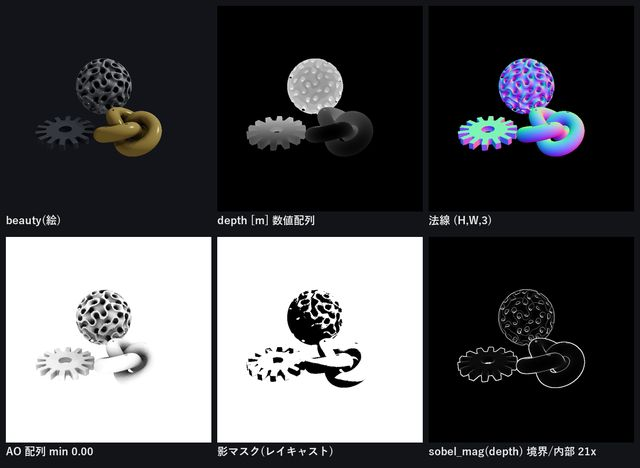
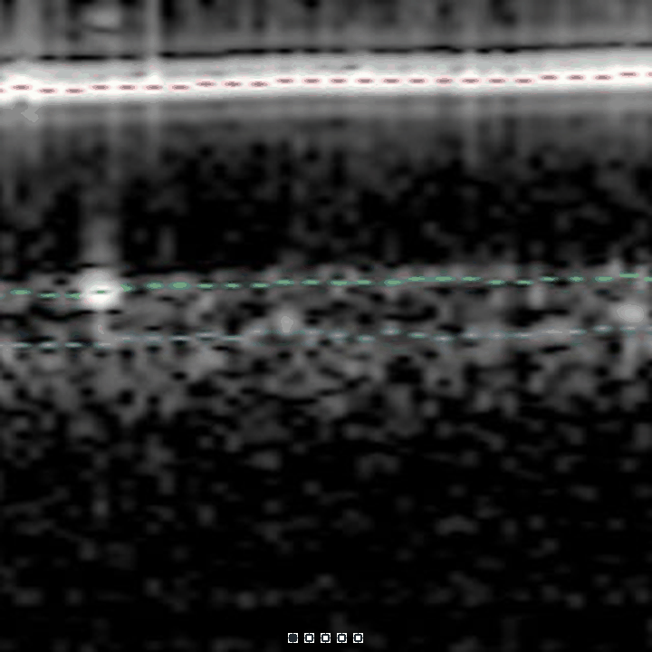
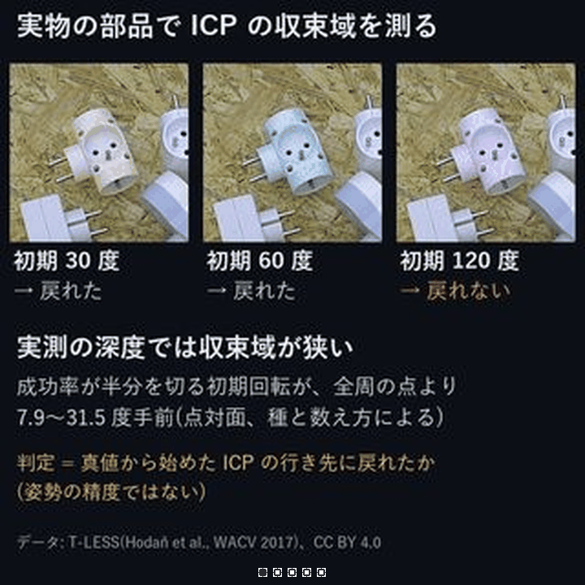
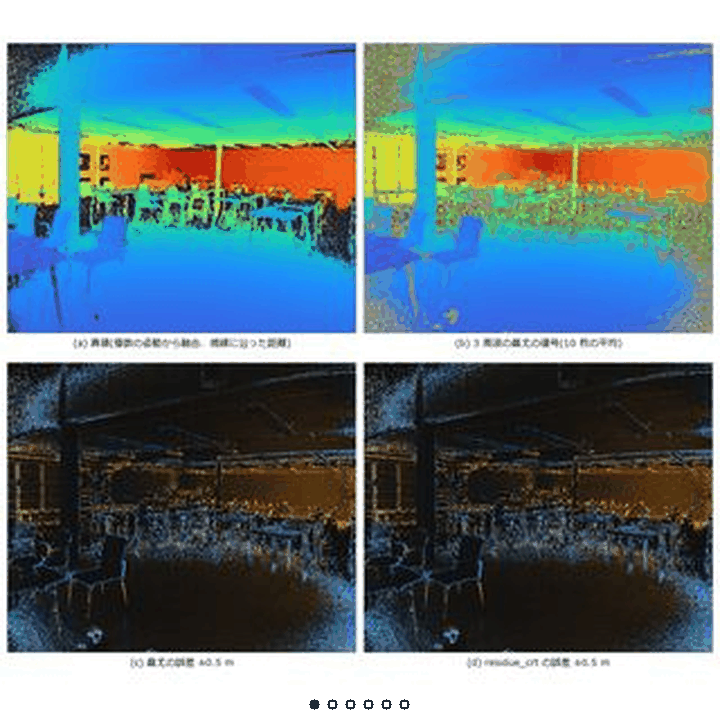
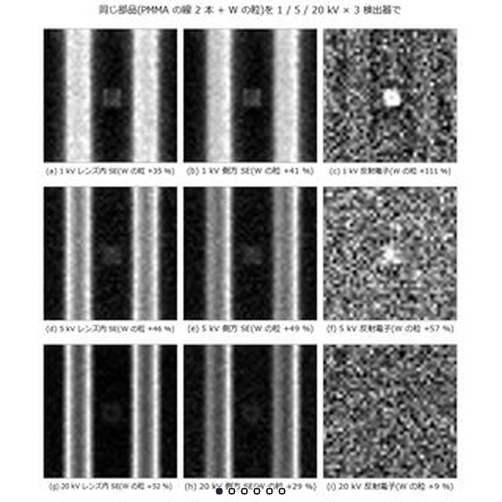
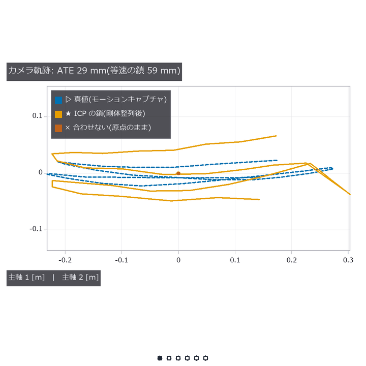
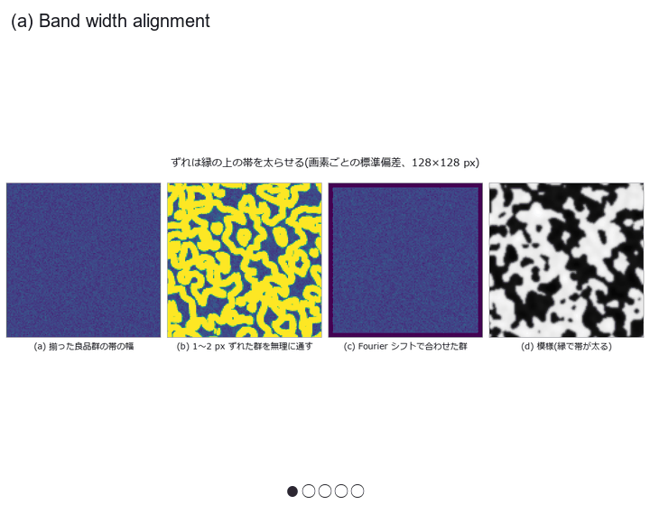
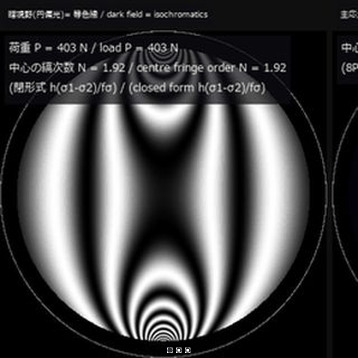
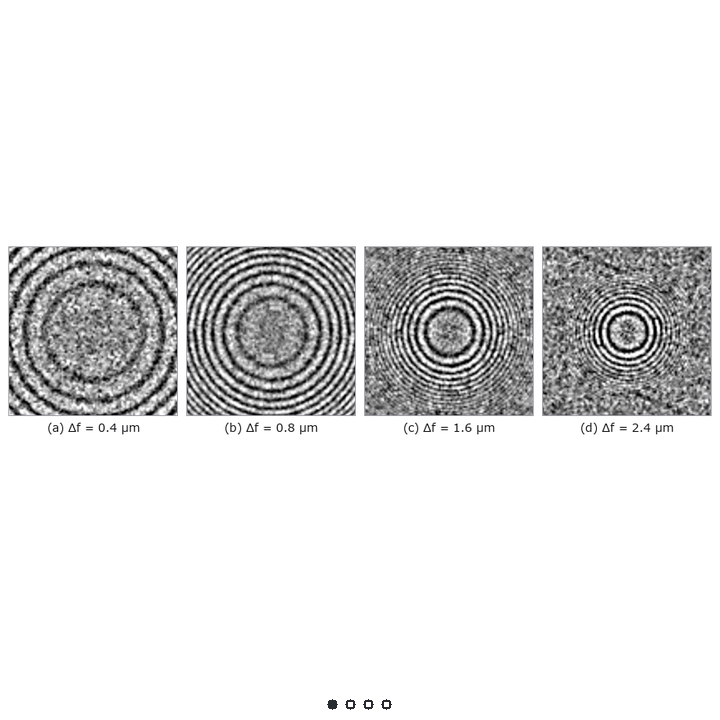
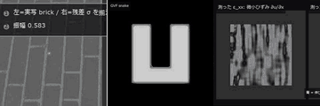

<div class="vlang" markdown="1">

[日本語](../index.md) · [English](../en/index.md) · [简体中文](../zh/index.md) · [繁體中文](../tw/index.md) · [한국어](../ko/index.md) · [Deutsch](../de/index.md) · [हिन्दी](../hi/index.md) · **Français**

</div>

# Fullseye — ViEW2026

**Présentation : jeudi 3 décembre 2026, 14 h 40–15 h 50 JST, session interactive 2, IS2-19** (Pacifico Yokohama, Annex Hall)

<div class="vintro"><div class="vt"><p>Fullseye est une base pour l'inspection d'images, la mesure 3D et la simulation physique. Elle transmet à une IA, via MCP et RAG, des opérateurs typés de traitement d'images classique et la simulation physique (y compris la simulation de capteurs, comme la conception optique), lui fait déterminer une combinaison adaptée à chaque tâche, et résout la tâche de manière interactive tout en vérifiant la cohérence des types et en évaluant par rapport à la vérité terrain produite par la simulation physique et d'imagerie. Open source (Apache-2.0).</p></div></div>

Touchez une vignette pour ouvrir la vidéo ou la figure (▶ = animé).

Cette page ne présente que 30 démonstrations. Les 285 autres se trouvent sur la [page des suppléments](more.md).

<style>
.vlang { font-size: 14px; line-height: 2; }
.vg { display: grid; grid-template-columns: repeat(2, minmax(0, 1fr)); gap: 8px; margin: 12px 0 20px; }
.vg.vs { grid-template-columns: repeat(3, minmax(0, 1fr)); gap: 6px; }
@media (min-width: 600px) { .vg { grid-template-columns: repeat(3, minmax(0, 1fr)); } .vg.vs { grid-template-columns: repeat(5, minmax(0, 1fr)); } }
@media (min-width: 900px) { .vg { grid-template-columns: repeat(4, minmax(0, 1fr)); } .vg.vs { grid-template-columns: repeat(7, minmax(0, 1fr)); } }
.vg a, .vser a { display: block; position: relative; text-decoration: none; color: inherit; }
.vg img { display: block; width: 100%; max-width: 100%; height: auto; aspect-ratio: 1 / 1; object-fit: cover; border-radius: 6px; background: #222; }
.vg picture { display: block; width: 100%; aspect-ratio: 1 / 1; overflow: hidden; border-radius: 6px; background: #fff; }
.vg picture img { height: 100%; aspect-ratio: auto; object-fit: contain; border-radius: 0; background: #fff; }
.vg b { position: absolute; top: 6px; right: 6px; background: rgba(0,0,0,.6); color: #fff; font-size: 12px; padding: 1px 6px; border-radius: 9px; }
.vg span { display: block; font-size: 13px; line-height: 1.3; margin-top: 3px; }
.vg.vs span { font-size: 11px; }
.vser { display: grid; grid-template-columns: repeat(2, minmax(0, 1fr)); gap: 8px; margin: 12px 0 20px; }
@media (min-width: 600px) { .vser { grid-template-columns: repeat(3, minmax(0, 1fr)); } }
.vser img { display: block; width: 100%; max-width: 100%; height: auto; aspect-ratio: 16 / 9; object-fit: cover; border-radius: 8px; background: #222; }
.vser strong { display: block; font-size: 14px; margin-top: 3px; line-height: 1.3; }
.vser span { display: block; font-size: 12px; line-height: 1.3; }
details.vall { margin: 6px 0; }
details.vall > summary { font-size: 15px; padding: 6px 0; cursor: pointer; }
.vl li { margin-bottom: 8px; }
li, p, code { overflow-wrap: anywhere; }
.vintro { display: flex; gap: 20px; align-items: flex-start; margin: 14px 0; }
.vintro img { flex: 0 0 300px; width: 300px; max-width: 100%; height: auto; border-radius: 6px; }
.vintro .vt p { margin: 0 0 8px; }
.vc { display: flex; gap: 16px; align-items: flex-start; margin: 18px 0; }
.vc > a:first-child { flex: 0 0 260px; position: relative; display: block; text-decoration: none; color: inherit; }
.vc > a img { display: block; width: 100%; max-width: 100%; height: auto; aspect-ratio: 1 / 1; object-fit: cover; border-radius: 6px; background: #222; }
.vc > a picture { display: block; width: 100%; aspect-ratio: 1 / 1; overflow: hidden; border-radius: 6px; background: #fff; }
.vc > a picture img { height: 100%; aspect-ratio: auto; object-fit: contain; border-radius: 0; background: #fff; }
.vc > a b { position: absolute; top: 6px; right: 6px; background: rgba(0,0,0,.6); color: #fff; font-size: 12px; padding: 1px 6px; border-radius: 9px; }
.vc > a .vtb { position: absolute; left: 6px; bottom: 6px; max-width: calc(100% - 12px); background: rgba(0,0,0,.66); color: #fff; font-size: 12px; font-style: normal; line-height: 1.4; padding: 1px 7px; border-radius: 9px; }
.vt { flex: 1 1 auto; min-width: 0; }
.vt .vh { font-size: 17px; font-weight: 600; line-height: 1.4; margin: 0 0 6px; }
.vt p { margin: 0 0 6px; }
.vt .vm { font-size: 14px; color: #57606a; }
.vt details { font-size: 14px; margin: 4px 0; }
.vt summary { cursor: pointer; }
.vc.vv { margin: 10px 0; }
.vc.vv > a:first-child { flex-basis: 96px; }
@media (max-width: 600px) {
  .vintro { flex-direction: column-reverse; gap: 8px; }
  .vintro img { flex: 0 0 auto; width: 100%; max-width: 240px; }
  .vc { flex-direction: column; gap: 8px; }
  .vc > a:first-child { flex: 0 0 auto; width: 240px; max-width: 100%; }
  .vc.vv { flex-direction: row; gap: 12px; }
  .vc.vv > a:first-child { width: 80px; flex: 0 0 80px; }
}
</style>

## Essayez par vous-même

Manipulez vous-même les figures de l'article, même sur téléphone. Changez de méthode avec les onglets et faites pivoter les vues 3-D en les faisant glisser.

<div class="vc vv"><a class="vvi" href="../viewers/poc_cad_scan_deviation.html?lang=fr"></a><div class="vt"><div class="vh"><a href="../viewers/poc_cad_scan_deviation.html?lang=fr">CAO contre nuage de points scanné</a></div><p>Le recalage absorbe les défauts : une pièce de valeur vraie 1.2 µm montre un creux de 121 µm qui n'existe pas.</p></div></div>

<div class="vc vv"><a class="vvi" href="../viewers/poc_photoelasticity.html?lang=fr"></a><div class="vt"><div class="vh"><a href="../viewers/poc_photoelasticity.html?lang=fr">Contraintes en photoélasticimétrie</a></div><p>Tourner l’analyseur déplace les franges photoélastiques et modifie l’intensité moyenne dans le disque (sur 0–135°)</p></div></div>

<div class="vc vv"><a class="vvi" href="../viewers/poc_polarization_specular.html?lang=fr"></a><div class="vt"><div class="vh"><a href="../viewers/poc_polarization_specular.html?lang=fr">Suppression des reflets spéculaires par polarisation</a></div><p>La polarisation retire les reflets spéculaires ; le reste varie avec l’incidence et atteint son minimum près de l’angle de Brewster (balayage sur une scène synthétique à franges)</p></div></div>

## À la une

<div class="vc"><a href="../../articles/assets/poc/poc_industrial_oct/01_real_paint_bscans.png"><picture><source media="(prefers-reduced-motion: reduce)" srcset="../../articles/assets/poc/poc_industrial_oct/01_real_paint_bscans.png"></picture><i class="vtb">Vérité terrain: Données réelles</i></a><div class="vt"><div class="vh"><a href="../../articles/assets/poc/poc_industrial_oct/01_real_paint_bscans.png">Épaisseur des couches de peinture sans découpe (OCT industrielle)</a></div><p>Les couches de peinture et de film sont observées en profondeur sans découpe. Les couches transparentes mesurées dans les spectres bruts publics de peinture automobile concordent à 3,6 µm près avec les mesures au microscope des mêmes panneaux. La concordance avec l'OCT de l'article ne fait que reproduire les mêmes données, et aucune valeur n'est donnée aux couches trop fines pour être séparées.</p><p class="vm">Vérité terrain: Données réelles · <a href="more.html#d-poc-industrial-oct">Détails</a></p></div></div>

<div class="vc"><a href="../../articles/assets/poc/poc_phase_measuring_deflectometry/03_photo_vs_pmd.png"><picture><source media="(prefers-reduced-motion: reduce)" srcset="../../articles/assets/poc/poc_phase_measuring_deflectometry/03_photo_vs_pmd.png"></picture><i class="vtb">Vérité terrain: Synthétique</i></a><div class="vt"><div class="vh"><a href="../../articles/assets/poc/poc_phase_measuring_deflectometry/03_photo_vs_pmd.png">Un creux invisible sur une photo en lumière diffuse apparaît dans l'image miroir de franges (synthétique)</a></div><p>Un creux très peu profond dans une peinture brillante se voit à peine sur une photo sous lumière diffuse. La projection de franges sur un écran face à la surface et la lecture de la courbure de leur image miroir donnent la courbure de surface et font ressortir un creux introduit de 3 µm de profondeur. La scène est synthétique et aucune comparaison n'a été faite avec des photos sous lumière oblique.</p><p class="vm">Vérité terrain: Synthétique · <a href="more.html#d-poc-phase-measuring-deflectometry">Détails</a></p></div></div>

<div class="vc"><a href="../../articles/assets/poc/poc_thin_film_reflectometry/01_real_micrograph_thickness.png"><picture><source media="(prefers-reduced-motion: reduce)" srcset="../../articles/assets/poc/poc_thin_film_reflectometry/01_real_micrograph_thickness.png"></picture><i class="vtb">Vérité terrain: Données réelles</i></a><div class="vt"><div class="vh"><a href="../../articles/assets/poc/poc_thin_film_reflectometry/01_real_micrograph_thickness.png">Lire l'épaisseur d'oxyde dans les couleurs d'une micrographie</a></div><p>L'épaisseur d'oxyde sur le silicium se lit dans les franges d'interférence et les couleurs de la lumière réfléchie. Lue pixel par pixel sur une micrographie réelle publiée par d'autres, la valeur centrale était de 87,4 nm. Elle est inférieure d'environ un dixième à la référence tirée de l'article, et la sensibilité chromatique de la caméra est inconnue.</p><p class="vm">Vérité terrain: Données réelles · <a href="more.html#d-poc-thin-film-reflectometry">Détails</a></p></div></div>

<div class="vc"><a href="../../articles/assets/poc/poc_registration_basin/06_real_scan_icp.mp4"><picture><source media="(prefers-reduced-motion: reduce)" srcset="../../articles/assets/poc/poc_registration_basin/07_real_scan_still.png"></picture><b>&#9654;</b><i class="vtb">Vérité terrain: Données réelles</i></a><div class="vt"><div class="vh"><a href="../../articles/assets/poc/poc_registration_basin/06_real_scan_icp.mp4">Sur une vraie profondeur, le bassin de l'ICP rétrécit</a></div><p>Sur une pièce mesurée et un support synthétique, nous avons testé jusqu'où le recalage peut démarrer et revenir au même point final. Selon les graines et les règles de franchissement, le taux de réussite était divisé par deux jusqu'à 31,5 degrés plus tôt qu'avec des points répartis tout autour. Le point final s'écarte de la vérité terrain : cette mesure porte donc sur la plage de récupération, non sur la précision de pose.</p><p class="vm">Vérité terrain: Données réelles · <a href="more.html#d-poc-registration-basin">Détails</a></p></div></div>

<div class="vc"><a href="../../articles/assets/poc/poc_hyperspectral_foreign_matter/04_real_pork_belly.png"><picture><source media="(prefers-reduced-motion: reduce)" srcset="../../articles/assets/poc/poc_hyperspectral_foreign_matter/01_real_polymer_flakes.png"></picture><i class="vtb">Vérité terrain: Données réelles</i></a><div class="vt"><div class="vh"><a href="../../articles/assets/poc/poc_hyperspectral_foreign_matter/04_real_pork_belly.png">Détecter des corps étrangers sur de la poitrine de porc par imagerie spectrale proche infrarouge</a></div><p>Des images réelles publiques ont servi de données spectrales proche infrarouge pour classer des débris posés sur de la poitrine de porc. Évaluée pixel par pixel sur des acquisitions distinctes, la majeure partie a été détectée avec 1,1 % de fausses alarmes. Avec moins de bandes, les fausses alarmes augmentaient, et l'échec d'une caméra couleur sur une matière de même couleur n'est montré que sur des données synthétiques.</p><p class="vm">Vérité terrain: Données réelles · <a href="more.html#d-poc-hyperspectral-foreign-matter">Détails</a></p></div></div>

<div class="vc"><a href="../../articles/assets/poc/poc_cad_scan_deviation/14_align_orbit.gif"><picture><source media="(prefers-reduced-motion: reduce)" srcset="../../articles/assets/poc/poc_cad_scan_deviation/01_scene.png"></picture><b>&#9654;</b><i class="vtb">Vérité terrain: Synthétique</i></a><div class="vt"><div class="vh"><a href="../../articles/assets/poc/poc_cad_scan_deviation/14_align_orbit.gif">L'alignement décide où une pièce semble hors tolérance : CAD contre scan (synthétique)</a></div><p>Aligner un scan sur sa conception absorbe une partie de l'écart et déplace la zone qui paraît hors tolérance. Sur une pièce dont le gauchissement est connu, une mesure profonde de 121 µm apparaît au centre, où l'écart réel est minime. Le résultat est synthétique, et une conception échantillonnée en points présente des bords hors tolérance même sans défaut.</p><p class="vm">Vérité terrain: Synthétique · <a href="more.html#d-poc-cad-scan-deviation">Détails</a></p></div></div>

<div class="vc"><a href="../../articles/assets/poc/poc_fourier_ptychography/01_usaf_4x_fp_20x.png"><picture><source media="(prefers-reduced-motion: reduce)" srcset="../../articles/assets/poc/poc_fourier_ptychography/01_usaf_4x_fp_20x.png"></picture><i class="vtb">Vérité terrain: Synthétique</i></a><div class="vt"><div class="vh"><a href="../../articles/assets/poc/poc_fourier_ptychography/01_usaf_4x_fp_20x.png">Un objectif 4x égale un 20x en éclairage cohérent (ptychographie de Fourier, synthétique)</a></div><p>Un objectif de faible puissance couvre un grand champ, mais perd les détails fins. Sur une mire synthétique, des images éclairées sous plusieurs angles et réunies dans l'espace fréquentiel ont égalé un objectif 20x sous lumière parallèle monochromatique. Sous une lumière ordinaire, cet objectif résout encore plus finement, et un recouvrement d'éclairage insuffisant ne renvoie aucun résultat.</p><p class="vm">Vérité terrain: Synthétique · <a href="more.html#d-poc-fourier-ptychography">Détails</a></p></div></div>

<div class="vc"><a href="../../articles/assets/poc/poc_itof_multifreq/12_public_raw_unwrap.png"><picture><source media="(prefers-reduced-motion: reduce)" srcset="../../articles/assets/poc/poc_itof_multifreq/01_warehouse_unwrap.png"></picture><i class="vtb">Vérité terrain: Synthétique</i></a><div class="vt"><div class="vh"><a href="../../articles/assets/poc/poc_itof_multifreq/12_public_raw_unwrap.png">Où la profondeur ToF indirecte échoue (synthétique)</a></div><p>Une caméra ToF indirecte mesure la distance à partir du retard de phase d'une lumière modulée. Sur des signaux synthétiques, la combinaison de trois fréquences conserve une distance non ambiguë jusqu'à 18,7 m. Les trajets multiples et les bords d'objet font sauter la distance sans avertissement.</p><p class="vm">Vérité terrain: Synthétique · <a href="more.html#d-poc-itof-multifreq">Détails</a></p></div></div>

<div class="vc"><a href="../../articles/assets/poc/poc_telecentric_metrology/08_real_alignment_plate.png"><picture><source media="(prefers-reduced-motion: reduce)" srcset="../../articles/assets/poc/poc_telecentric_metrology/08_real_alignment_plate.png"></picture><i class="vtb">Vérité terrain: Données réelles</i></a><div class="vt"><div class="vh"><a href="../../articles/assets/poc/poc_telecentric_metrology/08_real_alignment_plate.png">Le grandissement mesuré sur des images télécentriques publiques concorde avec l'article dans sa propre dispersion</a></div><p>Dans une même image prise avec un objectif ordinaire, une pièce à gradins paraît plus grande là où elle est plus proche. Le grandissement mesuré sur des images réelles publiques d'un objectif télécentrique concorde avec l'article, mais les valeurs de celui-ci se dispersent de ±0,25 %, donc l'accord n'est pas interprété plus finement. L'absence de dérive des centres des anneaux sur une plaque inclinée en est la preuve.</p><p class="vm">Vérité terrain: Données réelles · <a href="more.html#d-poc-telecentric-metrology">Détails</a></p></div></div>

<div class="vc"><a href="../../articles/assets/poc/poc_virtual_sem_kv_cd_bse/05_sem_same_part_3kv_3detectors.png"><picture><source media="(prefers-reduced-motion: reduce)" srcset="../../articles/assets/poc/poc_virtual_sem_kv_cd_bse/05_sem_same_part_3kv_3detectors.png"></picture><i class="vtb">Vérité terrain: Valeurs publiées</i></a><div class="vt"><div class="vh"><a href="../../articles/assets/poc/poc_virtual_sem_kv_cd_bse/05_sem_same_part_3kv_3detectors.png">SEM virtuel : l'image change avec la tension (modèle évalué sur la rétrodiffusion mesurée)</a></div><p>Une image SEM n'est pas une photo de la surface, mais le décompte des électrons qui s'échappent après diffusion dans le solide. Un modèle suivant chaque électron a été confronté à des données de rétrodiffusion mesurées pour 7 éléments. Faute d'images réelles de largeur de ligne connue, le déplacement de la mesure avec l'énergie du faisceau reste interne au modèle.</p><p class="vm">Vérité terrain: Valeurs publiées · <a href="more.html#d-poc-virtual-sem-kv-cd-bse">Détails</a></p></div></div>

<div class="vc"><a href="../../articles/assets/poc/poc_real_tum_rgbd_slam/02_trajectory.png"><picture><source media="(prefers-reduced-motion: reduce)" srcset="../../articles/assets/poc/poc_real_tum_rgbd_slam/02_trajectory.png"></picture><i class="vtb">Vérité terrain: Données réelles</i></a><div class="vt"><div class="vh"><a href="../../articles/assets/poc/poc_real_tum_rgbd_slam/02_trajectory.png">Alignement image à image évalué sur des données RGB-D publiques : erreur 0,45-0,82 fois celle d'une estimation à vitesse constante, selon l'élagage des aberrants choisi par découpage (une séquence de 32 images)</a></div><p>Sur une séquence publique de profondeur d'un bureau, l'alignement image à image a été comparé à la vérité terrain de capture de mouvement. L'erreur passait sous celle sans alignement, mais le gain sur une estimation à vitesse constante dépendait de l'élagage des aberrants et du choix parmi 8 découpages. Les résidus de plan en petites fenêtres croissaient avec la distance, sans loi quadratique confirmée.</p><p class="vm">Vérité terrain: Données réelles · <a href="more.html#d-poc-real-tum-rgbd-slam">Détails</a></p></div></div>

<div class="vc"><a href="../../articles/assets/poc/poc_good_sample_variation_model/04_visa_explanation.png"><picture><source media="(prefers-reduced-motion: reduce)" srcset="../../articles/assets/poc/poc_good_sample_variation_model/01_band_width_alignment.png"></picture><i class="vtb">Vérité terrain: Données réelles</i></a><div class="vt"><div class="vh"><a href="../../articles/assets/poc/poc_good_sample_variation_model/04_visa_explanation.png">Défauts d'après la variabilité des bonnes pièces : le taux de fausses alarmes annoncé ne tient pas sur images réelles</a></div><p>Une inspection classique apprend la variation habituelle de chaque pixel sur de bonnes pièces et signale ce qui en sort. Ici, la bande est fixée par un taux de fausses alarmes déclaré à l'avance et évaluée sur 200 images réelles publiques. L'alignement comptait davantage que le nombre de bonnes pièces, et le taux déclaré n'a pas été respecté.</p><p class="vm">Vérité terrain: Données réelles · <a href="more.html#d-poc-good-sample-variation-model">Détails</a></p></div></div>

<div class="vc"><a href="../../articles/assets/poc/poc_real_walnut_cbct/07_geometry_mistakes.png"><picture><source media="(prefers-reduced-motion: reduce)" srcset="../../articles/assets/poc/poc_real_walnut_cbct/07_geometry_mistakes.png"></picture><i class="vtb">Vérité terrain: Données réelles</i></a><div class="vt"><div class="vh"><a href="../../articles/assets/poc/poc_real_walnut_cbct/07_geometry_mistakes.png">CT mesurée : ignorer le décalage vertical reconstruit une autre coupe, et seule une référence externe révèle l'erreur</a></div><p>Une noix a réellement été balayée par un faisceau conique puis reconstruite par FDK et par des méthodes itératives. Avec 300 projections évaluées par rapport à la référence des auteurs, négliger le décalage vertical reconstruit une autre coupe, plus éloignée. Ces données sont cohérentes entre elles, si bien que le résidu après reprojection ne peut pas changer.</p><p class="vm">Vérité terrain: Données réelles · <a href="more.html#d-poc-real-walnut-cbct">Détails</a></p></div></div>

<div class="vc"><a href="../../articles/assets/poc/poc_bottle_pattern_inverse/01_checker_through_bottle.png"><picture><source media="(prefers-reduced-motion: reduce)" srcset="../../articles/assets/poc/poc_bottle_pattern_inverse/01_checker_through_bottle.png"></picture><i class="vtb">Vérité terrain: Synthétique</i></a><div class="vt"><div class="vh"><a href="../../articles/assets/poc/poc_bottle_pattern_inverse/01_checker_through_bottle.png">Retrouver une bouteille en verre à partir de bandes de fond (simulation) : récupération sous des hypothèses communes et grandeurs inséparables</a></div><p>Une bouteille transparente déforme les bandes placées derrière elle. Pour chaque pixel, nous trouvons la position du fond observée, ajustons à rebours la géométrie et les indices de la bouteille, puis évaluons 5 états de remplissage par rapport aux valeurs vraies de la simulation. Les grandeurs inséparables sont également signalées, et rien n'a été vérifié sur une bouteille réelle.</p><p class="vm">Vérité terrain: Synthétique · <a href="more.html#d-poc-bottle-pattern-inverse">Détails</a></p></div></div>

<div class="vc"><a href="../../articles/assets/poc/poc_ai_built_inspection_scored/01_crack_real.png"><picture><source media="(prefers-reduced-motion: reduce)" srcset="../../articles/assets/poc/poc_ai_built_inspection_scored/01_crack_real.png"></picture><i class="vtb">Vérité terrain: Données réelles</i></a><div class="vt"><div class="vh"><a href="../../articles/assets/poc/poc_ai_built_inspection_scored/01_crack_real.png">Une IA assemble des inspections, évaluées sur des données réelles publiques (LLM locaux : mieux que le hasard pour les fissures dans 5 essais sur 60, jamais pour les taches de bougie)</a></div><p>Un LLM local a reçu une tâche en mots et a construit des procédures d'inspection par le seul MCP, évaluées sur des images réelles publiques. Peu d'essais ont dépassé le hasard sur les fissures, et aucun n'a atteint une référence à une seule statistique (AUROC 0,999). Rien n'a fonctionné sur les taches de bougie, et les essais de LLM en nuage, dans des conditions non comparables, sont restés sous les procédures existantes.</p><p class="vm">Vérité terrain: Données réelles · <a href="more.html#d-poc-ai-built-inspection-scored">Détails</a></p></div></div>

<div class="vc"><a href="../../articles/assets/poc/poc_3d_sensor_modalities/01_map.png"><picture><source media="(prefers-reduced-motion: reduce)" srcset="../../articles/assets/poc/poc_3d_sensor_modalities/01_map.png"></picture><i class="vtb">Vérité terrain: Synthétique</i></a><div class="vt"><div class="vh"><a href="../../articles/assets/poc/poc_3d_sensor_modalities/01_map.png">Simulation de cinq méthodes de mesure 3-D sur une pièce : où chacune échoue selon le matériau</a></div><p>Dans cette simulation, des modèles de plusieurs méthodes de mesure de profondeur examinent la même pièce en matériaux mat, métallique brillant, translucide et noir. Les erreurs de forme ont été comptées avec un étalon commun de 0,1 mm et comparées au tableau de dimensions. Leurs résolutions diffèrent de plusieurs ordres de grandeur : il faut donc lire où chacune échoue, et non un classement.</p><p class="vm">Vérité terrain: Synthétique · <a href="more.html#d-poc-3d-sensor-modalities">Détails</a></p></div></div>

## Sélection

<div class="vc"><a href="../../articles/assets/poc/poc_photoelasticity/03_load_and_isoclinics.mp4"><picture><source media="(prefers-reduced-motion: reduce)" srcset="../../articles/assets/poc/poc_photoelasticity/01_polariscope.png"></picture><b>&#9654;</b><i class="vtb">Vérité terrain: Synthétique</i></a><div class="vt"><div class="vh"><a href="../../articles/assets/poc/poc_photoelasticity/03_load_and_isoclinics.mp4">La contrainte d'un disque comprimé apparaît en franges (photoélasticité, synthétique)</a></div><p>Vue à travers des polariseurs, une matière plastique transparente chargée révèle ses contraintes internes sous forme de franges. La contrainte d'un disque comprimé a été retrouvée dans des images de polarisation, même lorsque l'ordre de frange dépasse 0,5 et que la phase s'enroule. La plupart des erreurs après déroulement se situent sur une inversion de signe connue de longue date, et non sur l'enroulement.</p><p class="vm">Vérité terrain: Synthétique · <a href="more.html#d-poc-photoelasticity">Détails</a></p></div></div>

<div class="vc"><a href="../../articles/assets/poc/poc_equipment_selection_map/02_equipment_at_a_glance.png"><picture><source media="(prefers-reduced-motion: reduce)" srcset="../../articles/assets/poc/poc_equipment_selection_map/02_equipment_at_a_glance.png"></picture><i class="vtb">Vérité terrain: Synthétique</i></a><div class="vt"><div class="vh"><a href="../../articles/assets/poc/poc_equipment_selection_map/02_equipment_at_a_glance.png">Carte d'équipement : les mêmes défauts avec 60 ensembles d'éclairage, caméra et objectif (test synthétique)</a></div><p>Nous avons prétesté du matériel d'inspection visuelle sur le même défaut. Avec 60 combinaisons d'éclairages, de caméras et d'objectifs, nous avons cartographié la taille minimale détectée ainsi que la dispersion entre répétitions. Il s'agit d'un test synthétique, non des performances d'un matériel réel.</p><p class="vm">Vérité terrain: Synthétique · <a href="more.html#d-poc-equipment-selection-map">Détails</a></p></div></div>

<div class="vc"><a href="../../articles/assets/poc/poc_real_stereo_multiscanline/02_failure_map.png"><picture><source media="(prefers-reduced-motion: reduce)" srcset="../../articles/assets/poc/poc_real_stereo_multiscanline/02_failure_map.png"></picture><i class="vtb">Vérité terrain: Données réelles</i></a><div class="vt"><div class="vh"><a href="../../articles/assets/poc/poc_real_stereo_multiscanline/02_failure_map.png">Disparité, surface et pose de cercle en stéréo réelle</a></div><p>À partir d'une paire réelle d'images stéréo, nous calculons la disparité, la distance, les surfaces et même la pose d'un cercle. Le résultat est évalué avec la disparité vraie fournie par Middlebury 2014 et comparé à OpenCV. Sur les pixels valides pour les deux, les résultats sont presque équivalents, et l'essentiel de l'écart vient du choix des pixels invalidés par chacun.</p><p class="vm">Vérité terrain: Données réelles · <a href="more.html#d-poc-real-stereo-multiscanline">Détails</a></p></div></div>

<div class="vc"><a href="../../articles/assets/poc/poc_polarization_specular/09_glare_removed_label.png"><picture><source media="(prefers-reduced-motion: reduce)" srcset="../../articles/assets/poc/poc_polarization_specular/01_raw_polarizer_mosaic.png"></picture><i class="vtb">Vérité terrain: Synthétique</i></a><div class="vt"><div class="vh"><a href="../../articles/assets/poc/poc_polarization_specular/09_glare_removed_label.png">La polarisation retire 90 % des reflets du film ; sous cet éclairage, un seul filtre fixe suffit (synthétique)</a></div><p>Une caméra munie d'un polariseur sur chaque pixel sépare une étiquette derrière un film brillant en composantes diffuse et spéculaire. Environ 90 % du reflet disparaît, mais sous cet éclairage un filtre polarisant fixe lit mieux l'impression. La caméra ne rattrape son retard qu'avec une lumière plus large ; la scène est synthétique et non vérifiée sur des images réelles.</p><p class="vm">Vérité terrain: Synthétique · <a href="more.html#d-poc-polarization-specular">Détails</a></p></div></div>

<div class="vc"><a href="../../articles/assets/poc/poc_solar_el_inspection/10_real_el_overlay.png"><picture><source media="(prefers-reduced-motion: reduce)" srcset="../../articles/assets/poc/poc_solar_el_inspection/15_real_cover.png"></picture><i class="vtb">Vérité terrain: Données réelles publiques (vérité : I-V mesurée)</i></a><div class="vt"><div class="vh"><a href="../../articles/assets/poc/poc_solar_el_inspection/10_real_el_overlay.png">Images EL réelles de cellules solaires : les zones sombres sous masque suivent la perte de puissance, l'assombrissement de toute la cellule non</a></div><p>Sur des images EL publiques de cellules réelles, la surface sombre a été classée par rapport à la perte de puissance issue des courbes I-V. La grille efficace sur cellules synthétiques effaçait aussi les masques en bande de bord, et une version réajustée ne dépassait pas clairement la luminosité moyenne seule (corrélation de rang 0,57). Quand toute la cellule s'assombrit, aucun comptage de surface ne suit la perte.</p><p class="vm">Vérité terrain: Données réelles publiques (vérité : I-V mesurée) · <a href="more.html#d-poc-solar-el-inspection">Détails</a></p></div></div>

<div class="vc"><a href="../../articles/assets/poc/poc_interferometry_step/09_csi_scan_explained.mp4"><picture><source media="(prefers-reduced-motion: reduce)" srcset="../../articles/assets/poc/poc_interferometry_step/01_surface_interferograms.png"></picture><b>&#9654;</b><i class="vtb">Vérité terrain: Synthétique</i></a><div class="vt"><div class="vh"><a href="../../articles/assets/poc/poc_interferometry_step/09_csi_scan_explained.mp4">Marches nanométriques par interférométrie en lumière blanche (synthétique)</a></div><p>Sur des balayages synthétisés, la marche lue par un interféromètre en lumière blanche au maximum de contraste des franges a été remesurée. Une mesure unique présente un écart-type d'au moins 10,5 nm, et le biais restant dans la moyenne des répétitions se perd dans le bruit. Avec un pas de balayage trop grossier, une erreur subsiste même sans bruit.</p><p class="vm">Vérité terrain: Synthétique · <a href="more.html#d-poc-interferometry-step">Détails</a></p></div></div>

<div class="vc"><a href="../../articles/assets/poc/poc_tdi_linescan/11_tdi_1_vs_64_closeup.png"><picture><source media="(prefers-reduced-motion: reduce)" srcset="../../articles/assets/poc/poc_tdi_linescan/01_tdi_stages_defects.png"></picture><i class="vtb">Vérité terrain: Synthétique</i></a><div class="vt"><div class="vh"><a href="../../articles/assets/poc/poc_tdi_linescan/11_tdi_1_vs_64_closeup.png">Empiler les étages TDI fait ressortir les défauts faibles sur une ligne sombre (synthétique)</a></div><p>Un film ou une bande d'acier en mouvement est imagé par un capteur linéaire. Sur une bande d'acier synthétique comportant de faibles défauts introduits et avec un modèle de capteur courant, les défauts noyés dans le bruit sont apparus après l'empilement de 64 étages d'exposition sur une ligne sombre. Si le transport et l'acquisition se désynchronisent, l'image empilée s'étale.</p><p class="vm">Vérité terrain: Synthétique · <a href="more.html#d-poc-tdi-linescan">Détails</a></p></div></div>

<div class="vc"><a href="../../articles/assets/poc/poc_illumination_cone_vs_na/07_cone_cover.png"><picture><source media="(prefers-reduced-motion: reduce)" srcset="../../articles/assets/poc/poc_illumination_cone_vs_na/07_cone_cover.png"></picture><i class="vtb">Vérité terrain: Synthétique</i></a><div class="vt"><div class="vh"><a href="../../articles/assets/poc/poc_illumination_cone_vs_na/07_cone_cover.png">Le cône de lumière décide si creux et rayures sont visibles (synthétique)</a></div><p>Sur un métal presque spéculaire, la largeur et l'axe de chaque cône lumineux peuvent montrer ou masquer les creux peu profonds et les rayures capillaires. Dans un montage synthétique à cônes uniformes, un demi-angle de cône de 4° a masqué les stries capillaires et laissé seulement la rayure sombre. C'est la physique sous-jacente à la carte d'équipement, qui n'a pas encore été vérifiée sur des photos réelles.</p><p class="vm">Vérité terrain: Synthétique · <a href="more.html#d-poc-illumination-cone-vs-na">Détails</a></p></div></div>

<div class="vc"><a href="../../articles/assets/poc/poc_real_defect_floor/03_defect_floor_explained.mp4"><b>&#9654;</b><i class="vtb">Vérité terrain: Fond réel</i></a><div class="vt"><div class="vh"><a href="../../articles/assets/poc/poc_real_defect_floor/03_defect_floor_explained.mp4">Même avec un bruit égalisé, la limite de détection des faibles défauts est 2,03-3,47 fois pire sur des fonds réels</a></div><p>Les équipes d'inspection estiment souvent la faiblesse des défauts détectables sur une image synthétique composée d'un champ plat et de bruit. À bruit égal, chaque fond réel a relevé la limite de détection à au moins 2,03 fois celle du fond synthétique. La limite était déterminée non par le bruit, mais par la structure du fond, comme des joints de mortier.</p><p class="vm">Vérité terrain: Fond réel · <a href="more.html#d-poc-real-defect-floor">Détails</a></p></div></div>

<div class="vc"><a href="../../articles/assets/poc/poc_mixed_case_depalletizing/08_depal_robot_video.mp4"><picture><source media="(prefers-reduced-motion: reduce)" srcset="../../articles/assets/poc/poc_mixed_case_depalletizing/01_overview_same_pattern.png"></picture><b>&#9654;</b><i class="vtb">Vérité terrain: Synthétique</i></a><div class="vt"><div class="vh"><a href="../../articles/assets/poc/poc_mixed_case_depalletizing/08_depal_robot_video.mp4">Cartons mélangés : marche de profondeur, rainure en V ou rainure de couleur (simulation)</a></div><p>Dans des scènes simulées, des cartons semblables sont distingués par la profondeur et la couleur vues du dessus, puis déchargés. Une marche de profondeur n'en sépare aucun, et l'avantage des creux ou des lignes sombres s'inverse selon 28 formes de joint entre rabats. À impressions identiques, les rainures profondes favorisent la couleur ; seules des coupes larges sans ruban sur des rainures peu profondes favorisent la profondeur.</p><p class="vm">Vérité terrain: Synthétique · <a href="more.html#d-poc-mixed-case-depalletizing">Détails</a></p></div></div>

<div class="vc"><a href="../../articles/assets/poc/poc_tem_ctf_thon_rings/17_real_cover.png"><picture><source media="(prefers-reduced-motion: reduce)" srcset="../../articles/assets/poc/poc_tem_ctf_thon_rings/02_thon_rings_four_defoci.png"></picture><i class="vtb">Vérité terrain: Données réelles (référence : estimation CTFFIND3 des auteurs)</i></a><div class="vt"><div class="vh"><a href="../../articles/assets/poc/poc_tem_ctf_thon_rings/17_real_cover.png">Défocalisation estimée sur images MET réelles, à 0,21 % près des valeurs des auteurs</a></div><p>Dans un microscope électronique en transmission, la défocalisation inverse le signe des fins détails entre clair et sombre. La défocalisation estimée sur des micrographies réelles publiques concordait à 0,21 % près avec le logiciel des auteurs. Les TEM de matériaux et de semi-conducteurs lisent la mise au point dans les mêmes anneaux concentriques, mais seules des données biologiques publiques ont été testées.</p><p class="vm">Vérité terrain: Données réelles (référence : estimation CTFFIND3 des auteurs) · <a href="more.html#d-poc-tem-ctf-thon-rings">Détails</a></p></div></div>

<div class="vc"><a href="../../articles/assets/poc/poc_sam_hybrid_bonding_voids/03_amplitude_vs_phase.png"><picture><source media="(prefers-reduced-motion: reduce)" srcset="../../articles/assets/poc/poc_sam_hybrid_bonding_voids/03_amplitude_vs_phase.png"></picture><i class="vtb">Vérité terrain: Synthétique</i></a><div class="vt"><div class="vh"><a href="../../articles/assets/poc/poc_sam_hybrid_bonding_voids/03_amplitude_vs_phase.png">Détecter les vides du plan de liaison par la phase de l'écho ultrasonore (simulation)</a></div><p>Cette simulation recherche de petits vides dans le plan de liaison de puces empilées au moyen d'un microscope acoustique à balayage. Les vides de 16 um ou plus apparaissaient inversés et lumineux dans l'image de phase de l'écho. Dans l'image d'intensité, de nombreux petits vides se cachent parmi les pixels sains.</p><p class="vm">Vérité terrain: Synthétique · <a href="more.html#d-poc-sam-hybrid-bonding-voids">Détails</a></p></div></div>

<div class="vc"><a href="../../articles/assets/poc/poc_lidar_terrain_change/13_real_dod.png"><picture><source media="(prefers-reduced-motion: reduce)" srcset="../../articles/assets/poc/poc_lidar_terrain_change/01_geometry.png"></picture><i class="vtb">Vérité terrain: Données réelles</i></a><div class="vt"><div class="vh"><a href="../../articles/assets/poc/poc_lidar_terrain_change/13_real_dod.png">LiDAR aéroporté à deux dates : sans retirer le décalage, tout semble creusé</a></div><p>La soustraction de relevés LiDAR aéroportés publics du même parc à deux années d'intervalle fait paraître toute la zone affaissée, comme excavée. L'alignement du décalage de 0,183 m sur le sol plat ne laisse que le changement autour du bâtiment. Sur une pente synthétique où le changement couvre une grande partie de la scène, l'alignement absorbe ce changement et le volume s'effondre.</p><p class="vm">Vérité terrain: Données réelles · <a href="more.html#d-poc-lidar-terrain-change">Détails</a></p></div></div>

<div class="vc"><a href="../../articles/assets/poc/poc_moire_alignment/09_overlay_cover.png"><picture><source media="(prefers-reduced-motion: reduce)" srcset="../../articles/assets/poc/poc_moire_alignment/02_one_nm_steps.png"></picture><i class="vtb">Vérité terrain: Synthétique</i></a><div class="vt"><div class="vh"><a href="../../articles/assets/poc/poc_moire_alignment/09_overlay_cover.png">Deux réseaux invisibles : les franges de moiré lisent des décalages nanométriques (synthétique)</a></div><p>La lithographie doit superposer un masque et une tranche avec une précision nanométrique. Des réseaux superposés trop fins pour la caméra produisent des franges et, avec du seul bruit blanc, un test synthétique a lu des pas nanométriques avec une erreur de 0,08 nm. La précision réelle d'alignement est bien plus grossière, car elle dépend d'erreurs systématiques telles que l'asymétrie des repères et l'écart, absentes du test.</p><p class="vm">Vérité terrain: Synthétique · <a href="more.html#d-poc-moire-alignment">Détails</a></p></div></div>

## Série d'articles (articles sur Qiita)

<div class="vser">
<a href="https://qiita.com/furuse-kazufumi/items/8a8f23e53b19ee8cdc10"><strong>Un musée de la métrologie sur papier</strong><span>Un musée de PoC, chacun avec sa propre vérité terrain intégrée</span></a>
<a href="https://qiita.com/furuse-kazufumi/items/a82bf9f341cc4f04ca75"><strong>Tennis de table</strong><span>Mesure du rebond et du frottement à partir de la vidéo</span></a>
<a href="https://qiita.com/furuse-kazufumi/items/05de90f4d316cd7c681c"><strong>Conduite autonome</strong><span>Évalué par des théorèmes et des secondes implémentations</span></a>
<a href="https://qiita.com/furuse-kazufumi/items/638f0b0aa7865e17c67c"><strong>Connectome (schéma de câblage du cerveau)</strong><span>Un modèle visuel de mouche installé sur un corps, puis mesuré</span></a>
<a href="https://qiita.com/furuse-kazufumi/items/569720dbae0c6471c96e"><strong>Journée sportive des humanoïdes</strong><span>Une journée sportive à domicile arbitrée par le traitement d'images</span></a>
</div>

Voir aussi la [page des suppléments : autres PoC](more.md).

<details markdown="1">
<summary><b>Essayer</b> (Python 3.11)</summary>

```
pip install fullseye
git clone https://github.com/furuse-kazufumi/fullseye
cd fullseye
python examples/poc_focus_stacking.py
```

Le PoC de fusion de mise au point s'exécute en environ 20 secondes et affiche ses valeurs par rapport à la vérité terrain ainsi que `PASS`. Les figures sont écrites dans `out/figures/poc_focus_stacking/`.

</details>

<details markdown="1">
<summary><b>Liens</b></summary>

- [GitHub (code source)](https://github.com/furuse-kazufumi/fullseye)
- [Galerie (toutes les figures)](../../GALLERY.en.md)
- [Rechercher des opérateurs / les utiliser depuis une IA (RAG)](../../AI_RAG_GUIDE.en.md) · [Utiliser depuis MCP](../../MCP.md) _(ja)_
- [Index de la documentation](../../README.en.md)

</details>

<details markdown="1">
<summary><b>Informations sur l'article</b></summary>

- **Titre**: Fullseye：型付き演算子と物理シミュレーションに基づく画像検査・三次元計測基盤 _(ja)_ (une base pour l'inspection d'images et la mesure 3D, construite sur des opérateurs typés et la simulation physique)
- **Auteur**: Kazufumi Furuse (chercheur indépendant)
- **Publication**: ViEW2026, atelier sur l'utilisation pratique des technologies de vision
- **PDF de l'article**: [日本語](../paper/101.pdf) · [English](../paper/101_en.pdf) · [简体中文](../paper/101_zh.pdf)

**Résumé**: Nous proposons Fullseye, une base open source qui assemble les traitements d'inspection d'images et de mesure 3D sous forme de chaînes d'opérateurs dont les types de données d'entrée et de sortie sont déclarés, les évalue quantitativement par rapport à une vérité terrain produite par simulation physique et d'imagerie, et enregistre la procédure de traitement, l'évaluation et les conditions d'échec afin de les réutiliser. Elle comprend environ 3,000 opérateurs typés, une vérification qui rejette les incohérences de types avant l'exécution, une recherche d'opérateurs multilingue (RAG) et plus de 200 programmes de démonstration dotés d'une vérité terrain ; nous présentons l'évaluation quantitative d'exemples représentatifs ainsi que la distinction entre les étapes de validation synthétique, mesurée et sur matériel réel.

</details>
