

[日本語](../more.md) · [English](../en/more.md) · [简体中文](../zh/more.md) · [繁體中文](../tw/more.md) · [한국어](../ko/more.md) · [Deutsch](../de/more.md) · [हिन्दी](../hi/more.md) · **Français**

# Suppléments : autres PoC

Cette page contient aussi des exemples moins aboutis que les démonstrations de la page principale. Les valeurs de chaque démonstration proviennent du journal d'exécution de son PoC.

[Retour à la page principale](index.md)

## Essayez par vous-même (autres)

- **[Changement de terrain par LiDAR](../viewers/poc_lidar_terrain_change.html?lang=fr)**: Une simple soustraction fait paraître tout le bloc inchangé 0.183 m plus bas. Une fois corrigé, seul le vrai changement reste.
- **[Suivi par modèle](../viewers/poc_template_tracking.html?lang=fr)**: Même après avoir basculé sur un objet qui lui ressemble, le suivi continue de signaler « trouvé ».
- **[Profondeur par thermographie pulsée](../viewers/poc_thermography_ndt.html?lang=fr)**: Raccourcir la fenêtre d'ajustement de 25 s à 4 s ramène la pire erreur de profondeur des 8 petits défauts de +612 % à −14 %. La cause était le choix de la fenêtre, pas la physique.
- **[Tapis de Talbot et images X par réseaux](../viewers/poc_grating_interferometry.html?lang=fr)**: En absorption, le rapport contraste/bruit de la fissure n'est que de 1.34 ; en champ sombre il monte à 13.5, et en tournant le réseau on lit même la direction des fibres.
- **[Creux de quelques µm dans l'image-miroir de franges](../viewers/poc_phase_measuring_deflectometry.html?lang=fr)**: Dans une photo, le signal vaut 0.17 fois le bruit et rien n'apparaît ; dans la carte de courbure issue de l'image-miroir de franges, un creux de 1 µm dépasse le bruit de 57 fois.
- **[À quel point la surface d'un astéroïde se courbe](../viewers/poc_asteroid_curvature.html?lang=fr)**: La courbure est calculée à partir des points d'un astéroïde réel ; crêtes et bords de blocs apparaissent en couleur. La règle a d'abord été vérifiée sur une sphère dont la réponse est connue.
- **[Empilement de mise au point](../viewers/poc_focus_stacking.html?lang=fr)**: Augmenter le nombre d’ouverture rapproche l’image empilée de la texture vraie
- **[Marches en interférométrie en lumière blanche](../viewers/poc_interferometry_step.html?lang=fr)**: Le bruit élargit l’erreur de marche en interférométrie en lumière blanche
- **[Œil composé de la mouche](../viewers/poc_compound_eye.html?lang=fr)**: Augmenter le SNR par vue rapproche l’image de l’œil composé de l’image sans bruit
- **[Vides dans la couche de jonction](../viewers/poc_ct_void_morphology.html?lang=fr)**: Relever le seuil étend les vides segmentés et augmente leur fraction volumique
- **[Contours actifs](../viewers/poc_active_contours.html?lang=fr)**: Les itérations rapprochent le contour GVF de sa forme finale

## Détails des démonstrations de la page principale (texte intégral)

Dans cette section, les titres et les résumés sont traduits ; les descriptions détaillées et les chiffres sont en anglais.

- [Épaisseur des couches de peinture sans découpe (OCT industrielle)](../../articles/assets/poc/poc_industrial_oct/01_real_paint_bscans.png) (figure): Les couches de peinture et de film sont observées en profondeur sans découpe. Les couches transparentes mesurées dans les spectres bruts publics de peinture automobile concordent à 3,6 µm près avec les mesures au microscope des mêmes panneaux. La concordance avec l'OCT de l'article ne fait que reproduire les mêmes données, et aucune valeur n'est donnée aux couches trop fines pour être séparées.
  Optical coherence tomography sees the layer stack of paints, conformal coatings, adhesive layers and multilayer films, and voids and delaminations inside them, without cutting. Thirteen new ops (`octscan`, category `oct` of `opsoptics`): closed-form design numbers before measuring, interferogram simulators driven by the material table, k-linearisation, dispersion compensation and estimation, A- and B-scans, layer thickness through the group index (refusing layers that cannot be separated), boundary tracing, surface flattening and an entry point for raw spectra.  **Real data: public raw spectra of automotive paint panels (CC BY 4.0) processed with Fullseye ops alone give clear-coat thicknesses within 3.6 µm of the microscope measurements of the same panels (the independent truth). They are within 1.5 µm of the paper's OCT values, but those come from the same raw spectra processed with the same group index 1.56, so that agreement is a reproduction of the processing, not an independent check. The paper does not say which panel is which table row; the assignment was inferred as the permutation (of 4!) whose clear coats are closest to the paper's OCT (the runner-up is 28.9 µm worse in summed difference), which flatters the OCT comparison. The paper's OCT reads 0.9-3.5 µm thinner than the microscope and tracks it, so the microscope comparison rests on the same assignment and is slightly flattered too (the runner-up is 28.9 µm away, so the assignment itself is robust). The indices 1.56 / 1.64 are borrowed terahertz-band values, so absolute thickness carries that uncertainty (separated on 2026-11-13 after a review independent of the author). Base coats within 2.3 µm of the microscope for three of four panels (one is 7.6 µm off and unresolved), a refusal under the white base coat, and an autocorrelation ghost lying flat at the clear coat's optical thickness. Synthetic: thickness through the group index within 0.04 µm of the truth, SNR, roll-off and dispersion broadening matching the closed forms, refusal below 1.4 point-spread widths, a coating-thickness map and void/delamination detection. Where the numbers come from: the real-data chapter uses the bundled raw spectra, so CI prints the same values (an independent rerun on 2026-11-13 matched); the synthetic numbers come from the full run, and CI's reduced run sweeps fewer points.** [source](https://github.com/furuse-kazufumi/fullseye/blob/master/examples/poc_industrial_oct.py)
  Terms: OCT — A non-contact method that uses low-coherence interference to measure depth-resolved reflectivity and form cross-sectional images.
- [Un creux invisible sur une photo en lumière diffuse apparaît dans l'image miroir de franges (synthétique)](../../articles/assets/poc/poc_phase_measuring_deflectometry/03_photo_vs_pmd.png) (figure): Un creux très peu profond dans une peinture brillante se voit à peine sur une photo sous lumière diffuse. La projection de franges sur un écran face à la surface et la lecture de la courbure de leur image miroir donnent la courbure de surface et font ressortir un creux introduit de 3 µm de profondeur. La scène est synthétique et aucune comparaison n'a été faite avec des photos sous lumière oblique.
  A dent a few micrometres deep in a glossy surface (a painted car panel, a cover glass) is all but invisible in a lit photograph, because a mirror only shows the light. Put a screen in front of the surface, show phase-shifted fringes and photograph their mirror image: a tilt of 1e-3 rad moves the reflected point 0.6 mm on a screen 30 cm away. Six new ops (`deflectometry`, category `deflectometry` of `opsspecular`): the rig, the screen pattern, the forward render (height field to fringe mirror image, with a diffuse fraction, scatter, the back reflection of glass, aperture-integrated focus and noise), phase to normals (via `match3d.normal_from_reflection`), slope to curvature (one derivative, no integration) and the closed-form sensitivity.  **On a painted panel with 3 µm and 1 µm dents, 0.8 µm waviness and 0.12 µm polishing marks the photograph's defect signal peaks at 0.00066 (0.17 of one 8-bit step) while the curvature map shows the dents at SNR 110 and 57, and the integrated depth is within 0.5 % of the truth. Phase noise matches sqrt(2/N) sigma/b at 1.00 and slope noise is 0.67 of `sigma_u`/(2d), the sqrt(4/9) of bilinear resampling. Where it breaks: lifting the part by 0.3 mm adds the apparent tilt dz sin(theta)/d (to 0.1 %) and a 388 m bowl while the dent depth moves 0.7 %; a 2 % screen-distance error makes dents 2.3 % shallower; a 1 µm dent survives a diffuse fraction of 0.85 and fringe orders start to jump at 0.9; on uncoated cover glass the back-surface light is bent the other way by the dent's wedge, so the slope sensitivity shrinks to the closed-form 0.246 (measured 0.246) and dents look a quarter as deep; with an 8 mm aperture, focusing on the surface leaves 0.60 of the fringe amplitude and focusing on the screen leaves 0.52 of the depth. Nothing learned, nothing calibrated, 22 gates. Where the numbers come from: the synthetic chapters; this PoC has no reduced version, so CI runs the same code (an independent rerun on 2026-11-13 reproduced SNR 110 / 57). In CI the real-data chapter (a plate struck by a hammer) reads the record of a local run.** [source](https://github.com/furuse-kazufumi/fullseye/blob/master/examples/poc_phase_measuring_deflectometry.py)
- [Lire l'épaisseur d'oxyde dans les couleurs d'une micrographie](../../articles/assets/poc/poc_thin_film_reflectometry/01_real_micrograph_thickness.png) (figure): L'épaisseur d'oxyde sur le silicium se lit dans les franges d'interférence et les couleurs de la lumière réfléchie. Lue pixel par pixel sur une micrographie réelle publiée par d'autres, la valeur centrale était de 87,4 nm. Elle est inférieure d'environ un dixième à la référence tirée de l'article, et la sensibilité chromatique de la caméra est inconnue.
  Five ops (`filmoptics`, category `film` of `opsoptics`) measure the thickness of SiO₂ on silicon from the interference fringes of its reflectance; films and substrates are keys of the material table. The core is scoring on other people's measured data (both CC BY 4.0). In the microspectroscopy of Schwarz et al. (2024) the measured reflectance of bare silicon agrees with the table's silicon to 0.4 % (median); a normal-incidence fit gives 92.9 nm against the 98.5 nm reference (−5.7 %), and choosing the NA by the residual (0.5) gives 95.8 nm (−2.7 %); the coverage of the measurement spot is read back over 11 spectra with a mean error of 0.6 points. From the real colour micrograph of the same sample, a white balance on the bare silicon alone gives a per-pixel thickness map with a median of 87.4 nm (−11 %, camera sensitivities unknown). With the low-cost spectrometers of Sánchez-Arriaga et al. (2023) the 476.3 nm standard is within 2 % in all five spectra; the 198.7 nm standard reads a median of 6.6 % thick, and in one spectrum the best candidate is 51 nm while the right value is the second candidate. The FFT method flags the 98 nm film as unreliable (closed-form limit 554 nm). Synthetic chapters: Airy agreement 3e-15, fringe count within one, FFT limit 538 nm closed form versus 525 nm measured, closed-form biases for wrong index, angle and NA, 59 % hue agreement with the published colour chart in the first three orders (a weak gate), and a modelled wafer (radial comet to the edge, edge bead, off-centre rings, each tied to the literature or labelled a model) mapped within 0.17 nm RMS by a 31-band camera while 14 % of RGB pixels keep several candidates. Nothing learned, 41 gates (the four real-data numbers 87.4 nm, 92.9 nm, 95.8 nm and 0.6 points are also gated for reproduction within ±0.05, half the published last digit, apart from the loose physical gates; the run-to-run spread measured zero; added on 2026-11-15 after an outside review). Where the numbers come from: the real-data numbers (bundled data) come out the same in CI's reduced run (an independent rerun on 2026-11-13 reproduced -5.7 % and -11 %); the synthetic numbers come from the full run. [source](https://github.com/furuse-kazufumi/fullseye/blob/master/examples/poc_thin_film_reflectometry.py)
- [Sur une vraie profondeur, le bassin de l'ICP rétrécit](../../articles/assets/poc/poc_registration_basin/06_real_scan_icp.mp4) (vidéo): Sur une pièce mesurée et un support synthétique, nous avons testé jusqu'où le recalage peut démarrer et revenir au même point final. Selon les graines et les règles de franchissement, le taux de réussite était divisé par deux jusqu'à 31,5 degrés plus tôt qu'avec des points répartis tout autour. Le point final s'écarte de la vérité terrain : cette mesure porte donc sur la plage de récupération, non sur la précision de pose.
  On a real part from the public T-LESS set (part 22, 26 structured-light depth frames, CC BY 4.0), we counted, over a sweep of initial rotations, how often ICP (iterative closest point) returns to where ICP started from the truth ends up (the "floor"). All-around model points, one-sided model points and measured depth are compared under the same criterion, and the video overlays the model in the currently estimated pose on the real photograph. Success falls below half 7.9 to 31.5 degrees earlier with measured depth than with all-around points (point-to-plane; the range covers 3 ways of reading the crossing and 5 random seeds, and measured depth is narrower in every one). But with measured depth, 4 to 27 % of trials started only 15 to 30 degrees off stop 3 to 20 degrees from the floor (0 % all around and one-sided): that part is scatter of the end point, not the edge of the basin. Counting only errors of 20 degrees or more as failures, the 50 % angles of one-sided points (58.3 to 66.0 degrees) and measured depth (58.3 to 67.5 degrees) overlap. The floor is not the truth: it is a median 5.3 degrees from it (only 4 % within 3 degrees of the truth), so this compares how far ICP can recover, not pose accuracy. Fine angle ranges move by a few degrees with the random stream. On the synthetic bracket, with no translation offset, success drops below 50 % at 90 degrees for point-to-point and 120 degrees for point-to-plane. With the global method a sphere converges in appearance in 16 of 16 trials with the wrong pose — undetectable from the residual. Where the numbers come from: the synthetic run of this PoC, with a gate comparing the headline numbers against their record. The real-data numbers were re-measured on local data on 2026-11-15 and matched the record; CI has no data and checks only the shape of that record. [source](https://github.com/furuse-kazufumi/fullseye/blob/master/examples/poc_registration_basin.py)
  Terms: ICP — A registration method that alternates nearest-point correspondence with rigid-transform estimation between two point clouds.
- [Détecter des corps étrangers sur de la poitrine de porc par imagerie spectrale proche infrarouge](../../articles/assets/poc/poc_hyperspectral_foreign_matter/04_real_pork_belly.png) (figure): Des images réelles publiques ont servi de données spectrales proche infrarouge pour classer des débris posés sur de la poitrine de porc. Évaluée pixel par pixel sur des acquisitions distinctes, la majeure partie a été détectée avec 1,1 % de fausses alarmes. Avec moins de bandes, les fausses alarmes augmentaient, et l'échec d'une caméra couleur sur une matière de même couleur n'est montré que sur des données synthétiques.
  Two public hyperspectral datasets (both CC BY 4.0; fetched and cached, not committed) are classified with Fullseye's ops (`read_envi`, `spec_continuum_removal`, `spec_angle_mapper`, `spec_band_selection_fisher`) and scored against their own labels. Shredded plastics, six classes (RODARE 3390, a 400–2500 nm spectral camera): continuum removal + SAM reaches a mean class recall of 0.816 (0.439 on raw reflectance — dark flakes lose to additive baselines). A library from a separate scan of reference samples separates PP / PET / PE at 0.878; this PoC's material-table physics alone gives 0.628 (chance 0.333). Black plastic reflects 0.03 with a C-H trough one sixth as deep. The test header still carried 450 fwhm values for 360 bands and the fail-closed reader refused it; the wavelength labels were verified on the polymer troughs and only fwhm was fixed in a copy.  **Foreign objects on pork belly, ten classes (Zenodo 17242553, an InGaAs line-scan spectral camera): split by capture, 656k test pixels; SAM gives AUC 0.92 with 10 % false alarms, LDA on all 184 bands detects 0.92 at 1.1 % false alarms, six Fisher bands give 2.1 % and three give 23 % — three bands sufficed in simulation but not on real data. The simulation (material absorption bands, Kubelka–Munk, halogen × fused-silica lens × InGaAs; eight new ops) covers the failure modes: colour-matched foreign matter at RGB AUC 0.48, kernels at 12 % moisture 98 % rejected, a 200 K lamp drift after the white reference 49 %, and carbon black at 1 wt % burying PP vs PE in single-pixel noise. The gap between simulated 1.000 and real 0.82–0.92 is the size of the inverse crime. Parameters were checked against primary sources (USGS spectra, papers, datasheets): PE band strengths cut 2–3x, PET's two deepest bands added, and the table's water k switched to Segelstein 1981. Where the numbers come from: the real-data figures are the record of a local run on 2026-10-15; CI has no data and prints the record (an independent rerun on local data on 2026-11-13 matched).** [source](https://github.com/furuse-kazufumi/fullseye/blob/master/examples/poc_hyperspectral_foreign_matter.py)
  Terms: SAM — A classifier that compares spectra by the angle between their vectors, making it invariant to a common multiplicative scale.
- [L'alignement décide où une pièce semble hors tolérance : CAD contre scan (synthétique)](../../articles/assets/poc/poc_cad_scan_deviation/14_align_orbit.gif) (GIF): Aligner un scan sur sa conception absorbe une partie de l'écart et déplace la zone qui paraît hors tolérance. Sur une pièce dont le gauchissement est connu, une mesure profonde de 121 µm apparaît au centre, où l'écart réel est minime. Le résultat est synthétique, et une conception échantillonnée en points présente des bords hors tolérance même sans défaut.
  An analytic machined part carries a known local dent, a bow and a wear band, all applied as exact displacements along the surface normal, and the scan is synthesized with a known pose, noise and one-sided occlusion. After alignment the signed deviation and the out-of-tolerance area show that the local dent is diluted by only 3.7 %, while a 121 um dent appears at the centre of the part where the truth is just 1.2 um (closed form predicts -120 um).  **What survives depends on how much the defect resembles the six rigid-body degrees of freedom; along the edges the nearest neighbour jumps to the adjacent face, producing 66.5 mm^2 of false out-of-tolerance area even in a defect-free control. Where the numbers come from: synthetic; this PoC has no reduced version, so CI runs the same code (an independent rerun on 2026-11-13 reproduced -121.1 µm and 66.5 mm^2).** [source](https://github.com/furuse-kazufumi/fullseye/blob/master/examples/poc_cad_scan_deviation.py)
- [Un objectif 4x égale un 20x en éclairage cohérent (ptychographie de Fourier, synthétique)](../../articles/assets/poc/poc_fourier_ptychography/01_usaf_4x_fp_20x.png) (figure): Un objectif de faible puissance couvre un grand champ, mais perd les détails fins. Sur une mire synthétique, des images éclairées sous plusieurs angles et réunies dans l'espace fréquentiel ont égalé un objectif 20x sous lumière parallèle monochromatique. Sous une lumière ordinaire, cet objectif résout encore plus finement, et un recouvrement d'éclairage insuffisant ne renvoie aucun résultat.
  In a synthetic setup (apart from chapter R, every image is taken by `fp_capture` from a synthetic chart), a set of images taken through a low-magnification objective under LED illumination from many angles is stitched in frequency space, and the resolution and phase are recovered by iterative phase retrieval. Six ops (`fourierptycho`, category `fpm` of `opsoptics`): closed-form design numbers before measuring (synthetic NA, cut-off period, pupil overlap, LED count, sampling, LEDs on the bright-/dark-field boundary), a USAF target, a capture simulator (noise, aberrations, LED misalignment, reflective heights), an entry point for measured data, a reconstruction with joint pupil recovery and LED position correction that returns its convergence history, stop reason and synthetic NA and refuses unless it converges, and an element-by-element USAF read-out. With a 4x / NA 0.1 objective and 13 x 13 LEDs (synthetic NA 0.424) one image resolves G7 E4 (5.53 um; closed form 5.32 um) and FP resolves G9 E5 (1.22 um; closed form 1.25 um), the same element as a 20x / NA 0.40 objective under single-colour parallel light (`coherent_image`). Compared with ordinary (incoherent) illumination instead (`pupil_blur`, read in intensity), a 20x / NA 0.40 resolves G9 E6 (1.06 um, the finest element on the chart), finer than FP (G9 E5 also when FP is read in intensity), and a 4x resolves G8 E2 (3.49 um), so the gain between ordinary-illumination images is 2.9 times (4.5 times between coherent ones). The wide field is a closed-form argument and is not drawn (with the same camera a 20x sees 1/25 of the 4x area). Phase within 0.13 rad rms of the band-limited truth; reflective 20-40 nm steps within 4.0 nm rms. Lowering the pupil overlap from 64 % to 7 %, 43 % and above converge while 32 % and below are refused as non-unique or out of iterations. The disagreement between the two starts grows as a slope, not a step (0.041 at 64 %, 0.171 at 7 %), and the acceptance threshold of 0.08 was placed between 39 % and 32 % of this very sweep, so the boundary bracketing the published 35 % minimum is not an independent confirmation. The residual alone cannot tell (18 % overlap has a smaller residual than 64 %). Pupil aberrations of 0.12 waves rms are recovered to 0.005 waves. An LED array offset of (0.6, -0.4) mm, 1 deg and 1.5 mm is read back as (0.62, -0.36) mm, 0.93 deg and 1.25 mm, but after the correction the phase of the two starts still differs by 0.189 and the own gate of `fp_reconstruct` refuses the reconstruction (the amplitudes agree to 0.047). Flipping the sign of k yields the phase-conjugate image with the same residual. On public FP data of a USAF target (2x / NA 0.1; GPL 2.0, so not shipped; it runs only in a full run when the data are present, never in CI) FP resolves G9 E3 (1.55 um) against the closed-form 1.60 um from the published set-up; a single raw image resolves G7 E3 (6.20 um). That is one local run, the element positions were read by hand from the reconstruction, and the modulation of G9 E3 (the smaller of the two directions) is 0.12, close to the threshold of 0.1.  **Where the numbers come from: the synthetic chapters come from the full run. CI's reduced run (a 256-pixel grid, fewer elements and sweep points) gives G7 E5 (4.96 um) for one 4x image, 0.11 rad for the phase error and (0.60, -0.40) mm, 1.04 deg and 1.31 mm for the LED read-back (refused with a phase disagreement of 0.145). A gate compares the headline numbers with their record. Nothing learned, nothing calibrated, 33 gates (+4 with the real data).** [source](https://github.com/furuse-kazufumi/fullseye/blob/master/examples/poc_fourier_ptychography.py)
- [Où la profondeur ToF indirecte échoue (synthétique)](../../articles/assets/poc/poc_itof_multifreq/12_public_raw_unwrap.png) (figure): Une caméra ToF indirecte mesure la distance à partir du retard de phase d'une lumière modulée. Sur des signaux synthétiques, la combinaison de trois fréquences conserve une distance non ambiguë jusqu'à 18,7 m. Les trajets multiples et les bords d'objet font sauter la distance sans avertissement.
  Continuous-wave indirect time of flight (modulated light, correlation sampled at four phase steps) taken from raw buckets to depth and into its failure modes. Eight new ops (`itof`, category `itof` of `opsoptics`): a capture model with shot noise, ambient light, extra paths and pixel-aperture mixing; phase, amplitude and offset; the closed-form noise budget; multi-frequency unwrapping by exhaustive maximum-likelihood hypotheses, `residue_crt` or the two-frequency beat; a wrong-order probability bound; two-path separation by matrix pencil; a flying-pixel mask; and cyclic-error correction. Depth noise matches c/(4πf)·√((B+σ_r²)/2)/A to 0.999-1.029 over 11 conditions with SNR ≥ 3, and Lange's formula exactly. 16/80/120 MHz is unambiguous to 18.7 m; the wrong-order rate is 0.116 at σ_φ = 0.33 rad (union bound 0.132). On the same raw signal `residue_crt` gives 0.1161, on par with maximum likelihood, because it now picks its anchor the Wang-Xia way (the band with the smallest noise variance); anchoring on 16 MHz, as before the fix, gave 0.556. With 80/100/120 MHz, shelves beyond 7.5 m silently fold to near range. A box under packaging film is pulled forward at one frequency (matching `tof_multipath_phase`); an 8-frequency matrix pencil (20-160 MHz) recovers every pixel to 2 cm at 0.8 m separation but nothing at 0.2 m or less. A room corner reads 8-99 mm too far everywhere, matching the one-bounce transport to 1e-15 m. The mask flags 97 % of the pixels floating off box edges and removes 0.03 % of step-free pixels. The ±84.8 mm square-wave cyclic error matches atan(u/(1−u)) and inverts to the 2.1 mm noise floor. Sunlight at 50 times the signal raises far wrong-order errors from 12 % to 93 %. Direct ToF on the same tabletop neither floats edges nor shifts under the film.  **On public raw sensor data (3 frequencies × 3 steps; Lawin, Forssén, Ovrén, ECCV 2016; Zenodo; CC BY 4.0) jumps over 30 cm are 0.131 for maximum likelihood and 0.131 for `residue_crt` (10-frame average; 0.293 before the anchor fix); discarding low-margin pixels keeps 68 % at 0.020. Nothing learned; calibrated only by 16 rail points and the left half of the real data; 30 gates. Where the numbers come from: the real-data figures (public raw data) are the record of a local run written in the PoC's docstring; CI does not fetch the data, and they were not rechecked on 2026-11-13 because the data were not at hand. The synthetic chapters passed 27 gates in a reduced run as in CI (2026-11-13).** [source](https://github.com/furuse-kazufumi/fullseye/blob/master/examples/poc_itof_multifreq.py)
- [Le grandissement mesuré sur des images télécentriques publiques concorde avec l'article dans sa propre dispersion](../../articles/assets/poc/poc_telecentric_metrology/08_real_alignment_plate.png) (figure): Dans une même image prise avec un objectif ordinaire, une pièce à gradins paraît plus grande là où elle est plus proche. Le grandissement mesuré sur des images réelles publiques d'un objectif télécentrique concorde avec l'article, mais les valeurs de celui-ci se dispersent de ±0,25 %, donc l'accord n'est pas interprété plus finement. L'absence de dérive des centres des anneaux sur une plaque inclinée en est la preuve.
  The lead chapter measures the paper's raw telecentric images (Stark et al., Sci. Rep. 15, 28690, 2025, CC BY 4.0) with Fullseye's metrology ops and checks them against the paper: a family of ellipses sharing one centre and shape, fitted to the eight rings of an alignment plate (1 mm spacing) tilted by 29.5°, gives 252.13 ± 0.04 px/mm (statistical fit error only) along the major axis, +0.05 % from the paper's K1 = 252.0 px/mm (the paper's own K1 and K2 spread by ±0.25 %, so the match is not read as finer than that; the 1 mm spacing is nominal). That the fitted ellipses sit on the line centres was also counted with a reading independent of the measuring lines (the half-maximum midpoint of the brightness profile along the ellipse normal): at most 0.99 px per ring in the median (0.046 % of the outermost semi-major axis; the lines are 30-45 px wide at half maximum). That 0.046 % is a systematic difference of the same order as the +0.05 % match and is not included in the ± 0.04. Where a line enters the shadow or the image border it is locally off by up to 8.5 px, which is where the ellipse looks close to the line edge in the downscaled figure. The telecentric signature: the centres of the concentric rings on the tilted plate do not drift with r² (β = 0.0035 ± 0.0034 px/mm², where a 25 mm entocentric lens would give 1.40 and move the outer centre by 101 px), so the entrance pupil lies beyond 10.5 m. Fitting a free ellipse to each ring instead fails on the outer rings whose arcs are shadowed down to 36–180°. A 3D-printed resin sphere (nominal radius 2.5 mm) is not a usable reference: its outline radius moves 8 % with the threshold. The synthetic chapters that follow sweep the failure conditions. Die bonding and connector-pin inspection measure features at different heights in one image. An ordinary (entocentric) lens magnifies nearer faces more, so the same dimension reads differently above and below a step; a telecentric lens puts the stop at a focal point so the chief rays run parallel to the axis. Seven new ops (`telecentric`, category `telecentric` of `opsoptics`): the same BK7-class singlet (f = 100 mm) with only the stop moved (entocentric, object-side and bi-telecentric), the real chief ray found by aiming at the stop itself so it works with the entrance pupil at infinity (where `raytrace.chief_ray` stops), magnification versus height, the error across a step, defocus blur, vignetting and a pinhole camera at the entrance pupil for `render3d`. Moving the object 5 mm closer on a fixed image plane changes the magnification by +6.9 % for a 25 mm machine-vision lens at 75 mm, +1.7 % for the 100 mm entocentric lens and −0.013 % for the telecentric ones; the real rays agree with L/(L − Δz) to 7e-5, and refocusing does not help (m = −f/(s − f) moves by +2.6 %). Rendered through the three lenses, a 5 mm pin top reads 6.9 % too large with the short lens (closed form to 7e-4) and its reading moves 8.6 % over a 6 mm stroke; 2,053 pixels of the bore wall show and only 0.948 of the hole bottom is visible (circle-overlap closed form 0.949), while the bi-telecentric view sees the whole bottom and no wall. The parts are rendered with real material appearance (a brushed aluminium fixture plate, a gold-plated pin, a black moulded package with tinned leads; machining marks and metal colours from complex refractive indices, a clear-coat resin, shadows and ambient occlusion), and under coaxial, dome and low-angle ring lighting a circle metrology model applied to the rendered image reads the pin top within 0.33 % of the closed form, +8.3 to 8.4 % across a 6 mm stroke for the short lens and within ±0.16 % for the bi-telecentric one; at a coarser 47 µm per pixel the low-angle ring reading drifts by 2 % because the dark-field edge is weak. What remains: the singlet's pupil spherical aberration leaves 0.05° at 8 mm field (growing as h³) and 3 % distortion for the object-side design (0.005 % bi-telecentric); a stop shift moves the entrance pupil to −f²/δ as Newton's equation says (0.04 % at 0.5 mm field, 11.8 % more at 8 mm); a residual 0.1° shifts a point 9.2 µm across a 5 mm step (closed form 8.7 µm). The front lens sets the field: the 50 % point at 11.6 mm falls 0.8 mm short of the paraxial overlap because pupil aberration shifts and widens the bundle. The blur slope matches |m|·NA/√2 within 0.5 %, and NA 0.033 (the smallest that resolves 22 µm) caps the depth of field at 0.68 mm.  **A second implementation, the open-source optiland, gives the same chief-ray image height to 9e-8 mm (with the same index from a public glass catalogue, so it checks the tracing and aiming code). Nothing learned, nothing calibrated, 31 gates. Where the numbers come from: the real-image numbers come from a run on the fetched (cached) images, and CI without network prints the record (an independent rerun on cached images on 2026-11-13 reproduced 252.13 px/mm); the synthetic numbers come from the full run.** [source](https://github.com/furuse-kazufumi/fullseye/blob/master/examples/poc_telecentric_metrology.py)
- [SEM virtuel : l'image change avec la tension (modèle évalué sur la rétrodiffusion mesurée)](../../articles/assets/poc/poc_virtual_sem_kv_cd_bse/05_sem_same_part_3kv_3detectors.png) (figure): Une image SEM n'est pas une photo de la surface, mais le décompte des électrons qui s'échappent après diffusion dans le solide. Un modèle suivant chaque électron a été confronté à des données de rétrodiffusion mesurées pour 7 éléments. Faute d'images réelles de largeur de ligne connue, le déplacement de la mesure avec l'énergie du faisceau reste interne au modèle.
  An SEM image is not a photograph of the surface: it is a tally of what comes out of the interaction volume of primary electrons scattering inside the solid. Eight new ops (`sem_electron_mc`, `sem_yield_curve`, `sem_se_universal_curve`, `sem_line_profile`, `sem_cd_measure`, `sem_image`, `sem_charging_series`, `sem_se_escape_fraction`) and the material-table op `material_electron_properties` build a Monte Carlo that tracks electrons one by one (Joy's single scattering, Browning's 1994 Mott fit for elastic scattering, the Joy-Luo stopping power), and the first three stages (backscatter coefficient, penetration, shape of the secondary-electron yield) are scored against outside values (a measured database, an empirical range formula, a universal curve). The line-width, W-contrast and charging stages have no outside ground truth and are results inside the model (the charging potential matches a closed form, not a measurement, and the headline 1 kV results rest on a backscatter coefficient that is not gated at 1 keV; rewritten on 2026-11-15 after an outside review). The backscatter coefficient for 7 elements (C to Au) at 5/10/20/30 keV falls inside the measured bands of Joy's database widened by a margin (the smaller of 0.04 absolute and 11 % relative plus three Monte Carlo standard errors: plus or minus 0.021 for carbon at 5 keV, where a flat 0.04 used to be loose); switching back to screened Rutherford fails for W and Au. The maximum penetration is 0.83 to 1.04 of the Kanaya-Okayama range and the depth grows as E^1.75 (Si) and E^1.52 (Au) against 1.67. The shape of the secondary-electron yield matches the Lin and Joy 2005 universal curve within RMS 0.076 for C to Ag, with Emax within -4 to +7 % of their table (not fitted); W and Au have heavier tails (SE2 dominates, unresolved). The user's guess that W on Si is invisible in SE but stands out in backscatter Z contrast holds only for flush W at 1 kV (SE +5 +/- 1 %, BSE +85 +/- 10 %, mean +/- SD over 8 seeds); at 5 kV SE shows it too (+80 %) because the SE2 made by exiting backscattered electrons carries Z. W buried 150 nm deep shows +3 % at 1 kV even in backscatter and +154 % at 20 kV (information depth). For CD-SEM, a PMMA line (40 nm at the base) with an 88 degree sidewall measures 39.03 +/- 0.10 nm at 1 kV and 39.89 +/- 0.03 nm at 20 kV by threshold (difference 0.86 +/- 0.04 nm): low voltage measures high on the sidewall (0.35 +/- 0.04), high voltage at the foot (0.04 +/- 0.01) (mean +/- SD over 8 seeds, the difference +/- its standard error; 1 kV measures higher in all 8). At 80 degrees the difference is small and reversed (0.15 vs 0.20, -0.05 with a standard error below 0.005, reversed in all 8 seeds), so this is no general rule. The Monte Carlo spread was added on 2026-11-13 after a review independent of the author: before, single-seed values moved between the reduced and full runs (1.1 vs 0.8 nm, 0.41 vs 0.33). The reduced run (250 electrons per point, 4 seeds) gives 1.01 +/- 0.16 nm. The two tables among the figures (linewidths, buried W) still show one of those 8 runs (39.1 / 39.9 nm at 88 degrees, +96 % backscatter for flush W at 1 kV), not the mean. A vertical sidewall reads wide at every voltage (+0.3 to +1.0 nm). Charging: at 0.5 kV (eta + delta > 1) the insulator charges positive, darkens and stops at the potential that solves eta + delta F(V*) = 1 by an independent bisection (to 2e-15 V); at 20 kV it keeps charging negative and brightens (phenomenological). A defect found on the way is kept on record: free paths were drawn in the starting material and walked straight through material boundaries, so a 0.01 nm Si cap changed W's eta from 0.425 to 0.329 (now truncated at the boundary, with a regression gate). No real-image chapter yet: no CC BY CD-SEM images with ground-truth line widths were found. Where the numbers come from: the full run (8 seeds, 900 electrons per point). CI's reduced run uses 4 seeds and 250 electrons per point, which moves the values a little (for example 39.02 ± 0.27 / 40.03 ± 0.19 nm for the 88-degree line width at 1 / 20 kV). [source](https://github.com/furuse-kazufumi/fullseye/blob/master/examples/poc_virtual_sem_kv_cd_bse.py)
- [Alignement image à image évalué sur des données RGB-D publiques : erreur 0,45-0,82 fois celle d'une estimation à vitesse constante, selon l'élagage des aberrants choisi par découpage (une séquence de 32 images)](../../articles/assets/poc/poc_real_tum_rgbd_slam/02_trajectory.png) (figure): Sur une séquence publique de profondeur d'un bureau, l'alignement image à image a été comparé à la vérité terrain de capture de mouvement. L'erreur passait sous celle sans alignement, mais le gain sur une estimation à vitesse constante dépendait de l'élagage des aberrants et du choix parmi 8 découpages. Les résidus de plan en petites fenêtres croissaient avec la distance, sans loi quadratique confirmée.
  From the real RGB-D data published by the Technical University of Munich (TUM) — `freiburg1_xyz`, a desk scene captured with a Kinect, CC BY 4.0, Sturm, Engelhard, Endres, Burgard and Cremers, IROS 2012 — we ship 32 depth images (every 5th of 798, about 5 s, 3.9 MB) byte-for-byte as distributed (SHA-256 pinned) and score two externally obtained truths. Trajectory (motion-capture truth): `depth_to_organized_points`, `normals_from_depth` and `occlusion_edges` make points and normals; 31 neighbouring pairs are aligned with `icp_point2plane`; the relative pose error against the truth is the RPE, and the chained positions after a rigid alignment give the ATE. Three baselines. Not aligning (identity) is the weakest: its RPE is just the size of the true motion and its ATE just the spread of the path (a chain that adds the mean true motion every step also gives 155.7 mm). So a constant-velocity baseline was added (reuse the previous pair's true relative pose, an oracle). ICP's `trim` (the fraction of far correspondences dropped) had four candidates, None / 0.1 / 0.2 / 0.3, picked on the first 15 pairs (0.2) and scored on the last 16: translation RPE 26.2 mm against 62.8 mm for not aligning (ratio 0.42), rotation 1.61 degrees against 3.69. That ratio is imprecise: 94 % of the second half's sum of squares comes from three pairs right after the split (pairs 16-18); without them it is 7.4 mm (median 7.9 mm), and a bootstrap over pairs gives a 95 % interval of 0.12 to 0.67 for the ratio. Against constant velocity (pairs 1-30): constant velocity 23.8 mm, ICP with trim 0.2 19.6 mm (0.82 times, about the same), trim 0.1 10.7 mm, default (no trim) 36.7 mm, not aligning 60.4 mm. ATE is 29.0 mm for ICP, 59.4 mm for the constant-velocity chain and 155.9 mm for not aligning (path 1.77 m, final drift 39.3 mm). The choice depends on the split: on the second half alone trim 0.1 is best at 13.4 mm, while the 0.2 picked on the first half gives 26.2 mm. Over eight splits the ratio to not aligning is 0.42 for first-to-second (trim 0.2), 0.11 second-to-first, 0.22 even-to-odd, 0.12 odd-to-even and 0.10, 0.27, 0.14 and 0.13 when scoring folds 1 to 4 of four (trim 0.1 in all seven), so the split used here is the worst (all values are in the splits table figure). The headline numbers depend on the split: the ratio 0.42 and '0.82 times constant velocity, about the same' come from the one first-to-second split that picked trim 0.2; with the trim 0.1 picked by the other seven, ICP is 0.45 times constant velocity over pairs 1-30 (10.7 mm vs 23.8 mm). Over all 31 pairs, trim 0.1 gives 10.6 mm and 0.2 gives 19.3 mm. Replacing the ROS default intrinsics with the nominal IR values moves the all-pairs RPE from 19.3 mm to 19.7 mm. Window residuals (not a noise measurement): plane-fit residuals (`fit_plane_3d`, along the depth axis) of 6,736 windows of 24 x 24 pixels, as medians per distance bin at Z = 0.66 / 0.80 / 0.98 / 1.19 / 1.42 / 1.73 / 2.86 m, are 1.40 / 1.75 / 2.46 / 3.48 / 3.53 / 3.62 / 13.26 mm, increasing monotonically. They mix sensor noise with disparity quantisation, relief inside the window and the window's physical width (wider when farther), so they neither support nor refute the Z-squared shape of Khoshelham and Elberink 2012, Eq. (7). The log-log slope up to 2 m is 0.90 to 1.31 depending on window size and bins (1.07 for 24 pixels and the standard bins, 1.41 over all bins). Quantising a noise-free tilted plane on a disparity grid estimated from the bundled depth values (step 0.00288 per metre, alignment 0.65) gives window residuals growing with slope 1.99 and explains 59-88 % of the measured median from 1.4 m outward (30-44 % nearer). With windows of 12 / 24 / 48 pixels the median at Z = 1 m is 1.77 / 2.46 / 5.22 mm, so it is not a window-independent sensor noise. Estimator check: a tilted plane with quantisation (1/5000 m) only gives 0.052 mm, and 3 mm of added noise comes back as 2.98 mm. Large planes taken from the whole image with `plane_segmentation` plus `euclidean_cluster` leave 8.77 mm at Z = 0.9-1.1 m (53 planes), 3.6 times the 2.46 mm of windows at the same distance, because they include the desk's relief and the way planes are picked. The paper's printed coefficient |m/(f b)| = 2.85e-5 and half-pixel disparity noise are as quoted, but its unit could not be confirmed from the text, so the absolute value is marked unconfirmed and is not used in any gate. There are 21 gates (all-zero, NaN and wrong-shape depth rejected, 71-77 % valid pixels, a floor on points, the truth sampling interval, and a mark that real data was read), set after seeing the results; six of them only compare against the weakest baseline (not aligning) and pass as a matter of course. The window gates 'increases monotonically' and 'far side at least 1.5 times the near side' pass for Z and for Z-squared alike and cannot exclude Z-squared. Limits: no dense depth truth, so absolute depth error is not measured; one sequence of 32 frames; no head-to-head with published SLAM systems; the extrinsics between the pose truth and the depth camera are not corrected; the chosen trim changes with the split; the RPE interval is about 0.17 s (not TUM's standard 1 s); and no comparison, not even of magnitude, is made with RPE values published for fr1/xyz (the interval and the every-5th-frame sampling differ from TUM's evaluation protocol, so they cannot be set side by side). Where the numbers come from: the bundled 32 frames, so CI's reduced run and the full run print the same values (only the timing differs). The ratio to no alignment spans 0.10-0.42 over 8 splits, while 0.12-0.67 is the 95 % bootstrap interval of the first-to-second split's ratio; they are different quantities. [source](https://github.com/furuse-kazufumi/fullseye/blob/master/examples/poc_real_tum_rgbd_slam.py)
- [Défauts d'après la variabilité des bonnes pièces : le taux de fausses alarmes annoncé ne tient pas sur images réelles](../../articles/assets/poc/poc_good_sample_variation_model/04_visa_explanation.png) (figure): Une inspection classique apprend la variation habituelle de chaque pixel sur de bonnes pièces et signale ce qui en sort. Ici, la bande est fixée par un taux de fausses alarmes déclaré à l'avance et évaluée sur 200 images réelles publiques. L'alignement comptait davantage que le nombre de bonnes pièces, et le taux déclaré n'a pas été respecté.
  The inspection classic, learning every pixel's usual value and spread from many good samples and flagging what leaves the band, as an op family whose band width is derived from a declared per-pixel false-alarm rate instead of being set by hand (five new varmodel_* ops plus four method-independent anomeval metrics). For normal good samples a new pixel's deviation follows a t prediction interval, so the band width is closed-form. False-alarm rates counted on synthetic good samples fall inside the binomial 4-sigma band for per-pixel std, one pooled variance, empirical-Bayes shrinkage (Smyth 2004) and median/MAD, and the pooled variance fails when the noise differs per pixel. With five good samples the std band is 9.4 sigma wide (the t4 tail); shrinkage brings it to 5.0 and lifts the detection of 5-sigma flaws from 0.13 to 0.52. A good set shifted by 1-2 px is refused; forced through, the band on edges grows 22-fold and misses every edge flaw, and registering by a 1/20-px Fourier shift brings it back to 1.07. With three of twenty "good" samples carrying the same flaw, std misses the real flaw there (0.00) while median/MAD finds it (0.98). On the public VisA pcb1 data (CC BY 4.0, 200 test images) the registered band reaches pixel AUROC 0.808 and AUPRO 0.678 against 0.705 and 0.460 unregistered; golden comparison scores a higher pixel AUROC (0.826) but a lower AUPRO (0.519).  **The declared 1e-3 false-alarm rate is not kept on real images (3.8 %), and recalibrating on held-out good images only reaches 2.4 %: a difference between the training and test captures remains that a translation cannot remove. A stochastic texture (DAGM 2007, CC BY 4.0) has no structure in its mean image, its alignment is reported as unobservable and detection is at chance (pixel AUROC 0.465): where the method works and where it does not, both in numbers. Where the numbers come from: the real-data figures (VisA, DAGM) are the record of a local run on 2026-10-18; CI has no data, runs only the synthetic chapters and prints the record (an independent rerun on local data on 2026-11-13 matched the rows for 5 and 20 good images).** [source](https://github.com/furuse-kazufumi/fullseye/blob/master/examples/poc_good_sample_variation_model.py)
- [CT mesurée : ignorer le décalage vertical reconstruit une autre coupe, et seule une référence externe révèle l'erreur](../../articles/assets/poc/poc_real_walnut_cbct/07_geometry_mistakes.png) (figure): Une noix a réellement été balayée par un faisceau conique puis reconstruite par FDK et par des méthodes itératives. Avec 300 projections évaluées par rapport à la référence des auteurs, négliger le décalage vertical reconstruit une autre coupe, plus éloignée. Ces données sont cohérentes entre elles, si bien que le résidu après reprojection ne peut pas changer.
  A publicly released, measured cone-beam CT scan (Der Sarkissian et al. 2019, one walnut, CC BY 4.0) is reconstructed with Fullseye's scan-mode operators, comparing FDK and three iterative methods (SIRT, OS-SART and total variation, TV) against the reference the providers built from all three of their orbits. It uses 300 of the 1200 projections of the middle orbit (1.2 degree steps), binned 6x6 for the mid-plane and 8x8 for 3-D; a fetch tool pulls only the needed members out of a 6 GB zip with HTTP Range requests (1309 members, pinned by a SHA-256 list). Geometry: read as the circular orbit of `ct_scan_geometry`, the providers' 300 vectors give the SOD and SDD of the scanner's settings file; the two things a circular orbit cannot express (a 0.50 degree in-plane detector roll and a 7.2 pixel vertical offset) are removed by resampling the projections with `warp_parametric`. Mid-plane: FDK on all 300 views scores RMSE 0.0023 /mm and SSIM 0.94 against the reference, and SSIM 0.96 with mean ratio 0.9988 against the providers' FDK (ASTRA, 1200 views). Most of the gap to that FDK's 0.0009 is the coarse grid: rebuilt at 0.1 mm and box-averaged it is 0.0013. At 25 views FDK, SIRT, OS-SART and TV give 0.0126, 0.0056, 0.0055 and 0.0045: TV holds up best, with its weight 1e-05 and the iteration counts (SIRT 400, OS-SART 60, TV 150) chosen without the reference, by the reprojection error on views they did not use. With a 90 degree range every method is over four times worse than 300-view FDK (TV 0.0107); TV fills the missing directions with flat patches whose shapes differ from the reference. 3-D: Fullseye's FDK and ASTRA's FDK correlate at 0.9946, and both degrade the same way towards the lower end (0.0026 to 0.0101 for Fullseye, 0.0008 to 0.0099 for ASTRA): a circular orbit does not fully measure the planes away from the mid-plane (Tuy's condition). Geometry mistakes: the adjoint identity <Ax,y> = <x,A^T y> holds to 1e-15 on this scanner's geometry, but it only says the projector pair is matched (mismatching the geometries of A and A^T gives 1.1). Ignoring the vertical offset means reconstructing another detector row, a plane about 0.36 mm away at the rotation centre, so the RMSE to the reference worsens to 0.0060 (a different plane is being compared). That row's data are self-consistent, so the reprojection residual stays at 0.0850 against 0.0870 for the correct geometry. This follows from the construction and is not a discovery (the gate counts as a sanity check, not a test of a claim): the residual does not say which plane was reconstructed, so an external reference is needed. Even the correct geometry leaves a relative residual of 0.087, whose sources (binning, beam hardening, scatter) are not separated. A 0.3 mm lateral shift gives 0.0096 and a reversed rotation 0.0209; the 0.5 degree roll barely matters on a 0.3 mm mid-plane grid. Dual energy: the data hold one energy, so the second energy is a closed-form synthesis, not measured data. Its noise is built from the difference of two real projections taken at the same angle (inside the object the model underestimates the measured noise by a factor 1.25); basis 0 carries 5.06 times the single-energy noise (condition number 15.5). The flat fields are 3.5 times quieter than one projection at the same binning, so noise built from them would be underestimated. Where the numbers come from: the real-data values are the record of a local run on 2026-11-09 (RECORDED in the PoC). On 2026-11-13 every chapter was rerun on the same data (about 15 minutes locally) and every number except the timings matched the record. CI does not fetch the data and runs only three synthetic geometry gates, so CI does not check the real-data numbers. [source](https://github.com/furuse-kazufumi/fullseye/blob/master/examples/poc_real_walnut_cbct.py)
  Terms: cone-beam CT — A CT geometry in which a point source illuminates a flat-panel detector with a cone of X-rays, so one rotation records a whole volume.; FDK — An approximate cone-beam reconstruction that weights the projections, ramp-filters them row by row and back-projects them; it is exact only in the mid-plane of the orbit.; SIRT — An iterative reconstruction that back-projects the residual of all projections at once and corrects the image step by step, usable where no inversion formula exists.; OS-SART — An iterative method that splits the projections into ordered subsets and applies the SIRT update one subset at a time, which converges faster early on.; total variation — The sum of gradient magnitudes of an image; regularising with it favours piecewise-constant images and fills missing data with flat patches.
- [Retrouver une bouteille en verre à partir de bandes de fond (simulation) : récupération sous des hypothèses communes et grandeurs inséparables](../../articles/assets/poc/poc_bottle_pattern_inverse/01_checker_through_bottle.png) (figure): Une bouteille transparente déforme les bandes placées derrière elle. Pour chaque pixel, nous trouvons la position du fond observée, ajustons à rebours la géométrie et les indices de la bouteille, puis évaluons 5 états de remplissage par rapport aux valeurs vraies de la simulation. Les grandeurs inséparables sont également signalées, et rien n'a été vérifié sur une bouteille réelle.
  A transparent bottle distorts the stripes behind it. For every pixel the map u says where on the background the ray lands, and radius, wall, `n_glass`, `n_liquid` and the fill line are fitted back from it (all in simulation). Two new ops (`watervision`, category `watervision` of `opsoptics`): `bottle_background_map` (the same bottle and camera as `bottle_image`, returning the background coordinate u instead of a brightness) and `bottle_fit_from_pattern` (a fit of the u map returning standard deviations, the correlation matrix, a condition number, the weakest direction and a `separated` flag). Disclosure of the truth and of the shared assumptions: the truth is the input of a simulation made here (R 30 mm, wall 1.5 mm, `n_glass` 1.52, water 1.333 or oil 1.47, five fills), not a measurement of a real bottle. The observation (a vector-Snell trace) and the forward model of the fit (a closed form on concentric circles) are separate derivations, but both assume the same world: concentric circles with a uniform wall, a horizontal 2-D section, an ideal pinhole, a perfectly flat background, exactly known distances and pixel pitch, no dispersion, a flat liquid surface and point sampling. The result is a recovery under the same assumptions, not evidence that a real bottle can be measured. A paraxial 2x2 ray matrix checks the centre slope (2.2e-5). (1) Without noise all 10 configurations come back to a relative 9.5e-13 and the fill line is exactly on the row boundary; an empty and a full bottle return no fill line. (2) Four-step stripes of periods 256, 32 and 4 mm, shot at 8 bit with 1.5 grey levels of noise, give u back (noise 7.1 um = 0.11 px): R within 1.4e-6, `n_liquid` within 2.8e-6, fill line 0 px. With 300 noise trials on one row the worst case is 1.8e-5 for R and 1.7e-5 for `n_liquid`; the sigma predicted from the covariance is 0.67 to 1.00 of the empirical one, so it leans towards an underestimate. (3) The two readings of the fill line (the jump between rows of the stripe map and the backlit brightness) agree to 0 px, but they share the same row split, so this is not an independent measurement; with a 3 mm meniscus the two brightness readings split by 1.15 mm, and the stripe side has no meniscus, so it is unchecked. (4) What cannot be separated: wall and `n_glass` correlate at -0.92 (cond 11). With the edge pixels even a 0.1 mm wall comes back, but with the usable window narrowed to the middle 25 % the relative sigma of the wall grows 800 times and a 0.1 mm wall does not come back (0.05). The `separated` flag is a rule of thumb for noise-only error, not a guarantee: its threshold was set to 1 % after looking at 1600 trials (at 0.25 it missed 15-20 % of the wrong wall estimates and 73-76 % of the trials with `n_glass` off by 0.02; at 1 % it missed 0 of the 92 wrong trials of this sweep). With the pattern distance unknown its correlation with `n_liquid` is -0.999. (5) Precision is not accuracy: noise alone gives `n_glass` a sigma of 3e-5, but a 1 mm error of the pattern distance moves it by 0.011 (355 times) and a 1 mm error of the camera distance by 0.0029. (6) A model error (eccentricity), compared like for like: an inner wall shifted 0.3 mm (20 % of the wall) along the line of sight in a full bottle (an independently written scalar trace) moves `n_glass` by -0.095 when both fits are noise-free, but the residual also grows from 0 to 0.008 mm, so without noise the residual shows it. With 1.5 grey levels of noise on both (60 trials each, same noise realisations) the residual ratio is 1.00 and cannot tell the two apart, the `n_glass` bias of +0.020 is about the single-fit sigma of 0.017 (1.2 times; separated is false in all 60 trials with and without the shift: in a full bottle the flag already says `n_glass` is not separated), and the wall estimate is biased by -0.20 mm (2.6 times its sigma of 0.075 mm). The fit's `poorly_determined` flag names the wall as not determined in all 60 trials with and without the shift (its 1-sigma is about 5 % of the value), but it does not tell the direction or size of this bias, and the residual does not change either. Noise-free, the same shift moves the wall the other way, by +0.53 mm (the table of figure 10 has both rows). The earlier wording, `n_glass` moving by -0.095 unnoticed by residual and flags, mixed a noise-free fit with a noisy residual floor and is withdrawn (2026-11-13, after a review independent of the author). In a half-filled bottle the residual grows 8 times and gives the shift away, but the flag knows nothing of eccentricity. (7) Break-it probes: fixing `n_glass` at 1.4 raises the residual 414 times and reversing Snell's law 80,000 times. Vertical refraction is not modelled. No learning, no calibration (distances are known), 40 gates. Where the numbers come from: the full run. CI's reduced run uses fewer noise trials (150 instead of 300 on one row per section, 40 instead of 60 on all rows), which moves values such as the worst cases in (2); the like-for-like eccentricity comparison in (6) uses 60 trials each in both and prints the same values. [source](https://github.com/furuse-kazufumi/fullseye/blob/master/examples/poc_bottle_pattern_inverse.py)
- [Une IA assemble des inspections, évaluées sur des données réelles publiques (LLM locaux : mieux que le hasard pour les fissures dans 5 essais sur 60, jamais pour les taches de bougie)](../../articles/assets/poc/poc_ai_built_inspection_scored/01_crack_real.png) (figure): Un LLM local a reçu une tâche en mots et a construit des procédures d'inspection par le seul MCP, évaluées sur des images réelles publiques. Peu d'essais ont dépassé le hasard sur les fissures, et aucun n'a atteint une référence à une seule statistique (AUROC 0,999). Rien n'a fonctionné sur les taches de bougie, et les essais de LLM en nuage, dans des conditions non comparables, sont restés sous les procédures existantes.
  A task is given in natural language and an LLM uses only Fullseye's MCP server (minimal profile) to find operators (index search), check the type chain and, as instructed, try candidates on six development images before returning a recipe (an operator chain), scored against the ground truth of public real data. Only a local generator script calls the LLM; every recipe, including runs that returned none, is saved as JSON with a pinned fingerprint and replayed deterministically through the same entry point as MCP. Tasks: cracks in concrete walls (Özgenel 2019, CC BY 4.0; 400 test images with the provider's labels) and the VisA candle set (CC BY 4.0; 197 test images with pixel masks). A recipe is 'above chance' when the lower end of the 95% interval of its balanced accuracy is above 0.5 and it does not flag 95% or more of the images; this is a low bar, not a usable inspection (until 2026-11-13 the text called it 'sorts'). Cracks are scored per image, not by whether the response lies on the crack. A trivial baseline (added on 2026-11-13 after a review independent of the author): one number per image, the median gray value minus the 1st percentile, cut at a threshold fixed on the six development images alone, detects 0.995 of the cracked images with 0.045 false alarms (balanced accuracy 0.975; AUROC of the statistic 0.999). It uses no operator and no learning, and nothing beats it in balanced accuracy: none of the 63 AI recipes (60 local, 3 cloud), nor the developer-built recipe (0.952), the learned-from-good baseline (0.902) or the existing recipes (best 0.840). The crack task is that easy, and every number below should be read next to this baseline. The same statistic does not solve the candle task (0.81 detected, 0.77 false alarms, AUROC 0.54: not above chance). How the statistic was chosen (written and re-done on 2026-11-15 after an outside review): it was taken after the independent review's script compared four statistics (standard deviation, median minus 1st percentile, minimum, mean) on the labels of the 400 test images; only the threshold came from the six development images. Re-selecting on the six development images alone (the largest |d'| of the four, sign from d') picks the same statistic for cracks (d' 8.30, runner-up -3.24), so the numbers do not change. The same rule picks the negative standard deviation for candles (d' -8.77), which on the test images gives AUROC 0.700, 0.557 detected, 0.320 false alarms and balanced accuracy 0.618, above chance; no AI recipe beats it and only the learned baseline does. The candle row of the table applies the crack statistic unchanged and was not chosen for candles. How the runs were redone (found by a review independent of the author): batch 1 sent no context length and the server default of 4,096 tokens very likely dropped the task text. The development images were read in 1 of 40 runs in batch 1, 40 of 40 in batch 2 (context 32,768) and 39 of 40 in batch 3, after fixing the MCP server (task files listed, missing names refused with readable names, out-of-range knobs rejected by the validator, a fix for knobs inside params, crack and stain queries reaching bothat and `hx_plane_deviation`). Results (the main experiment: local 14B and 32B code-tuned models, ten runs each per task in each of three batches, 60 runs per task): an above-chance crack inspection was built in 5 of 60 runs (1, 3 and 1 of 20 in batches 1-3; 0 to 2 per model and batch), so the local models rarely succeed and do not repeat it. The best of them on cracks, a batch-2 14B recipe (0.995 detected, 0.45 false alarms, balanced accuracy 0.773), beats every cloud run but is far from the trivial baseline's 0.975; for candles, 0 of 60 runs are above chance. Most batch 2 and 3 recipes were edge detectors flagging 95% or more of the images (26 of 40 and 31 of 40); without the rule that excludes them, batch-3 crack counts would be 32B 1/10, 14B 4/10. The MCP fixes did not raise success, and from batch 2 on almost every failure is attributed to the model (batch 1 failures were all attributed to the tool; the MCP rule alone would claim 23 of its 39 failures). A cloud LLM agent (a reference column whose conditions are not matched: three runs, MCP before the fixes) had the same MCP, task text, system prompt, no pixels and a 24-call cap (the local tool counted calls only at the start of a turn and ran up to 33; the 10 runs over the cap are scored with the recipe cut at call 24). Not matched: the local runs get one nudge each for answering without a trial or without JSON, the cloud model's product name is deliberately not written and its temperature is not exposed by the general-purpose coding agent that ran it, and all six cloud runs cut or parsed the printed responses with their own commands (a breach of the brief; the local models read the whole truncated response). All three cloud runs are above chance on cracks, but with 0.32-0.52 false alarms, i.e. only above chance (best 0.81 detected, 0.32 false alarms); one of three is above chance on candles (0.26, 0.12). References: on cracks, an existing recipe (the hairline-scratch recipe applied unchanged) detects 0.69 with 0.01 false alarms, above the best cloud run. The developer-built recipe (by the cloud LLM that develops this PoC, knowing the internals, from the same six images with no trial limit; not a human) detects 0.98 with 0.08 false alarms and the learned-from-good baseline (memory bank, 20 good images to learn, 10 others for the threshold; not callable through MCP) 0.98 and 0.18. On candles the developer recipe also stays at chance (0.63, 0.73: the wick hole cannot be excluded and the per-image normalisation of the black top-hat reverses the area ranking); the learned baseline gives 0.53 and 0.13. Model names are generic and the LLM endpoint is never recorded. A 72B model was stopped after its first request did not return within 600 s. Where the numbers come from: the scores of the AI, developer-built, existing and learned columns are the record of a local run on 2026-11-08, the trivial baseline that of a local run on 2026-11-13. CI has no data; it checks only that the record is self-consistent (fingerprint, run counts, headline numbers) and does not re-score. [source](https://github.com/furuse-kazufumi/fullseye/blob/master/examples/poc_ai_built_inspection_scored.py)
  Terms: AUROC — The area under the receiver-operating-characteristic curve, summarizing ranking performance across thresholds on a 0-to-1 scale.; LLM — A large neural network trained on text that writes prose or code on request; a smaller one run on one's own computer is called a local LLM.; MCP — An open protocol through which an AI application calls external tools and data: it hands the AI each tool's name, argument schema and results.
- [Simulation de cinq méthodes de mesure 3-D sur une pièce : où chacune échoue selon le matériau](../../articles/assets/poc/poc_3d_sensor_modalities/01_map.png) (figure): Dans cette simulation, des modèles de plusieurs méthodes de mesure de profondeur examinent la même pièce en matériaux mat, métallique brillant, translucide et noir. Les erreurs de forme ont été comptées avec un étalon commun de 0,1 mm et comparées au tableau de dimensions. Leurs résolutions diffèrent de plusieurs ordres de grandeur : il faut donc lire où chacune échoue, et non un classement.
  Trade-show booths show one method on its best part. Here one part with a 3 mm step, a blind hole, a 26.6 degree slope, a V-groove, a rib and shallow dents (50 and 15 um) is measured in four materials (matte, glossy metal, translucent resin, black) by five methods (stereo, fringe projection with phase shifting, indirect ToF, light section and photometric stereo) and compared with the dimension table. This is a simulation, not a measurement on real instruments. The five methods are also not the same class of device: fringe projection, light section, stereo and photometric stereo are set up as metrology sensors with 0.05 mm pixels, indirect ToF as a 100 MHz range camera with 0.4 mm pixels, eight times coarser. That ToF fails everywhere on the common 0.1 mm scale only shows a tool used outside its purpose for a 40 x 24 mm part, not that one method is better (on the T-LESS scene captured by real structured-light and ToF sensors the interior noise is about the same, 4.0 and 4.4 mm). Photometric stereo's height offset is fitted to the truth, so it is not on the same footing as the others (made explicit on 2026-11-13 after a review independent of the author). Imaging is rendered physically (reflection, shadows, machining texture, subsurface scattering, lens blur and vignetting, coherent speckle, one specular bounce, V-groove interreflection, 12-bit sensor noise). Shape errors are counted on one common scale for every method, 0.1 mm and 1 mm, and a uniform offset is reported separately. Stereo, fringe projection and light section all triangulate at 30 degrees, and every method uses auto-exposure capped at 8x the matte exposure. On matte, noise is 4.5 um for fringe projection, 6.6 um for stereo, 14.3 um for light section (flat plate) and 1.34 mm for ToF. The order depends on conditions (stereo at +/-5 degrees gives 20.9 um). ToF with 0.4 mm pixels has 94% of pixels off by more than 0.1 mm even on matte. On glossy metal, 56% of the V-groove is off in fringe projection from the specular double bounce (10% on matte), and ToF, whose exposure locks onto the specular return, has 86% off by more than 1 mm. On translucent resin, stereo loses its texture (75% missing), while fringe projection sinks uniformly by -67 um but its flat-area shape errors stay at 10%. Photometric stereo loses the step by 2.9 mm (the same for three random seeds). The 50 um dent is read by photometric stereo to +7 um, fringe projection to +3 um and light section to -3 um; ToF cannot read it. Light-section speckle noise agrees with the operator's independent 2-D coherent-imaging simulation under the same conditions (ratio 0.87 to 0.96; the 13% shortfall at 0.05 mm pixels is unresolved). It is 1.09 to 1.38 times the Dorsch formula itself (10.35 um) and 0.74 to 0.85 times the value with the operator's empirical sqrt(w/L) factor (the fringe and ToF noise formulas are self-consistency checks of the same noise model). Real data support only the edge behaviour: just outside a step, correlation-based methods fatten (keep the upper height) while ToF floats between object and background. Real stereo (Middlebury 2014) fattens 39% / floats 9%; on the same T-LESS scene the structured-light depth sensor fattens 34% / floats 5% and the ToF depth sensor floats 48% / fattens 18%, and counting in the depth sensors' native pixels keeps the direction (ToF floats 52%, structured light 11%). Material parameters are the author's values; the material claims are simulation only. On the acceptance-test yardstick (the same evaluation operators as `poc_virtual_acceptance_3d`, two 8 mm spheres and a flat plate) the probing form error PF on matte, as the median over 200 random 200-point subsets, is 0.027 mm for fringe projection, 0.038 for photometric stereo, 0.380 for stereo and 4.87 for ToF. Light section gives 0.104 mm (5-95%: 0.077 to 0.129; 0.173 with all points), so it cannot be said to be within 0.1 mm (a limit). On glossy metal fringe projection rises to 0.238 mm. PF is a range and grows with the point count, so the density-independent residual RMS is listed too. Unlike the earlier single-method deep dives (acceptance testing, three ToF exhibits, fringe interreflection, two light-section floors, two real-stereo exhibits, photometric stereo), this one renders the same part in the same materials from raw images for all five methods and decodes them on one yardstick. The verdict 'measurable to 0.1 mm' means at most 5% of pixels beyond 0.1 mm, at most 1% beyond 1 mm and at most 20% missing. Where the numbers come from: every number above is from the full run with figures (0.05 mm pixels, about 12 minutes locally), rerun on 2026-11-13 and matching. The reduced run that CI uses (0.1 mm pixels, no figures) gives different values: glossy-metal fringe V-groove off 86 % (full 56 %), light-section PF 0.071 mm (full 0.104 mm), glossy-metal fringe PF 0.406 mm (full 0.238 mm). The gates are set to pass at both resolutions. [source](https://github.com/furuse-kazufumi/fullseye/blob/master/examples/poc_3d_sensor_modalities.py)
- [La contrainte d'un disque comprimé apparaît en franges (photoélasticité, synthétique)](../../articles/assets/poc/poc_photoelasticity/03_load_and_isoclinics.mp4) (vidéo): Vue à travers des polariseurs, une matière plastique transparente chargée révèle ses contraintes internes sous forme de franges. La contrainte d'un disque comprimé a été retrouvée dans des images de polarisation, même lorsque l'ordre de frange dépasse 0,5 et que la phase s'enroule. La plupart des erreurs après déroulement se situent sur une inversion de signe connue de longue date, et non sur l'enroulement.
  Rotating the analyser moves the photoelastic fringes and changes the mean intensity inside the disc (over 0–135°) **Centre fringe order 2.38, as the closed form says. The op's polariscope matches the textbook to 2.2e-16. The sign ambiguity behind most errors left after unwrapping is a long-known problem of phase-shifting photoelasticity (the isochromatic-isoclinic interaction; Ramji and Ramesh 2008, doi:10.61653/joast.v60i1.2008.811), not a finding of this PoC. This PoC has no reduced version, so the numbers come from the same run CI performs.** [source](https://github.com/furuse-kazufumi/fullseye/blob/master/examples/poc_photoelasticity.py)
  Terms: Mueller matrix — A real 4-by-4 matrix acting on a Stokes vector to describe how an optical element or sample changes polarization.
- [Carte d'équipement : les mêmes défauts avec 60 ensembles d'éclairage, caméra et objectif (test synthétique)](../../articles/assets/poc/poc_equipment_selection_map/02_equipment_at_a_glance.png) (figure): Nous avons prétesté du matériel d'inspection visuelle sur le même défaut. Avec 60 combinaisons d'éclairages, de caméras et d'objectifs, nous avons cartographié la taille minimale détectée ainsi que la dispersion entre répétitions. Il s'agit d'un test synthétique, non des performances d'un matériel réel.
  Inspection equipment is usually chosen one component at a time, each shown at its best by its own vendor. This synthetic test images the same parts and flaws with six lights (coaxial, dome, 70-degree ring, 30-degree ring, 10-degree dark field, and a phase-shifted fringe screen for deflectometry) x five cameras (monochrome, colour, polarisation, SWIR, hyperspectral) x two lenses (telecentric, ordinary), and reports a90/95 (MIL-HDBK-1823A). An optimistic definition: every cell sets its threshold for a 1 % false-call rate on the flaw-free sites it is scored on (a definition for comparing at equal false-call rate; a threshold carried over from training gives 1.1 % pooled and up to 8 % in a single cell). Exposure is capped at 10 ms per field of view (photon counts are not equalised), the coaxial diffuser is twice the field width, and three site seed sets give median and min-max. Machined aluminium scratch parallel to the polishing lines: coaxial light with a telecentric lens is among the best (monochrome 39 um, colour 34 um); dark field with monochrome finds it under every seed set at 76-79 um, and a 30-degree ring with monochrome at 73-74 um at the full budget (at the small CI budget it flips to x with the seeds). Whether bright field needs a telecentric lens depends on the coaxial size: with a diffuser as wide as the field, an ordinary lens detects the largest scratches 80 % of the time (telecentric 100 %); at twice the field an ordinary lens also finds them (92 um, 2.4 times the telecentric value). Dome and high ring confuse the scratch with the polishing lines; the hyperspectral camera's 128 um pixel is too coarse. Shallow paint dent: coaxial, dome and 30-degree ring find nothing with any camera. The fringe screen finds it in all 10 cells (best 21 um) and raking dark field also in all 10 (best 28 um, 1.3 times the fringe value with a cheaper light). The floor is orange peel: cutting its slope from 0.10 to 0.02 degrees takes the fringe a90/95 from 22 to 4.8 um. Raking light wobbles at the small CI budget but settles at the full budget. The dome shows a dent as a bright blob only where its camera hole is mirrored in the slope (60-80 mm from the field centre), so detection moves between 0.33 and 0.92 across the field. The line-scan hyperspectral answer depends on the exposure cap: for the raking-light dent it is 214 um at 10 ms per field (a 30 kHz line rate no real instrument reaches), 16 um at 100 ms, 9.6 um at 1 s, and 9.9 um with the bands simply summed, so it wins on electrons. Black burn speck in resin: found by every set except the fringe screen; a 30-degree ring with a colour camera and ordinary lens (89 um) is enough. White PE fragment in white PP: no visible camera finds it, which is the input (the material table gives both the same visible absorption), not a finding; one SWIR band sees -0.22 % and fails; the 10 nm x 71 band camera finds it under the dome at 678-746 um (about 2 mm under coaxial light). 67 cells hit the exposure cap. Real data (both CC BY 4.0) support only the camera-band axis for polymers, as pixel-level AUC: plastic pieces on pork belly (Ghimpeteanu et al., Zenodo doi:10.5281/zenodo.17242553) go from 0.493 (chance) with one SWIR band to 0.937 / 0.959 / 0.994 with 2 / 6 / 184 bands; PP vs PE fragments (Arbash et al., RODARE doi:10.14278/rodare.3390) reach about 0.63 with monochrome, colour or one SWIR band and 0.882 with 950-1650 nm spectra in 20 nm bins (0.754 when extended to 2231 nm with 110 training pixels). The binning, the window and the real-data gate thresholds were chosen after seeing the data. Lighting, lens and the um values are comparisons inside this synthetic test, not hardware specs; many material values, light levels and price tiers are estimates. a90/95 is the Wald (delta-method) upper bound, and each fit uses 90 flawed sites (MIL-HDBK-1823A recommends at least 40 for a-hat data; the reduced CI run uses 36). The Wald bound is optimistic: in 2000 trials on synthetic data with a known a90, it is at or above the true a90 in 0.89 of fits with 40 sites and 0.92 with 100 (nominal 0.95). A likelihood-ratio bound would be about 4 % larger at the median (39 % or more in the top quarter). The values above are the Wald ones. Where the numbers come from: the um values in this text and the figures are from a local run at the full budget (90 flawed sites, three seed sets). The reduced run that CI uses (36 sites, two seed sets) moves them by a few um to 10 um (2026-11-13 reduced run: coaxial telecentric monochrome scratch 42 um, best fringe dent 31 um, orange-peel slope 0.10 to 0.02 degrees taking it from 31 to 5.0 um). The gates are set to pass at both budgets (made explicit on 2026-11-13 after a review independent of the author). [source](https://github.com/furuse-kazufumi/fullseye/blob/master/examples/poc_equipment_selection_map.py)
  Terms: SWIR — The short-wave infrared band, roughly around 1 to 3 µm, where material absorption can distinguish objects that look alike in visible light.; a90/95 — The flaw size at which the lower one-sided 95% confidence bound on the POD reaches 90%.
- [Disparité, surface et pose de cercle en stéréo réelle](../../articles/assets/poc/poc_real_stereo_multiscanline/02_failure_map.png) (figure): À partir d'une paire réelle d'images stéréo, nous calculons la disparité, la distance, les surfaces et même la pose d'un cercle. Le résultat est évalué avec la disparité vraie fournie par Middlebury 2014 et comparé à OpenCV. Sur les pixels valides pour les deux, les résultats sont presque équivalents, et l'essentiel de l'écart vient du choix des pixels invalidés par chacun.
  From a real stereo pair (Middlebury 2014 motorcycle, with ground-truth disparity), `binocular_disparity_ms` gives disparity, `binocular_distance_ms` and `reconstruct_surface_stereo` give distance and surface, and `get_circle_pose` gives the pose of the rear wheel rim; all are scored against the ground-truth disparity and against OpenCV (SGBM, reprojectImageTo3D, matchTemplate). bad-2 here is the share of pixels off by more than 2 px at quarter resolution, i.e. 8 px at full resolution (bad 8.0 in full-resolution terms); Middlebury's official tables count at full resolution, so it is not directly comparable with their bad 2.0 (made explicit on 2026-11-13 after a review independent of the author). Valid-pixel bad-2 is 4.67% with mean error 0.960 px at 90.0% density (SGBM 7.27% / 1.315 px / 88.4%). Counting invalid pixels as errors gives 14.23% (SGBM 18.00%); on pixels where both are valid it is 4.45% vs 4.95%, so half of the gap comes from which pixels each method declares invalid. On those same pixels SGBM's mean error is slightly lower (0.918 vs 0.912 px), and it runs tens to over a hundred times faster (55 to 108 times observed; the ratio swings with the measuring environment). Where it breaks: occlusions (6.9%, counted geometrically from the ground truth) are 57% invalidated by the left-right check. Errors remain near depth discontinuities (bad-2 14.1%) and on surfaces whose brightness differs between the views at the true correspondence (a proxy for reflection and gloss, 11.5%); everything else is at 0.85%. 'Textureless fails' applies only to the flattest 1.2% of pixels, but there SGBM wins clearly (bad-2 0.31% vs 4.14%, invalid 0.0% vs 14.5%); the concrete floor matches best at 0.68%. The 'ms' in the name means multi-scanline, not multi-scale: going from 2 to 4 aggregation paths takes bad-2 from 5.55% to 4.67%, and a half-resolution pass run outside the operator gives 8.31%. Distance with doffs has a median relative error of 0.37%, and the point cloud matches OpenCV to 0.0006 mm. The circle pose shows the operator is right and the geometry is ill-conditioned: on the rim (semi-major axis 62 px, 223 degrees of arc) the centre is 23.5 mm and the normal 7.74 degrees off, but points taken on the true circle give 1.2e-6 degrees. Adding noise equal to the 0.52 px gap between the edge points and the true circle gives a median normal error of 5.79 degrees (95th percentile 9.39). The two solutions differ by 0.007 px in reprojection and cannot be told apart, yet their normals are 50.7 degrees apart. The same edge lifted to 3-D with the estimated disparity gives 2.3 mm and 1.59 degrees. `points_lepetit` with `crop_rectangle2`, `create_ncc_model` and `find_ncc_models` gives bad-2 13.8% (random pixels 16.3%), 2.2% above score 0.9, with best positions identical to OpenCV's matchTemplate at every point. On the 15 MiddEval3 training scenes (non-occluded) the median bad-2 is 6.52% vs SGBM 10.20%, lower in 14 scenes on valid pixels but in 12 when invalid pixels count as errors (SGBM is better on Playroom, Playtable and Shelves). The SGBM reference uses near-default settings that were not tuned. Changing exposure or lighting barely moves it (-0.18 / +0.94 points vs SGBM +4.99 / +18.08; under lighting it invalidates more pixels). But on the pair that differs only in rectification (Playtable, mean vertical residual 0.24 px) it worsens by 12.1 points while SGBM moves 0.6: it is sensitive to vertical misalignment (cause not yet verified). Where the numbers come from: the motorcycle numbers come from the images bundled with scikit-image, so CI prints the same values (only the timing differs); the 15 MiddEval3 scenes are the record of a run on local data, which CI prints without re-measuring. [source](https://github.com/furuse-kazufumi/fullseye/blob/master/examples/poc_real_stereo_multiscanline.py)
- [La polarisation retire 90 % des reflets du film ; sous cet éclairage, un seul filtre fixe suffit (synthétique)](../../articles/assets/poc/poc_polarization_specular/09_glare_removed_label.png) (figure): Une caméra munie d'un polariseur sur chaque pixel sépare une étiquette derrière un film brillant en composantes diffuse et spéculaire. Environ 90 % du reflet disparaît, mais sous cet éclairage un filtre polarisant fixe lit mieux l'impression. La caméra ne rattrape son retard qu'avec une lumière plus large ; la scène est synthétique et non vérifiée sur des images réelles.
  Diffuse and specular components synthesised as s/p terms with the degree of polarisation from the Fresnel equations, and the separation scored against them (synthetic). At 20 degrees of incidence the polarisation method wins by only 1.2x. The diffuse error matches the closed form `R_p`·E exactly and vanishes at the Brewster angle of 56.31 degrees — the diffuse term of `polarization_separate` is systematically high by that amount. Realistic scene (synthetic): a film-wrapped label and a steel nut are separated from one raw mosaic of a four-angle pixel-polariser sensor with Fullseye's `polarization_stokes_map` / `polarization_separate`. With the default (fail-closed) the ops refuse, because 0.33 % of the pixels fit a negative minimum radiance (0.38 % at short exposure and 0.38 % at worst in the sweep); an explicit tolerance of 1 % lets them through. The target has a median incidence angle of 50.1 degrees, 41237 glare pixels and a degree of polarisation of 0.51. The film glare drops by 91 % (about 90 %) and the print CNR rises from 1.6 to 7.0, but one fixed polarising filter on a full-resolution camera (best angle chosen on the noiseless image, binned to the same pixel count) reaches 8.4 - under a single small softbox a fixed filter is enough. The ratio camera / full-resolution filter goes 0.84 to 0.96 when only the wrinkles deepen 1x to 4x (never reaching 1), 1.08 when only the light widens to a large area light, and 1.49 with both (but at CNR 2.3 against 1.6 neither can read the print). The ratio moves with the seed and the pixel count (13 seeds at 512 and 4 at 1024 pixels: light only 0.94-1.08, both 1.27-1.57). Both factors widen the gap; at 1024 pixels only widening the light took the ratio to 1 or above, at 512 pixels it is a tie and for some seeds the order against the wrinkles flips; at a readable level the difference is under 10 %. A filter built from the same mosaic (the middle image, CNR 6.9) is 16-29 % below the full-resolution one, and winning or losing against it flips with the seed, so it is not a gate. Where the numbers come from: this PoC's synthetic runs. The realistic-scene headlines are from the full, 1024-pixel figure run on 2026-11-15; the ranges over seeds and pixel counts come from a 512/1024-pixel table using the same function. A gate compares the headline numbers with the full/reduced records. On the same day the separation moved from numpy inside the PoC to the ops and every number was re-measured (camera CNR 7.6 to 6.9; the conclusion stands and is stronger). Steel glare measured without saturation drops by 29 %, matching the 28 % of the same metal Fresnel formula the renderer uses (an implementation check; the white nut in the figure is saturated). The remainder is within 10 % of `R_p`·E (0.0389 against 0.0356, a 9.3 % difference). [source](https://github.com/furuse-kazufumi/fullseye/blob/master/examples/poc_polarization_specular.py)
- [Images EL réelles de cellules solaires : les zones sombres sous masque suivent la perte de puissance, l'assombrissement de toute la cellule non](../../articles/assets/poc/poc_solar_el_inspection/10_real_el_overlay.png) (figure): Sur des images EL publiques de cellules réelles, la surface sombre a été classée par rapport à la perte de puissance issue des courbes I-V. La grille efficace sur cellules synthétiques effaçait aussi les masques en bande de bord, et une version réajustée ne dépassait pas clairement la luminosité moyenne seule (corrélation de rang 0,57). Quand toute la cellule s'assombrit, aucun comptage de surface ne suit la perte.
  (Synthetic) A crystalline-silicon cell (100 fingers, 3 busbars, 70 grains) is rendered in closed form as an EL image with two electrically isolated regions (true inactive area 4.77 %), 5 cracks and 8 finger interruptions, then imaged through cos^4 vignetting and photon noise. The zero-point global threshold reports a dark-pixel fraction of 20.8 % as the inactive area, but 43 % of those pixels are fingers and busbars and 31 % are grains and vignetting; only 21 % are truly inactive. Dividing out the grid with row/column profiles and gating each defect type separately gives 4.61 % (-0.15 points), crack recall 0.88–1.00 and 8/8 interruptions. Because `sk_frangi` normalises by the per-image maximum, a calibration line only fixes the scale if it is the strongest ridge in the image (a line like the real cracks responds 0.69, a 3 px black line 1.00); without calibration the defect-free cell produces 147 px of false cracks. From grain contrast c=0.24 false cracks and swallowed interruption bands start together, and the crack-width cliff at 1.25 px follows the linear width-times-depth rule (predicted 1.38 px). (Real data) On public real EL images (SIPV-EL, CC BY 4.0, 32 cells, 195 masked images) the dark regions are opaque masks placed on the cell surface, not natural defects. Against the I-V power loss, the rank correlation is 0.44 for the zero point, 0.04 for the synthetic recipe of dividing by median profiles (it erases the edge-strip masks) and 0.64 when only the narrow grid component is divided out (the 15 px window and the gate thresholds were chosen after seeing the same data, so this is an exploratory comparison). A baseline with no image processing (1 - mean-brightness ratio) already reaches 0.57; the 95 % interval of its difference from the narrow path over 2000 image resamples is [-0.01, 0.17], which straddles 0, so there is no clear difference (against the zero point it is [0.05, 0.35], which does not). On the masks S1–S6 alone the zero point, the narrow path and brightness alone give 0.59 / 0.63 / 0.61. The 9 S7 images, inferred to be "other defects", dim to 0.75–0.90 of S0 while the power loss is 8.9 %; the zero point overcounts the dark area at +50 pt and the narrow path undercounts it at +1 pt, so no area measure tracks it in either direction. The grid division by row/column profiles is the PoC's own code, not a Fullseye op; the dark-region decision (threshold, connected-component selection) and the rank correlation use Fullseye ops.  **Where the numbers come from: the synthetic numbers come from the same run in CI. The real-data numbers are from a local full run on the archive fetched on 2026-11-08 (checked by SHA-256); a re-measurement on 2026-11-15 matched to 3 digits. CI does not read the real data; it checks the recorded values' keys, finiteness and agreement with the headline (not a re-measurement).** [source](https://github.com/furuse-kazufumi/fullseye/blob/master/examples/poc_solar_el_inspection.py)
- [Marches nanométriques par interférométrie en lumière blanche (synthétique)](../../articles/assets/poc/poc_interferometry_step/09_csi_scan_explained.mp4) (vidéo): Sur des balayages synthétisés, la marche lue par un interféromètre en lumière blanche au maximum de contraste des franges a été remesurée. Une mesure unique présente un écart-type d'au moins 10,5 nm, et le biais restant dans la moyenne des répétitions se perd dans le bruit. Avec un pas de balayage trop grossier, une erreur subsiste même sans bruit.
  More noise widens the step error in white-light interferometry **On synthetic scans (1 % noise), steps of 50-500 nm were each measured back 40 times: a single measurement scatters with a standard deviation of 10.5-14.1 nm. The mean bias over 40 runs stays within ±2.4 nm, but for every step it is below 2 standard errors of the mean, so it cannot be told from noise (this is not an accuracy of 2.4 nm). A 100 nm step is measured within 10 % total error only up to 0.5 % noise. At 1 % noise the centroid estimator scatters less than the Gaussian fit (4.2 versus 11.8 nm) yet shrinks the step by 19 % — repeatability is not accuracy. Phase shifting jumps by λ/2 once the step passes λ/4 = 0.150 µm (0.149 µm comes back right, 0.151 µm reads −0.300 µm off), while the envelope never jumps. The video's "difference +11 nm" is one reading of a 0.650 µm step from a pair of pixels. The synthetic model is independent per pixel: it has no batwing at the step edge and no lateral diffraction (the noise-free agreement only checks the model against itself). Video labels are in Japanese only.** [source](https://github.com/furuse-kazufumi/fullseye/blob/master/examples/poc_interferometry_step.py)
- [Empiler les étages TDI fait ressortir les défauts faibles sur une ligne sombre (synthétique)](../../articles/assets/poc/poc_tdi_linescan/11_tdi_1_vs_64_closeup.png) (figure): Un film ou une bande d'acier en mouvement est imagé par un capteur linéaire. Sur une bande d'acier synthétique comportant de faibles défauts introduits et avec un modèle de capteur courant, les défauts noyés dans le bruit sont apparus après l'empilement de 64 étages d'exposition sur une ligne sombre. Si le transport et l'acquisition se désynchronisent, l'image empilée s'étale.
  In a synthetic setup (texture and flaws of a cold-rolled steel strip planted by hand, a sensor model with typical values, and home-made triplet lens models that are not the prescription of any real product; no comparison with real images), this checks TDI (time-delay integration) on line sensors, which image moving material such as film, steel strip and wafers. On a dark line TDI adds N stages of exposure. Six ops (`linescan`, category `linescan` of `opsoptics`): TDI SNR from the EMVA 1288 linear model (charge-domain and digital summation), the closed-form MTF of a synchronisation error and of yaw, an acquisition that transports a reflectance map past the sensor (speed error, yaw, weave, encoder sync, lens, noise), a ray-traced profile of illumination and MTF across the image height, per-column lens maps and two example lenses. The SNR and MTF agreements below check the implementation against the same model's formulas. On a dark cold-rolled steel strip at 40 photons per stage, the SNR measured from the temporal noise of image pairs matches equation 21 within 1.2 % at every stage count. Digital summation gains exactly √N (×8.09 at 64 stages), charge summation pays the read noise once and gains ×26.9. Only 3 kinds of flaw are planted (a scratch, 4 pinholes and an inclusion): detected components touch 0 of them at one stage and 3 at 64 stages, with no false alarms (2 of the 4 pinholes are touched), too few to read as a detection rate (the detector is built from scipy's median, smoothing and connected components). A speed error ε smears the image by N·ε pixels and the scan MTF follows |sinc(f N ε)|, printed first and then measured on a sine chart: largest difference 0.0035 over 45 conditions. A ±3 % speed ripple drops the local MTF to 0.637 when free-running and encoder sync brings it back to 1.000; the cross-direction blur of yaw, |sinc(f N sin θ)|, is not removed by the encoder (largest difference 0.0017 over 9 conditions). The same triplet design made for a 57 mm line (f 90) and for a 2/3-inch format (f 35, a C-mount lens reused) was ray-traced: the line-scan lens keeps an illumination of 0.976 at the end of the sensor (cos⁴ alone gives 0.855; barrel distortion of −2.9 % adds ×1.111), while the reused 2/3-inch model delivers no light beyond 19.7 mm. This chapter shows what happens when a lens with too small an image circle is reused; it is not a lens benchmark (at the centre the C-mount model gives the higher inclusion CNR, 2.45 against 2.30). Flat-field correction is a per-column gain, so it evens the brightness but does not undo blur: the CNR of an inclusion at 14 mm stays at 1.33 to 1.31 with the C-mount lens against 2.49 with the line-scan lens. Where the numbers come from: the full run. CI's reduced run uses smaller sweeps and charts, giving a largest sync difference of 0.0028 over 15 conditions, no light beyond 21.5 mm, a CNR at 14 mm of 1.96 to 1.95 (3.07 with the line-scan lens) and 1 of the 4 pinholes. A gate compares the headline numbers with their record. Nothing learned, nothing calibrated, 17 gates (three more checks hold by construction and are not counted as gates: the product of the three illumination factors, the evenness after a correction made from the same white board, and the modulation before and after the correction). [source](https://github.com/furuse-kazufumi/fullseye/blob/master/examples/poc_tdi_linescan.py)
  Terms: TDI — A line-sensor technique that sums charge or signals over multiple stages in step with image motion to increase exposure and SNR.
- [Le cône de lumière décide si creux et rayures sont visibles (synthétique)](../../articles/assets/poc/poc_illumination_cone_vs_na/07_cone_cover.png) (figure): Sur un métal presque spéculaire, la largeur et l'axe de chaque cône lumineux peuvent montrer ou masquer les creux peu profonds et les rayures capillaires. Dans un montage synthétique à cônes uniformes, un demi-angle de cône de 4° a masqué les stries capillaires et laissé seulement la rayure sombre. C'est la physique sous-jacente à la carte d'équipement, qui n'a pas encore été vérifiée sur des photos réelles.
  In a synthetic setup (far-field illumination delivering the same uniform cone to every point, telecentric viewing, no diffraction and no inter-reflection), this checks how shallow dents, scratches on a hairline finish and satin unevenness on near-specular metal parts show or vanish with the half-angle α and axis of the cone of light reaching each point, relative to the cone the camera accepts (object-side NA, half-angle β). Lamp types (ring, dome, diffuse coaxial and so on) are not compared: the point is that the contrast can be designed through the opening and axis of the cone before changing the lamp, with the same geometry as the illumination-NA / objective-NA relation of Koehler illumination and the knife edge of schlieren optics. Reflection is an isometry of the sphere of directions, so the brightness is the intersection of two spherical caps, a closed form: slopes below |α − β|/2 do not show, slopes beyond (α + β)/2 go dark. Five ops in `illumdesign` (`solid_angle_light`, `solid_angle_boundaries`, `solid_angle_brightness`, `solid_angle_sweep`, `solid_angle_render`). The closed form agrees with the projected-solid-angle pupil integral to 0.002. Through a telecentric lens of NA 0.033 a 2 µm dent (steepest slope 0.25°) shows as a ring only with α = β (ring contrast −0.091 on the untextured rendering, within 0.0001 of the closed form; −0.070 on the textured image in the figure) and vanishes at α = 0.5° and 7°, as the closed form predicts. The closed form picks α between 3.5° and 6.1° to hide hairline marks (99th-percentile slope 0.82°, with a micro-facet spread of 0.12° assumed) while blackening a 4° scratch: at α = 4° the marks fluctuate 0.014 times as much as at α = β (noise-free brightness) and the scratch contrast is −1.00. Tilting the cone by β puts the flat ground at 0.39 and splits the dent's flanks into 0.53 and 0.25 (closed form 0.54 / 0.25), so the slope sign reads as bright or dark. Satin patches (micro-facet spread 1.3° against 0.8°) give −0.20 at α = β and −0.02 at α = 7°. Exposure is matched to the flat ground for each cone (a gain of 10.7 at α = 0.5°, which a real camera would have to make up with a longer exposure). Where it breaks: ±0.25° waviness makes the background swing 1.6 times the dent's dip at α = β, so a threshold cannot pick the dent; a micro-facet spread of 0.25° already cuts the best dent contrast from 0.091 to 0.031, 1° to 0.012, and at 4° none of the four cones tried (α from 0.5° to 3°) gets above 0.001, so on surfaces whose micro-facet spread exceeds 1° the cone design loses its grip. No comparison photographs taken with only the illumination solid angle changed were found under a reusable licence, so the check against real images is still open.  **Where the numbers come from: the full run. CI's reduced run (fewer pixels and samples) gives 0.006 for the hairline fluctuation ratio, a waviness swing of 2.1 times the dent's dip and −0.19 for the satin patches at α = β; the gates pass in both. A gate compares the headline numbers with their record. Nothing learned, nothing calibrated, 15 gates (one more check, a zero invisible band at α = β, follows from putting α = β into the closed form and is not counted as a gate).** [source](https://github.com/furuse-kazufumi/fullseye/blob/master/examples/poc_illumination_cone_vs_na.py)
- [Même avec un bruit égalisé, la limite de détection des faibles défauts est 2,03-3,47 fois pire sur des fonds réels](../../articles/assets/poc/poc_real_defect_floor/03_defect_floor_explained.mp4) (vidéo): Les équipes d'inspection estiment souvent la faiblesse des défauts détectables sur une image synthétique composée d'un champ plat et de bruit. À bruit égal, chaque fond réel a relevé la limite de détection à au moins 2,03 fois celle du fond synthétique. La limite était déterminée non par le bruit, mais par la structure du fond, comme des joints de mortier.
  The same planted defect grows on a real brick texture and on a synthetic background with matched noise. **Even with matched noise, the detection limit on real textures is 2.03-3.47x the synthetic one (defects of known position and amplitude). This PoC has no reduced version, so the numbers come from the same run CI performs (an independent rerun on 2026-11-13 matched). The backgrounds are 3 CC0 textures bundled with scikit-image (brick, grass, gravel), not manufactured surfaces, and no prewhitened detector was compared.** [source](https://github.com/furuse-kazufumi/fullseye/blob/master/examples/poc_real_defect_floor.py)
- [Cartons mélangés : marche de profondeur, rainure en V ou rainure de couleur (simulation)](../../articles/assets/poc/poc_mixed_case_depalletizing/08_depal_robot_video.mp4) (vidéo): Dans des scènes simulées, des cartons semblables sont distingués par la profondeur et la couleur vues du dessus, puis déchargés. Une marche de profondeur n'en sépare aucun, et l'avantage des creux ou des lignes sombres s'inverse selon 28 formes de joint entre rabats. À impressions identiques, les rainures profondes favorisent la couleur ; seules des coupes larges sans ruban sur des rainures peu profondes favorisent la profondeur.
  Cartons of different sizes, prints, tape, labels, crush and shrink wrap are stacked two layers high on a JIS T11 pallet and imaged by an overhead RGB-D camera (2.70 m, 960 x 720), 10 pallets for each of 5 conditions (self-made scenes, not external real data). In the base scenes each carton has a 4 mm edge radius and a flap-seam groove along the middle of its top (0.8-2.0 mm, no gap, kraft tape on 70 % and clear tape on 30 %); 40 % of the tops bulge by 3-8 mm. Colour is rendered with Blender Cycles; depth comes from the same geometry through the physics of a pattern-projection sensor. Top faces are segmented with `depth_to_organized_points`, `bilateral_filter_depth`, `fill_holes`, `normals_from_depth` and `watersheds_marker` and measured with `ransac_plane` and `fit_rectangle2`. Five cues, all classical methods by the same author: depth step / depth V-groove (a step region split along a shallow depth groove, read with `crop_rectangle2`) / colour only (a weak baseline) / colour groove (a step region split along a dark colour groove) / both (AND). Base-scene first-frame recall (IoU >= 0.5, median of 10 seeds), step / V-groove / colour only / colour groove / both: tight 0.39 / 0.63 / 0.29 / 0.64 / 0.45, identical 0.00 / 0.23 / 0.17 / 0.69 / 0.67, gaps 1.00 / 0.88 / 0.44 / 1.00 / 1.00, shrink 0.44 / 0.32 / 0.33 / 0.50 / 0.48, crushed 0.56 / 0.60 / 0.48 / 0.74 / 0.62. On the unseen seeds 3-9 alone: tight 0.33 / 0.60 / 0.29 / 0.57 / 0.40 (the V-groove slightly ahead), identical 0.00 / 0.17 / 0.17 / 0.71 / 0.67. The V-groove leaves a median 2.5-9.0 false detections per image, the colour groove none. With tight seams the V-groove and the colour groove find about as many faces and the colour groove over-splits less; with identical neighbours the V-groove also splits at the flap seam. Flap-seam map (tight and identical, median of seeds 3-5, all cartons built alike, 28 builds): groove depth 0.2 / 0.5 / 1.0 / 2.0 mm x gap 0 / 0.5 / 1.5 mm x tape (kraft / clear / none). On identical neighbours, under kraft or no tape, the V-groove matches or beats the colour groove when the groove is 1 mm or less (kraft 0.5 mm: 1.00 against 0.83) and collapses at 2 mm, where the colour groove wins (kraft 2 mm: 0.29 against 0.83). With an untaped 1.5 mm gap over a groove of 1 mm or less the colour groove also splits along the dark line of the seam and the V-groove is ahead (1 mm groove: 1.00 against 0.71; 0.2 and 0.5 mm: 1.00 against 0.83; with a 0.5 mm gap they tie). Under clear tape the V-groove drops to 0.57-0.67 even without a gap and the winner varies by cell (0.5 mm gap, 2 mm groove: both 0.29-0.43). With tight seams the differences are small, flipping within 0.57-0.82. The base scenes sat on the deep, gap-free side, which favoured the colour groove. Dependence on the scene: shrinking the edge radius from 4 to 2 to 1 mm takes V-groove recall on identical neighbours from 0.29 to 0.00 to 0.00, and without flap seams and bulges it is 0.83 (numerically rendered, 5 seeds). `VALLEY_MIN` = 0.5 mm was set after looking at seeds 0-2. The claim gates were set after seeing the results (base scenes on all and on unseen seeds, the map on 3 seeds). The gap-condition floor (>= 0.85) was already there for the step and AND; the colour groove was added after seeing the results, and with the CI stand-in colour (seed 0) it sits at 0.86, a margin of 0.01. Pick-one-and-re-image success (10 seeds, rule-based judgement): tight 0.36 / 0.44 / 0.31 / 0.58 / 0.53, identical 0.12 / 0.28 / 0.23 / 0.53 / 0.44, crushed 0.32 / 0.28 / 0.26 / 0.48 / 0.41, gaps 0.91 / 0.61 / 0.33 / 0.90 / 0.89 (footprint across two cartons = double pick; off the edge, plane residual over 6 mm or peel-moment ratio over 1 = drop; carton on top = snag; carton plus 1.8 kg of tooling above the 12.5 kg payload = overload, which the 11 kg type D exceeds at 12.8 kg). Real-data chapter: on HOPE (real depth from an active-stereo depth camera, 50 val images, 325 faces of box-shaped objects; tabletop toy grocery boxes seen obliquely at 0.5-1 m) the plane-then-rectangle measurement with the same set of operators (segmentation steps and thresholds implemented separately) gives recall 0.705, long-side error median -2.0 mm (absolute median 5.6 mm), normal error 2.6 degrees and 43 false detections per image (background 1395, non-box objects 622, other faces of scored boxes 118, heavily occluded boxes 19). It does not support the headline claim. Credit: Tyree, Tremblay, To, Cheng, Mosier, Smith, Birchfield, IROS 2022 (BOP format). The bundled `dataset_info`.md says 'Licensed under the CC BY-NC-SA 4.0 license' while the BOP download page says 'license: CC BY-SA 4.0'; we treat it as non-commercial and show numbers only. The video (about 48 s) shows, per condition, one successful and one failed pick by the colour-groove cue with a UR10e (MuJoCo Menagerie model, BSD-3-Clause, plain colours; not affiliated with, endorsed or warranted by any company) on a linear axis driven by inverse kinematics. Limits: the scenes and thresholds come from the same author (no external basis for the edge radius or the flap-seam build; clear tape is assumed transparent to both depth and colour); with the stand-in colour used in CI the ranking of the colour-based cues flips, so CI does not measure colour-based claims with it. Where the numbers come from: every number above is from a local full run on 2026-11-22 (Blender colour, 10 seeds, the map on seeds 3-5). The first frames were re-rendered on CPU on 2026-11-15, moving shrink colour-only recall from 0.35 to 0.33. The reduced CI run measures the depth-only claim (V-groove above depth step) on seed 0 and on the unseen seeds 3-5, and checks the colour part of the headline (colour groove against depth, the winner flipping with the flap-seam build) with gates that read the full-run record, not a re-measurement. Where the Blender renders are present locally, the reduced run also measures colour groove above depth step on seeds 3-5 (2026-11-13: tight 0.71 vs 0.45, identical 0.71 vs 0.00) (added on 2026-11-13 after a review independent of the author). [source](https://github.com/furuse-kazufumi/fullseye/blob/master/examples/poc_mixed_case_depalletizing.py)
- [Défocalisation estimée sur images MET réelles, à 0,21 % près des valeurs des auteurs](../../articles/assets/poc/poc_tem_ctf_thon_rings/17_real_cover.png) (figure): Dans un microscope électronique en transmission, la défocalisation inverse le signe des fins détails entre clair et sombre. La défocalisation estimée sur des micrographies réelles publiques concordait à 0,21 % près avec le logiciel des auteurs. Les TEM de matériaux et de semi-conducteurs lisent la mise au point dans les mêmes anneaux concentriques, mais seules des données biologiques publiques ont été testées.
  A TEM turns the phase of electrons that pass a thin specimen into intensity through the spherical aberration Cs and the defocus Δf. The transfer, CTF = −sin(χ + arcsin w), flips sign with spatial frequency and draws its zeros as concentric Thon rings in the power spectrum. Eleven ops (`temsim`, category `tem` of `opsoptics`): electron wavelength, Scherzer defocus, 2-D and 1-D CTF, projected potential, amorphous film, weak-phase image, multislice, power spectrum, CTF estimation and correction. Imaging reuses `coherent_image` with the pupil e^{iχ}, electron scattering factors come from the X-ray factors of `pxrd` via Mott–Bethe, `lomb_scargle` seeds the ring period from samples uneven in k², and `phase_correlation_fft` aligns frames. Wavelengths match the published values to five digits (1.9687 pm at 300 kV; 13.7 % longer without relativity), CTF zeros match the closed form to 1.7E-12 1/Å, the first zero at Scherzer focus is 2.493 Å = 0.6580 Cs^¼ λ^¾, and a sinusoidal phase grating diffracts as `J_n`(φ₀)² to 1.6E-13. The mean inner potential of Si is 13.83 V against the neutral-atom 13.71 V (above the measured 12.48 V by the bonding share); Cu's `f_e`(0) is 10.5 % low, a limit of the X-ray fit. The image best resembles the projected potential at 900 Å, within 7 % of Scherzer's 842 Å, and fine detail reverses at exact focus (correlation −0.30). Four synthetic micrographs give Δf within 13 Å and astigmatism within 50 Å and 5.2°, with jackknife errors that cover the misses (|error| / σ at most 2.6); noise only, too low a dose, near-focus and a fit trapped in a wrong valley with only nine tiles are all refused. A 2 % pixel-size error scales Δf by 1.039 (closed form 1.0404). Ten drifting frames lose the rings along the drift when summed (fit resolution 15.6 Å) and regain them when aligned (5.3 Å). Phase flipping raises the correlation with the potential from 0.09 to 0.84, Wiener to 0.87, and a 10 % defocus error drops it to 0.10. The astigmatism of the real `part2_001` does not match (304 against 110 Å). CTFFIND3 is itself an estimator, not the truth, and the differences below are of the size of software-to-software differences (36.5 Å between the authors' CTFFIND3 and RELION on `part2_001`, 40 Å on average between Gctf and CTFFIND3). On three real micrographs (EMPIAR-10028, CC0) the estimate agrees with the authors' CTFFIND3 values to −55, +65 and −0.5 Å (within 0.21 %). Where the numbers come from: the synthetic numbers are from the full run, and each full or reduced CI run compares its headlines with the corresponding HEADLINE record. The real-image numbers are the record of a local run; CI has no data and checks and prints those recorded values. Nothing learned, nothing calibrated, 39 gates with the data (34 in CI). [source](https://github.com/furuse-kazufumi/fullseye/blob/master/examples/poc_tem_ctf_thon_rings.py)
  Terms: Thon rings — Concentric rings in a TEM image power spectrum that follow CTF zeros and sign changes and are used to estimate defocus and astigmatism.; CTF — In transmission electron microscopy, the function describing the sign and strength with which specimen spatial frequencies transfer to the image under aberration and defocus.
- [Détecter les vides du plan de liaison par la phase de l'écho ultrasonore (simulation)](../../articles/assets/poc/poc_sam_hybrid_bonding_voids/03_amplitude_vs_phase.png) (figure): Cette simulation recherche de petits vides dans le plan de liaison de puces empilées au moyen d'un microscope acoustique à balayage. Les vides de 16 um ou plus apparaissaient inversés et lumineux dans l'image de phase de l'écho. Dans l'image d'intensité, de nombreux petits vides se cachent parmi les pixels sains.
  A thinned 100 um silicon die over a hybrid bond (SiO2 1 + 1 um, Cu pads 1 + 1 um of 40 um diameter at 80 um pitch) with voids of 5 to 24 um placed on pads and in the dielectric, imaged by a focused scanning acoustic microscope (1 mm of water, F/3); echoes come from a layer transfer matrix checked against a bottom-up Airy recursion (Airy multiple-reflection formula), a time-domain ray sum and the optical thin-film formula to 1e-12. Read at the expected time of the bond plane, the dielectric echo is at -91 deg and the Cu pad at +84 deg (thin layers give quadrature echoes) while voids are inverted (-175 deg in the dielectric, +159 deg on a pad). In the amplitude image 8 of 12 voids hide inside the brightness range of intact pixels: an inverted echo adds at right angles to a quadrature background, so voids of 9 to 16 um change the amplitude by 0.4 to 3.5 sigma but the phase-aware statistic by 3.0 to 8.9 sigma; the phase image flags every void of 16 um and up and 1 of 26,724 intact pixels. The conventional single-sample polarity of an intact Cu pad flips 5 times between 140 and 400 MHz. The optimal frequency has a closed form (139.16 MHz for a 10 um void, equal to brute force) and the front-echo tail sets a floor of 130 MHz. POD (a-hat vs a, 88 voids): a90/95 of the phase-aware detector is 12.4 / 13.9 / 57.6 um at 150 / 200 / 300 MHz (both 300 MHz values are extrapolated beyond the largest void tested, 34 um, so they are not compared: at 300 MHz the phase POD curve lies below the amplitude curve from 4 to 24.5 um, and the phase advantage holds only at 150 and 200 MHz, inside the tested range; 300 MHz was taken out of the superiority gate on 2026-11-15 after an outside review) against 16.6 / 19.3 / 101.6 um for amplitude only, under the same baseline and threshold rule. Synthetic: 1-D plane-wave longitudinal layers, a Gaussian lateral PSF, no refraction aberration, silicon attenuation set to 0 (unverified), no kissing bonds. Where the numbers come from: synthetic; this PoC has no reduced version, so CI runs the same code (an independent rerun on 2026-11-13 matched the a90/95 values). [source](https://github.com/furuse-kazufumi/fullseye/blob/master/examples/poc_sam_hybrid_bonding_voids.py)
  Terms: SAM — An instrument that scans focused ultrasound over a specimen and images internal interfaces or defects from echo amplitude, phase, or arrival time.; Airy — The formula for a parallel plate's transmittance obtained by summing its infinite series of multiple reflections.
- [LiDAR aéroporté à deux dates : sans retirer le décalage, tout semble creusé](../../articles/assets/poc/poc_lidar_terrain_change/13_real_dod.png) (figure): La soustraction de relevés LiDAR aéroportés publics du même parc à deux années d'intervalle fait paraître toute la zone affaissée, comme excavée. L'alignement du décalage de 0,183 m sur le sol plat ne laisse que le changement autour du bâtiment. Sur une pente synthétique où le changement couvre une grande partie de la scène, l'alignement absorbe ce changement et le volume s'effondre.
  Ground points of public airborne LiDAR (USGS 3DEP, a 500 m square of Forest Park in St. Louis, 2012 and 2017, public domain) were averaged into 1 m cells with Fullseye's `elevation_map` and subtracted. Subtracted as is, the whole block looks 0.183 m lower, and the 130595 cells with ground points in both years give a phantom net volume of −23619 m3. Aligning on the median of flat ground (slope under 5 degrees) brings the net to +280 m3 (4 % of the 0.049 m NMAD per cell), leaving only the change around the museum (2.1 % of the valid cells). The cause of the offset is unresolved (the geoid difference explains only +0.027 m), and whether the change area is real change or a classification difference cannot be told. On a synthetic slope (25 degrees, an excavation and a deposit of known volume) the expected "cos shrinkage on a slope" never appears: the excavated volume stays at −0.011 % from 0 to 40 degrees. What breaks is the registration: when the changed area covers 33 % of the scene, all-correspondence alignment absorbs the change itself and the net volume collapses from a true −30.4 m3 to −3.8 m3, while a no-change control already fabricates 83.8 m3 of phantom excavation. Where the numbers come from: the synthetic run of this PoC, with a gate comparing the headline numbers against their record. The real-data numbers are the record of a local run on 2026-11-15; CI has no data and checks only the shape of that record. [source](https://github.com/furuse-kazufumi/fullseye/blob/master/examples/poc_lidar_terrain_change.py)
  Terms: LiDAR — A sensor that measures range using laser light, commonly by time of flight, to produce a three-dimensional point cloud.
- [Deux réseaux invisibles : les franges de moiré lisent des décalages nanométriques (synthétique)](../../articles/assets/poc/poc_moire_alignment/09_overlay_cover.png) (figure): La lithographie doit superposer un masque et une tranche avec une précision nanométrique. Des réseaux superposés trop fins pour la caméra produisent des franges et, avec du seul bruit blanc, un test synthétique a lu des pas nanométriques avec une erreur de 0,08 nm. La précision réelle d'alignement est bien plus grossière, car elle dépend d'erreurs systématiques telles que l'asymétrie des repères et l'écart, absentes du test.
  Alignment in lithography and nanoimprint overlays a mask and a wafer to nanometres. Two gratings of slightly different pitch (mask 2.00 µm, wafer 2.04 µm) are each erased by the camera blur (the direct image has a standard deviation of 9E-6), yet overlaid they make 102 µm fringes that magnify the shift fiftyfold. Eight ops (`moirealign`, category `moire_align` of `opsoptics`): magnification and capture range, the Talbot effect of the proximity gap, the synthetic mark image, the fringe phase by lock-in (least squares at the known frequency) or by Takeda's FFT method, phase to shift, the differential pair, reading a single, differential or four-quadrant 2-D mark, and the noise lower bound. The magnification depends on which grating moves: measured from the images 50.000 for the wafer and 51.000 for the mask (the often quoted M = `p_w`/|Δp| is the mask-moving case). Eleven 1 nm steps are read with an RMS error of 0.08 nm, and the Monte-Carlo spread matches the phase lower bound (Rife-Boorstyn times the Hann factor 1.5 times 2 for a noisy reference) with a ratio of 1.00. The baseline (a resolvable 20 µm bar mark read by cross-correlation and parabolic sub-pixel interpolation) has an RMS error of 1.0 nm on the 1 nm steps (12 times the moiré's) and 6.95 nm at a 40 nm shift (91 times), so the ratio depends on the shift chosen; most of it is the parabola's bias (it reads 17 % short), and the random error alone differs only 2.5-fold (0.077 vs 0.192 nm), with the breakdown printed. With a coarser camera (0.5 to 2 µm pixels) the correlation worsens 2.3-fold while the moiré stays within its scatter (0.080 to 0.063 nm, while correlation goes 0.211 to 0.487 nm, 24 trials). Two pairs with opposite pitch differences cancel a 300 nm drift of the whole mark (one pair alone is off by 300/M = 6.2 nm) and a 30 % illumination tilt to within 0.022 nm, and a 2 % camera-scale error moves the reading by 0.007 nm because the conversion depends only on the pitches (the correlation is off by the full 2 %). A four-quadrant 2-D mark reads (11.95, −25.00) nm. The reading wraps every pitch (1.01 µm for the differential pair); a coarse correlation fixes the order and reads 0 to 5 µm with 0.14 nm RMS. Across a proximity gap the fringes return at the Talbot length (the lensless self-image distance 2p²/λ) of 14.5 µm and flip sign at half of it, and a flip between reference and measurement makes the reading jump by half a period (1020 nm). Honest limit: the 0.1 nm figures are a white-noise floor; published alignment accuracies of 10 to 30 nm are set by systematic errors such as mark asymmetry, gap and tilt. Where the numbers come from: the full run of 2026-11-15. The reduced CI run differs slightly in some values, and a gate compares the headline numbers with the corresponding full/reduced record. Nothing learned, nothing calibrated, 33 gates. [source](https://github.com/furuse-kazufumi/fullseye/blob/master/examples/poc_moire_alignment.py)
  Terms: Moiré — A long-period fringe produced at the difference spatial frequency when two patterns with slightly different pitch or orientation are superposed.

## Ce qu'il permet de faire

101 sujets, chacun avec une page d'explication (utilisation et limites) et des liens vers des exemples exécutables.

**Trouver**

- Découper des régions, les sélectionner et les compter: [explication](../../capabilities/blob-and-region.md) _(ja)_ · exemples [`poc_cell_counting`](https://github.com/furuse-kazufumi/fullseye/blob/master/examples/poc_cell_counting.py) · [`poc_particle_sizing`](https://github.com/furuse-kazufumi/fullseye/blob/master/examples/poc_particle_sizing.py) · [`poc_real_coin_metrology`](https://github.com/furuse-kazufumi/fullseye/blob/master/examples/poc_real_coin_metrology.py) · [`poc_dense_bubble_count`](https://github.com/furuse-kazufumi/fullseye/blob/master/examples/poc_dense_bubble_count.py)
- Séparer culture et adventices dans une image RVB de champ par la couleur et la texture, puis classer le taux de couverture des adventices selon des seuils déclarés à l'avance (sans réseau appris): [explication](../../capabilities/crop-weed-cover-grade.md) _(ja)_ · exemples [`poc_weed_rice_ratio`](https://github.com/furuse-kazufumi/fullseye/blob/master/examples/poc_weed_rice_ratio.py)
- Séparer épaisseur et matériau avec deux énergies de rayons X (bi-énergie et comptage de photons : spectre, fenêtres d'énergie, décomposition en base, numéro atomique effectif): [explication](../../capabilities/dual-energy-xray-material-discrimination.md) _(ja)_ · exemples [`poc_dual_energy_xray`](https://github.com/furuse-kazufumi/fullseye/blob/master/examples/poc_dual_energy_xray.py)
- Corriger le texte contenu dans une image par rapport à la chaîne attendue: [explication](../../capabilities/fix-text-in-images.md) _(ja)_ · exemples [`fix_text_in_image`](https://github.com/furuse-kazufumi/fullseye/blob/master/examples/fix_text_in_image.py) · [`poc_glyph_typo_detection`](https://github.com/furuse-kazufumi/fullseye/blob/master/examples/poc_glyph_typo_detection.py)
- Signaler ce qui diffère de pièces bonnes alignées (modèle de variation par pixel, taux de fausses alarmes déclaré): [explication](../../capabilities/good-sample-variation-model.md) _(ja)_ · exemples [`poc_good_sample_variation_model`](https://github.com/furuse-kazufumi/fullseye/blob/master/examples/poc_good_sample_variation_model.py) · [`anomaly_eval_metrics`](https://github.com/furuse-kazufumi/fullseye/blob/master/examples/anomaly_eval_metrics.py)
- Prétraitement pour l'OCR (correction de l'inclinaison, binarisation locale, découpage des lignes): [explication](../../capabilities/ocr-preprocessing.md) _(ja)_ · exemples [`gallery2d_segmentation`](https://github.com/furuse-kazufumi/fullseye/blob/master/examples/gallery2d_segmentation.py) · [`poc_matrix_code_reading`](https://github.com/furuse-kazufumi/fullseye/blob/master/examples/poc_matrix_code_reading.py) · [`gallery2d_region`](https://github.com/furuse-kazufumi/fullseye/blob/master/examples/gallery2d_region.py)
- Apprendre des seules bonnes pièces et désigner les patchs qui s'en écartent (caractéristiques classiques : loi normale par position ou banque mémoire, point de fonctionnement à rappel garanti): [explication](../../capabilities/patch-feature-anomaly-detection.md) _(ja)_ · exemples [`poc_patch_anomaly`](https://github.com/furuse-kazufumi/fullseye/blob/master/examples/poc_patch_anomaly.py) · [`anomaly_eval_metrics`](https://github.com/furuse-kazufumi/fullseye/blob/master/examples/anomaly_eval_metrics.py)
- Distinguer, par la PSF de diffusion des porteurs et le type de défaut, pourquoi une rainure fine n'est plus visible sur une image PL (inspection PL/EL des plaquettes de Si et des cellules solaires): [explication](../../capabilities/pl-carrier-diffusion-visibility.md) _(ja)_ · exemples [`poc_si_wafer_pl_defect_visibility`](https://github.com/furuse-kazufumi/fullseye/blob/master/examples/poc_si_wafer_pl_defect_visibility.py)
- Détecter de petites cibles ponctuelles et en déterminer la position au niveau sous-pixel: [explication](../../capabilities/point-target-detection.md) _(ja)_ · exemples [`poc_search_sweep_width`](https://github.com/furuse-kazufumi/fullseye/blob/master/examples/poc_search_sweep_width.py) · [`poc_astro_photometry`](https://github.com/furuse-kazufumi/fullseye/blob/master/examples/poc_astro_photometry.py)
- Appariement de gabarits robuste à l'éclairage inégal, aux reflets et aux occlusions (comparer le sens de la variation de luminosité comme un code, refuser les gabarits indéterminés): [explication](../../capabilities/robust-code-matching.md) _(ja)_ · exemples [`poc_code_matching_breakdown`](https://github.com/furuse-kazufumi/fullseye/blob/master/examples/poc_code_matching_breakdown.py)
- Détecter les vides d'un collage hybride par la phase de l'écho ultrasonore et non par sa luminosité (C-scans au microscope acoustique à balayage, compromis sur la fréquence, POD): [explication](../../capabilities/sam-bond-voids.md) _(ja)_ · exemples [`poc_sam_hybrid_bonding_voids`](https://github.com/furuse-kazufumi/fullseye/blob/master/examples/poc_sam_hybrid_bonding_voids.py)
- Localiser une pièce 3D connue dans un nuage de points avec six degrés de liberté: [explication](../../capabilities/six-dof-surface-pose.md) _(ja)_ · exemples [`poc_registration_basin`](https://github.com/furuse-kazufumi/fullseye/blob/master/examples/poc_registration_basin.py) · [`poc_real_tless_6dof`](https://github.com/furuse-kazufumi/fullseye/blob/master/examples/poc_real_tless_6dof.py)
- Défauts de relief de surface, de la conception de l'éclairage à la détection: [explication](../../capabilities/surface-defects-with-lighting.md) _(ja)_ · exemples [`illumination_design_demo`](https://github.com/furuse-kazufumi/fullseye/blob/master/examples/illumination_design_demo.py) · [`photometric_stereo`](https://github.com/furuse-kazufumi/fullseye/blob/master/examples_3d/photometric_stereo.py) · [`poc_bump_coplanarity`](https://github.com/furuse-kazufumi/fullseye/blob/master/examples/poc_bump_coplanarity.py) · [`poc_surface_defect_classifiers`](https://github.com/furuse-kazufumi/fullseye/blob/master/examples/poc_surface_defect_classifiers.py)
- Positionnement (suivi de la ligne de mesure par appariement de gabarit): [explication](../../capabilities/template-alignment.md) _(ja)_ · exemples [`poc_template_tracking`](https://github.com/furuse-kazufumi/fullseye/blob/master/examples/poc_template_tracking.py) · [`gallery2d_contour_measure`](https://github.com/furuse-kazufumi/fullseye/blob/master/examples/gallery2d_contour_measure.py) · [`poc_search_sweep_width`](https://github.com/furuse-kazufumi/fullseye/blob/master/examples/poc_search_sweep_width.py)

**Mesurer**

- Estimer la matrice intrinsèque K à partir de plusieurs vues d'une cible plane (méthode de Zhang): [explication](../../capabilities/camera-intrinsics-calibration.md) _(ja)_ · exemples [`camera_intrinsics_calibration`](https://github.com/furuse-kazufumi/fullseye/blob/master/examples/camera_intrinsics_calibration.py) · [`poc_caltab_chain_truth`](https://github.com/furuse-kazufumi/fullseye/blob/master/examples/poc_caltab_chain_truth.py)
- Voir le plan complexe comme une « surface » (coloration de phase, bassins d'attraction, temps d'échappement, écoulement autour d'une aile): [explication](../../capabilities/complex-plane-fields.md) _(ja)_ · exemples [`poc_complex_plane_fields`](https://github.com/furuse-kazufumi/fullseye/blob/master/examples/poc_complex_plane_fields.py)
- Mesurer en forme fermée la distance à laquelle un motif périodique se replie sur un réseau d'échantillonnage, et le temps de collision faussé par les franges (yeux composés et caméras d'inspection): [explication](../../capabilities/compound-eye-aliasing-and-ttc.md) _(ja)_ · exemples [`poc_zebra_stripes_fly_eye`](https://github.com/furuse-kazufumi/fullseye/blob/master/examples/poc_zebra_stripes_fly_eye.py)
- Remesurer les valeurs de la fiche technique d'une caméra selon la procédure EMVA 1288 et observer dans quelle mesure le prétraitement interne à la caméra les déplace (Linear et General): [explication](../../capabilities/emva1288-camera-datasheets.md) _(ja)_ · exemples [`poc_emva1288_sensor`](https://github.com/furuse-kazufumi/fullseye/blob/master/examples/poc_emva1288_sensor.py) · [`poc_emva1288_in_camera_processing`](https://github.com/furuse-kazufumi/fullseye/blob/master/examples/poc_emva1288_in_camera_processing.py)
- Estimer les coefficients de distorsion à partir de lignes censées être droites (plumb-line, sans damier): [explication](../../capabilities/estimate-lens-distortion.md) _(ja)_ · exemples [`estimate_lens_distortion`](https://github.com/furuse-kazufumi/fullseye/blob/master/examples/estimate_lens_distortion.py)
- Ptychographie de Fourier (éclairage LED oblique, récupération de phase vers amplitude et phase à grande ouverture, refus sans convergence): [explication](../../capabilities/fourier-ptychography.md) _(ja)_ · exemples [`poc_fourier_ptychography`](https://github.com/furuse-kazufumi/fullseye/blob/master/examples/poc_fourier_ptychography.py)
- Placer les mesures sur le globe terrestre (ECEF, références de hauteur, ENU local): [explication](../../capabilities/geodetic-frames.md) _(ja)_ · exemples [`poc_geodetic_height_frames`](https://github.com/furuse-kazufumi/fullseye/blob/master/examples/poc_geodetic_height_frames.py) · [`poc_geodetic_benchmarks_real`](https://github.com/furuse-kazufumi/fullseye/blob/master/examples/poc_geodetic_benchmarks_real.py) · [`dem_geodesy_tour`](https://github.com/furuse-kazufumi/fullseye/blob/master/examples/dem_geodesy_tour.py)
- Interférométrie à réseaux (Talbot / Talbot-Lau) : transmission, phase différentielle et champ sombre à partir d'un seul balayage par pas de phase: [explication](../../capabilities/grating-interferometry.md) _(ja)_ · exemples [`poc_grating_interferometry`](https://github.com/furuse-kazufumi/fullseye/blob/master/examples/poc_grating_interferometry.py)
- OCT industrielle (spectre d'interférence → linéarisation en k → compensation de dispersion → A-scans / B-scans → épaisseur des couches par l'indice de groupe): [explication](../../capabilities/industrial-oct.md) _(ja)_ · exemples [`poc_industrial_oct`](https://github.com/furuse-kazufumi/fullseye/blob/master/examples/poc_industrial_oct.py)
- Mesurer le diamètre intérieur d'une pièce circulaire jusqu'au mm: [explication](../../capabilities/inner-diameter-in-mm.md) _(ja)_ · exemples [`example_inner_diameter_mm`](https://github.com/furuse-kazufumi/fullseye/blob/master/examples/example_inner_diameter_mm.py) · [`poc_dimensional_inspection`](https://github.com/furuse-kazufumi/fullseye/blob/master/examples/poc_dimensional_inspection.py) · [`poc_real_coin_metrology`](https://github.com/furuse-kazufumi/fullseye/blob/master/examples/poc_real_coin_metrology.py)
- Temps de vol indirect (par phase) : déroulement multifréquence et modes de défaillance (repliement, trajets multiples, pixels de bord mélangés, harmoniques, lumière ambiante): [explication](../../capabilities/itof-multifreq.md) _(ja)_ · exemples [`poc_itof_multifreq`](https://github.com/furuse-kazufumi/fullseye/blob/master/examples/poc_itof_multifreq.py)
- Le plancher d'erreur de la coupe lumineuse laser est fixé par le speckle (imagerie cohérente, statistiques du speckle, incertitude de triangulation): [explication](../../capabilities/laser-speckle-floor.md) _(ja)_ · exemples [`poc_laser_line_speckle_floor`](https://github.com/furuse-kazufumi/fullseye/blob/master/examples/poc_laser_line_speckle_floor.py)
- Prédire avant la prise de vue de combien les interréflexions dans les creux faussent la projection de franges et le ToF (transport global de la lumière, séparation direct/global, décalage de phase micro): [explication](../../capabilities/light-transport.md) _(ja)_ · exemples [`poc_interreflection_fringe_error`](https://github.com/furuse-kazufumi/fullseye/blob/master/examples/poc_interreflection_fringe_error.py)
- Démodulation lock-in par pixel (imagerie à corrélation temporelle : amplitude, phase et continu ; normales d'éclairage annulaire, séparation de lumière codée, ondes thermiques): [explication](../../capabilities/lockin-demodulation.md) _(ja)_ · exemples [`poc_lockin_imaging`](https://github.com/furuse-kazufumi/fullseye/blob/master/examples/poc_lockin_imaging.py)
- Quelle part de ce chiffre revient à la méthode de mesure (R&R du système de mesure et incertitude de mesure): [explication](../../capabilities/measurement-system-and-uncertainty.md) _(ja)_ · exemples [`poc_measurement_system_analysis`](https://github.com/furuse-kazufumi/fullseye/blob/master/examples/poc_measurement_system_analysis.py)
- Alignement par moiré (deux réseaux de pas légèrement différents, phase des franges, décalage en nm, paires différentielles et distance de Talbot): [explication](../../capabilities/moire-alignment.md) _(ja)_ · exemples [`poc_moire_alignment`](https://github.com/furuse-kazufumi/fullseye/blob/master/examples/poc_moire_alignment.py)
- Mesurer des creux de l'ordre du µm sur une surface brillante grâce à l'image miroir de franges (déflectométrie à mesure de phase : franges → phase → pente → courbure): [explication](../../capabilities/phase-measuring-deflectometry.md) _(ja)_ · exemples [`poc_phase_measuring_deflectometry`](https://github.com/furuse-kazufumi/fullseye/blob/master/examples/poc_phase_measuring_deflectometry.py)
- Mesurer les contraintes par photoélasticité (champ de contraintes, franges, images de polarisation, retard et axe): [explication](../../capabilities/photoelasticity.md) _(ja)_ · exemples [`poc_photoelasticity`](https://github.com/furuse-kazufumi/fullseye/blob/master/examples/poc_photoelasticity.py)
- Calculer la planéité à partir d'un nuage de points 3-D: [explication](../../capabilities/planarity-from-point-cloud.md) _(ja)_ · exemples [`geometry_metrology`](https://github.com/furuse-kazufumi/fullseye/blob/master/examples_3d/geometry_metrology.py) · [`poc_bump_coplanarity`](https://github.com/furuse-kazufumi/fullseye/blob/master/examples/poc_bump_coplanarity.py) · [`poc_scan_to_bim_asbuilt`](https://github.com/furuse-kazufumi/fullseye/blob/master/examples/poc_scan_to_bim_asbuilt.py)
- À partir de quelle taille un défaut est-il détecté (probabilité de détection POD et a90/95, MIL-HDBK-1823A): [explication](../../capabilities/probability-of-detection.md) _(ja)_ · exemples [`poc_pod_lighting`](https://github.com/furuse-kazufumi/fullseye/blob/master/examples/poc_pod_lighting.py)
- Une ligne moyenne que ni les rayures ni les pics ne peuvent tirer (régression gaussienne robuste et filtre spline, profil et surface): [explication](../../capabilities/robust-gaussian-spline-profile-filter.md) _(ja)_ · exemples [`poc_robust_profile_filter`](https://github.com/furuse-kazufumi/fullseye/blob/master/examples/poc_robust_profile_filter.py) · [`example_robust_profile_filter`](https://github.com/furuse-kazufumi/fullseye/blob/master/examples/example_robust_profile_filter.py)
- Détecter les rayures fines et mesurer leur largeur: [explication](../../capabilities/scratch-detection-and-width.md) _(ja)_ · exemples [`example_scratch_width`](https://github.com/furuse-kazufumi/fullseye/blob/master/examples/example_scratch_width.py) · [`poc_crack_width`](https://github.com/furuse-kazufumi/fullseye/blob/master/examples/poc_crack_width.py) · [`poc_solar_el_inspection`](https://github.com/furuse-kazufumi/fullseye/blob/master/examples/poc_solar_el_inspection.py)
- Mesurer, avec vérité terrain, de combien le bord brillant d'un SEM grossit les dimensions: [explication](../../capabilities/sem-edge-effect-metrology.md) _(ja)_ · exemples [`poc_sem_wafer_defect_edge_bias`](https://github.com/furuse-kazufumi/fullseye/blob/master/examples/poc_sem_wafer_defect_edge_bias.py)
- Mesurer les mêmes particules en imagerie à balayage et en transmission et comparer les deux biais de taille: [explication](../../capabilities/sem-tem-same-particle.md) _(ja)_ · exemples [`poc_sem_tem_same_particle`](https://github.com/furuse-kazufumi/fullseye/blob/master/examples/poc_sem_tem_same_particle.py)
- Indicateurs de conception optique séquentielle (surface de lentille idéale, énergie encerclée, FTM tangentielle et sagittale, FTM à travers le foyer): [explication](../../capabilities/sequential-lens-design-metrics.md) _(ja)_ · exemples [`optical_design_metrics`](https://github.com/furuse-kazufumi/fullseye/blob/master/examples/optical_design_metrics.py) · [`poc_zoom_configurations`](https://github.com/furuse-kazufumi/fullseye/blob/master/examples/poc_zoom_configurations.py) · [`poc_lens_global_search`](https://github.com/furuse-kazufumi/fullseye/blob/master/examples/poc_lens_global_search.py) · [`poc_lens_merit_operands`](https://github.com/furuse-kazufumi/fullseye/blob/master/examples/poc_lens_merit_operands.py) · [`poc_lens_solves_afocal`](https://github.com/furuse-kazufumi/fullseye/blob/master/examples/poc_lens_solves_afocal.py)
- Mesurer la forme de pièces noires brillantes et de verre par polarisation (reconstruction de forme à partir de la polarisation, ensemble d'ambiguïtés, estimation de l'indice de réfraction): [explication](../../capabilities/shape-from-polarization.md) _(ja)_ · exemples [`poc_shape_from_polarization`](https://github.com/furuse-kazufumi/fullseye/blob/master/examples/poc_shape_from_polarization.py)
- Ajuster les coefficients d'un modèle physique à des images réelles (calibrage sim-to-real) — aucune valeur pour un coefficient que les images ne déterminent pas ; on renvoie à la place la combinaison déterminée et la raison: [explication](../../capabilities/sim-to-real-calibration.md) _(ja)_ · exemples [`simcal_tour`](https://github.com/furuse-kazufumi/fullseye/blob/master/examples/simcal_tour.py) · [`simcal_checks_tour`](https://github.com/furuse-kazufumi/fullseye/blob/master/examples/simcal_checks_tour.py)
- Mesurer des dimensions sur une image au niveau sous-pixel: [explication](../../capabilities/subpixel-2d-metrology.md) _(ja)_ · exemples [`poc_dimensional_inspection`](https://github.com/furuse-kazufumi/fullseye/blob/master/examples/poc_dimensional_inspection.py) · [`poc_screw_thread_metrology`](https://github.com/furuse-kazufumi/fullseye/blob/master/examples/poc_screw_thread_metrology.py) · [`poc_calipers_under_illusion`](https://github.com/furuse-kazufumi/fullseye/blob/master/examples/poc_calipers_under_illusion.py)
- Objectifs télécentriques et mesure dimensionnelle (inclinaison du rayon principal → grandissement variable avec la hauteur → vignetage et flou): [explication](../../capabilities/telecentric-metrology.md) _(ja)_ · exemples [`poc_telecentric_metrology`](https://github.com/furuse-kazufumi/fullseye/blob/master/examples/poc_telecentric_metrology.py)
- Un microscope électronique en transmission virtuel (longueur d'onde des électrons, CTF, images en contraste de phase, défocalisation à partir des anneaux de Thon, correction): [explication](../../capabilities/tem-phase-contrast-and-ctf.md) _(ja)_ · exemples [`poc_tem_ctf_thon_rings`](https://github.com/furuse-kazufumi/fullseye/blob/master/examples/poc_tem_ctf_thon_rings.py)
- Mesurer la pente, l'écoulement de l'eau et la visibilité sur un terrain: [explication](../../capabilities/terrain-and-visibility.md) _(ja)_ · exemples [`poc_dem_terrain`](https://github.com/furuse-kazufumi/fullseye/blob/master/examples/poc_dem_terrain.py) · [`dem_terrain_analysis_tour`](https://github.com/furuse-kazufumi/fullseye/blob/master/examples/dem_terrain_analysis_tour.py)
- Mesurer une même scène 3-D par temps de vol indirect et direct: [explication](../../capabilities/tof-camera.md) _(ja)_ · exemples [`poc_tof_camera`](https://github.com/furuse-kazufumi/fullseye/blob/master/examples/poc_tof_camera.py)
- Un MEB virtuel — résoudre l'interaction électron-solide par Monte Carlo et, noté sur des mesures, voir comment la tension, le détecteur et la charge modifient l'image et la largeur de ligne mesurée: [explication](../../capabilities/virtual-sem-monte-carlo.md) _(ja)_ · exemples [`poc_virtual_sem_kv_cd_bse`](https://github.com/furuse-kazufumi/fullseye/blob/master/examples/poc_virtual_sem_kv_cd_bse.py)
- Calculer un volume ou un volume de terrassement à partir d'un scan 3-D: [explication](../../capabilities/volume-from-3d-scan.md) _(ja)_ · exemples [`poc_stockpile_volume`](https://github.com/furuse-kazufumi/fullseye/blob/master/examples/poc_stockpile_volume.py) · [`poc_lidar_terrain_change`](https://github.com/furuse-kazufumi/fullseye/blob/master/examples/poc_lidar_terrain_change.py)
- Ce qu'une image ne permet pas de vérifier (ordre d'un intégrateur, exposants de Lyapunov, bifurcations, dimension de corrélation, surfaces minimales): [explication](../../capabilities/what-a-picture-cannot-check.md) _(ja)_ · exemples [`poc_what_a_picture_cannot_check`](https://github.com/furuse-kazufumi/fullseye/blob/master/examples/poc_what_a_picture_cannot_check.py)

**Lumière et couleur**

- Capteur de déplacement confocal chromatique (dispersion du verre optique → table de calibrage → spectre de retour → hauteur et épaisseur): [explication](../../capabilities/chromatic-confocal-sensor.md) _(ja)_ · exemples [`poc_chromatic_confocal`](https://github.com/furuse-kazufumi/fullseye/blob/master/examples/poc_chromatic_confocal.py)
- Mesurer la couleur (XYZ / Lab / écart de couleur): [explication](../../capabilities/colour-and-delta-e.md) _(ja)_ · exemples [`poc_white_balance`](https://github.com/furuse-kazufumi/fullseye/blob/master/examples/poc_white_balance.py) · [`poc_pigment_unmixing`](https://github.com/furuse-kazufumi/fullseye/blob/master/examples/poc_pigment_unmixing.py)
- Calculer réflexions multiples, diffusions multiples et itérations jusqu'à la convergence — en rendant la preuve de convergence et l'erreur résiduelle, et sans valeur si elle ne converge pas: [explication](../../capabilities/convergent-forward-models.md) _(ja)_ · exemples [`converge_tour`](https://github.com/furuse-kazufumi/fullseye/blob/master/examples/converge_tour.py)
- Fibres optiques et guides de lumière (dispersion du verre → modes LP → diamètre de mode → efficacité de l'éclairage): [explication](../../capabilities/fiber-and-light-guide.md) _(ja)_ · exemples [`poc_fiber_light_guide`](https://github.com/furuse-kazufumi/fullseye/blob/master/examples/poc_fiber_light_guide.py)
- Spectromètre à réseau et éclairage de microscope (largeur de bande, smile/keystone, Köhler/critique, demi-miroir coaxial): [explication](../../capabilities/grating-spectrometer-and-illumination.md) _(ja)_ · exemples [`poc_spectrometer_illumination`](https://github.com/furuse-kazufumi/fullseye/blob/master/examples/poc_spectrometer_illumination.py)
- Faire apparaître ou effacer les petites inclinaisons d'une surface spéculaire avec le cône d'éclairage et l'ON d'observation (intersection de calottes sphériques → bandes de pente → impacts, rayures, surface satinée): [explication](../../capabilities/illumination-cone-vs-na.md) _(ja)_ · exemples [`poc_illumination_cone_vs_na`](https://github.com/furuse-kazufumi/fullseye/blob/master/examples/poc_illumination_cone_vs_na.py)
- Compter l'interréflexion dans les pièces concaves jusqu'à la convergence sans perdre la vérité photométrique (facteurs de forme 3D, radiosité progressive, rendu d'inspection avec réflexions): [explication](../../capabilities/interreflection-to-convergence.md) _(ja)_ · exemples [`poc_pocket_interreflection`](https://github.com/furuse-kazufumi/fullseye/blob/master/examples/poc_pocket_interreflection.py)
- Fichiers de conception optique (lecture et écriture de prescriptions séquentielles .zmx, inventaire des mots-clés, import fail-closed): [explication](../../capabilities/lens-prescription-files.md) _(ja)_ · exemples [`poc_lens_file_roundtrip`](https://github.com/furuse-kazufumi/fullseye/blob/master/examples/poc_lens_file_roundtrip.py)
- Consulter les propriétés optiques des matériaux dans une seule table (83 verres optiques, cristaux, semi-conducteurs, métaux, liquides et plastiques, avec coefficients et tables numériques issus de la littérature primaire, et point d'entrée pour importer un catalogue de verres): [explication](../../capabilities/material-optical-property-library.md) _(ja)_ · exemples [`poc_material_optical_library`](https://github.com/furuse-kazufumi/fullseye/blob/master/examples/poc_material_optical_library.py)
- Trier par hyperspectral proche infrarouge des corps étrangers d'apparence identique (bandes d'absorption de la table des matériaux → réflectance de la couche diffusante → nombre d'électrons par bande de l'InGaAs): [explication](../../capabilities/nir-hyperspectral-sorting.md) _(ja)_ · exemples [`poc_hyperspectral_foreign_matter`](https://github.com/furuse-kazufumi/fullseye/blob/master/examples/poc_hyperspectral_foreign_matter.py)
- Optique non coaxiale (miroirs de repliement, lames semi-réfléchissantes, lames inclinées, Scheimpflug et images fantômes): [explication](../../capabilities/noncoaxial-optics.md) _(ja)_ · exemples [`poc_noncoaxial_optics`](https://github.com/furuse-kazufumi/fullseye/blob/master/examples/poc_noncoaxial_optics.py)
- Calculer la réflexion, la réfraction et les interférences de la lumière: [explication](../../capabilities/optics-and-materials.md) _(ja)_ · exemples [`glass_and_mirror_optics`](https://github.com/furuse-kazufumi/fullseye/blob/master/examples/glass_and_mirror_optics.py) · [`appearance_structural_colour`](https://github.com/furuse-kazufumi/fullseye/blob/master/examples/appearance_structural_colour.py)
- Imagerie par décalage de pixel (toutes les couleurs avec des décalages d'1 pixel, suppression du repliement avec des décalages d'un demi-pixel, jusqu'aux conditions de défaillance): [explication](../../capabilities/pixel-shift-imaging.md) _(ja)_ · exemples [`poc_pixel_shift`](https://github.com/furuse-kazufumi/fullseye/blob/master/examples/poc_pixel_shift.py)
- Supprimer la réflexion spéculaire avec quatre orientations de polarisation (séparation diélectriques et métaux): [explication](../../capabilities/polarisation-specular-removal.md) _(ja)_ · exemples [`example_polarization_metal`](https://github.com/furuse-kazufumi/fullseye/blob/master/examples/example_polarization_metal.py) · [`poc_polarization_specular`](https://github.com/furuse-kazufumi/fullseye/blob/master/examples/poc_polarization_specular.py) · [`specular_photometric`](https://github.com/furuse-kazufumi/fullseye/blob/master/examples/specular_photometric.py)
- Lire une trame brute de caméra polarimétrique en Stokes, DoLP et Mueller: [explication](../../capabilities/polarization-imaging.md) _(ja)_ · exemples [`polarization_camera_pipeline`](https://github.com/furuse-kazufumi/fullseye/blob/master/examples/polarization_camera_pipeline.py) · [`poc_polarization_specular`](https://github.com/furuse-kazufumi/fullseye/blob/master/examples/poc_polarization_specular.py)
- Transformer une trame brute Bayer en image affichable par une formule explicable étape par étape: [explication](../../capabilities/raw-to-display-isp.md) _(ja)_ · exemples [`raw_to_display_isp`](https://github.com/furuse-kazufumi/fullseye/blob/master/examples/raw_to_display_isp.py)
- La chaîne spectrale source lumineuse × objet × capteur (Planck, CIE A, LED, filtres, QE du Si, produits et intégrales de courbes): [explication](../../capabilities/spectral-radiometry-chain.md) _(ja)_ · exemples [`poc_nir_silicon_transmission`](https://github.com/furuse-kazufumi/fullseye/blob/master/examples/poc_nir_silicon_transmission.py)
- Caméras linéaires TDI et objectifs pour caméra linéaire (nombre d'étages et SNR, FTM du défaut de synchronisation, éclairement et FTM selon la hauteur d'image): [explication](../../capabilities/tdi-linescan-and-lens.md) _(ja)_ · exemples [`poc_tdi_linescan`](https://github.com/furuse-kazufumi/fullseye/blob/master/examples/poc_tdi_linescan.py)
- Mesure de l'épaisseur d'une couche mince par réflectométrie spectrale (matrice de transfert → couleur d'interférence → FFT, ajustement de modèle, cartes d'épaisseur): [explication](../../capabilities/thin-film-reflectometry.md) _(ja)_ · exemples [`poc_thin_film_reflectometry`](https://github.com/furuse-kazufumi/fullseye/blob/master/examples/poc_thin_film_reflectometry.py)
- L'eau dans les images d'inspection (caustiques au fond d'un bassin, une bouteille vue de côté avec son niveau, une surface mouillée, une coque sous l'eau): [explication](../../capabilities/water-inspection-images.md) _(ja)_ · exemples [`poc_water_inspection_images`](https://github.com/furuse-kazufumi/fullseye/blob/master/examples/poc_water_inspection_images.py) · [`poc_bottle_pattern_inverse`](https://github.com/furuse-kazufumi/fullseye/blob/master/examples/poc_bottle_pattern_inverse.py)
- L'eau et les milieux transparents (vagues, Fresnel et réfraction à la surface, couleur et diffusion sous l'eau, une bouteille comme lentille): [explication](../../capabilities/water-transparent-media.md) _(ja)_ · exemples [`poc_water_transparent_media`](https://github.com/furuse-kazufumi/fullseye/blob/master/examples/poc_water_transparent_media.py)

**Ondes et signaux**

- Mesurer la direction avec un réseau, et séparer distance et vitesse: [explication](../../capabilities/beamforming-and-range-doppler.md) _(ja)_ · exemples [`poc_multibeam_bathymetry`](https://github.com/furuse-kazufumi/fullseye/blob/master/examples/poc_multibeam_bathymetry.py) · [`poc_bev_sensor_fusion`](https://github.com/furuse-kazufumi/fullseye/blob/master/examples/poc_bev_sensor_fusion.py)
- Un seul battement (modes de membrane, franges d'interférence, ordres de diffraction, moiré d'impression, et transformation du son en encre): [explication](../../capabilities/beats-fringes-and-screens.md) _(ja)_ · exemples [`poc_beats_fringes_and_screens`](https://github.com/furuse-kazufumi/fullseye/blob/master/examples/poc_beats_fringes_and_screens.py)
- Concevoir en forme fermée les cavités d'interféromètre, le budget de bruit quantique et une forme d'onde connue dans un bruit coloré (les équations du télescope à ondes gravitationnelles appliquées aux interféromètres d'inspection, aux vibromètres et à l'AE): [explication](../../capabilities/gw-interferometer-quantum-noise-and-matched-filter.md) _(ja)_ · exemples [`poc_gw_detector_pseudo_simulation`](https://github.com/furuse-kazufumi/fullseye/blob/master/examples/poc_gw_detector_pseudo_simulation.py)
- Détecter les défauts périodiques dans un signal 1-D: [explication](../../capabilities/periodic-defects-in-1d-signals.md) _(ja)_ · exemples [`poc_web_roll_periodicity`](https://github.com/furuse-kazufumi/fullseye/blob/master/examples/poc_web_roll_periodicity.py) · [`poc_rail_corrugation`](https://github.com/furuse-kazufumi/fullseye/blob/master/examples/poc_rail_corrugation.py) · [`poc_bearing_diagnosis`](https://github.com/furuse-kazufumi/fullseye/blob/master/examples/poc_bearing_diagnosis.py)
- Diagnostiquer des anomalies à partir des vibrations et du son: [explication](../../capabilities/vibration-and-acoustics.md) _(ja)_ · exemples [`poc_bearing_diagnosis`](https://github.com/furuse-kazufumi/fullseye/blob/master/examples/poc_bearing_diagnosis.py) · [`poc_rail_corrugation`](https://github.com/furuse-kazufumi/fullseye/blob/master/examples/poc_rail_corrugation.py)

**Reconstruire**

- Reconstruire les balayages coniques, hélicoïdaux et de laminographie sur une seule géométrie (CT industrielle): [explication](../../capabilities/ct-scan-modes.md) _(ja)_ · exemples [`ct_scan_modes`](https://github.com/furuse-kazufumi/fullseye/blob/master/examples/ct_scan_modes.py)
- Corriger la distorsion de l'objectif sur l'image entière (en barillet, en coussinet, tangentielle): [explication](../../capabilities/lens-distortion-correction.md) _(ja)_ · exemples [`lens_undistort`](https://github.com/furuse-kazufumi/fullseye/blob/master/examples/lens_undistort.py)
- Reconstruire des coupes à partir de projections (CT): [explication](../../capabilities/tomography-reconstruction.md) _(ja)_ · exemples [`poc_ct_fidelity`](https://github.com/furuse-kazufumi/fullseye/blob/master/examples/poc_ct_fidelity.py) · [`poc_ct_void_morphology`](https://github.com/furuse-kazufumi/fullseye/blob/master/examples/poc_ct_void_morphology.py)
- Sculpter un solide à partir de silhouettes (intersection de volumes visuels): [explication](../../capabilities/visual-hull-from-silhouettes.md) _(ja)_ · exemples [`space_carving`](https://github.com/furuse-kazufumi/fullseye/blob/master/examples_3d/space_carving.py) · [`poc_livestock_body_volume`](https://github.com/furuse-kazufumi/fullseye/blob/master/examples/poc_livestock_body_volume.py)

**Construire un flux de travail**

- Aligner et superposer: [explication](../../capabilities/align-and-stack.md) _(ja)_ · exemples [`poc_astro_photometry`](https://github.com/furuse-kazufumi/fullseye/blob/master/examples/poc_astro_photometry.py) · [`poc_registration_basin`](https://github.com/furuse-kazufumi/fullseye/blob/master/examples/poc_registration_basin.py)
- Faire passer une image par des points, un nuage de points, un volume, un maillage et un graphe — et revenir: [explication](../../capabilities/convert-between-representations.md) _(ja)_ · exemples [`poc_bga_ball_type_roundtrip`](https://github.com/furuse-kazufumi/fullseye/blob/master/examples/poc_bga_ball_type_roundtrip.py) · [`representation_roundtrip`](https://github.com/furuse-kazufumi/fullseye/blob/master/examples/representation_roundtrip.py) · [`representation_conversion`](https://github.com/furuse-kazufumi/fullseye/blob/master/examples/representation_conversion.py) · [`type_connectivity_tour`](https://github.com/furuse-kazufumi/fullseye/blob/master/examples/type_connectivity_tour.py)
- Comparer à une image de référence (golden), mesurer les défauts et juger lot par lot: [explication](../../capabilities/golden-compare.md) _(ja)_ · exemples [`golden_compare`](https://github.com/furuse-kazufumi/fullseye/blob/master/examples/golden_compare.py)
- Valider une recette d'inspection et une spécification sur des jeux connus de pièces bonnes et défectueuses avant le déploiement, et mesurer les marges: [explication](../../capabilities/inspection-fixture.md) _(ja)_ · exemples [`inspection_fixture`](https://github.com/furuse-kazufumi/fullseye/blob/master/examples/inspection_fixture.py)
- Inspecter un dossier en une seule fois, juger selon une spécification, puis produire agrégation, SPC, rapport et journal d'audit: [explication](../../capabilities/inspection-workflow.md) _(ja)_ · exemples [`inspection_workflow`](https://github.com/furuse-kazufumi/fullseye/blob/master/examples/inspection_workflow.py)
- Budgéter les tolérances de fabrication d'un objectif selon la FTM et le rendement: [explication](../../capabilities/lens-tolerancing.md) _(ja)_ · exemples [`poc_lens_tolerancing`](https://github.com/furuse-kazufumi/fullseye/blob/master/examples/poc_lens_tolerancing.py)
- Ne calculer qu'une fois la validation, les voisinages et les noyaux de transformation: [explication](../../capabilities/reuse-computation-results.md) _(ja)_ · exemples [`perf_pointcloud_descriptors`](https://github.com/furuse-kazufumi/fullseye/blob/master/examples/perf_pointcloud_descriptors.py) · [`perf_monogenic_metrics`](https://github.com/furuse-kazufumi/fullseye/blob/master/examples/perf_monogenic_metrics.py) · [`perf_prepared_volume_probe`](https://github.com/furuse-kazufumi/fullseye/blob/master/examples/perf_prepared_volume_probe.py) · [`perf_polarization_analyze`](https://github.com/furuse-kazufumi/fullseye/blob/master/examples/perf_polarization_analyze.py) · [`perf_hankel_plan_and_piv_stream`](https://github.com/furuse-kazufumi/fullseye/blob/master/examples/perf_hankel_plan_and_piv_stream.py)
- Lire des fichiers de données scientifiques (FITS, NIfTI, MRC, OME-TIFF, E57): [explication](../../capabilities/scientific-data-files.md) _(ja)_ · exemples [`poc_real_file_formats`](https://github.com/furuse-kazufumi/fullseye/blob/master/examples/poc_real_file_formats.py)
- Écrire en JSON les valeurs de retour typées d'un op et les relire à l'identique bit à bit: [explication](../../capabilities/typed-results-as-json.md) _(ja)_ · exemples [`typed_results_json`](https://github.com/furuse-kazufumi/fullseye/blob/master/examples/typed_results_json.py)
- Rendre lisibles en Markdown les valeurs de retour typées d'un op, en y intégrant du JSON pour la relecture: [explication](../../capabilities/typed-results-as-markdown.md) _(ja)_ · exemples [`typed_results_markdown`](https://github.com/furuse-kazufumi/fullseye/blob/master/examples/typed_results_markdown.py)
- Exporter des résultats d'inspection typés dans un rapport Excel (.xlsx): [explication](../../capabilities/xlsx-report.md) _(ja)_ · exemples [`xlsx_report`](https://github.com/furuse-kazufumi/fullseye/blob/master/examples/xlsx_report.py)

**Afficher**

- Transformer les résultats en figures lisibles par l'humain: [explication](../../capabilities/figures-and-annotation.md) _(ja)_ · exemples [`poc_colormap_readability`](https://github.com/furuse-kazufumi/fullseye/blob/master/examples/poc_colormap_readability.py) · [`poc_dem_terrain`](https://github.com/furuse-kazufumi/fullseye/blob/master/examples/poc_dem_terrain.py)
- Transformer les résultats en une page autonome à manipuler (onglets, badges, 3-D, vidéo, langues): [explication](../../capabilities/interactive-poc-viewer.md) _(ja)_ · exemples [`interactive_poc_viewer`](https://github.com/furuse-kazufumi/fullseye/blob/master/examples/interactive_poc_viewer.py) · [`interactive_anim3d_viewer`](https://github.com/furuse-kazufumi/fullseye/blob/master/examples/interactive_anim3d_viewer.py)
- Tracer des lignes et des régions sans connaître la couleur du fond (couleur inversée): [explication](../../capabilities/inverted-colour-overlays.md) _(ja)_ · exemples [`annotate_paper_tour`](https://github.com/furuse-kazufumi/fullseye/blob/master/examples/annotate_paper_tour.py)
- Dessiner directement un nuage de points en image couleur (empreintes sous-pixel, composition triée par profondeur, addition conservant la quantité de lumière): [explication](../../capabilities/point-cloud-to-picture.md) _(ja)_ · exemples [`points_render_basics`](https://github.com/furuse-kazufumi/fullseye/blob/master/examples_3d/points_render_basics.py) · [`poc_flybrain_pointcloud`](https://github.com/furuse-kazufumi/fullseye/blob/master/examples/poc_flybrain_pointcloud.py)
- Placer du texte et des tableaux à l'endroit souhaité sur une image: [explication](../../capabilities/text-and-tables-on-images.md) _(ja)_ · exemples [`annotate_paper_tour`](https://github.com/furuse-kazufumi/fullseye/blob/master/examples/annotate_paper_tour.py)

**Dessiner**

- Transformer une photographie en une seule ligne (pointillé, circuit, cercles en rotation): [explication](../../capabilities/one-stroke-drawing.md) _(ja)_ · exemples [`poc_one_stroke_epicycles`](https://github.com/furuse-kazufumi/fullseye/blob/master/examples/poc_one_stroke_epicycles.py)
- Dessins de systèmes optiques (coupes de lentilles, schémas d'implantation de systèmes d'imagerie et dessins de fabrication de lentilles simples en SVG / DXF): [explication](../../capabilities/optics-drawings.md) _(ja)_ · exemples [`poc_optics_drawings`](https://github.com/furuse-kazufumi/fullseye/blob/master/examples/poc_optics_drawings.py)
- Photographier une scène 3-D à travers la prescription réelle de l'objectif (profondeur de champ, bokeh en œil de chat, éclairement des coins, franges colorées, images fantômes): [explication](../../capabilities/photograph-through-prescription.md) _(ja)_ · exemples [`poc_photograph_through_prescription`](https://github.com/furuse-kazufumi/fullseye/blob/master/examples/poc_photograph_through_prescription.py)
- Créer des images qui trompent l'œil et noter le système de mesure (illusions d'optique, dessin infini, vidéos en boucle): [explication](../../capabilities/pictures-that-carry-their-own-truth.md) _(ja)_ · exemples [`poc_illusions_and_perpetual_drawing`](https://github.com/furuse-kazufumi/fullseye/blob/master/examples/poc_illusions_and_perpetual_drawing.py)
- Caméra plénoptique fondée sur une prescription optique: [explication](../../capabilities/plenoptic-camera.md) _(ja)_ · exemples [`poc_plenoptic_camera`](https://github.com/furuse-kazufumi/fullseye/blob/master/examples/poc_plenoptic_camera.py)
- Des figures où un théorème fait barrière (Apollonius, Ford, dôme géodésique, phyllotaxie, IFS, courbes remplissant l'espace): [explication](../../capabilities/theorems-as-pictures.md) _(ja)_ · exemples [`poc_theorems_as_pictures`](https://github.com/furuse-kazufumi/fullseye/blob/master/examples/poc_theorems_as_pictures.py)

[Liste des 187 exemples d'utilisation qui ne sont pas des PoC](https://github.com/furuse-kazufumi/fullseye/blob/master/examples/README.md)

## Tout voir

284 PoC et 2 exemples de robots. Ouvrez un groupe pour afficher ses vignettes.

<noscript>
<a href="../../GALLERY.en.html">(Sans JavaScript, toutes les figures sont visibles sur la page de la galerie.)</a>
</noscript>

<b>Les yeux du robot (Fullseye se charge de la perception)</b> (2)

<a href="../../articles/assets/media/evis_stereo_fullseye.mp4"><b>&#9654;</b>Les deux yeux du humanoïde</a>
<a href="../../articles/assets/media/evis_bean_track_fullseye.mp4"><b>&#9654;</b>Suivi du haricot par la caméra au bout des baguettes</a>

<b>Inspection industrielle</b> (50)

<a href="../../articles/assets/poc/poc_barcode_1d/01_misread_split.png"><picture><source media="(prefers-reduced-motion: reduce)" srcset="../../articles/assets/poc/poc_barcode_1d/01_misread_split.png">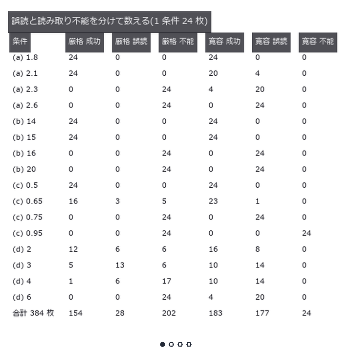</picture>Code-barres 1-D</a>
<a href="../../articles/assets/poc/poc_battery_electrode_tortuosity/01_scene.png"><picture><source media="(prefers-reduced-motion: reduce)" srcset="../../articles/assets/poc/poc_battery_electrode_tortuosity/01_scene.png">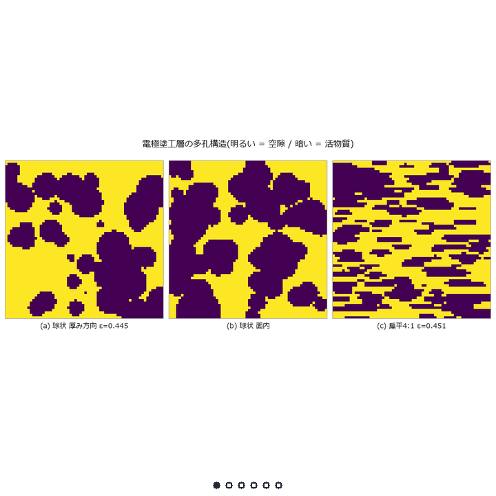</picture>Tortuosité des électrodes</a>
<a href="../../articles/assets/poc/poc_bearing_diagnosis/01_envelope_vs_raw.png"><picture><source media="(prefers-reduced-motion: reduce)" srcset="../../articles/assets/poc/poc_bearing_diagnosis/01_envelope_vs_raw.png">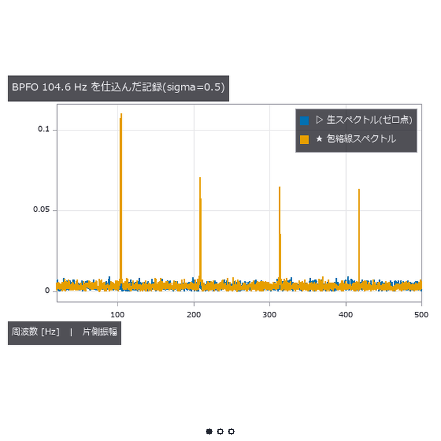</picture>Diagnostic d'anomalies de roulements</a>
<a href="../../articles/assets/poc/poc_bump_coplanarity/01_scene.png"><picture><source media="(prefers-reduced-motion: reduce)" srcset="../../articles/assets/poc/poc_bump_coplanarity/01_scene.png">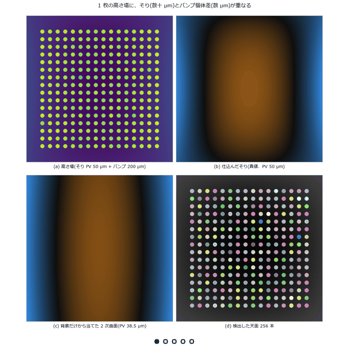</picture>Coplanarité des bumps</a>
<a href="../../articles/assets/poc/poc_crack_width/05_real_crack_rebin.png"><picture><source media="(prefers-reduced-motion: reduce)" srcset="../../articles/assets/poc/poc_crack_width/05_real_crack_rebin.png">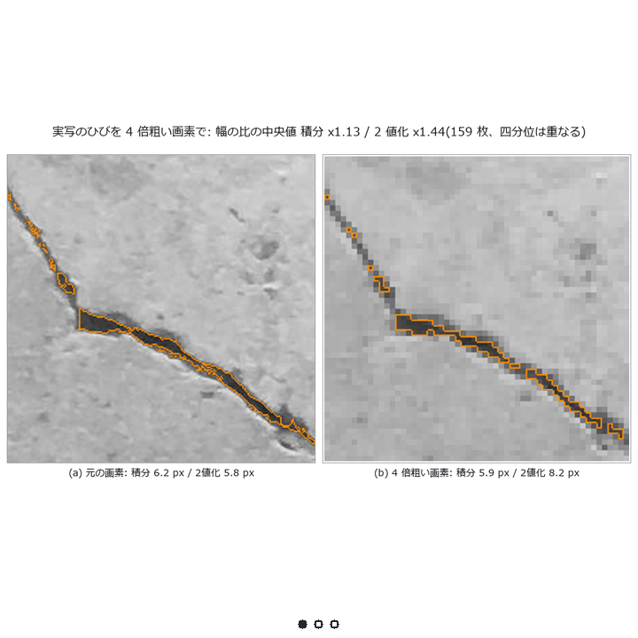</picture>Largeur des fissures</a>
<a href="../../articles/assets/poc/poc_fabric_defect/06_real_defects.png"><picture><source media="(prefers-reduced-motion: reduce)" srcset="../../articles/assets/poc/poc_fabric_defect/06_real_defects.png">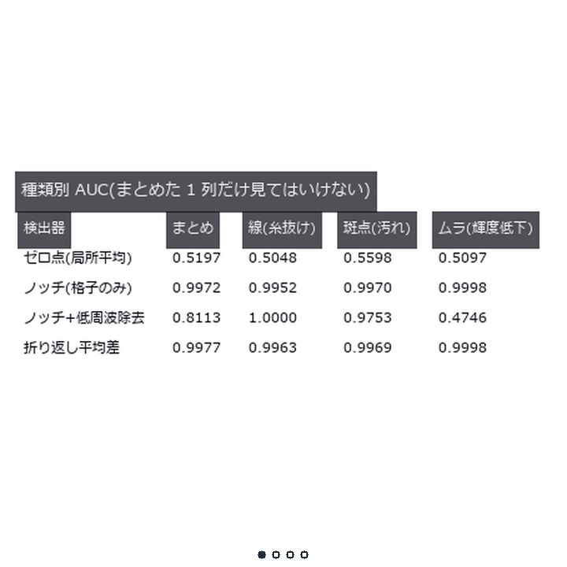</picture>Défauts de tissu</a>
<a href="../../articles/assets/poc/poc_leak_localization/01_scene.png"><picture><source media="(prefers-reduced-motion: reduce)" srcset="../../articles/assets/poc/poc_leak_localization/01_scene.png">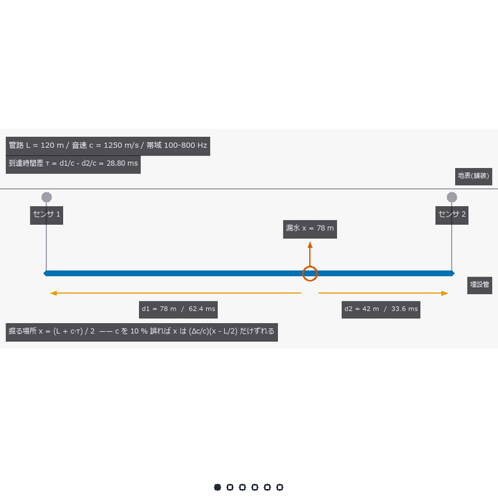</picture>Détection de fuites par le son</a>
<a href="../../articles/assets/poc/poc_machine_condition_fusion/01_scene_machine.png"><picture><source media="(prefers-reduced-motion: reduce)" srcset="../../articles/assets/poc/poc_machine_condition_fusion/01_scene_machine.png">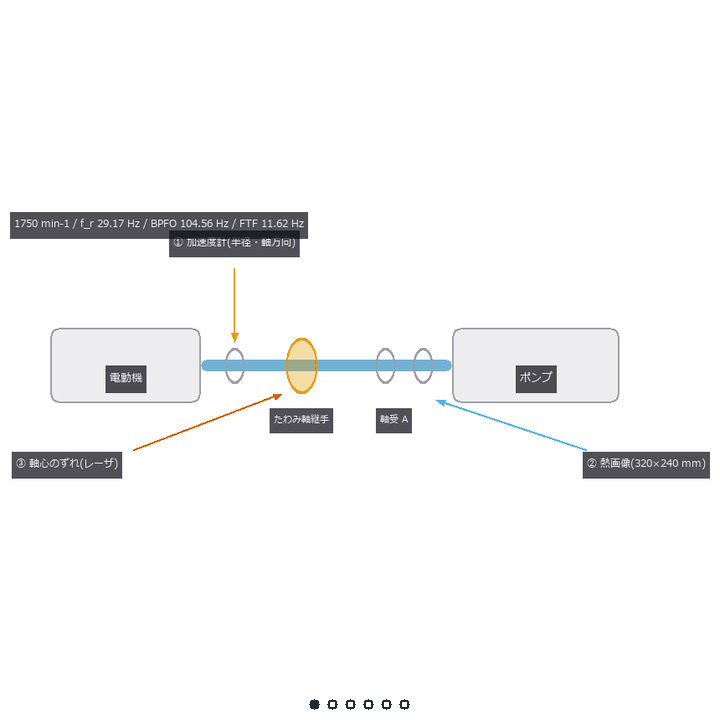</picture>Fusion pour la maintenance des équipements</a>
<a href="../../articles/assets/poc/poc_matrix_code_reading/01_symbol_and_errors.png"><picture><source media="(prefers-reduced-motion: reduce)" srcset="../../articles/assets/poc/poc_matrix_code_reading/01_symbol_and_errors.png">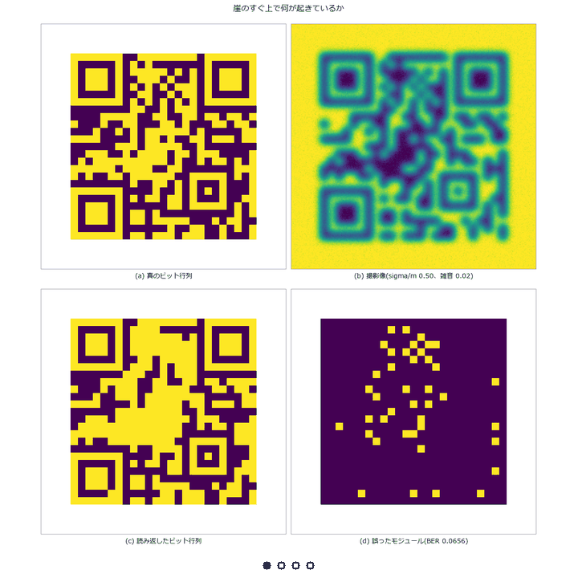</picture>Lecture de codes binaires 2-D</a>
<a href="../../articles/assets/poc/poc_moire_screen/01_failure_split_plot.png"><picture><source media="(prefers-reduced-motion: reduce)" srcset="../../articles/assets/poc/poc_moire_screen/01_failure_split_plot.png">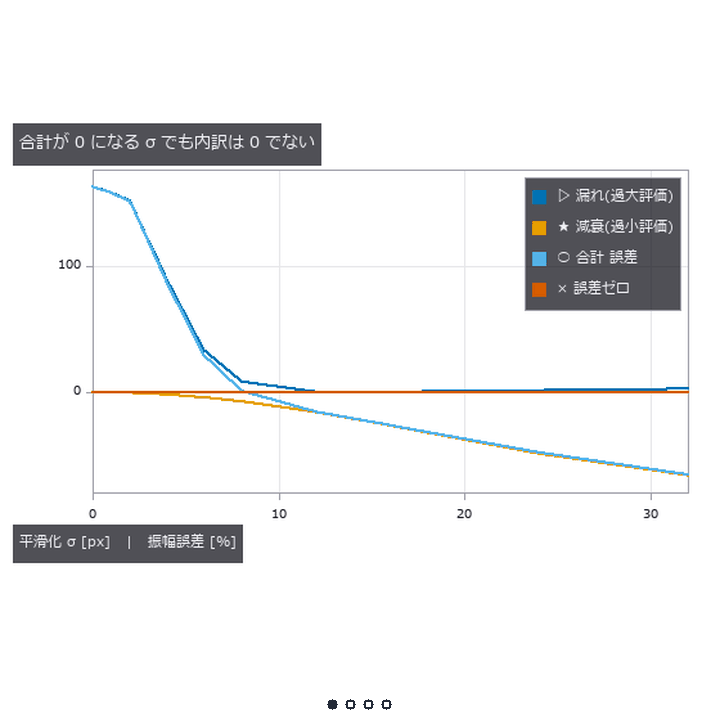</picture>Moiré et mura</a>
<a href="../../articles/assets/poc/poc_print_registration/01_plates.png"><picture><source media="(prefers-reduced-motion: reduce)" srcset="../../articles/assets/poc/poc_print_registration/01_plates.png">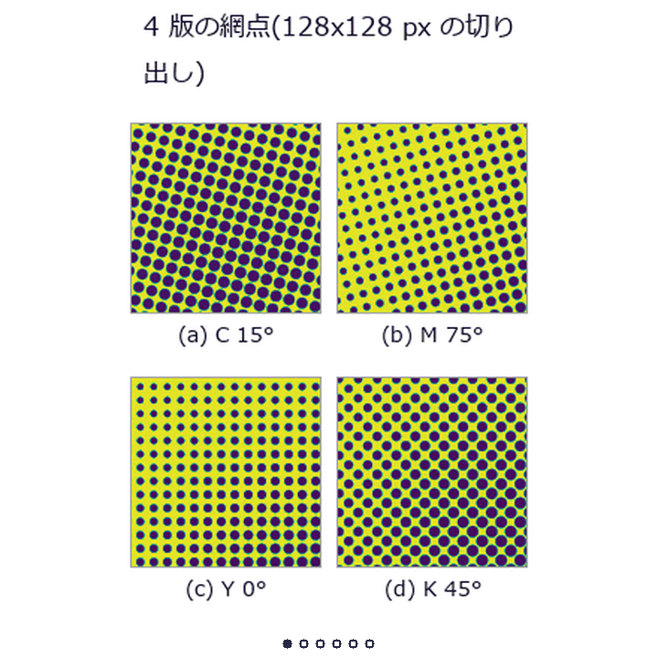</picture>Défaut de repérage d'impression</a>
<a href="../../articles/assets/poc/poc_real_texture_invariance/01_textures.png"><picture><source media="(prefers-reduced-motion: reduce)" srcset="../../articles/assets/poc/poc_real_texture_invariance/01_textures.png">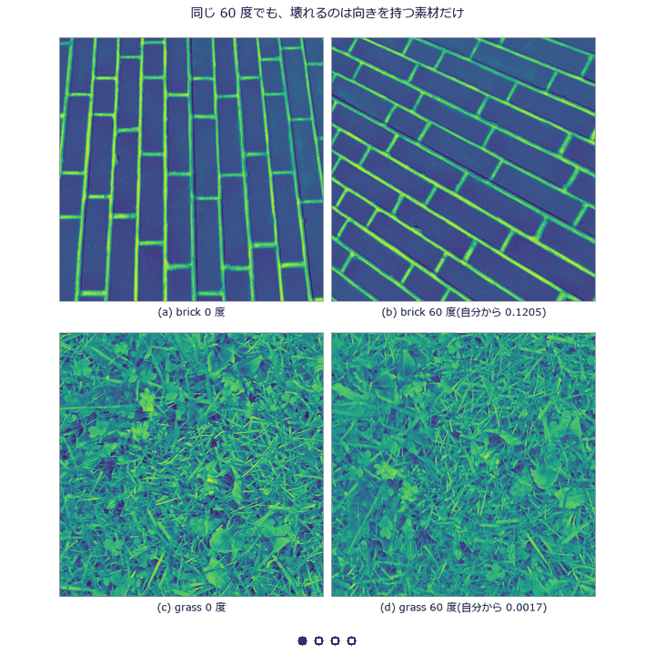</picture>Rotation de textures réelles</a>
<a href="../../articles/assets/poc/poc_recycling_sorting/01_scene.png"><picture><source media="(prefers-reduced-motion: reduce)" srcset="../../articles/assets/poc/poc_recycling_sorting/01_scene.png">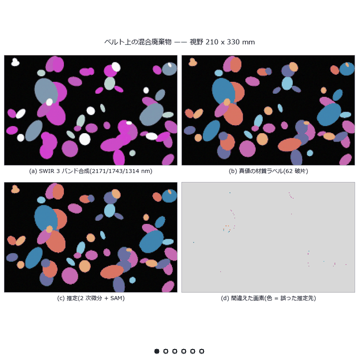</picture>Tri des déchets par matériau</a>
<a href="../../articles/assets/poc/poc_solder_fillet_aoi/01_ring_lut.png"><picture><source media="(prefers-reduced-motion: reduce)" srcset="../../articles/assets/poc/poc_solder_fillet_aoi/01_ring_lut.png">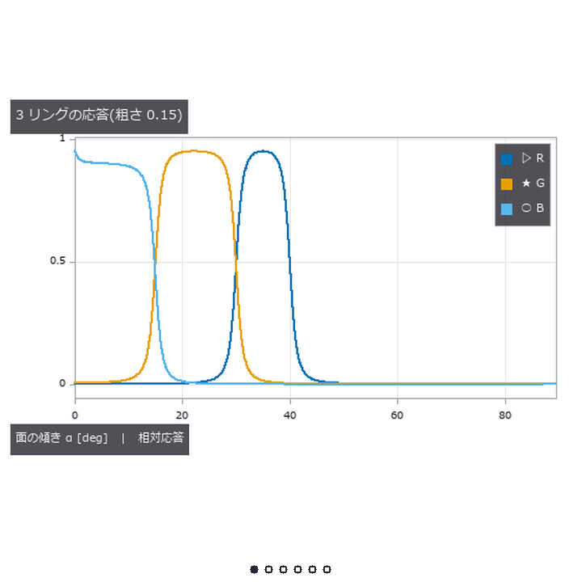</picture>AOI des soudures</a>
<a href="../../articles/assets/poc/poc_spc/01_spc_xbar_chart.png"><picture><source media="(prefers-reduced-motion: reduce)" srcset="../../articles/assets/poc/poc_spc/01_spc_xbar_chart.png">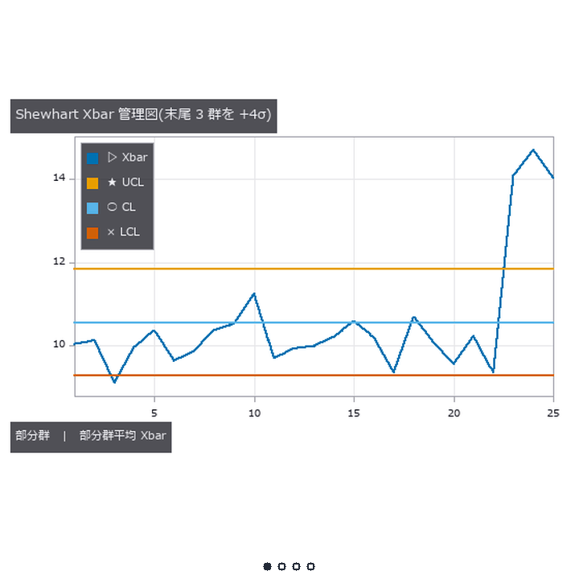</picture>Maîtrise statistique des procédés</a>
<a href="../../articles/assets/poc/poc_mt_hidden_fault/01_mt_hidden_cloud.png"><picture><source media="(prefers-reduced-motion: reduce)" srcset="../../articles/assets/poc/poc_mt_hidden_fault/01_mt_hidden_cloud.png">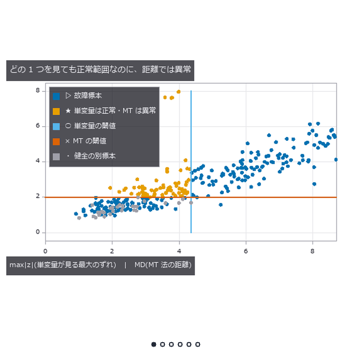</picture>Détection d'anomalies par la méthode MT</a>
<a href="../../articles/assets/poc/poc_text_region_truth/01_text_region_scene.png"><picture><source media="(prefers-reduced-motion: reduce)" srcset="../../articles/assets/poc/poc_text_region_truth/01_text_region_scene.png">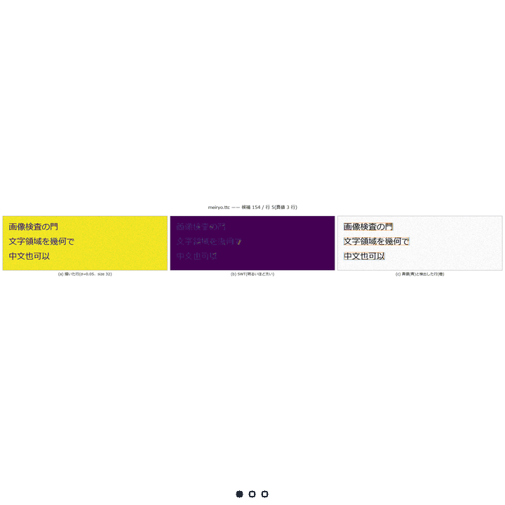</picture>Détection de zones de texte</a>
<a href="../../articles/assets/poc/poc_thermal_drift_metrology/01_separate_drifts.png"><picture><source media="(prefers-reduced-motion: reduce)" srcset="../../articles/assets/poc/poc_thermal_drift_metrology/01_separate_drifts.png">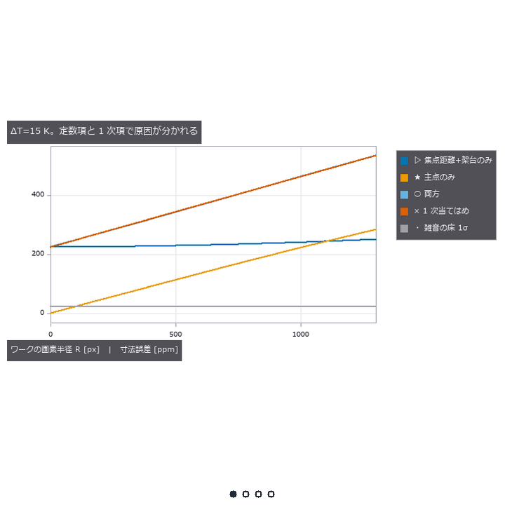</picture>Dérive thermique de la caméra</a>
<a href="../../articles/assets/poc/poc_thermal_radiometry/01_floor.png"><picture><source media="(prefers-reduced-motion: reduce)" srcset="../../articles/assets/poc/poc_thermal_radiometry/01_floor.png">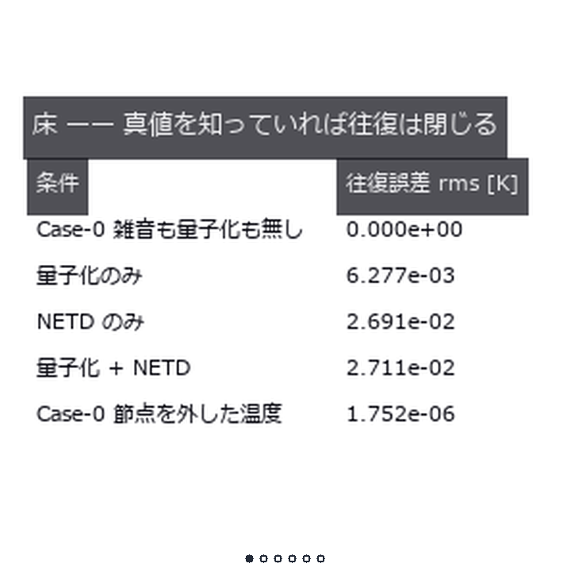</picture>Imagerie thermique et température</a>
<a href="../../articles/assets/poc/poc_thermography_ndt/01_depth_table.png"><picture><source media="(prefers-reduced-motion: reduce)" srcset="../../articles/assets/poc/poc_thermography_ndt/01_depth_table.png">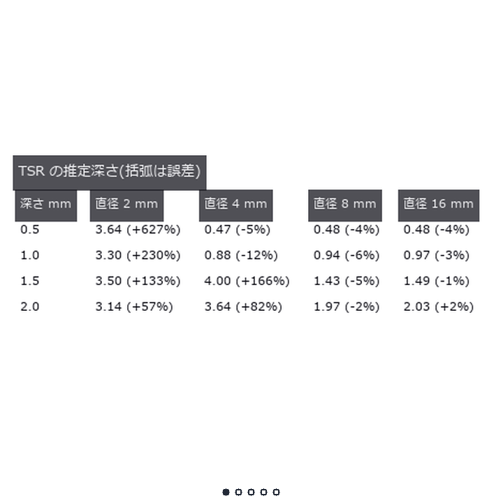</picture>Profondeur des défauts par imagerie thermique</a>
<a href="../../articles/assets/poc/poc_veiling_glare/01_verdict.png"><picture><source media="(prefers-reduced-motion: reduce)" srcset="../../articles/assets/poc/poc_veiling_glare/01_verdict.png">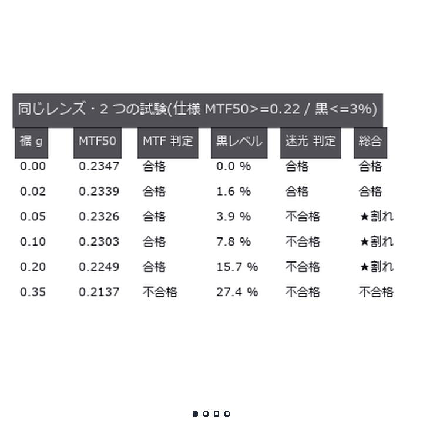</picture>Lumière parasite et contraste</a>
<a href="../../articles/assets/poc/poc_emva1288_sensor/01_raw_dark_flat_saturation.png"><picture><source media="(prefers-reduced-motion: reduce)" srcset="../../articles/assets/poc/poc_emva1288_sensor/01_raw_dark_flat_saturation.png">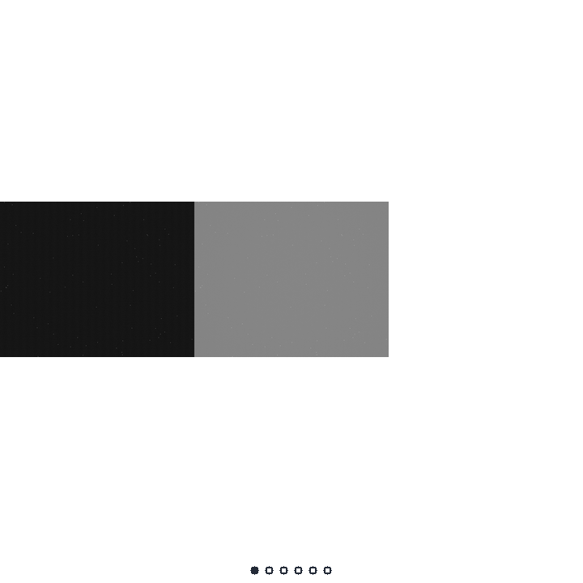</picture>Mesure EMVA 1288</a>
<a href="../../articles/assets/poc/poc_emva1288_in_camera_processing/01_datasheet_lies.png"><picture><source media="(prefers-reduced-motion: reduce)" srcset="../../articles/assets/poc/poc_emva1288_in_camera_processing/01_datasheet_lies.png">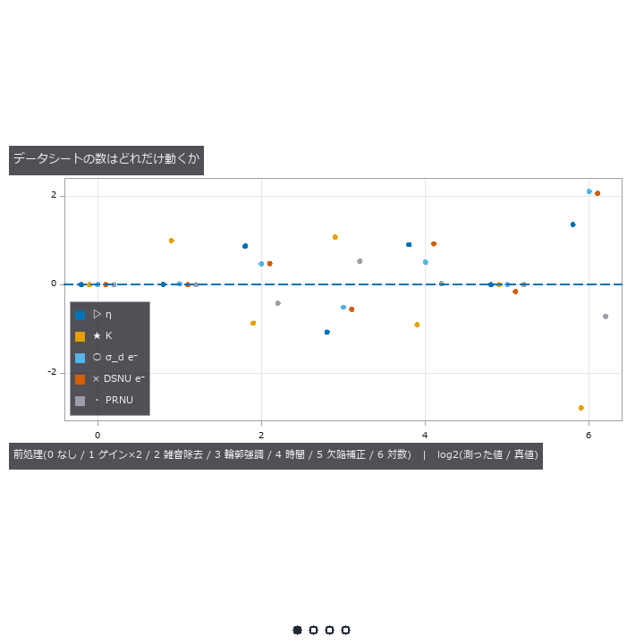</picture>Quand le prétraitement fausse la fiche technique</a>
<a href="../../articles/assets/poc/poc_web_roll_periodicity/01_scene_web.png"><picture><source media="(prefers-reduced-motion: reduce)" srcset="../../articles/assets/poc/poc_web_roll_periodicity/01_scene_web.png">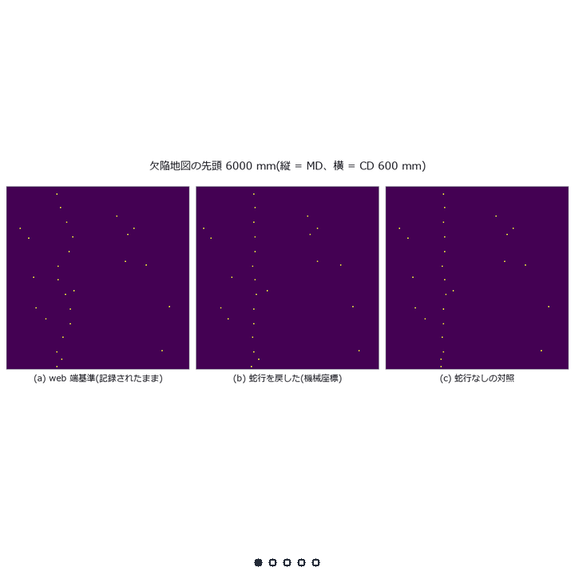</picture>Défauts des rouleaux de transport</a>
<a href="../../articles/assets/poc/poc_weld_bead_profile/05_real_laser_line.png"><picture><source media="(prefers-reduced-motion: reduce)" srcset="../../articles/assets/poc/poc_weld_bead_profile/05_real_laser_line.png">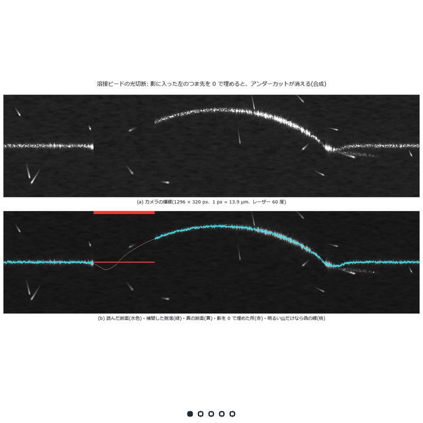</picture>Profil en coupe du cordon de soudure</a>
<a href="../../articles/assets/poc/poc_weld_bead_scan_angle/02_frames.png"><picture><source media="(prefers-reduced-motion: reduce)" srcset="../../articles/assets/poc/poc_weld_bead_scan_angle/02_frames.png">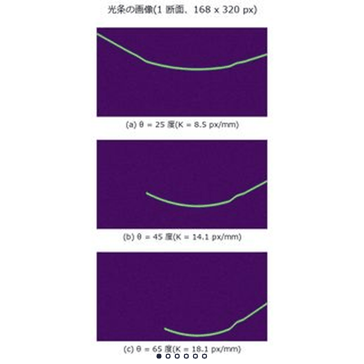</picture>Balayage du cordon de soudure</a>
<a href="../../articles/assets/poc/poc_weld_radiograph_porosity/02_map_detections.png"><picture><source media="(prefers-reduced-motion: reduce)" srcset="../../articles/assets/poc/poc_weld_radiograph_porosity/02_map_detections.png">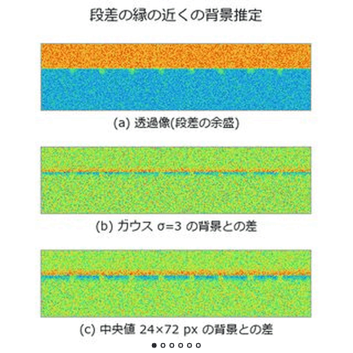</picture>Porosité des soudures</a>
<a href="../../articles/assets/poc/poc_glyph_typo_detection/01_sign_before_after.png">Détection de fautes de frappe dans les images</a>
<a href="../../articles/assets/poc/poc_print_layer_inspection/01_slice_stack.png"><picture><source media="(prefers-reduced-motion: reduce)" srcset="../../articles/assets/poc/poc_print_layer_inspection/01_slice_stack.png">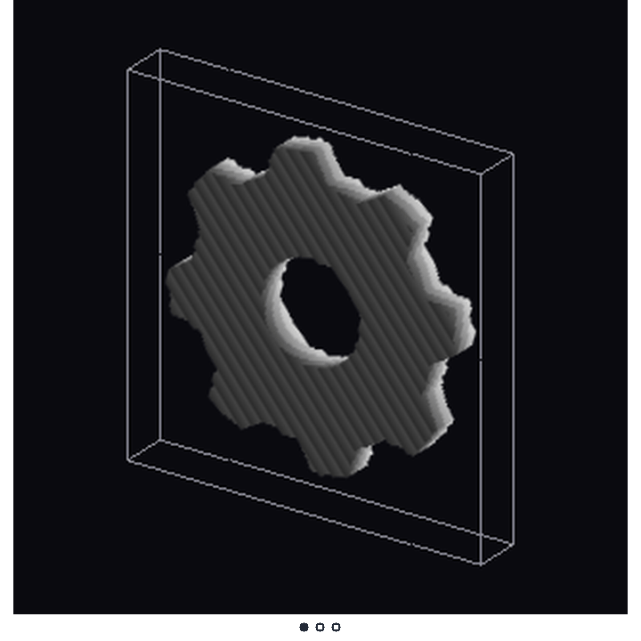</picture>Inspection des couches d'impression 3D</a>
<a href="../../articles/assets/poc/poc_agv_fleet/01_agv_naive_vs_adg.mp4"><b>&#9654;</b>Entrepôt à AGV</a>
<a href="../../articles/assets/poc/poc_am_thermal_to_ct/01_melt_pool_frames.mp4"><b>&#9654;</b>Fabrication additive et CT</a>
<a href="../../articles/assets/poc/poc_symmetry_self_reference_inspection/01_self_reference_defect.png"><picture><source media="(prefers-reduced-motion: reduce)" srcset="../../articles/assets/poc/poc_symmetry_self_reference_inspection/01_self_reference_defect.png">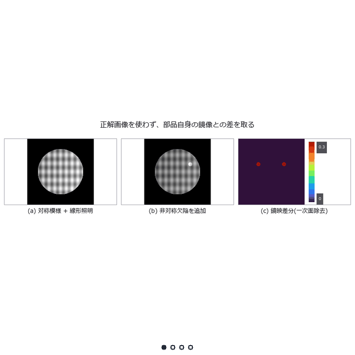</picture>Inspection auto-référencée par symétrie 2-D</a>
<a href="../../articles/assets/poc/poc_si_wafer_pl_defect_visibility/01_pl_groove_vs_diffusion_length.png"><picture><source media="(prefers-reduced-motion: reduce)" srcset="../../articles/assets/poc/poc_si_wafer_pl_defect_visibility/01_pl_groove_vs_diffusion_length.png">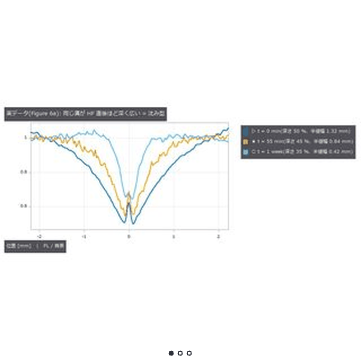</picture>Rainure dans l'image PL et longueur de diffusion</a>
<a href="../../articles/assets/poc/poc_dense_bubble_count/12_pair_merging.gif"><picture><source media="(prefers-reduced-motion: reduce)" srcset="../../articles/assets/poc/poc_dense_bubble_count/01_real_bubbles_verdict.png">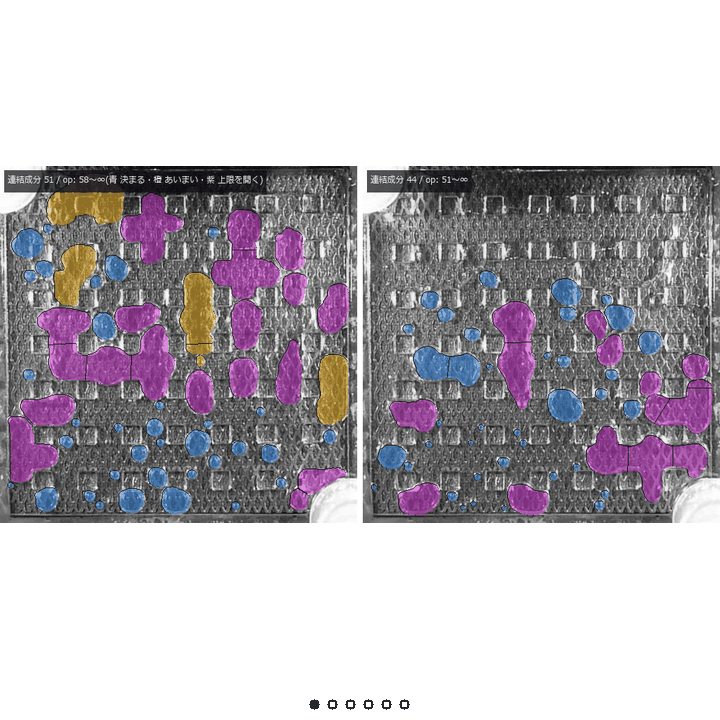</picture><b>&#9654;</b>Compter des bulles denses (un intervalle quand c'est indécidable)</a>
<a href="../../articles/assets/poc/poc_grating_interferometry/12_real_three_images.png"><picture><source media="(prefers-reduced-motion: reduce)" srcset="../../articles/assets/poc/poc_grating_interferometry/12_real_three_images.png">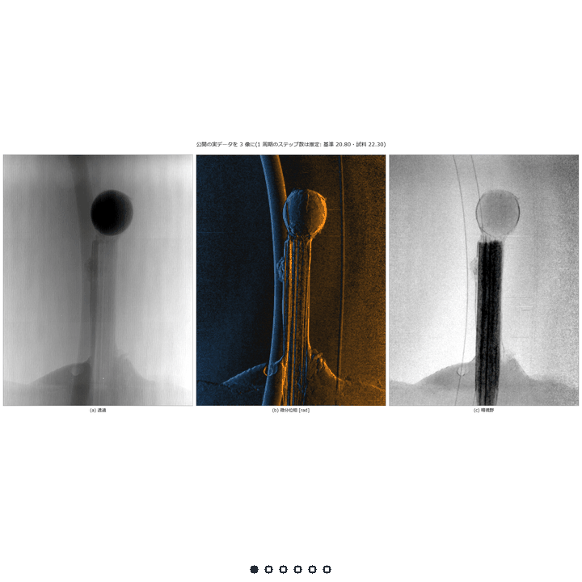</picture>Interférométrie à réseaux (fibres, fissures et pores en champ sombre)</a>
<a href="../../articles/assets/poc/poc_dual_energy_xray/13_real_tray_xray.png"><picture><source media="(prefers-reduced-motion: reduce)" srcset="../../articles/assets/poc/poc_dual_energy_xray/13_real_tray_xray.png">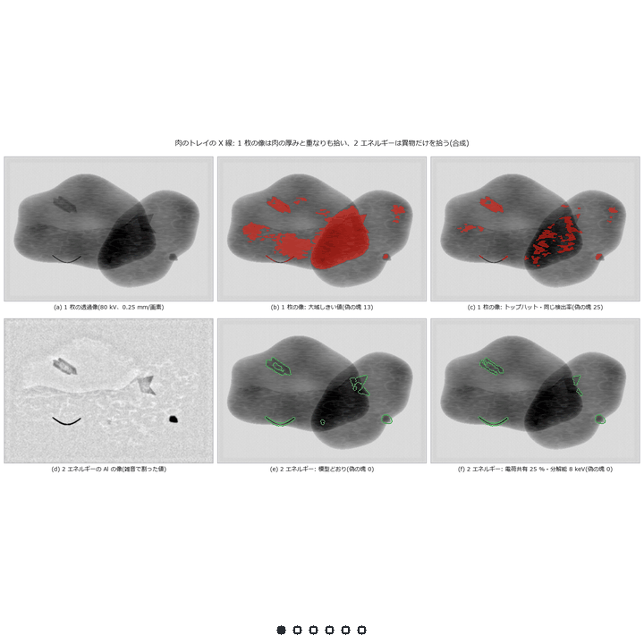</picture>Trouver os et verre dans la viande avec deux énergies de rayons X (rayons X bi-énergie)</a>
<a href="../../articles/assets/poc/poc_code_matching_breakdown/05_highlight_sweep.gif"><picture><source media="(prefers-reduced-motion: reduce)" srcset="../../articles/assets/poc/poc_code_matching_breakdown/01_breakdown_occlusion.png">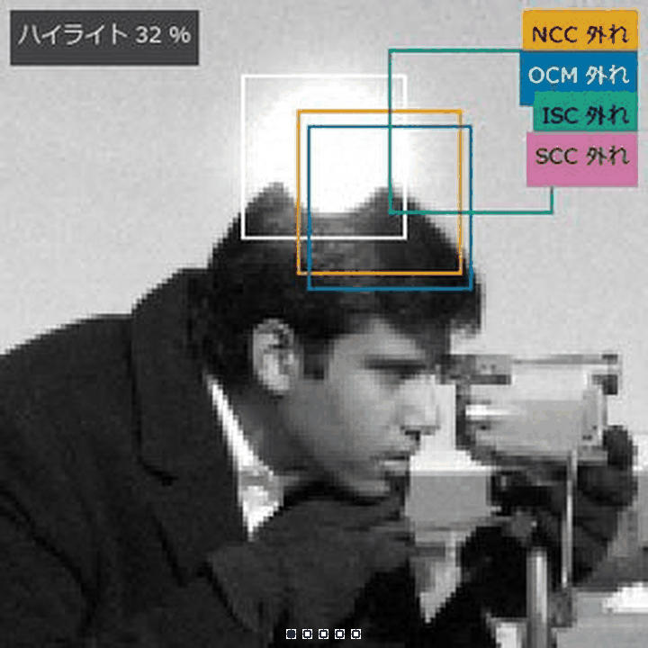</picture><b>&#9654;</b>Appariement de codes sous lumière variable et occlusion</a>
<a href="../../articles/assets/poc/poc_patch_anomaly/01_anomaly_maps.png"><picture><source media="(prefers-reduced-motion: reduce)" srcset="../../articles/assets/poc/poc_patch_anomaly/01_anomaly_maps.png">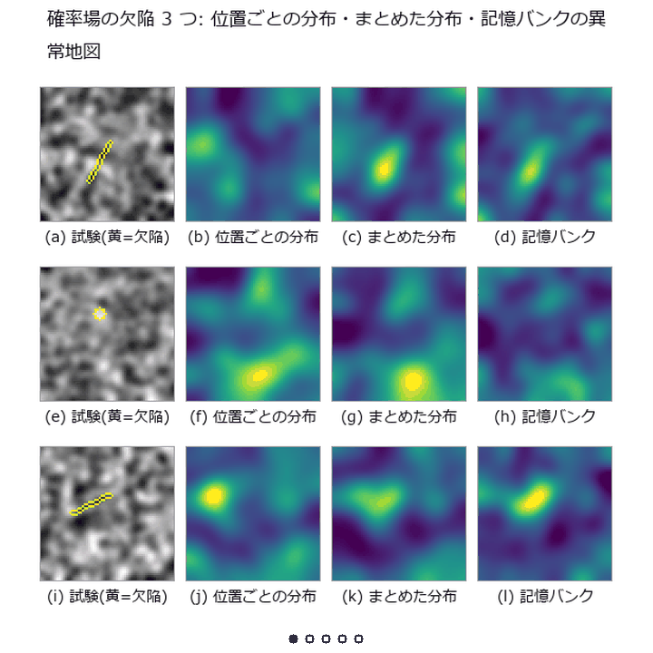</picture>Détection d'anomalies à partir des seules bonnes pièces (caractéristiques classiques : distribution contre mémoire)</a>
<a href="../../articles/assets/poc/poc_braid_homotopy_classes/01_braid_classes_spacetime.gif"><b>&#9654;</b>Classer des plans multi-robots selon leur tresse</a>
<a href="../../articles/assets/poc/poc_wavefront_aberration_limits/01_aberration_limits.png">Limites de l'approximation de Maréchal selon la forme de l'aberration</a>
<a href="../../articles/assets/poc/poc_mueller_dofp_observability/01_observability.png">Sept dimensions de Mueller invisibles pour une caméra de polarisation à quatre angles</a>
<a href="../../articles/assets/poc/poc_slanted_edge_sfr_limits/01_sfr_limits.png">La SFR à bord incliné fausse le MTF50 à cause du gamma</a>
<a href="../../articles/assets/poc/poc_threshold_transfer_after_normalization/01_threshold_transfer.png"><picture><source media="(prefers-reduced-motion: reduce)" srcset="../../articles/assets/poc/poc_threshold_transfer_after_normalization/01_threshold_transfer.png">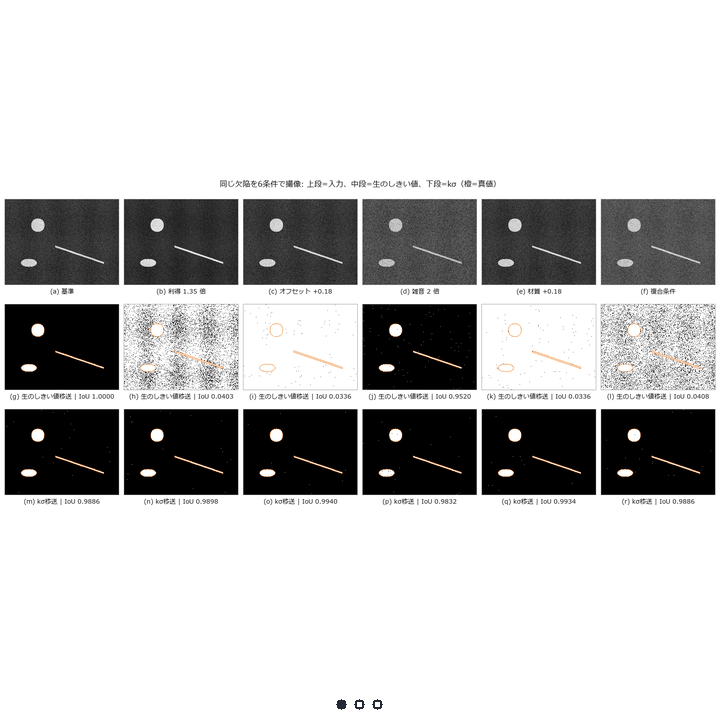</picture>Raw grey-level thresholds need retuning across lighting, while k-sigma and P-tile transfer</a>
<a href="../../articles/assets/poc/poc_hdr_glossy_metal_inspection/02_results.png"><picture><source media="(prefers-reduced-motion: reduce)" srcset="../../articles/assets/poc/poc_hdr_glossy_metal_inspection/02_results.png">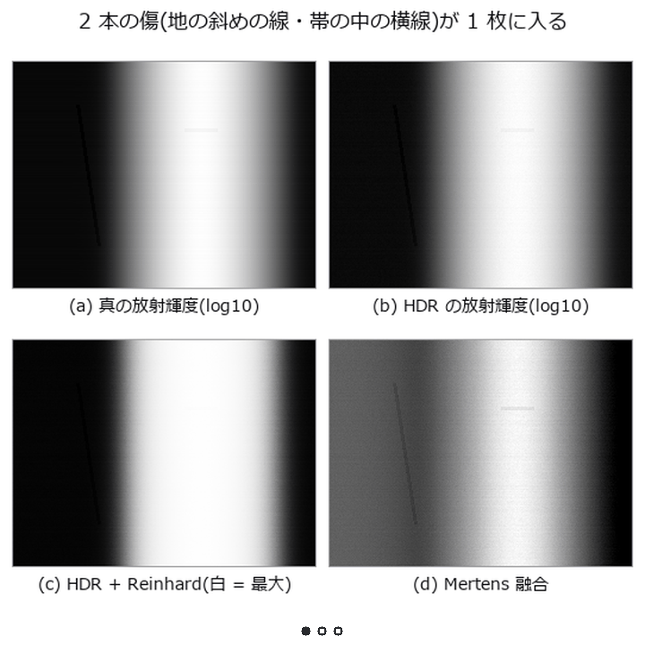</picture>Aucune pose unique ne montre les deux rayures sur métal brillant ; la HDR à réponse mesurée, si</a>
<a href="../../articles/assets/poc/poc_symbol_package_1d/01_ean13_defocus.png">Au flou qui permet encore 90 % de lectures, le code-barres obtient la note de qualité F</a>
<a href="../../articles/assets/poc/poc_symbol_part_dpm/01_dpm_datamatrix.png">zxing-cpp ne lit une Data Matrix micro-percutée qu'une fois floue</a>
<a href="../../articles/assets/poc/poc_symbol_lot_ocr/01_lot_ocr_defocus.png">Au-delà du flou appris, l'OCR des numéros de lot lit mal au lieu de rejeter</a>
<a href="../../articles/assets/poc/poc_real_typewritten_ocr/01_reading.png"><picture><source media="(prefers-reduced-motion: reduce)" srcset="../../articles/assets/poc/poc_real_typewritten_ocr/01_reading.png">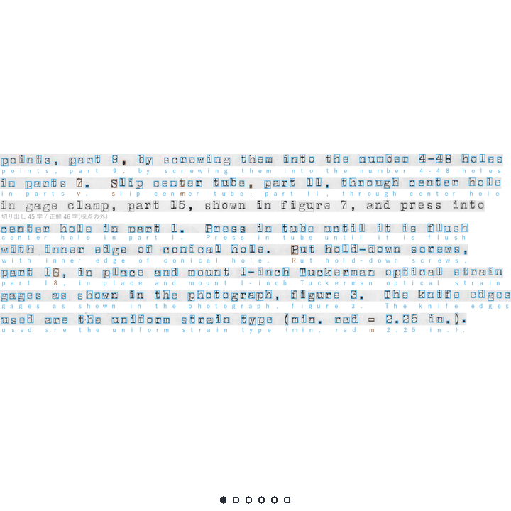</picture>Lire un rapport dactylographié de 1943 par OCR classique</a>
<a href="../../articles/assets/poc/poc_ct_casting_sparse_views/01_slices.png"><picture><source media="(prefers-reduced-motion: reduce)" srcset="../../articles/assets/poc/poc_ct_casting_sparse_views/01_slices.png">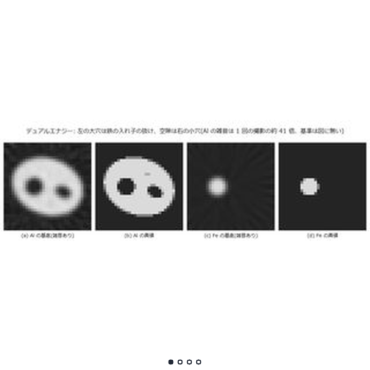</picture>CT des porosités de fonderie : la meilleure reconstruction en RMSE n'était pas la meilleure en volume mesuré par déficit (synthèse 32³ ; le volume binarisé inverse l'ordre)</a>
<a href="../../articles/assets/poc/poc_surface_defect_classifiers/01_defect_patches.png"><picture><source media="(prefers-reduced-motion: reduce)" srcset="../../articles/assets/poc/poc_surface_defect_classifiers/01_defect_patches.png">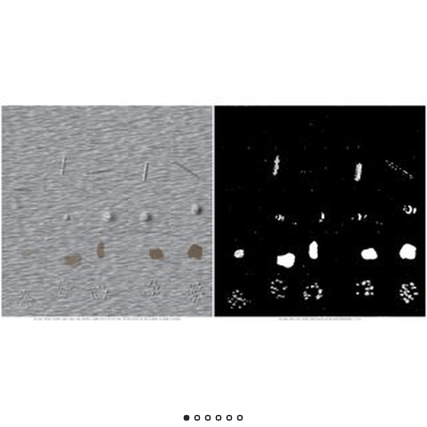</picture>Trier les défauts de surface métallique par classifieurs appris : les rayures le long des stries de meulage sont manquées trois fois sur quatre, les piqûres inconnues rejetées à 95 %</a>

<b>Métrologie dimensionnelle et de forme</b> (53)

<a href="../../articles/assets/poc/poc_aoi_ct_traceability/01_inspection_and_reconstructed_ct.png"><picture><source media="(prefers-reduced-motion: reduce)" srcset="../../articles/assets/poc/poc_aoi_ct_traceability/01_inspection_and_reconstructed_ct.png">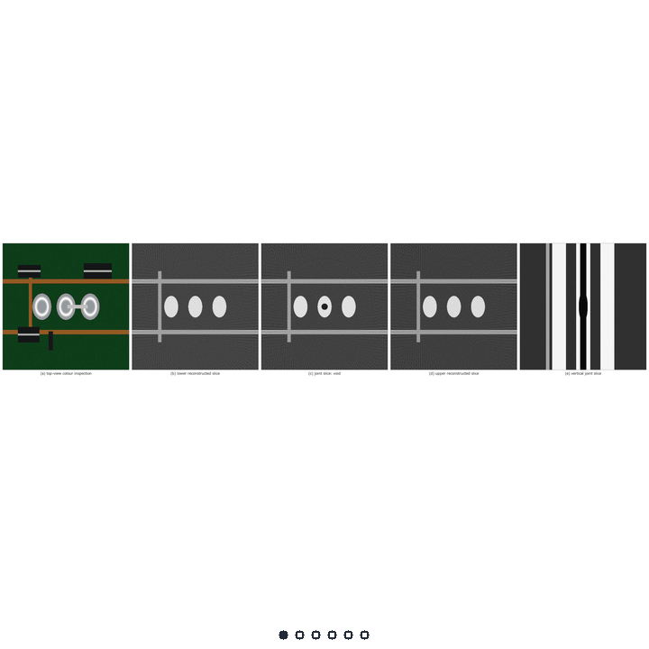</picture>Appariement AOI et CT</a>
<a href="../../articles/assets/poc/poc_asbuilt_wall_deviation/01_scene.png"><picture><source media="(prefers-reduced-motion: reduce)" srcset="../../articles/assets/poc/poc_asbuilt_wall_deviation/01_scene.png">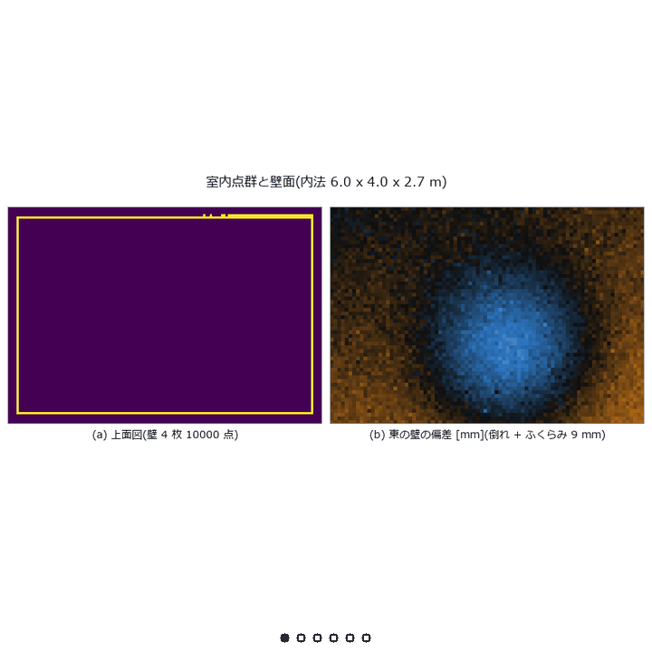</picture>Déformation des murs construits</a>
<a href="../../articles/assets/poc/poc_battery_electrode_breathing/01_scene.png"><picture><source media="(prefers-reduced-motion: reduce)" srcset="../../articles/assets/poc/poc_battery_electrode_breathing/01_scene.png">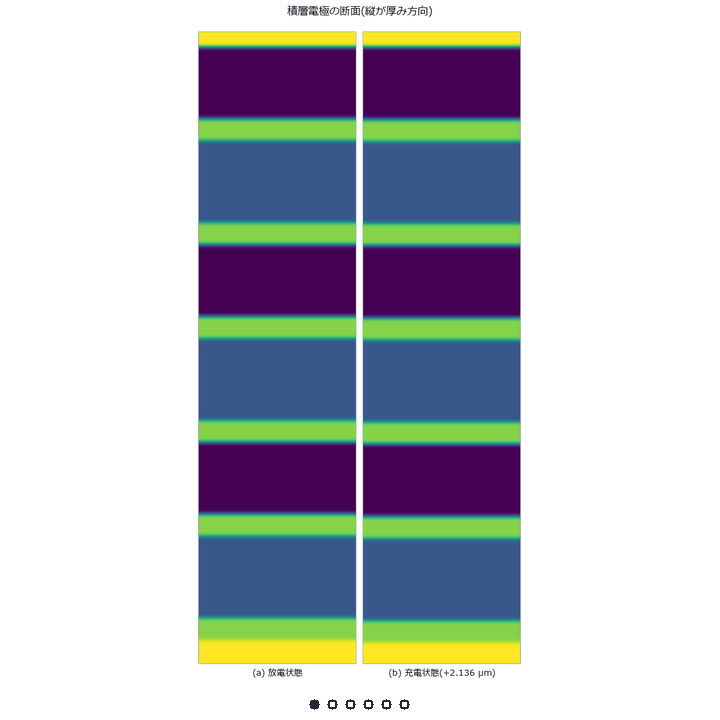</picture>Respiration des électrodes</a>
<a href="../../articles/assets/poc/poc_bilateral_asymmetry/01_floor_vs_spacing.png"><picture><source media="(prefers-reduced-motion: reduce)" srcset="../../articles/assets/poc/poc_bilateral_asymmetry/01_floor_vs_spacing.png">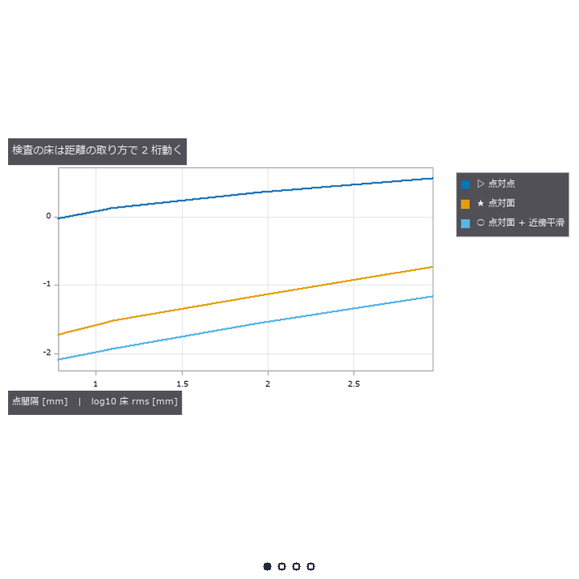</picture>Asymétrie bilatérale</a>
<a href="../../articles/assets/poc/poc_dic_strain/05_tensile_ramp.mp4"><b>&#9654;</b>Déformation par DIC</a>
<a href="../../articles/assets/poc/poc_die_tilt_tsv_overlay/01_scene.png"><picture><source media="(prefers-reduced-motion: reduce)" srcset="../../articles/assets/poc/poc_die_tilt_tsv_overlay/01_scene.png">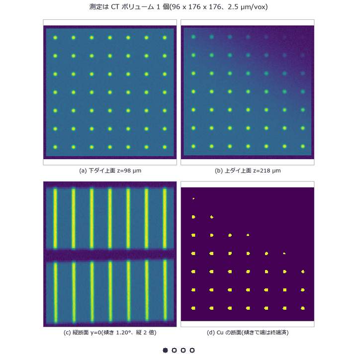</picture>Inclinaison de la puce et TSV</a>
<a href="../../articles/assets/poc/poc_dimensional_inspection/01_slot_bias.png"><picture><source media="(prefers-reduced-motion: reduce)" srcset="../../articles/assets/poc/poc_dimensional_inspection/01_slot_bias.png">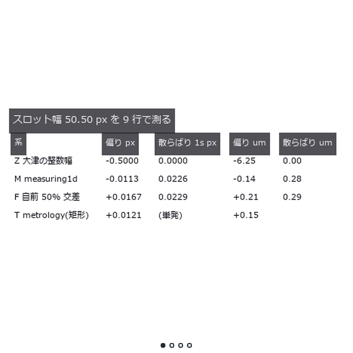</picture>Contrôle dimensionnel de pièces</a>
<a href="../../articles/assets/poc/poc_fiber_orientation/01_scene.png"><picture><source media="(prefers-reduced-motion: reduce)" srcset="../../articles/assets/poc/poc_fiber_orientation/01_scene.png">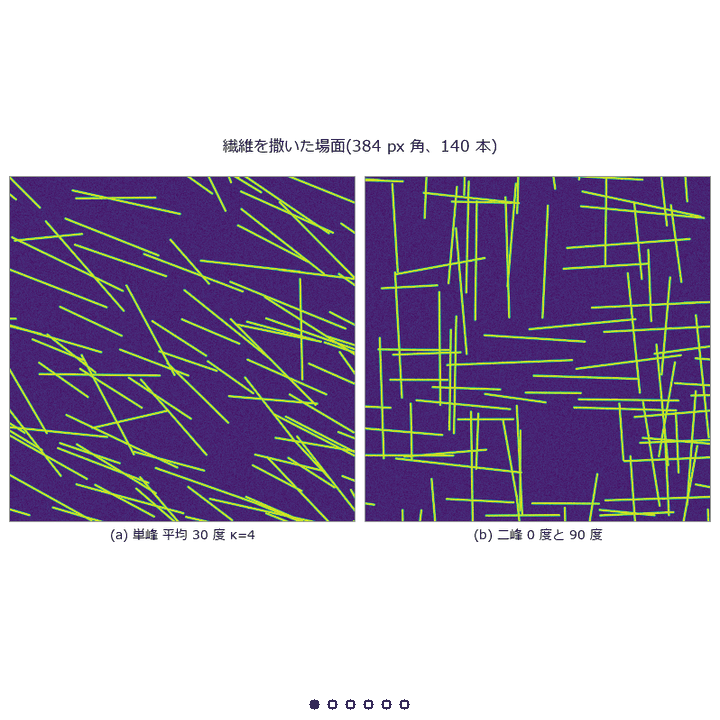</picture>Orientation des fibres</a>
<a href="../../articles/assets/poc/poc_gear_tooth_metrology/01_scene.png"><picture><source media="(prefers-reduced-motion: reduce)" srcset="../../articles/assets/poc/poc_gear_tooth_metrology/01_scene.png">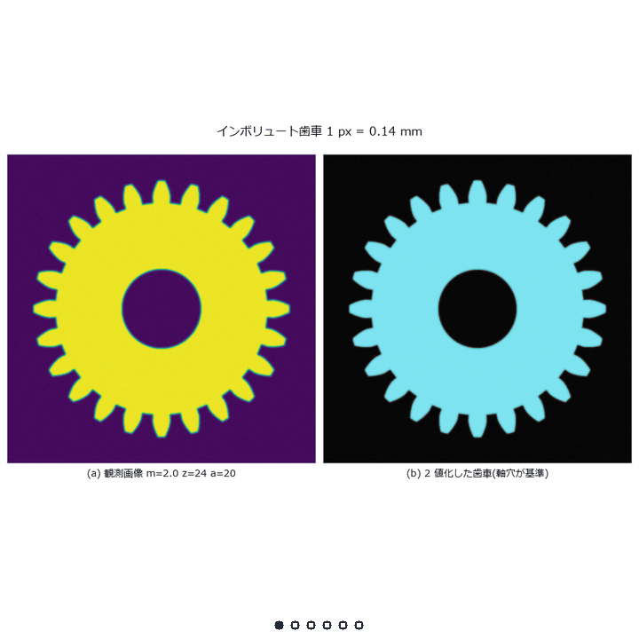</picture>Profil de denture des engrenages</a>
<a href="../../articles/assets/poc/poc_metal_grain_size/15_real_tbm_breaks.png"><picture><source media="(prefers-reduced-motion: reduce)" srcset="../../articles/assets/poc/poc_metal_grain_size/15_real_tbm_breaks.png">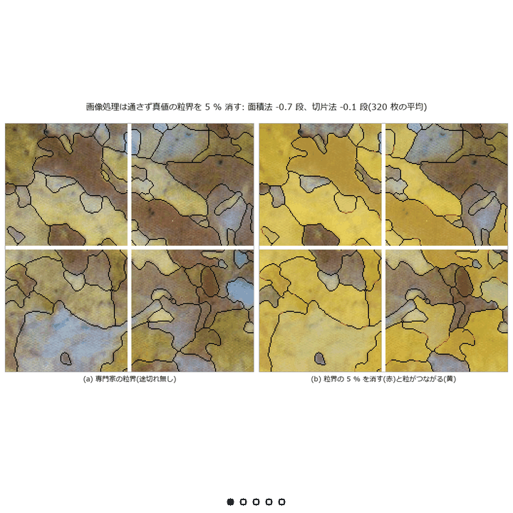</picture>Taille de grain</a>
<a href="../../articles/assets/poc/poc_multibeam_bathymetry/17_survey.mp4"><b>&#9654;</b>Sondage multifaisceaux</a>
<a href="../../articles/assets/poc/poc_particle_sizing/01_scene.png"><picture><source media="(prefers-reduced-motion: reduce)" srcset="../../articles/assets/poc/poc_particle_sizing/01_scene.png">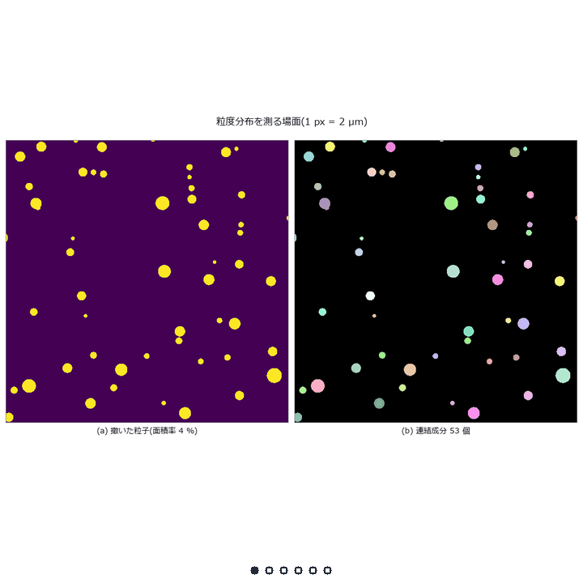</picture>Distribution granulométrique</a>
<a href="../../articles/assets/poc/poc_rail_corrugation/01_planted_components.png"><picture><source media="(prefers-reduced-motion: reduce)" srcset="../../articles/assets/poc/poc_rail_corrugation/01_planted_components.png"></picture>Usure ondulatoire des rails</a>
<a href="../../articles/assets/poc/poc_real_coin_metrology/01_scene.png"><picture><source media="(prefers-reduced-motion: reduce)" srcset="../../articles/assets/poc/poc_real_coin_metrology/01_scene.png"></picture>Pièces de monnaie réelles</a>
<a href="../../articles/assets/poc/poc_screw_thread_metrology/01_zero_spectrum.png"><picture><source media="(prefers-reduced-motion: reduce)" srcset="../../articles/assets/poc/poc_screw_thread_metrology/01_zero_spectrum.png"></picture>Profil des filetages</a>
<a href="../../articles/assets/poc/poc_stockpile_volume/07_scan_orbit.mp4"><b>&#9654;</b>Volume d'un tas de matériau</a>
<a href="../../articles/assets/poc/poc_strain_history/05_history_video.mp4"><b>&#9654;</b>Déformation de fluage</a>
<a href="../../articles/assets/poc/poc_surface_roughness/01_surface_components.png"><picture><source media="(prefers-reduced-motion: reduce)" srcset="../../articles/assets/poc/poc_surface_roughness/01_surface_components.png"></picture>Rugosité de surface</a>
<a href="../../articles/assets/poc/poc_tacsim_elastic_membrane/03_tacsim_force_sweep.gif"><b>&#9654;</b>Capteur visuo-tactile</a>
<a href="../../articles/assets/poc/poc_tacsim_marker_shear/02_tacslip_stick_circle_shrinks.gif"><b>&#9654;</b>Cisaillement tactile</a>
<a href="../../articles/assets/poc/poc_tactile_dipole_torque/02_tactorque_dipole_grows_with_M.gif"><b>&#9654;</b>Dipôle tactile</a>
<a href="../../articles/assets/poc/poc_granular_heap_repose/11_granular_datum_tilt_sweep.gif"><b>&#9654;</b>Tas de poudre</a>
<a href="../../articles/assets/poc/poc_food_cutting_measure/01_cutting_track_force.gif"><b>&#9654;</b>Découpe d'aliments</a>
<a href="../../articles/assets/poc/poc_tacdome_large_deformation/01_tacdome_press_sweep.gif"><b>&#9654;</b>Contact d'un bout de doigt en dôme souple</a>
<a href="../../articles/assets/poc/poc_polish_wipe_measure/01_polish_raster_wipe_coat.gif"><b>&#9654;</b>Polissage et essuyage</a>
<a href="../../articles/assets/poc/poc_powder_scoop_pour/03_scoop_stream_synthetic_frames.gif"><b>&#9654;</b>Prélèvement et versement de poudre</a>
<a href="../../articles/assets/poc/poc_powder_grinding_ae/07_psd_fining_during_grinding.gif"><b>&#9654;</b>Broyage au mortier</a>
<a href="../../articles/assets/poc/poc_pxrd_phase_peel/01_phase_peel.gif"><b>&#9654;</b>Séparation des phases par diffraction des rayons X</a>
<a href="../../articles/assets/poc/poc_dose_uniformity_from_grinding/01_cv_bias_decomposition.png"><picture><source media="(prefers-reduced-motion: reduce)" srcset="../../articles/assets/poc/poc_dose_uniformity_from_grinding/01_cv_bias_decomposition.png"></picture>Uniformité de la dose</a>
<a href="../../articles/assets/poc/poc_knife_tactile_toughness/06_cut_with_fingertip_pads.gif"><b>&#9654;</b>Tenir un couteau avec le bout des doigts</a>
<a href="../../articles/assets/poc/poc_measurement_system_analysis/16_breakdown_movie.gif"><picture><source media="(prefers-reduced-motion: reduce)" srcset="../../articles/assets/poc/poc_measurement_system_analysis/01_scene.png"></picture><b>&#9654;</b>R&R de l'instrument de mesure (gauge R&R)</a>
<a href="../../articles/assets/poc/poc_pod_lighting/03_pod_curves.png"><picture><source media="(prefers-reduced-motion: reduce)" srcset="../../articles/assets/poc/poc_pod_lighting/03_pod_curves.png"></picture>Probabilité de détection par éclairage</a>
<a href="../../articles/assets/poc/poc_laser_line_speckle_floor/01_line.png"><picture><source media="(prefers-reduced-motion: reduce)" srcset="../../articles/assets/poc/poc_laser_line_speckle_floor/01_line.png"></picture>Plancher de speckle d'une ligne laser</a>
<a href="../../articles/assets/poc/poc_shape_from_polarization/11_real_dome_and_lens.png"><picture><source media="(prefers-reduced-motion: reduce)" srcset="../../articles/assets/poc/poc_shape_from_polarization/11_real_dome_and_lens.png"></picture>Mesure du noir brillant et du verre par polarisation</a>
<a href="../../articles/assets/poc/poc_interreflection_fringe_error/02_direct_global.png"><picture><source media="(prefers-reduced-motion: reduce)" srcset="../../articles/assets/poc/poc_interreflection_fringe_error/02_direct_global.png"></picture>Interréflexion dans une rainure blanche et erreur des franges</a>
<a href="../../articles/assets/poc/poc_zernike_aberrations/06_through_focus.gif"><picture><source media="(prefers-reduced-motion: reduce)" srcset="../../articles/assets/poc/poc_zernike_aberrations/01_zernike_pyramid.png"></picture><b>&#9654;</b>Aberrations de Zernike</a>
<a href="../../articles/assets/poc/poc_attention_identities/01_attention_masks.png"><picture><source media="(prefers-reduced-motion: reduce)" srcset="../../articles/assets/poc/poc_attention_identities/01_attention_masks.png"></picture>Identités de l'attention</a>
<a href="../../articles/assets/poc/poc_residue_crt/03_residue_rotation_needle.gif"><picture><source media="(prefers-reduced-motion: reduce)" srcset="../../articles/assets/poc/poc_residue_crt/02_residue_rotation_sawtooth.png"></picture><b>&#9654;</b>Phase par le théorème des restes chinois</a>
<a href="../../articles/assets/poc/poc_sem_wafer_defect_edge_bias/01_sem_se_bse_bias.png"><picture><source media="(prefers-reduced-motion: reduce)" srcset="../../articles/assets/poc/poc_sem_wafer_defect_edge_bias/01_sem_se_bse_bias.png"></picture>Élargissement des bords en MEB</a>
<a href="../../articles/assets/poc/poc_chromatic_confocal/04_spectrum_vs_height.gif"><picture><source media="(prefers-reduced-motion: reduce)" srcset="../../articles/assets/poc/poc_chromatic_confocal/01_rainbow_ruler.png"></picture><b>&#9654;</b>Capteur confocal chromatique (lecture de la hauteur par la couleur)</a>
<a href="../../articles/assets/poc/poc_optics_drawings/06_setup_ring_coaxial.png"><picture><source media="(prefers-reduced-motion: reduce)" srcset="../../articles/assets/poc/poc_optics_drawings/06_setup_ring_coaxial.png"></picture>Dessins du système optique (coupe, plan d'implantation, plan de fabrication)</a>
<a href="../../articles/assets/poc/poc_pocket_interreflection/02_residuals.png"><picture><source media="(prefers-reduced-motion: reduce)" srcset="../../articles/assets/poc/poc_pocket_interreflection/02_residuals.png"></picture>Interréflexion dans une poche usinée jusqu'à la convergence</a>
<a href="../../articles/assets/poc/poc_noncoaxial_optics/05_false_defect.png"><picture><source media="(prefers-reduced-motion: reduce)" srcset="../../articles/assets/poc/poc_noncoaxial_optics/05_false_defect.png"></picture>Optique non coaxiale : images fantômes et repliements d'une lame semi-réfléchissante</a>
<a href="../../articles/assets/poc/poc_lockin_imaging/01_ring_amp_phase.png"><picture><source media="(prefers-reduced-motion: reduce)" srcset="../../articles/assets/poc/poc_lockin_imaging/01_ring_amp_phase.png"></picture>Démodulation lock-in par pixel : normales d'éclairage annulaire, séparation de la lumière du jour, ondes thermiques</a>
<a href="../../articles/assets/poc/poc_spectrometer_illumination/03_slit_image_smile.png"><picture><source media="(prefers-reduced-motion: reduce)" srcset="../../articles/assets/poc/poc_spectrometer_illumination/03_slit_image_smile.png"></picture>Spectromètre et éclairage (largeur de bande et structure de la lampe)</a>
<a href="../../articles/assets/poc/poc_simcal_telecentric/02_real_model_residuals.png"><picture><source media="(prefers-reduced-motion: reduce)" srcset="../../articles/assets/poc/poc_simcal_telecentric/02_real_model_residuals.png"></picture>Étalonner un modèle d'imagerie sur une image télécentrique réelle</a>
<a href="../../articles/assets/poc/poc_robust_profile_filter/04_scratched_surface.png"><picture><source media="(prefers-reduced-motion: reduce)" srcset="../../articles/assets/poc/poc_robust_profile_filter/04_scratched_surface.png"></picture>De combien une rayure creuse la ligne moyenne, et où les filtres robustes cèdent</a>
<a href="../../articles/assets/poc/poc_sem_tem_same_particle/08_tem_focus_sweep.gif"><picture><source media="(prefers-reduced-motion: reduce)" srcset="../../articles/assets/poc/poc_sem_tem_same_particle/02_same_specimen_sem_tem.png"></picture><b>&#9654;</b>Les mêmes particules en imagerie à balayage et en transmission</a>
<a href="../../articles/assets/poc/poc_real_sem_metal_layer/01_scene.png"><picture><source media="(prefers-reduced-motion: reduce)" srcset="../../articles/assets/poc/poc_real_sem_metal_layer/01_scene.png"></picture>Métrologie de couches métalliques en MEB réel</a>
<a href="../../articles/assets/poc/poc_virtual_acceptance_3d/01_acceptance_layout_and_noise.png"><picture><source media="(prefers-reduced-motion: reduce)" srcset="../../articles/assets/poc/poc_virtual_acceptance_3d/01_acceptance_layout_and_noise.png"></picture>Recette avant achat : une seule sphère noire fait échouer le même iToF</a>
<a href="../../articles/assets/poc/poc_light_section_step_weld_floor/01_height_map.png"><picture><source media="(prefers-reduced-motion: reduce)" srcset="../../articles/assets/poc/poc_light_section_step_weld_floor/01_height_map.png"></picture>Les hauteurs par triangulation laser concordent au µm, mais la limite réelle est un plancher de speckle de 20,7 µm</a>
<a href="../../articles/assets/poc/poc_real_file_formats/01_stars_matched.png"><picture><source media="(prefers-reduced-motion: reduce)" srcset="../../articles/assets/poc/poc_real_file_formats/01_stars_matched.png"></picture>Lire de vrais fichiers de données scientifiques</a>
<a href="../../articles/assets/poc/poc_real_grain_skiz/01_grain_boundaries.png"><picture><source media="(prefers-reduced-motion: reduce)" srcset="../../articles/assets/poc/poc_real_grain_skiz/01_grain_boundaries.png"></picture>Joints de grains par zones d'influence</a>

<b>Forme 3-D</b> (19)

<a href="../../articles/assets/poc/poc_battery_ct_degradation/17_same_outline_ct.png"><picture><source media="(prefers-reduced-motion: reduce)" srcset="../../articles/assets/poc/poc_battery_ct_degradation/17_same_outline_ct.png"></picture>Dégradation des batteries observée par CT</a>
<a href="../../articles/assets/poc/poc_bev_sensor_fusion/01_scene_bev.png"><picture><source media="(prefers-reduced-motion: reduce)" srcset="../../articles/assets/poc/poc_bev_sensor_fusion/01_scene_bev.png"></picture>Fusion de vues en vue aérienne (BEV)</a>
<a href="../../articles/assets/poc/poc_crop_phenotyping/01_capsule_calibration.png"><picture><source media="(prefers-reduced-motion: reduce)" srcset="../../articles/assets/poc/poc_crop_phenotyping/01_capsule_calibration.png"></picture>Surface foliaire des cultures</a>
<a href="../../articles/assets/poc/poc_ct_void_morphology/13_section_sweep.mp4"><b>&#9654;</b>Vides dans la couche de jonction</a>
<a href="../../articles/assets/poc/poc_dfm_thickness_overhang/01_scene.png"><picture><source media="(prefers-reduced-motion: reduce)" srcset="../../articles/assets/poc/poc_dfm_thickness_overhang/01_scene.png"></picture>Facilité de fabrication</a>
<a href="../../articles/assets/poc/poc_livestock_body_volume/14_hull_orbit.mp4"><b>&#9654;</b>Poids du bétail</a>
<a href="../../articles/assets/poc/poc_mesh_quality_repair/14_decimate_orbit.mp4"><b>&#9654;</b>Réparation de maillage</a>
<a href="../../articles/assets/poc/poc_pallet_load_utilization/01_scene.png"><picture><source media="(prefers-reduced-motion: reduce)" srcset="../../articles/assets/poc/poc_pallet_load_utilization/01_scene.png"></picture>Taux de chargement des palettes</a>
<a href="../../articles/assets/poc/poc_pipe_wall_loss/01_scene_pipe.png"><picture><source media="(prefers-reduced-motion: reduce)" srcset="../../articles/assets/poc/poc_pipe_wall_loss/01_scene_pipe.png"></picture>Amincissement de paroi des tuyauteries</a>
<a href="../../articles/assets/poc/poc_print_warpage_risk/01_scene.png"><picture><source media="(prefers-reduced-motion: reduce)" srcset="../../articles/assets/poc/poc_print_warpage_risk/01_scene.png"></picture>Gauchissement des couches imprimées</a>
<a href="../../articles/assets/poc/poc_safety_clearance/01_conditions.png"><picture><source media="(prefers-reduced-motion: reduce)" srcset="../../articles/assets/poc/poc_safety_clearance/01_conditions.png"></picture>Distance entre personne et machine</a>
<a href="../../articles/assets/poc/poc_scan_to_bim_asbuilt/01_scene_plan_section.png"><picture><source media="(prefers-reduced-motion: reduce)" srcset="../../articles/assets/poc/poc_scan_to_bim_asbuilt/01_scene_plan_section.png"></picture>Écart entre conception et réalisation</a>
<a href="../../articles/assets/poc/poc_structure_4d_deterioration/12_years_video.mp4"><b>&#9654;</b>Vieillissement des structures</a>
<a href="../../articles/assets/poc/poc_symmetry_restoration/01_scene.png"><picture><source media="(prefers-reduced-motion: reduce)" srcset="../../articles/assets/poc/poc_symmetry_restoration/01_scene.png"></picture>Compléter par symétrie</a>
<a href="../../articles/assets/poc/poc_endless_zoom_and_turning_solids/03_zoom_loop.gif"><picture><source media="(prefers-reduced-motion: reduce)" srcset="../../articles/assets/poc/poc_endless_zoom_and_turning_solids/01_zoom_steps.png"></picture><b>&#9654;</b>Zoom sans fin</a>
<a href="../../articles/assets/poc/poc_four_dimensions_by_three_d_tools/03_hopf_turn.gif"><picture><source media="(prefers-reduced-motion: reduce)" srcset="../../articles/assets/poc/poc_four_dimensions_by_three_d_tools/02_nested_tori.png"></picture><b>&#9654;</b>Traiter 4 dimensions avec des outils 3-D</a>
<a href="../../articles/assets/poc/poc_plateau_venue_lod2/01_venue_itokawa_top.png">Les bâtiments du site et l'astéroïde Itokawa à la même échelle : le CityGML LOD2 de PLATEAU en maillage</a>
<a href="../../articles/assets/poc/poc_bga_ball_type_roundtrip/01_bga_types.png">De l'image au nuage de points, au volume, au maillage et au graphe, le nombre de billes reste 71 dans trois types</a>
<a href="../../articles/assets/poc/poc_rocket_landing/02_separation_landing_video.gif"><picture><source media="(prefers-reduced-motion: reduce)" srcset="../../articles/assets/poc/poc_rocket_landing/01_two_camera_input_output.png"></picture><b>&#9654;</b>Mesurer la séparation d'un véhicule générique à deux étages et l'atterrissage du premier étage avec deux caméras RGB fixes</a>

<b>Géométrie et calibrage</b> (26)

<a href="../../articles/assets/poc/poc_simcal_thin_film/08_real_determined_vs_combinations.png"><picture><source media="(prefers-reduced-motion: reduce)" srcset="../../articles/assets/poc/poc_simcal_thin_film/08_real_determined_vs_combinations.png"></picture>Étalonnage d'un modèle de couche mince sur des images réelles (coefficients déterminés et combinaisons indéterminées)</a>
<a href="../../articles/assets/poc/poc_camera_calibration/06_real_board.png"><picture><source media="(prefers-reduced-motion: reduce)" srcset="../../articles/assets/poc/poc_camera_calibration/06_real_board.png"></picture>Faible erreur de reprojection, focale fausse</a>
<a href="../../articles/assets/poc/poc_panorama_drift/05_chain_drift_video.mp4"><b>&#9654;</b>Décalage du panorama</a>
<a href="../../articles/assets/poc/poc_real_stereo_depth/01_scene.png"><picture><source media="(prefers-reduced-motion: reduce)" srcset="../../articles/assets/poc/poc_real_stereo_depth/01_scene.png"></picture>Stéréo sur images réelles</a>
<a href="../../articles/assets/poc/poc_rotation_invariance_audit/02_rotating_coin.gif"><b>&#9654;</b>Audit de l'invariance par rotation</a>
<a href="../../articles/assets/poc/poc_carla_bridge/01_carla_two_worlds.png"><picture><source media="(prefers-reduced-motion: reduce)" srcset="../../articles/assets/poc/poc_carla_bridge/01_carla_two_worlds.png"></picture>Prise de vue dans 2 mondes</a>
<a href="../../articles/assets/poc/poc_driving_town/04_town_drive_through.gif"><b>&#9654;</b>Assembler une ville</a>
<a href="../../articles/assets/poc/poc_driving_japan_town/03_japan_town_drive.gif"><b>&#9654;</b>Une véritable ville japonaise</a>
<a href="../../articles/assets/poc/poc_driving_commonroad/01_commonroad_scene.png"><picture><source media="(prefers-reduced-motion: reduce)" srcset="../../articles/assets/poc/poc_driving_commonroad/01_commonroad_scene.png"></picture>Notation avec CommonRoad</a>
<a href="../../articles/assets/poc/poc_pegsim_insertion/04_pegsim_insert_corrected.gif"><b>&#9654;</b>Insertion de pion</a>
<a href="../../articles/assets/poc/poc_air_hockey_intercept/02_airhockey_prediction_cone_narrows.gif"><b>&#9654;</b>Air hockey</a>
<a href="../../articles/assets/poc/poc_peg_failure_recovery/05_pegfail_wrist_camera_wedging_detect_recover.gif"><b>&#9654;</b>Récupération après échec d'insertion</a>
<a href="../../articles/assets/poc/poc_tacscalib_sphere_lut/02_tacscalib_synthetic_relight.gif"><b>&#9654;</b>Calibrage du capteur tactile</a>
<a href="../../articles/assets/poc/poc_peg_insertion_tactile/03_pegtactile_whitney_insertion_through_membranes.gif"><b>&#9654;</b>Insertion de cheville par membrane de doigt</a>
<a href="../../articles/assets/poc/poc_peg_symmetry_search/01_pegsym_rotating_shapes_read_mod_2pi_over_n.gif"><b>&#9654;</b>Symétrie de la cheville</a>
<a href="../../articles/assets/poc/poc_reproducible_icp/01_error_staircase_ozaki1.png"><picture><source media="(prefers-reduced-motion: reduce)" srcset="../../articles/assets/poc/poc_reproducible_icp/01_error_staircase_ozaki1.png"></picture>ICP reproductible au bit près</a>
<a href="../../articles/assets/poc/poc_public_camera_heading/02_yaw_sweep.gif"><b>&#9654;</b>Orientation des caméras publiques</a>
<a href="../../articles/assets/poc/poc_public_camera_heading_real/02_sunset_follow.gif"><b>&#9654;</b>Orientation de la caméra (prises réelles)</a>
<a href="../../articles/assets/poc/poc_real_tless_6dof/01_pose_overlay.png"><picture><source media="(prefers-reduced-motion: reduce)" srcset="../../articles/assets/poc/poc_real_tless_6dof/01_pose_overlay.png"></picture>Estimer la pose 6-DoF de pièces connues à partir de vrais nuages de profondeur</a>
<a href="../../articles/assets/poc/poc_calibration_truth_map/01_calibration_maps.png"><picture><source media="(prefers-reduced-motion: reduce)" srcset="../../articles/assets/poc/poc_calibration_truth_map/01_calibration_maps.png"></picture>Étalonnage avec vérité terrain : 0,044 px de reprojection, 0,568 px d'erreur dans le coin</a>
<a href="../../articles/assets/poc/poc_caltab_chain_truth/01_caltab_chain.png"><picture><source media="(prefers-reduced-motion: reduce)" srcset="../../articles/assets/poc/poc_caltab_chain_truth/01_caltab_chain.png"></picture>Mire à pastilles de bout en bout : fx dévie de 0,45 % même sans bruit, et le barycentre binaire fixe ce plancher</a>
<a href="../../articles/assets/poc/poc_part_locate_features/01_part_locate_sift.png"><picture><source media="(prefers-reduced-motion: reduce)" srcset="../../articles/assets/poc/poc_part_locate_features/01_part_locate_sift.png"></picture>SIFT localise une pièce tournée de 37 degrés à 0,367 px ; l'ancien Harris la manque de 158 px</a>
<a href="../../articles/assets/poc/poc_multimodal_mi_registration/01_multimodal_mi_pair.png">Images visible et thermique corrélées à −0,74 ; l'information mutuelle les recale à 0,170 px</a>
<a href="../../articles/assets/poc/poc_sheet_deformation_ffd/01_sheet_ffd_error_maps.png">La FFD suit la déformation d'une feuille à 0,025 px, mais codes-barres et marges vides laissent le champ indéterminé</a>
<a href="../../articles/assets/poc/poc_real_chessboard_undistort/01_board.png"><picture><source media="(prefers-reduced-motion: reduce)" srcset="../../articles/assets/poc/poc_real_chessboard_undistort/01_board.png"></picture>Corriger la distorsion de vraies mires et les redresser de face</a>
<a href="../../articles/assets/poc/poc_cloth_towel_corners_synth/01_towel_overlays.png"><picture><source media="(prefers-reduced-motion: reduce)" srcset="../../articles/assets/poc/poc_cloth_towel_corners_synth/01_towel_overlays.png"></picture>Coins, côtés et plis d'une serviette par traitement d'image classique (synthétique) : un simple ajustement de rectangle est le meilleur, le polygone général ne l'égale qu'en chroma, et tout se dégrade avec une couleur de table proche ou des plis de 3 mm et plus</a>

<b>Qualité d'image et restauration</b> (24)

<a href="../../articles/assets/poc/poc_zebra_stripes_fly_eye/02_reversal_ring.gif"><b>&#9654;</b>L'œil de la mouche face à des rayures</a>
<a href="../../articles/assets/poc/poc_camera_shake_deblur/05_kernel_angle_sweep.mp4"><b>&#9654;</b>Correction du flou de bougé</a>
<a href="../../articles/assets/poc/poc_colormap_readability/01_gain_profile.png"><picture><source media="(prefers-reduced-motion: reduce)" srcset="../../articles/assets/poc/poc_colormap_readability/01_gain_profile.png"></picture>Lecture des fausses couleurs</a>
<a href="../../articles/assets/poc/poc_compound_eye/01_compound_eye_scaling.png"><picture><source media="(prefers-reduced-motion: reduce)" srcset="../../articles/assets/poc/poc_compound_eye/01_compound_eye_scaling.png"></picture>Œil composé de la mouche</a>
<a href="../../articles/assets/poc/poc_ct_fidelity/01_recon_sweep.png">Limites de la reconstruction CT</a>
<a href="../../articles/assets/poc/poc_dehazing/05_haze_sweep.mp4"><b>&#9654;</b>Suppression de la brume</a>
<a href="../../articles/assets/poc/poc_dtof_ranging/01_light_front.mp4"><b>&#9654;</b>Télémétrie par photons</a>
<a href="../../articles/assets/poc/poc_focus_stacking/05_focus_sweep.mp4"><b>&#9654;</b>Empilement de mise au point</a>
<a href="../../articles/assets/poc/poc_lightfield_depth/01_scene_and_depth.png"><picture><source media="(prefers-reduced-motion: reduce)" srcset="../../articles/assets/poc/poc_lightfield_depth/01_scene_and_depth.png"></picture>Profondeur à partir du champ lumineux</a>
<a href="../../articles/assets/poc/poc_real_deblur_honesty/01_restore.png"><picture><source media="(prefers-reduced-motion: reduce)" srcset="../../articles/assets/poc/poc_real_deblur_honesty/01_restore.png"></picture>Correction du flou sur prises réelles</a>
<a href="../../articles/assets/poc/poc_superresolution_limits/05_growth.mp4"><b>&#9654;</b>Limites de la super-résolution</a>
<a href="../../articles/assets/poc/poc_iqa_tid2013/01_tid2013_mos_vs_psnr.png"><picture><source media="(prefers-reduced-motion: reduce)" srcset="../../articles/assets/poc/poc_iqa_tid2013/01_tid2013_mos_vs_psnr.png"></picture>Indicateurs de qualité d'image et TID2013</a>
<a href="../../articles/assets/poc/poc_iqa_fsim_gmsd_vif/01_iqa_tid2013_mos_vs_fsim.png"><picture><source media="(prefers-reduced-motion: reduce)" srcset="../../articles/assets/poc/poc_iqa_fsim_gmsd_vif/01_iqa_tid2013_mos_vs_fsim.png"></picture>Concordance des indicateurs perceptuels</a>
<a href="../../articles/assets/poc/poc_vanishing_detail_and_morphing_area/06_morph_loop.gif"><picture><source media="(prefers-reduced-motion: reduce)" srcset="../../articles/assets/poc/poc_vanishing_detail_and_morphing_area/04_vanish_at_p.png"></picture><b>&#9654;</b>Détails qui disparaissent et surface</a>
<a href="../../articles/assets/poc/poc_segmentation_gauntlet/08_gauntlet_blobs.gif"><b>&#9654;</b>Barrière de segmentation</a>
<a href="../../articles/assets/poc/poc_active_contours/06_u_shape_snakes.mp4"><b>&#9654;</b>Contours actifs</a>
<a href="../../articles/assets/poc/poc_graph_hierarchy_segmentation/08_watershed_theta_sweep.mp4"><b>&#9654;</b>Segmentation par graphe</a>
<a href="../../articles/assets/poc/poc_pixel_shift/12_four_shot_capture.gif"><picture><source media="(prefers-reduced-motion: reduce)" srcset="../../articles/assets/poc/poc_pixel_shift/14_real_chart_zoom.png"></picture><b>&#9654;</b>Décalage de pixels (fausses couleurs et repliement)</a>
<a href="../../articles/assets/poc/poc_water_transparent_media/04_pool_views.png"><picture><source media="(prefers-reduced-motion: reduce)" srcset="../../articles/assets/poc/poc_water_transparent_media/05_pool_views.png"></picture>L'eau et les milieux transparents : vagues, réfraction dans un bassin, couleur sous l'eau, caustique d'une bouteille</a>
<a href="../../articles/assets/poc/poc_photograph_through_prescription/01_chart_good_vs_detuned.png"><picture><source media="(prefers-reduced-motion: reduce)" srcset="../../articles/assets/poc/poc_photograph_through_prescription/01_chart_good_vs_detuned.png"></picture>Photographier une scène 3-D à travers la prescription réelle de l'objectif : profondeur de champ, bokeh en œil de chat, éclairement des coins, franges colorées, images fantômes</a>
<a href="../../articles/assets/poc/poc_water_inspection_images/04_bottles.png"><picture><source media="(prefers-reduced-motion: reduce)" srcset="../../articles/assets/poc/poc_water_inspection_images/04_bottles.png"></picture>L'eau dans les images d'inspection : caustiques au fond d'un bassin, une bouteille vue de côté, une plaque mouillée, une coque sous l'eau</a>
<a href="../../articles/assets/poc/poc_simcal_pixel_shift/02_undetermined_map_star.png"><picture><source media="(prefers-reduced-motion: reduce)" srcset="../../articles/assets/poc/poc_simcal_pixel_shift/02_undetermined_map_star.png"></picture>Étalonner les décalages du pixel-shift et l'ouverture (carte de l'indéterminé)</a>
<a href="../../articles/assets/poc/poc_plenoptic_camera/03_raw_microimages.png"><picture><source media="(prefers-reduced-motion: reduce)" srcset="../../articles/assets/poc/poc_plenoptic_camera/03_raw_microimages.png"></picture><b>&#9654;</b>Une caméra plénoptique fondée sur une prescription : des micro-images brutes à la refocalisation et à la distance</a>
<a href="../../articles/assets/poc/poc_tof_camera/01_scene_viewer.png"><picture><source media="(prefers-reduced-motion: reduce)" srcset="../../articles/assets/poc/poc_tof_camera/01_scene_viewer.png"></picture>Temps de vol indirect et direct sur une même scène 3-D : trajets multiples, pixels mixtes, pile-up et erreur de volume</a>

<b>Couleur et séparation</b> (14)

<a href="../../articles/assets/poc/poc_fiber_light_guide/03_lp_b_v_diagram.png"><picture><source media="(prefers-reduced-motion: reduce)" srcset="../../articles/assets/poc/poc_fiber_light_guide/03_lp_b_v_diagram.png"></picture>Fibres optiques et guides de lumière (modes, dispersion, diamètre de mode)</a>
<a href="../../articles/assets/poc/poc_nir_silicon_transmission/07_die_through_wafer.png"><picture><source media="(prefers-reduced-motion: reduce)" srcset="../../articles/assets/poc/poc_nir_silicon_transmission/07_die_through_wafer.png"></picture>Transmission en proche infrarouge à travers une plaquette de Si (choix de la longueur d'onde de la LED)</a>
<a href="../../articles/assets/poc/poc_material_optical_library/07_silicon_window_thickness.gif"><picture><source media="(prefers-reduced-motion: reduce)" srcset="../../articles/assets/poc/poc_material_optical_library/01_abbe_diagram.png"></picture><b>&#9654;</b>Bibliothèque de propriétés optiques des matériaux (83 matériaux issus d'un même tableau)</a>
<a href="../../articles/assets/poc/poc_pigment_unmixing/01_per_field_auc.png"><picture><source media="(prefers-reduced-motion: reduce)" srcset="../../articles/assets/poc/poc_pigment_unmixing/01_per_field_auc.png"></picture>Séparation des couches de pigments</a>
<a href="../../articles/assets/poc/poc_real_stain_unmix/01_separation.png"><picture><source media="(prefers-reduced-motion: reduce)" srcset="../../articles/assets/poc/poc_real_stain_unmix/01_separation.png"></picture>Séparation des colorations sur prises réelles</a>
<a href="../../articles/assets/poc/poc_white_balance/01_casts.png"><picture><source media="(prefers-reduced-motion: reduce)" srcset="../../articles/assets/poc/poc_white_balance/01_casts.png"></picture>Balance des blancs</a>
<a href="../../articles/assets/poc/poc_lens_file_roundtrip/02_spot_diagram.png"><picture><source media="(prefers-reduced-motion: reduce)" srcset="../../articles/assets/poc/poc_lens_file_roundtrip/02_spot_diagram.png"></picture>Fichiers de conception optique (.zmx) : lire, analyser, corriger, réécrire</a>
<a href="../../articles/assets/poc/poc_zoom_configurations/01_zoom_configurations.png">Objectifs zoom comme différences d'une même prescription (multi-configuration)</a>
<a href="../../articles/assets/poc/poc_lens_global_search/01_lens_global_search.png">Substitution de verre et recherche globale multi-départ</a>
<a href="../../articles/assets/poc/poc_lens_merit_operands/01_lens_merit_operands.png">Concevoir un triplet à partir d'un tableau d'exigences (bornes d'épaisseur de bord, verre comme variable)</a>
<a href="../../articles/assets/poc/poc_lens_solves_afocal/01_lens_solves_afocal.png">Garder les relations d'une conception sous forme de solves (F/# qui suit le diaphragme, afocal, image courbe, asphères impaires)</a>
<a href="../../articles/assets/poc/poc_omni360_inspection/08_anaglyph_and_limits.png"><picture><source media="(prefers-reduced-motion: reduce)" srcset="../../articles/assets/poc/poc_omni360_inspection/08_anaglyph_and_limits.png"></picture>Inspection omnidirectionnelle et affichage stéréoscopique</a>
<a href="../../articles/assets/poc/poc_zmx_public_verify/01_independent_verification.png"><picture><source media="(prefers-reduced-motion: reduce)" srcset="../../articles/assets/poc/poc_zmx_public_verify/01_independent_verification.png"></picture>Vérification indépendante de prescriptions .zmx publiques</a>
<a href="../../articles/assets/poc/poc_lens_tolerancing/01_sensitivity.png"><picture><source media="(prefers-reduced-motion: reduce)" srcset="../../articles/assets/poc/poc_lens_tolerancing/01_sensitivity.png"></picture><b>&#9654;</b>Budgéter les tolérances selon la FTM, le rendement et la course de compensation</a>

<b>Mesurer le temps comme une 3-D</b> (22)

<a href="../../articles/assets/poc/poc_beam_modal_video/14_beam_video.mp4"><b>&#9654;</b>Identification modale par vidéo</a>
<a href="../../articles/assets/poc/poc_cold_chain_excursion/01_scene_slices.png"><picture><source media="(prefers-reduced-motion: reduce)" srcset="../../articles/assets/poc/poc_cold_chain_excursion/01_scene_slices.png"></picture>Température du transport réfrigéré</a>
<a href="../../articles/assets/poc/poc_crack_width_timeseries/11_series_video.mp4"><b>&#9654;</b>Propagation des fissures</a>
<a href="../../articles/assets/poc/poc_motion_magnification/05_magnify_video.mp4"><b>&#9654;</b>Amplification de micro-vibrations</a>
<a href="../../articles/assets/poc/poc_particle_tracking/05_tracking_links.mp4"><b>&#9654;</b>Suivi de particules</a>
<a href="../../articles/assets/poc/poc_template_tracking/06_real_candle_twin.mp4"><b>&#9654;</b>Seulement 1 % d'écart de corrélation avec un voisin identique</a>
<a href="../../articles/assets/poc/poc_timelapse_growth/05_growth_merge.mp4"><b>&#9654;</b>Time-lapse de croissance</a>
<a href="../../articles/assets/poc/poc_traffic_counting/05_counting_video.mp4"><b>&#9654;</b>Comptage du trafic</a>
<a href="../../articles/assets/poc/poc_warehouse_flow/01_heat_ambiguity.png"><picture><source media="(prefers-reduced-motion: reduce)" srcset="../../articles/assets/poc/poc_warehouse_flow/01_heat_ambiguity.png"></picture>Temps de séjour en entrepôt</a>
<a href="../../articles/assets/poc/poc_xyt_event_surface/07_arrival_video.mp4"><b>&#9654;</b>Surface des temps d'arrivée</a>
<a href="../../articles/assets/poc/poc_video_cube/02_cube_orbit.gif"><b>&#9654;</b>Cube spatio-temporel vidéo</a>
<a href="../../articles/assets/poc/poc_live4d/01_beating_orbit.gif"><b>&#9654;</b>3D+t sur le vivant</a>
<a href="../../articles/assets/poc/poc_diabolo_model_and_vision/01_diabolo_throw_axis_from_image.gif"><b>&#9654;</b>Diabolo</a>
<a href="../../articles/assets/poc/poc_swarm_obstacle_from_flow/01_swarmflow_hidden_obstacle_emerges.gif"><b>&#9654;</b>Détection d'obstacle par essaim</a>
<a href="../../articles/assets/poc/poc_ball_bounce/06_rally_gif.gif"><b>&#9654;</b>Suivi d'une balle de tennis de table</a>
<a href="../../articles/assets/poc/poc_kendama/05_catch_gif.gif"><b>&#9654;</b>Kendama</a>
<a href="../../articles/assets/poc/poc_table_tennis_spin/01_side_three_serves.mp4"><b>&#9654;</b>Effet de la rotation au tennis de table</a>
<a href="../../articles/assets/poc/poc_cd_spin_joint/01_estimates_by_mode.png"><picture><source media="(prefers-reduced-motion: reduce)" srcset="../../articles/assets/poc/poc_cd_spin_joint/01_estimates_by_mode.png"></picture>Tennis de table : traînée et rotation depuis une seule trajectoire, et ce qui reste illisible</a>
<a href="../../articles/assets/poc/poc_table_tennis_bounce/01_drop_test.mp4"><b>&#9654;</b>Rebond d'une balle de ping-pong</a>
<a href="../../articles/assets/poc/poc_table_tennis_rally_loop/01_landing_cloud.mp4"><b>&#9654;</b>Échange et erreurs de lecture</a>
<a href="../../articles/assets/poc/poc_periodic_video_boundary/02_loop.gif"><picture><source media="(prefers-reduced-motion: reduce)" srcset="../../articles/assets/poc/poc_periodic_video_boundary/05_contamination_map.png"></picture><b>&#9654;</b>Vidéo périodique</a>
<a href="../../articles/assets/poc/poc_real_bg_kalman_tracking/01_pillar_crossing.png"><picture><source media="(prefers-reduced-motion: reduce)" srcset="../../articles/assets/poc/poc_real_bg_kalman_tracking/01_pillar_crossing.png"></picture>Suivre derrière un pilier avec un filtre de Kalman <small>Figure : LASIESTA · CC BY-SA 4.0</small></a>

<b>Connectome et neurones</b> (20)

<a href="../../articles/assets/poc/poc_fly_vision/01_fly_vision_scene.png"><picture><source media="(prefers-reduced-motion: reduce)" srcset="../../articles/assets/poc/poc_fly_vision/01_fly_vision_scene.png"></picture>Étage visuel initial de la mouche</a>
<a href="../../articles/assets/poc/poc_larval_connectome_reservoir/01_adjacency_binned_connectome_vs_shuffle.png"><picture><source media="(prefers-reduced-motion: reduce)" srcset="../../articles/assets/poc/poc_larval_connectome_reservoir/01_adjacency_binned_connectome_vs_shuffle.png"></picture>Calcul sur le câblage larvaire</a>
<a href="../../articles/assets/poc/poc_malecns_activity_wave/01_activity_wave_connectome_vs_shuffle.gif"><b>&#9654;</b>Onde dans le cerveau de la mouche</a>
<a href="../../articles/assets/poc/poc_eye_to_brain/01_eye_sweep.gif"><b>&#9654;</b>De l'œil composé au cerveau</a>
<a href="../../articles/assets/poc/poc_em_second_opinion/02_suspects_on_the_cube.gif"><b>&#9654;</b>Contre-vérification du calibrage EM</a>
<a href="../../articles/assets/poc/poc_connectome_motor_bottleneck/03_activity_flow.gif"><b>&#9654;</b>Quantification du mouvement</a>
<a href="../../articles/assets/poc/poc_microns_brain_wave/01_brain_wave.gif"><b>&#9654;</b>Onde MICrONS</a>
<a href="../../articles/assets/poc/poc_em_branch_territory/02_territory_turning.gif"><b>&#9654;</b>Territoires des branches</a>
<a href="../../articles/assets/poc/poc_connectome_lr_symmetry/01_lr_jaccard_closed_form.png">Symétrie gauche-droite du ver</a>
<a href="../../articles/assets/poc/poc_connectome_across_worms/02_wiring_across_development.gif"><b>&#9654;</b>Variabilité individuelle chez le ver</a>
<a href="../../articles/assets/poc/poc_connectome_across_decades/01_jaccard_across_decades.png"><picture><source media="(prefers-reduced-motion: reduce)" srcset="../../articles/assets/poc/poc_connectome_across_decades/01_jaccard_across_decades.png"></picture>Schéma de câblage d'il y a 40 ans</a>
<a href="../../articles/assets/poc/poc_worm_neurites_grow/01_neurite_length_growth.png">Croissance des neurites</a>
<a href="../../articles/assets/poc/poc_em_split_merge_score/01_split_vs_merge_by_threshold.png">Évaluation de la segmentation EM</a>
<a href="../../articles/assets/poc/poc_em_wiring_errors/01_proofreading_order.png"><picture><source media="(prefers-reduced-motion: reduce)" srcset="../../articles/assets/poc/poc_em_wiring_errors/01_proofreading_order.png"></picture>Erreurs de segmentation et câblage</a>
<a href="../../articles/assets/poc/poc_worm_synapses_vs_neurites/01_density_by_stage.png"><picture><source media="(prefers-reduced-motion: reduce)" srcset="../../articles/assets/poc/poc_worm_synapses_vs_neurites/01_density_by_stage.png"></picture>Synapses et neurites</a>
<a href="../../articles/assets/poc/poc_skeleton_run_length_vs_voi/01_merge_size_erl_vs_voi.png">Longueur de parcours et VOI</a>
<a href="../../articles/assets/poc/poc_swc_tree_truth/01_swc_projection.png"><picture><source media="(prefers-reduced-motion: reduce)" srcset="../../articles/assets/poc/poc_swc_tree_truth/01_swc_projection.png"></picture>Squelettes à partir d'arbres réels</a>
<a href="../../articles/assets/poc/poc_fly_optomotor_steering/06_follow.gif"><b>&#9654;</b>Contrôle de trajectoire de la mouche</a>
<a href="../../articles/assets/poc/poc_worm_core_persists/04_core_map_gif.gif"><b>&#9654;</b>Noyau du cerveau du ver</a>
<a href="../../articles/assets/poc/poc_flybrain_pointcloud/03_rotation.gif"><picture><source media="(prefers-reduced-motion: reduce)" srcset="../../articles/assets/poc/poc_flybrain_pointcloud/01_three_views.png"></picture><b>&#9654;</b>Le cerveau de la mouche en 126 000 corps cellulaires</a>

<b>Médical et biologique</b> (9)

<a href="../../articles/assets/poc/poc_bone_trabecular_thickness/01_scene_truth.png"><picture><source media="(prefers-reduced-motion: reduce)" srcset="../../articles/assets/poc/poc_bone_trabecular_thickness/01_scene_truth.png"></picture>Épaisseur des travées osseuses</a>
<a href="../../articles/assets/poc/poc_cell_counting/01_scene_dense.png"><picture><source media="(prefers-reduced-motion: reduce)" srcset="../../articles/assets/poc/poc_cell_counting/01_scene_dense.png"></picture>Comptage de cellules se chevauchant</a>
<a href="../../articles/assets/poc/poc_colocalization_crosstalk/01_scene_channels.png"><picture><source media="(prefers-reduced-motion: reduce)" srcset="../../articles/assets/poc/poc_colocalization_crosstalk/01_scene_channels.png"></picture>Colocalisation de fluorescence</a>
<a href="../../articles/assets/poc/poc_mri_bias_field/01_controls.png"><picture><source media="(prefers-reduced-motion: reduce)" srcset="../../articles/assets/poc/poc_mri_bias_field/01_controls.png"></picture>Champ de biais IRM</a>
<a href="../../articles/assets/poc/poc_nuclei_ploidy/01_histograms.png"><picture><source media="(prefers-reduced-motion: reduce)" srcset="../../articles/assets/poc/poc_nuclei_ploidy/01_histograms.png"></picture>Ploïdie nucléaire</a>
<a href="../../articles/assets/poc/poc_vessel_network/01_scene.png"><picture><source media="(prefers-reduced-motion: reduce)" srcset="../../articles/assets/poc/poc_vessel_network/01_scene.png"></picture>Ramifications du réseau vasculaire</a>
<a href="../../articles/assets/poc/poc_wound_area_tracking/06_healing_video.mp4"><b>&#9654;</b>Variation de l'aire de la plaie</a>
<a href="../../articles/assets/poc/poc_physarum_maze/02_maze_tubes_gif.gif"><b>&#9654;</b>Labyrinthe du myxomycète</a>
<a href="../../articles/assets/poc/poc_physarum_transport/01_transport_tubes_gif.gif"><b>&#9654;</b>Transport optimal du myxomycète</a>

<b>Astronomie et environnement</b> (22)

<a href="../../articles/assets/poc/poc_gw_detector_pseudo_simulation/04_power_sweep.gif"><picture><source media="(prefers-reduced-motion: reduce)" srcset="../../articles/assets/poc/poc_gw_detector_pseudo_simulation/05_gw150914_whitened_vs_prl.png"></picture><b>&#9654;</b>Simulation approchée d'un télescope à ondes gravitationnelles</a>
<a href="../../articles/assets/poc/poc_allsky_cloud_cover/01_jacobian.png"><picture><source media="(prefers-reduced-motion: reduce)" srcset="../../articles/assets/poc/poc_allsky_cloud_cover/01_jacobian.png"></picture>Couverture nuageuse par caméra plein ciel</a>
<a href="../../articles/assets/poc/poc_astro_photometry/01_stack_scaling.png"><picture><source media="(prefers-reduced-motion: reduce)" srcset="../../articles/assets/poc/poc_astro_photometry/01_stack_scaling.png"></picture>Précision de la photométrie stellaire</a>
<a href="../../articles/assets/poc/poc_change_detection_misreg/01_plot_fp_vs_shift.png"><picture><source media="(prefers-reduced-motion: reduce)" srcset="../../articles/assets/poc/poc_change_detection_misreg/01_plot_fp_vs_shift.png"></picture>Détection de changements</a>
<a href="../../articles/assets/poc/poc_datacenter_thermal_field/01_scene_truth.png"><picture><source media="(prefers-reduced-motion: reduce)" srcset="../../articles/assets/poc/poc_datacenter_thermal_field/01_scene_truth.png"></picture>Reconstruction du champ thermique 3-D</a>
<a href="../../articles/assets/poc/poc_dem_terrain/05_terrain_flight.mp4"><b>&#9654;</b>Mesure du relief</a>
<a href="../../articles/assets/poc/poc_exoplanet_transit/01_scene_starfield.png"><picture><source media="(prefers-reduced-motion: reduce)" srcset="../../articles/assets/poc/poc_exoplanet_transit/01_scene_starfield.png"></picture>Transit d'une exoplanète</a>
<a href="../../articles/assets/poc/poc_geodetic_height_frames/01_geoid_frames.png"><picture><source media="(prefers-reduced-motion: reduce)" srcset="../../articles/assets/poc/poc_geodetic_height_frames/01_geoid_frames.png"></picture>Le piège des hauteurs de référence</a>
<a href="../../articles/assets/poc/poc_leaf_disease_area/01_scene.png"><picture><source media="(prefers-reduced-motion: reduce)" srcset="../../articles/assets/poc/poc_leaf_disease_area/01_scene.png"></picture>Lésions foliaires</a>
<a href="../../articles/assets/poc/poc_pv_thermal_survey/11_real_dtu_conditions.png"><picture><source media="(prefers-reduced-motion: reduce)" srcset="../../articles/assets/poc/poc_pv_thermal_survey/11_real_dtu_conditions.png"></picture>Imagerie thermique photovoltaïque</a>
<a href="../../articles/assets/poc/poc_real_sky_photometry/01_scene.png"><picture><source media="(prefers-reduced-motion: reduce)" srcset="../../articles/assets/poc/poc_real_sky_photometry/01_scene.png"></picture>Ciel profond réel</a>
<a href="../../articles/assets/poc/poc_river_surface_velocity/13_accumulate_pairs.gif"><b>&#9654;</b>Vitesse de surface d'une rivière</a>
<a href="../../articles/assets/poc/poc_sea_ice_concentration/01_scene.png"><picture><source media="(prefers-reduced-motion: reduce)" srcset="../../articles/assets/poc/poc_sea_ice_concentration/01_scene.png"></picture>Concentration de glace de mer</a>
<a href="../../articles/assets/poc/poc_search_sweep_width/01_scene.png"><picture><source media="(prefers-reduced-motion: reduce)" srcset="../../articles/assets/poc/poc_search_sweep_width/01_scene.png"></picture>Largeur de balayage de recherche</a>
<a href="../../articles/assets/poc/poc_solar_limb_darkening/01_scene.png"><picture><source media="(prefers-reduced-motion: reduce)" srcset="../../articles/assets/poc/poc_solar_limb_darkening/01_scene.png"></picture>Assombrissement centre-bord et contour</a>
<a href="../../articles/assets/poc/poc_star_astrometry/01_snr_sweep.png"><picture><source media="(prefers-reduced-motion: reduce)" srcset="../../articles/assets/poc/poc_star_astrometry/01_snr_sweep.png"></picture>Précision de l'astrométrie stellaire</a>
<a href="../../articles/assets/poc/poc_tree_ring_dendro/01_scene.png"><picture><source media="(prefers-reduced-motion: reduce)" srcset="../../articles/assets/poc/poc_tree_ring_dendro/01_scene.png"></picture>Largeur des cernes de croissance</a>
<a href="../../articles/assets/poc/poc_vegetation_cover/01_mixed_pixel_response.png"><picture><source media="(prefers-reduced-motion: reduce)" srcset="../../articles/assets/poc/poc_vegetation_cover/01_mixed_pixel_response.png"></picture>Taux de couverture végétale d'un champ</a>
<a href="../../articles/assets/poc/poc_water_level/01_scene.png"><picture><source media="(prefers-reduced-motion: reduce)" srcset="../../articles/assets/poc/poc_water_level/01_scene.png"></picture>Niveau d'eau d'une rivière</a>
<a href="../../articles/assets/poc/poc_rover_slip_risk_path/03_rover_slip_update.gif"><b>&#9654;</b>Glissement des roues du rover martien</a>
<a href="../../articles/assets/poc/poc_geodetic_benchmarks_real/01_residual_sorted.png"><picture><source media="(prefers-reduced-motion: reduce)" srcset="../../articles/assets/poc/poc_geodetic_benchmarks_real/01_residual_sorted.png"></picture>Deux hauteurs (données réelles)</a>
<a href="../../articles/assets/poc/poc_weed_rice_ratio/05_real_examples.png"><picture><source media="(prefers-reduced-motion: reduce)" srcset="../../articles/assets/poc/poc_weed_rice_ratio/05_real_examples.png"></picture>Classer en 4 niveaux le taux de couverture des adventices en rizière</a>

<b>Sciences forensiques et documents</b> (5)

<a href="../../articles/assets/poc/poc_document_scan/01_rectify_zero_points.png"><picture><source media="(prefers-reduced-motion: reduce)" srcset="../../articles/assets/poc/poc_document_scan/01_rectify_zero_points.png"></picture>Redresser le document</a>
<a href="../../articles/assets/poc/poc_forensics_roc/01_score_maps.png"><picture><source media="(prefers-reduced-motion: reduce)" srcset="../../articles/assets/poc/poc_forensics_roc/01_score_maps.png"></picture>ROC de la détection de falsification</a>
<a href="../../articles/assets/poc/poc_fresco_craquelure/01_ridge_ops.png"><picture><source media="(prefers-reduced-motion: reduce)" srcset="../../articles/assets/poc/poc_fresco_craquelure/01_ridge_ops.png"></picture>Réseau de craquelures d'un tableau</a>
<a href="../../articles/assets/poc/poc_prnu_camera_fingerprint/01_scene.png"><picture><source media="(prefers-reduced-motion: reduce)" srcset="../../articles/assets/poc/poc_prnu_camera_fingerprint/01_scene.png"></picture>Empreinte de la caméra</a>
<a href="../../articles/assets/poc/poc_video_physics_consistency/01_monocular_clip.gif"><picture><source media="(prefers-reduced-motion: reduce)" srcset="../../articles/assets/poc/poc_video_physics_consistency/04_delta_aic_thrusted.png"></picture><b>&#9654;</b>Cohérence physique d'une vidéo : balistique ou propulsé, dilatation du temps</a>

<b>Conduite autonome</b> (13)

<a href="../../articles/assets/poc/poc_car_parking/04_parking_gif.gif"><b>&#9654;</b>La courbe la plus courte</a>
<a href="../../articles/assets/poc/poc_driving_school/05_drive_gif.gif"><b>&#9654;</b>Auto-école</a>
<a href="../../articles/assets/poc/poc_ttc_rss/06_approach_gif.gif"><b>&#9654;</b>Temps avant collision et distance de sécurité</a>
<a href="../../articles/assets/poc/poc_world_terrain/06_drive_gif.gif"><b>&#9654;</b>Élargir le monde</a>
<a href="../../articles/assets/poc/poc_driving_longitudinal/01_drive_with_time.gif"><b>&#9654;</b>Inertie et pentes</a>
<a href="../../articles/assets/poc/poc_driving_weather/01_sun_day.gif"><b>&#9654;</b>Soleil et météo</a>
<a href="../../articles/assets/poc/poc_driving_endless_map/01_minimap_stream.mp4"><b>&#9654;</b>La carte sans fin</a>
<a href="../../articles/assets/poc/poc_driving_traffic/01_dashcam_occlusion.mp4"><b>&#9654;</b>Circulation et angles morts</a>
<a href="../../articles/assets/poc/poc_driving_decisions/01_decisions_mirrors_ambulance.mp4"><b>&#9654;</b>Scènes de décision</a>
<a href="../../articles/assets/poc/poc_driving_lateral/01_lateral_dashcam.mp4"><b>&#9654;</b>Mouvement latéral</a>
<a href="../../articles/assets/poc/poc_driving_humanoids/03_humanoids_crossing.mp4"><b>&#9654;</b>Silhouette humaine au passage piéton</a>
<a href="../../articles/assets/poc/poc_driving_crossing/01_crossing_dashcam.mp4"><b>&#9654;</b>Passages à niveau et carrefours</a>
<a href="../../articles/assets/poc/poc_driving_pass/01_overtake_dashcam.mp4"><b>&#9654;</b>Dépassement et angle mort</a>

<b>Images mathématiques</b> (7)

<a href="../../articles/assets/poc/poc_one_stroke_epicycles/07_epicycles.gif"><b>&#9654;</b>Dessin d'un seul trait et épicycles</a>
<a href="../../articles/assets/poc/poc_complex_plane_fields/01_rational.png"><picture><source media="(prefers-reduced-motion: reduce)" srcset="../../articles/assets/poc/poc_complex_plane_fields/01_rational.png"></picture>Le plan complexe en surface</a>
<a href="../../articles/assets/poc/poc_theorems_as_pictures/01_apollonian.png"><picture><source media="(prefers-reduced-motion: reduce)" srcset="../../articles/assets/poc/poc_theorems_as_pictures/01_apollonian.png"></picture>Schéma où les théorèmes deviennent des barrières</a>
<a href="../../articles/assets/poc/poc_beats_fringes_and_screens/01_membrane.png"><picture><source media="(prefers-reduced-motion: reduce)" srcset="../../articles/assets/poc/poc_beats_fringes_and_screens/01_membrane.png"></picture>Un seul battement</a>
<a href="../../articles/assets/poc/poc_what_a_picture_cannot_check/01_rk4.png"><picture><source media="(prefers-reduced-motion: reduce)" srcset="../../articles/assets/poc/poc_what_a_picture_cannot_check/01_rk4.png"></picture>Ce que les images ne peuvent pas vérifier</a>
<a href="../../articles/assets/poc/poc_illusions_and_perpetual_drawing/14_loop.gif"><picture><source media="(prefers-reduced-motion: reduce)" srcset="../../articles/assets/poc/poc_illusions_and_perpetual_drawing/07_apollonian.png"></picture><b>&#9654;</b>Dessin sans fin</a>
<a href="../../articles/assets/poc/poc_calipers_under_illusion/01_caliper_on_cafe_wall.png"><picture><source media="(prefers-reduced-motion: reduce)" srcset="../../articles/assets/poc/poc_calipers_under_illusion/01_caliper_on_cafe_wall.png"></picture>Diagnostic d'instruments de mesure par illusions d'optique</a>

## Licences des figures (partage dans les mêmes conditions)

- **Suivre derrière un pilier avec un filtre de Kalman**: Cette figure est une adaptation de LASIESTA (C. Cuevas, E. M. Yáñez, N. García, CVIU 152, 2016; GTI, Universidad Politécnica de Madrid) (source : https://www.gti.ssr.upm.es/data/lasiesta_database), sous licence CC BY-SA 4.0 (https://creativecommons.org/licenses/by-sa/4.0/), et non Apache-2.0 ; modifications dans [NOTICE](https://github.com/furuse-kazufumi/fullseye/blob/master/NOTICE). [CC BY-SA 4.0](https://creativecommons.org/licenses/by-sa/4.0/) · [LASIESTA](https://www.gti.ssr.upm.es/data/lasiesta_database)

## Ce que l'on voit et la valeur mesurée

Chaque valeur est mesurée par rapport à la vérité terrain que chaque PoC a elle-même définie (forme close, solution analytique ou valeur publiée) ; l'exécution du PoC affiche la même valeur.

Certaines descriptions de PoC sont en anglais.

**Inspection d'images et mesure d'aspect**

- [CT des porosités de fonderie : la meilleure reconstruction en RMSE n'était pas la meilleure en volume mesuré par déficit (synthèse 32³ ; le volume binarisé inverse l'ordre)](../../articles/assets/poc/poc_ct_casting_sparse_views/04_dual_energy.png) (figure): Voids in a synthetic aluminium casting were scanned with cone-beam CT and rebuilt by several methods. With 12 views, the method last by image error sized the voids best when volume is counted as missing material. Cutting the image at half density flips that order, so the result rests on the measure and a coarse grid.
  Three ellipsoidal voids (24 to 84 voxels) sit in an aluminium casting (32³ at 0.25 mm), scanned by cone-beam CT under three conditions. The ground truth is the analytic ellipsoids themselves: the drawn void volumes match 4/3πabc within 0.2 %, the discrete projector matches the closed-form projections to 4.0 % relative L2 (2.6 % at 64³), and the projector pair is adjoint to 3.8e-16. The data are closed-form projections plus noise, not the discrete projector the reconstructions use. By RMSE, 36 views over 360° rank OS-SART ≈ SIRT 0.031 < TV 0.032 < FDK 0.053, while at 12 views and over 110° TV moves to first (0.77 and 0.78 of the better algebraic method). Yet at 12 views FDK, last by RMSE, measures void volume from the attenuation deficit within 0.9 % of the closed form, better than TV at 5.9 %. Binarised at half the aluminium value, the order reverses (FDK 26.7 %, TV 7.4 %). The deficit measure is preferred because binarising biases even the true volume by 16.7 %, but the claim that the RMSE winner need not win on volume holds for this set-up only: 32³, three voids, deficit-measured volume and a TV weight of 3e-3; grid size, void shape and count and the segmentation were not varied (at 24³, 8 of 32 gates gave a different answer; narrowed on 2026-11-15 after an outside review). Over 110° FDK finds none of the voids. Thresholding at half the aluminium value biases even the true volume by 16.7 %, so any method that looks better than that is flagged as cancelling biases. The TV weight 3e-3 was chosen on a separate calibration casting; a five-point hindsight sweep on the evaluation casting agrees over 110° but prefers 1e-2 at 12 views (2.4 % lower RMSE), and TV's deficit-based void-volume error moves from 2.3 % to 59 % with the weight (so FDK beating TV holds for this way of picking the weight). Redrawing the noise with four other seeds does not flip any ranking. Dual energy measures the steel insert at −8.7 % and pays with 41.65 times the noise in the aluminium basis (closed form 41.00). Monochromatic, Gaussian noise, convex voids and illustrative attenuation coefficients. [source](https://github.com/furuse-kazufumi/fullseye/blob/master/examples/poc_ct_casting_sparse_views.py)
  Terms: cone-beam CT — A CT geometry in which a point source illuminates a flat-panel detector with a cone of X-rays, so one rotation records a whole volume.
- [Trier les défauts de surface métallique par classifieurs appris : les rayures le long des stries de meulage sont manquées trois fois sur quatre, les piqûres inconnues rejetées à 95 %](../../articles/assets/poc/poc_surface_defect_classifiers/01_defect_patches.png) (figure): Synthetic ground-metal patches carry scratches, dents and stains, and learned models sort them. Only 0.324 of the scratches lying along the lay were found, and the cause is not identified. A single-feature outlier check rejected unseen pits more often than the learned density model did.
  Ground-metal patches (96x96 px) are rendered synthetically with scratches (V-grooves), dents (smooth pits), stains (a brown drop in reflectance) and corrosion pits. Height defects change only the shading and the stain changes only the colour, with a defect weight from 0 to 1. At pixel level, `learn_ndim_norm` learns a normal model from clean metal pixels and `class_ndim_norm` paints the anomalous ones. Stain pixels reach IoU 0.915 with `classify_image_class_lut`, 0.729 with `class_2dim_sup` and 0.535 with `class_2dim_unsup` on standardised channels. The LUT cut is supervised: the error-minimising level on training stain patches and their true masks. Yet a training-free baseline, per-image Otsu thresholding of the chroma, reaches 0.939 and beats it. The LUT's only advantage is painting nothing on a stain-free patch (false positive 0.0000 against 0.51 of the pixels for Otsu). Seven region features train GMM, MLP, SVM and k-NN classifiers. Over five seeds their accuracy is 0.871-0.886 (±0.02). Each stays within 0.41 of the tolerance 3·sqrt(2p(1−p)/n) of a scikit-learn second implementation, and the one-component GMM agrees 100 % with closed-form QDA. Corrosion pits, never trained, are 94.8 % rejected by a log-density threshold set on the validation split, with 6.0 % of known patches rejected. But a one-feature outlier test (number of anomalous connected components, two-sided 2.5 % cuts of the validation split) rejects 97.6 % of the pits with 2.1 % false rejection (98.2 % against 93.9 % over 20 seeds pooled). Rotating the lighting azimuth by 90, 180 and 270° moves the GMM rejection to 80.0, 96.4 and 79.2 %, so 94.8 % is the value of one lighting condition. Permuted labels drop the accuracy to 0.238. The stain's 100 % recall holds because it is the only defect that changes colour, not because a feature leaks the truth. Scratches within 15° of the grinding lay are recalled at 0.324 over 20 seeds pooled (47 of 145, Wilson 95 % interval 0.253-0.404), against 0.944 above 45°. The cause is unidentified: adding a y-gradient feature gives 0.300, using it instead of |dY/dx| gives 0.225, and rotating the lighting azimuth gives 0.050-0.425 (n = 40 each, baseline 0.275). [source](https://github.com/furuse-kazufumi/fullseye/blob/master/examples/poc_surface_defect_classifiers.py)
- [Appariement par codes résistant aux reflets et à l'occultation](../../articles/assets/poc/poc_code_matching_breakdown/05_highlight_sweep.gif) (GIF): Normalised cross-correlation, the usual template matcher, fails when part of the target is hidden or glare washes it out. Matchers comparing the sign of brightness changes were tested on 40 templates from public real photos. They withstand occlusion far better, yet every method stays weak to rotation.
  Normalised cross-correlation (NCC) compares brightness values, so it is fragile when part of the template is occluded, saturated by a highlight or darkened on one side. Four matchers that compare the direction of brightness change as codes (orientation code matching, increment sign correlation, the selective correlation coefficient and the Radial Reach Filter, re-implemented from the published equations) are added as six codematch ops and scored on 40 templates of 32 x 32 cut from five public CC0 photographs. Half the hits are lost at 10 % occlusion for NCC, 36 % for SCC, 63 % for ISC and 67 % for OCM; at 6 %, 10 %, 44 % and 53 % saturated highlight. All four are weak to rotation (7-9 degrees). SCC selects only pixels whose codes agree, which inflates correlation at unrelated positions (selection bias); taken literally it broke before NCC, and a floor at the uncorrelated usage rate plus 4 sigma fixes it.  **On 11 flat sky templates NCC misses 10 with correlation around 0.82, while the code matchers refuse or answer correctly (no wrong answer). Gates: a brute-force second implementation, the existing NCC, invariance to monotone maps, commutation with rot90 (broken by a probe that swaps the cyclic difference for the absolute one) and a closed-form model of the values at the true position (|z| <= 3.6 over 1,080 trials).** [source](https://github.com/furuse-kazufumi/fullseye/blob/master/examples/poc_code_matching_breakdown.py)
  Terms: OCM — A template-matching method that quantizes each pixel's gradient orientation and compares the resulting orientation codes.
- [Étalonnage sur une image télécentrique réelle, écarts montrés](../../articles/assets/poc/poc_simcal_telecentric/02_real_model_residuals.png) (figure): An imaging model was fitted to a published real image of a tilted alignment plate seen through a telecentric lens. The magnification came out at 252.14 px/mm, close to the paper's value. Places where the model does not fit are kept and drawn as residual needles on the image.
  An imaging model with plate tilt, orientation, scale, radial distortion k1 and the inverse entrance-pupil distance 1/L (telecentricity) is calibrated with simcal on the ring centrelines of a real 29.5-degree tilted alignment plate (Stark et al., Sci. Rep. 2025, CC BY 4.0). With a noise level independent of the model (local-quadratic pure error, 1.12 px) the absolute chi-square gate fails (p = 7e-9) and the numbers are withdrawn: the 1.35 px residual carries smooth ring-by-ring discrepancy. Adding it as white variance passes all six gates, and only after checking that a ring jackknife agrees with the Laplace uncertainty are numbers reported: 252.14 ± 0.18 px/mm (paper K1 = 252.0) and 1/L = 0.50 ± 0.18 per metre, i.e. the entrance pupil is farther than 1.16 m (2 sigma), which rules out the ordinary f = 100 mm (302 mm) and f = 25 mm lenses.  **On synthetic data the eight coefficients are recovered at the bound, the ordinary lens's 1/L = 3.31 per metre within 0.1 sigma of the closed form, an untilted plate makes the orientation 'no influence', and a low-order discrepancy makes Laplace 2.4 times optimistic, which the jackknife catches. The 2.7-sigma offset of 1/L from zero is unresolved. No training.** [source](https://github.com/furuse-kazufumi/fullseye/blob/master/examples/poc_simcal_telecentric.py)
- [Plans d'installation et de lentilles issus directement du calcul optique](../../articles/assets/poc/poc_optics_drawings/06_setup_ring_coaxial.png) (figure): In meetings about inspection systems, the lens layout and the setup drawing are the common language. The optical calculation now draws them directly, up to ISO 10110 element drawings. Each written file is read back, and its lines and text are scored against the calculation.
  In inspection and metrology meetings the lens layout and the setup drawing (working distance, field of view, lighting angles) are the common language, and ordering a lens needs an ISO 10110 element drawing. Fullseye evaluated prescriptions with real rays and produced optical budgets, but drew nothing. Eight new ops (`optdraw`, category `drawing` of `opsoptics`) draw a meridional lens layout (surface sags, edges, stop, image plane, real rays aimed at the stop and coloured by field, EFL / BFL / track / image-height dimensions and a prescription table), a side and top view of a vision setup (field-of-view cone, working distance, depth-of-field band, five light families with elevation angles) and an ISO 10110 three-field element drawing whose tolerances come from the `tolerance_analysis` dictionary, and write them as SVG (true scale at 100 %) and DXF R12 with layers and line types using only the standard library. The gates score the files read back, not the picture: two textbook Cooke triplets match their published EFL to 7e-6 and 2e-5, drawn surfaces match the closed-form sphere sag to 6e-7 mm, ray kinks lie on the surfaces to 5e-7 mm, chief rays match `raytrace.chief_ray` to 5e-7 mm and dimension texts match at the printed precision. Telecentric lenses with the entrance pupil at infinity draw too, their chief-ray angles agreeing with `telecentric.chief_ray_angle` (a separate implementation) to 3e-7 degrees. An open-source DXF library (MIT) read all eleven files with zero audit errors.  **Inspecting the setup drawing at full size exposed a real bug: the drawn field of view (sensor × WD / f) and the budget magnification f/(WD − f) disagreed by 14 % in the same drawing, because `optscene.vision_layout` placed the pinhole at the focal length instead of the image distance f·WD/(WD − f); it is fixed, and a gate now counts the pixels of a 12 mm plate in a captured image (124 px against 124.2). Broken drawings turn every gate red. No training, no calibration, 53 gates.** [source](https://github.com/furuse-kazufumi/fullseye/blob/master/examples/poc_optics_drawings.py)
- [Croissance de fissure : compter les pixels surestime la vitesse de 2.5 fois](../../articles/assets/poc/poc_crack_width_timeseries/11_series_video.gif) (GIF): The same wall is photographed again over the years to measure how fast a crack widens. Thresholding and counting pixels overstated the growth rate by +153.0 %. Integrating the loss of brightness across the crack gets the rate nearly right.
  A wall at 1 px = 0.15 mm, rephotographed for twelve epochs over three years, with a crack opening at a true 0.040 mm/yr. Thresholding and counting pixels understates the width by 25.0 % yet overstates the growth rate by +153.0 %, and invents +0.0117 mm/yr of growth in a control where the width is frozen (the culprit is blur, isolated by switching one nuisance at a time).  **Integrating the intensity deficit gives +3.1 % on the rate and +0.0005 mm/yr on the control. The thresholded rate swings from 0.0241 to 0.1038 mm/yr on initial width alone — it depends on whether a one-pixel step happens to fall inside the observation window.** [source](https://github.com/furuse-kazufumi/fullseye/blob/master/examples/poc_crack_width_timeseries.py)
- [Le speckle laser fixe le plancher de précision en hauteur de la triangulation laser](../../articles/assets/poc/poc_laser_line_speckle_floor/01_line.png) (figure): When a laser line measures height, speckle, the grainy pattern of interfering light, breaks up the line. Reading position by the centroid still leaves an error of 6.4 µm, close to the floor the formula predicts. Averaging frames of a static part does not help; only moving the part lowers it.
  A sequel to the weld-bead scan: the same laser line, re-rendered by coherent imaging (rough-surface phase, observation pupil, |E|^2) instead of a smooth band plus additive noise; the truth is the height put into the rendering. The three-point log-parabola that beat the brightest-pixel estimator 8.6-fold under additive noise falls to the brightest pixel's error under speckle (12.7 vs 13.1 µm) and is twice as bad as the centroid (6.4 µm, 0.93 of Dorsch's floor C·λ/(2π sin u sin θ) = 6.9 µm) - three samples around the peak follow the brightest grain.  **Averaging 100 frames of a static part leaves the error at 6.91 -> 6.79 µm; moving the part gives 1/sqrt(N) (0.099). The additive-noise model wrongly promises that averaging helps. Errors over aperture and triangulation angle follow the formula with slopes -0.94 / -0.99 at 0.84-0.90 of its value. Four-times-larger pixels blunt the visible contrast from 1.02 to 0.80 yet move the centroid by 1.6e-13 µm.** [source](https://github.com/furuse-kazufumi/fullseye/blob/master/examples/poc_laser_line_speckle_floor.py)
- [Coupe laser d'un cordon : un angle plus raide cache le caniveau dans sa propre ombre](../../articles/assets/poc/poc_weld_bead_scan_angle/02_frames.png) (figure): When a laser line traces a weld bead, a steeper camera angle measures height more finely. Even at 28 degrees, part of the undercut groove falls into its own shadow and its depth reads shallow. The shadowed span still looks measured, which makes the loss easy to miss.
  A fillet-weld cross-section is built in closed form with convexity, leg lengths, throat and undercut depth varied along the weld line by known functions, then the triangulation angle is swept from 15 to 70 degrees. Height resolution improves as 1/sin(theta) while any face rising steeper than cot(theta) hides in its own shadow, so the far parent plate turns away exactly at the predicted 37.0 degrees and the far undercut starts vanishing earlier, at 20.8-34.5 degrees (the deeper the groove, the sooner).  **The dangerous parts are that at 28 degrees every cross-section still reports a value while 25 % of the groove span is unmeasured and the depth reads 27 % shallow, and that raising the angle further drops the deepest cross-sections out of the average (true mean drifting 0.260 to 0.047 mm) — a survivorship bias; the optimal angle differs per measurand at 20 / 24 / 36 / 64 degrees.** [source](https://github.com/furuse-kazufumi/fullseye/blob/master/examples/poc_weld_bead_scan_angle.py)
- [Trouver et corriger les coquilles d'un panneau sans le lire](../../articles/assets/poc/poc_glyph_typo_detection/01_sign_before_after.png) (figure): Given the intended text, wrong characters in a sign image can be found without reading the text. Each cell is compared with one specified character, so no 6000-way classifier is needed. On a synthetic sign every planted error was found with no false alarms, then replaced.
  Because the intended string is given as input, no 6000-way classification is needed: each cell is compared against one specified character. The threshold is not guessed but derived from the 95th percentile of the distance between the same character in different typefaces (0.058). The distance is the 99th percentile rather than the mean — a substitution usually keeps one radical and swaps the rest, so the mean sinks the 検/横 pair to 0.0171, below the typeface floor, making it undetectable in principle.  **On a synthetic sign all four planted errors are found with no false alarms, and after replacement the distance drops from 0.0805 to 0.0325, below the floor for all four.** [source](https://github.com/furuse-kazufumi/fullseye/blob/master/examples/poc_glyph_typo_detection.py)
- [Évaluer le riz adventice des rizières sur photos de drone](../../articles/assets/poc/poc_weed_rice_ratio/05_real_examples.png) (figure): Aerial photos of rice paddies are graded by how much weedy rice is mixed into the crop. A linear discriminant with no neural network was scored once on 148 held-out test images. The grade matched the annotation a little over half the time, and it broke down on a date from another season.
  UAV paddy RGB is divided into 16 px blocks. A supervised ten-feature Fisher LDA is fitted on train, the grid candidate selected on validation, and 148 test images scored once. Predeclared edges are 5/25/50%.  **Agreement is 0.574 (majority 0.345), kappa 0.424, cover correlation 0.826 and IoU 0.397 (random 0.189). Swapping R/G gives kappa -0.023. Holding out flight dates, one different-season date has within-date correlation 0.14; the bundled split measures other frames from seen flights.** [source](https://github.com/furuse-kazufumi/fullseye/blob/master/examples/poc_weed_rice_ratio.py)
- [Déformation par corrélation d'images : enchaîner les images voisines divise l'erreur par 31](../../articles/assets/poc/poc_strain_history/01_speckle.png) (figure): A creep test is followed by photographing a speckle pattern on the part as it slowly stretches. Adding up the differences between neighbouring frames was 31x more accurate than comparing every frame with the first. What mattered was the deformation per step, not the number of comparisons.
  One hour of creep in 25 frames, with strain history from accumulating adjacent-frame displacements versus comparing each frame directly with the reference.  **At the end, cumulative errs by 61 µε and direct by 1878 µε — cumulative wins 31x and the textbook crossover in time never appears (it lives on the noise axis instead). Thinning from 24 to 4 steps worsens cumulative from -60 to -606 µε; what matters is the deformation per step, not the number of steps.** [source](https://github.com/furuse-kazufumi/fullseye/blob/master/examples/poc_strain_history.py)
- [Neuf PoC de dispositifs d'inspection](https://youtu.be/6XtEJW_w6Xk) (figure): Neuf PoC vont de la polarisation, de l'interférométrie en lumière blanche et de l'OCT à la thermographie flash et lock-in, au dToF, au champ lumineux et au SEM/TEM, puis aux défauts sur fond réel. Chaque chapitre place l'estimation à côté de la vérité terrain, montre son contrôle et sa limite, et l'ensemble se termine par les défauts manqués. Il existe une version japonaise et une version anglaise ; la page japonaise ouvre sur YouTube la version japonaise, toutes les autres pages la version anglaise.
  Les 9 chapitres couvrent la polarisation, l'interférométrie en lumière blanche, l'OCT, la thermographie flash et lock-in, le dToF, le champ lumineux, le SEM/TEM et les défauts sur fond réel. Les chapitres 1, 2 et 4–8 sont synthétiques ; le chapitre 3 utilise des spectres SD-OCT bruts publics de peinture automobile (CC BY 4.0), et le chapitre 9 emploie des textures photographiques réelles (CC0) avec des défauts synthétiques. **Au chapitre 3, la couche transparente mesure 99.7 µm, contre une vérité au microscope de 103.3 µm (l'appariement des échantillons aux lignes du tableau de l'article est estimé). Au chapitre 9, la limite de détection est de 38 % sur fond réel et de 13 % sur fond synthétique avec le même niveau de bruit.** [YouTube](https://youtu.be/6XtEJW_w6Xk)

**Mesure tridimensionnelle et traitement géométrique**

- [Mire à pastilles de bout en bout : fx dévie de 0,45 % même sans bruit, et le barycentre binaire fixe ce plancher](../../articles/assets/poc/poc_caltab_chain_truth/01_caltab_chain.png) (figure): A calibration plate with circular marks is imaged and taken from point detection to camera calibration, then scored against the true camera. Even without noise the focal length is off by 0.45 %. That floor is set by the centroid of the binarised marks.
  A `create_caltab` circle-mark plate (7x9, 15 mm pitch) is imaged by a synthetic camera with a true K, barrel distortion (k1 = −0.18) and eight poses. The image is rendered by tracing each pixel back to the plate (3x3 samples, 0.7 px blur); the lens is the same Brown–Conrady four-coefficient family as the estimator (implemented separately), so what is independent is the shape of the circle's image and the area sampling. `find_caltab` finds all 63 marks and `camera_calibration_lm` calibrates from them. Without noise the detected marks are 0.0939 px off, 1.01 times the quantisation of a binary centroid, 1/sqrt(6πρ) = 0.0934 px for ρ = 6.08 px, and 0.95-1.02 times it with the plate moved up to 0.6 mm. That quantisation sets a floor of about 0.2 % rms on fx: without noise the fx error is −0.45 % for these eight views, but over 19 layouts with the plate moved it is −0.45 to +0.33 % (rms 0.198 %, 0.96 of the floor prediction), and its sign changes with the layout. Calibrating 40 seeds at image noise σ_I = 0.05, all eight intrinsic and distortion errors are within 4 σ of the LM covariance (largest 3.44 σ; 22 seeds exceed 2 σ; seed 1 alone gives 1.96 σ), and the whitened distance d² is at most 18.2 against the χ²₈ 99.9 % point of 26.1. Pose errors are at most 0.83 of the tolerance propagated from the intrinsic 1 σ. Sweeping the noise from 0.02 to 0.2, the fx deviation grows in proportion to the detection deviation (log-log slope 1.15, 1.04-1.29 over four seed bases) at 0.82-1.14 of the gain predicted by the covariance (this comparison uses no truth: it is self-consistency, and the three checks before it are the ones against the truth). The detection deviation grows only as the 0.57 power of the image noise, so halving the image noise shrinks the part of the calibration error that noise adds by just 1/√2. k2 has a 1 σ of 0.051, as large as its true value of 0.06, and came out with the wrong sign in this layout at seed 1 and in 26 of 40 seeds. A uniform shift of all points (below about 0.07 px) or a uniform magnification is absorbed by cx and fx and cannot be seen. [source](https://github.com/furuse-kazufumi/fullseye/blob/master/examples/poc_caltab_chain_truth.py)
- [Stéréo réelle : une plage de disparité trop courte perd tout le premier plan](../../articles/assets/poc/poc_real_stereo_depth/01_scene.png) (figure): A public real stereo photograph with true disparity is used to check depth measurement. Setting the disparity search below the true maximum loses the whole foreground, with 95.06 % of pixels wrong. When converting to distance, ignoring a single calibration value bends the shape.
  The first exhibit in this museum measured on a **real photograph** (Middlebury 2014 motorcycle, with ground-truth disparity). The distributor's own note says the holes in the truth are NaN; they are +inf, so `np.nanmedian` reports a median disparity of 44.97 px instead of 42.55 px, while `fill_disparity` and `apply_cmap` — which test with isfinite — handle them correctly.  **The default `max_disp`=16 scores bad2 95.06 %: any search range below the true maximum of 59.91 px loses the whole foreground, so the cliff sits between 48 and 64, which geometry predicts before any measurement. Against a 94.04 % null, SGM scores 15.81 %, and discarding the least confident 40 % takes it to 6.80 %. Converting to metric depth bends the scene: `depth_from_disparity` had no principal-point offset, and ignoring the real doffs of 31.086 px puts points 1.519 to 5.243 times too far — no single scale repairs it, since the best factor of 0.3733 still leaves 958.3 mm RMS over a 2889 mm range, pushing far surfaces +1676 mm out and pulling near ones -926 mm in. The argument was added here, and it reproduces the closed form exactly.** [source](https://github.com/furuse-kazufumi/fullseye/blob/master/examples/poc_real_stereo_depth.py)
- [Volume d'un stock : le sol et l'arrière invisibles fixent l'erreur](../../articles/assets/poc/poc_stockpile_volume/07_scan_orbit.mp4) (vidéo): Stockpile inventory at mines and ports comes from scanning the pile and computing its volume. Filling the hidden back side by interpolation overstated the volume by +17.20 %. The answer hinges on an assumption about the ground beneath the pile, which nobody measures.
  En tournant autour du tas, le nombre de positions de scan 3-D passe de 1 à 3. La couleur représente la différence entre la surface interpolée et la surface réelle. **L'erreur sur la quantité en stock passe de +17.20 % à +0.05 % (base réelle ; la vérité terrain du volume est la forme fermée 3572.6089 m³).** [source](https://github.com/furuse-kazufumi/fullseye/blob/master/examples/poc_stockpile_volume.py)

**Tomographie à rayons X et traitement de volumes**

- [Pores sur radiographie de soudure : un seuil fixe prend aussi le bord du cordon](../../articles/assets/poc/poc_weld_radiograph_porosity/02_map_detections.png) (figure): Miscounting pores in a weld radiograph leads to the wrong weld grade. A fixed cut-off also counts the edge of the weld cap and reports 124 blobs. Estimating the background before detection keeps only real pores, and far fewer images are graded wrongly.
  A radiograph drawn in closed form with Beer–Lambert (exponential absorption law): 10 mm plate, arc-shaped reinforcement, spherical pores, plus scatter, unsharpness and film grain. The fixed-threshold baseline counts the weld toe as pores (124 blobs, total area 15.19 mm² against 7.93 true). The detection cliff is predictable from CNR = 16.12·d²: Rose's CNR = 4 misses (0.50 mm), while the prediction that includes smoothing and the 3 px minimum area gives 0.58 mm against 0.57 mm measured. The 9 px window cap of the background-estimation op (rectangular opening) becomes a cliff: detection drops below 50 % from 2.0 mm and reaches 0 % at 2.5 mm — choosing the op chooses the measuring range. Scatter at SPR = 1 shrinks the volumetric diameter by (1+SPR)^(-1/3): -22.6 % measured against -20.6 % predicted.  **Images misgraded by one class: 90 % for the baseline, 23 % with the volumetric diameter.** [source](https://github.com/furuse-kazufumi/fullseye/blob/master/examples/poc_weld_radiograph_porosity.py)
  Terms: Beer–Lambert — The law stating that transmission through a homogeneous absorbing medium decreases exponentially with concentration and optical path length.
- [Rugosité des faces orientées vers le bas sur un vrai scanner d'une pièce de fabrication additive](../../articles/assets/poc/poc_am_thermal_to_ct/07_ct_hole_crown.png) (figure): Parts made by metal additive manufacturing are examined in public X-ray CT slices. Down-facing surfaces showed a protrusion of 63 micrometres, about twice the up-facing ones. At comparable slopes the gap shrinks, and no link to the thermal images is claimed yet.
  Thermography is a single track on bare In718; CT is Overhang Part X4 from a separate experiment and build, so no linkage is claimed. Recorded values: 4095 DL is 1401 C at emissivity 1 and 1641 C at 0.3.  **CT/design Dice is 0.981; protrusion is 63 micrometres down-facing versus 32 up-facing, but only 1.16 times at comparable slope. No internal void was found above about 63 micrometres.** [source](https://github.com/furuse-kazufumi/fullseye/blob/master/examples/poc_am_thermal_to_ct.py)

**Optique, interférométrie et polarisation**

- [Mêmes particules, tailles différentes de quelques nm entre MEB et MET](../../articles/assets/poc/poc_sem_tem_same_particle/08_tem_focus_sweep.gif) (GIF): The same nanoparticles are sized in both a scanning and a transmission electron image. Even for a 52 nm particle, the reading moved by nanometres with the imaging mode and cut-off level. Scored against a shared truth, both biases follow simple formulas for edge blur and defocus.
  One ledger of fourteen spherical and faceted particles drives both images. Area-equivalent diameter, maximum slope, watershed splitting of touching pairs, stereo height and limited-angle reconstruction are scored against the shared truth.  **For a 52 nm particle the scanning-image threshold is +4.16 nm, the transmission image is -0.18 nm at focus and +9.82 nm at 12000 nm defocus. The scanning bias follows the closed-form Gaussian rim width 2 sqrt(2 ln 2) sigma, while the dark transmission fringe follows sqrt(lambda defocus) within ten per cent. Material contrast is checked against published backscatter coefficients; 3-D measurements are checked against parallel-projection geometry and a full-angle reconstruction. No new operators, no learning and no calibration.** [source](https://github.com/furuse-kazufumi/fullseye/blob/master/examples/poc_sem_tem_same_particle.py)

**Robotique et perception spatiale**

- [Une caméra au poignet centre la goupille sur le trou (12 / 12 insérées)](../../articles/assets/poc/poc_pegsim_insertion/04_pegsim_insert_corrected.gif) (GIF): A robot whose wrist is compliant measures the hole with its wrist camera and inserts a peg. Repeated measure-and-move steps brought the lateral offset down to 0.03 mm before lowering. Contact forces come from a physics simulator, and no learning is used.
  Une caméra de poignet mesure la position du trou et le bras s'en rapproche, puis un poignet souple insère le pion (MuJoCo). **Après 7 itérations d'asservissement, le décalage réel passe de 2.24 à 0.03 mm. L'insertion avec correction réussit 12 fois sur 12.** [source](https://github.com/furuse-kazufumi/fullseye/blob/master/examples/poc_pegsim_insertion.py)
- [Go2 choisit ses appuis par la profondeur sur un sentier de montagne en 5 étapes](https://youtu.be/FBtlYrHev74) (figure): Dans MuJoCo, Go2 franchit les étapes 1 à 4 d'un sentier de montagne en 5 étapes, de plus en plus difficile, mais à l'étape 5 les 6 variantes chutent malgré le choix des appuis. La profondeur de la caméra de tête est convertie en nuage de points et en carte d'altitude, puis les fonctions de terrain Fullseye choisissent les appuis possibles et les points de pose. La commande est un trot fondé sur des règles, sans poids appris. Le parcours complet est présenté dans une longue vidéo sur YouTube.
  La carte d'altitude produite à partir de la profondeur reçoit les cellules franchissables, les bords de marche et les appuis plats possibles afin de choisir le prochain point de pose. L'image réunit le robot, les rochers et marches, les appuis possibles, la profondeur et la carte d'altitude. Le modèle Go2 vient de MuJoCo Menagerie (BSD-3-Clause). Le terrain est dérivé des tuiles GSI (PDL1.0). **Sur 5 étapes, la pente passe de 5° à 14.5°, les rochers atteignent 11 cm et les marches 10 cm. À l'étape 5, les 6 variantes chutent malgré le choix des appuis : c'est la limite de ce trot fondé sur des règles. Aucun poids appris n'est utilisé et seul le juge accède à la vérité terrain. Limites : profondeur sans bruit, retrait du robot approché par un groupe de rendu, frottement uniforme, rochers convexes et marches constituées de corps rigides imitant des rondins.** [YouTube](https://youtu.be/FBtlYrHev74)

**Robots humanoïdes**

- [G1 gravit une route de montagne en lacets](https://youtu.be/oP1TBK9NwQM) (figure): Dans MuJoCo, un G1 gravit une route en lacets de 5 étapes conçue sur des données d'altitude publiques, en lisant la pente et les appuis avec sa caméra de profondeur placée sur la tête. La commande est fondée sur des règles, et ni la chute ni les contrôles échoués ne sont masqués. Le parcours complet est une longue vidéo sur YouTube.
  Un G1 de MuJoCo Menagerie gravit une route en lacets conçue sur des données d'altitude publiques à pas de 5 m (GSI DEM5A, PDL1.0). Les fonctions de terrain Fullseye calculent pente et appuis à partir d'une profondeur de caméra de tête idéalisée et bruitée ; un plan de pas DCM fondé sur des règles et un QP de dynamique inverse du corps entier franchissent 5 étapes (pentes de 4 % à 15 %) sans poids appris ni capture de mouvement. La route est une conception sur des données de terrain, pas un relevé. **La 1 chute est montrée, puis une règle fixe remet le robot en place avant qu'il atteigne l'objectif à 213 m. Sur 22 contrôles, 19 réussissent et 3 échouent : alternance gauche-droite (7 répétitions du même pied), absence d'auto-contact pendant la marche et ombre du robot (6/125 images sous le seuil ; minimum de l'aire de l'ombre divisée par la taille puissance 2 égal à 0.00 %, seuil 0.10 %).** [YouTube](https://youtu.be/oP1TBK9NwQM)

**Conduite autonome**

- [Épingles dans la brume (CARLA)](https://youtu.be/XN1mGAftSlY) (vidéo): Fullseye lit la caméra et le LiDAR simulés de CARLA, et des règles fixent la direction et la vitesse pour gravir une route de montagne dans la brume. La voiture ralentit jusqu'à pouvoir s'arrêter dans la distance où la ligne blanche reste visible. La conduite complète est une longue vidéo sur YouTube.
  11.5 s de montée en épingles dans la brume (251.5–263 s de la vidéo complète). La vitesse permettant de s'arrêter dans la distance où la ligne blanche est visible devient la cible, 22.8 km/h, comme l'indique l'écran « vitesse fixée par : visibilité ». Sources : relief GSI DEM5A (PDL1.0 ; inversé, route et panneaux de notre fait) ; CARLA (code MIT, assets CC-BY). **Vidéo complète (montée de 3.38 km) : 0 collision, écart au centre de voie médiane 0.066 m, max 0.418 m ; 2 panneaux lus sur 9, 0 erreur de lecture (jugé par la carte et CARLA).** [source](https://github.com/furuse-kazufumi/fullseye/blob/master/driveenv.py) [YouTube](https://youtu.be/XN1mGAftSlY)
- [Avant et après chaque pièce de conduite (9 chapitres)](https://youtu.be/6J3chWv5yHg) (vidéo): Extrait d'une longue vidéo qui retrace en 9 chapitres, dans l'ordre chronologique, les scènes où les pièces de conduite de Fullseye (toutes à base de règles) ont été ajoutées du 2026-09-28 au 2026-11-05. 7 des 9 chapitres placent une version qui échoue sur une scène à côté de la version avec la pièce ajoutée qui la franchit (le chapitre 1 est le point de départ, le chapitre 8 le point atteint, et aucun des deux ne forme une paire échec-amélioration). La vidéo complète est sur YouTube.
  11.0 s du jour de brume du chapitre 9, « Ombres de la forêt et ligne blanche » (194.6–205.6 s de la vidéo complète). À gauche (orange) : le code de la version git précédente (2026-11-02), exécuté aujourd'hui dans la forêt du 2026-11-05. À droite (bleu) : l'écran enregistré à l'époque avec la version du 2026-11-05. Même carte, même point de départ. La version précédente perd la ligne blanche dans l'ombre de la forêt et sort de la route en traversant la voie opposée. La nature du côté qui échoue varie selon le chapitre (ici : une version git précédente). 1 passage chacune. La version précédente s'est arrêtée au bout de 100 m, donc les distances comparées diffèrent, 100 m et 964 m. Sans brume, la version précédente a aussi échoué à la même épingle (la brume n'était pas la seule cause). Les deux versions diffèrent en 4 endroits de la détection de voie, par le script de conduite et par la vitesse maximale (30 → 36 km/h) ; l'effet de chaque changement n'a pas été isolé. Les limites des autres chapitres (1 collision au chapitre 8 ; au chapitre 7, le réglage a été choisi pour la scène) figurent dans la description de la vidéo. Le script de conduite de ce chapitre est privé ; les ops utilisés sont publics. Sources : relief GSI DEM5A (PDL1.0 ; inversé, route et panneaux de notre fait) ; CARLA (code MIT, assets CC-BY). **Arbitre (vérité de la carte, écrit pour cette vidéo), jour de brume : la version précédente sort de sa voie et s'arrête au bout de 100 m (440 images hors voie, temps passé à l'arrêt après la sortie compris. L'enregistrement compte 644 images, dont 243 à l'arrêt), 0 collision ; la version du 2026-11-05 parcourt 964 m avec 0 image hors voie et 0 collision.** [source](https://github.com/furuse-kazufumi/fullseye/blob/master/opsdrive.py) [YouTube](https://youtu.be/6J3chWv5yHg)
- [Feux, voitures et distances lus depuis une caméra embarquée à Ginza (CARLA)](https://youtu.be/jf1ToHYNGC0) (figure): À partir de la seule image caméra et de la profondeur d'une voiture qui roule sur Chuo-dori à Ginza dans CARLA, Fullseye lit la couleur des feux, les voitures et leur distance. C'est le pilote automatique de CARLA qui conduit ; Fullseye ne fait que regarder. La vérité terrain du simulateur n'est jamais donnée à Fullseye et ne sert qu'à la notation. La vidéo complète est sur YouTube (en japonais).
  Le suivi suppose que les feux japonais changent uniquement selon la suite vert → jaune → rouge → vert et conserve l'historique de chaque lampe. Un changement hors séquence n'est affiché qu'après 0.5 s, tandis qu'une lampe lointaine doit garder la même couleur pendant 3 images. Un même bloc optique n'affiche jamais deux couleurs ; pendant la vérification d'une couleur plus sûre, l'ancienne disparaît et l'état devient « incertain ». Les voitures sont des pixels de profondeur au-dessus de la chaussée. La profondeur est celle du simulateur avec un bruit de type stéréo, pas un vrai calcul stéréo ; il n'y a ni contre-jour, ni nuit, ni pluie. Sources : carte © OpenStreetMap contributors (ODbL), bâtiments du modèle urbain 3-D Project PLATEAU (PDL1.0), CARLA (code MIT, ressources CC-BY). **Sur 5 chapitres, 94.5 s et 5 carrefours, une couleur a été affichée pour 92.5 % des lectures de lampe appariées ; sa justesse était de 98.6 % quand elle était affichée, ou de 91.2 % en comptant les abstentions comme des erreurs. Le feu devant a été déterminé dans 98.6 % des images notées ; la justesse était de 99.4 % lorsqu'une décision était prise, ou de 98.0 % avec les abstentions comptées comme erreurs. Le rappel des voitures était de 86.6 % (voitures à moins de 60 m avec au moins 200 pixels visibles) et l'erreur de distance médiane de 0.22 m (par rapport à la profondeur avant bruit). Pour seed 27, non utilisé pour le réglage, la révision figée 011c161 (celle où les règles étaient fixées) n'a été traitée qu'une fois : les couleurs affichées étaient justes à 99.1 %, mais le feu devant à 89.3 % en comptant les abstentions comme erreurs. Ce ne sont pas les valeurs de la version finale après les corrections ultérieures ; les feux lointains restent une faiblesse.** [YouTube](https://youtu.be/jf1ToHYNGC0)

**Les yeux du robot (Fullseye se charge de la perception)**

- [La caméra au bout des baguettes ne perd pas le haricot (simulateur)](../../articles/assets/media/evis_bean_track_fullseye.mp4) (vidéo): Dans un simulateur, Fullseye suit le haricot sans le perdre dans la vidéo d'une caméra fixée au bout des baguettes. Le haricot est détecté sur chaque image où il est visible, et son centroïde tombe presque exactement sur la vérité terrain.
  Dans la vidéo de la caméra placée au bout des baguettes pour la même scène, Fullseye détecte le haricot et le suit. **Détection sur la totalité des 163 images où il est visible (163 / 163) ; erreur du centroïde, médiane de 0.10 px par rapport à la vérité terrain.** [source](https://github.com/furuse-kazufumi/fullseye/blob/master/tools/gen_evis_media.py)
- [Des yeux stéréo mesurent la distance au haricot (simulateur)](../../articles/assets/media/evis_stereo_fullseye.mp4) (vidéo): Dans un simulateur, un humanoïde musculo-squelettique mesure avec ses deux caméras-yeux la distance au haricot au bout de ses baguettes. Les images sont rendues par le simulateur, pas filmées par une vraie caméra.
  Dans un simulateur, un humanoïde musculo-squelettique frappe un haricot avec des baguettes, rendu par ses deux caméras-yeux (distance interpupillaire de 64 mm) ; Fullseye calcule à chaque image la disparité stéréo → profondeur. **Erreur sur la distance au haricot : médiane 0.66 %, maximum 1.91 % (229 / 241 images lisibles).** [source](https://github.com/furuse-kazufumi/fullseye/blob/master/tools/gen_evis_media.py)

[Retour à la page principale](index.md)
