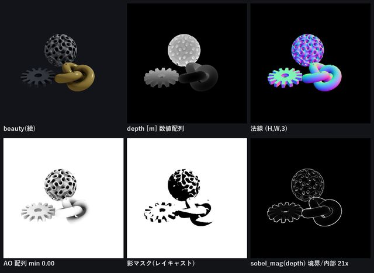
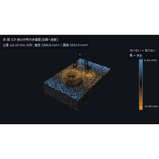
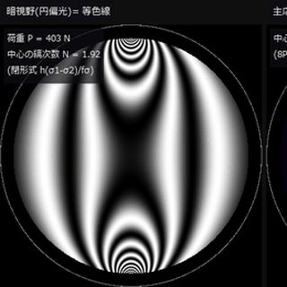
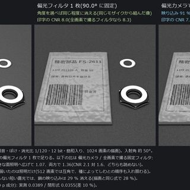
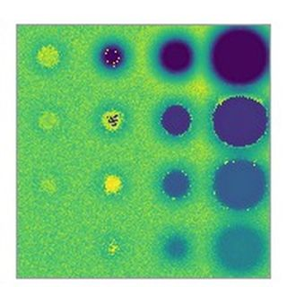
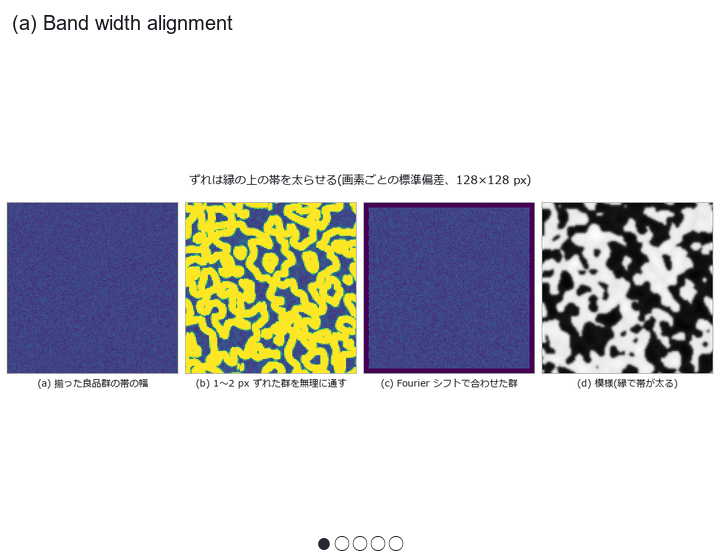
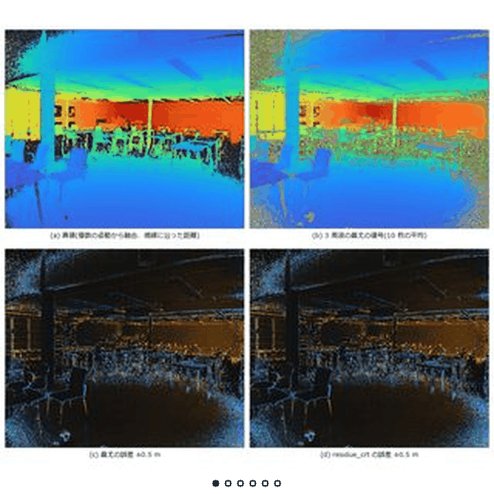
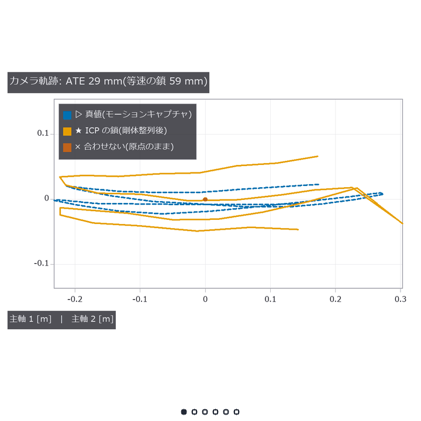
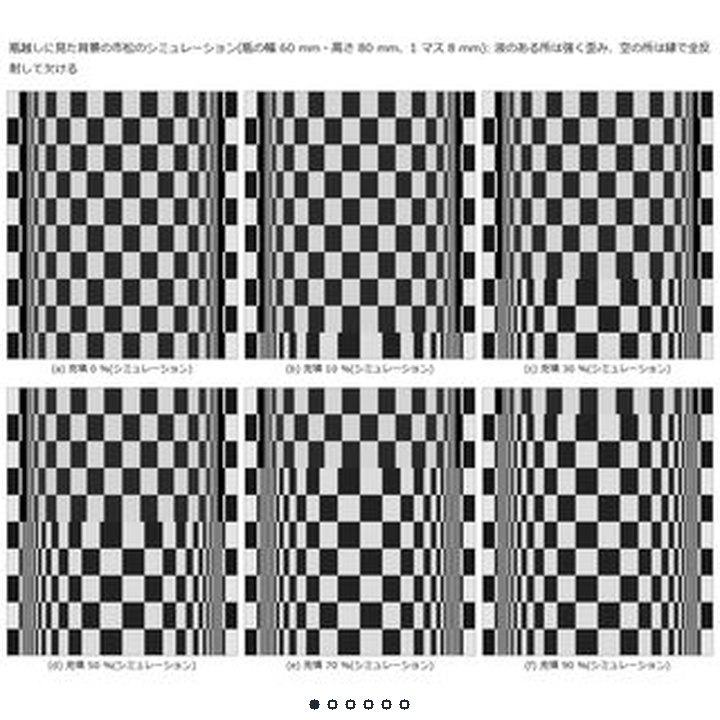

<div class="vlang" markdown="1">

[日本語](../index.md) · [English](../en/index.md) · [简体中文](../zh/index.md) · [繁體中文](../tw/index.md) · [한국어](../ko/index.md) · [Deutsch](../de/index.md) · **हिन्दी** · [Français](../fr/index.md)

</div>

# Fullseye — ViEW2026

**प्रस्तुति: गुरुवार 3 दिसंबर 2026, 14:40–15:50 JST, Interactive Session 2, IS2-19** (Pacifico Yokohama, Annex Hall)

<div class="vintro"><div class="vt"><p>एक foundation जो physics simulation (optical design और 3-D measurement जैसी sensing सहित) और classic image processing को MCP और RAG के ज़रिए AI को देता है, हर task के लिए combination सोचने देता है, और type consistency तथा ground truth evaluation से जाँचते हुए task को interactive तरीके से हल करता है। Open source (Apache-2.0)।</p></div></div>

tile पर tap करने से video या figure खुलता है (▶ = चलता हुआ)।

इस पृष्ठ पर केवल 20 प्रदर्शन हैं। बाकी 295 [अतिरिक्त पृष्ठ](more.md) पर हैं।

<style>
.vlang { font-size: 14px; line-height: 2; }
.vg { display: grid; grid-template-columns: repeat(2, minmax(0, 1fr)); gap: 8px; margin: 12px 0 20px; }
.vg.vs { grid-template-columns: repeat(3, minmax(0, 1fr)); gap: 6px; }
@media (min-width: 600px) { .vg { grid-template-columns: repeat(3, minmax(0, 1fr)); } .vg.vs { grid-template-columns: repeat(5, minmax(0, 1fr)); } }
@media (min-width: 900px) { .vg { grid-template-columns: repeat(4, minmax(0, 1fr)); } .vg.vs { grid-template-columns: repeat(7, minmax(0, 1fr)); } }
.vg a, .vser a { display: block; position: relative; text-decoration: none; color: inherit; }
.vg img { display: block; width: 100%; max-width: 100%; height: auto; aspect-ratio: 1 / 1; object-fit: cover; border-radius: 6px; background: #222; }
.vg picture { display: block; width: 100%; aspect-ratio: 1 / 1; overflow: hidden; border-radius: 6px; background: #fff; }
.vg picture img { height: 100%; aspect-ratio: auto; object-fit: contain; border-radius: 0; background: #fff; }
.vg b { position: absolute; top: 6px; right: 6px; background: rgba(0,0,0,.6); color: #fff; font-size: 12px; padding: 1px 6px; border-radius: 9px; }
.vg span { display: block; font-size: 13px; line-height: 1.3; margin-top: 3px; }
.vg.vs span { font-size: 11px; }
.vser { display: grid; grid-template-columns: repeat(2, minmax(0, 1fr)); gap: 8px; margin: 12px 0 20px; }
@media (min-width: 600px) { .vser { grid-template-columns: repeat(3, minmax(0, 1fr)); } }
.vser img { display: block; width: 100%; max-width: 100%; height: auto; aspect-ratio: 16 / 9; object-fit: cover; border-radius: 8px; background: #222; }
.vser strong { display: block; font-size: 14px; margin-top: 3px; line-height: 1.3; }
.vser span { display: block; font-size: 12px; line-height: 1.3; }
details.vall { margin: 6px 0; }
details.vall > summary { font-size: 15px; padding: 6px 0; cursor: pointer; }
.vl li { margin-bottom: 8px; }
li, p, code { overflow-wrap: anywhere; }
.vintro { display: flex; gap: 20px; align-items: flex-start; margin: 14px 0; }
.vintro img { flex: 0 0 300px; width: 300px; max-width: 100%; height: auto; border-radius: 6px; }
.vintro .vt p { margin: 0 0 8px; }
.vc { display: flex; gap: 16px; align-items: flex-start; margin: 18px 0; }
.vc > a:first-child { flex: 0 0 260px; position: relative; display: block; text-decoration: none; color: inherit; }
.vc > a img { display: block; width: 100%; max-width: 100%; height: auto; aspect-ratio: 1 / 1; object-fit: cover; border-radius: 6px; background: #222; }
.vc > a picture { display: block; width: 100%; aspect-ratio: 1 / 1; overflow: hidden; border-radius: 6px; background: #fff; }
.vc > a picture img { height: 100%; aspect-ratio: auto; object-fit: contain; border-radius: 0; background: #fff; }
.vc > a b { position: absolute; top: 6px; right: 6px; background: rgba(0,0,0,.6); color: #fff; font-size: 12px; padding: 1px 6px; border-radius: 9px; }
.vc > a .vtb { position: absolute; left: 6px; bottom: 6px; max-width: calc(100% - 12px); background: rgba(0,0,0,.66); color: #fff; font-size: 12px; font-style: normal; line-height: 1.4; padding: 1px 7px; border-radius: 9px; }
.vt { flex: 1 1 auto; min-width: 0; }
.vt .vh { font-size: 17px; font-weight: 600; line-height: 1.4; margin: 0 0 6px; }
.vt p { margin: 0 0 6px; }
.vt .vm { font-size: 14px; color: #57606a; }
.vt details { font-size: 14px; margin: 4px 0; }
.vt summary { cursor: pointer; }
.vc.vv { margin: 10px 0; }
.vc.vv > a:first-child { flex-basis: 96px; }
@media (max-width: 600px) {
  .vintro { flex-direction: column-reverse; gap: 8px; }
  .vintro img { flex: 0 0 auto; width: 100%; max-width: 240px; }
  .vc { flex-direction: column; gap: 8px; }
  .vc > a:first-child { flex: 0 0 auto; width: 240px; max-width: 100%; }
  .vc.vv { flex-direction: row; gap: 12px; }
  .vc.vv > a:first-child { width: 80px; flex: 0 0 80px; }
}
</style>

## खुद आज़माएँ

शोध-पत्र के चित्रों को खुद चलाकर देखें (फ़ोन पर भी चलता है)। tab से विधि बदलें और 3-D दृश्य को drag करके घुमाएँ।

<div class="vc vv"><a class="vvi" href="../viewers/poc_cad_scan_deviation.html?lang=hi"></a><div class="vt"><div class="vh"><a href="../viewers/poc_cad_scan_deviation.html?lang=hi">CAD बनाम स्कैन पॉइंट क्लाउड</a></div><p>संरेखण दोष को सोख लेता है: जिस पुर्ज़े का सही मान 1.2 µm है, उसमें 121 µm का ऐसा गड्ढा दिखता है जो है ही नहीं।</p></div></div>

<div class="vc vv"><a class="vvi" href="../viewers/poc_photoelasticity.html?lang=hi"></a><div class="vt"><div class="vh"><a href="../viewers/poc_photoelasticity.html?lang=hi">Photoelasticity</a></div><p>analyser घुमाने पर photoelastic fringes चलते हैं और disc के भीतर औसत तीव्रता बदलती है (0–135° की सीमा में)</p></div></div>

<div class="vc vv"><a class="vvi" href="../viewers/poc_polarization_specular.html?lang=hi"></a><div class="vt"><div class="vh"><a href="../viewers/poc_polarization_specular.html?lang=hi">Polarization</a></div><p>Polarization specular चमक हटा देता है; बचा हिस्सा आपतन कोण के साथ बदलता है और Brewster angle के पास सबसे कम होता है (sweep एक synthetic fringe scene पर)</p></div></div>

<div class="vc vv"><a class="vvi" href="../viewers/poc_thermography_ndt.html?lang=hi"></a><div class="vt"><div class="vh"><a href="../viewers/poc_thermography_ndt.html?lang=hi">पल्स थर्मोग्राफी से गहराई का अनुमान</a></div><p>फ़िट की समय-विंडो को 25 s से 4 s करने भर से 8 छोटे दोषों की गहराई की सबसे बड़ी त्रुटि +612 % से घटकर −14 % रह जाती है। कारण भौतिकी नहीं, विंडो का चुनाव था।</p></div></div>

## मुख्य प्रदर्शन

इस खंड के प्रदर्शनों के शीर्षक और विवरण अंग्रेज़ी में हैं (विवरण केवल जापानी और अंग्रेज़ी में उपलब्ध हैं)।

<div class="vc"><a href="../../articles/assets/poc/poc_phase_measuring_deflectometry/03_photo_vs_pmd.png"><picture><source media="(prefers-reduced-motion: reduce)" srcset="../../articles/assets/poc/poc_phase_measuring_deflectometry/03_photo_vs_pmd.png"></picture><i class="vtb">Ground truth: सिंथेटिक</i></a><div class="vt"><div class="vh"><a href="../../articles/assets/poc/poc_phase_measuring_deflectometry/03_photo_vs_pmd.png">A dent invisible in a diffusely lit photo appears in a fringe mirror image (synthetic)</a></div><p>A very shallow dent in glossy paint barely shows in a photograph under diffuse light. Projecting fringes on a screen facing the surface and reading how their mirror image bends gives curvature, and a planted dent 3 µm deep stands out. This is a synthetic scene, and photographs under oblique light were not compared.</p><p class="vm">Ground truth: सिंथेटिक · <a href="more.md#d-poc-phase-measuring-deflectometry">विवरण</a></p></div></div>

<div class="vc"><a href="../../articles/assets/poc/poc_industrial_oct/01_real_paint_bscans.png"><picture><source media="(prefers-reduced-motion: reduce)" srcset="../../articles/assets/poc/poc_industrial_oct/01_real_paint_bscans.png"></picture><i class="vtb">Ground truth: वास्तविक डेटा</i></a><div class="vt"><div class="vh"><a href="../../articles/assets/poc/poc_industrial_oct/01_real_paint_bscans.png">Paint layer thickness without cutting (industrial OCT)</a></div><p>Paint and film layers are seen in depth without cutting. Clear coats measured from public raw spectra of car paint agree with microscope readings of the same panels within 3.6 µm. Matching the paper's OCT only reproduces the same data, and layers too thin to separate get no value.</p><p class="vm">Ground truth: वास्तविक डेटा · <a href="more.md#d-poc-industrial-oct">विवरण</a></p></div></div>

<div class="vc"><a href="../../articles/assets/poc/poc_hyperspectral_foreign_matter/04_real_pork_belly.png"><picture><source media="(prefers-reduced-motion: reduce)" srcset="../../articles/assets/poc/poc_hyperspectral_foreign_matter/01_real_polymer_flakes.png"></picture><i class="vtb">Ground truth: वास्तविक डेटा</i></a><div class="vt"><div class="vh"><a href="../../articles/assets/poc/poc_hyperspectral_foreign_matter/04_real_pork_belly.png">Finding foreign objects on pork belly with near-infrared spectral imaging</a></div><p>Public real images were used as near-infrared spectral data to classify debris lying on pork belly. Scored per pixel on separate captures, most of it was detected at 1.1 % false alarms. With fewer bands the false alarms grew, and that a colour camera fails on same-coloured matter is shown only on synthetic data.</p><p class="vm">Ground truth: वास्तविक डेटा · <a href="more.md#d-poc-hyperspectral-foreign-matter">विवरण</a></p></div></div>

<div class="vc"><a href="../../articles/assets/poc/poc_thin_film_reflectometry/01_real_micrograph_thickness.png"><picture><source media="(prefers-reduced-motion: reduce)" srcset="../../articles/assets/poc/poc_thin_film_reflectometry/01_real_micrograph_thickness.png"></picture><i class="vtb">Ground truth: वास्तविक डेटा</i></a><div class="vt"><div class="vh"><a href="../../articles/assets/poc/poc_thin_film_reflectometry/01_real_micrograph_thickness.png">Reading oxide thickness from micrograph colours</a></div><p>Oxide thickness on silicon can be read from interference fringes and colours in reflected light. Read per pixel from a real micrograph published by others, the central value was 87.4 nm. That is about a tenth below the reference derived from the paper, and the camera's colour sensitivity is unknown.</p><p class="vm">Ground truth: वास्तविक डेटा · <a href="more.md#d-poc-thin-film-reflectometry">विवरण</a></p></div></div>

<div class="vc"><a href="../../articles/assets/poc/poc_telecentric_metrology/08_real_alignment_plate.png"><picture><source media="(prefers-reduced-motion: reduce)" srcset="../../articles/assets/poc/poc_telecentric_metrology/08_real_alignment_plate.png"></picture><i class="vtb">Ground truth: वास्तविक डेटा</i></a><div class="vt"><div class="vh"><a href="../../articles/assets/poc/poc_telecentric_metrology/08_real_alignment_plate.png">Magnification measured on public telecentric images agrees with the paper within the paper's own spread</a></div><p>In one image, a stepped part looks larger where it is nearer through an ordinary lens. The magnification measured on public real images from a telecentric lens agrees with the paper, whose own values spread by ±0.25 %, so the match is not read as finer. Ring centres on a tilted plate that do not drift are evidence.</p><p class="vm">Ground truth: वास्तविक डेटा · <a href="more.md#d-poc-telecentric-metrology">विवरण</a></p></div></div>

<div class="vc"><a href="../../articles/assets/poc/poc_virtual_sem_kv_cd_bse/05_sem_same_part_3kv_3detectors.png"><picture><source media="(prefers-reduced-motion: reduce)" srcset="../../articles/assets/poc/poc_virtual_sem_kv_cd_bse/05_sem_same_part_3kv_3detectors.png"></picture><i class="vtb">Ground truth: प्रकाशित मान</i></a><div class="vt"><div class="vh"><a href="../../articles/assets/poc/poc_virtual_sem_kv_cd_bse/05_sem_same_part_3kv_3detectors.png">Virtual SEM: the image changes with voltage (model scored against measured backscatter)</a></div><p>An SEM image is not a photo of the surface but a tally of electrons escaping after scattering in the solid. A model that tracks each electron was checked against measured backscatter data for 7 elements. With no real images of known linewidth, the shift of the linewidth reading with beam energy stays inside the model.</p><p class="vm">Ground truth: प्रकाशित मान · <a href="more.md#d-poc-virtual-sem-kv-cd-bse">विवरण</a></p></div></div>

<div class="vc"><a href="../../articles/assets/poc/poc_cad_scan_deviation/14_align_orbit.gif"><picture><source media="(prefers-reduced-motion: reduce)" srcset="../../articles/assets/poc/poc_cad_scan_deviation/01_scene.png"></picture><b>&#9654;</b><i class="vtb">Ground truth: सिंथेटिक</i></a><div class="vt"><div class="vh"><a href="../../articles/assets/poc/poc_cad_scan_deviation/14_align_orbit.gif">The alignment decides where a part looks out of tolerance: CAD versus scan (synthetic)</a></div><p>Aligning a scan to its design absorbs part of the deviation and moves where it looks out of tolerance. On a part with a known warp, a reading 121 µm deep appears at the centre where the true deviation is tiny. This is synthetic, and a point-sampled design shows out-of-tolerance edges even without a defect.</p><p class="vm">Ground truth: सिंथेटिक · <a href="more.md#d-poc-cad-scan-deviation">विवरण</a></p></div></div>

<div class="vc"><a href="../../articles/assets/poc/poc_good_sample_variation_model/04_visa_explanation.png"><picture><source media="(prefers-reduced-motion: reduce)" srcset="../../articles/assets/poc/poc_good_sample_variation_model/01_band_width_alignment.png"></picture><i class="vtb">Ground truth: वास्तविक डेटा</i></a><div class="vt"><div class="vh"><a href="../../articles/assets/poc/poc_good_sample_variation_model/04_visa_explanation.png">Flagging defects from good-part variation: the declared false-alarm rate fails on real images</a></div><p>A classic inspection learns the usual per-pixel variation from good parts and flags what falls outside. Here the band is set by a false-alarm rate declared in advance and scored on 200 public real images. Alignment mattered more than the number of good parts, and the declared rate was not kept.</p><p class="vm">Ground truth: वास्तविक डेटा · <a href="more.md#d-poc-good-sample-variation-model">विवरण</a></p></div></div>

<div class="vc"><a href="../../articles/assets/poc/poc_itof_multifreq/12_public_raw_unwrap.png"><picture><source media="(prefers-reduced-motion: reduce)" srcset="../../articles/assets/poc/poc_itof_multifreq/01_warehouse_unwrap.png"></picture><i class="vtb">Ground truth: सिंथेटिक</i></a><div class="vt"><div class="vh"><a href="../../articles/assets/poc/poc_itof_multifreq/12_public_raw_unwrap.png">Where indirect ToF depth breaks (synthetic)</a></div><p>An indirect ToF camera measures distance from the phase delay of modulated light. On synthetic signals, combining three frequencies keeps the distance unambiguous out to 18.7 m. Multipath and object edges make the distance jump without any warning.</p><p class="vm">Ground truth: सिंथेटिक · <a href="more.md#d-poc-itof-multifreq">विवरण</a></p></div></div>

<div class="vc"><a href="../../articles/assets/poc/poc_ai_built_inspection_scored/01_crack_real.png"><picture><source media="(prefers-reduced-motion: reduce)" srcset="../../articles/assets/poc/poc_ai_built_inspection_scored/01_crack_real.png"></picture><i class="vtb">Ground truth: वास्तविक डेटा</i></a><div class="vt"><div class="vh"><a href="../../articles/assets/poc/poc_ai_built_inspection_scored/01_crack_real.png">An AI assembles inspections, scored on public real data (local LLMs: cracks in 5 of 60 runs, candles in none)</a></div><p>A local LLM got a task in natural language and assembled inspection recipes through MCP alone. Scored per image on 400 public crack images with their source labels, very few of its runs sorted them, and none managed the candle stains. Cloud LLM runs had unmatched conditions, and none reached the existing recipes.</p><p class="vm">Ground truth: वास्तविक डेटा · <a href="more.md#d-poc-ai-built-inspection-scored">विवरण</a></p></div></div>

<div class="vc"><a href="../../articles/assets/poc/poc_real_tum_rgbd_slam/02_trajectory.png"><picture><source media="(prefers-reduced-motion: reduce)" srcset="../../articles/assets/poc/poc_real_tum_rgbd_slam/02_trajectory.png"></picture><i class="vtb">Ground truth: वास्तविक डेटा</i></a><div class="vt"><div class="vh"><a href="../../articles/assets/poc/poc_real_tum_rgbd_slam/02_trajectory.png">Scoring frame-to-frame alignment on public RGB-D data: error 0.45-0.82 times a constant-velocity guess, depending on the outlier trimming each split selects (one 32-frame sequence)</a></div><p>On one public desk depth sequence, frame-to-frame alignment was checked against motion-capture truth. Error fell to 0.42 of no alignment on one split, but the gain over a steady-speed guess hinged on outlier trimming and the split. Plane residuals in small windows grew with distance, but no square law was confirmed.</p><p class="vm">Ground truth: वास्तविक डेटा · <a href="more.md#d-poc-real-tum-rgbd-slam">विवरण</a></p></div></div>

<div class="vc"><a href="../../articles/assets/poc/poc_real_walnut_cbct/07_geometry_mistakes.png"><picture><source media="(prefers-reduced-motion: reduce)" srcset="../../articles/assets/poc/poc_real_walnut_cbct/07_geometry_mistakes.png"></picture><i class="vtb">Ground truth: वास्तविक डेटा</i></a><div class="vt"><div class="vh"><a href="../../articles/assets/poc/poc_real_walnut_cbct/07_geometry_mistakes.png">Measured CT: ignoring the vertical offset reconstructs a different slice, and only an outside reference reveals it</a></div><p>A walnut was really scanned in a cone beam and reconstructed with FDK and iterative methods. With 300 projections scored against the authors' reference, neglecting the vertical shift rebuilds a different slice, further away. Those data are self-consistent, so the residual after reprojecting cannot change.</p><p class="vm">Ground truth: वास्तविक डेटा · <a href="more.md#d-poc-real-walnut-cbct">विवरण</a></p></div></div>

<div class="vc"><a href="../../articles/assets/poc/poc_3d_sensor_modalities/01_map.png"><picture><source media="(prefers-reduced-motion: reduce)" srcset="../../articles/assets/poc/poc_3d_sensor_modalities/01_map.png"></picture><i class="vtb">Ground truth: सिंथेटिक</i></a><div class="vt"><div class="vh"><a href="../../articles/assets/poc/poc_3d_sensor_modalities/01_map.png">Simulating five 3-D sensing methods on one part: where each breaks, by material</a></div><p>In this simulation, models of several depth-sensing methods measure one part in matte, glossy metal, translucent and black materials. Shape errors were counted with a common 0.1 mm yardstick and compared with the dimension table. Their resolutions differ by orders of magnitude, so read where each breaks, not a ranking.</p><p class="vm">Ground truth: सिंथेटिक · <a href="more.md#d-poc-3d-sensor-modalities">विवरण</a></p></div></div>

<div class="vc"><a href="../../articles/assets/poc/poc_bottle_pattern_inverse/01_checker_through_bottle.png"><picture><source media="(prefers-reduced-motion: reduce)" srcset="../../articles/assets/poc/poc_bottle_pattern_inverse/01_checker_through_bottle.png"></picture><i class="vtb">Ground truth: सिंथेटिक</i></a><div class="vt"><div class="vh"><a href="../../articles/assets/poc/poc_bottle_pattern_inverse/01_checker_through_bottle.png">Reading a glass bottle back from background stripes (simulation): recovery under shared assumptions, and what cannot be separated</a></div><p>A transparent bottle distorts the stripes behind it. For each pixel we find where the background is seen, fit the bottle geometry and indices backwards, and score 5 fill states against the true values of the simulation. Quantities that are inseparable are reported too, and nothing was checked on a real bottle.</p><p class="vm">Ground truth: सिंथेटिक · <a href="more.md#d-poc-bottle-pattern-inverse">विवरण</a></p></div></div>

## चुने हुए प्रदर्शन

इस खंड के प्रदर्शनों के शीर्षक और विवरण अंग्रेज़ी में हैं (विवरण केवल जापानी और अंग्रेज़ी में उपलब्ध हैं)।

<div class="vc"><a href="../../articles/assets/poc/poc_equipment_selection_map/02_equipment_at_a_glance.png"><picture><source media="(prefers-reduced-motion: reduce)" srcset="../../articles/assets/poc/poc_equipment_selection_map/02_equipment_at_a_glance.png"></picture><i class="vtb">Ground truth: सिंथेटिक</i></a><div class="vt"><div class="vh"><a href="../../articles/assets/poc/poc_equipment_selection_map/02_equipment_at_a_glance.png">Equipment map: the same flaws through 60 light, camera and lens sets (synthetic test)</a></div><p>We pre-tested visual inspection equipment on the same flaw. With 60 combinations of lighting, cameras and lenses we mapped how small a flaw is found, with the spread across repeats. It is a synthetic test, not the performance of real equipment.</p><p class="vm">Ground truth: सिंथेटिक · <a href="more.md#d-poc-equipment-selection-map">विवरण</a></p></div></div>

<div class="vc"><a href="../../articles/assets/poc/poc_real_stereo_multiscanline/02_failure_map.png"><picture><source media="(prefers-reduced-motion: reduce)" srcset="../../articles/assets/poc/poc_real_stereo_multiscanline/02_failure_map.png"></picture><i class="vtb">Ground truth: वास्तविक डेटा</i></a><div class="vt"><div class="vh"><a href="../../articles/assets/poc/poc_real_stereo_multiscanline/02_failure_map.png">Disparity, surface and circle pose from real stereo</a></div><p>Using a real pair of stereo images, we compute disparity, distance, surfaces and even the pose of a circle. The result is scored with the true disparity that Middlebury 2014 supplies and compared with OpenCV. On pixels valid in both, the two are about equal, and most of the gap is which pixels each invalidates.</p><p class="vm">Ground truth: वास्तविक डेटा · <a href="more.md#d-poc-real-stereo-multiscanline">विवरण</a></p></div></div>

<div class="vc"><a href="../../articles/assets/poc/poc_real_defect_floor/03_defect_floor_explained.mp4"><b>&#9654;</b><i class="vtb">Ground truth: वास्तविक पृष्ठभूमि</i></a><div class="vt"><div class="vh"><a href="../../articles/assets/poc/poc_real_defect_floor/03_defect_floor_explained.mp4">Matched noise, yet the detection limit for weak flaws is 2.03-3.47 times worse on real backgrounds</a></div><p>Inspection teams often estimate how weak a flaw they can catch on a synthetic image of a flat field plus noise. With matched noise, every real background raised the detection limit to at least 2.03 times the synthetic one. The limit was set not by noise but by structure in the background, such as mortar joints.</p><p class="vm">Ground truth: वास्तविक पृष्ठभूमि · <a href="more.md#d-poc-real-defect-floor">विवरण</a></p></div></div>

<div class="vc"><a href="../../articles/assets/poc/poc_sam_hybrid_bonding_voids/03_amplitude_vs_phase.png"><picture><source media="(prefers-reduced-motion: reduce)" srcset="../../articles/assets/poc/poc_sam_hybrid_bonding_voids/03_amplitude_vs_phase.png"></picture><i class="vtb">Ground truth: सिंथेटिक</i></a><div class="vt"><div class="vh"><a href="../../articles/assets/poc/poc_sam_hybrid_bonding_voids/03_amplitude_vs_phase.png">Finding bond-plane voids by ultrasonic echo phase (simulation)</a></div><p>This simulation searches for small voids in the bonding plane of stacked chips with a scanning acoustic microscope. The voids of 16 um or more appeared inverted and bright in the echo-phase image. In the brightness image many small voids hide among good pixels.</p><p class="vm">Ground truth: सिंथेटिक · <a href="more.md#d-poc-sam-hybrid-bonding-voids">विवरण</a></p></div></div>

<div class="vc"><a href="../../articles/assets/poc/poc_photoelasticity/03_load_and_isoclinics.mp4"><picture><source media="(prefers-reduced-motion: reduce)" srcset="../../articles/assets/poc/poc_photoelasticity/01_polariscope.png"></picture><b>&#9654;</b><i class="vtb">Ground truth: सिंथेटिक</i></a><div class="vt"><div class="vh"><a href="../../articles/assets/poc/poc_photoelasticity/03_load_and_isoclinics.mp4">Stress in a squeezed disc shows as fringes (photoelasticity, synthetic)</a></div><p>Viewed through polarisers, a loaded transparent plastic shows its internal stress as fringes. Stress in a squeezed disc was recovered from polarisation images, even where the fringe order exceeds 0.5 and the phase wraps. Most errors after unwrapping fall on a long-known sign flip, not the wrapping.</p><p class="vm">Ground truth: सिंथेटिक · <a href="more.md#d-poc-photoelasticity">विवरण</a></p></div></div>

<div class="vc"><a href="../../articles/assets/poc/poc_mixed_case_depalletizing/08_depal_robot_video.mp4"><picture><source media="(prefers-reduced-motion: reduce)" srcset="../../articles/assets/poc/poc_mixed_case_depalletizing/01_overview_same_pattern.png"></picture><b>&#9654;</b><i class="vtb">Ground truth: सिंथेटिक</i></a><div class="vt"><div class="vh"><a href="../../articles/assets/poc/poc_mixed_case_depalletizing/08_depal_robot_video.mp4">Mixed cartons: depth step, V-groove or colour groove (simulation)</a></div><p>In simulated scenes, look-alike cartons are told apart from overhead depth and colour, then unloaded. A depth step splits none, and whether depth dips or dark colour lines win flips across 28 flap-seam builds. With identical prints, deep grooves favour colour; only wide, untaped cuts over shallow grooves favour depth.</p><p class="vm">Ground truth: सिंथेटिक · <a href="more.md#d-poc-mixed-case-depalletizing">विवरण</a></p></div></div>

## Article series (Qiita पर English articles)

<div class="vser">
<a href="https://qiita.com/furuse-kazufumi/items/8a8f23e53b19ee8cdc10"><strong>कागज़ पर Metrology Museum</strong><span>खुद रखे ground truth वाले PoCs</span></a>
<a href="https://qiita.com/furuse-kazufumi/items/a82bf9f341cc4f04ca75"><strong>Table tennis</strong><span>video से bounce और friction</span></a>
<a href="https://qiita.com/furuse-kazufumi/items/05de90f4d316cd7c681c"><strong>Autonomous driving</strong><span>theorems और second implementations से scoring</span></a>
<a href="https://qiita.com/furuse-kazufumi/items/638f0b0aa7865e17c67c"><strong>Connectome (brain wiring)</strong><span>मक्खी का visual model शरीर पर, मापा गया</span></a>
<a href="https://qiita.com/furuse-kazufumi/items/569720dbae0c6471c96e"><strong>Humanoid sports day</strong><span>घर का sports day, जिसमें referee image processing है</span></a>
</div>

[अतिरिक्त पृष्ठ: और PoC](more.md) भी देखें।

<details markdown="1">
<summary><b>आज़माएँ</b> (Python 3.11)</summary>

```
pip install fullseye
git clone https://github.com/furuse-kazufumi/fullseye
cd fullseye
python examples/poc_focus_stacking.py
```

focus stacking PoC लगभग 20 सेकंड में चलता है और ground truth के सापेक्ष संख्याएँ तथा `PASS` print करता है। figures `out/figures/poc_focus_stacking/` में लिखे जाते हैं।

</details>

<details markdown="1">
<summary><b>Links</b></summary>

- [GitHub (source code)](https://github.com/furuse-kazufumi/fullseye)
- [Gallery (सभी figures)](../../GALLERY.en.md)
- [operators खोजें / AI (RAG) से उपयोग करें](../../AI_RAG_GUIDE.hi.md) · [MCP से उपयोग करें](../../MCP.md) _(ja)_
- [Documentation index](../../README.en.md)

</details>

<details markdown="1">
<summary><b>Paper</b></summary>

- **शीर्षक**: Fullseye：型付き演算子と物理シミュレーションに基づく画像検査・三次元計測基盤 _(ja)_ (typed operators और physics simulation पर आधारित image inspection और 3-D measurement foundation)
- **लेखक**: Kazufumi Furuse (स्वतंत्र शोधकर्ता)
- **प्रस्तुति**: ViEW2026, Workshop on Practical Use of Vision Technology
- **Paper PDF**: [English](../paper/101_en.pdf) · [简体中文](../paper/101_zh.pdf)(日本語: 2026-11-26 से उपलब्ध)

**सार (जापानी से अनुवाद)**: हम Fullseye प्रस्तुत करते हैं: एक open-source foundation जो image inspection और 3-D measurement processing को घोषित input/output data types वाले operators की chain के रूप में बनाता है, physics और imaging simulation से बने ground truth के सापेक्ष उसका quantitative evaluation करता है, और processing procedure, evaluation तथा failure conditions को दोबारा उपयोग के लिए दर्ज करता है। इसमें लगभग 3,000 typed operators, execution से पहले type mismatch को अस्वीकार करने वाला check, multilingual operator search (RAG), और ground truth वाले 200 से अधिक proof-of-concept programs हैं। हम प्रतिनिधि उदाहरणों का quantitative evaluation और synthetic, measured और real-hardware validation stages के अंतर पर रिपोर्ट करते हैं।

</details>
