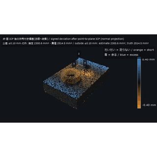
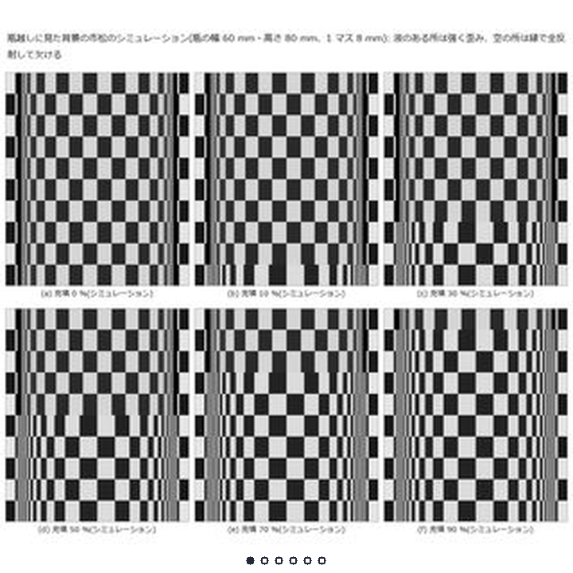
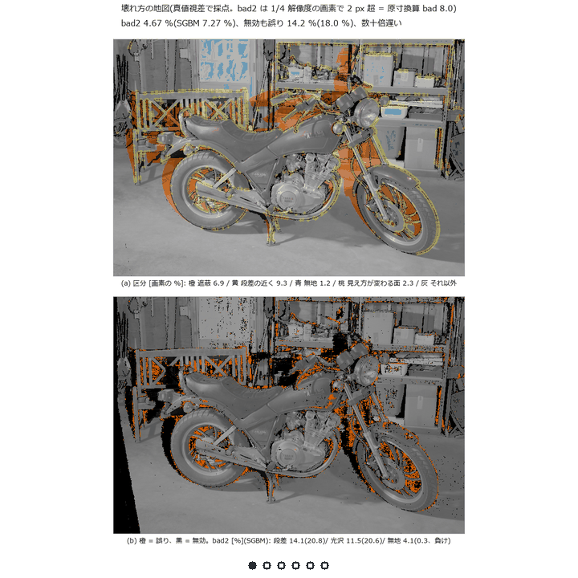
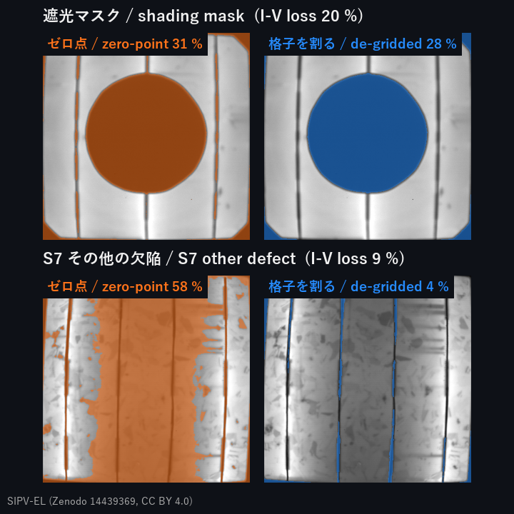
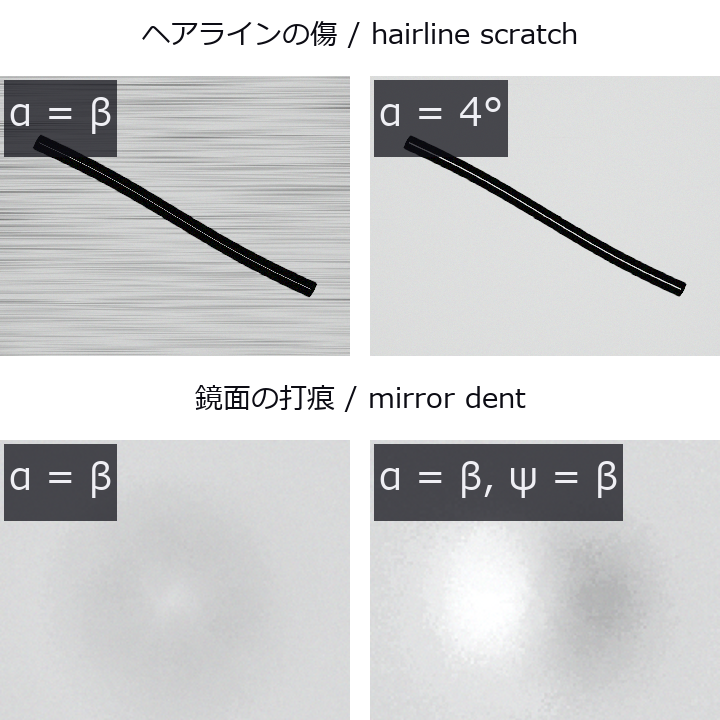
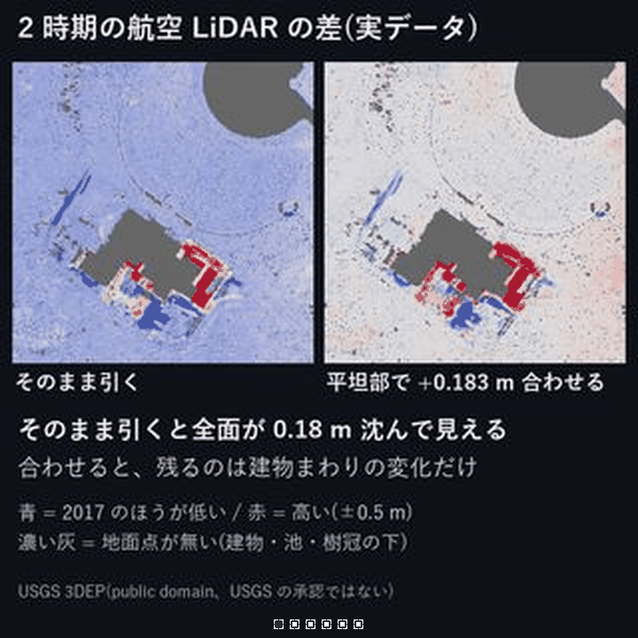
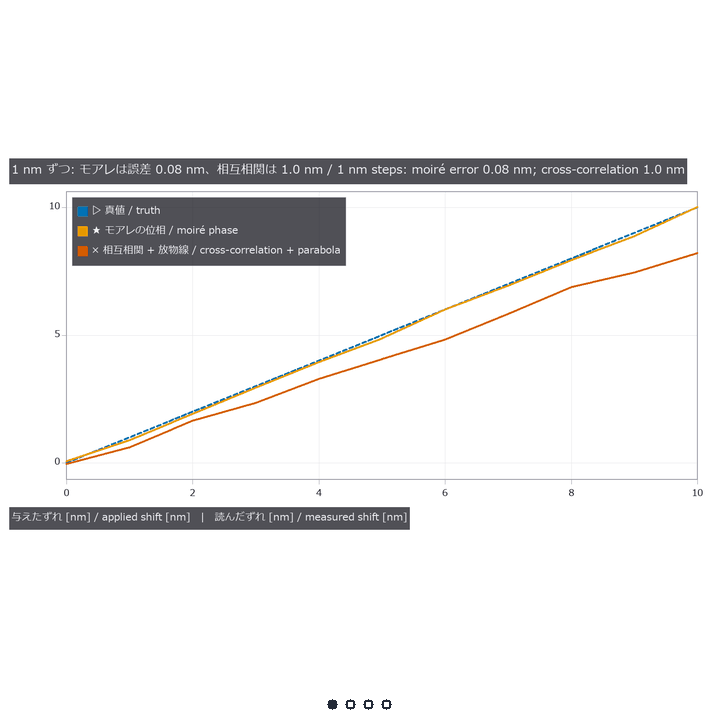
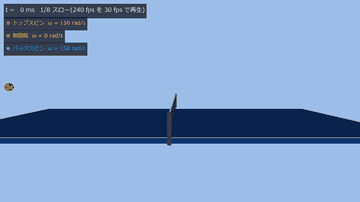
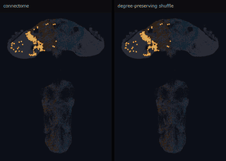
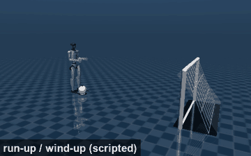

<div class="vlang" markdown="1">

[日本語](../index.md) · [English](../en/index.md) · [简体中文](../zh/index.md) · [繁體中文](../tw/index.md) · [한국어](../ko/index.md) · [Deutsch](../de/index.md) · **हिन्दी** · [Français](../fr/index.md)

</div>

# Fullseye — ViEW2026

**प्रस्तुति: गुरुवार 3 दिसंबर 2026, 14:40–15:50 JST, Interactive Session 2, IS2-19** (Pacifico Yokohama, Annex Hall)

<div class="vintro"><div class="vt"><p>Fullseye image inspection, 3-D measurement और physics simulation का foundation है। यह typed classic image-processing operators और physics simulation (optical design जैसी sensing सहित) को MCP और RAG के ज़रिए AI को देता है, हर task के लिए combination सोचने देता है, और type consistency तथा physics और imaging simulation से बने ground truth के evaluation से जाँचते हुए task को interactive तरीके से हल करता है। Open source (Apache-2.0)।</p></div></div>

tile पर tap करने से video या figure खुलता है (▶ = चलता हुआ)।

इस पृष्ठ पर केवल 30 प्रदर्शन हैं। बाकी 285 [अतिरिक्त पृष्ठ](more.md) पर हैं।

<style>
.vlang { font-size: 14px; line-height: 2; }
.vg { display: grid; grid-template-columns: repeat(2, minmax(0, 1fr)); gap: 8px; margin: 12px 0 20px; }
.vg.vs { grid-template-columns: repeat(3, minmax(0, 1fr)); gap: 6px; }
@media (min-width: 600px) { .vg { grid-template-columns: repeat(3, minmax(0, 1fr)); } .vg.vs { grid-template-columns: repeat(5, minmax(0, 1fr)); } }
@media (min-width: 900px) { .vg { grid-template-columns: repeat(4, minmax(0, 1fr)); } .vg.vs { grid-template-columns: repeat(7, minmax(0, 1fr)); } }
.vg a, .vser a { display: block; position: relative; text-decoration: none; color: inherit; }
.vg img { display: block; width: 100%; max-width: 100%; height: auto; aspect-ratio: 1 / 1; object-fit: cover; border-radius: 6px; background: #222; }
.vg picture { display: block; width: 100%; aspect-ratio: 1 / 1; overflow: hidden; border-radius: 6px; background: #fff; }
.vg picture img { height: 100%; aspect-ratio: auto; object-fit: contain; border-radius: 0; background: #fff; }
.vg b { position: absolute; top: 6px; right: 6px; background: rgba(0,0,0,.6); color: #fff; font-size: 12px; padding: 1px 6px; border-radius: 9px; }
.vg span { display: block; font-size: 13px; line-height: 1.3; margin-top: 3px; }
.vg.vs span { font-size: 11px; }
.vser { display: grid; grid-template-columns: repeat(2, minmax(0, 1fr)); gap: 8px; margin: 12px 0 20px; }
@media (min-width: 600px) { .vser { grid-template-columns: repeat(3, minmax(0, 1fr)); } }
.vser img { display: block; width: 100%; max-width: 100%; height: auto; aspect-ratio: 16 / 9; object-fit: cover; border-radius: 8px; background: #222; }
.vser strong { display: block; font-size: 14px; margin-top: 3px; line-height: 1.3; }
.vser span { display: block; font-size: 12px; line-height: 1.3; }
details.vall { margin: 6px 0; }
details.vall > summary { font-size: 15px; padding: 6px 0; cursor: pointer; }
.vl li { margin-bottom: 8px; }
li, p, code { overflow-wrap: anywhere; }
.vintro { display: flex; gap: 20px; align-items: flex-start; margin: 14px 0; }
.vintro img { flex: 0 0 300px; width: 300px; max-width: 100%; height: auto; border-radius: 6px; }
.vintro .vt p { margin: 0 0 8px; }
.vc { display: flex; gap: 16px; align-items: flex-start; margin: 18px 0; }
.vc > a:first-child { flex: 0 0 260px; position: relative; display: block; text-decoration: none; color: inherit; }
.vc > a img { display: block; width: 100%; max-width: 100%; height: auto; aspect-ratio: 1 / 1; object-fit: cover; border-radius: 6px; background: #222; }
.vc > a picture { display: block; width: 100%; aspect-ratio: 1 / 1; overflow: hidden; border-radius: 6px; background: #fff; }
.vc > a picture img { height: 100%; aspect-ratio: auto; object-fit: contain; border-radius: 0; background: #fff; }
.vc > a b { position: absolute; top: 6px; right: 6px; background: rgba(0,0,0,.6); color: #fff; font-size: 12px; padding: 1px 6px; border-radius: 9px; }
.vc > a .vtb { position: absolute; left: 6px; bottom: 6px; max-width: calc(100% - 12px); background: rgba(0,0,0,.66); color: #fff; font-size: 12px; font-style: normal; line-height: 1.4; padding: 1px 7px; border-radius: 9px; }
.vt { flex: 1 1 auto; min-width: 0; }
.vt .vh { font-size: 17px; font-weight: 600; line-height: 1.4; margin: 0 0 6px; }
.vt p { margin: 0 0 6px; }
.vt .vm { font-size: 14px; color: #57606a; }
.vt details { font-size: 14px; margin: 4px 0; }
.vt summary { cursor: pointer; }
.vc.vv { margin: 10px 0; }
.vc.vv > a:first-child { flex-basis: 96px; }
@media (max-width: 600px) {
  .vintro { flex-direction: column-reverse; gap: 8px; }
  .vintro img { flex: 0 0 auto; width: 100%; max-width: 240px; }
  .vc { flex-direction: column; gap: 8px; }
  .vc > a:first-child { flex: 0 0 auto; width: 240px; max-width: 100%; }
  .vc.vv { flex-direction: row; gap: 12px; }
  .vc.vv > a:first-child { width: 80px; flex: 0 0 80px; }
}
</style>

## खुद आज़माएँ

शोध-पत्र के चित्रों को खुद चलाकर देखें (फ़ोन पर भी चलता है)। tab से विधि बदलें और 3-D दृश्य को drag करके घुमाएँ।

<div class="vc vv"><a class="vvi" href="../viewers/poc_cad_scan_deviation.html?lang=hi"></a><div class="vt"><div class="vh"><a href="../viewers/poc_cad_scan_deviation.html?lang=hi">CAD बनाम स्कैन पॉइंट क्लाउड</a></div><p>संरेखण दोष को सोख लेता है: जिस पुर्ज़े का सही मान 1.2 µm है, उसमें 121 µm का ऐसा गड्ढा दिखता है जो है ही नहीं।</p></div></div>

<div class="vc vv"><a class="vvi" href="../viewers/poc_photoelasticity.html?lang=hi"></a><div class="vt"><div class="vh"><a href="../viewers/poc_photoelasticity.html?lang=hi">Photoelasticity</a></div><p>analyser घुमाने पर photoelastic fringes चलते हैं और disc के भीतर औसत तीव्रता बदलती है (0–135° की सीमा में)</p></div></div>

<div class="vc vv"><a class="vvi" href="../viewers/poc_polarization_specular.html?lang=hi"></a><div class="vt"><div class="vh"><a href="../viewers/poc_polarization_specular.html?lang=hi">Polarization</a></div><p>Polarization specular चमक हटा देता है; बचा हिस्सा आपतन कोण के साथ बदलता है और Brewster angle के पास सबसे कम होता है (sweep एक synthetic fringe scene पर)</p></div></div>

## मुख्य प्रदर्शन

<div class="vc"><a href="../../articles/assets/poc/poc_industrial_oct/01_real_paint_bscans.png"><picture><source media="(prefers-reduced-motion: reduce)" srcset="../../articles/assets/poc/poc_industrial_oct/01_real_paint_bscans.png"></picture><i class="vtb">Ground truth: वास्तविक डेटा</i></a><div class="vt"><div class="vh"><a href="../../articles/assets/poc/poc_industrial_oct/01_real_paint_bscans.png">बिना काटे paint layer की मोटाई (industrial OCT)</a></div><p>paint और film की परतों को बिना काटे गहराई में देखा जाता है। कार paint के सार्वजनिक raw spectra से मापी गई clear coat की मोटाई उसी panel की microscope reading से 3.6 µm के भीतर मेल खाती है। paper के OCT से मेल केवल उसी data को दोहराता है, और अलग न की जा सकने वाली पतली परतों के लिए कोई मान नहीं दिया जाता।</p><p class="vm">Ground truth: वास्तविक डेटा · <a href="more.md#d-poc-industrial-oct">विवरण</a></p></div></div>

<div class="vc"><a href="../../articles/assets/poc/poc_phase_measuring_deflectometry/03_photo_vs_pmd.png"><picture><source media="(prefers-reduced-motion: reduce)" srcset="../../articles/assets/poc/poc_phase_measuring_deflectometry/03_photo_vs_pmd.png"></picture><i class="vtb">Ground truth: सिंथेटिक</i></a><div class="vt"><div class="vh"><a href="../../articles/assets/poc/poc_phase_measuring_deflectometry/03_photo_vs_pmd.png">diffuse रोशनी वाली तस्वीर में अदृश्य dent fringe के mirror image में दिखता है (सिंथेटिक)</a></div><p>चमकीले paint में बहुत उथला dent diffuse रोशनी की तस्वीर में लगभग नहीं दिखता। सतह की ओर रखी screen पर fringes डालकर उनके mirror image का मुड़ना पढ़ने से curvature मिलता है और 3 µm गहरा रखा गया dent साफ दिखता है। यह synthetic scene है और तिरछी रोशनी वाली तस्वीरों से तुलना नहीं की गई।</p><p class="vm">Ground truth: सिंथेटिक · <a href="more.md#d-poc-phase-measuring-deflectometry">विवरण</a></p></div></div>

<div class="vc"><a href="../../articles/assets/poc/poc_thin_film_reflectometry/01_real_micrograph_thickness.png"><picture><source media="(prefers-reduced-motion: reduce)" srcset="../../articles/assets/poc/poc_thin_film_reflectometry/01_real_micrograph_thickness.png"></picture><i class="vtb">Ground truth: वास्तविक डेटा</i></a><div class="vt"><div class="vh"><a href="../../articles/assets/poc/poc_thin_film_reflectometry/01_real_micrograph_thickness.png">micrograph के रंगों से oxide की मोटाई पढ़ना</a></div><p>silicon पर oxide की मोटाई reflected light के interference fringes और रंगों से पढ़ी जा सकती है। दूसरों की प्रकाशित वास्तविक micrograph को हर pixel पर पढ़ने से केंद्रीय मान 87.4 nm मिला। यह paper से निकले reference से लगभग दसवाँ हिस्सा कम है और camera की colour sensitivity अज्ञात है।</p><p class="vm">Ground truth: वास्तविक डेटा · <a href="more.md#d-poc-thin-film-reflectometry">विवरण</a></p></div></div>

<div class="vc"><a href="../../articles/assets/poc/poc_registration_basin/06_real_scan_icp.mp4"><picture><source media="(prefers-reduced-motion: reduce)" srcset="../../articles/assets/poc/poc_registration_basin/07_real_scan_still.png"></picture><b>&#9654;</b><i class="vtb">Ground truth: वास्तविक डेटा</i></a><div class="vt"><div class="vh"><a href="../../articles/assets/poc/poc_registration_basin/06_real_scan_icp.mp4">असली depth पर ICP का convergence basin छोटा हो जाता है</a></div><p>एक मापे गए part और synthetic bracket पर जाँचा गया कि registration कितनी दूर से शुरू होकर उसी endpoint पर लौट सकता है। अलग seeds और crossing rules में सफलता all-around points की तुलना में अधिकतम 31.5 degree पहले आधी हुई। endpoint ground truth से हटकर है, इसलिए यह pose accuracy नहीं बल्कि recovery range मापता है।</p><p class="vm">Ground truth: वास्तविक डेटा · <a href="more.md#d-poc-registration-basin">विवरण</a></p></div></div>

<div class="vc"><a href="../../articles/assets/poc/poc_hyperspectral_foreign_matter/04_real_pork_belly.png"><picture><source media="(prefers-reduced-motion: reduce)" srcset="../../articles/assets/poc/poc_hyperspectral_foreign_matter/01_real_polymer_flakes.png"></picture><i class="vtb">Ground truth: वास्तविक डेटा</i></a><div class="vt"><div class="vh"><a href="../../articles/assets/poc/poc_hyperspectral_foreign_matter/04_real_pork_belly.png">near-infrared spectral imaging से pork belly पर बाहरी वस्तुएँ खोजना</a></div><p>सार्वजनिक वास्तविक images को near-infrared spectral data मानकर pork belly पर पड़े मलबे को classify किया गया। अलग captures पर हर pixel का score करने पर अधिकांश मलबा 1.1 % false alarms के साथ मिला। कम bands पर false alarms बढ़े, और समान रंग के पदार्थ पर colour camera की विफलता केवल synthetic data में दिखाई गई।</p><p class="vm">Ground truth: वास्तविक डेटा · <a href="more.md#d-poc-hyperspectral-foreign-matter">विवरण</a></p></div></div>

<div class="vc"><a href="../../articles/assets/poc/poc_cad_scan_deviation/14_align_orbit.gif"><picture><source media="(prefers-reduced-motion: reduce)" srcset="../../articles/assets/poc/poc_cad_scan_deviation/01_scene.png"></picture><b>&#9654;</b><i class="vtb">Ground truth: सिंथेटिक</i></a><div class="vt"><div class="vh"><a href="../../articles/assets/poc/poc_cad_scan_deviation/14_align_orbit.gif">alignment तय करता है कि part कहाँ tolerance से बाहर दिखे: CAD बनाम scan (सिंथेटिक)</a></div><p>scan को design से align करने पर deviation का कुछ भाग समा जाता है और tolerance से बाहर दिखने वाली जगह बदलती है। ज्ञात warp वाले part में उस centre पर 121 µm गहरी reading आती है जहाँ असली deviation बहुत छोटा है। यह synthetic परिणाम है, और point-sampled design बिना defect वाले control में भी edges को tolerance से बाहर दिखाता है।</p><p class="vm">Ground truth: सिंथेटिक · <a href="more.md#d-poc-cad-scan-deviation">विवरण</a></p></div></div>

<div class="vc"><a href="../../articles/assets/poc/poc_fourier_ptychography/01_usaf_4x_fp_20x.png"><picture><source media="(prefers-reduced-motion: reduce)" srcset="../../articles/assets/poc/poc_fourier_ptychography/01_usaf_4x_fp_20x.png"></picture><i class="vtb">Ground truth: सिंथेटिक</i></a><div class="vt"><div class="vh"><a href="../../articles/assets/poc/poc_fourier_ptychography/01_usaf_4x_fp_20x.png">4x objective से coherent रोशनी वाले 20x जितना resolution (Fourier ptychography, सिंथेटिक)</a></div><p>कम power वाला objective बड़ा field देखता है लेकिन बारीक detail छोड़ देता है। synthetic chart पर कई angles से रोशन images को frequency space में जोड़ने पर single-colour parallel light वाले 20x objective के बराबर detail मिली। सामान्य रोशनी में वह objective अब भी अधिक बारीक resolve करता है और illumination overlap बहुत कम हो तो कोई उत्तर नहीं मिलता।</p><p class="vm">Ground truth: सिंथेटिक · <a href="more.md#d-poc-fourier-ptychography">विवरण</a></p></div></div>

<div class="vc"><a href="../../articles/assets/poc/poc_itof_multifreq/12_public_raw_unwrap.png"><picture><source media="(prefers-reduced-motion: reduce)" srcset="../../articles/assets/poc/poc_itof_multifreq/01_warehouse_unwrap.png"></picture><i class="vtb">Ground truth: सिंथेटिक</i></a><div class="vt"><div class="vh"><a href="../../articles/assets/poc/poc_itof_multifreq/12_public_raw_unwrap.png">indirect ToF depth कहाँ विफल होती है (सिंथेटिक)</a></div><p>indirect ToF camera modulated light के phase delay से दूरी मापता है। synthetic signals में तीन frequencies को मिलाने पर दूरी 18.7 m तक स्पष्ट रहती है। multipath और object edges दूरी को बिना चेतावनी के उछाल देते हैं।</p><p class="vm">Ground truth: सिंथेटिक · <a href="more.md#d-poc-itof-multifreq">विवरण</a></p></div></div>

<div class="vc"><a href="../../articles/assets/poc/poc_telecentric_metrology/08_real_alignment_plate.png"><picture><source media="(prefers-reduced-motion: reduce)" srcset="../../articles/assets/poc/poc_telecentric_metrology/08_real_alignment_plate.png"></picture><i class="vtb">Ground truth: वास्तविक डेटा</i></a><div class="vt"><div class="vh"><a href="../../articles/assets/poc/poc_telecentric_metrology/08_real_alignment_plate.png">सार्वजनिक telecentric images पर मापा magnification paper की अपनी spread के भीतर मेल खाता है</a></div><p>एक image में सामान्य lens से stepped part का नज़दीकी हिस्सा बड़ा दिखता है। telecentric lens की सार्वजनिक वास्तविक images पर मापा magnification paper से मेल खाता है, पर paper के अपने मान ±0.25 % फैले हैं, इसलिए मेल को इससे अधिक बारीक नहीं माना जाता। झुकी plate पर ring centres का न खिसकना इसका प्रमाण है।</p><p class="vm">Ground truth: वास्तविक डेटा · <a href="more.md#d-poc-telecentric-metrology">विवरण</a></p></div></div>

<div class="vc"><a href="../../articles/assets/poc/poc_virtual_sem_kv_cd_bse/05_sem_same_part_3kv_3detectors.png"><picture><source media="(prefers-reduced-motion: reduce)" srcset="../../articles/assets/poc/poc_virtual_sem_kv_cd_bse/05_sem_same_part_3kv_3detectors.png"></picture><i class="vtb">Ground truth: प्रकाशित मान</i></a><div class="vt"><div class="vh"><a href="../../articles/assets/poc/poc_virtual_sem_kv_cd_bse/05_sem_same_part_3kv_3detectors.png">Virtual SEM: voltage के साथ image बदलती है (model को measured backscatter से जाँचा गया)</a></div><p>SEM image सतह की photo नहीं, बल्कि solid में scattering के बाद बाहर निकले electrons की गिनती है। हर electron को track करने वाला model 7 elements के measured backscatter data से जाँचा गया। ज्ञात linewidth वाली वास्तविक images न होने से beam energy के साथ linewidth reading का बदलाव model के भीतर ही रहता है।</p><p class="vm">Ground truth: प्रकाशित मान · <a href="more.md#d-poc-virtual-sem-kv-cd-bse">विवरण</a></p></div></div>

<div class="vc"><a href="../../articles/assets/poc/poc_real_tum_rgbd_slam/02_trajectory.png"><picture><source media="(prefers-reduced-motion: reduce)" srcset="../../articles/assets/poc/poc_real_tum_rgbd_slam/02_trajectory.png"></picture><i class="vtb">Ground truth: वास्तविक डेटा</i></a><div class="vt"><div class="vh"><a href="../../articles/assets/poc/poc_real_tum_rgbd_slam/02_trajectory.png">सार्वजनिक RGB-D data पर frame-to-frame alignment का score: हर split की outlier trimming के अनुसार error constant-velocity अनुमान का 0.45-0.82 गुना (एक 32-frame sequence)</a></div><p>एक सार्वजनिक desk depth sequence पर frame-to-frame alignment को motion-capture ground truth से जाँचा गया। error बिना alignment से कम था, लेकिन steady-speed अनुमान पर लाभ outlier trimming और 8 splits में से चुने गए split पर निर्भर था। छोटी windows में plane residuals दूरी के साथ बढ़े, पर square law की पुष्टि नहीं हुई।</p><p class="vm">Ground truth: वास्तविक डेटा · <a href="more.md#d-poc-real-tum-rgbd-slam">विवरण</a></p></div></div>

<div class="vc"><a href="../../articles/assets/poc/poc_good_sample_variation_model/04_visa_explanation.png"><picture><source media="(prefers-reduced-motion: reduce)" srcset="../../articles/assets/poc/poc_good_sample_variation_model/01_band_width_alignment.png"></picture><i class="vtb">Ground truth: वास्तविक डेटा</i></a><div class="vt"><div class="vh"><a href="../../articles/assets/poc/poc_good_sample_variation_model/04_visa_explanation.png">अच्छे parts के variation से defect: असली images पर घोषित false-alarm rate नहीं टिकती</a></div><p>एक पारंपरिक inspection अच्छे parts से सामान्य per-pixel variation सीखता है और बाहर पड़ने वाली जगहों को चिह्नित करता है। यहाँ band को पहले घोषित false-alarm rate से तय कर 200 सार्वजनिक वास्तविक images पर score किया गया। alignment अच्छे parts की संख्या से अधिक महत्वपूर्ण था और घोषित rate कायम नहीं रही।</p><p class="vm">Ground truth: वास्तविक डेटा · <a href="more.md#d-poc-good-sample-variation-model">विवरण</a></p></div></div>

<div class="vc"><a href="../../articles/assets/poc/poc_real_walnut_cbct/07_geometry_mistakes.png"><picture><source media="(prefers-reduced-motion: reduce)" srcset="../../articles/assets/poc/poc_real_walnut_cbct/07_geometry_mistakes.png"></picture><i class="vtb">Ground truth: वास्तविक डेटा</i></a><div class="vt"><div class="vh"><a href="../../articles/assets/poc/poc_real_walnut_cbct/07_geometry_mistakes.png">मापा गया CT: vertical offset को अनदेखा करने पर अलग slice बनती है और केवल बाहरी reference त्रुटि दिखाता है</a></div><p>एक walnut को वास्तव में cone beam से scan कर FDK और iterative methods से reconstruct किया गया। 300 projections को authors के reference से score करने पर vertical shift की अनदेखी अलग और अधिक दूर slice बनाती है। data स्वयं संगत है, इसलिए reprojection के बाद residual बदल नहीं सकता।</p><p class="vm">Ground truth: वास्तविक डेटा · <a href="more.md#d-poc-real-walnut-cbct">विवरण</a></p></div></div>

<div class="vc"><a href="../../articles/assets/poc/poc_bottle_pattern_inverse/01_checker_through_bottle.png"><picture><source media="(prefers-reduced-motion: reduce)" srcset="../../articles/assets/poc/poc_bottle_pattern_inverse/01_checker_through_bottle.png"></picture><i class="vtb">Ground truth: सिंथेटिक</i></a><div class="vt"><div class="vh"><a href="../../articles/assets/poc/poc_bottle_pattern_inverse/01_checker_through_bottle.png">background stripes से glass bottle को उल्टा मापना (simulation): साझा assumptions में recovery और अलग न होने वाली राशियाँ</a></div><p>एक पारदर्शी bottle अपने पीछे की stripes को विकृत करती है। हर pixel के लिए दिखने वाली background position खोजकर bottle geometry और refractive indices को उल्टा fit किया जाता है और simulation की 5 fill states के ground truth से score किया जाता है। अलग न हो सकने वाली राशियाँ भी बताई जाती हैं और वास्तविक bottle पर कुछ नहीं जाँचा गया।</p><p class="vm">Ground truth: सिंथेटिक · <a href="more.md#d-poc-bottle-pattern-inverse">विवरण</a></p></div></div>

<div class="vc"><a href="../../articles/assets/poc/poc_ai_built_inspection_scored/01_crack_real.png"><picture><source media="(prefers-reduced-motion: reduce)" srcset="../../articles/assets/poc/poc_ai_built_inspection_scored/01_crack_real.png"></picture><i class="vtb">Ground truth: वास्तविक डेटा</i></a><div class="vt"><div class="vh"><a href="../../articles/assets/poc/poc_ai_built_inspection_scored/01_crack_real.png">AI inspection बनाता है, सार्वजनिक वास्तविक data पर score (local LLM ने cracks के लिए 60 runs में 5 बार chance से बेहतर inspection बनाया, candle stains के लिए कभी नहीं)</a></div><p>एक local LLM को शब्दों में task दिया गया और उसने केवल MCP से inspection recipes बनाईं, जिन्हें सार्वजनिक वास्तविक images पर score किया गया। cracks पर कुछ ही runs chance से बेहतर रहे और कोई भी one-statistic baseline (AUROC 0.999) तक नहीं पहुँचा। candle stains पर कोई काम नहीं किया और असमान conditions में cloud LLM runs भी मौजूदा recipes से नीचे रहे।</p><p class="vm">Ground truth: वास्तविक डेटा · <a href="more.md#d-poc-ai-built-inspection-scored">विवरण</a></p></div></div>

<div class="vc"><a href="../../articles/assets/poc/poc_3d_sensor_modalities/01_map.png"><picture><source media="(prefers-reduced-motion: reduce)" srcset="../../articles/assets/poc/poc_3d_sensor_modalities/01_map.png"></picture><i class="vtb">Ground truth: सिंथेटिक</i></a><div class="vt"><div class="vh"><a href="../../articles/assets/poc/poc_3d_sensor_modalities/01_map.png">एक part पर पाँच 3-D sensing methods का simulation: material के अनुसार हर method कहाँ विफल होता है</a></div><p>इस simulation में कई depth-sensing methods के models एक ही part को matte, चमकीली metal, translucent और black materials में मापते हैं। shape errors को समान 0.1 mm yardstick से गिनकर dimension table से तुलना की गई। इनकी resolutions कई orders से अलग हैं, इसलिए ranking नहीं बल्कि हर method कहाँ विफल होता है यह देखें।</p><p class="vm">Ground truth: सिंथेटिक · <a href="more.md#d-poc-3d-sensor-modalities">विवरण</a></p></div></div>

## चुने हुए प्रदर्शन

<div class="vc"><a href="../../articles/assets/poc/poc_photoelasticity/03_load_and_isoclinics.mp4"><picture><source media="(prefers-reduced-motion: reduce)" srcset="../../articles/assets/poc/poc_photoelasticity/01_polariscope.png"></picture><b>&#9654;</b><i class="vtb">Ground truth: सिंथेटिक</i></a><div class="vt"><div class="vh"><a href="../../articles/assets/poc/poc_photoelasticity/03_load_and_isoclinics.mp4">दबाई गई disc का stress fringes के रूप में दिखता है (photoelasticity, सिंथेटिक)</a></div><p>polarisers से देखने पर भारित पारदर्शी plastic का अंदरूनी stress fringes के रूप में दिखता है। दबाई गई disc का stress polarisation images से वापस पाया गया, वहाँ भी जहाँ fringe order 0.5 से अधिक होकर phase wrap करता है। unwrapping के बाद अधिकांश errors पुराने ज्ञात sign flip पर हैं, wrapping पर नहीं।</p><p class="vm">Ground truth: सिंथेटिक · <a href="more.md#d-poc-photoelasticity">विवरण</a></p></div></div>

<div class="vc"><a href="../../articles/assets/poc/poc_equipment_selection_map/02_equipment_at_a_glance.png"><picture><source media="(prefers-reduced-motion: reduce)" srcset="../../articles/assets/poc/poc_equipment_selection_map/02_equipment_at_a_glance.png"></picture><i class="vtb">Ground truth: सिंथेटिक</i></a><div class="vt"><div class="vh"><a href="../../articles/assets/poc/poc_equipment_selection_map/02_equipment_at_a_glance.png">equipment map: उसी flaw को 60 light, camera और lens sets से देखना (synthetic test)</a></div><p>हमने उसी flaw पर visual inspection equipment का पहले परीक्षण किया। lighting, cameras और lenses के 60 combinations से हमने repeats की spread सहित यह map किया कि कितना छोटा flaw मिलता है। यह synthetic test है, वास्तविक equipment का performance नहीं।</p><p class="vm">Ground truth: सिंथेटिक · <a href="more.md#d-poc-equipment-selection-map">विवरण</a></p></div></div>

<div class="vc"><a href="../../articles/assets/poc/poc_real_stereo_multiscanline/02_failure_map.png"><picture><source media="(prefers-reduced-motion: reduce)" srcset="../../articles/assets/poc/poc_real_stereo_multiscanline/02_failure_map.png"></picture><i class="vtb">Ground truth: वास्तविक डेटा</i></a><div class="vt"><div class="vh"><a href="../../articles/assets/poc/poc_real_stereo_multiscanline/02_failure_map.png">वास्तविक stereo से disparity, सतह और वृत्त की pose</a></div><p>वास्तविक stereo images की एक जोड़ी से हम disparity, दूरी, surfaces और circle की pose भी निकालते हैं। result को Middlebury 2014 की ground truth disparity से score कर OpenCV से तुलना की गई। दोनों में valid pixels पर वे लगभग बराबर हैं और अधिकांश अंतर इस बात से आता है कि हर method किन pixels को invalid करता है।</p><p class="vm">Ground truth: वास्तविक डेटा · <a href="more.md#d-poc-real-stereo-multiscanline">विवरण</a></p></div></div>

<div class="vc"><a href="../../articles/assets/poc/poc_polarization_specular/09_glare_removed_label.png"><picture><source media="(prefers-reduced-motion: reduce)" srcset="../../articles/assets/poc/poc_polarization_specular/01_raw_polarizer_mosaic.png"></picture><i class="vtb">Ground truth: सिंथेटिक</i></a><div class="vt"><div class="vh"><a href="../../articles/assets/poc/poc_polarization_specular/09_glare_removed_label.png">polarization से film की चमक 90 % हटती है; इस रोशनी में एक fixed filter काफ़ी है (सिंथेटिक)</a></div><p>हर pixel पर polariser वाला camera चमकदार film के पीछे के label को diffuse और glare components में बाँटता है। लगभग 90 % glare हटती है, फिर भी इस रोशनी में fixed polarising filter print को बेहतर पढ़ता है। camera केवल चौड़ी light में बराबरी करता है; scene synthetic है और वास्तविक images से नहीं जाँचा गया।</p><p class="vm">Ground truth: सिंथेटिक · <a href="more.md#d-poc-polarization-specular">विवरण</a></p></div></div>

<div class="vc"><a href="../../articles/assets/poc/poc_solar_el_inspection/10_real_el_overlay.png"><picture><source media="(prefers-reduced-motion: reduce)" srcset="../../articles/assets/poc/poc_solar_el_inspection/15_real_cover.png"></picture><i class="vtb">Ground truth: सार्वजनिक वास्तविक डेटा (सही मान: मापा गया I-V)</i></a><div class="vt"><div class="vh"><a href="../../articles/assets/poc/poc_solar_el_inspection/10_real_el_overlay.png">सोलर सेल की वास्तविक EL छवियाँ: मास्क के अंधेरे क्षेत्र पावर हानि के साथ चलते हैं, पूरे सेल का धुंधलापन नहीं</a></div><p>वास्तविक cells की सार्वजनिक EL images पर dark area की rank की तुलना I-V curves से मिले power loss की rank से हुई। synthetic cells पर सफल grid division ने edge-strip masks भी मिटा दिए और retuned version केवल mean brightness से स्पष्ट रूप से बेहतर नहीं था (rank correlation 0.57)। पूरा cell मंद होने पर कोई area count loss का अनुसरण नहीं करता।</p><p class="vm">Ground truth: सार्वजनिक वास्तविक डेटा (सही मान: मापा गया I-V) · <a href="more.md#d-poc-solar-el-inspection">विवरण</a></p></div></div>

<div class="vc"><a href="../../articles/assets/poc/poc_interferometry_step/09_csi_scan_explained.mp4"><picture><source media="(prefers-reduced-motion: reduce)" srcset="../../articles/assets/poc/poc_interferometry_step/01_surface_interferograms.png"></picture><b>&#9654;</b><i class="vtb">Ground truth: सिंथेटिक</i></a><div class="vt"><div class="vh"><a href="../../articles/assets/poc/poc_interferometry_step/09_csi_scan_explained.mp4">white-light interferometry से nanometre step (सिंथेटिक)</a></div><p>synthetic scans पर उस step को वापस मापा गया जिसे white-light interferometer peak fringe contrast से पढ़ता है। एक measurement का standard deviation कम से कम 10.5 nm है और repeats के mean में बचा bias noise में खो जाता है। scan step बहुत मोटा हो तो noise के बिना भी error रहता है।</p><p class="vm">Ground truth: सिंथेटिक · <a href="more.md#d-poc-interferometry-step">विवरण</a></p></div></div>

<div class="vc"><a href="../../articles/assets/poc/poc_tdi_linescan/11_tdi_1_vs_64_closeup.png"><picture><source media="(prefers-reduced-motion: reduce)" srcset="../../articles/assets/poc/poc_tdi_linescan/01_tdi_stages_defects.png"></picture><i class="vtb">Ground truth: सिंथेटिक</i></a><div class="vt"><div class="vh"><a href="../../articles/assets/poc/poc_tdi_linescan/11_tdi_1_vs_64_closeup.png">dark line पर TDI stages जोड़ने से हल्की खरोंच उभरती है (सिंथेटिक)</a></div><p>चलती film या steel strip की image line sensor से ली जाती है। हल्के flaws वाली synthetic steel strip और सामान्य sensor model पर dark line की exposure के 64 stages जोड़ने के बाद noise में छिपे flaws उभर आए। transport और capture का sync बिगड़ने पर stacked image धुंधली होती है।</p><p class="vm">Ground truth: सिंथेटिक · <a href="more.md#d-poc-tdi-linescan">विवरण</a></p></div></div>

<div class="vc"><a href="../../articles/assets/poc/poc_illumination_cone_vs_na/07_cone_cover.png"><picture><source media="(prefers-reduced-motion: reduce)" srcset="../../articles/assets/poc/poc_illumination_cone_vs_na/07_cone_cover.png"></picture><i class="vtb">Ground truth: सिंथेटिक</i></a><div class="vt"><div class="vh"><a href="../../articles/assets/poc/poc_illumination_cone_vs_na/07_cone_cover.png">रोशनी के cone का खुलाव तय करता है कि dent और scratch दिखें या नहीं (सिंथेटिक)</a></div><p>लगभग mirror जैसी metal पर हर light cone की चौड़ाई और axis उथले dents और hairline scratches को दिखा या छिपा सकती है। uniform cones वाले synthetic setup में 4° cone half-angle ने hairline streaks छिपाकर केवल scratch को dark छोड़ा। यह equipment map के पीछे की physics है, वास्तविक photos से अभी नहीं जाँची गई।</p><p class="vm">Ground truth: सिंथेटिक · <a href="more.md#d-poc-illumination-cone-vs-na">विवरण</a></p></div></div>

<div class="vc"><a href="../../articles/assets/poc/poc_real_defect_floor/03_defect_floor_explained.mp4"><b>&#9654;</b><i class="vtb">Ground truth: वास्तविक पृष्ठभूमि</i></a><div class="vt"><div class="vh"><a href="../../articles/assets/poc/poc_real_defect_floor/03_defect_floor_explained.mp4">noise समान होने पर भी वास्तविक backgrounds में कमजोर flaws की detection limit 2.03-3.47 गुना खराब है</a></div><p>inspection teams अक्सर flat field और noise वाली synthetic image से अनुमान लगाती हैं कि कितना कमजोर flaw पकड़ा जा सकता है। noise समान होने पर भी हर वास्तविक background ने detection limit को synthetic background के कम से कम 2.03 गुना कर दिया। limit noise ने नहीं बल्कि mortar joints जैसी background structure ने तय की।</p><p class="vm">Ground truth: वास्तविक पृष्ठभूमि · <a href="more.md#d-poc-real-defect-floor">विवरण</a></p></div></div>

<div class="vc"><a href="../../articles/assets/poc/poc_mixed_case_depalletizing/08_depal_robot_video.mp4"><picture><source media="(prefers-reduced-motion: reduce)" srcset="../../articles/assets/poc/poc_mixed_case_depalletizing/01_overview_same_pattern.png"></picture><b>&#9654;</b><i class="vtb">Ground truth: सिंथेटिक</i></a><div class="vt"><div class="vh"><a href="../../articles/assets/poc/poc_mixed_case_depalletizing/08_depal_robot_video.mp4">मिले-जुले cartons: depth step, V-groove या colour groove (simulation)</a></div><p>simulated scenes में एक जैसे दिखने वाले cartons को ऊपर से मिले depth और colour से अलग कर उतारा जाता है। depth step किसी को अलग नहीं करता और depth dips या dark colour lines में कौन जीतेगा, यह 28 flap-seam builds में बदलता है। एक जैसे prints में deep grooves colour को लाभ देते हैं; केवल shallow grooves पर wide, untaped cuts depth को लाभ देते हैं।</p><p class="vm">Ground truth: सिंथेटिक · <a href="more.md#d-poc-mixed-case-depalletizing">विवरण</a></p></div></div>

<div class="vc"><a href="../../articles/assets/poc/poc_tem_ctf_thon_rings/17_real_cover.png"><picture><source media="(prefers-reduced-motion: reduce)" srcset="../../articles/assets/poc/poc_tem_ctf_thon_rings/02_thon_rings_four_defoci.png"></picture><i class="vtb">Ground truth: वास्तविक डेटा (संदर्भ: लेखकों का CTFFIND3 अनुमान)</i></a><div class="vt"><div class="vh"><a href="../../articles/assets/poc/poc_tem_ctf_thon_rings/17_real_cover.png">असली TEM images से defocus, लेखकों के मान से 0.21 % के भीतर</a></div><p>transmission electron microscope में defocus बारीक detail के bright और dark संकेत को उलट देता है। सार्वजनिक वास्तविक micrographs से अनुमानित defocus authors के अपने software से 0.21 % के भीतर मिला। materials और semiconductor TEM भी उन्हीं concentric rings से focus पढ़ते हैं, पर केवल सार्वजनिक biological data जाँचा गया।</p><p class="vm">Ground truth: वास्तविक डेटा (संदर्भ: लेखकों का CTFFIND3 अनुमान) · <a href="more.md#d-poc-tem-ctf-thon-rings">विवरण</a></p></div></div>

<div class="vc"><a href="../../articles/assets/poc/poc_sam_hybrid_bonding_voids/03_amplitude_vs_phase.png"><picture><source media="(prefers-reduced-motion: reduce)" srcset="../../articles/assets/poc/poc_sam_hybrid_bonding_voids/03_amplitude_vs_phase.png"></picture><i class="vtb">Ground truth: सिंथेटिक</i></a><div class="vt"><div class="vh"><a href="../../articles/assets/poc/poc_sam_hybrid_bonding_voids/03_amplitude_vs_phase.png">ultrasonic echo phase से bonding-plane voids खोजना (simulation)</a></div><p>यह simulation scanning acoustic microscope से stacked chips के bonding plane में छोटे voids खोजता है। 16 um या बड़े voids echo-phase image में उलटे और bright दिखे। brightness image में कई छोटे voids अच्छे pixels के बीच छिप जाते हैं।</p><p class="vm">Ground truth: सिंथेटिक · <a href="more.md#d-poc-sam-hybrid-bonding-voids">विवरण</a></p></div></div>

<div class="vc"><a href="../../articles/assets/poc/poc_lidar_terrain_change/13_real_dod.png"><picture><source media="(prefers-reduced-motion: reduce)" srcset="../../articles/assets/poc/poc_lidar_terrain_change/15_real_dod_still.png"></picture><i class="vtb">Ground truth: वास्तविक डेटा</i></a><div class="vt"><div class="vh"><a href="../../articles/assets/poc/poc_lidar_terrain_change/13_real_dod.png">दो समय का airborne LiDAR: offset हटाए बिना पूरा क्षेत्र खुदा दिखता है</a></div><p>एक park के दो वर्षों के सार्वजनिक airborne LiDAR को घटाने पर पूरा क्षेत्र धँसा और खुदा हुआ दिखता है। समतल जमीन पर 0.183 m offset align करने से केवल building के आसपास का change बचता है। synthetic slope पर जहाँ change scene के बड़े भाग में है, alignment उसी change को सोख लेता है और volume गिर जाता है।</p><p class="vm">Ground truth: वास्तविक डेटा · <a href="more.md#d-poc-lidar-terrain-change">विवरण</a></p></div></div>

<div class="vc"><a href="../../articles/assets/poc/poc_moire_alignment/09_overlay_cover.png"><picture><source media="(prefers-reduced-motion: reduce)" srcset="../../articles/assets/poc/poc_moire_alignment/09_overlay_cover.png"></picture><i class="vtb">Ground truth: सिंथेटिक</i></a><div class="vt"><div class="vh"><a href="../../articles/assets/poc/poc_moire_alignment/09_overlay_cover.png">दो अदृश्य gratings: moiré fringes से nm का खिसकाव (सिंथेटिक)</a></div><p>lithography में mask और wafer को nanometre precision से overlay करना होता है। camera के लिए बहुत महीन gratings को overlay करने पर fringes बनती हैं और केवल white noise वाले synthetic test ने nanometre steps को 0.08 nm error से पढ़ा। वास्तविक alignment accuracy बहुत मोटी है और mark asymmetry व gap जैसे systematic errors से तय होती है, जिन्हें test में छोड़ा गया है।</p><p class="vm">Ground truth: सिंथेटिक · <a href="more.md#d-poc-moire-alignment">विवरण</a></p></div></div>

## Article series (Qiita पर English articles)

<div class="vser">
<a href="https://qiita.com/furuse-kazufumi/items/8a8f23e53b19ee8cdc10"><strong>कागज़ पर Metrology Museum</strong><span>खुद रखे ground truth वाले PoCs</span></a>
<a href="https://qiita.com/furuse-kazufumi/items/a82bf9f341cc4f04ca75"><strong>Table tennis</strong><span>video से bounce और friction</span></a>
<a href="https://qiita.com/furuse-kazufumi/items/05de90f4d316cd7c681c"><strong>Autonomous driving</strong><span>theorems और second implementations से scoring</span></a>
<a href="https://qiita.com/furuse-kazufumi/items/638f0b0aa7865e17c67c"><strong>Connectome (brain wiring)</strong><span>मक्खी का visual model शरीर पर, मापा गया</span></a>
<a href="https://qiita.com/furuse-kazufumi/items/569720dbae0c6471c96e"><strong>Humanoid sports day</strong><span>घर का sports day, जिसमें referee image processing है</span></a>
</div>

[अतिरिक्त पृष्ठ: और PoC](more.md) भी देखें।

<details markdown="1">
<summary><b>आज़माएँ</b> (Python 3.11)</summary>

```
pip install fullseye
git clone https://github.com/furuse-kazufumi/fullseye
cd fullseye
python examples/poc_focus_stacking.py
```

focus stacking PoC लगभग 20 सेकंड में चलता है और ground truth के सापेक्ष संख्याएँ तथा `PASS` print करता है। figures `out/figures/poc_focus_stacking/` में लिखे जाते हैं।

</details>

<details markdown="1">
<summary><b>Links</b></summary>

- [GitHub (source code)](https://github.com/furuse-kazufumi/fullseye)
- [Gallery (सभी figures)](../../GALLERY.en.md)
- [operators खोजें / AI (RAG) से उपयोग करें](../../AI_RAG_GUIDE.hi.md) · [MCP से उपयोग करें](../../MCP.md) _(ja)_
- [Documentation index](../../README.en.md)

</details>

<details markdown="1">
<summary><b>Paper</b></summary>

- **शीर्षक**: Fullseye：型付き演算子と物理シミュレーションに基づく画像検査・三次元計測基盤 _(ja)_ (typed operators और physics simulation पर आधारित image inspection और 3-D measurement foundation)
- **लेखक**: Kazufumi Furuse (स्वतंत्र शोधकर्ता)
- **प्रस्तुति**: ViEW2026, Workshop on Practical Use of Vision Technology
- **Paper PDF**: [English](../paper/101_en.pdf) · [简体中文](../paper/101_zh.pdf)(日本語: 2026-11-26 से उपलब्ध)

**सार (जापानी से अनुवाद)**: हम Fullseye प्रस्तुत करते हैं: एक open-source foundation जो image inspection और 3-D measurement processing को घोषित input/output data types वाले operators की chain के रूप में बनाता है, physics और imaging simulation से बने ground truth के सापेक्ष उसका quantitative evaluation करता है, और processing procedure, evaluation तथा failure conditions को दोबारा उपयोग के लिए दर्ज करता है। इसमें लगभग 3,000 typed operators, execution से पहले type mismatch को अस्वीकार करने वाला check, multilingual operator search (RAG), और ground truth वाले 200 से अधिक proof-of-concept programs हैं। हम प्रतिनिधि उदाहरणों का quantitative evaluation और synthetic, measured और real-hardware validation stages के अंतर पर रिपोर्ट करते हैं।

</details>
