

[日本語](../more.md) · [English](../en/more.md) · [简体中文](../zh/more.md) · [繁體中文](../tw/more.md) · [한국어](../ko/more.md) · [Deutsch](../de/more.md) · **हिन्दी** · [Français](../fr/more.md)

# अतिरिक्त पृष्ठ: और PoC

इस पृष्ठ पर ऐसे उदाहरण भी हैं जो मुख्य पृष्ठ के प्रदर्शनों जितने परिष्कृत नहीं हैं। हर प्रदर्शन की संख्याएँ उसके PoC के run record से ली गई हैं।

[मुख्य पृष्ठ पर वापस](index.md)

## खुद आज़माएँ (और)

- **[LiDAR भू-भाग परिवर्तन](../viewers/poc_lidar_terrain_change.html?lang=hi)**: सीधा घटाने पर बिना बदला पूरा खंड 0.183 m धँसा हुआ दिखता है। सुधार के बाद केवल असली बदलाव बचता है।
- **[टेम्पलेट ट्रैकिंग](../viewers/poc_template_tracking.html?lang=hi)**: किसी हमशक्ल वस्तु पर चले जाने के बाद भी ट्रैकर “मिल गया” बताता रहता है।
- **[टैल्बट कालीन और ग्रेटिंग एक्स-रे चित्र](../viewers/poc_grating_interferometry.html?lang=hi)**: अवशोषण में दरार का कंट्रास्ट-शोर अनुपात केवल 1.34 है; डार्क फ़ील्ड में वह 13.5 हो जाता है, और ग्रेटिंग घुमाने से रेशे की दिशा तक पढ़ी जा सकती है।
- **[धारियों के प्रतिबिंब में µm गड्ढे](../viewers/poc_phase_measuring_deflectometry.html?lang=hi)**: फ़ोटो में संकेत शोर का केवल 0.17 गुना है और कुछ नहीं दिखता; धारियों के प्रतिबिंब से बने वक्रता के नक्शे में 1 µm गहरा गड्ढा शोर से 57 गुना ऊँचा खड़ा दिखता है।
- **[क्षुद्रग्रह की सतह कितनी मुड़ी है](../viewers/poc_asteroid_curvature.html?lang=hi)**: वास्तविक क्षुद्रग्रह के बिंदुओं से वक्रता निकाली गई है, कटक और चट्टानों के किनारे रंग में दिखते हैं। पैमाने को पहले ऐसे गोले पर जाँचा गया जिसका उत्तर ज्ञात है।
- **[Focus stacking](../viewers/poc_focus_stacking.html?lang=hi)**: एफ़-नंबर बढ़ाने पर फ़ोकस-स्टैक की छवि वास्तविक टेक्सचर के पास आती है
- **[White-light step](../viewers/poc_interferometry_step.html?lang=hi)**: शोर बढ़ने पर white-light interferometry की step error बढ़ती है
- **[Fly compound eye](../viewers/poc_compound_eye.html?lang=hi)**: प्रति-दृश्य SNR बढ़ाने पर compound-eye image शोर-रहित image के पास आती है
- **[Joint voids (CT)](../viewers/poc_ct_void_morphology.html?lang=hi)**: threshold बढ़ाने पर segmented voids फैलते हैं और उनका आयतन अंश बढ़ता है
- **[Active contours](../viewers/poc_active_contours.html?lang=hi)**: iterations बढ़ने पर GVF contour अपने अंतिम आकार के पास आती है

## मुख्य पृष्ठ के प्रदर्शनों का विवरण (पूरा पाठ)

इस खंड के प्रदर्शनों के शीर्षक और विवरण अंग्रेज़ी में हैं (विवरण केवल जापानी और अंग्रेज़ी में उपलब्ध हैं)।

- [A dent invisible in a diffusely lit photo appears in a fringe mirror image (synthetic)](../../articles/assets/poc/poc_phase_measuring_deflectometry/03_photo_vs_pmd.png) (figure): A very shallow dent in glossy paint barely shows in a photograph under diffuse light. Projecting fringes on a screen facing the surface and reading how their mirror image bends gives curvature, and a planted dent 3 µm deep stands out. This is a synthetic scene, and photographs under oblique light were not compared.
  A dent a few micrometres deep in a glossy surface (a painted car panel, a cover glass) is all but invisible in a lit photograph, because a mirror only shows the light. Put a screen in front of the surface, show phase-shifted fringes and photograph their mirror image: a tilt of 1e-3 rad moves the reflected point 0.6 mm on a screen 30 cm away. Six new ops (`deflectometry`, category `deflectometry` of `opsspecular`): the rig, the screen pattern, the forward render (height field to fringe mirror image, with a diffuse fraction, scatter, the back reflection of glass, aperture-integrated focus and noise), phase to normals (via `match3d.normal_from_reflection`), slope to curvature (one derivative, no integration) and the closed-form sensitivity.  **On a painted panel with 3 µm and 1 µm dents, 0.8 µm waviness and 0.12 µm polishing marks the photograph's defect signal peaks at 0.00066 (0.17 of one 8-bit step) while the curvature map shows the dents at SNR 110 and 57, and the integrated depth is within 0.5 % of the truth. Phase noise matches sqrt(2/N) sigma/b at 1.00 and slope noise is 0.67 of `sigma_u`/(2d), the sqrt(4/9) of bilinear resampling. Where it breaks: lifting the part by 0.3 mm adds the apparent tilt dz sin(theta)/d (to 0.1 %) and a 388 m bowl while the dent depth moves 0.7 %; a 2 % screen-distance error makes dents 2.3 % shallower; a 1 µm dent survives a diffuse fraction of 0.85 and fringe orders start to jump at 0.9; on uncoated cover glass the back-surface light is bent the other way by the dent's wedge, so the slope sensitivity shrinks to the closed-form 0.246 (measured 0.246) and dents look a quarter as deep; with an 8 mm aperture, focusing on the surface leaves 0.60 of the fringe amplitude and focusing on the screen leaves 0.52 of the depth. Nothing learned, nothing calibrated, 22 gates. Where the numbers come from: the synthetic chapters; this PoC has no reduced version, so CI runs the same code (an independent rerun on 2026-11-13 reproduced SNR 110 / 57). In CI the real-data chapter (a plate struck by a hammer) reads the record of a local run.** [source](https://github.com/furuse-kazufumi/fullseye/blob/master/examples/poc_phase_measuring_deflectometry.py)
- [Paint layer thickness without cutting (industrial OCT)](../../articles/assets/poc/poc_industrial_oct/01_real_paint_bscans.png) (figure): We want to see paint and film layers in depth without cutting. Clear-coat thicknesses from public raw interference spectra of automotive paint agree within 3.6 µm with microscope measurements of the same panels. Agreement with the paper's own values only reproduces the same data, and the panel matching is inferred.
  Optical coherence tomography sees the layer stack of paints, conformal coatings, adhesive layers and multilayer films, and voids and delaminations inside them, without cutting. Thirteen new ops (`octscan`, category `oct` of `opsoptics`): closed-form design numbers before measuring, interferogram simulators driven by the material table, k-linearisation, dispersion compensation and estimation, A- and B-scans, layer thickness through the group index (refusing layers that cannot be separated), boundary tracing, surface flattening and an entry point for raw spectra.  **Real data: public raw spectra of automotive paint panels (CC BY 4.0) processed with Fullseye ops alone give clear-coat thicknesses within 1.5 µm of the paper's OCT and 3.6 µm of the microscope, base coats within 2.3 µm of the microscope for three of four panels (one is 7.6 µm off and unresolved), a refusal under the white base coat, and an autocorrelation ghost lying flat at the clear coat's optical thickness. Synthetic: thickness through the group index within 0.04 µm of the truth, SNR, roll-off and dispersion broadening matching the closed forms, refusal below 1.4 point-spread widths, a coating-thickness map and void/delamination detection. Where the numbers come from: the real-data chapter uses the bundled raw spectra, so CI prints the same values (an independent rerun on 2026-11-13 matched); the synthetic numbers come from the full run, and CI's reduced run sweeps fewer points.** [source](https://github.com/furuse-kazufumi/fullseye/blob/master/examples/poc_industrial_oct.py)
  Terms: OCT — A non-contact method that uses low-coherence interference to measure depth-resolved reflectivity and form cross-sectional images.
- [Finding foreign objects on pork belly with near-infrared spectral imaging](../../articles/assets/poc/poc_hyperspectral_foreign_matter/04_real_pork_belly.png) (figure): Public real images were used as near-infrared spectral data to classify debris lying on pork belly. Scored per pixel on separate captures, most of it was detected at 1.1 % false alarms. With fewer bands the false alarms grew, and that a colour camera fails on same-coloured matter is shown only on synthetic data.
  Two public hyperspectral datasets (both CC BY 4.0; fetched and cached, not committed) are classified with Fullseye's ops (`read_envi`, `spec_continuum_removal`, `spec_angle_mapper`, `spec_band_selection_fisher`) and scored against their own labels. Shredded plastics, six classes (RODARE 3390, a 400–2500 nm spectral camera): continuum removal + SAM reaches a mean class recall of 0.816 (0.439 on raw reflectance — dark flakes lose to additive baselines). A library from a separate scan of reference samples separates PP / PET / PE at 0.878; this PoC's material-table physics alone gives 0.628 (chance 0.333). Black plastic reflects 0.03 with a C-H trough one sixth as deep. The test header still carried 450 fwhm values for 360 bands and the fail-closed reader refused it; the wavelength labels were verified on the polymer troughs and only fwhm was fixed in a copy.  **Foreign objects on pork belly, ten classes (Zenodo 17242553, an InGaAs line-scan spectral camera): split by capture, 656k test pixels; SAM gives AUC 0.92 with 10 % false alarms, LDA on all 184 bands detects 0.92 at 1.1 % false alarms, six Fisher bands give 2.1 % and three give 23 % — three bands sufficed in simulation but not on real data. The simulation (material absorption bands, Kubelka–Munk, halogen × fused-silica lens × InGaAs; eight new ops) covers the failure modes: colour-matched foreign matter at RGB AUC 0.48, kernels at 12 % moisture 98 % rejected, a 200 K lamp drift after the white reference 49 %, and carbon black at 1 wt % burying PP vs PE in single-pixel noise. The gap between simulated 1.000 and real 0.82–0.92 is the size of the inverse crime. Parameters were checked against primary sources (USGS spectra, papers, datasheets): PE band strengths cut 2–3x, PET's two deepest bands added, and the table's water k switched to Segelstein 1981. Where the numbers come from: the real-data figures are the record of a local run on 2026-10-15; CI has no data and prints the record (an independent rerun on local data on 2026-11-13 matched).** [source](https://github.com/furuse-kazufumi/fullseye/blob/master/examples/poc_hyperspectral_foreign_matter.py)
  Terms: SAM — A classifier that compares spectra by the angle between their vectors, making it invariant to a common multiplicative scale.
- [Reading oxide thickness from micrograph colours](../../articles/assets/poc/poc_thin_film_reflectometry/01_real_micrograph_thickness.png) (figure): Oxide thickness on silicon can be read from interference fringes and colours in reflected light. Read per pixel from a real micrograph published by others, the central value was 87.4 nm. That is about a tenth below the reference derived from the paper, and the camera's colour sensitivity is unknown.
  Five ops (`filmoptics`, category `film` of `opsoptics`) measure the thickness of SiO₂ on silicon from the interference fringes of its reflectance; films and substrates are keys of the material table. The core is scoring on other people's measured data (both CC BY 4.0). In the microspectroscopy of Schwarz et al. (2024) the measured reflectance of bare silicon agrees with the table's silicon to 0.4 % (median); a normal-incidence fit gives 92.9 nm against the 98.5 nm reference (−5.7 %), and choosing the NA by the residual (0.5) gives 95.8 nm (−2.7 %); the coverage of the measurement spot is read back over 11 spectra with a mean error of 0.6 points. From the real colour micrograph of the same sample, a white balance on the bare silicon alone gives a per-pixel thickness map with a median of 87.4 nm (−11 %, camera sensitivities unknown). With the low-cost spectrometers of Sánchez-Arriaga et al. (2023) the 476.3 nm standard is within 2 % in all five spectra; the 198.7 nm standard reads a median of 6.6 % thick, and in one spectrum the best candidate is 51 nm while the right value is the second candidate. The FFT method flags the 98 nm film as unreliable (closed-form limit 554 nm).  **Synthetic chapters: Airy agreement 3e-15, fringe count within one, FFT limit 538 nm closed form versus 525 nm measured, closed-form biases for wrong index, angle and NA, 59 % hue agreement with the published colour chart in the first three orders (a weak gate), and a modelled wafer (radial comet to the edge, edge bead, off-centre rings, each tied to the literature or labelled a model) mapped within 0.17 nm RMS by a 31-band camera while 14 % of RGB pixels keep several candidates. Nothing learned, 37 gates. Where the numbers come from: the real-data numbers (bundled data) come out the same in CI's reduced run (an independent rerun on 2026-11-13 reproduced -5.7 % and -11 %); the synthetic numbers come from the full run.** [source](https://github.com/furuse-kazufumi/fullseye/blob/master/examples/poc_thin_film_reflectometry.py)
- [Magnification measured on public telecentric images agrees with the paper within the paper's own spread](../../articles/assets/poc/poc_telecentric_metrology/08_real_alignment_plate.png) (figure): In one image, a stepped part looks larger where it is nearer through an ordinary lens. The magnification measured on public real images from a telecentric lens agrees with the paper, whose own values spread by ±0.25 %, so the match is not read as finer. Ring centres on a tilted plate that do not drift are evidence.
  The lead chapter measures the paper's raw telecentric images (Stark et al., Sci. Rep. 15, 28690, 2025, CC BY 4.0) with Fullseye's metrology ops and checks them against the paper: a family of ellipses sharing one centre and shape, fitted to the eight rings of an alignment plate (1 mm spacing) tilted by 29.5°, gives 252.13 ± 0.04 px/mm along the major axis, +0.05 % from the paper's K1 = 252.0 px/mm (the paper's own K1 and K2 spread by ±0.25 %, so the match is not read as finer than that). The telecentric signature: the centres of the concentric rings on the tilted plate do not drift with r² (β = 0.0035 ± 0.0034 px/mm², where a 25 mm entocentric lens would give 1.40 and move the outer centre by 101 px), so the entrance pupil lies beyond 10.5 m. Fitting a free ellipse to each ring instead fails on the outer rings whose arcs are shadowed down to 36–180°. A 3D-printed resin sphere (nominal radius 2.5 mm) is not a usable reference: its outline radius moves 8 % with the threshold. The synthetic chapters that follow sweep the failure conditions. Die bonding and connector-pin inspection measure features at different heights in one image. An ordinary (entocentric) lens magnifies nearer faces more, so the same dimension reads differently above and below a step; a telecentric lens puts the stop at a focal point so the chief rays run parallel to the axis. Seven new ops (`telecentric`, category `telecentric` of `opsoptics`): the same BK7-class singlet (f = 100 mm) with only the stop moved (entocentric, object-side and bi-telecentric), the real chief ray found by aiming at the stop itself so it works with the entrance pupil at infinity (where `raytrace.chief_ray` stops), magnification versus height, the error across a step, defocus blur, vignetting and a pinhole camera at the entrance pupil for `render3d`. Moving the object 5 mm closer on a fixed image plane changes the magnification by +6.9 % for a 25 mm machine-vision lens at 75 mm, +1.7 % for the 100 mm entocentric lens and −0.013 % for the telecentric ones; the real rays agree with L/(L − Δz) to 7e-5, and refocusing does not help (m = −f/(s − f) moves by +2.6 %). Rendered through the three lenses, a 5 mm pin top reads 6.9 % too large with the short lens (closed form to 7e-4) and its reading moves 8.6 % over a 6 mm stroke; 2,053 pixels of the bore wall show and only 0.948 of the hole bottom is visible (circle-overlap closed form 0.949), while the bi-telecentric view sees the whole bottom and no wall. The parts are rendered with real material appearance (a brushed aluminium fixture plate, a gold-plated pin, a black moulded package with tinned leads; machining marks and metal colours from complex refractive indices, a clear-coat resin, shadows and ambient occlusion), and under coaxial, dome and low-angle ring lighting a circle metrology model applied to the rendered image reads the pin top within 0.33 % of the closed form, +8.3 to 8.4 % across a 6 mm stroke for the short lens and within ±0.16 % for the bi-telecentric one; at a coarser 47 µm per pixel the low-angle ring reading drifts by 2 % because the dark-field edge is weak. What remains: the singlet's pupil spherical aberration leaves 0.05° at 8 mm field (growing as h³) and 3 % distortion for the object-side design (0.005 % bi-telecentric); a stop shift moves the entrance pupil to −f²/δ as Newton's equation says (0.04 % at 0.5 mm field, 11.8 % more at 8 mm); a residual 0.1° shifts a point 9.2 µm across a 5 mm step (closed form 8.7 µm). The front lens sets the field: the 50 % point at 11.6 mm falls 0.8 mm short of the paraxial overlap because pupil aberration shifts and widens the bundle. The blur slope matches |m|·NA/√2 within 0.5 %, and NA 0.033 (the smallest that resolves 22 µm) caps the depth of field at 0.68 mm.  **A second implementation, the open-source optiland, gives the same chief-ray image height to 9e-8 mm (with the same index from a public glass catalogue, so it checks the tracing and aiming code). Nothing learned, nothing calibrated, 29 gates. Where the numbers come from: the real-image numbers come from a run on the fetched (cached) images, and CI without network prints the record (an independent rerun on cached images on 2026-11-13 reproduced 252.13 px/mm); the synthetic numbers come from the full run.** [source](https://github.com/furuse-kazufumi/fullseye/blob/master/examples/poc_telecentric_metrology.py)
- [Virtual SEM: the image changes with voltage (model scored against measured backscatter)](../../articles/assets/poc/poc_virtual_sem_kv_cd_bse/05_sem_same_part_3kv_3detectors.png) (figure): An SEM image is not a photo of the surface but a tally of electrons escaping after scattering in the solid. A model that tracks each electron was checked against measured backscatter data for 7 elements. With no real images of known linewidth, the shift of the linewidth reading with beam energy stays inside the model.
  An SEM image is not a photograph of the surface: it is a tally of what comes out of the interaction volume of primary electrons scattering inside the solid. Eight new ops (`sem_electron_mc`, `sem_yield_curve`, `sem_se_universal_curve`, `sem_line_profile`, `sem_cd_measure`, `sem_image`, `sem_charging_series`, `sem_se_escape_fraction`) and the material-table op `material_electron_properties` build a Monte Carlo that tracks electrons one by one (Joy's single scattering, Browning's 1994 Mott fit for elastic scattering, the Joy-Luo stopping power), and every stage is scored against outside measurements. The backscatter coefficient for 7 elements (C to Au) at 5/10/20/30 keV falls inside the measured bands of Joy's database plus or minus 0.04; switching back to screened Rutherford fails for W and Au. The maximum penetration is 0.83 to 1.04 of the Kanaya-Okayama range and the depth grows as E^1.75 (Si) and E^1.52 (Au) against 1.67. The shape of the secondary-electron yield matches the Lin and Joy 2005 universal curve within RMS 0.076 for C to Ag, with Emax within -4 to +7 % of their table (not fitted); W and Au have heavier tails (SE2 dominates, unresolved). The user's guess that W on Si is invisible in SE but stands out in backscatter Z contrast holds only for flush W at 1 kV (SE +5 %, BSE +96 %); at 5 kV SE shows it too (+80 %) because the SE2 made by exiting backscattered electrons carries Z. W buried 150 nm deep shows +3 % at 1 kV even in backscatter and +154 % at 20 kV (information depth). For CD-SEM, a PMMA line (40 nm at the base) with an 88 degree sidewall measures 39.1 nm at 1 kV and 39.9 nm at 20 kV by threshold: low voltage measures high on the sidewall (0.33), high voltage at the foot (0.03); at 80 degrees the difference is small and reversed, so this is no general rule.  **A vertical sidewall reads wide at every voltage (+0.3 to +1.0 nm). Charging: at 0.5 kV (eta + delta > 1) the insulator charges positive, darkens and stops at the potential that solves eta + delta F(V*) = 1 by an independent bisection (to 2e-15 V); at 20 kV it keeps charging negative and brightens (phenomenological). A defect found on the way is kept on record: free paths were drawn in the starting material and walked straight through material boundaries, so a 0.01 nm Si cap changed W's eta from 0.425 to 0.329 (now truncated at the boundary, with a regression gate). No real-image chapter yet: no CC BY CD-SEM images with ground-truth line widths were found. Where the numbers come from: the full run. CI's reduced run uses fewer electrons and moves them: an independent rerun on 2026-11-13 gave line widths of 38.9 / 40.0 nm, +92 % backscatter and +2 % SE for surface W at 1 kV, and -9 % / +142 % for W buried 150 nm deep. No seed-to-seed spread is reported.** [source](https://github.com/furuse-kazufumi/fullseye/blob/master/examples/poc_virtual_sem_kv_cd_bse.py)
- [The alignment decides where a part looks out of tolerance: CAD versus scan (synthetic)](../../articles/assets/poc/poc_cad_scan_deviation/14_align_orbit.gif) (GIF): Aligning a scan to its design absorbs part of the deviation and moves where it looks out of tolerance. On a part with a known warp, a reading 121 µm deep appears at the centre where the true deviation is tiny. This is synthetic, and a point-sampled design shows out-of-tolerance edges even without a defect.
  An analytic machined part carries a known local dent, a bow and a wear band, all applied as exact displacements along the surface normal, and the scan is synthesized with a known pose, noise and one-sided occlusion. After alignment the signed deviation and the out-of-tolerance area show that the local dent is diluted by only 3.7 %, while a 121 um dent appears at the centre of the part where the truth is just 1.2 um (closed form predicts -120 um).  **What survives depends on how much the defect resembles the six rigid-body degrees of freedom; along the edges the nearest neighbour jumps to the adjacent face, producing 66.5 mm^2 of false out-of-tolerance area even in a defect-free control. Where the numbers come from: synthetic; this PoC has no reduced version, so CI runs the same code (an independent rerun on 2026-11-13 reproduced -121.1 µm and 66.5 mm^2).** [source](https://github.com/furuse-kazufumi/fullseye/blob/master/examples/poc_cad_scan_deviation.py)
- [Flagging defects from good-part variation: the declared false-alarm rate fails on real images](../../articles/assets/poc/poc_good_sample_variation_model/04_visa_explanation.png) (figure): A classic inspection learns the usual per-pixel variation from good parts and flags what falls outside. Here the band is set by a false-alarm rate declared in advance and scored on 200 public real images. Alignment mattered more than the number of good parts, and the declared rate was not kept.
  The inspection classic, learning every pixel's usual value and spread from many good samples and flagging what leaves the band, as an op family whose band width is derived from a declared per-pixel false-alarm rate instead of being set by hand (five new varmodel_* ops plus four method-independent anomeval metrics). For normal good samples a new pixel's deviation follows a t prediction interval, so the band width is closed-form. False-alarm rates counted on synthetic good samples fall inside the binomial 4-sigma band for per-pixel std, one pooled variance, empirical-Bayes shrinkage (Smyth 2004) and median/MAD, and the pooled variance fails when the noise differs per pixel. With five good samples the std band is 9.4 sigma wide (the t4 tail); shrinkage brings it to 5.0 and lifts the detection of 5-sigma flaws from 0.13 to 0.52. A good set shifted by 1-2 px is refused; forced through, the band on edges grows 22-fold and misses every edge flaw, and registering by a 1/20-px Fourier shift brings it back to 1.07. With three of twenty "good" samples carrying the same flaw, std misses the real flaw there (0.00) while median/MAD finds it (0.98). On the public VisA pcb1 data (CC BY 4.0, 200 test images) the registered band reaches pixel AUROC 0.808 and AUPRO 0.678 against 0.705 and 0.460 unregistered; golden comparison scores a higher pixel AUROC (0.826) but a lower AUPRO (0.519).  **The declared 1e-3 false-alarm rate is not kept on real images (3.8 %), and recalibrating on held-out good images only reaches 2.4 %: a difference between the training and test captures remains that a translation cannot remove. A stochastic texture (DAGM 2007, CC BY 4.0) has no structure in its mean image, its alignment is reported as unobservable and detection is at chance (pixel AUROC 0.465): where the method works and where it does not, both in numbers. Where the numbers come from: the real-data figures (VisA, DAGM) are the record of a local run on 2026-10-18; CI has no data, runs only the synthetic chapters and prints the record (an independent rerun on local data on 2026-11-13 matched the rows for 5 and 20 good images).** [source](https://github.com/furuse-kazufumi/fullseye/blob/master/examples/poc_good_sample_variation_model.py)
- [Where indirect ToF depth breaks (synthetic)](../../articles/assets/poc/poc_itof_multifreq/12_public_raw_unwrap.png) (figure): An indirect ToF camera measures distance from the phase delay of modulated light. On synthetic signals, combining three frequencies keeps the distance unambiguous out to 18.7 m. Multipath and object edges make the distance jump without any warning.
  Continuous-wave indirect time of flight (modulated light, correlation sampled at four phase steps) taken from raw buckets to depth and into its failure modes. Eight new ops (`itof`, category `itof` of `opsoptics`): a capture model with shot noise, ambient light, extra paths and pixel-aperture mixing; phase, amplitude and offset; the closed-form noise budget; multi-frequency unwrapping by exhaustive maximum-likelihood hypotheses, `residue_crt` or the two-frequency beat; a wrong-order probability bound; two-path separation by matrix pencil; a flying-pixel mask; and cyclic-error correction. Depth noise matches c/(4πf)·√((B+σ_r²)/2)/A to 0.999-1.029 over 11 conditions with SNR ≥ 3, and Lange's formula exactly. 16/80/120 MHz is unambiguous to 18.7 m; the wrong-order rate is 0.116 at σ_φ = 0.33 rad (union bound 0.132). On the same raw signal `residue_crt` gives 0.1161, on par with maximum likelihood, because it now picks its anchor the Wang-Xia way (the band with the smallest noise variance); anchoring on 16 MHz, as before the fix, gave 0.556. With 80/100/120 MHz, shelves beyond 7.5 m silently fold to near range. A box under packaging film is pulled forward at one frequency (matching `tof_multipath_phase`); an 8-frequency matrix pencil (20-160 MHz) recovers every pixel to 2 cm at 0.8 m separation but nothing at 0.2 m or less. A room corner reads 8-99 mm too far everywhere, matching the one-bounce transport to 1e-15 m. The mask flags 97 % of the pixels floating off box edges and removes 0.03 % of step-free pixels. The ±84.8 mm square-wave cyclic error matches atan(u/(1−u)) and inverts to the 2.1 mm noise floor. Sunlight at 50 times the signal raises far wrong-order errors from 12 % to 93 %. Direct ToF on the same tabletop neither floats edges nor shifts under the film.  **On public raw sensor data (3 frequencies × 3 steps; Lawin, Forssén, Ovrén, ECCV 2016; Zenodo; CC BY 4.0) jumps over 30 cm are 0.131 for maximum likelihood and 0.131 for `residue_crt` (10-frame average; 0.293 before the anchor fix); discarding low-margin pixels keeps 68 % at 0.020. Nothing learned; calibrated only by 16 rail points and the left half of the real data; 30 gates. Where the numbers come from: the real-data figures (public raw data) are the record of a local run written in the PoC's docstring; CI does not fetch the data, and they were not rechecked on 2026-11-13 because the data were not at hand. The synthetic chapters passed 27 gates in a reduced run as in CI (2026-11-13).** [source](https://github.com/furuse-kazufumi/fullseye/blob/master/examples/poc_itof_multifreq.py)
- [An AI assembles inspections, scored on public real data (local LLMs: cracks in 5 of 60 runs, candles in none)](../../articles/assets/poc/poc_ai_built_inspection_scored/01_crack_real.png) (figure): A local LLM got a task in natural language and assembled inspection recipes through MCP alone. Scored per image on 400 public crack images with their source labels, very few of its runs sorted them, and none managed the candle stains. Cloud LLM runs had unmatched conditions, and none reached the existing recipes.
  A task is given in natural language and an LLM uses only Fullseye's MCP server (minimal profile) to find operators (index search), check the type chain and, as instructed, try candidates on six development images before returning a recipe (an operator chain), scored against the ground truth of public real data. Only a local generator script calls the LLM; every recipe, including runs that returned none, is saved as JSON with a pinned fingerprint and replayed deterministically through the same entry point as MCP. Tasks: cracks in concrete walls (Özgenel 2019, CC BY 4.0; 400 test images with the provider's labels) and the VisA candle set (CC BY 4.0; 197 test images with pixel masks). A recipe 'sorts' when the lower end of the 95% interval of its balanced accuracy is above 0.5 and it does not flag 95% or more of the images; this is beating chance, not a usable inspection. How the runs were redone (found by a review independent of the author): batch 1 sent no context length and the server default of 4,096 tokens very likely dropped the task text. The development images were read in 1 of 40 runs in batch 1, 40 of 40 in batch 2 (context 32,768) and 39 of 40 in batch 3, after fixing the MCP server (task files listed, missing names refused with readable names, out-of-range knobs rejected by the validator, a fix for knobs inside params, crack and stain queries reaching bothat and `hx_plane_deviation`). Results (local 14B and 32B code-tuned models, ten runs each per task): recipes that sort cracks: 1, 3 and 1 of 20 in batches 1-3 (0 to 2 per model and batch), so the local models rarely succeed and do not repeat it. The best of them on cracks, a batch-2 14B recipe (0.995 detected, 0.45 false alarms, balanced accuracy 0.773), beats every cloud run; none sort candles in any batch. Most batch 2 and 3 recipes were edge detectors flagging 95% or more of the images (26 of 40 and 31 of 40); without the rule that excludes them, batch-3 crack counts would be 32B 1/10, 14B 4/10. The MCP fixes did not raise success, and from batch 2 on almost every failure is attributed to the model (batch 1 failures were all attributed to the tool; the MCP rule alone would claim 23 of its 39 failures). A cloud LLM agent (separate column, MCP before the fixes) had the same MCP, task text, system prompt, no pixels and a 24-call cap (the local tool counted calls only at the start of a turn and ran up to 33; the 10 runs over the cap are scored with the recipe cut at call 24). Not matched: the local runs get one nudge each for answering without a trial or without JSON, the cloud model's product name is deliberately not written and its temperature is not exposed by the general-purpose coding agent that ran it, and all six cloud runs cut or parsed the printed responses with their own commands (a breach of the brief; the local models read the whole truncated response). All three cloud runs sort cracks, but with 0.32-0.52 false alarms, i.e. only above chance (best 0.81 detected, 0.32 false alarms); one of three sorts candles (0.26, 0.12). References: on cracks, an existing recipe (the hairline-scratch recipe applied unchanged) detects 0.69 with 0.01 false alarms, above the best cloud run. The developer-built recipe (by the cloud LLM that develops this PoC, knowing the internals, from the same six images with no trial limit; not a human) detects 0.98 with 0.08 false alarms and the learned-from-good baseline (memory bank, 20 good images to learn, 10 others for the threshold; not callable through MCP) 0.98 and 0.18. On candles the developer recipe also stays at chance (0.63, 0.73: the wick hole cannot be excluded and the per-image normalisation of the black top-hat reverses the area ranking); the learned baseline gives 0.53 and 0.13. Model names are generic and the LLM endpoint is never recorded. A 72B model was stopped after its first request did not return within 600 s.  **Where the numbers come from: the generation record of 2026-11-08 (`examples/data/ai_inspection_scores_2026_11_08.json`); CI checks only its fingerprints and recounts and does not rescore on real data. Summary of the main local-LLM experiment: 5 of 60 runs sorted the cracks and 0 of 60 the candles; the cloud column ran under unmatched conditions and is for reference.** [source](https://github.com/furuse-kazufumi/fullseye/blob/master/examples/poc_ai_built_inspection_scored.py)
  Terms: MCP — An open protocol through which an AI application calls external tools and data: it hands the AI each tool's name, argument schema and results.; LLM — A large neural network trained on text that writes prose or code on request; a smaller one run on one's own computer is called a local LLM.
- [Scoring frame-to-frame alignment on public RGB-D data: error 0.45-0.82 times a constant-velocity guess, depending on the outlier trimming each split selects (one 32-frame sequence)](../../articles/assets/poc/poc_real_tum_rgbd_slam/02_trajectory.png) (figure): On one public desk depth sequence, frame-to-frame alignment was checked against motion-capture truth. Error fell below no alignment, but the gain over a steady-speed guess hinged on outlier trimming and on which of 8 splits was used. Plane residuals in small windows grew with distance, but no square law was confirmed.
  From the real RGB-D data published by the Technical University of Munich (TUM) — `freiburg1_xyz`, a desk scene captured with a Kinect, CC BY 4.0, Sturm, Engelhard, Endres, Burgard and Cremers, IROS 2012 — we ship 32 depth images (every 5th of 798, about 5 s, 3.9 MB) byte-for-byte as distributed (SHA-256 pinned) and score two externally obtained truths. Trajectory (motion-capture truth): `depth_to_organized_points`, `normals_from_depth` and `occlusion_edges` make points and normals; 31 neighbouring pairs are aligned with `icp_point2plane`; the relative pose error against the truth is the RPE, and the chained positions after a rigid alignment give the ATE. Three baselines. Not aligning (identity) is the weakest: its RPE is just the size of the true motion and its ATE just the spread of the path (a chain that adds the mean true motion every step also gives 155.7 mm). So a constant-velocity baseline was added (reuse the previous pair's true relative pose, an oracle). ICP's `trim` (the fraction of far correspondences dropped) had four candidates, None / 0.1 / 0.2 / 0.3, picked on the first 15 pairs (0.2) and scored on the last 16: translation RPE 26.2 mm against 62.8 mm for not aligning (ratio 0.42), rotation 1.61 degrees against 3.69. That ratio is imprecise: 94 % of the second half's sum of squares comes from three pairs right after the split (pairs 16-18); without them it is 7.4 mm (median 7.9 mm), and a bootstrap over pairs gives a 95 % interval of 0.12 to 0.67 for the ratio. Against constant velocity (pairs 1-30): constant velocity 23.8 mm, ICP with trim 0.2 19.6 mm (0.82 times, about the same), trim 0.1 10.7 mm, default (no trim) 36.7 mm, not aligning 60.4 mm. ATE is 29.0 mm for ICP, 59.4 mm for the constant-velocity chain and 155.9 mm for not aligning (path 1.77 m, final drift 39.3 mm). The choice depends on the split: on the second half alone trim 0.1 is best at 13.4 mm, while the 0.2 picked on the first half gives 26.2 mm. Over eight splits (second to first, even to odd, odd to even, four folds) the ratio is 0.10 to 0.42, the split used here being the worst, and trim 0.1 is picked in seven of them. Over all 31 pairs, trim 0.1 gives 10.6 mm and 0.2 gives 19.3 mm. Replacing the ROS default intrinsics with the nominal IR values moves the all-pairs RPE from 19.3 mm to 19.7 mm. Window residuals (not a noise measurement): plane-fit residuals (`fit_plane_3d`, along the depth axis) of 6,736 windows of 24 x 24 pixels, as medians per distance bin at Z = 0.66 / 0.80 / 0.98 / 1.19 / 1.42 / 1.73 / 2.86 m, are 1.40 / 1.75 / 2.46 / 3.48 / 3.53 / 3.62 / 13.26 mm, increasing monotonically. They mix sensor noise with disparity quantisation, relief inside the window and the window's physical width (wider when farther), so they neither support nor refute the Z-squared shape of Khoshelham and Elberink 2012, Eq. (7). The log-log slope up to 2 m is 0.90 to 1.31 depending on window size and bins (1.07 for 24 pixels and the standard bins, 1.41 over all bins). Quantising a noise-free tilted plane on a disparity grid estimated from the bundled depth values (step 0.00288 per metre, alignment 0.65) gives window residuals growing with slope 1.99 and explains 59-88 % of the measured median from 1.4 m outward (30-44 % nearer). With windows of 12 / 24 / 48 pixels the median at Z = 1 m is 1.77 / 2.46 / 5.22 mm, so it is not a window-independent sensor noise. Estimator check: a tilted plane with quantisation (1/5000 m) only gives 0.052 mm, and 3 mm of added noise comes back as 2.98 mm. Large planes taken from the whole image with `plane_segmentation` plus `euclidean_cluster` leave 8.77 mm at Z = 0.9-1.1 m (53 planes), 3.6 times the 2.46 mm of windows at the same distance, because they include the desk's relief and the way planes are picked. The paper's printed coefficient |m/(f b)| = 2.85e-5 and half-pixel disparity noise are as quoted, but its unit could not be confirmed from the text, so the absolute value is marked unconfirmed and is not used in any gate. There are 21 gates (all-zero, NaN and wrong-shape depth rejected, 71-77 % valid pixels, a floor on points, the truth sampling interval, and a mark that real data was read), set after seeing the results. The window gates 'increases monotonically' and 'far side at least 1.5 times the near side' pass for Z and for Z-squared alike and cannot exclude Z-squared. Limits: no dense depth truth, so absolute depth error is not measured; one sequence of 32 frames; no head-to-head with published SLAM systems; the extrinsics between the pose truth and the depth camera are not corrected; the chosen trim changes with the split; the RPE interval is about 0.17 s (not TUM's standard 1 s).  **Where the numbers come from: the bundled 32 frames, so CI prints the same values (an independent rerun on 2026-11-13 matched). Against no alignment the ratio is 0.10-0.42 over 8 splits; against constant velocity, over pairs 1-30, trim 0.1 gives 0.45 and trim 0.2 gives 0.82.** [source](https://github.com/furuse-kazufumi/fullseye/blob/master/examples/poc_real_tum_rgbd_slam.py)
- [Measured CT: ignoring the vertical offset reconstructs a different slice, and only an outside reference reveals it](../../articles/assets/poc/poc_real_walnut_cbct/07_geometry_mistakes.png) (figure): A walnut was really scanned in a cone beam and reconstructed with FDK and iterative methods. With 300 projections scored against the authors' reference, neglecting the vertical shift rebuilds a different slice, further away. Those data are self-consistent, so the residual after reprojecting cannot change.
  A publicly released, measured cone-beam CT scan (Der Sarkissian et al. 2019, one walnut, CC BY 4.0) is reconstructed with Fullseye's scan-mode operators, comparing FDK and three iterative methods (SIRT, OS-SART and total variation, TV) against the reference the providers built from all three of their orbits. It uses 300 of the 1200 projections of the middle orbit (1.2 degree steps), binned 6x6 for the mid-plane and 8x8 for 3-D; a fetch tool pulls only the needed members out of a 6 GB zip with HTTP Range requests (1309 members, pinned by a SHA-256 list). Geometry: read as the circular orbit of `ct_scan_geometry`, the providers' 300 vectors give the SOD and SDD of the scanner's settings file; the two things a circular orbit cannot express (a 0.50 degree in-plane detector roll and a 7.2 pixel vertical offset) are removed by resampling the projections with `warp_parametric`. Mid-plane: FDK on all 300 views scores RMSE 0.0023 /mm and SSIM 0.94 against the reference, and SSIM 0.96 with mean ratio 0.9988 against the providers' FDK (ASTRA, 1200 views). Most of the gap to that FDK's 0.0009 is the coarse grid: rebuilt at 0.1 mm and box-averaged it is 0.0013. At 25 views FDK, SIRT, OS-SART and TV give 0.0126, 0.0056, 0.0055 and 0.0045: TV holds up best, with its weight 1e-05 chosen without the reference, by the reprojection error on views it did not use. With a 90 degree range every method is over four times worse than 300-view FDK (TV 0.0107); TV fills the missing directions with flat patches whose shapes differ from the reference. 3-D: Fullseye's FDK and ASTRA's FDK correlate at 0.9946, and both degrade the same way towards the lower end (0.0026 to 0.0101 for Fullseye, 0.0008 to 0.0099 for ASTRA): a circular orbit does not fully measure the planes away from the mid-plane (Tuy's condition). Geometry mistakes: the adjoint identity <Ax,y> = <x,A^T y> holds to 1e-15 on this scanner's geometry, but it only says the projector pair is matched (mismatching the geometries of A and A^T gives 1.1). Ignoring the vertical offset reconstructs a different detector row, a plane about 0.36 mm away at the rotation centre, as the mid-plane. Those data are self-consistent, so the reprojection residual stays at 0.0850 against 0.0870 for the correct geometry while only the RMSE to the reference worsens to 0.0060 (a different plane is being compared; this follows from the construction and is not a finding). A 0.3 mm lateral shift gives 0.0096 and a reversed rotation 0.0209; the 0.5 degree roll barely matters on a 0.3 mm mid-plane grid. Dual energy: the data hold one energy, so the second energy is a closed-form synthesis, not measured data. Its noise is built from the difference of two real projections taken at the same angle (inside the object the model underestimates the measured noise by a factor 1.25); basis 0 carries 5.06 times the single-energy noise (condition number 15.5). The flat fields are 3.5 times quieter than one projection at the same binning, so noise built from them would be underestimated.  **Where the numbers come from: every real-data number is the record of one local run on 2026-11-09. CI does not fetch the data and runs only 3 synthetic geometry gates. An independent rerun on local data on 2026-11-13 matched up to the 25-view values (SIRT 0.0056 / OS-SART 0.0055).** [source](https://github.com/furuse-kazufumi/fullseye/blob/master/examples/poc_real_walnut_cbct.py)
  Terms: cone-beam CT — A CT geometry in which a point source illuminates a flat-panel detector with a cone of X-rays, so one rotation records a whole volume.; FDK — An approximate cone-beam reconstruction that weights the projections, ramp-filters them row by row and back-projects them; it is exact only in the mid-plane of the orbit.; SIRT — An iterative reconstruction that back-projects the residual of all projections at once and corrects the image step by step, usable where no inversion formula exists.; OS-SART — An iterative method that splits the projections into ordered subsets and applies the SIRT update one subset at a time, which converges faster early on.; total variation — The sum of gradient magnitudes of an image; regularising with it favours piecewise-constant images and fills missing data with flat patches.
- [Simulating five 3-D sensing methods on one part: where each breaks, by material](../../articles/assets/poc/poc_3d_sensor_modalities/01_map.png) (figure): In this simulation, models of several depth-sensing methods measure one part in matte, glossy metal, translucent and black materials. Shape errors were counted with a common 0.1 mm yardstick and compared with the dimension table. Their resolutions differ by orders of magnitude, so read where each breaks, not a ranking.
  Trade-show booths show one method on its best part. Here one part with a 3 mm step, a blind hole, a 26.6 degree slope, a V-groove, a rib and shallow dents (50 and 15 um) is measured in four materials (matte, glossy metal, translucent resin, black) by five methods (stereo, fringe projection with phase shifting, indirect ToF, light section and photometric stereo) and compared with the dimension table. Imaging is rendered physically (reflection, shadows, machining texture, subsurface scattering, lens blur and vignetting, coherent speckle, one specular bounce, V-groove interreflection, 12-bit sensor noise). Shape errors are counted on one common scale for every method, 0.1 mm and 1 mm, and a uniform offset is reported separately. Stereo, fringe projection and light section all triangulate at 30 degrees, and every method uses auto-exposure capped at 8x the matte exposure. On matte, noise is 4.5 um for fringe projection, 6.6 um for stereo, 14.3 um for light section (flat plate) and 1.34 mm for ToF. The order depends on conditions (stereo at +/-5 degrees gives 20.9 um). ToF with 0.4 mm pixels has 94% of pixels off by more than 0.1 mm even on matte. On glossy metal, 56% of the V-groove is off in fringe projection from the specular double bounce (10% on matte), and ToF, whose exposure locks onto the specular return, has 86% off by more than 1 mm. On translucent resin, stereo loses its texture (75% missing), while fringe projection sinks uniformly by -67 um but its flat-area shape errors stay at 10%. Photometric stereo loses the step by 2.9 mm (the same for three random seeds). The 50 um dent is read by photometric stereo to +7 um, fringe projection to +3 um and light section to -3 um; ToF cannot read it. Light-section speckle noise agrees with the operator's independent 2-D coherent-imaging simulation under the same conditions (ratio 0.87 to 0.96; the 13% shortfall at 0.05 mm pixels is unresolved). It is 1.09 to 1.38 times the Dorsch formula itself (10.35 um) and 0.74 to 0.85 times the value with the operator's empirical sqrt(w/L) factor (the fringe and ToF noise formulas are self-consistency checks of the same noise model). Real data support only the edge behaviour: just outside a step, correlation-based methods fatten (keep the upper height) while ToF floats between object and background. Real stereo (Middlebury 2014) fattens 39% / floats 9%; on the same T-LESS scene the structured-light depth sensor fattens 34% / floats 5% and the ToF depth sensor floats 48% / fattens 18%, and counting in the depth sensors' native pixels keeps the direction (ToF floats 52%, structured light 11%). Material parameters are the author's values; the material claims are simulation only. On the acceptance-test yardstick (the same evaluation operators as `poc_virtual_acceptance_3d`, two 8 mm spheres and a flat plate) the probing form error PF on matte, as the median over 200 random 200-point subsets, is 0.027 mm for fringe projection, 0.038 for photometric stereo, 0.380 for stereo and 4.87 for ToF. Light section gives 0.104 mm (5-95%: 0.077 to 0.129; 0.173 with all points), so it cannot be said to be within 0.1 mm (a limit). On glossy metal fringe projection rises to 0.238 mm. PF is a range and grows with the point count, so the density-independent residual RMS is listed too. Unlike the earlier single-method deep dives (acceptance testing, three ToF exhibits, fringe interreflection, two light-section floors, two real-stereo exhibits, photometric stereo), this one renders the same part in the same materials from raw images for all five methods and decodes them on one yardstick. The verdict 'measurable to 0.1 mm' means at most 5% of pixels beyond 0.1 mm, at most 1% beyond 1 mm and at most 20% missing.  **Where the numbers come from: the full run with figures (0.05 mm pixels). CI's reduced run (0.1 mm pixels, no figures) moves them: an independent rerun on 2026-11-13 gave 86 % V-groove outliers for fringe projection on glossy metal (full 56 %) and a light-section PF of 0.071 mm (full 0.104 mm). The T-LESS figures are the record of a local run on 2026-11-08.** [source](https://github.com/furuse-kazufumi/fullseye/blob/master/examples/poc_3d_sensor_modalities.py)
- [Reading a glass bottle back from background stripes (simulation): recovery under shared assumptions, and what cannot be separated](../../articles/assets/poc/poc_bottle_pattern_inverse/01_checker_through_bottle.png) (figure): A transparent bottle distorts the stripes behind it. For each pixel we find where the background is seen, fit the bottle geometry and indices backwards, and score 5 fill states against the true values of the simulation. Quantities that are inseparable are reported too, and nothing was checked on a real bottle.
  A transparent bottle distorts the stripes behind it. For every pixel the map u says where on the background the ray lands, and radius, wall, `n_glass`, `n_liquid` and the fill line are fitted back from it (all in simulation). Two new ops (`watervision`, category `watervision` of `opsoptics`): `bottle_background_map` (the same bottle and camera as `bottle_image`, returning the background coordinate u instead of a brightness) and `bottle_fit_from_pattern` (a fit of the u map returning standard deviations, the correlation matrix, a condition number, the weakest direction and a `separated` flag). Disclosure of the truth and of the shared assumptions: the truth is the input of a simulation made here (R 30 mm, wall 1.5 mm, `n_glass` 1.52, water 1.333 or oil 1.47, five fills), not a measurement of a real bottle. The observation (a vector-Snell trace) and the forward model of the fit (a closed form on concentric circles) are separate derivations, but both assume the same world: concentric circles with a uniform wall, a horizontal 2-D section, an ideal pinhole, a perfectly flat background, exactly known distances and pixel pitch, no dispersion, a flat liquid surface and point sampling. The result is a recovery under the same assumptions, not evidence that a real bottle can be measured. A paraxial 2x2 ray matrix checks the centre slope (2.2e-5). (1) Without noise all 10 configurations come back to a relative 9.5e-13 and the fill line is exactly on the row boundary; an empty and a full bottle return no fill line. (2) Four-step stripes of periods 256, 32 and 4 mm, shot at 8 bit with 1.5 grey levels of noise, give u back (noise 7.1 um = 0.11 px): R within 1.4e-6, `n_liquid` within 2.8e-6, fill line 0 px. With 300 noise trials on one row the worst case is 1.8e-5 for R and 1.7e-5 for `n_liquid`; the sigma predicted from the covariance is 0.67 to 1.00 of the empirical one, so it leans towards an underestimate. (3) The two readings of the fill line (the jump between rows of the stripe map and the backlit brightness) agree to 0 px, but they share the same row split, so this is not an independent measurement; with a 3 mm meniscus the two brightness readings split by 1.15 mm, and the stripe side has no meniscus, so it is unchecked. (4) What cannot be separated: wall and `n_glass` correlate at -0.92 (cond 11). With the edge pixels even a 0.1 mm wall comes back, but with the usable window narrowed to the middle 25 % the relative sigma of the wall grows 800 times and a 0.1 mm wall does not come back (0.05). The `separated` flag is a rule of thumb for noise-only error, not a guarantee: its threshold was set to 1 % after looking at 1600 trials (at 0.25 it missed 15-20 % of the wrong wall estimates and 73-76 % of the trials with `n_glass` off by 0.02; at 1 % it missed 0 of the 92 wrong trials of this sweep). With the pattern distance unknown its correlation with `n_liquid` is -0.999. (5) Precision is not accuracy: noise alone gives `n_glass` a sigma of 3e-5, but a 1 mm error of the pattern distance moves it by 0.011 (355 times) and a 1 mm error of the camera distance by 0.0029. (6) An error that cannot be detected: an inner wall shifted 0.3 mm (20 % of the wall) along the line of sight in a full bottle (an independently written scalar trace) moves `n_glass` by -0.095 while the residual stays at the noise floor and converged and separated stay true; in a half-filled bottle the residual grows 8 times and gives it away, but the flag knows nothing of eccentricity. (7) Break-it probes: fixing `n_glass` at 1.4 raises the residual 414 times and reversing Snell's law 80,000 times. Vertical refraction is not modelled. No learning, no calibration (distances are known), 37 gates.  **Where the numbers come from: the full run; CI's reduced run uses half the noise trials (150 per section row).** [source](https://github.com/furuse-kazufumi/fullseye/blob/master/examples/poc_bottle_pattern_inverse.py)
- [Equipment map: the same flaws through 60 light, camera and lens sets (synthetic test)](../../articles/assets/poc/poc_equipment_selection_map/02_equipment_at_a_glance.png) (figure): We pre-tested visual inspection equipment on the same flaw. With 60 combinations of lighting, camera and lens we mapped how small a flaw is found, with the spread across repeats. It is a synthetic test, not the performance of real equipment.
  Inspection equipment is usually chosen one component at a time, each shown at its best by its own vendor. This synthetic test images the same parts and flaws with six lights (coaxial, dome, 70-degree ring, 30-degree ring, 10-degree dark field, and a phase-shifted fringe screen for deflectometry) x five cameras (monochrome, colour, polarisation, SWIR, hyperspectral) x two lenses (telecentric, ordinary), and reports a90/95 (MIL-HDBK-1823A). Every cell sets its threshold for a 1 % false-call rate on the flaw-free sites it is scored on (a definition for comparing at equal false-call rate; a threshold carried over from training gives 1.1 % pooled and up to 8 % in a single cell). Exposure is capped at 10 ms per field of view (photon counts are not equalised), the coaxial diffuser is twice the field width, and three site seed sets give median and min-max. Machined aluminium scratch parallel to the polishing lines: coaxial light with a telecentric lens is among the best (monochrome 39 um, colour 34 um); dark field with monochrome finds it under every seed set at 76-79 um, and a 30-degree ring with monochrome at 73-74 um at the full budget (at the small CI budget it flips to x with the seeds). Whether bright field needs a telecentric lens depends on the coaxial size: with a diffuser as wide as the field, an ordinary lens detects the largest scratches 80 % of the time (telecentric 100 %); at twice the field an ordinary lens also finds them (92 um, 2.4 times the telecentric value). Dome and high ring confuse the scratch with the polishing lines; the hyperspectral camera's 128 um pixel is too coarse. Shallow paint dent: coaxial, dome and 30-degree ring find nothing with any camera. The fringe screen finds it in all 10 cells (best 21 um) and raking dark field also in all 10 (best 28 um, 1.3 times the fringe value with a cheaper light). The floor is orange peel: cutting its slope from 0.10 to 0.02 degrees takes the fringe a90/95 from 22 to 4.8 um. Raking light wobbles at the small CI budget but settles at the full budget. The dome shows a dent as a bright blob only where its camera hole is mirrored in the slope (60-80 mm from the field centre), so detection moves between 0.33 and 0.92 across the field. The line-scan hyperspectral answer depends on the exposure cap: for the raking-light dent it is 214 um at 10 ms per field (a 30 kHz line rate no real instrument reaches), 16 um at 100 ms, 9.6 um at 1 s, and 9.9 um with the bands simply summed, so it wins on electrons. Black burn speck in resin: found by every set except the fringe screen; a 30-degree ring with a colour camera and ordinary lens (89 um) is enough. White PE fragment in white PP: no visible camera finds it, which is the input (the material table gives both the same visible absorption), not a finding; one SWIR band sees -0.22 % and fails; the 10 nm x 71 band camera finds it under the dome at 678-746 um (about 2 mm under coaxial light). 67 cells hit the exposure cap. Real data (both CC BY 4.0) support only the camera-band axis for polymers, as pixel-level AUC: plastic pieces on pork belly (Ghimpeteanu et al., Zenodo doi:10.5281/zenodo.17242553) go from 0.493 (chance) with one SWIR band to 0.937 / 0.959 / 0.994 with 2 / 6 / 184 bands; PP vs PE fragments (Arbash et al., RODARE doi:10.14278/rodare.3390) reach about 0.63 with monochrome, colour or one SWIR band and 0.882 with 950-1650 nm spectra in 20 nm bins (0.754 when extended to 2231 nm with 110 training pixels). The binning, the window and the real-data gate thresholds were chosen after seeing the data. Lighting, lens and the um values are comparisons inside this synthetic test, not hardware specs; many material values, light levels and price tiers are estimates. a90/95 is the Wald (delta-method) upper bound, and each fit uses 90 flawed sites (MIL-HDBK-1823A recommends at least 40 for a-hat data; the reduced CI run uses 36). The Wald bound is optimistic: in 2000 trials on synthetic data with a known a90, it is at or above the true a90 in 0.89 of fits with 40 sites and 0.92 with 100 (nominal 0.95). A likelihood-ratio bound would be about 4 % larger at the median (39 % or more in the top quarter). The values above are the Wald ones.  **Where the numbers come from: the µm values are from the full budget (90 sites per fit). CI's reduced run (36 sites) moves them by a few to 10 µm: an independent rerun on 2026-11-13 gave 42 µm for coaxial + telecentric + mono (full 39 µm) and 31 -> 5.0 µm for fringe lighting as the orange-peel slope changes (full 22 -> 4.8 µm). The real-data AUCs are the record of a local run on 2026-11-08.** [source](https://github.com/furuse-kazufumi/fullseye/blob/master/examples/poc_equipment_selection_map.py)
  Terms: SWIR — The short-wave infrared band, roughly around 1 to 3 µm, where material absorption can distinguish objects that look alike in visible light.; a90/95 — The flaw size at which the lower one-sided 95% confidence bound on the POD reaches 90%.
- [Disparity, surface and circle pose from real stereo](../../articles/assets/poc/poc_real_stereo_multiscanline/02_failure_map.png) (figure): Using a real pair of stereo images, we compute disparity, distance, surfaces and even the pose of a circle. The result is scored with the true disparity that Middlebury 2014 supplies and compared with OpenCV. On pixels valid in both, the two are about equal, and most of the gap is which pixels each invalidates.
  From a real stereo pair (Middlebury 2014 motorcycle, with ground-truth disparity), `binocular_disparity_ms` gives disparity, `binocular_distance_ms` and `reconstruct_surface_stereo` give distance and surface, and `get_circle_pose` gives the pose of the rear wheel rim; all are scored against the ground-truth disparity and against OpenCV (SGBM, reprojectImageTo3D, matchTemplate). Valid-pixel bad-2 (2 px at quarter resolution, 8 px at full size) is 4.67% with mean error 0.960 px at 90.0% density (SGBM 7.27% / 1.315 px / 88.4%). Counting invalid pixels as errors gives 14.23% (SGBM 18.00%); on pixels where both are valid it is 4.45% vs 4.95%, so half of the gap comes from which pixels each method declares invalid. On those same pixels SGBM's mean error is slightly lower (0.918 vs 0.912 px), and it runs tens to over a hundred times faster (55 to 108 times observed; the ratio swings with the measuring environment). Where it breaks: occlusions (6.9%, counted geometrically from the ground truth) are 57% invalidated by the left-right check. Errors remain near depth discontinuities (bad-2 14.1%) and on surfaces whose brightness differs between the views at the true correspondence (a proxy for reflection and gloss, 11.5%); everything else is at 0.85%. 'Textureless fails' applies only to the flattest 1.2% of pixels, but there SGBM wins clearly (bad-2 0.31% vs 4.14%, invalid 0.0% vs 14.5%); the concrete floor matches best at 0.68%. The 'ms' in the name means multi-scanline, not multi-scale: going from 2 to 4 aggregation paths takes bad-2 from 5.55% to 4.67%, and a half-resolution pass run outside the operator gives 8.31%. Distance with doffs has a median relative error of 0.37%, and the point cloud matches OpenCV to 0.0006 mm. The circle pose shows the operator is right and the geometry is ill-conditioned: on the rim (semi-major axis 62 px, 223 degrees of arc) the centre is 23.5 mm and the normal 7.74 degrees off, but points taken on the true circle give 1.2e-6 degrees. Adding noise equal to the 0.52 px gap between the edge points and the true circle gives a median normal error of 5.79 degrees (95th percentile 9.39). The two solutions differ by 0.007 px in reprojection and cannot be told apart, yet their normals are 50.7 degrees apart. The same edge lifted to 3-D with the estimated disparity gives 2.3 mm and 1.59 degrees. `points_lepetit` with `crop_rectangle2`, `create_ncc_model` and `find_ncc_models` gives bad-2 13.8% (random pixels 16.3%), 2.2% above score 0.9, with best positions identical to OpenCV's matchTemplate at every point. On the 15 MiddEval3 training scenes (non-occluded) the median bad-2 is 6.52% vs SGBM 10.20%, lower in 14 scenes on valid pixels but in 12 when invalid pixels count as errors (SGBM is better on Playroom, Playtable and Shelves). The SGBM reference uses near-default settings that were not tuned. Changing exposure or lighting barely moves it (-0.18 / +0.94 points vs SGBM +4.99 / +18.08; under lighting it invalidates more pixels). But on the pair that differs only in rectification (Playtable, mean vertical residual 0.24 px) it worsens by 12.1 points while SGBM moves 0.6: it is sensitive to vertical misalignment (cause not yet verified).  **Where the numbers come from: bad-2 is the share above 2 px at 1/4 resolution (8 px at full resolution), a different threshold from the bad 2.0 of the official Middlebury tables, which count at full resolution. The motorcycle numbers come from the images bundled with scikit-image, so CI prints the same values (an independent rerun on 2026-11-13 matched); the 15 MiddEval3 scenes are the record of a run on local data (CI prints the record).** [source](https://github.com/furuse-kazufumi/fullseye/blob/master/examples/poc_real_stereo_multiscanline.py)
- [Matched noise, yet the detection limit for weak flaws is 2.03-3.47 times worse on real backgrounds](../../articles/assets/poc/poc_real_defect_floor/03_defect_floor_explained.mp4) (video): Inspection teams often estimate how weak a flaw they can catch on a synthetic image of a flat field plus noise. With matched noise, every real background raised the detection limit to at least 2.03 times the synthetic one. The limit was set not by noise but by structure in the background, such as mortar joints.
  The same planted defect grows on a real brick texture and on a synthetic background with matched noise. **Even with matched noise, the detection limit on real textures is 2.03-3.47x the synthetic one (defects of known position and amplitude). This PoC has no reduced version, so the numbers come from the same run CI performs (an independent rerun on 2026-11-13 matched). The backgrounds are 3 CC0 textures bundled with scikit-image (brick, grass, gravel), not manufactured surfaces, and no prewhitened detector was compared.** [source](https://github.com/furuse-kazufumi/fullseye/blob/master/examples/poc_real_defect_floor.py)
- [Finding bond-plane voids by ultrasonic echo phase (simulation)](../../articles/assets/poc/poc_sam_hybrid_bonding_voids/03_amplitude_vs_phase.png) (figure): This simulation searches for small voids in the bonding plane of stacked chips with a scanning acoustic microscope. The voids of 16 um or more appeared inverted and bright in the echo-phase image. In the brightness image many small voids hide among good pixels.
  A thinned 100 um silicon die over a hybrid bond (SiO2 1 + 1 um, Cu pads 1 + 1 um of 40 um diameter at 80 um pitch) with voids of 5 to 24 um placed on pads and in the dielectric, imaged by a focused scanning acoustic microscope (1 mm of water, F/3); echoes come from a layer transfer matrix checked against a bottom-up Airy recursion (Airy multiple-reflection formula), a time-domain ray sum and the optical thin-film formula to 1e-12. Read at the expected time of the bond plane, the dielectric echo is at -91 deg and the Cu pad at +84 deg (thin layers give quadrature echoes) while voids are inverted (-175 deg in the dielectric, +159 deg on a pad). In the amplitude image 8 of 12 voids hide inside the brightness range of intact pixels: an inverted echo adds at right angles to a quadrature background, so voids of 9 to 16 um change the amplitude by 0.4 to 3.5 sigma but the phase-aware statistic by 3.0 to 8.9 sigma; the phase image flags every void of 16 um and up and 1 of 26,724 intact pixels. The conventional single-sample polarity of an intact Cu pad flips 5 times between 140 and 400 MHz. The optimal frequency has a closed form (139.16 MHz for a 10 um void, equal to brute force) and the front-echo tail sets a floor of 130 MHz. POD (a-hat vs a, 88 voids): a90/95 of the phase-aware detector is 12.4 / 13.9 / 57.6 um at 150 / 200 / 300 MHz (the 300 MHz values are extrapolated beyond the largest void tested, 36 um) against 16.6 / 19.3 / 101.6 um for amplitude only, under the same baseline and threshold rule. Synthetic: 1-D plane-wave longitudinal layers, a Gaussian lateral PSF, no refraction aberration, silicon attenuation set to 0 (unverified), no kissing bonds.  **Where the numbers come from: synthetic; this PoC has no reduced version, so CI runs the same code (an independent rerun on 2026-11-13 matched the a90/95 values).** [source](https://github.com/furuse-kazufumi/fullseye/blob/master/examples/poc_sam_hybrid_bonding_voids.py)
  Terms: SAM — An instrument that scans focused ultrasound over a specimen and images internal interfaces or defects from echo amplitude, phase, or arrival time.; Airy — The formula for a parallel plate's transmittance obtained by summing its infinite series of multiple reflections.
- [Stress in a squeezed disc shows as fringes (photoelasticity, synthetic)](../../articles/assets/poc/poc_photoelasticity/03_load_and_isoclinics.mp4) (video): Through polarisers, a loaded transparent plastic shows its internal stress as fringes. Stress in a squeezed disc was recovered from polarisation images, including pixels where the fringe order exceeds 0.5 and the phase wraps. Most errors left after unwrapping came from the well-known sign ambiguity, not the wrapping.
  Rotating the analyser moves the photoelastic fringes and changes the mean intensity inside the disc (over 0–135°) **Centre fringe order 2.38, as the closed form says. The op's polariscope matches the textbook to 2.2e-16. The sign ambiguity behind most errors left after unwrapping is a long-known problem of phase-shifting photoelasticity (the isochromatic-isoclinic interaction), not a finding of this PoC. This PoC has no reduced version, so the numbers come from the same run CI performs.** [source](https://github.com/furuse-kazufumi/fullseye/blob/master/examples/poc_photoelasticity.py)
  Terms: Mueller matrix — A real 4-by-4 matrix acting on a Stokes vector to describe how an optical element or sample changes polarization.
- [Mixed cartons: depth step, V-groove or colour groove (simulation)](../../articles/assets/poc/poc_mixed_case_depalletizing/08_depal_robot_video.mp4) (video): In a rendered scene, packed cartons with identical prints are told apart from overhead depth and colour, then unloaded. A depth step splits none, and whether depth dips or dark colour lines win flips across 28 flap-seam builds. The outcome depends strongly on how the scene is built, such as edge rounding and the seams.
  Cartons of different sizes, prints, tape, labels, crush and shrink wrap are stacked two layers high on a JIS T11 pallet and imaged by an overhead RGB-D camera (2.70 m, 960 x 720), 10 pallets for each of 5 conditions (self-made scenes, not external real data). In the base scenes each carton has a 4 mm edge radius and a flap-seam groove along the middle of its top (0.8-2.0 mm, no gap, kraft tape on 70 % and clear tape on 30 %); 40 % of the tops bulge by 3-8 mm. Colour is rendered with Blender Cycles; depth comes from the same geometry through the physics of a pattern-projection sensor. Top faces are segmented with `depth_to_organized_points`, `bilateral_filter_depth`, `fill_holes`, `normals_from_depth` and `watersheds_marker` and measured with `ransac_plane` and `fit_rectangle2`. Five cues, all classical methods by the same author: depth step / depth V-groove (a step region split along a shallow depth groove, read with `crop_rectangle2`) / colour only (a weak baseline) / colour groove (a step region split along a dark colour groove) / both (AND). Base-scene first-frame recall (IoU >= 0.5, median of 10 seeds), step / V-groove / colour only / colour groove / both: tight 0.39 / 0.63 / 0.29 / 0.64 / 0.45, identical 0.00 / 0.23 / 0.17 / 0.69 / 0.67, gaps 1.00 / 0.88 / 0.44 / 1.00 / 1.00, shrink 0.44 / 0.32 / 0.35 / 0.50 / 0.48, crushed 0.56 / 0.60 / 0.48 / 0.74 / 0.62. On the unseen seeds 3-9 alone: tight 0.33 / 0.60 / 0.29 / 0.57 / 0.40 (the V-groove slightly ahead), identical 0.00 / 0.17 / 0.17 / 0.71 / 0.67. The V-groove leaves a median 2.5-9.0 false detections per image, the colour groove none. With tight seams the V-groove and the colour groove find about as many faces and the colour groove over-splits less; with identical neighbours the V-groove also splits at the flap seam. Flap-seam map (tight and identical, median of seeds 3-5, all cartons built alike, 28 builds): groove depth 0.2 / 0.5 / 1.0 / 2.0 mm x gap 0 / 0.5 / 1.5 mm x tape (kraft / clear / none). On identical neighbours, under kraft or no tape, the V-groove matches or beats the colour groove when the groove is 1 mm or less (kraft 0.5 mm: 1.00 against 0.83) and collapses at 2 mm, where the colour groove wins (kraft 2 mm: 0.29 against 0.83). With an untaped 1.5 mm gap over a groove of 1 mm or less the colour groove also splits along the dark line of the seam and the V-groove is ahead (1 mm groove: 1.00 against 0.71; 0.2 and 0.5 mm: 1.00 against 0.83; with a 0.5 mm gap they tie). Under clear tape the V-groove drops to 0.57-0.67 even without a gap and the winner varies by cell (0.5 mm gap, 2 mm groove: both 0.29-0.43). With tight seams the differences are small, flipping within 0.57-0.82. The base scenes sat on the deep, gap-free side, which favoured the colour groove. Dependence on the scene: shrinking the edge radius from 4 to 2 to 1 mm takes V-groove recall on identical neighbours from 0.29 to 0.00 to 0.00, and without flap seams and bulges it is 0.83 (numerically rendered, 5 seeds). `VALLEY_MIN` = 0.5 mm was set after looking at seeds 0-2. The claim gates were set after seeing the results (base scenes on all and on unseen seeds, the map on 3 seeds). The gap-condition floor (>= 0.85) was already there for the step and AND; the colour groove was added after seeing the results, and with the CI stand-in colour (seed 0) it sits at 0.86, a margin of 0.01. Pick-one-and-re-image success (10 seeds, rule-based judgement): tight 0.36 / 0.44 / 0.31 / 0.58 / 0.53, identical 0.12 / 0.28 / 0.23 / 0.53 / 0.44, crushed 0.32 / 0.28 / 0.26 / 0.48 / 0.42, gaps 0.91 / 0.61 / 0.33 / 0.90 / 0.89 (footprint across two cartons = double pick; off the edge, plane residual over 6 mm or peel-moment ratio over 1 = drop; carton on top = snag; carton plus 1.8 kg of tooling above the 12.5 kg payload = overload, which the 11 kg type D exceeds at 12.8 kg). Real-data chapter: on HOPE (real depth from an active-stereo depth camera, 50 val images, 325 faces of box-shaped objects; tabletop toy grocery boxes seen obliquely at 0.5-1 m) the plane-then-rectangle measurement with the same set of operators (segmentation steps and thresholds implemented separately) gives recall 0.705, long-side error median -2.0 mm (absolute median 5.6 mm), normal error 2.6 degrees and 43 false detections per image (background 1395, non-box objects 622, other faces of scored boxes 118, heavily occluded boxes 19). It does not support the headline claim. Credit: Tyree, Tremblay, To, Cheng, Mosier, Smith, Birchfield, IROS 2022 (BOP format). The bundled `dataset_info`.md says 'Licensed under the CC BY-NC-SA 4.0 license' while the BOP download page says 'license: CC BY-SA 4.0'; we treat it as non-commercial and show numbers only. The video (about 48 s) shows, per condition, one successful and one failed pick by the colour-groove cue with a UR10e (MuJoCo Menagerie model, BSD-3-Clause, plain colours; not affiliated with, endorsed or warranted by any company) on a linear axis driven by inverse kinematics. Limits: the scenes and thresholds come from the same author (no external basis for the edge radius or the flap-seam build; clear tape is assumed transparent to both depth and colour); with the stand-in colour used in CI the ranking of the colour-based cues flips, so the CI gates cover only depth-only claims and the gap floor.  **Where the numbers come from: the headline comparison (colour groove versus depth) is from a local full run (Blender colour, 10 seeds). CI runs without Blender on substitute colour (seed 0) and checks only the depth-only claims and the gap floor, so the colour-groove claim is not checked in CI.** [source](https://github.com/furuse-kazufumi/fullseye/blob/master/examples/poc_mixed_case_depalletizing.py)

## यह क्या कर सकता है

101 विषय, हर एक के साथ explanation page (उपयोग और सीमाएँ) और चलने वाले examples।

**ढूँढना**

- Regions को segment, select और count करना: [explanation](../../capabilities/blob-and-region.md) _(ja)_ · examples [`poc_cell_counting`](https://github.com/furuse-kazufumi/fullseye/blob/master/examples/poc_cell_counting.py) · [`poc_particle_sizing`](https://github.com/furuse-kazufumi/fullseye/blob/master/examples/poc_particle_sizing.py) · [`poc_real_coin_metrology`](https://github.com/furuse-kazufumi/fullseye/blob/master/examples/poc_real_coin_metrology.py) · [`poc_dense_bubble_count`](https://github.com/furuse-kazufumi/fullseye/blob/master/examples/poc_dense_bubble_count.py)
- खेत की RGB image में रंग और texture से फ़सल और खरपतवार अलग करना, और खरपतवार cover को पहले घोषित सीमाओं पर grade करना (बिना learned network): [explanation](../../capabilities/crop-weed-cover-grade.md) _(ja)_ · examples [`poc_weed_rice_ratio`](https://github.com/furuse-kazufumi/fullseye/blob/master/examples/poc_weed_rice_ratio.py)
- दो X-ray energies से मोटाई और material अलग करना (dual-energy / photon counting: spectrum → energy windows → basis decomposition → effective Z): [explanation](../../capabilities/dual-energy-xray-material-discrimination.md) _(ja)_ · examples [`poc_dual_energy_xray`](https://github.com/furuse-kazufumi/fullseye/blob/master/examples/poc_dual_energy_xray.py)
- Image के अंदर के text को सही string के अनुसार ठीक करना: [explanation](../../capabilities/fix-text-in-images.md) _(ja)_ · examples [`fix_text_in_image`](https://github.com/furuse-kazufumi/fullseye/blob/master/examples/fix_text_in_image.py) · [`poc_glyph_typo_detection`](https://github.com/furuse-kazufumi/fullseye/blob/master/examples/poc_glyph_typo_detection.py)
- aligned अच्छे samples से जो अलग है उसे बताना (घोषित false-alarm दर वाला per-pixel variation model): [explanation](../../capabilities/good-sample-variation-model.md) _(ja)_ · examples [`poc_good_sample_variation_model`](https://github.com/furuse-kazufumi/fullseye/blob/master/examples/poc_good_sample_variation_model.py) · [`anomaly_eval_metrics`](https://github.com/furuse-kazufumi/fullseye/blob/master/examples/anomaly_eval_metrics.py)
- OCR pre-processing (deskew, local binarisation, line extraction): [explanation](../../capabilities/ocr-preprocessing.md) _(ja)_ · examples [`gallery2d_segmentation`](https://github.com/furuse-kazufumi/fullseye/blob/master/examples/gallery2d_segmentation.py) · [`poc_matrix_code_reading`](https://github.com/furuse-kazufumi/fullseye/blob/master/examples/poc_matrix_code_reading.py) · [`gallery2d_region`](https://github.com/furuse-kazufumi/fullseye/blob/master/examples/gallery2d_region.py)
- केवल अच्छे samples से सीखकर भटके हुए patches बताना (classical features का per-position normal distribution या memory bank, recall की गारंटी वाला operating point): [explanation](../../capabilities/patch-feature-anomaly-detection.md) _(ja)_ · examples [`poc_patch_anomaly`](https://github.com/furuse-kazufumi/fullseye/blob/master/examples/poc_patch_anomaly.py) · [`anomaly_eval_metrics`](https://github.com/furuse-kazufumi/fullseye/blob/master/examples/anomaly_eval_metrics.py)
- PL image में पतली groove क्यों गायब होती है — carrier-diffusion PSF और defect के प्रकार से अलग करना (Si wafer और solar cell की PL/EL inspection): [explanation](../../capabilities/pl-carrier-diffusion-visibility.md) _(ja)_ · examples [`poc_si_wafer_pl_defect_visibility`](https://github.com/furuse-kazufumi/fullseye/blob/master/examples/poc_si_wafer_pl_defect_visibility.py)
- छोटे point-like targets ढूँढना और sub-pixel position निकालना: [explanation](../../capabilities/point-target-detection.md) _(ja)_ · examples [`poc_search_sweep_width`](https://github.com/furuse-kazufumi/fullseye/blob/master/examples/poc_search_sweep_width.py) · [`poc_astro_photometry`](https://github.com/furuse-kazufumi/fullseye/blob/master/examples/poc_astro_photometry.py)
- असमान रोशनी, highlight और ओट में टिकने वाला template matching (चमक बदलने की दिशा को code की तरह मिलाना, स्थान तय न कर पाने वाले template को मना करना): [explanation](../../capabilities/robust-code-matching.md) _(ja)_ · examples [`poc_code_matching_breakdown`](https://github.com/furuse-kazufumi/fullseye/blob/master/examples/poc_code_matching_breakdown.py)
- hybrid bond के voids को ultrasound echo की चमक नहीं, phase से खोजना (scanning acoustic microscope का C-scan, आवृत्ति का समझौता, detection की प्रायिकता): [explanation](../../capabilities/sam-bond-voids.md) _(ja)_ · examples [`poc_sam_hybrid_bonding_voids`](https://github.com/furuse-kazufumi/fullseye/blob/master/examples/poc_sam_hybrid_bonding_voids.py)
- point cloud में ज्ञात 3-D भाग का छह स्वतंत्रता अंशों में पता लगाएँ: [explanation](../../capabilities/six-dof-surface-pose.md) _(ja)_ · examples [`poc_registration_basin`](https://github.com/furuse-kazufumi/fullseye/blob/master/examples/poc_registration_basin.py) · [`poc_real_tless_6dof`](https://github.com/furuse-kazufumi/fullseye/blob/master/examples/poc_real_tless_6dof.py)
- सतह की ऊँच-नीच वाले defects: lighting design से detection तक: [explanation](../../capabilities/surface-defects-with-lighting.md) _(ja)_ · examples [`illumination_design_demo`](https://github.com/furuse-kazufumi/fullseye/blob/master/examples/illumination_design_demo.py) · [`photometric_stereo`](https://github.com/furuse-kazufumi/fullseye/blob/master/examples_3d/photometric_stereo.py) · [`poc_bump_coplanarity`](https://github.com/furuse-kazufumi/fullseye/blob/master/examples/poc_bump_coplanarity.py) · [`poc_surface_defect_classifiers`](https://github.com/furuse-kazufumi/fullseye/blob/master/examples/poc_surface_defect_classifiers.py)
- template matching से part ढूँढना और measurement model को साथ ले जाना: [explanation](../../capabilities/template-alignment.md) _(ja)_ · examples [`poc_template_tracking`](https://github.com/furuse-kazufumi/fullseye/blob/master/examples/poc_template_tracking.py) · [`gallery2d_contour_measure`](https://github.com/furuse-kazufumi/fullseye/blob/master/examples/gallery2d_contour_measure.py) · [`poc_search_sweep_width`](https://github.com/furuse-kazufumi/fullseye/blob/master/examples/poc_search_sweep_width.py)

**मापना**

- Planar target के कई views से intrinsic matrix K का अनुमान (Zhang): [explanation](../../capabilities/camera-intrinsics-calibration.md) _(ja)_ · examples [`camera_intrinsics_calibration`](https://github.com/furuse-kazufumi/fullseye/blob/master/examples/camera_intrinsics_calibration.py) · [`poc_caltab_chain_truth`](https://github.com/furuse-kazufumi/fullseye/blob/master/examples/poc_caltab_chain_truth.py)
- Complex plane को area की तरह देखना (domain colouring, basins, escape time, flow): [explanation](../../capabilities/complex-plane-fields.md) _(ja)_ · examples [`poc_complex_plane_fields`](https://github.com/furuse-kazufumi/fullseye/blob/master/examples/poc_complex_plane_fields.py)
- वह दूरी जिस पर periodic pattern sampling lattice पर alias करता है, और धारियों से बिगड़ा time-to-contact — closed form में (compound eye और inspection camera): [explanation](../../capabilities/compound-eye-aliasing-and-ttc.md) _(ja)_ · examples [`poc_zebra_stripes_fly_eye`](https://github.com/furuse-kazufumi/fullseye/blob/master/examples/poc_zebra_stripes_fly_eye.py)
- camera datasheet की संख्याएँ EMVA 1288 की विधि से फिर मापना, और देखना कि camera के भीतर का preprocessing उन्हें कितना बदलता है (Linear और General): [explanation](../../capabilities/emva1288-camera-datasheets.md) _(ja)_ · examples [`poc_emva1288_sensor`](https://github.com/furuse-kazufumi/fullseye/blob/master/examples/poc_emva1288_sensor.py) · [`poc_emva1288_in_camera_processing`](https://github.com/furuse-kazufumi/fullseye/blob/master/examples/poc_emva1288_in_camera_processing.py)
- सीधी रेखाओं से lens distortion coefficients का अनुमान (plumb-line, board की ज़रूरत नहीं): [explanation](../../capabilities/estimate-lens-distortion.md) _(ja)_ · examples [`estimate_lens_distortion`](https://github.com/furuse-kazufumi/fullseye/blob/master/examples/estimate_lens_distortion.py)
- Fourier ptychography (तिरछी LED रोशनी, phase retrieval से high-NA amplitude और phase, converge न हो तो मना): [explanation](../../capabilities/fourier-ptychography.md) _(ja)_ · examples [`poc_fourier_ptychography`](https://github.com/furuse-kazufumi/fullseye/blob/master/examples/poc_fourier_ptychography.py)
- Measurements को पृथ्वी पर रखना (ECEF, height frames, local ENU): [explanation](../../capabilities/geodetic-frames.md) _(ja)_ · examples [`poc_geodetic_height_frames`](https://github.com/furuse-kazufumi/fullseye/blob/master/examples/poc_geodetic_height_frames.py) · [`poc_geodetic_benchmarks_real`](https://github.com/furuse-kazufumi/fullseye/blob/master/examples/poc_geodetic_benchmarks_real.py) · [`dem_geodesy_tour`](https://github.com/furuse-kazufumi/fullseye/blob/master/examples/dem_geodesy_tour.py)
- grating interferometry (Talbot / Talbot-Lau): एक phase-stepping scan से transmission, differential phase और dark field: [explanation](../../capabilities/grating-interferometry.md) _(ja)_ · examples [`poc_grating_interferometry`](https://github.com/furuse-kazufumi/fullseye/blob/master/examples/poc_grating_interferometry.py)
- औद्योगिक OCT (spectral interferogram, k-linearisation, dispersion compensation, A/B-scans, group index से layer की मोटाई): [explanation](../../capabilities/industrial-oct.md) _(ja)_ · examples [`poc_industrial_oct`](https://github.com/furuse-kazufumi/fullseye/blob/master/examples/poc_industrial_oct.py)
- गोल पुर्ज़े का भीतरी व्यास, mm तक: [explanation](../../capabilities/inner-diameter-in-mm.md) _(ja)_ · examples [`example_inner_diameter_mm`](https://github.com/furuse-kazufumi/fullseye/blob/master/examples/example_inner_diameter_mm.py) · [`poc_dimensional_inspection`](https://github.com/furuse-kazufumi/fullseye/blob/master/examples/poc_dimensional_inspection.py) · [`poc_real_coin_metrology`](https://github.com/furuse-kazufumi/fullseye/blob/master/examples/poc_real_coin_metrology.py)
- indirect ToF (phase-based) का multi-frequency unwrapping और वह कैसे टूटता है (wrapping, multipath, flying pixel, harmonics, ambient light): [explanation](../../capabilities/itof-multifreq.md) _(ja)_ · examples [`poc_itof_multifreq`](https://github.com/furuse-kazufumi/fullseye/blob/master/examples/poc_itof_multifreq.py)
- laser sheet-of-light की त्रुटि की निचली सीमा speckle तय करता है (coherent imaging, speckle आँकड़े और triangulation अनिश्चितता): [explanation](../../capabilities/laser-speckle-floor.md) _(ja)_ · examples [`poc_laser_line_speckle_floor`](https://github.com/furuse-kazufumi/fullseye/blob/master/examples/poc_laser_line_speckle_floor.py)
- मापने से पहले अनुमान लगाना कि अवतल हिस्सों का interreflection fringe projection और ToF को कितना भटकाता है (global light transport, direct/global पृथक्करण, micro phase shifting): [explanation](../../capabilities/light-transport.md) _(ja)_ · examples [`poc_interreflection_fringe_error`](https://github.com/furuse-kazufumi/fullseye/blob/master/examples/poc_interreflection_fringe_error.py)
- प्रति-pixel lock-in demodulation (time-correlation imaging: amplitude, phase और DC; ring-light normals, coded-light separation, thermal waves): [explanation](../../capabilities/lockin-demodulation.md) _(ja)_ · examples [`poc_lockin_imaging`](https://github.com/furuse-kazufumi/fullseye/blob/master/examples/poc_lockin_imaging.py)
- उस संख्या में कितना हिस्सा measurement का है, process का नहीं (gauge R&R और uncertainty): [explanation](../../capabilities/measurement-system-and-uncertainty.md) _(ja)_ · examples [`poc_measurement_system_analysis`](https://github.com/furuse-kazufumi/fullseye/blob/master/examples/poc_measurement_system_analysis.py)
- moiré alignment (थोड़े अलग pitch के दो gratings → fringe phase → nm विस्थापन, differential और Talbot gap): [explanation](../../capabilities/moire-alignment.md) _(ja)_ · examples [`poc_moire_alignment`](https://github.com/furuse-kazufumi/fullseye/blob/master/examples/poc_moire_alignment.py)
- चमकदार सतह के µm गड्ढों को fringe screen के प्रतिबिंब से मापना (phase-measuring deflectometry: fringe → phase → slope → curvature): [explanation](../../capabilities/phase-measuring-deflectometry.md) _(ja)_ · examples [`poc_phase_measuring_deflectometry`](https://github.com/furuse-kazufumi/fullseye/blob/master/examples/poc_phase_measuring_deflectometry.py)
- प्रकाश-प्रत्यास्थता से प्रतिबल मापना (प्रतिबल क्षेत्र → फ्रिंज → ध्रुवण छवियाँ → मंदन और मुख्य अक्ष): [explanation](../../capabilities/photoelasticity.md) _(ja)_ · examples [`poc_photoelasticity`](https://github.com/furuse-kazufumi/fullseye/blob/master/examples/poc_photoelasticity.py)
- 3-D point cloud से सतह की समतलता (flatness): [explanation](../../capabilities/planarity-from-point-cloud.md) _(ja)_ · examples [`geometry_metrology`](https://github.com/furuse-kazufumi/fullseye/blob/master/examples_3d/geometry_metrology.py) · [`poc_bump_coplanarity`](https://github.com/furuse-kazufumi/fullseye/blob/master/examples/poc_bump_coplanarity.py) · [`poc_scan_to_bim_asbuilt`](https://github.com/furuse-kazufumi/fullseye/blob/master/examples/poc_scan_to_bim_asbuilt.py)
- किस आकार का दोष सच में मिलेगा (probability of detection और a90/95, MIL-HDBK-1823A): [explanation](../../capabilities/probability-of-detection.md) _(ja)_ · examples [`poc_pod_lighting`](https://github.com/furuse-kazufumi/fullseye/blob/master/examples/poc_pod_lighting.py)
- ऐसी mean line जिसे scratches और spikes खींच न सकें (robust Gaussian regression और spline filter, profile और surface): [explanation](../../capabilities/robust-gaussian-spline-profile-filter.md) _(ja)_ · examples [`poc_robust_profile_filter`](https://github.com/furuse-kazufumi/fullseye/blob/master/examples/poc_robust_profile_filter.py) · [`example_robust_profile_filter`](https://github.com/furuse-kazufumi/fullseye/blob/master/examples/example_robust_profile_filter.py)
- बारीक खरोंच ढूँढना और उनकी चौड़ाई मापना: [explanation](../../capabilities/scratch-detection-and-width.md) _(ja)_ · examples [`example_scratch_width`](https://github.com/furuse-kazufumi/fullseye/blob/master/examples/example_scratch_width.py) · [`poc_crack_width`](https://github.com/furuse-kazufumi/fullseye/blob/master/examples/poc_crack_width.py) · [`poc_solar_el_inspection`](https://github.com/furuse-kazufumi/fullseye/blob/master/examples/poc_solar_el_inspection.py)
- SEM की bright edge किसी dimension को कितना बढ़ाती है, ground truth के साथ मापना: [explanation](../../capabilities/sem-edge-effect-metrology.md) _(ja)_ · examples [`poc_sem_wafer_defect_edge_bias`](https://github.com/furuse-kazufumi/fullseye/blob/master/examples/poc_sem_wafer_defect_edge_bias.py)
- एक ही कणों को scanning और transmission images में मापकर दोनों size biases की तुलना: [explanation](../../capabilities/sem-tem-same-particle.md) _(ja)_ · examples [`poc_sem_tem_same_particle`](https://github.com/furuse-kazufumi/fullseye/blob/master/examples/poc_sem_tem_same_particle.py)
- sequential lens design के metrics (ideal lens surface, encircled energy, tangential / sagittal MTF, through-focus MTF): [explanation](../../capabilities/sequential-lens-design-metrics.md) _(ja)_ · examples [`optical_design_metrics`](https://github.com/furuse-kazufumi/fullseye/blob/master/examples/optical_design_metrics.py) · [`poc_zoom_configurations`](https://github.com/furuse-kazufumi/fullseye/blob/master/examples/poc_zoom_configurations.py) · [`poc_lens_global_search`](https://github.com/furuse-kazufumi/fullseye/blob/master/examples/poc_lens_global_search.py) · [`poc_lens_merit_operands`](https://github.com/furuse-kazufumi/fullseye/blob/master/examples/poc_lens_merit_operands.py) · [`poc_lens_solves_afocal`](https://github.com/furuse-kazufumi/fullseye/blob/master/examples/poc_lens_solves_afocal.py)
- polarisation से काले चमकदार और काँच के हिस्सों का आकार मापना (shape from polarisation, अस्पष्टता समुच्चय, refractive index): [explanation](../../capabilities/shape-from-polarization.md) _(ja)_ · examples [`poc_shape_from_polarization`](https://github.com/furuse-kazufumi/fullseye/blob/master/examples/poc_shape_from_polarization.py)
- असली images से physical model के coefficients fit करना (sim-to-real calibration) — जिन coefficients को images तय नहीं करतीं उनके लिए कोई संख्या नहीं, बल्कि तय होने वाला संयोजन और कारण: [explanation](../../capabilities/sim-to-real-calibration.md) _(ja)_ · examples [`simcal_tour`](https://github.com/furuse-kazufumi/fullseye/blob/master/examples/simcal_tour.py) · [`simcal_checks_tour`](https://github.com/furuse-kazufumi/fullseye/blob/master/examples/simcal_checks_tour.py)
- Image से dimensions को sub-pixel तक मापना: [explanation](../../capabilities/subpixel-2d-metrology.md) _(ja)_ · examples [`poc_dimensional_inspection`](https://github.com/furuse-kazufumi/fullseye/blob/master/examples/poc_dimensional_inspection.py) · [`poc_screw_thread_metrology`](https://github.com/furuse-kazufumi/fullseye/blob/master/examples/poc_screw_thread_metrology.py) · [`poc_calipers_under_illusion`](https://github.com/furuse-kazufumi/fullseye/blob/master/examples/poc_calipers_under_illusion.py)
- dimensional metrology के लिए telecentric lens (chief ray angle → ऊँचाई के साथ magnification → vignetting और blur): [explanation](../../capabilities/telecentric-metrology.md) _(ja)_ · examples [`poc_telecentric_metrology`](https://github.com/furuse-kazufumi/fullseye/blob/master/examples/poc_telecentric_metrology.py)
- virtual transmission electron microscope (electron wavelength → CTF → phase-contrast छवि → Thon rings से defocus → सुधार): [explanation](../../capabilities/tem-phase-contrast-and-ctf.md) _(ja)_ · examples [`poc_tem_ctf_thon_rings`](https://github.com/furuse-kazufumi/fullseye/blob/master/examples/poc_tem_ctf_thon_rings.py)
- Terrain पर slope, flow और line of sight: [explanation](../../capabilities/terrain-and-visibility.md) _(ja)_ · examples [`poc_dem_terrain`](https://github.com/furuse-kazufumi/fullseye/blob/master/examples/poc_dem_terrain.py) · [`dem_terrain_analysis_tour`](https://github.com/furuse-kazufumi/fullseye/blob/master/examples/dem_terrain_analysis_tour.py)
- एक ही 3-D दृश्य को indirect और direct time of flight से मापना: [explanation](../../capabilities/tof-camera.md) _(ja)_ · examples [`poc_tof_camera`](https://github.com/furuse-kazufumi/fullseye/blob/master/examples/poc_tof_camera.py)
- Virtual SEM — electron-solid interaction को Monte Carlo से हल करना और मापे गए आँकड़ों से जाँचते हुए देखना कि voltage, detector और charging image और मापी गई line width को कैसे बदलते हैं: [explanation](../../capabilities/virtual-sem-monte-carlo.md) _(ja)_ · examples [`poc_virtual_sem_kv_cd_bse`](https://github.com/furuse-kazufumi/fullseye/blob/master/examples/poc_virtual_sem_kv_cd_bse.py)
- 3-D scan से volume निकालना: [explanation](../../capabilities/volume-from-3d-scan.md) _(ja)_ · examples [`poc_stockpile_volume`](https://github.com/furuse-kazufumi/fullseye/blob/master/examples/poc_stockpile_volume.py) · [`poc_lidar_terrain_change`](https://github.com/furuse-kazufumi/fullseye/blob/master/examples/poc_lidar_terrain_change.py)
- जो तस्वीर से जाँचा नहीं जा सकता (integrator order, Lyapunov spectrum, bifurcations, correlation dimension, minimal surfaces): [explanation](../../capabilities/what-a-picture-cannot-check.md) _(ja)_ · examples [`poc_what_a_picture_cannot_check`](https://github.com/furuse-kazufumi/fullseye/blob/master/examples/poc_what_a_picture_cannot_check.py)

**Light और colour**

- chromatic confocal displacement sensor (glass dispersion → calibration table → लौटा spectrum → ऊँचाई और मोटाई): [explanation](../../capabilities/chromatic-confocal-sensor.md) _(ja)_ · examples [`poc_chromatic_confocal`](https://github.com/furuse-kazufumi/fullseye/blob/master/examples/poc_chromatic_confocal.py)
- रंग मापना (XYZ / Lab / colour difference): [explanation](../../capabilities/colour-and-delta-e.md) _(ja)_ · examples [`poc_white_balance`](https://github.com/furuse-kazufumi/fullseye/blob/master/examples/poc_white_balance.py) · [`poc_pigment_unmixing`](https://github.com/furuse-kazufumi/fullseye/blob/master/examples/poc_pigment_unmixing.py)
- Inter-reflections, multiple scattering और iterations को convergence तक चलाना — convergence का प्रमाण और बचा हुआ error लौटाना, और converge न हो तो कोई मान नहीं: [explanation](../../capabilities/convergent-forward-models.md) _(ja)_ · examples [`converge_tour`](https://github.com/furuse-kazufumi/fullseye/blob/master/examples/converge_tour.py)
- optical fibre और light guide (glass dispersion → LP modes → mode field diameter → illumination efficiency): [explanation](../../capabilities/fiber-and-light-guide.md) _(ja)_ · examples [`poc_fiber_light_guide`](https://github.com/furuse-kazufumi/fullseye/blob/master/examples/poc_fiber_light_guide.py)
- grating spectrometer और microscope illumination (bandwidth, smile/keystone, Köhler/critical, coaxial half mirror): [explanation](../../capabilities/grating-spectrometer-and-illumination.md) _(ja)_ · examples [`poc_spectrometer_illumination`](https://github.com/furuse-kazufumi/fullseye/blob/master/examples/poc_spectrometer_illumination.py)
- specular parts पर illumination cone और imaging NA (दो spherical caps का intersection → slope bands → dent, scratch और satin): [explanation](../../capabilities/illumination-cone-vs-na.md) _(ja)_ · examples [`poc_illumination_cone_vs_na`](https://github.com/furuse-kazufumi/fullseye/blob/master/examples/poc_illumination_cone_vs_na.py)
- photometric सत्य बनाए रखते हुए अवतल parts के inter-reflection को अभिसरण तक गिनना (3-D view factors, progressive radiosity, bounces सहित inspection render): [explanation](../../capabilities/interreflection-to-convergence.md) _(ja)_ · examples [`poc_pocket_interreflection`](https://github.com/furuse-kazufumi/fullseye/blob/master/examples/poc_pocket_interreflection.py)
- lens design file (.zmx sequential prescription पढ़ना-लिखना, keyword सूची और fail-closed import): [explanation](../../capabilities/lens-prescription-files.md) _(ja)_ · examples [`poc_lens_file_roundtrip`](https://github.com/furuse-kazufumi/fullseye/blob/master/examples/poc_lens_file_roundtrip.py)
- material optical constants की एक table (primary literature से 86 glasses, crystals, semiconductors, metals, liquids और plastics, glass-catalogue importer सहित): [explanation](../../capabilities/material-optical-property-library.md) _(ja)_ · examples [`poc_material_optical_library`](https://github.com/furuse-kazufumi/fullseye/blob/master/examples/poc_material_optical_library.py)
- near-infrared hyperspectral से एक जैसे दिखने वाले बाहरी कण छाँटना (material table की absorption bands, scattering layer की reflectance, InGaAs के हर band के electrons): [explanation](../../capabilities/nir-hyperspectral-sorting.md) _(ja)_ · examples [`poc_hyperspectral_foreign_matter`](https://github.com/furuse-kazufumi/fullseye/blob/master/examples/poc_hyperspectral_foreign_matter.py)
- non-coaxial optics (fold mirror, beamsplitter, झुकी plate, Scheimpflug और ghost): [explanation](../../capabilities/noncoaxial-optics.md) _(ja)_ · examples [`poc_noncoaxial_optics`](https://github.com/furuse-kazufumi/fullseye/blob/master/examples/poc_noncoaxial_optics.py)
- Reflection, refraction और interference की गणना: [explanation](../../capabilities/optics-and-materials.md) _(ja)_ · examples [`glass_and_mirror_optics`](https://github.com/furuse-kazufumi/fullseye/blob/master/examples/glass_and_mirror_optics.py) · [`appearance_structural_colour`](https://github.com/furuse-kazufumi/fullseye/blob/master/examples/appearance_structural_colour.py)
- pixel-shift imaging (1-pixel shift से पूरा रंग, half-pixel shift से aliasing खत्म, और कहाँ टूटता है): [explanation](../../capabilities/pixel-shift-imaging.md) _(ja)_ · examples [`poc_pixel_shift`](https://github.com/furuse-kazufumi/fullseye/blob/master/examples/poc_pixel_shift.py)
- चार polariser कोणों से specular reflection हटाना (dielectric बनाम metal): [explanation](../../capabilities/polarisation-specular-removal.md) _(ja)_ · examples [`example_polarization_metal`](https://github.com/furuse-kazufumi/fullseye/blob/master/examples/example_polarization_metal.py) · [`poc_polarization_specular`](https://github.com/furuse-kazufumi/fullseye/blob/master/examples/poc_polarization_specular.py) · [`specular_photometric`](https://github.com/furuse-kazufumi/fullseye/blob/master/examples/specular_photometric.py)
- Polarisation camera के raw frame को Stokes, DoLP और Mueller में पढ़ना: [explanation](../../capabilities/polarization-imaging.md) _(ja)_ · examples [`polarization_camera_pipeline`](https://github.com/furuse-kazufumi/fullseye/blob/master/examples/polarization_camera_pipeline.py) · [`poc_polarization_specular`](https://github.com/furuse-kazufumi/fullseye/blob/master/examples/poc_polarization_specular.py)
- Bayer raw frame को हर stage समझाने लायक formula से display image में बदलना: [explanation](../../capabilities/raw-to-display-isp.md) _(ja)_ · examples [`raw_to_display_isp`](https://github.com/furuse-kazufumi/fullseye/blob/master/examples/raw_to_display_isp.py)
- स्रोत × वस्तु × sensor की spectral श्रृंखला (Planck, CIE A, LED, filter, Si QE): [explanation](../../capabilities/spectral-radiometry-chain.md) _(ja)_ · examples [`poc_nir_silicon_transmission`](https://github.com/furuse-kazufumi/fullseye/blob/master/examples/poc_nir_silicon_transmission.py)
- TDI line scan और line-scan lens (stages और SNR, synchronisation error का MTF, image height के अनुसार illumination और MTF): [explanation](../../capabilities/tdi-linescan-and-lens.md) _(ja)_ · examples [`poc_tdi_linescan`](https://github.com/furuse-kazufumi/fullseye/blob/master/examples/poc_tdi_linescan.py)
- spectral reflectometry से thin film की मोटाई (transfer matrix → interference colour → FFT और model fit → thickness map): [explanation](../../capabilities/thin-film-reflectometry.md) _(ja)_ · examples [`poc_thin_film_reflectometry`](https://github.com/furuse-kazufumi/fullseye/blob/master/examples/poc_thin_film_reflectometry.py)
- निरीक्षण चित्रों में पानी कैसा दिखता है (पूल के तल की caustic, बोतल का पार्श्व दृश्य और तरल-सतह, गीली सतह, पानी के भीतर पतवार): [explanation](../../capabilities/water-inspection-images.md) _(ja)_ · examples [`poc_water_inspection_images`](https://github.com/furuse-kazufumi/fullseye/blob/master/examples/poc_water_inspection_images.py) · [`poc_bottle_pattern_inverse`](https://github.com/furuse-kazufumi/fullseye/blob/master/examples/poc_bottle_pattern_inverse.py)
- पानी और पारदर्शी माध्यम (ocean waves, सतह पर Fresnel और refraction, पानी के भीतर रंग और scattering, लेंस के रूप में बोतल): [explanation](../../capabilities/water-transparent-media.md) _(ja)_ · examples [`poc_water_transparent_media`](https://github.com/furuse-kazufumi/fullseye/blob/master/examples/poc_water_transparent_media.py)

**Waves और signals**

- Array से दिशा मापना, range और velocity अलग करना: [explanation](../../capabilities/beamforming-and-range-doppler.md) _(ja)_ · examples [`poc_multibeam_bathymetry`](https://github.com/furuse-kazufumi/fullseye/blob/master/examples/poc_multibeam_bathymetry.py) · [`poc_bev_sensor_fusion`](https://github.com/furuse-kazufumi/fullseye/blob/master/examples/poc_bev_sensor_fusion.py)
- एक ही beat (membrane modes, fringes, diffraction orders, print moiré, tone से ink): [explanation](../../capabilities/beats-fringes-and-screens.md) _(ja)_ · examples [`poc_beats_fringes_and_screens`](https://github.com/furuse-kazufumi/fullseye/blob/master/examples/poc_beats_fringes_and_screens.py)
- interferometer की cavity, quantum-noise budget और coloured noise में known waveform को closed form में design करना (gravitational-wave detector के समीकरण inspection interferometer, vibrometer और AE के लिए): [explanation](../../capabilities/gw-interferometer-quantum-noise-and-matched-filter.md) _(ja)_ · examples [`poc_gw_detector_pseudo_simulation`](https://github.com/furuse-kazufumi/fullseye/blob/master/examples/poc_gw_detector_pseudo_simulation.py)
- 1-D signal में periodic defects ढूँढना: [explanation](../../capabilities/periodic-defects-in-1d-signals.md) _(ja)_ · examples [`poc_web_roll_periodicity`](https://github.com/furuse-kazufumi/fullseye/blob/master/examples/poc_web_roll_periodicity.py) · [`poc_rail_corrugation`](https://github.com/furuse-kazufumi/fullseye/blob/master/examples/poc_rail_corrugation.py) · [`poc_bearing_diagnosis`](https://github.com/furuse-kazufumi/fullseye/blob/master/examples/poc_bearing_diagnosis.py)
- Vibration और आवाज़ से faults का निदान: [explanation](../../capabilities/vibration-and-acoustics.md) _(ja)_ · examples [`poc_bearing_diagnosis`](https://github.com/furuse-kazufumi/fullseye/blob/master/examples/poc_bearing_diagnosis.py) · [`poc_rail_corrugation`](https://github.com/furuse-kazufumi/fullseye/blob/master/examples/poc_rail_corrugation.py)

**Reconstruct और correct करना**

- एक ही ज्यामिति पर cone-beam, helical और laminography स्कैन का पुनर्निर्माण (औद्योगिक CT): [explanation](../../capabilities/ct-scan-modes.md) _(ja)_ · examples [`ct_scan_modes`](https://github.com/furuse-kazufumi/fullseye/blob/master/examples/ct_scan_modes.py)
- पूरी image में lens distortion ठीक करना (barrel, pincushion, tangential): [explanation](../../capabilities/lens-distortion-correction.md) _(ja)_ · examples [`lens_undistort`](https://github.com/furuse-kazufumi/fullseye/blob/master/examples/lens_undistort.py)
- Projections से slices का reconstruction (CT): [explanation](../../capabilities/tomography-reconstruction.md) _(ja)_ · examples [`poc_ct_fidelity`](https://github.com/furuse-kazufumi/fullseye/blob/master/examples/poc_ct_fidelity.py) · [`poc_ct_void_morphology`](https://github.com/furuse-kazufumi/fullseye/blob/master/examples/poc_ct_void_morphology.py)
- Silhouettes से solid तराशना (visual hull): [explanation](../../capabilities/visual-hull-from-silhouettes.md) _(ja)_ · examples [`space_carving`](https://github.com/furuse-kazufumi/fullseye/blob/master/examples_3d/space_carving.py) · [`poc_livestock_body_volume`](https://github.com/furuse-kazufumi/fullseye/blob/master/examples/poc_livestock_body_volume.py)

**Workflow बनाना**

- Align करके stack करना: [explanation](../../capabilities/align-and-stack.md) _(ja)_ · examples [`poc_astro_photometry`](https://github.com/furuse-kazufumi/fullseye/blob/master/examples/poc_astro_photometry.py) · [`poc_registration_basin`](https://github.com/furuse-kazufumi/fullseye/blob/master/examples/poc_registration_basin.py)
- image को points, point cloud, volume, mesh और graph तक ले जाना — और वापस: [explanation](../../capabilities/convert-between-representations.md) _(ja)_ · examples [`poc_bga_ball_type_roundtrip`](https://github.com/furuse-kazufumi/fullseye/blob/master/examples/poc_bga_ball_type_roundtrip.py) · [`representation_roundtrip`](https://github.com/furuse-kazufumi/fullseye/blob/master/examples/representation_roundtrip.py) · [`representation_conversion`](https://github.com/furuse-kazufumi/fullseye/blob/master/examples/representation_conversion.py) · [`type_connectivity_tour`](https://github.com/furuse-kazufumi/fullseye/blob/master/examples/type_connectivity_tour.py)
- Golden image से तुलना, defects मापना, lot का निर्णय: [explanation](../../capabilities/golden-compare.md) _(ja)_ · examples [`golden_compare`](https://github.com/furuse-kazufumi/fullseye/blob/master/examples/golden_compare.py)
- Deploy से पहले known good/bad sets पर recipe और spec जाँचना, margins मापना: [explanation](../../capabilities/inspection-fixture.md) _(ja)_ · examples [`inspection_fixture`](https://github.com/furuse-kazufumi/fullseye/blob/master/examples/inspection_fixture.py)
- एक call में पूरा folder inspect करना (batch, spec, aggregate, SPC, report, audit log): [explanation](../../capabilities/inspection-workflow.md) _(ja)_ · examples [`inspection_workflow`](https://github.com/furuse-kazufumi/fullseye/blob/master/examples/inspection_workflow.py)
- MTF और yield से lens manufacturing tolerances तय करना: [explanation](../../capabilities/lens-tolerancing.md) _(ja)_ · examples [`poc_lens_tolerancing`](https://github.com/furuse-kazufumi/fullseye/blob/master/examples/poc_lens_tolerancing.py)
- एक ही input की validation, neighbourhood search और transform kernel केवल एक बार गणना करना: [explanation](../../capabilities/reuse-computation-results.md) _(ja)_ · examples [`perf_pointcloud_descriptors`](https://github.com/furuse-kazufumi/fullseye/blob/master/examples/perf_pointcloud_descriptors.py) · [`perf_monogenic_metrics`](https://github.com/furuse-kazufumi/fullseye/blob/master/examples/perf_monogenic_metrics.py) · [`perf_prepared_volume_probe`](https://github.com/furuse-kazufumi/fullseye/blob/master/examples/perf_prepared_volume_probe.py) · [`perf_polarization_analyze`](https://github.com/furuse-kazufumi/fullseye/blob/master/examples/perf_polarization_analyze.py) · [`perf_hankel_plan_and_piv_stream`](https://github.com/furuse-kazufumi/fullseye/blob/master/examples/perf_hankel_plan_and_piv_stream.py)
- वैज्ञानिक data file पढ़ना (FITS, NIfTI, MRC, OME-TIFF, E57): [explanation](../../capabilities/scientific-data-files.md) _(ja)_ · examples [`poc_real_file_formats`](https://github.com/furuse-kazufumi/fullseye/blob/master/examples/poc_real_file_formats.py)
- Typed op results को JSON में लिखना और bit-for-bit वापस पढ़ना: [explanation](../../capabilities/typed-results-as-json.md) _(ja)_ · examples [`typed_results_json`](https://github.com/furuse-kazufumi/fullseye/blob/master/examples/typed_results_json.py)
- Typed op results को Markdown में दिखाना, वापस पढ़ने के लिए JSON block के साथ: [explanation](../../capabilities/typed-results-as-markdown.md) _(ja)_ · examples [`typed_results_markdown`](https://github.com/furuse-kazufumi/fullseye/blob/master/examples/typed_results_markdown.py)
- Typed inspection results को Excel (.xlsx) report में लिखना: [explanation](../../capabilities/xlsx-report.md) _(ja)_ · examples [`xlsx_report`](https://github.com/furuse-kazufumi/fullseye/blob/master/examples/xlsx_report.py)

**दिखाना**

- नतीजों को पढ़ने लायक figures में बदलना: [explanation](../../capabilities/figures-and-annotation.md) _(ja)_ · examples [`poc_colormap_readability`](https://github.com/furuse-kazufumi/fullseye/blob/master/examples/poc_colormap_readability.py) · [`poc_dem_terrain`](https://github.com/furuse-kazufumi/fullseye/blob/master/examples/poc_dem_terrain.py)
- नतीजों को एक ही स्वयं-निहित HTML पेज में बदलें (tab, badge, 3-D, video, कई भाषाएँ): [explanation](../../capabilities/interactive-poc-viewer.md) _(ja)_ · examples [`interactive_poc_viewer`](https://github.com/furuse-kazufumi/fullseye/blob/master/examples/interactive_poc_viewer.py) · [`interactive_anim3d_viewer`](https://github.com/furuse-kazufumi/fullseye/blob/master/examples/interactive_anim3d_viewer.py)
- Background का रंग जाने बिना lines और regions बनाना (inverted colour): [explanation](../../capabilities/inverted-colour-overlays.md) _(ja)_ · examples [`annotate_paper_tour`](https://github.com/furuse-kazufumi/fullseye/blob/master/examples/annotate_paper_tour.py)
- point cloud को सीधे रंगीन चित्र में बनाना (sub-pixel footprints, depth क्रम में compositing, कुल प्रकाश बनाए रखने वाला जोड़): [explanation](../../capabilities/point-cloud-to-picture.md) _(ja)_ · examples [`points_render_basics`](https://github.com/furuse-kazufumi/fullseye/blob/master/examples_3d/points_render_basics.py) · [`poc_flybrain_pointcloud`](https://github.com/furuse-kazufumi/fullseye/blob/master/examples/poc_flybrain_pointcloud.py) · [`poc_real_tless_6dof`](https://github.com/furuse-kazufumi/fullseye/blob/master/examples/poc_real_tless_6dof.py)
- Image पर text और tables ठीक मनचाही जगह रखना: [explanation](../../capabilities/text-and-tables-on-images.md) _(ja)_ · examples [`annotate_paper_tour`](https://github.com/furuse-kazufumi/fullseye/blob/master/examples/annotate_paper_tour.py)

**चित्र बनाना**

- Photo को एक ही line में बदलना (stipple → tour → घूमते circles): [explanation](../../capabilities/one-stroke-drawing.md) _(ja)_ · examples [`poc_one_stroke_epicycles`](https://github.com/furuse-kazufumi/fullseye/blob/master/examples/poc_one_stroke_epicycles.py)
- optical drawings (lens layout, vision setup और ISO 10110 lens element drawing — SVG / DXF में): [explanation](../../capabilities/optics-drawings.md) _(ja)_ · examples [`poc_optics_drawings`](https://github.com/furuse-kazufumi/fullseye/blob/master/examples/poc_optics_drawings.py)
- वास्तविक lens prescription से होकर 3-D दृश्य photograph करना (depth of field, cat's-eye bokeh, कोनों की illumination, colour fringes, ghosts): [explanation](../../capabilities/photograph-through-prescription.md) _(ja)_ · examples [`poc_photograph_through_prescription`](https://github.com/furuse-kazufumi/fullseye/blob/master/examples/poc_photograph_through_prescription.py)
- आँख को धोखा देने वाली तस्वीरें बनाकर measurement को अंक देना (illusions, endless drawing, loops): [explanation](../../capabilities/pictures-that-carry-their-own-truth.md) _(ja)_ · examples [`poc_illusions_and_perpetual_drawing`](https://github.com/furuse-kazufumi/fullseye/blob/master/examples/poc_illusions_and_perpetual_drawing.py)
- लेंस विन्यास पर आधारित प्रकाश-क्षेत्र कैमरा: [explanation](../../capabilities/plenoptic-camera.md) _(ja)_ · examples [`poc_plenoptic_camera`](https://github.com/furuse-kazufumi/fullseye/blob/master/examples/poc_plenoptic_camera.py)
- Theorems तस्वीरों के रूप में (Apollonian, Ford, geodesic dome, phyllotaxis, IFS, space-filling curves): [explanation](../../capabilities/theorems-as-pictures.md) _(ja)_ · examples [`poc_theorems_as_pictures`](https://github.com/furuse-kazufumi/fullseye/blob/master/examples/poc_theorems_as_pictures.py)

[PoC के अलावा 185 usage examples की सूची](https://github.com/furuse-kazufumi/fullseye/blob/master/examples/README.md)

## सब कुछ देखें

293 PoCs और 2 robot demos। group खोलने पर thumbnails load होते हैं।

<noscript>
<a href="../../GALLERY.en.html">(JavaScript के बिना सभी figures gallery page पर हैं।)</a>
</noscript>

<b>Robot की आँखें (perception Fullseye करता है)</b> (2)

<a href="../../articles/assets/media/evis_stereo_fullseye.mp4"><b>&#9654;</b>Humanoid stereo eyes</a>
<a href="../../articles/assets/media/evis_bean_track_fullseye.mp4"><b>&#9654;</b>Chopstick-cam tracking</a>

<b>Industrial inspection</b> (54)

<a href="../../articles/assets/poc/poc_barcode_1d/01_misread_split.png"><picture><source media="(prefers-reduced-motion: reduce)" srcset="../../articles/assets/poc/poc_barcode_1d/01_misread_split.png">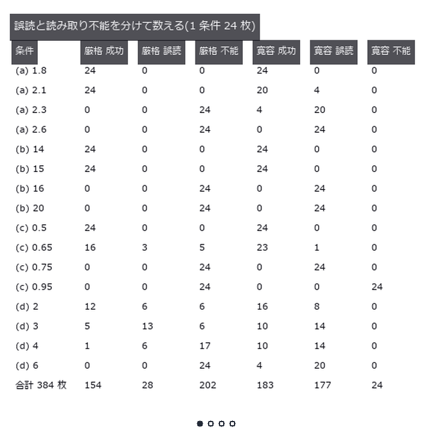</picture>1-D barcode</a>
<a href="../../articles/assets/poc/poc_battery_electrode_tortuosity/01_scene.png"><picture><source media="(prefers-reduced-motion: reduce)" srcset="../../articles/assets/poc/poc_battery_electrode_tortuosity/01_scene.png">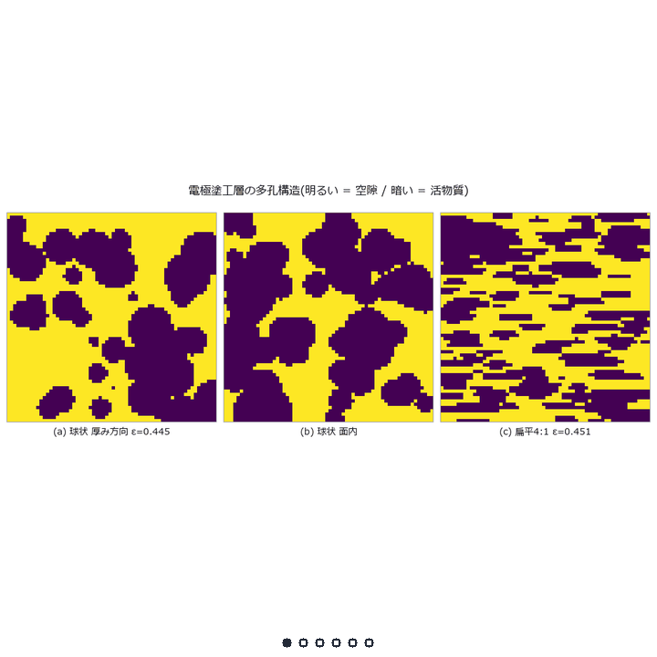</picture>Electrode tortuosity</a>
<a href="../../articles/assets/poc/poc_bearing_diagnosis/01_envelope_vs_raw.png"><picture><source media="(prefers-reduced-motion: reduce)" srcset="../../articles/assets/poc/poc_bearing_diagnosis/01_envelope_vs_raw.png">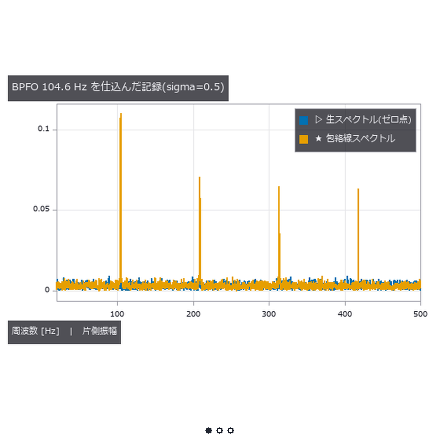</picture>Bearing diagnosis</a>
<a href="../../articles/assets/poc/poc_bump_coplanarity/01_scene.png"><picture><source media="(prefers-reduced-motion: reduce)" srcset="../../articles/assets/poc/poc_bump_coplanarity/01_scene.png">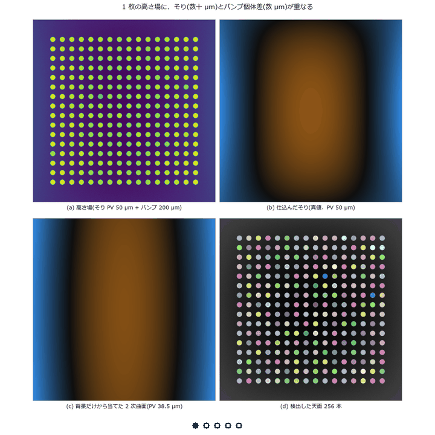</picture>Bump coplanarity</a>
<a href="../../articles/assets/poc/poc_crack_width/05_real_crack_rebin.png"><picture><source media="(prefers-reduced-motion: reduce)" srcset="../../articles/assets/poc/poc_crack_width/05_real_crack_rebin.png">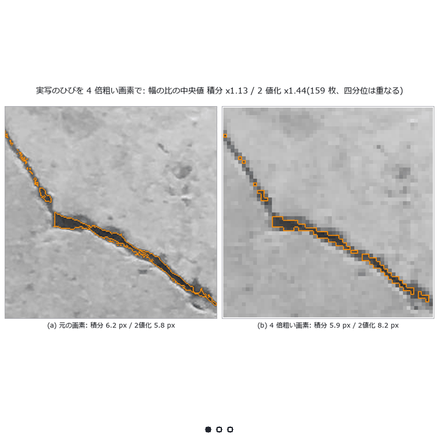</picture>Crack width</a>
<a href="../../articles/assets/poc/poc_fabric_defect/06_real_defects.png"><picture><source media="(prefers-reduced-motion: reduce)" srcset="../../articles/assets/poc/poc_fabric_defect/06_real_defects.png">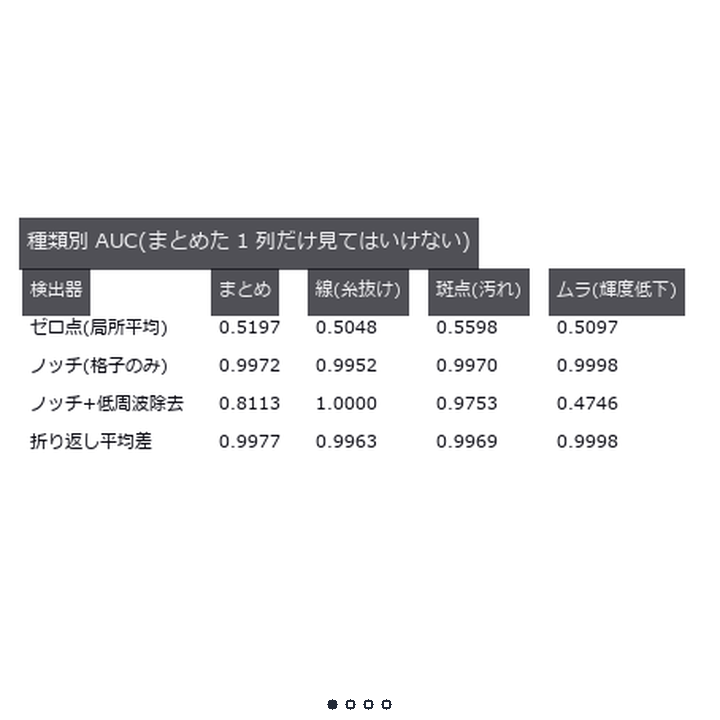</picture>Fabric defects</a>
<a href="../../articles/assets/poc/poc_leak_localization/01_scene.png"><picture><source media="(prefers-reduced-motion: reduce)" srcset="../../articles/assets/poc/poc_leak_localization/01_scene.png">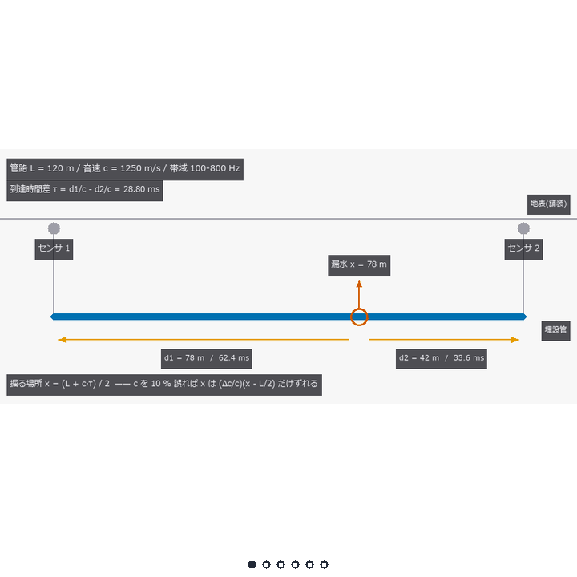</picture>Sound से leak</a>
<a href="../../articles/assets/poc/poc_machine_condition_fusion/01_scene_machine.png"><picture><source media="(prefers-reduced-motion: reduce)" srcset="../../articles/assets/poc/poc_machine_condition_fusion/01_scene_machine.png">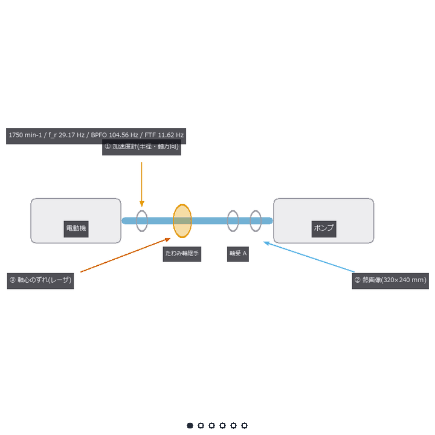</picture>Machine health</a>
<a href="../../articles/assets/poc/poc_matrix_code_reading/01_symbol_and_errors.png"><picture><source media="(prefers-reduced-motion: reduce)" srcset="../../articles/assets/poc/poc_matrix_code_reading/01_symbol_and_errors.png">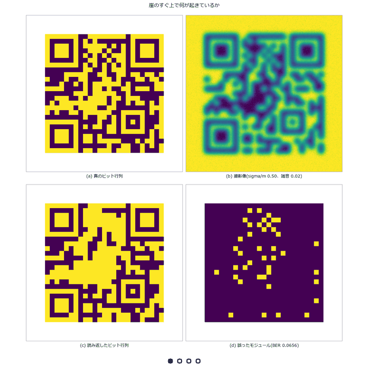</picture>Matrix code</a>
<a href="../../articles/assets/poc/poc_moire_screen/01_failure_split_plot.png"><picture><source media="(prefers-reduced-motion: reduce)" srcset="../../articles/assets/poc/poc_moire_screen/01_failure_split_plot.png">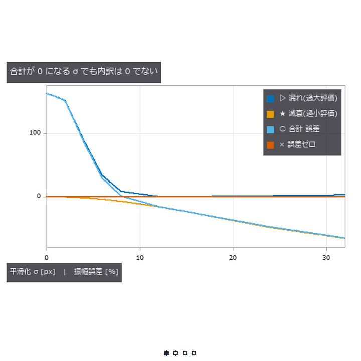</picture>Display moiré</a>
<a href="../../articles/assets/poc/poc_print_registration/01_plates.png"><picture><source media="(prefers-reduced-motion: reduce)" srcset="../../articles/assets/poc/poc_print_registration/01_plates.png">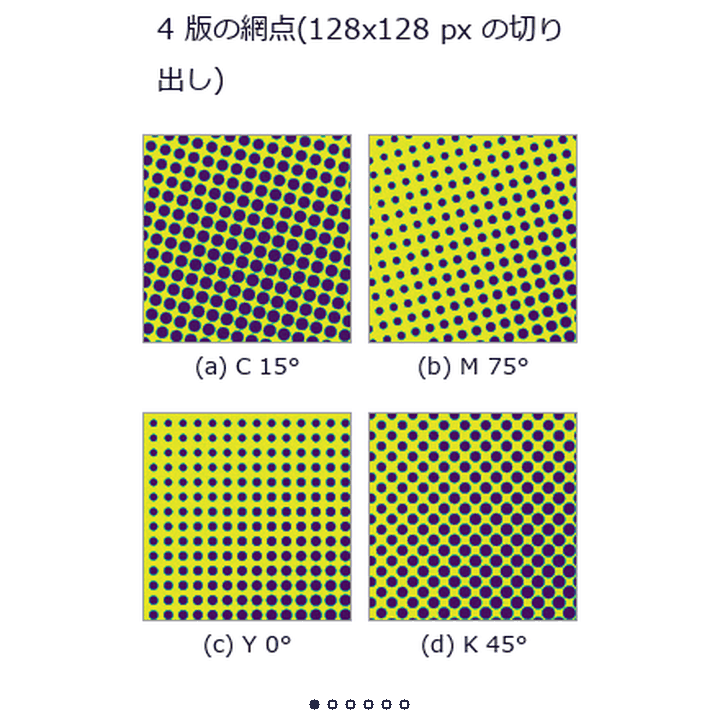</picture>Print registration</a>
<a href="../../articles/assets/poc/poc_real_texture_invariance/01_textures.png"><picture><source media="(prefers-reduced-motion: reduce)" srcset="../../articles/assets/poc/poc_real_texture_invariance/01_textures.png">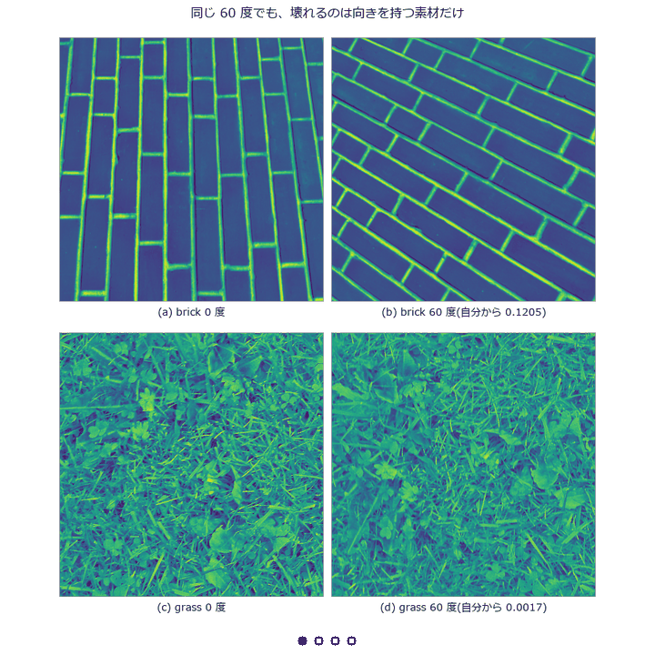</picture>Texture rotation</a>
<a href="../../articles/assets/poc/poc_recycling_sorting/01_scene.png"><picture><source media="(prefers-reduced-motion: reduce)" srcset="../../articles/assets/poc/poc_recycling_sorting/01_scene.png">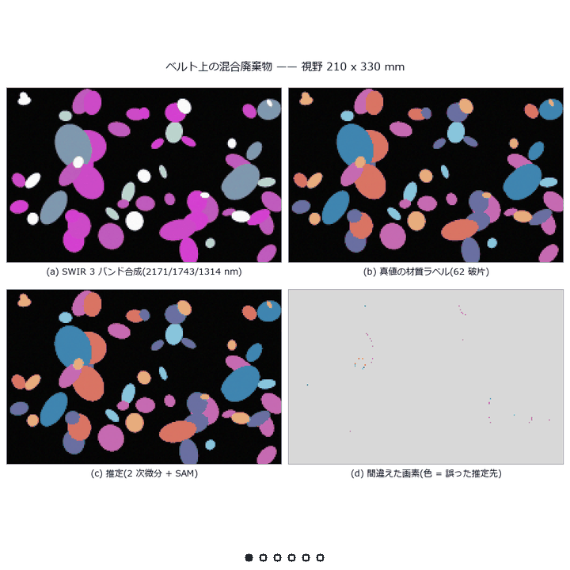</picture>Waste sorting</a>
<a href="../../articles/assets/poc/poc_solar_el_inspection/10_real_el_overlay.png"><picture><source media="(prefers-reduced-motion: reduce)" srcset="../../articles/assets/poc/poc_solar_el_inspection/10_real_el_overlay.png">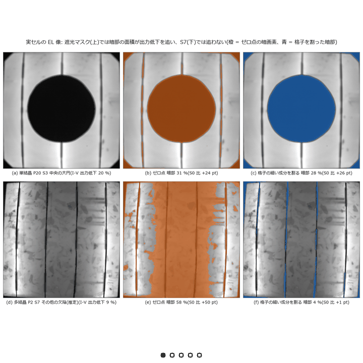</picture>Solar EL</a>
<a href="../../articles/assets/poc/poc_solder_fillet_aoi/01_ring_lut.png"><picture><source media="(prefers-reduced-motion: reduce)" srcset="../../articles/assets/poc/poc_solder_fillet_aoi/01_ring_lut.png">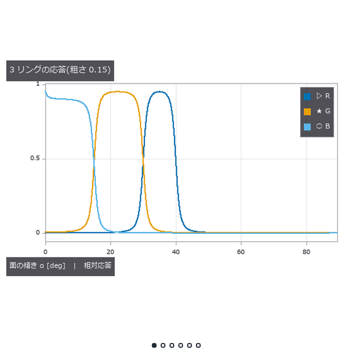</picture>Solder AOI</a>
<a href="../../articles/assets/poc/poc_spc/01_spc_xbar_chart.png"><picture><source media="(prefers-reduced-motion: reduce)" srcset="../../articles/assets/poc/poc_spc/01_spc_xbar_chart.png">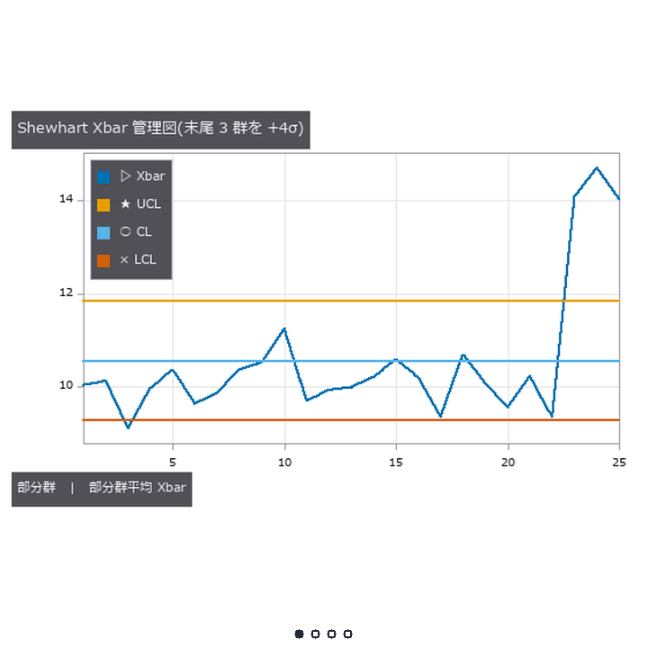</picture>SPC</a>
<a href="../../articles/assets/poc/poc_mt_hidden_fault/01_mt_hidden_cloud.png"><picture><source media="(prefers-reduced-motion: reduce)" srcset="../../articles/assets/poc/poc_mt_hidden_fault/01_mt_hidden_cloud.png">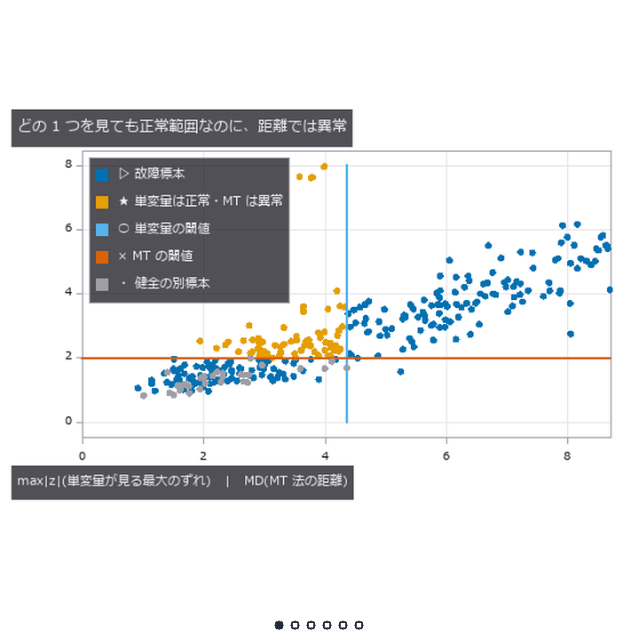</picture>MT hidden fault</a>
<a href="../../articles/assets/poc/poc_text_region_truth/01_text_region_scene.png"><picture><source media="(prefers-reduced-motion: reduce)" srcset="../../articles/assets/poc/poc_text_region_truth/01_text_region_scene.png">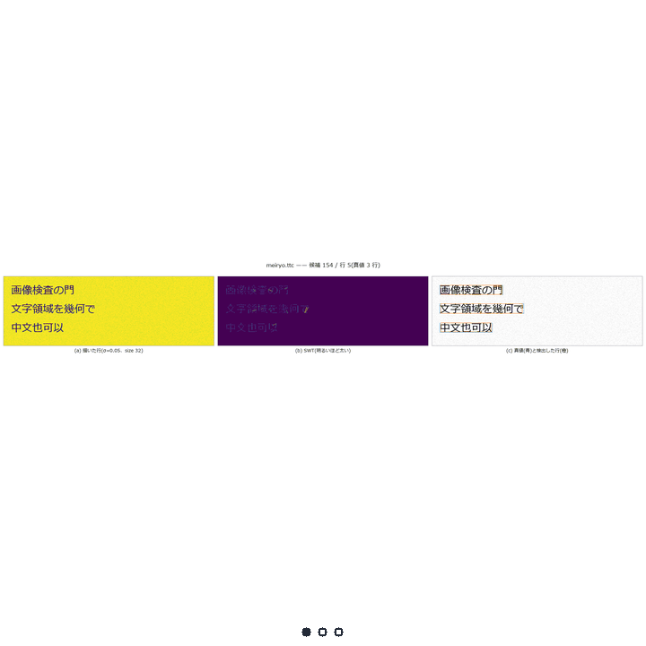</picture>Text regions</a>
<a href="../../articles/assets/poc/poc_thermal_drift_metrology/01_separate_drifts.png"><picture><source media="(prefers-reduced-motion: reduce)" srcset="../../articles/assets/poc/poc_thermal_drift_metrology/01_separate_drifts.png">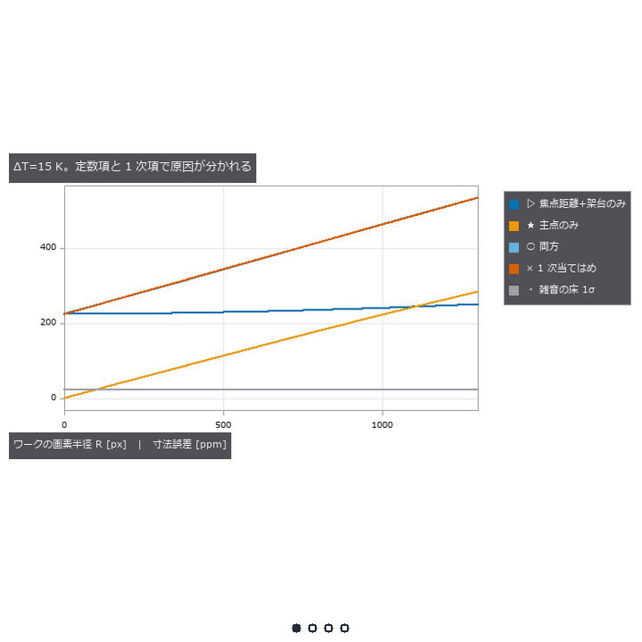</picture>Thermal drift</a>
<a href="../../articles/assets/poc/poc_thermal_radiometry/01_floor.png"><picture><source media="(prefers-reduced-motion: reduce)" srcset="../../articles/assets/poc/poc_thermal_radiometry/01_floor.png">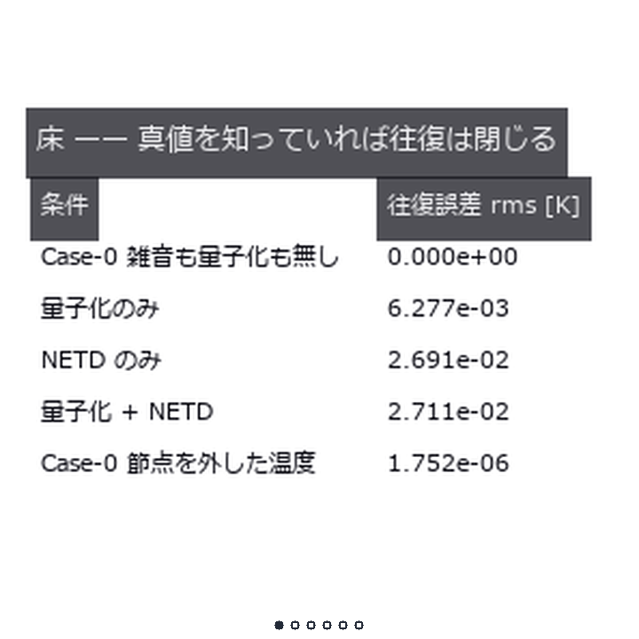</picture>Thermal radiometry</a>
<a href="../../articles/assets/poc/poc_thermography_ndt/01_depth_table.png"><picture><source media="(prefers-reduced-motion: reduce)" srcset="../../articles/assets/poc/poc_thermography_ndt/01_depth_table.png">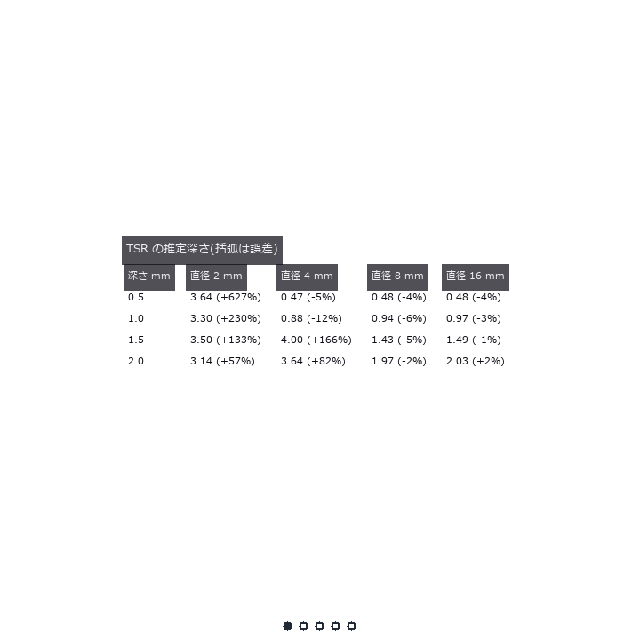</picture>Thermography NDT</a>
<a href="../../articles/assets/poc/poc_veiling_glare/01_verdict.png"><picture><source media="(prefers-reduced-motion: reduce)" srcset="../../articles/assets/poc/poc_veiling_glare/01_verdict.png">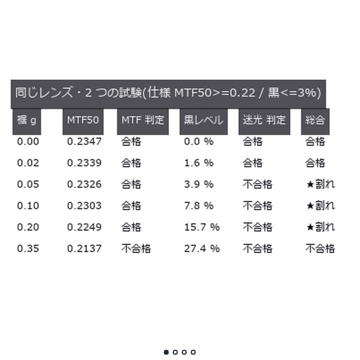</picture>Veiling glare</a>
<a href="../../articles/assets/poc/poc_emva1288_sensor/01_raw_dark_flat_saturation.png"><picture><source media="(prefers-reduced-motion: reduce)" srcset="../../articles/assets/poc/poc_emva1288_sensor/01_raw_dark_flat_saturation.png">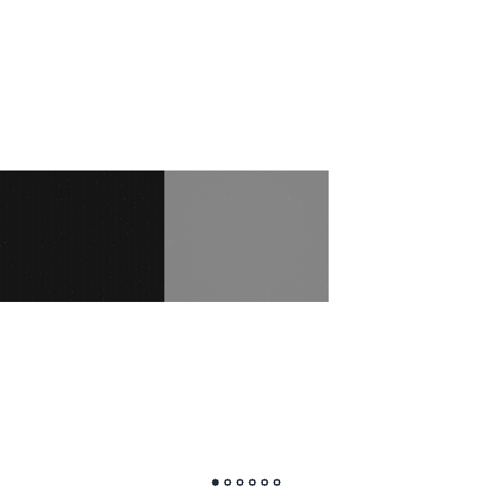</picture>EMVA 1288 sensor</a>
<a href="../../articles/assets/poc/poc_emva1288_in_camera_processing/01_datasheet_lies.png"><picture><source media="(prefers-reduced-motion: reduce)" srcset="../../articles/assets/poc/poc_emva1288_in_camera_processing/01_datasheet_lies.png">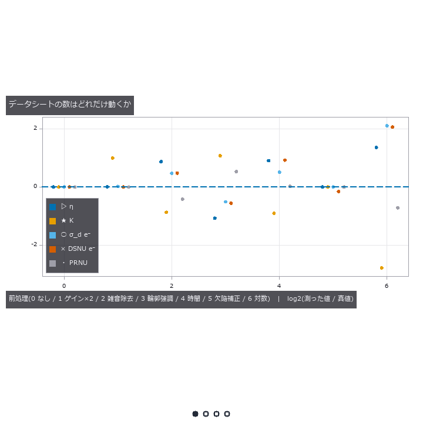</picture>camera के भीतर processing और datasheet</a>
<a href="../../articles/assets/poc/poc_web_roll_periodicity/01_scene_web.png"><picture><source media="(prefers-reduced-motion: reduce)" srcset="../../articles/assets/poc/poc_web_roll_periodicity/01_scene_web.png">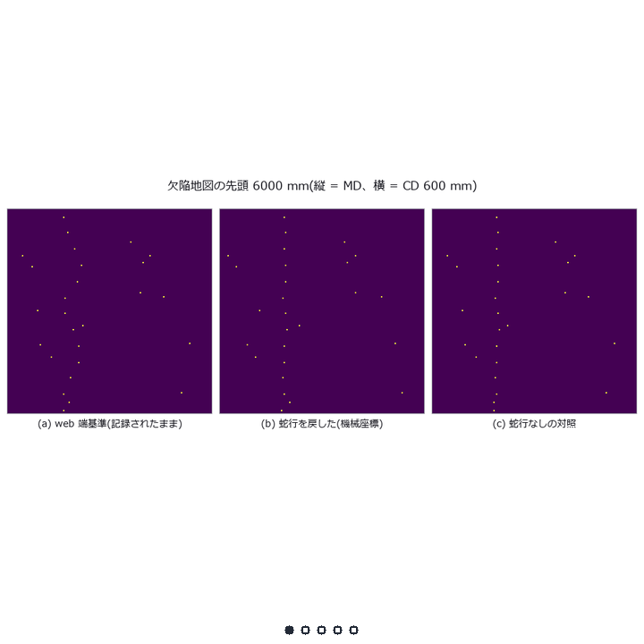</picture>Roller defects</a>
<a href="../../articles/assets/poc/poc_weld_bead_profile/05_real_laser_line.png"><picture><source media="(prefers-reduced-motion: reduce)" srcset="../../articles/assets/poc/poc_weld_bead_profile/05_real_laser_line.png">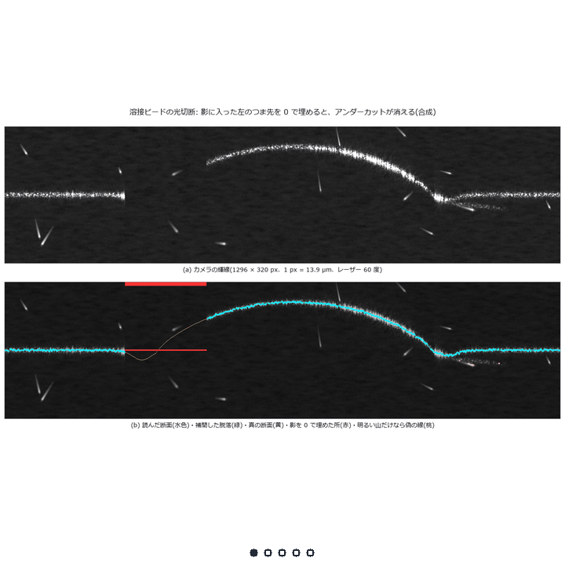</picture>Weld bead profile</a>
<a href="../../articles/assets/poc/poc_weld_bead_scan_angle/02_frames.png"><picture><source media="(prefers-reduced-motion: reduce)" srcset="../../articles/assets/poc/poc_weld_bead_scan_angle/02_frames.png">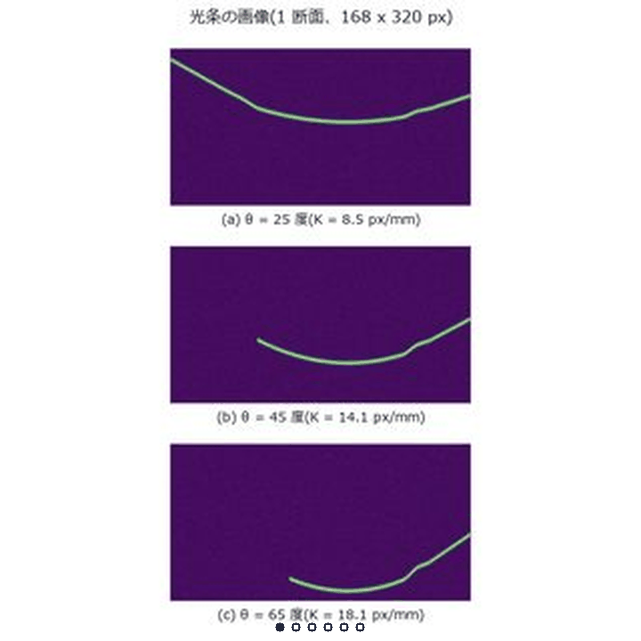</picture>Weld bead scan</a>
<a href="../../articles/assets/poc/poc_weld_radiograph_porosity/02_map_detections.png"><picture><source media="(prefers-reduced-motion: reduce)" srcset="../../articles/assets/poc/poc_weld_radiograph_porosity/02_map_detections.png">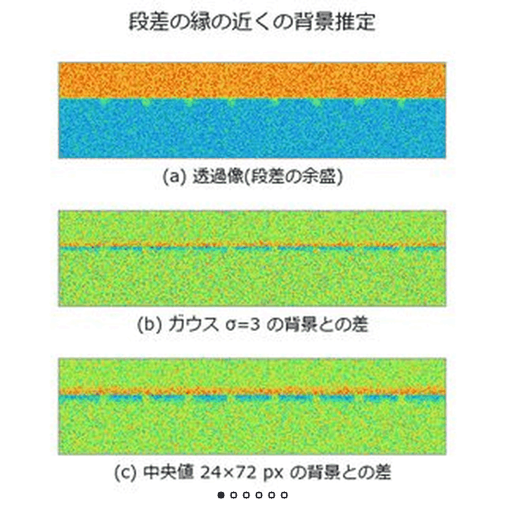</picture>Weld porosity</a>
<a href="../../articles/assets/poc/poc_glyph_typo_detection/01_sign_before_after.png">Glyph typos</a>
<a href="../../articles/assets/poc/poc_print_layer_inspection/01_slice_stack.png"><picture><source media="(prefers-reduced-motion: reduce)" srcset="../../articles/assets/poc/poc_print_layer_inspection/01_slice_stack.png">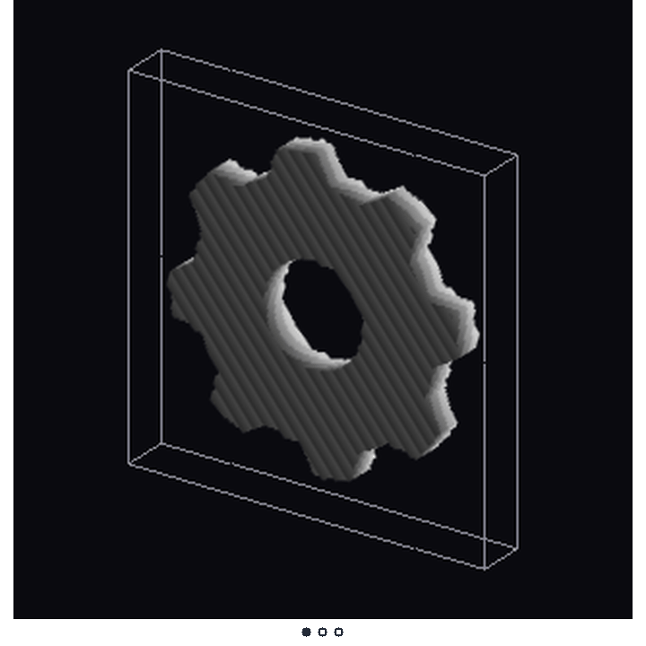</picture>Print layers</a>
<a href="../../articles/assets/poc/poc_agv_fleet/01_agv_naive_vs_adg.mp4"><b>&#9654;</b>AGV fleet</a>
<a href="../../articles/assets/poc/poc_am_thermal_to_ct/01_melt_pool_frames.mp4"><b>&#9654;</b>AM thermal से CT</a>
<a href="../../articles/assets/poc/poc_symmetry_self_reference_inspection/01_self_reference_defect.png"><picture><source media="(prefers-reduced-motion: reduce)" srcset="../../articles/assets/poc/poc_symmetry_self_reference_inspection/01_self_reference_defect.png">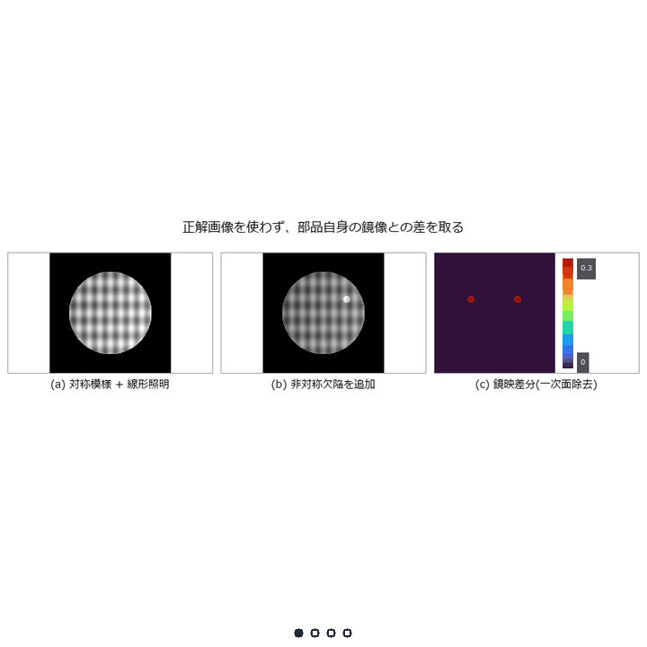</picture>Self-referenced 2-D symmetry inspection</a>
<a href="../../articles/assets/poc/poc_si_wafer_pl_defect_visibility/01_pl_groove_vs_diffusion_length.png"><picture><source media="(prefers-reduced-motion: reduce)" srcset="../../articles/assets/poc/poc_si_wafer_pl_defect_visibility/01_pl_groove_vs_diffusion_length.png">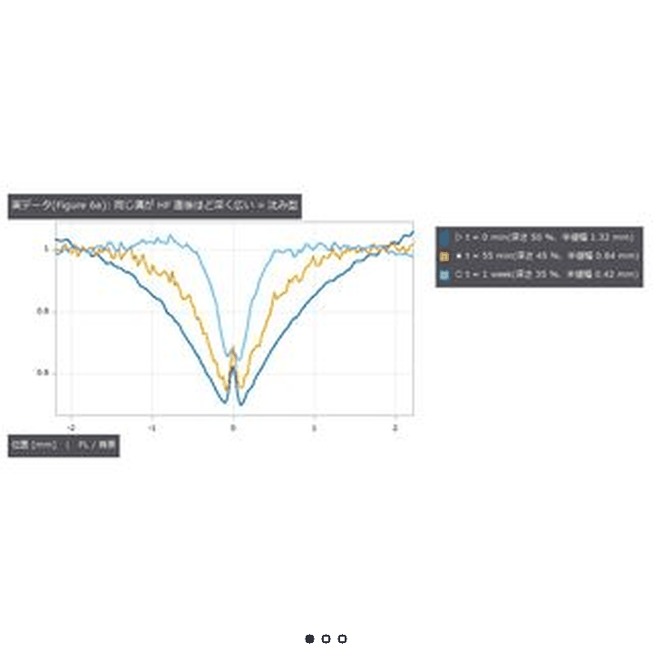</picture>PL image में groove बनाम diffusion length</a>
<a href="../../articles/assets/poc/poc_illumination_cone_vs_na/06_hairline_cone_sweep.gif"><picture><source media="(prefers-reduced-motion: reduce)" srcset="../../articles/assets/poc/poc_illumination_cone_vs_na/02_works_by_cone.png">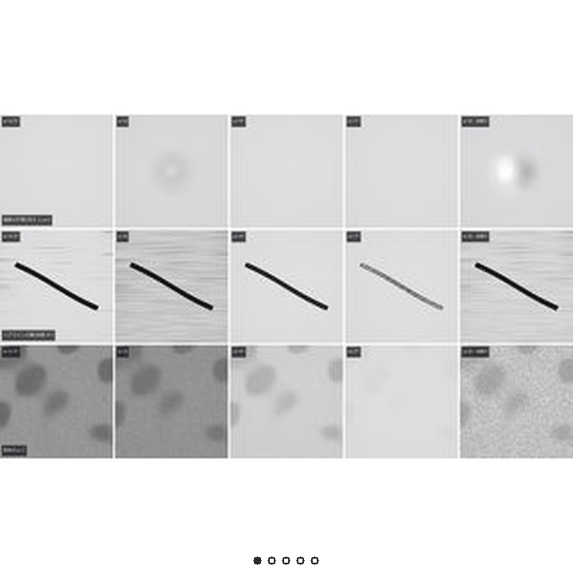</picture><b>&#9654;</b>illumination cone और imaging NA</a>
<a href="../../articles/assets/poc/poc_tdi_linescan/01_tdi_stages_defects.png"><picture><source media="(prefers-reduced-motion: reduce)" srcset="../../articles/assets/poc/poc_tdi_linescan/01_tdi_stages_defects.png">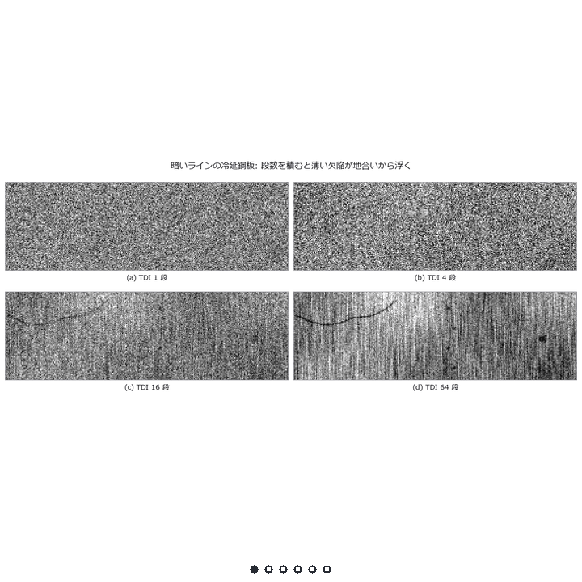</picture>TDI line scan और line-scan lens</a>
<a href="../../articles/assets/poc/poc_fourier_ptychography/01_usaf_4x_fp_20x.png"><picture><source media="(prefers-reduced-motion: reduce)" srcset="../../articles/assets/poc/poc_fourier_ptychography/01_usaf_4x_fp_20x.png">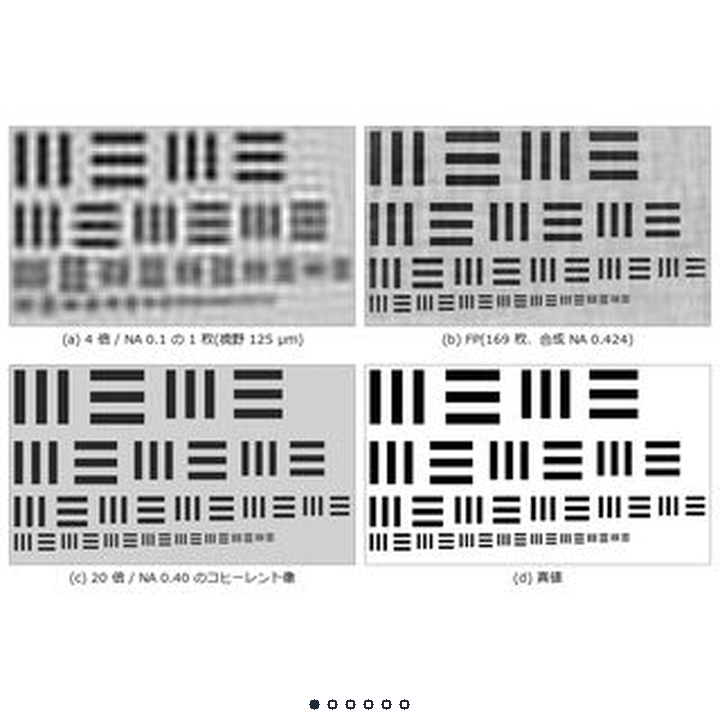</picture>Fourier ptychography (4x field में 20x resolution)</a>
<a href="../../articles/assets/poc/poc_dense_bubble_count/12_pair_merging.gif"><picture><source media="(prefers-reduced-motion: reduce)" srcset="../../articles/assets/poc/poc_dense_bubble_count/01_real_bubbles_verdict.png">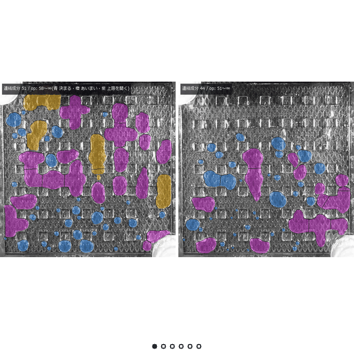</picture><b>&#9654;</b>घने bubbles गिनना (तय न हो तो interval)</a>
<a href="../../articles/assets/poc/poc_grating_interferometry/12_real_three_images.png"><picture><source media="(prefers-reduced-motion: reduce)" srcset="../../articles/assets/poc/poc_grating_interferometry/12_real_three_images.png">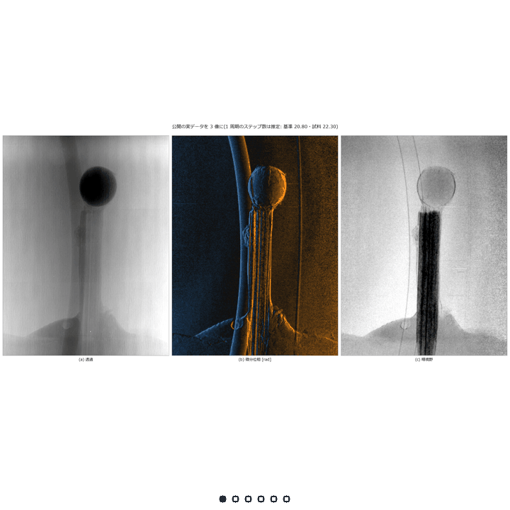</picture>grating interferometry (dark field में दिखते fibres, cracks और pores)</a>
<a href="../../articles/assets/poc/poc_dual_energy_xray/13_real_tray_xray.png"><picture><source media="(prefers-reduced-motion: reduce)" srcset="../../articles/assets/poc/poc_dual_energy_xray/13_real_tray_xray.png">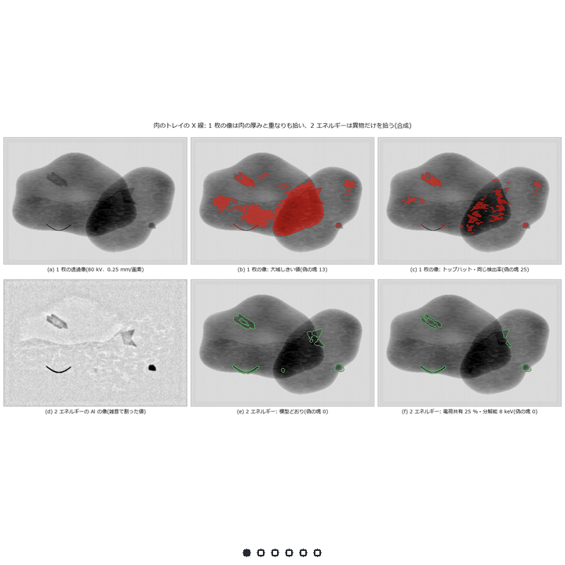</picture>मांस में हड्डी और काँच के टुकड़े दो X-ray energies से ढूँढना (dual-energy X-ray)</a>
<a href="../../articles/assets/poc/poc_code_matching_breakdown/05_highlight_sweep.gif"><picture><source media="(prefers-reduced-motion: reduce)" srcset="../../articles/assets/poc/poc_code_matching_breakdown/01_breakdown_occlusion.png">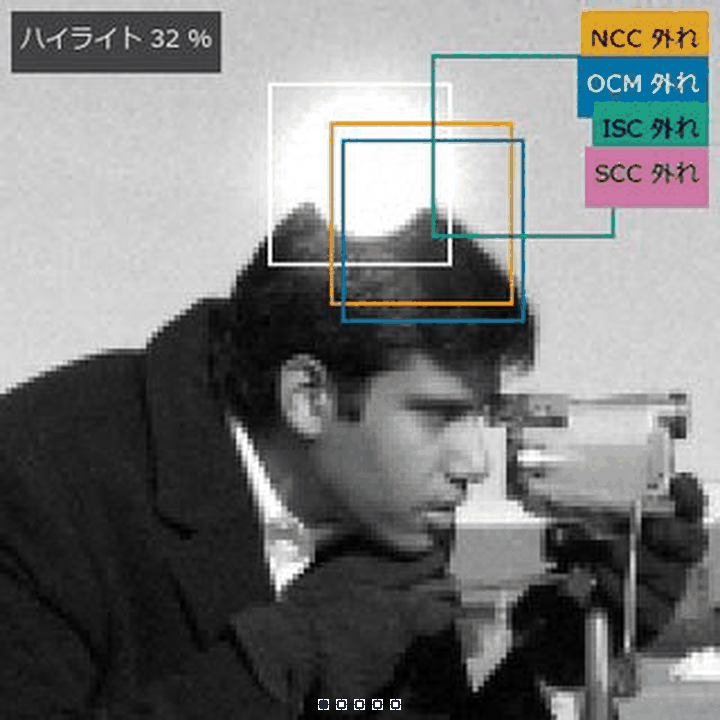</picture><b>&#9654;</b>रोशनी और ओट में code matching</a>
<a href="../../articles/assets/poc/poc_patch_anomaly/01_anomaly_maps.png"><picture><source media="(prefers-reduced-motion: reduce)" srcset="../../articles/assets/poc/poc_patch_anomaly/01_anomaly_maps.png">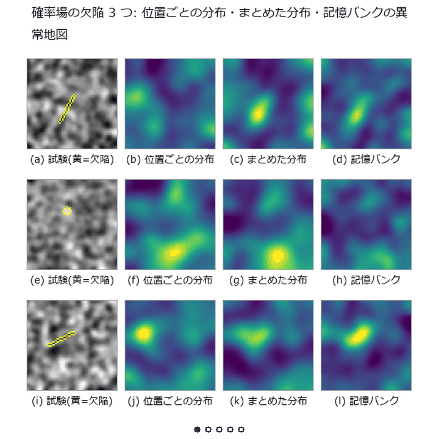</picture>केवल अच्छे नमूनों से patch-feature anomaly detection (classical features का distribution बनाम memory)</a>
<a href="../../articles/assets/poc/poc_braid_homotopy_classes/01_braid_classes_spacetime.gif"><b>&#9654;</b>Multi-robot plans को braid के घूमने के ढंग से अलग करना</a>
<a href="../../articles/assets/poc/poc_wavefront_aberration_limits/01_aberration_limits.png">विपथन के आकार के अनुसार Maréchal सन्निकटन की सीमा</a>
<a href="../../articles/assets/poc/poc_mueller_dofp_observability/01_observability.png">चार-कोण ध्रुवण कैमरा Mueller मैट्रिक्स के 7 आयाम नहीं देख पाता</a>
<a href="../../articles/assets/poc/poc_slanted_edge_sfr_limits/01_sfr_limits.png">तिरछी किनारी SFR गामा के कारण MTF50 गलत पढ़ती है</a>
<a href="../../articles/assets/poc/poc_threshold_transfer_after_normalization/01_threshold_transfer.png"><picture><source media="(prefers-reduced-motion: reduce)" srcset="../../articles/assets/poc/poc_threshold_transfer_after_normalization/01_threshold_transfer.png">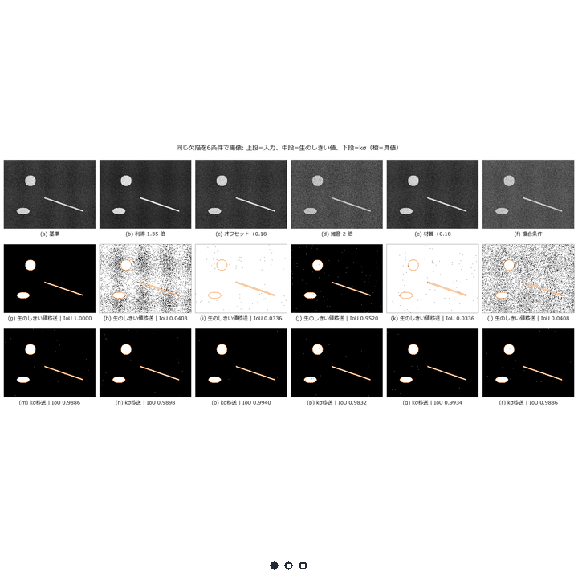</picture>Raw grey-level thresholds need retuning across lighting, while k-sigma and P-tile transfer</a>
<a href="../../articles/assets/poc/poc_hdr_glossy_metal_inspection/02_results.png"><picture><source media="(prefers-reduced-motion: reduce)" srcset="../../articles/assets/poc/poc_hdr_glossy_metal_inspection/02_results.png">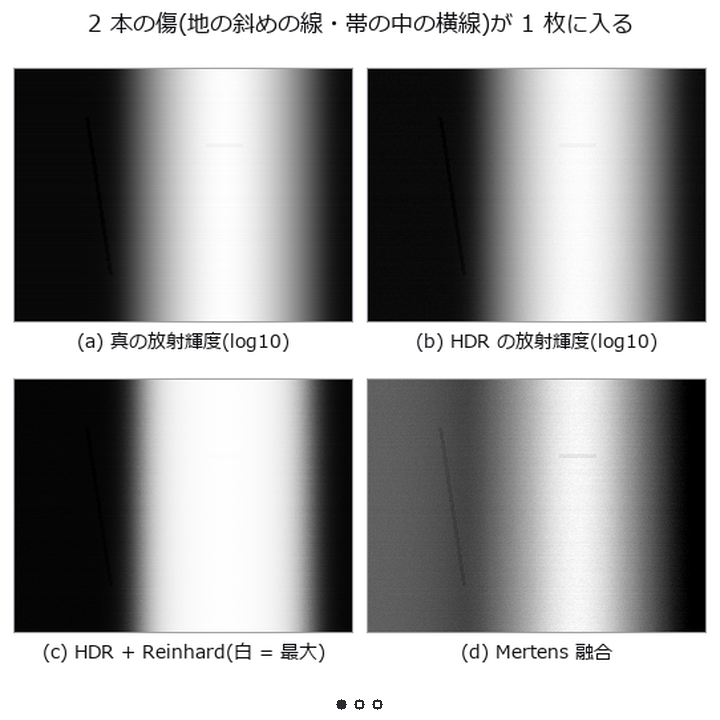</picture>एक एक्सपोज़र चमकदार धातु की दोनों खरोंचें नहीं दिखाता; मापे गए रिस्पॉन्स वाला HDR दिखाता है</a>
<a href="../../articles/assets/poc/poc_symbol_package_1d/01_ean13_defocus.png">जिस धुंधलेपन पर बारकोड 90% पढ़ा जाता है, उस पर प्रिंट गुणवत्ता ग्रेड F है</a>
<a href="../../articles/assets/poc/poc_symbol_part_dpm/01_dpm_datamatrix.png">डॉट-पीन Data Matrix को zxing-cpp तभी पढ़ता है जब वह धुंधली हो</a>
<a href="../../articles/assets/poc/poc_symbol_lot_ocr/01_lot_ocr_defocus.png">प्रशिक्षित धुंधलेपन से आगे लॉट-नंबर OCR अस्वीकार करने के बजाय गलत पढ़ता है</a>
<a href="../../articles/assets/poc/poc_real_typewritten_ocr/01_reading.png"><picture><source media="(prefers-reduced-motion: reduce)" srcset="../../articles/assets/poc/poc_real_typewritten_ocr/01_reading.png">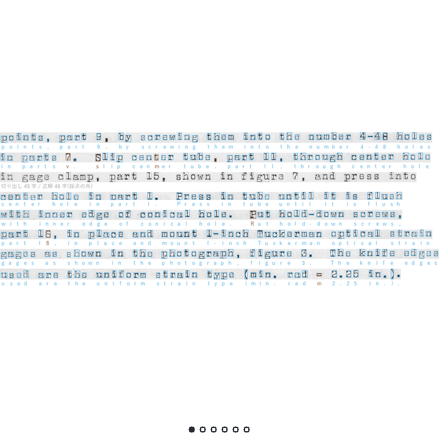</picture>1943 की टाइप की गई रिपोर्ट को क्लासिकल OCR से पढ़ना</a>
<a href="../../articles/assets/poc/poc_ct_casting_sparse_views/01_slices.png"><picture><source media="(prefers-reduced-motion: reduce)" srcset="../../articles/assets/poc/poc_ct_casting_sparse_views/01_slices.png">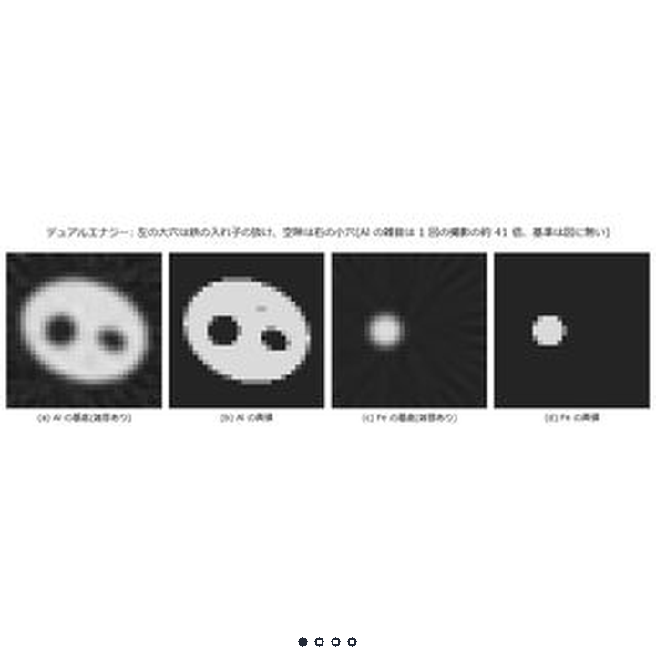</picture>ढलाई के रिक्त स्थानों का CT: RMSE में सबसे अच्छा पुनर्निर्माण रिक्त आयतन में हमेशा सबसे अच्छा नहीं</a>
<a href="../../articles/assets/poc/poc_surface_defect_classifiers/01_defect_patches.png"><picture><source media="(prefers-reduced-motion: reduce)" srcset="../../articles/assets/poc/poc_surface_defect_classifiers/01_defect_patches.png">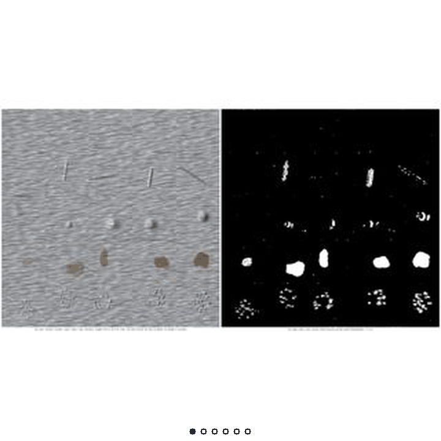</picture>प्रशिक्षित वर्गीकारकों से धातु सतह दोषों की छँटाई: घिसाई की धारियों के साथ की खरोंचें 4 में 3 छूटती हैं, अनदेखे गड्ढे 95 % अस्वीकृत</a>

<b>Dimensional और shape metrology</b> (56)

<a href="../../articles/assets/poc/poc_aoi_ct_traceability/01_inspection_and_reconstructed_ct.png"><picture><source media="(prefers-reduced-motion: reduce)" srcset="../../articles/assets/poc/poc_aoi_ct_traceability/01_inspection_and_reconstructed_ct.png">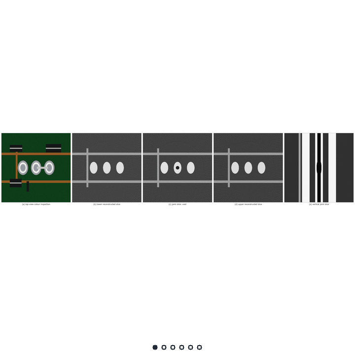</picture>AOI-CT matching</a>
<a href="../../articles/assets/poc/poc_asbuilt_wall_deviation/01_scene.png"><picture><source media="(prefers-reduced-motion: reduce)" srcset="../../articles/assets/poc/poc_asbuilt_wall_deviation/01_scene.png">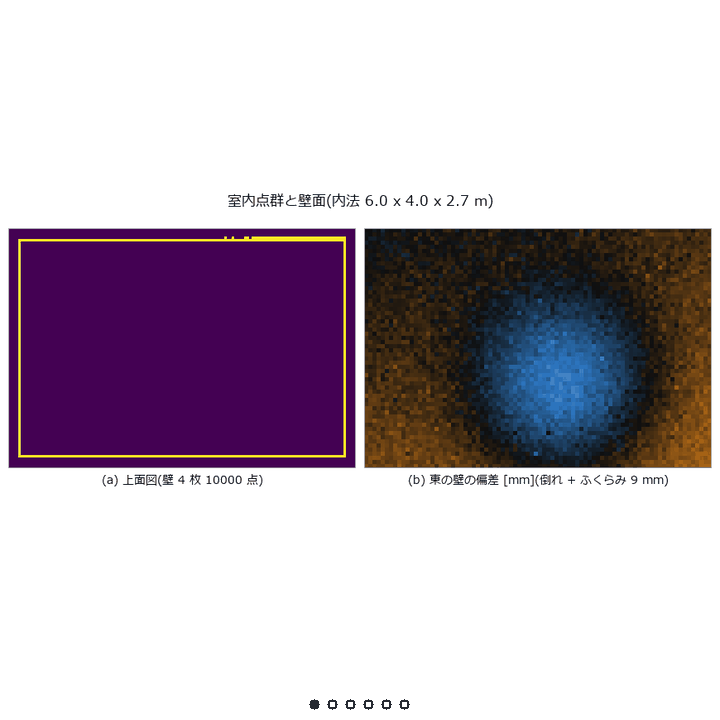</picture>As-built दीवारें</a>
<a href="../../articles/assets/poc/poc_battery_electrode_breathing/01_scene.png"><picture><source media="(prefers-reduced-motion: reduce)" srcset="../../articles/assets/poc/poc_battery_electrode_breathing/01_scene.png">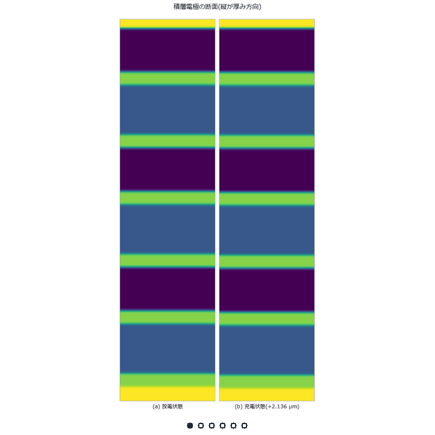</picture>Electrode breathing</a>
<a href="../../articles/assets/poc/poc_bilateral_asymmetry/01_floor_vs_spacing.png"><picture><source media="(prefers-reduced-motion: reduce)" srcset="../../articles/assets/poc/poc_bilateral_asymmetry/01_floor_vs_spacing.png">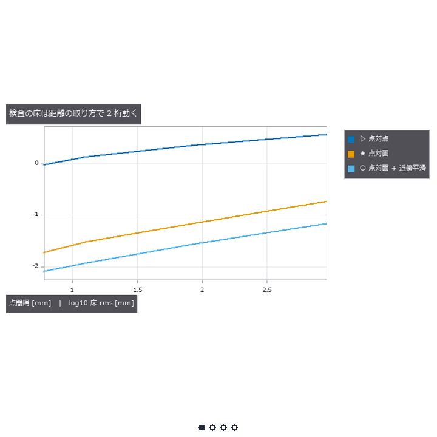</picture>Bilateral asymmetry</a>
<a href="../../articles/assets/poc/poc_dic_strain/05_tensile_ramp.mp4"><b>&#9654;</b>DIC strain</a>
<a href="../../articles/assets/poc/poc_die_tilt_tsv_overlay/01_scene.png"><picture><source media="(prefers-reduced-motion: reduce)" srcset="../../articles/assets/poc/poc_die_tilt_tsv_overlay/01_scene.png">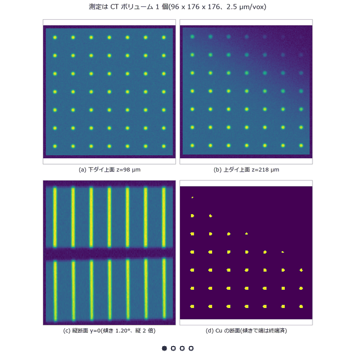</picture>Die tilt और TSV</a>
<a href="../../articles/assets/poc/poc_dimensional_inspection/01_slot_bias.png"><picture><source media="(prefers-reduced-motion: reduce)" srcset="../../articles/assets/poc/poc_dimensional_inspection/01_slot_bias.png">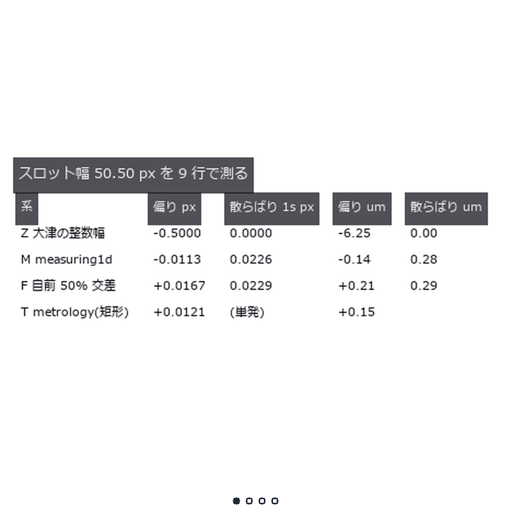</picture>Dimensional check</a>
<a href="../../articles/assets/poc/poc_fiber_orientation/01_scene.png"><picture><source media="(prefers-reduced-motion: reduce)" srcset="../../articles/assets/poc/poc_fiber_orientation/01_scene.png"></picture>Fibre orientation</a>
<a href="../../articles/assets/poc/poc_gear_tooth_metrology/01_scene.png"><picture><source media="(prefers-reduced-motion: reduce)" srcset="../../articles/assets/poc/poc_gear_tooth_metrology/01_scene.png"></picture>Gear teeth</a>
<a href="../../articles/assets/poc/poc_interferometry_step/09_csi_scan_explained.mp4"><b>&#9654;</b>White-light step</a>
<a href="../../articles/assets/poc/poc_metal_grain_size/15_real_tbm_breaks.png"><picture><source media="(prefers-reduced-motion: reduce)" srcset="../../articles/assets/poc/poc_metal_grain_size/15_real_tbm_breaks.png"></picture>Grain size</a>
<a href="../../articles/assets/poc/poc_multibeam_bathymetry/17_survey.mp4"><b>&#9654;</b>Multibeam sonar</a>
<a href="../../articles/assets/poc/poc_particle_sizing/01_scene.png"><picture><source media="(prefers-reduced-motion: reduce)" srcset="../../articles/assets/poc/poc_particle_sizing/01_scene.png"></picture>Particle sizing</a>
<a href="../../articles/assets/poc/poc_rail_corrugation/01_planted_components.png"><picture><source media="(prefers-reduced-motion: reduce)" srcset="../../articles/assets/poc/poc_rail_corrugation/01_planted_components.png"></picture>Rail corrugation</a>
<a href="../../articles/assets/poc/poc_real_coin_metrology/01_scene.png"><picture><source media="(prefers-reduced-motion: reduce)" srcset="../../articles/assets/poc/poc_real_coin_metrology/01_scene.png"></picture>Real coins</a>
<a href="../../articles/assets/poc/poc_screw_thread_metrology/01_zero_spectrum.png"><picture><source media="(prefers-reduced-motion: reduce)" srcset="../../articles/assets/poc/poc_screw_thread_metrology/01_zero_spectrum.png"></picture>Screw threads</a>
<a href="../../articles/assets/poc/poc_stockpile_volume/07_scan_orbit.mp4"><b>&#9654;</b>Stockpile आयतन</a>
<a href="../../articles/assets/poc/poc_strain_history/05_history_video.mp4"><b>&#9654;</b>Creep strain</a>
<a href="../../articles/assets/poc/poc_surface_roughness/01_surface_components.png"><picture><source media="(prefers-reduced-motion: reduce)" srcset="../../articles/assets/poc/poc_surface_roughness/01_surface_components.png"></picture>Surface roughness</a>
<a href="../../articles/assets/poc/poc_tacsim_elastic_membrane/03_tacsim_force_sweep.gif"><b>&#9654;</b>Tactile sensor</a>
<a href="../../articles/assets/poc/poc_tacsim_marker_shear/02_tacslip_stick_circle_shrinks.gif"><b>&#9654;</b>Tactile shear</a>
<a href="../../articles/assets/poc/poc_tactile_dipole_torque/02_tactorque_dipole_grows_with_M.gif"><b>&#9654;</b>Tactile dipole</a>
<a href="../../articles/assets/poc/poc_granular_heap_repose/11_granular_datum_tilt_sweep.gif"><b>&#9654;</b>Powder heap</a>
<a href="../../articles/assets/poc/poc_food_cutting_measure/01_cutting_track_force.gif"><b>&#9654;</b>Food cutting</a>
<a href="../../articles/assets/poc/poc_tacdome_large_deformation/01_tacdome_press_sweep.gif"><b>&#9654;</b>Soft dome contact</a>
<a href="../../articles/assets/poc/poc_polish_wipe_measure/01_polish_raster_wipe_coat.gif"><b>&#9654;</b>Polish और wipe</a>
<a href="../../articles/assets/poc/poc_powder_scoop_pour/03_scoop_stream_synthetic_frames.gif"><b>&#9654;</b>Powder scoop/pour</a>
<a href="../../articles/assets/poc/poc_powder_grinding_ae/07_psd_fining_during_grinding.gif"><b>&#9654;</b>Mortar grinding</a>
<a href="../../articles/assets/poc/poc_pxrd_phase_peel/01_phase_peel.gif"><b>&#9654;</b>PXRD phases</a>
<a href="../../articles/assets/poc/poc_dose_uniformity_from_grinding/01_cv_bias_decomposition.png"><picture><source media="(prefers-reduced-motion: reduce)" srcset="../../articles/assets/poc/poc_dose_uniformity_from_grinding/01_cv_bias_decomposition.png"></picture>Dose uniformity</a>
<a href="../../articles/assets/poc/poc_knife_tactile_toughness/06_cut_with_fingertip_pads.gif"><b>&#9654;</b>Tactile knife</a>
<a href="../../articles/assets/poc/poc_measurement_system_analysis/16_breakdown_movie.gif"><picture><source media="(prefers-reduced-motion: reduce)" srcset="../../articles/assets/poc/poc_measurement_system_analysis/01_scene.png"></picture><b>&#9654;</b>Gauge R&R</a>
<a href="../../articles/assets/poc/poc_pod_lighting/03_pod_curves.png"><picture><source media="(prefers-reduced-motion: reduce)" srcset="../../articles/assets/poc/poc_pod_lighting/03_pod_curves.png"></picture>हर lighting का POD</a>
<a href="../../articles/assets/poc/poc_laser_line_speckle_floor/01_line.png"><picture><source media="(prefers-reduced-motion: reduce)" srcset="../../articles/assets/poc/poc_laser_line_speckle_floor/01_line.png"></picture>laser line की speckle सीमा</a>
<a href="../../articles/assets/poc/poc_shape_from_polarization/11_real_dome_and_lens.png"><picture><source media="(prefers-reduced-motion: reduce)" srcset="../../articles/assets/poc/poc_shape_from_polarization/11_real_dome_and_lens.png"></picture>polarisation से आकार</a>
<a href="../../articles/assets/poc/poc_interreflection_fringe_error/02_direct_global.png"><picture><source media="(prefers-reduced-motion: reduce)" srcset="../../articles/assets/poc/poc_interreflection_fringe_error/02_direct_global.png"></picture>सफ़ेद खाँचे का interreflection और fringe त्रुटि</a>
<a href="../../articles/assets/poc/poc_zernike_aberrations/06_through_focus.gif"><picture><source media="(prefers-reduced-motion: reduce)" srcset="../../articles/assets/poc/poc_zernike_aberrations/01_zernike_pyramid.png"></picture><b>&#9654;</b>Zernike aberrations</a>
<a href="../../articles/assets/poc/poc_attention_identities/01_attention_masks.png"><picture><source media="(prefers-reduced-motion: reduce)" srcset="../../articles/assets/poc/poc_attention_identities/01_attention_masks.png"></picture>Attention identities</a>
<a href="../../articles/assets/poc/poc_residue_crt/03_residue_rotation_needle.gif"><picture><source media="(prefers-reduced-motion: reduce)" srcset="../../articles/assets/poc/poc_residue_crt/02_residue_rotation_sawtooth.png"></picture><b>&#9654;</b>Phase CRT</a>
<a href="../../articles/assets/poc/poc_sem_wafer_defect_edge_bias/01_sem_se_bse_bias.png"><picture><source media="(prefers-reduced-motion: reduce)" srcset="../../articles/assets/poc/poc_sem_wafer_defect_edge_bias/01_sem_se_bse_bias.png"></picture>SEM edge inflation</a>
<a href="../../articles/assets/poc/poc_chromatic_confocal/04_spectrum_vs_height.gif"><picture><source media="(prefers-reduced-motion: reduce)" srcset="../../articles/assets/poc/poc_chromatic_confocal/01_rainbow_ruler.png"></picture><b>&#9654;</b>chromatic confocal sensor (रंग से ऊँचाई पढ़ना)</a>
<a href="../../articles/assets/poc/poc_moire_alignment/03_fringe_flow.gif"><picture><source media="(prefers-reduced-motion: reduce)" srcset="../../articles/assets/poc/poc_moire_alignment/02_one_nm_steps.png"></picture><b>&#9654;</b>moiré alignment (दो अदृश्य gratings से 1 nm पढ़ना)</a>
<a href="../../articles/assets/poc/poc_optics_drawings/06_setup_ring_coaxial.png"><picture><source media="(prefers-reduced-motion: reduce)" srcset="../../articles/assets/poc/poc_optics_drawings/06_setup_ring_coaxial.png"></picture>calculation से optical drawings (section, setup, element)</a>
<a href="../../articles/assets/poc/poc_pocket_interreflection/02_residuals.png"><picture><source media="(prefers-reduced-motion: reduce)" srcset="../../articles/assets/poc/poc_pocket_interreflection/02_residuals.png"></picture>machined pocket का inter-reflection अभिसरण तक</a>
<a href="../../articles/assets/poc/poc_tem_ctf_thon_rings/01_thon_ring_sweep.gif"><picture><source media="(prefers-reduced-motion: reduce)" srcset="../../articles/assets/poc/poc_tem_ctf_thon_rings/02_thon_rings_four_defoci.png"></picture><b>&#9654;</b>virtual TEM (Thon rings और defocus)</a>
<a href="../../articles/assets/poc/poc_noncoaxial_optics/05_false_defect.png"><picture><source media="(prefers-reduced-motion: reduce)" srcset="../../articles/assets/poc/poc_noncoaxial_optics/05_false_defect.png"></picture>non-coaxial optics: beamsplitter ghost और fold</a>
<a href="../../articles/assets/poc/poc_lockin_imaging/01_ring_amp_phase.png"><picture><source media="(prefers-reduced-motion: reduce)" srcset="../../articles/assets/poc/poc_lockin_imaging/01_ring_amp_phase.png"></picture>प्रति-pixel lock-in demodulation: ring-light normals, daylighting, thermal waves</a>
<a href="../../articles/assets/poc/poc_spectrometer_illumination/03_slit_image_smile.png"><picture><source media="(prefers-reduced-motion: reduce)" srcset="../../articles/assets/poc/poc_spectrometer_illumination/03_slit_image_smile.png"></picture>spectrometer और illumination (bandwidth और lamp की संरचना)</a>
<a href="../../articles/assets/poc/poc_simcal_telecentric/02_real_model_residuals.png"><picture><source media="(prefers-reduced-motion: reduce)" srcset="../../articles/assets/poc/poc_simcal_telecentric/02_real_model_residuals.png"></picture>real telecentric image पर imaging model का calibration</a>
<a href="../../articles/assets/poc/poc_robust_profile_filter/04_scratched_surface.png"><picture><source media="(prefers-reduced-motion: reduce)" srcset="../../articles/assets/poc/poc_robust_profile_filter/04_scratched_surface.png"></picture>scratch mean line को कितना दबाता है, और robust filter कहाँ टूटते हैं</a>
<a href="../../articles/assets/poc/poc_sem_tem_same_particle/08_tem_focus_sweep.gif"><picture><source media="(prefers-reduced-motion: reduce)" srcset="../../articles/assets/poc/poc_sem_tem_same_particle/02_same_specimen_sem_tem.png"></picture><b>&#9654;</b>एक ही कणों को scanning और transmission images में मापना</a>
<a href="../../articles/assets/poc/poc_real_sem_metal_layer/01_scene.png"><picture><source media="(prefers-reduced-motion: reduce)" srcset="../../articles/assets/poc/poc_real_sem_metal_layer/01_scene.png"></picture>वास्तविक SEM धातु परत की मापिकी</a>
<a href="../../articles/assets/poc/poc_virtual_acceptance_3d/01_acceptance_layout_and_noise.png"><picture><source media="(prefers-reduced-motion: reduce)" srcset="../../articles/assets/poc/poc_virtual_acceptance_3d/01_acceptance_layout_and_noise.png"></picture>खरीदने से पहले स्वीकृति परीक्षण: एक काला गोला वही iToF फेल कर देता है</a>
<a href="../../articles/assets/poc/poc_light_section_step_weld_floor/01_height_map.png"><picture><source media="(prefers-reduced-motion: reduce)" srcset="../../articles/assets/poc/poc_light_section_step_weld_floor/01_height_map.png"></picture>लाइट-सेक्शन ऊँचाई µm तक सही, पर असली सीमा 20.7 µm स्पेकल फ़्लोर</a>
<a href="../../articles/assets/poc/poc_real_file_formats/01_stars_matched.png"><picture><source media="(prefers-reduced-motion: reduce)" srcset="../../articles/assets/poc/poc_real_file_formats/01_stars_matched.png"></picture>वास्तविक वैज्ञानिक data file पढ़ना</a>
<a href="../../articles/assets/poc/poc_real_grain_skiz/01_grain_boundaries.png"><picture><source media="(prefers-reduced-motion: reduce)" srcset="../../articles/assets/poc/poc_real_grain_skiz/01_grain_boundaries.png"></picture>Zones of influence से grain boundary</a>

<b>3-D shape</b> (19)

<a href="../../articles/assets/poc/poc_battery_ct_degradation/17_same_outline_ct.png"><picture><source media="(prefers-reduced-motion: reduce)" srcset="../../articles/assets/poc/poc_battery_ct_degradation/17_same_outline_ct.png"></picture>Battery CT</a>
<a href="../../articles/assets/poc/poc_bev_sensor_fusion/01_scene_bev.png"><picture><source media="(prefers-reduced-motion: reduce)" srcset="../../articles/assets/poc/poc_bev_sensor_fusion/01_scene_bev.png"></picture>BEV sensor fusion</a>
<a href="../../articles/assets/poc/poc_crop_phenotyping/01_capsule_calibration.png"><picture><source media="(prefers-reduced-motion: reduce)" srcset="../../articles/assets/poc/poc_crop_phenotyping/01_capsule_calibration.png"></picture>Crop leaf area</a>
<a href="../../articles/assets/poc/poc_ct_void_morphology/13_section_sweep.mp4"><b>&#9654;</b>Joint voids (CT)</a>
<a href="../../articles/assets/poc/poc_dfm_thickness_overhang/01_scene.png"><picture><source media="(prefers-reduced-motion: reduce)" srcset="../../articles/assets/poc/poc_dfm_thickness_overhang/01_scene.png"></picture>Manufacturability</a>
<a href="../../articles/assets/poc/poc_lidar_terrain_change/12_flight.gif"><b>&#9654;</b>Slope earthwork</a>
<a href="../../articles/assets/poc/poc_livestock_body_volume/14_hull_orbit.mp4"><b>&#9654;</b>Livestock weight</a>
<a href="../../articles/assets/poc/poc_mesh_quality_repair/14_decimate_orbit.mp4"><b>&#9654;</b>Mesh repair</a>
<a href="../../articles/assets/poc/poc_pallet_load_utilization/01_scene.png"><picture><source media="(prefers-reduced-motion: reduce)" srcset="../../articles/assets/poc/poc_pallet_load_utilization/01_scene.png"></picture>Pallet load</a>
<a href="../../articles/assets/poc/poc_pipe_wall_loss/01_scene_pipe.png"><picture><source media="(prefers-reduced-motion: reduce)" srcset="../../articles/assets/poc/poc_pipe_wall_loss/01_scene_pipe.png"></picture>Pipe wall loss</a>
<a href="../../articles/assets/poc/poc_print_warpage_risk/01_scene.png"><picture><source media="(prefers-reduced-motion: reduce)" srcset="../../articles/assets/poc/poc_print_warpage_risk/01_scene.png"></picture>Print warpage</a>
<a href="../../articles/assets/poc/poc_safety_clearance/01_conditions.png"><picture><source media="(prefers-reduced-motion: reduce)" srcset="../../articles/assets/poc/poc_safety_clearance/01_conditions.png"></picture>Human-machine दूरी</a>
<a href="../../articles/assets/poc/poc_scan_to_bim_asbuilt/01_scene_plan_section.png"><picture><source media="(prefers-reduced-motion: reduce)" srcset="../../articles/assets/poc/poc_scan_to_bim_asbuilt/01_scene_plan_section.png"></picture>Scan-to-BIM</a>
<a href="../../articles/assets/poc/poc_structure_4d_deterioration/12_years_video.mp4"><b>&#9654;</b>Yearly re-survey</a>
<a href="../../articles/assets/poc/poc_symmetry_restoration/01_scene.png"><picture><source media="(prefers-reduced-motion: reduce)" srcset="../../articles/assets/poc/poc_symmetry_restoration/01_scene.png"></picture>Symmetry repair</a>
<a href="../../articles/assets/poc/poc_endless_zoom_and_turning_solids/03_zoom_loop.gif"><picture><source media="(prefers-reduced-motion: reduce)" srcset="../../articles/assets/poc/poc_endless_zoom_and_turning_solids/01_zoom_steps.png"></picture><b>&#9654;</b>Endless zoom</a>
<a href="../../articles/assets/poc/poc_four_dimensions_by_three_d_tools/03_hopf_turn.gif"><picture><source media="(prefers-reduced-motion: reduce)" srcset="../../articles/assets/poc/poc_four_dimensions_by_three_d_tools/02_nested_tori.png"></picture><b>&#9654;</b>3-D tools से 4-D</a>
<a href="../../articles/assets/poc/poc_plateau_venue_lod2/01_venue_itokawa_top.png">आयोजन-स्थल की इमारतें और क्षुद्रग्रह Itokawa एक ही पैमाने पर: PLATEAU CityGML LOD2 को mesh में</a>
<a href="../../articles/assets/poc/poc_bga_ball_type_roundtrip/01_bga_types.png">image से point cloud, volume, mesh और graph तक ले जाने पर भी तीनों प्रकारों में ball की गिनती 71 रहती है</a>

<b>Geometry और calibration</b> (27)

<a href="../../articles/assets/poc/poc_simcal_thin_film/08_real_determined_vs_combinations.png"><picture><source media="(prefers-reduced-motion: reduce)" srcset="../../articles/assets/poc/poc_simcal_thin_film/08_real_determined_vs_combinations.png"></picture>असली images से thin film model का calibration (तय होने वाले coefficients और combinations)</a>
<a href="../../articles/assets/poc/poc_camera_calibration/06_real_board.png"><picture><source media="(prefers-reduced-motion: reduce)" srcset="../../articles/assets/poc/poc_camera_calibration/06_real_board.png"></picture>Reprojection error कम, फिर भी focal length गलत</a>
<a href="../../articles/assets/poc/poc_panorama_drift/05_chain_drift_video.mp4"><b>&#9654;</b>Panorama drift</a>
<a href="../../articles/assets/poc/poc_real_stereo_depth/01_scene.png"><picture><source media="(prefers-reduced-motion: reduce)" srcset="../../articles/assets/poc/poc_real_stereo_depth/01_scene.png"></picture>Real stereo</a>
<a href="../../articles/assets/poc/poc_registration_basin/06_real_scan_icp.mp4"><b>&#9654;</b>असली depth पर ICP का convergence basin छोटा हो जाता है</a>
<a href="../../articles/assets/poc/poc_rotation_invariance_audit/02_rotating_coin.gif"><b>&#9654;</b>Rotation audit</a>
<a href="../../articles/assets/poc/poc_carla_bridge/01_carla_two_worlds.png"><picture><source media="(prefers-reduced-motion: reduce)" srcset="../../articles/assets/poc/poc_carla_bridge/01_carla_two_worlds.png"></picture>Two worlds (CARLA)</a>
<a href="../../articles/assets/poc/poc_driving_town/04_town_drive_through.gif"><b>&#9654;</b>Town assembly</a>
<a href="../../articles/assets/poc/poc_driving_japan_town/03_japan_town_drive.gif"><b>&#9654;</b>Real Japanese town</a>
<a href="../../articles/assets/poc/poc_driving_commonroad/01_commonroad_scene.png"><picture><source media="(prefers-reduced-motion: reduce)" srcset="../../articles/assets/poc/poc_driving_commonroad/01_commonroad_scene.png"></picture>CommonRoad scoring</a>
<a href="../../articles/assets/poc/poc_pegsim_insertion/04_pegsim_insert_corrected.gif"><b>&#9654;</b>Peg-in-hole</a>
<a href="../../articles/assets/poc/poc_air_hockey_intercept/02_airhockey_prediction_cone_narrows.gif"><b>&#9654;</b>Air hockey</a>
<a href="../../articles/assets/poc/poc_peg_failure_recovery/05_pegfail_wrist_camera_wedging_detect_recover.gif"><b>&#9654;</b>Peg failure recovery</a>
<a href="../../articles/assets/poc/poc_tacscalib_sphere_lut/02_tacscalib_synthetic_relight.gif"><b>&#9654;</b>Tactile calibration</a>
<a href="../../articles/assets/poc/poc_peg_insertion_tactile/03_pegtactile_whitney_insertion_through_membranes.gif"><b>&#9654;</b>Tactile peg insertion</a>
<a href="../../articles/assets/poc/poc_peg_symmetry_search/01_pegsym_rotating_shapes_read_mod_2pi_over_n.gif"><b>&#9654;</b>Peg symmetry</a>
<a href="../../articles/assets/poc/poc_reproducible_icp/01_error_staircase_ozaki1.png"><picture><source media="(prefers-reduced-motion: reduce)" srcset="../../articles/assets/poc/poc_reproducible_icp/01_error_staircase_ozaki1.png"></picture>Reproducible ICP</a>
<a href="../../articles/assets/poc/poc_public_camera_heading/02_yaw_sweep.gif"><b>&#9654;</b>Camera heading</a>
<a href="../../articles/assets/poc/poc_public_camera_heading_real/02_sunset_follow.gif"><b>&#9654;</b>Camera heading (real)</a>
<a href="../../articles/assets/poc/poc_real_tless_6dof/01_pose_overlay.png"><picture><source media="(prefers-reduced-motion: reduce)" srcset="../../articles/assets/poc/poc_real_tless_6dof/01_pose_overlay.png"></picture>वास्तविक depth point cloud से ज्ञात भाग की 6-DoF pose का अनुमान</a>
<a href="../../articles/assets/poc/poc_calibration_truth_map/01_calibration_maps.png"><picture><source media="(prefers-reduced-motion: reduce)" srcset="../../articles/assets/poc/poc_calibration_truth_map/01_calibration_maps.png"></picture>ग्राउंड ट्रुथ के साथ कैमरा कैलिब्रेशन: 0.044 px रीप्रोजेक्शन, कोने में 0.568 px त्रुटि</a>
<a href="../../articles/assets/poc/poc_caltab_chain_truth/01_caltab_chain.png"><picture><source media="(prefers-reduced-motion: reduce)" srcset="../../articles/assets/poc/poc_caltab_chain_truth/01_caltab_chain.png"></picture>वृत्त-चिह्न कैलिब्रेशन प्लेट शुरू से अंत तक: शोर के बिना भी fx 0.45 % हटता है, सीमा बाइनरी सेंट्रॉइड तय करता है</a>
<a href="../../articles/assets/poc/poc_part_locate_features/01_part_locate_sift.png"><picture><source media="(prefers-reduced-motion: reduce)" srcset="../../articles/assets/poc/poc_part_locate_features/01_part_locate_sift.png"></picture>SIFT 37 डिग्री घुमे पुर्ज़े को 0.367 px पर ढूँढता है; पुराना Harris 158 px चूकता है</a>
<a href="../../articles/assets/poc/poc_multimodal_mi_registration/01_multimodal_mi_pair.png">दृश्य और थर्मल बोर्ड छवियों का सहसंबंध −0.74; म्यूचुअल इन्फ़ॉर्मेशन 0.170 px पर संरेखित करता है</a>
<a href="../../articles/assets/poc/poc_sheet_deformation_ffd/01_sheet_ffd_error_maps.png">FFD शीट विरूपण को 0.025 px तक ट्रैक करता है, पर बारकोड और खाली हाशिये में क्षेत्र तय नहीं होता</a>
<a href="../../articles/assets/poc/poc_real_chessboard_undistort/01_board.png"><picture><source media="(prefers-reduced-motion: reduce)" srcset="../../articles/assets/poc/poc_real_chessboard_undistort/01_board.png"></picture>वास्तविक calibration board का विरूपण सुधार और सामने का दृश्य</a>
<a href="../../articles/assets/poc/poc_cloth_towel_corners_synth/01_towel_overlays.png"><picture><source media="(prefers-reduced-motion: reduce)" srcset="../../articles/assets/poc/poc_cloth_towel_corners_synth/01_towel_overlays.png"></picture>क्लासिक इमेज प्रोसेसिंग से तौलिये के कोने, किनारे और तह-रेखाएँ (सिंथेटिक): सरल आयत-फ़िट सबसे अच्छा है, सामान्य बहुभुज केवल क्रोमा में बराबरी करता है, और मेज़ का रंग पास होने या 3 mm से अधिक झुर्रियों पर सब कुछ बिगड़ता है</a>

<b>Image quality और restoration</b> (24)

<a href="../../articles/assets/poc/poc_zebra_stripes_fly_eye/02_reversal_ring.gif"><b>&#9654;</b>धारियों की ओर बढ़ती मक्खी की आँख</a>
<a href="../../articles/assets/poc/poc_camera_shake_deblur/05_kernel_angle_sweep.mp4"><b>&#9654;</b>Shake deblurring</a>
<a href="../../articles/assets/poc/poc_colormap_readability/01_gain_profile.png"><picture><source media="(prefers-reduced-motion: reduce)" srcset="../../articles/assets/poc/poc_colormap_readability/01_gain_profile.png"></picture>Colormap पढ़ना</a>
<a href="../../articles/assets/poc/poc_compound_eye/01_compound_eye_scaling.png"><picture><source media="(prefers-reduced-motion: reduce)" srcset="../../articles/assets/poc/poc_compound_eye/01_compound_eye_scaling.png"></picture>Fly compound eye</a>
<a href="../../articles/assets/poc/poc_ct_fidelity/01_recon_sweep.png">CT reconstruction</a>
<a href="../../articles/assets/poc/poc_dehazing/05_haze_sweep.mp4"><b>&#9654;</b>Dehazing</a>
<a href="../../articles/assets/poc/poc_dtof_ranging/01_light_front.mp4"><b>&#9654;</b>Photon ranging</a>
<a href="../../articles/assets/poc/poc_focus_stacking/05_focus_sweep.mp4"><b>&#9654;</b>Focus stacking</a>
<a href="../../articles/assets/poc/poc_lightfield_depth/01_scene_and_depth.png"><picture><source media="(prefers-reduced-motion: reduce)" srcset="../../articles/assets/poc/poc_lightfield_depth/01_scene_and_depth.png"></picture>Light-field depth</a>
<a href="../../articles/assets/poc/poc_real_deblur_honesty/01_restore.png"><picture><source media="(prefers-reduced-motion: reduce)" srcset="../../articles/assets/poc/poc_real_deblur_honesty/01_restore.png"></picture>Real deblurring</a>
<a href="../../articles/assets/poc/poc_superresolution_limits/05_growth.mp4"><b>&#9654;</b>Super-resolution</a>
<a href="../../articles/assets/poc/poc_iqa_tid2013/01_tid2013_mos_vs_psnr.png"><picture><source media="(prefers-reduced-motion: reduce)" srcset="../../articles/assets/poc/poc_iqa_tid2013/01_tid2013_mos_vs_psnr.png"></picture>IQA vs TID2013</a>
<a href="../../articles/assets/poc/poc_iqa_fsim_gmsd_vif/01_iqa_tid2013_mos_vs_fsim.png"><picture><source media="(prefers-reduced-motion: reduce)" srcset="../../articles/assets/poc/poc_iqa_fsim_gmsd_vif/01_iqa_tid2013_mos_vs_fsim.png"></picture>FSIM/GMSD/VIF</a>
<a href="../../articles/assets/poc/poc_vanishing_detail_and_morphing_area/06_morph_loop.gif"><picture><source media="(prefers-reduced-motion: reduce)" srcset="../../articles/assets/poc/poc_vanishing_detail_and_morphing_area/04_vanish_at_p.png"></picture><b>&#9654;</b>Vanishing detail</a>
<a href="../../articles/assets/poc/poc_segmentation_gauntlet/08_gauntlet_blobs.gif"><b>&#9654;</b>Segmentation gauntlet</a>
<a href="../../articles/assets/poc/poc_active_contours/06_u_shape_snakes.mp4"><b>&#9654;</b>Active contours</a>
<a href="../../articles/assets/poc/poc_graph_hierarchy_segmentation/08_watershed_theta_sweep.mp4"><b>&#9654;</b>Graph segmentation</a>
<a href="../../articles/assets/poc/poc_pixel_shift/12_four_shot_capture.gif"><picture><source media="(prefers-reduced-motion: reduce)" srcset="../../articles/assets/poc/poc_pixel_shift/14_real_chart_zoom.png"></picture><b>&#9654;</b>pixel shift (false colour, aliasing)</a>
<a href="../../articles/assets/poc/poc_water_transparent_media/04_pool_views.png"><picture><source media="(prefers-reduced-motion: reduce)" srcset="../../articles/assets/poc/poc_water_transparent_media/05_pool_views.png"></picture>पानी और पारदर्शी माध्यम: ocean waves, pool में refraction, पानी के भीतर का रंग, बोतल की caustic</a>
<a href="../../articles/assets/poc/poc_photograph_through_prescription/01_chart_good_vs_detuned.png"><picture><source media="(prefers-reduced-motion: reduce)" srcset="../../articles/assets/poc/poc_photograph_through_prescription/01_chart_good_vs_detuned.png"></picture>वास्तविक lens prescription से होकर 3-D दृश्य photograph करना: depth of field, cat's-eye bokeh, कोनों की illumination, colour fringes, ghosts</a>
<a href="../../articles/assets/poc/poc_water_inspection_images/04_bottles.png"><picture><source media="(prefers-reduced-motion: reduce)" srcset="../../articles/assets/poc/poc_water_inspection_images/04_bottles.png"></picture>निरीक्षण चित्रों में पानी कैसा दिखता है: पूल के तल की caustic, बोतल का पार्श्व दृश्य, गीली प्लेट, पानी के भीतर पतवार</a>
<a href="../../articles/assets/poc/poc_simcal_pixel_shift/02_undetermined_map_star.png"><picture><source media="(prefers-reduced-motion: reduce)" srcset="../../articles/assets/poc/poc_simcal_pixel_shift/02_undetermined_map_star.png"></picture>pixel shift के offset और aperture का calibration (undetermined map)</a>
<a href="../../articles/assets/poc/poc_plenoptic_camera/03_raw_microimages.png"><picture><source media="(prefers-reduced-motion: reduce)" srcset="../../articles/assets/poc/poc_plenoptic_camera/03_raw_microimages.png"></picture><b>&#9654;</b>prescription-आधारित plenoptic camera: raw microimages से refocusing और दूरी तक</a>
<a href="../../articles/assets/poc/poc_tof_camera/01_scene_viewer.png"><picture><source media="(prefers-reduced-motion: reduce)" srcset="../../articles/assets/poc/poc_tof_camera/01_scene_viewer.png"></picture>एक ही 3-D दृश्य पर indirect और direct time of flight: multipath, mixed pixels, pile-up और volume error</a>

<b>Colour और separation</b> (15)

<a href="../../articles/assets/poc/poc_fiber_light_guide/03_lp_b_v_diagram.png"><picture><source media="(prefers-reduced-motion: reduce)" srcset="../../articles/assets/poc/poc_fiber_light_guide/03_lp_b_v_diagram.png"></picture>optical fibre और light guide (modes, dispersion, mode field)</a>
<a href="../../articles/assets/poc/poc_nir_silicon_transmission/07_die_through_wafer.png"><picture><source media="(prefers-reduced-motion: reduce)" srcset="../../articles/assets/poc/poc_nir_silicon_transmission/07_die_through_wafer.png"></picture>silicon wafer के आर-पार near-infrared (LED की wavelength चुनना)</a>
<a href="../../articles/assets/poc/poc_material_optical_library/07_silicon_window_thickness.gif"><picture><source media="(prefers-reduced-motion: reduce)" srcset="../../articles/assets/poc/poc_material_optical_library/01_abbe_diagram.png"></picture><b>&#9654;</b>material optical-property library (86 materials, एक table)</a>
<a href="../../articles/assets/poc/poc_pigment_unmixing/01_per_field_auc.png"><picture><source media="(prefers-reduced-motion: reduce)" srcset="../../articles/assets/poc/poc_pigment_unmixing/01_per_field_auc.png"></picture>Pigment layers</a>
<a href="../../articles/assets/poc/poc_polarization_specular/09_glare_removed_label.png"><picture><source media="(prefers-reduced-motion: reduce)" srcset="../../articles/assets/poc/poc_polarization_specular/09_glare_removed_label.png"></picture>Polarization</a>
<a href="../../articles/assets/poc/poc_real_stain_unmix/01_separation.png"><picture><source media="(prefers-reduced-motion: reduce)" srcset="../../articles/assets/poc/poc_real_stain_unmix/01_separation.png"></picture>Real stain unmixing</a>
<a href="../../articles/assets/poc/poc_white_balance/01_casts.png"><picture><source media="(prefers-reduced-motion: reduce)" srcset="../../articles/assets/poc/poc_white_balance/01_casts.png"></picture>White balance</a>
<a href="../../articles/assets/poc/poc_lens_file_roundtrip/02_spot_diagram.png"><picture><source media="(prefers-reduced-motion: reduce)" srcset="../../articles/assets/poc/poc_lens_file_roundtrip/02_spot_diagram.png"></picture>lens design file (.zmx): पढ़ना, analysis, सुधार और वापस लिखना</a>
<a href="../../articles/assets/poc/poc_zoom_configurations/01_zoom_configurations.png">zoom lens (multi-configuration) को एक prescription के अंतर के रूप में रखना</a>
<a href="../../articles/assets/poc/poc_lens_global_search/01_lens_global_search.png">glass substitution और multi-start global search</a>
<a href="../../articles/assets/poc/poc_lens_merit_operands/01_lens_merit_operands.png">आवश्यकता table से triplet का design (edge thickness की सीमाएँ और glass को variable बनाना)</a>
<a href="../../articles/assets/poc/poc_lens_solves_afocal/01_lens_solves_afocal.png">design के संबंधों को solve के रूप में रखना (aperture के साथ चलता F/#, afocal, curved image surface, odd asphere)</a>
<a href="../../articles/assets/poc/poc_omni360_inspection/08_anaglyph_and_limits.png"><picture><source media="(prefers-reduced-motion: reduce)" srcset="../../articles/assets/poc/poc_omni360_inspection/08_anaglyph_and_limits.png"></picture>सर्वदिशीय निरीक्षण और त्रिविम प्रदर्शन</a>
<a href="../../articles/assets/poc/poc_zmx_public_verify/01_independent_verification.png"><picture><source media="(prefers-reduced-motion: reduce)" srcset="../../articles/assets/poc/poc_zmx_public_verify/01_independent_verification.png"></picture>सार्वजनिक .zmx नुस्खों का स्वतंत्र सत्यापन</a>
<a href="../../articles/assets/poc/poc_lens_tolerancing/01_sensitivity.png"><picture><source media="(prefers-reduced-motion: reduce)" srcset="../../articles/assets/poc/poc_lens_tolerancing/01_sensitivity.png"></picture><b>&#9654;</b>MTF, yield और compensator travel से lens tolerances तय करना</a>

<b>Time को 3-D की तरह</b> (22)

<a href="../../articles/assets/poc/poc_beam_modal_video/14_beam_video.mp4"><b>&#9654;</b>Video से modal ID</a>
<a href="../../articles/assets/poc/poc_cold_chain_excursion/01_scene_slices.png"><picture><source media="(prefers-reduced-motion: reduce)" srcset="../../articles/assets/poc/poc_cold_chain_excursion/01_scene_slices.png"></picture>Cold-chain तापमान</a>
<a href="../../articles/assets/poc/poc_crack_width_timeseries/11_series_video.mp4"><b>&#9654;</b>Crack growth</a>
<a href="../../articles/assets/poc/poc_motion_magnification/05_magnify_video.mp4"><b>&#9654;</b>Motion magnification</a>
<a href="../../articles/assets/poc/poc_particle_tracking/05_tracking_links.mp4"><b>&#9654;</b>Particle tracking</a>
<a href="../../articles/assets/poc/poc_template_tracking/06_real_candle_twin.mp4"><b>&#9654;</b>एक जैसे पड़ोसी part से correlation का अंतर सिर्फ़ 1 %</a>
<a href="../../articles/assets/poc/poc_timelapse_growth/05_growth_merge.mp4"><b>&#9654;</b>Growth time-lapse</a>
<a href="../../articles/assets/poc/poc_traffic_counting/05_counting_video.mp4"><b>&#9654;</b>Traffic counting</a>
<a href="../../articles/assets/poc/poc_warehouse_flow/01_heat_ambiguity.png"><picture><source media="(prefers-reduced-motion: reduce)" srcset="../../articles/assets/poc/poc_warehouse_flow/01_heat_ambiguity.png"></picture>Warehouse dwell</a>
<a href="../../articles/assets/poc/poc_xyt_event_surface/07_arrival_video.mp4"><b>&#9654;</b>Arrival-time surface</a>
<a href="../../articles/assets/poc/poc_video_cube/02_cube_orbit.gif"><b>&#9654;</b>Video cube</a>
<a href="../../articles/assets/poc/poc_live4d/01_beating_orbit.gif"><b>&#9654;</b>Live 3D+t</a>
<a href="../../articles/assets/poc/poc_diabolo_model_and_vision/01_diabolo_throw_axis_from_image.gif"><b>&#9654;</b>Diabolo</a>
<a href="../../articles/assets/poc/poc_swarm_obstacle_from_flow/01_swarmflow_hidden_obstacle_emerges.gif"><b>&#9654;</b>Swarm obstacle</a>
<a href="../../articles/assets/poc/poc_ball_bounce/06_rally_gif.gif"><b>&#9654;</b>Table tennis tracking</a>
<a href="../../articles/assets/poc/poc_kendama/05_catch_gif.gif"><b>&#9654;</b>Kendama</a>
<a href="../../articles/assets/poc/poc_table_tennis_spin/01_side_three_serves.mp4"><b>&#9654;</b>Table tennis spin</a>
<a href="../../articles/assets/poc/poc_cd_spin_joint/01_estimates_by_mode.png"><picture><source media="(prefers-reduced-motion: reduce)" srcset="../../articles/assets/poc/poc_cd_spin_joint/01_estimates_by_mode.png"></picture>Table tennis: एक trajectory से drag और spin, और जो पढ़ा नहीं जा सकता</a>
<a href="../../articles/assets/poc/poc_table_tennis_bounce/01_drop_test.mp4"><b>&#9654;</b>Table tennis bounce</a>
<a href="../../articles/assets/poc/poc_table_tennis_rally_loop/01_landing_cloud.mp4"><b>&#9654;</b>Rally misreads</a>
<a href="../../articles/assets/poc/poc_periodic_video_boundary/02_loop.gif"><picture><source media="(prefers-reduced-motion: reduce)" srcset="../../articles/assets/poc/poc_periodic_video_boundary/05_contamination_map.png"></picture><b>&#9654;</b>Periodic video</a>
<a href="../../articles/assets/poc/poc_real_bg_kalman_tracking/01_pillar_crossing.png"><picture><source media="(prefers-reduced-motion: reduce)" srcset="../../articles/assets/poc/poc_real_bg_kalman_tracking/01_pillar_crossing.png"></picture>Kalman prediction से खंभे के पीछे tracking <small>चित्र: LASIESTA · CC BY-SA 4.0</small></a>

<b>Connectome और neurons</b> (20)

<a href="../../articles/assets/poc/poc_fly_vision/01_fly_vision_scene.png"><picture><source media="(prefers-reduced-motion: reduce)" srcset="../../articles/assets/poc/poc_fly_vision/01_fly_vision_scene.png"></picture>Fly vision</a>
<a href="../../articles/assets/poc/poc_larval_connectome_reservoir/01_adjacency_binned_connectome_vs_shuffle.png"><picture><source media="(prefers-reduced-motion: reduce)" srcset="../../articles/assets/poc/poc_larval_connectome_reservoir/01_adjacency_binned_connectome_vs_shuffle.png"></picture>Larval connectome</a>
<a href="../../articles/assets/poc/poc_malecns_activity_wave/01_activity_wave_connectome_vs_shuffle.gif"><b>&#9654;</b>Fly brain wave</a>
<a href="../../articles/assets/poc/poc_eye_to_brain/01_eye_sweep.gif"><b>&#9654;</b>Eye से brain</a>
<a href="../../articles/assets/poc/poc_em_second_opinion/02_suspects_on_the_cube.gif"><b>&#9654;</b>EM second opinion</a>
<a href="../../articles/assets/poc/poc_connectome_motor_bottleneck/03_activity_flow.gif"><b>&#9654;</b>Motor quantisation</a>
<a href="../../articles/assets/poc/poc_microns_brain_wave/01_brain_wave.gif"><b>&#9654;</b>MICrONS wave</a>
<a href="../../articles/assets/poc/poc_em_branch_territory/02_territory_turning.gif"><b>&#9654;</b>Branch territories</a>
<a href="../../articles/assets/poc/poc_connectome_lr_symmetry/01_lr_jaccard_closed_form.png">Worm L/R symmetry</a>
<a href="../../articles/assets/poc/poc_connectome_across_worms/02_wiring_across_development.gif"><b>&#9654;</b>Worm-to-worm wiring</a>
<a href="../../articles/assets/poc/poc_connectome_across_decades/01_jaccard_across_decades.png"><picture><source media="(prefers-reduced-motion: reduce)" srcset="../../articles/assets/poc/poc_connectome_across_decades/01_jaccard_across_decades.png"></picture>Decades पार wiring</a>
<a href="../../articles/assets/poc/poc_worm_neurites_grow/01_neurite_length_growth.png">Neurite growth</a>
<a href="../../articles/assets/poc/poc_em_split_merge_score/01_split_vs_merge_by_threshold.png">EM split/merge</a>
<a href="../../articles/assets/poc/poc_em_wiring_errors/01_proofreading_order.png"><picture><source media="(prefers-reduced-motion: reduce)" srcset="../../articles/assets/poc/poc_em_wiring_errors/01_proofreading_order.png"></picture>Wiring errors</a>
<a href="../../articles/assets/poc/poc_worm_synapses_vs_neurites/01_density_by_stage.png"><picture><source media="(prefers-reduced-motion: reduce)" srcset="../../articles/assets/poc/poc_worm_synapses_vs_neurites/01_density_by_stage.png"></picture>Synapses vs neurites</a>
<a href="../../articles/assets/poc/poc_skeleton_run_length_vs_voi/01_merge_size_erl_vs_voi.png">ERL vs VOI</a>
<a href="../../articles/assets/poc/poc_swc_tree_truth/01_swc_projection.png"><picture><source media="(prefers-reduced-motion: reduce)" srcset="../../articles/assets/poc/poc_swc_tree_truth/01_swc_projection.png"></picture>SWC skeletons</a>
<a href="../../articles/assets/poc/poc_fly_optomotor_steering/06_follow.gif"><b>&#9654;</b>Fly steering</a>
<a href="../../articles/assets/poc/poc_worm_core_persists/04_core_map_gif.gif"><b>&#9654;</b>Worm brain core</a>
<a href="../../articles/assets/poc/poc_flybrain_pointcloud/03_rotation.gif"><picture><source media="(prefers-reduced-motion: reduce)" srcset="../../articles/assets/poc/poc_flybrain_pointcloud/01_three_views.png"></picture><b>&#9654;</b>126k cell bodies से fly brain</a>

<b>Medical और biological</b> (9)

<a href="../../articles/assets/poc/poc_bone_trabecular_thickness/01_scene_truth.png"><picture><source media="(prefers-reduced-motion: reduce)" srcset="../../articles/assets/poc/poc_bone_trabecular_thickness/01_scene_truth.png"></picture>Trabecular bone</a>
<a href="../../articles/assets/poc/poc_cell_counting/01_scene_dense.png"><picture><source media="(prefers-reduced-motion: reduce)" srcset="../../articles/assets/poc/poc_cell_counting/01_scene_dense.png"></picture>Cell counting</a>
<a href="../../articles/assets/poc/poc_colocalization_crosstalk/01_scene_channels.png"><picture><source media="(prefers-reduced-motion: reduce)" srcset="../../articles/assets/poc/poc_colocalization_crosstalk/01_scene_channels.png"></picture>Colocalization</a>
<a href="../../articles/assets/poc/poc_mri_bias_field/01_controls.png"><picture><source media="(prefers-reduced-motion: reduce)" srcset="../../articles/assets/poc/poc_mri_bias_field/01_controls.png"></picture>MRI bias field</a>
<a href="../../articles/assets/poc/poc_nuclei_ploidy/01_histograms.png"><picture><source media="(prefers-reduced-motion: reduce)" srcset="../../articles/assets/poc/poc_nuclei_ploidy/01_histograms.png"></picture>Nuclear ploidy</a>
<a href="../../articles/assets/poc/poc_vessel_network/01_scene.png"><picture><source media="(prefers-reduced-motion: reduce)" srcset="../../articles/assets/poc/poc_vessel_network/01_scene.png"></picture>Vessel network</a>
<a href="../../articles/assets/poc/poc_wound_area_tracking/06_healing_video.mp4"><b>&#9654;</b>Wound area</a>
<a href="../../articles/assets/poc/poc_physarum_maze/02_maze_tubes_gif.gif"><b>&#9654;</b>Slime-mould maze</a>
<a href="../../articles/assets/poc/poc_physarum_transport/01_transport_tubes_gif.gif"><b>&#9654;</b>Slime-mould transport</a>

<b>Astronomy और environment</b> (22)

<a href="../../articles/assets/poc/poc_gw_detector_pseudo_simulation/04_power_sweep.gif"><picture><source media="(prefers-reduced-motion: reduce)" srcset="../../articles/assets/poc/poc_gw_detector_pseudo_simulation/05_gw150914_whitened_vs_prl.png"></picture><b>&#9654;</b>gravitational-wave detector का closed-form pseudo-simulation</a>
<a href="../../articles/assets/poc/poc_allsky_cloud_cover/01_jacobian.png"><picture><source media="(prefers-reduced-motion: reduce)" srcset="../../articles/assets/poc/poc_allsky_cloud_cover/01_jacobian.png"></picture>All-sky cloud cover</a>
<a href="../../articles/assets/poc/poc_astro_photometry/01_stack_scaling.png"><picture><source media="(prefers-reduced-motion: reduce)" srcset="../../articles/assets/poc/poc_astro_photometry/01_stack_scaling.png"></picture>Star photometry</a>
<a href="../../articles/assets/poc/poc_change_detection_misreg/01_plot_fp_vs_shift.png"><picture><source media="(prefers-reduced-motion: reduce)" srcset="../../articles/assets/poc/poc_change_detection_misreg/01_plot_fp_vs_shift.png"></picture>Change detection</a>
<a href="../../articles/assets/poc/poc_datacenter_thermal_field/01_scene_truth.png"><picture><source media="(prefers-reduced-motion: reduce)" srcset="../../articles/assets/poc/poc_datacenter_thermal_field/01_scene_truth.png"></picture>3-D thermal field</a>
<a href="../../articles/assets/poc/poc_dem_terrain/05_terrain_flight.mp4"><b>&#9654;</b>Terrain (DEM)</a>
<a href="../../articles/assets/poc/poc_exoplanet_transit/01_scene_starfield.png"><picture><source media="(prefers-reduced-motion: reduce)" srcset="../../articles/assets/poc/poc_exoplanet_transit/01_scene_starfield.png"></picture>Exoplanet transit</a>
<a href="../../articles/assets/poc/poc_geodetic_height_frames/01_geoid_frames.png"><picture><source media="(prefers-reduced-motion: reduce)" srcset="../../articles/assets/poc/poc_geodetic_height_frames/01_geoid_frames.png"></picture>Height datums</a>
<a href="../../articles/assets/poc/poc_leaf_disease_area/01_scene.png"><picture><source media="(prefers-reduced-motion: reduce)" srcset="../../articles/assets/poc/poc_leaf_disease_area/01_scene.png"></picture>Leaf disease</a>
<a href="../../articles/assets/poc/poc_pv_thermal_survey/11_real_dtu_conditions.png"><picture><source media="(prefers-reduced-motion: reduce)" srcset="../../articles/assets/poc/poc_pv_thermal_survey/11_real_dtu_conditions.png"></picture>PV thermal survey</a>
<a href="../../articles/assets/poc/poc_real_sky_photometry/01_scene.png"><picture><source media="(prefers-reduced-motion: reduce)" srcset="../../articles/assets/poc/poc_real_sky_photometry/01_scene.png"></picture>Real deep sky</a>
<a href="../../articles/assets/poc/poc_river_surface_velocity/13_accumulate_pairs.gif"><b>&#9654;</b>River velocity</a>
<a href="../../articles/assets/poc/poc_sea_ice_concentration/01_scene.png"><picture><source media="(prefers-reduced-motion: reduce)" srcset="../../articles/assets/poc/poc_sea_ice_concentration/01_scene.png"></picture>Sea-ice cover</a>
<a href="../../articles/assets/poc/poc_search_sweep_width/01_scene.png"><picture><source media="(prefers-reduced-motion: reduce)" srcset="../../articles/assets/poc/poc_search_sweep_width/01_scene.png"></picture>Sweep width</a>
<a href="../../articles/assets/poc/poc_solar_limb_darkening/01_scene.png"><picture><source media="(prefers-reduced-motion: reduce)" srcset="../../articles/assets/poc/poc_solar_limb_darkening/01_scene.png"></picture>Limb darkening</a>
<a href="../../articles/assets/poc/poc_star_astrometry/01_snr_sweep.png"><picture><source media="(prefers-reduced-motion: reduce)" srcset="../../articles/assets/poc/poc_star_astrometry/01_snr_sweep.png"></picture>Star astrometry</a>
<a href="../../articles/assets/poc/poc_tree_ring_dendro/01_scene.png"><picture><source media="(prefers-reduced-motion: reduce)" srcset="../../articles/assets/poc/poc_tree_ring_dendro/01_scene.png"></picture>Tree rings</a>
<a href="../../articles/assets/poc/poc_vegetation_cover/01_mixed_pixel_response.png"><picture><source media="(prefers-reduced-motion: reduce)" srcset="../../articles/assets/poc/poc_vegetation_cover/01_mixed_pixel_response.png"></picture>Vegetation cover</a>
<a href="../../articles/assets/poc/poc_water_level/01_scene.png"><picture><source media="(prefers-reduced-motion: reduce)" srcset="../../articles/assets/poc/poc_water_level/01_scene.png"></picture>River stage</a>
<a href="../../articles/assets/poc/poc_rover_slip_risk_path/03_rover_slip_update.gif"><b>&#9654;</b>Mars rover slip</a>
<a href="../../articles/assets/poc/poc_geodetic_benchmarks_real/01_residual_sorted.png"><picture><source media="(prefers-reduced-motion: reduce)" srcset="../../articles/assets/poc/poc_geodetic_benchmarks_real/01_residual_sorted.png"></picture>Two heights (real)</a>
<a href="../../articles/assets/poc/poc_weed_rice_ratio/05_real_examples.png"><picture><source media="(prefers-reduced-motion: reduce)" srcset="../../articles/assets/poc/poc_weed_rice_ratio/05_real_examples.png"></picture>धान के खेत में खरपतवार cover के 4 grade</a>

<b>Forensics और documents</b> (5)

<a href="../../articles/assets/poc/poc_document_scan/01_rectify_zero_points.png"><picture><source media="(prefers-reduced-motion: reduce)" srcset="../../articles/assets/poc/poc_document_scan/01_rectify_zero_points.png"></picture>Document scan</a>
<a href="../../articles/assets/poc/poc_forensics_roc/01_score_maps.png"><picture><source media="(prefers-reduced-motion: reduce)" srcset="../../articles/assets/poc/poc_forensics_roc/01_score_maps.png"></picture>Forgery ROC</a>
<a href="../../articles/assets/poc/poc_fresco_craquelure/01_ridge_ops.png"><picture><source media="(prefers-reduced-motion: reduce)" srcset="../../articles/assets/poc/poc_fresco_craquelure/01_ridge_ops.png"></picture>Craquelure</a>
<a href="../../articles/assets/poc/poc_prnu_camera_fingerprint/01_scene.png"><picture><source media="(prefers-reduced-motion: reduce)" srcset="../../articles/assets/poc/poc_prnu_camera_fingerprint/01_scene.png"></picture>Camera fingerprint</a>
<a href="../../articles/assets/poc/poc_video_physics_consistency/01_monocular_clip.gif"><picture><source media="(prefers-reduced-motion: reduce)" srcset="../../articles/assets/poc/poc_video_physics_consistency/04_delta_aic_thrusted.png"></picture><b>&#9654;</b>फ़ुटेज की भौतिक संगति: ballistic या thrust, समय-खिंचाव</a>

<b>Autonomous driving</b> (13)

<a href="../../articles/assets/poc/poc_car_parking/04_parking_gif.gif"><b>&#9654;</b>Car parking</a>
<a href="../../articles/assets/poc/poc_driving_school/05_drive_gif.gif"><b>&#9654;</b>Driving school</a>
<a href="../../articles/assets/poc/poc_ttc_rss/06_approach_gif.gif"><b>&#9654;</b>TTC और RSS</a>
<a href="../../articles/assets/poc/poc_world_terrain/06_drive_gif.gif"><b>&#9654;</b>World विस्तार</a>
<a href="../../articles/assets/poc/poc_driving_longitudinal/01_drive_with_time.gif"><b>&#9654;</b>Inertia और slope</a>
<a href="../../articles/assets/poc/poc_driving_weather/01_sun_day.gif"><b>&#9654;</b>Sun और weather</a>
<a href="../../articles/assets/poc/poc_driving_endless_map/01_minimap_stream.mp4"><b>&#9654;</b>Endless map</a>
<a href="../../articles/assets/poc/poc_driving_traffic/01_dashcam_occlusion.mp4"><b>&#9654;</b>Traffic, blind spots</a>
<a href="../../articles/assets/poc/poc_driving_decisions/01_decisions_mirrors_ambulance.mp4"><b>&#9654;</b>Decision scenes</a>
<a href="../../articles/assets/poc/poc_driving_lateral/01_lateral_dashcam.mp4"><b>&#9654;</b>Lateral motion</a>
<a href="../../articles/assets/poc/poc_driving_humanoids/03_humanoids_crossing.mp4"><b>&#9654;</b>Humanoid crossing</a>
<a href="../../articles/assets/poc/poc_driving_crossing/01_crossing_dashcam.mp4"><b>&#9654;</b>Level crossings</a>
<a href="../../articles/assets/poc/poc_driving_pass/01_overtake_dashcam.mp4"><b>&#9654;</b>Overtaking</a>

<b>Mathematical pictures</b> (7)

<a href="../../articles/assets/poc/poc_one_stroke_epicycles/07_epicycles.gif"><b>&#9654;</b>Epicycle drawing</a>
<a href="../../articles/assets/poc/poc_complex_plane_fields/01_rational.png"><picture><source media="(prefers-reduced-motion: reduce)" srcset="../../articles/assets/poc/poc_complex_plane_fields/01_rational.png"></picture>Complex plane</a>
<a href="../../articles/assets/poc/poc_theorems_as_pictures/01_apollonian.png"><picture><source media="(prefers-reduced-motion: reduce)" srcset="../../articles/assets/poc/poc_theorems_as_pictures/01_apollonian.png"></picture>Theorems as gates</a>
<a href="../../articles/assets/poc/poc_beats_fringes_and_screens/01_membrane.png"><picture><source media="(prefers-reduced-motion: reduce)" srcset="../../articles/assets/poc/poc_beats_fringes_and_screens/01_membrane.png"></picture>One beat</a>
<a href="../../articles/assets/poc/poc_what_a_picture_cannot_check/01_rk4.png"><picture><source media="(prefers-reduced-motion: reduce)" srcset="../../articles/assets/poc/poc_what_a_picture_cannot_check/01_rk4.png"></picture>Beyond pictures</a>
<a href="../../articles/assets/poc/poc_illusions_and_perpetual_drawing/14_loop.gif"><picture><source media="(prefers-reduced-motion: reduce)" srcset="../../articles/assets/poc/poc_illusions_and_perpetual_drawing/07_apollonian.png"></picture><b>&#9654;</b>Endless drawing</a>
<a href="../../articles/assets/poc/poc_calipers_under_illusion/01_caliper_on_cafe_wall.png"><picture><source media="(prefers-reduced-motion: reduce)" srcset="../../articles/assets/poc/poc_calipers_under_illusion/01_caliper_on_cafe_wall.png"></picture>Calipers vs illusions</a>

## चित्रों का लाइसेंस (share-alike)

- **Kalman prediction से खंभे के पीछे tracking**: यह चित्र LASIESTA (C. Cuevas, E. M. Yáñez, N. García, CVIU 152, 2016; GTI, Universidad Politécnica de Madrid) (स्रोत: https://www.gti.ssr.upm.es/data/lasiesta_database) का रूपांतरण है और CC BY-SA 4.0 (https://creativecommons.org/licenses/by-sa/4.0/) के अंतर्गत है, Apache-2.0 नहीं; बदलाव [NOTICE](https://github.com/furuse-kazufumi/fullseye/blob/master/NOTICE) में। [CC BY-SA 4.0](https://creativecommons.org/licenses/by-sa/4.0/) · [LASIESTA](https://www.gti.ssr.upm.es/data/lasiesta_database)

## क्या दिखता है, और मापी गई संख्या

हर संख्या उस ground truth (closed form, analytic solution या published value) के सापेक्ष measured है जिसे PoC ने खुद रखा है; PoC चलाने पर वही मान print होता है।

कुछ PoC विवरण अंग्रेज़ी में हैं।

**Image inspection और appearance**

- [ढलाई के रिक्त स्थानों का CT: RMSE में सबसे अच्छा पुनर्निर्माण रिक्त आयतन में हमेशा सबसे अच्छा नहीं](../../articles/assets/poc/poc_ct_casting_sparse_views/04_dual_energy.png) (figure): Voids in a synthetic aluminium casting were scanned with cone-beam CT, rebuilt by several methods, and scored on exact ellipsoids. With 12 views, the classic method that ranks last by image error sized the voids better than the best iterative one. The best-looking reconstruction is not always the best measurement.
  Three ellipsoidal voids (24 to 84 voxels) sit in an aluminium casting (32³ at 0.25 mm), scanned by cone-beam CT under three conditions. The ground truth is the analytic ellipsoids themselves: the drawn void volumes match 4/3πabc within 0.2 %, the discrete projector matches the closed-form projections to 4.0 % relative L2 (2.6 % at 64³), and the projector pair is adjoint to 3.8e-16. The data are closed-form projections plus noise, not the discrete projector the reconstructions use. By RMSE, 36 views over 360° rank OS-SART ≈ SIRT 0.031 < TV 0.032 < FDK 0.053, while at 12 views and over 110° TV moves to first (0.77 and 0.78 of the better algebraic method). Yet at 12 views FDK, last by RMSE, measures void volume from the attenuation deficit within 0.9 % of the closed form, better than TV at 5.9 %. Over 110° FDK finds none of the voids. Thresholding at half the aluminium value biases even the true volume by 16.7 %, so any method that looks better than that is flagged as cancelling biases. The TV weight 3e-3 was chosen on a separate calibration casting; a five-point hindsight sweep on the evaluation casting agrees over 110° but prefers 1e-2 at 12 views (2.4 % lower RMSE), and TV's deficit-based void-volume error moves from 2.3 % to 59 % with the weight (so FDK beating TV holds for this way of picking the weight). Redrawing the noise with four other seeds does not flip any ranking. Dual energy measures the steel insert at −8.7 % and pays with 41.65 times the noise in the aluminium basis (closed form 41.00). Monochromatic, Gaussian noise, convex voids and illustrative attenuation coefficients. [source](https://github.com/furuse-kazufumi/fullseye/blob/master/examples/poc_ct_casting_sparse_views.py)
  Terms: cone-beam CT — A CT geometry in which a point source illuminates a flat-panel detector with a cone of X-rays, so one rotation records a whole volume.
- [प्रशिक्षित वर्गीकारकों से धातु सतह दोषों की छँटाई: घिसाई की धारियों के साथ की खरोंचें 4 में 3 छूटती हैं, अनदेखे गड्ढे 95 % अस्वीकृत](../../articles/assets/poc/poc_surface_defect_classifiers/01_defect_patches.png) (figure): Synthetic ground-metal patches carry scratches, dents and stains, and learned models sort them. Only 0.324 of the scratches lying along the lay were found, and the cause is not identified. A single-feature outlier check rejected unseen pits more often than the learned density model did.
  Ground-metal patches (96x96 px) are rendered synthetically with scratches (V-grooves), dents (smooth pits), stains (a brown drop in reflectance) and corrosion pits. Height defects change only the shading and the stain changes only the colour, with a defect weight from 0 to 1. At pixel level, `learn_ndim_norm` learns a normal model from clean metal pixels and `class_ndim_norm` paints the anomalous ones. Stain pixels reach IoU 0.915 with `classify_image_class_lut`, 0.729 with `class_2dim_sup` and 0.535 with `class_2dim_unsup` on standardised channels. The LUT cut is supervised: the error-minimising level on training stain patches and their true masks. Yet a training-free baseline, per-image Otsu thresholding of the chroma, reaches 0.939 and beats it. The LUT's only advantage is painting nothing on a stain-free patch (false positive 0.0000 against 0.51 of the pixels for Otsu). Seven region features train GMM, MLP, SVM and k-NN classifiers. Over five seeds their accuracy is 0.871-0.886 (±0.02). Each stays within 0.41 of the tolerance 3·sqrt(2p(1−p)/n) of a scikit-learn second implementation, and the one-component GMM agrees 100 % with closed-form QDA. Corrosion pits, never trained, are 94.8 % rejected by a log-density threshold set on the validation split, with 6.0 % of known patches rejected. But a one-feature outlier test (number of anomalous connected components, two-sided 2.5 % cuts of the validation split) rejects 97.6 % of the pits with 2.1 % false rejection (98.2 % against 93.9 % over 20 seeds pooled). Rotating the lighting azimuth by 90, 180 and 270° moves the GMM rejection to 80.0, 96.4 and 79.2 %, so 94.8 % is the value of one lighting condition. Permuted labels drop the accuracy to 0.238. The stain's 100 % recall holds because it is the only defect that changes colour, not because a feature leaks the truth. Scratches within 15° of the grinding lay are recalled at 0.324 over 20 seeds pooled (47 of 145, Wilson 95 % interval 0.253-0.404), against 0.944 above 45°. The cause is unidentified: adding a y-gradient feature gives 0.300, using it instead of |dY/dx| gives 0.225, and rotating the lighting azimuth gives 0.050-0.425 (n = 40 each, baseline 0.275). [source](https://github.com/furuse-kazufumi/fullseye/blob/master/examples/poc_surface_defect_classifiers.py)
- [glare और occlusion झेलने वाली code matching](../../articles/assets/poc/poc_code_matching_breakdown/05_highlight_sweep.gif) (GIF): Normalised cross-correlation, the usual template matcher, fails when part of the target is hidden or glare washes it out. Matchers comparing the sign of brightness changes were tested on 40 templates from public real photos. They withstand occlusion far better, yet every method stays weak to rotation.
  Normalised cross-correlation (NCC) compares brightness values, so it is fragile when part of the template is occluded, saturated by a highlight or darkened on one side. Four matchers that compare the direction of brightness change as codes (orientation code matching, increment sign correlation, the selective correlation coefficient and the Radial Reach Filter, re-implemented from the published equations) are added as six codematch ops and scored on 40 templates of 32 x 32 cut from five public CC0 photographs. Half the hits are lost at 10 % occlusion for NCC, 36 % for SCC, 63 % for ISC and 67 % for OCM; at 6 %, 10 %, 44 % and 53 % saturated highlight. All four are weak to rotation (7-9 degrees). SCC selects only pixels whose codes agree, which inflates correlation at unrelated positions (selection bias); taken literally it broke before NCC, and a floor at the uncorrelated usage rate plus 4 sigma fixes it.  **On 11 flat sky templates NCC misses 10 with correlation around 0.82, while the code matchers refuse or answer correctly (no wrong answer). Gates: a brute-force second implementation, the existing NCC, invariance to monotone maps, commutation with rot90 (broken by a probe that swaps the cyclic difference for the absolute one) and a closed-form model of the values at the true position (|z| <= 3.6 over 1,080 trials).** [source](https://github.com/furuse-kazufumi/fullseye/blob/master/examples/poc_code_matching_breakdown.py)
  Terms: OCM — A template-matching method that quantizes each pixel's gradient orientation and compares the resulting orientation codes.
- [4x field में 20x resolution (Fourier ptychography)](../../articles/assets/poc/poc_fourier_ptychography/01_usaf_4x_fp_20x.png) (figure): A low-magnification objective sees a wide field but misses fine detail. Combining images lit from different angles in frequency space resolved detail as fine as a 20x image over the same wide field. When the illumination overlap is too small to converge, no answer is returned.
  Keep the wide field of a low-magnification objective, take a set of images under LED illumination from many angles, stitch them in frequency space and recover a 20x-equivalent resolution and the phase by iterative phase retrieval. Six new ops (`fourierptycho`, category `fpm` of `opsoptics`): closed-form design numbers before measuring (synthetic NA, cut-off period, pupil overlap, LED count, sampling, LEDs on the bright-/dark-field boundary), a USAF target, a capture simulator (noise, aberrations, LED misalignment, reflective heights), an entry point for measured data, a reconstruction with joint pupil recovery and LED position correction that returns its convergence history, stop reason and synthetic NA and refuses unless it converges, and an element-by-element USAF read-out. With a 4x / NA 0.1 objective and 13 x 13 LEDs (synthetic NA 0.424) one image resolves G7 E4 (5.53 um; closed form 5.32 um) and FP resolves G9 E5 (1.22 um; closed form 1.25 um), the same element as a 20x / NA 0.40 coherent image. Phase within 0.13 rad rms of the band-limited truth; reflective 20-40 nm steps within 4.0 nm rms. Lowering the pupil overlap from 64 % to 7 %, 43 % and above converge while 32 % and below are refused, bracketing the published 35 % minimum; the residual alone cannot tell (18 % overlap has a smaller residual than 64 %). Pupil aberrations of 0.12 waves rms are recovered to 0.005 waves and an LED array offset of (0.6, -0.4) mm, 1 deg and 1.5 mm is read back as (0.62, -0.36) mm, 0.93 deg and 1.25 mm. Flipping the sign of k yields the phase-conjugate image with the same residual.  **On public FP data of a USAF target (not shipped; run only when present) FP resolves G9 E3 (1.55 um) against the closed-form 1.60 um from the published set-up; a single raw image resolves G7 E3. Nothing learned, nothing calibrated, 33 gates.** [source](https://github.com/furuse-kazufumi/fullseye/blob/master/examples/poc_fourier_ptychography.py)
- [रोशनी के cone का खुलाव तय करता है कि dent और scratch दिखें या नहीं](../../articles/assets/poc/poc_illumination_cone_vs_na/02_works_by_cone.png) (figure): On near-mirror metal parts, shallow dents and scratches on a hairline finish show or vanish with the width of the cone of light more than with the lamp type. With a cone half-angle of 4°, the hairline streaks disappear and only the scratch stays dark. A single dent can appear or disappear as the cone opens.
  For shallow dents, scratches on a hairline finish and satin unevenness on near-specular metal parts, what shows is set less by the type of light than by the half-angle α and axis of the cone of light reaching each point, relative to the cone the camera accepts (object-side NA, half-angle β): the illumination-NA / objective-NA relation of Koehler illumination and the knife edge of schlieren optics. Reflection is an isometry of the sphere of directions, so the brightness is the intersection of two spherical caps, a closed form: slopes below |α − β|/2 do not show, slopes beyond (α + β)/2 go dark. Five new ops in `illumdesign` (`solid_angle_light`, `solid_angle_boundaries`, `solid_angle_brightness`, `solid_angle_sweep`, `solid_angle_render`). The closed form agrees with the projected-solid-angle pupil integral to 0.002. Through a telecentric lens of NA 0.033 a 2 µm dent (steepest slope 0.25°) shows as a ring only with α = β (contrast −0.091 measured on the image, closed form to 1e-4) and vanishes at α = 0.5° and 7°, as the closed form predicts. The closed form picks α between 3.5° and 6.1° to hide hairline marks (99th-percentile slope 0.82°) while blackening a 4° scratch: at α = 4° the marks fluctuate 0.014 times as much as at α = β and the scratch contrast is −1.00. Tilting the cone by β puts the flat ground at 0.39 and splits the dent's flanks into 0.53 and 0.25 (closed form 0.54 / 0.25), so the slope sign reads as bright or dark. Satin patches (micro-facet spread 1.3° against 0.8°) give −0.20 at α = β and −0.02 at α = 7°.  **Where it breaks: ±0.25° waviness makes the background swing 1.6 times the dent's dip at α = β, so a threshold cannot pick the dent; a micro-facet spread of 0.25° already cuts the contrast to a third, and at 4° no cone gets above 0.001. No comparison photographs taken with only the illumination solid angle changed were found under a reusable licence, so the check against real images is still open. Nothing learned, nothing calibrated, 15 gates.** [source](https://github.com/furuse-kazufumi/fullseye/blob/master/examples/poc_illumination_cone_vs_na.py)
- [एक असली telecentric image पर calibration, न मिलने वाली जगहें भी दिखाईं](../../articles/assets/poc/poc_simcal_telecentric/02_real_model_residuals.png) (figure): An imaging model was fitted to a published real image of a tilted alignment plate seen through a telecentric lens. The magnification came out at 252.14 px/mm, close to the paper's value. Places where the model does not fit are kept and drawn as residual needles on the image.
  An imaging model with plate tilt, orientation, scale, radial distortion k1 and the inverse entrance-pupil distance 1/L (telecentricity) is calibrated with simcal on the ring centrelines of a real 29.5-degree tilted alignment plate (Stark et al., Sci. Rep. 2025, CC BY 4.0). With a noise level independent of the model (local-quadratic pure error, 1.12 px) the absolute chi-square gate fails (p = 7e-9) and the numbers are withdrawn: the 1.35 px residual carries smooth ring-by-ring discrepancy. Adding it as white variance passes all six gates, and only after checking that a ring jackknife agrees with the Laplace uncertainty are numbers reported: 252.14 ± 0.18 px/mm (paper K1 = 252.0) and 1/L = 0.50 ± 0.18 per metre, i.e. the entrance pupil is farther than 1.16 m (2 sigma), which rules out the ordinary f = 100 mm (302 mm) and f = 25 mm lenses.  **On synthetic data the eight coefficients are recovered at the bound, the ordinary lens's 1/L = 3.31 per metre within 0.1 sigma of the closed form, an untilted plate makes the orientation 'no influence', and a low-order discrepancy makes Laplace 2.4 times optimistic, which the jackknife catches. The 2.7-sigma offset of 1/L from zero is unresolved. No training.** [source](https://github.com/furuse-kazufumi/fullseye/blob/master/examples/poc_simcal_telecentric.py)
- [optical calculation से सीधे setup और lens drawings](../../articles/assets/poc/poc_optics_drawings/06_setup_ring_coaxial.png) (figure): In meetings about inspection systems, the lens layout and the setup drawing are the common language. The optical calculation now draws them directly, up to ISO 10110 element drawings. Each written file is read back, and its lines and text are scored against the calculation.
  In inspection and metrology meetings the lens layout and the setup drawing (working distance, field of view, lighting angles) are the common language, and ordering a lens needs an ISO 10110 element drawing. Fullseye evaluated prescriptions with real rays and produced optical budgets, but drew nothing. Eight new ops (`optdraw`, category `drawing` of `opsoptics`) draw a meridional lens layout (surface sags, edges, stop, image plane, real rays aimed at the stop and coloured by field, EFL / BFL / track / image-height dimensions and a prescription table), a side and top view of a vision setup (field-of-view cone, working distance, depth-of-field band, five light families with elevation angles) and an ISO 10110 three-field element drawing whose tolerances come from the `tolerance_analysis` dictionary, and write them as SVG (true scale at 100 %) and DXF R12 with layers and line types using only the standard library. The gates score the files read back, not the picture: two textbook Cooke triplets match their published EFL to 7e-6 and 2e-5, drawn surfaces match the closed-form sphere sag to 6e-7 mm, ray kinks lie on the surfaces to 5e-7 mm, chief rays match `raytrace.chief_ray` to 5e-7 mm and dimension texts match at the printed precision. Telecentric lenses with the entrance pupil at infinity draw too, their chief-ray angles agreeing with `telecentric.chief_ray_angle` (a separate implementation) to 3e-7 degrees. An open-source DXF library (MIT) read all eleven files with zero audit errors.  **Inspecting the setup drawing at full size exposed a real bug: the drawn field of view (sensor × WD / f) and the budget magnification f/(WD − f) disagreed by 14 % in the same drawing, because `optscene.vision_layout` placed the pinhole at the focal length instead of the image distance f·WD/(WD − f); it is fixed, and a gate now counts the pixels of a 12 mm plate in a captured image (124 px against 124.2). Broken drawings turn every gate red. No training, no calibration, 53 gates.** [source](https://github.com/furuse-kazufumi/fullseye/blob/master/examples/poc_optics_drawings.py)
- [crack का बढ़ना: pixel गिनने से rate 2.5 गुना ज़्यादा दिखता है](../../articles/assets/poc/poc_crack_width_timeseries/11_series_video.gif) (GIF): The same wall is photographed again over the years to measure how fast a crack widens. Thresholding and counting pixels overstated the growth rate by +153.0 %. Integrating the loss of brightness across the crack gets the rate nearly right.
  A wall at 1 px = 0.15 mm, rephotographed for twelve epochs over three years, with a crack opening at a true 0.040 mm/yr. Thresholding and counting pixels understates the width by 25.0 % yet overstates the growth rate by +153.0 %, and invents +0.0117 mm/yr of growth in a control where the width is frozen (the culprit is blur, isolated by switching one nuisance at a time).  **Integrating the intensity deficit gives +3.1 % on the rate and +0.0005 mm/yr on the control. The thresholded rate swings from 0.0241 to 0.1038 mm/yr on initial width alone — it depends on whether a one-pixel step happens to fall inside the observation window.** [source](https://github.com/furuse-kazufumi/fullseye/blob/master/examples/poc_crack_width_timeseries.py)
- [दो अदृश्य gratings: moiré fringes से nm का खिसकाव](../../articles/assets/poc/poc_moire_alignment/01_marks.png) (figure): Lithography must overlay a mask and a wafer to within nanometres. Overlaying two gratings too fine for the camera to see produces 102 µm fringes that magnify the shift. Reading the fringe position recovers shifts smaller than a nanometre.
  Alignment in lithography and nanoimprint overlays a mask and a wafer to nanometres. Two gratings of slightly different pitch (mask 2.00 µm, wafer 2.04 µm) are each erased by the camera blur (the direct image has a standard deviation of 9e-6), yet overlaid they make 102 µm fringes that magnify the shift fiftyfold. Eight new ops (`moirealign`, category `moire_align` of `opsoptics`): magnification and capture range, the Talbot effect of the proximity gap, the synthetic mark image, the fringe phase by lock-in (least squares at the known frequency) or by Takeda's FFT method, phase to shift, the differential pair, reading a single, differential or four-quadrant 2-D mark, and the noise lower bound. The magnification depends on which grating moves: measured from the images 50.000 for the wafer and 51.000 for the mask (the often quoted M = `p_w`/|Δp| is the mask-moving case). Eleven 1 nm steps are read with an RMS error of 0.08 nm, and the Monte-Carlo spread matches the phase lower bound (Rife-Boorstyn times the Hann factor 1.5 times 2 for a noisy reference) with a ratio of 1.00. Against the baseline (a resolvable 20 µm bar mark read by cross-correlation and parabolic sub-pixel interpolation) the RMS error is 91 times smaller, but most of that is the parabola's bias (it reads 17 % short); the random error alone differs only 2.5-fold (0.077 vs 0.19 nm), and the breakdown is printed. With a coarser camera (0.5 to 2 µm pixels) the correlation worsens 2.3-fold while the moiré does not change. Two pairs with opposite pitch differences cancel a 300 nm drift of the whole mark (one pair alone is off by 300/M = 6.2 nm) and a 30 % illumination tilt to within 0.03 nm, and a 2 % camera-scale error moves the reading by 0.007 nm because the conversion depends only on the pitches (the correlation is off by the full 2 %). The reading wraps every pitch (1.01 µm for the differential pair); a coarse correlation fixes the order and reads 0 to 5 µm with 0.14 nm RMS. Across a proximity gap the fringes return at the Talbot length (the lensless self-image distance 2p²/λ) of 14.5 µm and flip sign at half of it, and a flip between reference and measurement makes the reading jump by half a period (1020 nm).  **Honest limit: the 0.1 nm figures are a white-noise floor; published alignment accuracies of 10 to 30 nm are set by systematic errors such as mark asymmetry, gap and tilt. Nothing learned, nothing calibrated, 32 gates.** [source](https://github.com/furuse-kazufumi/fullseye/blob/master/examples/poc_moire_alignment.py)
  Terms: Moiré — A long-period fringe produced at the difference spatial frequency when two patterns with slightly different pitch or orientation are superposed.
- [laser speckle light-section की height accuracy की निचली सीमा तय करता है](../../articles/assets/poc/poc_laser_line_speckle_floor/01_line.png) (figure): When a laser line measures height, speckle, the grainy pattern of interfering light, breaks up the line. Reading position by the centroid still leaves an error of 6.4 µm, close to the floor the formula predicts. Averaging frames of a static part does not help; only moving the part lowers it.
  A sequel to the weld-bead scan: the same laser line, re-rendered by coherent imaging (rough-surface phase, observation pupil, |E|^2) instead of a smooth band plus additive noise; the truth is the height put into the rendering. The three-point log-parabola that beat the brightest-pixel estimator 8.6-fold under additive noise falls to the brightest pixel's error under speckle (12.7 vs 13.1 µm) and is twice as bad as the centroid (6.4 µm, 0.93 of Dorsch's floor C·λ/(2π sin u sin θ) = 6.9 µm) - three samples around the peak follow the brightest grain.  **Averaging 100 frames of a static part leaves the error at 6.91 -> 6.79 µm; moving the part gives 1/sqrt(N) (0.099). The additive-noise model wrongly promises that averaging helps. Errors over aperture and triangulation angle follow the formula with slopes -0.94 / -0.99 at 0.84-0.90 of its value. Four-times-larger pixels blunt the visible contrast from 1.02 to 0.80 yet move the centroid by 1.6e-13 µm.** [source](https://github.com/furuse-kazufumi/fullseye/blob/master/examples/poc_laser_line_speckle_floor.py)
- [weld bead light section: angle बढ़ाने पर undercut अपनी ही छाया में छिपता है](../../articles/assets/poc/poc_weld_bead_scan_angle/02_frames.png) (figure): When a laser line traces a weld bead, a steeper camera angle measures height more finely. Even at 28 degrees, part of the undercut groove falls into its own shadow and its depth reads shallow. The shadowed span still looks measured, which makes the loss easy to miss.
  A fillet-weld cross-section is built in closed form with convexity, leg lengths, throat and undercut depth varied along the weld line by known functions, then the triangulation angle is swept from 15 to 70 degrees. Height resolution improves as 1/sin(theta) while any face rising steeper than cot(theta) hides in its own shadow, so the far parent plate turns away exactly at the predicted 37.0 degrees and the far undercut starts vanishing earlier, at 20.8-34.5 degrees (the deeper the groove, the sooner).  **The dangerous parts are that at 28 degrees every cross-section still reports a value while 25 % of the groove span is unmeasured and the depth reads 27 % shallow, and that raising the angle further drops the deepest cross-sections out of the average (true mean drifting 0.260 to 0.047 mm) — a survivorship bias; the optimal angle differs per measurand at 20 / 24 / 36 / 64 degrees.** [source](https://github.com/furuse-kazufumi/fullseye/blob/master/examples/poc_weld_bead_scan_angle.py)
- [बिना पढ़े sign के गलत अक्षर ढूँढना और ठीक करना](../../articles/assets/poc/poc_glyph_typo_detection/01_sign_before_after.png) (figure): Given the intended text, wrong characters in a sign image can be found without reading the text. Each cell is compared with one specified character, so no 6000-way classifier is needed. On a synthetic sign every planted error was found with no false alarms, then replaced.
  Because the intended string is given as input, no 6000-way classification is needed: each cell is compared against one specified character. The threshold is not guessed but derived from the 95th percentile of the distance between the same character in different typefaces (0.058). The distance is the 99th percentile rather than the mean — a substitution usually keeps one radical and swaps the rest, so the mean sinks the 検/横 pair to 0.0171, below the typeface floor, making it undetectable in principle.  **On a synthetic sign all four planted errors are found with no false alarms, and after replacement the distance drops from 0.0805 to 0.0325, below the floor for all four.** [source](https://github.com/furuse-kazufumi/fullseye/blob/master/examples/poc_glyph_typo_detection.py)
- [drone photos से धान के खेत में weedy rice का grade](../../articles/assets/poc/poc_weed_rice_ratio/05_real_examples.png) (figure): Aerial photos of rice paddies are graded by how much weedy rice is mixed into the crop. A linear discriminant with no neural network was scored once on 148 held-out test images. The grade matched the annotation a little over half the time, and it broke down on a date from another season.
  UAV paddy RGB is divided into 16 px blocks. A supervised ten-feature Fisher LDA is fitted on train, the grid candidate selected on validation, and 148 test images scored once. Predeclared edges are 5/25/50%.  **Agreement is 0.574 (majority 0.345), kappa 0.424, cover correlation 0.826 and IoU 0.397 (random 0.189). Swapping R/G gives kappa -0.023. Holding out flight dates, one different-season date has within-date correlation 0.14; the bundled split measures other frames from seen flights.** [source](https://github.com/furuse-kazufumi/fullseye/blob/master/examples/poc_weed_rice_ratio.py)
- [image correlation strain: पड़ोसी frames जोड़ने से error 31 गुना कम](../../articles/assets/poc/poc_strain_history/01_speckle.png) (figure): A creep test is followed by photographing a speckle pattern on the part as it slowly stretches. Adding up the differences between neighbouring frames was 31x more accurate than comparing every frame with the first. What mattered was the deformation per step, not the number of comparisons.
  One hour of creep in 25 frames, with strain history from accumulating adjacent-frame displacements versus comparing each frame directly with the reference.  **At the end, cumulative errs by 61 µε and direct by 1878 µε — cumulative wins 31x and the textbook crossover in time never appears (it lives on the noise axis instead). Thinning from 24 to 4 steps worsens cumulative from -60 to -606 µε; what matters is the deformation per step, not the number of steps.** [source](https://github.com/furuse-kazufumi/fullseye/blob/master/examples/poc_strain_history.py)

**3-D measurement और geometry**

- [वृत्त-चिह्न कैलिब्रेशन प्लेट शुरू से अंत तक: शोर के बिना भी fx 0.45 % हटता है, सीमा बाइनरी सेंट्रॉइड तय करता है](../../articles/assets/poc/poc_caltab_chain_truth/01_caltab_chain.png) (figure): A calibration plate with circular marks is imaged and taken from point detection to camera calibration, then scored against the true camera. Even without noise the focal length is off by 0.45 %. That floor is set by the centroid of the binarised marks.
  A `create_caltab` circle-mark plate (7x9, 15 mm pitch) is imaged by a synthetic camera with a true K, barrel distortion (k1 = −0.18) and eight poses. The image is rendered by tracing each pixel back to the plate (3x3 samples, 0.7 px blur); the lens is the same Brown–Conrady four-coefficient family as the estimator (implemented separately), so what is independent is the shape of the circle's image and the area sampling. `find_caltab` finds all 63 marks and `camera_calibration_lm` calibrates from them. Without noise the detected marks are 0.0939 px off, 1.01 times the quantisation of a binary centroid, 1/sqrt(6πρ) = 0.0934 px for ρ = 6.08 px, and 0.95-1.02 times it with the plate moved up to 0.6 mm. That quantisation sets a floor of about 0.2 % rms on fx: without noise the fx error is −0.45 % for these eight views, but over 19 layouts with the plate moved it is −0.45 to +0.33 % (rms 0.198 %, 0.96 of the floor prediction), and its sign changes with the layout. Calibrating 40 seeds at image noise σ_I = 0.05, all eight intrinsic and distortion errors are within 4 σ of the LM covariance (largest 3.44 σ; 22 seeds exceed 2 σ; seed 1 alone gives 1.96 σ), and the whitened distance d² is at most 18.2 against the χ²₈ 99.9 % point of 26.1. Pose errors are at most 0.83 of the tolerance propagated from the intrinsic 1 σ. Sweeping the noise from 0.02 to 0.2, the fx deviation grows in proportion to the detection deviation (log-log slope 1.15, 1.04-1.29 over four seed bases) at 0.82-1.14 of the gain predicted by the covariance (this comparison uses no truth: it is self-consistency, and the three checks before it are the ones against the truth). The detection deviation grows only as the 0.57 power of the image noise, so halving the image noise shrinks the part of the calibration error that noise adds by just 1/√2. k2 has a 1 σ of 0.051, as large as its true value of 0.06, and came out with the wrong sign in this layout at seed 1 and in 26 of 40 seeds. A uniform shift of all points (below about 0.07 px) or a uniform magnification is absorbed by cx and fx and cannot be seen. [source](https://github.com/furuse-kazufumi/fullseye/blob/master/examples/poc_caltab_chain_truth.py)
- [दो समय का airborne LiDAR: offset हटाए बिना पूरा क्षेत्र खुदा दिखता है](../../articles/assets/poc/poc_lidar_terrain_change/13_real_dod.png) (figure): Subtracting airborne point clouds of a site taken in different years shows how much ground was dug away. When the changed area covers 33 % of the scene, the alignment absorbs the change itself and the earthwork volume collapses. On public real data, the whole area looks excavated until a systematic offset is removed.
  A synthetic slope carries an excavation and a deposit of known volume; two epochs of airborne points are differenced both vertically (DoD) and along the local surface normal (M3C2). The expected "cos-θ shrinkage on a slope" never appears — integrating vertical differences over horizontal area cancels the cosine, and the excavated volume stays within -0.011 % from 0 to 40 degrees.  **What breaks is the registration: when the changed area covers 33 % of the scene, ICP absorbs the change itself and the net volume collapses from a true -30.4 m3 to -3.8 m3, while a no-change control alone already fabricates 83.8 m3 of phantom excavation.** [source](https://github.com/furuse-kazufumi/fullseye/blob/master/examples/poc_lidar_terrain_change.py)
- [असली stereo: disparity range कम हो तो पूरा foreground गलत](../../articles/assets/poc/poc_real_stereo_depth/01_scene.png) (figure): A public real stereo photograph with true disparity is used to check depth measurement. Setting the disparity search below the true maximum loses the whole foreground, with 95.06 % of pixels wrong. When converting to distance, ignoring a single calibration value bends the shape.
  The first exhibit in this museum measured on a **real photograph** (Middlebury 2014 motorcycle, with ground-truth disparity). The distributor's own note says the holes in the truth are NaN; they are +inf, so `np.nanmedian` reports a median disparity of 44.97 px instead of 42.55 px, while `fill_disparity` and `apply_cmap` — which test with isfinite — handle them correctly.  **The default `max_disp`=16 scores bad2 95.06 %: any search range below the true maximum of 59.91 px loses the whole foreground, so the cliff sits between 48 and 64, which geometry predicts before any measurement. Against a 94.04 % null, SGM scores 15.81 %, and discarding the least confident 40 % takes it to 6.80 %. Converting to metric depth bends the scene: `depth_from_disparity` had no principal-point offset, and ignoring the real doffs of 31.086 px puts points 1.519 to 5.243 times too far — no single scale repairs it, since the best factor of 0.3733 still leaves 958.3 mm RMS over a 2889 mm range, pushing far surfaces +1676 mm out and pulling near ones -926 mm in. The argument was added here, and it reproduces the closed form exactly.** [source](https://github.com/furuse-kazufumi/fullseye/blob/master/examples/poc_real_stereo_depth.py)
- [stockpile volume: न दिखने वाली ज़मीन और पीछे की सतह error तय करती हैं](../../articles/assets/poc/poc_stockpile_volume/07_scan_orbit.mp4) (video): Stockpile inventory at mines and ports comes from scanning the pile and computing its volume. Filling the hidden back side by interpolation overstated the volume by +17.20 %. The answer hinges on an assumption about the ground beneath the pile, which nobody measures.
  ढेर के चारों ओर घूमते हुए 3-D scan की जगहें 1 से 3 की जाती हैं। रंग = interpolated surface और असली surface का अंतर। **volume error +17.20 % -> +0.05 % (असली base; ground truth volume closed form से 3572.6089 m³)।** [source](https://github.com/furuse-kazufumi/fullseye/blob/master/examples/poc_stockpile_volume.py)

**X-ray CT और volume**

- [weld X-ray में pores: fixed threshold cap के किनारे को भी गिन लेता है](../../articles/assets/poc/poc_weld_radiograph_porosity/02_map_detections.png) (figure): Miscounting pores in a weld radiograph leads to the wrong weld grade. A fixed cut-off also counts the edge of the weld cap and reports 124 blobs. Estimating the background before detection keeps only real pores, and far fewer images are graded wrongly.
  A radiograph drawn in closed form with Beer–Lambert (exponential absorption law): 10 mm plate, arc-shaped reinforcement, spherical pores, plus scatter, unsharpness and film grain. The fixed-threshold baseline counts the weld toe as pores (124 blobs, total area 15.19 mm² against 7.93 true). The detection cliff is predictable from CNR = 16.12·d²: Rose's CNR = 4 misses (0.50 mm), while the prediction that includes smoothing and the 3 px minimum area gives 0.58 mm against 0.57 mm measured. The 9 px window cap of the background-estimation op (rectangular opening) becomes a cliff: detection drops below 50 % from 2.0 mm and reaches 0 % at 2.5 mm — choosing the op chooses the measuring range. Scatter at SPR = 1 shrinks the volumetric diameter by (1+SPR)^(-1/3): -22.6 % measured against -20.6 % predicted.  **Images misgraded by one class: 90 % for the baseline, 23 % with the volumetric diameter.** [source](https://github.com/furuse-kazufumi/fullseye/blob/master/examples/poc_weld_radiograph_porosity.py)
  Terms: Beer–Lambert — The law stating that transmission through a homogeneous absorbing medium decreases exponentially with concentration and optical path length.
- [metal AM part के असली CT पर नीचे की ओर वाली सतह का खुरदरापन](../../articles/assets/poc/poc_am_thermal_to_ct/07_ct_hole_crown.png) (figure): Parts made by metal additive manufacturing are examined in public X-ray CT slices. Down-facing surfaces showed a protrusion of 63 micrometres, about twice the up-facing ones. At comparable slopes the gap shrinks, and no link to the thermal images is claimed yet.
  Thermography is a single track on bare In718; CT is Overhang Part X4 from a separate experiment and build, so no linkage is claimed. Recorded values: 4095 DL is 1401 C at emissivity 1 and 1641 C at 0.3.  **CT/design Dice is 0.981; protrusion is 63 micrometres down-facing versus 32 up-facing, but only 1.16 times at comparable slope. No internal void was found above about 63 micrometres.** [source](https://github.com/furuse-kazufumi/fullseye/blob/master/examples/poc_am_thermal_to_ct.py)

**Optics, interferometry, polarization**

- [dark line पर TDI stages जोड़ने से हल्की खरोंच उभरती है](../../articles/assets/poc/poc_tdi_linescan/01_tdi_stages_defects.png) (figure): Moving material such as film or steel strip is imaged with a line sensor. On a dark line, stacking 64 stages of exposure lifts faint scratches and inclusions out of the texture. If transport and capture drift out of sync, the stacked image smears.
  Moving material (film, steel strip, wafers) is imaged with line sensors, and on a dark line TDI (time-delay integration) adds N stages of exposure. Six new ops (`linescan`, category `linescan` of `opsoptics`): TDI SNR from the EMVA 1288 linear model (charge-domain and digital summation), the closed-form MTF of a synchronisation error and of yaw, an acquisition that transports a reflectance map past the sensor (speed error, yaw, weave, encoder sync, lens, noise), a ray-traced profile of illumination and MTF across the image height, per-column lens maps and two example lenses. On a dark cold-rolled steel strip at 40 photons per stage, the SNR measured from the temporal noise of image pairs matches equation 21 within 1.2 % at every stage count. Digital summation gains exactly √N (×8.09 at 64 stages), charge summation pays the read noise once and gains ×26.9. Detection of a faint scratch, pinholes and an inclusion goes from 0 of 3 at one stage to 3 of 3 at 64 stages with no false alarms. A speed error ε smears the image by N·ε pixels and the scan MTF follows |sinc(f N ε)|, printed first and then measured on a sine chart: largest difference 0.0035 over 45 conditions. A ±3 % speed ripple drops the local MTF to 0.64 when free-running and is fully removed by encoder sync; the cross-direction blur of yaw, |sinc(f N sin θ)|, is not (largest difference 0.0017). The same triplet optimised for a 57 mm line (f 90) and for a 2/3-inch format (f 35, a C-mount lens reused) was ray-traced: illumination splits exactly into cos⁴ × pupil × distortion (2e-16), the line-scan lens keeps 0.976 at the end of the sensor (cos⁴ alone gives 0.855; barrel distortion of −2.9 % adds ×1.111), and the C-mount lens delivers no light beyond 19.7 mm.  **Flat-field correction evens the brightness (0.961 to 1.000) but leaves the sine modulation unchanged (difference 0.0006), and the CNR of an inclusion at 14 mm stays at 1.52 to 1.54 with the C-mount lens against 2.49 with the line-scan lens. Nothing learned, nothing calibrated, 19 gates.** [source](https://github.com/furuse-kazufumi/fullseye/blob/master/examples/poc_tdi_linescan.py)
  Terms: TDI — A line-sensor technique that sums charge or signals over multiple stages in step with image motion to increase exposure and SNR.; EMVA 1288 — A standard measurement procedure and set of quantities for sensitivity, noise, saturation, and non-uniformity of machine-vision image sensors.; MTF — The magnitude of the optical transfer function, showing how image contrast is transferred at each spatial frequency.
- [वही कण, SEM और TEM में size कुछ nm अलग](../../articles/assets/poc/poc_sem_tem_same_particle/08_tem_focus_sweep.gif) (GIF): The same nanoparticles are sized in both a scanning and a transmission electron image. Even for a 52 nm particle, the reading moved by nanometres with the imaging mode and cut-off level. Scored against a shared truth, both biases follow simple formulas for edge blur and defocus.
  One ledger of fourteen spherical and faceted particles drives both images. Area-equivalent diameter, maximum slope, watershed splitting of touching pairs, stereo height and limited-angle reconstruction are scored against the shared truth.  **For a 52 nm particle the scanning-image threshold is +4.16 nm, the transmission image is -0.18 nm at focus and +9.82 nm at 12000 nm defocus. The scanning bias follows the closed-form Gaussian rim width 2 sqrt(2 ln 2) sigma, while the dark transmission fringe follows sqrt(lambda defocus) within ten per cent. Material contrast is checked against published backscatter coefficients; 3-D measurements are checked against parallel-projection geometry and a full-angle reconstruction. No new operators, no learning and no calibration.** [source](https://github.com/furuse-kazufumi/fullseye/blob/master/examples/poc_sem_tem_same_particle.py)
- [असली TEM images से defocus, लेखकों के मान से 0.2 % के भीतर](../../articles/assets/poc/poc_tem_ctf_thon_rings/12_real_empiar_10028.png) (figure): In a transmission electron microscope, defocus decides whether fine detail looks bright or dark. Estimating defocus from 3 public real micrographs closely matched the authors' own software. Sweeping focus moves the concentric Thon rings and flips detail near true focus.
  A TEM turns the phase of electrons that pass a thin specimen into intensity through the spherical aberration Cs and the defocus Δf. The transfer, CTF = −sin(χ + arcsin w), flips sign with spatial frequency and draws its zeros as concentric Thon rings in the power spectrum. Eleven new ops (`temsim`, category `tem` of `opsoptics`): electron wavelength, Scherzer defocus, 2-D and 1-D CTF, projected potential, amorphous film, weak-phase image, multislice, power spectrum, CTF estimation and correction. Imaging reuses `coherent_image` with the pupil e^{iχ}, electron scattering factors come from the X-ray factors of `pxrd` via Mott–Bethe, `lomb_scargle` seeds the ring period from samples uneven in k², and `phase_correlation_fft` aligns frames. Wavelengths match the published values to five digits (1.9687 pm at 300 kV; 13.7 % longer without relativity), CTF zeros match the closed form to 1.7e-12 1/Å, the first zero at Scherzer focus is 0.6580 Cs^¼ λ^¾, and a sinusoidal phase grating diffracts as `J_n`(φ₀)² to 1.6e-13. The mean inner potential of Si is 13.83 V against the neutral-atom 13.71 V (above the measured 12.48 V by the bonding share); Cu's `f_e`(0) is 10.5 % low, a limit of the X-ray fit. The image best resembles the projected potential at 900 Å, within 7 % of Scherzer's 842 Å, and fine detail reverses at exact focus (correlation −0.30). Four synthetic micrographs give Δf within 13 Å and astigmatism within 50 Å and 5.2°, with jackknife errors that cover the misses; noise only, too low a dose, near-focus and a fit trapped in a wrong valley with only nine tiles are all refused. A 2 % pixel-size error scales Δf by 1.039 (closed form 1.0404). Ten drifting frames lose their rings when summed (fit resolution 15.6 Å) and regain them when aligned (5.3 Å). Phase flipping raises the correlation with the potential from 0.09 to 0.84, Wiener to 0.87, and a 10 % defocus error drops it to 0.10.  **On three real micrographs (EMPIAR-10028, CC0) the estimate agrees with the authors' CTFFIND3 values to −55, +65 and −0.5 Å (within 0.2 %). Nothing learned, nothing calibrated, 36 gates.** [source](https://github.com/furuse-kazufumi/fullseye/blob/master/examples/poc_tem_ctf_thon_rings.py)
  Terms: Thon rings — Concentric rings in a TEM image power spectrum that follow CTF zeros and sign changes and are used to estimate defocus and astigmatism.; CTF — In transmission electron microscopy, the function describing the sign and strength with which specimen spatial frequencies transfer to the image under aberration and defocus.
- [white-light interferometry से nanometre step](../../articles/assets/poc/poc_interferometry_step/09_csi_scan_explained.mp4) (video): A white-light interferometer reads a step from the height at which the fringe contrast peaks. On synthesised scans the step heights came back with a bias within 2.4 nm. When the scan step is too coarse, an error remains even without noise.
  शोर बढ़ने पर white-light interferometry की step error बढ़ती है **1 % noise पर bias 2.4 nm के भीतर (step 50-500 nm)। phase shifting 0.153 µm पर λ/2 कूदता है।** [source](https://github.com/furuse-kazufumi/fullseye/blob/master/examples/poc_interferometry_step.py)

**Thermal, acoustic, time series**

- [Delamination depth from thermal images: the time window changes the answer (synthetic)](../../articles/assets/poc/poc_thermography_ndt/07_window_explained.mp4) (video): In this synthetic experiment a flash warms the surface, and the cooling thermal images reveal how deep a delamination lies. The depth of small defects, far off with a long fit window, came back near the truth when the window was cut to 4 s. Too short a window fails on deep defects, so the window must follow the depth.
  flash heating के बाद surface temperature से 16 delaminations की गहराई का map। **8 छोटे defects की गहराई की सबसे बड़ी त्रुटि: 25 s fitting window पर +612 %, 4 s पर -14 %। 0.5 mm गहरा, 2 mm चौड़ा defect: 25 s fitting window पर +612 %, 4 s पर -9 %। Depth table का +627 % उसी defect को 25 s के सभी frames पर fit करने का मान है; window की तुलना में आख़िरी frame शामिल नहीं है।** [source](https://github.com/furuse-kazufumi/fullseye/blob/master/examples/poc_thermography_ndt.py)

**Robotics और spatial perception**

- [wrist camera से peg को छेद पर लाकर डालना (12 / 12 सफल)](../../articles/assets/poc/poc_pegsim_insertion/04_pegsim_insert_corrected.gif) (GIF): A robot whose wrist is compliant measures the hole with its wrist camera and inserts a peg. Repeated measure-and-move steps brought the lateral offset down to 0.03 mm before lowering. Contact forces come from a physics simulator, and no learning is used.
  wrist camera hole की position मापता है, arm उसके ऊपर जाता है, और compliant wrist peg डालता है (MuJoCo)। **7 servo steps में असली offset 2.24 -> 0.03 mm; correction के साथ insertion 12 / 12 सफल।** [source](https://github.com/furuse-kazufumi/fullseye/blob/master/examples/poc_pegsim_insertion.py)

**Autonomous driving**

- [धुंध में hairpin मोड़ (CARLA)](https://youtu.be/XN1mGAftSlY) (video): Fullseye CARLA के simulated camera और LiDAR को पढ़ता है, और rules धुंध भरी पहाड़ी सड़क पर चढ़ाई के लिए steering और speed तय करते हैं। गाड़ी उतनी धीमी होती है कि सफ़ेद रेखा जितनी दूर दिखती है उसके भीतर रुक सके। पूरी drive YouTube पर लंबे video में है।
  धुंध में hairpin मोड़ों पर चढ़ाई के 11.5 s (पूरे video के 251.5–263 s)। सफ़ेद रेखा जितनी दूर दिखती है, उसके भीतर रुक सकने वाली speed ही target बनती है, 22.8 km/h — जैसा screen पर "speed का कारण: दृश्यता" दिखाता है। स्रोत: terrain GSI DEM5A (PDL1.0; बाएँ-दाएँ उलटा, सड़क और signs हमारे); CARLA (code MIT, assets CC-BY)। **पूरा video (3.38 km चढ़ाई): 0 टक्कर, lane के बीच से विचलन median 0.066 m, max 0.418 m; 9 में से 2 signs पढ़े, 0 गलत (map और CARLA से जाँचा)।** [source](https://github.com/furuse-kazufumi/fullseye/blob/master/driveenv.py) [YouTube](https://youtu.be/XN1mGAftSlY)
- [हर driving part से पहले और बाद (9 chapters)](https://youtu.be/6J3chWv5yHg) (video): एक लंबे video का अंश, जो समय के क्रम में 9 chapters में दिखाता है कि 2026-09-28 से 2026-11-05 तक Fullseye के driving parts (सभी rule-based) किन scenes में जोड़े गए। 9 में से 7 chapters में एक version जो scene में fail होता है, और part जोड़ने के बाद का version जो उसे पार कर जाता है, अगल-बगल रखे हैं (chapter 1 शुरुआती बिंदु है और chapter 8 पहुँचा हुआ स्तर, और इन दोनों में fail और सुधार की जोड़ी नहीं बनाई गई)। पूरा video YouTube पर है।
  chapter 9 "जंगल की छाया और सफ़ेद रेखा" के धुंध वाले दिन के 11.0 s (पूरे video के 194.6–205.6 s)। बाएँ (नारंगी): git के पिछले version (2026-11-02) का code, जिसे अब 2026-11-05 के जंगल में चलाया गया। दाएँ (नीला): 2026-11-05 के version की उसी समय की recording। वही map, वही शुरुआती बिंदु। पिछला version जंगल की छाया में सफ़ेद रेखा खो देता है और सामने वाली lane पार करके सड़क से बाहर चला जाता है। fail होने वाला पक्ष क्या है, यह हर chapter में अलग है (यहाँ: git का पिछला version)। हर version का 1 run। पिछला version 100 m पर रुक गया, इसलिए तुलना की गई दूरियाँ अलग हैं, 100 m और 964 m। धुंध के बिना भी पिछला version उसी hairpin पर fail हुआ (धुंध अकेला कारण नहीं था)। दोनों versions में lane detection की 4 जगहों, driving script और अधिकतम गति (30 → 36 km/h) का अंतर है; किस बदलाव से फ़र्क पड़ा, यह अलग करके नहीं जाँचा गया। बाकी chapters की सीमाएँ (chapter 8 में 1 टक्कर; chapter 7 में setting उसी scene के लिए चुनी गई) video के description में हैं। इस chapter की driving script निजी है; इस्तेमाल हुए ops सार्वजनिक हैं। स्रोत: terrain GSI DEM5A (PDL1.0; बाएँ-दाएँ उलटा, सड़क और signs हमारे); CARLA (code MIT, assets CC-BY)। **Referee (map का ground truth, इसी video के लिए लिखा गया), धुंध वाला दिन: पिछला version lane से बाहर गया और 100 m पर रुक गया (lane से बाहर 440 frames, जिनमें बाहर जाने के बाद खड़े रहने का समय शामिल है। recording में 644 frames हैं और गाड़ी 243 frames में खड़ी थी), 0 टक्कर; 2026-11-05 का version 964 m चला, lane से बाहर 0 frames, 0 टक्कर।** [source](https://github.com/furuse-kazufumi/fullseye/blob/master/opsdrive.py) [YouTube](https://youtu.be/6J3chWv5yHg)

**Robot की आँखें (perception Fullseye करता है)**

- [chopstick-tip camera bean को नज़र में रखता है (simulator)](../../articles/assets/media/evis_bean_track_fullseye.mp4) (video): simulator में chopstick की नोक पर लगे camera के video से Fullseye bean को खोए बिना track करता है। bean जिस भी frame में दिखता है उसमें detect होता है, और centroid लगभग ground truth पर बैठता है।
  उसी scene के chopstick-tip camera में Fullseye bean को detect और track करता है। **दिखने वाले सभी 163 frames में detect (163 / 163); centroid error ground truth से median 0.10 px।** [source](https://github.com/furuse-kazufumi/fullseye/blob/master/tools/gen_evis_media.py)
- [stereo आँखों से bean तक की दूरी (simulator)](../../articles/assets/media/evis_stereo_fullseye.mp4) (video): simulator के अंदर एक musculoskeletal humanoid अपनी दोनों आँखों के camera से chopstick की नोक पर रखे bean तक की दूरी मापता है। यह दृश्य simulator का render है, असली camera की recording नहीं।
  simulator में musculoskeletal humanoid chopsticks से bean मारता है, अपनी दोनों आँखों के camera (64 mm दूरी) से render; Fullseye हर frame में stereo disparity -> depth निकालता है। **bean तक दूरी का error: median 0.66 %, max 1.91 % (229 / 241 frames पढ़ने योग्य)।** [source](https://github.com/furuse-kazufumi/fullseye/blob/master/tools/gen_evis_media.py)

[मुख्य पृष्ठ पर वापस](index.md)
