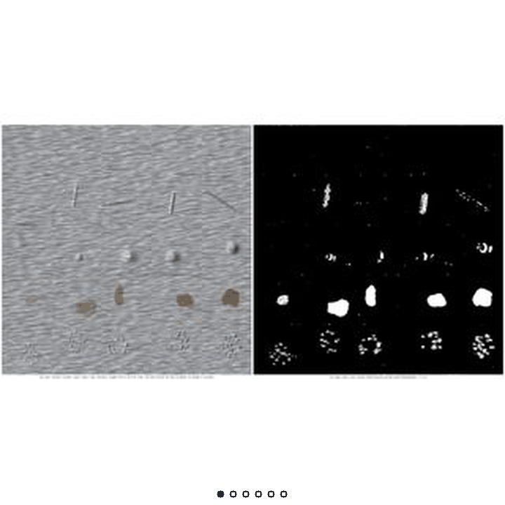
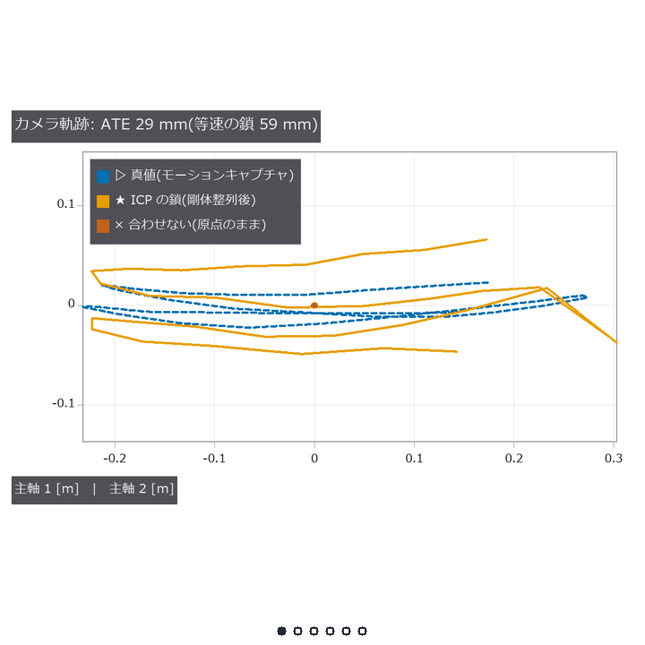

<div class="vlang" markdown="1">

**日本語** · [English](en/index.md) · [简体中文](zh/index.md) · [繁體中文](tw/index.md) · [한국어](ko/index.md) · [Deutsch](de/index.md) · [हिन्दी](hi/index.md) · [Français](fr/index.md)

</div>

# Fullseye — ViEW2026

物理シミュレーションと画像処理を AI と組み合わせて、真値で確かめる。

**発表: 2026 年 12 月 3 日(木) 14:40〜15:50、インタラクティブセッション 2、IS2-19**(パシフィコ横浜)

タイルを押すと動画・図が開きます(▶ = 動く)。

[Fullseye とは(読み物)](about.md)

本ページには展示 20 本だけを載せています。そのほかの展示 294 本は[おまけページ](more.md)にあります。

<style>
.vlang { font-size: 14px; line-height: 2; }
.vg { display: grid; grid-template-columns: repeat(2, minmax(0, 1fr)); gap: 8px; margin: 12px 0 20px; }
.vg.vs { grid-template-columns: repeat(3, minmax(0, 1fr)); gap: 6px; }
@media (min-width: 600px) { .vg { grid-template-columns: repeat(3, minmax(0, 1fr)); } .vg.vs { grid-template-columns: repeat(5, minmax(0, 1fr)); } }
@media (min-width: 900px) { .vg { grid-template-columns: repeat(4, minmax(0, 1fr)); } .vg.vs { grid-template-columns: repeat(7, minmax(0, 1fr)); } }
.vg a, .vser a { display: block; position: relative; text-decoration: none; color: inherit; }
.vg img { display: block; width: 100%; max-width: 100%; height: auto; aspect-ratio: 1 / 1; object-fit: cover; border-radius: 6px; background: #222; }
.vg picture { display: block; width: 100%; aspect-ratio: 1 / 1; overflow: hidden; border-radius: 6px; background: #fff; }
.vg picture img { height: 100%; aspect-ratio: auto; object-fit: contain; border-radius: 0; background: #fff; }
.vg b { position: absolute; top: 6px; right: 6px; background: rgba(0,0,0,.6); color: #fff; font-size: 12px; padding: 1px 6px; border-radius: 9px; }
.vg span { display: block; font-size: 13px; line-height: 1.3; margin-top: 3px; }
.vg.vs span { font-size: 11px; }
.vser { display: grid; grid-template-columns: repeat(2, minmax(0, 1fr)); gap: 8px; margin: 12px 0 20px; }
@media (min-width: 600px) { .vser { grid-template-columns: repeat(3, minmax(0, 1fr)); } }
.vser img { display: block; width: 100%; max-width: 100%; height: auto; aspect-ratio: 16 / 9; object-fit: cover; border-radius: 8px; background: #222; }
.vser strong { display: block; font-size: 14px; margin-top: 3px; line-height: 1.3; }
.vser span { display: block; font-size: 12px; line-height: 1.3; }
details.vall { margin: 6px 0; }
details.vall > summary { font-size: 15px; padding: 6px 0; cursor: pointer; }
.vl li { margin-bottom: 8px; }
</style>

<script>
(function () {
  try {
    var k = "fullseye_view2026_lang";
    if (localStorage.getItem(k)) return;
    localStorage.setItem(k, "seen");
    if (document.referrer && document.referrer.indexOf(location.host) >= 0) return;
    var n = (navigator.language || "").toLowerCase(), t = "";
    if (n.indexOf("zh") === 0) t = /tw|hk|mo|hant/.test(n) ? "tw" : "zh";
    else if (/^(en|ko|de|hi|fr)/.test(n)) t = n.slice(0, 2);
    if (t) location.replace(t + "/");
  } catch (e) {}
})();
</script>

## 触って見る

論文の図を、手元で動かして確かめられます(スマートフォンでも動きます)。タブで方法を切り替え、3-D はドラッグで回せます。

- **[工業用 OCT の層構造](viewers/industrial_oct_anim3d.html?lang=ja)**: 深さ方向を掃引し、塗膜の B スキャンと層厚の測定を動かして見る。 (4.0 MB)
- **[デフレクトメトリの面形状](viewers/phase_measuring_deflectometry_anim3d.html?lang=ja)**: 縞の位相を掃引し、写真では見えない表面の凹みが現れる過程を見る。 (14.9 MB)
- **[CAD と実測点群の差分検査](viewers/poc_cad_scan_deviation.html?lang=ja)**: 位置合わせが欠陥を吸い、真値 1.2 µm の部品に 121 µm の存在しないへこみが出る。
- **[光弾性の応力](viewers/poc_photoelasticity.html?lang=ja)**: 検光子を回すと光弾性縞が動き、円板内の平均輝度が変わる(0〜135° の範囲)
- **[偏光で鏡面除去](viewers/poc_polarization_specular.html?lang=ja)**: 偏光で鏡面の映り込みを剥がす。剥がし残りは入射角で変わり、ブリュースター角で最小(掃引は合成の縞の場面)
- **[パルスサーモグラフィの深さ推定](viewers/poc_thermography_ndt.html?lang=ja)**: 当てはめる時間窓を 25 秒から 4 秒に切るだけで、小さい欠陥の深さの誤差が最大 +627% から ±14% に縮む。外れた原因は物理でなく窓の選び方だった。

## 目玉

<div class="vg">
<a href="../articles/assets/poc/poc_phase_measuring_deflectometry/03_photo_vs_pmd.png"><picture><source media="(prefers-reduced-motion: reduce)" srcset="../articles/assets/poc/poc_phase_measuring_deflectometry/03_photo_vs_pmd.png"></picture><span>写真では見えない凹みが縞の鏡像で浮かぶ</span></a>
<a href="../articles/assets/poc/poc_industrial_oct/01_real_paint_bscans.png"><picture><source media="(prefers-reduced-motion: reduce)" srcset="../articles/assets/poc/poc_industrial_oct/01_real_paint_bscans.png"></picture><span>塗装の層の厚さを切らずに測る(工業用 OCT)</span></a>
<a href="../articles/assets/poc/poc_hyperspectral_foreign_matter/04_real_pork_belly.png"><picture><source media="(prefers-reduced-motion: reduce)" srcset="../articles/assets/poc/poc_hyperspectral_foreign_matter/01_real_polymer_flakes.png"></picture><span>肉と同じ色の異物を分光画像で見つける</span></a>
<a href="../articles/assets/poc/poc_thin_film_reflectometry/01_real_micrograph_thickness.png"><picture><source media="(prefers-reduced-motion: reduce)" srcset="../articles/assets/poc/poc_thin_film_reflectometry/01_real_micrograph_thickness.png"></picture><span>顕微鏡写真の色から酸化膜の厚さを地図に</span></a>
<a href="../articles/assets/poc/poc_telecentric_metrology/08_real_alignment_plate.png"><picture><source media="(prefers-reduced-motion: reduce)" srcset="../articles/assets/poc/poc_telecentric_metrology/08_real_alignment_plate.png"></picture><span>公開のテレセン実画像で倍率を論文と 0.05 % まで検算</span></a>
<a href="../articles/assets/poc/poc_virtual_sem_kv_cd_bse/05_sem_same_part_3kv_3detectors.png"><picture><source media="(prefers-reduced-motion: reduce)" srcset="../articles/assets/poc/poc_virtual_sem_kv_cd_bse/05_sem_same_part_3kv_3detectors.png"></picture><span>仮想 SEM: 加速電圧で像も線幅も変わる</span></a>
<a href="../articles/assets/poc/poc_cad_scan_deviation/14_align_orbit.gif"><picture><source media="(prefers-reduced-motion: reduce)" srcset="../articles/assets/poc/poc_cad_scan_deviation/01_scene.png"></picture><b>&#9654;</b><span>位置合わせが欠陥を隠す: CAD と点群の差</span></a>
<a href="../articles/assets/poc/poc_good_sample_variation_model/04_visa_explanation.png"><picture><source media="(prefers-reduced-motion: reduce)" srcset="../articles/assets/poc/poc_good_sample_variation_model/01_band_width_alignment.png"></picture><span>良品のばらつきで欠陥を探す: 実画像では誤検出率が守られない</span></a>
<a href="../articles/assets/poc/poc_surface_defect_classifiers/01_defect_patches.png"><picture><source media="(prefers-reduced-motion: reduce)" srcset="../articles/assets/poc/poc_surface_defect_classifiers/01_defect_patches.png"></picture><span>金属の表面の欠陥を学習した分類器で仕分ける ―― 研削の筋に沿う傷は 4 本に 3 本を見落とし、知らない孔は 95 % 拒否する</span></a>
<a href="../articles/assets/poc/poc_ai_built_inspection_scored/01_crack_real.png"><picture><source media="(prefers-reduced-motion: reduce)" srcset="../articles/assets/poc/poc_ai_built_inspection_scored/01_crack_real.png"></picture><span>AI が組んだ検査を実データの真値で採点</span></a>
<a href="../articles/assets/poc/poc_bottle_pattern_inverse/01_checker_through_bottle.png"><picture><source media="(prefers-reduced-motion: reduce)" srcset="../articles/assets/poc/poc_bottle_pattern_inverse/01_checker_through_bottle.png"></picture><span>背景の縞の歪みからガラス瓶を逆に測る(シミュレーション): 同じ仮定の下の復元と、分けられない量・検出できない誤差</span></a>
<a href="../articles/assets/poc/poc_real_tum_rgbd_slam/02_trajectory.png"><picture><source media="(prefers-reduced-motion: reduce)" srcset="../articles/assets/poc/poc_real_tum_rgbd_slam/02_trajectory.png"></picture><span>公開の実測 RGB-D で位置合わせを採点する ―― 誤差は 0.42 倍に減るが、等速の仮定とほぼ同じ水準</span></a>
<a href="../articles/assets/poc/poc_real_walnut_cbct/07_geometry_mistakes.png"><picture><source media="(prefers-reduced-motion: reduce)" srcset="../articles/assets/poc/poc_real_walnut_cbct/07_geometry_mistakes.png"></picture><span>実測 CT: 縦ずれを無視して参照から 2.6 倍遠くても、残差では見分けられない</span></a>
<a href="../articles/assets/poc/poc_3d_sensor_modalities/01_map.png"><picture><source media="(prefers-reduced-motion: reduce)" srcset="../articles/assets/poc/poc_3d_sensor_modalities/01_map.png"></picture><span>同じ部品を 3-D センサ 5 方式で測る</span></a>
</div>

- **[写真では見えない凹みが縞の鏡像で浮かぶ](../articles/assets/poc/poc_phase_measuring_deflectometry/03_photo_vs_pmd.png)**: 光沢のある塗装面のごく浅い凹みは、照明を当てた写真ではまず見えない。面の前の画面に縞を映し、その鏡像のゆがみから曲率を求めると、深さ 3 µm の凹みがはっきり浮かんだ。写真ではほぼ一様な面に、縞の鏡像からだけ凹みが現れる。
  真値: 自作合成 · [くわしく](more.md#d-poc-phase-measuring-deflectometry)
- **[塗装の層の厚さを切らずに測る(工業用 OCT)](../articles/assets/poc/poc_industrial_oct/01_real_paint_bscans.png)**: 塗装や多層フィルムの層の厚さを、切らずに奥行き方向から見たい。公開されている自動車塗装の生の干渉スペクトルから透明層の厚さを求め、論文の OCT の値と 1.5 µm 以内で一致した。分離できない薄い層には値を出さず、測れないと返す。
  真値: 実データ · [くわしく](more.md#d-poc-industrial-oct)
- **[肉と同じ色の異物を分光画像で見つける](../articles/assets/poc/poc_hyperspectral_foreign_matter/04_real_pork_belly.png)**: 肉や仁と同じ色の異物は、カラーカメラでは見分けられない。公開の実画像を分光画像として分類すると、豚バラの上の異物を誤警報 1.1 % で検出できた。帯域を減らすと誤警報が増え、合成データでは足りた条件が実データでは足りなかった。
  真値: 実データ · [くわしく](more.md#d-poc-hyperspectral-foreign-matter)
- **[顕微鏡写真の色から酸化膜の厚さを地図に](../articles/assets/poc/poc_thin_film_reflectometry/01_real_micrograph_thickness.png)**: シリコン上の酸化膜の厚さは、反射スペクトルの干渉縞や色から読み取れる。他の研究者が公開した実物の顕微鏡写真から、画素ごとの膜厚を中央値 87.4 nm として地図にした。基準の値とのずれは残り、カメラの色の感度は分かっていない。
  真値: 実データ · [くわしく](more.md#d-poc-thin-film-reflectometry)
- **[公開のテレセン実画像で倍率を論文と 0.05 % まで検算](../articles/assets/poc/poc_telecentric_metrology/08_real_alignment_plate.png)**: 段差のある部品を一枚の画像で測ると、普通のレンズでは近い面ほど大きく写り、寸法が違って読まれる。論文で公開されたテレセントリックレンズの実画像を測り、倍率が論文の値と 0.05 % の差で一致した。合成の章では、物体の高さが変わってもテレセントリックでは倍率がほとんど動かない。
  真値: 実データ · [くわしく](more.md#d-poc-telecentric-metrology)
- **[仮想 SEM: 加速電圧で像も線幅も変わる](../articles/assets/poc/poc_virtual_sem_kv_cd_bse/05_sem_same_part_3kv_3detectors.png)**: SEM の像は表面の写真ではなく、固体の中で散乱した電子のうち外へ出てきたものの集計である。電子を一つずつ追う模型を組み、反射電子の量を 7 元素の実測データベースと照合した。同じ線でも加速電圧を変えると、側壁のどの高さを線幅として測っているかが変わる。
  真値: 公表値 · [くわしく](more.md#d-poc-virtual-sem-kv-cd-bse)
- **[位置合わせが欠陥を隠す: CAD と点群の差](../articles/assets/poc/poc_cad_scan_deviation/14_align_orbit.gif)**: 点群を設計形状へ合わせてから検査すると、位置合わせが欠陥を吸収したり別の場所へ移したりする。へこみや反りを既知量で入れた部品を合わせ、欠陥のない対照にも66.5平方mmの公差外領域が出る条件を測った。図では、剛体運動に似た偏差は薄まり、稜線では対応先が隣面へ飛んで偽のへこみが現れる。
  真値: 自作合成 · [くわしく](more.md#d-poc-cad-scan-deviation)
- **[良品のばらつきで欠陥を探す: 実画像では誤検出率が守られない](../articles/assets/poc/poc_good_sample_variation_model/04_visa_explanation.png)**: 良品を何枚も撮り、画素ごとのいつものばらつきから外れた所を欠陥とするのは、外観検査の古典的な方法である。誤検出率を先に宣言して帯の幅を決めるようにし、公開の実画像 200 枚で採点した。位置合わせの有無が良品の枚数より効く一方、宣言した誤検出率は実画像では守られなかった。
  真値: 実データ · [くわしく](more.md#d-poc-good-sample-variation-model)
- **[金属の表面の欠陥を学習した分類器で仕分ける ―― 研削の筋に沿う傷は 4 本に 3 本を見落とし、知らない孔は 95 % 拒否する](../articles/assets/poc/poc_surface_defect_classifiers/01_defect_patches.png)**: 研削した金属の小片に、傷・打痕・汚れを物理で描き、学習した分類器で仕分けた。汚れの画素は、正常な画素から学んだ分類で 重なり 0.915 まで塗り分けられた。一方、研削の筋に沿う傷は見落としやすく、知らない孔は拒否される。
  真値: 自作合成 · [くわしく](more.md#d-poc-surface-defect-classifiers)
- **[AI が組んだ検査を実データの真値で採点](../articles/assets/poc/poc_ai_built_inspection_scored/01_crack_real.png)**: 課題を自然言語で渡して AI に検査のレシピを組ませた。公開のひび割れ画像 400 枚を配布元のラベルで採点し、失敗の原因を道具・MCP・模型に分けた。クラウドの LLM は偶然を超えて選り分けたが、既存のレシピには届かなかった。
  真値: 実データ · [くわしく](more.md#d-poc-ai-built-inspection-scored)
- **[背景の縞の歪みからガラス瓶を逆に測る(シミュレーション): 同じ仮定の下の復元と、分けられない量・検出できない誤差](../articles/assets/poc/poc_bottle_pattern_inverse/01_checker_through_bottle.png)**: 透明な瓶は後ろの縞を歪めて見せる。画素ごとに背景の位置を求め、外半径・壁厚・屈折率・液面を逆に当てはめて、充填 5 通りの真値で採点した。分けられない量と検出できない誤差も出すが、真値は自作のシミュレーションである。
  真値: 自作合成 · [くわしく](more.md#d-poc-bottle-pattern-inverse)
- **[公開の実測 RGB-D で位置合わせを採点する ―― 誤差は 0.42 倍に減るが、等速の仮定とほぼ同じ水準](../articles/assets/poc/poc_real_tum_rgbd_slam/02_trajectory.png)**: 机の上を撮った公開データの深度画像で、隣り合う画像の位置合わせをモーションキャプチャの真値と比べた。合わせないときの 0.42 倍まで誤差は減ったが、直前の動きを使う等速の仮定とほぼ同じ水準だった。小さな窓の平面の残差は距離とともに増えたが、量子化と窓の広さが混ざり、距離の二乗かどうかは決められなかった。
  真値: 実データ · [くわしく](more.md#d-poc-real-tum-rgbd-slam)
- **[実測 CT: 縦ずれを無視して参照から 2.6 倍遠くても、残差では見分けられない](../articles/assets/poc/poc_real_walnut_cbct/07_geometry_mistakes.png)**: 公開されている実測のコーンビーム CT(クルミ)を、FDK と反復法で再構成した。投影 300 枚を使い、配布元の参照で採点すると、縦ずれを無視した再構成は参照からかなり遠くなる。それなのに再投影の残差では、その差が見分けられない。
  真値: 実データ · [くわしく](more.md#d-poc-real-walnut-cbct)
- **[同じ部品を 3-D センサ 5 方式で測る](../articles/assets/poc/poc_3d_sensor_modalities/01_map.png)**: 同じ部品を、方式の違う立体センサで、つや消し・金属光沢・半透明・黒の材質ごとに測った。形の外れを共通の物差し 0.1 mm で数え、寸法表の真値と比べた。どの材質のどこで壊れるかは方式ごとに違う。
  真値: 自作合成 · [くわしく](more.md#d-poc-3d-sensor-modalities)

## 準目玉

<div class="vg">
<a href="../articles/assets/poc/poc_equipment_selection_map/02_equipment_at_a_glance.png"><picture><source media="(prefers-reduced-motion: reduce)" srcset="../articles/assets/poc/poc_equipment_selection_map/02_equipment_at_a_glance.png"></picture><span>照明 × カメラ × レンズ 60 通りで同じ傷を撮る機材選びの地図</span></a>
<a href="../articles/assets/poc/poc_real_stereo_multiscanline/02_failure_map.png"><picture><source media="(prefers-reduced-motion: reduce)" srcset="../articles/assets/poc/poc_real_stereo_multiscanline/02_failure_map.png"></picture><span>実写のステレオで視差・面・円の姿勢</span></a>
<a href="../articles/assets/poc/poc_real_defect_floor/03_defect_floor_explained.mp4"><b>&#9654;</b><span>雑音をそろえても実写の地では薄い傷が見えにくい</span></a>
<a href="../articles/assets/poc/poc_sam_hybrid_bonding_voids/03_amplitude_vs_phase.png"><picture><source media="(prefers-reduced-motion: reduce)" srcset="../articles/assets/poc/poc_sam_hybrid_bonding_voids/03_amplitude_vs_phase.png"></picture><span>接合面のボイドを超音波の位相で見つける</span></a>
<a href="../articles/assets/poc/poc_photoelasticity/03_load_and_isoclinics.mp4"><picture><source media="(prefers-reduced-motion: reduce)" srcset="../articles/assets/poc/poc_photoelasticity/01_polariscope.png"></picture><b>&#9654;</b><span>押した円板の応力が縞で見える(光弾性)</span></a>
<a href="../articles/assets/poc/poc_mixed_case_depalletizing/08_depal_robot_video.mp4"><picture><source media="(prefers-reduced-motion: reduce)" srcset="../articles/assets/poc/poc_mixed_case_depalletizing/01_overview_same_pattern.png"></picture><b>&#9654;</b><span>混載パレットの箱: 深度の段差・V 字・カラーの溝で分ける</span></a>
</div>

- **[照明 × カメラ × レンズ 60 通りで同じ傷を撮る機材選びの地図](../articles/assets/poc/poc_equipment_selection_map/02_equipment_at_a_glance.png)**: 外観検査の機材選びを、同じ傷で事前に試した。照明・カメラ・レンズの 60 通りで撮り、何 µm の傷から見つかるかを揺れの幅つきで地図にした。合成の試験なので、実機の性能ではない。
  真値: 自作合成 · [くわしく](more.md#d-poc-equipment-selection-map)
- **[実写のステレオで視差・面・円の姿勢](../articles/assets/poc/poc_real_stereo_multiscanline/02_failure_map.png)**: 実写のステレオ対から、視差・距離・面・円の姿勢まで求めた。Middlebury 2014 の真値の視差で平均誤差を採点し、OpenCV と比べた。壊れる場所は地図にして示した。
  真値: 実データ · [くわしく](more.md#d-poc-real-stereo-multiscanline)
- **[雑音をそろえても実写の地では薄い傷が見えにくい](../articles/assets/poc/poc_real_defect_floor/03_defect_floor_explained.mp4)**: 検査の現場では、薄い傷がどこまで見えるかを平らな地に雑音を載せた合成画像で見積もることが多い。雑音の量をそろえても、実写のレンガの地では検出限界が合成の 3.47 倍まで悪くなった。限界を決めていたのは雑音ではなく、目地のような地の構造だった。
  真値: 実写の地 · [くわしく](more.md#d-poc-real-defect-floor)
- **[接合面のボイドを超音波の位相で見つける](../articles/assets/poc/poc_sam_hybrid_bonding_voids/03_amplitude_vs_phase.png)**: 積み重ねたチップの接合面にできる小さなボイドを、超音波顕微鏡で探す。直径 16 µm 以上のボイドは、反射の位相の像ですべて反転して光った。明るさの像では、小さなボイドの多くが良品に紛れる。
  真値: 自作合成 · [くわしく](more.md#d-poc-sam-hybrid-bonding-voids)
- **[押した円板の応力が縞で見える(光弾性)](../articles/assets/poc/poc_photoelasticity/03_load_and_isoclinics.mp4)**: 透明な樹脂に力を加えて偏光を通すと、内部の応力が縞として見える。円板を押しつぶした応力場を偏光像にし、縞次数が 0.5 を超えて位相が巻いた画素から応力を戻した。巻き戻した後に外れた画素は、ほとんどが巻きではなく符号の二義性によるものだった。
  真値: 自作合成 · [くわしく](more.md#d-poc-photoelasticity)
- **[混載パレットの箱: 深度の段差・V 字・カラーの溝で分ける](../articles/assets/poc/poc_mixed_case_depalletizing/08_depal_robot_video.mp4)**: 詰めて並んだ同じ柄の段ボールを、天井の深度カメラとカラーで見分けて下ろす。深度の段差では同じ柄の箱を分けられず、深度の浅い溝とカラーの暗い溝の勝ち負けは、天面の合わせ目の作り 28 通りの地図で入れ替わった。同じ柄では合わせ目が深いとカラー、切り口が広く開きテープが無く溝が浅いときだけ深度の溝が上になる。
  真値: 自作合成 · [くわしく](more.md#d-poc-mixed-case-depalletizing)

## シリーズ記事

<div class="vser">
<a href="https://qiita.com/furuse-kazufumi/items/c1606bcfa2085d204ad6"><strong>紙面の計測館</strong><span>真値を自分で仕込んだ PoC の展示館</span></a>
<a href="https://qiita.com/furuse-kazufumi/items/b6498dc822bf9eed100f"><strong>卓球</strong><span>跳ねと摩擦を映像から測る</span></a>
<a href="https://qiita.com/furuse-kazufumi/items/1f128b8a36df373c11c7"><strong>自動運転</strong><span>定理と第 2 実装で採点する</span></a>
<a href="https://qiita.com/furuse-kazufumi/items/331af639c2b9a1493576"><strong>コネクトーム(脳の配線図)</strong><span>ハエの視覚モデルを体に載せて測る</span></a>
<a href="https://qiita.com/furuse-kazufumi/items/57e2f1e5a09165e58b65"><strong>ヒューマノイド運動会</strong><span>画像処理が審判をする自宅の運動会</span></a>
</div>

## Fullseye とは

光学設計や三次元計測などのセンシングを含む物理シミュレーションと古典画像処理を、MCP と RAG で AI に渡し、課題ごとに組み合わせを考えさせ、型整合性と真値つき評価で確かめながら対話的に課題を解く基盤です。オープンソース(Apache-2.0)。

[おまけ:そのほかの PoC](more.md)も見る。

<details markdown="1">
<summary><b>試してみる</b> (Python 3.11)</summary>

```
pip install fullseye
git clone https://github.com/furuse-kazufumi/fullseye
cd fullseye
python examples/poc_focus_stacking.py
```

焦点合成の PoC が約 20 秒で走り、真値に対する数字と `PASS` を印字します。図は `out/figures/poc_focus_stacking/` に書かれます。

</details>

<details markdown="1">
<summary><b>リンク</b></summary>

- [GitHub(ソースコード)](https://github.com/furuse-kazufumi/fullseye)
- [ギャラリー(全部の図)](../GALLERY.md)
- [演算子を探す・AI(RAG)から使う](../AI_RAG_GUIDE.md) · [MCP から使う](../MCP.md)
- [ドキュメント索引](../README.md)

</details>

<details markdown="1">
<summary><b>論文情報</b></summary>

- **題目**: Fullseye：型付き演算子と物理シミュレーションに基づく画像検査・三次元計測基盤
- **著者**: 古瀬 和文(個人研究者)
- **発表**: ViEW2026 ビジョン技術の実利用ワークショップ
- **論文 PDF**: [English](paper/101_en.pdf) · [简体中文](paper/101_zh.pdf)(日本語: 2026-11-26 以降に掲載)

**概要**: 画像検査・三次元計測の処理を，入出力のデータ型を宣言した演算子の連鎖として組み立て，物理・撮像シミュレーションで作った真値に対して定量評価し，処理手順・評価・失敗条件を記録して再利用できるオープンソース基盤Fullseyeを提案する．約3,000の型付き演算子，型の不整合を実行前に退ける検査，多言語の演算子検索（RAG），真値つきの200本超の実証プログラムからなり，代表例の定量評価と，合成・実測・実機の検証段階の区別について報告する．

</details>
