<div class="vlang" markdown="1">

**日本語** · [English](en/index.md) · [简体中文](zh/index.md) · [繁體中文](tw/index.md) · [한국어](ko/index.md) · [Deutsch](de/index.md) · [हिन्दी](hi/index.md) · [Français](fr/index.md)

</div>

# Fullseye — ViEW2026

物理シミュレーションと画像処理を AI と組み合わせて、真値で確かめる。

**発表: 2026 年 12 月 3 日(木) 14:40〜15:50、インタラクティブセッション 2、IS2-19**(パシフィコ横浜)

タイルを押すと動画・図が開きます(▶ = 動く)。

[Fullseye とは(読み物)](about.md)

<style>
.vlang { font-size: 14px; line-height: 2; }
.vg { display: grid; grid-template-columns: repeat(2, minmax(0, 1fr)); gap: 8px; margin: 12px 0 20px; }
.vg.vs { grid-template-columns: repeat(3, minmax(0, 1fr)); gap: 6px; }
@media (min-width: 600px) { .vg { grid-template-columns: repeat(3, minmax(0, 1fr)); } .vg.vs { grid-template-columns: repeat(5, minmax(0, 1fr)); } }
@media (min-width: 900px) { .vg { grid-template-columns: repeat(4, minmax(0, 1fr)); } .vg.vs { grid-template-columns: repeat(7, minmax(0, 1fr)); } }
.vg a, .vser a { display: block; position: relative; text-decoration: none; color: inherit; }
.vg img { display: block; width: 100%; max-width: 100%; height: auto; aspect-ratio: 1 / 1; object-fit: cover; border-radius: 6px; background: #222; }
.vg picture { display: block; width: 100%; aspect-ratio: 1 / 1; overflow: hidden; border-radius: 6px; background: #fff; }
.vg picture img { height: 100%; aspect-ratio: auto; object-fit: contain; border-radius: 0; background: #fff; }
.vg b { position: absolute; top: 6px; right: 6px; background: rgba(0,0,0,.6); color: #fff; font-size: 12px; padding: 1px 6px; border-radius: 9px; }
.vg span { display: block; font-size: 13px; line-height: 1.3; margin-top: 3px; }
.vg.vs span { font-size: 11px; }
.vser { display: grid; grid-template-columns: repeat(2, minmax(0, 1fr)); gap: 8px; margin: 12px 0 20px; }
@media (min-width: 600px) { .vser { grid-template-columns: repeat(3, minmax(0, 1fr)); } }
.vser img { display: block; width: 100%; max-width: 100%; height: auto; aspect-ratio: 16 / 9; object-fit: cover; border-radius: 8px; background: #222; }
.vser strong { display: block; font-size: 14px; margin-top: 3px; line-height: 1.3; }
.vser span { display: block; font-size: 12px; line-height: 1.3; }
details.vall { margin: 6px 0; }
details.vall > summary { font-size: 15px; padding: 6px 0; cursor: pointer; }
.vl li { margin-bottom: 8px; }
</style>

<script>
(function () {
  try {
    var k = "fullseye_view2026_lang";
    if (localStorage.getItem(k)) return;
    localStorage.setItem(k, "seen");
    if (document.referrer && document.referrer.indexOf(location.host) >= 0) return;
    var n = (navigator.language || "").toLowerCase(), t = "";
    if (n.indexOf("zh") === 0) t = /tw|hk|mo|hant/.test(n) ? "tw" : "zh";
    else if (/^(en|ko|de|hi|fr)/.test(n)) t = n.slice(0, 2);
    if (t) location.replace(t + "/");
  } catch (e) {}
})();
</script>

## 触って見る

論文の図を、手元で動かして確かめられます(スマートフォンでも動きます)。タブで方法を切り替え、3-D はドラッグで回せます。

- **[CAD と実測点群の差分検査](viewers/poc_cad_scan_deviation.html?lang=ja)**: 位置合わせが欠陥を吸い、真値 1.2 µm の部品に 121 µm の存在しないへこみが出る。
- **[LiDAR の地形変化](viewers/poc_lidar_terrain_change.html?lang=ja)**: 素朴に引くと、変化の無い区画全体が 0.183 m 沈んで見える。補正すると、本当の変化だけが残る。
- **[テンプレート追跡](viewers/poc_template_tracking.html?lang=ja)**: そっくりな別物体に乗り換えても、追跡は「見つけた」と報告し続ける。
- **[パルスサーモグラフィの深さ推定](viewers/poc_thermography_ndt.html?lang=ja)**: 当てはめる時間窓を 25 秒から 4 秒に切るだけで、小さい欠陥の深さの誤差が最大 +627% から ±14% に縮む。外れた原因は物理でなく窓の選び方だった。
- **[タルボ絨毯と格子の X 線像](viewers/poc_grating_interferometry.html?lang=ja)**: 吸収では割れのコントラスト雑音比が 1.34 しかないが、暗視野では 13.5 に上がり、格子を回すと繊維の向きまで読める。
- **[縞の鏡像で見る µm の凹み](viewers/poc_phase_measuring_deflectometry.html?lang=ja)**: 写真の信号は雑音の 0.17 倍で何も見えないが、縞の鏡像から作る曲率の地図では、深さ 1 µm の凹みが雑音の 57 倍に立つ。
- **[小惑星の表面の曲がり具合](viewers/poc_asteroid_curvature.html?lang=ja)**: 実在の小惑星の点群から曲率を出し、尾根や巨礫の縁を色で見る。答えの分かる球で、先に物差しを確かめてある。
- **[焦点合成](viewers/poc_focus_stacking.html?lang=ja)**: F値を上げるほど焦点合成像が真のテクスチャに近づく
- **[白色干渉の段差](viewers/poc_interferometry_step.html?lang=ja)**: 雑音が増えると白色干渉の段差誤差が広がる
- **[偏光で鏡面除去](viewers/poc_polarization_specular.html?lang=ja)**: 偏光で鏡面の映り込みを剥がす。剥がし残りは入射角で変わり、ブリュースター角で最小(掃引は合成の縞の場面)
- **[光弾性の応力](viewers/poc_photoelasticity.html?lang=ja)**: 検光子を回すと光弾性縞が動き、平均輝度が周期的に変わる
- **[ハエの複眼](viewers/poc_compound_eye.html?lang=ja)**: 視点ごとのSNRを上げるほど複眼像が無雑音像に近づく
- **[接合層のボイド](viewers/poc_ct_void_morphology.html?lang=ja)**: しきい値を上げるほどボイド判定が広がり、体積率が増える
- **[動的輪郭](viewers/poc_active_contours.html?lang=ja)**: 反復を重ねるほどGVF輪郭が最終形へ近づく

## 見どころ

<div class="vg">
<a href="../articles/assets/poc/poc_phase_measuring_deflectometry/03_photo_vs_pmd.png"><picture><source media="(prefers-reduced-motion: reduce)" srcset="../articles/assets/poc/poc_phase_measuring_deflectometry/03_photo_vs_pmd.png">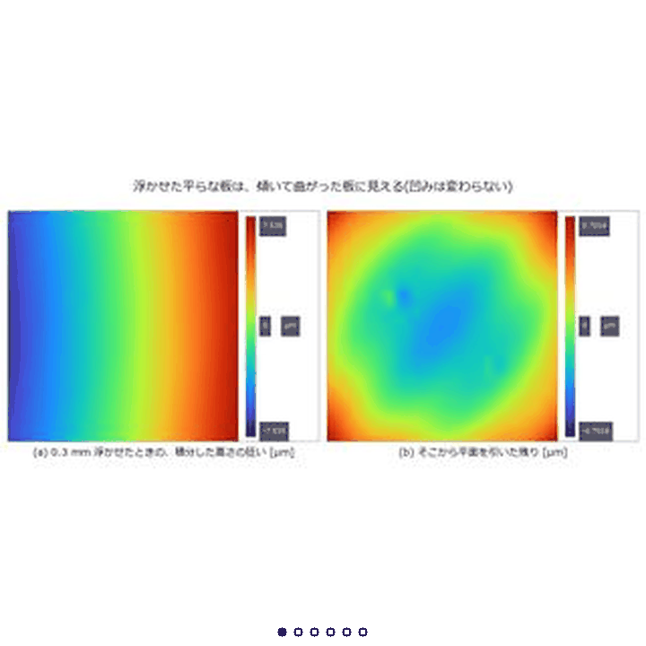</picture><span>写真では見えない凹みが縞の鏡像で浮かぶ</span></a>
<a href="../articles/assets/poc/poc_industrial_oct/01_real_paint_bscans.png"><picture><source media="(prefers-reduced-motion: reduce)" srcset="../articles/assets/poc/poc_industrial_oct/01_real_paint_bscans.png">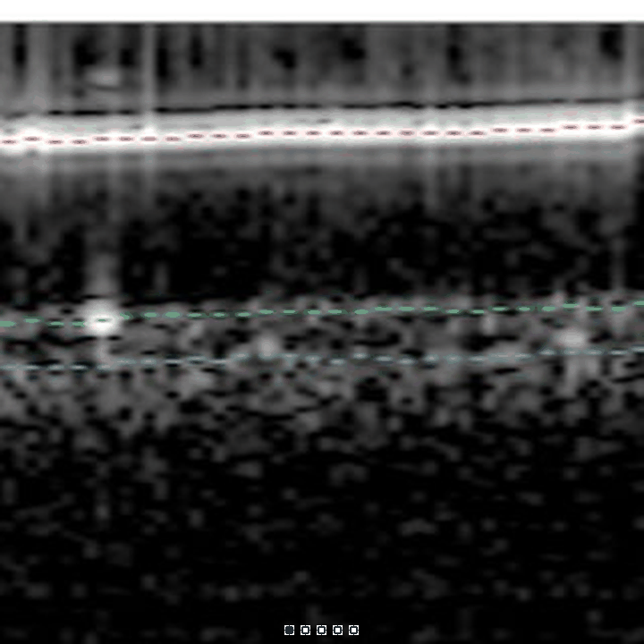</picture><span>塗装の層の厚さを切らずに測る(工業用 OCT)</span></a>
<a href="../articles/assets/poc/poc_hyperspectral_foreign_matter/04_real_pork_belly.png"><picture><source media="(prefers-reduced-motion: reduce)" srcset="../articles/assets/poc/poc_hyperspectral_foreign_matter/01_real_polymer_flakes.png"></picture><span>肉と同じ色の異物を分光画像で見つける</span></a>
<a href="../articles/assets/poc/poc_equipment_selection_map/02_equipment_at_a_glance.png"><picture><source media="(prefers-reduced-motion: reduce)" srcset="../articles/assets/poc/poc_equipment_selection_map/02_equipment_at_a_glance.png">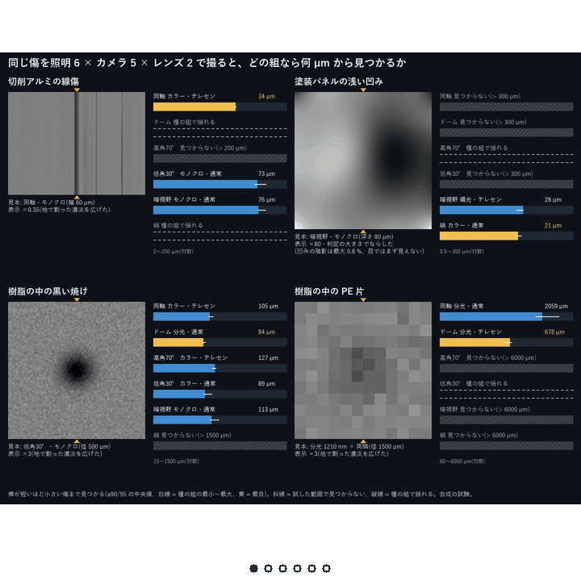</picture><span>照明 × カメラ × レンズ 60 通りで同じ傷を撮る機材選びの地図</span></a>
<a href="../articles/assets/poc/poc_tdi_linescan/01_tdi_stages_defects.png"><picture><source media="(prefers-reduced-motion: reduce)" srcset="../articles/assets/poc/poc_tdi_linescan/01_tdi_stages_defects.png">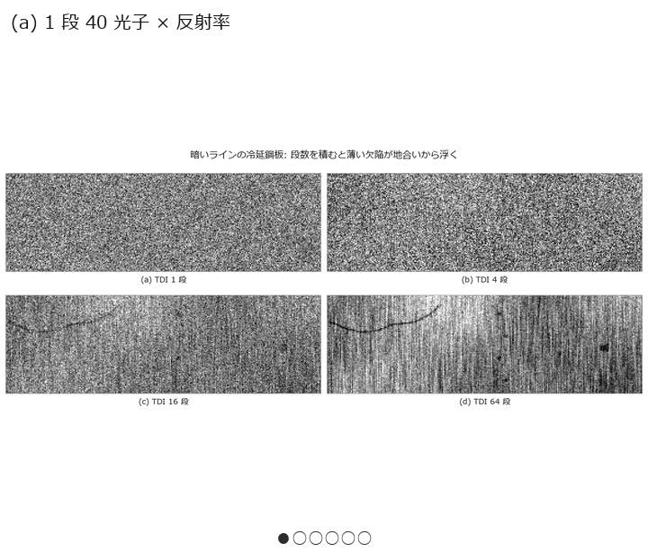</picture><span>暗いラインでも TDI を積むと薄い傷が浮く</span></a>
<a href="../articles/assets/poc/poc_itof_multifreq/12_public_raw_unwrap.png"><picture><source media="(prefers-reduced-motion: reduce)" srcset="../articles/assets/poc/poc_itof_multifreq/01_warehouse_unwrap.png"></picture><span>間接 ToF の距離はどこで壊れるか</span></a>
<a href="../articles/assets/poc/poc_weld_radiograph_porosity/02_map_detections.png"><picture><source media="(prefers-reduced-motion: reduce)" srcset="../articles/assets/poc/poc_weld_radiograph_porosity/02_map_detections.png"></picture><span>溶接 X 線像の気孔: 固定しきい値は余盛の縁まで拾う</span></a>
<a href="../articles/assets/poc/poc_fourier_ptychography/01_usaf_4x_fp_20x.png"><picture><source media="(prefers-reduced-motion: reduce)" srcset="../articles/assets/poc/poc_fourier_ptychography/01_usaf_4x_fp_20x.png"></picture><span>4 倍の視野のまま 20 倍の解像(フーリエ・タイコグラフィ)</span></a>
<a href="../articles/assets/poc/poc_code_matching_breakdown/05_highlight_sweep.gif"><picture><source media="(prefers-reduced-motion: reduce)" srcset="../articles/assets/poc/poc_code_matching_breakdown/01_breakdown_occlusion.png">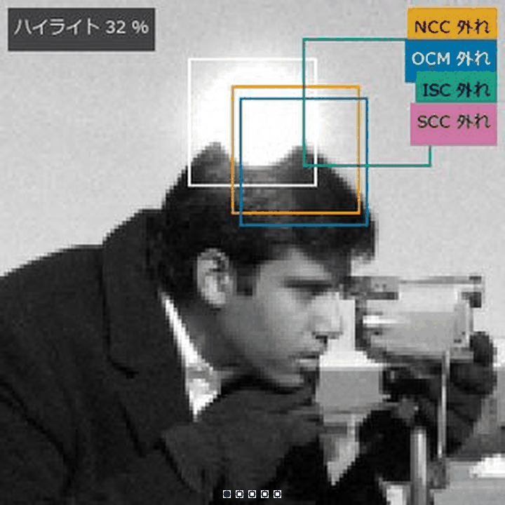</picture><b>&#9654;</b><span>白飛びや隠れに強い符号の照合</span></a>
<a href="../articles/assets/poc/poc_good_sample_variation_model/04_visa_explanation.png"><picture><source media="(prefers-reduced-motion: reduce)" srcset="../articles/assets/poc/poc_good_sample_variation_model/01_band_width_alignment.png">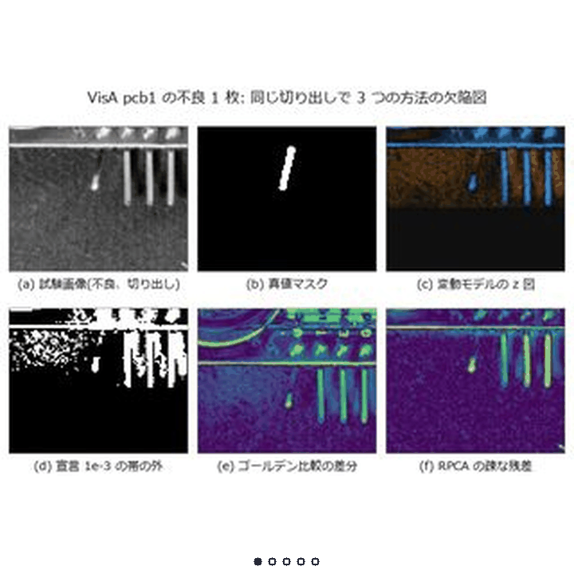</picture><span>良品のばらつきで欠陥を探す: 実画像では誤検出率が守られない</span></a>
<a href="../articles/assets/poc/poc_real_defect_floor/03_defect_floor_explained.mp4"><b>&#9654;</b><span>雑音をそろえても実写の地では薄い傷が見えにくい</span></a>
<a href="../articles/assets/poc/poc_illumination_cone_vs_na/02_works_by_cone.png"><picture><source media="(prefers-reduced-motion: reduce)" srcset="../articles/assets/poc/poc_illumination_cone_vs_na/02_works_by_cone.png"></picture><span>照明の円錐の開きで打痕や傷が見えたり消えたりする</span></a>
<a href="../articles/assets/poc/poc_telecentric_metrology/08_real_alignment_plate.png"><picture><source media="(prefers-reduced-motion: reduce)" srcset="../articles/assets/poc/poc_telecentric_metrology/08_real_alignment_plate.png"></picture><span>公開のテレセン実画像で倍率を論文と 0.05 % まで検算</span></a>
<a href="../articles/assets/poc/poc_simcal_telecentric/02_real_model_residuals.png"><picture><source media="(prefers-reduced-motion: reduce)" srcset="../articles/assets/poc/poc_simcal_telecentric/02_real_model_residuals.png"></picture><span>テレセンの実画像 1 枚で較正し、合わない所も示す</span></a>
<a href="../articles/assets/poc/poc_cad_scan_deviation/14_align_orbit.gif"><picture><source media="(prefers-reduced-motion: reduce)" srcset="../articles/assets/poc/poc_cad_scan_deviation/01_scene.png">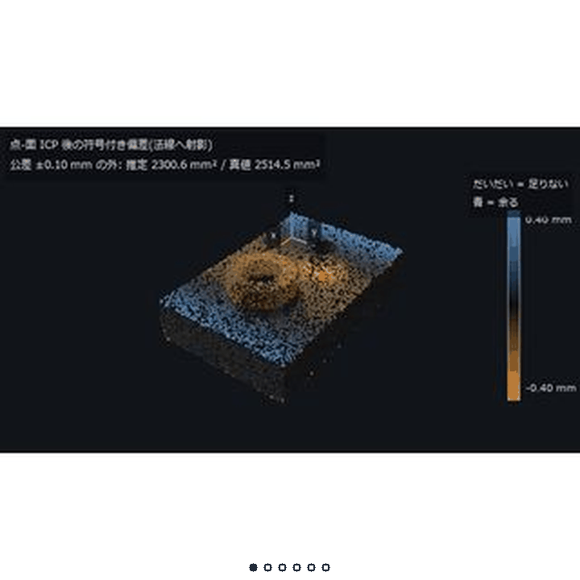</picture><b>&#9654;</b><span>位置合わせが欠陥を隠す: CAD と点群の差</span></a>
<a href="../articles/assets/poc/poc_lidar_terrain_change/13_real_dod.png"><span>2 時期の航空 LiDAR: 系統差を引かないと全面が掘れて見える</span></a>
<a href="../articles/assets/poc/poc_real_stereo_depth/01_scene.png"><picture><source media="(prefers-reduced-motion: reduce)" srcset="../articles/assets/poc/poc_real_stereo_depth/01_scene.png">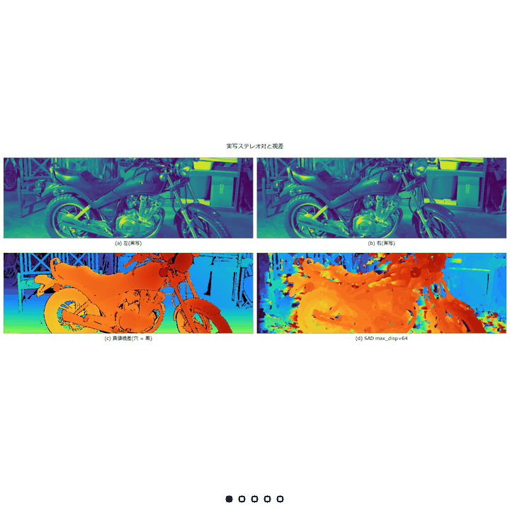</picture><span>実写ステレオ: 視差の探索幅が足りないと前景が全部外れる</span></a>
<a href="../articles/assets/poc/poc_sem_tem_same_particle/08_tem_focus_sweep.gif"><picture><source media="(prefers-reduced-motion: reduce)" srcset="../articles/assets/poc/poc_sem_tem_same_particle/02_same_specimen_sem_tem.png"></picture><b>&#9654;</b><span>同じ粒子でも SEM と TEM で粒径が数 nm ずれる</span></a>
<a href="../articles/assets/poc/poc_tem_ctf_thon_rings/12_real_empiar_10028.png"><picture><source media="(prefers-reduced-motion: reduce)" srcset="../articles/assets/poc/poc_tem_ctf_thon_rings/02_thon_rings_four_defoci.png"></picture><span>実の電顕像から焦点外れを推定、著者の値と 0.2 % 以内</span></a>
<a href="../articles/assets/poc/poc_thin_film_reflectometry/01_real_micrograph_thickness.png"><picture><source media="(prefers-reduced-motion: reduce)" srcset="../articles/assets/poc/poc_thin_film_reflectometry/01_real_micrograph_thickness.png"></picture><span>顕微鏡写真の色から酸化膜の厚さを地図に</span></a>
<a href="../articles/assets/poc/poc_sam_hybrid_bonding_voids/03_amplitude_vs_phase.png"><picture><source media="(prefers-reduced-motion: reduce)" srcset="../articles/assets/poc/poc_sam_hybrid_bonding_voids/03_amplitude_vs_phase.png">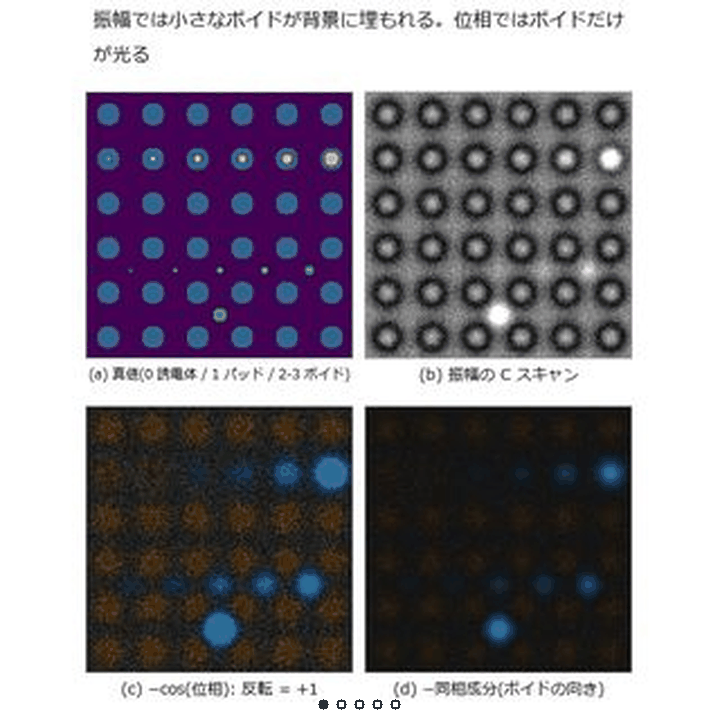</picture><span>接合面のボイドを超音波の位相で見つける</span></a>
<a href="../articles/assets/poc/poc_optics_drawings/06_setup_ring_coaxial.png"><picture><source media="(prefers-reduced-motion: reduce)" srcset="../articles/assets/poc/poc_optics_drawings/06_setup_ring_coaxial.png"></picture><span>計算から装置の設置図とレンズの図面を描く</span></a>
<a href="../articles/assets/poc/poc_crack_width_timeseries/11_series_video.gif"><b>&#9654;</b><span>ひび割れの伸び: 2 値化で数えると速さを 2.5 倍に見誤る</span></a>
<a href="../articles/assets/poc/poc_moire_alignment/01_marks.png"><picture><source media="(prefers-reduced-motion: reduce)" srcset="../articles/assets/poc/poc_moire_alignment/02_one_nm_steps.png"></picture><span>見えない格子 2 枚を重ね、モアレ縞で nm のずれを読む</span></a>
<a href="../articles/assets/poc/poc_laser_line_speckle_floor/01_line.png"><picture><source media="(prefers-reduced-motion: reduce)" srcset="../articles/assets/poc/poc_laser_line_speckle_floor/01_line.png"></picture><span>レーザー光切断の粒々(スペックル)が高さ精度の床を決める</span></a>
<a href="../articles/assets/poc/poc_weld_bead_scan_angle/02_frames.png"><picture><source media="(prefers-reduced-motion: reduce)" srcset="../articles/assets/poc/poc_weld_bead_scan_angle/02_frames.png"></picture><span>溶接ビードの光切断: 角度を上げるとアンダーカットが自分の陰で欠ける</span></a>
<a href="../articles/assets/poc/poc_am_thermal_to_ct/07_ct_hole_crown.png"><span>積層造形品の実 CT で下向き面の荒れを測る</span></a>
<a href="../articles/assets/poc/poc_thermography_ndt/07_window_explained.mp4"><picture><source media="(prefers-reduced-motion: reduce)" srcset="../articles/assets/poc/poc_thermography_ndt/01_depth_table.png">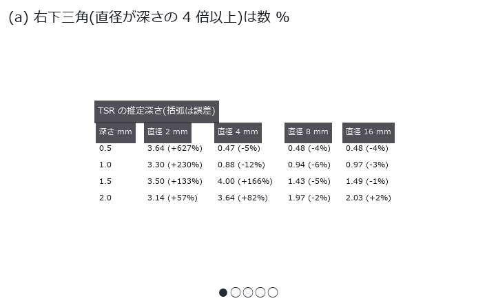</picture><b>&#9654;</b><span>熱画像で剥離の深さ: 時間窓しだいで答えが変わる</span></a>
<a href="../articles/assets/poc/poc_photoelasticity/03_load_and_isoclinics.mp4"><picture><source media="(prefers-reduced-motion: reduce)" srcset="../articles/assets/poc/poc_photoelasticity/01_polariscope.png"></picture><b>&#9654;</b><span>押した円板の応力が縞で見える(光弾性)</span></a>
<a href="../articles/assets/poc/poc_interferometry_step/09_csi_scan_explained.mp4"><b>&#9654;</b><span>白色干渉でナノメートルの段差を測る</span></a>
<a href="../articles/assets/poc/poc_virtual_sem_kv_cd_bse/05_sem_same_part_3kv_3detectors.png"><picture><source media="(prefers-reduced-motion: reduce)" srcset="../articles/assets/poc/poc_virtual_sem_kv_cd_bse/05_sem_same_part_3kv_3detectors.png">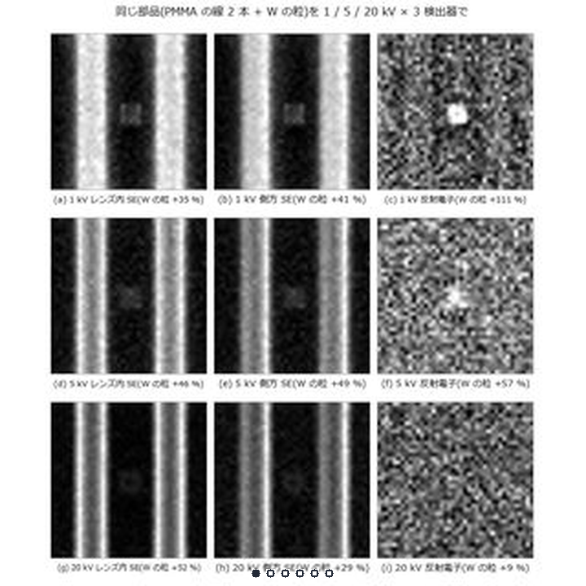</picture><span>仮想 SEM: 加速電圧で像も線幅も変わる</span></a>
<a href="../articles/assets/poc/poc_glyph_typo_detection/01_sign_before_after.png"><span>看板の誤字を読まずに見つけて直す</span></a>
<a href="../articles/assets/poc/poc_weed_rice_ratio/05_real_examples.png"><picture><source media="(prefers-reduced-motion: reduce)" srcset="../articles/assets/poc/poc_weed_rice_ratio/05_real_examples.png">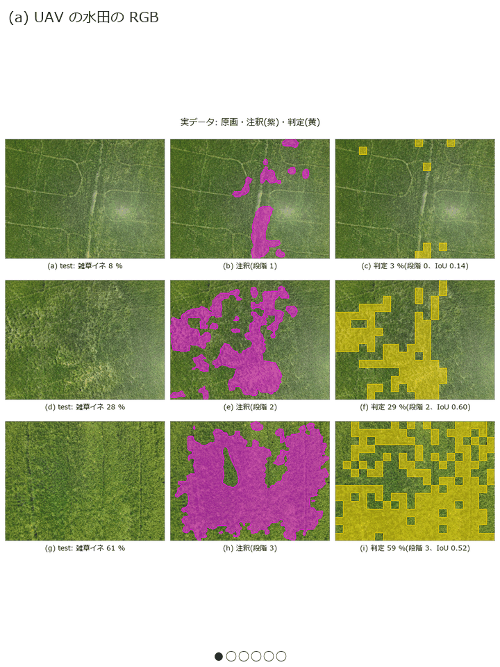</picture><span>ドローン写真で水田の雑草イネの広がりを判定</span></a>
<a href="../articles/assets/poc/poc_stockpile_volume/07_scan_orbit.mp4"><b>&#9654;</b><span>堆積物の体積: 見えない底面と裏側が誤差を決める</span></a>
<a href="../articles/assets/poc/poc_strain_history/01_speckle.png"><span>画像相関のひずみ: 隣のコマと比べて足すと誤差が 31 分の 1</span></a>
<a href="../articles/assets/poc/poc_pegsim_insertion/04_pegsim_insert_corrected.gif"><b>&#9654;</b><span>手首カメラで穴に寄せてペグを入れる(12 / 12 成功)</span></a>
<a href="../articles/assets/media/evis_bean_track_fullseye.mp4"><b>&#9654;</b><span>箸先カメラで豆を見失わずに追う(シミュレータ)</span></a>
<a href="../articles/assets/media/evis_stereo_fullseye.mp4"><b>&#9654;</b><span>両眼ステレオで豆までの距離を測る(シミュレータ)</span></a>
<a href="https://youtu.be/XN1mGAftSlY"><b>&#9654;</b><span>霞のヘアピンを登る(CARLA)</span></a>
<a href="https://youtu.be/6J3chWv5yHg">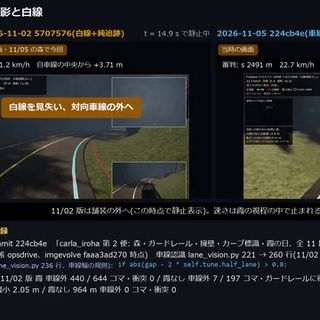<b>&#9654;</b><span>部品を足す前と後(運転の 9 章)</span></a>
</div>

## シリーズ記事

<div class="vser">
<a href="https://qiita.com/furuse-kazufumi/items/c1606bcfa2085d204ad6"><strong>紙面の計測館</strong><span>真値を自分で仕込んだ PoC の展示館</span></a>
<a href="https://qiita.com/furuse-kazufumi/items/b6498dc822bf9eed100f"><strong>卓球</strong><span>跳ねと摩擦を映像から測る</span></a>
<a href="https://qiita.com/furuse-kazufumi/items/1f128b8a36df373c11c7"><strong>自動運転</strong><span>定理と第 2 実装で採点する</span></a>
<a href="https://qiita.com/furuse-kazufumi/items/331af639c2b9a1493576"><strong>コネクトーム(脳の配線図)</strong><span>ハエの視覚モデルを体に載せて測る</span></a>
<a href="https://qiita.com/furuse-kazufumi/items/57e2f1e5a09165e58b65"><strong>ヒューマノイド運動会</strong><span>画像処理が審判をする自宅の運動会</span></a>
</div>

## できること

101 件。それぞれ説明のページ(使い方と限界)と、走る例へのリンクです。

<div class="vl" markdown="1">

**見つける**

- 領域を切り出して、選んで、数える: [説明](../capabilities/blob-and-region.md) · 例 [poc_cell_counting](https://github.com/furuse-kazufumi/fullseye/blob/master/examples/poc_cell_counting.py) · [poc_particle_sizing](https://github.com/furuse-kazufumi/fullseye/blob/master/examples/poc_particle_sizing.py) · [poc_real_coin_metrology](https://github.com/furuse-kazufumi/fullseye/blob/master/examples/poc_real_coin_metrology.py) · [poc_dense_bubble_count](https://github.com/furuse-kazufumi/fullseye/blob/master/examples/poc_dense_bubble_count.py)
- 圃場の RGB から作物と雑草を色と肌理で分け、雑草の被度を宣言した境で段階にする(学習器なし): [説明](../capabilities/crop-weed-cover-grade.md) · 例 [poc_weed_rice_ratio](https://github.com/furuse-kazufumi/fullseye/blob/master/examples/poc_weed_rice_ratio.py)
- X 線の 2 つのエネルギーで厚みと材質を分ける(デュアルエナジー / フォトンカウンティング: スペクトル → 窓 → 基底分解 → 実効 Z): [説明](../capabilities/dual-energy-xray-material-discrimination.md) · 例 [poc_dual_energy_xray](https://github.com/furuse-kazufumi/fullseye/blob/master/examples/poc_dual_energy_xray.py)
- 画像の中の文字を、正しい文字列に合わせて直す: [説明](../capabilities/fix-text-in-images.md) · 例 [fix_text_in_image](https://github.com/furuse-kazufumi/fullseye/blob/master/examples/fix_text_in_image.py) · [poc_glyph_typo_detection](https://github.com/furuse-kazufumi/fullseye/blob/master/examples/poc_glyph_typo_detection.py)
- 良品を並べて「いつもと違う」を言う(良品統計の変動モデル、誤検出率の宣言つき): [説明](../capabilities/good-sample-variation-model.md) · 例 [poc_good_sample_variation_model](https://github.com/furuse-kazufumi/fullseye/blob/master/examples/poc_good_sample_variation_model.py) · [anomaly_eval_metrics](https://github.com/furuse-kazufumi/fullseye/blob/master/examples/anomaly_eval_metrics.py)
- OCR の前処理(傾き補正・局所 2 値化・行の切り出し): [説明](../capabilities/ocr-preprocessing.md) · 例 [gallery2d_segmentation](https://github.com/furuse-kazufumi/fullseye/blob/master/examples/gallery2d_segmentation.py) · [poc_matrix_code_reading](https://github.com/furuse-kazufumi/fullseye/blob/master/examples/poc_matrix_code_reading.py) · [gallery2d_region](https://github.com/furuse-kazufumi/fullseye/blob/master/examples/gallery2d_region.py)
- 良品だけから学んで外れたパッチを指す(古典特徴の「位置ごとの正規分布」と「記憶バンク」、再現率を保証する運用点): [説明](../capabilities/patch-feature-anomaly-detection.md) · 例 [poc_patch_anomaly](https://github.com/furuse-kazufumi/fullseye/blob/master/examples/poc_patch_anomaly.py) · [anomaly_eval_metrics](https://github.com/furuse-kazufumi/fullseye/blob/master/examples/anomaly_eval_metrics.py)
- PL 像で細い溝が見えなくなる理由を、キャリア拡散の PSF と欠陥の種類で切り分ける(Si ウェハ・太陽電池の PL/EL 検査): [説明](../capabilities/pl-carrier-diffusion-visibility.md) · 例 [poc_si_wafer_pl_defect_visibility](https://github.com/furuse-kazufumi/fullseye/blob/master/examples/poc_si_wafer_pl_defect_visibility.py)
- 小さな点状の目標を見つけて、副画素で位置を出す: [説明](../capabilities/point-target-detection.md) · 例 [poc_search_sweep_width](https://github.com/furuse-kazufumi/fullseye/blob/master/examples/poc_search_sweep_width.py) · [poc_astro_photometry](https://github.com/furuse-kazufumi/fullseye/blob/master/examples/poc_astro_photometry.py)
- 照明むら・ハイライト・遮蔽に強いテンプレート照合(明るさの変化の向きを符号にして比べ、決まらないテンプレートは拒否する): [説明](../capabilities/robust-code-matching.md) · 例 [poc_code_matching_breakdown](https://github.com/furuse-kazufumi/fullseye/blob/master/examples/poc_code_matching_breakdown.py)
- ハイブリッド接合のボイドを、超音波のエコーの明るさでなく位相で見つける(走査型音響顕微鏡の C スキャン・周波数の取引・POD): [説明](../capabilities/sam-bond-voids.md) · 例 [poc_sam_hybrid_bonding_voids](https://github.com/furuse-kazufumi/fullseye/blob/master/examples/poc_sam_hybrid_bonding_voids.py)
- 既知の 3-D 部品を点群から 6 自由度で見つける: [説明](../capabilities/six-dof-surface-pose.md) · 例 [poc_registration_basin](https://github.com/furuse-kazufumi/fullseye/blob/master/examples/poc_registration_basin.py) · [poc_real_tless_6dof](https://github.com/furuse-kazufumi/fullseye/blob/master/examples/poc_real_tless_6dof.py)
- 表面の凹凸欠陥を、照明の設計から検出まで: [説明](../capabilities/surface-defects-with-lighting.md) · 例 [illumination_design_demo](https://github.com/furuse-kazufumi/fullseye/blob/master/examples/illumination_design_demo.py) · [photometric_stereo](https://github.com/furuse-kazufumi/fullseye/blob/master/examples_3d/photometric_stereo.py) · [poc_bump_coplanarity](https://github.com/furuse-kazufumi/fullseye/blob/master/examples/poc_bump_coplanarity.py)
- 位置決め(テンプレート照合で測定線を追従させる): [説明](../capabilities/template-alignment.md) · 例 [poc_template_tracking](https://github.com/furuse-kazufumi/fullseye/blob/master/examples/poc_template_tracking.py) · [gallery2d_contour_measure](https://github.com/furuse-kazufumi/fullseye/blob/master/examples/gallery2d_contour_measure.py) · [poc_search_sweep_width](https://github.com/furuse-kazufumi/fullseye/blob/master/examples/poc_search_sweep_width.py)

**測る**

- 平面ターゲットの多視点から内部行列 K を推定する(Zhang 法): [説明](../capabilities/camera-intrinsics-calibration.md) · 例 [camera_intrinsics_calibration](https://github.com/furuse-kazufumi/fullseye/blob/master/examples/camera_intrinsics_calibration.py)
- 複素平面を「面」で見る(位相彩色・吸引域・脱出時間・翼まわりの流れ): [説明](../capabilities/complex-plane-fields.md) · 例 [poc_complex_plane_fields](https://github.com/furuse-kazufumi/fullseye/blob/master/examples/poc_complex_plane_fields.py)
- 周期パターンが標本化格子で折り返す距離と、縞の上で狂う衝突時間を閉形式で測る(複眼・検査カメラ): [説明](../capabilities/compound-eye-aliasing-and-ttc.md) · 例 [poc_zebra_stripes_fly_eye](https://github.com/furuse-kazufumi/fullseye/blob/master/examples/poc_zebra_stripes_fly_eye.py)
- カメラのデータシートの数を EMVA 1288 の手順で測り直し、カメラの中の前処理がその数をどれだけ動かすかを見る(Linear と General): [説明](../capabilities/emva1288-camera-datasheets.md) · 例 [poc_emva1288_sensor](https://github.com/furuse-kazufumi/fullseye/blob/master/examples/poc_emva1288_sensor.py) · [poc_emva1288_in_camera_processing](https://github.com/furuse-kazufumi/fullseye/blob/master/examples/poc_emva1288_in_camera_processing.py)
- 本来まっすぐな線から歪み係数を推定する(plumb-line、チェッカー不要): [説明](../capabilities/estimate-lens-distortion.md) · 例 [estimate_lens_distortion](https://github.com/furuse-kazufumi/fullseye/blob/master/examples/estimate_lens_distortion.py)
- フーリエ・タイコグラフィ(LED の斜め照明の像の組 → 位相回復で高 NA の振幅と位相、収束しなければ拒否): [説明](../capabilities/fourier-ptychography.md) · 例 [poc_fourier_ptychography](https://github.com/furuse-kazufumi/fullseye/blob/master/examples/poc_fourier_ptychography.py)
- 地球規模の座標に載せる(ECEF・高さの基準・局所 ENU): [説明](../capabilities/geodetic-frames.md) · 例 [poc_geodetic_height_frames](https://github.com/furuse-kazufumi/fullseye/blob/master/examples/poc_geodetic_height_frames.py) · [poc_geodetic_benchmarks_real](https://github.com/furuse-kazufumi/fullseye/blob/master/examples/poc_geodetic_benchmarks_real.py) · [dem_geodesy_tour](https://github.com/furuse-kazufumi/fullseye/blob/master/examples/dem_geodesy_tour.py)
- 格子干渉計(タルボ・ロー)で透過・微分位相・暗視野の 3 像を分ける: [説明](../capabilities/grating-interferometry.md) · 例 [poc_grating_interferometry](https://github.com/furuse-kazufumi/fullseye/blob/master/examples/poc_grating_interferometry.py)
- 工業用 OCT(干渉スペクトル → k 線形化 → 分散補償 → A / B スキャン → 群屈折率で層厚): [説明](../capabilities/industrial-oct.md) · 例 [poc_industrial_oct](https://github.com/furuse-kazufumi/fullseye/blob/master/examples/poc_industrial_oct.py)
- 円形部品の内径を mm まで測る: [説明](../capabilities/inner-diameter-in-mm.md) · 例 [example_inner_diameter_mm](https://github.com/furuse-kazufumi/fullseye/blob/master/examples/example_inner_diameter_mm.py) · [poc_dimensional_inspection](https://github.com/furuse-kazufumi/fullseye/blob/master/examples/poc_dimensional_inspection.py) · [poc_real_coin_metrology](https://github.com/furuse-kazufumi/fullseye/blob/master/examples/poc_real_coin_metrology.py)
- 間接 ToF(位相方式)の多周波アンラップと壊れ方(折り返し・多重反射・縁の混合・高調波・背景光): [説明](../capabilities/itof-multifreq.md) · 例 [poc_itof_multifreq](https://github.com/furuse-kazufumi/fullseye/blob/master/examples/poc_itof_multifreq.py)
- レーザー光切断の誤差の床はスペックルが決める(コヒーレント結像・スペックルの統計・三角測量の不確かさ): [説明](../capabilities/laser-speckle-floor.md) · 例 [poc_laser_line_speckle_floor](https://github.com/furuse-kazufumi/fullseye/blob/master/examples/poc_laser_line_speckle_floor.py)
- 凹みの相互反射で縞投影と ToF が外れる量を、撮る前に予測する(大域光輸送・直接と大域の分離・マイクロ位相シフト): [説明](../capabilities/light-transport.md) · 例 [poc_interreflection_fringe_error](https://github.com/furuse-kazufumi/fullseye/blob/master/examples/poc_interreflection_fringe_error.py)
- 画素ごとの直交復調(ロックイン・時間相関イメージセンサ → 振幅・位相・直流、リング照明の法線・符号化照明の分離・熱波): [説明](../capabilities/lockin-demodulation.md) · 例 [poc_lockin_imaging](https://github.com/furuse-kazufumi/fullseye/blob/master/examples/poc_lockin_imaging.py)
- その数字のうち、いくつが測り方のものか(ゲージ R&R と測定の不確かさ): [説明](../capabilities/measurement-system-and-uncertainty.md) · 例 [poc_measurement_system_analysis](https://github.com/furuse-kazufumi/fullseye/blob/master/examples/poc_measurement_system_analysis.py)
- モアレで位置合わせ(ピッチの僅かに違う 2 枚の格子 → 縞の位相 → nm のずれ、差動と Talbot ギャップ): [説明](../capabilities/moire-alignment.md) · 例 [poc_moire_alignment](https://github.com/furuse-kazufumi/fullseye/blob/master/examples/poc_moire_alignment.py)
- 光沢面の µm の凹みを縞の鏡像で測る(位相計測デフレクトメトリ: 縞 → 位相 → 傾き → 曲率): [説明](../capabilities/phase-measuring-deflectometry.md) · 例 [poc_phase_measuring_deflectometry](https://github.com/furuse-kazufumi/fullseye/blob/master/examples/poc_phase_measuring_deflectometry.py)
- 光弾性で応力を測る(応力場 → 縞 → 偏光像 → 位相差と主軸): [説明](../capabilities/photoelasticity.md) · 例 [poc_photoelasticity](https://github.com/furuse-kazufumi/fullseye/blob/master/examples/poc_photoelasticity.py)
- 3-D 点群から平面度を出す: [説明](../capabilities/planarity-from-point-cloud.md) · 例 [geometry_metrology](https://github.com/furuse-kazufumi/fullseye/blob/master/examples_3d/geometry_metrology.py) · [poc_bump_coplanarity](https://github.com/furuse-kazufumi/fullseye/blob/master/examples/poc_bump_coplanarity.py) · [poc_scan_to_bim_asbuilt](https://github.com/furuse-kazufumi/fullseye/blob/master/examples/poc_scan_to_bim_asbuilt.py)
- どの大きさなら見つかるか(検出確率 POD と a90/95、MIL-HDBK-1823A): [説明](../capabilities/probability-of-detection.md) · 例 [poc_pod_lighting](https://github.com/furuse-kazufumi/fullseye/blob/master/examples/poc_pod_lighting.py)
- 傷や突起に引きずられない平均線を引く(ロバストなガウス回帰・スプラインフィルタ、断面と面): [説明](../capabilities/robust-gaussian-spline-profile-filter.md) · 例 [poc_robust_profile_filter](https://github.com/furuse-kazufumi/fullseye/blob/master/examples/poc_robust_profile_filter.py) · [example_robust_profile_filter](https://github.com/furuse-kazufumi/fullseye/blob/master/examples/example_robust_profile_filter.py)
- 微細スクラッチを見つけて、幅を測る: [説明](../capabilities/scratch-detection-and-width.md) · 例 [example_scratch_width](https://github.com/furuse-kazufumi/fullseye/blob/master/examples/example_scratch_width.py) · [poc_crack_width](https://github.com/furuse-kazufumi/fullseye/blob/master/examples/poc_crack_width.py) · [poc_solar_el_inspection](https://github.com/furuse-kazufumi/fullseye/blob/master/examples/poc_solar_el_inspection.py)
- SEM の明るい縁が寸法をどれだけ太らせるかを、真値つきで測る: [説明](../capabilities/sem-edge-effect-metrology.md) · 例 [poc_sem_wafer_defect_edge_bias](https://github.com/furuse-kazufumi/fullseye/blob/master/examples/poc_sem_wafer_defect_edge_bias.py)
- 同じ粒子を走査像と透過像で測り、二つの寸法偏りを比べる: [説明](../capabilities/sem-tem-same-particle.md) · 例 [poc_sem_tem_same_particle](https://github.com/furuse-kazufumi/fullseye/blob/master/examples/poc_sem_tem_same_particle.py)
- 逐次光学設計の指標(理想レンズ面 → 囲みエネルギー → 子午/球欠 MTF → スルーフォーカス MTF): [説明](../capabilities/sequential-lens-design-metrics.md) · 例 [optical_design_metrics](https://github.com/furuse-kazufumi/fullseye/blob/master/examples/optical_design_metrics.py) · [poc_zoom_configurations](https://github.com/furuse-kazufumi/fullseye/blob/master/examples/poc_zoom_configurations.py) · [poc_lens_global_search](https://github.com/furuse-kazufumi/fullseye/blob/master/examples/poc_lens_global_search.py) · [poc_lens_merit_operands](https://github.com/furuse-kazufumi/fullseye/blob/master/examples/poc_lens_merit_operands.py) · [poc_lens_solves_afocal](https://github.com/furuse-kazufumi/fullseye/blob/master/examples/poc_lens_solves_afocal.py)
- 黒光沢とガラスの形を偏光で測る(偏光からの形状復元・曖昧さの集合・屈折率の推定): [説明](../capabilities/shape-from-polarization.md) · 例 [poc_shape_from_polarization](https://github.com/furuse-kazufumi/fullseye/blob/master/examples/poc_shape_from_polarization.py)
- 実物の画像から物理モデルの係数を合わせる(sim-to-real 較正)—— 画像が決めない係数には数を出さず、決まる組み合わせと理由を返す: [説明](../capabilities/sim-to-real-calibration.md) · 例 [simcal_tour](https://github.com/furuse-kazufumi/fullseye/blob/master/examples/simcal_tour.py) · [simcal_checks_tour](https://github.com/furuse-kazufumi/fullseye/blob/master/examples/simcal_checks_tour.py)
- 画像から寸法をサブピクセルで測る: [説明](../capabilities/subpixel-2d-metrology.md) · 例 [poc_dimensional_inspection](https://github.com/furuse-kazufumi/fullseye/blob/master/examples/poc_dimensional_inspection.py) · [poc_screw_thread_metrology](https://github.com/furuse-kazufumi/fullseye/blob/master/examples/poc_screw_thread_metrology.py) · [poc_calipers_under_illusion](https://github.com/furuse-kazufumi/fullseye/blob/master/examples/poc_calipers_under_illusion.py)
- テレセントリックレンズと寸法計測(主光線の傾き → 高さで変わる倍率 → ケラレとぼけ): [説明](../capabilities/telecentric-metrology.md) · 例 [poc_telecentric_metrology](https://github.com/furuse-kazufumi/fullseye/blob/master/examples/poc_telecentric_metrology.py)
- 仮想の透過電子顕微鏡(電子の波長 → CTF → 位相コントラストの像 → Thon リングから焦点外れを推定 → 補正): [説明](../capabilities/tem-phase-contrast-and-ctf.md) · 例 [poc_tem_ctf_thon_rings](https://github.com/furuse-kazufumi/fullseye/blob/master/examples/poc_tem_ctf_thon_rings.py)
- 地形の傾き・水の流れ・見通しを測る: [説明](../capabilities/terrain-and-visibility.md) · 例 [poc_dem_terrain](https://github.com/furuse-kazufumi/fullseye/blob/master/examples/poc_dem_terrain.py) · [dem_terrain_analysis_tour](https://github.com/furuse-kazufumi/fullseye/blob/master/examples/dem_terrain_analysis_tour.py)
- 同じ3次元場面を間接ToFと直接ToFで測る: [説明](../capabilities/tof-camera.md) · 例 [poc_tof_camera](https://github.com/furuse-kazufumi/fullseye/blob/master/examples/poc_tof_camera.py)
- 仮想 SEM —— 電子と固体の相互作用をモンテカルロで解き、加速電圧・検出器・帯電で像と線幅がどう変わるかを実測値で採点しながら見る: [説明](../capabilities/virtual-sem-monte-carlo.md) · 例 [poc_virtual_sem_kv_cd_bse](https://github.com/furuse-kazufumi/fullseye/blob/master/examples/poc_virtual_sem_kv_cd_bse.py)
- 3-D スキャンから体積・土量を出す: [説明](../capabilities/volume-from-3d-scan.md) · 例 [poc_stockpile_volume](https://github.com/furuse-kazufumi/fullseye/blob/master/examples/poc_stockpile_volume.py) · [poc_lidar_terrain_change](https://github.com/furuse-kazufumi/fullseye/blob/master/examples/poc_lidar_terrain_change.py)
- 絵では確かめられないもの(積分器の次数・リアプノフ指数・分岐・相関次元・極小曲面): [説明](../capabilities/what-a-picture-cannot-check.md) · 例 [poc_what_a_picture_cannot_check](https://github.com/furuse-kazufumi/fullseye/blob/master/examples/poc_what_a_picture_cannot_check.py)

**光と色**

- クロマティック共焦点変位センサ(硝材の分散 → 較正表 → 戻りスペクトル → 高さ・厚さ): [説明](../capabilities/chromatic-confocal-sensor.md) · 例 [poc_chromatic_confocal](https://github.com/furuse-kazufumi/fullseye/blob/master/examples/poc_chromatic_confocal.py)
- 色を測る(XYZ / Lab / 色差): [説明](../capabilities/colour-and-delta-e.md) · 例 [poc_white_balance](https://github.com/furuse-kazufumi/fullseye/blob/master/examples/poc_white_balance.py) · [poc_pigment_unmixing](https://github.com/furuse-kazufumi/fullseye/blob/master/examples/poc_pigment_unmixing.py)
- 多重反射・多重散乱・反復を収束まで回す —— 収束した証拠と残りの誤差を返し、収束しなければ値を出さない: [説明](../capabilities/convergent-forward-models.md) · 例 [converge_tour](https://github.com/furuse-kazufumi/fullseye/blob/master/examples/converge_tour.py)
- 光ファイバとライトガイド(ガラスの分散 → LP モード → モード径 → 照明の効率): [説明](../capabilities/fiber-and-light-guide.md) · 例 [poc_fiber_light_guide](https://github.com/furuse-kazufumi/fullseye/blob/master/examples/poc_fiber_light_guide.py)
- 回折格子の分光器と顕微鏡の照明系(帯域の幅・smile / keystone・ケーラー / クリティカル・同軸のハーフミラー): [説明](../capabilities/grating-spectrometer-and-illumination.md) · 例 [poc_spectrometer_illumination](https://github.com/furuse-kazufumi/fullseye/blob/master/examples/poc_spectrometer_illumination.py)
- 照明の円錐と観察の NA で、鏡面の小さな傾きを出す・消す(球冠の交わり → 傾きの帯 → 打痕・傷・梨地): [説明](../capabilities/illumination-cone-vs-na.md) · 例 [poc_illumination_cone_vs_na](https://github.com/furuse-kazufumi/fullseye/blob/master/examples/poc_illumination_cone_vs_na.py)
- 凹んだ部品の相互反射を、測光の真値を保ったまま収束まで数える(3-D の形態係数・漸進ラジオシティ・検査用の多重反射描画): [説明](../capabilities/interreflection-to-convergence.md) · 例 [poc_pocket_interreflection](https://github.com/furuse-kazufumi/fullseye/blob/master/examples/poc_pocket_interreflection.py)
- 光学設計ファイル(.zmx の逐次処方を読む・書く・分類する): [説明](../capabilities/lens-prescription-files.md) · 例 [poc_lens_file_roundtrip](https://github.com/furuse-kazufumi/fullseye/blob/master/examples/poc_lens_file_roundtrip.py)
- 材料の光学物性を 1 つの表で引く(硝材・結晶・半導体・金属・液体・プラスチック 86 種、一次文献の係数と数表、硝材カタログの取り込み口): [説明](../capabilities/material-optical-property-library.md) · 例 [poc_material_optical_library](https://github.com/furuse-kazufumi/fullseye/blob/master/examples/poc_material_optical_library.py)
- 近赤外のハイパースペクトルで見た目が同じ異物を選別する(材料表の吸収帯 → 散乱層の反射 → InGaAs の帯域ごとの電子数): [説明](../capabilities/nir-hyperspectral-sorting.md) · 例 [poc_hyperspectral_foreign_matter](https://github.com/furuse-kazufumi/fullseye/blob/master/examples/poc_hyperspectral_foreign_matter.py)
- 非共軸の光学系(折り返しミラー・半透鏡・傾いた平板・シャインプルーフ・ゴースト): [説明](../capabilities/noncoaxial-optics.md) · 例 [poc_noncoaxial_optics](https://github.com/furuse-kazufumi/fullseye/blob/master/examples/poc_noncoaxial_optics.py)
- 光の反射・屈折・干渉を計算する: [説明](../capabilities/optics-and-materials.md) · 例 [glass_and_mirror_optics](https://github.com/furuse-kazufumi/fullseye/blob/master/examples/glass_and_mirror_optics.py) · [appearance_structural_colour](https://github.com/furuse-kazufumi/fullseye/blob/master/examples/appearance_structural_colour.py)
- ピクセルシフト撮像(1 画素シフトで全色、半画素シフトで折り返しを消す、壊れる条件まで): [説明](../capabilities/pixel-shift-imaging.md) · 例 [poc_pixel_shift](https://github.com/furuse-kazufumi/fullseye/blob/master/examples/poc_pixel_shift.py)
- 偏光 4 方向で鏡面反射を除く(誘電体と金属で分ける): [説明](../capabilities/polarisation-specular-removal.md) · 例 [example_polarization_metal](https://github.com/furuse-kazufumi/fullseye/blob/master/examples/example_polarization_metal.py) · [poc_polarization_specular](https://github.com/furuse-kazufumi/fullseye/blob/master/examples/poc_polarization_specular.py) · [specular_photometric](https://github.com/furuse-kazufumi/fullseye/blob/master/examples/specular_photometric.py)
- 偏光カメラの生フレームを Stokes・DoLP・Mueller に読む: [説明](../capabilities/polarization-imaging.md) · 例 [polarization_camera_pipeline](https://github.com/furuse-kazufumi/fullseye/blob/master/examples/polarization_camera_pipeline.py) · [poc_polarization_specular](https://github.com/furuse-kazufumi/fullseye/blob/master/examples/poc_polarization_specular.py)
- Bayer の生フレームを、段ごとに説明できる式で表示画像にする: [説明](../capabilities/raw-to-display-isp.md) · 例 [raw_to_display_isp](https://github.com/furuse-kazufumi/fullseye/blob/master/examples/raw_to_display_isp.py)
- 光源 × 対象 × センサの分光の鎖(Planck・CIE A・LED・フィルタ・Si の QE、曲線の積と積分): [説明](../capabilities/spectral-radiometry-chain.md) · 例 [poc_nir_silicon_transmission](https://github.com/furuse-kazufumi/fullseye/blob/master/examples/poc_nir_silicon_transmission.py)
- TDI ラインスキャンとラインスキャン用レンズ(段数と SNR → 同期ずれの MTF → 像高ごとの照度と MTF): [説明](../capabilities/tdi-linescan-and-lens.md) · 例 [poc_tdi_linescan](https://github.com/furuse-kazufumi/fullseye/blob/master/examples/poc_tdi_linescan.py)
- 薄膜の膜厚を分光反射率で測る(転送行列 → 干渉色 → FFT・モデルあてはめ・膜厚マップ): [説明](../capabilities/thin-film-reflectometry.md) · 例 [poc_thin_film_reflectometry](https://github.com/furuse-kazufumi/fullseye/blob/master/examples/poc_thin_film_reflectometry.py)
- 水が検査画像にどう写るか(プールの底のコースティクス・瓶の側面像と液面・濡れた面・船体の水中画像): [説明](../capabilities/water-inspection-images.md) · 例 [poc_water_inspection_images](https://github.com/furuse-kazufumi/fullseye/blob/master/examples/poc_water_inspection_images.py)
- 水と透明媒質(海の波・水面のフレネルと屈折・水中の色と散乱・瓶のレンズ作用): [説明](../capabilities/water-transparent-media.md) · 例 [poc_water_transparent_media](https://github.com/furuse-kazufumi/fullseye/blob/master/examples/poc_water_transparent_media.py)

**波と信号**

- 配列で方向を測り、距離と速度を分ける: [説明](../capabilities/beamforming-and-range-doppler.md) · 例 [poc_multibeam_bathymetry](https://github.com/furuse-kazufumi/fullseye/blob/master/examples/poc_multibeam_bathymetry.py) · [poc_bev_sensor_fusion](https://github.com/furuse-kazufumi/fullseye/blob/master/examples/poc_bev_sensor_fusion.py)
- うなりは一つ(膜のモード・干渉縞・回折次数・印刷のモアレ・墨に落とす): [説明](../capabilities/beats-fringes-and-screens.md) · 例 [poc_beats_fringes_and_screens](https://github.com/furuse-kazufumi/fullseye/blob/master/examples/poc_beats_fringes_and_screens.py)
- 干渉計の共振器・量子雑音の予算・色つき雑音の中の既知波形を閉形式で設計する(重力波望遠鏡の式を検査装置の干渉計・振動計・AE に): [説明](../capabilities/gw-interferometer-quantum-noise-and-matched-filter.md) · 例 [poc_gw_detector_pseudo_simulation](https://github.com/furuse-kazufumi/fullseye/blob/master/examples/poc_gw_detector_pseudo_simulation.py)
- 1-D 信号の周期欠陥を見つける: [説明](../capabilities/periodic-defects-in-1d-signals.md) · 例 [poc_web_roll_periodicity](https://github.com/furuse-kazufumi/fullseye/blob/master/examples/poc_web_roll_periodicity.py) · [poc_rail_corrugation](https://github.com/furuse-kazufumi/fullseye/blob/master/examples/poc_rail_corrugation.py) · [poc_bearing_diagnosis](https://github.com/furuse-kazufumi/fullseye/blob/master/examples/poc_bearing_diagnosis.py)
- 振動と音から異常を診断する: [説明](../capabilities/vibration-and-acoustics.md) · 例 [poc_bearing_diagnosis](https://github.com/furuse-kazufumi/fullseye/blob/master/examples/poc_bearing_diagnosis.py) · [poc_rail_corrugation](https://github.com/furuse-kazufumi/fullseye/blob/master/examples/poc_rail_corrugation.py)

**形にする**

- コーンビーム・ヘリカル・ラミノグラフィを 1 つの幾何で再構成する(工業用 CT): [説明](../capabilities/ct-scan-modes.md) · 例 [ct_scan_modes](https://github.com/furuse-kazufumi/fullseye/blob/master/examples/ct_scan_modes.py)
- レンズの歪みを画像ごと補正する(たる型・糸巻き型・接線): [説明](../capabilities/lens-distortion-correction.md) · 例 [lens_undistort](https://github.com/furuse-kazufumi/fullseye/blob/master/examples/lens_undistort.py)
- 投影から断面を再構成する(CT): [説明](../capabilities/tomography-reconstruction.md) · 例 [poc_ct_fidelity](https://github.com/furuse-kazufumi/fullseye/blob/master/examples/poc_ct_fidelity.py) · [poc_ct_void_morphology](https://github.com/furuse-kazufumi/fullseye/blob/master/examples/poc_ct_void_morphology.py)
- シルエットから立体を彫り出す(視体積交差): [説明](../capabilities/visual-hull-from-silhouettes.md) · 例 [space_carving](https://github.com/furuse-kazufumi/fullseye/blob/master/examples_3d/space_carving.py) · [poc_livestock_body_volume](https://github.com/furuse-kazufumi/fullseye/blob/master/examples/poc_livestock_body_volume.py)

**組み立てる**

- 位置を合わせて重ねる: [説明](../capabilities/align-and-stack.md) · 例 [poc_astro_photometry](https://github.com/furuse-kazufumi/fullseye/blob/master/examples/poc_astro_photometry.py) · [poc_registration_basin](https://github.com/furuse-kazufumi/fullseye/blob/master/examples/poc_registration_basin.py)
- 画像を点・点群・体積・メッシュ・グラフへ渡して戻す: [説明](../capabilities/convert-between-representations.md) · 例 [poc_bga_ball_type_roundtrip](https://github.com/furuse-kazufumi/fullseye/blob/master/examples/poc_bga_ball_type_roundtrip.py) · [representation_roundtrip](https://github.com/furuse-kazufumi/fullseye/blob/master/examples/representation_roundtrip.py) · [representation_conversion](https://github.com/furuse-kazufumi/fullseye/blob/master/examples/representation_conversion.py) · [type_connectivity_tour](https://github.com/furuse-kazufumi/fullseye/blob/master/examples/type_connectivity_tour.py)
- 基準画像(ゴールデン)と比べて欠陥を測り、ロットごと判定する: [説明](../capabilities/golden-compare.md) · 例 [golden_compare](https://github.com/furuse-kazufumi/fullseye/blob/master/examples/golden_compare.py)
- 既知の良品/不良品セットで検査レシピと仕様を配備前に検定し、余裕を測る: [説明](../capabilities/inspection-fixture.md) · 例 [inspection_fixture](https://github.com/furuse-kazufumi/fullseye/blob/master/examples/inspection_fixture.py)
- フォルダを一括検査し、仕様で判定し、集計・SPC・レポート・監査ログまで出す: [説明](../capabilities/inspection-workflow.md) · 例 [inspection_workflow](https://github.com/furuse-kazufumi/fullseye/blob/master/examples/inspection_workflow.py)
- レンズの製造公差を、MTF と歩留まりで決める: [説明](../capabilities/lens-tolerancing.md) · 例 [poc_lens_tolerancing](https://github.com/furuse-kazufumi/fullseye/blob/master/examples/poc_lens_tolerancing.py)
- 同じ入力の検証・近傍探索・変換核を一度だけ計算する: [説明](../capabilities/reuse-computation-results.md) · 例 [perf_pointcloud_descriptors](https://github.com/furuse-kazufumi/fullseye/blob/master/examples/perf_pointcloud_descriptors.py) · [perf_monogenic_metrics](https://github.com/furuse-kazufumi/fullseye/blob/master/examples/perf_monogenic_metrics.py) · [perf_prepared_volume_probe](https://github.com/furuse-kazufumi/fullseye/blob/master/examples/perf_prepared_volume_probe.py) · [perf_polarization_analyze](https://github.com/furuse-kazufumi/fullseye/blob/master/examples/perf_polarization_analyze.py) · [perf_hankel_plan_and_piv_stream](https://github.com/furuse-kazufumi/fullseye/blob/master/examples/perf_hankel_plan_and_piv_stream.py)
- 科学データのファイルを読む(FITS・NIfTI・MRC・OME-TIFF・E57): [説明](../capabilities/scientific-data-files.md) · 例 [poc_real_file_formats](https://github.com/furuse-kazufumi/fullseye/blob/master/examples/poc_real_file_formats.py)
- op の返り値(型付き)を JSON に出し、bit そのままで戻す: [説明](../capabilities/typed-results-as-json.md) · 例 [typed_results_json](https://github.com/furuse-kazufumi/fullseye/blob/master/examples/typed_results_json.py)
- op の返り値(型付き)を Markdown で読める形にし、JSON を埋め込んで戻す: [説明](../capabilities/typed-results-as-markdown.md) · 例 [typed_results_markdown](https://github.com/furuse-kazufumi/fullseye/blob/master/examples/typed_results_markdown.py)
- 型付きの検査結果を Excel(.xlsx)レポートに書き出す: [説明](../capabilities/xlsx-report.md) · 例 [xlsx_report](https://github.com/furuse-kazufumi/fullseye/blob/master/examples/xlsx_report.py)

**見せる**

- 結果を人が読める図にする: [説明](../capabilities/figures-and-annotation.md) · 例 [poc_colormap_readability](https://github.com/furuse-kazufumi/fullseye/blob/master/examples/poc_colormap_readability.py) · [poc_dem_terrain](https://github.com/furuse-kazufumi/fullseye/blob/master/examples/poc_dem_terrain.py)
- 結果を、触って見られる 1 枚の HTML にする(タブ・バッジ・3-D・動画・多言語): [説明](../capabilities/interactive-poc-viewer.md) · 例 [interactive_poc_viewer](https://github.com/furuse-kazufumi/fullseye/blob/master/examples/interactive_poc_viewer.py) · [interactive_anim3d_viewer](https://github.com/furuse-kazufumi/fullseye/blob/master/examples/interactive_anim3d_viewer.py)
- 地の色を知らずに線と領域を描く(反転色): [説明](../capabilities/inverted-colour-overlays.md) · 例 [annotate_paper_tour](https://github.com/furuse-kazufumi/fullseye/blob/master/examples/annotate_paper_tour.py)
- 点群をそのまま色の絵にする: [説明](../capabilities/point-cloud-to-picture.md) · 例 [points_render_basics](https://github.com/furuse-kazufumi/fullseye/blob/master/examples_3d/points_render_basics.py) · [poc_flybrain_pointcloud](https://github.com/furuse-kazufumi/fullseye/blob/master/examples/poc_flybrain_pointcloud.py) · [poc_real_tless_6dof](https://github.com/furuse-kazufumi/fullseye/blob/master/examples/poc_real_tless_6dof.py)
- 画像の上に、文字と表を置きたい場所へ置く: [説明](../capabilities/text-and-tables-on-images.md) · 例 [annotate_paper_tour](https://github.com/furuse-kazufumi/fullseye/blob/master/examples/annotate_paper_tour.py)

**描く**

- 写真を 1 本の線にする(点描 → 巡回路 → 回る円): [説明](../capabilities/one-stroke-drawing.md) · 例 [poc_one_stroke_epicycles](https://github.com/furuse-kazufumi/fullseye/blob/master/examples/poc_one_stroke_epicycles.py)
- 光学系の図面(レンズ断面図・撮像系の設置図・単レンズの製作図を SVG / DXF で): [説明](../capabilities/optics-drawings.md) · 例 [poc_optics_drawings](https://github.com/furuse-kazufumi/fullseye/blob/master/examples/poc_optics_drawings.py)
- 処方どおりのレンズ越しに 3 次元の場面を撮る(被写界深度・猫の目のボケ・隅の光量・色収差・ゴースト): [説明](../capabilities/photograph-through-prescription.md) · 例 [poc_photograph_through_prescription](https://github.com/furuse-kazufumi/fullseye/blob/master/examples/poc_photograph_through_prescription.py)
- 目が嘘をつく絵を作って、測る側を採点する(錯視・無限描画・循環動画): [説明](../capabilities/pictures-that-carry-their-own-truth.md) · 例 [poc_illusions_and_perpetual_drawing](https://github.com/furuse-kazufumi/fullseye/blob/master/examples/poc_illusions_and_perpetual_drawing.py)
- 処方から撮るプレノプティックカメラ: [説明](../capabilities/plenoptic-camera.md) · 例 [poc_plenoptic_camera](https://github.com/furuse-kazufumi/fullseye/blob/master/examples/poc_plenoptic_camera.py)
- 定理が門になる図(アポロニウス・フォード・測地ドーム・葉序・IFS・空間充填曲線): [説明](../capabilities/theorems-as-pictures.md) · 例 [poc_theorems_as_pictures](https://github.com/furuse-kazufumi/fullseye/blob/master/examples/poc_theorems_as_pictures.py)

</div>

[PoC 以外の使用例 185 本の一覧](https://github.com/furuse-kazufumi/fullseye/blob/master/examples/README.md)

## ぜんぶ見る

PoC 309 本と、ロボットの例 5 本。グループを開くとサムネイルが出ます。

<noscript><p><a href="../GALLERY.html">(JavaScript が無い環境では、ギャラリーのページで全部の図を見られます)</a></p></noscript>

<details class="vall"><summary><b>ロボットの目(Fullseye が知覚を担当)</b> (4)</summary>
<div class="vg vs">
<a href="../articles/assets/media/evis_stereo_fullseye.mp4"><b>&#9654;</b><span>ヒューマノイドの両眼</span></a>
<a href="../articles/assets/media/evis_bean_track_fullseye.mp4"><b>&#9654;</b><span>箸先カメラの豆追跡</span></a>
<a href="../view2026/media/evis_fullseye_walk.gif"><b>&#9654;</b><span>歩行を RGB・深度・DVS で</span></a>
<a href="../view2026/media/vision_adaptive_walk.png"><span>段差を見て歩き方を選ぶ</span></a>
</div>
</details>

<details class="vall"><summary><b>ロボットの身体(学習済み方策を Fullseye 上で実行)</b> (1)</summary>
<div class="vg vs">
<a href="../view2026/media/g1_run_fullseye.gif"><b>&#9654;</b><span>人型ロボット G1 が走る</span></a>
</div>
</details>

<details class="vall"><summary><b>産業検査</b> (60)</summary>
<div class="vg vs">
<a href="../articles/assets/poc/poc_barcode_1d/01_misread_split.png"><picture><source media="(prefers-reduced-motion: reduce)" srcset="../articles/assets/poc/poc_barcode_1d/01_misread_split.png"></picture><span>1 次元バーコード</span></a>
<a href="../articles/assets/poc/poc_battery_electrode_tortuosity/01_scene.png"><picture><source media="(prefers-reduced-motion: reduce)" srcset="../articles/assets/poc/poc_battery_electrode_tortuosity/01_scene.png">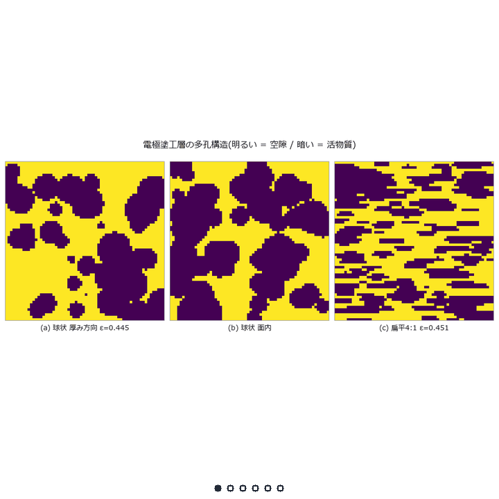</picture><span>電極の屈曲度</span></a>
<a href="../articles/assets/poc/poc_bearing_diagnosis/01_envelope_vs_raw.png"><picture><source media="(prefers-reduced-motion: reduce)" srcset="../articles/assets/poc/poc_bearing_diagnosis/01_envelope_vs_raw.png">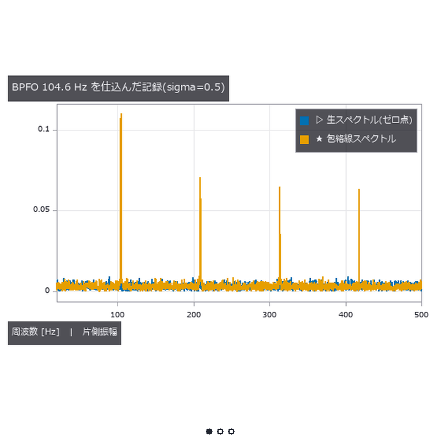</picture><span>軸受の異常診断</span></a>
<a href="../articles/assets/poc/poc_bump_coplanarity/01_scene.png"><picture><source media="(prefers-reduced-motion: reduce)" srcset="../articles/assets/poc/poc_bump_coplanarity/01_scene.png"></picture><span>バンプ共平面性</span></a>
<a href="../articles/assets/poc/poc_crack_width/05_real_crack_rebin.png"><picture><source media="(prefers-reduced-motion: reduce)" srcset="../articles/assets/poc/poc_crack_width/05_real_crack_rebin.png"> 0.5)のマスク。幅は元の画素の単位。四分位は積分 0.97〜1.44 / 2 値化 1.22〜1.78。Özgenel, Concrete Crack Images for Classification, Mendeley Data v2, DOI 10.17632/5y9wdsg2zt.2, CC BY 4.0" loading="lazy" width="200" height="200"></picture><span>ひび割れ幅</span></a>
<a href="../articles/assets/poc/poc_fabric_defect/06_real_defects.png"><picture><source media="(prefers-reduced-motion: reduce)" srcset="../articles/assets/poc/poc_fabric_defect/06_real_defects.png">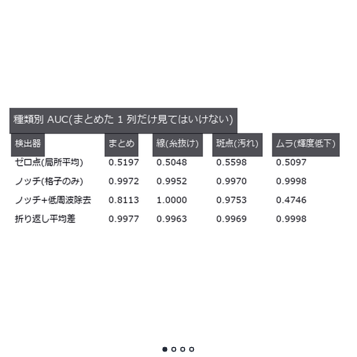</picture><span>織物の欠陥</span></a>
<a href="../articles/assets/poc/poc_leak_localization/01_scene.png"><picture><source media="(prefers-reduced-motion: reduce)" srcset="../articles/assets/poc/poc_leak_localization/01_scene.png">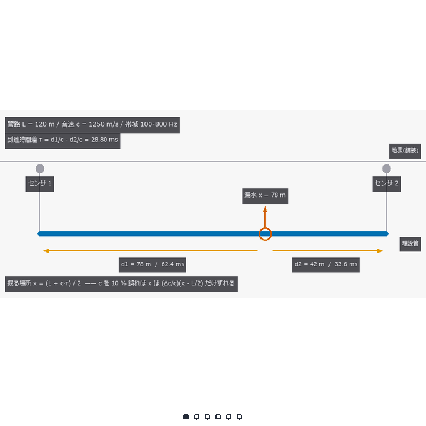</picture><span>音で漏水探知</span></a>
<a href="../articles/assets/poc/poc_machine_condition_fusion/01_scene_machine.png"><picture><source media="(prefers-reduced-motion: reduce)" srcset="../articles/assets/poc/poc_machine_condition_fusion/01_scene_machine.png"></picture><span>設備保全の融合</span></a>
<a href="../articles/assets/poc/poc_matrix_code_reading/01_symbol_and_errors.png"><picture><source media="(prefers-reduced-motion: reduce)" srcset="../articles/assets/poc/poc_matrix_code_reading/01_symbol_and_errors.png"></picture><span>2 値コードを読む</span></a>
<a href="../articles/assets/poc/poc_moire_screen/01_failure_split_plot.png"><picture><source media="(prefers-reduced-motion: reduce)" srcset="../articles/assets/poc/poc_moire_screen/01_failure_split_plot.png"></picture><span>モアレとムラ</span></a>
<a href="../articles/assets/poc/poc_print_registration/01_plates.png"><picture><source media="(prefers-reduced-motion: reduce)" srcset="../articles/assets/poc/poc_print_registration/01_plates.png">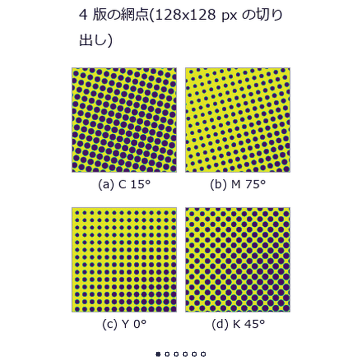</picture><span>印刷の版ずれ</span></a>
<a href="../articles/assets/poc/poc_real_defect_floor/02_defect_floor_sweep.gif"><b>&#9654;</b><span>薄い欠陥の限界</span></a>
<a href="../articles/assets/poc/poc_real_texture_invariance/01_textures.png"><picture><source media="(prefers-reduced-motion: reduce)" srcset="../articles/assets/poc/poc_real_texture_invariance/01_textures.png"></picture><span>実写テクスチャ回転</span></a>
<a href="../articles/assets/poc/poc_recycling_sorting/01_scene.png"><picture><source media="(prefers-reduced-motion: reduce)" srcset="../articles/assets/poc/poc_recycling_sorting/01_scene.png"></picture><span>廃棄物の材質選別</span></a>
<a href="../articles/assets/poc/poc_solar_el_inspection/10_real_el_overlay.png"><picture><source media="(prefers-reduced-motion: reduce)" srcset="../articles/assets/poc/poc_solar_el_inspection/10_real_el_overlay.png">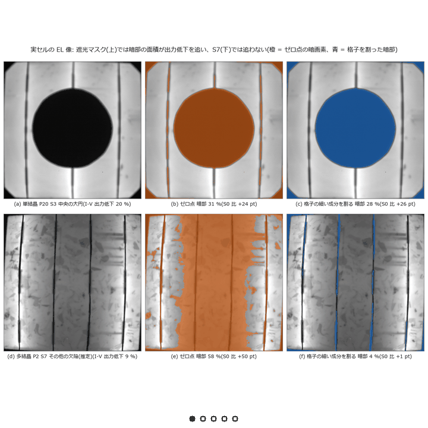</picture><span>太陽電池の EL</span></a>
<a href="../articles/assets/poc/poc_solder_fillet_aoi/01_ring_lut.png"><picture><source media="(prefers-reduced-motion: reduce)" srcset="../articles/assets/poc/poc_solder_fillet_aoi/01_ring_lut.png">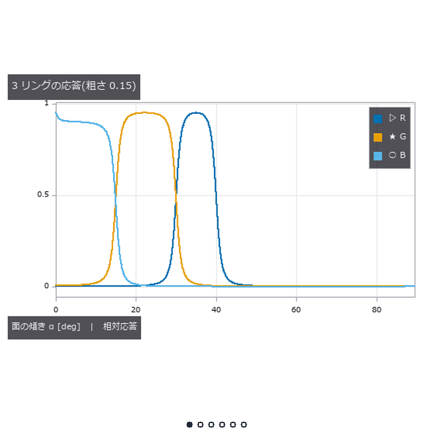</picture><span>はんだの AOI</span></a>
<a href="../articles/assets/poc/poc_spc/01_spc_xbar_chart.png"><picture><source media="(prefers-reduced-motion: reduce)" srcset="../articles/assets/poc/poc_spc/01_spc_xbar_chart.png">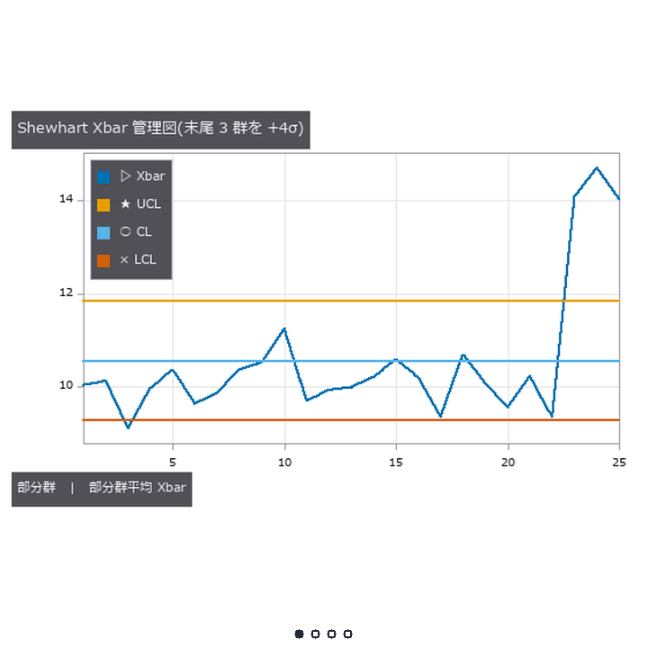</picture><span>統計的工程管理</span></a>
<a href="../articles/assets/poc/poc_mt_hidden_fault/01_mt_hidden_cloud.png"><picture><source media="(prefers-reduced-motion: reduce)" srcset="../articles/assets/poc/poc_mt_hidden_fault/01_mt_hidden_cloud.png"></picture><span>MT 法の異常検知</span></a>
<a href="../articles/assets/poc/poc_text_region_truth/01_text_region_scene.png"><picture><source media="(prefers-reduced-motion: reduce)" srcset="../articles/assets/poc/poc_text_region_truth/01_text_region_scene.png"></picture><span>文字領域の検出</span></a>
<a href="../articles/assets/poc/poc_thermal_drift_metrology/01_separate_drifts.png"><picture><source media="(prefers-reduced-motion: reduce)" srcset="../articles/assets/poc/poc_thermal_drift_metrology/01_separate_drifts.png">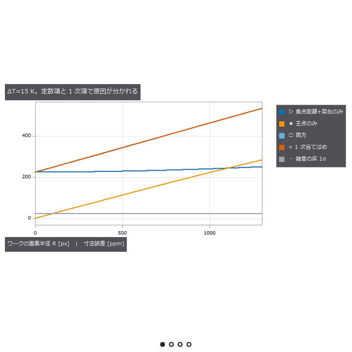</picture><span>カメラの熱ドリフト</span></a>
<a href="../articles/assets/poc/poc_thermal_radiometry/01_floor.png"><picture><source media="(prefers-reduced-motion: reduce)" srcset="../articles/assets/poc/poc_thermal_radiometry/01_floor.png">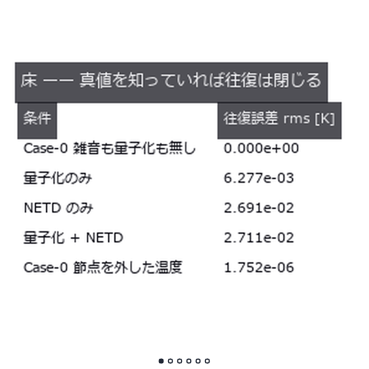</picture><span>熱画像と温度</span></a>
<a href="../articles/assets/poc/poc_thermography_ndt/01_depth_table.png"><picture><source media="(prefers-reduced-motion: reduce)" srcset="../articles/assets/poc/poc_thermography_ndt/01_depth_table.png"></picture><span>熱画像の欠陥深さ</span></a>
<a href="../articles/assets/poc/poc_veiling_glare/01_verdict.png"><picture><source media="(prefers-reduced-motion: reduce)" srcset="../articles/assets/poc/poc_veiling_glare/01_verdict.png"></picture><span>迷光とコントラスト</span></a>
<a href="../articles/assets/poc/poc_emva1288_sensor/01_raw_dark_flat_saturation.png"><picture><source media="(prefers-reduced-motion: reduce)" srcset="../articles/assets/poc/poc_emva1288_sensor/01_raw_dark_flat_saturation.png">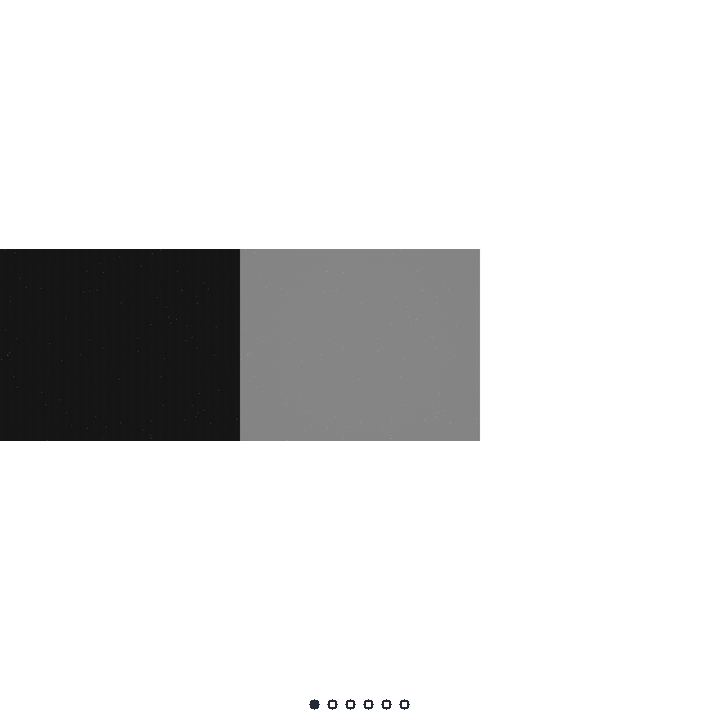</picture><span>EMVA 1288 測定</span></a>
<a href="../articles/assets/poc/poc_emva1288_in_camera_processing/01_datasheet_lies.png"><picture><source media="(prefers-reduced-motion: reduce)" srcset="../articles/assets/poc/poc_emva1288_in_camera_processing/01_datasheet_lies.png"></picture><span>前処理がデータシートを嘘にする</span></a>
<a href="../articles/assets/poc/poc_web_roll_periodicity/01_scene_web.png"><picture><source media="(prefers-reduced-motion: reduce)" srcset="../articles/assets/poc/poc_web_roll_periodicity/01_scene_web.png"></picture><span>搬送ロールの傷</span></a>
<a href="../articles/assets/poc/poc_weld_bead_profile/05_real_laser_line.png"><picture><source media="(prefers-reduced-motion: reduce)" srcset="../articles/assets/poc/poc_weld_bead_profile/05_real_laser_line.png"></picture><span>溶接ビード断面</span></a>
<a href="../articles/assets/poc/poc_weld_bead_scan_angle/02_frames.png"><picture><source media="(prefers-reduced-motion: reduce)" srcset="../articles/assets/poc/poc_weld_bead_scan_angle/02_frames.png"></picture><span>溶接ビード走査</span></a>
<a href="../articles/assets/poc/poc_weld_radiograph_porosity/02_map_detections.png"><picture><source media="(prefers-reduced-motion: reduce)" srcset="../articles/assets/poc/poc_weld_radiograph_porosity/02_map_detections.png"></picture><span>溶接の気孔</span></a>
<a href="../articles/assets/poc/poc_glyph_typo_detection/01_sign_before_after.png"><span>画像の誤字検出</span></a>
<a href="../articles/assets/poc/poc_print_layer_inspection/01_slice_stack.png"><picture><source media="(prefers-reduced-motion: reduce)" srcset="../articles/assets/poc/poc_print_layer_inspection/01_slice_stack.png"></picture><span>3D プリント層検査</span></a>
<a href="../articles/assets/poc/poc_agv_fleet/01_agv_naive_vs_adg.mp4"><b>&#9654;</b><span>AGV の倉庫</span></a>
<a href="../articles/assets/poc/poc_am_thermal_to_ct/01_melt_pool_frames.mp4"><b>&#9654;</b><span>積層造形と CT</span></a>
<a href="../articles/assets/poc/poc_symmetry_self_reference_inspection/01_self_reference_defect.png"><picture><source media="(prefers-reduced-motion: reduce)" srcset="../articles/assets/poc/poc_symmetry_self_reference_inspection/01_self_reference_defect.png">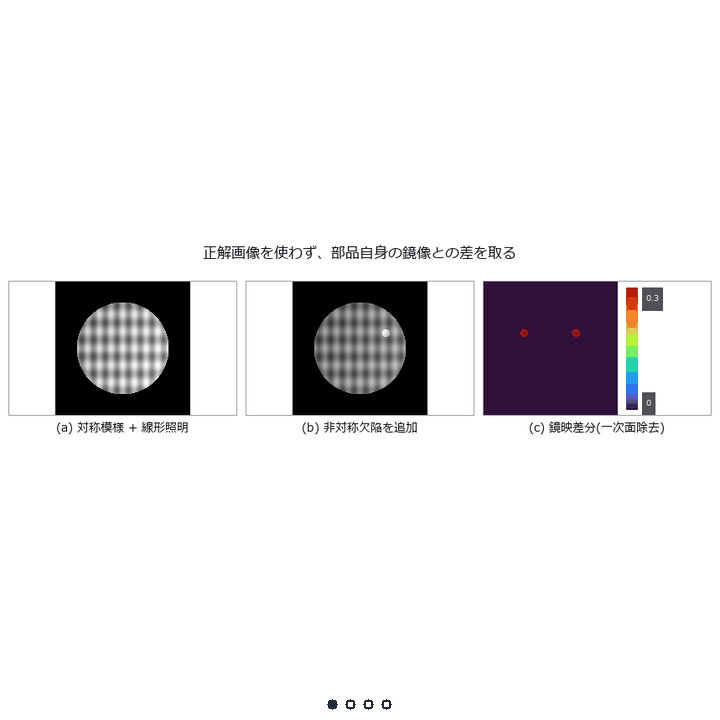</picture><span>2-D対称性の自己参照検査</span></a>
<a href="../articles/assets/poc/poc_sam_hybrid_bonding_voids/03_amplitude_vs_phase.png"><picture><source media="(prefers-reduced-motion: reduce)" srcset="../articles/assets/poc/poc_sam_hybrid_bonding_voids/03_amplitude_vs_phase.png"></picture><span>ハイブリッド接合のボイドを位相で</span></a>
<a href="../articles/assets/poc/poc_si_wafer_pl_defect_visibility/01_pl_groove_vs_diffusion_length.png"><picture><source media="(prefers-reduced-motion: reduce)" srcset="../articles/assets/poc/poc_si_wafer_pl_defect_visibility/01_pl_groove_vs_diffusion_length.png">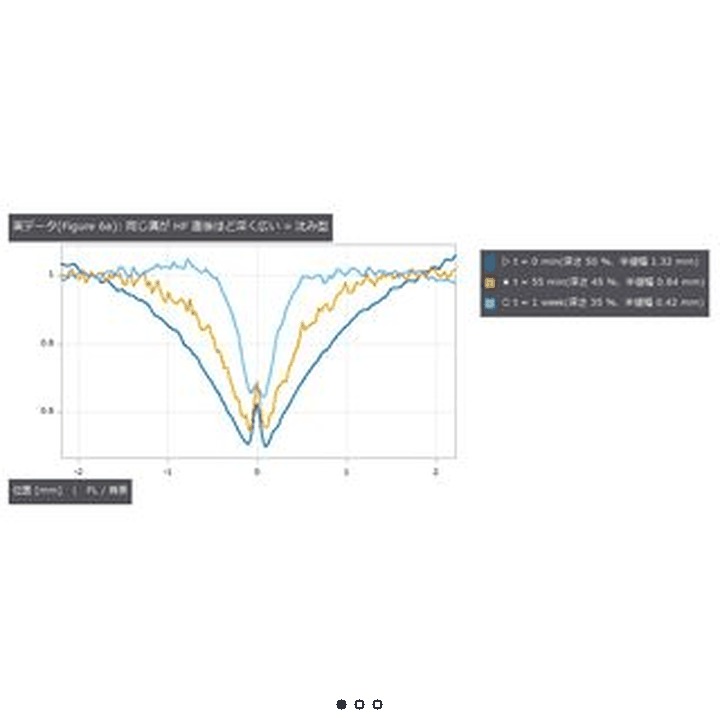</picture><span>PL 像の溝と拡散長</span></a>
<a href="../articles/assets/poc/poc_illumination_cone_vs_na/06_hairline_cone_sweep.gif"><picture><source media="(prefers-reduced-motion: reduce)" srcset="../articles/assets/poc/poc_illumination_cone_vs_na/02_works_by_cone.png"></picture><b>&#9654;</b><span>照明の円錐と観察の NA</span></a>
<a href="../articles/assets/poc/poc_tdi_linescan/01_tdi_stages_defects.png"><picture><source media="(prefers-reduced-motion: reduce)" srcset="../articles/assets/poc/poc_tdi_linescan/01_tdi_stages_defects.png"></picture><span>TDI ラインスキャンとラインスキャン用レンズ</span></a>
<a href="../articles/assets/poc/poc_industrial_oct/01_real_paint_bscans.png"><picture><source media="(prefers-reduced-motion: reduce)" srcset="../articles/assets/poc/poc_industrial_oct/01_real_paint_bscans.png"></picture><span>工業用 OCT(塗装の層厚と内部欠陥)</span></a>
<a href="../articles/assets/poc/poc_fourier_ptychography/01_usaf_4x_fp_20x.png"><picture><source media="(prefers-reduced-motion: reduce)" srcset="../articles/assets/poc/poc_fourier_ptychography/01_usaf_4x_fp_20x.png"></picture><span>フーリエ・タイコグラフィ(4 倍の視野で 20 倍の分解能)</span></a>
<a href="../articles/assets/poc/poc_dense_bubble_count/12_pair_merging.gif"><picture><source media="(prefers-reduced-motion: reduce)" srcset="../articles/assets/poc/poc_dense_bubble_count/01_real_bubbles_verdict.png">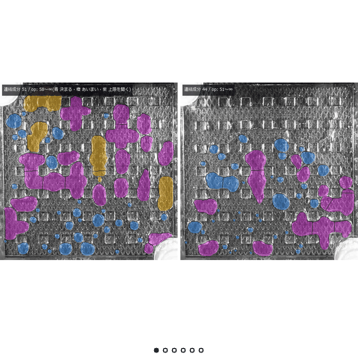</picture><b>&#9654;</b><span>密集した泡を数える(決まらなければ区間)</span></a>
<a href="../articles/assets/poc/poc_virtual_sem_kv_cd_bse/05_sem_same_part_3kv_3detectors.png"><picture><source media="(prefers-reduced-motion: reduce)" srcset="../articles/assets/poc/poc_virtual_sem_kv_cd_bse/05_sem_same_part_3kv_3detectors.png"></picture><span>仮想 SEM と加速電圧</span></a>
<a href="../articles/assets/poc/poc_grating_interferometry/12_real_three_images.png"><picture><source media="(prefers-reduced-motion: reduce)" srcset="../articles/assets/poc/poc_grating_interferometry/12_real_three_images.png"></picture><span>格子干渉計(暗視野で見える繊維・割れ・気孔)</span></a>
<a href="../articles/assets/poc/poc_dual_energy_xray/13_real_tray_xray.png"><picture><source media="(prefers-reduced-motion: reduce)" srcset="../articles/assets/poc/poc_dual_energy_xray/13_real_tray_xray.png"></picture><span>肉の中の骨片とガラスを 2 つのエネルギーで見つける(デュアルエナジー X 線)</span></a>
<a href="../articles/assets/poc/poc_code_matching_breakdown/05_highlight_sweep.gif"><picture><source media="(prefers-reduced-motion: reduce)" srcset="../articles/assets/poc/poc_code_matching_breakdown/01_breakdown_occlusion.png"></picture><b>&#9654;</b><span>照明と遮蔽に強い符号の照合</span></a>
<a href="../articles/assets/poc/poc_good_sample_variation_model/01_band_width_alignment.png"><picture><source media="(prefers-reduced-motion: reduce)" srcset="../articles/assets/poc/poc_good_sample_variation_model/01_band_width_alignment.png"></picture><span>良品統計の変動モデル</span></a>
<a href="../articles/assets/poc/poc_patch_anomaly/01_anomaly_maps.png"><picture><source media="(prefers-reduced-motion: reduce)" srcset="../articles/assets/poc/poc_patch_anomaly/01_anomaly_maps.png">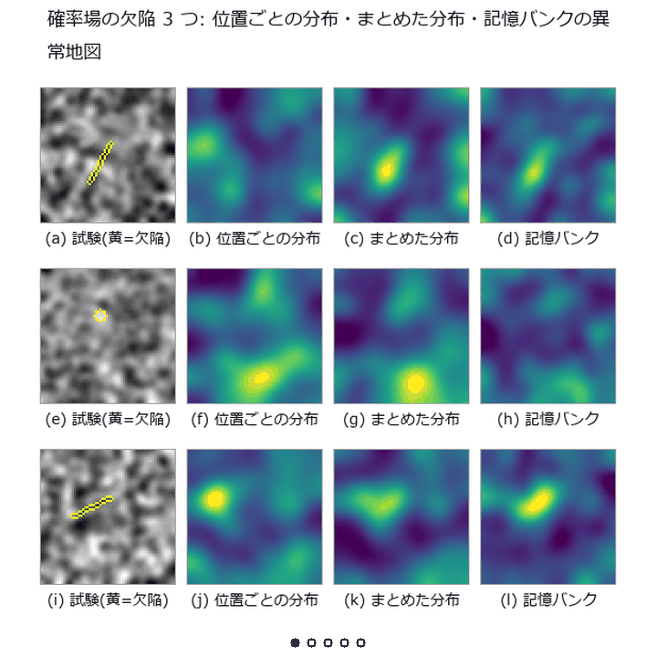</picture><span>良品だけから学ぶパッチ特徴の異常検知(古典特徴の分布と記憶)</span></a>
<a href="../articles/assets/poc/poc_braid_homotopy_classes/01_braid_classes_spacetime.gif"><b>&#9654;</b><span>複数ロボットの計画を組紐の回り方で分ける</span></a>
<a href="../articles/assets/poc/poc_wavefront_aberration_limits/01_aberration_limits.png"><span>収差の形で変わる Maréchal 近似の限界</span></a>
<a href="../articles/assets/poc/poc_mueller_dofp_observability/01_observability.png"><span>4 方位偏光カメラに見えない Mueller 行列の 7 次元</span></a>
<a href="../articles/assets/poc/poc_slanted_edge_sfr_limits/01_sfr_limits.png"><span>斜めエッジ SFR はガンマで MTF50 を誤る</span></a>
<a href="../articles/assets/poc/poc_threshold_transfer_after_normalization/01_threshold_transfer.png"><picture><source media="(prefers-reduced-motion: reduce)" srcset="../articles/assets/poc/poc_threshold_transfer_after_normalization/01_threshold_transfer.png"></picture><span>生の輝度しきい値は照明ごとに合わせ直すが、kσ と P-tile はそのまま移る</span></a>
<a href="../articles/assets/poc/poc_hdr_glossy_metal_inspection/02_results.png"><picture><source media="(prefers-reduced-motion: reduce)" srcset="../articles/assets/poc/poc_hdr_glossy_metal_inspection/02_results.png"></picture><span>光沢金属の 2 本の傷は露出 1 回では両方見えず、応答を測った HDR で見える</span></a>
<a href="../articles/assets/poc/poc_symbol_package_1d/01_ean13_defocus.png"><span>90 % 読めるぼけでも、バーコードの印字品質は F</span></a>
<a href="../articles/assets/poc/poc_symbol_part_dpm/01_dpm_datamatrix.png"><span>ドットピーンの Data Matrix は、ぼけると zxing-cpp に読めるようになる</span></a>
<a href="../articles/assets/poc/poc_symbol_lot_ocr/01_lot_ocr_defocus.png"><span>ロット番号の OCR は、学習の範囲を越えたぼけで棄却でなく誤読に変わる</span></a>
<a href="../articles/assets/poc/poc_real_typewritten_ocr/01_reading.png"><picture><source media="(prefers-reduced-motion: reduce)" srcset="../articles/assets/poc/poc_real_typewritten_ocr/01_reading.png">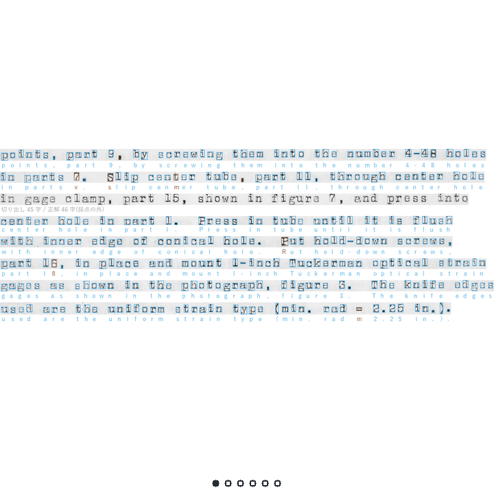</picture><span>1943 年のタイプ打ちの報告を古典 OCR で読む</span></a>
<a href="../articles/assets/poc/poc_mixed_case_depalletizing/08_depal_robot_video.mp4"><picture><source media="(prefers-reduced-motion: reduce)" srcset="../articles/assets/poc/poc_mixed_case_depalletizing/01_overview_same_pattern.png"></picture><b>&#9654;</b><span>混載パレットの箱: 深度の段差・V 字・カラーの溝で分ける</span></a>
<a href="../articles/assets/poc/poc_ai_built_inspection_scored/01_crack_real.png"><picture><source media="(prefers-reduced-motion: reduce)" srcset="../articles/assets/poc/poc_ai_built_inspection_scored/01_crack_real.png">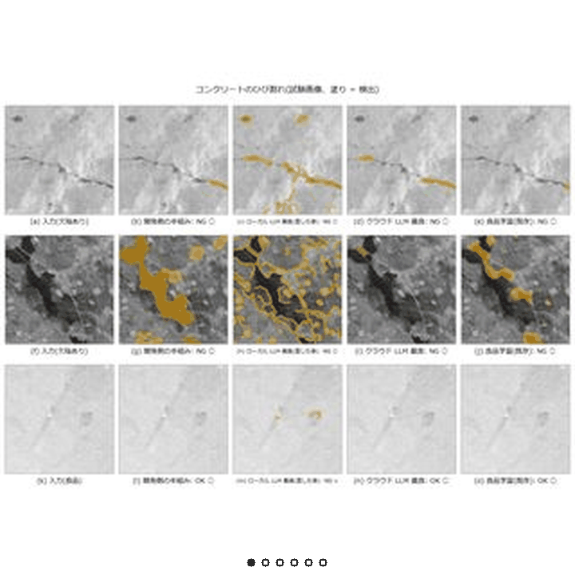</picture><span>AI が組んだ検査を実データの真値で採点</span></a>
<a href="../articles/assets/poc/poc_equipment_selection_map/02_equipment_at_a_glance.png"><picture><source media="(prefers-reduced-motion: reduce)" srcset="../articles/assets/poc/poc_equipment_selection_map/02_equipment_at_a_glance.png"></picture><span>照明 × カメラ × レンズ 60 通りで同じ傷を撮る機材選びの地図</span></a>
</div>
</details>

<details class="vall"><summary><b>寸法・形状計測</b> (60)</summary>
<div class="vg vs">
<a href="../articles/assets/poc/poc_aoi_ct_traceability/01_inspection_and_reconstructed_ct.png"><picture><source media="(prefers-reduced-motion: reduce)" srcset="../articles/assets/poc/poc_aoi_ct_traceability/01_inspection_and_reconstructed_ct.png"></picture><span>AOI と CT の対応</span></a>
<a href="../articles/assets/poc/poc_asbuilt_wall_deviation/01_scene.png"><picture><source media="(prefers-reduced-motion: reduce)" srcset="../articles/assets/poc/poc_asbuilt_wall_deviation/01_scene.png"></picture><span>竣工した壁の歪み</span></a>
<a href="../articles/assets/poc/poc_battery_electrode_breathing/01_scene.png"><picture><source media="(prefers-reduced-motion: reduce)" srcset="../articles/assets/poc/poc_battery_electrode_breathing/01_scene.png"></picture><span>電極の呼吸</span></a>
<a href="../articles/assets/poc/poc_bilateral_asymmetry/01_floor_vs_spacing.png"><picture><source media="(prefers-reduced-motion: reduce)" srcset="../articles/assets/poc/poc_bilateral_asymmetry/01_floor_vs_spacing.png"></picture><span>左右非対称性</span></a>
<a href="../articles/assets/poc/poc_dic_strain/05_tensile_ramp.mp4"><b>&#9654;</b><span>DIC ひずみ</span></a>
<a href="../articles/assets/poc/poc_die_tilt_tsv_overlay/01_scene.png"><picture><source media="(prefers-reduced-motion: reduce)" srcset="../articles/assets/poc/poc_die_tilt_tsv_overlay/01_scene.png">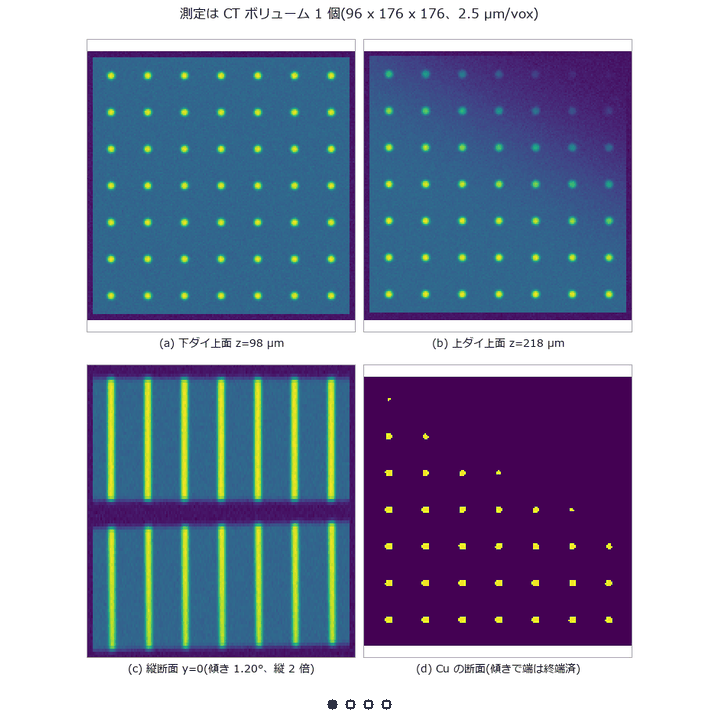</picture><span>ダイ傾きと TSV</span></a>
<a href="../articles/assets/poc/poc_dimensional_inspection/01_slot_bias.png"><picture><source media="(prefers-reduced-motion: reduce)" srcset="../articles/assets/poc/poc_dimensional_inspection/01_slot_bias.png"></picture><span>部品の寸法検査</span></a>
<a href="../articles/assets/poc/poc_fiber_orientation/01_scene.png"><picture><source media="(prefers-reduced-motion: reduce)" srcset="../articles/assets/poc/poc_fiber_orientation/01_scene.png">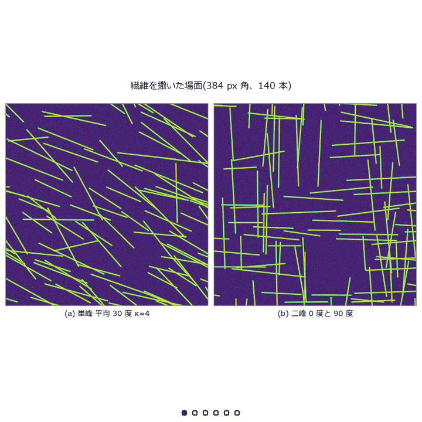</picture><span>繊維の配向</span></a>
<a href="../articles/assets/poc/poc_gear_tooth_metrology/01_scene.png"><picture><source media="(prefers-reduced-motion: reduce)" srcset="../articles/assets/poc/poc_gear_tooth_metrology/01_scene.png">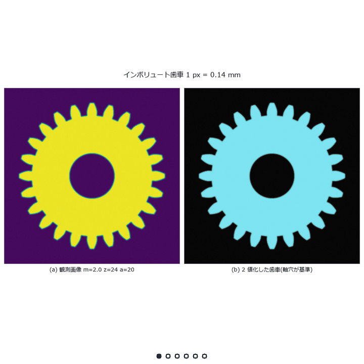</picture><span>歯車の歯形</span></a>
<a href="../articles/assets/poc/poc_interferometry_step/09_csi_scan_explained.mp4"><b>&#9654;</b><span>白色干渉の段差</span></a>
<a href="../articles/assets/poc/poc_metal_grain_size/15_real_tbm_breaks.png"><picture><source media="(prefers-reduced-motion: reduce)" srcset="../articles/assets/poc/poc_metal_grain_size/15_real_tbm_breaks.png">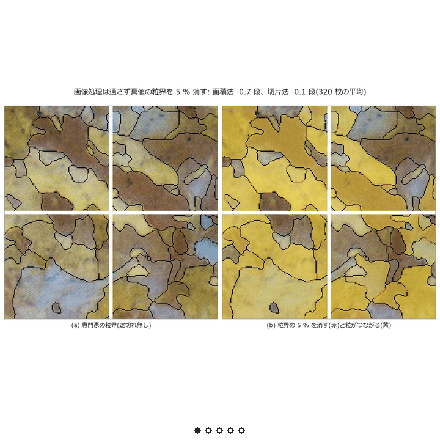</picture><span>結晶粒度</span></a>
<a href="../articles/assets/poc/poc_multibeam_bathymetry/17_survey.mp4"><b>&#9654;</b><span>多ビーム測深</span></a>
<a href="../articles/assets/poc/poc_particle_sizing/01_scene.png"><picture><source media="(prefers-reduced-motion: reduce)" srcset="../articles/assets/poc/poc_particle_sizing/01_scene.png">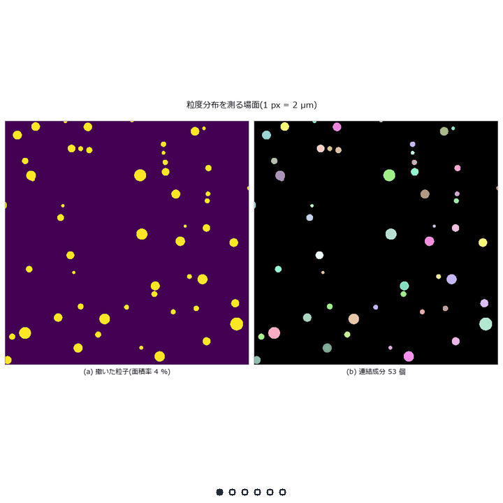</picture><span>粒度分布</span></a>
<a href="../articles/assets/poc/poc_photoelasticity/03_load_and_isoclinics.mp4"><picture><source media="(prefers-reduced-motion: reduce)" srcset="../articles/assets/poc/poc_photoelasticity/01_polariscope.png"></picture><b>&#9654;</b><span>光弾性の応力</span></a>
<a href="../articles/assets/poc/poc_rail_corrugation/01_planted_components.png"><picture><source media="(prefers-reduced-motion: reduce)" srcset="../articles/assets/poc/poc_rail_corrugation/01_planted_components.png">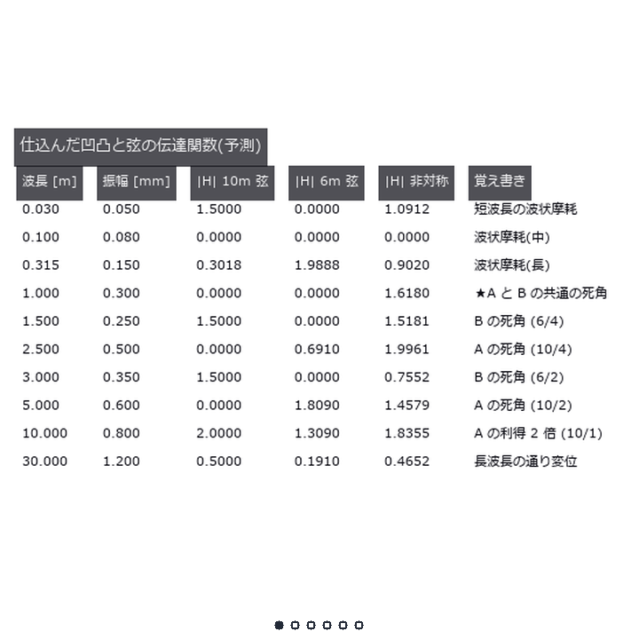</picture><span>レールの波状摩耗</span></a>
<a href="../articles/assets/poc/poc_real_coin_metrology/01_scene.png"><picture><source media="(prefers-reduced-motion: reduce)" srcset="../articles/assets/poc/poc_real_coin_metrology/01_scene.png">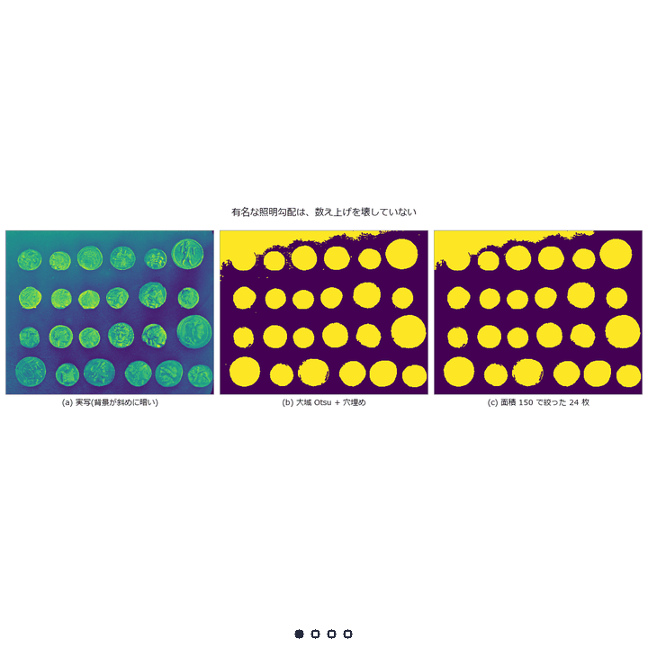 0.161。それでも素の大域 Otsu が真値 24 枚を当てる。" loading="lazy" width="200" height="200"></picture><span>実写のコイン</span></a>
<a href="../articles/assets/poc/poc_screw_thread_metrology/01_zero_spectrum.png"><picture><source media="(prefers-reduced-motion: reduce)" srcset="../articles/assets/poc/poc_screw_thread_metrology/01_zero_spectrum.png"></picture><span>ねじの輪郭</span></a>
<a href="../articles/assets/poc/poc_stockpile_volume/07_scan_orbit.mp4"><b>&#9654;</b><span>堆積物の体積</span></a>
<a href="../articles/assets/poc/poc_strain_history/05_history_video.mp4"><b>&#9654;</b><span>クリープひずみ</span></a>
<a href="../articles/assets/poc/poc_surface_roughness/01_surface_components.png"><picture><source media="(prefers-reduced-motion: reduce)" srcset="../articles/assets/poc/poc_surface_roughness/01_surface_components.png">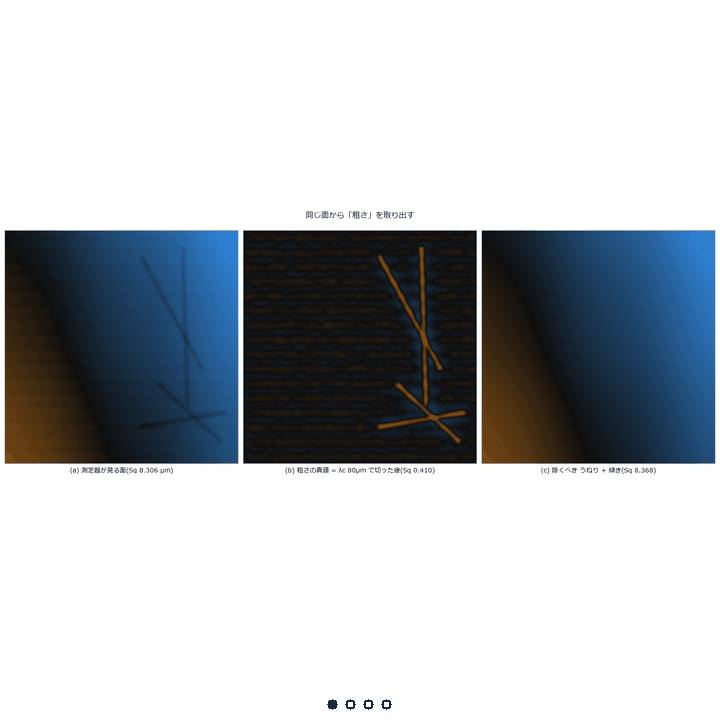</picture><span>表面粗さ</span></a>
<a href="../articles/assets/poc/poc_tacsim_elastic_membrane/03_tacsim_force_sweep.gif"><b>&#9654;</b><span>視触覚センサ</span></a>
<a href="../articles/assets/poc/poc_tacsim_marker_shear/02_tacslip_stick_circle_shrinks.gif"><b>&#9654;</b><span>触覚のせん断</span></a>
<a href="../articles/assets/poc/poc_tactile_dipole_torque/02_tactorque_dipole_grows_with_M.gif"><b>&#9654;</b><span>触覚双極子</span></a>
<a href="../articles/assets/poc/poc_granular_heap_repose/11_granular_datum_tilt_sweep.gif"><b>&#9654;</b><span>粉体の山</span></a>
<a href="../articles/assets/poc/poc_food_cutting_measure/01_cutting_track_force.gif"><b>&#9654;</b><span>食材の切断</span></a>
<a href="../articles/assets/poc/poc_tacdome_large_deformation/01_tacdome_press_sweep.gif"><b>&#9654;</b><span>ドーム指先の接触</span></a>
<a href="../articles/assets/poc/poc_polish_wipe_measure/01_polish_raster_wipe_coat.gif"><b>&#9654;</b><span>研磨と拭き取り</span></a>
<a href="../articles/assets/poc/poc_powder_scoop_pour/03_scoop_stream_synthetic_frames.gif"><b>&#9654;</b><span>粉体のすくい注ぎ</span></a>
<a href="../articles/assets/poc/poc_powder_grinding_ae/07_psd_fining_during_grinding.gif"><b>&#9654;</b><span>乳鉢の粉砕</span></a>
<a href="../articles/assets/poc/poc_pxrd_phase_peel/01_phase_peel.gif"><b>&#9654;</b><span>X 線回折の相分離</span></a>
<a href="../articles/assets/poc/poc_dose_uniformity_from_grinding/01_cv_bias_decomposition.png"><picture><source media="(prefers-reduced-motion: reduce)" srcset="../articles/assets/poc/poc_dose_uniformity_from_grinding/01_cv_bias_decomposition.png"></picture><span>薬の量の均一性</span></a>
<a href="../articles/assets/poc/poc_knife_tactile_toughness/06_cut_with_fingertip_pads.gif"><b>&#9654;</b><span>指先で包丁を持つ</span></a>
<a href="../articles/assets/poc/poc_measurement_system_analysis/16_breakdown_movie.gif"><picture><source media="(prefers-reduced-motion: reduce)" srcset="../articles/assets/poc/poc_measurement_system_analysis/01_scene.png">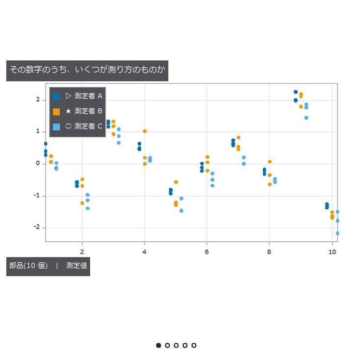</picture><b>&#9654;</b><span>ゲージ R&R</span></a>
<a href="../articles/assets/poc/poc_pod_lighting/03_pod_curves.png"><picture><source media="(prefers-reduced-motion: reduce)" srcset="../articles/assets/poc/poc_pod_lighting/03_pod_curves.png"></picture><span>照明ごとの検出確率</span></a>
<a href="../articles/assets/poc/poc_laser_line_speckle_floor/01_line.png"><picture><source media="(prefers-reduced-motion: reduce)" srcset="../articles/assets/poc/poc_laser_line_speckle_floor/01_line.png"></picture><span>光切断のスペックルの床</span></a>
<a href="../articles/assets/poc/poc_shape_from_polarization/11_real_dome_and_lens.png"><picture><source media="(prefers-reduced-motion: reduce)" srcset="../articles/assets/poc/poc_shape_from_polarization/11_real_dome_and_lens.png"></picture><span>偏光で測る黒光沢とガラス</span></a>
<a href="../articles/assets/poc/poc_phase_measuring_deflectometry/03_photo_vs_pmd.png"><picture><source media="(prefers-reduced-motion: reduce)" srcset="../articles/assets/poc/poc_phase_measuring_deflectometry/03_photo_vs_pmd.png"></picture><span>写真では見えない µm の凹みを縞の鏡像で(デフレクトメトリ)</span></a>
<a href="../articles/assets/poc/poc_interreflection_fringe_error/02_direct_global.png"><picture><source media="(prefers-reduced-motion: reduce)" srcset="../articles/assets/poc/poc_interreflection_fringe_error/02_direct_global.png"></picture><span>白い溝の相互反射と縞の誤差</span></a>
<a href="../articles/assets/poc/poc_zernike_aberrations/06_through_focus.gif"><picture><source media="(prefers-reduced-motion: reduce)" srcset="../articles/assets/poc/poc_zernike_aberrations/01_zernike_pyramid.png">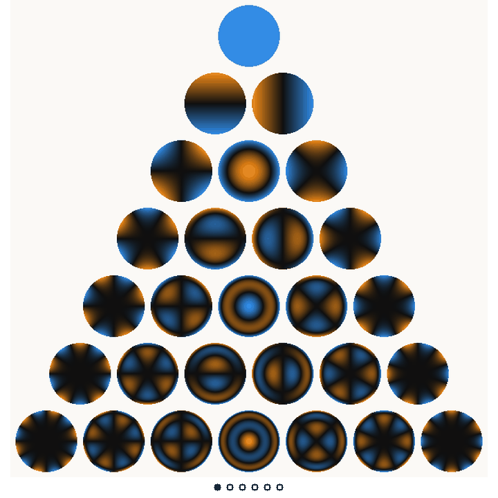</picture><b>&#9654;</b><span>ゼルニケ収差</span></a>
<a href="../articles/assets/poc/poc_attention_identities/01_attention_masks.png"><picture><source media="(prefers-reduced-motion: reduce)" srcset="../articles/assets/poc/poc_attention_identities/01_attention_masks.png"></picture><span>注意機構の恒等式</span></a>
<a href="../articles/assets/poc/poc_residue_crt/03_residue_rotation_needle.gif"><picture><source media="(prefers-reduced-motion: reduce)" srcset="../articles/assets/poc/poc_residue_crt/02_residue_rotation_sawtooth.png">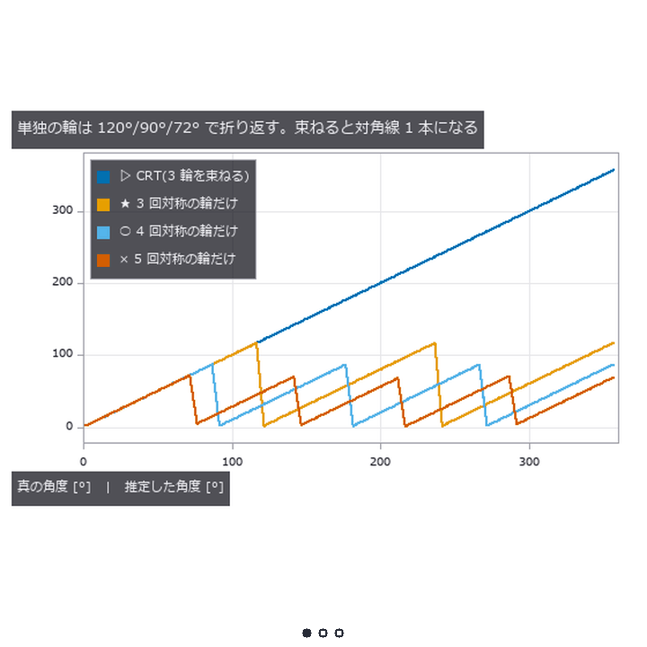</picture><b>&#9654;</b><span>剰余定理で位相</span></a>
<a href="../articles/assets/poc/poc_sem_wafer_defect_edge_bias/01_sem_se_bse_bias.png"><picture><source media="(prefers-reduced-motion: reduce)" srcset="../articles/assets/poc/poc_sem_wafer_defect_edge_bias/01_sem_se_bse_bias.png"></picture><span>SEM の縁の太り</span></a>
<a href="../articles/assets/poc/poc_chromatic_confocal/04_spectrum_vs_height.gif"><picture><source media="(prefers-reduced-motion: reduce)" srcset="../articles/assets/poc/poc_chromatic_confocal/01_rainbow_ruler.png">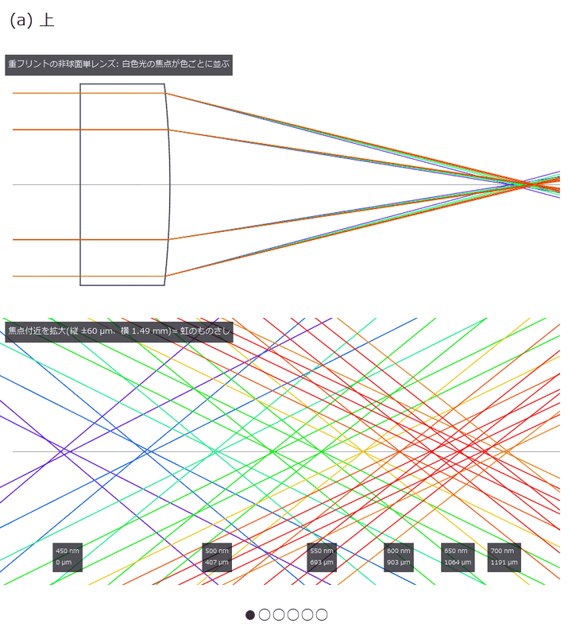</picture><b>&#9654;</b><span>クロマティック共焦点(色で高さを読む)</span></a>
<a href="../articles/assets/poc/poc_moire_alignment/03_fringe_flow.gif"><picture><source media="(prefers-reduced-motion: reduce)" srcset="../articles/assets/poc/poc_moire_alignment/02_one_nm_steps.png"></picture><b>&#9654;</b><span>モアレで位置合わせ(見えない格子 2 枚で 1 nm を読む)</span></a>
<a href="../articles/assets/poc/poc_telecentric_metrology/04_work_up_down.gif"><picture><source media="(prefers-reduced-motion: reduce)" srcset="../articles/assets/poc/poc_telecentric_metrology/08_real_alignment_plate.png"></picture><b>&#9654;</b><span>テレセントリックレンズと寸法計測</span></a>
<a href="../articles/assets/poc/poc_itof_multifreq/14_flying_pixels_orbit.gif"><picture><source media="(prefers-reduced-motion: reduce)" srcset="../articles/assets/poc/poc_itof_multifreq/01_warehouse_unwrap.png"></picture><b>&#9654;</b><span>間接 ToF(折り返しと多重反射)</span></a>
<a href="../articles/assets/poc/poc_optics_drawings/06_setup_ring_coaxial.png"><picture><source media="(prefers-reduced-motion: reduce)" srcset="../articles/assets/poc/poc_optics_drawings/06_setup_ring_coaxial.png"></picture><span>光学系の図面(断面図・設置図・製作図)</span></a>
<a href="../articles/assets/poc/poc_pocket_interreflection/02_residuals.png"><picture><source media="(prefers-reduced-motion: reduce)" srcset="../articles/assets/poc/poc_pocket_interreflection/02_residuals.png"></picture><span>加工ポケットの相互反射を収束まで</span></a>
<a href="../articles/assets/poc/poc_tem_ctf_thon_rings/01_thon_ring_sweep.gif"><picture><source media="(prefers-reduced-motion: reduce)" srcset="../articles/assets/poc/poc_tem_ctf_thon_rings/02_thon_rings_four_defoci.png"></picture><b>&#9654;</b><span>仮想の透過電子顕微鏡(Thon リングと焦点外れ)</span></a>
<a href="../articles/assets/poc/poc_noncoaxial_optics/05_false_defect.png"><picture><source media="(prefers-reduced-motion: reduce)" srcset="../articles/assets/poc/poc_noncoaxial_optics/05_false_defect.png"></picture><span>非共軸の光学系(半透鏡のゴースト・折り返し)</span></a>
<a href="../articles/assets/poc/poc_lockin_imaging/01_ring_amp_phase.png"><picture><source media="(prefers-reduced-motion: reduce)" srcset="../articles/assets/poc/poc_lockin_imaging/01_ring_amp_phase.png"></picture><span>画素ごとの直交復調(ロックイン)で法線・昼間化・熱波を読む</span></a>
<a href="../articles/assets/poc/poc_spectrometer_illumination/03_slit_image_smile.png"><picture><source media="(prefers-reduced-motion: reduce)" srcset="../articles/assets/poc/poc_spectrometer_illumination/03_slit_image_smile.png"></picture><span>分光器と照明系(帯域の幅と光源の模様)</span></a>
<a href="../articles/assets/poc/poc_simcal_telecentric/02_real_model_residuals.png"><picture><source media="(prefers-reduced-motion: reduce)" srcset="../articles/assets/poc/poc_simcal_telecentric/02_real_model_residuals.png"></picture><span>テレセンの実画像で撮像模型を較正</span></a>
<a href="../articles/assets/poc/poc_robust_profile_filter/04_scratched_surface.png"><picture><source media="(prefers-reduced-motion: reduce)" srcset="../articles/assets/poc/poc_robust_profile_filter/04_scratched_surface.png">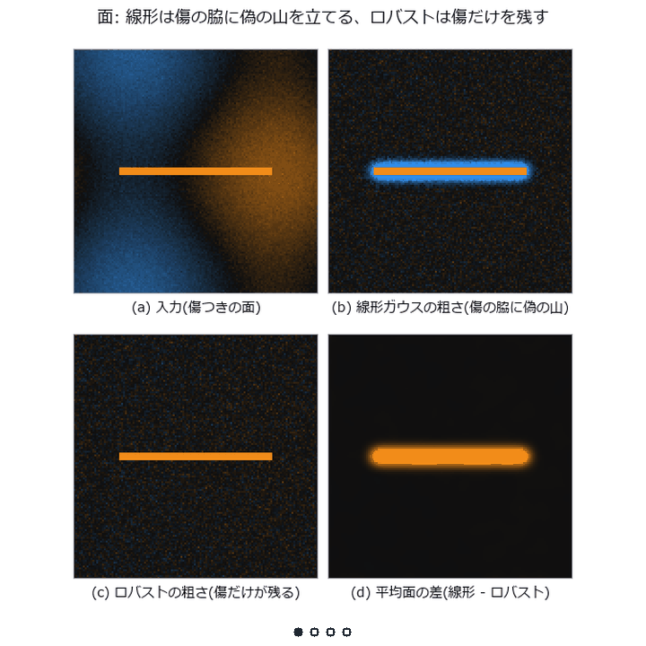</picture><span>深い傷が平均線を凹ませる量と、ロバスト化の破綻点</span></a>
<a href="../articles/assets/poc/poc_sem_tem_same_particle/08_tem_focus_sweep.gif"><picture><source media="(prefers-reduced-motion: reduce)" srcset="../articles/assets/poc/poc_sem_tem_same_particle/02_same_specimen_sem_tem.png"></picture><b>&#9654;</b><span>同じ粒子を走査像と透過像で測る</span></a>
<a href="../articles/assets/poc/poc_real_sem_metal_layer/01_scene.png"><picture><source media="(prefers-reduced-motion: reduce)" srcset="../articles/assets/poc/poc_real_sem_metal_layer/01_scene.png">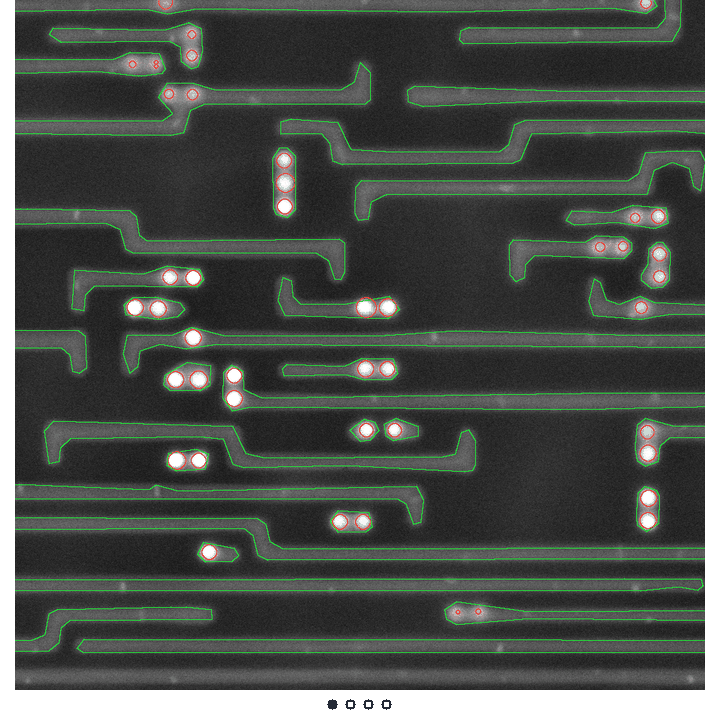</picture><span>実SEM金属配線の寸法計測</span></a>
<a href="../articles/assets/poc/poc_virtual_acceptance_3d/01_acceptance_layout_and_noise.png"><picture><source media="(prefers-reduced-motion: reduce)" srcset="../articles/assets/poc/poc_virtual_acceptance_3d/01_acceptance_layout_and_noise.png"></picture><span>買う前に受入試験をかける ―― 同じ iToF でも黒い球 1 つで不合格になる</span></a>
<a href="../articles/assets/poc/poc_light_section_step_weld_floor/01_height_map.png"><picture><source media="(prefers-reduced-motion: reduce)" srcset="../articles/assets/poc/poc_light_section_step_weld_floor/01_height_map.png"></picture><span>光切断の高さは µm で合うが、実機を決めるのはスペックルの床 20.7 µm</span></a>
<a href="../articles/assets/poc/poc_real_file_formats/01_stars_matched.png"><picture><source media="(prefers-reduced-motion: reduce)" srcset="../articles/assets/poc/poc_real_file_formats/01_stars_matched.png">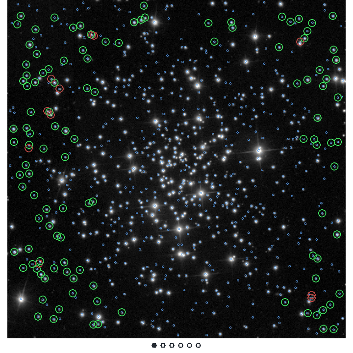</picture><span>実物の科学データファイルを読む</span></a>
<a href="../articles/assets/poc/poc_real_grain_skiz/01_grain_boundaries.png"><picture><source media="(prefers-reduced-motion: reduce)" srcset="../articles/assets/poc/poc_real_grain_skiz/01_grain_boundaries.png"></picture><span>金属組織の粒界を影響圏で引く</span></a>
</div>
</details>

<details class="vall"><summary><b>3-D 形状</b> (22)</summary>
<div class="vg vs">
<a href="../articles/assets/poc/poc_battery_ct_degradation/17_same_outline_ct.png"><picture><source media="(prefers-reduced-motion: reduce)" srcset="../articles/assets/poc/poc_battery_ct_degradation/17_same_outline_ct.png"></picture><span>電池の CT 劣化</span></a>
<a href="../articles/assets/poc/poc_bev_sensor_fusion/01_scene_bev.png"><picture><source media="(prefers-reduced-motion: reduce)" srcset="../articles/assets/poc/poc_bev_sensor_fusion/01_scene_bev.png"></picture><span>鳥瞰図の融合</span></a>
<a href="../articles/assets/poc/poc_cad_scan_deviation/14_align_orbit.mp4"><picture><source media="(prefers-reduced-motion: reduce)" srcset="../articles/assets/poc/poc_cad_scan_deviation/01_scene.png"></picture><b>&#9654;</b><span>CAD と点群の差</span></a>
<a href="../articles/assets/poc/poc_crop_phenotyping/01_capsule_calibration.png"><picture><source media="(prefers-reduced-motion: reduce)" srcset="../articles/assets/poc/poc_crop_phenotyping/01_capsule_calibration.png">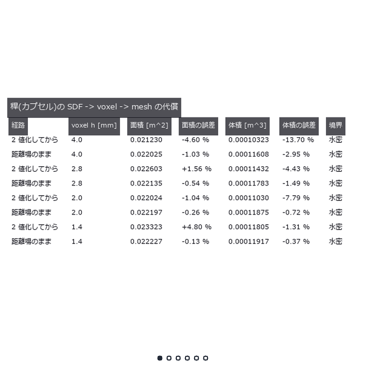</picture><span>作物の葉面積</span></a>
<a href="../articles/assets/poc/poc_ct_void_morphology/13_section_sweep.mp4"><b>&#9654;</b><span>接合層のボイド</span></a>
<a href="../articles/assets/poc/poc_dfm_thickness_overhang/01_scene.png"><picture><source media="(prefers-reduced-motion: reduce)" srcset="../articles/assets/poc/poc_dfm_thickness_overhang/01_scene.png"></picture><span>造形しやすさ</span></a>
<a href="../articles/assets/poc/poc_lidar_terrain_change/12_flight.gif"><b>&#9654;</b><span>斜面の土量</span></a>
<a href="../articles/assets/poc/poc_livestock_body_volume/14_hull_orbit.mp4"><b>&#9654;</b><span>家畜の体重</span></a>
<a href="../articles/assets/poc/poc_mesh_quality_repair/14_decimate_orbit.mp4"><b>&#9654;</b><span>メッシュ修復</span></a>
<a href="../articles/assets/poc/poc_pallet_load_utilization/01_scene.png"><picture><source media="(prefers-reduced-motion: reduce)" srcset="../articles/assets/poc/poc_pallet_load_utilization/01_scene.png">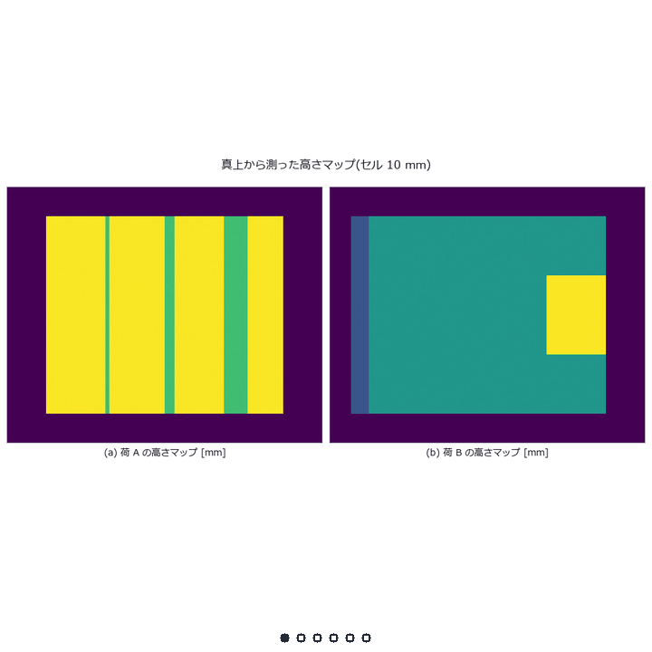</picture><span>パレット積載率</span></a>
<a href="../articles/assets/poc/poc_pipe_wall_loss/01_scene_pipe.png"><picture><source media="(prefers-reduced-motion: reduce)" srcset="../articles/assets/poc/poc_pipe_wall_loss/01_scene_pipe.png">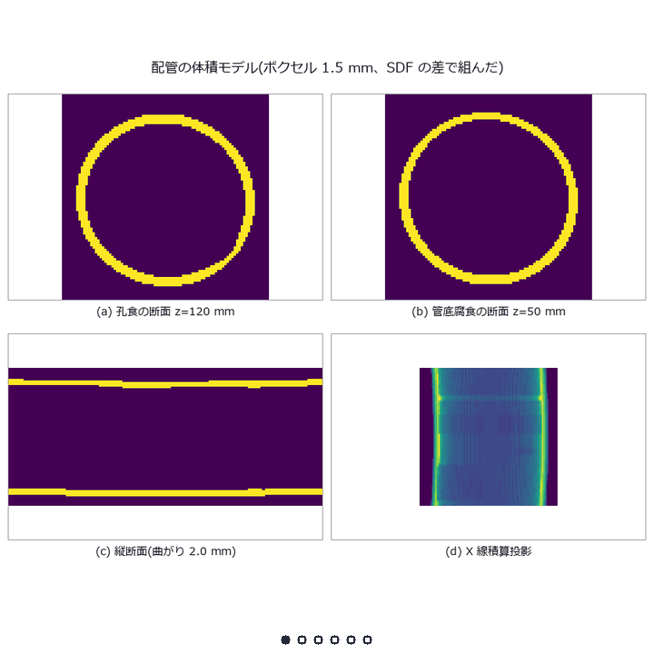</picture><span>配管の減肉</span></a>
<a href="../articles/assets/poc/poc_print_warpage_risk/01_scene.png"><picture><source media="(prefers-reduced-motion: reduce)" srcset="../articles/assets/poc/poc_print_warpage_risk/01_scene.png"></picture><span>積層の反り</span></a>
<a href="../articles/assets/poc/poc_safety_clearance/01_conditions.png"><picture><source media="(prefers-reduced-motion: reduce)" srcset="../articles/assets/poc/poc_safety_clearance/01_conditions.png">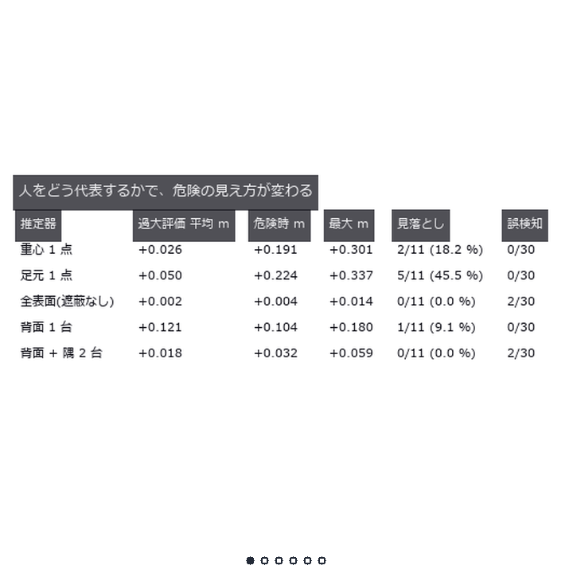</picture><span>人と機械の距離</span></a>
<a href="../articles/assets/poc/poc_scan_to_bim_asbuilt/01_scene_plan_section.png"><picture><source media="(prefers-reduced-motion: reduce)" srcset="../articles/assets/poc/poc_scan_to_bim_asbuilt/01_scene_plan_section.png">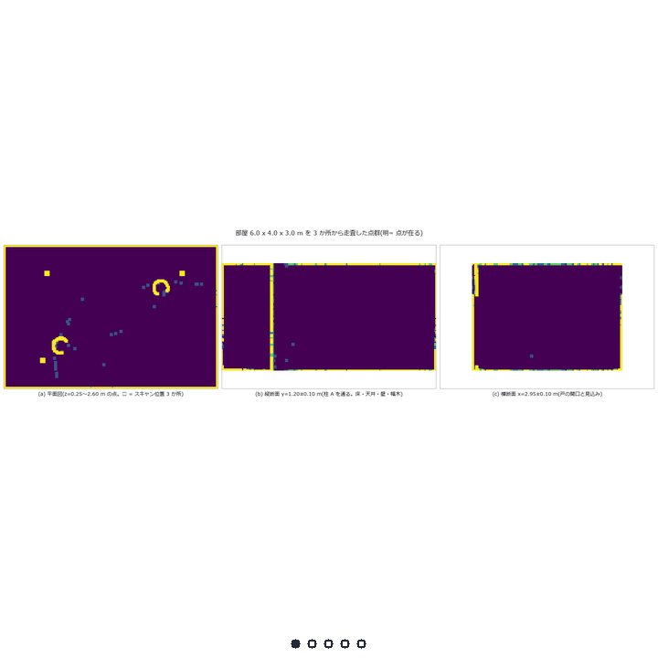</picture><span>設計と実物の差</span></a>
<a href="../articles/assets/poc/poc_structure_4d_deterioration/12_years_video.mp4"><b>&#9654;</b><span>構造物の経年</span></a>
<a href="../articles/assets/poc/poc_symmetry_restoration/01_scene.png"><picture><source media="(prefers-reduced-motion: reduce)" srcset="../articles/assets/poc/poc_symmetry_restoration/01_scene.png"></picture><span>対称性で補う</span></a>
<a href="../articles/assets/poc/poc_endless_zoom_and_turning_solids/03_zoom_loop.gif"><picture><source media="(prefers-reduced-motion: reduce)" srcset="../articles/assets/poc/poc_endless_zoom_and_turning_solids/01_zoom_steps.png"></picture><b>&#9654;</b><span>無限ズーム</span></a>
<a href="../articles/assets/poc/poc_four_dimensions_by_three_d_tools/03_hopf_turn.gif"><picture><source media="(prefers-reduced-motion: reduce)" srcset="../articles/assets/poc/poc_four_dimensions_by_three_d_tools/02_nested_tori.png"></picture><b>&#9654;</b><span>4 次元を 3-D で</span></a>
<a href="../articles/assets/poc/poc_plateau_venue_lod2/01_venue_itokawa_top.png"><span>会場の建物と小惑星イトカワを同じ物差しで ―― PLATEAU の CityGML LOD2 をメッシュに</span></a>
<a href="../view2026/anim3d/star_tracker_anim3d.html?lang=ja"><picture><source media="(prefers-reduced-motion: reduce)" srcset="../articles/assets/poc/poc_star_tracker/01_star_tracker_camera_image.png"></picture><b>&#9654;</b><span>合成星像から衛星姿勢を推定する</span></a>
<a href="../articles/assets/poc/poc_bga_ball_type_roundtrip/01_bga_types.png"><span>画像から点群・体積・メッシュ・グラフへ渡しても、ボールの数は 3 つの型で同じ 71 個</span></a>
<a href="../articles/assets/poc/poc_3d_sensor_modalities/01_map.png"><picture><source media="(prefers-reduced-motion: reduce)" srcset="../articles/assets/poc/poc_3d_sensor_modalities/01_map.png"></picture><span>同じ部品を 3-D センサ 5 方式で測る</span></a>
</div>
</details>

<details class="vall"><summary><b>幾何・校正</b> (26)</summary>
<div class="vg vs">
<a href="../articles/assets/poc/poc_simcal_thin_film/08_real_determined_vs_combinations.png"><picture><source media="(prefers-reduced-motion: reduce)" srcset="../articles/assets/poc/poc_simcal_thin_film/08_real_determined_vs_combinations.png"> 10 で「組み合わせ」として数を出さない。出典: Schwarz et al., Adv. Opt. Mater. (2024) doi:10.1002/adom.202402502; data Zenodo 10.5281/zenodo.13753754 (CC BY 4.0). Modified: re-labelled and rounded table / micrograph downsized to 640x360, block means." loading="lazy" width="200" height="200"></picture><span>実画像で薄膜の模型を較正(決まる係数と決まらない組み合わせ)</span></a>
<a href="../articles/assets/poc/poc_camera_calibration/06_real_board.png"><picture><source media="(prefers-reduced-motion: reduce)" srcset="../articles/assets/poc/poc_camera_calibration/06_real_board.png"></picture><span>再投影誤差が小さくても焦点距離は狂う</span></a>
<a href="../articles/assets/poc/poc_panorama_drift/05_chain_drift_video.mp4"><b>&#9654;</b><span>パノラマのずれ</span></a>
<a href="../articles/assets/poc/poc_real_stereo_depth/01_scene.png"><picture><source media="(prefers-reduced-motion: reduce)" srcset="../articles/assets/poc/poc_real_stereo_depth/01_scene.png"></picture><span>実写のステレオ</span></a>
<a href="../articles/assets/poc/poc_registration_basin/06_real_scan_icp.mp4"><b>&#9654;</b><span>実物の深度では ICP の収束域が狭まる</span></a>
<a href="../articles/assets/poc/poc_rotation_invariance_audit/02_rotating_coin.gif"><b>&#9654;</b><span>回転不変の監査</span></a>
<a href="../articles/assets/poc/poc_carla_bridge/01_carla_two_worlds.png"><picture><source media="(prefers-reduced-motion: reduce)" srcset="../articles/assets/poc/poc_carla_bridge/01_carla_two_worlds.png"></picture><span>2 つの世界で撮る</span></a>
<a href="../articles/assets/poc/poc_driving_town/04_town_drive_through.gif"><b>&#9654;</b><span>町を組む</span></a>
<a href="../articles/assets/poc/poc_driving_japan_town/03_japan_town_drive.gif"><b>&#9654;</b><span>実在の日本の町</span></a>
<a href="../articles/assets/poc/poc_driving_commonroad/01_commonroad_scene.png"><picture><source media="(prefers-reduced-motion: reduce)" srcset="../articles/assets/poc/poc_driving_commonroad/01_commonroad_scene.png"></picture><span>CommonRoad で採点</span></a>
<a href="../articles/assets/poc/poc_pegsim_insertion/04_pegsim_insert_corrected.gif"><b>&#9654;</b><span>ペグ挿入</span></a>
<a href="../articles/assets/poc/poc_air_hockey_intercept/02_airhockey_prediction_cone_narrows.gif"><b>&#9654;</b><span>エアホッケー</span></a>
<a href="../articles/assets/poc/poc_peg_failure_recovery/05_pegfail_wrist_camera_wedging_detect_recover.gif"><b>&#9654;</b><span>挿入失敗の回復</span></a>
<a href="../articles/assets/poc/poc_tacscalib_sphere_lut/02_tacscalib_synthetic_relight.gif"><b>&#9654;</b><span>触覚センサ較正</span></a>
<a href="../articles/assets/poc/poc_peg_insertion_tactile/03_pegtactile_whitney_insertion_through_membranes.gif"><b>&#9654;</b><span>指の膜でペグ挿入</span></a>
<a href="../articles/assets/poc/poc_peg_symmetry_search/01_pegsym_rotating_shapes_read_mod_2pi_over_n.gif"><b>&#9654;</b><span>ペグの対称性</span></a>
<a href="../articles/assets/poc/poc_reproducible_icp/01_error_staircase_ozaki1.png"><picture><source media="(prefers-reduced-motion: reduce)" srcset="../articles/assets/poc/poc_reproducible_icp/01_error_staircase_ozaki1.png"></picture><span>ビット再現 ICP</span></a>
<a href="../articles/assets/poc/poc_public_camera_heading/02_yaw_sweep.gif"><b>&#9654;</b><span>公共カメラの向き</span></a>
<a href="../articles/assets/poc/poc_public_camera_heading_real/02_sunset_follow.gif"><b>&#9654;</b><span>カメラの向き(実写)</span></a>
<a href="../articles/assets/poc/poc_real_tless_6dof/01_pose_overlay.png"><picture><source media="(prefers-reduced-motion: reduce)" srcset="../articles/assets/poc/poc_real_tless_6dof/01_pose_overlay.png"></picture><span>実深度点群で既知部品の6自由度姿勢を推定する</span></a>
<a href="../articles/assets/poc/poc_calibration_truth_map/01_calibration_maps.png"><picture><source media="(prefers-reduced-motion: reduce)" srcset="../articles/assets/poc/poc_calibration_truth_map/01_calibration_maps.png"></picture><span>真値つきのカメラ校正 ―― 再投影 0.044 px でも隅では 0.568 px 誤る</span></a>
<a href="../articles/assets/poc/poc_part_locate_features/01_part_locate_sift.png"><picture><source media="(prefers-reduced-motion: reduce)" srcset="../articles/assets/poc/poc_part_locate_features/01_part_locate_sift.png"> features_match -> ransac_homography: corner error 0.367 px" loading="lazy" width="200" height="200"></picture><span>37 度回した部品を SIFT は 0.367 px で見つけ、既存の Harris は 158 px 外す</span></a>
<a href="../articles/assets/poc/poc_multimodal_mi_registration/01_multimodal_mi_pair.png"><span>相関 −0.74 の可視と赤外の基板像を、相互情報量は 0.170 px で合わせる</span></a>
<a href="../articles/assets/poc/poc_sheet_deformation_ffd/01_sheet_ffd_error_maps.png"><span>シートの変形を FFD は 0.025 px で追うが、バーコードと余白では場が決まらない</span></a>
<a href="../articles/assets/poc/poc_real_stereo_multiscanline/02_failure_map.png"><picture><source media="(prefers-reduced-motion: reduce)" srcset="../articles/assets/poc/poc_real_stereo_multiscanline/02_failure_map.png"></picture><span>実写のステレオで視差・面・円の姿勢</span></a>
<a href="../articles/assets/poc/poc_real_chessboard_undistort/01_board.png"><picture><source media="(prefers-reduced-motion: reduce)" srcset="../articles/assets/poc/poc_real_chessboard_undistort/01_board.png"></picture><span>実写の校正板で歪みを直し正面図へ</span></a>
</div>
</details>

<details class="vall"><summary><b>撮像品質・復元</b> (25)</summary>
<div class="vg vs">
<a href="../articles/assets/poc/poc_zebra_stripes_fly_eye/02_reversal_ring.gif"><b>&#9654;</b><span>縞に近づくハエの眼</span></a>
<a href="../articles/assets/poc/poc_camera_shake_deblur/05_kernel_angle_sweep.mp4"><b>&#9654;</b><span>手ブレ補正</span></a>
<a href="../articles/assets/poc/poc_colormap_readability/01_gain_profile.png"><picture><source media="(prefers-reduced-motion: reduce)" srcset="../articles/assets/poc/poc_colormap_readability/01_gain_profile.png"></picture><span>疑似カラーの読み</span></a>
<a href="../articles/assets/poc/poc_compound_eye/01_compound_eye_scaling.png"><picture><source media="(prefers-reduced-motion: reduce)" srcset="../articles/assets/poc/poc_compound_eye/01_compound_eye_scaling.png"></picture><span>ハエの複眼</span></a>
<a href="../articles/assets/poc/poc_ct_fidelity/01_recon_sweep.png"><span>CT 再構成の限界</span></a>
<a href="../articles/assets/poc/poc_dehazing/05_haze_sweep.mp4"><b>&#9654;</b><span>霞を剥がす</span></a>
<a href="../articles/assets/poc/poc_dtof_ranging/01_light_front.mp4"><b>&#9654;</b><span>光子で測距</span></a>
<a href="../articles/assets/poc/poc_focus_stacking/05_focus_sweep.mp4"><b>&#9654;</b><span>焦点合成</span></a>
<a href="../articles/assets/poc/poc_lightfield_depth/01_scene_and_depth.png"><picture><source media="(prefers-reduced-motion: reduce)" srcset="../articles/assets/poc/poc_lightfield_depth/01_scene_and_depth.png"></picture><span>光場から深度</span></a>
<a href="../articles/assets/poc/poc_real_deblur_honesty/01_restore.png"><picture><source media="(prefers-reduced-motion: reduce)" srcset="../articles/assets/poc/poc_real_deblur_honesty/01_restore.png"></picture><span>実写のブレ補正</span></a>
<a href="../articles/assets/poc/poc_superresolution_limits/05_growth.mp4"><b>&#9654;</b><span>超解像の限界</span></a>
<a href="../articles/assets/poc/poc_iqa_tid2013/01_tid2013_mos_vs_psnr.png"><picture><source media="(prefers-reduced-motion: reduce)" srcset="../articles/assets/poc/poc_iqa_tid2013/01_tid2013_mos_vs_psnr.png"></picture><span>画質指標と TID2013</span></a>
<a href="../articles/assets/poc/poc_iqa_fsim_gmsd_vif/01_iqa_tid2013_mos_vs_fsim.png"><picture><source media="(prefers-reduced-motion: reduce)" srcset="../articles/assets/poc/poc_iqa_fsim_gmsd_vif/01_iqa_tid2013_mos_vs_fsim.png"></picture><span>知覚指標の一致</span></a>
<a href="../articles/assets/poc/poc_vanishing_detail_and_morphing_area/06_morph_loop.gif"><picture><source media="(prefers-reduced-motion: reduce)" srcset="../articles/assets/poc/poc_vanishing_detail_and_morphing_area/04_vanish_at_p.png"></picture><b>&#9654;</b><span>消える細部と面積</span></a>
<a href="../articles/assets/poc/poc_segmentation_gauntlet/08_gauntlet_blobs.gif"><b>&#9654;</b><span>分割の関門</span></a>
<a href="../articles/assets/poc/poc_active_contours/06_u_shape_snakes.mp4"><b>&#9654;</b><span>動的輪郭</span></a>
<a href="../articles/assets/poc/poc_graph_hierarchy_segmentation/08_watershed_theta_sweep.mp4"><b>&#9654;</b><span>グラフ分割</span></a>
<a href="../articles/assets/poc/poc_pixel_shift/12_four_shot_capture.gif"><picture><source media="(prefers-reduced-motion: reduce)" srcset="../articles/assets/poc/poc_pixel_shift/14_real_chart_zoom.png"></picture><b>&#9654;</b><span>ピクセルシフト(偽色と折り返し)</span></a>
<a href="../articles/assets/poc/poc_water_transparent_media/04_pool_views.png"><picture><source media="(prefers-reduced-motion: reduce)" srcset="../articles/assets/poc/poc_water_transparent_media/05_pool_views.png"></picture><span>水と透明媒質: 海の波・プールの屈折・水中の色・瓶の焦線</span></a>
<a href="../articles/assets/poc/poc_photograph_through_prescription/01_chart_good_vs_detuned.png"><picture><source media="(prefers-reduced-motion: reduce)" srcset="../articles/assets/poc/poc_photograph_through_prescription/01_chart_good_vs_detuned.png"></picture><span>処方どおりのレンズ越しに 3 次元の場面を撮る: 被写界深度・猫の目のボケ・隅の光量・色収差・ゴースト</span></a>
<a href="../articles/assets/poc/poc_water_inspection_images/04_bottles.png"><picture><source media="(prefers-reduced-motion: reduce)" srcset="../articles/assets/poc/poc_water_inspection_images/04_bottles.png"></picture><span>水が検査画像にどう写るか: プールの底のコースティクス・瓶の側面像・濡れた板・船体の水中画像</span></a>
<a href="../articles/assets/poc/poc_simcal_pixel_shift/02_undetermined_map_star.png"><picture><source media="(prefers-reduced-motion: reduce)" srcset="../articles/assets/poc/poc_simcal_pixel_shift/02_undetermined_map_star.png"></picture><span>ピクセルシフトのずれと開口の較正(決まらない地図)</span></a>
<a href="../articles/assets/poc/poc_plenoptic_camera/03_raw_microimages.png"><picture><source media="(prefers-reduced-motion: reduce)" srcset="../articles/assets/poc/poc_plenoptic_camera/03_raw_microimages.png"></picture><b>&#9654;</b><span>処方から撮るプレノプティックカメラ: 生のマイクロ像から撮影後の再合焦と距離へ</span></a>
<a href="../articles/assets/poc/poc_tof_camera/01_scene_viewer.png"><picture><source media="(prefers-reduced-motion: reduce)" srcset="../articles/assets/poc/poc_tof_camera/01_scene_viewer.png"></picture><span>同じ3次元場面の間接ToFと直接ToF: 多経路・混合画素・pile-up・体積誤差</span></a>
<a href="../articles/assets/poc/poc_real_walnut_cbct/07_geometry_mistakes.png"><picture><source media="(prefers-reduced-motion: reduce)" srcset="../articles/assets/poc/poc_real_walnut_cbct/07_geometry_mistakes.png"></picture><span>実測 CT: 縦ずれを無視して参照から 2.6 倍遠くても、残差では見分けられない</span></a>
</div>
</details>

<details class="vall"><summary><b>色・分離</b> (17)</summary>
<div class="vg vs">
<a href="../articles/assets/poc/poc_fiber_light_guide/03_lp_b_v_diagram.png"><picture><source media="(prefers-reduced-motion: reduce)" srcset="../articles/assets/poc/poc_fiber_light_guide/03_lp_b_v_diagram.png"></picture><span>光ファイバとライトガイド(モード・分散・モード径)</span></a>
<a href="../articles/assets/poc/poc_thin_film_reflectometry/12_thickness_sweep.gif"><picture><source media="(prefers-reduced-motion: reduce)" srcset="../articles/assets/poc/poc_thin_film_reflectometry/01_real_micrograph_thickness.png"></picture><b>&#9654;</b><span>分光反射率で薄膜の膜厚(公開の実測データで採点、ウェハの干渉色)</span></a>
<a href="../articles/assets/poc/poc_hyperspectral_foreign_matter/19_band_sweep.gif"><picture><source media="(prefers-reduced-motion: reduce)" srcset="../articles/assets/poc/poc_hyperspectral_foreign_matter/01_real_polymer_flakes.png"></picture><b>&#9654;</b><span>見た目が同じ異物をハイパースペクトルで選別</span></a>
<a href="../articles/assets/poc/poc_nir_silicon_transmission/07_die_through_wafer.png"><picture><source media="(prefers-reduced-motion: reduce)" srcset="../articles/assets/poc/poc_nir_silicon_transmission/07_die_through_wafer.png"></picture><span>Si ウェハ越しの近赤外透過(LED の波長を選ぶ)</span></a>
<a href="../articles/assets/poc/poc_material_optical_library/07_silicon_window_thickness.gif"><picture><source media="(prefers-reduced-motion: reduce)" srcset="../articles/assets/poc/poc_material_optical_library/01_abbe_diagram.png"></picture><b>&#9654;</b><span>材料の光学物性ライブラリ(86 種が同じ表から)</span></a>
<a href="../articles/assets/poc/poc_pigment_unmixing/01_per_field_auc.png"><picture><source media="(prefers-reduced-motion: reduce)" srcset="../articles/assets/poc/poc_pigment_unmixing/01_per_field_auc.png"></picture><span>顔料の層を分離</span></a>
<a href="../articles/assets/poc/poc_polarization_specular/09_glare_removed_label.png"><picture><source media="(prefers-reduced-motion: reduce)" srcset="../articles/assets/poc/poc_polarization_specular/09_glare_removed_label.png"></picture><span>偏光で鏡面除去</span></a>
<a href="../articles/assets/poc/poc_real_stain_unmix/01_separation.png"><picture><source media="(prefers-reduced-motion: reduce)" srcset="../articles/assets/poc/poc_real_stain_unmix/01_separation.png"></picture><span>実写の染色分離</span></a>
<a href="../articles/assets/poc/poc_white_balance/01_casts.png"><picture><source media="(prefers-reduced-motion: reduce)" srcset="../articles/assets/poc/poc_white_balance/01_casts.png"></picture><span>ホワイトバランス</span></a>
<a href="../articles/assets/poc/poc_lens_file_roundtrip/02_spot_diagram.png"><picture><source media="(prefers-reduced-motion: reduce)" srcset="../articles/assets/poc/poc_lens_file_roundtrip/02_spot_diagram.png"></picture><span>光学設計ファイル(.zmx)の読み書き(別の 2 実装と照合)</span></a>
<a href="../articles/assets/poc/poc_zoom_configurations/01_zoom_configurations.png"><span>ズームレンズ(多構成)を 1 つの処方の差分で持つ</span></a>
<a href="../articles/assets/poc/poc_lens_global_search/01_lens_global_search.png"><span>硝材の置き換えと大域探索(多始点の局所最適化)</span></a>
<a href="../articles/assets/poc/poc_lens_merit_operands/01_lens_merit_operands.png"><span>要求の表で三枚玉を設計(縁厚・中心厚の境界と、硝材を変数に)</span></a>
<a href="../articles/assets/poc/poc_lens_solves_afocal/01_lens_solves_afocal.png"><span>設計の関係を「解」で持つ(絞りに追従する F/#、afocal、曲面の像面、奇数次非球面)</span></a>
<a href="../articles/assets/poc/poc_omni360_inspection/08_anaglyph_and_limits.png"><picture><source media="(prefers-reduced-motion: reduce)" srcset="../articles/assets/poc/poc_omni360_inspection/08_anaglyph_and_limits.png"></picture><span>全天球の検査撮影と立体表示</span></a>
<a href="../articles/assets/poc/poc_zmx_public_verify/01_independent_verification.png"><picture><source media="(prefers-reduced-motion: reduce)" srcset="../articles/assets/poc/poc_zmx_public_verify/01_independent_verification.png"></picture><span>公開 .zmx 処方の独立照合と検査レンズ採点</span></a>
<a href="../articles/assets/poc/poc_lens_tolerancing/01_sensitivity.png"><picture><source media="(prefers-reduced-motion: reduce)" srcset="../articles/assets/poc/poc_lens_tolerancing/01_sensitivity.png"></picture><b>&#9654;</b><span>レンズの製造公差を MTF・歩留まり・補償ストロークで配分</span></a>
</div>
</details>

<details class="vall"><summary><b>時系列を 3-D として測る</b> (22)</summary>
<div class="vg vs">
<a href="../articles/assets/poc/poc_beam_modal_video/14_beam_video.mp4"><b>&#9654;</b><span>動画でモード同定</span></a>
<a href="../articles/assets/poc/poc_cold_chain_excursion/01_scene_slices.png"><picture><source media="(prefers-reduced-motion: reduce)" srcset="../articles/assets/poc/poc_cold_chain_excursion/01_scene_slices.png"></picture><span>冷蔵輸送の温度</span></a>
<a href="../articles/assets/poc/poc_crack_width_timeseries/11_series_video.mp4"><b>&#9654;</b><span>ひび割れの伸び</span></a>
<a href="../articles/assets/poc/poc_motion_magnification/05_magnify_video.mp4"><b>&#9654;</b><span>微小振動の拡大</span></a>
<a href="../articles/assets/poc/poc_particle_tracking/05_tracking_links.mp4"><b>&#9654;</b><span>粒子追跡</span></a>
<a href="../articles/assets/poc/poc_settlement_significance/01_scene.png"><picture><source media="(prefers-reduced-motion: reduce)" srcset="../articles/assets/poc/poc_settlement_significance/01_scene.png"></picture><span>沈下か測り直しか</span></a>
<a href="../articles/assets/poc/poc_template_tracking/06_real_candle_twin.mp4"><b>&#9654;</b><span>同じ形の隣とは相関の差が 1 % しかない</span></a>
<a href="../articles/assets/poc/poc_timelapse_growth/05_growth_merge.mp4"><b>&#9654;</b><span>成長のタイムラプス</span></a>
<a href="../articles/assets/poc/poc_traffic_counting/05_counting_video.mp4"><b>&#9654;</b><span>交通量の計数</span></a>
<a href="../articles/assets/poc/poc_warehouse_flow/01_heat_ambiguity.png"><picture><source media="(prefers-reduced-motion: reduce)" srcset="../articles/assets/poc/poc_warehouse_flow/01_heat_ambiguity.png"></picture><span>庫内の滞留</span></a>
<a href="../articles/assets/poc/poc_xyt_event_surface/07_arrival_video.mp4"><b>&#9654;</b><span>到達時刻面</span></a>
<a href="../articles/assets/poc/poc_video_cube/02_cube_orbit.gif"><b>&#9654;</b><span>動画の時空立方体</span></a>
<a href="../articles/assets/poc/poc_live4d/01_beating_orbit.gif"><b>&#9654;</b><span>生体の 3D+t</span></a>
<a href="../articles/assets/poc/poc_diabolo_model_and_vision/01_diabolo_throw_axis_from_image.gif"><b>&#9654;</b><span>ディアボロ</span></a>
<a href="../articles/assets/poc/poc_swarm_obstacle_from_flow/01_swarmflow_hidden_obstacle_emerges.gif"><b>&#9654;</b><span>群れで障害物察知</span></a>
<a href="../articles/assets/poc/poc_ball_bounce/06_rally_gif.gif"><b>&#9654;</b><span>卓球の球を追う</span></a>
<a href="../articles/assets/poc/poc_kendama/05_catch_gif.gif"><b>&#9654;</b><span>けん玉</span></a>
<a href="../articles/assets/poc/poc_table_tennis_spin/01_side_three_serves.mp4"><b>&#9654;</b><span>卓球の回転</span></a>
<a href="../articles/assets/poc/poc_table_tennis_bounce/01_drop_test.mp4"><b>&#9654;</b><span>卓球の跳ね</span></a>
<a href="../articles/assets/poc/poc_table_tennis_rally_loop/01_landing_cloud.mp4"><b>&#9654;</b><span>ラリーと読み誤差</span></a>
<a href="../articles/assets/poc/poc_periodic_video_boundary/02_loop.gif"><picture><source media="(prefers-reduced-motion: reduce)" srcset="../articles/assets/poc/poc_periodic_video_boundary/05_contamination_map.png"></picture><b>&#9654;</b><span>周期的な動画</span></a>
<a href="../articles/assets/poc/poc_real_bg_kalman_tracking/01_pillar_crossing.png"><picture><source media="(prefers-reduced-motion: reduce)" srcset="../articles/assets/poc/poc_real_bg_kalman_tracking/01_pillar_crossing.png"></picture><span>柱の裏をカルマン予測で通り抜ける<br><small>図: LASIESTA · CC BY-SA 4.0</small></span></a>
</div>
</details>

<details class="vall"><summary><b>コネクトーム・神経</b> (20)</summary>
<div class="vg vs">
<a href="../articles/assets/poc/poc_fly_vision/01_fly_vision_scene.png"><picture><source media="(prefers-reduced-motion: reduce)" srcset="../articles/assets/poc/poc_fly_vision/01_fly_vision_scene.png"></picture><span>ハエの視覚前段</span></a>
<a href="../articles/assets/poc/poc_larval_connectome_reservoir/01_adjacency_binned_connectome_vs_shuffle.png"><picture><source media="(prefers-reduced-motion: reduce)" srcset="../articles/assets/poc/poc_larval_connectome_reservoir/01_adjacency_binned_connectome_vs_shuffle.png"></picture><span>幼虫の配線で計算</span></a>
<a href="../articles/assets/poc/poc_malecns_activity_wave/01_activity_wave_connectome_vs_shuffle.gif"><b>&#9654;</b><span>ハエの脳の波</span></a>
<a href="../articles/assets/poc/poc_eye_to_brain/01_eye_sweep.gif"><b>&#9654;</b><span>複眼から脳へ</span></a>
<a href="../articles/assets/poc/poc_em_second_opinion/02_suspects_on_the_cube.gif"><b>&#9654;</b><span>EM 校正の検算</span></a>
<a href="../articles/assets/poc/poc_connectome_motor_bottleneck/03_activity_flow.gif"><b>&#9654;</b><span>動きの量子化</span></a>
<a href="../articles/assets/poc/poc_microns_brain_wave/01_brain_wave.gif"><b>&#9654;</b><span>MICrONS の波</span></a>
<a href="../articles/assets/poc/poc_em_branch_territory/02_territory_turning.gif"><b>&#9654;</b><span>枝の縄張り</span></a>
<a href="../articles/assets/poc/poc_connectome_lr_symmetry/01_lr_jaccard_closed_form.png"><span>線虫の左右対称</span></a>
<a href="../articles/assets/poc/poc_connectome_across_worms/02_wiring_across_development.gif"><b>&#9654;</b><span>線虫の個体差</span></a>
<a href="../articles/assets/poc/poc_connectome_across_decades/01_jaccard_across_decades.png"><picture><source media="(prefers-reduced-motion: reduce)" srcset="../articles/assets/poc/poc_connectome_across_decades/01_jaccard_across_decades.png"></picture><span>40 年前の配線図</span></a>
<a href="../articles/assets/poc/poc_worm_neurites_grow/01_neurite_length_growth.png"><span>神経突起の成長</span></a>
<a href="../articles/assets/poc/poc_em_split_merge_score/01_split_vs_merge_by_threshold.png"><span>EM 分割の採点</span></a>
<a href="../articles/assets/poc/poc_em_wiring_errors/01_proofreading_order.png"><picture><source media="(prefers-reduced-motion: reduce)" srcset="../articles/assets/poc/poc_em_wiring_errors/01_proofreading_order.png"></picture><span>分割誤りと配線</span></a>
<a href="../articles/assets/poc/poc_worm_synapses_vs_neurites/01_density_by_stage.png"><picture><source media="(prefers-reduced-motion: reduce)" srcset="../articles/assets/poc/poc_worm_synapses_vs_neurites/01_density_by_stage.png"></picture><span>シナプスと突起</span></a>
<a href="../articles/assets/poc/poc_skeleton_run_length_vs_voi/01_merge_size_erl_vs_voi.png"><span>走行長と VOI</span></a>
<a href="../articles/assets/poc/poc_swc_tree_truth/01_swc_projection.png"><picture><source media="(prefers-reduced-motion: reduce)" srcset="../articles/assets/poc/poc_swc_tree_truth/01_swc_projection.png"></picture><span>本物の木で骨格</span></a>
<a href="../articles/assets/poc/poc_fly_optomotor_steering/06_follow.gif"><b>&#9654;</b><span>ハエの進路制御</span></a>
<a href="../articles/assets/poc/poc_worm_core_persists/04_core_map_gif.gif"><b>&#9654;</b><span>線虫の脳の核</span></a>
<a href="../articles/assets/poc/poc_flybrain_pointcloud/03_rotation.gif"><picture><source media="(prefers-reduced-motion: reduce)" srcset="../articles/assets/poc/poc_flybrain_pointcloud/01_three_views.png"></picture><b>&#9654;</b><span>ハエの脳を細胞体の点で描く</span></a>
</div>
</details>

<details class="vall"><summary><b>医用・生物</b> (9)</summary>
<div class="vg vs">
<a href="../articles/assets/poc/poc_bone_trabecular_thickness/01_scene_truth.png"><picture><source media="(prefers-reduced-motion: reduce)" srcset="../articles/assets/poc/poc_bone_trabecular_thickness/01_scene_truth.png"></picture><span>骨梁の厚さ</span></a>
<a href="../articles/assets/poc/poc_cell_counting/01_scene_dense.png"><picture><source media="(prefers-reduced-motion: reduce)" srcset="../articles/assets/poc/poc_cell_counting/01_scene_dense.png"></picture><span>重なる細胞の計数</span></a>
<a href="../articles/assets/poc/poc_colocalization_crosstalk/01_scene_channels.png"><picture><source media="(prefers-reduced-motion: reduce)" srcset="../articles/assets/poc/poc_colocalization_crosstalk/01_scene_channels.png"></picture><span>蛍光の共局在</span></a>
<a href="../articles/assets/poc/poc_mri_bias_field/01_controls.png"><picture><source media="(prefers-reduced-motion: reduce)" srcset="../articles/assets/poc/poc_mri_bias_field/01_controls.png"></picture><span>MRI バイアス場</span></a>
<a href="../articles/assets/poc/poc_nuclei_ploidy/01_histograms.png"><picture><source media="(prefers-reduced-motion: reduce)" srcset="../articles/assets/poc/poc_nuclei_ploidy/01_histograms.png"></picture><span>核の倍数性</span></a>
<a href="../articles/assets/poc/poc_vessel_network/01_scene.png"><picture><source media="(prefers-reduced-motion: reduce)" srcset="../articles/assets/poc/poc_vessel_network/01_scene.png"></picture><span>血管網の分岐</span></a>
<a href="../articles/assets/poc/poc_wound_area_tracking/06_healing_video.mp4"><b>&#9654;</b><span>創傷面積の変化</span></a>
<a href="../articles/assets/poc/poc_physarum_maze/02_maze_tubes_gif.gif"><b>&#9654;</b><span>粘菌の迷路</span></a>
<a href="../articles/assets/poc/poc_physarum_transport/01_transport_tubes_gif.gif"><b>&#9654;</b><span>粘菌の最適輸送</span></a>
</div>
</details>

<details class="vall"><summary><b>天文・環境</b> (23)</summary>
<div class="vg vs">
<a href="../articles/assets/poc/poc_gw_detector_pseudo_simulation/04_power_sweep.gif"><picture><source media="(prefers-reduced-motion: reduce)" srcset="../articles/assets/poc/poc_gw_detector_pseudo_simulation/05_gw150914_whitened_vs_prl.png"></picture><b>&#9654;</b><span>重力波望遠鏡の擬似シミュレーション</span></a>
<a href="../articles/assets/poc/poc_allsky_cloud_cover/01_jacobian.png"><picture><source media="(prefers-reduced-motion: reduce)" srcset="../articles/assets/poc/poc_allsky_cloud_cover/01_jacobian.png"></picture><span>全天カメラの雲量</span></a>
<a href="../articles/assets/poc/poc_astro_photometry/01_stack_scaling.png"><picture><source media="(prefers-reduced-motion: reduce)" srcset="../articles/assets/poc/poc_astro_photometry/01_stack_scaling.png"></picture><span>星の測光精度</span></a>
<a href="../articles/assets/poc/poc_change_detection_misreg/01_plot_fp_vs_shift.png"><picture><source media="(prefers-reduced-motion: reduce)" srcset="../articles/assets/poc/poc_change_detection_misreg/01_plot_fp_vs_shift.png"></picture><span>変化検出</span></a>
<a href="../articles/assets/poc/poc_datacenter_thermal_field/01_scene_truth.png"><picture><source media="(prefers-reduced-motion: reduce)" srcset="../articles/assets/poc/poc_datacenter_thermal_field/01_scene_truth.png"></picture><span>3-D 熱場の復元</span></a>
<a href="../articles/assets/poc/poc_dem_terrain/05_terrain_flight.mp4"><b>&#9654;</b><span>地形を測る</span></a>
<a href="../articles/assets/poc/poc_exoplanet_transit/01_scene_starfield.png"><picture><source media="(prefers-reduced-motion: reduce)" srcset="../articles/assets/poc/poc_exoplanet_transit/01_scene_starfield.png"></picture><span>系外惑星の通過</span></a>
<a href="../articles/assets/poc/poc_geodetic_height_frames/01_geoid_frames.png"><picture><source media="(prefers-reduced-motion: reduce)" srcset="../articles/assets/poc/poc_geodetic_height_frames/01_geoid_frames.png"></picture><span>座標の高さの罠</span></a>
<a href="../articles/assets/poc/poc_leaf_disease_area/01_scene.png"><picture><source media="(prefers-reduced-motion: reduce)" srcset="../articles/assets/poc/poc_leaf_disease_area/01_scene.png"></picture><span>葉の病斑</span></a>
<a href="../articles/assets/poc/poc_pv_thermal_survey/11_real_dtu_conditions.png"><picture><source media="(prefers-reduced-motion: reduce)" srcset="../articles/assets/poc/poc_pv_thermal_survey/11_real_dtu_conditions.png"></picture><span>太陽光の熱画像</span></a>
<a href="../articles/assets/poc/poc_real_sky_photometry/01_scene.png"><picture><source media="(prefers-reduced-motion: reduce)" srcset="../articles/assets/poc/poc_real_sky_photometry/01_scene.png"></picture><span>実写の深宇宙</span></a>
<a href="../articles/assets/poc/poc_river_surface_velocity/13_accumulate_pairs.gif"><b>&#9654;</b><span>河川の表面流速</span></a>
<a href="../articles/assets/poc/poc_sea_ice_concentration/01_scene.png"><picture><source media="(prefers-reduced-motion: reduce)" srcset="../articles/assets/poc/poc_sea_ice_concentration/01_scene.png"></picture><span>海氷密接度</span></a>
<a href="../articles/assets/poc/poc_search_sweep_width/01_scene.png"><picture><source media="(prefers-reduced-motion: reduce)" srcset="../articles/assets/poc/poc_search_sweep_width/01_scene.png"></picture><span>捜索の走査幅</span></a>
<a href="../articles/assets/poc/poc_solar_limb_darkening/01_scene.png"><picture><source media="(prefers-reduced-motion: reduce)" srcset="../articles/assets/poc/poc_solar_limb_darkening/01_scene.png"></picture><span>周辺減光と輪郭</span></a>
<a href="../articles/assets/poc/poc_star_astrometry/01_snr_sweep.png"><picture><source media="(prefers-reduced-motion: reduce)" srcset="../articles/assets/poc/poc_star_astrometry/01_snr_sweep.png"></picture><span>星の位置精度</span></a>
<a href="../articles/assets/poc/poc_tree_ring_dendro/01_scene.png"><picture><source media="(prefers-reduced-motion: reduce)" srcset="../articles/assets/poc/poc_tree_ring_dendro/01_scene.png"></picture><span>年輪の幅</span></a>
<a href="../articles/assets/poc/poc_vegetation_cover/01_mixed_pixel_response.png"><picture><source media="(prefers-reduced-motion: reduce)" srcset="../articles/assets/poc/poc_vegetation_cover/01_mixed_pixel_response.png"></picture><span>畑の緑の被覆率</span></a>
<a href="../articles/assets/poc/poc_water_level/01_scene.png"><picture><source media="(prefers-reduced-motion: reduce)" srcset="../articles/assets/poc/poc_water_level/01_scene.png"></picture><span>河川の水位</span></a>
<a href="../articles/assets/poc/poc_rover_slip_risk_path/03_rover_slip_update.gif"><b>&#9654;</b><span>火星の車輪滑り</span></a>
<a href="../articles/assets/poc/poc_geodetic_benchmarks_real/01_residual_sorted.png"><picture><source media="(prefers-reduced-motion: reduce)" srcset="../articles/assets/poc/poc_geodetic_benchmarks_real/01_residual_sorted.png"></picture><span>2 つの高さ(実データ)</span></a>
<a href="../articles/assets/poc/poc_gravitational_lens_invariants/10_source_crossing.gif"><picture><source media="(prefers-reduced-motion: reduce)" srcset="../articles/assets/poc/poc_gravitational_lens_invariants/01_images_vs_u.png"> 0 ではつねにちょうど 2 個。位置の積 θ₊·θ₋ = −1 と倍率の差 μ₊ − μ₋ = 1 は**光源位置に依らない**。" loading="lazy" width="200" height="200"></picture><b>&#9654;</b><span>重力レンズ</span></a>
<a href="../articles/assets/poc/poc_weed_rice_ratio/05_real_examples.png"><picture><source media="(prefers-reduced-motion: reduce)" srcset="../articles/assets/poc/poc_weed_rice_ratio/05_real_examples.png"></picture><span>水田の雑草の被度を 4 段階で</span></a>
</div>
</details>

<details class="vall"><summary><b>法科学・文書</b> (5)</summary>
<div class="vg vs">
<a href="../articles/assets/poc/poc_document_scan/01_rectify_zero_points.png"><picture><source media="(prefers-reduced-motion: reduce)" srcset="../articles/assets/poc/poc_document_scan/01_rectify_zero_points.png"></picture><span>書類をまっすぐに</span></a>
<a href="../articles/assets/poc/poc_forensics_roc/01_score_maps.png"><picture><source media="(prefers-reduced-motion: reduce)" srcset="../articles/assets/poc/poc_forensics_roc/01_score_maps.png"></picture><span>改竄検出の ROC</span></a>
<a href="../articles/assets/poc/poc_fresco_craquelure/01_ridge_ops.png"><picture><source media="(prefers-reduced-motion: reduce)" srcset="../articles/assets/poc/poc_fresco_craquelure/01_ridge_ops.png"></picture><span>絵画のひび割れ網</span></a>
<a href="../articles/assets/poc/poc_prnu_camera_fingerprint/01_scene.png"><picture><source media="(prefers-reduced-motion: reduce)" srcset="../articles/assets/poc/poc_prnu_camera_fingerprint/01_scene.png"></picture><span>カメラ指紋</span></a>
<a href="../articles/assets/poc/poc_video_physics_consistency/01_monocular_clip.gif"><picture><source media="(prefers-reduced-motion: reduce)" srcset="../articles/assets/poc/poc_video_physics_consistency/04_delta_aic_thrusted.png"></picture><b>&#9654;</b><span>映像の物理整合性 ―― 弾道か推力か、時間の引き延ばし</span></a>
</div>
</details>

<details class="vall"><summary><b>自動運転</b> (13)</summary>
<div class="vg vs">
<a href="../articles/assets/poc/poc_car_parking/04_parking_gif.gif"><b>&#9654;</b><span>最短の曲がり方</span></a>
<a href="../articles/assets/poc/poc_driving_school/05_drive_gif.gif"><b>&#9654;</b><span>教習所</span></a>
<a href="../articles/assets/poc/poc_ttc_rss/06_approach_gif.gif"><b>&#9654;</b><span>衝突時間と安全距離</span></a>
<a href="../articles/assets/poc/poc_world_terrain/06_drive_gif.gif"><b>&#9654;</b><span>世界を広げる</span></a>
<a href="../articles/assets/poc/poc_driving_longitudinal/01_drive_with_time.gif"><b>&#9654;</b><span>慣性と坂</span></a>
<a href="../articles/assets/poc/poc_driving_weather/01_sun_day.gif"><b>&#9654;</b><span>太陽と天気</span></a>
<a href="../articles/assets/poc/poc_driving_endless_map/01_minimap_stream.mp4"><b>&#9654;</b><span>終わらない地図</span></a>
<a href="../articles/assets/poc/poc_driving_traffic/01_dashcam_occlusion.mp4"><b>&#9654;</b><span>交通と死角</span></a>
<a href="../articles/assets/poc/poc_driving_decisions/01_decisions_mirrors_ambulance.mp4"><b>&#9654;</b><span>判断の場面</span></a>
<a href="../articles/assets/poc/poc_driving_lateral/01_lateral_dashcam.mp4"><b>&#9654;</b><span>横の運動</span></a>
<a href="../articles/assets/poc/poc_driving_humanoids/03_humanoids_crossing.mp4"><b>&#9654;</b><span>横断歩道の人型</span></a>
<a href="../articles/assets/poc/poc_driving_crossing/01_crossing_dashcam.mp4"><b>&#9654;</b><span>踏切と交差点</span></a>
<a href="../articles/assets/poc/poc_driving_pass/01_overtake_dashcam.mp4"><b>&#9654;</b><span>追越しと死角</span></a>
</div>
</details>

<details class="vall"><summary><b>数学の絵</b> (7)</summary>
<div class="vg vs">
<a href="../articles/assets/poc/poc_one_stroke_epicycles/07_epicycles.gif"><b>&#9654;</b><span>一筆書きと周転円</span></a>
<a href="../articles/assets/poc/poc_complex_plane_fields/01_rational.png"><picture><source media="(prefers-reduced-motion: reduce)" srcset="../articles/assets/poc/poc_complex_plane_fields/01_rational.png"></picture><span>複素平面を面で</span></a>
<a href="../articles/assets/poc/poc_theorems_as_pictures/01_apollonian.png"><picture><source media="(prefers-reduced-motion: reduce)" srcset="../articles/assets/poc/poc_theorems_as_pictures/01_apollonian.png"></picture><span>定理が門になる図</span></a>
<a href="../articles/assets/poc/poc_beats_fringes_and_screens/01_membrane.png"><picture><source media="(prefers-reduced-motion: reduce)" srcset="../articles/assets/poc/poc_beats_fringes_and_screens/01_membrane.png"></picture><span>うなりは一つ</span></a>
<a href="../articles/assets/poc/poc_what_a_picture_cannot_check/01_rk4.png"><picture><source media="(prefers-reduced-motion: reduce)" srcset="../articles/assets/poc/poc_what_a_picture_cannot_check/01_rk4.png"></picture><span>絵で確かめられない</span></a>
<a href="../articles/assets/poc/poc_illusions_and_perpetual_drawing/14_loop.gif"><picture><source media="(prefers-reduced-motion: reduce)" srcset="../articles/assets/poc/poc_illusions_and_perpetual_drawing/07_apollonian.png"></picture><b>&#9654;</b><span>無限に描く絵</span></a>
<a href="../articles/assets/poc/poc_calipers_under_illusion/01_caliper_on_cafe_wall.png"><picture><source media="(prefers-reduced-motion: reduce)" srcset="../articles/assets/poc/poc_calipers_under_illusion/01_caliper_on_cafe_wall.png"></picture><span>錯視で測定器診断</span></a>
</div>
</details>

<script>
document.querySelectorAll("details.vall").forEach(function (d) {
  d.addEventListener("toggle", function () {
    if (!d.open) return;
    d.querySelectorAll("img[data-src]").forEach(function (i) {
      i.src = i.getAttribute("data-src"); i.removeAttribute("data-src");
    });
  });
});
</script>

## 図のライセンス(継承条件つき)

- **柱の裏をカルマン予測で通り抜ける**: この図は LASIESTA (C. Cuevas, E. M. Yáñez, N. García, CVIU 152, 2016; GTI, Universidad Politécnica de Madrid)(出典 https://www.gti.ssr.upm.es/data/lasiesta_database)の改変物で、CC BY-SA 4.0(https://creativecommons.org/licenses/by-sa/4.0/)。Apache-2.0 ではない。改変の内容は [NOTICE](https://github.com/furuse-kazufumi/fullseye/blob/master/NOTICE)。 [CC BY-SA 4.0](https://creativecommons.org/licenses/by-sa/4.0/) · [LASIESTA](https://www.gti.ssr.upm.es/data/lasiesta_database)

## 何が見えるか・測った数字

数字はどれも、各 PoC が仕込んだ真値(閉形式・解析解・公表値)に対する実測で、PoC を実行すると同じ値が印字されます。

<div class="vl" markdown="1">

**画像検査・外観計測**

- [照明 × カメラ × レンズ 60 通りで同じ傷を撮る機材選びの地図](../articles/assets/poc/poc_equipment_selection_map/02_equipment_at_a_glance.png) (図): 外観検査の機材は照明・カメラ・レンズを別々のブースで、それぞれ最良の条件で見せられて選ぶことが多い。この PoC は同じ部品・同じ傷を、照明 6 種(同軸落射・ドーム・リング高角 70°・低角 30°・暗視野 10°・縞照明 = 位相シフトの偏向法)× カメラ 5 種(モノクロ・カラー・偏光・SWIR・ハイパースペクトル)× レンズ 2 種(テレセン・通常)で撮り、MIL-HDBK-1823A の手順で 90 % 見つかる大きさ a90/95 を出した合成の試験である。どのマスも判定閾値は採点に使う無欠陥の部位で誤検出 1 % に置いた(同じ誤検出率で比べるための定義。学習側の閾値を持ち込むと全回を合わせて 1.1 %、マスごとには最大 8 %)。露光の上限は視野 1 枚 10 ms(光子の数をそろえたのではない)、同軸の拡散面は視野の 2 倍、部位の種の組を 3 つ変えて中央値と最小〜最大を出した。★切削アルミの線傷(研磨の筋と平行)は、同軸 + テレセンが最良級(モノクロ 39 µm、カラー 34 µm)で、暗視野のモノクロはどの組でも 76〜79 µm、低角 30° のモノクロは full の予算でどの組でも 73〜74 µm(部位の少ない縮小版では種の組で × と入れ替わる)。「明視野にはテレセンが要る」は同軸の大きさで決まり、拡散面が視野と同じ大きさなら通常レンズの大きい傷の検出率は 0.80(テレセン 1.00)、視野の 2 倍なら通常レンズでも見つかる(92 µm、テレセンの 2.4 倍)。ドーム・高角は研磨の筋の暗線と取り違える。分光(物体側の画素 128 µm)は線傷には粗い。★塗装パネルの浅い凹みは、同軸・ドーム・低角 30° がどのカメラでも見つけない。縞照明は 10 マス全部で最良 21 µm、斜光(暗視野 10°)も 10 マス全部で最良 28 µm(縞の 1.3 倍で、照明は安い)。床はゆず肌で、傾きを 0.10° → 0.02° にすると縞照明の a90/95 が 22 → 4.8 µm。斜光の値は部位の少ない縮小版では大きく揺れるが、full の予算では収まる。ドームが凹みを明るい塊として写すのは、斜面にドームの穴の縁が映る位置(視野の中心から 60〜80 mm)だけで、検出率は視野の位置で 0.33〜0.92 に動く。★ラインスキャンの分光は露光の上限で答えが変わる: 斜光の凹みは視野 1 枚 10 ms(ライン速度 3 万 Hz、実機では届かない)で 214 µm、100 ms で 16 µm、1 s で 9.6 µm、帯を足すだけ(分光を使わない)でも 9.9 µm —— 勝つのは電子数のせい。★樹脂の中の黒い焼けは縞照明以外のどの組でも見つかり、低角 30°・カラー・通常 89 µm で足りる。★白い PP の中の白い PE の破片は、可視の 3 カメラでは見つからない —— 材料表で可視の吸収を同じに置いた入力で、発見ではない。SWIR の 1 帯でも差は −0.22 % で見つからず、10 nm × 71 帯の分光がドームで 678〜746 µm(同軸では 2 mm 台)で見つける。露光の上限に当たったマスは 67 個。★実データ(どちらも CC BY 4.0)が支えるのは「カメラの帯で樹脂を分けられるか」の軸だけで、画素ごとの AUC: 豚バラの上の樹脂片(Ghimpeteanu ら、Zenodo doi:10.5281/zenodo.17242553)は SWIR 1 帯 0.493(当て推量)→ 2 帯 0.937 → 6 帯 0.959 → 全 184 帯 0.994。PP と PE の破片(Arbash ら、RODARE doi:10.14278/rodare.3390)はモノクロ・カラー・SWIR 1 帯 0.63 前後に対し、20 nm に束ねた分光 950〜1650 nm が 0.882(2231 nm まで広げると学習の画素 110 では 0.754)。束ね方・窓・実データの門の閾値は実データを見てから選んだ。照明・レンズの軸と地図の µm の値は合成の中の比べ合いで、実機の性能値として読まない。材料の多く・照明の明るさ・価格帯は推定。★a90/95 の上限は Wald 法(デルタ法)で、各当てはめの欠陥の部位は 90 点(MIL-HDBK-1823A が â の試験に勧める 40 点以上。CI の縮小版は 36 点)。Wald の上限は名目より甘く、真の a90 が分かる合成データで 2000 回試すと、上限が真の a90 以上になる割合は 40 点で 0.89、100 点で 0.92(名目 0.95)。尤度比の上限にすると中央値で約 4 % 大きい(上位 1/4 は 39 % 以上)。数は Wald のまま書いた。
  外観検査の機材は照明・カメラ・レンズを別々のブースで、それぞれ最良の条件で見せられて選ぶことが多い。この PoC は同じ部品・同じ傷を、照明 6 種(同軸落射・ドーム・リング高角 70°・低角 30°・暗視野 10°・縞照明 = 位相シフトの偏向法)× カメラ 5 種(モノクロ・カラー・偏光・SWIR・ハイパースペクトル)× レンズ 2 種(テレセン・通常)で撮り、MIL-HDBK-1823A の手順で 90 % 見つかる大きさ a90/95 を出した合成の試験である。どのマスも判定閾値は採点に使う無欠陥の部位で誤検出 1 % に置いた(同じ誤検出率で比べるための定義。学習側の閾値を持ち込むと全回を合わせて 1.1 %、マスごとには最大 8 %)。露光の上限は視野 1 枚 10 ms(光子の数をそろえたのではない)、同軸の拡散面は視野の 2 倍、部位の種の組を 3 つ変えて中央値と最小〜最大を出した。★切削アルミの線傷(研磨の筋と平行)は、同軸 + テレセンが最良級(モノクロ 39 µm、カラー 34 µm)で、暗視野のモノクロはどの組でも 76〜79 µm、低角 30° のモノクロは full の予算でどの組でも 73〜74 µm(部位の少ない縮小版では種の組で × と入れ替わる)。「明視野にはテレセンが要る」は同軸の大きさで決まり、拡散面が視野と同じ大きさなら通常レンズの大きい傷の検出率は 0.80(テレセン 1.00)、視野の 2 倍なら通常レンズでも見つかる(92 µm、テレセンの 2.4 倍)。ドーム・高角は研磨の筋の暗線と取り違える。分光(物体側の画素 128 µm)は線傷には粗い。★塗装パネルの浅い凹みは、同軸・ドーム・低角 30° がどのカメラでも見つけない。縞照明は 10 マス全部で最良 21 µm、斜光(暗視野 10°)も 10 マス全部で最良 28 µm(縞の 1.3 倍で、照明は安い)。床はゆず肌で、傾きを 0.10° → 0.02° にすると縞照明の a90/95 が 22 → 4.8 µm。斜光の値は部位の少ない縮小版では大きく揺れるが、full の予算では収まる。ドームが凹みを明るい塊として写すのは、斜面にドームの穴の縁が映る位置(視野の中心から 60〜80 mm)だけで、検出率は視野の位置で 0.33〜0.92 に動く。★ラインスキャンの分光は露光の上限で答えが変わる: 斜光の凹みは視野 1 枚 10 ms(ライン速度 3 万 Hz、実機では届かない)で 214 µm、100 ms で 16 µm、1 s で 9.6 µm、帯を足すだけ(分光を使わない)でも 9.9 µm —— 勝つのは電子数のせい。★樹脂の中の黒い焼けは縞照明以外のどの組でも見つかり、低角 30°・カラー・通常 89 µm で足りる。★白い PP の中の白い PE の破片は、可視の 3 カメラでは見つからない —— 材料表で可視の吸収を同じに置いた入力で、発見ではない。SWIR の 1 帯でも差は −0.22 % で見つからず、10 nm × 71 帯の分光がドームで 678〜746 µm(同軸では 2 mm 台)で見つける。露光の上限に当たったマスは 67 個。★実データ(どちらも CC BY 4.0)が支えるのは「カメラの帯で樹脂を分けられるか」の軸だけで、画素ごとの AUC: 豚バラの上の樹脂片(Ghimpeteanu ら、Zenodo doi:10.5281/zenodo.17242553)は SWIR 1 帯 0.493(当て推量)→ 2 帯 0.937 → 6 帯 0.959 → 全 184 帯 0.994。PP と PE の破片(Arbash ら、RODARE doi:10.14278/rodare.3390)はモノクロ・カラー・SWIR 1 帯 0.63 前後に対し、20 nm に束ねた分光 950〜1650 nm が 0.882(2231 nm まで広げると学習の画素 110 では 0.754)。束ね方・窓・実データの門の閾値は実データを見てから選んだ。照明・レンズの軸と地図の µm の値は合成の中の比べ合いで、実機の性能値として読まない。材料の多く・照明の明るさ・価格帯は推定。★a90/95 の上限は Wald 法(デルタ法)で、各当てはめの欠陥の部位は 90 点(MIL-HDBK-1823A が â の試験に勧める 40 点以上。CI の縮小版は 36 点)。Wald の上限は名目より甘く、真の a90 が分かる合成データで 2000 回試すと、上限が真の a90 以上になる割合は 40 点で 0.89、100 点で 0.92(名目 0.95)。尤度比の上限にすると中央値で約 4 % 大きい(上位 1/4 は 39 % 以上)。数は Wald のまま書いた。 [ソース](https://github.com/furuse-kazufumi/fullseye/blob/master/examples/poc_equipment_selection_map.py)
  用語: SWIR — おおむね1〜3 µm付近の短波赤外域で、可視光では似た材料の吸収差を捉えられる波長帯。; a90/95 — POD曲線で検出確率90%を、片側95%信頼下限でも満たす欠陥寸法。
- [4 倍の視野のまま 20 倍の解像(フーリエ・タイコグラフィ)](../articles/assets/poc/poc_fourier_ptychography/01_usaf_4x_fp_20x.png) (図): 低倍率の対物レンズは視野が広い代わりに、細かいところが見えない。照明の角度を変えて撮った像を周波数空間でつなぎ直すと、低倍率の視野のまま 20 倍の像と同じ細かさまで分解した。照明の重なりが足りず収束しない条件では、答えを出さずに拒否する。
  低倍率の対物の広い視野のまま、LED アレイで照明の角度を変えて撮った像の組を周波数空間でつなぎ、20 倍相当の分解能と位相を反復の位相回復(収束型の演算)で得る。新 op 6 本(`fourierptycho`、`opsoptics` の `fpm`): `fp_design`(合成 NA・遮断周期・隣り合う瞳の重なり率・LED の数・画素の標本化・境の LED を撮る前に)/ `fp_usaf_target` / `fp_capture`(斜めの平面波 → 瞳 → 強度、雑音・収差・LED アレイのずれ・反射型の高さ)/ `fp_stack_from_images`(実データの入口)/ `fp_reconstruct`(逐次の位相回復 + 瞳の同時推定 + LED の位置の補正。収束の履歴・止めた理由・合成 NA を返し、収束しなければ拒否)/ `fp_element_contrast`(USAF の要素ごとの3 本の棒の変調)。4 倍 / NA 0.1・LED 13 × 13 で合成 NA 0.424、4 倍の 1 枚は G7 E4(5.53 µm、閉形式 λ/NA 5.32 µm)まで、FP は G9 E5(1.22 µm、閉形式 1.25 µm)まで分解し、20 倍 / NA 0.40 のコヒーレント像と同じ要素。位相だけの物体は帯域制限した真値と rms 0.13 rad、反射型の 20〜40 nm の段差は rms 4.0 nm。重なりを 64 → 7 % に下げると、43 % 以上は収束、32 % 以下は「2 本の初期値が別の答えに着いた」か回数切れで拒否 —— 境が公表の下限 35 % を挟む。★残差だけでは見抜けない(重なり 18 % の残差は 64 % より小さい)。瞳の同時推定は収差 rms 0.12 波を 0.005 波まで戻し、LED アレイのずれ (0.6, −0.4) mm・1°・1.5 mm を (0.62, −0.36) mm・0.93°・1.25 mm と読み戻す。★k の符号の反転は位相の符号が反転した像に着き、残差は同じ(強度では区別できない)。 **実データ(公開の USAF の FP データ、repo に入れずデータがあるときだけ)では、公表の装置の値からの遮断周期 1.60 µm に対し G9 E3(1.55 µm)まで分解(生の 1 枚は G7 E3)。学習 0、較正 0、門 33 件。** [ソース](https://github.com/furuse-kazufumi/fullseye/blob/master/examples/poc_fourier_ptychography.py)
  使った Fullseye の op: `coherent_image` · `fp_capture` · `fp_design` · `fp_element_contrast` · `fp_reconstruct` · `fp_stack_from_images` · `fp_usaf_target`
- [白飛びや隠れに強い符号の照合](../articles/assets/poc/poc_code_matching_breakdown/05_highlight_sweep.gif) (GIF): テンプレート照合でよく使う正規化相互相関は、対象の一部が隠れたり光沢で白く飛んだりすると外れやすい。明るさの変化の向きを符号にして比べる照合を加え、公開の実写から切ったテンプレート 40 枚で撹乱を強めていった。符号で比べる照合は隠れに強いが、回転にはどの方法も弱かった。
  テンプレート照合の正規化相互相関(NCC)は明るさの値を比べるので、テンプレートの一部が隠れる・光沢が飛ぶ・片側だけ暗いといった局所の崩れに弱い。明るさの変化の向きを符号にして比べる照合 4 種(方向符号照合 OCM、増分符号相関 ISC、選択的相関係数 SCC、背景比較の Radial Reach Filter。文献の式から再実装)を codematch 6 op として足し、公開の実写 5 枚(CC0)から切った 32 x 32 のテンプレート 40 枚に段階的な撹乱を掛けた。当たりが半分を割る所は、遮蔽で NCC 10 %・SCC 36 %・ISC 63 %・OCM 67 %、飽和ハイライトで NCC 6 %・SCC 10 %・OCM 44 %・ISC 53 %。回転には 4 種とも弱い(7〜9°)。SCC は符号の合った画素だけを選ぶので無関係な位置でも相関が上がり(選択の偏り)、文献の式のままでは NCC より先に壊れた。無相関の使用率の期待値 + 4σ を床にして直した。 **空を切った平坦なテンプレート 11 枚では、NCC は相関 0.82 前後で 10 枚を外し、符号系は拒否するか正解する(誤答 0)。門は総当たりの第 2 実装・既存の NCC・単調変換での不変性・rot90 の可換性(巡回差を絶対差にした探針で崩れる)・正解位置の値の閉形式(1,080 試行で |z| ≤ 3.6)。** [ソース](https://github.com/furuse-kazufumi/fullseye/blob/master/examples/poc_code_matching_breakdown.py)
  使った Fullseye の op: `isc_match` · `ncc_locate` · `ocm_match` · `radial_reach_filter` · `reflect` · `scc_match` · `text_box`
  用語: OCM — 各画素の輝度勾配方向を離散符号に変え、符号差でテンプレートと画像を照合する方法。
- [良品のばらつきで欠陥を探す: 実画像では誤検出率が守られない](../articles/assets/poc/poc_good_sample_variation_model/04_visa_explanation.png) (図): 良品を何枚も撮り、画素ごとのいつものばらつきから外れた所を欠陥とするのは、外観検査の古典的な方法である。誤検出率を先に宣言して帯の幅を決めるようにし、公開の実画像 200 枚で採点した。位置合わせの有無が良品の枚数より効く一方、宣言した誤検出率は実画像では守られなかった。
  外観検査の古典「良品を何枚も撮り、画素ごとにいつもの値とばらつきを覚え、外れた画素を欠陥とする」を、帯の幅を手で決めず、1 画素あたりの誤検出率を宣言して決める op 族にした(新 op 5 本 varmodel_* と、方法に依存しない評価の物差し anomeval 4 本)。正規の良品なら新しい 1 枚の偏差は t 分布の予測区間に従うので、帯の幅は閉形式で出る。合成の良品で数えた誤検出率は、画素ごとの標準偏差・全画素で 1 つの分散・経験ベイズの縮小(Smyth 2004)・中央値と MAD の 4 種とも宣言の二項 4σ の帯に入り、画素ごとに雑音が違うのに 1 つの分散を使うと外れる。良品 5 枚では標準偏差の帯の幅は 9.4 倍(t₄ の裾)になり、縮小すると 5.0 倍、5σ の傷の検出率は 0.13 → 0.52。1〜2 px ずれた良品群は拒否され、無理に通すと縁の上の帯が 22 倍に太って縁の上の傷を 1 つも見つけない。並進を 1/20 px で測って Fourier シフトで合わせると 1.07 倍に戻る。3 枚に同じ傷のある「良品」群では標準偏差は傷を見逃し(0.00)、中央値と MAD は見つける(0.98)。公開実データ VisA pcb1(CC BY 4.0、試験 200 枚)では、合わせた帯の画素 AUROC 0.808・AUPRO 0.678 に対し、合わせない帯は 0.705・0.460。ゴールデン比較は画素 AUROC 0.826 と上回るが、欠陥を 1 つずつ数える AUPRO は 0.519 で下回る。 **宣言 1e-3 の誤検出率は実画像では 3.8 % で守られず、学習に使わなかった良品で帯を測り直しても 2.4 % —— 並進で取れない撮影の違いが残る。確率的なテクスチャ(DAGM 2007、CC BY 4.0)は平均像に構造が無く、位置合わせは「測れない」と報告され、検出は偶然並み(画素 AUROC 0.465)。この方法が効く所と効かない所の両方を数で示した。** [ソース](https://github.com/furuse-kazufumi/fullseye/blob/master/examples/poc_good_sample_variation_model.py)
  使った Fullseye の op: `anomaly_image_auroc` · `anomaly_pixel_auroc` · `anomaly_pro` · `anomaly_region_overlap` · `dc_rpca_sparse` · `varmodel_alignment` · `varmodel_calibrate` · `varmodel_fit` · `varmodel_score`
- [雑音をそろえても実写の地では薄い傷が見えにくい](../articles/assets/poc/poc_real_defect_floor/03_defect_floor_explained.mp4) (動画): 検査の現場では、薄い傷がどこまで見えるかを平らな地に雑音を載せた合成画像で見積もることが多い。雑音の量をそろえても、実写のレンガの地では検出限界が合成の 3.47 倍まで悪くなった。限界を決めていたのは雑音ではなく、目地のような地の構造だった。
  実写の地(レンガ)と、雑音の量をそろえた合成の地に、同じ欠陥を濃くしながら仕込む。 **雑音の量をそろえても、実写の地の検出限界は合成の 2.03〜3.47 倍(位置・振幅が既知の欠陥に対して)。** [ソース](https://github.com/furuse-kazufumi/fullseye/blob/master/examples/poc_real_defect_floor.py)
- [照明の円錐の開きで打痕や傷が見えたり消えたりする](../articles/assets/poc/poc_illumination_cone_vs_na/02_works_by_cone.png) (図): 鏡面に近い金属部品の浅い打痕やヘアラインの傷は、照明の種類より光の円錐の開き方で見え方が決まる。円錐の半角を 4° にすると、ヘアラインの筋が消えて傷だけが黒く残った。同じ打痕でも、円錐の開き方しだいで見えたり消えたりする。
  鏡面に近い金属部品の浅い打痕・ヘアラインの上の傷・梨地のムラは、光源の種類より先に、各点に届く光の円錐の半角 α と向きを、カメラが受け取る円錐(物体側 NA、半角 β)に対してどう置くかで見え方が決まる(顕微鏡のケーラー照明の照明 NA と対物 NA、シュリーレン法のナイフエッジと同じ幾何)。鏡面の反射は方向の球の上の等長写像なので、明るさは 2 つの球冠の交わりという閉形式になり、傾き θ が |α − β|/2 より小さければ見えず、(α + β)/2 を越えると暗い。新 op 5 本(`illumdesign` の `solid_angle_light` / `solid_angle_boundaries` / `solid_angle_brightness` / `solid_angle_sweep` / `solid_angle_render`)。閉形式とレンズの瞳の数値積分(射影立体角の重み)の差は 0.002。NA 0.033 のテレセンで、深さ 2 µm の打痕(最大傾き 0.25°)は α = β でだけ輪になり(画像のコントラスト −0.091、閉形式と 1e-4)、α = 0.5° と 7° では閉形式の予言どおり 0 になる。ヘアラインの筋(傾きの 99 % 点 0.82°)を消して斜面 4° の傷だけを黒くする α は閉形式で 3.5〜6.1° と決まり、α = 4° で筋の揺れが α = β の 0.014 倍、傷のコントラスト −1.00。円錐を β 傾けると平らな地が 0.39 の明るさになり、打痕の左右の斜面が 0.53 と 0.25(閉形式 0.54 / 0.25)に分かれて傾きの符号が読める。梨地の斑(微小面の広がり 1.3° 対 0.8°)は α = β で −0.20、α = 7° で −0.02。★壊れる条件: 面のうねり ±0.25° があると α = β では地の揺れが打痕の沈みの 1.6 倍になり、しきい値で打痕だけを拾えない。 **微小面の広がり σ が 0.25° でもコントラストは 1/3、4° では α をどう選んでも 0.001。照明の立体角だけを変えて同じワークを撮った比較写真は、再利用できるライセンスでは見つからなかった(実画像との突合は未了)。学習 0、較正 0、門 15 件。** [ソース](https://github.com/furuse-kazufumi/fullseye/blob/master/examples/poc_illumination_cone_vs_na.py)
- [公開のテレセン実画像で倍率を論文と 0.05 % まで検算](../articles/assets/poc/poc_telecentric_metrology/08_real_alignment_plate.png) (図): 段差のある部品を一枚の画像で測ると、普通のレンズでは近い面ほど大きく写り、寸法が違って読まれる。論文で公開されたテレセントリックレンズの実画像を測り、倍率が論文の値と 0.05 % の差で一致した。合成の章では、物体の高さが変わってもテレセントリックでは倍率がほとんど動かない。
  主役は実画像: 論文(Stark ほか, Sci. Rep. 15, 28690, 2025、CC BY 4.0)のテレセン生画像を Fullseye の計測 op で測り、論文の値と突き合わせる。29.5° 傾いたアライメント板(円の間隔 1 mm)の 8 本のリングを、放射状の測定線(measure_pos)で取った線の中心へ「中心と形を共有する楕円の族」で当てると、長軸の伸びは 252.13 ± 0.04 px/mm で論文の K1 = 252.0 px/mm と +0.05 %(論文自身の K1・K2 が ±0.25 % 散っているので、それより細かい一致とは読まない)。★テレセンの証拠: 傾いた板の同心円の中心は r² に比例してずれない(β = 0.0035 ± 0.0034 px/mm²。同じ板を通常 f=25 で写すと 1.40 で、外側のリングの中心が 101 px ずれる)—— 入射瞳は 10.5 m より遠い。★リングごとに自由な楕円を当てると、影で弧が 36〜180° しか見えない外側のリングの長半径が外挿で狂う(弧 36° のリングで 768 px、正しくは 2142 px)。★樹脂の 3D プリント球(公称半径 2.5 mm)は輪郭の閾値で半径が 8 % 動き、真値にならない(2.400 / 2.452 mm。論文の計量級の球の生画像は公開データに無い)。以下は合成の章で、失敗条件を掃引する補助。ダイのボンディングやコネクタのピンは、高さの違う面の寸法を 1 枚の画像で測る。通常のレンズは近い面ほど大きく写すので段差の上と下で同じ寸法が違って写り、テレセントリックレンズは絞りを焦点に置いて主光線を光軸に平行にしてこれを消す。新 op 7 本(`telecentric`、`opsoptics` の `telecentric`): `telecentric_lens`(同じ BK7 相当の単レンズ f = 100 mm の絞りの位置だけを変えた通常 / 物体側 / 両側テレセン)/ `chief_ray_angle`(光線を入射瞳でなく絞りへ Newton 法で狙うので、入射瞳が無限遠でも動く —— `raytrace.chief_ray` はここで止まる)/ `magnification_vs_depth` / `telecentricity_error` / `defocus_spot_vs_depth` / `vignetting_vs_field` / `lens_equivalent_pinhole`(入射瞳に置いた `render3d` のピンホール)。像面を固定して物体を +5 mm 近づけると、作動距離 75 mm の FA レンズ(f = 25 mm)は倍率 +6.9 %、通常 f = 100 mm は +1.7 %、テレセンは −0.013 % で、実光線は閉形式 L/(L − Δz) と 7e-5 で一致する。オートフォーカスで合わせ直しても m = −f/(s − f) で +2.6 % 動き、戻らない。ピン(高さ 5 mm)・電極つきのダイ・穴(深さ 5 mm)を 3 種のレンズで描くと、FA レンズは画像から測ったピン上面の径を 6.9 % 大きく読み(閉形式と 7e-4)、ワークが 6 mm 上下すると読みが 8.6 % 動き、穴の内壁が 2,053 画素見えて底が 0.948 しか見えない(円の重なりの閉形式 0.949)。両側テレセンでは底が全部見え、内壁は 0 画素。部品はアルミの治具プレート・金めっきのピン・黒い樹脂モールドと銀色のリードの質感で描き(metalfinish の削り目と金属の複素屈折率の色、surfacelib の上塗り、影と AO)、照明を同軸落射・ドーム・低角リングに変えても、描いた画像から円の計測モデル(metrology)で測ったピン上面の径は閉形式と 0.33 % 以内、6 mm の上下で通常 f=25 は +8.3〜8.4 %、両側テレセンは ±0.16 % 以内。★物体で 47 µm/画素に粗くすると低角リングでは 2 % 外れた(暗視野で上面の縁が弱い)。★テレセンでも残る: 単レンズは瞳の球面収差で物高 8 mm のテレセン度が 0.05°(h³ で育つ)、物体側テレセンの歪曲は 3 %(両側の対称な配置では 0.005 %)。絞りのずれ δ は Newton の式で入射瞳を −f²/δ に動かし、物高 0.5 mm では閉形式と 0.04 %、8 mm では 11.8 % 大きい。テレセン度 0.1° が残ると段差 5 mm で 9.2 µm ずれる(閉形式 8.7 µm)。視野は前玉で決まり、50 % 点 11.6 mm は近軸の閉形式 12.4 mm より 0.8 mm 手前(瞳収差で光束が外へずれて太る)。ぼけの RMS の傾きは |m|·NA/√2 と 0.5 % 以内で、22 µm を回折で潰さない NA 0.033 では被写界深度は 0.68 mm が上限。 **第二の実装として OSS の optiland(MIT)と主光線の像の高さが 9e-8 mm で一致(屈折率は同じ公開の硝材カタログの係数なので、見ているのは光線追跡と狙いの実装)。学習 0、較正 0、門 29 件。** [ソース](https://github.com/furuse-kazufumi/fullseye/blob/master/examples/poc_telecentric_metrology.py)
  使った Fullseye の op: `add_metrology_object_circle_measure` · `annotate_scale_bar` · `apply_metrology_model` · `blast_normals` · `cast_shadow` · `chief_ray` · `chief_ray_angle` · `clearcoat_shade` · `create_metrology_model` · `defocus_spot_vs_depth` · `finish_shade` · `gen_measure_rectangle2` · `glass_catalog` · `lens_equivalent_pinhole` · `lens_system` · `magnification_vs_depth` · `measure_pos` · `metal_mirror_rgb` · `micro_normals` · `paraxial_trace` · `telecentric_lens` · `telecentricity_error` · `text_box` · `tonemap_reinhard` · `trace_rays` · `vignetting_vs_field`
- [テレセンの実画像 1 枚で較正し、合わない所も示す](../articles/assets/poc/poc_simcal_telecentric/02_real_model_residuals.png) (図): 公開されたテレセントリックレンズの実画像に、撮像の模型を合わせて係数を求めた。倍率は 252.14 px/mm と出て、論文の値とよく合った。合わない場所は消さずに、残差の針として画像の上に示す。
  29.5° 傾いたアライメント板の実画像(Stark ほか Sci. Rep. 2025、CC BY 4.0)のリングの中心線に、板の傾き・向き・倍率・歪曲 k1・入射瞳までの距離の逆数 1/L(テレセン度)を持つ撮像の模型を simcal で合わせた。模型と独立な雑音(局所 2 次式の純粋誤差 1.12 px)で合わせると絶対の門(χ² の上側確率 p = 7e-9)が落ちて数を取り下げる —— 残差 1.35 px には、リングごとの滑らかな食い違い(板と縁の読み)がある。その分を白い分散として足すと 6 つの門を通り、リングのジャックナイフと Laplace の不確かさが同じ大きさになることを確かめてから数を出す: 倍率 252.14 ± 0.18 px/mm(論文の K1 = 252.0)、1/L = 0.50 ± 0.18 /m で入射瞳は 1.16 m より遠い(2σ)—— 通常の f = 100 mm(302 mm)と f = 25 mm は否定。 **合成では 8 係数を下界どおりに回収し、通常レンズの 1/L = 3.31 /m を閉形式と 0.1σ で当て、傾けない板では向きを「効かない」として返さず、低次の食い違いを入れると Laplace が 2.4 倍楽観的になるのをジャックナイフが見抜く。★1/L が 0 から 2.7σ なのは未解決。学習 0。** [ソース](https://github.com/furuse-kazufumi/fullseye/blob/master/examples/poc_simcal_telecentric.py)
- [接合面のボイドを超音波の位相で見つける](../articles/assets/poc/poc_sam_hybrid_bonding_voids/03_amplitude_vs_phase.png) (図): 積み重ねたチップの接合面にできる小さなボイドを、超音波顕微鏡で探す。直径 16 µm 以上のボイドは、反射の位相の像ですべて反転して光った。明るさの像では、小さなボイドの多くが良品に紛れる。
  厚さ 100 µm の Si のダイの下の接合面(SiO2 1 + 1 µm、直径 40 µm・ピッチ 80 µm の Cu パッド 1 + 1 µm)に直径 5〜24 µm のボイドを置き、水 1 mm・F# 3 の集束探触子の SAM(走査型超音波顕微鏡) で撮る。エコーは層の伝達行列(Airy の再帰・時間領域の経路の和・光学の薄膜の式と 1e-12 で照合済み)。★★接合面の期待時刻で読んだ位相は、誘電体 −91°・Cu パッド +84°(薄い層は直交)、ボイドは誘電体の中 −175°・パッドの上 +159°(反転)。★★振幅の像ではボイド 12 個中 8 個が良品の画素の明るさの範囲に隠れる。直交の背景に反転のエコーが直角に足されるので、9〜16 µm のボイドの振幅の変化は 0.4〜3.5σ、位相を使う変化は 3.0〜8.9σ。位相の像で反転と読む画素は 16 µm 以上のボイドすべてで、良品 26,724 画素中 1 画素。★従来の「|RF| 最大の 1 点の符号」は無傷の Cu パッドで 140〜400 MHz の間に 5 回転ぶ。★最適周波数は閉形式 (k/a)·sqrt(log2(1 + a² ln2/(β k²)))(10 µm で 139.16 MHz、総当たりと一致)、表面エコーの裾がゲートに入る下限 130 MHz。 **★★POD(â vs a、88 個): 位相を使う検出の a90/95 は 150 / 200 / 300 MHz で 12.4 / 13.9 / 57.6 µm、振幅だけは 16.6 / 19.3 / 101.6 µm(同じ基準・同じ閾値の規則)。1-D 平面波・縦波だけ・ガウスの横 PSF・屈折の収差なし・Si の減衰 0(未確認)・kissing bond なしの合成であることは docstring に明記。検査 16 件・約 15 秒。** [ソース](https://github.com/furuse-kazufumi/fullseye/blob/master/examples/poc_sam_hybrid_bonding_voids.py)
  用語: SAM — 集束した超音波を試料上で走査し、反射波の振幅・位相・到達時間から内部界面や欠陥を画像化する装置。; Airy — 平行平板内で繰り返す多重反射を無限級数として合成し、透過率を表す式。
- [計算から装置の設置図とレンズの図面を描く](../articles/assets/poc/poc_optics_drawings/06_setup_ring_coaxial.png) (図): 検査装置の打ち合わせでは、レンズの断面図と装置の設置図が共通の言葉になる。光学の計算から、設置図や ISO 10110 の製作図をそのまま描き出す。描いたファイルを読み戻し、線と文字が計算と合うかで採点する。
  外観検査・計測の打ち合わせでは、レンズの断面図と装置の設置図(作動距離・視野・照明の角度)が共通言語で、レンズの製作を頼むには ISO 10110 の製作図が要る。Fullseye は処方を実光線で評価し、撮像系の光学バジェットも出すが、図を 1 枚も出さなかった。新 op 8 本(`optdraw`、`opsoptics` の `drawing`): `lens_section_drawing`(子午断面。面は処方の sag、コバと座・絞り・像面、絞りを狙って追跡した実光線を視野ごとに色分け、EFL・BFL・全長・像高の寸法線と処方表)/ `vision_setup_drawing`(側面図と上面図。視野の錐・作動距離・DOF の帯、照明 5 種と仰角)/ `lens_element_drawing`(ISO 10110 の 3 欄の表。公差は `tolerance_analysis` の辞書から写し、同じ公差の Monte-Carlo の EFL の幅を注記)/ `drawing_svg` / `drawing_dxf`(標準ライブラリだけ。SVG は 100 % で縮尺どおり、DXF は R12 で層と線種つき)/ `drawing_raster` / `svg_entities` / `dxf_entities`(読み戻し)。門は見た目でなく、書いたファイルから読み戻した線と文字で採点する: 教科書の Cooke triplet 2 本の EFL は公表値と 7e-6 / 2e-5、面の座標は球面の sag の閉形式と 6e-7 mm、光線の折れ点は面の上に 5e-7 mm、主光線は `raytrace.chief_ray` と 5e-7 mm、寸法と処方表の数字は表示の桁で一致。入射瞳が無限遠のテレセンも描け、主光線の傾きは `telecentric.chief_ray_angle`(別の実装)と 3e-7°。製作図の n_d・ν_d は公開の硝材カタログ値どおり、注記の EFL は厚肉レンズの公式どおり。SVG / DXF の往復は 11 枚で 1e-6 mm、OSS の DXF ライブラリ(MIT)も 11 枚を監査エラー 0 で読んだ。★等倍の検分で、設置図の視野 28.26 mm(センサー × WD / f)と倍率 0.1429(f/(WD − f))が同じ図の中で 14 % 食い違うのが見つかった。原因は `optscene.vision_layout` がピンホールの距離に焦点距離を渡していたことで、作動距離に合焦させた像距離 f·WD/(WD − f) に直した(視野は 24.73 mm)。当時の門は視野を同じ WD / f の式で採点していて素通しした(両辺に同じ模型)。 **いまは撮った画像の上で幅 12 mm の板が 124 画素(= 12 × m / 画素 = 124.2)に写ることも見る。★壊した図(sag の符号の反転・光線を 0.01 mm ずらす・EFL の数字の書き換え・DXF の頂点の欠け・像距離を焦点距離に戻す)で門が赤になることを確かめた。学習 0、較正 0、門 53 件。** [ソース](https://github.com/furuse-kazufumi/fullseye/blob/master/examples/poc_optics_drawings.py)
- [ひび割れの伸び: 2 値化で数えると速さを 2.5 倍に見誤る](../articles/assets/poc/poc_crack_width_timeseries/11_series_video.gif) (GIF): 同じ壁を年ごとに撮り直し、ひび割れの幅がどれだけ伸びたかを測る。画素を白黒に分けて数えるやり方は、伸びる速さを +153.0 % も過大に言った。明るさの欠けを積分するやり方なら、伸びる速さはほぼ正しく出る。
  1 px = 0.15 mm の壁を 3 年 12 期にわたり撮り返し、ひび割れの成長率 0.040 mm/年 を測る。2 値化して画素を数えるやり方は幅を 25.0 % 過小に言いながら成長率は +153.0 % 過大に言い、幅を凍結した対照群でも +0.0117 mm/年 の「成長」を出す(犯人はぼけ。要因を 1 つずつ止めて分けた)。 **輝度欠損を積分するやり方は成長率 +3.1 %、対照群では +0.0005 mm/年。★2 値化の成長率は初期の幅だけで 0.0241〜0.1038 mm/年 と動く ―― 1 画素の段差が観測窓に来たかどうかで決まる。** [ソース](https://github.com/furuse-kazufumi/fullseye/blob/master/examples/poc_crack_width_timeseries.py)
- [見えない格子 2 枚を重ね、モアレ縞で nm のずれを読む](../articles/assets/poc/poc_moire_alignment/01_marks.png) (図): 半導体の露光では、マスクとウェハをナノメートルの精度で重ねる必要がある。どちらもぼけて見えない細かい格子を重ねると、ずれが 50 倍に拡大された縞として現れる。縞の位置を読めば、ナノメートルより小さいずれまで分かる。
  リソグラフィやナノインプリントでマスクとウェハを nm で重ねる位置合わせ。ピッチの僅かに違う 2 枚の格子(マスク 2.00 µm、ウェハ 2.04 µm)はどちらもカメラのぼけで消えるが(直接の像の標準偏差 9e-6)、重ねると周期 102 µm の縞が現れ、ずれを 50 倍に拡大する。新 op 8 本(`moirealign`、`opsoptics` の `moire_align`): `moire_magnification` / `moire_talbot_gap` / `moire_overlay_image` / `moire_phase`(ロックイン = 既知の周波数での最小二乗、または Takeda の FFT 法)/ `moire_phase_to_shift` / `moire_differential_shift` / `moire_mark_read`(単一・差動・2 次元の 4 象限)/ `moire_phase_crlb`。★拡大率はどちらが動くかで違い、像から測ってウェハ 50.000・マスク 51.000(よく書かれる M = p_w/|Δp| はマスクが動く場合)。1 nm の階段 11 段をモアレは誤差 RMS 0.08 nm で読み、Monte-Carlo の標準偏差は位相の下限(Rife–Boorstyn × Hann の 1.5 × 基準像の 2 倍)と比 1.00。★比べ手(解像できる 20 µm の線の相互相関 + 放物線補間)との差は誤差 RMS で 91 倍だが、**その大半は放物線の偏り(ずれの 17 % 小さく読む)**で、偶然の誤差だけなら 0.077 対 0.19 nm の 2.5 倍しか違わない(内訳を分けて出す)。カメラを粗くすると(画素 0.5 → 2 µm)相互相関は 2.3 倍悪化しモアレは変わらない。逆向きのピッチ差の 2 対の差動は、マーク全体の流れ 300 nm(単一の対は 300/M = 6.2 nm 狂う)と照明の傾き 30 % を 0.03 nm 以内に消し、カメラの倍率を 2 % 間違えても +0.007 nm(換算はピッチだけで決まる。相互相関は 2 % そのまま狂う)。読みはピッチ 1 つ(差動は 1.01 µm)で折り返し、粗い相互相関で次数を決めると 0〜5 µm を 0.14 nm で読む。近接ギャップではタルボ距離(周期 p の格子像がレンズなしで再生する距離 2p²/λ) = 14.5 µm で縞が戻り半分で符号が反転、反転を跨ぐと読みが半周期(1020 nm)跳ぶ。 **★正直な限界: 0.1 nm 級は白色雑音だけの床で、公表の位置合わせ精度 10〜30 nm はマークの非対称・ギャップ・傾きなどの系統誤差が決める。学習 0、較正 0、門 32 件。** [ソース](https://github.com/furuse-kazufumi/fullseye/blob/master/examples/poc_moire_alignment.py)
  用語: Moiré — 周期や向きがわずかに異なる二つの模様を重ねたとき、差の空間周波数として現れる長周期の縞。
- [レーザー光切断の粒々(スペックル)が高さ精度の床を決める](../articles/assets/poc/poc_laser_line_speckle_floor/01_line.png) (図): 溶接ビードを測るレーザーの光条は、光が干渉してできる粒々の模様で乱れる。重心で位置を読んでも誤差は 6.4 µm 残り、式で決まる床に近い。止まった部品は何枚平均しても良くならず、動かしたときだけ下がる。
  溶接ビード PoC の続編。同じ光条をなめらかな帯 + 加法雑音ではなくコヒーレント結像(粗面の位相 → 観察開口の瞳 → |E|²)で描き直した。真値は描画に入れた高さ。★★加法雑音で輝度最大の画素より 8.6 倍良かった 3 点の対数放物線は、スペックルでは輝度最大と同じ誤差(12.7 vs 13.1 µm)に落ちて重心(6.4 µm)の 2 倍悪い —— 山の 3 点はいちばん明るい粒を追う。列ごとの重心は Dorsch の床 C·λ/(2π sin u sin θ) = 6.9 µm の 0.93 倍。 **★★静止した部品は 100 枚平均しても 6.91 → 6.79 µm、部品を動かすと 1/√N(0.099 倍)。加法雑音のモデルは静止のまま下がると言ってしまう。★開口と三角測量角を振った誤差は式の線に傾き −0.94 / −0.99 で乗り、実測 / 式は 0.84〜0.90。★★画素を 4 倍にすると見た目のコントラストは 1.02 → 0.80 に鈍るが、重心は 1.6e-13 µm しか動かない。検査 17 件・図 5 枚。** [ソース](https://github.com/furuse-kazufumi/fullseye/blob/master/examples/poc_laser_line_speckle_floor.py)
- [溶接ビードの光切断: 角度を上げるとアンダーカットが自分の陰で欠ける](../articles/assets/poc/poc_weld_bead_scan_angle/02_frames.png) (図): レーザーの光切断で溶接ビードの形を測るとき、光とカメラの角度を大きくすると細かく測れる。角度が 28 度でも、アンダーカットの溝の一部が自分の陰に入って深さが浅く出た。陰になった区間も測れたように見えるので、気づきにくい。
  すみ肉溶接の断面を閉形式で作り、余盛・脚長・のど厚・アンダーカット深さを既知関数で溶接線に沿って変えたうえで、三角測量角 θ を 15〜70 度で掃引しました。高さ分解能は 1/sinθ で良くなる一方、傾き cotθ を超えて登る面は自分の陰に入るので、遠側の母材面は幾何どおり θ = 37.0 度で背を向け、左アンダーカットはそれより早い 20.8〜34.5 度から欠け始めます(深い溝ほど早い)。 **危ないのは θ = 28 度で「測れた率」が 100 % のまま溝の区間の 25 % が欠測して深さが 27 % 過小に出ることと、さらに角度を上げると深い断面から集計を抜けて真値の平均が 0.260 → 0.047 mm と流れる生存者バイアスで、最適角は測定量ごとに 20 / 24 / 36 / 64 度とばらけます。** [ソース](https://github.com/furuse-kazufumi/fullseye/blob/master/examples/poc_weld_bead_scan_angle.py)
- [看板の誤字を読まずに見つけて直す](../articles/assets/poc/poc_glyph_typo_detection/01_sign_before_after.png) (図): 掲示の画像の正しい文字列を入力で与えれば、文字を読み取らなくても誤字を見つけられる。合成した掲示では、壊した 4 字をすべて見つけて誤検出はなかった。見つけた字は、正しい字に置き換えて直す。
  正しい文字列を入力で貰えるので、6000 通りの多クラス分類は要らず、各マスを指定の 1 字と比べるだけで済む。閾値は勘で置かず、同じ字を別の書体で描いたときの距離の 95 % 点(0.058)から導いた。距離は平均でなく 99 パーセンタイル ―― 取り違えは部首を共有したまま一部だけ入れ替わるので、平均では 検 と 横 の距離が 0.0171 と書体雑音の床より下に沈み、原理的に検出できない。 **合成した掲示では壊した 4 字を全部検出して誤検出ゼロ、置換後の距離は 0.0805 から 0.0325 に下がり 4 字とも床を下回った。** [ソース](https://github.com/furuse-kazufumi/fullseye/blob/master/examples/poc_glyph_typo_detection.py)
- [ドローン写真で水田の雑草イネの広がりを判定](../articles/assets/poc/poc_weed_rice_ratio/05_real_examples.png) (図): 水田の空撮写真から、稲に紛れた雑草イネがどれだけ広がっているかを段階で判定する。深層学習を使わない線形判別で、試験用の写真 148 枚を一度だけ採点した。注釈と段階が一致したのは半分余りで、季節の違う日には崩れた。
  UAV水田RGBを16画素格子に分け、trainで10特徴の教師ありFisher LDAを学習し、valで方式を選び、test 148枚を一度だけ評価した。境界は事前に5、25、50%と宣言。 **段階一致0.574、カッパ0.424、被度相関0.826、IoU 0.397。撮影日を丸ごと外すと季節の異なる1日は日内相関0.14だった。** [ソース](https://github.com/furuse-kazufumi/fullseye/blob/master/examples/poc_weed_rice_ratio.py)
- [画像相関のひずみ: 隣のコマと比べて足すと誤差が 31 分の 1](../articles/assets/poc/poc_strain_history/01_speckle.png) (図): 部品が少しずつ伸びていく試験を、表面の斑点模様を撮って追いかけ、ひずみを測る。隣接するコマの差を足していくと、毎回基準のコマと直接比較するより誤差が 31 倍小さかった。効いていたのは比べる回数ではなく、一歩あたりの変形の大きさだった。
  1 時間のクリープを 25 コマ撮り、隣接コマの累積と基準フレームとの直接比較でひずみ履歴を出した図。 **終端で累積 61 µε / 直接 1878 µε と累積が 31 倍良く、教科書の「時刻で入れ替わる」交点は無い(入れ替わるのは雑音の軸)。コマを 24 → 4 歩に間引くと累積は -60 → -606 µε と悪化 ―― 効くのは歩数でなく 1 歩あたりの変形量。** [ソース](https://github.com/furuse-kazufumi/fullseye/blob/master/examples/poc_strain_history.py)

**三次元計測・幾何処理**

- [位置合わせが欠陥を隠す: CAD と点群の差](../articles/assets/poc/poc_cad_scan_deviation/14_align_orbit.gif) (GIF): 点群を設計形状へ合わせてから検査すると、位置合わせが欠陥を吸収したり別の場所へ移したりする。へこみや反りを既知量で入れた部品を合わせ、欠陥のない対照にも66.5平方mmの公差外領域が出る条件を測った。図では、剛体運動に似た偏差は薄まり、稜線では対応先が隣面へ飛んで偽のへこみが現れる。
  解析形状の機械部品に、局所へこみ・反り・摩耗を法線方向の既知量として仕込み、既知の姿勢・雑音・欠測つきの実測点群を合成した。合わせてから符号付き偏差と公差外面積を測ると、局所へこみの読みは 3.7 % しか薄まらないのに、真値が 1.2 µm しかない部品中央に深さ 121 µm の存在しないへこみが出る(閉形式の予測 -120 µm)。 **消えるか化けるかは剛体 6 自由度が吸える偏差場に似ているかどうかで決まり、稜線では最近傍が隣の面へ飛んで、欠陥ゼロの対照でも 66.5 mm^2 の偽の公差外領域が出た。** [ソース](https://github.com/furuse-kazufumi/fullseye/blob/master/examples/poc_cad_scan_deviation.py)
  使った Fullseye の op: `box_sdf` · `chamfer_distance` · `color_bar` · `esdf` · `estimate_normals` · `estimate_oriented_normals` · `face_areas` · `gicp` · `hausdorff_distance` · `icp_point2plane` · `icp_point2point_3d` · `query_distance` · `register_fpfh` · `sphere_sdf` · `text_box` · `voxel_grid_downsample`
- [2 時期の航空 LiDAR: 系統差を引かないと全面が掘れて見える](../articles/assets/poc/poc_lidar_terrain_change/13_real_dod.png) (図): 造成地を別の時期に測った航空点群を引き算すると、掘削の体積が分かる。変化した場所が視野の 33 % もあると、位置合わせが変化そのものを吸い込んで土量が潰れた。公開の実データでは、系統的な差を引かないと全面が掘れたように見えた。
  傾斜のある合成地形に既知体積の掘削と堆積を仕込み、2 時期の航空点群から鉛直差分と法線方向の差で土量を測った。予想した「斜面では cos だけ体積が縮む」は外れで、水平投影面積で積む限り cos は約分し、掘削体積の誤差は傾斜 0〜40 度でどれも -0.011 % のまま動かない。 **壊れたのは合わせ方のほうで、変化域が視野の 33 % もあると位置合わせが変化そのものを吸い、正味土量は真値 -30.4 m3 に対し -3.8 m3 まで潰れた ―― 変化なしの対照ですら偽の掘削が 83.8 m3 出る。** [ソース](https://github.com/furuse-kazufumi/fullseye/blob/master/examples/poc_lidar_terrain_change.py)
- [実写ステレオ: 視差の探索幅が足りないと前景が全部外れる](../articles/assets/poc/poc_real_stereo_depth/01_scene.png) (図): 公開の実写ステレオ写真と真値視差で、距離の測り方を実際に確かめる。探す視差の上限を真の値より小さく置くと、前景が丸ごと外れて 95.06 % の画素が誤った。距離に直す段では、校正値を一つ無視しただけで形が反り返った。
  この博物館で初めて**実写**を通した 1 本(Middlebury 2014 motorcycle、真値視差つき)。★配布元の注記は真値の穴を NaN と書いているが実際は +inf で、np.nanmedian は中央視差を 42.55 px でなく 44.97 px と答える(isfinite で判定している fill_disparity と apply_cmap は正しく穴として扱った)。 **★既定 max_disp=16 は bad2 95.06 % ―― 真の最大視差 59.91 px を下回る設定は前景を丸ごと失うので、崖は 48 と 64 の間に立つ(幾何から先に言える)。ゼロ点 94.04 % に対し SGM 15.81 %、信頼度で下位 4 割を捨てると 6.80 %。★★距離に落とすところで形が反り返る: depth_from_disparity に主点オフセット doffs が無く、実写の校正値 31.086 px を無視すると距離が 1.519〜5.243 倍にばらけ、最良の単一スケール 0.3733 を掛けてなお残差 958.3 mm RMS(奥行きレンジ 2889 mm の 33.2 %)、遠い面は +1676 mm 押し出され近い面は -926 mm 引き込まれる。この PoC で doffs を引数に足した(閉形式と最大差 0 mm)。★census は実装が弱いのではなく 64 bit パックで窓が 7 で頭打ち(3/5/7 で 75.27/48.62/35.44 % と伸びている途中)。** [ソース](https://github.com/furuse-kazufumi/fullseye/blob/master/examples/poc_real_stereo_depth.py)
- [堆積物の体積: 見えない底面と裏側が誤差を決める](../articles/assets/poc/poc_stockpile_volume/07_scan_orbit.mp4) (動画): 鉱山や港の堆積物の在庫量は、山を立体スキャンして体積から出す。見えない裏側を補間で埋めると、在庫量は +17.20 % の過大に出た。答えを決めるのは、誰も測っていない山の下の地面の仮定である。
  山の周りを回りながら、3-D スキャンの位置を 1 → 3 か所に増やす。色は補間面と真の面の差。 **在庫量の誤差は +17.20 % → +0.05 %(真の底面、体積の真値は閉形式 3572.6089 m³)。** [ソース](https://github.com/furuse-kazufumi/fullseye/blob/master/examples/poc_stockpile_volume.py)

**X線CT・ボリューム処理**

- [溶接 X 線像の気孔: 固定しきい値は余盛の縁まで拾う](../articles/assets/poc/poc_weld_radiograph_porosity/02_map_detections.png) (図): 溶接の X 線透過像で気孔を数え損なうと、溶接の等級を間違える。固定しきい値は余盛の縁まで気孔と数え、塊を 124 個も出した。背景を推定してから検出すると本物の気孔に絞れ、等級を誤る画像が大きく減った。
  板厚 10 mm + 円弧の余盛 + 球形気孔を Beer–Lambert(吸収による指数減衰則) で閉形式に描き、散乱・不鋭度・粒状雑音を足した透過像。固定しきい値のゼロ点は余盛のつま先を気孔に数える(塊 124 個、合計面積 15.19 mm²、真値 7.93)。検出の崖は CNR = 16.12·d² から先に予測でき、50 % 検出径は Rose の CNR = 4 では 0.50 mm と外れ、平滑化と最小面積 3 px を入れた予測 0.58 mm に対し実測 0.57 mm。背景推定 op の窓上限(矩形オープニング 9 px)は 2.0 mm から検出率 50 % を割り 2.5 mm で 0 % の崖になる ―― op を選ぶことが測定範囲を選ぶ。散乱 SPR=1 は体積径を (1+SPR)^(-1/3) で -22.6 %(予測 -20.6 %)縮める。 **等級を 1 段間違える画像はゼロ点 90 % → 体積径 23 %。** [ソース](https://github.com/furuse-kazufumi/fullseye/blob/master/examples/poc_weld_radiograph_porosity.py)
  使った Fullseye の op: `blob_features` · `blob_label` · `blob_overlay` · `blob_select` · `estimate_noise` · `gauss_image` · `gen_measure_rectangle2` · `gray_opening_rect` · `identity` · `log_image` · `measure_pairs` · `measure_pos` · `median_rect` · `sk_rolling_ball` · `xsitk_grayscale_grindpeak`
  用語: Beer–Lambert — 均一な吸収媒体を通る光の透過率が、濃度と光路長に対して指数関数的に減るという法則。
- [積層造形品の実 CT で下向き面の荒れを測る](../articles/assets/poc/poc_am_thermal_to_ct/07_ct_hole_crown.png) (図): 金属の積層造形で作った部品を、公開の X 線 CT の断面で調べる。張り出した下向きの面は、上向きの面より荒れが大きく 63 マイクロメートルだった。同じ傾きどうしで比べると差は小さく、熱画像の解析との対応付けはまだ示していない。
  熱画像は裸のIn718板上の単トラック、CTは別実験・別造形物のOverhang Part X4であり、工程前後を対応付けない。2026-10-02の記録値では、4095 DLは放射率1で1401℃、0.3で1641℃。CTと設計のDiceは0.981。 **表面は下向き63、上向き32マイクロメートルだが、同じ傾き同士では1.16倍。内部空隙は0個、検出下限は約63マイクロメートル。熱画像条件とCT欠陥の対応は示していない。** [ソース](https://github.com/furuse-kazufumi/fullseye/blob/master/examples/poc_am_thermal_to_ct.py)

**光学・干渉・偏光**

- [写真では見えない凹みが縞の鏡像で浮かぶ](../articles/assets/poc/poc_phase_measuring_deflectometry/03_photo_vs_pmd.png) (図): 光沢のある塗装面のごく浅い凹みは、照明を当てた写真ではまず見えない。面の前の画面に縞を映し、その鏡像のゆがみから曲率を求めると、深さ 3 µm の凹みがはっきり浮かんだ。写真ではほぼ一様な面に、縞の鏡像からだけ凹みが現れる。
  光沢面(車の塗装パネル、カバーガラス)の深さ数 µm の凹みは、照明を当てた写真ではまず見えない —— 鏡は照明しか写さない。面の前の画面に位相シフト縞を出し、その鏡像を撮ると、面が 1e-3 rad 傾くだけで 30 cm 先の画面では 0.6 mm ずれる。新 op 6 本(`deflectometry`、`opsspecular` の `deflectometry`): `deflectometry_rig` / `deflectometry_screen_pattern` / `deflectometry_render`(高さ場 → 縞の鏡像。拡散成分、散乱、ガラスの裏面反射、開口積分のピント、雑音)/ `deflectometry_phase_to_slope`(絶対位相 → 法線、`match3d.normal_from_reflection`)/ `slope_to_curvature`(積分せず 1 回微分)/ `deflectometry_sensitivity`(撮る前の閉形式)。 **深さ 3 µm と 1 µm の凹み・うねり 0.8 µm・研磨ムラ 0.12 µm を仕込んだ塗装パネルで、ソフトボックスの写真の欠陥の信号は最大 0.00066(8 bit の 1 段の 0.17 倍)なのに、曲率マップの SNR は 110 と 57。勾配を積分した凹みの深さは真値と 0.5 % 以内。位相の雑音は閉形式 √(2/N)·σ/b と 1.00 倍、面の傾きの雑音は σ_u/(2d) の 0.67 倍(双線形の読み直しの √(4/9) どおり)。壊れるところ: 部品を 0.3 mm 浮かせると見かけの傾き Δz·sin θ/d(0.1 % で一致)と半径 388 m の椀が出るが凹みの深さは 0.7 % しか変わらない / 画面の距離を 2 % 間違えると深さが 2.3 % 浅い / 拡散成分 0.85 までは 1 µm の凹みが見え、0.9 で粗い縞の次数が飛び始める / 無反射コートの無いカバーガラスでは裏面の光が凹みの斜面(くさび)で逆向きに曲がり、傾きの感度が閉形式 0.246 に縮んで凹みが 1/4 の深さに見える(実測 0.246)/ 開口 8 mm では面にピントで縞の振幅が 0.60 倍、画面にピントで凹みが 0.52 倍の深さ。学習 0、較正 0、門 22 件。** [ソース](https://github.com/furuse-kazufumi/fullseye/blob/master/examples/poc_phase_measuring_deflectometry.py)
  使った Fullseye の op: `absolute_phase` · `deflectometry_phase_to_slope` · `deflectometry_render` · `deflectometry_rig` · `deflectometry_screen_pattern` · `deflectometry_sensitivity` · `fresnel_dielectric` · `integrate` · `sfp_height` · `slope_to_curvature` · `text_box` · `wrapped_phase`
- [塗装の層の厚さを切らずに測る(工業用 OCT)](../articles/assets/poc/poc_industrial_oct/01_real_paint_bscans.png) (図): 塗装や多層フィルムの層の厚さを、切らずに奥行き方向から見たい。公開されている自動車塗装の生の干渉スペクトルから透明層の厚さを求め、論文の OCT の値と 1.5 µm 以内で一致した。分離できない薄い層には値を出さず、測れないと返す。
  塗装・コンフォーマルコート・接着層・多層フィルムの層の並びと、層の中の空洞・剥離を光干渉断層(OCT)で壊さずに見る。新 op 13 本(`octscan`、`opsoptics` の `oct`): `oct_design`(軸分解能 0.44 λ0²/Δλ・深さ範囲 λ0²/(4δλ)・roll-off・SNR・横分解能と焦点深度を撮る前に)/ `oct_interferogram`・`oct_bscan_simulate`(層の並び → 干渉スペクトル、屈折率と分散は材料表)/ `oct_k_linearize`・`oct_dispersion_compensate`・`oct_dispersion_estimate`・`oct_ascan`・`oct_bscan` / `oct_layer_thickness`(群屈折率で厚さ、分離できなければ拒否)・`oct_bscan_boundaries`・`oct_bscan_flatten` / `oct_from_spectra`(生のスペクトルの入口)。**実測**:  **公開の自動車塗装の生スペクトル(CC BY 4.0)を Fullseye の op だけで処理し、透明層 44.5 / 86.4 / 99.7 / 70.8 µm が論文の OCT と 1.5 µm 以内・顕微鏡と 3.6 µm 以内、着色層は 4 枚中 3 枚が顕微鏡と 2.3 µm 以内(1 枚は 7.6 µm ずれて未解決)、白の見本の着色層の下は拒否、透明層の光学厚 155.6 µm の深さに水平に出る自己相関の幽霊。合成: 群屈折率で割った厚さが真値と 0.04 µm、位相屈折率なら 0.9〜1.9 % 厚い、SNR・roll-off・分散の広がりが閉形式と一致、点像の幅の 1.4 倍より薄い層は拒否、コートの厚さの地図と空洞・剥離の検出。** [ソース](https://github.com/furuse-kazufumi/fullseye/blob/master/examples/poc_industrial_oct.py)
  使った Fullseye の op: `glass` · `material_optical_constants` · `oct_ascan` · `oct_bscan` · `oct_bscan_boundaries` · `oct_bscan_flatten` · `oct_bscan_simulate` · `oct_design` · `oct_dispersion_broadening` · `oct_dispersion_compensate` · `oct_dispersion_estimate` · `oct_from_spectra` · `oct_interferogram` · `oct_k_linearize` · `oct_layer_thickness`
  用語: OCT — 低コヒーレンス光の干渉を使って深さ方向の反射分布を測り、試料内部の断層像を非接触で得る方法。
- [肉と同じ色の異物を分光画像で見つける](../articles/assets/poc/poc_hyperspectral_foreign_matter/04_real_pork_belly.png) (図): 肉や仁と同じ色の異物は、カラーカメラでは見分けられない。公開の実画像を分光画像として分類すると、豚バラの上の異物を誤警報 1.1 % で検出できた。帯域を減らすと誤警報が増え、合成データでは足りた条件が実データでは足りなかった。
  公開の実画像 2 つ(どちらも CC BY 4.0、repo には入れず取得スクリプト + キャッシュ)を Fullseye の op(`read_envi`・`spec_continuum_removal`・`spec_angle_mapper`・`spec_band_selection_fisher`)で分類し、データの正解ラベルで採点した。樹脂の破片 6 種(RODARE 3390、400〜2500 nm の分光カメラ): 連続体除去 + SAM でクラス平均の再現率 0.816(生の反射率の SAM は 0.439 —— 暗い破片は足し算のベースラインに負ける)。別の撮影の基準試料をライブラリにすると PP / PET / PE を 0.878、この PoC の材料表の物理モデルだけをライブラリにすると 0.628(当て推量 0.333)。黒い樹脂は反射率 0.03 で C-H の谷が他の 1/6。試験ヘッダの fwhm が切り出す前の450 個のまま残っていたのを fail-closed の読み手が拒否した —— 波長の札は樹脂の谷の位置で確かめ、fwhm だけ直した写しを読む。 **豚バラの上の異物 10 種(Zenodo 17242553、InGaAs ラインスキャン分光カメラ): 撮影で分けて採点(65 万画素)、SAM は AUC 0.92・誤警報 10 %、全 184 帯の LDA で検出 0.92・誤警報 1.1 %、Fisher の 6 帯で誤警報 2.1 %、3 帯では 23 % —— 合成では 3 帯で足りたのに実データでは足りない。合成(材料表の吸収帯 → Kubelka–Munk → ハロゲン × 溶融石英のレンズ × InGaAs、新 op 8 本)は壊れ方の補助: 仁と同色の異物は RGB でAUC 0.48、仁の含水率 12 % で誤排出 98 %、白板の後にランプが 200 K 下がると 49 %、カーボンブラック 1 wt % で PP と PE が 1 画素の雑音に埋もれる。合成の 1.000 と実データの 0.82〜0.92 の差が逆犯罪の大きさ。パラメータは一次情報(USGS の実測、論文、データシート)で照合し、PE の帯の強さを 2〜3 倍下げ、PET の最も深い 2 帯を足し、材料表の水の k を Segelstein 1981 に直した。** [ソース](https://github.com/furuse-kazufumi/fullseye/blob/master/examples/poc_hyperspectral_foreign_matter.py)
  使った Fullseye の op: `carbon_black_absorption` · `hyperspectral_band_weights` · `hyperspectral_capture` · `ingaas_photodiode_qe` · `kubelka_munk_reflectance` · `material_nir_absorption` · `median` · `nir_model_info` · `spectral_reflectance_from_material` · `text_box`
  用語: SAM — 二つのスペクトルをベクトルとみなし、そのなす角で形の類似度を測る分類法で、全体の乗算には不変。
- [暗いラインでも TDI を積むと薄い傷が浮く](../articles/assets/poc/poc_tdi_linescan/01_tdi_stages_defects.png) (図): フィルムや鋼板のように流れてくるものは、ラインセンサで撮る。暗いラインでも、露光を 64 段積み重ねると薄い傷や異物が地合いから浮かんだ。搬送と撮像の同期がずれると、積んだ像が流れてぼける。
  フィルム・鋼板・ウェハのように流れてくるものはラインセンサで撮り、暗いラインでは TDI(時間遅延積分) で N 段ぶん露光を積む。新 op 6 本(`linescan`、`opsoptics` の `linescan`): `tdi_snr`(EMVA 1288 の式 21 を段数倍、電荷加算 / デジタル加算)/ `tdi_sync_mtf`(同期ずれ・ヨーの閉形式)/ `linescan_acquire`(反射率の地図を搬送して撮る: 速度誤差・ヨー・蛇行・エンコーダ同期・レンズ・雑音)/ `lens_field_profile`(像高ごとの照度と MTF を光線追跡で)/ `linescan_lens_columns` / `linescan_lens_example`。★1 段 40 光子の暗い冷延鋼板で、2 枚撮りの時間雑音から測った SNR は式 21 と全段数で 1.2 % 以内。デジタル加算は 64 段で ×8.09(√64 = 8)、電荷加算は読み出し雑音を 1 回しか払わないので ×26.9。薄い傷・ピンホール・異物の検出は 1 段 0 / 3 → 64 段 3 / 3(誤検出 0)。★同期ずれ ε で像が N·ε 画素流れ、流れ方向の MTF は |sinc(f N ε)| —— 閉形式を先に印字し、正弦波の板で 45 条件の最大差 0.0035。速度のうねり ±3 % は自走で局所 MTF 0.64 まで落ち、エンコーダ同期で 1.000 に戻る。ヨーの幅方向のぼけ |sinc(f N sin θ)| はエンコーダでは直らない(9 条件で最大差 0.0017)。★同じ形の三枚玉を 57 mm の像円用(f 90)と 2/3 型用(f 35、C マウントの流用)に作って光線追跡: 照度は cos⁴ × 瞳 × 歪曲に厳密に分かれ(最大差 2e-16)、ラインスキャン用は端で 0.976(cos⁴ は 0.855、樽型歪曲 −2.9 % が ×1.111)、C マウントは像高 19.7 mm から光が届かない。 **フラットフィールド補正で照度の幅は 0.961 → 1.000 に揃うが、正弦波の変調は補正の前後で差 0.0006(MTF は直らない)、像高 14 mm の異物の CNR は C マウントで 1.52 → 1.54 のまま(ラインスキャン用 2.49)。学習 0、較正 0、門 19 件。** [ソース](https://github.com/furuse-kazufumi/fullseye/blob/master/examples/poc_tdi_linescan.py)
  用語: TDI — 移動する像に合わせて複数段の電荷または信号を加算し、ラインセンサの露光量とSNRを高める方式。; EMVA 1288 — 産業用画像センサの感度・雑音・飽和・不均一性などを、共通の測定手順と量で表す標準。; MTF — 空間周波数ごとに像のコントラストが物体からどれだけ伝わるかを表す、光学伝達関数の絶対値。
- [間接 ToF の距離はどこで壊れるか](../articles/assets/poc/poc_itof_multifreq/12_public_raw_unwrap.png) (図): 間接 ToF は、変調した光が戻るまでの位相のずれから距離を測る。周波数を組み合わせると、18.7 m まで距離を一意に読める。多重反射や物の縁では、警告なしに距離が飛ぶ。
  光を変調して戻り光との相関を 4 段の位相で測る間接 ToF(位相方式)を、生信号から距離まで通し、壊れる所まで測る。新 op 8 本(`itof`、`opsoptics` の `itof`): `itof_capture`(距離の図 → 周波数ごと 4 段のバケット、ショット雑音・背景光・余分な経路・画素の開口での混合)/ `itof_phase_amplitude` / `itof_noise_budget` / `itof_unwrap_multifreq`(次数の仮説を全部試す最尤の復号・`residue_crt`・2 周波のうなり)/ `itof_unwrap_error_rate` / `itof_multipath_separate`(等間隔の多周波の行列ペンシル)/ `itof_flying_pixel_mask` / `itof_wiggling_correct`。σ_d は SNR ≥ 3 の 11 条件で閉形式 c/(4πf)·√((B+σ_r²)/2)/A の 0.999〜1.029 倍、Lange の式とも一致。16/80/120 MHz の組は 18.7 m まで一意で、次数の誤りは σ_φ = 0.33 rad で 0.116(和集合の上界 0.132)。★同じ生信号で `residue_crt` は 0.1161 —— Wang–Xia の錨の選び方(雑音の分散が最小の帯)で最尤と同等(16 MHz を常に錨にしていた修正前は 0.556)。80/100/120 MHz の組では 7.5 m より奥の棚が何の警告も無く手前に折り返す。包装フィルムの奥の箱は 1 周波で手前に引かれ(`lighttransport.tof_multipath_phase` と一致)、20〜160 MHz の 8 周波の行列ペンシルは間隔 0.8 m で全画素を 2 cm 以内に戻すが 0.2 m 以下は分けられない。部屋の隅は全面で 8〜99 mm 奥へ伸び、輸送行列の 1 回反射と 1e-15 m で一致。箱の縁で宙に浮いた画素の 97 % に印をつけ、段差の無い画素を消すのは 0.03 %。矩形波の周期誤差 ±84.8 mm は閉形式 atan(u/(1−u)) と一致し、模型の逆引きで雑音の床(2.1 mm)まで下がる。太陽光が信号の 50 倍だと 12 m 以遠の次数の誤りが 12 % → 93 %。同じ卓上の場面を直接 ToF で撮ると縁は浮かず、フィルムの下もずれない。 **公開の実機の生データ(3 周波 × 3 段、Lawin・Forssén・Ovrén、ECCV 2016、Zenodo、CC BY 4.0)では、真値に対する 30 cm 以上の飛びが最尤 0.131・`residue_crt` 0.131(10 枚の平均、修正前は 0.293)、margin で際どい画素を捨てると 68 % を残して 0.020。学習 0、較正は周期誤差の 16 点と実データの左半分だけ、門 30 件。** [ソース](https://github.com/furuse-kazufumi/fullseye/blob/master/examples/poc_itof_multifreq.py)
- [同じ粒子でも SEM と TEM で粒径が数 nm ずれる](../articles/assets/poc/poc_sem_tem_same_particle/08_tem_focus_sweep.gif) (GIF): 同じナノ粒子を、表面をなぞる電子顕微鏡と透かして見る電子顕微鏡で撮り、粒径を比べる。直径 52 nm の粒子でも、撮り方としきい値の置き方で読みが数 nm ずれた。どちらのずれも共通の真値で採点し、縁のぼけや焦点外れの式で説明できる。
  同じ球形・ファセット粒子14個の台帳から二つの像を作り、面積相当径、最大傾斜、接触対の分水嶺、傾斜像の高さ、限定角再構成を共通の真値で採点する。 **52 nm粒子では走査像のしきい値径は+4.16 nm、透過像は正焦点で-0.18 nm、焦点外れ12000 nmで+9.82 nm。走査像の偏りはガウス縁の閉形式2 sqrt(2 ln 2) sigmaに一致し、透過像の暗い縁はsqrt(lambda defocus)に10%以内。反射信号の材料比は公表された反射係数、立体計測は平行投影の閉形式と完全角再構成で検算する。新opなし、学習0、較正0。** [ソース](https://github.com/furuse-kazufumi/fullseye/blob/master/examples/poc_sem_tem_same_particle.py)
- [実の電顕像から焦点外れを推定、著者の値と 0.2 % 以内](../articles/assets/poc/poc_tem_ctf_thon_rings/12_real_empiar_10028.png) (図): 透過電子顕微鏡の像は、焦点の外し方によって細部の明暗が反転する。この結像を組み立て、公開の実写 3 枚から焦点外れを推定すると、著者の解析ソフトの値とほぼ一致した。焦点を振ると、パワースペクトルの同心円が動き、正焦点の近くで細部が反転する。
  透過電子顕微鏡は薄い試料を透けた電子の位相を、球面収差 Cs と焦点外れ Δf で強度に変える。その変え方 CTF = −sin(χ + arcsin w) は周波数ごとに符号が入れ替わり、パワースペクトルに零点の同心円(Thon リング)を描く。新 op 11 本(`temsim`、`opsoptics` の `tem`): `tem_wavelength` / `tem_scherzer` / `tem_ctf` / `tem_ctf_profile` / `tem_projected_potential` / `tem_amorphous_film` / `tem_image_weak_phase` / `tem_multislice` / `tem_power_spectrum` / `tem_ctf_estimate` / `tem_ctf_correct`。結像は `coherent_image` に瞳 e^{iχ} を渡し、電子の散乱因子は `pxrd` の X 線の因子から Mott–Bethe で作り、リングの周期の初期値は k² について不等間隔の標本に `lomb_scargle`、フレームの位置合わせは `phase_correlation_fft`(どれも既存の op)。波長は公表値と 5 桁(300 kV で 1.9687 pm、補正なしは 13.7 % 長い)、零点は閉形式と 1.7e-12 Å⁻¹、Scherzer 焦点の最初の零点は 0.6580 Cs^¼ λ^¾、正弦位相格子の回折は J_n(φ₀)² と 1.6e-13。Si の平均内部ポテンシャルは中性原子の値 13.71 V に対して 13.83 V(実測 12.48 V より高いのは結合の分)。★Cu の f_e(0) は 10.5 % 小さい(X 線の当てはめの限界)。像が投影ポテンシャルに最もよく似る焦点は 900 Å で Scherzer 842 Å の 7 % 以内、正焦点では細部が反転する(相関 −0.30)。合成の写真 4 枚で Δf を 13 Å 以内、非点収差を 50 Å・5.2° 以内で回収し、jackknife の σ が誤差を覆う。雑音だけ・線量不足・正焦点の近く・タイルが 9 枚しかなく別の谷に落ちた当てはめ、の 4 例はすべて拒否。画素寸法を 2 % 間違えると Δf は 1.039 倍(閉形式 1.0404)。ドリフトした 10 枚は和にするとリングが消え(当てはまりの分解能 15.6 Å)、合わせると戻る(5.3 Å)。位相反転で投影ポテンシャルとの相関は 0.09 → 0.84、ウィーナーで 0.87、Δf を 10 % 間違えると 0.10。 **★実写(EMPIAR-10028、CC0)3 枚で、著者の CTFFIND3 の値と −55 / +65 / −0.5 Å(0.2 % 以内)。学習 0、較正 0、門 36 件。** [ソース](https://github.com/furuse-kazufumi/fullseye/blob/master/examples/poc_tem_ctf_thon_rings.py)
  使った Fullseye の op: `tem_amorphous_film` · `tem_ctf` · `tem_ctf_correct` · `tem_ctf_estimate` · `tem_ctf_profile` · `tem_image_weak_phase` · `tem_multislice` · `tem_power_spectrum` · `tem_projected_potential` · `tem_scherzer` · `tem_wavelength`
  用語: Thon rings — TEM像のパワースペクトルに現れる同心円で、CTFの零点と符号反転を反映し、デフォーカスや非点収差の推定に使う。; CTF — 透過電子顕微鏡で、試料の空間周波数成分が収差とデフォーカスにより像へどの符号・強さで伝わるかを表す関数。
- [顕微鏡写真の色から酸化膜の厚さを地図に](../articles/assets/poc/poc_thin_film_reflectometry/01_real_micrograph_thickness.png) (図): シリコン上の酸化膜の厚さは、反射スペクトルの干渉縞や色から読み取れる。他の研究者が公開した実物の顕微鏡写真から、画素ごとの膜厚を中央値 87.4 nm として地図にした。基準の値とのずれは残り、カメラの色の感度は分かっていない。
  Si 上の SiO₂ の膜厚を反射スペクトルの干渉縞から測る op 5 本(`filmoptics`、`opsoptics` の `film`): `multilayer_reflectance`(転送行列)/ `film_color` / `film_thickness_fft` / `film_thickness_fit` / `film_thickness_map`。膜も基板も材料表(`materials`)の鍵で引く。★主役は他人が測った実物のデータ(どちらも CC BY 4.0): Schwarz ら 2024 の顕微分光では、裸の Si の実測反射率が材料表の Si と中央値 0.4 % 差、SiO₂ の膜厚は直入射のモデルで 92.9 nm(基準 98.5 nm と −5.7 %)、残差が最小の NA 0.5 を入れると 95.8 nm(−2.7 %)。測定点の被覆率は 11 点を平均 0.6 点の誤差で読み返す。同じ試料の実物のカラー顕微鏡写真からは、裸の Si で白を合わせるだけで画素ごとの膜厚が出て中央値 87.4 nm(−11 %、カメラの分光感度は不明)。Sánchez-Arriaga ら 2023 の安価な分光器では、標準 476.3 nm が 5 本すべて 2 % 以内、198.7 nm は中央値 +6.6 % で、1 本は最良の候補が 51 nm に外れて正しい値は 2 番目の候補に残る。FFT 法は 98 nm の膜を自分で「信頼できない」と言う(下限の閉形式 554 nm)。合成の章: 1 層は Airy の式(別実装)と 3e-15、縞の本数は d·Δx と ±1、FFT の下限の閉形式 538 nm と実測 525 nm、材料の取り違え・入射角・NA の偏りは閉形式どおり。公表の色表との色相の一致は 1〜3 次で 59 %(弱い門)。 **模型のウェハ(彗星は縁まで半径方向、縁の盛り上がり、芯ずれの輪 —— 量は文献表に結びつけ、無いものは模型と明記)では分光 31 帯域の膜厚マップが RMS 0.17 nm、RGB は候補が複数の画素が 14 %。学習 0、門 37 件。** [ソース](https://github.com/furuse-kazufumi/fullseye/blob/master/examples/poc_thin_film_reflectometry.py)
  使った Fullseye の op: `annotate_colorbar` · `blackbody_spectrum` · `film_color` · `film_thickness_fft` · `film_thickness_fit` · `film_thickness_map` · `multilayer_reflectance` · `spectrum` · `text_box` · `thinning`
- [押した円板の応力が縞で見える(光弾性)](../articles/assets/poc/poc_photoelasticity/03_load_and_isoclinics.mp4) (動画): 透明な樹脂に力を加えて偏光を通すと、内部の応力が縞として見える。円板を押しつぶした応力場を偏光像にし、縞次数が 0.5 を超えて位相が巻いた画素から応力を戻した。戻しが最初に失敗するのは、応力の大きい所ではなく縞の変調が落ちる等方点だった。
  検光子を回すと光弾性縞が動き、平均輝度が周期的に変わる **中心の縞次数 2.38(閉形式どおり)。op の偏光系は教科書の式と最大差 2.2e-16。** [ソース](https://github.com/furuse-kazufumi/fullseye/blob/master/examples/poc_photoelasticity.py)
  使った Fullseye の op: `axes_frame` · `axes_transform` · `mueller_apply` · `mueller_element` · `plot_series` · `text_box` · `ticks` · `unwrap_phase_2d`
  用語: Mueller matrix — 偏光状態を表すストークスベクトルに作用し、光学素子や試料による偏光変化を記述する4×4実行列。
- [白色干渉でナノメートルの段差を測る](../articles/assets/poc/poc_interferometry_step/09_csi_scan_explained.mp4) (動画): 白色干渉計は、縞のコントラストがいちばん強くなる高さから表面の段差を読む。合成した走査の像で段差を測り返すと、偏りは 2.4 nm 以内に収まった。走査の刻みが粗すぎると、雑音が無くても誤差が残る。
  雑音が増えると白色干渉の段差誤差が広がる **雑音 1 % で偏り 2.4 nm 以内(段差 50〜500 nm)。位相シフト法は 0.153 µm で λ/2 跳ぶ。** [ソース](https://github.com/furuse-kazufumi/fullseye/blob/master/examples/poc_interferometry_step.py)
- [仮想 SEM: 加速電圧で像も線幅も変わる](../articles/assets/poc/poc_virtual_sem_kv_cd_bse/05_sem_same_part_3kv_3detectors.png) (図): SEM の像は表面の写真ではなく、固体の中で散乱した電子のうち外へ出てきたものの集計である。電子を一つずつ追う模型を組み、反射電子の量を 7 元素の実測データベースと照合した。同じ線でも加速電圧を変えると、側壁のどの高さを線幅として測っているかが変わる。
  走査電子顕微鏡(SEM)の像は表面の写真ではなく、固体の中で散乱する一次電子の**相互作用の体積**から何が出てきたかの集計である。新 op 8 本(`sem_electron_mc` / `sem_yield_curve` / `sem_se_universal_curve` / `sem_line_profile` / `sem_cd_measure` / `sem_image` / `sem_charging_series` / `sem_se_escape_fraction`)と材料表の `material_electron_properties` で、一次電子を 1 個ずつ追うモンテカルロ(Joy の単散乱、弾性散乱は Browning 1994 の Mott 近似、阻止能は Joy-Luo)を組み、各段を外の実測値で採点した。 **反射電子係数 η は 7 元素(C〜Au)× 5/10/20/30 keV の全部が Joy のデータベースの実測の幅 ± 0.04 に入り、遮蔽ラザフォードに戻すと W・Au で外れる。最大の到達深さは Kanaya-Okayama の 0.83〜1.04 倍、深さは E^1.75(Si)/ E^1.52(Au)で伸びる(KO は 1.67)。二次電子の収率の形は C〜Ag の 5 元素で Lin & Joy 2005 の普遍曲線に RMS ≤ 0.076、Emax は表の −4〜+7 %(合わせていない)。W・Au は裾が厚く合わない(SE2 が主、未解決)。★ユーザーの見立て「Si の上の W は SE では見えず、反射電子の Z コントラストで浮かぶ」は条件つきで当たった: 段差の無い W を 1 kV で見たときだけ(SE +5 %、反射電子 +96 %)。5 kV では SE も +80 % —— 反射電子が表面を抜けるときに作る SE2 が Z を運ぶ。深さ 150 nm に埋もれた W は 1 kV では反射電子でも +3 %、20 kV で +154 %(情報深さ)。CD-SEM では PMMA の線(底辺 40 nm)を側壁 88 度で測ると、しきい値法の線幅が 1 kV 39.1 nm / 20 kV 39.9 nm ―― 低加速は側壁の上寄り(0.33)、高加速は根元(0.03)を測る。ただし側壁 80 度では差が小さく向きも逆で、「低加速ほど上を測る」は一般則ではない。垂直の側壁はどの電圧でも太く測る(+0.3〜+1.0 nm)。帯電は、η + δ > 1 の 0.5 kV で正に溜まって暗くなり、η + δ·F(V*) = 1 を二分法で別に解いた電位に 2e-15 V で止まる。20 kV は負に溜まり続けて明るくなる(現象論)。途中で見つけた欠陥も残す: 自由行程を出発点の材料で引いたまま材料の境界を素通りしていて、0.01 nm の Si のキャップで W の η が 0.425 → 0.329 に跳んでいた(境界で歩を切って直し、回帰の門にした)。実画像の章は未実施(線幅の真値つきの CC BY の CD-SEM 像が見つからない)。** [ソース](https://github.com/furuse-kazufumi/fullseye/blob/master/examples/poc_virtual_sem_kv_cd_bse.py)
  使った Fullseye の op: `material_electron_properties` · `sem_cd_measure` · `sem_charging_series` · `sem_electron_mc` · `sem_image` · `sem_line_profile` · `sem_se_escape_fraction` · `sem_se_universal_curve` · `sem_yield_curve` · `threshold`

**熱・音響・時系列**

- [熱画像で剥離の深さ: 時間窓しだいで答えが変わる](../articles/assets/poc/poc_thermography_ndt/07_window_explained.mp4) (動画): フラッシュで表面を温め、冷えていく熱画像から内部の剥離の深さを読む。小さく浅い欠陥は、当てはめる時間窓を 4 秒に切り詰めると正しい深さに戻った。外れの原因は熱の横への広がりではなく、時間窓の取り方だった。
  フラッシュ加熱後の表面温度から、16 個の剥離の深さを読んだ地図。 **深さ 0.5 mm・直径 2 mm の欠陥は、当てはめの時間窓 25 秒で +612 %、4 秒に切ると −9 %。** [ソース](https://github.com/furuse-kazufumi/fullseye/blob/master/examples/poc_thermography_ndt.py)

**ロボット・空間知覚**

- [手首カメラで穴に寄せてペグを入れる(12 / 12 成功)](../articles/assets/poc/poc_pegsim_insertion/04_pegsim_insert_corrected.gif) (GIF): 柔らかい手首のロボットが、手首のカメラで穴の位置を測ってペグを差し込む。測って寄せる動きを繰り返し、横のずれを 0.03 mm まで詰めてから下ろした。接触の力は物理シミュレータで計算し、学習は使っていない。
  手首カメラで穴の位置を測って寄せ、柔らかい手首でペグを入れる(MuJoCo)。 **サーボ 7 回で真のずれ 2.24 → 0.03 mm。補正ありの挿入は 12 / 12 成功。** [ソース](https://github.com/furuse-kazufumi/fullseye/blob/master/examples/poc_pegsim_insertion.py)

**自動運転**

- [霞のヘアピンを登る(CARLA)](https://youtu.be/XN1mGAftSlY) (動画): CARLA の模擬カメラと LiDAR を Fullseye で読み、ルールで操舵と速さを決めて霞の山道を登る。白線が見える距離の中で止まれる速さまで落とす。本編は YouTube の長尺動画。
  霞の中のヘアピンを登る 11.5 秒(本編 251.5〜263 秒)。白線が見える距離からその中で止まれる速さを出し、画面の「速さを決めた理由: 見通し」のとおり目標の速さを止まれる速さ 22.8 km/h に合わせる。 出典: 地形 国土地理院 DEM5A(PDL1.0。左右反転、道路と標識は自作)、CARLA(コード MIT・アセット CC-BY)。 **本編(登り 3.38 km)で衝突 0、車線中央からのずれ 中央値 0.066 m・最大 0.418 m、標識 9 枚中 2 枚を読み読み違い 0(審判は地図と CARLA)。** [ソース](https://github.com/furuse-kazufumi/fullseye/blob/master/driveenv.py) [YouTube](https://youtu.be/XN1mGAftSlY)
  使った Fullseye の op: `driveenv.sight_stop_speed` · `driveenv.mor_from_beta` · `driveenv.road_row_distance` · `drivelateral.curve_speed_limit` · `drivelateral.pure_pursuit_curvature` · `drivettc.ttc_from_range` · `pcseg.remove_ground` · `pcseg.euclidean_clusters` · `matching.create_ncc_model` · `matching.find_ncc_model` · `carlabridge.carla_intrinsics`
- [部品を足す前と後(運転の 9 章)](https://youtu.be/6J3chWv5yHg) (動画): Fullseye の運転の部品(すべてルールベース)を、2026-09-28 から 2026-11-05 までにどの場面で足したかを、時代順の 9 章にまとめた長尺動画の抜粋。9 章のうち 7 章は、ある版が失敗する場面と、部品を足した版が越える場面を左右に並べる(第 1 章は出発点、第 8 章は到達点で、失敗と改良の対を作らない)。本編は YouTube の長尺動画。
  第 9 章「森の影と白線」の霞の日の 11.0 秒(本編 194.6〜205.6 秒)。左(橙)は git の前の版(2026-11-02)のコードを今回 2026-11-05 の森で走らせた絵、右(青)は 2026-11-05 の版の当時の画面で、同じ地図・同じ出発点。前の版は森の影で白線を見失い、対向車線の外へ出る。失敗する側の正体は章ごとに違う(この章は git の前の版)。走行は各 1 回。前の版は 100 m で止まったので、比べた距離は 100 m と 964 m で違う。霞が無くても前の版は同じヘアピンで失敗した(原因は霞だけではない)。左右の版の差は車線認識の 4 か所と運転のスクリプトと上限速度(30 → 36 km/h)で、どれが効いたかは切り分けていない。ほかの章の限界(第 8 章の衝突 1 件、第 7 章は場面に合わせて選んだ設定)は動画の概要欄にある。この章の運転のスクリプトは非公開で、使った op は公開。 出典: 地形 国土地理院 DEM5A(PDL1.0。左右反転、道路と標識は自作)、CARLA(コード MIT・アセット CC-BY)。 **審判(地図の真値、この動画のために書いた審判)、霞の日: 前の版は車線の外へ出て 100 m で止まった(車線外 440 コマ。出たあと止まっていた時間を含む。記録は 644 コマ、止まっていたのは 243 コマ)・衝突 0、2026-11-05 の版は 964 m で車線外 0 コマ・衝突 0。** [ソース](https://github.com/furuse-kazufumi/fullseye/blob/master/opsdrive.py) [YouTube](https://youtu.be/6J3chWv5yHg)
  使った Fullseye の op: `driveenv.sight_stop_speed` · `driveenv.mor_from_beta` · `driveenv.road_row_distance` · `drivelateral.curve_speed_limit` · `drivelateral.pure_pursuit_curvature` · `drivettc.ttc_from_range` · `pcseg.remove_ground` · `pcseg.euclidean_clusters` · `matching.create_ncc_model` · `matching.find_ncc_model` · `carlabridge.carla_intrinsics`

**ロボットの目(Fullseye が知覚を担当)**

- [箸先カメラで豆を見失わずに追う(シミュレータ)](../articles/assets/media/evis_bean_track_fullseye.mp4) (動画): シミュレータの中で、箸先に付けたカメラの映像から Fullseye が豆を見失わずに追う。見えているコマではすべて検出し、重心の位置もほぼ真値どおりだった。
  同じ場面の箸先カメラの映像で、Fullseye が豆を検出して追う。 **見えている 163 コマすべてで検出(163 / 163)、重心の誤差は真値比で中央値 0.10 px。** [ソース](https://github.com/furuse-kazufumi/fullseye/blob/master/tools/gen_evis_media.py)
- [両眼ステレオで豆までの距離を測る(シミュレータ)](../articles/assets/media/evis_stereo_fullseye.mp4) (動画): シミュレータの中の筋骨格ヒューマノイドが、自分の両眼のカメラで箸の先の豆までの距離を測る。映像はシミュレータの描画で、実機のカメラ映像ではない。
  シミュレータ上の筋骨格ヒューマノイドが箸で豆を打つ場面を、自分の両眼のカメラ(瞳孔間距離 64 mm)で描画し、Fullseye がステレオ視差 → 深度を毎コマ計算する。 **豆までの距離の誤差は中央値 0.66 %・最大 1.91 %(読める 229 / 241 コマ)。** [ソース](https://github.com/furuse-kazufumi/fullseye/blob/master/tools/gen_evis_media.py)

</div>

## Fullseye とは

光学設計や三次元計測などのセンシングを含む物理シミュレーションと古典画像処理を、MCP と RAG で AI に渡し、課題ごとに組み合わせを考えさせ、型整合性と真値つき評価で確かめながら対話的に課題を解く基盤です。オープンソース(Apache-2.0)。

<details markdown="1">
<summary><b>試してみる</b> (Python 3.11)</summary>

```
pip install fullseye
git clone https://github.com/furuse-kazufumi/fullseye
cd fullseye
python examples/poc_focus_stacking.py
```

焦点合成の PoC が約 20 秒で走り、真値に対する数字と `PASS` を印字します。図は `out/figures/poc_focus_stacking/` に書かれます。

</details>

<details markdown="1">
<summary><b>リンク</b></summary>

- [GitHub(ソースコード)](https://github.com/furuse-kazufumi/fullseye)
- [ギャラリー(全部の図)](../GALLERY.md)
- [演算子を探す・AI(RAG)から使う](../AI_RAG_GUIDE.md) · [MCP から使う](../MCP.md)
- [ドキュメント索引](../README.md)

</details>

<details markdown="1">
<summary><b>論文情報</b></summary>

- **題目**: Fullseye：型付き演算子と物理シミュレーションに基づく画像検査・三次元計測基盤
- **著者**: 古瀬 和文(個人研究者)
- **発表**: ViEW2026 ビジョン技術の実利用ワークショップ
- **論文 PDF**: [English](paper/101_en.pdf) · [简体中文](paper/101_zh.pdf)(日本語: 2026-11-26 以降に掲載)

**概要**: 画像検査・三次元計測の処理を，入出力のデータ型を宣言した演算子の連鎖として組み立て，物理・撮像シミュレーションで作った真値に対して定量評価し，処理手順・評価・失敗条件を記録して再利用できるオープンソース基盤Fullseyeを提案する．約3,000の型付き演算子，型の不整合を実行前に退ける検査，多言語の演算子検索（RAG），真値つきの200本超の実証プログラムからなり，代表例の定量評価と，合成・実測・実機の検証段階の区別について報告する．

</details>
