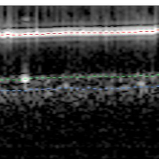
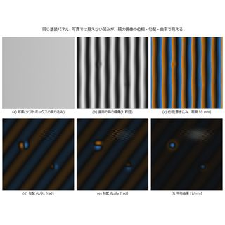
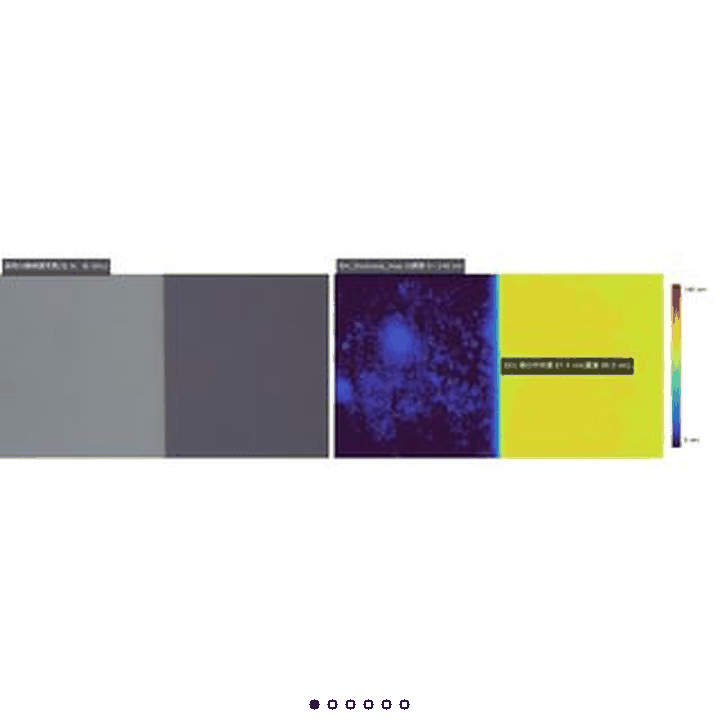
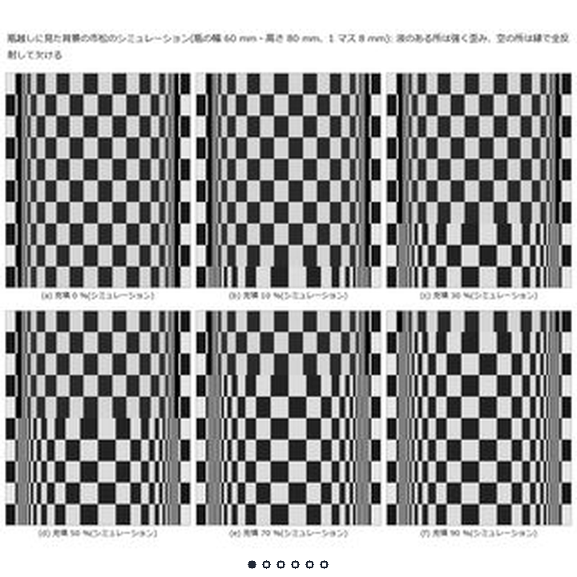

<div class="vlang" markdown="1">

**日本語** · [English](en/index.md) · [简体中文](zh/index.md) · [繁體中文](tw/index.md) · [한국어](ko/index.md) · [Deutsch](de/index.md) · [हिन्दी](hi/index.md) · [Français](fr/index.md)

</div>

# Fullseye — ViEW2026

**発表: 2026 年 12 月 3 日(木) 14:40〜15:50、インタラクティブセッション 2、IS2-19**(パシフィコ横浜 アネックスホール)

<div class="vintro"><div class="vt"><p>光学設計や三次元計測などのセンシングを含む物理シミュレーションと古典画像処理を、MCP と RAG で AI に渡し、課題ごとに組み合わせを考えさせ、型整合性と真値つき評価で確かめながら対話的に課題を解く基盤です。オープンソース(Apache-2.0)。</p><p><a href="about.md">Fullseye とは(読み物)</a></p></div></div>

タイルを押すと動画・図が開きます(▶ = 動く)。

本ページには展示 20 本だけを載せています。そのほかの展示 294 本は[おまけページ](more.md)にあります。

<style>
.vlang { font-size: 14px; line-height: 2; }
.vg { display: grid; grid-template-columns: repeat(2, minmax(0, 1fr)); gap: 8px; margin: 12px 0 20px; }
.vg.vs { grid-template-columns: repeat(3, minmax(0, 1fr)); gap: 6px; }
@media (min-width: 600px) { .vg { grid-template-columns: repeat(3, minmax(0, 1fr)); } .vg.vs { grid-template-columns: repeat(5, minmax(0, 1fr)); } }
@media (min-width: 900px) { .vg { grid-template-columns: repeat(4, minmax(0, 1fr)); } .vg.vs { grid-template-columns: repeat(7, minmax(0, 1fr)); } }
.vg a, .vser a { display: block; position: relative; text-decoration: none; color: inherit; }
.vg img { display: block; width: 100%; max-width: 100%; height: auto; aspect-ratio: 1 / 1; object-fit: cover; border-radius: 6px; background: #222; }
.vg picture { display: block; width: 100%; aspect-ratio: 1 / 1; overflow: hidden; border-radius: 6px; background: #fff; }
.vg picture img { height: 100%; aspect-ratio: auto; object-fit: contain; border-radius: 0; background: #fff; }
.vg b { position: absolute; top: 6px; right: 6px; background: rgba(0,0,0,.6); color: #fff; font-size: 12px; padding: 1px 6px; border-radius: 9px; }
.vg span { display: block; font-size: 13px; line-height: 1.3; margin-top: 3px; }
.vg.vs span { font-size: 11px; }
.vser { display: grid; grid-template-columns: repeat(2, minmax(0, 1fr)); gap: 8px; margin: 12px 0 20px; }
@media (min-width: 600px) { .vser { grid-template-columns: repeat(3, minmax(0, 1fr)); } }
.vser img { display: block; width: 100%; max-width: 100%; height: auto; aspect-ratio: 16 / 9; object-fit: cover; border-radius: 8px; background: #222; }
.vser strong { display: block; font-size: 14px; margin-top: 3px; line-height: 1.3; }
.vser span { display: block; font-size: 12px; line-height: 1.3; }
details.vall { margin: 6px 0; }
details.vall > summary { font-size: 15px; padding: 6px 0; cursor: pointer; }
.vl li { margin-bottom: 8px; }
li, p, code { overflow-wrap: anywhere; }
.vintro { display: flex; gap: 20px; align-items: flex-start; margin: 14px 0; }
.vintro img { flex: 0 0 300px; width: 300px; max-width: 100%; height: auto; border-radius: 6px; }
.vintro .vt p { margin: 0 0 8px; }
.vc { display: flex; gap: 16px; align-items: flex-start; margin: 18px 0; }
.vc > a:first-child { flex: 0 0 260px; position: relative; display: block; text-decoration: none; color: inherit; }
.vc > a img { display: block; width: 100%; max-width: 100%; height: auto; aspect-ratio: 1 / 1; object-fit: cover; border-radius: 6px; background: #222; }
.vc > a picture { display: block; width: 100%; aspect-ratio: 1 / 1; overflow: hidden; border-radius: 6px; background: #fff; }
.vc > a picture img { height: 100%; aspect-ratio: auto; object-fit: contain; border-radius: 0; background: #fff; }
.vc > a b { position: absolute; top: 6px; right: 6px; background: rgba(0,0,0,.6); color: #fff; font-size: 12px; padding: 1px 6px; border-radius: 9px; }
.vt { flex: 1 1 auto; min-width: 0; }
.vt .vh { font-size: 17px; font-weight: 600; line-height: 1.4; margin: 0 0 6px; }
.vt p { margin: 0 0 6px; }
.vt .vm { font-size: 14px; color: #57606a; }
.vt details { font-size: 14px; margin: 4px 0; }
.vt summary { cursor: pointer; }
.vc.vv { margin: 10px 0; }
.vc.vv > a:first-child { flex-basis: 96px; }
@media (max-width: 600px) {
  .vintro { flex-direction: column-reverse; gap: 8px; }
  .vintro img { flex: 0 0 auto; width: 100%; max-width: 240px; }
  .vc { flex-direction: column; gap: 8px; }
  .vc > a:first-child { flex: 0 0 auto; width: 240px; max-width: 100%; }
  .vc.vv { flex-direction: row; gap: 12px; }
  .vc.vv > a:first-child { width: 80px; flex: 0 0 80px; }
}
</style>

<script>
(function () {
  try {
    var k = "fullseye_view2026_lang";
    if (localStorage.getItem(k)) return;
    localStorage.setItem(k, "seen");
    if (document.referrer && document.referrer.indexOf(location.host) >= 0) return;
    var n = (navigator.language || "").toLowerCase(), t = "";
    if (n.indexOf("zh") === 0) t = /tw|hk|mo|hant/.test(n) ? "tw" : "zh";
    else if (/^(en|ko|de|hi|fr)/.test(n)) t = n.slice(0, 2);
    if (t) location.replace(t + "/");
  } catch (e) {}
})();
</script>

## 触って見る

論文の図を、手元で動かして確かめられます(スマートフォンでも動きます)。タブで方法を切り替え、3-D はドラッグで回せます。

<div class="vc vv"><a class="vvi" href="viewers/industrial_oct_anim3d.html?lang=ja"></a><div class="vt"><div class="vh"><a href="viewers/industrial_oct_anim3d.html?lang=ja">工業用 OCT の層構造</a></div><p>深さ方向を掃引し、塗膜の B スキャンと層厚の測定を動かして見る。 (4.0 MB)</p></div></div>

<div class="vc vv"><a class="vvi" href="viewers/phase_measuring_deflectometry_anim3d.html?lang=ja"></a><div class="vt"><div class="vh"><a href="viewers/phase_measuring_deflectometry_anim3d.html?lang=ja">デフレクトメトリの面形状</a></div><p>縞の位相を掃引し、写真では見えない表面の凹みが現れる過程を見る。 (14.9 MB)</p></div></div>

<div class="vc vv"><a class="vvi" href="viewers/poc_cad_scan_deviation.html?lang=ja"></a><div class="vt"><div class="vh"><a href="viewers/poc_cad_scan_deviation.html?lang=ja">CAD と実測点群の差分検査</a></div><p>位置合わせが欠陥を吸い、真値 1.2 µm の部品に 121 µm の存在しないへこみが出る。</p></div></div>

<div class="vc vv"><a class="vvi" href="viewers/poc_photoelasticity.html?lang=ja"></a><div class="vt"><div class="vh"><a href="viewers/poc_photoelasticity.html?lang=ja">光弾性の応力</a></div><p>検光子を回すと光弾性縞が動き、円板内の平均輝度が変わる(0〜135° の範囲)</p></div></div>

<div class="vc vv"><a class="vvi" href="viewers/poc_polarization_specular.html?lang=ja"></a><div class="vt"><div class="vh"><a href="viewers/poc_polarization_specular.html?lang=ja">偏光で鏡面除去</a></div><p>偏光で鏡面の映り込みを剥がす。剥がし残りは入射角で変わり、ブリュースター角で最小(掃引は合成の縞の場面)</p></div></div>

<div class="vc vv"><a class="vvi" href="viewers/poc_thermography_ndt.html?lang=ja"></a><div class="vt"><div class="vh"><a href="viewers/poc_thermography_ndt.html?lang=ja">パルスサーモグラフィの深さ推定</a></div><p>当てはめる時間窓を 25 秒から 4 秒に切るだけで、小さい欠陥 8 個の深さの誤差の最悪値が +612 % から −14 % に縮む。外れた原因は物理でなく窓の選び方だった。</p></div></div>

## 目玉

<div class="vc"><a href="../articles/assets/poc/poc_phase_measuring_deflectometry/03_photo_vs_pmd.png"><picture><source media="(prefers-reduced-motion: reduce)" srcset="../articles/assets/poc/poc_phase_measuring_deflectometry/03_photo_vs_pmd.png"></picture></a><div class="vt"><div class="vh"><a href="../articles/assets/poc/poc_phase_measuring_deflectometry/03_photo_vs_pmd.png">拡散照明の写真では見えない凹みが縞の鏡像で浮かぶ(合成)</a></div><p>光沢のある塗装面のごく浅い凹みは、拡散照明の写真ではほぼ写らない。面の前の画面に縞を映し、その鏡像のゆがみから曲率を求めると、仕込んだ深さ 3 µm の凹みが浮かんだ。合成の場面での結果で、斜めから照らす写真とは比べていない。</p><p class="vm">真値: 自作合成 · <a href="more.md#d-poc-phase-measuring-deflectometry">くわしく</a></p></div></div>

<div class="vc"><a href="../articles/assets/poc/poc_industrial_oct/01_real_paint_bscans.png"><picture><source media="(prefers-reduced-motion: reduce)" srcset="../articles/assets/poc/poc_industrial_oct/01_real_paint_bscans.png"></picture></a><div class="vt"><div class="vh"><a href="../articles/assets/poc/poc_industrial_oct/01_real_paint_bscans.png">塗装の層の厚さを切らずに測る(工業用 OCT)</a></div><p>塗装や多層フィルムの層の厚さを、切らずに奥行き方向から見たい。公開されている自動車塗装の生の干渉スペクトルから透明層の厚さを求め、同じ見本を顕微鏡で測った値と 3.6 µm 以内で合った。論文の値との一致は同じデータの再現にあたり、見本と表の対応は厚さから推定した。</p><p class="vm">真値: 実データ · <a href="more.md#d-poc-industrial-oct">くわしく</a></p></div></div>

<div class="vc"><a href="../articles/assets/poc/poc_hyperspectral_foreign_matter/04_real_pork_belly.png"><picture><source media="(prefers-reduced-motion: reduce)" srcset="../articles/assets/poc/poc_hyperspectral_foreign_matter/01_real_polymer_flakes.png"></picture></a><div class="vt"><div class="vh"><a href="../articles/assets/poc/poc_hyperspectral_foreign_matter/04_real_pork_belly.png">豚バラの上の異物を近赤外の分光画像で見つける</a></div><p>公開の実画像を近赤外の分光画像として使い、豚バラの上の異物を分類した。撮影を分けて画素ごとに採点すると、誤警報 1.1 % で大半を検出できた。帯域を減らすと誤警報が増え、色が同じ異物をカラーで見分けられないことは合成でだけ示した。</p><p class="vm">真値: 実データ · <a href="more.md#d-poc-hyperspectral-foreign-matter">くわしく</a></p></div></div>

<div class="vc"><a href="../articles/assets/poc/poc_thin_film_reflectometry/01_real_micrograph_thickness.png"><picture><source media="(prefers-reduced-motion: reduce)" srcset="../articles/assets/poc/poc_thin_film_reflectometry/01_real_micrograph_thickness.png"></picture></a><div class="vt"><div class="vh"><a href="../articles/assets/poc/poc_thin_film_reflectometry/01_real_micrograph_thickness.png">顕微鏡写真の色から酸化膜の厚さを読む</a></div><p>シリコン上の酸化膜の厚さは、反射スペクトルの干渉縞や色から読み取れる。他の研究者が公開した実物の顕微鏡写真から画素ごとに読むと、中央値は 87.4 nm だった。論文の値から求めた基準より一割ほど薄く、カメラの色の感度は分かっていない。</p><p class="vm">真値: 実データ · <a href="more.md#d-poc-thin-film-reflectometry">くわしく</a></p></div></div>

<div class="vc"><a href="../articles/assets/poc/poc_telecentric_metrology/08_real_alignment_plate.png"><picture><source media="(prefers-reduced-motion: reduce)" srcset="../articles/assets/poc/poc_telecentric_metrology/08_real_alignment_plate.png"></picture></a><div class="vt"><div class="vh"><a href="../articles/assets/poc/poc_telecentric_metrology/08_real_alignment_plate.png">公開のテレセン実画像で倍率を測り、論文の値と論文自身のばらつきの内で一致</a></div><p>段差のある部品を一枚の画像で測ると、普通のレンズでは近い面ほど大きく写る。論文で公開されたテレセントリックレンズの実画像から測った倍率は論文の値と合ったが、論文自身の値が ±0.25 % 散るので、それより細かい一致とは読まない。傾いた板の同心円の中心がずれないことが、その証拠になる。</p><p class="vm">真値: 実データ · <a href="more.md#d-poc-telecentric-metrology">くわしく</a></p></div></div>

<div class="vc"><a href="../articles/assets/poc/poc_virtual_sem_kv_cd_bse/05_sem_same_part_3kv_3detectors.png"><picture><source media="(prefers-reduced-motion: reduce)" srcset="../articles/assets/poc/poc_virtual_sem_kv_cd_bse/05_sem_same_part_3kv_3detectors.png"></picture></a><div class="vt"><div class="vh"><a href="../articles/assets/poc/poc_virtual_sem_kv_cd_bse/05_sem_same_part_3kv_3detectors.png">仮想 SEM: 加速電圧で像が変わる(模型を実測の反射電子の量で採点)</a></div><p>SEM の像は表面の写真ではなく、固体の中で散乱した電子のうち外へ出てきたものの集計である。電子を一つずつ追う模型を組み、反射電子の量を 7 元素の実測データベースと照合した。線幅の真値つきの実画像は無く、加速電圧で線幅の読みが変わるという結果は模型の中の話である。</p><p class="vm">真値: 公表値 · <a href="more.md#d-poc-virtual-sem-kv-cd-bse">くわしく</a></p></div></div>

<div class="vc"><a href="../articles/assets/poc/poc_cad_scan_deviation/14_align_orbit.gif"><picture><source media="(prefers-reduced-motion: reduce)" srcset="../articles/assets/poc/poc_cad_scan_deviation/01_scene.png"></picture><b>&#9654;</b></a><div class="vt"><div class="vh"><a href="../articles/assets/poc/poc_cad_scan_deviation/14_align_orbit.gif">位置合わせの取り方で、外れて見える場所が変わる: CAD と点群の差</a></div><p>点群を設計形状へ合わせてから検査すると、位置合わせが偏差の一部を吸収し、外れて見える場所が移る。反りを既知量で入れた部品では、真値がごく小さい中央に深さ 121 µm の読みが出た。合成の結果で、設計形状を点に置き換えて測ると欠陥のない対照でも稜線に公差外が出る。</p><p class="vm">真値: 自作合成 · <a href="more.md#d-poc-cad-scan-deviation">くわしく</a></p></div></div>

<div class="vc"><a href="../articles/assets/poc/poc_good_sample_variation_model/04_visa_explanation.png"><picture><source media="(prefers-reduced-motion: reduce)" srcset="../articles/assets/poc/poc_good_sample_variation_model/01_band_width_alignment.png"></picture></a><div class="vt"><div class="vh"><a href="../articles/assets/poc/poc_good_sample_variation_model/04_visa_explanation.png">良品のばらつきで欠陥を探す: 実画像では誤検出率が守られない</a></div><p>良品を何枚も撮り、画素ごとのいつものばらつきから外れた所を欠陥とするのは、外観検査の古典的な方法である。誤検出率を先に宣言して帯の幅を決めるようにし、公開の実画像 200 枚で採点した。位置合わせの有無が良品の枚数より効く一方、宣言した誤検出率は実画像では守られなかった。</p><p class="vm">真値: 実データ · <a href="more.md#d-poc-good-sample-variation-model">くわしく</a></p></div></div>

<div class="vc"><a href="../articles/assets/poc/poc_itof_multifreq/12_public_raw_unwrap.png"><picture><source media="(prefers-reduced-motion: reduce)" srcset="../articles/assets/poc/poc_itof_multifreq/01_warehouse_unwrap.png"></picture></a><div class="vt"><div class="vh"><a href="../articles/assets/poc/poc_itof_multifreq/12_public_raw_unwrap.png">間接 ToF の距離はどこで壊れるか(合成)</a></div><p>間接 ToF は、変調した光が戻るまでの位相のずれから距離を測る。合成の信号では、周波数を組み合わせると 18.7 m まで距離を一意に読める。多重反射や物の縁では、警告なしに距離が飛ぶ。</p><p class="vm">真値: 自作合成 · <a href="more.md#d-poc-itof-multifreq">くわしく</a></p></div></div>

<div class="vc"><a href="../articles/assets/poc/poc_ai_built_inspection_scored/01_crack_real.png"><picture><source media="(prefers-reduced-motion: reduce)" srcset="../articles/assets/poc/poc_ai_built_inspection_scored/01_crack_real.png"></picture></a><div class="vt"><div class="vh"><a href="../articles/assets/poc/poc_ai_built_inspection_scored/01_crack_real.png">AI に検査を組ませ、公開実データで採点する(ローカル LLM はほとんど組めない)</a></div><p>課題を自然言語で渡し、ローカルの LLM に MCP だけで検査のレシピを組ませた。公開のひび割れ画像 400 枚を配布元のラベルで画像ごとに採点すると、選り分けるレシピを組めた回はごく少なかった。ろうそくの汚れの課題では一度も組めず、既存のレシピには届かなかった。</p><p class="vm">真値: 実データ · <a href="more.md#d-poc-ai-built-inspection-scored">くわしく</a></p></div></div>

<div class="vc"><a href="../articles/assets/poc/poc_bottle_pattern_inverse/01_checker_through_bottle.png"><picture><source media="(prefers-reduced-motion: reduce)" srcset="../articles/assets/poc/poc_bottle_pattern_inverse/01_checker_through_bottle.png"></picture></a><div class="vt"><div class="vh"><a href="../articles/assets/poc/poc_bottle_pattern_inverse/01_checker_through_bottle.png">背景の縞の歪みからガラス瓶を逆に測る(シミュレーション): 同じ仮定の下の復元と、分けられない量</a></div><p>透明な瓶は後ろの縞を歪めて見せる。画素ごとに背景の位置を求め、外半径・壁厚・屈折率・液面を逆に当てはめて、充填 5 通りの真値で採点した。分けられない量も出すが、真値は自作のシミュレーションで、実物の瓶では確かめていない。</p><p class="vm">真値: 自作合成 · <a href="more.md#d-poc-bottle-pattern-inverse">くわしく</a></p></div></div>

<div class="vc"><a href="../articles/assets/poc/poc_real_tum_rgbd_slam/02_trajectory.png"><picture><source media="(prefers-reduced-motion: reduce)" srcset="../articles/assets/poc/poc_real_tum_rgbd_slam/02_trajectory.png"></picture></a><div class="vt"><div class="vh"><a href="../articles/assets/poc/poc_real_tum_rgbd_slam/02_trajectory.png">公開の実測 RGB-D で隣り合う画像の位置合わせを採点する ―― 等速の予測より良いかは分割の選び方しだい</a></div><p>机の上を撮った公開データのひと続きの深度画像で、隣り合う画像の位置合わせをモーションキャプチャの真値と比べた。合わせないときより誤差は減り、最も悪い分け方でも 0.42 倍だったが、等速の予測より良いかは画像の分け方で変わった。小さな窓の平面の残差は距離とともに増えたが、距離の二乗かどうかは決められなかった。</p><p class="vm">真値: 実データ · <a href="more.md#d-poc-real-tum-rgbd-slam">くわしく</a></p></div></div>

<div class="vc"><a href="../articles/assets/poc/poc_real_walnut_cbct/07_geometry_mistakes.png"><picture><source media="(prefers-reduced-motion: reduce)" srcset="../articles/assets/poc/poc_real_walnut_cbct/07_geometry_mistakes.png"></picture></a><div class="vt"><div class="vh"><a href="../articles/assets/poc/poc_real_walnut_cbct/07_geometry_mistakes.png">実測 CT: 縦ずれを無視すると別の断面を再構成してしまい、その誤りは外の参照で初めて分かる</a></div><p>公開されている実測のコーンビーム CT(クルミ)を、FDK と反復法で再構成した。投影 300 枚を使い配布元の参照で採点すると、縦ずれを無視した再構成は別の断面を作ることになり、参照から遠くなる。そのデータ自体に矛盾は無いので再投影の残差は変わらず、これは作りの上で当然である。</p><p class="vm">真値: 実データ · <a href="more.md#d-poc-real-walnut-cbct">くわしく</a></p></div></div>

<div class="vc"><a href="../articles/assets/poc/poc_3d_sensor_modalities/01_map.png"><picture><source media="(prefers-reduced-motion: reduce)" srcset="../articles/assets/poc/poc_3d_sensor_modalities/01_map.png"></picture></a><div class="vt"><div class="vh"><a href="../articles/assets/poc/poc_3d_sensor_modalities/01_map.png">同じ部品を 3-D センサ 5 方式で測るシミュレーション ―― 材質ごとにどこで壊れるか</a></div><p>同じ部品を、方式の違う立体センサの模型で、つや消し・金属光沢・半透明・黒の材質ごとに測ったシミュレーションである。形の外れを共通の物差し 0.1 mm で数え、寸法表の真値と比べた。方式ごとに分解能の桁が違うので順位ではなく、どの材質のどこで壊れるかを見る。</p><p class="vm">真値: 自作合成 · <a href="more.md#d-poc-3d-sensor-modalities">くわしく</a></p></div></div>

## 準目玉

<div class="vc"><a href="../articles/assets/poc/poc_equipment_selection_map/02_equipment_at_a_glance.png"><picture><source media="(prefers-reduced-motion: reduce)" srcset="../articles/assets/poc/poc_equipment_selection_map/02_equipment_at_a_glance.png"></picture></a><div class="vt"><div class="vh"><a href="../articles/assets/poc/poc_equipment_selection_map/02_equipment_at_a_glance.png">照明 × カメラ × レンズ 60 通りで同じ傷を撮る機材選びの地図(合成の試験)</a></div><p>外観検査の機材選びを、同じ傷で事前に試した。照明・カメラ・レンズの 60 通りで撮り、何 µm の傷から見つかるかを揺れの幅つきで地図にした。合成の試験なので、実機の性能ではない。</p><p class="vm">真値: 自作合成 · <a href="more.md#d-poc-equipment-selection-map">くわしく</a></p></div></div>

<div class="vc"><a href="../articles/assets/poc/poc_real_stereo_multiscanline/02_failure_map.png"><picture><source media="(prefers-reduced-motion: reduce)" srcset="../articles/assets/poc/poc_real_stereo_multiscanline/02_failure_map.png"></picture></a><div class="vt"><div class="vh"><a href="../articles/assets/poc/poc_real_stereo_multiscanline/02_failure_map.png">実写のステレオで視差・面・円の姿勢</a></div><p>実写のステレオ対から、視差・距離・面・円の姿勢まで求めた。Middlebury 2014 の真値の視差で平均誤差を採点し、OpenCV と比べた。両方が有効な画素だけで比べるとほぼ同等で、差の多くはどこを無効にするかの選び方から来る。</p><p class="vm">真値: 実データ · <a href="more.md#d-poc-real-stereo-multiscanline">くわしく</a></p></div></div>

<div class="vc"><a href="../articles/assets/poc/poc_real_defect_floor/03_defect_floor_explained.mp4"><b>&#9654;</b></a><div class="vt"><div class="vh"><a href="../articles/assets/poc/poc_real_defect_floor/03_defect_floor_explained.mp4">雑音をそろえても実写の地では弱い欠陥が見えにくい</a></div><p>検査の現場では、弱い欠陥がどこまで見えるかを平らな地に雑音を載せた合成画像で見積もることが多い。雑音の量をそろえても、実写の地では検出限界が合成より悪くなり、最も悪いレンガの地で 3.47 倍だった。限界を決めていたのは雑音ではなく、目地のような地の構造だった。</p><p class="vm">真値: 実写の地 · <a href="more.md#d-poc-real-defect-floor">くわしく</a></p></div></div>

<div class="vc"><a href="../articles/assets/poc/poc_sam_hybrid_bonding_voids/03_amplitude_vs_phase.png"><picture><source media="(prefers-reduced-motion: reduce)" srcset="../articles/assets/poc/poc_sam_hybrid_bonding_voids/03_amplitude_vs_phase.png"></picture></a><div class="vt"><div class="vh"><a href="../articles/assets/poc/poc_sam_hybrid_bonding_voids/03_amplitude_vs_phase.png">接合面のボイドを超音波の位相で見つける(シミュレーション)</a></div><p>積み重ねたチップの接合面にできる小さなボイドを超音波顕微鏡で探す、シミュレーションである。直径 16 µm 以上のボイドは、反射の位相の像で反転して光った。明るさの像では、小さなボイドの多くが良品に紛れる。</p><p class="vm">真値: 自作合成 · <a href="more.md#d-poc-sam-hybrid-bonding-voids">くわしく</a></p></div></div>

<div class="vc"><a href="../articles/assets/poc/poc_photoelasticity/03_load_and_isoclinics.mp4"><picture><source media="(prefers-reduced-motion: reduce)" srcset="../articles/assets/poc/poc_photoelasticity/01_polariscope.png"></picture><b>&#9654;</b></a><div class="vt"><div class="vh"><a href="../articles/assets/poc/poc_photoelasticity/03_load_and_isoclinics.mp4">押した円板の応力が縞で見える(光弾性、合成)</a></div><p>透明な樹脂に力を加えて偏光を通すと、内部の応力が縞として見える。円板を押しつぶした応力場を偏光像にし、縞次数が 0.5 を超えて位相が巻いた画素から応力を戻した。巻き戻した後に外れた画素の多くは、光弾性でよく知られた符号の二義性によるものだった。</p><p class="vm">真値: 自作合成 · <a href="more.md#d-poc-photoelasticity">くわしく</a></p></div></div>

<div class="vc"><a href="../articles/assets/poc/poc_mixed_case_depalletizing/08_depal_robot_video.mp4"><picture><source media="(prefers-reduced-motion: reduce)" srcset="../articles/assets/poc/poc_mixed_case_depalletizing/01_overview_same_pattern.png"></picture><b>&#9654;</b></a><div class="vt"><div class="vh"><a href="../articles/assets/poc/poc_mixed_case_depalletizing/08_depal_robot_video.mp4">混載パレットの箱を深度の段差・V 字・カラーの溝で分ける(シミュレーション)</a></div><p>計算で作った場面で、詰めて並んだ同じ柄の段ボールを、天井の深度カメラとカラーで見分けて下ろす。深度の段差では同じ柄の箱を分けられず、深度の浅い溝とカラーの暗い溝の勝ち負けは、天面の合わせ目の作り 28 通りの地図で入れ替わった。勝ち負けは、縁の丸みや合わせ目といった場面の作りに強く依存する。</p><p class="vm">真値: 自作合成 · <a href="more.md#d-poc-mixed-case-depalletizing">くわしく</a></p></div></div>

## シリーズ記事

<div class="vser">
<a href="https://qiita.com/furuse-kazufumi/items/c1606bcfa2085d204ad6"><strong>紙面の計測館</strong><span>真値を自分で仕込んだ PoC の展示館</span></a>
<a href="https://qiita.com/furuse-kazufumi/items/b6498dc822bf9eed100f"><strong>卓球</strong><span>跳ねと摩擦を映像から測る</span></a>
<a href="https://qiita.com/furuse-kazufumi/items/1f128b8a36df373c11c7"><strong>自動運転</strong><span>定理と第 2 実装で採点する</span></a>
<a href="https://qiita.com/furuse-kazufumi/items/331af639c2b9a1493576"><strong>コネクトーム(脳の配線図)</strong><span>ハエの視覚モデルを体に載せて測る</span></a>
<a href="https://qiita.com/furuse-kazufumi/items/57e2f1e5a09165e58b65"><strong>ヒューマノイド運動会</strong><span>画像処理が審判をする自宅の運動会</span></a>
</div>

[おまけ:そのほかの PoC](more.md)も見る。

<details markdown="1">
<summary><b>試してみる</b> (Python 3.11)</summary>

```
pip install fullseye
git clone https://github.com/furuse-kazufumi/fullseye
cd fullseye
python examples/poc_focus_stacking.py
```

焦点合成の PoC が約 20 秒で走り、真値に対する数字と `PASS` を印字します。図は `out/figures/poc_focus_stacking/` に書かれます。

</details>

<details markdown="1">
<summary><b>リンク</b></summary>

- [GitHub(ソースコード)](https://github.com/furuse-kazufumi/fullseye)
- [ギャラリー(全部の図)](../GALLERY.md)
- [演算子を探す・AI(RAG)から使う](../AI_RAG_GUIDE.md) · [MCP から使う](../MCP.md)
- [ドキュメント索引](../README.md)

</details>

<details markdown="1">
<summary><b>論文情報</b></summary>

- **題目**: Fullseye：型付き演算子と物理シミュレーションに基づく画像検査・三次元計測基盤
- **著者**: 古瀬 和文(個人研究者)
- **発表**: ViEW2026 ビジョン技術の実利用ワークショップ
- **論文 PDF**: [English](paper/101_en.pdf) · [简体中文](paper/101_zh.pdf)(日本語: 2026-11-26 以降に掲載)

**概要**: 画像検査・三次元計測の処理を，入出力のデータ型を宣言した演算子の連鎖として組み立て，物理・撮像シミュレーションで作った真値に対して定量評価し，処理手順・評価・失敗条件を記録して再利用できるオープンソース基盤Fullseyeを提案する．約3,000の型付き演算子，型の不整合を実行前に退ける検査，多言語の演算子検索（RAG），真値つきの200本超の実証プログラムからなり，代表例の定量評価と，合成・実測・実機の検証段階の区別について報告する．

</details>
