<div class="vlang" markdown="1">

**日本語** · [English](en/index.md) · [简体中文](zh/index.md) · [繁體中文](tw/index.md) · [한국어](ko/index.md) · [Deutsch](de/index.md) · [हिन्दी](hi/index.md) · [Français](fr/index.md)

</div>

# Fullseye — ViEW2026

物理シミュレーションと画像処理を AI と組み合わせて、真値で確かめる。

タイルを押すと動画・図が開きます(▶ = 動く)。

<style>
.vlang { font-size: 14px; line-height: 2; }
.vg { display: grid; grid-template-columns: repeat(2, minmax(0, 1fr)); gap: 8px; margin: 12px 0 20px; }
.vg.vs { grid-template-columns: repeat(3, minmax(0, 1fr)); gap: 6px; }
@media (min-width: 600px) { .vg { grid-template-columns: repeat(3, minmax(0, 1fr)); } .vg.vs { grid-template-columns: repeat(5, minmax(0, 1fr)); } }
@media (min-width: 900px) { .vg { grid-template-columns: repeat(4, minmax(0, 1fr)); } .vg.vs { grid-template-columns: repeat(7, minmax(0, 1fr)); } }
.vg a, .vser a { display: block; position: relative; text-decoration: none; color: inherit; }
.vg img { display: block; width: 100%; max-width: 100%; height: auto; aspect-ratio: 1 / 1; object-fit: cover; border-radius: 6px; background: #222; }
.vg b { position: absolute; top: 6px; right: 6px; background: rgba(0,0,0,.6); color: #fff; font-size: 12px; padding: 1px 6px; border-radius: 9px; }
.vg span { display: block; font-size: 13px; line-height: 1.3; margin-top: 3px; }
.vg.vs span { font-size: 11px; }
.vser { display: grid; grid-template-columns: repeat(2, minmax(0, 1fr)); gap: 8px; margin: 12px 0 20px; }
@media (min-width: 600px) { .vser { grid-template-columns: repeat(3, minmax(0, 1fr)); } }
.vser img { display: block; width: 100%; max-width: 100%; height: auto; aspect-ratio: 16 / 9; object-fit: cover; border-radius: 8px; background: #222; }
.vser strong { display: block; font-size: 14px; margin-top: 3px; line-height: 1.3; }
.vser span { display: block; font-size: 12px; line-height: 1.3; }
details.vall { margin: 6px 0; }
details.vall > summary { font-size: 15px; padding: 6px 0; cursor: pointer; }
.vl li { margin-bottom: 8px; }
</style>

<script>
(function () {
  try {
    var k = "fullseye_view2026_lang";
    if (localStorage.getItem(k)) return;
    localStorage.setItem(k, "seen");
    if (document.referrer && document.referrer.indexOf(location.host) >= 0) return;
    var n = (navigator.language || "").toLowerCase(), t = "";
    if (n.indexOf("zh") === 0) t = /tw|hk|mo|hant/.test(n) ? "tw" : "zh";
    else if (/^(en|ko|de|hi|fr)/.test(n)) t = n.slice(0, 2);
    if (t) location.replace(t + "/");
  } catch (e) {}
})();
</script>

## 触って見る

論文の図を、手元で動かして確かめられます(スマートフォンでも動きます)。タブで方法を切り替え、3-D はドラッグで回せます。

- **[CAD と実測点群の差分検査](viewers/poc_cad_scan_deviation.html?lang=ja)**: 位置合わせが欠陥を吸い、真値 1.2 µm の部品に 121 µm の存在しないへこみが出る。
- **[LiDAR の地形変化](viewers/poc_lidar_terrain_change.html?lang=ja)**: 素朴に引くと、変化の無い区画全体が 0.183 m 沈んで見える。補正すると、本当の変化だけが残る。
- **[テンプレート追跡](viewers/poc_template_tracking.html?lang=ja)**: そっくりな別物体に乗り換えても、追跡は「見つけた」と報告し続ける。
- **[パルスサーモグラフィの深さ推定](viewers/poc_thermography_ndt.html?lang=ja)**: 当てはめる時間窓を 25 秒から 4 秒に切るだけで、小さい欠陥の深さの誤差が最大 +627% から ±14% に縮む。外れた原因は物理でなく窓の選び方だった。
- **[タルボ絨毯と格子の X 線像](viewers/poc_grating_interferometry.html?lang=ja)**: 吸収では割れのコントラスト雑音比が 1.34 しかないが、暗視野では 13.5 に上がり、格子を回すと繊維の向きまで読める。
- **[縞の鏡像で見る µm の凹み](viewers/poc_phase_measuring_deflectometry.html?lang=ja)**: 写真の信号は雑音の 0.17 倍で何も見えないが、縞の鏡像から作る曲率の地図では、深さ 1 µm の凹みが雑音の 57 倍に立つ。
- **[小惑星の表面の曲がり具合](viewers/poc_asteroid_curvature.html?lang=ja)**: 実在の小惑星の点群から曲率を出し、尾根や巨礫の縁を色で見る。答えの分かる球で、先に物差しを確かめてある。
- **[焦点合成](viewers/poc_focus_stacking.html?lang=ja)**: F値を上げるほど焦点合成像が真のテクスチャに近づく
- **[白色干渉の段差](viewers/poc_interferometry_step.html?lang=ja)**: 雑音が増えると白色干渉の段差誤差が広がる
- **[偏光で鏡面除去](viewers/poc_polarization_specular.html?lang=ja)**: 入射角で鏡面分離の誤差が変わり、ブリュースター角近傍で最小になる
- **[光弾性の応力](viewers/poc_photoelasticity.html?lang=ja)**: 検光子を回すと光弾性縞が動き、平均輝度が周期的に変わる
- **[ハエの複眼](viewers/poc_compound_eye.html?lang=ja)**: 視点ごとのSNRを上げるほど複眼像が無雑音像に近づく
- **[接合層のボイド](viewers/poc_ct_void_morphology.html?lang=ja)**: しきい値を上げるほどボイド判定が広がり、体積率が増える
- **[動的輪郭](viewers/poc_active_contours.html?lang=ja)**: 反復を重ねるほどGVF輪郭が最終形へ近づく

## 見どころ

<div class="vg">
<a href="../articles/assets/poc/poc_real_defect_floor/02_defect_floor_sweep.gif"><b>&#9654;</b><span>薄い傷の検出限界</span></a>
<a href="../articles/assets/poc/poc_active_contours/06_u_shape_snakes.mp4"><b>&#9654;</b><span>動的輪郭</span></a>
<a href="../articles/assets/poc/poc_dic_strain/05_tensile_ramp.mp4"><b>&#9654;</b><span>DIC ひずみ</span></a>
<a href="../articles/assets/poc/poc_focus_stacking/05_focus_sweep.mp4"><b>&#9654;</b><span>焦点合成</span></a>
<a href="../articles/assets/poc/poc_registration_basin/05_icp_basin_iterations.mp4"><b>&#9654;</b><span>点群の位置合わせ</span></a>
<a href="../articles/assets/poc/poc_stockpile_volume/07_scan_orbit.mp4"><b>&#9654;</b><span>堆積物の体積</span></a>
<a href="../articles/assets/poc/poc_ct_fidelity/01_recon_sweep.png"><span>CT 再構成</span></a>
<a href="../articles/assets/poc/poc_ct_void_morphology/13_section_sweep.mp4"><b>&#9654;</b><span>CT のボイド</span></a>
<a href="../articles/assets/poc/poc_interferometry_step/03_surface_z_scan.mp4"><b>&#9654;</b><span>白色干渉の段差</span></a>
<a href="../articles/assets/poc/poc_polarization_specular/01_raw_polarizer_mosaic.png"><span>偏光で鏡面除去</span></a>
<a href="../articles/assets/poc/poc_photoelasticity/03_load_and_isoclinics.mp4"><b>&#9654;</b><span>光弾性の応力</span></a>
<a href="../articles/assets/poc/poc_thermography_ndt/02_depth_map.png"><span>熱画像の欠陥深さ</span></a>
<a href="../articles/assets/poc/poc_motion_magnification/05_magnify_video.mp4"><b>&#9654;</b><span>微小振動の拡大</span></a>
<a href="../articles/assets/poc/poc_table_tennis_bounce/01_drop_test.mp4"><b>&#9654;</b><span>卓球の跳ね</span></a>
<a href="../articles/assets/poc/poc_compound_eye/02_compound_eye_superposition.png"><span>複眼の光場</span></a>
<a href="../articles/assets/poc/poc_pegsim_insertion/04_pegsim_insert_corrected.gif"><b>&#9654;</b><span>ペグ挿入</span></a>
<a href="../articles/assets/poc/poc_air_hockey_intercept/02_airhockey_prediction_cone_narrows.gif"><b>&#9654;</b><span>エアホッケー</span></a>
<a href="../articles/assets/poc/poc_tacsim_elastic_membrane/03_tacsim_force_sweep.gif"><b>&#9654;</b><span>視触覚センサ</span></a>
<a href="../articles/assets/poc/poc_table_tennis_spin/01_side_three_serves.mp4"><b>&#9654;</b><span>卓球の回転</span></a>
<a href="../articles/assets/poc/poc_table_tennis_rally_loop/02_height_misread.mp4"><b>&#9654;</b><span>ラリーと読み誤差</span></a>
<a href="../articles/assets/poc/poc_driving_traffic/01_dashcam_occlusion.mp4"><b>&#9654;</b><span>交通と死角</span></a>
<a href="../articles/assets/poc/poc_driving_crossing/01_crossing_dashcam.mp4"><b>&#9654;</b><span>踏切と交差点</span></a>
<a href="../articles/assets/poc/poc_driving_pass/03_mirror_tjunction.mp4"><b>&#9654;</b><span>カーブミラー</span></a>
<a href="../articles/assets/poc/poc_ttc_rss/06_approach_gif.gif"><b>&#9654;</b><span>衝突時間と RSS</span></a>
<a href="../articles/assets/poc/poc_eye_to_brain/01_eye_sweep.gif"><b>&#9654;</b><span>複眼から脳へ</span></a>
<a href="../articles/assets/poc/poc_malecns_activity_wave/01_activity_wave_connectome_vs_shuffle.gif"><b>&#9654;</b><span>ハエの脳の波</span></a>
<a href="../articles/assets/poc/poc_microns_brain_wave/04_wave_on_wiring.gif"><b>&#9654;</b><span>マウス視覚野の波</span></a>
<a href="../articles/assets/media/evis_stereo_fullseye.mp4"><b>&#9654;</b><span>ヒューマノイドの両眼</span></a>
<a href="../articles/assets/media/evis_bean_track_fullseye.mp4"><b>&#9654;</b><span>箸先カメラの豆追跡</span></a>
<a href="../articles/assets/poc/poc_barcode_1d/03_collapse.png">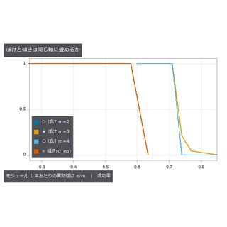<span>1 次元バーコード</span></a>
<a href="../articles/assets/poc/poc_bearing_diagnosis/03_sk_bands.png">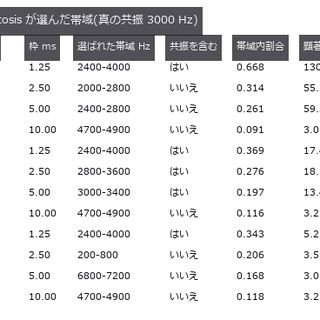<span>軸受の異常診断</span></a>
<a href="../articles/assets/poc/poc_bilateral_asymmetry/02_gain_vs_amplitude.png">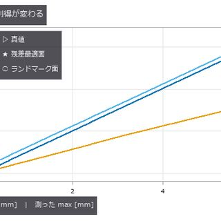<span>左右非対称性</span></a>
<a href="../articles/assets/poc/poc_crack_width/01_width_sweep.png">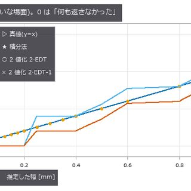<span>ひび割れ幅</span></a>
<a href="../articles/assets/poc/poc_dimensional_inspection/02_blur_cliff.png">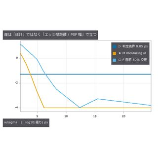<span>部品の寸法検査</span></a>
<a href="../articles/assets/poc/poc_fabric_defect/04_scene.png">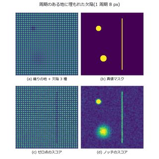<span>織物の欠陥</span></a>
<a href="../articles/assets/poc/poc_fiber_orientation/01_scene.png">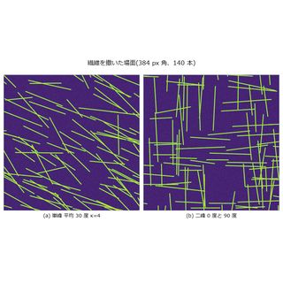<span>繊維の配向</span></a>
<a href="../articles/assets/poc/poc_gear_tooth_metrology/03_spectrum.png">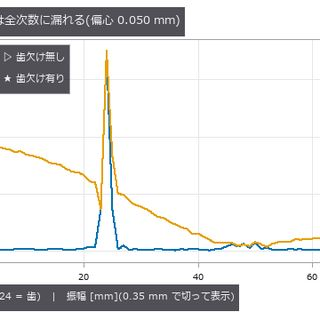<span>歯車の歯形</span></a>
<a href="../articles/assets/poc/poc_matrix_code_reading/01_symbol_and_errors.png">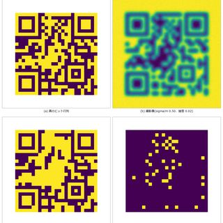<span>2 値コードを読む</span></a>
<a href="../articles/assets/poc/poc_moire_screen/04_moire_scene.png">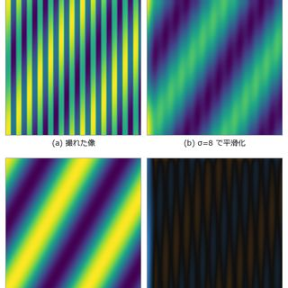<span>モアレとムラ</span></a>
<a href="../articles/assets/poc/poc_particle_sizing/02_density_sweep.png">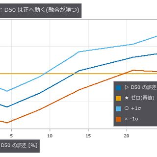<span>粒度分布</span></a>
<a href="../articles/assets/poc/poc_strain_history/05_history_video.gif">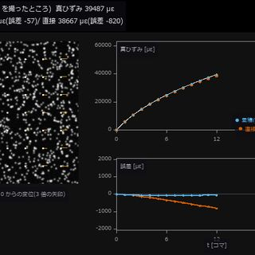<b>&#9654;</b><span>クリープひずみ</span></a>
<a href="../articles/assets/poc/poc_surface_roughness/04_lambda_c_sweep.png">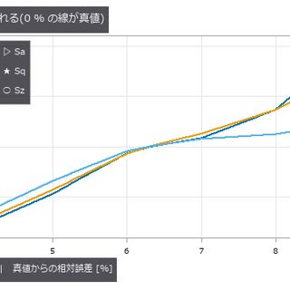<span>表面粗さ</span></a>
<a href="../articles/assets/poc/poc_thermal_drift_metrology/04_error_maps.png">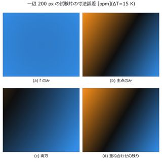<span>カメラの熱ドリフト</span></a>
<a href="../articles/assets/poc/poc_veiling_glare/03_mtf_curves.png">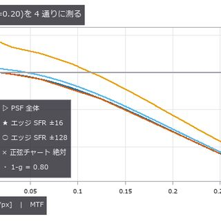<span>迷光とコントラスト</span></a>
<a href="../articles/assets/poc/poc_weld_bead_profile/01_laser_images.png">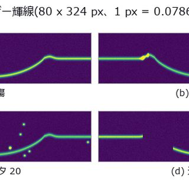<span>溶接ビード断面</span></a>
<a href="../articles/assets/poc/poc_leak_localization/04_correlation_zoom.png">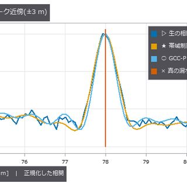<span>音で漏水探知</span></a>
<a href="../articles/assets/poc/poc_machine_condition_fusion/11_sweep_record_length.png">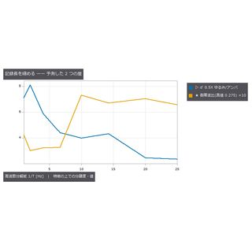<span>設備保全の融合</span></a>
<a href="../articles/assets/poc/poc_metal_grain_size/08_failure_area.png">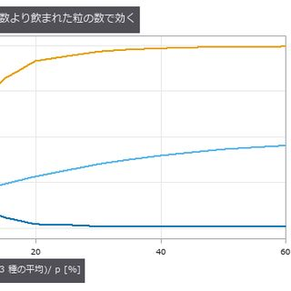<span>結晶粒度</span></a>
<a href="../articles/assets/poc/poc_recycling_sorting/13_spectra.png">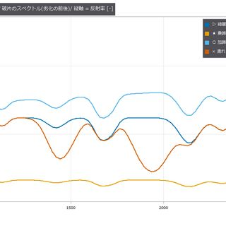<span>廃棄物の材質選別</span></a>
<a href="../articles/assets/poc/poc_screw_thread_metrology/05_tilt_correction.png">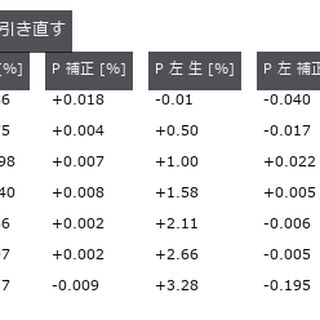<span>ねじの輪郭</span></a>
<a href="../articles/assets/poc/poc_solar_el_inspection/03_scene_map.png">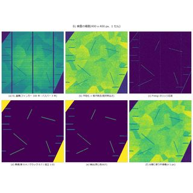<span>太陽電池の EL</span></a>
<a href="../articles/assets/poc/poc_solder_fillet_aoi/07_shift_cliff.png">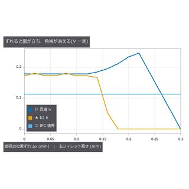<span>はんだの AOI</span></a>
<a href="../articles/assets/poc/poc_asbuilt_wall_deviation/02_aabb_vs_yaw.png">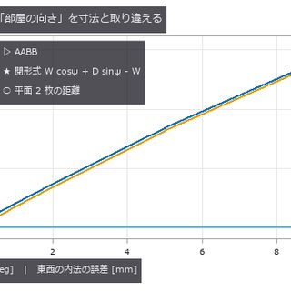<span>竣工した壁の歪み</span></a>
<a href="../articles/assets/poc/poc_battery_electrode_breathing/03_displacement.png">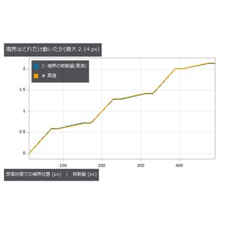<span>電極の呼吸</span></a>
<a href="../articles/assets/poc/poc_battery_electrode_tortuosity/02_map_transport.png">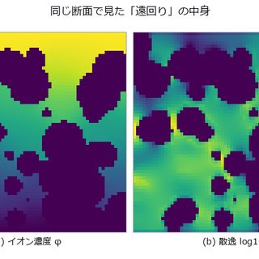<span>電極の屈曲度</span></a>
<a href="../articles/assets/poc/poc_bump_coplanarity/06_absorbed_defect.png">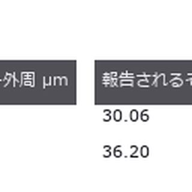<span>バンプ共平面性</span></a>
<a href="../articles/assets/poc/poc_die_tilt_tsv_overlay/04_tilt_cliff.png">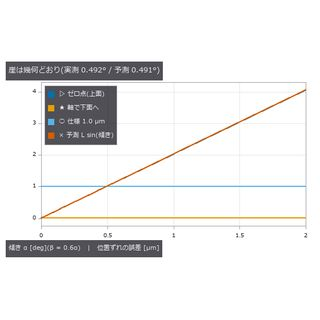<span>ダイ傾きと TSV</span></a>
<a href="../articles/assets/poc/poc_multibeam_bathymetry/18_real_smile.png">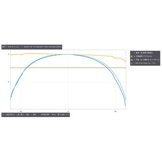<span>多ビーム測深</span></a>
<a href="../articles/assets/poc/poc_print_registration/01_plates.png">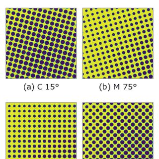<span>印刷の版ずれ</span></a>
<a href="../articles/assets/poc/poc_rail_corrugation/03_transfer_zoom.png">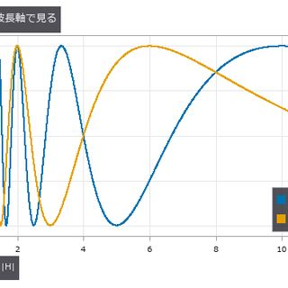<span>レールの波状摩耗</span></a>
<a href="../articles/assets/poc/poc_real_coin_metrology/01_scene.png">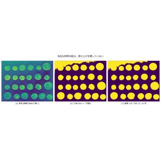<span>実写のコイン</span></a>
<a href="../articles/assets/poc/poc_real_texture_invariance/01_textures.png">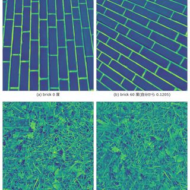<span>実写テクスチャ回転</span></a>
<a href="../articles/assets/poc/poc_web_roll_periodicity/01_scene_web.png">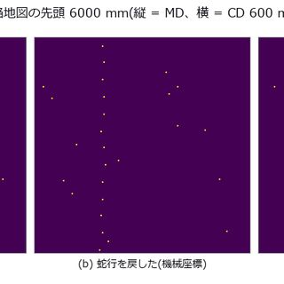<span>搬送ロールの傷</span></a>
<a href="../articles/assets/poc/poc_weld_bead_scan_angle/10_stripe_width.png">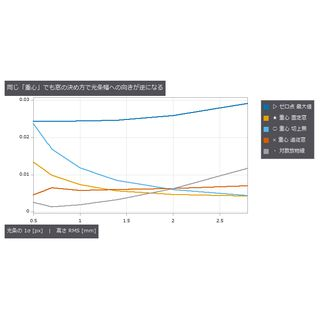<span>溶接ビード走査</span></a>
<a href="../articles/assets/poc/poc_aoi_ct_traceability/03_aoi_and_ct.png">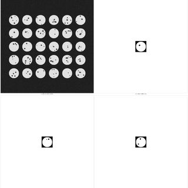<span>AOI と CT の対応</span></a>
<a href="../articles/assets/poc/poc_spc/04_spc_mt_distance.png">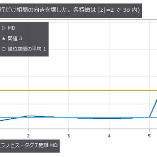<span>統計的工程管理</span></a>
<a href="../articles/assets/poc/poc_glyph_typo_detection/01_sign_before_after.png">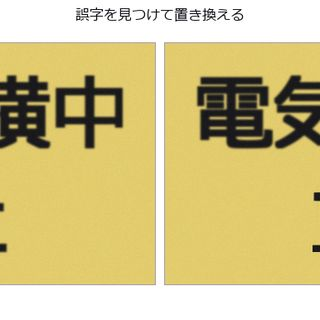<span>画像の誤字検出</span></a>
<a href="../articles/assets/poc/poc_print_layer_inspection/03_tolerance_curve.png">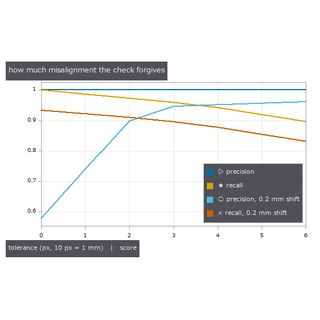<span>3D プリント層検査</span></a>
<a href="../articles/assets/poc/poc_measurement_system_analysis/18_divisors.png">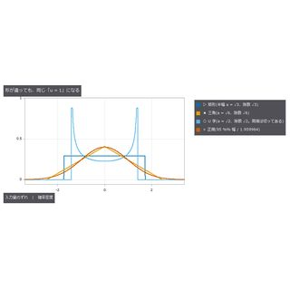<span>ゲージ R&R</span></a>
<a href="../articles/assets/poc/poc_attention_identities/03_linear_crossover.png">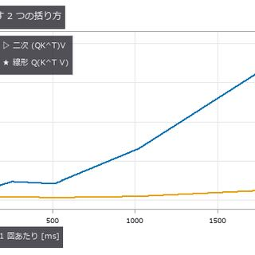<span>注意機構の恒等式</span></a>
<a href="../articles/assets/poc/poc_zernike_aberrations/08_edge_ring.png">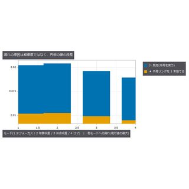<span>ゼルニケ収差</span></a>
<a href="../articles/assets/poc/poc_mt_hidden_fault/03_mt_vs_univariate_unbalance.png">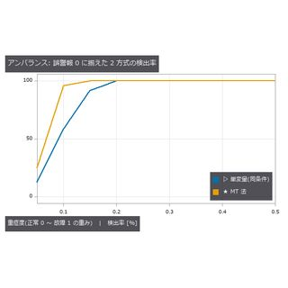<span>MT 法の異常検知</span></a>
<a href="../articles/assets/poc/poc_text_region_truth/02_text_region_coverage_latin.png">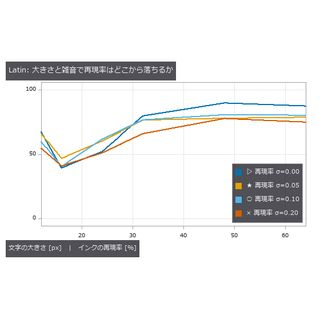<span>文字領域の検出</span></a>
<a href="../articles/assets/poc/poc_agv_fleet/01_agv_naive_vs_adg.gif">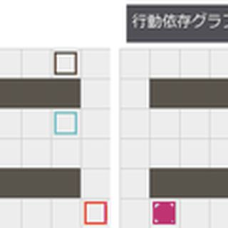<b>&#9654;</b><span>AGV の倉庫</span></a>
<a href="../articles/assets/poc/poc_tacsim_marker_shear/06_tacslip_fem_vs_halfspace.png">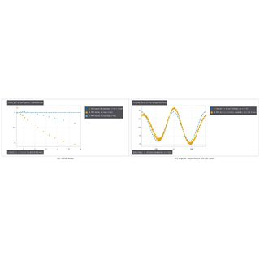<span>触覚のせん断</span></a>
<a href="../articles/assets/poc/poc_tactile_dipole_torque/04_tactorque_fem_oblique_vs_normal.png">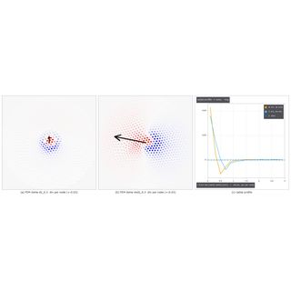<span>触覚双極子</span></a>
<a href="../articles/assets/poc/poc_food_cutting_measure/01_cutting_track_force.gif">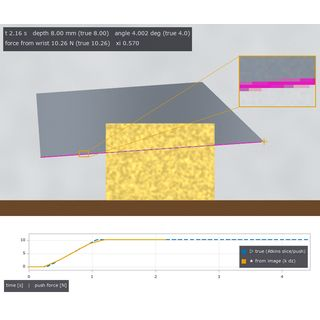<b>&#9654;</b><span>食材の切断</span></a>
<a href="../articles/assets/poc/poc_granular_heap_repose/10_granular_spoon_tilt_dispense.png">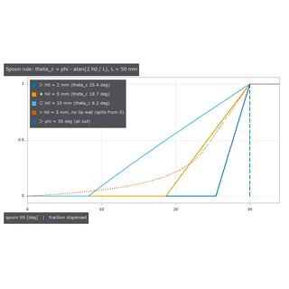<span>粉体の山</span></a>
<a href="../articles/assets/poc/poc_polish_wipe_measure/01_polish_raster_wipe_coat.gif">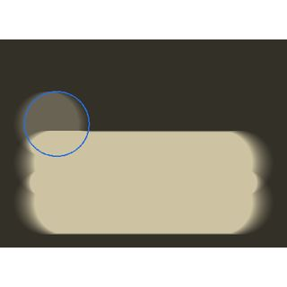<b>&#9654;</b><span>研磨と拭き取り</span></a>
<a href="../articles/assets/poc/poc_powder_grinding_ae/05_d50_vs_time_Citricacid.png"><span>乳鉢の粉砕</span></a>
<a href="../articles/assets/poc/poc_powder_scoop_pour/05_scoop_boolean_model_vs_naive.png"><span>粉体のすくい注ぎ</span></a>
<a href="../articles/assets/poc/poc_tacdome_large_deformation/01_tacdome_press_sweep.gif"><b>&#9654;</b><span>ドーム指先の接触</span></a>
<a href="../articles/assets/poc/poc_dose_uniformity_from_grinding/02_cv_vs_grinding_NaCl.png"><span>薬の量の均一性</span></a>
<a href="../articles/assets/poc/poc_knife_tactile_toughness/01_handle_length_limit.png"><span>指先で包丁を持つ</span></a>
<a href="../articles/assets/poc/poc_residue_crt/05_residue_displacement_table.png"><span>剰余定理で位相</span></a>
<a href="../articles/assets/poc/poc_pod_lighting/03_pod_curves.png"><span>照明ごとの検出確率</span></a>
<a href="../articles/assets/poc/poc_emva1288_in_camera_processing/01_datasheet_lies.png"><span>前処理がデータシートを嘘にする</span></a>
<a href="../articles/assets/poc/poc_interreflection_fringe_error/02_direct_global.png"><span>白い溝の相互反射と縞の誤差</span></a>
<a href="../articles/assets/poc/poc_laser_line_speckle_floor/01_line.png"><span>光切断のスペックルの床</span></a>
<a href="../articles/assets/poc/poc_sam_hybrid_bonding_voids/03_amplitude_vs_phase.png"><span>ハイブリッド接合のボイドを位相で</span></a>
<a href="../articles/assets/poc/poc_si_wafer_pl_defect_visibility/03_pl_real_groove_after_hf.png"><span>PL 像の溝と拡散長</span></a>
<a href="../articles/assets/poc/poc_illumination_cone_vs_na/02_works_by_cone.png"><span>照明の円錐と観察の NA</span></a>
<a href="../articles/assets/poc/poc_moire_alignment/01_marks.png"><span>モアレで位置合わせ(見えない格子 2 枚で 1 nm を読む)</span></a>
<a href="../articles/assets/poc/poc_optics_drawings/06_setup_ring_coaxial.png"><span>光学系の図面(断面図・設置図・製作図)</span></a>
<a href="../articles/assets/poc/poc_pocket_interreflection/07_bulczak.png"><span>加工ポケットの相互反射を収束まで</span></a>
<a href="../articles/assets/poc/poc_telecentric_metrology/08_real_alignment_plate.png"><span>テレセントリックレンズと寸法計測</span></a>
<a href="../articles/assets/poc/poc_code_matching_breakdown/05_highlight_sweep.gif"><b>&#9654;</b><span>照明と遮蔽に強い符号の照合</span></a>
<a href="../articles/assets/poc/poc_dense_bubble_count/03_pair_verdicts.png"><span>密集した泡を数える(決まらなければ区間)</span></a>
<a href="../articles/assets/poc/poc_good_sample_variation_model/04_visa_explanation.png"><span>良品統計の変動モデル</span></a>
<a href="../articles/assets/poc/poc_noncoaxial_optics/05_false_defect.png"><span>非共軸の光学系(半透鏡のゴースト・折り返し)</span></a>
<a href="../articles/assets/poc/poc_robust_profile_filter/03_breakdown_curve.png"><span>深い傷が平均線を凹ませる量と、ロバスト化の破綻点</span></a>
<a href="../articles/assets/poc/poc_simcal_telecentric/02_real_model_residuals.png"><span>テレセンの実画像で撮像模型を較正</span></a>
<a href="../articles/assets/poc/poc_lockin_imaging/02_daylighting.png"><span>画素ごとの直交復調(ロックイン)で法線・昼間化・熱波を読む</span></a>
<a href="../articles/assets/poc/poc_patch_anomaly/01_anomaly_maps.png"><span>良品だけから学ぶパッチ特徴の異常検知(古典特徴の分布と記憶)</span></a>
<a href="../articles/assets/poc/poc_braid_homotopy_classes/01_braid_classes_spacetime.gif"><b>&#9654;</b><span>複数ロボットの計画を組紐の回り方で分ける</span></a>
<a href="../articles/assets/poc/poc_fourier_ptychography/01_usaf_4x_fp_20x.png"><span>フーリエ・タイコグラフィ(4 倍の視野で 20 倍の分解能)</span></a>
<a href="../articles/assets/poc/poc_mueller_dofp_observability/01_observability.png"><span>4 方位偏光カメラに見えない Mueller 行列の 7 次元</span></a>
<a href="../articles/assets/poc/poc_slanted_edge_sfr_limits/01_sfr_limits.png"><span>斜めエッジ SFR はガンマで MTF50 を誤る</span></a>
<a href="../articles/assets/poc/poc_wavefront_aberration_limits/01_aberration_limits.png"><span>収差の形で変わる Maréchal 近似の限界</span></a>
<a href="../articles/assets/poc/poc_car_parking/05_truths.png"><span>最短の曲がり方</span></a>
<a href="../articles/assets/poc/poc_complex_plane_fields/05_mandelbrot.png"><span>複素平面を面で</span></a>
<a href="../articles/assets/poc/poc_allsky_cloud_cover/04_allsky.png"><span>全天カメラの雲量</span></a>
<a href="../articles/assets/poc/poc_cell_counting/03_count_cancellation.png"><span>重なる細胞の計数</span></a>
<a href="../articles/assets/poc/poc_pigment_unmixing/03_thickness_cliff.png"><span>顔料の層を分離</span></a>
<a href="../articles/assets/poc/poc_dtof_ranging/01_light_front.gif"><b>&#9654;</b><span>光子で測距</span></a>
<a href="../articles/assets/poc/poc_document_scan/02_shadow_tradeoff.png"><span>書類をまっすぐに</span></a>
<a href="../articles/assets/poc/poc_camera_calibration/05_calibration_convergence.gif"><b>&#9654;</b><span>カメラ校正</span></a>
<a href="../articles/assets/poc/poc_camera_shake_deblur/05_kernel_angle_sweep.gif"><b>&#9654;</b><span>手ブレ補正</span></a>
<a href="../articles/assets/poc/poc_battery_ct_degradation/01_xray_projection.png"><span>電池の CT 劣化</span></a>
<a href="../articles/assets/poc/poc_particle_tracking/05_tracking_links.gif"><b>&#9654;</b><span>粒子追跡</span></a>
<a href="../articles/assets/poc/poc_driving_school/01_course_plan.png"><span>教習所</span></a>
<a href="../articles/assets/poc/poc_one_stroke_epicycles/07_epicycles.gif"><b>&#9654;</b><span>一筆書きと周転円</span></a>
<a href="../articles/assets/poc/poc_astro_photometry/02_cosmic_ray.png"><span>星の測光精度</span></a>
<a href="../articles/assets/poc/poc_nuclei_ploidy/01_histograms.png"><span>核の倍数性</span></a>
<a href="../articles/assets/poc/poc_white_balance/02_bias_cliff.png"><span>ホワイトバランス</span></a>
<a href="../articles/assets/poc/poc_lightfield_depth/03_raw_mla.png"><span>光場から深度</span></a>
<a href="../articles/assets/poc/poc_forensics_roc/01_score_maps.png"><span>改竄検出の ROC</span></a>
<a href="../articles/assets/poc/poc_panorama_drift/05_chain_drift_video.gif"><b>&#9654;</b><span>パノラマのずれ</span></a>
<a href="../articles/assets/poc/poc_dehazing/05_haze_sweep.gif"><b>&#9654;</b><span>霞を剥がす</span></a>
<a href="../articles/assets/poc/poc_bev_sensor_fusion/02_shadow_map.png"><span>鳥瞰図の融合</span></a>
<a href="../articles/assets/poc/poc_template_tracking/05_twin_vs_flat_occluder.gif"><b>&#9654;</b><span>テンプレート追跡</span></a>
<a href="../articles/assets/poc/poc_world_terrain/01_scene_terrain.png"><span>世界を広げる</span></a>
<a href="../articles/assets/poc/poc_beats_fringes_and_screens/05_grating.png"><span>うなりは一つ</span></a>
<a href="../articles/assets/poc/poc_dem_terrain/05_terrain_flight.gif"><b>&#9654;</b><span>地形を測る</span></a>
<a href="../articles/assets/poc/poc_vessel_network/04_murray.png"><span>血管網の分岐</span></a>
<a href="../articles/assets/poc/poc_real_stain_unmix/02_blind.png"><span>実写の染色分離</span></a>
<a href="../articles/assets/poc/poc_pv_thermal_survey/08_raw_aerial_thermal.png"><span>太陽光の熱画像</span></a>
<a href="../articles/assets/poc/poc_fresco_craquelure/03_width_cliff.png"><span>絵画のひび割れ網</span></a>
<a href="../articles/assets/poc/poc_real_stereo_depth/01_scene.png"><span>実写のステレオ</span></a>
<a href="../articles/assets/poc/poc_superresolution_limits/05_growth.gif"><b>&#9654;</b><span>超解像の限界</span></a>
<a href="../articles/assets/poc/poc_cad_scan_deviation/14_align_orbit.gif"><b>&#9654;</b><span>CAD と点群の差</span></a>
<a href="../articles/assets/poc/poc_timelapse_growth/05_growth_merge.gif"><b>&#9654;</b><span>成長のタイムラプス</span></a>
<a href="../articles/assets/poc/poc_driving_longitudinal/01_drive_with_time.gif"><b>&#9654;</b><span>慣性と坂</span></a>
<a href="../articles/assets/poc/poc_illusions_and_perpetual_drawing/15_seam.png"><span>無限に描く絵</span></a>
<a href="../articles/assets/poc/poc_sea_ice_concentration/04_summary.png"><span>海氷密接度</span></a>
<a href="../articles/assets/poc/poc_wound_area_tracking/06_healing_video.gif"><b>&#9654;</b><span>創傷面積の変化</span></a>
<a href="../articles/assets/poc/poc_fiber_light_guide/03_lp_b_v_diagram.png"><span>光ファイバとライトガイド(モード・分散・モード径)</span></a>
<a href="../articles/assets/poc/poc_weld_radiograph_porosity/06_map_toe_backgrounds.png"><span>溶接の気孔</span></a>
<a href="../articles/assets/poc/poc_prnu_camera_fingerprint/12_denoisers.png"><span>カメラ指紋</span></a>
<a href="../articles/assets/poc/poc_rotation_invariance_audit/01_rotation_frames.png"><span>回転不変の監査</span></a>
<a href="../articles/assets/poc/poc_colormap_readability/13_categorical_overflow.png"><span>疑似カラーの読み</span></a>
<a href="../articles/assets/poc/poc_crop_phenotyping/01_capsule_calibration.png"><span>作物の葉面積</span></a>
<a href="../articles/assets/poc/poc_traffic_counting/05_counting_video.gif"><b>&#9654;</b><span>交通量の計数</span></a>
<a href="../articles/assets/poc/poc_driving_weather/01_sun_day.gif"><b>&#9654;</b><span>太陽と天気</span></a>
<a href="../articles/assets/poc/poc_theorems_as_pictures/03_ford.png"><span>定理が門になる図</span></a>
<a href="../articles/assets/poc/poc_solar_limb_darkening/04_sunspot.png"><span>周辺減光と輪郭</span></a>
<a href="../articles/assets/poc/poc_bone_trabecular_thickness/04_resolution_table.png"><span>骨梁の厚さ</span></a>
<a href="../articles/assets/poc/poc_material_optical_library/14_lens_axial_colour.png"><span>材料の光学物性ライブラリ(86 種が同じ表から)</span></a>
<a href="../articles/assets/poc/poc_thermal_radiometry/06_cliff_curves.png"><span>熱画像と温度</span></a>
<a href="../articles/assets/poc/poc_video_physics_consistency/01_monocular_clip.gif"><b>&#9654;</b><span>映像の物理整合性 ―― 弾道か推力か、時間の引き延ばし</span></a>
<a href="../articles/assets/poc/poc_public_camera_heading/04_sun_track.png"><span>公共カメラの向き</span></a>
<a href="../articles/assets/poc/poc_real_deblur_honesty/03_cliffs.png"><span>実写のブレ補正</span></a>
<a href="../articles/assets/poc/poc_dfm_thickness_overhang/06_overhang_map.png"><span>造形しやすさ</span></a>
<a href="../articles/assets/poc/poc_xyt_event_surface/07_arrival_video.gif"><b>&#9654;</b><span>到達時刻面</span></a>
<a href="../articles/assets/poc/poc_driving_decisions/02_signal_prediction.gif"><b>&#9654;</b><span>判断の場面</span></a>
<a href="../articles/assets/poc/poc_what_a_picture_cannot_check/05_dimension.png"><span>絵で確かめられない</span></a>
<a href="../articles/assets/poc/poc_star_astrometry/02_phase_systematic.png"><span>星の位置精度</span></a>
<a href="../articles/assets/poc/poc_colocalization_crosstalk/01_scene_channels.png"><span>蛍光の共局在</span></a>
<a href="../articles/assets/poc/poc_nir_silicon_transmission/06_scene_through_wafer.png"><span>Si ウェハ越しの近赤外透過(LED の波長を選ぶ)</span></a>
<a href="../articles/assets/poc/poc_emva1288_sensor/04_spectrogram.png"><span>EMVA 1288 測定</span></a>
<a href="../articles/assets/poc/poc_public_camera_heading_real/06_numbers.png"><span>カメラの向き(実写)</span></a>
<a href="../articles/assets/poc/poc_fly_vision/02_fly_vision_rotation.png"><span>ハエの視覚前段</span></a>
<a href="../articles/assets/poc/poc_lidar_terrain_change/13_real_dod.png"><span>斜面の土量</span></a>
<a href="../articles/assets/poc/poc_beam_modal_video/14_beam_video.gif"><b>&#9654;</b><span>動画でモード同定</span></a>
<a href="../articles/assets/poc/poc_driving_endless_map/02_dashcam.gif"><b>&#9654;</b><span>終わらない地図</span></a>
<a href="../articles/assets/poc/poc_calipers_under_illusion/16_audit.png"><span>錯視で測定器診断</span></a>
<a href="../articles/assets/poc/poc_vegetation_cover/01_mixed_pixel_response.png"><span>畑の緑の被覆率</span></a>
<a href="../articles/assets/poc/poc_mri_bias_field/04_amplitude_sweep_methods.png"><span>MRI バイアス場</span></a>
<a href="../articles/assets/poc/poc_hyperspectral_foreign_matter/04_real_pork_belly.png"><span>見た目が同じ異物をハイパースペクトルで選別</span></a>
<a href="../articles/assets/poc/poc_am_thermal_to_ct/08_protrusion_by_facing.png"><span>積層造形と CT</span></a>
<a href="../articles/assets/poc/poc_carla_bridge/01_carla_two_worlds.png"><span>2 つの世界で撮る</span></a>
<a href="../articles/assets/poc/poc_fly_optomotor_steering/03_wide_eye.png"><span>ハエの進路制御</span></a>
<a href="../articles/assets/poc/poc_mesh_quality_repair/14_decimate_orbit.gif"><b>&#9654;</b><span>メッシュ修復</span></a>
<a href="../articles/assets/poc/poc_cold_chain_excursion/13_excursion_body.png"><span>冷蔵輸送の温度</span></a>
<a href="../articles/assets/poc/poc_driving_lateral/01_lateral_dashcam.gif"><b>&#9654;</b><span>横の運動</span></a>
<a href="../articles/assets/poc/poc_water_level/04_reflection.png"><span>河川の水位</span></a>
<a href="../articles/assets/poc/poc_larval_connectome_reservoir/01_adjacency_binned_connectome_vs_shuffle.png"><span>幼虫の配線で計算</span></a>
<a href="../articles/assets/poc/poc_lens_file_roundtrip/02_spot_diagram.png"><span>光学設計ファイル(.zmx)の読み書き(別の 2 実装と照合)</span></a>
<a href="../articles/assets/poc/poc_pxrd_phase_peel/01_phase_peel.gif"><b>&#9654;</b><span>X 線回折の相分離</span></a>
<a href="../articles/assets/poc/poc_driving_commonroad/01_commonroad_scene.png"><span>CommonRoad で採点</span></a>
<a href="../articles/assets/poc/poc_vanishing_detail_and_morphing_area/09_area_from_picture.png"><span>消える細部と面積</span></a>
<a href="../articles/assets/poc/poc_pipe_wall_loss/03_map_truth.png"><span>配管の減肉</span></a>
<a href="../articles/assets/poc/poc_warehouse_flow/12_clearance_map.png"><span>庫内の滞留</span></a>
<a href="../articles/assets/poc/poc_driving_humanoids/03_humanoids_crossing.gif"><b>&#9654;</b><span>横断歩道の人型</span></a>
<a href="../articles/assets/poc/poc_change_detection_misreg/08_plot_residual_vs_fp.png"><span>変化検出</span></a>
<a href="../articles/assets/poc/poc_connectome_motor_bottleneck/01_funnel.png"><span>動きの量子化</span></a>
<a href="../articles/assets/poc/poc_lens_global_search/01_lens_global_search.png"><span>硝材の置き換えと大域探索(多始点の局所最適化)</span></a>
<a href="../articles/assets/poc/poc_sem_wafer_defect_edge_bias/04_sem_edge_inflation.png"><span>SEM の縁の太り</span></a>
<a href="../articles/assets/poc/poc_driving_japan_town/06_japan_road_table.png"><span>実在の日本の町</span></a>
<a href="../articles/assets/poc/poc_graph_hierarchy_segmentation/03_graph_cut_lambda.png"><span>グラフ分割</span></a>
<a href="../articles/assets/poc/poc_print_warpage_risk/10_warp_map.png"><span>積層の反り</span></a>
<a href="../articles/assets/poc/poc_crack_width_timeseries/11_series_video.gif"><b>&#9654;</b><span>ひび割れの伸び</span></a>
<a href="../articles/assets/poc/poc_exoplanet_transit/01_scene_starfield.png"><span>系外惑星の通過</span></a>
<a href="../articles/assets/poc/poc_em_branch_territory/03_radius_recovery.png"><span>枝の縄張り</span></a>
<a href="../articles/assets/poc/poc_lens_merit_operands/01_lens_merit_operands.png"><span>要求の表で三枚玉を設計(縁厚・中心厚の境界と、硝材を変数に)</span></a>
<a href="../articles/assets/poc/poc_shape_from_polarization/07_failures.png"><span>偏光で測る黒光沢とガラス</span></a>
<a href="../articles/assets/poc/poc_driving_town/06_town_rules_table.png"><span>町を組む</span></a>
<a href="../articles/assets/poc/poc_segmentation_gauntlet/11_gauntlet_texture.gif"><b>&#9654;</b><span>分割の関門</span></a>
<a href="../articles/assets/poc/poc_safety_clearance/13_map_distance_slice.png"><span>人と機械の距離</span></a>
<a href="../articles/assets/poc/poc_settlement_significance/04_lod_by_zone.png"><span>沈下か測り直しか</span></a>
<a href="../articles/assets/poc/poc_leaf_disease_area/09_grade_confusion.png"><span>葉の病斑</span></a>
<a href="../articles/assets/poc/poc_em_second_opinion/04_holdout_numbers.png"><span>EM 校正の検算</span></a>
<a href="../articles/assets/poc/poc_zoom_configurations/01_zoom_configurations.png"><span>ズームレンズ(多構成)を 1 つの処方の差分で持つ</span></a>
<a href="../articles/assets/poc/poc_gw_detector_pseudo_simulation/04_power_sweep.gif"><b>&#9654;</b><span>重力波望遠鏡の擬似シミュレーション</span></a>
<a href="../articles/assets/poc/poc_peg_failure_recovery/01_pegfail_where_it_breaks_offset_flip.png"><span>挿入失敗の回復</span></a>
<a href="../articles/assets/poc/poc_iqa_fsim_gmsd_vif/06_iqa_tid2013_published_vs_reproduced.png"><span>知覚指標の一致</span></a>
<a href="../articles/assets/poc/poc_scan_to_bim_asbuilt/09_element_verdicts.png"><span>設計と実物の差</span></a>
<a href="../articles/assets/poc/poc_live4d/05_interpolation.png"><span>生体の 3D+t</span></a>
<a href="../articles/assets/poc/poc_river_surface_velocity/13_accumulate_pairs.gif"><b>&#9654;</b><span>河川の表面流速</span></a>
<a href="../articles/assets/poc/poc_connectome_across_decades/01_jaccard_across_decades.png"><span>40 年前の配線図</span></a>
<a href="../articles/assets/poc/poc_lens_solves_afocal/01_lens_solves_afocal.png"><span>設計の関係を「解」で持つ(絞りに追従する F/#、afocal、曲面の像面、奇数次非球面)</span></a>
<a href="../articles/assets/poc/poc_chromatic_confocal/08_real_groove_from_paper_figures.png"><span>クロマティック共焦点(色で高さを読む)</span></a>
<a href="../articles/assets/poc/poc_peg_insertion_tactile/01_pegtactile_two_membranes_read.png"><span>指の膜でペグ挿入</span></a>
<a href="../articles/assets/poc/poc_iqa_tid2013/03_tid2013_srocc_by_distortion.png"><span>画質指標と TID2013</span></a>
<a href="../articles/assets/poc/poc_structure_4d_deterioration/12_years_video.gif"><b>&#9654;</b><span>構造物の経年</span></a>
<a href="../articles/assets/poc/poc_video_cube/06_em_stack_cube.png"><span>動画の時空立方体</span></a>
<a href="../articles/assets/poc/poc_tree_ring_dendro/01_scene.png"><span>年輪の幅</span></a>
<a href="../articles/assets/poc/poc_connectome_across_worms/01_occupancy_matrix.png"><span>線虫の個体差</span></a>
<a href="../articles/assets/poc/poc_zmx_public_verify/04_inspection_scores.png"><span>公開 .zmx 処方の独立照合と検査レンズ採点</span></a>
<a href="../articles/assets/poc/poc_industrial_oct/01_real_paint_bscans.png"><span>工業用 OCT(塗装の層厚と内部欠陥)</span></a>
<a href="../articles/assets/poc/poc_peg_symmetry_search/04_pegsym_two_point_depth_vs_tilt_direction.png"><span>ペグの対称性</span></a>
<a href="../articles/assets/poc/poc_zebra_stripes_fly_eye/03_tau_readout.gif"><b>&#9654;</b><span>縞に近づくハエの眼</span></a>
<a href="../articles/assets/poc/poc_symmetry_restoration/10_false_symmetry_table.png"><span>対称性で補う</span></a>
<a href="../articles/assets/poc/poc_periodic_video_boundary/05_contamination_map.png"><span>周期的な動画</span></a>
<a href="../articles/assets/poc/poc_datacenter_thermal_field/01_scene_truth.png"><span>3-D 熱場の復元</span></a>
<a href="../articles/assets/poc/poc_connectome_lr_symmetry/02_lr_pair_asymmetry.png"><span>線虫の左右対称</span></a>
<a href="../articles/assets/poc/poc_itof_multifreq/12_public_raw_unwrap.png"><span>間接 ToF(折り返しと多重反射)</span></a>
<a href="../articles/assets/poc/poc_reproducible_icp/06_gpu_fp64_emulation_phi_4_0.png"><span>ビット再現 ICP</span></a>
<a href="../articles/assets/poc/poc_simcal_pixel_shift/06_real_tiles.png"><span>ピクセルシフトのずれと開口の較正(決まらない地図)</span></a>
<a href="../articles/assets/poc/poc_livestock_body_volume/14_hull_orbit.gif"><b>&#9654;</b><span>家畜の体重</span></a>
<a href="../articles/assets/poc/poc_ball_bounce/07_rally_two_rackets.gif"><b>&#9654;</b><span>卓球の球を追う</span></a>
<a href="../articles/assets/poc/poc_geodetic_height_frames/12_tool_gap.png"><span>座標の高さの罠</span></a>
<a href="../articles/assets/poc/poc_em_split_merge_score/01_split_vs_merge_by_threshold.png"><span>EM 分割の採点</span></a>
<a href="../articles/assets/poc/poc_phase_measuring_deflectometry/08_ambiguity_map.png"><span>写真では見えない µm の凹みを縞の鏡像で(デフレクトメトリ)</span></a>
<a href="../articles/assets/poc/poc_tacscalib_sphere_lut/12_tacscalib_where_it_breaks.png"><span>触覚センサ較正</span></a>
<a href="../articles/assets/poc/poc_water_transparent_media/04_slope_histogram.png"><span>水と透明媒質: 海の波・プールの屈折・水中の色・瓶の焦線</span></a>
<a href="../articles/assets/poc/poc_pallet_load_utilization/01_scene.png"><span>パレット積載率</span></a>
<a href="../articles/assets/poc/poc_kendama/05_catch_gif.gif"><b>&#9654;</b><span>けん玉</span></a>
<a href="../articles/assets/poc/poc_real_sky_photometry/03_snr_lies.png"><span>実写の深宇宙</span></a>
<a href="../articles/assets/poc/poc_em_wiring_errors/04_count_only_prediction.png"><span>分割誤りと配線</span></a>
<a href="../articles/assets/poc/poc_pixel_shift/13_real_chart_strips.png"><span>ピクセルシフト(偽色と折り返し)</span></a>
<a href="../articles/assets/poc/poc_simcal_thin_film/08_real_determined_vs_combinations.png"><span>実画像で薄膜の模型を較正(決まる係数と決まらない組み合わせ)</span></a>
<a href="../articles/assets/poc/poc_photograph_through_prescription/09_ghost_overlay.png"><span>処方どおりのレンズ越しに 3 次元の場面を撮る: 被写界深度・猫の目のボケ・隅の光量・色収差・ゴースト</span></a>
<a href="../articles/assets/poc/poc_endless_zoom_and_turning_solids/12_perspective_law.png"><span>無限ズーム</span></a>
<a href="../articles/assets/poc/poc_diabolo_model_and_vision/01_diabolo_throw_axis_from_image.gif"><b>&#9654;</b><span>ディアボロ</span></a>
<a href="../articles/assets/poc/poc_search_sweep_width/10_lateral_range_curves.png"><span>捜索の走査幅</span></a>
<a href="../articles/assets/poc/poc_swc_tree_truth/02_sholl_3d_vs_projected.png"><span>本物の木で骨格</span></a>
<a href="../articles/assets/poc/poc_tdi_linescan/01_tdi_stages_defects.png"><span>TDI ラインスキャンとラインスキャン用レンズ</span></a>
<a href="../articles/assets/poc/poc_water_inspection_images/12_hull_images.png"><span>水が検査画像にどう写るか: プールの底のコースティクス・瓶の側面像・濡れた板・船体の水中画像</span></a>
<a href="../articles/assets/poc/poc_four_dimensions_by_three_d_tools/07_tesseract_irrational.gif"><b>&#9654;</b><span>4 次元を 3-D で</span></a>
<a href="../articles/assets/poc/poc_swarm_obstacle_from_flow/03_swarmflow_centerline_linearised.png"><span>群れで障害物察知</span></a>
<a href="../articles/assets/poc/poc_geodetic_benchmarks_real/02_by_provenance.png"><span>2 つの高さ(実データ)</span></a>
<a href="../articles/assets/poc/poc_worm_neurites_grow/01_neurite_length_growth.png"><span>神経突起の成長</span></a>
<a href="../articles/assets/poc/poc_tem_ctf_thon_rings/12_real_empiar_10028.png"><span>仮想の透過電子顕微鏡(Thon リングと焦点外れ)</span></a>
<a href="../articles/assets/poc/poc_plateau_venue_lod2/01_venue_itokawa_top.png"><span>会場の建物と小惑星イトカワを同じ物差しで ―― PLATEAU の CityGML LOD2 をメッシュに</span></a>
<a href="../articles/assets/poc/poc_gravitational_lens_invariants/01_images_vs_u.png"><span>重力レンズ</span></a>
<a href="../articles/assets/poc/poc_physarum_maze/04_lattice_tubes.png"><span>粘菌の迷路</span></a>
<a href="../articles/assets/poc/poc_thin_film_reflectometry/01_real_micrograph_thickness.png"><span>分光反射率で薄膜の膜厚(公開の実測データで採点、ウェハの干渉色)</span></a>
<a href="../articles/assets/poc/poc_rover_slip_risk_path/07_two_soils_scene.png"><span>火星の車輪滑り</span></a>
<a href="../articles/assets/poc/poc_physarum_transport/05_five_truths.png"><span>粘菌の最適輸送</span></a>
<a href="../articles/assets/poc/poc_virtual_sem_kv_cd_bse/05_sem_same_part_3kv_3detectors.png"><span>仮想 SEM と加速電圧</span></a>
<a href="../articles/assets/poc/poc_weed_rice_ratio/05_real_examples.png"><span>水田の雑草の被度を 4 段階で</span></a>
<a href="../articles/assets/poc/poc_skeleton_run_length_vs_voi/01_merge_size_erl_vs_voi.png"><span>走行長と VOI</span></a>
<a href="../articles/assets/poc/poc_dual_energy_xray/05_material_colour.png"><span>肉の中の骨片とガラスを 2 つのエネルギーで分ける(デュアルエナジー X 線)</span></a>
<a href="../articles/assets/poc/poc_worm_core_persists/03_core_map.png"><span>線虫の脳の核</span></a>
<a href="../articles/assets/poc/poc_grating_interferometry/05_three_images.png"><span>格子干渉計(暗視野で見える繊維・割れ・気孔)</span></a>
<a href="../articles/assets/poc/poc_worm_synapses_vs_neurites/01_density_by_stage.png"><span>シナプスと突起</span></a>
<a href="../articles/assets/poc/poc_spectrometer_illumination/03_slit_image_smile.png"><span>分光器と照明系(帯域の幅と光源の模様)</span></a>
<a href="../articles/assets/poc/poc_flybrain_pointcloud/04_footprints.png"><span>ハエの脳を細胞体の点で描く</span></a>
<a href="../articles/assets/poc/poc_lens_tolerancing/05_rebudget.png"><span>レンズの製造公差を MTF・歩留まり・補償ストロークで配分</span></a>
<a href="../articles/assets/poc/poc_plenoptic_camera/01_camera_section.png"><span>処方から撮るプレノプティックカメラ: 生のマイクロ像から撮影後の再合焦と距離へ</span></a>
<a href="../articles/assets/poc/poc_sem_tem_same_particle/08_tem_focus_sweep.gif"><b>&#9654;</b><span>同じ粒子を走査像と透過像で測る</span></a>
<a href="../articles/assets/poc/poc_tof_camera/09_dtof_light_front.gif"><b>&#9654;</b><span>同じ3次元場面の間接ToFと直接ToF: 多経路・混合画素・pile-up・体積誤差</span></a>
<a href="../articles/assets/poc/poc_omni360_inspection/08_anaglyph_and_limits.png"><span>全天球の検査撮影と立体表示</span></a>
</div>

## シリーズ記事

<div class="vser">
<a href="https://qiita.com/furuse-kazufumi/items/c1606bcfa2085d204ad6"><strong>紙面の計測館</strong><span>真値を自分で仕込んだ PoC の展示館</span></a>
<a href="https://qiita.com/furuse-kazufumi/items/b6498dc822bf9eed100f"><strong>卓球</strong><span>跳ねと摩擦を映像から測る</span></a>
<a href="https://qiita.com/furuse-kazufumi/items/1f128b8a36df373c11c7"><strong>自動運転</strong><span>定理と第 2 実装で採点する</span></a>
<a href="https://qiita.com/furuse-kazufumi/items/331af639c2b9a1493576"><strong>コネクトーム(脳の配線図)</strong><span>ハエの視覚モデルを体に載せて測る</span></a>
<a href="https://qiita.com/furuse-kazufumi/items/57e2f1e5a09165e58b65"><strong>ヒューマノイド運動会</strong><span>画像処理が審判をする自宅の運動会</span></a>
</div>

## できること

97 件。それぞれ説明のページ(使い方と限界)と、走る例へのリンクです。

<div class="vl" markdown="1">

**見つける**

- 領域を切り出して、選んで、数える: [説明](../capabilities/blob-and-region.md) · 例 [poc_cell_counting](https://github.com/furuse-kazufumi/fullseye/blob/master/examples/poc_cell_counting.py) · [poc_particle_sizing](https://github.com/furuse-kazufumi/fullseye/blob/master/examples/poc_particle_sizing.py) · [poc_real_coin_metrology](https://github.com/furuse-kazufumi/fullseye/blob/master/examples/poc_real_coin_metrology.py) · [poc_dense_bubble_count](https://github.com/furuse-kazufumi/fullseye/blob/master/examples/poc_dense_bubble_count.py)
- 圃場の RGB から作物と雑草を色と肌理で分け、雑草の被度を宣言した境で段階にする(学習器なし): [説明](../capabilities/crop-weed-cover-grade.md) · 例 [poc_weed_rice_ratio](https://github.com/furuse-kazufumi/fullseye/blob/master/examples/poc_weed_rice_ratio.py)
- X 線の 2 つのエネルギーで厚みと材質を分ける(デュアルエナジー / フォトンカウンティング: スペクトル → 窓 → 基底分解 → 実効 Z): [説明](../capabilities/dual-energy-xray-material-discrimination.md) · 例 [poc_dual_energy_xray](https://github.com/furuse-kazufumi/fullseye/blob/master/examples/poc_dual_energy_xray.py)
- 画像の中の文字を、正しい文字列に合わせて直す: [説明](../capabilities/fix-text-in-images.md) · 例 [fix_text_in_image](https://github.com/furuse-kazufumi/fullseye/blob/master/examples/fix_text_in_image.py) · [poc_glyph_typo_detection](https://github.com/furuse-kazufumi/fullseye/blob/master/examples/poc_glyph_typo_detection.py)
- 良品を並べて「いつもと違う」を言う(良品統計の変動モデル、誤検出率の宣言つき): [説明](../capabilities/good-sample-variation-model.md) · 例 [poc_good_sample_variation_model](https://github.com/furuse-kazufumi/fullseye/blob/master/examples/poc_good_sample_variation_model.py) · [anomaly_eval_metrics](https://github.com/furuse-kazufumi/fullseye/blob/master/examples/anomaly_eval_metrics.py)
- OCR の前処理(傾き補正・局所 2 値化・行の切り出し): [説明](../capabilities/ocr-preprocessing.md) · 例 [gallery2d_segmentation](https://github.com/furuse-kazufumi/fullseye/blob/master/examples/gallery2d_segmentation.py) · [poc_matrix_code_reading](https://github.com/furuse-kazufumi/fullseye/blob/master/examples/poc_matrix_code_reading.py) · [gallery2d_region](https://github.com/furuse-kazufumi/fullseye/blob/master/examples/gallery2d_region.py)
- 良品だけから学んで外れたパッチを指す(古典特徴の「位置ごとの正規分布」と「記憶バンク」、再現率を保証する運用点): [説明](../capabilities/patch-feature-anomaly-detection.md) · 例 [poc_patch_anomaly](https://github.com/furuse-kazufumi/fullseye/blob/master/examples/poc_patch_anomaly.py) · [anomaly_eval_metrics](https://github.com/furuse-kazufumi/fullseye/blob/master/examples/anomaly_eval_metrics.py)
- PL 像で細い溝が見えなくなる理由を、キャリア拡散の PSF と欠陥の種類で切り分ける(Si ウェハ・太陽電池の PL/EL 検査): [説明](../capabilities/pl-carrier-diffusion-visibility.md) · 例 [poc_si_wafer_pl_defect_visibility](https://github.com/furuse-kazufumi/fullseye/blob/master/examples/poc_si_wafer_pl_defect_visibility.py)
- 小さな点状の目標を見つけて、副画素で位置を出す: [説明](../capabilities/point-target-detection.md) · 例 [poc_search_sweep_width](https://github.com/furuse-kazufumi/fullseye/blob/master/examples/poc_search_sweep_width.py) · [poc_astro_photometry](https://github.com/furuse-kazufumi/fullseye/blob/master/examples/poc_astro_photometry.py)
- 照明むら・ハイライト・遮蔽に強いテンプレート照合(明るさの変化の向きを符号にして比べ、決まらないテンプレートは拒否する): [説明](../capabilities/robust-code-matching.md) · 例 [poc_code_matching_breakdown](https://github.com/furuse-kazufumi/fullseye/blob/master/examples/poc_code_matching_breakdown.py)
- ハイブリッド接合のボイドを、超音波のエコーの明るさでなく位相で見つける(走査型音響顕微鏡の C スキャン・周波数の取引・POD): [説明](../capabilities/sam-bond-voids.md) · 例 [poc_sam_hybrid_bonding_voids](https://github.com/furuse-kazufumi/fullseye/blob/master/examples/poc_sam_hybrid_bonding_voids.py)
- 表面の凹凸欠陥を、照明の設計から検出まで: [説明](../capabilities/surface-defects-with-lighting.md) · 例 [illumination_design_demo](https://github.com/furuse-kazufumi/fullseye/blob/master/examples/illumination_design_demo.py) · [photometric_stereo](https://github.com/furuse-kazufumi/fullseye/blob/master/examples_3d/photometric_stereo.py) · [poc_bump_coplanarity](https://github.com/furuse-kazufumi/fullseye/blob/master/examples/poc_bump_coplanarity.py)
- 位置決め(テンプレート照合で測定線を追従させる): [説明](../capabilities/template-alignment.md) · 例 [poc_template_tracking](https://github.com/furuse-kazufumi/fullseye/blob/master/examples/poc_template_tracking.py) · [gallery2d_contour_measure](https://github.com/furuse-kazufumi/fullseye/blob/master/examples/gallery2d_contour_measure.py) · [poc_search_sweep_width](https://github.com/furuse-kazufumi/fullseye/blob/master/examples/poc_search_sweep_width.py)

**測る**

- 平面ターゲットの多視点から内部行列 K を推定する(Zhang 法): [説明](../capabilities/camera-intrinsics-calibration.md) · 例 [camera_intrinsics_calibration](https://github.com/furuse-kazufumi/fullseye/blob/master/examples/camera_intrinsics_calibration.py)
- 複素平面を「面」で見る(位相彩色・吸引域・脱出時間・翼まわりの流れ): [説明](../capabilities/complex-plane-fields.md) · 例 [poc_complex_plane_fields](https://github.com/furuse-kazufumi/fullseye/blob/master/examples/poc_complex_plane_fields.py)
- 周期パターンが標本化格子で折り返す距離と、縞の上で狂う衝突時間を閉形式で測る(複眼・検査カメラ): [説明](../capabilities/compound-eye-aliasing-and-ttc.md) · 例 [poc_zebra_stripes_fly_eye](https://github.com/furuse-kazufumi/fullseye/blob/master/examples/poc_zebra_stripes_fly_eye.py)
- カメラのデータシートの数を EMVA 1288 の手順で測り直し、カメラの中の前処理がその数をどれだけ動かすかを見る(Linear と General): [説明](../capabilities/emva1288-camera-datasheets.md) · 例 [poc_emva1288_sensor](https://github.com/furuse-kazufumi/fullseye/blob/master/examples/poc_emva1288_sensor.py) · [poc_emva1288_in_camera_processing](https://github.com/furuse-kazufumi/fullseye/blob/master/examples/poc_emva1288_in_camera_processing.py)
- 本来まっすぐな線から歪み係数を推定する(plumb-line、チェッカー不要): [説明](../capabilities/estimate-lens-distortion.md) · 例 [estimate_lens_distortion](https://github.com/furuse-kazufumi/fullseye/blob/master/examples/estimate_lens_distortion.py)
- フーリエ・タイコグラフィ(LED の斜め照明の像の組 → 位相回復で高 NA の振幅と位相、収束しなければ拒否): [説明](../capabilities/fourier-ptychography.md) · 例 [poc_fourier_ptychography](https://github.com/furuse-kazufumi/fullseye/blob/master/examples/poc_fourier_ptychography.py)
- 地球規模の座標に載せる(ECEF・高さの基準・局所 ENU): [説明](../capabilities/geodetic-frames.md) · 例 [poc_geodetic_height_frames](https://github.com/furuse-kazufumi/fullseye/blob/master/examples/poc_geodetic_height_frames.py) · [poc_geodetic_benchmarks_real](https://github.com/furuse-kazufumi/fullseye/blob/master/examples/poc_geodetic_benchmarks_real.py) · [dem_geodesy_tour](https://github.com/furuse-kazufumi/fullseye/blob/master/examples/dem_geodesy_tour.py)
- 格子干渉計(タルボ・ロー)で透過・微分位相・暗視野の 3 像を分ける: [説明](../capabilities/grating-interferometry.md) · 例 [poc_grating_interferometry](https://github.com/furuse-kazufumi/fullseye/blob/master/examples/poc_grating_interferometry.py)
- 工業用 OCT(干渉スペクトル → k 線形化 → 分散補償 → A / B スキャン → 群屈折率で層厚): [説明](../capabilities/industrial-oct.md) · 例 [poc_industrial_oct](https://github.com/furuse-kazufumi/fullseye/blob/master/examples/poc_industrial_oct.py)
- 円形部品の内径を mm まで測る: [説明](../capabilities/inner-diameter-in-mm.md) · 例 [example_inner_diameter_mm](https://github.com/furuse-kazufumi/fullseye/blob/master/examples/example_inner_diameter_mm.py) · [poc_dimensional_inspection](https://github.com/furuse-kazufumi/fullseye/blob/master/examples/poc_dimensional_inspection.py) · [poc_real_coin_metrology](https://github.com/furuse-kazufumi/fullseye/blob/master/examples/poc_real_coin_metrology.py)
- 間接 ToF(位相方式)の多周波アンラップと壊れ方(折り返し・多重反射・縁の混合・高調波・背景光): [説明](../capabilities/itof-multifreq.md) · 例 [poc_itof_multifreq](https://github.com/furuse-kazufumi/fullseye/blob/master/examples/poc_itof_multifreq.py)
- レーザー光切断の誤差の床はスペックルが決める(コヒーレント結像・スペックルの統計・三角測量の不確かさ): [説明](../capabilities/laser-speckle-floor.md) · 例 [poc_laser_line_speckle_floor](https://github.com/furuse-kazufumi/fullseye/blob/master/examples/poc_laser_line_speckle_floor.py)
- 凹みの相互反射で縞投影と ToF が外れる量を、撮る前に予測する(大域光輸送・直接と大域の分離・マイクロ位相シフト): [説明](../capabilities/light-transport.md) · 例 [poc_interreflection_fringe_error](https://github.com/furuse-kazufumi/fullseye/blob/master/examples/poc_interreflection_fringe_error.py)
- 画素ごとの直交復調(ロックイン・時間相関イメージセンサ → 振幅・位相・直流、リング照明の法線・符号化照明の分離・熱波): [説明](../capabilities/lockin-demodulation.md) · 例 [poc_lockin_imaging](https://github.com/furuse-kazufumi/fullseye/blob/master/examples/poc_lockin_imaging.py)
- その数字のうち、いくつが測り方のものか(ゲージ R&R と測定の不確かさ): [説明](../capabilities/measurement-system-and-uncertainty.md) · 例 [poc_measurement_system_analysis](https://github.com/furuse-kazufumi/fullseye/blob/master/examples/poc_measurement_system_analysis.py)
- モアレで位置合わせ(ピッチの僅かに違う 2 枚の格子 → 縞の位相 → nm のずれ、差動と Talbot ギャップ): [説明](../capabilities/moire-alignment.md) · 例 [poc_moire_alignment](https://github.com/furuse-kazufumi/fullseye/blob/master/examples/poc_moire_alignment.py)
- 光沢面の µm の凹みを縞の鏡像で測る(位相計測デフレクトメトリ: 縞 → 位相 → 傾き → 曲率): [説明](../capabilities/phase-measuring-deflectometry.md) · 例 [poc_phase_measuring_deflectometry](https://github.com/furuse-kazufumi/fullseye/blob/master/examples/poc_phase_measuring_deflectometry.py)
- 光弾性で応力を測る(応力場 → 縞 → 偏光像 → 位相差と主軸): [説明](../capabilities/photoelasticity.md) · 例 [poc_photoelasticity](https://github.com/furuse-kazufumi/fullseye/blob/master/examples/poc_photoelasticity.py)
- 3-D 点群から平面度を出す: [説明](../capabilities/planarity-from-point-cloud.md) · 例 [geometry_metrology](https://github.com/furuse-kazufumi/fullseye/blob/master/examples_3d/geometry_metrology.py) · [poc_bump_coplanarity](https://github.com/furuse-kazufumi/fullseye/blob/master/examples/poc_bump_coplanarity.py) · [poc_scan_to_bim_asbuilt](https://github.com/furuse-kazufumi/fullseye/blob/master/examples/poc_scan_to_bim_asbuilt.py)
- どの大きさなら見つかるか(検出確率 POD と a90/95、MIL-HDBK-1823A): [説明](../capabilities/probability-of-detection.md) · 例 [poc_pod_lighting](https://github.com/furuse-kazufumi/fullseye/blob/master/examples/poc_pod_lighting.py)
- 傷や突起に引きずられない平均線を引く(ロバストなガウス回帰・スプラインフィルタ、断面と面): [説明](../capabilities/robust-gaussian-spline-profile-filter.md) · 例 [poc_robust_profile_filter](https://github.com/furuse-kazufumi/fullseye/blob/master/examples/poc_robust_profile_filter.py) · [example_robust_profile_filter](https://github.com/furuse-kazufumi/fullseye/blob/master/examples/example_robust_profile_filter.py)
- 微細スクラッチを見つけて、幅を測る: [説明](../capabilities/scratch-detection-and-width.md) · 例 [example_scratch_width](https://github.com/furuse-kazufumi/fullseye/blob/master/examples/example_scratch_width.py) · [poc_crack_width](https://github.com/furuse-kazufumi/fullseye/blob/master/examples/poc_crack_width.py) · [poc_solar_el_inspection](https://github.com/furuse-kazufumi/fullseye/blob/master/examples/poc_solar_el_inspection.py)
- SEM の明るい縁が寸法をどれだけ太らせるかを、真値つきで測る: [説明](../capabilities/sem-edge-effect-metrology.md) · 例 [poc_sem_wafer_defect_edge_bias](https://github.com/furuse-kazufumi/fullseye/blob/master/examples/poc_sem_wafer_defect_edge_bias.py)
- 同じ粒子を走査像と透過像で測り、二つの寸法偏りを比べる: [説明](../capabilities/sem-tem-same-particle.md) · 例 [poc_sem_tem_same_particle](https://github.com/furuse-kazufumi/fullseye/blob/master/examples/poc_sem_tem_same_particle.py)
- 逐次光学設計の指標(理想レンズ面 → 囲みエネルギー → 子午/球欠 MTF → スルーフォーカス MTF): [説明](../capabilities/sequential-lens-design-metrics.md) · 例 [optical_design_metrics](https://github.com/furuse-kazufumi/fullseye/blob/master/examples/optical_design_metrics.py) · [poc_zoom_configurations](https://github.com/furuse-kazufumi/fullseye/blob/master/examples/poc_zoom_configurations.py) · [poc_lens_global_search](https://github.com/furuse-kazufumi/fullseye/blob/master/examples/poc_lens_global_search.py) · [poc_lens_merit_operands](https://github.com/furuse-kazufumi/fullseye/blob/master/examples/poc_lens_merit_operands.py) · [poc_lens_solves_afocal](https://github.com/furuse-kazufumi/fullseye/blob/master/examples/poc_lens_solves_afocal.py)
- 黒光沢とガラスの形を偏光で測る(偏光からの形状復元・曖昧さの集合・屈折率の推定): [説明](../capabilities/shape-from-polarization.md) · 例 [poc_shape_from_polarization](https://github.com/furuse-kazufumi/fullseye/blob/master/examples/poc_shape_from_polarization.py)
- 実物の画像から物理モデルの係数を合わせる(sim-to-real 較正)—— 画像が決めない係数には数を出さず、決まる組み合わせと理由を返す: [説明](../capabilities/sim-to-real-calibration.md) · 例 [simcal_tour](https://github.com/furuse-kazufumi/fullseye/blob/master/examples/simcal_tour.py) · [simcal_checks_tour](https://github.com/furuse-kazufumi/fullseye/blob/master/examples/simcal_checks_tour.py)
- 画像から寸法をサブピクセルで測る: [説明](../capabilities/subpixel-2d-metrology.md) · 例 [poc_dimensional_inspection](https://github.com/furuse-kazufumi/fullseye/blob/master/examples/poc_dimensional_inspection.py) · [poc_screw_thread_metrology](https://github.com/furuse-kazufumi/fullseye/blob/master/examples/poc_screw_thread_metrology.py) · [poc_calipers_under_illusion](https://github.com/furuse-kazufumi/fullseye/blob/master/examples/poc_calipers_under_illusion.py)
- テレセントリックレンズと寸法計測(主光線の傾き → 高さで変わる倍率 → ケラレとぼけ): [説明](../capabilities/telecentric-metrology.md) · 例 [poc_telecentric_metrology](https://github.com/furuse-kazufumi/fullseye/blob/master/examples/poc_telecentric_metrology.py)
- 仮想の透過電子顕微鏡(電子の波長 → CTF → 位相コントラストの像 → Thon リングから焦点外れを推定 → 補正): [説明](../capabilities/tem-phase-contrast-and-ctf.md) · 例 [poc_tem_ctf_thon_rings](https://github.com/furuse-kazufumi/fullseye/blob/master/examples/poc_tem_ctf_thon_rings.py)
- 地形の傾き・水の流れ・見通しを測る: [説明](../capabilities/terrain-and-visibility.md) · 例 [poc_dem_terrain](https://github.com/furuse-kazufumi/fullseye/blob/master/examples/poc_dem_terrain.py) · [dem_terrain_analysis_tour](https://github.com/furuse-kazufumi/fullseye/blob/master/examples/dem_terrain_analysis_tour.py)
- 同じ3次元場面を間接ToFと直接ToFで測る: [説明](../capabilities/tof-camera.md) · 例 [poc_tof_camera](https://github.com/furuse-kazufumi/fullseye/blob/master/examples/poc_tof_camera.py)
- 仮想 SEM —— 電子と固体の相互作用をモンテカルロで解き、加速電圧・検出器・帯電で像と線幅がどう変わるかを実測値で採点しながら見る: [説明](../capabilities/virtual-sem-monte-carlo.md) · 例 [poc_virtual_sem_kv_cd_bse](https://github.com/furuse-kazufumi/fullseye/blob/master/examples/poc_virtual_sem_kv_cd_bse.py)
- 3-D スキャンから体積・土量を出す: [説明](../capabilities/volume-from-3d-scan.md) · 例 [poc_stockpile_volume](https://github.com/furuse-kazufumi/fullseye/blob/master/examples/poc_stockpile_volume.py) · [poc_lidar_terrain_change](https://github.com/furuse-kazufumi/fullseye/blob/master/examples/poc_lidar_terrain_change.py)
- 絵では確かめられないもの(積分器の次数・リアプノフ指数・分岐・相関次元・極小曲面): [説明](../capabilities/what-a-picture-cannot-check.md) · 例 [poc_what_a_picture_cannot_check](https://github.com/furuse-kazufumi/fullseye/blob/master/examples/poc_what_a_picture_cannot_check.py)

**光と色**

- クロマティック共焦点変位センサ(硝材の分散 → 較正表 → 戻りスペクトル → 高さ・厚さ): [説明](../capabilities/chromatic-confocal-sensor.md) · 例 [poc_chromatic_confocal](https://github.com/furuse-kazufumi/fullseye/blob/master/examples/poc_chromatic_confocal.py)
- 色を測る(XYZ / Lab / 色差): [説明](../capabilities/colour-and-delta-e.md) · 例 [poc_white_balance](https://github.com/furuse-kazufumi/fullseye/blob/master/examples/poc_white_balance.py) · [poc_pigment_unmixing](https://github.com/furuse-kazufumi/fullseye/blob/master/examples/poc_pigment_unmixing.py)
- 多重反射・多重散乱・反復を収束まで回す —— 収束した証拠と残りの誤差を返し、収束しなければ値を出さない: [説明](../capabilities/convergent-forward-models.md) · 例 [converge_tour](https://github.com/furuse-kazufumi/fullseye/blob/master/examples/converge_tour.py)
- 光ファイバとライトガイド(ガラスの分散 → LP モード → モード径 → 照明の効率): [説明](../capabilities/fiber-and-light-guide.md) · 例 [poc_fiber_light_guide](https://github.com/furuse-kazufumi/fullseye/blob/master/examples/poc_fiber_light_guide.py)
- 回折格子の分光器と顕微鏡の照明系(帯域の幅・smile / keystone・ケーラー / クリティカル・同軸のハーフミラー): [説明](../capabilities/grating-spectrometer-and-illumination.md) · 例 [poc_spectrometer_illumination](https://github.com/furuse-kazufumi/fullseye/blob/master/examples/poc_spectrometer_illumination.py)
- 照明の円錐と観察の NA で、鏡面の小さな傾きを出す・消す(球冠の交わり → 傾きの帯 → 打痕・傷・梨地): [説明](../capabilities/illumination-cone-vs-na.md) · 例 [poc_illumination_cone_vs_na](https://github.com/furuse-kazufumi/fullseye/blob/master/examples/poc_illumination_cone_vs_na.py)
- 凹んだ部品の相互反射を、測光の真値を保ったまま収束まで数える(3-D の形態係数・漸進ラジオシティ・検査用の多重反射描画): [説明](../capabilities/interreflection-to-convergence.md) · 例 [poc_pocket_interreflection](https://github.com/furuse-kazufumi/fullseye/blob/master/examples/poc_pocket_interreflection.py)
- 光学設計ファイル(.zmx の逐次処方を読む・書く・分類する): [説明](../capabilities/lens-prescription-files.md) · 例 [poc_lens_file_roundtrip](https://github.com/furuse-kazufumi/fullseye/blob/master/examples/poc_lens_file_roundtrip.py)
- 材料の光学物性を 1 つの表で引く(硝材・結晶・半導体・金属・液体・プラスチック 86 種、一次文献の係数と数表、硝材カタログの取り込み口): [説明](../capabilities/material-optical-property-library.md) · 例 [poc_material_optical_library](https://github.com/furuse-kazufumi/fullseye/blob/master/examples/poc_material_optical_library.py)
- 近赤外のハイパースペクトルで見た目が同じ異物を選別する(材料表の吸収帯 → 散乱層の反射 → InGaAs の帯域ごとの電子数): [説明](../capabilities/nir-hyperspectral-sorting.md) · 例 [poc_hyperspectral_foreign_matter](https://github.com/furuse-kazufumi/fullseye/blob/master/examples/poc_hyperspectral_foreign_matter.py)
- 非共軸の光学系(折り返しミラー・半透鏡・傾いた平板・シャインプルーフ・ゴースト): [説明](../capabilities/noncoaxial-optics.md) · 例 [poc_noncoaxial_optics](https://github.com/furuse-kazufumi/fullseye/blob/master/examples/poc_noncoaxial_optics.py)
- 光の反射・屈折・干渉を計算する: [説明](../capabilities/optics-and-materials.md) · 例 [glass_and_mirror_optics](https://github.com/furuse-kazufumi/fullseye/blob/master/examples/glass_and_mirror_optics.py) · [appearance_structural_colour](https://github.com/furuse-kazufumi/fullseye/blob/master/examples/appearance_structural_colour.py)
- ピクセルシフト撮像(1 画素シフトで全色、半画素シフトで折り返しを消す、壊れる条件まで): [説明](../capabilities/pixel-shift-imaging.md) · 例 [poc_pixel_shift](https://github.com/furuse-kazufumi/fullseye/blob/master/examples/poc_pixel_shift.py)
- 偏光 4 方向で鏡面反射を除く(誘電体と金属で分ける): [説明](../capabilities/polarisation-specular-removal.md) · 例 [example_polarization_metal](https://github.com/furuse-kazufumi/fullseye/blob/master/examples/example_polarization_metal.py) · [poc_polarization_specular](https://github.com/furuse-kazufumi/fullseye/blob/master/examples/poc_polarization_specular.py) · [specular_photometric](https://github.com/furuse-kazufumi/fullseye/blob/master/examples/specular_photometric.py)
- 偏光カメラの生フレームを Stokes・DoLP・Mueller に読む: [説明](../capabilities/polarization-imaging.md) · 例 [polarization_camera_pipeline](https://github.com/furuse-kazufumi/fullseye/blob/master/examples/polarization_camera_pipeline.py) · [poc_polarization_specular](https://github.com/furuse-kazufumi/fullseye/blob/master/examples/poc_polarization_specular.py)
- Bayer の生フレームを、段ごとに説明できる式で表示画像にする: [説明](../capabilities/raw-to-display-isp.md) · 例 [raw_to_display_isp](https://github.com/furuse-kazufumi/fullseye/blob/master/examples/raw_to_display_isp.py)
- 光源 × 対象 × センサの分光の鎖(Planck・CIE A・LED・フィルタ・Si の QE、曲線の積と積分): [説明](../capabilities/spectral-radiometry-chain.md) · 例 [poc_nir_silicon_transmission](https://github.com/furuse-kazufumi/fullseye/blob/master/examples/poc_nir_silicon_transmission.py)
- TDI ラインスキャンとラインスキャン用レンズ(段数と SNR → 同期ずれの MTF → 像高ごとの照度と MTF): [説明](../capabilities/tdi-linescan-and-lens.md) · 例 [poc_tdi_linescan](https://github.com/furuse-kazufumi/fullseye/blob/master/examples/poc_tdi_linescan.py)
- 薄膜の膜厚を分光反射率で測る(転送行列 → 干渉色 → FFT・モデルあてはめ・膜厚マップ): [説明](../capabilities/thin-film-reflectometry.md) · 例 [poc_thin_film_reflectometry](https://github.com/furuse-kazufumi/fullseye/blob/master/examples/poc_thin_film_reflectometry.py)
- 水が検査画像にどう写るか(プールの底のコースティクス・瓶の側面像と液面・濡れた面・船体の水中画像): [説明](../capabilities/water-inspection-images.md) · 例 [poc_water_inspection_images](https://github.com/furuse-kazufumi/fullseye/blob/master/examples/poc_water_inspection_images.py)
- 水と透明媒質(海の波・水面のフレネルと屈折・水中の色と散乱・瓶のレンズ作用): [説明](../capabilities/water-transparent-media.md) · 例 [poc_water_transparent_media](https://github.com/furuse-kazufumi/fullseye/blob/master/examples/poc_water_transparent_media.py)

**波と信号**

- 配列で方向を測り、距離と速度を分ける: [説明](../capabilities/beamforming-and-range-doppler.md) · 例 [poc_multibeam_bathymetry](https://github.com/furuse-kazufumi/fullseye/blob/master/examples/poc_multibeam_bathymetry.py) · [poc_bev_sensor_fusion](https://github.com/furuse-kazufumi/fullseye/blob/master/examples/poc_bev_sensor_fusion.py)
- うなりは一つ(膜のモード・干渉縞・回折次数・印刷のモアレ・墨に落とす): [説明](../capabilities/beats-fringes-and-screens.md) · 例 [poc_beats_fringes_and_screens](https://github.com/furuse-kazufumi/fullseye/blob/master/examples/poc_beats_fringes_and_screens.py)
- 干渉計の共振器・量子雑音の予算・色つき雑音の中の既知波形を閉形式で設計する(重力波望遠鏡の式を検査装置の干渉計・振動計・AE に): [説明](../capabilities/gw-interferometer-quantum-noise-and-matched-filter.md) · 例 [poc_gw_detector_pseudo_simulation](https://github.com/furuse-kazufumi/fullseye/blob/master/examples/poc_gw_detector_pseudo_simulation.py)
- 1-D 信号の周期欠陥を見つける: [説明](../capabilities/periodic-defects-in-1d-signals.md) · 例 [poc_web_roll_periodicity](https://github.com/furuse-kazufumi/fullseye/blob/master/examples/poc_web_roll_periodicity.py) · [poc_rail_corrugation](https://github.com/furuse-kazufumi/fullseye/blob/master/examples/poc_rail_corrugation.py) · [poc_bearing_diagnosis](https://github.com/furuse-kazufumi/fullseye/blob/master/examples/poc_bearing_diagnosis.py)
- 振動と音から異常を診断する: [説明](../capabilities/vibration-and-acoustics.md) · 例 [poc_bearing_diagnosis](https://github.com/furuse-kazufumi/fullseye/blob/master/examples/poc_bearing_diagnosis.py) · [poc_rail_corrugation](https://github.com/furuse-kazufumi/fullseye/blob/master/examples/poc_rail_corrugation.py)

**形にする**

- レンズの歪みを画像ごと補正する(たる型・糸巻き型・接線): [説明](../capabilities/lens-distortion-correction.md) · 例 [lens_undistort](https://github.com/furuse-kazufumi/fullseye/blob/master/examples/lens_undistort.py)
- 投影から断面を再構成する(CT): [説明](../capabilities/tomography-reconstruction.md) · 例 [poc_ct_fidelity](https://github.com/furuse-kazufumi/fullseye/blob/master/examples/poc_ct_fidelity.py) · [poc_ct_void_morphology](https://github.com/furuse-kazufumi/fullseye/blob/master/examples/poc_ct_void_morphology.py)
- シルエットから立体を彫り出す(視体積交差): [説明](../capabilities/visual-hull-from-silhouettes.md) · 例 [space_carving](https://github.com/furuse-kazufumi/fullseye/blob/master/examples_3d/space_carving.py) · [poc_livestock_body_volume](https://github.com/furuse-kazufumi/fullseye/blob/master/examples/poc_livestock_body_volume.py)

**組み立てる**

- 位置を合わせて重ねる: [説明](../capabilities/align-and-stack.md) · 例 [poc_astro_photometry](https://github.com/furuse-kazufumi/fullseye/blob/master/examples/poc_astro_photometry.py) · [poc_registration_basin](https://github.com/furuse-kazufumi/fullseye/blob/master/examples/poc_registration_basin.py)
- 基準画像(ゴールデン)と比べて欠陥を測り、ロットごと判定する: [説明](../capabilities/golden-compare.md) · 例 [golden_compare](https://github.com/furuse-kazufumi/fullseye/blob/master/examples/golden_compare.py)
- 既知の良品/不良品セットで検査レシピと仕様を配備前に検定し、余裕を測る: [説明](../capabilities/inspection-fixture.md) · 例 [inspection_fixture](https://github.com/furuse-kazufumi/fullseye/blob/master/examples/inspection_fixture.py)
- フォルダを一括検査し、仕様で判定し、集計・SPC・レポート・監査ログまで出す: [説明](../capabilities/inspection-workflow.md) · 例 [inspection_workflow](https://github.com/furuse-kazufumi/fullseye/blob/master/examples/inspection_workflow.py)
- レンズの製造公差を、MTF と歩留まりで決める: [説明](../capabilities/lens-tolerancing.md) · 例 [poc_lens_tolerancing](https://github.com/furuse-kazufumi/fullseye/blob/master/examples/poc_lens_tolerancing.py)
- 同じ入力の検証・近傍探索・変換核を一度だけ計算する: [説明](../capabilities/reuse-computation-results.md) · 例 [perf_pointcloud_descriptors](https://github.com/furuse-kazufumi/fullseye/blob/master/examples/perf_pointcloud_descriptors.py) · [perf_monogenic_metrics](https://github.com/furuse-kazufumi/fullseye/blob/master/examples/perf_monogenic_metrics.py) · [perf_prepared_volume_probe](https://github.com/furuse-kazufumi/fullseye/blob/master/examples/perf_prepared_volume_probe.py) · [perf_polarization_analyze](https://github.com/furuse-kazufumi/fullseye/blob/master/examples/perf_polarization_analyze.py) · [perf_hankel_plan_and_piv_stream](https://github.com/furuse-kazufumi/fullseye/blob/master/examples/perf_hankel_plan_and_piv_stream.py)
- op の返り値(型付き)を JSON に出し、bit そのままで戻す: [説明](../capabilities/typed-results-as-json.md) · 例 [typed_results_json](https://github.com/furuse-kazufumi/fullseye/blob/master/examples/typed_results_json.py)
- op の返り値(型付き)を Markdown で読める形にし、JSON を埋め込んで戻す: [説明](../capabilities/typed-results-as-markdown.md) · 例 [typed_results_markdown](https://github.com/furuse-kazufumi/fullseye/blob/master/examples/typed_results_markdown.py)
- 型付きの検査結果を Excel(.xlsx)レポートに書き出す: [説明](../capabilities/xlsx-report.md) · 例 [xlsx_report](https://github.com/furuse-kazufumi/fullseye/blob/master/examples/xlsx_report.py)

**見せる**

- 結果を人が読める図にする: [説明](../capabilities/figures-and-annotation.md) · 例 [poc_colormap_readability](https://github.com/furuse-kazufumi/fullseye/blob/master/examples/poc_colormap_readability.py) · [poc_dem_terrain](https://github.com/furuse-kazufumi/fullseye/blob/master/examples/poc_dem_terrain.py)
- 結果を、触って見られる 1 枚の HTML にする(タブ・バッジ・3-D・動画・多言語): [説明](../capabilities/interactive-poc-viewer.md) · 例 [interactive_poc_viewer](https://github.com/furuse-kazufumi/fullseye/blob/master/examples/interactive_poc_viewer.py) · [interactive_anim3d_viewer](https://github.com/furuse-kazufumi/fullseye/blob/master/examples/interactive_anim3d_viewer.py)
- 地の色を知らずに線と領域を描く(反転色): [説明](../capabilities/inverted-colour-overlays.md) · 例 [annotate_paper_tour](https://github.com/furuse-kazufumi/fullseye/blob/master/examples/annotate_paper_tour.py)
- 点群をそのまま色の絵にする: [説明](../capabilities/point-cloud-to-picture.md) · 例 [points_render_basics](https://github.com/furuse-kazufumi/fullseye/blob/master/examples_3d/points_render_basics.py) · [poc_flybrain_pointcloud](https://github.com/furuse-kazufumi/fullseye/blob/master/examples/poc_flybrain_pointcloud.py)
- 画像の上に、文字と表を置きたい場所へ置く: [説明](../capabilities/text-and-tables-on-images.md) · 例 [annotate_paper_tour](https://github.com/furuse-kazufumi/fullseye/blob/master/examples/annotate_paper_tour.py)

**描く**

- 写真を 1 本の線にする(点描 → 巡回路 → 回る円): [説明](../capabilities/one-stroke-drawing.md) · 例 [poc_one_stroke_epicycles](https://github.com/furuse-kazufumi/fullseye/blob/master/examples/poc_one_stroke_epicycles.py)
- 光学系の図面(レンズ断面図・撮像系の設置図・単レンズの製作図を SVG / DXF で): [説明](../capabilities/optics-drawings.md) · 例 [poc_optics_drawings](https://github.com/furuse-kazufumi/fullseye/blob/master/examples/poc_optics_drawings.py)
- 処方どおりのレンズ越しに 3 次元の場面を撮る(被写界深度・猫の目のボケ・隅の光量・色収差・ゴースト): [説明](../capabilities/photograph-through-prescription.md) · 例 [poc_photograph_through_prescription](https://github.com/furuse-kazufumi/fullseye/blob/master/examples/poc_photograph_through_prescription.py)
- 目が嘘をつく絵を作って、測る側を採点する(錯視・無限描画・循環動画): [説明](../capabilities/pictures-that-carry-their-own-truth.md) · 例 [poc_illusions_and_perpetual_drawing](https://github.com/furuse-kazufumi/fullseye/blob/master/examples/poc_illusions_and_perpetual_drawing.py)
- 処方から撮るプレノプティックカメラ: [説明](../capabilities/plenoptic-camera.md) · 例 [poc_plenoptic_camera](https://github.com/furuse-kazufumi/fullseye/blob/master/examples/poc_plenoptic_camera.py)
- 定理が門になる図(アポロニウス・フォード・測地ドーム・葉序・IFS・空間充填曲線): [説明](../capabilities/theorems-as-pictures.md) · 例 [poc_theorems_as_pictures](https://github.com/furuse-kazufumi/fullseye/blob/master/examples/poc_theorems_as_pictures.py)

</div>

[PoC 以外の使用例 173 本の一覧](https://github.com/furuse-kazufumi/fullseye/blob/master/examples/README.md)

## ぜんぶ見る

PoC 283 本と、ロボットの例 5 本。グループを開くとサムネイルが出ます。

<noscript><p><a href="../GALLERY.html">(JavaScript が無い環境では、ギャラリーのページで全部の図を見られます)</a></p></noscript>

<details class="vall"><summary><b>ロボットの目(Fullseye が知覚を担当)</b> (4)</summary>
<div class="vg vs">
<a href="../articles/assets/media/evis_stereo_fullseye.mp4"><b>&#9654;</b><span>ヒューマノイドの両眼</span></a>
<a href="../articles/assets/media/evis_bean_track_fullseye.mp4"><b>&#9654;</b><span>箸先カメラの豆追跡</span></a>
<a href="../view2026/media/evis_fullseye_walk.gif"><b>&#9654;</b><span>歩行を RGB・深度・DVS で</span></a>
<a href="../view2026/media/vision_adaptive_walk.png"><span>段差を見て歩き方を選ぶ</span></a>
</div>
</details>

<details class="vall"><summary><b>ロボットの身体(学習済み方策を Fullseye 上で実行)</b> (1)</summary>
<div class="vg vs">
<a href="../view2026/media/g1_run_fullseye.gif"><b>&#9654;</b><span>人型ロボット G1 が走る</span></a>
</div>
</details>

<details class="vall"><summary><b>産業検査</b> (50)</summary>
<div class="vg vs">
<a href="../articles/assets/poc/poc_barcode_1d/01_misread_split.png"><span>1 次元バーコード</span></a>
<a href="../articles/assets/poc/poc_battery_electrode_tortuosity/01_scene.png"><span>電極の屈曲度</span></a>
<a href="../articles/assets/poc/poc_bearing_diagnosis/01_envelope_vs_raw.png"><span>軸受の異常診断</span></a>
<a href="../articles/assets/poc/poc_bump_coplanarity/01_scene.png"><span>バンプ共平面性</span></a>
<a href="../articles/assets/poc/poc_crack_width/01_width_sweep.png"><span>ひび割れ幅</span></a>
<a href="../articles/assets/poc/poc_fabric_defect/01_auc_by_type.png"><span>織物の欠陥</span></a>
<a href="../articles/assets/poc/poc_leak_localization/01_scene.png"><span>音で漏水探知</span></a>
<a href="../articles/assets/poc/poc_machine_condition_fusion/01_scene_machine.png"><span>設備保全の融合</span></a>
<a href="../articles/assets/poc/poc_matrix_code_reading/01_symbol_and_errors.png"><span>2 値コードを読む</span></a>
<a href="../articles/assets/poc/poc_moire_screen/01_failure_split_plot.png"><span>モアレとムラ</span></a>
<a href="../articles/assets/poc/poc_print_registration/01_plates.png"><span>印刷の版ずれ</span></a>
<a href="../articles/assets/poc/poc_real_defect_floor/02_defect_floor_sweep.gif"><b>&#9654;</b><span>薄い欠陥の限界</span></a>
<a href="../articles/assets/poc/poc_real_texture_invariance/01_textures.png"><span>実写テクスチャ回転</span></a>
<a href="../articles/assets/poc/poc_recycling_sorting/01_scene.png"><span>廃棄物の材質選別</span></a>
<a href="../articles/assets/poc/poc_solar_el_inspection/01_zero_point_map.png"><span>太陽電池の EL</span></a>
<a href="../articles/assets/poc/poc_solder_fillet_aoi/01_ring_lut.png"><span>はんだの AOI</span></a>
<a href="../articles/assets/poc/poc_spc/01_spc_xbar_chart.png"><span>統計的工程管理</span></a>
<a href="../articles/assets/poc/poc_mt_hidden_fault/01_mt_hidden_cloud.png"><span>MT 法の異常検知</span></a>
<a href="../articles/assets/poc/poc_text_region_truth/01_text_region_scene.png"><span>文字領域の検出</span></a>
<a href="../articles/assets/poc/poc_thermal_drift_metrology/01_separate_drifts.png"><span>カメラの熱ドリフト</span></a>
<a href="../articles/assets/poc/poc_thermal_radiometry/01_floor.png"><span>熱画像と温度</span></a>
<a href="../articles/assets/poc/poc_thermography_ndt/01_depth_table.png"><span>熱画像の欠陥深さ</span></a>
<a href="../articles/assets/poc/poc_veiling_glare/01_verdict.png"><span>迷光とコントラスト</span></a>
<a href="../articles/assets/poc/poc_emva1288_sensor/01_raw_dark_flat_saturation.png"><span>EMVA 1288 測定</span></a>
<a href="../articles/assets/poc/poc_emva1288_in_camera_processing/01_datasheet_lies.png"><span>前処理がデータシートを嘘にする</span></a>
<a href="../articles/assets/poc/poc_web_roll_periodicity/01_scene_web.png"><span>搬送ロールの傷</span></a>
<a href="../articles/assets/poc/poc_weld_bead_profile/01_laser_images.png"><span>溶接ビード断面</span></a>
<a href="../articles/assets/poc/poc_weld_bead_scan_angle/01_scene.png"><span>溶接ビード走査</span></a>
<a href="../articles/assets/poc/poc_weld_radiograph_porosity/01_scene_radiograph.png"><span>溶接の気孔</span></a>
<a href="../articles/assets/poc/poc_glyph_typo_detection/01_sign_before_after.png"><span>画像の誤字検出</span></a>
<a href="../articles/assets/poc/poc_print_layer_inspection/01_slice_stack.png"><span>3D プリント層検査</span></a>
<a href="../articles/assets/poc/poc_agv_fleet/01_agv_naive_vs_adg.mp4"><b>&#9654;</b><span>AGV の倉庫</span></a>
<a href="../articles/assets/poc/poc_am_thermal_to_ct/01_melt_pool_frames.mp4"><b>&#9654;</b><span>積層造形と CT</span></a>
<a href="../articles/assets/poc/poc_sam_hybrid_bonding_voids/03_amplitude_vs_phase.png"><span>ハイブリッド接合のボイドを位相で</span></a>
<a href="../articles/assets/poc/poc_si_wafer_pl_defect_visibility/01_pl_groove_vs_diffusion_length.png"><span>PL 像の溝と拡散長</span></a>
<a href="../articles/assets/poc/poc_illumination_cone_vs_na/06_hairline_cone_sweep.gif"><b>&#9654;</b><span>照明の円錐と観察の NA</span></a>
<a href="../articles/assets/poc/poc_tdi_linescan/01_tdi_stages_defects.png"><span>TDI ラインスキャンとラインスキャン用レンズ</span></a>
<a href="../articles/assets/poc/poc_industrial_oct/01_real_paint_bscans.png"><span>工業用 OCT(塗装の層厚と内部欠陥)</span></a>
<a href="../articles/assets/poc/poc_fourier_ptychography/01_usaf_4x_fp_20x.png"><span>フーリエ・タイコグラフィ(4 倍の視野で 20 倍の分解能)</span></a>
<a href="../articles/assets/poc/poc_dense_bubble_count/12_pair_merging.gif"><b>&#9654;</b><span>密集した泡を数える(決まらなければ区間)</span></a>
<a href="../articles/assets/poc/poc_virtual_sem_kv_cd_bse/05_sem_same_part_3kv_3detectors.png"><span>仮想 SEM と加速電圧</span></a>
<a href="../articles/assets/poc/poc_grating_interferometry/12_real_three_images.png"><span>格子干渉計(暗視野で見える繊維・割れ・気孔)</span></a>
<a href="../articles/assets/poc/poc_dual_energy_xray/04_tray_single_vs_basis.png"><span>肉の中の骨片とガラスを 2 つのエネルギーで分ける(デュアルエナジー X 線)</span></a>
<a href="../articles/assets/poc/poc_code_matching_breakdown/05_highlight_sweep.gif"><b>&#9654;</b><span>照明と遮蔽に強い符号の照合</span></a>
<a href="../articles/assets/poc/poc_good_sample_variation_model/01_band_width_alignment.png"><span>良品統計の変動モデル</span></a>
<a href="../articles/assets/poc/poc_patch_anomaly/01_anomaly_maps.png"><span>良品だけから学ぶパッチ特徴の異常検知(古典特徴の分布と記憶)</span></a>
<a href="../articles/assets/poc/poc_braid_homotopy_classes/01_braid_classes_spacetime.gif"><b>&#9654;</b><span>複数ロボットの計画を組紐の回り方で分ける</span></a>
<a href="../articles/assets/poc/poc_wavefront_aberration_limits/01_aberration_limits.png"><span>収差の形で変わる Maréchal 近似の限界</span></a>
<a href="../articles/assets/poc/poc_mueller_dofp_observability/01_observability.png"><span>4 方位偏光カメラに見えない Mueller 行列の 7 次元</span></a>
<a href="../articles/assets/poc/poc_slanted_edge_sfr_limits/01_sfr_limits.png"><span>斜めエッジ SFR はガンマで MTF50 を誤る</span></a>
</div>
</details>

<details class="vall"><summary><b>寸法・形状計測</b> (55)</summary>
<div class="vg vs">
<a href="../articles/assets/poc/poc_aoi_ct_traceability/01_inspection_and_reconstructed_ct.png"><span>AOI と CT の対応</span></a>
<a href="../articles/assets/poc/poc_asbuilt_wall_deviation/01_scene.png"><span>竣工した壁の歪み</span></a>
<a href="../articles/assets/poc/poc_battery_electrode_breathing/01_scene.png"><span>電極の呼吸</span></a>
<a href="../articles/assets/poc/poc_bilateral_asymmetry/01_floor_vs_spacing.png"><span>左右非対称性</span></a>
<a href="../articles/assets/poc/poc_dic_strain/05_tensile_ramp.mp4"><b>&#9654;</b><span>DIC ひずみ</span></a>
<a href="../articles/assets/poc/poc_die_tilt_tsv_overlay/01_scene.png"><span>ダイ傾きと TSV</span></a>
<a href="../articles/assets/poc/poc_dimensional_inspection/01_slot_bias.png"><span>部品の寸法検査</span></a>
<a href="../articles/assets/poc/poc_fiber_orientation/01_scene.png"><span>繊維の配向</span></a>
<a href="../articles/assets/poc/poc_gear_tooth_metrology/01_scene.png"><span>歯車の歯形</span></a>
<a href="../articles/assets/poc/poc_interferometry_step/03_surface_z_scan.mp4"><b>&#9654;</b><span>白色干渉の段差</span></a>
<a href="../articles/assets/poc/poc_metal_grain_size/01_scene.png"><span>結晶粒度</span></a>
<a href="../articles/assets/poc/poc_multibeam_bathymetry/17_survey.mp4"><b>&#9654;</b><span>多ビーム測深</span></a>
<a href="../articles/assets/poc/poc_particle_sizing/01_scene.png"><span>粒度分布</span></a>
<a href="../articles/assets/poc/poc_photoelasticity/03_load_and_isoclinics.mp4"><b>&#9654;</b><span>光弾性の応力</span></a>
<a href="../articles/assets/poc/poc_rail_corrugation/01_planted_components.png"><span>レールの波状摩耗</span></a>
<a href="../articles/assets/poc/poc_real_coin_metrology/01_scene.png"><span>実写のコイン</span></a>
<a href="../articles/assets/poc/poc_screw_thread_metrology/01_zero_spectrum.png"><span>ねじの輪郭</span></a>
<a href="../articles/assets/poc/poc_stockpile_volume/07_scan_orbit.mp4"><b>&#9654;</b><span>堆積物の体積</span></a>
<a href="../articles/assets/poc/poc_strain_history/05_history_video.mp4"><b>&#9654;</b><span>クリープひずみ</span></a>
<a href="../articles/assets/poc/poc_surface_roughness/01_surface_components.png"><span>表面粗さ</span></a>
<a href="../articles/assets/poc/poc_tacsim_elastic_membrane/03_tacsim_force_sweep.gif"><b>&#9654;</b><span>視触覚センサ</span></a>
<a href="../articles/assets/poc/poc_tacsim_marker_shear/02_tacslip_stick_circle_shrinks.gif"><b>&#9654;</b><span>触覚のせん断</span></a>
<a href="../articles/assets/poc/poc_tactile_dipole_torque/02_tactorque_dipole_grows_with_M.gif"><b>&#9654;</b><span>触覚双極子</span></a>
<a href="../articles/assets/poc/poc_granular_heap_repose/11_granular_datum_tilt_sweep.gif"><b>&#9654;</b><span>粉体の山</span></a>
<a href="../articles/assets/poc/poc_food_cutting_measure/01_cutting_track_force.gif"><b>&#9654;</b><span>食材の切断</span></a>
<a href="../articles/assets/poc/poc_tacdome_large_deformation/01_tacdome_press_sweep.gif"><b>&#9654;</b><span>ドーム指先の接触</span></a>
<a href="../articles/assets/poc/poc_polish_wipe_measure/01_polish_raster_wipe_coat.gif"><b>&#9654;</b><span>研磨と拭き取り</span></a>
<a href="../articles/assets/poc/poc_powder_scoop_pour/03_scoop_stream_synthetic_frames.gif"><b>&#9654;</b><span>粉体のすくい注ぎ</span></a>
<a href="../articles/assets/poc/poc_powder_grinding_ae/07_psd_fining_during_grinding.gif"><b>&#9654;</b><span>乳鉢の粉砕</span></a>
<a href="../articles/assets/poc/poc_pxrd_phase_peel/01_phase_peel.gif"><b>&#9654;</b><span>X 線回折の相分離</span></a>
<a href="../articles/assets/poc/poc_dose_uniformity_from_grinding/01_cv_bias_decomposition.png"><span>薬の量の均一性</span></a>
<a href="../articles/assets/poc/poc_knife_tactile_toughness/06_cut_with_fingertip_pads.gif"><b>&#9654;</b><span>指先で包丁を持つ</span></a>
<a href="../articles/assets/poc/poc_measurement_system_analysis/16_breakdown_movie.gif"><b>&#9654;</b><span>ゲージ R&R</span></a>
<a href="../articles/assets/poc/poc_pod_lighting/03_pod_curves.png"><span>照明ごとの検出確率</span></a>
<a href="../articles/assets/poc/poc_laser_line_speckle_floor/01_line.png"><span>光切断のスペックルの床</span></a>
<a href="../articles/assets/poc/poc_shape_from_polarization/05_normals.png"><span>偏光で測る黒光沢とガラス</span></a>
<a href="../articles/assets/poc/poc_phase_measuring_deflectometry/03_photo_vs_pmd.png"><span>写真では見えない µm の凹みを縞の鏡像で(デフレクトメトリ)</span></a>
<a href="../articles/assets/poc/poc_interreflection_fringe_error/02_direct_global.png"><span>白い溝の相互反射と縞の誤差</span></a>
<a href="../articles/assets/poc/poc_zernike_aberrations/06_through_focus.gif"><b>&#9654;</b><span>ゼルニケ収差</span></a>
<a href="../articles/assets/poc/poc_attention_identities/01_attention_masks.png"><span>注意機構の恒等式</span></a>
<a href="../articles/assets/poc/poc_residue_crt/03_residue_rotation_needle.gif"><b>&#9654;</b><span>剰余定理で位相</span></a>
<a href="../articles/assets/poc/poc_sem_wafer_defect_edge_bias/01_sem_se_bse_bias.png"><span>SEM の縁の太り</span></a>
<a href="../articles/assets/poc/poc_chromatic_confocal/04_spectrum_vs_height.gif"><b>&#9654;</b><span>クロマティック共焦点(色で高さを読む)</span></a>
<a href="../articles/assets/poc/poc_moire_alignment/03_fringe_flow.gif"><b>&#9654;</b><span>モアレで位置合わせ(見えない格子 2 枚で 1 nm を読む)</span></a>
<a href="../articles/assets/poc/poc_telecentric_metrology/04_work_up_down.gif"><b>&#9654;</b><span>テレセントリックレンズと寸法計測</span></a>
<a href="../articles/assets/poc/poc_itof_multifreq/14_flying_pixels_orbit.gif"><b>&#9654;</b><span>間接 ToF(折り返しと多重反射)</span></a>
<a href="../articles/assets/poc/poc_optics_drawings/06_setup_ring_coaxial.png"><span>光学系の図面(断面図・設置図・製作図)</span></a>
<a href="../articles/assets/poc/poc_pocket_interreflection/02_residuals.png"><span>加工ポケットの相互反射を収束まで</span></a>
<a href="../articles/assets/poc/poc_tem_ctf_thon_rings/01_thon_ring_sweep.gif"><b>&#9654;</b><span>仮想の透過電子顕微鏡(Thon リングと焦点外れ)</span></a>
<a href="../articles/assets/poc/poc_noncoaxial_optics/05_false_defect.png"><span>非共軸の光学系(半透鏡のゴースト・折り返し)</span></a>
<a href="../articles/assets/poc/poc_lockin_imaging/01_ring_amp_phase.png"><span>画素ごとの直交復調(ロックイン)で法線・昼間化・熱波を読む</span></a>
<a href="../articles/assets/poc/poc_spectrometer_illumination/03_slit_image_smile.png"><span>分光器と照明系(帯域の幅と光源の模様)</span></a>
<a href="../articles/assets/poc/poc_simcal_telecentric/02_real_model_residuals.png"><span>テレセンの実画像で撮像模型を較正</span></a>
<a href="../articles/assets/poc/poc_robust_profile_filter/04_scratched_surface.png"><span>深い傷が平均線を凹ませる量と、ロバスト化の破綻点</span></a>
<a href="../articles/assets/poc/poc_sem_tem_same_particle/08_tem_focus_sweep.gif"><b>&#9654;</b><span>同じ粒子を走査像と透過像で測る</span></a>
</div>
</details>

<details class="vall"><summary><b>3-D 形状</b> (20)</summary>
<div class="vg vs">
<a href="../articles/assets/poc/poc_battery_ct_degradation/01_xray_projection.png"><span>電池の CT 劣化</span></a>
<a href="../articles/assets/poc/poc_bev_sensor_fusion/01_scene_bev.png"><span>鳥瞰図の融合</span></a>
<a href="../articles/assets/poc/poc_cad_scan_deviation/14_align_orbit.mp4"><b>&#9654;</b><span>CAD と点群の差</span></a>
<a href="../articles/assets/poc/poc_crop_phenotyping/01_capsule_calibration.png"><span>作物の葉面積</span></a>
<a href="../articles/assets/poc/poc_ct_void_morphology/13_section_sweep.mp4"><b>&#9654;</b><span>接合層のボイド</span></a>
<a href="../articles/assets/poc/poc_dfm_thickness_overhang/01_scene.png"><span>造形しやすさ</span></a>
<a href="../articles/assets/poc/poc_lidar_terrain_change/12_flight.gif"><b>&#9654;</b><span>斜面の土量</span></a>
<a href="../articles/assets/poc/poc_livestock_body_volume/14_hull_orbit.mp4"><b>&#9654;</b><span>家畜の体重</span></a>
<a href="../articles/assets/poc/poc_mesh_quality_repair/14_decimate_orbit.mp4"><b>&#9654;</b><span>メッシュ修復</span></a>
<a href="../articles/assets/poc/poc_pallet_load_utilization/01_scene.png"><span>パレット積載率</span></a>
<a href="../articles/assets/poc/poc_pipe_wall_loss/01_scene_pipe.png"><span>配管の減肉</span></a>
<a href="../articles/assets/poc/poc_print_warpage_risk/01_scene.png"><span>積層の反り</span></a>
<a href="../articles/assets/poc/poc_safety_clearance/01_conditions.png"><span>人と機械の距離</span></a>
<a href="../articles/assets/poc/poc_scan_to_bim_asbuilt/01_scene_plan_section.png"><span>設計と実物の差</span></a>
<a href="../articles/assets/poc/poc_structure_4d_deterioration/12_years_video.mp4"><b>&#9654;</b><span>構造物の経年</span></a>
<a href="../articles/assets/poc/poc_symmetry_restoration/01_scene.png"><span>対称性で補う</span></a>
<a href="../articles/assets/poc/poc_endless_zoom_and_turning_solids/03_zoom_loop.gif"><b>&#9654;</b><span>無限ズーム</span></a>
<a href="../articles/assets/poc/poc_four_dimensions_by_three_d_tools/03_hopf_turn.gif"><b>&#9654;</b><span>4 次元を 3-D で</span></a>
<a href="../articles/assets/poc/poc_plateau_venue_lod2/01_venue_itokawa_top.png"><span>会場の建物と小惑星イトカワを同じ物差しで ―― PLATEAU の CityGML LOD2 をメッシュに</span></a>
<a href="../view2026/anim3d/star_tracker_anim3d.html?lang=ja"><b>&#9654;</b><span>合成星像から衛星姿勢を推定する</span></a>
</div>
</details>

<details class="vall"><summary><b>幾何・校正</b> (19)</summary>
<div class="vg vs">
<a href="../articles/assets/poc/poc_simcal_thin_film/08_real_determined_vs_combinations.png"><span>実画像で薄膜の模型を較正(決まる係数と決まらない組み合わせ)</span></a>
<a href="../articles/assets/poc/poc_camera_calibration/05_calibration_convergence.mp4"><b>&#9654;</b><span>カメラ校正</span></a>
<a href="../articles/assets/poc/poc_panorama_drift/05_chain_drift_video.mp4"><b>&#9654;</b><span>パノラマのずれ</span></a>
<a href="../articles/assets/poc/poc_real_stereo_depth/01_scene.png"><span>実写のステレオ</span></a>
<a href="../articles/assets/poc/poc_registration_basin/05_icp_basin_iterations.mp4"><b>&#9654;</b><span>点群位置合わせ</span></a>
<a href="../articles/assets/poc/poc_rotation_invariance_audit/02_rotating_coin.gif"><b>&#9654;</b><span>回転不変の監査</span></a>
<a href="../articles/assets/poc/poc_carla_bridge/01_carla_two_worlds.png"><span>2 つの世界で撮る</span></a>
<a href="../articles/assets/poc/poc_driving_town/04_town_drive_through.gif"><b>&#9654;</b><span>町を組む</span></a>
<a href="../articles/assets/poc/poc_driving_japan_town/03_japan_town_drive.gif"><b>&#9654;</b><span>実在の日本の町</span></a>
<a href="../articles/assets/poc/poc_driving_commonroad/01_commonroad_scene.png"><span>CommonRoad で採点</span></a>
<a href="../articles/assets/poc/poc_pegsim_insertion/04_pegsim_insert_corrected.gif"><b>&#9654;</b><span>ペグ挿入</span></a>
<a href="../articles/assets/poc/poc_air_hockey_intercept/02_airhockey_prediction_cone_narrows.gif"><b>&#9654;</b><span>エアホッケー</span></a>
<a href="../articles/assets/poc/poc_peg_failure_recovery/05_pegfail_wrist_camera_wedging_detect_recover.gif"><b>&#9654;</b><span>挿入失敗の回復</span></a>
<a href="../articles/assets/poc/poc_tacscalib_sphere_lut/02_tacscalib_synthetic_relight.gif"><b>&#9654;</b><span>触覚センサ較正</span></a>
<a href="../articles/assets/poc/poc_peg_insertion_tactile/03_pegtactile_whitney_insertion_through_membranes.gif"><b>&#9654;</b><span>指の膜でペグ挿入</span></a>
<a href="../articles/assets/poc/poc_peg_symmetry_search/01_pegsym_rotating_shapes_read_mod_2pi_over_n.gif"><b>&#9654;</b><span>ペグの対称性</span></a>
<a href="../articles/assets/poc/poc_reproducible_icp/01_error_staircase_ozaki1.png"><span>ビット再現 ICP</span></a>
<a href="../articles/assets/poc/poc_public_camera_heading/02_yaw_sweep.gif"><b>&#9654;</b><span>公共カメラの向き</span></a>
<a href="../articles/assets/poc/poc_public_camera_heading_real/02_sunset_follow.gif"><b>&#9654;</b><span>カメラの向き(実写)</span></a>
</div>
</details>

<details class="vall"><summary><b>撮像品質・復元</b> (24)</summary>
<div class="vg vs">
<a href="../articles/assets/poc/poc_zebra_stripes_fly_eye/02_reversal_ring.gif"><b>&#9654;</b><span>縞に近づくハエの眼</span></a>
<a href="../articles/assets/poc/poc_camera_shake_deblur/05_kernel_angle_sweep.mp4"><b>&#9654;</b><span>手ブレ補正</span></a>
<a href="../articles/assets/poc/poc_colormap_readability/01_gain_profile.png"><span>疑似カラーの読み</span></a>
<a href="../articles/assets/poc/poc_compound_eye/01_compound_eye_scaling.png"><span>ハエの複眼</span></a>
<a href="../articles/assets/poc/poc_ct_fidelity/01_recon_sweep.png"><span>CT 再構成の限界</span></a>
<a href="../articles/assets/poc/poc_dehazing/05_haze_sweep.mp4"><b>&#9654;</b><span>霞を剥がす</span></a>
<a href="../articles/assets/poc/poc_dtof_ranging/01_light_front.mp4"><b>&#9654;</b><span>光子で測距</span></a>
<a href="../articles/assets/poc/poc_focus_stacking/05_focus_sweep.mp4"><b>&#9654;</b><span>焦点合成</span></a>
<a href="../articles/assets/poc/poc_lightfield_depth/01_scene_and_depth.png"><span>光場から深度</span></a>
<a href="../articles/assets/poc/poc_real_deblur_honesty/01_restore.png"><span>実写のブレ補正</span></a>
<a href="../articles/assets/poc/poc_superresolution_limits/05_growth.mp4"><b>&#9654;</b><span>超解像の限界</span></a>
<a href="../articles/assets/poc/poc_iqa_tid2013/01_tid2013_mos_vs_psnr.png"><span>画質指標と TID2013</span></a>
<a href="../articles/assets/poc/poc_iqa_fsim_gmsd_vif/01_iqa_tid2013_mos_vs_fsim.png"><span>知覚指標の一致</span></a>
<a href="../articles/assets/poc/poc_vanishing_detail_and_morphing_area/06_morph_loop.gif"><b>&#9654;</b><span>消える細部と面積</span></a>
<a href="../articles/assets/poc/poc_segmentation_gauntlet/08_gauntlet_blobs.gif"><b>&#9654;</b><span>分割の関門</span></a>
<a href="../articles/assets/poc/poc_active_contours/06_u_shape_snakes.mp4"><b>&#9654;</b><span>動的輪郭</span></a>
<a href="../articles/assets/poc/poc_graph_hierarchy_segmentation/08_watershed_theta_sweep.mp4"><b>&#9654;</b><span>グラフ分割</span></a>
<a href="../articles/assets/poc/poc_pixel_shift/12_four_shot_capture.gif"><b>&#9654;</b><span>ピクセルシフト(偽色と折り返し)</span></a>
<a href="../articles/assets/poc/poc_water_transparent_media/04_pool_views.png"><span>水と透明媒質: 海の波・プールの屈折・水中の色・瓶の焦線</span></a>
<a href="../articles/assets/poc/poc_photograph_through_prescription/01_chart_good_vs_detuned.png"><span>処方どおりのレンズ越しに 3 次元の場面を撮る: 被写界深度・猫の目のボケ・隅の光量・色収差・ゴースト</span></a>
<a href="../articles/assets/poc/poc_water_inspection_images/04_bottles.png"><span>水が検査画像にどう写るか: プールの底のコースティクス・瓶の側面像・濡れた板・船体の水中画像</span></a>
<a href="../articles/assets/poc/poc_simcal_pixel_shift/02_undetermined_map_star.png"><span>ピクセルシフトのずれと開口の較正(決まらない地図)</span></a>
<a href="../articles/assets/poc/poc_plenoptic_camera/03_raw_microimages.png"><b>&#9654;</b><span>処方から撮るプレノプティックカメラ: 生のマイクロ像から撮影後の再合焦と距離へ</span></a>
<a href="../articles/assets/poc/poc_tof_camera/01_scene_viewer.png"><span>同じ3次元場面の間接ToFと直接ToF: 多経路・混合画素・pile-up・体積誤差</span></a>
</div>
</details>

<details class="vall"><summary><b>色・分離</b> (17)</summary>
<div class="vg vs">
<a href="../articles/assets/poc/poc_fiber_light_guide/03_lp_b_v_diagram.png"><span>光ファイバとライトガイド(モード・分散・モード径)</span></a>
<a href="../articles/assets/poc/poc_thin_film_reflectometry/12_thickness_sweep.gif"><b>&#9654;</b><span>分光反射率で薄膜の膜厚(公開の実測データで採点、ウェハの干渉色)</span></a>
<a href="../articles/assets/poc/poc_hyperspectral_foreign_matter/19_band_sweep.gif"><b>&#9654;</b><span>見た目が同じ異物をハイパースペクトルで選別</span></a>
<a href="../articles/assets/poc/poc_nir_silicon_transmission/05_best_led_sweep.gif"><b>&#9654;</b><span>Si ウェハ越しの近赤外透過(LED の波長を選ぶ)</span></a>
<a href="../articles/assets/poc/poc_material_optical_library/07_silicon_window_thickness.gif"><b>&#9654;</b><span>材料の光学物性ライブラリ(86 種が同じ表から)</span></a>
<a href="../articles/assets/poc/poc_pigment_unmixing/01_per_field_auc.png"><span>顔料の層を分離</span></a>
<a href="../articles/assets/poc/poc_polarization_specular/01_raw_polarizer_mosaic.png"><span>偏光で鏡面除去</span></a>
<a href="../articles/assets/poc/poc_real_stain_unmix/01_separation.png"><span>実写の染色分離</span></a>
<a href="../articles/assets/poc/poc_white_balance/01_casts.png"><span>ホワイトバランス</span></a>
<a href="../articles/assets/poc/poc_lens_file_roundtrip/02_spot_diagram.png"><span>光学設計ファイル(.zmx)の読み書き(別の 2 実装と照合)</span></a>
<a href="../articles/assets/poc/poc_zoom_configurations/01_zoom_configurations.png"><span>ズームレンズ(多構成)を 1 つの処方の差分で持つ</span></a>
<a href="../articles/assets/poc/poc_lens_global_search/01_lens_global_search.png"><span>硝材の置き換えと大域探索(多始点の局所最適化)</span></a>
<a href="../articles/assets/poc/poc_lens_merit_operands/01_lens_merit_operands.png"><span>要求の表で三枚玉を設計(縁厚・中心厚の境界と、硝材を変数に)</span></a>
<a href="../articles/assets/poc/poc_lens_solves_afocal/01_lens_solves_afocal.png"><span>設計の関係を「解」で持つ(絞りに追従する F/#、afocal、曲面の像面、奇数次非球面)</span></a>
<a href="../articles/assets/poc/poc_omni360_inspection/08_anaglyph_and_limits.png"><span>全天球の検査撮影と立体表示</span></a>
<a href="../articles/assets/poc/poc_zmx_public_verify/01_independent_verification.png"><span>公開 .zmx 処方の独立照合と検査レンズ採点</span></a>
<a href="../articles/assets/poc/poc_lens_tolerancing/01_sensitivity.png"><b>&#9654;</b><span>レンズの製造公差を MTF・歩留まり・補償ストロークで配分</span></a>
</div>
</details>

<details class="vall"><summary><b>時系列を 3-D として測る</b> (21)</summary>
<div class="vg vs">
<a href="../articles/assets/poc/poc_beam_modal_video/14_beam_video.mp4"><b>&#9654;</b><span>動画でモード同定</span></a>
<a href="../articles/assets/poc/poc_cold_chain_excursion/01_scene_slices.png"><span>冷蔵輸送の温度</span></a>
<a href="../articles/assets/poc/poc_crack_width_timeseries/11_series_video.mp4"><b>&#9654;</b><span>ひび割れの伸び</span></a>
<a href="../articles/assets/poc/poc_motion_magnification/05_magnify_video.mp4"><b>&#9654;</b><span>微小振動の拡大</span></a>
<a href="../articles/assets/poc/poc_particle_tracking/05_tracking_links.mp4"><b>&#9654;</b><span>粒子追跡</span></a>
<a href="../articles/assets/poc/poc_settlement_significance/01_scene.png"><span>沈下か測り直しか</span></a>
<a href="../articles/assets/poc/poc_template_tracking/05_twin_vs_flat_occluder.mp4"><b>&#9654;</b><span>テンプレート追跡</span></a>
<a href="../articles/assets/poc/poc_timelapse_growth/05_growth_merge.mp4"><b>&#9654;</b><span>成長のタイムラプス</span></a>
<a href="../articles/assets/poc/poc_traffic_counting/05_counting_video.mp4"><b>&#9654;</b><span>交通量の計数</span></a>
<a href="../articles/assets/poc/poc_warehouse_flow/01_heat_ambiguity.png"><span>庫内の滞留</span></a>
<a href="../articles/assets/poc/poc_xyt_event_surface/07_arrival_video.mp4"><b>&#9654;</b><span>到達時刻面</span></a>
<a href="../articles/assets/poc/poc_video_cube/02_cube_orbit.gif"><b>&#9654;</b><span>動画の時空立方体</span></a>
<a href="../articles/assets/poc/poc_live4d/01_beating_orbit.gif"><b>&#9654;</b><span>生体の 3D+t</span></a>
<a href="../articles/assets/poc/poc_diabolo_model_and_vision/01_diabolo_throw_axis_from_image.gif"><b>&#9654;</b><span>ディアボロ</span></a>
<a href="../articles/assets/poc/poc_swarm_obstacle_from_flow/01_swarmflow_hidden_obstacle_emerges.gif"><b>&#9654;</b><span>群れで障害物察知</span></a>
<a href="../articles/assets/poc/poc_ball_bounce/06_rally_gif.gif"><b>&#9654;</b><span>卓球の球を追う</span></a>
<a href="../articles/assets/poc/poc_kendama/05_catch_gif.gif"><b>&#9654;</b><span>けん玉</span></a>
<a href="../articles/assets/poc/poc_table_tennis_spin/01_side_three_serves.mp4"><b>&#9654;</b><span>卓球の回転</span></a>
<a href="../articles/assets/poc/poc_table_tennis_bounce/01_drop_test.mp4"><b>&#9654;</b><span>卓球の跳ね</span></a>
<a href="../articles/assets/poc/poc_table_tennis_rally_loop/01_landing_cloud.mp4"><b>&#9654;</b><span>ラリーと読み誤差</span></a>
<a href="../articles/assets/poc/poc_periodic_video_boundary/02_loop.gif"><b>&#9654;</b><span>周期的な動画</span></a>
</div>
</details>

<details class="vall"><summary><b>コネクトーム・神経</b> (20)</summary>
<div class="vg vs">
<a href="../articles/assets/poc/poc_fly_vision/01_fly_vision_scene.png"><span>ハエの視覚前段</span></a>
<a href="../articles/assets/poc/poc_larval_connectome_reservoir/01_adjacency_binned_connectome_vs_shuffle.png"><span>幼虫の配線で計算</span></a>
<a href="../articles/assets/poc/poc_malecns_activity_wave/01_activity_wave_connectome_vs_shuffle.gif"><b>&#9654;</b><span>ハエの脳の波</span></a>
<a href="../articles/assets/poc/poc_eye_to_brain/01_eye_sweep.gif"><b>&#9654;</b><span>複眼から脳へ</span></a>
<a href="../articles/assets/poc/poc_em_second_opinion/02_suspects_on_the_cube.gif"><b>&#9654;</b><span>EM 校正の検算</span></a>
<a href="../articles/assets/poc/poc_connectome_motor_bottleneck/03_activity_flow.gif"><b>&#9654;</b><span>動きの量子化</span></a>
<a href="../articles/assets/poc/poc_microns_brain_wave/01_brain_wave.gif"><b>&#9654;</b><span>MICrONS の波</span></a>
<a href="../articles/assets/poc/poc_em_branch_territory/02_territory_turning.gif"><b>&#9654;</b><span>枝の縄張り</span></a>
<a href="../articles/assets/poc/poc_connectome_lr_symmetry/01_lr_jaccard_closed_form.png"><span>線虫の左右対称</span></a>
<a href="../articles/assets/poc/poc_connectome_across_worms/02_wiring_across_development.gif"><b>&#9654;</b><span>線虫の個体差</span></a>
<a href="../articles/assets/poc/poc_connectome_across_decades/01_jaccard_across_decades.png"><span>40 年前の配線図</span></a>
<a href="../articles/assets/poc/poc_worm_neurites_grow/01_neurite_length_growth.png"><span>神経突起の成長</span></a>
<a href="../articles/assets/poc/poc_em_split_merge_score/01_split_vs_merge_by_threshold.png"><span>EM 分割の採点</span></a>
<a href="../articles/assets/poc/poc_em_wiring_errors/01_proofreading_order.png"><span>分割誤りと配線</span></a>
<a href="../articles/assets/poc/poc_worm_synapses_vs_neurites/01_density_by_stage.png"><span>シナプスと突起</span></a>
<a href="../articles/assets/poc/poc_skeleton_run_length_vs_voi/01_merge_size_erl_vs_voi.png"><span>走行長と VOI</span></a>
<a href="../articles/assets/poc/poc_swc_tree_truth/01_swc_projection.png"><span>本物の木で骨格</span></a>
<a href="../articles/assets/poc/poc_fly_optomotor_steering/06_follow.gif"><b>&#9654;</b><span>ハエの進路制御</span></a>
<a href="../articles/assets/poc/poc_worm_core_persists/04_core_map_gif.gif"><b>&#9654;</b><span>線虫の脳の核</span></a>
<a href="../articles/assets/poc/poc_flybrain_pointcloud/03_rotation.gif"><b>&#9654;</b><span>ハエの脳を細胞体の点で描く</span></a>
</div>
</details>

<details class="vall"><summary><b>医用・生物</b> (9)</summary>
<div class="vg vs">
<a href="../articles/assets/poc/poc_bone_trabecular_thickness/01_scene_truth.png"><span>骨梁の厚さ</span></a>
<a href="../articles/assets/poc/poc_cell_counting/01_scene_dense.png"><span>重なる細胞の計数</span></a>
<a href="../articles/assets/poc/poc_colocalization_crosstalk/01_scene_channels.png"><span>蛍光の共局在</span></a>
<a href="../articles/assets/poc/poc_mri_bias_field/01_controls.png"><span>MRI バイアス場</span></a>
<a href="../articles/assets/poc/poc_nuclei_ploidy/01_histograms.png"><span>核の倍数性</span></a>
<a href="../articles/assets/poc/poc_vessel_network/01_scene.png"><span>血管網の分岐</span></a>
<a href="../articles/assets/poc/poc_wound_area_tracking/06_healing_video.mp4"><b>&#9654;</b><span>創傷面積の変化</span></a>
<a href="../articles/assets/poc/poc_physarum_maze/02_maze_tubes_gif.gif"><b>&#9654;</b><span>粘菌の迷路</span></a>
<a href="../articles/assets/poc/poc_physarum_transport/01_transport_tubes_gif.gif"><b>&#9654;</b><span>粘菌の最適輸送</span></a>
</div>
</details>

<details class="vall"><summary><b>天文・環境</b> (23)</summary>
<div class="vg vs">
<a href="../articles/assets/poc/poc_gw_detector_pseudo_simulation/04_power_sweep.gif"><b>&#9654;</b><span>重力波望遠鏡の擬似シミュレーション</span></a>
<a href="../articles/assets/poc/poc_allsky_cloud_cover/01_jacobian.png"><span>全天カメラの雲量</span></a>
<a href="../articles/assets/poc/poc_astro_photometry/01_stack_scaling.png"><span>星の測光精度</span></a>
<a href="../articles/assets/poc/poc_change_detection_misreg/01_plot_fp_vs_shift.png"><span>変化検出</span></a>
<a href="../articles/assets/poc/poc_datacenter_thermal_field/01_scene_truth.png"><span>3-D 熱場の復元</span></a>
<a href="../articles/assets/poc/poc_dem_terrain/05_terrain_flight.mp4"><b>&#9654;</b><span>地形を測る</span></a>
<a href="../articles/assets/poc/poc_exoplanet_transit/01_scene_starfield.png"><span>系外惑星の通過</span></a>
<a href="../articles/assets/poc/poc_geodetic_height_frames/01_geoid_frames.png"><span>座標の高さの罠</span></a>
<a href="../articles/assets/poc/poc_leaf_disease_area/01_scene.png"><span>葉の病斑</span></a>
<a href="../articles/assets/poc/poc_pv_thermal_survey/01_norm_table.png"><span>太陽光の熱画像</span></a>
<a href="../articles/assets/poc/poc_real_sky_photometry/01_scene.png"><span>実写の深宇宙</span></a>
<a href="../articles/assets/poc/poc_river_surface_velocity/13_accumulate_pairs.gif"><b>&#9654;</b><span>河川の表面流速</span></a>
<a href="../articles/assets/poc/poc_sea_ice_concentration/01_scene.png"><span>海氷密接度</span></a>
<a href="../articles/assets/poc/poc_search_sweep_width/01_scene.png"><span>捜索の走査幅</span></a>
<a href="../articles/assets/poc/poc_solar_limb_darkening/01_scene.png"><span>周辺減光と輪郭</span></a>
<a href="../articles/assets/poc/poc_star_astrometry/01_snr_sweep.png"><span>星の位置精度</span></a>
<a href="../articles/assets/poc/poc_tree_ring_dendro/01_scene.png"><span>年輪の幅</span></a>
<a href="../articles/assets/poc/poc_vegetation_cover/01_mixed_pixel_response.png"><span>畑の緑の被覆率</span></a>
<a href="../articles/assets/poc/poc_water_level/01_scene.png"><span>河川の水位</span></a>
<a href="../articles/assets/poc/poc_rover_slip_risk_path/03_rover_slip_update.gif"><b>&#9654;</b><span>火星の車輪滑り</span></a>
<a href="../articles/assets/poc/poc_geodetic_benchmarks_real/01_residual_sorted.png"><span>2 つの高さ(実データ)</span></a>
<a href="../articles/assets/poc/poc_gravitational_lens_invariants/10_source_crossing.gif"><b>&#9654;</b><span>重力レンズ</span></a>
<a href="../articles/assets/poc/poc_weed_rice_ratio/05_real_examples.png"><span>水田の雑草の被度を 4 段階で</span></a>
</div>
</details>

<details class="vall"><summary><b>法科学・文書</b> (5)</summary>
<div class="vg vs">
<a href="../articles/assets/poc/poc_document_scan/01_rectify_zero_points.png"><span>書類をまっすぐに</span></a>
<a href="../articles/assets/poc/poc_forensics_roc/01_score_maps.png"><span>改竄検出の ROC</span></a>
<a href="../articles/assets/poc/poc_fresco_craquelure/01_ridge_ops.png"><span>絵画のひび割れ網</span></a>
<a href="../articles/assets/poc/poc_prnu_camera_fingerprint/01_scene.png"><span>カメラ指紋</span></a>
<a href="../articles/assets/poc/poc_video_physics_consistency/01_monocular_clip.gif"><b>&#9654;</b><span>映像の物理整合性 ―― 弾道か推力か、時間の引き延ばし</span></a>
</div>
</details>

<details class="vall"><summary><b>自動運転</b> (13)</summary>
<div class="vg vs">
<a href="../articles/assets/poc/poc_car_parking/04_parking_gif.gif"><b>&#9654;</b><span>最短の曲がり方</span></a>
<a href="../articles/assets/poc/poc_driving_school/05_drive_gif.gif"><b>&#9654;</b><span>教習所</span></a>
<a href="../articles/assets/poc/poc_ttc_rss/06_approach_gif.gif"><b>&#9654;</b><span>衝突時間と安全距離</span></a>
<a href="../articles/assets/poc/poc_world_terrain/06_drive_gif.gif"><b>&#9654;</b><span>世界を広げる</span></a>
<a href="../articles/assets/poc/poc_driving_longitudinal/01_drive_with_time.gif"><b>&#9654;</b><span>慣性と坂</span></a>
<a href="../articles/assets/poc/poc_driving_weather/01_sun_day.gif"><b>&#9654;</b><span>太陽と天気</span></a>
<a href="../articles/assets/poc/poc_driving_endless_map/01_minimap_stream.mp4"><b>&#9654;</b><span>終わらない地図</span></a>
<a href="../articles/assets/poc/poc_driving_traffic/01_dashcam_occlusion.mp4"><b>&#9654;</b><span>交通と死角</span></a>
<a href="../articles/assets/poc/poc_driving_decisions/01_decisions_mirrors_ambulance.mp4"><b>&#9654;</b><span>判断の場面</span></a>
<a href="../articles/assets/poc/poc_driving_lateral/01_lateral_dashcam.mp4"><b>&#9654;</b><span>横の運動</span></a>
<a href="../articles/assets/poc/poc_driving_humanoids/03_humanoids_crossing.mp4"><b>&#9654;</b><span>横断歩道の人型</span></a>
<a href="../articles/assets/poc/poc_driving_crossing/01_crossing_dashcam.mp4"><b>&#9654;</b><span>踏切と交差点</span></a>
<a href="../articles/assets/poc/poc_driving_pass/01_overtake_dashcam.mp4"><b>&#9654;</b><span>追越しと死角</span></a>
</div>
</details>

<details class="vall"><summary><b>数学の絵</b> (7)</summary>
<div class="vg vs">
<a href="../articles/assets/poc/poc_one_stroke_epicycles/07_epicycles.gif"><b>&#9654;</b><span>一筆書きと周転円</span></a>
<a href="../articles/assets/poc/poc_complex_plane_fields/01_rational.png"><span>複素平面を面で</span></a>
<a href="../articles/assets/poc/poc_theorems_as_pictures/01_apollonian.png"><span>定理が門になる図</span></a>
<a href="../articles/assets/poc/poc_beats_fringes_and_screens/01_membrane.png"><span>うなりは一つ</span></a>
<a href="../articles/assets/poc/poc_what_a_picture_cannot_check/01_rk4.png"><span>絵で確かめられない</span></a>
<a href="../articles/assets/poc/poc_illusions_and_perpetual_drawing/14_loop.gif"><b>&#9654;</b><span>無限に描く絵</span></a>
<a href="../articles/assets/poc/poc_calipers_under_illusion/01_caliper_on_cafe_wall.png"><span>錯視で測定器診断</span></a>
</div>
</details>

<script>
document.querySelectorAll("details.vall").forEach(function (d) {
  d.addEventListener("toggle", function () {
    if (!d.open) return;
    d.querySelectorAll("img[data-src]").forEach(function (i) {
      i.src = i.getAttribute("data-src"); i.removeAttribute("data-src");
    });
  });
});
</script>

## 何が見えるか・測った数字

数字はどれも、各 PoC が仕込んだ真値(閉形式・解析解・公表値)に対する実測で、PoC を実行すると同じ値が印字されます。

<div class="vl" markdown="1">

**画像検査・外観計測**

- [薄い傷の検出限界](../articles/assets/poc/poc_real_defect_floor/02_defect_floor_sweep.gif) (GIF): 「うちのラインでどこまで薄い傷が見えるか」を見積もるとき、いちばん普通のやり方は**平らな地に白色雑音を載せた合成画像**で限界を測ることだ。その見積もりがどれだけ甘いかを、真値を厳密に持ったまま実写で測る。地は CC0 の実写テクスチャ 3 種(brick / grass / gravel)、仕込むのは**位置・大きさ・振幅が既知のガウシアン欠陥**。比較相手は **検出器が実際に見る残差 σ を実写に揃えた**合成の地 —— 「雑音の量」を同じにしてから、構造の効果だけを取り出す。判定は「仕込んだ位置が応答の最大点になる最小の振幅」で、閾値を使わないので op 側の正規化に左右されない。★★**雑音を揃えても実写の限界は 2.03〜3.47 倍高い**。限界を決めているのは雑音ではなく**地の構造**だった。背景窓 3 通り × 欠陥 σ 2 通り × 地 3 種の **18 通り全部**で比は 1 を超え(1.72〜4.56)、整合フィルタと `laplace_of_gauss` という独立な 2 つの検出器でも残る。★**予測を外した**: 「欠陥が大きいほど差が開く」と書こうとしたが、それは**振幅の刻みが作った差**だった —— 34 段では σ=1.5 と σ=3.0 が別の格子点に丸まって差が見えるが、60 段にすると両方 3.30 倍で消える。刻みもノブである。★★**「実写だから場所で変わる」も誤り**。場所による限界の散らばりは brick が 16.8 倍と突出する一方、grass 2.4 倍・gravel 3.3 倍は**σ を揃えた合成の 3.3 倍と区別がつかない**。散らばりを生むのは「実写であること」ではなく**目地という構造**。★★そして**ゼロ点**(背景を引かず、生の画素の最大点を取るだけ)が、**「当てる」という 1 つの物差しでは整合フィルタに勝つ**(0.65〜0.90 倍で先に当てる。整合フィルタは地の構造も一緒に増幅するので損をする)。無欠陥面での空振りも brick では 0 対 0 の引き分けだった。分かれるのは**照明が 2 % ずれた瞬間**で、ゼロ点は 1 万画素あたり 10.3 回鳴り、整合フィルタは 0.0 回のまま —— 生の画素の閾値は明るさの絶対値だからだ。**当てる力・空振り・ずれへの強さを別々に数えないと、役に立たない検出器を勝たせられる。**
  実写の地(レンガ)と、雑音の量をそろえた合成の地に、同じ欠陥を濃くしながら仕込む。 **雑音の量をそろえても、実写の地の検出限界は合成の 2.03〜3.47 倍(位置・振幅が既知の欠陥に対して)。** [ソース](https://github.com/furuse-kazufumi/fullseye/blob/master/examples/poc_real_defect_floor.py)
- [動的輪郭](../articles/assets/poc/poc_active_contours/06_u_shape_snakes.mp4) (動画): セグメンテーション拡充の第 2 陣 —— 新モジュール segcontour 10 op(snake・勾配ベクトル流 GVF・Chan–Vese のエネルギーと発展・形態学的 Chan–Vese・形態学的測地的 active contour とエッジ停止関数・符号付き距離への再初期化・DRLSE(距離正則化レベルセット法)・平均曲率流)。各 op に閉形式か第 2 実装の門: 外力 0 の円の snake は巡回行列の固有値の閉形式どおり縮む(誤差 3e-14)、skimage の active_contour と 1e-13 で一致 / 曲率流の面積は dA/dt = −2π(円 −6.2767、凹んだ星形も −6.2822)/ 再初期化後の |∇φ| の 10〜90 % 点 0.987〜1.012、零等高線は動かない / 古典の snake のエネルギーは増えない(γ ≥ L、増加 0 回)、Chan–Vese(凸緩和の交互最小化)も 4 世界で単調非増加 / 既存 op sk_chan_vese と Dice 0.995。採点は第 1 陣の segeval と segworld: U 字の凹部に古典の snake は入れず(凹部を 100 % 覆ったまま、辺の途中も外に浮く —— エッジの勾配の力は辺の近くにしか届かない)、同じ α・β・γ で外力だけ GVF に替えると入る(被覆 1.0 %、Dice 0.993)/ 照明の勾配では大域の 2 平均の Chan–Vese が J=0.187 で負け、エッジで止まる局所の手法(測地的 AC 0.960・DRLSE 0.938)が勝つ / 触れ合う粒はマスクとしては Dice 0.97 でも 10 粒が 1 つ / 影のある部品はどの輪郭法も J < 0.7。正直に: Chan–Vese 2001 は単調減少を主張していない(門は凸緩和の側で立てた)、GVF・形態学的 snake・DRLSE・Sussman の式は原論文を未照合(要確認)、DRLSE は照明の勾配でエネルギーが 247 回増えた(陽的な刻み、門にしない)。12 門、6.4 s。
  反復を重ねるほどGVF輪郭が最終形へ近づく **外力だけを GVF に替えると Dice 0.993(真の縁に対して)。** [ソース](https://github.com/furuse-kazufumi/fullseye/blob/master/examples/poc_active_contours.py)
  用語: GVF — 画像勾配を滑らかなベクトル場へ拡散し、離れた境界や凹部へもスネークを引き寄せる外力。; DRLSE — レベルセット関数を符号付き距離に近く保つ正則化項を持ち、再初期化を不要にした輪郭発展法。; Dice — 二つの領域の共通部分を各領域の大きさの平均で正規化した、0から1の重なり指標。
- [DIC ひずみ](../articles/assets/poc/poc_dic_strain/05_tensile_ramp.mp4) (動画): 3000 個のガウス斑点を変形写像で移してから描き直したスペックル対から変位とひずみを読む図。真の変位 0.37 px に対し窓相関(piv)の偏り 0.0002 px・散らばり 0.0022 px で、ゼロ点(動かないと答える)の 167 倍。剛体回転が微小ひずみの定義で数百 µε の嘘を作る ―― Green-Lagrange なら厳密に 0。
  引張試験の荷重を上げながら、スペックル画像からひずみ地図を読む(試験機は同時に 2 度回る)。 **真のひずみ 3000 µε。微小ひずみは回転で 2341 µε と過小、Green-Lagrange は 2961 µε(理論 3005 µε)。** [ソース](https://github.com/furuse-kazufumi/fullseye/blob/master/examples/poc_dic_strain.py)
  用語: DIC — 変形前後の表面模様を小領域ごとに相関照合し、変位場とその空間微分であるひずみを測る方法。
- [1 次元バーコード](../articles/assets/poc/poc_barcode_1d/03_collapse.png) (図): バーコードの評価では、答えを返す回数だけでなく、誤読か読み取り不能かを区別したい。簡易符号を四通りに壊し、厳格な読み方で誤読率7.3 %を測った。図では、必ず桁を返す読み方は成功率が高く見える一方、誤読を大幅に増やしている。
  自作の簡易符号(実在規格ではない)を 4 通りに壊し、成功 / 誤読 / 読み取り不能を分けて数えた図。壊れ始めてからの 384 枚で、構造を検査する厳格デコーダは誤読 7.3 %、必ず 9 桁返す寛容デコーダは誤読 46.1 % ―― 成功率は寛容のほうが高い(47.7 % 対 40.1 %)。傾きの崖は幾何だけで決まり(予測 15.95 度)、実測は 15 度と 16 度のあいだ。 [ソース](https://github.com/furuse-kazufumi/fullseye/blob/master/examples/poc_barcode_1d.py)
- [軸受の異常診断](../articles/assets/poc/poc_bearing_diagnosis/03_sk_bands.png) (図): 軸受の傷を振動から見つけるには、雑音の中で欠陥周波数をどこまで識別できるかを知りたい。既知の衝撃列を雑音へ沈め、包絡線スペクトルがSNR -18.4 dBでも全試行を検出する条件を測った。包絡線処理は生スペクトルより深い雑音に耐えるが、正常記録から決めたしきい値がなければ偽陽性を招く。
  閉形式BPFO 104.556 Hzの合成衝撃列を7段階SNR、各10 seedで評価した。10/10だった最小試験点は生-0.9 dB、包絡線-18.4 dBだが、経験的境界であり検出限界ではない。10/10でも母検出率の片側95%下限は74.1%。独立null 20本で誤警報0/20、片側95%上限13.9%。 [ソース](https://github.com/furuse-kazufumi/fullseye/blob/master/examples/poc_bearing_diagnosis.py)
- [左右非対称性](../articles/assets/poc/poc_bilateral_asymmetry/02_gain_vs_amplitude.png) (図): 左右差を測るための基準面が、片側の変形そのものに引かれないかを確かめる必要がある。左右対称な頭蓋へ既知の膨らみを入れ、残差を最小にする面が2.92 mm動く条件を測った。最適化した対称面は膨らみ側へ寄り、報告すべき非対称量の一部を消してしまう。
  厳密に左右対称な合成頭蓋の片側に既知の膨らみを入れ、鏡映して重ねた図。完全対称な標本でも床は 0 にならず、点対点 1.33 mm → 点対面 0.030 mm → 近傍平滑 0.012 mm。残差を最小にする面は 6.33 mm の膨らみで 2.92 mm / 1.72 度引きずられ、非対称量の 46 % が消える。 [ソース](https://github.com/furuse-kazufumi/fullseye/blob/master/examples/poc_bilateral_asymmetry.py)
- [ひび割れ幅](../articles/assets/poc/poc_crack_width/01_width_sweep.png) (図): 1 px = 0.20 mm の視野で幅 0.05〜2.0 mm のひび割れを振り、二値化して数える幅と輝度欠損を積分する幅を並べた図。二値化は 0.20 mm 以下で何も返さず、真値 0.25〜0.40 mm の 4 条件が全部 0.200 mm を返す。積分法は 0.05 mm(0.25 px)まで連続に追えるが、照明が曲がると 1 次のベースラインでは +0.1741 mm の下駄が乗る(2 次なら +0.0062 mm)。
  1 px = 0.20 mm の視野で幅 0.05〜2.0 mm のひび割れを振り、二値化して数える幅と輝度欠損を積分する幅を並べた図。二値化は 0.20 mm 以下で何も返さず、真値 0.25〜0.40 mm の 4 条件が全部 0.200 mm を返す。積分法は 0.05 mm(0.25 px)まで連続に追えるが、照明が曲がると 1 次のベースラインでは +0.1741 mm の下駄が乗る(2 次なら +0.0062 mm)。 [ソース](https://github.com/furuse-kazufumi/fullseye/blob/master/examples/poc_crack_width.py)
- [部品の寸法検査](../articles/assets/poc/poc_dimensional_inspection/02_blur_cliff.png) (図): 符号つき距離関数で描いた部品(スロット幅 50.50 px、1 px = 12.5 µm)を既知の PSF(点広がり関数) と雑音で撮り、4 系のキャリパーで測った図。大津の整数幅(ゼロ点)は RMS 0.464 px = 5.8 µm、埋もれていた 1-D 計測実装の偏りは -0.0113 px = -0.14 µm で 41 倍。エッジ間距離が PSF 幅の 3.09 倍を切ると幅は系統的に大きく出るのに、API は成功を返し続ける。
  符号つき距離関数で描いた部品(スロット幅 50.50 px、1 px = 12.5 µm)を既知の PSF(点広がり関数) と雑音で撮り、4 系のキャリパーで測った図。大津の整数幅(ゼロ点)は RMS 0.464 px = 5.8 µm、埋もれていた 1-D 計測実装の偏りは -0.0113 px = -0.14 µm で 41 倍。エッジ間距離が PSF 幅の 3.09 倍を切ると幅は系統的に大きく出るのに、API は成功を返し続ける。 [ソース](https://github.com/furuse-kazufumi/fullseye/blob/master/examples/poc_dimensional_inspection.py)
  用語: PSF — 点状の物体を撮ったときに像がどのように広がるかを表す、撮像系の空間応答。
- [織物の欠陥](../articles/assets/poc/poc_fabric_defect/04_scene.png) (図): 周期 8 px の織り地に線・斑点・ムラの 3 種の欠陥を埋め、検出器のスコア地図と種類別の ROC(真陽性率と偽陽性率の曲線) を並べた図。現場でいちばん普通の「格子除去 + 低周波除去」はまとめた AUC 0.8113 で合格に見えるのに、ムラだけは 0.4746 とでたらめ以下。低周波を落とす 1 行が照明ムラと一緒に欠陥のムラを消していた ―― 外すだけで 0.9998 に戻る。
  周期 8 px の織り地に線・斑点・ムラの 3 種の欠陥を埋め、検出器のスコア地図と種類別の ROC(真陽性率と偽陽性率の曲線) を並べた図。現場でいちばん普通の「格子除去 + 低周波除去」はまとめた AUC 0.8113 で合格に見えるのに、ムラだけは 0.4746 とでたらめ以下。低周波を落とす 1 行が照明ムラと一緒に欠陥のムラを消していた ―― 外すだけで 0.9998 に戻る。 [ソース](https://github.com/furuse-kazufumi/fullseye/blob/master/examples/poc_fabric_defect.py)
  用語: ROC — 判定しきい値を動かしたときの真陽性率を偽陽性率に対して描き、二値判定器のトレードオフを示す曲線。
- [繊維の配向](../articles/assets/poc/poc_fiber_orientation/01_scene.png) (図): フォン・ミーゼス分布から撒いた繊維 140 本の配向を構造テンソルで読む図。真の平均 177.9 度を算術平均は 105.55 度と報告し(-72.33 度)、2 倍角の円形平均なら +0.17 度 ―― 画像も測定も 1 ビットも変えていない。全画素を等しく数えると配向度が -31.3 % 落ちる。
  フォン・ミーゼス分布から撒いた繊維 140 本の配向を構造テンソルで読む図。真の平均 177.9 度を算術平均は 105.55 度と報告し(-72.33 度)、2 倍角の円形平均なら +0.17 度 ―― 画像も測定も 1 ビットも変えていない。全画素を等しく数えると配向度が -31.3 % 落ちる。 [ソース](https://github.com/furuse-kazufumi/fullseye/blob/master/examples/poc_fiber_orientation.py)
- [歯車の歯形](../articles/assets/poc/poc_gear_tooth_metrology/03_spectrum.png) (図): インボリュートの閉形式で描いた歯車から偏心と歯形を読む図。ゼロ点の最小二乗円は直径 47.278 mm で、ピッチ円 48 / 歯先円 52 / 歯底円 43 のどれでもない。歯が 1 枚欠けると偏心 0.050 mm が 0.1285 mm(+157 %)に化けるが、歯ごとに 1 標本だけ読む伝統的な測り方なら 0.0501 mm(+0.2 %)。
  インボリュートの閉形式で描いた歯車から偏心と歯形を読む図。ゼロ点の最小二乗円は直径 47.278 mm で、ピッチ円 48 / 歯先円 52 / 歯底円 43 のどれでもない。歯が 1 枚欠けると偏心 0.050 mm が 0.1285 mm(+157 %)に化けるが、歯ごとに 1 標本だけ読む伝統的な測り方なら 0.0501 mm(+0.2 %)。 [ソース](https://github.com/furuse-kazufumi/fullseye/blob/master/examples/poc_gear_tooth_metrology.py)
- [2 値コードを読む](../articles/assets/poc/poc_matrix_code_reading/01_symbol_and_errors.png) (図): QR と同型のレイアウトに乱数ビットを置いた符号(誤り訂正なし)を、ぼけ・傾き・遮蔽で壊してビット誤り率を数えた図。ゼロ点は当てずっぽうの 0.5 に張り付き(0.526 / 0.507)、読める側は 0.0000。崖は傾き 78 度、位置検出パターンの遮蔽 2 モジュール ―― 真のホモグラフィを渡した条件と並べると、先に落ちるのはいつも定位。
  QR と同型のレイアウトに乱数ビットを置いた符号(誤り訂正なし)を、ぼけ・傾き・遮蔽で壊してビット誤り率を数えた図。ゼロ点は当てずっぽうの 0.5 に張り付き(0.526 / 0.507)、読める側は 0.0000。崖は傾き 78 度、位置検出パターンの遮蔽 2 モジュール ―― 真のホモグラフィを渡した条件と並べると、先に落ちるのはいつも定位。 [ソース](https://github.com/furuse-kazufumi/fullseye/blob/master/examples/poc_matrix_code_reading.py)
- [モアレとムラ](../articles/assets/poc/poc_moire_screen/04_moire_scene.png) (図): 画素格子と表示の縞が干渉して作るモアレ(二つの周期模様の差で生じる縞)と、本物の輝度ムラを同じ像に重ねた図。ならしの σ = 8 px で合計誤差 +0.9 % ―― 内訳は漏れ +8.3 % と減衰 -7.4 % の打ち消し。基本波のうなりが安全に見える k = 0.67 でも 3 次高調波がムラの帯に落ち、漏れは真値の +202.6 %。
  画素格子と表示の縞が干渉して作るモアレ(二つの周期模様の差で生じる縞)と、本物の輝度ムラを同じ像に重ねた図。ならしの σ = 8 px で合計誤差 +0.9 % ―― 内訳は漏れ +8.3 % と減衰 -7.4 % の打ち消し。基本波のうなりが安全に見える k = 0.67 でも 3 次高調波がムラの帯に落ち、漏れは真値の +202.6 %。 [ソース](https://github.com/furuse-kazufumi/fullseye/blob/master/examples/poc_moire_screen.py)
  用語: Moiré — 周期や向きがわずかに異なる二つの模様を重ねたとき、差の空間周波数として現れる長周期の縞。
- [粒度分布](../articles/assets/poc/poc_particle_sizing/02_density_sweep.png) (図): 粒子を撒いた合成画像から D10 / D50 / D90 を出し、融合(大きい側へ)と縁切れ(小さい側へ)を別々に数えた図。面積率 13.8 % で D50 誤差 +0.55 % ―― 融合 28 件と縁切れ 19 件が釣り合っているだけ。個数基準と面積基準では同じ塊から D50 が 26.9 µm と 44.7 µm(1.66 倍)。
  粒子を撒いた合成画像から D10 / D50 / D90 を出し、融合(大きい側へ)と縁切れ(小さい側へ)を別々に数えた図。面積率 13.8 % で D50 誤差 +0.55 % ―― 融合 28 件と縁切れ 19 件が釣り合っているだけ。個数基準と面積基準では同じ塊から D50 が 26.9 µm と 44.7 µm(1.66 倍)。 [ソース](https://github.com/furuse-kazufumi/fullseye/blob/master/examples/poc_particle_sizing.py)
- [クリープひずみ](../articles/assets/poc/poc_strain_history/05_history_video.gif) (GIF): 1 時間のクリープを 25 コマ撮り、隣接コマの累積と基準フレームとの直接比較でひずみ履歴を出した図。終端で累積 61 µε / 直接 1878 µε と累積が 31 倍良く、教科書の「時刻で入れ替わる」交点は無い(入れ替わるのは雑音の軸)。コマを 24 → 4 歩に間引くと累積は -60 → -606 µε と悪化 ―― 効くのは歩数でなく 1 歩あたりの変形量。
  1 時間のクリープを 25 コマ撮り、隣接コマの累積と基準フレームとの直接比較でひずみ履歴を出した図。終端で累積 61 µε / 直接 1878 µε と累積が 31 倍良く、教科書の「時刻で入れ替わる」交点は無い(入れ替わるのは雑音の軸)。コマを 24 → 4 歩に間引くと累積は -60 → -606 µε と悪化 ―― 効くのは歩数でなく 1 歩あたりの変形量。 [ソース](https://github.com/furuse-kazufumi/fullseye/blob/master/examples/poc_strain_history.py)
- [表面粗さ](../articles/assets/poc/poc_surface_roughness/04_lambda_c_sweep.png) (図): 指定PSDから合成した表面を測った。生のrmsをSqと呼ぶと20倍、平面だけ除いても1.8倍の過大。標本間隔8マイクロメートルではSaが-3.5%、Szが-19.8%。Sqの変化が小さいのは今回のPSD・位相・標本条件であり、間引きが2次モーメントを一般に保存するわけではない。この合成面では試した評価領域でSzが頭打ちにならず、面積と帯域に依存しない単一値は得られなかった。最大高低差は標準RzではなくRt。
  指定PSDから合成した表面を測った。生のrmsをSqと呼ぶと20倍、平面だけ除いても1.8倍の過大。標本間隔8マイクロメートルではSaが-3.5%、Szが-19.8%。Sqの変化が小さいのは今回のPSD・位相・標本条件であり、間引きが2次モーメントを一般に保存するわけではない。この合成面では試した評価領域でSzが頭打ちにならず、面積と帯域に依存しない単一値は得られなかった。最大高低差は標準RzではなくRt。 [ソース](https://github.com/furuse-kazufumi/fullseye/blob/master/examples/poc_surface_roughness.py)
- [カメラの熱ドリフト](../articles/assets/poc/poc_thermal_drift_metrology/04_error_maps.png) (図): 温度 ΔT で焦点距離・架台・主点が漂うカメラで一辺 40 mm のワークを測り、誤差を半径の 1 次式 a + b·R に分けた図。ΔT = 15 K で定数項 a = +224.5 ppm(片方だけ動かした対照条件 +225.3 ppm)。雑音の床(25 枚平均で 23 ppm)を超えるのは ΔT = 1.6 K から ―― それ以下では「温度の影響は見えない」が正しい報告。
  温度 ΔT で焦点距離・架台・主点が漂うカメラで一辺 40 mm のワークを測り、誤差を半径の 1 次式 a + b·R に分けた図。ΔT = 15 K で定数項 a = +224.5 ppm(片方だけ動かした対照条件 +225.3 ppm)。雑音の床(25 枚平均で 23 ppm)を超えるのは ΔT = 1.6 K から ―― それ以下では「温度の影響は見えない」が正しい報告。 [ソース](https://github.com/furuse-kazufumi/fullseye/blob/master/examples/poc_thermal_drift_metrology.py)
- [迷光とコントラスト](../articles/assets/poc/poc_veiling_glare/03_mtf_curves.png) (図): PSF(点広がり関数) の裾だけを重くした像で、刃のエッジの MTF(変調伝達関数) と黒四角の黒レベルを同時に測った図。裾の割合 0 → 0.20 で MTF50 は 0.2347 → 0.2249 cyc/px(-4.2 %、合格のまま)なのに、黒レベルは 0.0 → 15.7 %(不合格)。±16 px の測定窓には裾のエネルギーの 6 % しか入らない ―― 迷光は測る範囲を宣言しないと数字にならない。
  PSF(点広がり関数) の裾だけを重くした像で、刃のエッジの MTF(変調伝達関数) と黒四角の黒レベルを同時に測った図。裾の割合 0 → 0.20 で MTF50 は 0.2347 → 0.2249 cyc/px(-4.2 %、合格のまま)なのに、黒レベルは 0.0 → 15.7 %(不合格)。±16 px の測定窓には裾のエネルギーの 6 % しか入らない ―― 迷光は測る範囲を宣言しないと数字にならない。 [ソース](https://github.com/furuse-kazufumi/fullseye/blob/master/examples/poc_veiling_glare.py)
  用語: MTF — 空間周波数ごとに像のコントラストが物体からどれだけ伝わるかを表す、光学伝達関数の絶対値。; PSF — 点状の物体を撮ったときに像がどのように広がるかを表す、撮像系の空間応答。; MTF50 — MTFが低周波での値の50%まで下がる空間周波数で、解像性能を一つの数に要約する指標。
- [溶接ビード断面](../articles/assets/poc/poc_weld_bead_profile/01_laser_images.png) (図): 輝線 1 本の行位置から断面 h(x) を戻し、余盛高さ・幅・アンダーカットを読む図。ゼロ点(各列の最大値の行)に対し重心は 9.3 倍良く、雑音ゼロなら対数放物線は機械精度(素の放物線と 12 桁差)なのに、雑音 1 % では 0.00272 対 0.00260 mm で区別がつかない。スパッタ 5 点で 3 種の推定量がそろって 0.11 mm(40 倍)へ壊れる ―― 効くのは精緻化ではなく、どのピークを選ぶか。
  輝線 1 本の行位置から断面 h(x) を戻し、余盛高さ・幅・アンダーカットを読む図。ゼロ点(各列の最大値の行)に対し重心は 9.3 倍良く、雑音ゼロなら対数放物線は機械精度(素の放物線と 12 桁差)なのに、雑音 1 % では 0.00272 対 0.00260 mm で区別がつかない。スパッタ 5 点で 3 種の推定量がそろって 0.11 mm(40 倍)へ壊れる ―― 効くのは精緻化ではなく、どのピークを選ぶか。 [ソース](https://github.com/furuse-kazufumi/fullseye/blob/master/examples/poc_weld_bead_profile.py)
- [音で漏水探知](../articles/assets/poc/poc_leak_localization/04_correlation_zoom.png) (図): 120 m の埋設管の 2 点で漏水音を録り、到達時間差から位置を出す仕事を、源・音速・減衰・反射をすべて仕込んで再現した。音速が真値なら SNR 0 dB で 0.0107 m まで当たり(Knapp-Carter の下界 0.0091 m の 1.2 倍)、崖は予測 -20.1 dB に対し実測 -12.5 dB、その下では誤差が 36.0 m と探索窓いっぱいに飛ぶ。ところが音速を 10 % 誤るだけで 1.798 m ずれ(予測 (Δc/c)(x-L/2) = 1.800 m と 0.002 m 差)、途中で管種が鋳鉄から樹脂に変わる管路では時間差がちょうど 0 になって、鋳鉄・樹脂・その平均のどれを仮定しても 18.001 m 外す ―― 掛ける相手が 0 なので、音速をいくら較正しても直らない。反射では予想が外れ、GCC-PHAT は生の相関に 1 割しか勝たなかった(誤差 0.121 m のほぼ全部が偏りで、白色化するのは振幅、遅延を運ぶのは位相だから)。
  120 m の埋設管の 2 点で漏水音を録り、到達時間差から位置を出す仕事を、源・音速・減衰・反射をすべて仕込んで再現した。音速が真値なら SNR 0 dB で 0.0107 m まで当たり(Knapp-Carter の下界 0.0091 m の 1.2 倍)、崖は予測 -20.1 dB に対し実測 -12.5 dB、その下では誤差が 36.0 m と探索窓いっぱいに飛ぶ。ところが音速を 10 % 誤るだけで 1.798 m ずれ(予測 (Δc/c)(x-L/2) = 1.800 m と 0.002 m 差)、途中で管種が鋳鉄から樹脂に変わる管路では時間差がちょうど 0 になって、鋳鉄・樹脂・その平均のどれを仮定しても 18.001 m 外す ―― 掛ける相手が 0 なので、音速をいくら較正しても直らない。反射では予想が外れ、GCC-PHAT は生の相関に 1 割しか勝たなかった(誤差 0.121 m のほぼ全部が偏りで、白色化するのは振幅、遅延を運ぶのは位相だから)。 [ソース](https://github.com/furuse-kazufumi/fullseye/blob/master/examples/poc_leak_localization.py)
- [設備保全の融合](../articles/assets/poc/poc_machine_condition_fusion/11_sweep_record_length.png) (図): 回転機械の 6 状態(正常・芯ずれ・アンバランス・軸受外輪傷・潤滑不良・ゆるみ)を、欠陥周波数の閉形式・板の定常フィン方程式の厳密解・仕込んだ芯ずれ量から作り、3 センサで識別します。基準条件の融合は 100.0 % ですが振動のみでも 100.0 % —— 熱も形状も 1 ポイントも足しません。芯ずれは振動・熱・形状のどれ 1 個でも 100.0 %(真値の重症度との相関 0.843 / 0.841 / 0.978 で、3 つは同じ数字の別の顔)。逆に熱だけでは 正常・アンバランス・ゆるみ が互いの中で 48/48 回まわり、振動を抜くと 100.0 % → 50.0 % / 31.2 % に落ちます。融合が効くのは振動が壊れてからで、雑音 σ=1.6 で 45.8 % → 78.1 %。崖は特徴 1 個の上で予測しました: 0.5X の次数ビンは T>2/f_r=68.6 ms(実測 50→70 ms の段で d' 2.45→4.32)、熱の広がりは半値直径 66 mm(実測 64 mm から崩れ 96 mm で d' 0.00)。側帯波は 1/T<FTF=86.1 ms と予測して外し、読み取り窓 1.2/FTF=103 ms が正しい条件でした。
  回転機械の 6 状態(正常・芯ずれ・アンバランス・軸受外輪傷・潤滑不良・ゆるみ)を、欠陥周波数の閉形式・板の定常フィン方程式の厳密解・仕込んだ芯ずれ量から作り、3 センサで識別します。基準条件の融合は 100.0 % ですが振動のみでも 100.0 % —— 熱も形状も 1 ポイントも足しません。芯ずれは振動・熱・形状のどれ 1 個でも 100.0 %(真値の重症度との相関 0.843 / 0.841 / 0.978 で、3 つは同じ数字の別の顔)。逆に熱だけでは 正常・アンバランス・ゆるみ が互いの中で 48/48 回まわり、振動を抜くと 100.0 % → 50.0 % / 31.2 % に落ちます。融合が効くのは振動が壊れてからで、雑音 σ=1.6 で 45.8 % → 78.1 %。崖は特徴 1 個の上で予測しました: 0.5X の次数ビンは T>2/f_r=68.6 ms(実測 50→70 ms の段で d' 2.45→4.32)、熱の広がりは半値直径 66 mm(実測 64 mm から崩れ 96 mm で d' 0.00)。側帯波は 1/T<FTF=86.1 ms と予測して外し、読み取り窓 1.2/FTF=103 ms が正しい条件でした。 [ソース](https://github.com/furuse-kazufumi/fullseye/blob/master/examples/poc_machine_condition_fusion.py)
- [結晶粒度](../articles/assets/poc/poc_metal_grain_size/08_failure_area.png) (図): 2-D Voronoi で粒を仕込み、粒界を幅 2 px で描いてエッチングむら・雑音・途切れを乗せ、ASTM E112 の面積法(大津 + 連結成分)と直線切断法(局所しきい値 + 4 方向の試験線)で G を測った図。面積法は雑音だけ -0.02・むらだけ -0.40 が両方で +3.82 と相互作用で死に、粒界の途切れでは 7.2 % で 1 段落ちる。切片法は 40.7 % まで持つが、予想の 29.3 % は外れ(マスク上で消える粒界は f の 0.76 倍)。混粒の全体 G 7.82 は細粒 9.01 にも粗粒 6.15 にも無く、64 タイル中 4 つしか ±0.5 に入らない。
  2-D Voronoi で粒を仕込み、粒界を幅 2 px で描いてエッチングむら・雑音・途切れを乗せ、ASTM E112 の面積法(大津 + 連結成分)と直線切断法(局所しきい値 + 4 方向の試験線)で G を測った図。面積法は雑音だけ -0.02・むらだけ -0.40 が両方で +3.82 と相互作用で死に、粒界の途切れでは 7.2 % で 1 段落ちる。切片法は 40.7 % まで持つが、予想の 29.3 % は外れ(マスク上で消える粒界は f の 0.76 倍)。混粒の全体 G 7.82 は細粒 9.01 にも粗粒 6.15 にも無く、64 タイル中 4 つしか ±0.5 に入らない。 [ソース](https://github.com/furuse-kazufumi/fullseye/blob/master/examples/poc_metal_grain_size.py)
- [廃棄物の材質選別](../articles/assets/poc/poc_recycling_sorting/13_spectra.png) (図): ベルト上の破片に材質・汚れ・濡れ・傾き・重なりを既知の量で仕込み、SWIR(短波赤外) 64 バンドで分けます。破片ごとの劣化は s(λ)=g·R(λ)·exp(-w·A_w(λ))+(a·u(λ)+c) という閉形式なので、どの前処理が何に不変かが先に分かります —— 分光角は乗算 g に不変(乗算汚れ 0→0.8 で 0.995→0.990、傾き 0→70° で 0.993)、2 階微分は 1 次式 a·u+c を消す(加算 0→0.6 で生 SAM 0.995→0.827 に対し 2 次微分は全水準 0.995)。予想は 2 つ外れました: 濡れは 2 次微分でほとんど消せて(生 SAM 0.282 に対し 0.818)、理由は 2 階微分がガウス帯を 1/σ² で重みづけるから((43/70)²=0.37 倍)。連続体除去は加算が弱いうちは勝つ(0.983 対 0.865)のに強いと逆転する(0.736 対 0.827)。特徴の無い金属は微分で消え(再現率 0.06)、平坦度の門で 0.98 に戻ります。
  ベルト上の破片に材質・汚れ・濡れ・傾き・重なりを既知の量で仕込み、SWIR(短波赤外) 64 バンドで分けます。破片ごとの劣化は s(λ)=g·R(λ)·exp(-w·A_w(λ))+(a·u(λ)+c) という閉形式なので、どの前処理が何に不変かが先に分かります —— 分光角は乗算 g に不変(乗算汚れ 0→0.8 で 0.995→0.990、傾き 0→70° で 0.993)、2 階微分は 1 次式 a·u+c を消す(加算 0→0.6 で生 SAM 0.995→0.827 に対し 2 次微分は全水準 0.995)。予想は 2 つ外れました: 濡れは 2 次微分でほとんど消せて(生 SAM 0.282 に対し 0.818)、理由は 2 階微分がガウス帯を 1/σ² で重みづけるから((43/70)²=0.37 倍)。連続体除去は加算が弱いうちは勝つ(0.983 対 0.865)のに強いと逆転する(0.736 対 0.827)。特徴の無い金属は微分で消え(再現率 0.06)、平坦度の門で 0.98 に戻ります。 [ソース](https://github.com/furuse-kazufumi/fullseye/blob/master/examples/poc_recycling_sorting.py)
  用語: SWIR — おおむね1〜3 µm付近の短波赤外域で、可視光では似た材料の吸収差を捉えられる波長帯。; SAM — 二つのスペクトルをベクトルとみなし、そのなす角で形の類似度を測る分類法で、全体の乗算には不変。
- [ねじの輪郭](../articles/assets/poc/poc_screw_thread_metrology/05_tilt_correction.png) (図): ISO 68-1 の基本三角形を閉形式で描いた M6 相当の投影像(1 px = 25 µm)。二値化した列幅の FFT はピッチを真値の半分 20 px と答える(上下輪郭が P/2 ずれた三角波の和は定数)。軸を 3 度傾けると左右フランク角は 33.18 / 26.74 度に割れ、半和 29.81 度が真のフランク角、半差 3.19 度が傾きの推定になる。片側フランクで測るピッチは 1 次で狂う(+3.28 / -2.79 %)が頂点間隔は 2 次(-0.12 %)。傾きを戻せば P -0.009 %、d2 +0.033 %。
  ISO 68-1 の基本三角形を閉形式で描いた M6 相当の投影像(1 px = 25 µm)。二値化した列幅の FFT はピッチを真値の半分 20 px と答える(上下輪郭が P/2 ずれた三角波の和は定数)。軸を 3 度傾けると左右フランク角は 33.18 / 26.74 度に割れ、半和 29.81 度が真のフランク角、半差 3.19 度が傾きの推定になる。片側フランクで測るピッチは 1 次で狂う(+3.28 / -2.79 %)が頂点間隔は 2 次(-0.12 %)。傾きを戻せば P -0.009 %、d2 +0.033 %。 [ソース](https://github.com/furuse-kazufumi/fullseye/blob/master/examples/poc_screw_thread_metrology.py)
- [太陽電池の EL](../articles/assets/poc/poc_solar_el_inspection/03_scene_map.png) (図): 結晶シリコンセル(フィンガー 100 本・バスバー 3 本・結晶粒 70 個)の EL 画像を閉形式で合成し、孤立領域(真値 4.77 %)・クラック 5 本・断線 8 本を植えて cos^4 ビネッティングと光子雑音で観測した。ゼロ点の大域しきい値は暗画素率 21.7 % を不活性面積率と呼ぶが、その 42 % はフィンガー/バスバー、33 % は結晶粒とビネッティングで、本物の不活性領域は 20 %。行・列プロファイルで格子を割り、種別ごとの門で取ると面積率 4.61 %(誤差 -0.15 ポイント)、クラック再現率 0.88〜1.00、断線 8/8。sk_frangi は画像ごとの最大値で正規化するので、校正線は画像中でいちばん強くないと尺度を固定できず(実クラックと同じ線は応答 0.69、幅 3 px の強い線は 1.00)、校正なしは欠陥ゼロの良品で偽クラック 147 px を出す。結晶粒コントラスト c=0.24 から偽クラックと帯の飲み込みが同時に始まり、クラック幅の崖 1.25 px は「幅 × 深さ」の線形則(予測 1.38 px)で読める。
  結晶シリコンセル(フィンガー 100 本・バスバー 3 本・結晶粒 70 個)の EL 画像を閉形式で合成し、孤立領域(真値 4.77 %)・クラック 5 本・断線 8 本を植えて cos^4 ビネッティングと光子雑音で観測した。ゼロ点の大域しきい値は暗画素率 21.7 % を不活性面積率と呼ぶが、その 42 % はフィンガー/バスバー、33 % は結晶粒とビネッティングで、本物の不活性領域は 20 %。行・列プロファイルで格子を割り、種別ごとの門で取ると面積率 4.61 %(誤差 -0.15 ポイント)、クラック再現率 0.88〜1.00、断線 8/8。sk_frangi は画像ごとの最大値で正規化するので、校正線は画像中でいちばん強くないと尺度を固定できず(実クラックと同じ線は応答 0.69、幅 3 px の強い線は 1.00)、校正なしは欠陥ゼロの良品で偽クラック 147 px を出す。結晶粒コントラスト c=0.24 から偽クラックと帯の飲み込みが同時に始まり、クラック幅の崖 1.25 px は「幅 × 深さ」の線形則(予測 1.38 px)で読める。 [ソース](https://github.com/furuse-kazufumi/fullseye/blob/master/examples/poc_solar_el_inspection.py)
- [はんだの AOI](../articles/assets/poc/poc_solder_fillet_aoi/07_shift_cliff.png) (図): 1608 チップのパッド・電極と、接触角と断面積で決まる円弧のフィレットを仕込み、仰角の違う 3 リング(赤 30-40°、緑 15-30°、青 0-15°)の応答を GGX(微小面の鏡面反射モデル) で積分して合成した AOI 画像で、良品 / 不足 / ブリッジ / 浮きを判定する。接触角 18° の凹円弧は壁で 72° まで立つので、いちばん低いリングでも見えるのは高さの 28.8 %(予測)―― 色帯の傾きを積分する素朴な推定は真値の 0.284 倍にしかならない。色が変わる位置から円弧を壁まで外挿すると自由円弧で +1.7 % ± 5.3 % に収まるが、はんだ量が増えて爪先がパッド端に固定されると -42.3 % まで外れる。部品の位置ずれ 0.16 mm で爪先の傾きが 30° を超えて緑帯が消え、真値の高さは上がっているのに良品が「不足」になる(予測 0.16 mm、真値が不足になるのは 0.28 mm)。表面粗さは予想と違い暗部の縁を動かさず、粗さ 0.5 で赤帯の消失と同時に壊れて 0.6 で全体が暗部に落ちる。パッド平均色 ΔE のゼロ点は基準条件で 100 % 当たるが、ずれ・粗さ・むらを混ぜると良品 56 % / ブリッジ 68 % を NG にして区別しておらず、円弧推定の判定は良品 98 % / 不足 98 % / ブリッジ 100 % / 浮き 88 %(取りこぼしは持ち上がり角 8.7〜11.0°)。
  1608 チップのパッド・電極と、接触角と断面積で決まる円弧のフィレットを仕込み、仰角の違う 3 リング(赤 30-40°、緑 15-30°、青 0-15°)の応答を GGX(微小面の鏡面反射モデル) で積分して合成した AOI 画像で、良品 / 不足 / ブリッジ / 浮きを判定する。接触角 18° の凹円弧は壁で 72° まで立つので、いちばん低いリングでも見えるのは高さの 28.8 %(予測)―― 色帯の傾きを積分する素朴な推定は真値の 0.284 倍にしかならない。色が変わる位置から円弧を壁まで外挿すると自由円弧で +1.7 % ± 5.3 % に収まるが、はんだ量が増えて爪先がパッド端に固定されると -42.3 % まで外れる。部品の位置ずれ 0.16 mm で爪先の傾きが 30° を超えて緑帯が消え、真値の高さは上がっているのに良品が「不足」になる(予測 0.16 mm、真値が不足になるのは 0.28 mm)。表面粗さは予想と違い暗部の縁を動かさず、粗さ 0.5 で赤帯の消失と同時に壊れて 0.6 で全体が暗部に落ちる。パッド平均色 ΔE のゼロ点は基準条件で 100 % 当たるが、ずれ・粗さ・むらを混ぜると良品 56 % / ブリッジ 68 % を NG にして区別しておらず、円弧推定の判定は良品 98 % / 不足 98 % / ブリッジ 100 % / 浮き 88 %(取りこぼしは持ち上がり角 8.7〜11.0°)。 [ソース](https://github.com/furuse-kazufumi/fullseye/blob/master/examples/poc_solder_fillet_aoi.py)
  用語: GGX — 粗い鏡面を微小面の法線分布で表す反射モデルで、長い裾を持つTrowbridge–Reitz分布を使う。
- [竣工した壁の歪み](../articles/assets/poc/poc_asbuilt_wall_deviation/02_aabb_vs_yaw.png) (図): 室内点群から内法を読むとき、部屋の向きや家具を寸法と取り違えるおそれがある。壁の倒れとふくらみを仕込んだ部屋を走査軸に対して回し、平面間距離の誤差が+2.24 mmに留まることを確かめた。外接直方体は向きと測点数で広がり、平面当てはめも外れ点が過半になると家具へ乗り換える。
  内法 6.0 x 4.0 x 2.7 m の室内点群に、壁の倒れ(1.20〜9.00 mrad)・平面図の振れ 5.00 mrad・面外のふくらみ 9 mm を仕込み、素朴な外接直方体(AABB)と平面当てはめを同じ点群で突き合わせた。AABB は東西 +19.1 mm 過大で、部屋を走査軸に対して 1 度回すだけで +80.1 mm、10 度で +611.1 mm——これは施工誤差ではなく W cosψ + D sinψ という部屋の向きの式で、平面 2 枚の距離は ψ を振っても +2.24 mm から動かない。さらに AABB は点を 256 倍にすると +14.9 → +19.7 mm と広がり(雑音の最大値統計 2σ√(2 ln N))、測点を増やすほど悪くなる。外れ点(出 450 mm の家具)への壊れ方は 2 種類で、最小二乗は 10 % 混入で真値の 11 倍(66.3 mrad、閉形式の予測 63.8 と 4 % 以内)、RANSAC は 45 % まで持ちこたえて 55 % で棚へ乗り換える——そのとき倒れの誤差は 0.13 mrad と小さいまま面だけが 449.9 mm ずれるので、1 つの数字では破綻が見えない。面のふくらみ 1 個が倒れ(-1.258 mrad)・直交度(+0.500 mrad)・内法(+2.2 mm)の 3 つの判定を同時に汚し、どれも閉形式で 0.06 mrad 以内に予測できた。 [ソース](https://github.com/furuse-kazufumi/fullseye/blob/master/examples/poc_asbuilt_wall_deviation.py)
- [電極の呼吸](../articles/assets/poc/poc_battery_electrode_breathing/03_displacement.png) (図): 充放電による電極のわずかな伸びを測るには、明るさの変化を変位と取り違えない方法が要る。二時期の断面で層境界を追い、積層全体の伸び+2.136 µmを読み取った。固定しきい値の交差は明るさのずれで偽の伸びを返すが、勾配ピークは同じ条件でもゼロを保つ。
  充放電で膨らむ電極の伸びを、2 時期の断面画像の層境界をサブピクセルで追って出す。真値は負極 1.00 % / 正極 0.20 % / セパレータ 0 %、積層 480.0 → 482.136 µm(+2.136 µm = +0.4450 %)。二値化して画素数を数えるゼロ点は 12 層中 0 層しか読めない一方、固定しきい値の交差はサブピクセルなので雑音なしでは当たる(+0.004495)―― 殺すのは対照群のほうで、伸びゼロのままオフセットを +0.10 かけるだけで -1.07e-02、真値の 2.4 倍の偽の伸びを逆符号で返し、ゲイン x1.30 では交差が半分に落ちて測定不能になる。勾配ピーク(measure_pos)は同じ条件で 0.0 のまま。そして自分の「誤差 1.8e-14 px」を疑って積層を小数画素ずらすと、それは真値を画素の中心に置いた検査の産物で、実際は RMS 0.0088 / 最大 0.0122 px のピークロッキングだった(負極 1 層のひずみに 3.0 % 効く)。崖は 2 段あり、本数が壊れる崖は予測した 3σ の崖より 5.5 倍手前に来る。 [ソース](https://github.com/furuse-kazufumi/fullseye/blob/master/examples/poc_battery_electrode_breathing.py)
- [電極の屈曲度](../articles/assets/poc/poc_battery_electrode_tortuosity/02_map_transport.png) (図): 電極内を物質がどれだけ遠回りするかは、空隙率だけで決められるのかが問いになる。リチウムイオン電池の塗工層で定常拡散方程式を解き、厚み方向の屈曲度が6.794まで増える条件を作った。空隙率がほぼ同じでも経路の向きで結果が分かれ、経験則はこの異方性を見落とす。
  合成マイクロCT粒子床でBruggeman則を、同じ二値ボリュームと指定境界条件の定常拡散方程式による数値参照値と比較した。この構造族では空隙率0.4448で1.499対1.843。閉気孔率は最大1.92%で単独説明は難しく、狭い首は候補だが因果は分離していない。直線空隙は数値参照1対Bruggeman 2、非貫通構造はno_through_pathを返す。 [ソース](https://github.com/furuse-kazufumi/fullseye/blob/master/examples/poc_battery_electrode_tortuosity.py)
  用語: Bruggeman — 多孔質媒体の有効輸送特性を空隙率のべき乗で近似する関係で、電極では屈曲度や有効拡散係数の基準式として使われる。
- [バンプ共平面性](../articles/assets/poc/poc_bump_coplanarity/06_absorbed_defect.png) (図): 基板のそりを高さ場から引くとき、補正面が本物の低いバンプまで吸収しないかが問題になる。短小ピラーを仕込んだ高さ場へ曲面を当て、二次補正後の読み取り誤差1.23 µmを測った。次数を増やしても精度は上がらず、広い低次不良はそりとして消えて見逃しが増える。
  Cu ピラー 256 本の高さ場に、そり PV 50 µm と個体差 1σ 4 µm、短小バンプ 6 本を仕込んで測り返す。そりを引かずに平面だけ引くゼロ点は読み取り RMS 誤差 8.84 µm(個体差の 2.2 倍)で、誤検出 58 本の裏で本物の短小を 1 本見逃す。2 次曲面を引くと 1.23 µm・誤検出 0 になるが、3 次にすると 1.37 µm と逆に悪くなる(仕込んだ高次成分が 4 次のロブなので 3 次では取れず、増えた項が個体差を吸う)。崖は幾何で予測でき、2 次が個体差 1σ に並ぶのは PV 169.9 µm の予測に対して実測 169.4 µm。★中央が 8 µm 沈む本物の低次不良を足すと、残差からは 88.2 % 消える一方で短小の検出数は 5→5 本のまま変わらず、見逃しだけが 0→2 本に増える ―― 消えた分は「そり 30.06→36.20 µm」に化けている。 [ソース](https://github.com/furuse-kazufumi/fullseye/blob/master/examples/poc_bump_coplanarity.py)
- [ダイ傾きと TSV](../articles/assets/poc/poc_die_tilt_tsv_overlay/04_tilt_cliff.png) (図): 上下 2 枚のダイに 7×7 の TSV を仕込み、真の位置ずれ (+0.800, −0.450) µm・回転 +0.01500°・傾き (1.20°, 0.70°) を与えた CT ボリューム 1 個だけで測り返す。上面の開口をそのまま比べるゼロ点は 2.419 µm 外し(仕様 ±1.0 µm の 2.4 倍、真の位置ずれ 0.918 µm より大きい)、その偽装量は「ダイ厚 × 上面法線の横成分」の閉形式と比 0.996 / 0.999 で一致する。ビアの軸で下面へ引き直すと 0.0023 µm まで戻る。★予想は外れた ―― 傾きは並進だけでなく回転も偽装する(Rx Ry のせん断 sinα sinβ 由来、予測 +0.00733° に対し対照群との差で実測 +0.00696°)。これは軸補正では消えず、測った傾きで逆投影して初めて対照群と同じ値に戻る。崖は 0.491° の予測に対し実測 0.492°。
  上下 2 枚のダイに 7×7 の TSV を仕込み、真の位置ずれ (+0.800, −0.450) µm・回転 +0.01500°・傾き (1.20°, 0.70°) を与えた CT ボリューム 1 個だけで測り返す。上面の開口をそのまま比べるゼロ点は 2.419 µm 外し(仕様 ±1.0 µm の 2.4 倍、真の位置ずれ 0.918 µm より大きい)、その偽装量は「ダイ厚 × 上面法線の横成分」の閉形式と比 0.996 / 0.999 で一致する。ビアの軸で下面へ引き直すと 0.0023 µm まで戻る。★予想は外れた ―― 傾きは並進だけでなく回転も偽装する(Rx Ry のせん断 sinα sinβ 由来、予測 +0.00733° に対し対照群との差で実測 +0.00696°)。これは軸補正では消えず、測った傾きで逆投影して初めて対照群と同じ値に戻る。崖は 0.491° の予測に対し実測 0.492°。 [ソース](https://github.com/furuse-kazufumi/fullseye/blob/master/examples/poc_die_tilt_tsv_overlay.py)
- [多ビーム測深](../articles/assets/poc/poc_multibeam_bathymetry/18_real_smile.png) (図): 多ビーム音響測深では、音速プロファイルを取り違えると平らな海底が反り返る。表面音速をそのまま使う条件では直下も +0.670 m ずれ、平均音速を直下で較正した条件では直下誤差が 0 になる一方、65 度に −2.697 m が残る。IHO S-44 Order 1a の TVU(50 m) は 0.8201 m。第 1 層の Snell 処理を修正する前に規格を割った値は層分割ではなく実装誤りであり、修正後の中点一定近似は 65 度・2 層で −0.016 m、約 2 次で収束して規格内である。合成モデルでは外側ほど振幅ピーク検出の偏りが増え、位相検出の利点と整合する。この PoC が実装した真値不要の自己整合検査は隣接測線の重なり比較で、端の差は 2.697 m。上向き屈折では限界角超のビームは記録されない一方、届く 65 度ビームにも +5.919 m の誤差が残る。一定勾配の当てはめは最大誤差を 5.357 m から 1.253 mへ 77 %減らすが、TVU 超の残差と直下 +0.262 m が残る。根拠は数値模型と一定勾配層の閉形式で、この PoC だけから実機の設計理由は確定できない。
  多ビーム音響測深では、音速プロファイルを取り違えると平らな海底が反り返る。表面音速をそのまま使う条件では直下も +0.670 m ずれ、平均音速を直下で較正した条件では直下誤差が 0 になる一方、65 度に −2.697 m が残る。IHO S-44 Order 1a の TVU(50 m) は 0.8201 m。第 1 層の Snell 処理を修正する前に規格を割った値は層分割ではなく実装誤りであり、修正後の中点一定近似は 65 度・2 層で −0.016 m、約 2 次で収束して規格内である。合成モデルでは外側ほど振幅ピーク検出の偏りが増え、位相検出の利点と整合する。この PoC が実装した真値不要の自己整合検査は隣接測線の重なり比較で、端の差は 2.697 m。上向き屈折では限界角超のビームは記録されない一方、届く 65 度ビームにも +5.919 m の誤差が残る。一定勾配の当てはめは最大誤差を 5.357 m から 1.253 mへ 77 %減らすが、TVU 超の残差と直下 +0.262 m が残る。根拠は数値模型と一定勾配層の閉形式で、この PoC だけから実機の設計理由は確定できない。 [ソース](https://github.com/furuse-kazufumi/fullseye/blob/master/examples/poc_multibeam_bathymetry.py)
- [印刷の版ずれ](../articles/assets/poc/poc_print_registration/01_plates.png) (図): オフセット・ラベル印刷の**版ずれ**を刷り上がりから測る。CMYK 4 版に慣行のスクリーン角(C 15°/M 75°/Y 0°/K 45°、133 lpi、1200 dpi でピッチ 9.02 px)と既知のずれを仕込んだ図。★★**網点は格子なので、相関で出るのは版ずれ d ではなく d mod Λ_θ** —— 軸方向で |d| ≤ p/2 = 4.51 px、対角で p/√2 = 6.38 px を超えると折り返す。これは測る前に閉形式で書けて、4 版 × 37 点 = 148 点のうち**144 点で予測と実測の差が 0.1096 px 以内**。残り 4 点は基本セルの境界のタイ(セル余裕 ≤ 0.165 px)で、格子で簡約した残差なら全点が合う —— **推定器は間違えておらず、格子で等価な答えのどれかを返している**(独立な 2 つの推定器が同じ折り返しをする)。★★効き方が具体的に効く: 真値 9.64 px は公差 2.0 px の 4.8 倍なのに、スクリーン角の違いだけで版ごとに 1.09〜3.32 px に見え、**4 版中 2 版が「合格」に見える** —— 同じ紙が同じだけずれた結果。★ゼロ点(インク重心)は折り返さない代わりに**縮尺が狂う**。傾きは閉形式 k = 1-β(β = 下地だけのインク量 ÷ 実際のインク量)で予測 0.3983 に対し実測 0.3711(差 0.0272)。★予測していなかったものが出た: 直線からの外れ 0.9864 px は網点ピッチ周期のさざ波で、**窓の縁で網点の列が出入りする**ため —— テーパ窓の対照群で 0.0048 px に落ちて原因が確定した。★対照群 (a): FM(確率)スクリーンに替えるだけで誤差は全域で最大 0.0029 px、折り返しゼロ。**崖の原因は推定器ではなく AM 網点の周期性**(代償はコントラスト 0.91 倍)。★対照群 (b): レジストマークを含む窓は当たる(0.0823 px)が、紙の伸び 0.600 %・版の傾き 0.120° があると誤差は距離に比例し(0.006319 px/px)、公差を超えるのは**予測 316.5 px / 実測 322.5 px** から —— 紙の 44 % が公差外。★★物差しを 2 つ置くと勝者が入れ替わる: 精度 1 位は素の相関 0.0071 px なのに判定一致率は 67.6 % で最下位、低域通過は判定 89.2 % でも精度が 94 倍悪い。**鈍い方で代表元を選び、鋭い方で詰める二段**なら両方勝つ(0.0071 px / 94.6 %)。成立条件「粗の誤差 < 基本セルの半径 4.511 px」も実測で確かめ、**二段が壊れた 2 点はすべて粗の誤差がその半径を超えた点**だった。絵柄をベタに寄せると 6 点中 3 点で丸ごと 1 格子跳ぶ。★合成器そのものが罠だった: 1200 dpi / 150 lpi(ピッチがちょうど 8.00 px)だと**全網点の標本位相が揃う**ので0.5 px ずらすたびに重心が 1.4 px 跳ねる。133 lpi にして解消した —— **整数比を避けるのが本質**で、スーパーサンプリングでは直らない。★★用途外の op を当てたら自信満々で外した: `fs.frame_align` は `inlier_ratio` **1.00** / `rms_px` 0.645 を返しながら真値 (0.00, +1.30) に対して **80.85 px** 外す(しかもその答えは網点格子のベクトルですらない = 折り返しとは別種の失敗)。**この PoC の指摘で op 側を直した** —— docstring に「繰り返し構造には使えない」を測った数字つきで書き、投票の**2 番手の山 / 1 番手**を `vote_margin` として返すようにした。賛成率はどちらの場合も 1.00 だが、`vote_margin` は網点 **1.000** / 星野 **0.143** で区別できる。
  オフセット・ラベル印刷の**版ずれ**を刷り上がりから測る。CMYK 4 版に慣行のスクリーン角(C 15°/M 75°/Y 0°/K 45°、133 lpi、1200 dpi でピッチ 9.02 px)と既知のずれを仕込んだ図。★★**網点は格子なので、相関で出るのは版ずれ d ではなく d mod Λ_θ** —— 軸方向で |d| ≤ p/2 = 4.51 px、対角で p/√2 = 6.38 px を超えると折り返す。これは測る前に閉形式で書けて、4 版 × 37 点 = 148 点のうち**144 点で予測と実測の差が 0.1096 px 以内**。残り 4 点は基本セルの境界のタイ(セル余裕 ≤ 0.165 px)で、格子で簡約した残差なら全点が合う —— **推定器は間違えておらず、格子で等価な答えのどれかを返している**(独立な 2 つの推定器が同じ折り返しをする)。★★効き方が具体的に効く: 真値 9.64 px は公差 2.0 px の 4.8 倍なのに、スクリーン角の違いだけで版ごとに 1.09〜3.32 px に見え、**4 版中 2 版が「合格」に見える** —— 同じ紙が同じだけずれた結果。★ゼロ点(インク重心)は折り返さない代わりに**縮尺が狂う**。傾きは閉形式 k = 1-β(β = 下地だけのインク量 ÷ 実際のインク量)で予測 0.3983 に対し実測 0.3711(差 0.0272)。★予測していなかったものが出た: 直線からの外れ 0.9864 px は網点ピッチ周期のさざ波で、**窓の縁で網点の列が出入りする**ため —— テーパ窓の対照群で 0.0048 px に落ちて原因が確定した。★対照群 (a): FM(確率)スクリーンに替えるだけで誤差は全域で最大 0.0029 px、折り返しゼロ。**崖の原因は推定器ではなく AM 網点の周期性**(代償はコントラスト 0.91 倍)。★対照群 (b): レジストマークを含む窓は当たる(0.0823 px)が、紙の伸び 0.600 %・版の傾き 0.120° があると誤差は距離に比例し(0.006319 px/px)、公差を超えるのは**予測 316.5 px / 実測 322.5 px** から —— 紙の 44 % が公差外。★★物差しを 2 つ置くと勝者が入れ替わる: 精度 1 位は素の相関 0.0071 px なのに判定一致率は 67.6 % で最下位、低域通過は判定 89.2 % でも精度が 94 倍悪い。**鈍い方で代表元を選び、鋭い方で詰める二段**なら両方勝つ(0.0071 px / 94.6 %)。成立条件「粗の誤差 < 基本セルの半径 4.511 px」も実測で確かめ、**二段が壊れた 2 点はすべて粗の誤差がその半径を超えた点**だった。絵柄をベタに寄せると 6 点中 3 点で丸ごと 1 格子跳ぶ。★合成器そのものが罠だった: 1200 dpi / 150 lpi(ピッチがちょうど 8.00 px)だと**全網点の標本位相が揃う**ので0.5 px ずらすたびに重心が 1.4 px 跳ねる。133 lpi にして解消した —— **整数比を避けるのが本質**で、スーパーサンプリングでは直らない。★★用途外の op を当てたら自信満々で外した: `fs.frame_align` は `inlier_ratio` **1.00** / `rms_px` 0.645 を返しながら真値 (0.00, +1.30) に対して **80.85 px** 外す(しかもその答えは網点格子のベクトルですらない = 折り返しとは別種の失敗)。**この PoC の指摘で op 側を直した** —— docstring に「繰り返し構造には使えない」を測った数字つきで書き、投票の**2 番手の山 / 1 番手**を `vote_margin` として返すようにした。賛成率はどちらの場合も 1.00 だが、`vote_margin` は網点 **1.000** / 星野 **0.143** で区別できる。 [ソース](https://github.com/furuse-kazufumi/fullseye/blob/master/examples/poc_print_registration.py)
- [レールの波状摩耗](../articles/assets/poc/poc_rail_corrugation/03_transfer_zoom.png) (図): 軌道の凹凸を弦(正矢)で読む —— 2 点を結んだ弦から中点までの距離を測る、軌道検測とレール削正の受入れでいまも使われる方法。★ゼロ点(正矢をそのまま高さと読む)は波長で 0.0 % 〜 200.0 % に化ける: 同じ 1 本の 10 m 弦が λ=10 m を +100 %、λ=1.5 m を +50 %、λ=30 m を -50 %、λ=5.0 / 2.5 / 1.0 m を -100 % に読む —— **過大評価と過小評価が同時に起きる**ので、全体を一律の係数で直すことはできない。★★死角は幾何で厳密に予測できる: |H(λ)| = |1 - cos(πL/λ)| は λ = L/(2n) でちょうど 0、λ = L/(2n+1) で 2 倍。10 波長 × 2 本の弦の 20 通りで**予測と実測の差は最大 0.00000**、λ=5.00 m の 0.600 mm は 200 m 全長の最大絶対値でも 0.00000 mm。★1/3 オクターブ帯に整理しても消えない(比 0.00041 〜 2.000 = 4924 倍)。この節では op の total_power が効いた —— 帯の和は全 FFT ビンの和の 0.519 しかなく、欠けた 48 % は λ=30 m の通り変位が f_min の外に居るためで、帯だけ見ていたら気づけない。★|H| で割り戻す逆フィルタは死角で 6.9e7 mm に発散し、正則化を入れると 3 波長が**静かに「凹凸なし」**になる。★★弦を 2 本(10 m と 6 m)にすると 10 中 8 波長が誤差 0.1 % 以内に戻るが、共通の死角は 1 点ではなく λ = 1.000/k の**櫛**。予測を 1 つ外した —— 仕込んだ λ=0.100 m も残り、調べたら k=10 の歯だった。隣り合う死角の相対間隔はそのまま λ なので短波長ほど詰まり、波状摩耗の帯(0.03–0.30 m)だけで 30 本ある。★0.25 m 標本では 30 mm の波状摩耗が 0.750 m のうねり 0.0528 mm に化ける(短波長を止めた対照群 0.00584 mm の 9 倍。床が 0 でないのは長波長成分の漏れ)。★非対称弦(前 3.7 m / 後ろ 6.3 m)は長波長の死角を消すが、|H|=0 の条件が「a/λ も b/λ も整数」なので λ = gcd(a,b)/k = 0.100 m に死角ができる —— **波状摩耗を測るための弦が、波状摩耗の帯域に死角を作った**。
  軌道の凹凸を弦(正矢)で読む —— 2 点を結んだ弦から中点までの距離を測る、軌道検測とレール削正の受入れでいまも使われる方法。★ゼロ点(正矢をそのまま高さと読む)は波長で 0.0 % 〜 200.0 % に化ける: 同じ 1 本の 10 m 弦が λ=10 m を +100 %、λ=1.5 m を +50 %、λ=30 m を -50 %、λ=5.0 / 2.5 / 1.0 m を -100 % に読む —— **過大評価と過小評価が同時に起きる**ので、全体を一律の係数で直すことはできない。★★死角は幾何で厳密に予測できる: |H(λ)| = |1 - cos(πL/λ)| は λ = L/(2n) でちょうど 0、λ = L/(2n+1) で 2 倍。10 波長 × 2 本の弦の 20 通りで**予測と実測の差は最大 0.00000**、λ=5.00 m の 0.600 mm は 200 m 全長の最大絶対値でも 0.00000 mm。★1/3 オクターブ帯に整理しても消えない(比 0.00041 〜 2.000 = 4924 倍)。この節では op の total_power が効いた —— 帯の和は全 FFT ビンの和の 0.519 しかなく、欠けた 48 % は λ=30 m の通り変位が f_min の外に居るためで、帯だけ見ていたら気づけない。★|H| で割り戻す逆フィルタは死角で 6.9e7 mm に発散し、正則化を入れると 3 波長が**静かに「凹凸なし」**になる。★★弦を 2 本(10 m と 6 m)にすると 10 中 8 波長が誤差 0.1 % 以内に戻るが、共通の死角は 1 点ではなく λ = 1.000/k の**櫛**。予測を 1 つ外した —— 仕込んだ λ=0.100 m も残り、調べたら k=10 の歯だった。隣り合う死角の相対間隔はそのまま λ なので短波長ほど詰まり、波状摩耗の帯(0.03–0.30 m)だけで 30 本ある。★0.25 m 標本では 30 mm の波状摩耗が 0.750 m のうねり 0.0528 mm に化ける(短波長を止めた対照群 0.00584 mm の 9 倍。床が 0 でないのは長波長成分の漏れ)。★非対称弦(前 3.7 m / 後ろ 6.3 m)は長波長の死角を消すが、|H|=0 の条件が「a/λ も b/λ も整数」なので λ = gcd(a,b)/k = 0.100 m に死角ができる —— **波状摩耗を測るための弦が、波状摩耗の帯域に死角を作った**。 [ソース](https://github.com/furuse-kazufumi/fullseye/blob/master/examples/poc_rail_corrugation.py)
- [実写のコイン](../articles/assets/poc/poc_real_coin_metrology/01_scene.png) (図): 「照明が斜めに落ちているから大域しきい値では駄目」で有名な実写(scikit-image coins)。背景は行 0.427→0.161 / 列 0.331→0.059 と確かに傾いているのに、★素の大域 Otsu + 穴埋め + 面積 150 が真値 24 枚をちょうど当てる(真値は面積の平坦域 50〜800・半径を明示した Hough・Sobel+穴埋めの 3 経路一致で決め、さらに円 1 個が成分 1 個に収まる 1 対 1 の検算まで通した)。★★ところが余裕は 0.05 しかない ―― 同じ形の勾配をわずかに足すだけで 24→22 枚。答えが合っていることは、余裕があることの証明にならない。★★+0.30 では面積の中央値が -0.33 % しか動かないのに最悪のコインは -27.26 %(+0.40 で -50.41 %)、しかもずれは行位置と r=-0.91 で相関する ―― 真の面積は置き場所に依らないので、この相関はまるごと誤差。★gray_tophat で平坦化すると枚数は粘るが面積の中央値が 0.29 倍になる(枚数の頑健さと寸法の頑健さは別)。★生の連結成分は 4 近傍 126 / 8 近傍 96 で 3 割違い、円形度 0.7 で絞ると 24→21 枚に減る。
  「照明が斜めに落ちているから大域しきい値では駄目」で有名な実写(scikit-image coins)。背景は行 0.427→0.161 / 列 0.331→0.059 と確かに傾いているのに、★素の大域 Otsu + 穴埋め + 面積 150 が真値 24 枚をちょうど当てる(真値は面積の平坦域 50〜800・半径を明示した Hough・Sobel+穴埋めの 3 経路一致で決め、さらに円 1 個が成分 1 個に収まる 1 対 1 の検算まで通した)。★★ところが余裕は 0.05 しかない ―― 同じ形の勾配をわずかに足すだけで 24→22 枚。答えが合っていることは、余裕があることの証明にならない。★★+0.30 では面積の中央値が -0.33 % しか動かないのに最悪のコインは -27.26 %(+0.40 で -50.41 %)、しかもずれは行位置と r=-0.91 で相関する ―― 真の面積は置き場所に依らないので、この相関はまるごと誤差。★gray_tophat で平坦化すると枚数は粘るが面積の中央値が 0.29 倍になる(枚数の頑健さと寸法の頑健さは別)。★生の連結成分は 4 近傍 126 / 8 近傍 96 で 3 割違い、円形度 0.7 で絞ると 24→21 枚に減る。 [ソース](https://github.com/furuse-kazufumi/fullseye/blob/master/examples/poc_real_coin_metrology.py)
  用語: Otsu — 二値化後の二クラス間分散が最大になるように、画像ヒストグラムからしきい値を選ぶ方法。; Hough — 画像中の点を図形パラメータ空間へ投票し、直線や円などを投票の集中として検出する方法。; Sobel — 平滑化と一次差分を組み合わせた3×3カーネルで、画像の横・縦方向の輝度勾配を近似する演算子。
- [実写テクスチャ回転](../articles/assets/poc/poc_real_texture_invariance/01_textures.png) (図): 実写のテクスチャ 3 枚(brick / grass / gravel、CC0)を既知の角度で回し、記述子が自分自身からどれだけ離れるかを測る。★測る前に基準を置く ―― 素材どうしの距離のうち最小(草と砂利の 0.01250)がこの課題の分解能で、回転で動く量がこれを超えたら**回した自分より別の素材のほうが近い**。★★異方な brick は 5 度で 0.0433、60 度で 0.1205 = 分解能の **9.6 倍**。等方な grass / gravel は 0.0005〜0.0024(0.17 / 0.19 倍)で実質不変。★対照群 2 つで犯人を絞る: 補間だけ(+7/-7 度の往復)は brick 0.03685、そして**補間ゼロの厳密 90 度(np.rot90)でも 0.08501 = 6.8 倍** ―― 補間のせいではない。★異方性は独立に測れて順位を説明する: 勾配方向の大域的な偏り R は brick 0.309 対 grass 0.027 / gravel 0.029 で、10 倍違うのは brick だけ。★★「回転不変」な符号化に替えると 9.64 → ror 5.49 → uniform **1.72** まで下がるが、**1 を割らない**(等方な 2 つは 0.17 → 0.02 と 10 倍良くなるのに)。LBP の回転不変性は局所パターンの巡回に対するもので、素材そのものの向きの分布は消せないため。nri_uniform が 4.24 なので「uniform だから良い」のではなく「回転不変だから良い」ことも確かめられる。★この PoC を書くまで sk_lbp の b は未使用で method は 'default' 固定だった(hough_circle_trans と同じ形)―― 選べなければ下げようがないので割り当てた(b=0.5 は従来と同一)。
  実写のテクスチャ 3 枚(brick / grass / gravel、CC0)を既知の角度で回し、記述子が自分自身からどれだけ離れるかを測る。★測る前に基準を置く ―― 素材どうしの距離のうち最小(草と砂利の 0.01250)がこの課題の分解能で、回転で動く量がこれを超えたら**回した自分より別の素材のほうが近い**。★★異方な brick は 5 度で 0.0433、60 度で 0.1205 = 分解能の **9.6 倍**。等方な grass / gravel は 0.0005〜0.0024(0.17 / 0.19 倍)で実質不変。★対照群 2 つで犯人を絞る: 補間だけ(+7/-7 度の往復)は brick 0.03685、そして**補間ゼロの厳密 90 度(np.rot90)でも 0.08501 = 6.8 倍** ―― 補間のせいではない。★異方性は独立に測れて順位を説明する: 勾配方向の大域的な偏り R は brick 0.309 対 grass 0.027 / gravel 0.029 で、10 倍違うのは brick だけ。★★「回転不変」な符号化に替えると 9.64 → ror 5.49 → uniform **1.72** まで下がるが、**1 を割らない**(等方な 2 つは 0.17 → 0.02 と 10 倍良くなるのに)。LBP の回転不変性は局所パターンの巡回に対するもので、素材そのものの向きの分布は消せないため。nri_uniform が 4.24 なので「uniform だから良い」のではなく「回転不変だから良い」ことも確かめられる。★この PoC を書くまで sk_lbp の b は未使用で method は 'default' 固定だった(hough_circle_trans と同じ形)―― 選べなければ下げようがないので割り当てた(b=0.5 は従来と同一)。 [ソース](https://github.com/furuse-kazufumi/fullseye/blob/master/examples/poc_real_texture_invariance.py)
- [搬送ロールの傷](../articles/assets/poc/poc_web_roll_periodicity/01_scene_web.png) (図): フィルム・電池電極・銅箔・紙のロール to ロールでは、搬送ロールの傷 1 か所がその周長ごとに web へ転写される。欠陥地図の流れ方向スペクトルから周長を測り、πD の台帳と突き合わせて犯人を名指しできるか。★★素朴に「スペクトルの最大値」を読むと、**実在する無実のロールを名指しする** —— インパルス列の櫛では高調波が基本波と同じ高さなので最大値は C/2 = 235.62 mm を掴み、それが台帳の冷却ロール(314.16 mm)に落ちる。無い周長を答えるなら気づけるが、台帳の中の別の 1 本を指すので報告がそのまま通る。★同じ誤差は見逃し率 0 → 50 % を通して 235.9 mm のまま動かない —— **誤差が一定なのは頑健さの証拠ではない**(同じ間違いを続けているだけ)。対策は k=1..3 の高調波が全部立つ最低周波数を採る fail-closed の櫛法。★ゼロ点(欠陥の MD 間隔)は検出が完璧なら当たる(中央値の誤差 -0.03 mm)。見逃し 40 % で中央値 472.1 mm・平均 813.5 mm に対し櫛法は 3.2 mm —— **見逃しは位相を飛ばさない**(抜けた山は振幅を減らすだけ)。平均は clutter に、中央値は見逃しに弱く、どちらの弱点も櫛法には無い。★対照群(蛇行 25 mm)を補正しないと1 本のロールの欠陥列が CD で 2 本に割れる(レーンに残る周期欠陥 100 → 44 %)が、MD スペクトルはビット単位で無傷 —— 蛇行が壊すのは「CD でレーンを切ってから数える」手法だけ。★健全ロールだけ 60 試行で偽陽性 1.7 %。床は 0 でなく、健全側でも帯域内の最大値/中央値が 3.99 倍まで来て**単独のしきい値 2.5 倍を超える** —— 止めているのは高調波の全数要求のほう。★★崖は 2 つある: 予測 L_crit = C²/ΔC = 14137 mm に対し実測の**分解の崖 14000 mm**(比 0.99)。ところが報告率 100 % を保つ**検出の崖は 17000 mm と長い** —— 記録を短くすると「隣と取り違える」より先に「何も言えなくなる」ので、Rayleigh が正しく当てたその崖には辿り着けない。★判定そのものを直した: 24 試行では「隣へ落ちる 0 %」が成立したが、120 試行では最長 20000 mm でも 2 % 残り、**0 % は床ではなく小標本の産物**だった(床の 3 倍で数え直して 14000 mm)。同じ理由で「特定成功率 100 %」も97 / 98 % に直した。★取り違え先は掃引 9 点中 7 点で冷却ロール、471.24 / 314.16 = 1.500 の 3:2 —— 台帳に整数比があると、櫛法にも固有の取り違えがある。★この PoC が炙り出した道具の穴 2 件を、その場で埋めた: 点列から直接スペクトルを取る `fs.point_spectrum`(ビン幅を選ばない点過程の周期図。分解能 1/記録長 を返り値に持つ)と、1-D の山をサブビンで読む `fs.peak_subbin`(頂点を丸めずに返す —— ±0.5 を超えたら「そこは極大でない」という情報)。PoC 本体もその op を通るようにしたが、櫛の高調波を掴むという中心の所見は変わらない(道具ではなく読み方の問題)。
  フィルム・電池電極・銅箔・紙のロール to ロールでは、搬送ロールの傷 1 か所がその周長ごとに web へ転写される。欠陥地図の流れ方向スペクトルから周長を測り、πD の台帳と突き合わせて犯人を名指しできるか。★★素朴に「スペクトルの最大値」を読むと、**実在する無実のロールを名指しする** —— インパルス列の櫛では高調波が基本波と同じ高さなので最大値は C/2 = 235.62 mm を掴み、それが台帳の冷却ロール(314.16 mm)に落ちる。無い周長を答えるなら気づけるが、台帳の中の別の 1 本を指すので報告がそのまま通る。★同じ誤差は見逃し率 0 → 50 % を通して 235.9 mm のまま動かない —— **誤差が一定なのは頑健さの証拠ではない**(同じ間違いを続けているだけ)。対策は k=1..3 の高調波が全部立つ最低周波数を採る fail-closed の櫛法。★ゼロ点(欠陥の MD 間隔)は検出が完璧なら当たる(中央値の誤差 -0.03 mm)。見逃し 40 % で中央値 472.1 mm・平均 813.5 mm に対し櫛法は 3.2 mm —— **見逃しは位相を飛ばさない**(抜けた山は振幅を減らすだけ)。平均は clutter に、中央値は見逃しに弱く、どちらの弱点も櫛法には無い。★対照群(蛇行 25 mm)を補正しないと1 本のロールの欠陥列が CD で 2 本に割れる(レーンに残る周期欠陥 100 → 44 %)が、MD スペクトルはビット単位で無傷 —— 蛇行が壊すのは「CD でレーンを切ってから数える」手法だけ。★健全ロールだけ 60 試行で偽陽性 1.7 %。床は 0 でなく、健全側でも帯域内の最大値/中央値が 3.99 倍まで来て**単独のしきい値 2.5 倍を超える** —— 止めているのは高調波の全数要求のほう。★★崖は 2 つある: 予測 L_crit = C²/ΔC = 14137 mm に対し実測の**分解の崖 14000 mm**(比 0.99)。ところが報告率 100 % を保つ**検出の崖は 17000 mm と長い** —— 記録を短くすると「隣と取り違える」より先に「何も言えなくなる」ので、Rayleigh が正しく当てたその崖には辿り着けない。★判定そのものを直した: 24 試行では「隣へ落ちる 0 %」が成立したが、120 試行では最長 20000 mm でも 2 % 残り、**0 % は床ではなく小標本の産物**だった(床の 3 倍で数え直して 14000 mm)。同じ理由で「特定成功率 100 %」も97 / 98 % に直した。★取り違え先は掃引 9 点中 7 点で冷却ロール、471.24 / 314.16 = 1.500 の 3:2 —— 台帳に整数比があると、櫛法にも固有の取り違えがある。★この PoC が炙り出した道具の穴 2 件を、その場で埋めた: 点列から直接スペクトルを取る `fs.point_spectrum`(ビン幅を選ばない点過程の周期図。分解能 1/記録長 を返り値に持つ)と、1-D の山をサブビンで読む `fs.peak_subbin`(頂点を丸めずに返す —— ±0.5 を超えたら「そこは極大でない」という情報)。PoC 本体もその op を通るようにしたが、櫛の高調波を掴むという中心の所見は変わらない(道具ではなく読み方の問題)。 [ソース](https://github.com/furuse-kazufumi/fullseye/blob/master/examples/poc_web_roll_periodicity.py)
- [溶接ビード走査](../articles/assets/poc/poc_weld_bead_scan_angle/10_stripe_width.png) (図): すみ肉溶接の断面を閉形式で作り、余盛・脚長・のど厚・アンダーカット深さを既知関数で溶接線に沿って変えたうえで、三角測量角 θ を 15〜70 度で掃引しました。高さ分解能は 1/sinθ で良くなる一方、傾き cotθ を超えて登る面は自分の陰に入るので、遠側の母材面は幾何どおり θ = 37.0 度で背を向け、左アンダーカットはそれより早い 20.8〜34.5 度から欠け始めます(深い溝ほど早い)。危ないのは θ = 28 度で「測れた率」が 100 % のまま溝の区間の 25 % が欠測して深さが 27 % 過小に出ることと、さらに角度を上げると深い断面から集計を抜けて真値の平均が 0.260 → 0.047 mm と流れる生存者バイアスで、最適角は測定量ごとに 20 / 24 / 36 / 64 度とばらけます。
  すみ肉溶接の断面を閉形式で作り、余盛・脚長・のど厚・アンダーカット深さを既知関数で溶接線に沿って変えたうえで、三角測量角 θ を 15〜70 度で掃引しました。高さ分解能は 1/sinθ で良くなる一方、傾き cotθ を超えて登る面は自分の陰に入るので、遠側の母材面は幾何どおり θ = 37.0 度で背を向け、左アンダーカットはそれより早い 20.8〜34.5 度から欠け始めます(深い溝ほど早い)。危ないのは θ = 28 度で「測れた率」が 100 % のまま溝の区間の 25 % が欠測して深さが 27 % 過小に出ることと、さらに角度を上げると深い断面から集計を抜けて真値の平均が 0.260 → 0.047 mm と流れる生存者バイアスで、最適角は測定量ごとに 20 / 24 / 36 / 64 度とばらけます。 [ソース](https://github.com/furuse-kazufumi/fullseye/blob/master/examples/poc_weld_bead_scan_angle.py)
- [AOI と CT の対応](../articles/assets/poc/poc_aoi_ct_traceability/03_aoi_and_ct.png) (図): 全数の外観検査と抜き取りCTを結ぶには、両装置の番号が同じ接合部を指す必要がある。異なる三辺の基準マークで対応を定め、界面に接したボイドを上位候補から拾える割合19 %を調べた。図では、見かけのボイド率の順位が合っても、寿命に関わる個体の多くを取り逃がしている。
  実装ラインは二段になっている。AOI(自動外観検査)は全数を上から撮り、X 線 CT は抜き取りで中身を撮る。現場が知りたいのは「AOI の数字から CT の数字をどこまで言えるか」で、これは 1 台の装置の精度ではなく、2 つの装置の出した番号が同じ接合部を指しているかという対応づけの問題。規則正しく並んだ接合部は点の配置だけでは装置間で一対一に対応づかない ―― 6x5 の格子は 30 点すべての距離署名が縮退し、署名は 9 種類しかない(格子が自分自身に重なるので向きが読めない)。3 辺がすべて異なる基準マーク(3600/5200/6325 um)を入れると回転も鏡映も一意に決まり、並進 + 回転 + 番号の振り直しを与えても対応が全復元する。そのうえで AOI の見かけのボイド率は CT の体積率と相関 0.973、悪い順 5 個も 5/5 一致する ―― にもかかわらず、寿命に効く「界面に接したボイド」を持つ27 個のうちその 5 個で拾えるのは 19 % だけ。合否の順位が合っていることは、危ない個体を拾えていることを意味しない。最初これを剛体変換(Kabsch)だけで解こうとして失敗した経緯も残してある。 [ソース](https://github.com/furuse-kazufumi/fullseye/blob/master/examples/poc_aoi_ct_traceability.py)
- [統計的工程管理](../articles/assets/poc/poc_spc/04_spc_mt_distance.png) (図): マシンビジョンが測った寸法・欠陥数の系列を、学習を一切使わない 4 つの SPC op(すべて教科書の閉じた式で、突き合わせる厳密な恒等式を持つ)に繋いだ図。Xbar-R 管理図は末尾に入れた +4σ のずれを 4 群ぶん即座に捕らえ(n=5 の定数 A2/D3/D4 = 0.577/0.000/2.115、ISO 8258)、CUSUM は Shewhart 3σ が 1 件も鳴らさない +0.8σ の持続ドリフトを #45(ドリフト開始直後)で捕らえる。工程能力は中心が仕様中点なら Cpk = Cp = 1.307、中心を +1 ずらすと Cpk = 0.981 < Cp と「能力はあるが今の中心では出せていない」を分けて示す。多変量 T² は相関する 3 計測の同時ドリフトを 1 判定にまとめる(UCL は F 分布由来)。「絵が良くなること」と同じで、工程が回っていることと管理下にあることは別々に測る。
  マシンビジョンが測った寸法・欠陥数の系列を、学習を一切使わない 4 つの SPC op(すべて教科書の閉じた式で、突き合わせる厳密な恒等式を持つ)に繋いだ図。Xbar-R 管理図は末尾に入れた +4σ のずれを 4 群ぶん即座に捕らえ(n=5 の定数 A2/D3/D4 = 0.577/0.000/2.115、ISO 8258)、CUSUM は Shewhart 3σ が 1 件も鳴らさない +0.8σ の持続ドリフトを #45(ドリフト開始直後)で捕らえる。工程能力は中心が仕様中点なら Cpk = Cp = 1.307、中心を +1 ずらすと Cpk = 0.981 < Cp と「能力はあるが今の中心では出せていない」を分けて示す。多変量 T² は相関する 3 計測の同時ドリフトを 1 判定にまとめる(UCL は F 分布由来)。「絵が良くなること」と同じで、工程が回っていることと管理下にあることは別々に測る。 [ソース](https://github.com/furuse-kazufumi/fullseye/blob/master/examples/poc_spc.py)
  用語: Xbar-R — 小群ごとの平均値と範囲を別々の管理図で追い、工程の中心とばらつきを監視する方法。; CUSUM — 基準値からの偏差を累積し、小さい持続的な平均変化を検出する管理図。; Shewhart — 工程統計量を中心線と管理限界に照らし、偶然変動では説明しにくい変化を監視する管理図。
- [画像の誤字検出](../articles/assets/poc/poc_glyph_typo_detection/01_sign_before_after.png) (図): 正しい文字列を入力で貰えるので、6000 通りの多クラス分類は要らず、各マスを指定の 1 字と比べるだけで済む。閾値は勘で置かず、同じ字を別の書体で描いたときの距離の 95 % 点(0.058)から導いた。距離は平均でなく 99 パーセンタイル ―― 取り違えは部首を共有したまま一部だけ入れ替わるので、平均では 検 と 横 の距離が 0.0171 と書体雑音の床より下に沈み、原理的に検出できない。合成した掲示では壊した 4 字を全部検出して誤検出ゼロ、置換後の距離は 0.0805 から 0.0325 に下がり 4 字とも床を下回った。
  正しい文字列を入力で貰えるので、6000 通りの多クラス分類は要らず、各マスを指定の 1 字と比べるだけで済む。閾値は勘で置かず、同じ字を別の書体で描いたときの距離の 95 % 点(0.058)から導いた。距離は平均でなく 99 パーセンタイル ―― 取り違えは部首を共有したまま一部だけ入れ替わるので、平均では 検 と 横 の距離が 0.0171 と書体雑音の床より下に沈み、原理的に検出できない。合成した掲示では壊した 4 字を全部検出して誤検出ゼロ、置換後の距離は 0.0805 から 0.0325 に下がり 4 字とも床を下回った。 [ソース](https://github.com/furuse-kazufumi/fullseye/blob/master/examples/poc_glyph_typo_detection.py)
- [3D プリント層検査](../articles/assets/poc/poc_print_layer_inspection/03_tolerance_curve.png) (図): 3D プリンタのデータは「形(メッシュ)→ 層(スライス)→ 経路(G-code)→ 印刷中の層画像」と流れる。新族 printpath(11 op、numpy + 標準ライブラリ、新語なし)でこの往復が既存の語彙(mesh / voxel / table / image2d)だけで閉じるので、真値を自分で仕込める。角穴つきの箱と歯車状の柱(穴つき)を 0.2 mm で切った層マスクの面積は閉形式の真値と一致(184.00 mm² と 0.07 %)、穴だけが残る層は空(三角形の法線で輪郭に向きを付けて nonzero winding)、輪郭を周回する G-code の押し出し量は「周長 × 線幅 × 層厚 / フィラメント断面積」と厳密一致、G-code は読み書きで往復(相対座標・相対 E・リトラクト・G92・インチも読み、円弧と座標の欠けは拒む)、3MF も往復。層検査: 期待の層画像(gcode_layer_image)に欠け 6 か所・はみ出し 6 か所(1〜4 mm)を注入した観測を print_layer_defect_map が符号つきで捕まえ、許容 3 px(0.3 mm)で再現率 0.959・偽陽性 0。カメラを 0.2 mm ずらすと再現率 0.895・精度 0.946 に落ちる(ずれの分だけ欠陥の縁を許容に食われる)—— 許容を振った曲線をそのまま出した。
  3D プリンタのデータは「形(メッシュ)→ 層(スライス)→ 経路(G-code)→ 印刷中の層画像」と流れる。新族 printpath(11 op、numpy + 標準ライブラリ、新語なし)でこの往復が既存の語彙(mesh / voxel / table / image2d)だけで閉じるので、真値を自分で仕込める。角穴つきの箱と歯車状の柱(穴つき)を 0.2 mm で切った層マスクの面積は閉形式の真値と一致(184.00 mm² と 0.07 %)、穴だけが残る層は空(三角形の法線で輪郭に向きを付けて nonzero winding)、輪郭を周回する G-code の押し出し量は「周長 × 線幅 × 層厚 / フィラメント断面積」と厳密一致、G-code は読み書きで往復(相対座標・相対 E・リトラクト・G92・インチも読み、円弧と座標の欠けは拒む)、3MF も往復。層検査: 期待の層画像(gcode_layer_image)に欠け 6 か所・はみ出し 6 か所(1〜4 mm)を注入した観測を print_layer_defect_map が符号つきで捕まえ、許容 3 px(0.3 mm)で再現率 0.959・偽陽性 0。カメラを 0.2 mm ずらすと再現率 0.895・精度 0.946 に落ちる(ずれの分だけ欠陥の縁を許容に食われる)—— 許容を振った曲線をそのまま出した。 [ソース](https://github.com/furuse-kazufumi/fullseye/blob/master/examples/poc_print_layer_inspection.py)
- [ゲージ R&R](../articles/assets/poc/poc_measurement_system_analysis/18_divisors.png) (図): 管理図も工程能力も**測定のばらつきを含んだままの数字**を見ている —— それを分け、1 回の測定の不確かさを報告できる形にするまでを全部「絵の外」から採点した。★平方和の分解は**代数的な恒等式**なので分散成分の出し方と独立に閉じる(相対差 1e-16)。繰り返し性は升目ごとの標本分散の平均に等しく、**既存の numpy が真値**になる。★★規格の worked example(90 点)を再現: EV 0.199933 / AV 0.226838 / GRR 0.302372 / PV 1.042327 で公表値と最大差 1.5e-06、寄与率 3.4 / 4.4 / 7.8 / 92.2 % は完全一致。★★交互作用を残すか誤差へ畳むかで **EV が 7.3 % 動く** —— どちらのモデルで出したかを返り値に載せないと、同じ工程について別の数字を返して理由が残らない。★★負の分散成分は稀な端ではなく、真値 0 のとき 40 本中 24 本で出る(丸めを申告しない実装は「差は無い」と言い切る)。★カッパは一致率ではない: 独立でたらめでも合格率 0.95 なら一致率 0.920 に対し κ は 0.101。★★**相関を無視した誤りの向きは一定でない** —— u_c(R) は 0.0702 → 0.1945(2.8 倍の過大)、u_c(X) は過小。★有効自由度は **t 表を引く直前に切り捨てる**(16.64 → 16 で k = 2.1199)。★★**正しく失敗する**: 比較損失を停留点で評価すると伝播則は u=0・区間 [0,0] を返す —— 1 次近似が情報を失う手法の限界で、モンテカルロは [0, 150]e-6。黙って 0 を返さず構造で申告する。★★4 つの矩形分布の和には Irwin-Hall の**厳密解** −3.879407 があり、正規近似を使う伝播則は 0.040521 構造的に広く出る。検査 28 件・図 9 枚。
  管理図も工程能力も**測定のばらつきを含んだままの数字**を見ている —— それを分け、1 回の測定の不確かさを報告できる形にするまでを全部「絵の外」から採点した。★平方和の分解は**代数的な恒等式**なので分散成分の出し方と独立に閉じる(相対差 1e-16)。繰り返し性は升目ごとの標本分散の平均に等しく、**既存の numpy が真値**になる。★★規格の worked example(90 点)を再現: EV 0.199933 / AV 0.226838 / GRR 0.302372 / PV 1.042327 で公表値と最大差 1.5e-06、寄与率 3.4 / 4.4 / 7.8 / 92.2 % は完全一致。★★交互作用を残すか誤差へ畳むかで **EV が 7.3 % 動く** —— どちらのモデルで出したかを返り値に載せないと、同じ工程について別の数字を返して理由が残らない。★★負の分散成分は稀な端ではなく、真値 0 のとき 40 本中 24 本で出る(丸めを申告しない実装は「差は無い」と言い切る)。★カッパは一致率ではない: 独立でたらめでも合格率 0.95 なら一致率 0.920 に対し κ は 0.101。★★**相関を無視した誤りの向きは一定でない** —— u_c(R) は 0.0702 → 0.1945(2.8 倍の過大)、u_c(X) は過小。★有効自由度は **t 表を引く直前に切り捨てる**(16.64 → 16 で k = 2.1199)。★★**正しく失敗する**: 比較損失を停留点で評価すると伝播則は u=0・区間 [0,0] を返す —— 1 次近似が情報を失う手法の限界で、モンテカルロは [0, 150]e-6。黙って 0 を返さず構造で申告する。★★4 つの矩形分布の和には Irwin-Hall の**厳密解** −3.879407 があり、正規近似を使う伝播則は 0.040521 構造的に広く出る。検査 28 件・図 9 枚。 [ソース](https://github.com/furuse-kazufumi/fullseye/blob/master/examples/poc_measurement_system_analysis.py)
  用語: Gauge R&R — 同じ部品を複数の測定者が反復測定し、測定系のばらつきを反復性と再現性に分けて評価する測定システム解析。
- [注意機構の恒等式](../articles/assets/poc/poc_attention_identities/03_linear_crossover.png) (図): **LLM に至る系譜に出てくる高速化・省メモリ化は、どれも近似ではなく恒等式の括り直しで、その等式は機械精度で検算できる** —— 使うのは新しい族 `llmcore`(10 op、**numpy だけ・torch を使わない**)。入力は**画像のパッチ列**にしてある(64×64 を 8×8 で切った 64 トークン)ので、注意がそのまま ViT の入口になり、絵の側でも主張が立つ。★★芯 1: **FlashAttention は近似ではない。** タイル + online softmax は一括と一致する —— タイルの大きさを 7 通り(1 行〜64 行)振って最悪 **1.33e-15**。速さの出どころは計算を変えたことではなく、**(T, T) の行列を作らない**こと。★外した予言: 「タイルを細かくするほど誤差が積もる」→ 積もりはするが **64 枚 1.33e-15 対 1 枚 1.22e-15 = 1.1 倍**にしかならない。★★芯 2: **線形 Attention は結合則そのもの。** (QKᵀ)V == Q(KᵀV) が **1.18e-15**、因果つきの累積状態でも **9.39e-16**。O(T²d) と O(Td²) は同じ数の別の括り方で、**演算回数の比は厳密に T/d**(T=2048 で 32 倍、整数)—— 交差点が **T == d** にあるのはその帰結。★予言は途中で外れる —— 実測の時間比は 32 倍に届かず **15〜16 倍で頭打ち**(二次の側が帯域律速)。★★時間は機械が決める(同じ commit で手元 11.6 倍・CI の走者 2.0 倍)ので、**この PoC は演算回数の恒等式だけを合否にし、時間は報告に落としている**。★★芯 3: **因果マスクの下では、未来を書き換えても前の出力が 1 ビットも動かない**(**0.0e+00**)。これは同義反復ではない —— 実際に 32 行目から先の key/value を**別の乱数に差し替えて**測っており、後半は **0.403** 動く。KV Cache が成り立つ根拠がこれで、逐次に 1 行ずつ進めた結果は一括と **5.92e-16**。★★芯 4: **注意の疎さは整数で数えられる。** 因果マスクの非ゼロは厳密に **T(T+1)/2 = 2080**、幅 9 の窓は **Σ min(i+1, W) = 540** —— どちらも**浮動小数の許容差が要らない**主張。★★芯 5: **位置符号が無ければ、注意はパッチの順番を見ていない。** パッチを並べ替えて出力を戻すと**元と一致する**(**4.4e-16**)。RoPE を入れると一致しない(**0.018**)—— **それが位置符号の仕事**で、絵で見ると「同じ絵」と「別の絵」になる。★★芯 6: **RoPE は回転なのでノルムを保ち、内積は相対位置だけで決まる。** ノルムの差は 64 本すべてで **4.44e-16**、位置の差を 7 に固定して絶対位置を 40 通り動かした内積の幅が **1.11e-15**。★★芯 7: **GQA の両端は厳密に既存の 2 つ。** `n_kv_heads == n_heads` で MHA、`== 1` で MQA と **0.0e+00** で一致し、中間(`n_kv_heads=2`)はどちらとも **0.942** 違う。「中間を取る」という主張が端で検算できる。ほかに: **RMS 正規化の出力は RMS が厳密に 1**(ずれ 2.22e-16、eps=1e-6 を入れると 1.53e-04 ずれる —— それが eps の値段)/ **注意は凸結合なので値域を出ない**が(出力 [0.474, 0.502] ⊂ 入力 [0.025, 1.000])**同時に幅が 35.4 倍に潰れる**(平均は対比を消す)/ **最大値を引くのは飾りではない**(スコアを大きくすると素の exp は 64 行のうち **15 行**が inf/NaN になり、引けば 0 行)。★**外した予言をもう 1 つ残してある**: online softmax の途中の状態が答えに単調に近づくと読んだが、**単調ではない**(0.10 / 0.17 / 0.19 / 0.15 / 0.11 / 0.07 / 0.02 / 0.00 と上がってから下がる)——走っている最大値が更新されるたびに分母が組み替わるので、途中の値は答えの近似ですらない。★**8 通りの誤りが全部 op 名を名乗って止まる**(どの op が何を拒んだかが読める)。検査 26 件・図 10 枚。
  **LLM に至る系譜に出てくる高速化・省メモリ化は、どれも近似ではなく恒等式の括り直しで、その等式は機械精度で検算できる** —— 使うのは新しい族 `llmcore`(10 op、**numpy だけ・torch を使わない**)。入力は**画像のパッチ列**にしてある(64×64 を 8×8 で切った 64 トークン)ので、注意がそのまま ViT の入口になり、絵の側でも主張が立つ。★★芯 1: **FlashAttention は近似ではない。** タイル + online softmax は一括と一致する —— タイルの大きさを 7 通り(1 行〜64 行)振って最悪 **1.33e-15**。速さの出どころは計算を変えたことではなく、**(T, T) の行列を作らない**こと。★外した予言: 「タイルを細かくするほど誤差が積もる」→ 積もりはするが **64 枚 1.33e-15 対 1 枚 1.22e-15 = 1.1 倍**にしかならない。★★芯 2: **線形 Attention は結合則そのもの。** (QKᵀ)V == Q(KᵀV) が **1.18e-15**、因果つきの累積状態でも **9.39e-16**。O(T²d) と O(Td²) は同じ数の別の括り方で、**演算回数の比は厳密に T/d**(T=2048 で 32 倍、整数)—— 交差点が **T == d** にあるのはその帰結。★予言は途中で外れる —— 実測の時間比は 32 倍に届かず **15〜16 倍で頭打ち**(二次の側が帯域律速)。★★時間は機械が決める(同じ commit で手元 11.6 倍・CI の走者 2.0 倍)ので、**この PoC は演算回数の恒等式だけを合否にし、時間は報告に落としている**。★★芯 3: **因果マスクの下では、未来を書き換えても前の出力が 1 ビットも動かない**(**0.0e+00**)。これは同義反復ではない —— 実際に 32 行目から先の key/value を**別の乱数に差し替えて**測っており、後半は **0.403** 動く。KV Cache が成り立つ根拠がこれで、逐次に 1 行ずつ進めた結果は一括と **5.92e-16**。★★芯 4: **注意の疎さは整数で数えられる。** 因果マスクの非ゼロは厳密に **T(T+1)/2 = 2080**、幅 9 の窓は **Σ min(i+1, W) = 540** —— どちらも**浮動小数の許容差が要らない**主張。★★芯 5: **位置符号が無ければ、注意はパッチの順番を見ていない。** パッチを並べ替えて出力を戻すと**元と一致する**(**4.4e-16**)。RoPE を入れると一致しない(**0.018**)—— **それが位置符号の仕事**で、絵で見ると「同じ絵」と「別の絵」になる。★★芯 6: **RoPE は回転なのでノルムを保ち、内積は相対位置だけで決まる。** ノルムの差は 64 本すべてで **4.44e-16**、位置の差を 7 に固定して絶対位置を 40 通り動かした内積の幅が **1.11e-15**。★★芯 7: **GQA の両端は厳密に既存の 2 つ。** `n_kv_heads == n_heads` で MHA、`== 1` で MQA と **0.0e+00** で一致し、中間(`n_kv_heads=2`)はどちらとも **0.942** 違う。「中間を取る」という主張が端で検算できる。ほかに: **RMS 正規化の出力は RMS が厳密に 1**(ずれ 2.22e-16、eps=1e-6 を入れると 1.53e-04 ずれる —— それが eps の値段)/ **注意は凸結合なので値域を出ない**が(出力 [0.474, 0.502] ⊂ 入力 [0.025, 1.000])**同時に幅が 35.4 倍に潰れる**(平均は対比を消す)/ **最大値を引くのは飾りではない**(スコアを大きくすると素の exp は 64 行のうち **15 行**が inf/NaN になり、引けば 0 行)。★**外した予言をもう 1 つ残してある**: online softmax の途中の状態が答えに単調に近づくと読んだが、**単調ではない**(0.10 / 0.17 / 0.19 / 0.15 / 0.11 / 0.07 / 0.02 / 0.00 と上がってから下がる)——走っている最大値が更新されるたびに分母が組み替わるので、途中の値は答えの近似ですらない。★**8 通りの誤りが全部 op 名を名乗って止まる**(どの op が何を拒んだかが読める)。検査 26 件・図 10 枚。 [ソース](https://github.com/furuse-kazufumi/fullseye/blob/master/examples/poc_attention_identities.py)
- [ゼルニケ収差](../articles/assets/poc/poc_zernike_aberrations/08_edge_ring.png) (図): **収差の絵は、描いたあとに絵から係数を読み返せて、その読み返しが閉形式と厳密に一致する** —— 使うのは箱にある `fit_zernike`(円板画像 → {(n,m): 係数})と `wavefront_stats`(RMS・PV・ストレール比(回折限界に対する点像ピーク比))だけ。ゼルニケ多項式は単位円板の上の直交系で、収差の言葉そのものになっている ——(2,0) がデフォーカス、(2,±2) が非点収差、(3,±1) がコマ、(4,0) が球面収差。n ≤ 6 の **28 本**(閉形式 (n+1)(n+2)/2)はどれも縁で厳密に 1 になり(28 本すべて **0.0e+00**)、半径方向の零点の本数は **(n−|m|)/2** に 28 本すべてで一致する。直交性も閉形式 **π/(2(n+1))·(1+δ_m0)** と対角で相対差 **4.86e-06**、非対角は **5.50e-07**。★★芯 1: **既存 op が自分で開示していた「~10 % のクロストーク」の原因は、解像度ではなかった。** `fit_zernike` の docstring はかつて「既定のサンプリングではモード間に最大 ~10 % のクロストークが残る。定量が要るなら nr/nt を上げよ」と書いていた。ところが漏れは解像度ではほとんど落ちない(2 倍ごとの比は 2 にも届かない)。真因は**瞳の外が 0 の絵で、最外の輪が縁の段差を双一次補間で吸い込むこと** —— 多項式を円板の 2 % 外まで延ばして段差を縁から追い出すと漏れは **0.000041**。この PoC の発見から op の開示を直し(2026-10-07)、さらに格子を**面積の重みつき**(ρ は Gauss–Legendre の節で縁に乗らない、2026-10-14)にして、既定の漏れは 4 モードの最悪で 0.098 → **0.021**。節が縁に密集しているので外周の輪を 1 本捨てても半分(**0.0105**)にしかならず、消すには段差そのものを追い出す。★★芯 2: **絵は回るのに、測った数は 1 ビットも動かない。** 回転は係数を exp(−imθ) 倍するだけなので対の振幅 √(c₊²+c₋²) は厳密に不変 —— 6 通りの角度で最大 **1.1e-16**、二乗和の差は **0.0e+00**。しかも**絵に描いてから読み返しても** 3 通りの回転で振幅の幅は **3.34e-10**(真値 0.664831)。★★芯 3: **点像の輪はベッセル関数の零点で決まり、絵から測り返せる。** 第 1 暗環は j₁ の第 1 零点 ÷ π = **1.219670 λ/D** で、絵の振幅が符号を変える点から **3.6e-04** 以内(瞳の半径を 3 倍に振っても同じ桁)。無収差のストレール比は厳密に **1.000000000000**。`wavefront_stats` が返すマレシャル近似は RMS 0.02 波で差 **8.8e-06** なのに 0.18 波で **2.0e-02** —— **2308 倍**に開く(op 自身が返す RMS は絵から測った RMS と相対差 3.69e-05)。★★芯 4: **干渉縞が消える半径も閉形式。** 球面収差 6ρ⁴−6ρ²+1 の勾配 12ρ(2ρ²−1) は **ρ = 1/√2** で 0 になり、そこだけ縞が広い帯になる —— 絵から **0.70462**(真値 0.70711)、ずれは縞の本数に反比例して消える(振幅 2 倍で 2.02 / 2.01 倍)。★★芯 5: **絵の対称性の回数から m が読めるが、偶数の m は 2 倍の回数で現れる。** 点像を方位方向にフーリエ変換すると、m = 0(デフォーカス・球面収差)は全ハーモニクスが床以下(最大 0.00110)で厳密な回転対称、**奇数の |m|** は k = |m| に立ち(コマ 0.1200 / 三つ葉 0.0946)、**偶数の |m| は k = |m| が厳密に消えて**(最大 0.00050)k = 2|m| から立つ ——非点収差が「2 回対称」でなく **4 回**に見える理由がこれで、偶数 m の波面は θ に対し π 周期なので瞳の場が点対称になり**1 次の交差項が恒等的に 0** になるから。収差を半分にすると奇数は **2.06 / 2.02 / 1.87 / 1.97**(1 次)、非点収差は **3.67 / 3.66**(2 次)。★★芯 6: **濃淡の付け方は飾りではない。** 無収差の点像の 3.5〜8.0 λ/D を 8 bit にすると、線形では階調 **1 段**(完全な黒。その帯の最大値は 1.6e-03 で 255 倍しても 1 に届かない)、asinh なら **66 段**。しかも asinh は狭義単調なので**画素の大小は 4,998 組すべてで入れ替わらない** —— 見やすくすることと嘘をつくことは別だと数で言える。★**外した予言を 3 つ残してある**: 瞳の縁をなめらかにしても第 1 暗環は改善しない / 誤差 ∝ 1/瞳径 も成立しない —— 真因は私の**線形補間**で、線形だと最悪 **1.1e-02** でしかも瞳を大きくすると悪化するのに、3 次なら **3.6e-04**(**30 倍**)で瞳を 3 倍に振っても平らだった / 停留環を放物線で精密化したら悪化した。★**自分の測り方の欠陥も 2 件**: 瞳を格子の中心から半画素ずらして置いていた(像面に位相が乗る。直すと虚部の残り 5.3e-17)/ 方位を最近傍で拾って、**瞳の半径にも縁の滑らかさにもまったく依らない** 偽信号 0.01489 を作っていた(双一次で 0.00058、**26 倍**)。当てはめは op と同じ手順を numpy で書いた**写し**で回している(op 本体は torch を要り、CI の一部に入っていないため)—— torch がある環境では本物と照合していて、最大差は **4.7e-07**(grid_sample が float32 なのでその桁)。**新しい op は 1 つも足していない。** 検査 28 件・図 14 枚(動く図 2 枚を含む)。
  **収差の絵は、描いたあとに絵から係数を読み返せて、その読み返しが閉形式と厳密に一致する** —— 使うのは箱にある `fit_zernike`(円板画像 → {(n,m): 係数})と `wavefront_stats`(RMS・PV・ストレール比(回折限界に対する点像ピーク比))だけ。ゼルニケ多項式は単位円板の上の直交系で、収差の言葉そのものになっている ——(2,0) がデフォーカス、(2,±2) が非点収差、(3,±1) がコマ、(4,0) が球面収差。n ≤ 6 の **28 本**(閉形式 (n+1)(n+2)/2)はどれも縁で厳密に 1 になり(28 本すべて **0.0e+00**)、半径方向の零点の本数は **(n−|m|)/2** に 28 本すべてで一致する。直交性も閉形式 **π/(2(n+1))·(1+δ_m0)** と対角で相対差 **4.86e-06**、非対角は **5.50e-07**。★★芯 1: **既存 op が自分で開示していた「~10 % のクロストーク」の原因は、解像度ではなかった。** `fit_zernike` の docstring はかつて「既定のサンプリングではモード間に最大 ~10 % のクロストークが残る。定量が要るなら nr/nt を上げよ」と書いていた。ところが漏れは解像度ではほとんど落ちない(2 倍ごとの比は 2 にも届かない)。真因は**瞳の外が 0 の絵で、最外の輪が縁の段差を双一次補間で吸い込むこと** —— 多項式を円板の 2 % 外まで延ばして段差を縁から追い出すと漏れは **0.000041**。この PoC の発見から op の開示を直し(2026-10-07)、さらに格子を**面積の重みつき**(ρ は Gauss–Legendre の節で縁に乗らない、2026-10-14)にして、既定の漏れは 4 モードの最悪で 0.098 → **0.021**。節が縁に密集しているので外周の輪を 1 本捨てても半分(**0.0105**)にしかならず、消すには段差そのものを追い出す。★★芯 2: **絵は回るのに、測った数は 1 ビットも動かない。** 回転は係数を exp(−imθ) 倍するだけなので対の振幅 √(c₊²+c₋²) は厳密に不変 —— 6 通りの角度で最大 **1.1e-16**、二乗和の差は **0.0e+00**。しかも**絵に描いてから読み返しても** 3 通りの回転で振幅の幅は **3.34e-10**(真値 0.664831)。★★芯 3: **点像の輪はベッセル関数の零点で決まり、絵から測り返せる。** 第 1 暗環は j₁ の第 1 零点 ÷ π = **1.219670 λ/D** で、絵の振幅が符号を変える点から **3.6e-04** 以内(瞳の半径を 3 倍に振っても同じ桁)。無収差のストレール比は厳密に **1.000000000000**。`wavefront_stats` が返すマレシャル近似は RMS 0.02 波で差 **8.8e-06** なのに 0.18 波で **2.0e-02** —— **2308 倍**に開く(op 自身が返す RMS は絵から測った RMS と相対差 3.69e-05)。★★芯 4: **干渉縞が消える半径も閉形式。** 球面収差 6ρ⁴−6ρ²+1 の勾配 12ρ(2ρ²−1) は **ρ = 1/√2** で 0 になり、そこだけ縞が広い帯になる —— 絵から **0.70462**(真値 0.70711)、ずれは縞の本数に反比例して消える(振幅 2 倍で 2.02 / 2.01 倍)。★★芯 5: **絵の対称性の回数から m が読めるが、偶数の m は 2 倍の回数で現れる。** 点像を方位方向にフーリエ変換すると、m = 0(デフォーカス・球面収差)は全ハーモニクスが床以下(最大 0.00110)で厳密な回転対称、**奇数の |m|** は k = |m| に立ち(コマ 0.1200 / 三つ葉 0.0946)、**偶数の |m| は k = |m| が厳密に消えて**(最大 0.00050)k = 2|m| から立つ ——非点収差が「2 回対称」でなく **4 回**に見える理由がこれで、偶数 m の波面は θ に対し π 周期なので瞳の場が点対称になり**1 次の交差項が恒等的に 0** になるから。収差を半分にすると奇数は **2.06 / 2.02 / 1.87 / 1.97**(1 次)、非点収差は **3.67 / 3.66**(2 次)。★★芯 6: **濃淡の付け方は飾りではない。** 無収差の点像の 3.5〜8.0 λ/D を 8 bit にすると、線形では階調 **1 段**(完全な黒。その帯の最大値は 1.6e-03 で 255 倍しても 1 に届かない)、asinh なら **66 段**。しかも asinh は狭義単調なので**画素の大小は 4,998 組すべてで入れ替わらない** —— 見やすくすることと嘘をつくことは別だと数で言える。★**外した予言を 3 つ残してある**: 瞳の縁をなめらかにしても第 1 暗環は改善しない / 誤差 ∝ 1/瞳径 も成立しない —— 真因は私の**線形補間**で、線形だと最悪 **1.1e-02** でしかも瞳を大きくすると悪化するのに、3 次なら **3.6e-04**(**30 倍**)で瞳を 3 倍に振っても平らだった / 停留環を放物線で精密化したら悪化した。★**自分の測り方の欠陥も 2 件**: 瞳を格子の中心から半画素ずらして置いていた(像面に位相が乗る。直すと虚部の残り 5.3e-17)/ 方位を最近傍で拾って、**瞳の半径にも縁の滑らかさにもまったく依らない** 偽信号 0.01489 を作っていた(双一次で 0.00058、**26 倍**)。当てはめは op と同じ手順を numpy で書いた**写し**で回している(op 本体は torch を要り、CI の一部に入っていないため)—— torch がある環境では本物と照合していて、最大差は **4.7e-07**(grid_sample が float32 なのでその桁)。**新しい op は 1 つも足していない。** 検査 28 件・図 14 枚(動く図 2 枚を含む)。 [ソース](https://github.com/furuse-kazufumi/fullseye/blob/master/examples/poc_zernike_aberrations.py)
  用語: Zernike Polynomials — 単位円上で直交する多項式系で、瞳面の波面収差をデフォーカスや非点収差などの係数へ分解する。; Strehl — 収差のある光学系の点像中心強度を、同じ開口の無収差系の中心強度で割った像質指標。
- [MT 法の異常検知](../articles/assets/poc/poc_mt_hidden_fault/03_mt_vs_univariate_unbalance.png) (図): 設備保全 PoC(振動・熱・形状の 3 センサ、20 特徴量)の健全 48 本を MT 法(マハラノビス・タグチ)の単位空間にし、健全の別標本 32 本で「単変量 max|z|」と「MD」の閾値を両方とも誤警報 0 に揃えて比べた図。健全な設備では特徴量どうしが強く相関する(継手温度と全体温度で ρ=0.999)ので、相関が壊れた標本は各特徴量が正常範囲のままでも距離では遠い。単変量が『全特徴量とも正常範囲』と言った 169 標本のうち MT 法は 79 本(47 %)を異常と言う。散布図の左上(単変量の閾値より左・MT の閾値より上)がその領域。恒等式は 2 つ: 単位空間の MD² 平均 = (N−1)/N(ddof=1 の定義から厳密)、2 特徴で点 (+z, −z) の MD² = z²/(1−ρ)(閉形式)。慣習の |z|>3 は 20 特徴では偶然に 12.5 % 鳴る。軽い故障は正常(0)と故障(1)の線形内挿 ―― 元 PoC の「重症度 × 故障値」は軽い側で正常より静かで冷たい別の異常になり、検出率が重症度に単調でなかった。素材は合成で、この割合はこの相関構造の上界。
  設備保全 PoC(振動・熱・形状の 3 センサ、20 特徴量)の健全 48 本を MT 法(マハラノビス・タグチ)の単位空間にし、健全の別標本 32 本で「単変量 max|z|」と「MD」の閾値を両方とも誤警報 0 に揃えて比べた図。健全な設備では特徴量どうしが強く相関する(継手温度と全体温度で ρ=0.999)ので、相関が壊れた標本は各特徴量が正常範囲のままでも距離では遠い。単変量が『全特徴量とも正常範囲』と言った 169 標本のうち MT 法は 79 本(47 %)を異常と言う。散布図の左上(単変量の閾値より左・MT の閾値より上)がその領域。恒等式は 2 つ: 単位空間の MD² 平均 = (N−1)/N(ddof=1 の定義から厳密)、2 特徴で点 (+z, −z) の MD² = z²/(1−ρ)(閉形式)。慣習の |z|>3 は 20 特徴では偶然に 12.5 % 鳴る。軽い故障は正常(0)と故障(1)の線形内挿 ―― 元 PoC の「重症度 × 故障値」は軽い側で正常より静かで冷たい別の異常になり、検出率が重症度に単調でなかった。素材は合成で、この割合はこの相関構造の上界。 [ソース](https://github.com/furuse-kazufumi/fullseye/blob/master/examples/poc_mt_hidden_fault.py)
- [文字領域の検出](../articles/assets/poc/poc_text_region_truth/02_text_region_coverage_latin.png) (図): fullseye は OCR の前処理までで止まり「どこに文字があるか」を出す層が無かった。認識器(学習済みモデル)は載せない方針なので、文字の幾何 ―― ストロークの幅がほぼ一定 ―― だけで領域を出す古典(Stroke Width Transform、Epshtein 2010)を 3 op にし、自分でフォント描画した文字(インク画素が 1 px 単位で既知)で採点した図。真値は 3 つ: 幅 w の矩形ストロークで SWT = w が全画素で厳密(エッジを文字側の内側境界画素と定め、幅 = 向かい合う境界画素の中心間距離 + 1 という規約で整数になる)、2 倍拡大で中央値 5 → 10、描いたインクのうち候補矩形に入った割合(再現率)。Latin は size ≥ 32 でインク再現率 80〜90 %、CJK(漢字・かな)は 60〜79 %、矩形の精度は約 50 %(矩形は字の余白を含む)。文字の大きさ 6 段 × 雑音 4 段の表で、落ちるのは雑音でなく小さい字(size 16 の落ち込みは 12 より低く未解明として印字)。CJK フォントが無い環境ではラテン文字だけで回り、その旨を印字する。
  fullseye は OCR の前処理までで止まり「どこに文字があるか」を出す層が無かった。認識器(学習済みモデル)は載せない方針なので、文字の幾何 ―― ストロークの幅がほぼ一定 ―― だけで領域を出す古典(Stroke Width Transform、Epshtein 2010)を 3 op にし、自分でフォント描画した文字(インク画素が 1 px 単位で既知)で採点した図。真値は 3 つ: 幅 w の矩形ストロークで SWT = w が全画素で厳密(エッジを文字側の内側境界画素と定め、幅 = 向かい合う境界画素の中心間距離 + 1 という規約で整数になる)、2 倍拡大で中央値 5 → 10、描いたインクのうち候補矩形に入った割合(再現率)。Latin は size ≥ 32 でインク再現率 80〜90 %、CJK(漢字・かな)は 60〜79 %、矩形の精度は約 50 %(矩形は字の余白を含む)。文字の大きさ 6 段 × 雑音 4 段の表で、落ちるのは雑音でなく小さい字(size 16 の落ち込みは 12 より低く未解明として印字)。CJK フォントが無い環境ではラテン文字だけで回り、その旨を印字する。 [ソース](https://github.com/furuse-kazufumi/fullseye/blob/master/examples/poc_text_region_truth.py)
- [AGV の倉庫](../articles/assets/poc/poc_agv_fleet/01_agv_naive_vs_adg.gif) (GIF): 著者の発案「製造業でよく使われる AGV 系は全然やってないな」。床の格子を走る 12 台の搬送計画を焦点探索の CBS で作り(コスト 96 ≤ 1.1 × 下界 88)、同じ計画を各車両が 1 手ごとに確率 0.3 で遅れる条件で 1000 通り実行した図。「次のマスが空いていれば進む」素朴な実行は 641 / 1000 が詰まり、行動依存グラフ(ADG、Hönig ら 2019)に従う実行は衝突 0・デッドロック 0。詰まった 641 件のうち 640 件は着いて居座る車が通路を塞いだもので、待ちの閉路は 1 件だけだった。門: CBS の総コストが全台を 1 つの状態にした A*(第 2 実装)の最適値と 40 / 40 で一致、焦点探索 ≤ 1.3·最適 40 / 40、優先度付き計画がどの順でも解けない問題の実例(CBS と結合 A* は総コスト 9)、VDA 5050 の order は規則の違反 0。正直に: 1 手 = 一定時間の格子の離散モデルで、加減速・旋回・車体の大きさは入れていない。
  著者の発案「製造業でよく使われる AGV 系は全然やってないな」。床の格子を走る 12 台の搬送計画を焦点探索の CBS で作り(コスト 96 ≤ 1.1 × 下界 88)、同じ計画を各車両が 1 手ごとに確率 0.3 で遅れる条件で 1000 通り実行した図。「次のマスが空いていれば進む」素朴な実行は 641 / 1000 が詰まり、行動依存グラフ(ADG、Hönig ら 2019)に従う実行は衝突 0・デッドロック 0。詰まった 641 件のうち 640 件は着いて居座る車が通路を塞いだもので、待ちの閉路は 1 件だけだった。門: CBS の総コストが全台を 1 つの状態にした A*(第 2 実装)の最適値と 40 / 40 で一致、焦点探索 ≤ 1.3·最適 40 / 40、優先度付き計画がどの順でも解けない問題の実例(CBS と結合 A* は総コスト 9)、VDA 5050 の order は規則の違反 0。正直に: 1 手 = 一定時間の格子の離散モデルで、加減速・旋回・車体の大きさは入れていない。 [ソース](https://github.com/furuse-kazufumi/fullseye/blob/master/examples/poc_agv_fleet.py)
- [触覚のせん断](../articles/assets/poc/poc_tacsim_marker_shear/06_tacslip_fem_vs_halfspace.png) (図): 物理シミュ × Fullseye 系列 第 2 弾の第 2 本(第 1 本 = 法線荷重の押し込みから力)。外から来るものは 2 系統。閉形式(Johnson, Contact Mechanics, CUP 1985): Cattaneo 1938 / Mindlin 1949 の部分滑り(§7.2)―― 球を法線 P で押したまま接線 Q < μP を掛けると固着円 c/a = (1 − Q/μP)^{1/3}、接線トラクション q = q′ − q″(Hertz 形 2 つの差、滑り環では Coulomb の限界 μp(r) に張り付く)、剛体球の接線変位 δx = 3μP(2−ν)/(16Ga)[1 − (1−Q/μP)^{2/3}]、初期接線剛性 kt = 8Ga/(2−ν)、固着円内の表面変位は一様。Hertz 形接線トラクションの円内解(式 3.91)、法線荷重の半径変位(式 3.41b)、接線点荷重の半空間解 = Cerruti(式 3.22)。有限要素の節点変位(有限厚のドーム状ゲル、Robo-Touch/Taxim リポジトリ同梱、MIT。環境変数 FULLSEYE_TAXIM_DATA があるときだけ、repo には入れない)。公表の定性値(Yuan, Dong, Adelson, Sensors 2017): 滑りは周縁から、変位ヒストグラムのエントロピーは部分滑りで増える。自分で作ったのは 3 つ: 接触円の外側と滑り環の接線変位には閉形式が無いので Cerruti 核を画素平均(中心画素は解析積分 4h ln(1+√2))で離散化して FFT で畳む(円内の 3.91 と ūx 0.017 %・ūy 0.03 %、固着円の一様性 std 0.006 %)、任意の固着半径の場を相似則 g(x) − (c/a)²g(x·a/c) で出す逆算模型(畳み込み 1 回、真の変位で c/a 0.001)、マーカー像は変位で中心を移してから描く(補間しない)。被験者は Fullseye の既存 op: blob2d.blob_label / blob_features(重心)、pivops.piv_cross_correlate(窓相関、第 2 実装)、backends_subpix の副画素極値、backends_tactile.tac_shear_field(別被験者)、measure.fit_circle、tacsim の Hertz と膜の合成。新モジュール tacslip 20 op。寸法は分解能の罠を先に潰して決めた: R = 6 mm・P = 0.5 N・E 0.2 MPa・ν 0.48 → a = 2.05 mm = 32.9 px(62.5 µm/px)、マーカー 0.5 mm = 8 px(半径 2.5 px)で接触円内 53 個、全滑り δx = 514 µm = 8.2 px、μ = 0.5 は仮定(計画書の錨 70.5 µm を再現する値)。図は基準像/荷重後/追跡ベクトルの 3 連(固着円の中は一様に動き、滑り環で遅れ、外側は 1/r)、接線力を 0 → μP に上げる GIF(閉形式の固着円 緑と画像から当てた c 赤が重なり、全滑りで核が消える)、q(r) の 2 項、δx–Q(閉形式線と固着核の中央値)、エントロピー vs Q/μP、有限要素 vs 半空間(r·u の減衰と dx(θ) の角度依存)、壊れる場所(格子エイリアス・密度・雑音)。門 20 本(有限要素の 2 本はデータがあるとき、門だけ 2.8 s、図込み 19 s): ∫q dA = Q(6e-7)、c/a の閉形式と全滑りの印、dδx/dQ(0) = 1/kt(1e-6)と錨 70.6 µm、ūr(a)/δ = 2(1−2ν)/(3π(1−ν)) = 1.6 %(導出)、Cerruti 畳み込み vs 3.91、固着円の一様性、遠方 1/r(3a で 1.016)、重心の往復(反復ガウス重み 0.003 px・二値 0.16 px、格子共通のバイアス 0.010 → 0.004 px)、法線荷重だけでは最大 0.187 px = |ūr| の最大(r = 0.93a、ūr(a) の 1.022 倍)、追跡 RMS 0.007〜0.010 px(Q/μP 0.25〜0.9、961/961 対応)、PIV は 8 px 格子を 5 px ずらすと −3.000 px(ジッタ格子で 4.999)・探索を ±3.8 px に絞れば固着円で 0.03 px、逆算 Q/μP 誤差 0.026 → 0.007・c/a 0.011・Q 0.4〜0.9 %・μ 10.2 → 1.2 %(μ と Q は G・ν・a 既知なら別々に決まるが、μ の誤差は c/a の 2c/(1−c²) 倍 = 10.4 → 1.2 倍に増幅)、模型なしの固着半径は 2.3〜4.7 px(= ピッチの分解能)、全滑りで c/a 0.000・核のばらつき 42 %、指数 0.341(閉形式 1/3)、エントロピー 0.078 → 0.677 で単調非減少、tac_shear_field は核 0.043・環 0.039 で分けない、マーカー間隔 16 px(円内 13 個)でも Q/μP 0.03 以内・画素雑音 σ 0.05 で追跡 RMS 0.031 px、有限要素は r·dz が 1/r から 2 倍外れる r½ = 2.27 mm(1 mm 0.88・2 mm 0.57・3 mm 0.32)、斜め荷重の dx(θ) は r = 1.5〜2 mm で Cerruti の A + B cos²θ(R² 0.78〜0.80)に乗り ν 0.49〜0.51、r = 3 mm では比 2.4 > 半空間の上限 2。正直に: 半空間・小変形・剛体球・Coulomb・準静的(incipient slip の時間発展・粘弾性なし、全滑り近くの縁はせん断ひずみ 0.25 で線形の外)、μ は低 Q で決まりにくい(Q/μP 0.25 で 10 %)、有限要素は点荷重状(接触 < 節点間隔 0.16 mm)で固着円は試せず荷重も不明(形の比較だけ、dz ケースにも dy/dz = 0.25 の非対称)、相関と最近傍は |u| ≥ ピッチ/2 を原理的に測れない(対応は「視野の縁は遠方場」という前提に依る)、53 個のマーカーではエントロピーに段がつく。踏んだ罠: 規則格子に相関を当てると格子周期でエイリアス(多段 64→32 は第 1 段が ±8/±16 に飛ぶ)、核の変位 6.4 px は隣の基準位置から 1.6 px なので最近傍の種も飛ぶ(縁から連続性で伸ばす)、半径 2 px の円盤の重心は ±0.03 px の pixel-locking が格子共通モードになり c/a を 0.02 ずらす(半径 2.5 px + 反復ガウス重みで 3 分の 1、剛体シフト項は 1/r の尾と縮退して逆効果)、ūr の最大は縁でなく 0.93a、滑り環で隣接間隔が 8 → 6 px に縮み低しきい値の縞が繋がる、c/a 格子の線形補間模型は 0.01 ずれる。δx_full ≈ マーカーピッチは最悪の組 ―― 実機設計はピッチ > 2·δx_full か非周期配置。
  物理シミュ × Fullseye 系列 第 2 弾の第 2 本(第 1 本 = 法線荷重の押し込みから力)。外から来るものは 2 系統。閉形式(Johnson, Contact Mechanics, CUP 1985): Cattaneo 1938 / Mindlin 1949 の部分滑り(§7.2)―― 球を法線 P で押したまま接線 Q < μP を掛けると固着円 c/a = (1 − Q/μP)^{1/3}、接線トラクション q = q′ − q″(Hertz 形 2 つの差、滑り環では Coulomb の限界 μp(r) に張り付く)、剛体球の接線変位 δx = 3μP(2−ν)/(16Ga)[1 − (1−Q/μP)^{2/3}]、初期接線剛性 kt = 8Ga/(2−ν)、固着円内の表面変位は一様。Hertz 形接線トラクションの円内解(式 3.91)、法線荷重の半径変位(式 3.41b)、接線点荷重の半空間解 = Cerruti(式 3.22)。有限要素の節点変位(有限厚のドーム状ゲル、Robo-Touch/Taxim リポジトリ同梱、MIT。環境変数 FULLSEYE_TAXIM_DATA があるときだけ、repo には入れない)。公表の定性値(Yuan, Dong, Adelson, Sensors 2017): 滑りは周縁から、変位ヒストグラムのエントロピーは部分滑りで増える。自分で作ったのは 3 つ: 接触円の外側と滑り環の接線変位には閉形式が無いので Cerruti 核を画素平均(中心画素は解析積分 4h ln(1+√2))で離散化して FFT で畳む(円内の 3.91 と ūx 0.017 %・ūy 0.03 %、固着円の一様性 std 0.006 %)、任意の固着半径の場を相似則 g(x) − (c/a)²g(x·a/c) で出す逆算模型(畳み込み 1 回、真の変位で c/a 0.001)、マーカー像は変位で中心を移してから描く(補間しない)。被験者は Fullseye の既存 op: blob2d.blob_label / blob_features(重心)、pivops.piv_cross_correlate(窓相関、第 2 実装)、backends_subpix の副画素極値、backends_tactile.tac_shear_field(別被験者)、measure.fit_circle、tacsim の Hertz と膜の合成。新モジュール tacslip 20 op。寸法は分解能の罠を先に潰して決めた: R = 6 mm・P = 0.5 N・E 0.2 MPa・ν 0.48 → a = 2.05 mm = 32.9 px(62.5 µm/px)、マーカー 0.5 mm = 8 px(半径 2.5 px)で接触円内 53 個、全滑り δx = 514 µm = 8.2 px、μ = 0.5 は仮定(計画書の錨 70.5 µm を再現する値)。図は基準像/荷重後/追跡ベクトルの 3 連(固着円の中は一様に動き、滑り環で遅れ、外側は 1/r)、接線力を 0 → μP に上げる GIF(閉形式の固着円 緑と画像から当てた c 赤が重なり、全滑りで核が消える)、q(r) の 2 項、δx–Q(閉形式線と固着核の中央値)、エントロピー vs Q/μP、有限要素 vs 半空間(r·u の減衰と dx(θ) の角度依存)、壊れる場所(格子エイリアス・密度・雑音)。門 20 本(有限要素の 2 本はデータがあるとき、門だけ 2.8 s、図込み 19 s): ∫q dA = Q(6e-7)、c/a の閉形式と全滑りの印、dδx/dQ(0) = 1/kt(1e-6)と錨 70.6 µm、ūr(a)/δ = 2(1−2ν)/(3π(1−ν)) = 1.6 %(導出)、Cerruti 畳み込み vs 3.91、固着円の一様性、遠方 1/r(3a で 1.016)、重心の往復(反復ガウス重み 0.003 px・二値 0.16 px、格子共通のバイアス 0.010 → 0.004 px)、法線荷重だけでは最大 0.187 px = |ūr| の最大(r = 0.93a、ūr(a) の 1.022 倍)、追跡 RMS 0.007〜0.010 px(Q/μP 0.25〜0.9、961/961 対応)、PIV は 8 px 格子を 5 px ずらすと −3.000 px(ジッタ格子で 4.999)・探索を ±3.8 px に絞れば固着円で 0.03 px、逆算 Q/μP 誤差 0.026 → 0.007・c/a 0.011・Q 0.4〜0.9 %・μ 10.2 → 1.2 %(μ と Q は G・ν・a 既知なら別々に決まるが、μ の誤差は c/a の 2c/(1−c²) 倍 = 10.4 → 1.2 倍に増幅)、模型なしの固着半径は 2.3〜4.7 px(= ピッチの分解能)、全滑りで c/a 0.000・核のばらつき 42 %、指数 0.341(閉形式 1/3)、エントロピー 0.078 → 0.677 で単調非減少、tac_shear_field は核 0.043・環 0.039 で分けない、マーカー間隔 16 px(円内 13 個)でも Q/μP 0.03 以内・画素雑音 σ 0.05 で追跡 RMS 0.031 px、有限要素は r·dz が 1/r から 2 倍外れる r½ = 2.27 mm(1 mm 0.88・2 mm 0.57・3 mm 0.32)、斜め荷重の dx(θ) は r = 1.5〜2 mm で Cerruti の A + B cos²θ(R² 0.78〜0.80)に乗り ν 0.49〜0.51、r = 3 mm では比 2.4 > 半空間の上限 2。正直に: 半空間・小変形・剛体球・Coulomb・準静的(incipient slip の時間発展・粘弾性なし、全滑り近くの縁はせん断ひずみ 0.25 で線形の外)、μ は低 Q で決まりにくい(Q/μP 0.25 で 10 %)、有限要素は点荷重状(接触 < 節点間隔 0.16 mm)で固着円は試せず荷重も不明(形の比較だけ、dz ケースにも dy/dz = 0.25 の非対称)、相関と最近傍は |u| ≥ ピッチ/2 を原理的に測れない(対応は「視野の縁は遠方場」という前提に依る)、53 個のマーカーではエントロピーに段がつく。踏んだ罠: 規則格子に相関を当てると格子周期でエイリアス(多段 64→32 は第 1 段が ±8/±16 に飛ぶ)、核の変位 6.4 px は隣の基準位置から 1.6 px なので最近傍の種も飛ぶ(縁から連続性で伸ばす)、半径 2 px の円盤の重心は ±0.03 px の pixel-locking が格子共通モードになり c/a を 0.02 ずらす(半径 2.5 px + 反復ガウス重みで 3 分の 1、剛体シフト項は 1/r の尾と縮退して逆効果)、ūr の最大は縁でなく 0.93a、滑り環で隣接間隔が 8 → 6 px に縮み低しきい値の縞が繋がる、c/a 格子の線形補間模型は 0.01 ずれる。δx_full ≈ マーカーピッチは最悪の組 ―― 実機設計はピッチ > 2·δx_full か非周期配置。 [ソース](https://github.com/furuse-kazufumi/fullseye/blob/master/examples/poc_tacsim_marker_shear.py)
- [触覚双極子](../articles/assets/poc/poc_tactile_dipole_torque/04_tactorque_fem_oblique_vs_normal.png) (図): 物理シミュ × Fullseye 系列 第 2 弾の第 3 本(第 1 本 = 法線荷重の押し込みから力、第 2 本 = マーカー配列からせん断と固着/滑り)。再実装した方法は Fuchioka & Hamaya, ICRA 2024(arXiv 2404.15626): 学習なし・光学模型なしで、マーカー変位場 v の発散 ∇·v を「電荷」(法線力の分布、Gauss の法則の類推)と見て双極子 p = (1/N) Σ r_i (∇·v)_i を取り(原点は正負の電荷の重心の中点)、傾きトルクは双極子に直交 τ = [c_x p_y, −c_y p_x](係数 c は力覚センサで線形に較正)。手順の要は把持後に零点を取ること。著者のコードは無ライセンスなので読まず、本文の式だけから書いた。センサは retrographic sensing(Johnson & Adelson 2009)系。外から来るものは 2 系統。閉形式(Johnson, Contact Mechanics, CUP 1985): 平頭円形押し込み子の圧 p = P/(2πa√(a²−r²))(式 3.34)に傾きモーメントの反対称項 3Mx/(2πa³√(a²−r²))(∫ x p dA = M、離れない条件 M ≤ Pa/3、導出)、法線点荷重の半空間表面変位 = Boussinesq(§3.2: ū_r = −(1−2ν)P/(4πGr)、ū_z = (1−ν)P/(2πGr))、Hertz 圧の表面変位(式 3.41b・3.42a)、楕円 Hertz 圧(式 4.24)、無滑りねじり(Reissner–Sagoci)q_θ = 3M_z r/(4πa³√(a²−r²))・β = 3M_z/(16Ga³)、Cattaneo–Mindlin の部分滑り(前作)。有限要素の節点変位(有限厚のドーム状ゲル、Robo-Touch/Taxim リポジトリ同梱、MIT。環境変数 FULLSEYE_TAXIM_DATA があるときだけ、repo には入れない)。自分で導いたのは 3 つ(全部門に): Gauss の法則は半空間で厳密 —— 2 次元で ∇·(r̂/r) = 2πδ² なので ∇·ū = −(1−2ν)p/(2G)、だから面積重みの双極子は圧力の 1 次モーメント(= 傾きモーメント M)に比例し押し込み子の形に依らない(ただし係数 −(1−2ν)/(2G) は ν → 0.5 で消える: 実機の信号は有限厚ゲルの膨らみから来る); Cerruti 点荷重の場の発散 −(1−ν)Qx/(2πGr³) —— 純せん断は窓全体に (1−ν)/(1−2ν)·Q·R の偽の傾き(ν 0.48 で 13·Q·R)を作るので窓を固着円に限る(傾きは縁の特異点に電荷が集中するので窓 ≥ a + 1.5 ピッチが要り、両立しないから小さい窓では固定比 0.47 を較正で吸収する); 基線形式(|u| を電荷に)は零点後の対称な傾きで |u| が M の偶関数なので恒等的に 0。被験者 = 既存 op: tacslip.marker_track(重心と対応)、tacslip.cerruti_kernel の畳み込み(ねじりの独立実装)、sceneflow.flow_divergence / flow_curl(格子の第 2 実装)、pivops.piv_vorticity(符号規約 (dy, dx) で −curl)。新モジュール tactorque 17 op。寸法: 平頭 a = 3 mm、P = 2 N(離れの限界 M = 2 N·mm)、視野 16 mm、門の格子 128 px(125 µm/px)、像の格子 256 px(62.5 µm/px)、マーカー 0.5 mm。図: マーカー像 + 追跡ベクトル(40 倍)+ 双極子矢印(等倍切り出し)と追跡場の発散地図、M を 0 → 1.5 N·mm に上げる GIF(双極子が伸び、点が閉形式の線に乗る)、分解の地図(発散 → 傾き、curl → ねじり、平均 → 並進)、FEM の法線 vs 斜め(発散の散布 + 半径プロファイル)、壊れる場所(雑音 ∝ σ、窓半径で 6 桁動くせん断漏れ、窓中心 2 mm ずれで −57 %)、3 形状の係数。門 17 本(FEM 2 本はデータがあるとき、FEM なしの実測で門だけ 2.0 s、図込み 29 s): 平頭圧の格子積分 Σp h² = P 0.57 %・Σx p h² = M 0.86 %(縁 1/√ の格子誤差)と離れの fail-closed、Boussinesq 核 vs 3.41b 0.03 % / 3.42a 0.01 % / 平頭 u_z 0.35 %、Gauss 恒等式 0.21 %(ν 0.48 と 0.3 で同じ = (1−2ν) スケーリングの確認)、純法線で双極子 8e-16(3 形式)、D ∝ M は R² = 1.000000・係数は閉形式と 0.035 %・D_y/D_x 4e-4・原点不変 1e-4(格子の正味電荷 −8e-4)、基線形式 3e-4、3 形状(平頭・球・稜)で係数のばらつき 密 0.001 % / 0.5 mm 格子 0.25 %、ねじり ∫r q dA = M_z 0.99・β −0.47 %・一様性 0.14 %・剛体回転 −0.5 %・curl −0.5 %・piv_vorticity = −curl 1e-16(平頭押し込み子は q/(μp) の最大 0.238 で無滑りが厳密)、Hertz 接触のねじりの部分滑り(全滑りまでの比 0.5 / 0.8 の像)を既定の読みで ×0.999 / ×1.000、0.4.0 の無滑りの関係なら ×1.330 / ×1.851 過大(2026-10-06 の直し: 旧の門は合成も読みも無滑りだったので過大に気づかなかった)、重ね合わせの分解 傾き 2.35 %(ねじり → 傾きの漏れ、傾き単独 0.22 %)・ねじり 0.5 %・並進 0.038 px、純せん断の漏れ ≤ 0.0012 N·mm(固着円 − 当てはめ半径)/ 32.5 N·mm(全窓、導出 31.2)、雑音 0.03 px → σ_M = 0.114 N·mm(窓 1.5a、252 個)・全窓 0.72・0.01 px で 0.038(∝ σ)、綴り壊し 11/11 + nan ≠ 0、散在最小二乗 = 中心差分 1e-15(5 点; 9 点は縁で 11 % 違う)、像から M1 誤差 0.7 %・追跡 RMS 0.0054 px・961/961 対応、FEM は核の発散 +0.019 と環 −0.0036(膨らみ、半空間と符号が逆)、斜め荷重の双極子 ΔD_x = −6.4e-11 m³ で Δt_x = +19 µm(せん断漏れの符号)。正直に: 半空間の係数は実機(有限厚・ほぼ非圧縮)の大きさを与えない(ν 0.48 で 1 N·mm が 0.06 px、実機は較正という論文の立場と同じ)、Johnson の式番号のうち傾いた平頭・平頭の u_z・Reissner–Sagoci は本文で未確認(独立実装で数値検証)、Lubkin 1951 の部分滑りねじりの閉形式は未実装(部分滑りは cuttouch の数値解で直す)、論文の「係数は物体ごとに違う」は有限厚で起きること(半空間では形状不変)で本 PoC では実機を試していない、粘弾性・incipient slip の時間発展・optical flow は扱わない。踏んだ罠: 9 点(3×3)の平面当ては行平均の差分で縁で 11 % ずれる(5 点で中心差分と一致)、平均 curl/2 は縁で 11 % 低い(剛体回転の最小二乗で)、格子の副画素位相の非対称をねじりが拾って傾きに 2 % 漏れる、原点不変の門は格子の正味電荷 1e-3 で破れるので 1e-6 でなく 1e-3。
  物理シミュ × Fullseye 系列 第 2 弾の第 3 本(第 1 本 = 法線荷重の押し込みから力、第 2 本 = マーカー配列からせん断と固着/滑り)。再実装した方法は Fuchioka & Hamaya, ICRA 2024(arXiv 2404.15626): 学習なし・光学模型なしで、マーカー変位場 v の発散 ∇·v を「電荷」(法線力の分布、Gauss の法則の類推)と見て双極子 p = (1/N) Σ r_i (∇·v)_i を取り(原点は正負の電荷の重心の中点)、傾きトルクは双極子に直交 τ = [c_x p_y, −c_y p_x](係数 c は力覚センサで線形に較正)。手順の要は把持後に零点を取ること。著者のコードは無ライセンスなので読まず、本文の式だけから書いた。センサは retrographic sensing(Johnson & Adelson 2009)系。外から来るものは 2 系統。閉形式(Johnson, Contact Mechanics, CUP 1985): 平頭円形押し込み子の圧 p = P/(2πa√(a²−r²))(式 3.34)に傾きモーメントの反対称項 3Mx/(2πa³√(a²−r²))(∫ x p dA = M、離れない条件 M ≤ Pa/3、導出)、法線点荷重の半空間表面変位 = Boussinesq(§3.2: ū_r = −(1−2ν)P/(4πGr)、ū_z = (1−ν)P/(2πGr))、Hertz 圧の表面変位(式 3.41b・3.42a)、楕円 Hertz 圧(式 4.24)、無滑りねじり(Reissner–Sagoci)q_θ = 3M_z r/(4πa³√(a²−r²))・β = 3M_z/(16Ga³)、Cattaneo–Mindlin の部分滑り(前作)。有限要素の節点変位(有限厚のドーム状ゲル、Robo-Touch/Taxim リポジトリ同梱、MIT。環境変数 FULLSEYE_TAXIM_DATA があるときだけ、repo には入れない)。自分で導いたのは 3 つ(全部門に): Gauss の法則は半空間で厳密 —— 2 次元で ∇·(r̂/r) = 2πδ² なので ∇·ū = −(1−2ν)p/(2G)、だから面積重みの双極子は圧力の 1 次モーメント(= 傾きモーメント M)に比例し押し込み子の形に依らない(ただし係数 −(1−2ν)/(2G) は ν → 0.5 で消える: 実機の信号は有限厚ゲルの膨らみから来る); Cerruti 点荷重の場の発散 −(1−ν)Qx/(2πGr³) —— 純せん断は窓全体に (1−ν)/(1−2ν)·Q·R の偽の傾き(ν 0.48 で 13·Q·R)を作るので窓を固着円に限る(傾きは縁の特異点に電荷が集中するので窓 ≥ a + 1.5 ピッチが要り、両立しないから小さい窓では固定比 0.47 を較正で吸収する); 基線形式(|u| を電荷に)は零点後の対称な傾きで |u| が M の偶関数なので恒等的に 0。被験者 = 既存 op: tacslip.marker_track(重心と対応)、tacslip.cerruti_kernel の畳み込み(ねじりの独立実装)、sceneflow.flow_divergence / flow_curl(格子の第 2 実装)、pivops.piv_vorticity(符号規約 (dy, dx) で −curl)。新モジュール tactorque 17 op。寸法: 平頭 a = 3 mm、P = 2 N(離れの限界 M = 2 N·mm)、視野 16 mm、門の格子 128 px(125 µm/px)、像の格子 256 px(62.5 µm/px)、マーカー 0.5 mm。図: マーカー像 + 追跡ベクトル(40 倍)+ 双極子矢印(等倍切り出し)と追跡場の発散地図、M を 0 → 1.5 N·mm に上げる GIF(双極子が伸び、点が閉形式の線に乗る)、分解の地図(発散 → 傾き、curl → ねじり、平均 → 並進)、FEM の法線 vs 斜め(発散の散布 + 半径プロファイル)、壊れる場所(雑音 ∝ σ、窓半径で 6 桁動くせん断漏れ、窓中心 2 mm ずれで −57 %)、3 形状の係数。門 17 本(FEM 2 本はデータがあるとき、FEM なしの実測で門だけ 2.0 s、図込み 29 s): 平頭圧の格子積分 Σp h² = P 0.57 %・Σx p h² = M 0.86 %(縁 1/√ の格子誤差)と離れの fail-closed、Boussinesq 核 vs 3.41b 0.03 % / 3.42a 0.01 % / 平頭 u_z 0.35 %、Gauss 恒等式 0.21 %(ν 0.48 と 0.3 で同じ = (1−2ν) スケーリングの確認)、純法線で双極子 8e-16(3 形式)、D ∝ M は R² = 1.000000・係数は閉形式と 0.035 %・D_y/D_x 4e-4・原点不変 1e-4(格子の正味電荷 −8e-4)、基線形式 3e-4、3 形状(平頭・球・稜)で係数のばらつき 密 0.001 % / 0.5 mm 格子 0.25 %、ねじり ∫r q dA = M_z 0.99・β −0.47 %・一様性 0.14 %・剛体回転 −0.5 %・curl −0.5 %・piv_vorticity = −curl 1e-16(平頭押し込み子は q/(μp) の最大 0.238 で無滑りが厳密)、Hertz 接触のねじりの部分滑り(全滑りまでの比 0.5 / 0.8 の像)を既定の読みで ×0.999 / ×1.000、0.4.0 の無滑りの関係なら ×1.330 / ×1.851 過大(2026-10-06 の直し: 旧の門は合成も読みも無滑りだったので過大に気づかなかった)、重ね合わせの分解 傾き 2.35 %(ねじり → 傾きの漏れ、傾き単独 0.22 %)・ねじり 0.5 %・並進 0.038 px、純せん断の漏れ ≤ 0.0012 N·mm(固着円 − 当てはめ半径)/ 32.5 N·mm(全窓、導出 31.2)、雑音 0.03 px → σ_M = 0.114 N·mm(窓 1.5a、252 個)・全窓 0.72・0.01 px で 0.038(∝ σ)、綴り壊し 11/11 + nan ≠ 0、散在最小二乗 = 中心差分 1e-15(5 点; 9 点は縁で 11 % 違う)、像から M1 誤差 0.7 %・追跡 RMS 0.0054 px・961/961 対応、FEM は核の発散 +0.019 と環 −0.0036(膨らみ、半空間と符号が逆)、斜め荷重の双極子 ΔD_x = −6.4e-11 m³ で Δt_x = +19 µm(せん断漏れの符号)。正直に: 半空間の係数は実機(有限厚・ほぼ非圧縮)の大きさを与えない(ν 0.48 で 1 N·mm が 0.06 px、実機は較正という論文の立場と同じ)、Johnson の式番号のうち傾いた平頭・平頭の u_z・Reissner–Sagoci は本文で未確認(独立実装で数値検証)、Lubkin 1951 の部分滑りねじりの閉形式は未実装(部分滑りは cuttouch の数値解で直す)、論文の「係数は物体ごとに違う」は有限厚で起きること(半空間では形状不変)で本 PoC では実機を試していない、粘弾性・incipient slip の時間発展・optical flow は扱わない。踏んだ罠: 9 点(3×3)の平面当ては行平均の差分で縁で 11 % ずれる(5 点で中心差分と一致)、平均 curl/2 は縁で 11 % 低い(剛体回転の最小二乗で)、格子の副画素位相の非対称をねじりが拾って傾きに 2 % 漏れる、原点不変の門は格子の正味電荷 1e-3 で破れるので 1e-6 でなく 1e-3。 [ソース](https://github.com/furuse-kazufumi/fullseye/blob/master/examples/poc_tactile_dipole_torque.py)
- [食材の切断](../articles/assets/poc/poc_food_cutting_measure/01_cutting_track_force.gif) (GIF): 物理シミュ × Fullseye 系列。題材はロボットの食材スライスの研究(arXiv:2404.02569、ICRA 2024)。学習はせず規則だけで「画像 → 刃の高さ → 柔らかい手首のたわみ → 力 → 靱性 R」の鎖を閉じる。新モジュール cutting 16 op + mujoco の facade 1。外から来る真値は 3 つ。(1) 閉形式の切断力学: Atkins, Interface Focus 6:20160019 (2016) の式 1.1〜1.4(摩擦なしの押し + 引き、V/(Rw) = 1/(1+ξ²)、H = ξV、F_res/(Rw) = 1/√(1+ξ²))と本文の数(H/Rw は ξ = 1 で最大 0.5、傾けた刃を縦に動かすと ξ = tan i)、Williams & Patel, Interface Focus 6:20150108 (2016) の式 2.6(くさび + Coulomb 摩擦、最小 1/(1 − sin β))と本文の例(μ = 0.2 で θo = 79°・最小 1.24)。摩擦と刃角を含む slice/push の式は未読なので実装せず、組み合わせは ValueError。(2) 物理エンジン = MuJoCo(--full): 正射影カメラで描いた刃を同じ追跡器で追い、食材の抵抗を関節の摩擦損失として毎歩 R·w_eff·g(ξ) に置き換えた手首の拘束力と比べる。柔体は剛性の桁が合うが破断しない(刃は潜り込む)ことも門で固定。(3) 有限要素の刃の力(--full、任意、非商用): arXiv:2105.12244 が公開した CSV(CC BY-NC 4.0)を環境変数から読み、形の比較だけ(データは repo に入れず、図にも載せない)。★厚みの縁は行の 3 色(背景・食材・刃)の線形分解で読む: 背景の割合は端面で 1 → 0、刃の割合は刃の面で 0 → 1 の純粋な段なので、窓の中の和が縁の位置になる。ぼけは割合の和を変えないので、窓を端面の段の 2 次モーメントから広げれば偏らない —— ぼけ 4 px の厚みの偏り −18 µm → +11 µm、8 px は刃の帯がぼけに比べて細すぎるので拒否(試作は −37 µm で黙って通った)。★薄い切片の食材の参照色は刃の向こうの本体から取るので照明の左右勾配で 13 % ずれる: 刃の帯の輝度から照明を推定して戻し 66 → 5 µm。図: 合成の切断の GIF(推定の刃先線・隠れた所は破線・真値・先端・力の曲線)、刃先方向の像と両縁、40 枚の厚みの分布と散布、切断面の断面、壊れる場所、slice/push の閉形式; --full: MuJoCo の GIF、柔体に刃を押した力。門 14 本(numpy、CPU 0.95 s)+ --full 7 本: 閉形式 1e-16、H/Rw の最大 0.5000 @ ξ 1.000、θo 78.69°・最小 1.2440、角度 0.017°、隠れた中央の刃先 8.2 µm、先端 0.24 mm、深さ 29 µm(0.12 px)、厚み 0.1〜5 mm の偏り 6.9 µm・行ごとの RMS 18.5 µm・傾き 0.021°、粗さの床 Rq 11 µm、R 393.6(真値 400、−1.6 %)・ξ 0.561(真値 0.570)、力 1.25 倍の世界で R 500.0(自己申告); --full(8 px/mm・20 px/mm): 角度 0.0014°・刃先 1.1 µm・深さ 2.2 µm・厚みの偏り 2.8 µm・RMS 10.4 µm、雑音 0.05 まで ≤ 5 µm で 0.1 は拒否、MuJoCo 柔体 F/(E·A·δ/H) 1.106 / 1.074 / 1.059、刃は 0.76 N で頭打ち、描画 → 追跡 0.9 µm・0.0007°、手首の力 0.083 N ≤ c·v 0.150 N、FEM 6 本の残差 / 定常値 ≤ 0.068。正直に: 力の真値は外から来ていない —— 合成の力も当てはめも同じ Atkins の模型で作るので、画像 → R の鎖は配管の検査(力 1.25 倍の世界でも R が 1.25 倍に出るだけで靱性と摩擦を分けられない)。食材は変形しない、刃先は直線、片刃を仮定。靱性の実測値は引用しない。画像つきの切断の公開データは見つからなかった。MuJoCo の柔体は保持中も ±5〜11 % 揺れ続ける。踏んだ罠: 画像の中心は ((H−1)/2, (W−1)/2)(H/2 だと 62.5 µm ずれる)、MuJoCo の摩擦損失は既定だと粘性のように柔らかい、入り始めの軌跡で ξ を出すと 0.63(真値 0.57)。
  物理シミュ × Fullseye 系列。題材はロボットの食材スライスの研究(arXiv:2404.02569、ICRA 2024)。学習はせず規則だけで「画像 → 刃の高さ → 柔らかい手首のたわみ → 力 → 靱性 R」の鎖を閉じる。新モジュール cutting 16 op + mujoco の facade 1。外から来る真値は 3 つ。(1) 閉形式の切断力学: Atkins, Interface Focus 6:20160019 (2016) の式 1.1〜1.4(摩擦なしの押し + 引き、V/(Rw) = 1/(1+ξ²)、H = ξV、F_res/(Rw) = 1/√(1+ξ²))と本文の数(H/Rw は ξ = 1 で最大 0.5、傾けた刃を縦に動かすと ξ = tan i)、Williams & Patel, Interface Focus 6:20150108 (2016) の式 2.6(くさび + Coulomb 摩擦、最小 1/(1 − sin β))と本文の例(μ = 0.2 で θo = 79°・最小 1.24)。摩擦と刃角を含む slice/push の式は未読なので実装せず、組み合わせは ValueError。(2) 物理エンジン = MuJoCo(--full): 正射影カメラで描いた刃を同じ追跡器で追い、食材の抵抗を関節の摩擦損失として毎歩 R·w_eff·g(ξ) に置き換えた手首の拘束力と比べる。柔体は剛性の桁が合うが破断しない(刃は潜り込む)ことも門で固定。(3) 有限要素の刃の力(--full、任意、非商用): arXiv:2105.12244 が公開した CSV(CC BY-NC 4.0)を環境変数から読み、形の比較だけ(データは repo に入れず、図にも載せない)。★厚みの縁は行の 3 色(背景・食材・刃)の線形分解で読む: 背景の割合は端面で 1 → 0、刃の割合は刃の面で 0 → 1 の純粋な段なので、窓の中の和が縁の位置になる。ぼけは割合の和を変えないので、窓を端面の段の 2 次モーメントから広げれば偏らない —— ぼけ 4 px の厚みの偏り −18 µm → +11 µm、8 px は刃の帯がぼけに比べて細すぎるので拒否(試作は −37 µm で黙って通った)。★薄い切片の食材の参照色は刃の向こうの本体から取るので照明の左右勾配で 13 % ずれる: 刃の帯の輝度から照明を推定して戻し 66 → 5 µm。図: 合成の切断の GIF(推定の刃先線・隠れた所は破線・真値・先端・力の曲線)、刃先方向の像と両縁、40 枚の厚みの分布と散布、切断面の断面、壊れる場所、slice/push の閉形式; --full: MuJoCo の GIF、柔体に刃を押した力。門 14 本(numpy、CPU 0.95 s)+ --full 7 本: 閉形式 1e-16、H/Rw の最大 0.5000 @ ξ 1.000、θo 78.69°・最小 1.2440、角度 0.017°、隠れた中央の刃先 8.2 µm、先端 0.24 mm、深さ 29 µm(0.12 px)、厚み 0.1〜5 mm の偏り 6.9 µm・行ごとの RMS 18.5 µm・傾き 0.021°、粗さの床 Rq 11 µm、R 393.6(真値 400、−1.6 %)・ξ 0.561(真値 0.570)、力 1.25 倍の世界で R 500.0(自己申告); --full(8 px/mm・20 px/mm): 角度 0.0014°・刃先 1.1 µm・深さ 2.2 µm・厚みの偏り 2.8 µm・RMS 10.4 µm、雑音 0.05 まで ≤ 5 µm で 0.1 は拒否、MuJoCo 柔体 F/(E·A·δ/H) 1.106 / 1.074 / 1.059、刃は 0.76 N で頭打ち、描画 → 追跡 0.9 µm・0.0007°、手首の力 0.083 N ≤ c·v 0.150 N、FEM 6 本の残差 / 定常値 ≤ 0.068。正直に: 力の真値は外から来ていない —— 合成の力も当てはめも同じ Atkins の模型で作るので、画像 → R の鎖は配管の検査(力 1.25 倍の世界でも R が 1.25 倍に出るだけで靱性と摩擦を分けられない)。食材は変形しない、刃先は直線、片刃を仮定。靱性の実測値は引用しない。画像つきの切断の公開データは見つからなかった。MuJoCo の柔体は保持中も ±5〜11 % 揺れ続ける。踏んだ罠: 画像の中心は ((H−1)/2, (W−1)/2)(H/2 だと 62.5 µm ずれる)、MuJoCo の摩擦損失は既定だと粘性のように柔らかい、入り始めの軌跡で ξ を出すと 0.63(真値 0.57)。 [ソース](https://github.com/furuse-kazufumi/fullseye/blob/master/examples/poc_food_cutting_measure.py)
- [粉体の山](../articles/assets/poc/poc_granular_heap_repose/10_granular_spoon_tilt_dispense.png) (図): 物理シミュ × Fullseye 系列(pegsim / tacsim / tacslip / tactorque / puck / pegfail に続く)。先行研究の粉体計量(Kadokawa, Hamaya, Tanaka, IROS 2023, doi 10.1109/iros55552.2023.10342463)は秤の質量だけを観測に使い、視覚は無い。ここは山の形(側面像・高さ図)から安息角・体積・質量・流動性・排出率を読む側を、新モジュール granular(23 op + mujoco の facade 2)で学習なしに組む。外から来る真値は 4 系統。(1) 閉形式: 円錐 V = (π/3)R²H、H = R tan φ、m = ρ_b V; Beverloo, Leniger, van de Velde 1961 の排出則 W = C ρ_b √g (D₀ − k d)^{5/2}(C ≈ 0.58、k ≈ 1.4、Nedderman 1992 の整理)。(2) 公表の表: USP 一般章 <1174> Powder Flow の Table 1(安息角 → 流動性区分、原典 Carr 1965)—— 表は整数の度なので四捨五入して引く(30.4 → excellent、30.5 → good、25 度未満は表の外)。(3) 公表値: 1 mm ガラス球の安息角 25.2 ± 0.8 度(Sunday, Murdoch, Tardivel, Schwartz, Michel, MNRAS 2020、arXiv 2009.10448 §5.4)。側面像の上縁に左右別々に直線を当て、裾と頂を除く測り方(§5.3)も同論文から取った。(4) 第 2 実装(--full): MuJoCo 3 の剛体球 1,200 個(r 4 mm、滑り摩擦 0.16、転がり 0.09·R)を平底ホッパの正方孔(48 mm)から流して山を作る。側面像の計測は縁の画素の被覆率をそのまま副画素の位置に読む(edge 法): 被覆率に一様雑音 ±0.1 を足しても 0.0064 度。★列和法(被覆率の列和 = 粉の高さ)は [0, 1] に切った雑音で粉の平均値が 0.975 になり、tan φ がその比で縮んで −0.63 度 —— 最初は「裾の丸みの偏り」と誤読しかけ、丸みを 0 にしても残ったので気づいた。高さ図は demops.dem_slope の勾配ヒストグラムの最頻(雑音は勾配を上にしか動かさない: σ 0.05 px で +0.12 度、0.1 px で +0.37 度)。★傾いた基準面 β = 5 度は安息角に足し算される: 左右の斜面は 33.62 / 26.10 度 = 閉形式 atan(tan φ ± tan β)、左右差 7.52 度で警報(datum_tilt_check)、tan の引き算で 30.0000 度に戻る。高さ図の最頻は 5.00 度 = 地面そのもの(地面のセルがヒストグラムを乗っ取る; datum を渡せば 29.9994)。せん断型(datum)とカメラのロール(回転型)は片側の斜面で 1 次で違う(33.62 対 35.00 度)ので補正の種類を取り違えない。図: 側面像に当てた 2 直線(等倍)、勾配ヒストグラム、分解能で壊れる場所(山の幅 25〜400 px)、裾の丸み・頂の鈍り・傾いた基準面・幅 50 px の山(10 倍で画素が見える)、Beverloo の W(D₀)、流動性の帯に公表値と MuJoCo の値、スプーンの傾け、基準面の傾きを −8〜+8 度で振る GIF; --full: 球が孔から流れて山になる GIF(壁と底板の線つき)、球の山の側面に当てた直線と公表値 25.2 度の斜面、高さ図、排出の質量の列と Beverloo の傾き、MuJoCo と外の真値の表。門 20 本(numpy、1.3 s)+ --full 5 本(MuJoCo、34 s): 円錐の往復 1.8e-16、高さ図の体積 3.5e-7、側面像の往復 0.0000 度、Beverloo の指数 n = 2.5074・C = 0.5894(合成排出の高さ図の列 6 本、σ 0.5 mm; 雑音なし n = 2.5000000)、W(30 mm, 1 mm, 1500) = 0.3769 kg/s、裾の丸み −0.248 → 裾 15 % 除外で −0.001 度、頂の鈍り −0.554 → −0.004 度、分解能(雑音 ±0.1、4 角度 × 6 seed: 山の幅 50 px で側面 0.197 度、25 px で 0.624 度、高さ図は 50 px で 1.097 度)、流動性区分の境界 16 点、綴り壊しと山が写っていない・切れている場合の ValueError、スプーンの規則 θ_c = φ − atan(2h₀/L)(自分の導出: L 50 mm・h₀ 5 mm で 18.69 度、h₀ → 0 で φ。2026-10-05 に楔の傾きを小角の近似 tan φ − tan θ(この時 20.67 度)から厳密な tan(φ − θ) に直し、口に壁の無い器は θ = 0⁺ からこぼれる扱いを足した)、容器の充填率 0.6300 / 粉面の傾き 3.000 度、動画からの質量(同じ円錐を両辺に入れるので配管の検査)、MJCF 文字列、入口の棚卸し; --full: 山ができた(逃げ 0、ビンに残る滞留層 114、高さ 38.4 mm = 4.8 粒径)、側面 4 方位(22.4 / 23.0 / 18.9 / 24.4 度)の平均 22.17 度 vs 公表値 25.2 ± 0.8 → −3.03 度(門 −7〜+1)、2 粒径で平滑した高さ図の中央値 25.74 度(平滑なしの最頻 65.5 度 = 球の縁)、排出率 0.906 kg/s vs Beverloo(正方孔を等価直径 54.2 mm に、ρ_b 1312 kg/m³ はビンの実測)0.911 kg/s。正直に: 合成の側面像は縁の模型が計測と同じなので雑音なしの往復は配管の検査で、独立な被験者は雑音と MuJoCo の球だけ。MuJoCo の山が公表値より 3 度低い理由(剛体の軟接触で付着なし、転がり摩擦の模型が DEM と違う、山が 5 粒径しか無い、正方孔の流れで方位ごとに 18.9〜24.4 度)は切り分けていない。Beverloo との比 0.99 は一致が良すぎるので信用せず桁の門に留める(前の構成では 1.02 / 1.14、D₀/d = 6.8 は詰まりの限界付近、帯のコマ 14)。Al-Hashemi & Al-Amoudi 2018(CC BY 4.0)の材料別の表は取得できず未収録、Zhou ほか 2002 の経験式は未読。mg 級の計量は画像の体積分解能では無理(g 級の砕石・ビーズで成立、mg 級は秤に譲る)。容器の充填率は内寸 = 画像の仮定(壁の検出は未実装)。踏んだ罠: 滑らかな台(μ 0.16)では 1,200 球が半径 0.15 m の単層に広がり山にならなかった —— 1 球の実測で転がり抵抗は滑り摩擦の限界 μ_s g で飽和する(転がり係数 0.01 でも 0.1 でも減速 1.6 m/s²)ので粗い台 μ 1.0 にした(実験で底に紙やすりを貼るのと同じ)。軟接触の時定数 < 2·timestep は発散(op が拒否)、Newton 解法は密な山で 280 s を超えて止まる → CG + 楕円錐。
  物理シミュ × Fullseye 系列(pegsim / tacsim / tacslip / tactorque / puck / pegfail に続く)。先行研究の粉体計量(Kadokawa, Hamaya, Tanaka, IROS 2023, doi 10.1109/iros55552.2023.10342463)は秤の質量だけを観測に使い、視覚は無い。ここは山の形(側面像・高さ図)から安息角・体積・質量・流動性・排出率を読む側を、新モジュール granular(23 op + mujoco の facade 2)で学習なしに組む。外から来る真値は 4 系統。(1) 閉形式: 円錐 V = (π/3)R²H、H = R tan φ、m = ρ_b V; Beverloo, Leniger, van de Velde 1961 の排出則 W = C ρ_b √g (D₀ − k d)^{5/2}(C ≈ 0.58、k ≈ 1.4、Nedderman 1992 の整理)。(2) 公表の表: USP 一般章 <1174> Powder Flow の Table 1(安息角 → 流動性区分、原典 Carr 1965)—— 表は整数の度なので四捨五入して引く(30.4 → excellent、30.5 → good、25 度未満は表の外)。(3) 公表値: 1 mm ガラス球の安息角 25.2 ± 0.8 度(Sunday, Murdoch, Tardivel, Schwartz, Michel, MNRAS 2020、arXiv 2009.10448 §5.4)。側面像の上縁に左右別々に直線を当て、裾と頂を除く測り方(§5.3)も同論文から取った。(4) 第 2 実装(--full): MuJoCo 3 の剛体球 1,200 個(r 4 mm、滑り摩擦 0.16、転がり 0.09·R)を平底ホッパの正方孔(48 mm)から流して山を作る。側面像の計測は縁の画素の被覆率をそのまま副画素の位置に読む(edge 法): 被覆率に一様雑音 ±0.1 を足しても 0.0064 度。★列和法(被覆率の列和 = 粉の高さ)は [0, 1] に切った雑音で粉の平均値が 0.975 になり、tan φ がその比で縮んで −0.63 度 —— 最初は「裾の丸みの偏り」と誤読しかけ、丸みを 0 にしても残ったので気づいた。高さ図は demops.dem_slope の勾配ヒストグラムの最頻(雑音は勾配を上にしか動かさない: σ 0.05 px で +0.12 度、0.1 px で +0.37 度)。★傾いた基準面 β = 5 度は安息角に足し算される: 左右の斜面は 33.62 / 26.10 度 = 閉形式 atan(tan φ ± tan β)、左右差 7.52 度で警報(datum_tilt_check)、tan の引き算で 30.0000 度に戻る。高さ図の最頻は 5.00 度 = 地面そのもの(地面のセルがヒストグラムを乗っ取る; datum を渡せば 29.9994)。せん断型(datum)とカメラのロール(回転型)は片側の斜面で 1 次で違う(33.62 対 35.00 度)ので補正の種類を取り違えない。図: 側面像に当てた 2 直線(等倍)、勾配ヒストグラム、分解能で壊れる場所(山の幅 25〜400 px)、裾の丸み・頂の鈍り・傾いた基準面・幅 50 px の山(10 倍で画素が見える)、Beverloo の W(D₀)、流動性の帯に公表値と MuJoCo の値、スプーンの傾け、基準面の傾きを −8〜+8 度で振る GIF; --full: 球が孔から流れて山になる GIF(壁と底板の線つき)、球の山の側面に当てた直線と公表値 25.2 度の斜面、高さ図、排出の質量の列と Beverloo の傾き、MuJoCo と外の真値の表。門 20 本(numpy、1.3 s)+ --full 5 本(MuJoCo、34 s): 円錐の往復 1.8e-16、高さ図の体積 3.5e-7、側面像の往復 0.0000 度、Beverloo の指数 n = 2.5074・C = 0.5894(合成排出の高さ図の列 6 本、σ 0.5 mm; 雑音なし n = 2.5000000)、W(30 mm, 1 mm, 1500) = 0.3769 kg/s、裾の丸み −0.248 → 裾 15 % 除外で −0.001 度、頂の鈍り −0.554 → −0.004 度、分解能(雑音 ±0.1、4 角度 × 6 seed: 山の幅 50 px で側面 0.197 度、25 px で 0.624 度、高さ図は 50 px で 1.097 度)、流動性区分の境界 16 点、綴り壊しと山が写っていない・切れている場合の ValueError、スプーンの規則 θ_c = φ − atan(2h₀/L)(自分の導出: L 50 mm・h₀ 5 mm で 18.69 度、h₀ → 0 で φ。2026-10-05 に楔の傾きを小角の近似 tan φ − tan θ(この時 20.67 度)から厳密な tan(φ − θ) に直し、口に壁の無い器は θ = 0⁺ からこぼれる扱いを足した)、容器の充填率 0.6300 / 粉面の傾き 3.000 度、動画からの質量(同じ円錐を両辺に入れるので配管の検査)、MJCF 文字列、入口の棚卸し; --full: 山ができた(逃げ 0、ビンに残る滞留層 114、高さ 38.4 mm = 4.8 粒径)、側面 4 方位(22.4 / 23.0 / 18.9 / 24.4 度)の平均 22.17 度 vs 公表値 25.2 ± 0.8 → −3.03 度(門 −7〜+1)、2 粒径で平滑した高さ図の中央値 25.74 度(平滑なしの最頻 65.5 度 = 球の縁)、排出率 0.906 kg/s vs Beverloo(正方孔を等価直径 54.2 mm に、ρ_b 1312 kg/m³ はビンの実測)0.911 kg/s。正直に: 合成の側面像は縁の模型が計測と同じなので雑音なしの往復は配管の検査で、独立な被験者は雑音と MuJoCo の球だけ。MuJoCo の山が公表値より 3 度低い理由(剛体の軟接触で付着なし、転がり摩擦の模型が DEM と違う、山が 5 粒径しか無い、正方孔の流れで方位ごとに 18.9〜24.4 度)は切り分けていない。Beverloo との比 0.99 は一致が良すぎるので信用せず桁の門に留める(前の構成では 1.02 / 1.14、D₀/d = 6.8 は詰まりの限界付近、帯のコマ 14)。Al-Hashemi & Al-Amoudi 2018(CC BY 4.0)の材料別の表は取得できず未収録、Zhou ほか 2002 の経験式は未読。mg 級の計量は画像の体積分解能では無理(g 級の砕石・ビーズで成立、mg 級は秤に譲る)。容器の充填率は内寸 = 画像の仮定(壁の検出は未実装)。踏んだ罠: 滑らかな台(μ 0.16)では 1,200 球が半径 0.15 m の単層に広がり山にならなかった —— 1 球の実測で転がり抵抗は滑り摩擦の限界 μ_s g で飽和する(転がり係数 0.01 でも 0.1 でも減速 1.6 m/s²)ので粗い台 μ 1.0 にした(実験で底に紙やすりを貼るのと同じ)。軟接触の時定数 < 2·timestep は発散(op が拒否)、Newton 解法は密な山で 280 s を超えて止まる → CG + 楕円錐。 [ソース](https://github.com/furuse-kazufumi/fullseye/blob/master/examples/poc_granular_heap_repose.py)
- [研磨と拭き取り](../articles/assets/poc/poc_polish_wipe_measure/01_polish_raster_wipe_coat.gif) (GIF): 物理シミュ × Fullseye 系列の続き。研削の模倣学習(DIPCOM、arXiv:2410.19235)と可変コンプライアンスの拭き(Comp-ACT、arXiv:2406.14990)は接触を保つ剛性を学習で決める。台帳では「視覚が薄い」と保留していたが、仕事の結果(削れた量・拭けた範囲)は画像で測れるので、学習なしで残る部品として成立させた。新モジュール polish 13 op + mujoco の facade 3。外から来るもの: Preston の式 dh/dt = k_p p v(原文 1927 は未読、式の形と k_p の桁 = セリアでガラス 2e-13〜2e-12 m²/N は Shen ほか 2018、J. Am. Ceram. Soc. の式 (1) と本文から)、接触圧(平板 = 一様、球 = Hertz、tacsim の hertz_sphere)、導出した閉形式(直線の一筆の断面、拭けた帯の幅と拭ける最小の力、平行な一筆の面積、弾性床のパッドで粗さが exp(−k_p k_w v t) で減ること)、MuJoCo。(1) 除去の地図の 2 実装(小区間ごとの直接の積分 / 軌跡の線密度と圧力の窓の FFT 畳み込み)が rms 差 0.37 % of peak、体積比 3.6e-4。(2) 一筆の断面 = 閉形式(平板 2k_p p √(a² − y²)、Hertz k_p (E*/R)(a² − y²) で曲率が力に依らない、回る平板の asinh の式)が 0.26 % 以内、体積 / 長さ = k_p F(0.99964 / 1.00002)。(3) 膜の画像(Beer–Lambert、雑音 1 %)から Otsu で読んだ帯の幅 = 閉形式が平板・Hertz 各 4 力で 0.28 % 以内。罠: Otsu のしきい値は残膜 h0 の約 1/3 を意味し、戻さないと最大 36 % 外れる。拭ける最小の力 1.90 N の下で「きれい」な画素 0、平行な 4 本の一筆の面積は 4 つの間隔で 0.30 % 以内(型を画素の中心に置くと縁が 1 列まるごと落ちて −1.7 %、0.3 画素ずらした)。(4) 前後の高さ図(粗さ 20 nm・雑音 1 nm・載せ直し)から削れた深さ 240 nm を rms 1.41 nm で読み、Preston 係数を 0.04 % で当てた(外周の枠を参照にすると 42 % 外れる)。(5) 弾性床: 全面が当たる間 rms は exp に 0.20 % 以内、roughness の Sq 比 0.1351 vs 0.1353。山だけが当たると 19 % 外れる。(6) MuJoCo(--full): 円柱の工具を手首のばね(300 N/m と 10 kN/m)で板に押して動かす。柔らかい手首の力 = ばねの閉形式(99 % 点 0.05 %)、摩擦 = μ、硬い手首は閉形式の 19.8 mm に対し 19.2 mm で浮く。MuJoCo の力で拭いた跡の帯の幅 = 力が変わる一筆の閉形式(中央値 0.55 % / 0.17 %)。帯の幅の変動係数 柔らかい 0.02 %・硬い 13 %、拭けない列 83 / 309 —— 可変コンプライアンスで拭く理由を学習なしで帯の幅の画像から。図: 平行に拭く動く図、一筆の断面と閉形式、帯の幅と力、高さ図と深さの読み、弾性床の粗さの減り、面積と間隔; --full: 一筆の間の力、MuJoCo の力で拭いた跡。門 10 本(既定 1.9 s)+ --full 5 本(図込み 15 s)。正直に: 拭き取りの膜の除去係数は仮の値(帯の幅の門は同じ係数で閉形式と画像が合うかを見るもの)。平板の一様な圧力は剛な平板の仮定(縁で立つ Boussinesq の圧力は入れていない)。弾性床は仮定、高さ図は横にずれない前提。MuJoCo の既定の接触は柔らかすぎて力が 6〜17 % 小さく出たので、接触を硬くし楕円の錐にした。研削の切りくずの模型は扱っていない。
  物理シミュ × Fullseye 系列の続き。研削の模倣学習(DIPCOM、arXiv:2410.19235)と可変コンプライアンスの拭き(Comp-ACT、arXiv:2406.14990)は接触を保つ剛性を学習で決める。台帳では「視覚が薄い」と保留していたが、仕事の結果(削れた量・拭けた範囲)は画像で測れるので、学習なしで残る部品として成立させた。新モジュール polish 13 op + mujoco の facade 3。外から来るもの: Preston の式 dh/dt = k_p p v(原文 1927 は未読、式の形と k_p の桁 = セリアでガラス 2e-13〜2e-12 m²/N は Shen ほか 2018、J. Am. Ceram. Soc. の式 (1) と本文から)、接触圧(平板 = 一様、球 = Hertz、tacsim の hertz_sphere)、導出した閉形式(直線の一筆の断面、拭けた帯の幅と拭ける最小の力、平行な一筆の面積、弾性床のパッドで粗さが exp(−k_p k_w v t) で減ること)、MuJoCo。(1) 除去の地図の 2 実装(小区間ごとの直接の積分 / 軌跡の線密度と圧力の窓の FFT 畳み込み)が rms 差 0.37 % of peak、体積比 3.6e-4。(2) 一筆の断面 = 閉形式(平板 2k_p p √(a² − y²)、Hertz k_p (E*/R)(a² − y²) で曲率が力に依らない、回る平板の asinh の式)が 0.26 % 以内、体積 / 長さ = k_p F(0.99964 / 1.00002)。(3) 膜の画像(Beer–Lambert、雑音 1 %)から Otsu で読んだ帯の幅 = 閉形式が平板・Hertz 各 4 力で 0.28 % 以内。罠: Otsu のしきい値は残膜 h0 の約 1/3 を意味し、戻さないと最大 36 % 外れる。拭ける最小の力 1.90 N の下で「きれい」な画素 0、平行な 4 本の一筆の面積は 4 つの間隔で 0.30 % 以内(型を画素の中心に置くと縁が 1 列まるごと落ちて −1.7 %、0.3 画素ずらした)。(4) 前後の高さ図(粗さ 20 nm・雑音 1 nm・載せ直し)から削れた深さ 240 nm を rms 1.41 nm で読み、Preston 係数を 0.04 % で当てた(外周の枠を参照にすると 42 % 外れる)。(5) 弾性床: 全面が当たる間 rms は exp に 0.20 % 以内、roughness の Sq 比 0.1351 vs 0.1353。山だけが当たると 19 % 外れる。(6) MuJoCo(--full): 円柱の工具を手首のばね(300 N/m と 10 kN/m)で板に押して動かす。柔らかい手首の力 = ばねの閉形式(99 % 点 0.05 %)、摩擦 = μ、硬い手首は閉形式の 19.8 mm に対し 19.2 mm で浮く。MuJoCo の力で拭いた跡の帯の幅 = 力が変わる一筆の閉形式(中央値 0.55 % / 0.17 %)。帯の幅の変動係数 柔らかい 0.02 %・硬い 13 %、拭けない列 83 / 309 —— 可変コンプライアンスで拭く理由を学習なしで帯の幅の画像から。図: 平行に拭く動く図、一筆の断面と閉形式、帯の幅と力、高さ図と深さの読み、弾性床の粗さの減り、面積と間隔; --full: 一筆の間の力、MuJoCo の力で拭いた跡。門 10 本(既定 1.9 s)+ --full 5 本(図込み 15 s)。正直に: 拭き取りの膜の除去係数は仮の値(帯の幅の門は同じ係数で閉形式と画像が合うかを見るもの)。平板の一様な圧力は剛な平板の仮定(縁で立つ Boussinesq の圧力は入れていない)。弾性床は仮定、高さ図は横にずれない前提。MuJoCo の既定の接触は柔らかすぎて力が 6〜17 % 小さく出たので、接触を硬くし楕円の錐にした。研削の切りくずの模型は扱っていない。 [ソース](https://github.com/furuse-kazufumi/fullseye/blob/master/examples/poc_polish_wipe_measure.py)
- [乳鉢の粉砕](../articles/assets/poc/poc_powder_grinding_ae/05_d50_vs_time_Citricacid.png) (図): 物理シミュ × Fullseye 系列、粉体の 3 本目(granular / scoop の続き)。題材はロボットが乳鉢で粉を挽き、音響放射(AE)で挽き具合を見張る研究。その公開データ(Zenodo 概念 DOI 10.5281/zenodo.18064323、CC BY 4.0)のレーザー回折の粒度分布(NaCl / クエン酸 / グルタミン酸ナトリウム × 独立 3 回 × 粉砕 3〜25 min の 7 時点、+ 粉砕前・60 min・手作業)と AE の生波形 6 本を外の真値にした。データは repo に入れない(粒度分布 117 本と AE 6 本だけを抜き、環境変数 FULLSEYE_GRIND_DATA で渡す。無い CI では numpy の 12 門だけ走る)。新モジュール grind 13 op、facade なし。(1) D50 の定義: 装置の CSV の区間の端と体積の行の対応を読み、ヘッダの Dx(50) は「端の累積を log(径) で線形補間」と全 117 本で一致(最大差 3.2e-15)。公開の解析コードのある段は累積を区間の下の端に置くので 1 区間分(比 1.136)小さい: −11.80〜−11.98 %。(2) 粉砕則(Reddy の式 (1)・(5)〜(7)、dE = −C dx/xⁿ、Kick n = 1・Bond 1.5・Rittinger 2)を正味の粉砕時間に当てはめると(log D50 の rms、21 点)NaCl は Rittinger 0.050、クエン酸は Bond 0.100、MSG は Bond 0.156。Kick はどの材料でも最良にならない。ところが、その材料の時点・縮み・残差で 3 則を作り直したモンテカルロで正しい則が勝つ割合はクエン酸 92〜100 %(縮み 20 倍)、MSG 70〜92 %、NaCl 58〜78 %(縮み 2.7 倍)—— NaCl の「Rittinger が最良」は当てにならない。粉砕前への外挿(当てはめに使っていない測定)は最良の則で −6 / −18 / −11 %、n を自由にすると +34 / +57 % と悪化(当てはめ過ぎ)。(3) 独立 3 回のばらつき(D50 の cv、7 時点の二乗平均)は NaCl 5.2 %・クエン酸 6.5 %・MSG 13.2 %。同じ粉の繰り返し測定の cv は 0.8〜17.1 % で、独立試行より小さいとは限らない。25 min の D50 は全ての組で標準誤差の 12 倍以上離れる。(4) 篩上 R(200 µm) の見かけの一次の速度(Deniz 2004 の式、出典 Austin)は 0.17〜0.20 /min、前半より後半が遅い(一次から外れる)。(5) AE の帯域電力(0.1〜1 MHz)は公開の解析コードの定義を同じ 6 本で走らせた値と差 0.0、acoustics.stft の密度の帯域積分とは Parseval で 0.982〜1.052。3 min → 25 min で NaCl 185 → 31 mV²、クエン酸 806 → 7.1、MSG 2209 → 184、どれも D50 と同じ向き。(6) 60 min のクエン酸は 25 min の 11.4 µm より粗い 39.9 µm(凝集)で、単調に細かくなる則はどれも表せない。図: 合成の粒子と体積基準 vs 個数基準、則の見分け(合成)、3 材料の D50 の曲線と 3 則、粒度分布が細かくなる GIF、AE のスペクトログラム(挽き始めと挽き終わりを同じ色の尺度で)、AE の帯域電力 vs D50、コマごとの帯域電力、篩上の一次の速度、60 min で則が破れる表、実データの設計での見分けの表。門 12 本(numpy、0.6 s)+ データ 10 本、--full はモンテカルロ 10 倍(図込み 25 s)。正直に: エネルギー ∝ 正味の時間は仮定(則どうしの比較にしか使っていない)。AE は材料ごとに 2 点なので単調性も指数も 2 点の比で、相関の強さは言えない。論文本文は未読、Bond 1952 と Austin の原著も未読。60 min と粉砕前の測定は装置の設定が違う。画像からの D50 は合成の門だけ。
  物理シミュ × Fullseye 系列、粉体の 3 本目(granular / scoop の続き)。題材はロボットが乳鉢で粉を挽き、音響放射(AE)で挽き具合を見張る研究。その公開データ(Zenodo 概念 DOI 10.5281/zenodo.18064323、CC BY 4.0)のレーザー回折の粒度分布(NaCl / クエン酸 / グルタミン酸ナトリウム × 独立 3 回 × 粉砕 3〜25 min の 7 時点、+ 粉砕前・60 min・手作業)と AE の生波形 6 本を外の真値にした。データは repo に入れない(粒度分布 117 本と AE 6 本だけを抜き、環境変数 FULLSEYE_GRIND_DATA で渡す。無い CI では numpy の 12 門だけ走る)。新モジュール grind 13 op、facade なし。(1) D50 の定義: 装置の CSV の区間の端と体積の行の対応を読み、ヘッダの Dx(50) は「端の累積を log(径) で線形補間」と全 117 本で一致(最大差 3.2e-15)。公開の解析コードのある段は累積を区間の下の端に置くので 1 区間分(比 1.136)小さい: −11.80〜−11.98 %。(2) 粉砕則(Reddy の式 (1)・(5)〜(7)、dE = −C dx/xⁿ、Kick n = 1・Bond 1.5・Rittinger 2)を正味の粉砕時間に当てはめると(log D50 の rms、21 点)NaCl は Rittinger 0.050、クエン酸は Bond 0.100、MSG は Bond 0.156。Kick はどの材料でも最良にならない。ところが、その材料の時点・縮み・残差で 3 則を作り直したモンテカルロで正しい則が勝つ割合はクエン酸 92〜100 %(縮み 20 倍)、MSG 70〜92 %、NaCl 58〜78 %(縮み 2.7 倍)—— NaCl の「Rittinger が最良」は当てにならない。粉砕前への外挿(当てはめに使っていない測定)は最良の則で −6 / −18 / −11 %、n を自由にすると +34 / +57 % と悪化(当てはめ過ぎ)。(3) 独立 3 回のばらつき(D50 の cv、7 時点の二乗平均)は NaCl 5.2 %・クエン酸 6.5 %・MSG 13.2 %。同じ粉の繰り返し測定の cv は 0.8〜17.1 % で、独立試行より小さいとは限らない。25 min の D50 は全ての組で標準誤差の 12 倍以上離れる。(4) 篩上 R(200 µm) の見かけの一次の速度(Deniz 2004 の式、出典 Austin)は 0.17〜0.20 /min、前半より後半が遅い(一次から外れる)。(5) AE の帯域電力(0.1〜1 MHz)は公開の解析コードの定義を同じ 6 本で走らせた値と差 0.0、acoustics.stft の密度の帯域積分とは Parseval で 0.982〜1.052。3 min → 25 min で NaCl 185 → 31 mV²、クエン酸 806 → 7.1、MSG 2209 → 184、どれも D50 と同じ向き。(6) 60 min のクエン酸は 25 min の 11.4 µm より粗い 39.9 µm(凝集)で、単調に細かくなる則はどれも表せない。図: 合成の粒子と体積基準 vs 個数基準、則の見分け(合成)、3 材料の D50 の曲線と 3 則、粒度分布が細かくなる GIF、AE のスペクトログラム(挽き始めと挽き終わりを同じ色の尺度で)、AE の帯域電力 vs D50、コマごとの帯域電力、篩上の一次の速度、60 min で則が破れる表、実データの設計での見分けの表。門 12 本(numpy、0.6 s)+ データ 10 本、--full はモンテカルロ 10 倍(図込み 25 s)。正直に: エネルギー ∝ 正味の時間は仮定(則どうしの比較にしか使っていない)。AE は材料ごとに 2 点なので単調性も指数も 2 点の比で、相関の強さは言えない。論文本文は未読、Bond 1952 と Austin の原著も未読。60 min と粉砕前の測定は装置の設定が違う。画像からの D50 は合成の門だけ。 [ソース](https://github.com/furuse-kazufumi/fullseye/blob/master/examples/poc_powder_grinding_ae.py)
- [粉体のすくい注ぎ](../articles/assets/poc/poc_powder_scoop_pour/05_scoop_boolean_model_vs_naive.png) (図): 物理シミュ × Fullseye 系列、granular(山の安息角・体積・Beverloo 排出)の続き。先行研究の粉体計量(Kadokawa, Hamaya, Tanaka, IROS 2023)は秤の質量だけを観測に使う。こちらは横から見た像で、スプーンにすくった量と、傾けて注いだときの流量を読む。新モジュール scoop 15 op + mujoco の facade 2。(1) すくった量: 球冠の椀(縁の半径 a、深さ h)のすり切り V = πh(3a² + h²)/6(体素 300³ と 1.4e-5)、山盛りは縁の上の安息角の円錐(granular の heap_volume_cone と一致)。側面像の体積は Pappus の形 π Σ|x − x_axis| c で読む: 被覆率に線形なので、平らな粉面が行の途中を横切っても偏らない(罠: 行の幅を直径にした円板の和は f² で数え落として −1.5 %)。金属の椀は縁より下が見えないので、すり切りの閉形式 + 縁の上の回転体; 縁の上が空だと「すり切りか足りないかは横から分からない」で ValueError。縦長の盛り(楕円錐 1.6 : 1)は直交 2 方向の楕円の和で体素の真値に −0.01 %、片方だけの回転体は −37.5 % / +60.0 %。(2) 粒の数(MuJoCo、--full): 椀を薄板 118 枚で張り、剛体球(半径 2 mm)を椀の中から積んで放す(上から落とすと跳ねて 500 個中 172 個しか残らなかった)。2 方向の像の体積 × 充填率(1 回で較正、ν = 0.539 —— 輪郭は粒の外側の包絡なので充填そのものより小さい)で、他の 5 本の個数を +3.2 / +0.1 / −0.5 / −3.8 / −4.3 %。金属の椀として読むと山の裾が縁に届いた 600 個で +1.0 %、山になりかけの 330 個は +9.3 % → rim_full=False の旗。半径 3.5 mm(縁の半径 / 粒径 4.3)は同じ較正で −9.5 % → 規則 scoop_image_limit は a/d < 5 を秤に回す。(3) 注ぎの流量: 速さは PIV(pivops.piv_cross_correlate の全コマ対の中央値)、線密度は時間平均の被覆率を Boolean 模型 c = 1 − exp(−nπr²) で逆に解いて横に積分、流量 = λ v。合成の流れで速さ 0.82 %、流量は実現した横切り数の 0.98〜1.03 倍、素朴な c/(πr²) は 0.60〜0.73 倍。MuJoCo で口の開いた樋(665 球)を 15 度/s で傾けると、像の流量は線を横切った球の数の0.98〜1.04 倍(傾き 6〜26 度の 5 区間、160〜482 個/s; 素朴な数え方は 0.88〜0.95)、速さは自由落下 √(v₀² + 2gs) と 1.6 % 以内、時間積分した注いだ量は器から出た数の −5.8 %。流量は口の流れの層を等価直径にした Beverloo の 0.42 倍(桁だけ)。(4) 傾き角への依存(自分の導出): 口に壁の無い器は前面が初めから安息角の斜面なので、保持断面は A(θ) = ∫₀ᴸ min(h₀, x tan(φ − θ)) dx で θ = 0⁺ からこぼれ始める。MuJoCo の出た割合に φ と深さを当てはめると口の楔が RMS 0.023、口に縁のある器(granular の lip="wall"、初めは口まで平らに満ちる)0.050、2 % 出た角 1.3 度 < 縁のある器の θ_c 5.4 度。この導出を根拠に granular の楔の傾きを小角の近似 tan φ − tan θ(RMS 0.038)から厳密な tan(φ − θ) に直し、口の楔の式は granular の 1 か所にまとめた(縁のある器は厳密にすると合いが悪くなる —— 近似の誤差が口に縁が無いことの誤差を偶然打ち消していた)。器に残る量を像の断面積(− 粒半径 × 自由表面の長さ)で読むと数より最大 0.09 遅れる。図: すくいの側面像、楕円の盛りの 2 方向、合成の流れの GIF、速さと自由落下、Boolean 模型と素朴な数え方、傾けの 2 模型、像か秤か; --full: MuJoCo の椀、注ぎの GIF、出た割合、流量の像と数、参照との表。門 15 本(既定 0.7 s)+ --full 10 本(図込み 71 s)。正直に: 側面像の体積は軸対称か断面が楕円を仮定。体積 → 粒の数は充填率を 1 回較正(量が多いほど ν が上がる系統 ±4 %)。Boolean 模型は粒の位置が独立な流れの式で、口の近くの密な流れでは外れる。傾けて出る量の比較は φ と深さを当てはめたもの(独立でない)、奥の平らな層が実際には流れて薄くなる挙動はどちらの模型にも無い(一次情報は未読)。MuJoCo は剛体の軟接触・付着なし・単分散の球で、μm 級の粉には当てはまらない。
  物理シミュ × Fullseye 系列、granular(山の安息角・体積・Beverloo 排出)の続き。先行研究の粉体計量(Kadokawa, Hamaya, Tanaka, IROS 2023)は秤の質量だけを観測に使う。こちらは横から見た像で、スプーンにすくった量と、傾けて注いだときの流量を読む。新モジュール scoop 15 op + mujoco の facade 2。(1) すくった量: 球冠の椀(縁の半径 a、深さ h)のすり切り V = πh(3a² + h²)/6(体素 300³ と 1.4e-5)、山盛りは縁の上の安息角の円錐(granular の heap_volume_cone と一致)。側面像の体積は Pappus の形 π Σ|x − x_axis| c で読む: 被覆率に線形なので、平らな粉面が行の途中を横切っても偏らない(罠: 行の幅を直径にした円板の和は f² で数え落として −1.5 %)。金属の椀は縁より下が見えないので、すり切りの閉形式 + 縁の上の回転体; 縁の上が空だと「すり切りか足りないかは横から分からない」で ValueError。縦長の盛り(楕円錐 1.6 : 1)は直交 2 方向の楕円の和で体素の真値に −0.01 %、片方だけの回転体は −37.5 % / +60.0 %。(2) 粒の数(MuJoCo、--full): 椀を薄板 118 枚で張り、剛体球(半径 2 mm)を椀の中から積んで放す(上から落とすと跳ねて 500 個中 172 個しか残らなかった)。2 方向の像の体積 × 充填率(1 回で較正、ν = 0.539 —— 輪郭は粒の外側の包絡なので充填そのものより小さい)で、他の 5 本の個数を +3.2 / +0.1 / −0.5 / −3.8 / −4.3 %。金属の椀として読むと山の裾が縁に届いた 600 個で +1.0 %、山になりかけの 330 個は +9.3 % → rim_full=False の旗。半径 3.5 mm(縁の半径 / 粒径 4.3)は同じ較正で −9.5 % → 規則 scoop_image_limit は a/d < 5 を秤に回す。(3) 注ぎの流量: 速さは PIV(pivops.piv_cross_correlate の全コマ対の中央値)、線密度は時間平均の被覆率を Boolean 模型 c = 1 − exp(−nπr²) で逆に解いて横に積分、流量 = λ v。合成の流れで速さ 0.82 %、流量は実現した横切り数の 0.98〜1.03 倍、素朴な c/(πr²) は 0.60〜0.73 倍。MuJoCo で口の開いた樋(665 球)を 15 度/s で傾けると、像の流量は線を横切った球の数の0.98〜1.04 倍(傾き 6〜26 度の 5 区間、160〜482 個/s; 素朴な数え方は 0.88〜0.95)、速さは自由落下 √(v₀² + 2gs) と 1.6 % 以内、時間積分した注いだ量は器から出た数の −5.8 %。流量は口の流れの層を等価直径にした Beverloo の 0.42 倍(桁だけ)。(4) 傾き角への依存(自分の導出): 口に壁の無い器は前面が初めから安息角の斜面なので、保持断面は A(θ) = ∫₀ᴸ min(h₀, x tan(φ − θ)) dx で θ = 0⁺ からこぼれ始める。MuJoCo の出た割合に φ と深さを当てはめると口の楔が RMS 0.023、口に縁のある器(granular の lip="wall"、初めは口まで平らに満ちる)0.050、2 % 出た角 1.3 度 < 縁のある器の θ_c 5.4 度。この導出を根拠に granular の楔の傾きを小角の近似 tan φ − tan θ(RMS 0.038)から厳密な tan(φ − θ) に直し、口の楔の式は granular の 1 か所にまとめた(縁のある器は厳密にすると合いが悪くなる —— 近似の誤差が口に縁が無いことの誤差を偶然打ち消していた)。器に残る量を像の断面積(− 粒半径 × 自由表面の長さ)で読むと数より最大 0.09 遅れる。図: すくいの側面像、楕円の盛りの 2 方向、合成の流れの GIF、速さと自由落下、Boolean 模型と素朴な数え方、傾けの 2 模型、像か秤か; --full: MuJoCo の椀、注ぎの GIF、出た割合、流量の像と数、参照との表。門 15 本(既定 0.7 s)+ --full 10 本(図込み 71 s)。正直に: 側面像の体積は軸対称か断面が楕円を仮定。体積 → 粒の数は充填率を 1 回較正(量が多いほど ν が上がる系統 ±4 %)。Boolean 模型は粒の位置が独立な流れの式で、口の近くの密な流れでは外れる。傾けて出る量の比較は φ と深さを当てはめたもの(独立でない)、奥の平らな層が実際には流れて薄くなる挙動はどちらの模型にも無い(一次情報は未読)。MuJoCo は剛体の軟接触・付着なし・単分散の球で、μm 級の粉には当てはまらない。 [ソース](https://github.com/furuse-kazufumi/fullseye/blob/master/examples/poc_powder_scoop_pour.py)
  用語: PIV — 粒子模様を短い時間差で撮影し、小領域どうしの変位から流れの速度場を求める計測法。
- [ドーム指先の接触](../articles/assets/poc/poc_tacdome_large_deformation/01_tacdome_press_sweep.gif) (GIF): 物理シミュ × Fullseye 系列(視触覚)、tacsim(Hertz の膜、小変形)の先。一次情報は T. Mu ほか "A scaling law for large-deformation contact in soft materials"(arXiv:2509.18581、2025)の PDF。ドーム状の柔らかい指先センサ(半球、高さ L = 半径 R = 8 mm、μ = 0.1 MPa は設計の仮定)が平らな物に押される形で成り立たせた。枠組みは断面 f = c rᵖ の線形解 F_L = C δⁿ(n = 1 + 1/p)、大変形 F = κₙ(δ/L) F_L、接触半径の式 (4)(不完全ベータ)、普遍形 κ = (1 − 10/9·δ/L)⁻¹。新モジュール tacdome 12 op、全部 numpy。★式 (3) の 1 次の係数: 原文の頁を 400 dpi の画像にして読んだ活字 (4+2n)/(1+n) では円柱で κ₁(0.5) = −1.667(力が負)。本文の模型(1D 断面の各点に長さ L − g の neo-Hookean 円柱ばね)を積分すると c₁ = 2n/(1+n)・c₂ = n/(2+n)、接触半径は式 (4) と一字一句同じ —— 2 次と式 (4) は活字と一致し、1 次だけが違う。ばねの長さを全部 L にした別の模型は係数 (1.008, 0.258) でどちらの読みにも合わない。付録は arXiv に無く未読。外から来る真値は 3 系統: 非圧縮 neo-Hookean の円柱の一軸圧縮の厳密解(導出した κ₁ と 1.9e-15)、Hertz の小変形極限(被験者 tacsim と 1e-12)、論文の普遍形 k = 10/9(導出した κ₁⁻¹ の最小二乗 1.1060、0.5 % 差)。第 2 実装 = ばね列の中点則(閉形式と 8.5e-9)、式 (4) は 3 経路が 1e-15 で一致。導出した κ⁻¹(0.5) = 0.429 / 0.493 / 0.545(n = 1 / 1.5 / 2)は論文の図 4B の挿入図と同じ並び。被験者の結果 —— 観測量で外れ方が変わる: 半球の指先で押し込みから読む Hertz の力は δ/L = 0.05 / 0.3 / 0.5 で −4.10 / −27.79 / −50.70 %、半径は −1.71 / −11.70 / −22.20 %。ところが接触半径から Hertz で力を読む(視触覚センサの読み方)と κ と半径の伸びがほぼ打ち消して max +5.39 %(d = 0.4)。円錐は打ち消さず d = 0.5 で −18.95 %、平頭は半径が δ を決めないので読めない。内側カメラの接触像(192 px、0.117 mm/px)から面積法(被覆率を切らずに線形和)で半径 max 0.004 %、力の逆算 max 0.013 %、雑音 σ = 0.03 で 0.411 %。縁の画素に measure.fit_circle を当てると −0.61〜−2.51 %。--full: 512 px の 20 点で半径 0.0049 %・力 0.0146 %、MuJoCo の柔体(線形弾性の立方体を摩擦なしで圧縮)は小ひずみの剛性比 0.98〜0.99 で線形極限だけ合い、ε = 0.31 で 0.18 につぶれる = 大変形の真値には使えない(門は小ひずみだけ)。図: 押し込みの GIF(内側カメラの像・ばね列・力の曲線)、3 形状の力、κ⁻¹ の帯と 3 つの読み、a/a_L と円柱の厳密解、Hertz の誤差、接触像の縁の 24 倍; --full: 柔体の剛性比。門 13 本(既定 0.2 s)+ --full 2 本(図込み 41 s)。正直に: 図 5C(半径 vs 力)は再現できない(導出では同じ力の半径の差 0〜1.7 %、付録のセンサ寸法が未読)。「全形状が普遍形の狭い帯に入る」も導出では再現しない(普遍形が球より 10.9 %・円錐より 22.7 % 高い)。円柱の実験値は摩擦込みなので門にしていない。半球は放物線で近似、摩擦なし・準静的・非圧縮、照明は理想化。踏んだ罠: 図の説明文の画素ピッチを m の値のまま mm と書いていた(0.000 mm/px、組み込みの検分で直した)。
  物理シミュ × Fullseye 系列(視触覚)、tacsim(Hertz の膜、小変形)の先。一次情報は T. Mu ほか "A scaling law for large-deformation contact in soft materials"(arXiv:2509.18581、2025)の PDF。ドーム状の柔らかい指先センサ(半球、高さ L = 半径 R = 8 mm、μ = 0.1 MPa は設計の仮定)が平らな物に押される形で成り立たせた。枠組みは断面 f = c rᵖ の線形解 F_L = C δⁿ(n = 1 + 1/p)、大変形 F = κₙ(δ/L) F_L、接触半径の式 (4)(不完全ベータ)、普遍形 κ = (1 − 10/9·δ/L)⁻¹。新モジュール tacdome 12 op、全部 numpy。★式 (3) の 1 次の係数: 原文の頁を 400 dpi の画像にして読んだ活字 (4+2n)/(1+n) では円柱で κ₁(0.5) = −1.667(力が負)。本文の模型(1D 断面の各点に長さ L − g の neo-Hookean 円柱ばね)を積分すると c₁ = 2n/(1+n)・c₂ = n/(2+n)、接触半径は式 (4) と一字一句同じ —— 2 次と式 (4) は活字と一致し、1 次だけが違う。ばねの長さを全部 L にした別の模型は係数 (1.008, 0.258) でどちらの読みにも合わない。付録は arXiv に無く未読。外から来る真値は 3 系統: 非圧縮 neo-Hookean の円柱の一軸圧縮の厳密解(導出した κ₁ と 1.9e-15)、Hertz の小変形極限(被験者 tacsim と 1e-12)、論文の普遍形 k = 10/9(導出した κ₁⁻¹ の最小二乗 1.1060、0.5 % 差)。第 2 実装 = ばね列の中点則(閉形式と 8.5e-9)、式 (4) は 3 経路が 1e-15 で一致。導出した κ⁻¹(0.5) = 0.429 / 0.493 / 0.545(n = 1 / 1.5 / 2)は論文の図 4B の挿入図と同じ並び。被験者の結果 —— 観測量で外れ方が変わる: 半球の指先で押し込みから読む Hertz の力は δ/L = 0.05 / 0.3 / 0.5 で −4.10 / −27.79 / −50.70 %、半径は −1.71 / −11.70 / −22.20 %。ところが接触半径から Hertz で力を読む(視触覚センサの読み方)と κ と半径の伸びがほぼ打ち消して max +5.39 %(d = 0.4)。円錐は打ち消さず d = 0.5 で −18.95 %、平頭は半径が δ を決めないので読めない。内側カメラの接触像(192 px、0.117 mm/px)から面積法(被覆率を切らずに線形和)で半径 max 0.004 %、力の逆算 max 0.013 %、雑音 σ = 0.03 で 0.411 %。縁の画素に measure.fit_circle を当てると −0.61〜−2.51 %。--full: 512 px の 20 点で半径 0.0049 %・力 0.0146 %、MuJoCo の柔体(線形弾性の立方体を摩擦なしで圧縮)は小ひずみの剛性比 0.98〜0.99 で線形極限だけ合い、ε = 0.31 で 0.18 につぶれる = 大変形の真値には使えない(門は小ひずみだけ)。図: 押し込みの GIF(内側カメラの像・ばね列・力の曲線)、3 形状の力、κ⁻¹ の帯と 3 つの読み、a/a_L と円柱の厳密解、Hertz の誤差、接触像の縁の 24 倍; --full: 柔体の剛性比。門 13 本(既定 0.2 s)+ --full 2 本(図込み 41 s)。正直に: 図 5C(半径 vs 力)は再現できない(導出では同じ力の半径の差 0〜1.7 %、付録のセンサ寸法が未読)。「全形状が普遍形の狭い帯に入る」も導出では再現しない(普遍形が球より 10.9 %・円錐より 22.7 % 高い)。円柱の実験値は摩擦込みなので門にしていない。半球は放物線で近似、摩擦なし・準静的・非圧縮、照明は理想化。踏んだ罠: 図の説明文の画素ピッチを m の値のまま mm と書いていた(0.000 mm/px、組み込みの検分で直した)。 [ソース](https://github.com/furuse-kazufumi/fullseye/blob/master/examples/poc_tacdome_large_deformation.py)
- [薬の量の均一性](../articles/assets/poc/poc_dose_uniformity_from_grinding/02_cv_vs_grinding_NaCl.png) (図): grind(乳鉢の粉砕を測る)の続き。よく混ざった粉から 1 回分を取ると、薬の粒の数が Poisson で揺らぐだけで含量がばらつく。複合 Poisson から CV² = (πρ/6)·D63³/D を導出し(D63 = 個数基準の 6 次 / 3 次モーメントの比の 3 乗根)、体積基準の粒度分布からは恒等式 D63³ = E_v[d³] で形を仮定せずに出す。粉砕則を D63 に当てて、CV が目標(受入値 15 相当の 6.25 %、または第 1 段の合格の確率)まで下がる時間を逆算する。閉形式 vs Monte Carlo(径を引いて足すだけ)は 8 条件で差 / 標準誤差 最大 1.72、恒等式は 1e-16。★試走の「写真から出した CV が 4 つの径で一貫して −6 %」は、4 つの径が画素の単位で同じ 12 枚の画像だったための見かけ(門 4)。独立な束に分けると主因は縁に触れる粒の取りこぼし(0.956)、Miles–Lantuéjoul の重み + 対数正規で 1.001・散らばりは ±0.102 → ±0.060。「AV ≤ 15 相当」の CV 6.25 % の粉は第 1 段を約半分しか通らない(χ² 0.563、平均のずれの項込みで 0.501)。実データ(公開のレーザー回折、repo の外・FULLSEYE_GRIND_DATA)では D16/D50/D84 の対数正規が CV を中央値 1,336 倍に見積もる(二峰)ので使えず、5 mg で CV 6.25 % に要る時間は NaCl 24 min・クエン酸 28 min・MSG 31 min(後 2 つは外挿)、0.1 mg は 96〜206 min。正直に: CV は粒の数の揺らぎだけの下限、受入値の数は二次資料、粉砕則を D63 に当てるのは仮定。門 13 本(データ無しの CI は 11 本、2.3 s)、既定は Monte Carlo 1,000 回・画像 30 束、--full は 8,000 回・200 束。
  grind(乳鉢の粉砕を測る)の続き。よく混ざった粉から 1 回分を取ると、薬の粒の数が Poisson で揺らぐだけで含量がばらつく。複合 Poisson から CV² = (πρ/6)·D63³/D を導出し(D63 = 個数基準の 6 次 / 3 次モーメントの比の 3 乗根)、体積基準の粒度分布からは恒等式 D63³ = E_v[d³] で形を仮定せずに出す。粉砕則を D63 に当てて、CV が目標(受入値 15 相当の 6.25 %、または第 1 段の合格の確率)まで下がる時間を逆算する。閉形式 vs Monte Carlo(径を引いて足すだけ)は 8 条件で差 / 標準誤差 最大 1.72、恒等式は 1e-16。★試走の「写真から出した CV が 4 つの径で一貫して −6 %」は、4 つの径が画素の単位で同じ 12 枚の画像だったための見かけ(門 4)。独立な束に分けると主因は縁に触れる粒の取りこぼし(0.956)、Miles–Lantuéjoul の重み + 対数正規で 1.001・散らばりは ±0.102 → ±0.060。「AV ≤ 15 相当」の CV 6.25 % の粉は第 1 段を約半分しか通らない(χ² 0.563、平均のずれの項込みで 0.501)。実データ(公開のレーザー回折、repo の外・FULLSEYE_GRIND_DATA)では D16/D50/D84 の対数正規が CV を中央値 1,336 倍に見積もる(二峰)ので使えず、5 mg で CV 6.25 % に要る時間は NaCl 24 min・クエン酸 28 min・MSG 31 min(後 2 つは外挿)、0.1 mg は 96〜206 min。正直に: CV は粒の数の揺らぎだけの下限、受入値の数は二次資料、粉砕則を D63 に当てるのは仮定。門 13 本(データ無しの CI は 11 本、2.3 s)、既定は Monte Carlo 1,000 回・画像 30 束、--full は 8,000 回・200 束。 [ソース](https://github.com/furuse-kazufumi/fullseye/blob/master/examples/poc_dose_uniformity_from_grinding.py)
- [指先で包丁を持つ](../articles/assets/poc/poc_knife_tactile_toughness/01_handle_length_limit.png) (図): cutting(食材の切断を画像で測る)× pegtactile(2 本指の膜で接触レンチ)の連鎖。包丁の背を 2 枚のパッドで挟み、膜の像だけから押し V・引き H・モーメント M_x を復元し、刃の当たり位置 Ly = (M_x + Lz·H)/V、slice/push 比 ξ̂ = H/V、靱性 R を読む。★見つけて直したこと: pegtactile.pad_tactile_read はパッドのねじりを無滑り(Reissner–Sagoci)で読むが、Hertz 接触のねじりは縁から必ず滑るので M を過大に読む —— 部分滑りの像で比 0.5 で ×1.328、0.85 で ×2.022(数値解の予測と 0.4 % 以内)。接触円を 64 環に分け Cerruti 核の影響行列で部分滑りを解き(両端は閉形式: c → a で β/β_RS 0.9986、c → 0 で全滑りのトルク +0.11 %)、補正後 0.2 % 以内。MuJoCo の切断(既定の門は 4 コマ、図は 14 コマ)→ パッドの像だけで R̂ 59.86 J/m²(設定 60)、ξ̂ 0.0701(tan θ 0.0699)、当たり位置の誤差 中央値 0.01 mm・最大 0.48 mm(無滑りの読みのままだと 6.09 mm)。持てる柄の長さの限界: 把持力 4 N では刃の当たりが把持点から 6.0 mm を超えると読めない(8 N で 13.2 mm、16 N で 31.3 mm)、範囲の外は readable = False の印。正直に: 膜の合成と補正は同じ数値解(本物のゲルが半空間の部分滑りどおりかは未確認)、せん断とねじりは重ね合わせ、V は MuJoCo の摩擦損失に書いた式そのもの、H は H = ξV で作った。門 13 本(3.0 s、mujoco が無ければ閉形式の切断で代える)、--full は全 79 コマ・96 環・17 点。
  cutting(食材の切断を画像で測る)× pegtactile(2 本指の膜で接触レンチ)の連鎖。包丁の背を 2 枚のパッドで挟み、膜の像だけから押し V・引き H・モーメント M_x を復元し、刃の当たり位置 Ly = (M_x + Lz·H)/V、slice/push 比 ξ̂ = H/V、靱性 R を読む。★見つけて直したこと: pegtactile.pad_tactile_read はパッドのねじりを無滑り(Reissner–Sagoci)で読むが、Hertz 接触のねじりは縁から必ず滑るので M を過大に読む —— 部分滑りの像で比 0.5 で ×1.328、0.85 で ×2.022(数値解の予測と 0.4 % 以内)。接触円を 64 環に分け Cerruti 核の影響行列で部分滑りを解き(両端は閉形式: c → a で β/β_RS 0.9986、c → 0 で全滑りのトルク +0.11 %)、補正後 0.2 % 以内。MuJoCo の切断(既定の門は 4 コマ、図は 14 コマ)→ パッドの像だけで R̂ 59.86 J/m²(設定 60)、ξ̂ 0.0701(tan θ 0.0699)、当たり位置の誤差 中央値 0.01 mm・最大 0.48 mm(無滑りの読みのままだと 6.09 mm)。持てる柄の長さの限界: 把持力 4 N では刃の当たりが把持点から 6.0 mm を超えると読めない(8 N で 13.2 mm、16 N で 31.3 mm)、範囲の外は readable = False の印。正直に: 膜の合成と補正は同じ数値解(本物のゲルが半空間の部分滑りどおりかは未確認)、せん断とねじりは重ね合わせ、V は MuJoCo の摩擦損失に書いた式そのもの、H は H = ξV で作った。門 13 本(3.0 s、mujoco が無ければ閉形式の切断で代える)、--full は全 79 コマ・96 環・17 点。 [ソース](https://github.com/furuse-kazufumi/fullseye/blob/master/examples/poc_knife_tactile_toughness.py)
- [剰余定理で位相](../articles/assets/poc/poc_residue_crt/05_residue_displacement_table.png) (図): 位相は量を**周期を法として**しか教えない。4 つ穴の部品の向きは 90° ごとに区別できず、波長 9 px の縞の位相は 9 px ごとにしか変位を区別できない。周期どうしに公約数が無ければ、剰余の組は最小公倍数の範囲で値を 1 つに決める(中国剰余定理)—— INT8 の行列積の剰余から FP64 の積を正確に組み直す Ozaki scheme II と同じ算術である。新しい族 `residue`(5 op)を 3 段で採点した。定理: 整数 CRT(Garner の混合基数)が 0..692 の全数で総当たりと一致し、実数版は整数入力で 1 ビットも違わない。帯域を 1 本余分に持つと**どの帯域が壊れたか**を当て(3,000 件で 88.9 %)、当てられないときは「判定不能」と返して取り違えは 0 件。向き: 3・4・5 回対称の輪を持つ部品は、どの輪も単独では 120°/90°/72° で折り返す(図ののこぎり歯)が、束ねると 360° で一意になり最大誤差 0.05°、輪の 1 つを約 4 割汚しても 0.84° で、残差が最大の輪が汚れた輪を 27/30 回指した。変位: scikit-image 同梱の実写テクスチャの 2 領域を別々に 20〜30 px 動かすと、境界から遠い画素で 1 px 以上外したのは grass 1.8〜2.9 %、ピラミッド Lucas-Kanade(3〜6 段の最良)は約 50 %、1 帯域の位相法は理想でも 100 %、大域の位相相関は片方の変位しか返さない。**壊れる場所も同じ表に出す**: 境界から 1.5 σ 以内(36〜85 %)、平坦な領域の多い写真(camera 23〜36 %)、窓の中で変位が変わる場(振幅 6 px で 50 %)—— 局所周波数を安定させる狭い帯域と、場に追従する狭い窓は両立しない。
  位相は量を**周期を法として**しか教えない。4 つ穴の部品の向きは 90° ごとに区別できず、波長 9 px の縞の位相は 9 px ごとにしか変位を区別できない。周期どうしに公約数が無ければ、剰余の組は最小公倍数の範囲で値を 1 つに決める(中国剰余定理)—— INT8 の行列積の剰余から FP64 の積を正確に組み直す Ozaki scheme II と同じ算術である。新しい族 `residue`(5 op)を 3 段で採点した。定理: 整数 CRT(Garner の混合基数)が 0..692 の全数で総当たりと一致し、実数版は整数入力で 1 ビットも違わない。帯域を 1 本余分に持つと**どの帯域が壊れたか**を当て(3,000 件で 88.9 %)、当てられないときは「判定不能」と返して取り違えは 0 件。向き: 3・4・5 回対称の輪を持つ部品は、どの輪も単独では 120°/90°/72° で折り返す(図ののこぎり歯)が、束ねると 360° で一意になり最大誤差 0.05°、輪の 1 つを約 4 割汚しても 0.84° で、残差が最大の輪が汚れた輪を 27/30 回指した。変位: scikit-image 同梱の実写テクスチャの 2 領域を別々に 20〜30 px 動かすと、境界から遠い画素で 1 px 以上外したのは grass 1.8〜2.9 %、ピラミッド Lucas-Kanade(3〜6 段の最良)は約 50 %、1 帯域の位相法は理想でも 100 %、大域の位相相関は片方の変位しか返さない。**壊れる場所も同じ表に出す**: 境界から 1.5 σ 以内(36〜85 %)、平坦な領域の多い写真(camera 23〜36 %)、窓の中で変位が変わる場(振幅 6 px で 50 %)—— 局所周波数を安定させる狭い帯域と、場に追従する狭い窓は両立しない。 [ソース](https://github.com/furuse-kazufumi/fullseye/blob/master/examples/poc_residue_crt.py)
- [照明ごとの検出確率](../articles/assets/poc/poc_pod_lighting/03_pod_curves.png) (図): ヘアライン金属の V 字の傷(幅 2〜300 µm)を照明の物理モデルで描き、同じカメラ・同じ処理で照明だけを 3 通りに変えて検出確率を出した。真値は自分で入れた傷の幅。★★設計の式は分解できる最小の大きさを 202 µm と言うが、斜面が光をカメラへ鏡面反射するリング仰角 70° では a90/95 が **8.9 µm**、ドームは 27.1 µm、仰角 30° は傷の 105/120 が記録閾値の下で a90/95 は試した範囲の外(外挿の旗)。解像度は「形が分かるか」、POD は「在ることに気づくか」で別の問い。★★当てた a90 の傷を 200 本描き直すと実測の検出率は 0.910 / 0.845(0.9 ± 0.064 の帯)。★2 値 GLM の a90 は â vs a と 0.15 / 0.18 SE で一致。★打ち切りを無視した最小二乗は傾きを最大 4.7 SE 寝かせる。★無欠陥部位にでたらめな大きさを割り振ると op は曲線を拒む。検査 16 件・図 5 枚。
  ヘアライン金属の V 字の傷(幅 2〜300 µm)を照明の物理モデルで描き、同じカメラ・同じ処理で照明だけを 3 通りに変えて検出確率を出した。真値は自分で入れた傷の幅。★★設計の式は分解できる最小の大きさを 202 µm と言うが、斜面が光をカメラへ鏡面反射するリング仰角 70° では a90/95 が **8.9 µm**、ドームは 27.1 µm、仰角 30° は傷の 105/120 が記録閾値の下で a90/95 は試した範囲の外(外挿の旗)。解像度は「形が分かるか」、POD は「在ることに気づくか」で別の問い。★★当てた a90 の傷を 200 本描き直すと実測の検出率は 0.910 / 0.845(0.9 ± 0.064 の帯)。★2 値 GLM の a90 は â vs a と 0.15 / 0.18 SE で一致。★打ち切りを無視した最小二乗は傾きを最大 4.7 SE 寝かせる。★無欠陥部位にでたらめな大きさを割り振ると op は曲線を拒む。検査 16 件・図 5 枚。 [ソース](https://github.com/furuse-kazufumi/fullseye/blob/master/examples/poc_pod_lighting.py)
  用語: POD — 欠陥の大きさなどの説明変数に対し、定めた検査手順が欠陥を検出する確率を表す曲線。
- [前処理がデータシートを嘘にする](../articles/assets/poc/poc_emva1288_in_camera_processing/01_datasheet_lies.png) (図): 値を仕込んだ同じ合成センサ(η 0.45・K 0.25 DN/e⁻・暗雑音 6 e⁻・12 bit・640 × 512、列と画素の DSNU(暗信号不均一性)・PRNU(光応答不均一性)、熱画素 30 個)に、カメラの中の前処理を 1 つずつかけて EMVA 1288(画像センサ特性の測定標準) Release 4.0 Linear の手順で測り直し、仕込んだ真値に対するずれを出す。★★η はデジタルゲイン ×2 で 0 %(K が +100 %、飽和容量 −51 %)、3 × 3 の平均を 3 割混ぜる雑音除去で +83 %(0.825 —— まだ 1 以下でもっともらしい、飽和容量 +89 %、最大 SNR +2.8 dB)、輪郭強調で −53 %、時間方向の雑音除去(α = 0.8)で +87 %、工場の地図の欠陥画素の補正で 0 %(DSNU −10 %、欠陥 29 → 0 個)、対数の圧伸で +156 %(η > 1 なので絶対感度しきい値の op が拒む)。★★線形な前処理は閉形式で予測できる: S = Σw²/(Σw)² · α²/(2 − α) として K' = (Σw) S K、η' = η/S。予測と実測は K・η・σ_d で 3 % 以内(σ_d は生の量子化雑音もフィルタを通る厳密な式)、DSNU・PRNU は画素と列の成分ごとの利得で 4 % 以内。★★規格の式 51(photon transfer の直線性)が見破るのは圧伸だけ(局所の傾きの偏差 171 %)—— 雑音除去・輪郭強調・時間の雑音除去では photon transfer は直線のまま傾きだけが寝る(0.4〜1.2 %)。前提 3(時間雑音は画素どうし・画像どうしで独立)を直接確かめる検査(この族の検査で規格の数ではない)は、2 枚の差の隣の画素との相関(雑音除去 +0.098・輪郭強調 −0.072、閉形式の予測と一致)と 1 枚おきの画像との相関(時間の雑音除去 0.199 = 1 − α)で 3 つを見破る。欠陥画素の補正はどの検査にも掛からない。★★Release 4.0 General(特性曲線の B-スプラインの傾きで入力へ戻す)は圧伸の後ろのセンサの入力 SNR を 5 %、PRNU を 5 %、波長を振った相対量子効率を 2 % で取り戻す(Linear の PRNU は −39 %、印刷どおりの式 74 は光子数が波長で違うと 589 % 外れる —— 本文は割る向きであるべき)が、雑音除去の嘘は消さない —— 入力 SNR は真値の 1/√S = 1.35 倍のまま。★雑音除去のカメラでは General の SNRmax が 217(飽和の露光での真値 127 の 1.71 倍): 飽和は前処理の後の値で決まるが、生の画素はそれより先に 4095 で切れて分散が潰れる。8.1 節の高域フィルタは端 9 画素を捨てるので、端の熱画素 1 個は 8.8 節で数えられない。合成センサ・単純化した前処理・照明は一様(DSNU・PRNU は高域フィルタなし)であることは docstring に明記。検査 27 件・約 31 秒。
  値を仕込んだ同じ合成センサ(η 0.45・K 0.25 DN/e⁻・暗雑音 6 e⁻・12 bit・640 × 512、列と画素の DSNU(暗信号不均一性)・PRNU(光応答不均一性)、熱画素 30 個)に、カメラの中の前処理を 1 つずつかけて EMVA 1288(画像センサ特性の測定標準) Release 4.0 Linear の手順で測り直し、仕込んだ真値に対するずれを出す。★★η はデジタルゲイン ×2 で 0 %(K が +100 %、飽和容量 −51 %)、3 × 3 の平均を 3 割混ぜる雑音除去で +83 %(0.825 —— まだ 1 以下でもっともらしい、飽和容量 +89 %、最大 SNR +2.8 dB)、輪郭強調で −53 %、時間方向の雑音除去(α = 0.8)で +87 %、工場の地図の欠陥画素の補正で 0 %(DSNU −10 %、欠陥 29 → 0 個)、対数の圧伸で +156 %(η > 1 なので絶対感度しきい値の op が拒む)。★★線形な前処理は閉形式で予測できる: S = Σw²/(Σw)² · α²/(2 − α) として K' = (Σw) S K、η' = η/S。予測と実測は K・η・σ_d で 3 % 以内(σ_d は生の量子化雑音もフィルタを通る厳密な式)、DSNU・PRNU は画素と列の成分ごとの利得で 4 % 以内。★★規格の式 51(photon transfer の直線性)が見破るのは圧伸だけ(局所の傾きの偏差 171 %)—— 雑音除去・輪郭強調・時間の雑音除去では photon transfer は直線のまま傾きだけが寝る(0.4〜1.2 %)。前提 3(時間雑音は画素どうし・画像どうしで独立)を直接確かめる検査(この族の検査で規格の数ではない)は、2 枚の差の隣の画素との相関(雑音除去 +0.098・輪郭強調 −0.072、閉形式の予測と一致)と 1 枚おきの画像との相関(時間の雑音除去 0.199 = 1 − α)で 3 つを見破る。欠陥画素の補正はどの検査にも掛からない。★★Release 4.0 General(特性曲線の B-スプラインの傾きで入力へ戻す)は圧伸の後ろのセンサの入力 SNR を 5 %、PRNU を 5 %、波長を振った相対量子効率を 2 % で取り戻す(Linear の PRNU は −39 %、印刷どおりの式 74 は光子数が波長で違うと 589 % 外れる —— 本文は割る向きであるべき)が、雑音除去の嘘は消さない —— 入力 SNR は真値の 1/√S = 1.35 倍のまま。★雑音除去のカメラでは General の SNRmax が 217(飽和の露光での真値 127 の 1.71 倍): 飽和は前処理の後の値で決まるが、生の画素はそれより先に 4095 で切れて分散が潰れる。8.1 節の高域フィルタは端 9 画素を捨てるので、端の熱画素 1 個は 8.8 節で数えられない。合成センサ・単純化した前処理・照明は一様(DSNU・PRNU は高域フィルタなし)であることは docstring に明記。検査 27 件・約 31 秒。 [ソース](https://github.com/furuse-kazufumi/fullseye/blob/master/examples/poc_emva1288_in_camera_processing.py)
  用語: DSNU — 光を遮ったときの平均信号が画素ごとに異なる、画像センサの固定的な暗信号むら。; PRNU — 同じ光を当てても画素ごとに感度が異なる、画像センサの空間的な応答むら。; EMVA 1288 — 産業用画像センサの感度・雑音・飽和・不均一性などを、共通の測定手順と量で表す標準。
- [白い溝の相互反射と縞の誤差](../articles/assets/poc/poc_interreflection_fringe_error/02_direct_global.png) (図): 幅 1 mm の溝 3 本(90° の内角・60° の V 溝・R つきのポケット)を持つ**真っ白な Lambert の部品**(反射率 0.85、光沢も金属も無し)を縞投影で測る。真値は輸送行列(Hottel の crossed-strings 則の形態係数で解いた 2-D のラジオシティ)と、反射 0 回の直接光だけの描画。★★溝に平行な縞を 8 回ずらして直接光と大域光を分けると(Nayar ら 2006)、大域光は凹みの中だけが光り、内角の底では直接光の 1.28 倍・60° の溝では 5.1 倍。真値との差は直接 2.2 %・大域 6.3 %、縞の周期 128 → 8 px で単調に減り、画素の足跡より細い 4 px では 54 % に崩れる。★★縞の位相の誤差は撮る前に予測できる: 輸送行列から出した「直接 + 大域のフェーザの偏角」が、描いた縞を wrapped_phase で復号した誤差と 1e-15 rad で重なり、上限 asin(大域 / 直接) も超えない。視野 4 mm に縞 1 本では高さ誤差 RMS 282 / 579 / 183 µm(深さ 0.5 mm の内角で 282 µm)。★2 段の位相接続(縞 1 本 → 16 px)は 480 画素中 329 画素で次数を最大 7 段取り違え、ほとんど救えない。★★マイクロ位相シフト(Gupta & Nayar 2012、周期 16 / 16.2 / 15.8 px、うなり 1296 px)で 0.76 / 1.97 / 0.02 µm(溝 3 本で 386 → 1.2 µm)。V 溝の頂点の数画素には最大 19 µm 残る(隣のパッチどうしは縞の位相が近く、平均されない)。★ToF も同じ: 白い壁の部屋の隅(4 m、20 MHz)は相互反射で丸く・最大 24 cm 遠く見える。Lambert と押し出し形状(2-D)だけで、鏡面の相互反射(実物のはんだ・金属)は Mitsuba が要ることは docstring に明記。検査 15 件・約 0.3 秒。
  幅 1 mm の溝 3 本(90° の内角・60° の V 溝・R つきのポケット)を持つ**真っ白な Lambert の部品**(反射率 0.85、光沢も金属も無し)を縞投影で測る。真値は輸送行列(Hottel の crossed-strings 則の形態係数で解いた 2-D のラジオシティ)と、反射 0 回の直接光だけの描画。★★溝に平行な縞を 8 回ずらして直接光と大域光を分けると(Nayar ら 2006)、大域光は凹みの中だけが光り、内角の底では直接光の 1.28 倍・60° の溝では 5.1 倍。真値との差は直接 2.2 %・大域 6.3 %、縞の周期 128 → 8 px で単調に減り、画素の足跡より細い 4 px では 54 % に崩れる。★★縞の位相の誤差は撮る前に予測できる: 輸送行列から出した「直接 + 大域のフェーザの偏角」が、描いた縞を wrapped_phase で復号した誤差と 1e-15 rad で重なり、上限 asin(大域 / 直接) も超えない。視野 4 mm に縞 1 本では高さ誤差 RMS 282 / 579 / 183 µm(深さ 0.5 mm の内角で 282 µm)。★2 段の位相接続(縞 1 本 → 16 px)は 480 画素中 329 画素で次数を最大 7 段取り違え、ほとんど救えない。★★マイクロ位相シフト(Gupta & Nayar 2012、周期 16 / 16.2 / 15.8 px、うなり 1296 px)で 0.76 / 1.97 / 0.02 µm(溝 3 本で 386 → 1.2 µm)。V 溝の頂点の数画素には最大 19 µm 残る(隣のパッチどうしは縞の位相が近く、平均されない)。★ToF も同じ: 白い壁の部屋の隅(4 m、20 MHz)は相互反射で丸く・最大 24 cm 遠く見える。Lambert と押し出し形状(2-D)だけで、鏡面の相互反射(実物のはんだ・金属)は Mitsuba が要ることは docstring に明記。検査 15 件・約 0.3 秒。 [ソース](https://github.com/furuse-kazufumi/fullseye/blob/master/examples/poc_interreflection_fringe_error.py)
- [光切断のスペックルの床](../articles/assets/poc/poc_laser_line_speckle_floor/01_line.png) (図): 溶接ビード PoC の続編。同じ光条をなめらかな帯 + 加法雑音ではなくコヒーレント結像(粗面の位相 → 観察開口の瞳 → |E|²)で描き直した。真値は描画に入れた高さ。★★加法雑音で輝度最大の画素より 8.6 倍良かった 3 点の対数放物線は、スペックルでは輝度最大と同じ誤差(12.7 vs 13.1 µm)に落ちて重心(6.4 µm)の 2 倍悪い —— 山の 3 点はいちばん明るい粒を追う。列ごとの重心は Dorsch の床 C·λ/(2π sin u sin θ) = 6.9 µm の 0.93 倍。★★静止した部品は 100 枚平均しても 6.91 → 6.79 µm、部品を動かすと 1/√N(0.099 倍)。加法雑音のモデルは静止のまま下がると言ってしまう。★開口と三角測量角を振った誤差は式の線に傾き −0.94 / −0.99 で乗り、実測 / 式は 0.84〜0.90。★★画素を 4 倍にすると見た目のコントラストは 1.02 → 0.80 に鈍るが、重心は 1.6e-13 µm しか動かない。検査 17 件・図 5 枚。
  溶接ビード PoC の続編。同じ光条をなめらかな帯 + 加法雑音ではなくコヒーレント結像(粗面の位相 → 観察開口の瞳 → |E|²)で描き直した。真値は描画に入れた高さ。★★加法雑音で輝度最大の画素より 8.6 倍良かった 3 点の対数放物線は、スペックルでは輝度最大と同じ誤差(12.7 vs 13.1 µm)に落ちて重心(6.4 µm)の 2 倍悪い —— 山の 3 点はいちばん明るい粒を追う。列ごとの重心は Dorsch の床 C·λ/(2π sin u sin θ) = 6.9 µm の 0.93 倍。★★静止した部品は 100 枚平均しても 6.91 → 6.79 µm、部品を動かすと 1/√N(0.099 倍)。加法雑音のモデルは静止のまま下がると言ってしまう。★開口と三角測量角を振った誤差は式の線に傾き −0.94 / −0.99 で乗り、実測 / 式は 0.84〜0.90。★★画素を 4 倍にすると見た目のコントラストは 1.02 → 0.80 に鈍るが、重心は 1.6e-13 µm しか動かない。検査 17 件・図 5 枚。 [ソース](https://github.com/furuse-kazufumi/fullseye/blob/master/examples/poc_laser_line_speckle_floor.py)
- [ハイブリッド接合のボイドを位相で](../articles/assets/poc/poc_sam_hybrid_bonding_voids/03_amplitude_vs_phase.png) (図): 厚さ 100 µm の Si のダイの下の接合面(SiO2 1 + 1 µm、直径 40 µm・ピッチ 80 µm の Cu パッド 1 + 1 µm)に直径 5〜24 µm のボイドを置き、水 1 mm・F# 3 の集束探触子の SAM(走査型超音波顕微鏡) で撮る。エコーは層の伝達行列(Airy の再帰・時間領域の経路の和・光学の薄膜の式と 1e-12 で照合済み)。★★接合面の期待時刻で読んだ位相は、誘電体 −91°・Cu パッド +84°(薄い層は直交)、ボイドは誘電体の中 −175°・パッドの上 +159°(反転)。★★振幅の像ではボイド 12 個中 8 個が良品の画素の明るさの範囲に隠れる。直交の背景に反転のエコーが直角に足されるので、9〜16 µm のボイドの振幅の変化は 0.4〜3.5σ、位相を使う変化は 3.0〜8.9σ。位相の像で反転と読む画素は 16 µm 以上のボイドすべてで、良品 26,724 画素中 1 画素。★従来の「|RF| 最大の 1 点の符号」は無傷の Cu パッドで 140〜400 MHz の間に 5 回転ぶ。★最適周波数は閉形式 (k/a)·sqrt(log2(1 + a² ln2/(β k²)))(10 µm で 139.16 MHz、総当たりと一致)、表面エコーの裾がゲートに入る下限 130 MHz。★★POD(â vs a、88 個): 位相を使う検出の a90/95 は 150 / 200 / 300 MHz で 12.4 / 13.9 / 57.6 µm、振幅だけは 16.6 / 19.3 / 101.6 µm(同じ基準・同じ閾値の規則)。1-D 平面波・縦波だけ・ガウスの横 PSF・屈折の収差なし・Si の減衰 0(未確認)・kissing bond なしの合成であることは docstring に明記。検査 16 件・約 15 秒。
  厚さ 100 µm の Si のダイの下の接合面(SiO2 1 + 1 µm、直径 40 µm・ピッチ 80 µm の Cu パッド 1 + 1 µm)に直径 5〜24 µm のボイドを置き、水 1 mm・F# 3 の集束探触子の SAM(走査型超音波顕微鏡) で撮る。エコーは層の伝達行列(Airy の再帰・時間領域の経路の和・光学の薄膜の式と 1e-12 で照合済み)。★★接合面の期待時刻で読んだ位相は、誘電体 −91°・Cu パッド +84°(薄い層は直交)、ボイドは誘電体の中 −175°・パッドの上 +159°(反転)。★★振幅の像ではボイド 12 個中 8 個が良品の画素の明るさの範囲に隠れる。直交の背景に反転のエコーが直角に足されるので、9〜16 µm のボイドの振幅の変化は 0.4〜3.5σ、位相を使う変化は 3.0〜8.9σ。位相の像で反転と読む画素は 16 µm 以上のボイドすべてで、良品 26,724 画素中 1 画素。★従来の「|RF| 最大の 1 点の符号」は無傷の Cu パッドで 140〜400 MHz の間に 5 回転ぶ。★最適周波数は閉形式 (k/a)·sqrt(log2(1 + a² ln2/(β k²)))(10 µm で 139.16 MHz、総当たりと一致)、表面エコーの裾がゲートに入る下限 130 MHz。★★POD(â vs a、88 個): 位相を使う検出の a90/95 は 150 / 200 / 300 MHz で 12.4 / 13.9 / 57.6 µm、振幅だけは 16.6 / 19.3 / 101.6 µm(同じ基準・同じ閾値の規則)。1-D 平面波・縦波だけ・ガウスの横 PSF・屈折の収差なし・Si の減衰 0(未確認)・kissing bond なしの合成であることは docstring に明記。検査 16 件・約 15 秒。 [ソース](https://github.com/furuse-kazufumi/fullseye/blob/master/examples/poc_sam_hybrid_bonding_voids.py)
  用語: SAM — 集束した超音波を試料上で走査し、反射波の振幅・位相・到達時間から内部界面や欠陥を画像化する装置。; Airy — 平行平板内で繰り返す多重反射を無限級数として合成し、透過率を表す式。
- [PL 像の溝と拡散長](../articles/assets/poc/poc_si_wafer_pl_defect_visibility/03_pl_real_groove_after_hf.png) (図): フォトルミネッセンス(PL)像は励起で作った過剰キャリアが拡散してから光るので、光学の PSF(点広がり関数) のほかに拡散長 L = √(Dτ) で決まるもう 1 つの PSF(2 次元のグリーン関数 K₀(r/L)/2πL²)が掛かる。新 op 3 本 ―― `pl_diffusion_psf`(核を総和 1 で)、`pl_image_simulate`(励起の場と再結合の場から定常拡散方程式を格子で厳密に解く)、`pl_groove_visibility`(溝の幅・拡散長・雑音からコントラスト・CNR・見える境界 L* を閉形式で)。着手前の予想「拡散長の長い良質なウェハほど同じ溝が見えなくなる」は半分だけ当たった: 影の溝(励起・発光の欠け、1 − e^{−w/2L})は L 20 → 160 µm で 11.8 → 1.6 % に消えるが、沈みの溝(再結合の線、Donolato 型 SL/(SL+2D))は 48.9 → 89.0 % に深くなる(格子の閉形式と 1e-10、連続形と 2.4 % 以内、Donolato 型と 1.7 % 以内)。公開実データ(Si ウェハのレーザー溝、HF 処理後 0 min / 55 min / 1 week、CC BY 4.0、DOI 10.5281/zenodo.19603335)を生画像から読み、論文図のヒストグラム(L1 0)と線走査(RMS ≤ 1.1 %)を再現したうえで数えると、HF 直後ほど溝は深く(50 → 35 %)広い(半値幅 1.32 → 0.42 mm)= 沈み型の向き。PL 水準は拡散長の代理にならない(55 min は水準が最低なのに深さ・幅は中間)。埋め込み POD では拡散長の長い 0 min 側で影型の a90 が 4.6 倍大きく(隠れる)、沈み型は 0.28 倍(目立つ)。実地の a90 は白色雑音の閉形式より 1 桁以上甘い ―― 限界を決めるのは雑音でなく地の構造。実データ段は環境変数があるときだけ走り、repo にデータは同梱しない。
  フォトルミネッセンス(PL)像は励起で作った過剰キャリアが拡散してから光るので、光学の PSF(点広がり関数) のほかに拡散長 L = √(Dτ) で決まるもう 1 つの PSF(2 次元のグリーン関数 K₀(r/L)/2πL²)が掛かる。新 op 3 本 ―― `pl_diffusion_psf`(核を総和 1 で)、`pl_image_simulate`(励起の場と再結合の場から定常拡散方程式を格子で厳密に解く)、`pl_groove_visibility`(溝の幅・拡散長・雑音からコントラスト・CNR・見える境界 L* を閉形式で)。着手前の予想「拡散長の長い良質なウェハほど同じ溝が見えなくなる」は半分だけ当たった: 影の溝(励起・発光の欠け、1 − e^{−w/2L})は L 20 → 160 µm で 11.8 → 1.6 % に消えるが、沈みの溝(再結合の線、Donolato 型 SL/(SL+2D))は 48.9 → 89.0 % に深くなる(格子の閉形式と 1e-10、連続形と 2.4 % 以内、Donolato 型と 1.7 % 以内)。公開実データ(Si ウェハのレーザー溝、HF 処理後 0 min / 55 min / 1 week、CC BY 4.0、DOI 10.5281/zenodo.19603335)を生画像から読み、論文図のヒストグラム(L1 0)と線走査(RMS ≤ 1.1 %)を再現したうえで数えると、HF 直後ほど溝は深く(50 → 35 %)広い(半値幅 1.32 → 0.42 mm)= 沈み型の向き。PL 水準は拡散長の代理にならない(55 min は水準が最低なのに深さ・幅は中間)。埋め込み POD では拡散長の長い 0 min 側で影型の a90 が 4.6 倍大きく(隠れる)、沈み型は 0.28 倍(目立つ)。実地の a90 は白色雑音の閉形式より 1 桁以上甘い ―― 限界を決めるのは雑音でなく地の構造。実データ段は環境変数があるときだけ走り、repo にデータは同梱しない。 [ソース](https://github.com/furuse-kazufumi/fullseye/blob/master/examples/poc_si_wafer_pl_defect_visibility.py)
  用語: PSF — 点状の物体を撮ったときに像がどのように広がるかを表す、撮像系の空間応答。
- [照明の円錐と観察の NA](../articles/assets/poc/poc_illumination_cone_vs_na/02_works_by_cone.png) (図): 鏡面に近い金属部品の浅い打痕・ヘアラインの上の傷・梨地のムラは、光源の種類より先に、各点に届く光の円錐の半角 α と向きを、カメラが受け取る円錐(物体側 NA、半角 β)に対してどう置くかで見え方が決まる(顕微鏡のケーラー照明の照明 NA と対物 NA、シュリーレン法のナイフエッジと同じ幾何)。鏡面の反射は方向の球の上の等長写像なので、明るさは 2 つの球冠の交わりという閉形式になり、傾き θ が |α − β|/2 より小さければ見えず、(α + β)/2 を越えると暗い。新 op 5 本(`illumdesign` の `solid_angle_light` / `solid_angle_boundaries` / `solid_angle_brightness` / `solid_angle_sweep` / `solid_angle_render`)。閉形式とレンズの瞳の数値積分(射影立体角の重み)の差は 0.002。NA 0.033 のテレセンで、深さ 2 µm の打痕(最大傾き 0.25°)は α = β でだけ輪になり(画像のコントラスト −0.091、閉形式と 1e-4)、α = 0.5° と 7° では閉形式の予言どおり 0 になる。ヘアラインの筋(傾きの 99 % 点 0.82°)を消して斜面 4° の傷だけを黒くする α は閉形式で 3.5〜6.1° と決まり、α = 4° で筋の揺れが α = β の 0.014 倍、傷のコントラスト −1.00。円錐を β 傾けると平らな地が 0.39 の明るさになり、打痕の左右の斜面が 0.53 と 0.25(閉形式 0.54 / 0.25)に分かれて傾きの符号が読める。梨地の斑(微小面の広がり 1.3° 対 0.8°)は α = β で −0.20、α = 7° で −0.02。★壊れる条件: 面のうねり ±0.25° があると α = β では地の揺れが打痕の沈みの 1.6 倍になり、しきい値で打痕だけを拾えない。微小面の広がり σ が 0.25° でもコントラストは 1/3、4° では α をどう選んでも 0.001。照明の立体角だけを変えて同じワークを撮った比較写真は、再利用できるライセンスでは見つからなかった(実画像との突合は未了)。学習 0、較正 0、門 15 件。
  鏡面に近い金属部品の浅い打痕・ヘアラインの上の傷・梨地のムラは、光源の種類より先に、各点に届く光の円錐の半角 α と向きを、カメラが受け取る円錐(物体側 NA、半角 β)に対してどう置くかで見え方が決まる(顕微鏡のケーラー照明の照明 NA と対物 NA、シュリーレン法のナイフエッジと同じ幾何)。鏡面の反射は方向の球の上の等長写像なので、明るさは 2 つの球冠の交わりという閉形式になり、傾き θ が |α − β|/2 より小さければ見えず、(α + β)/2 を越えると暗い。新 op 5 本(`illumdesign` の `solid_angle_light` / `solid_angle_boundaries` / `solid_angle_brightness` / `solid_angle_sweep` / `solid_angle_render`)。閉形式とレンズの瞳の数値積分(射影立体角の重み)の差は 0.002。NA 0.033 のテレセンで、深さ 2 µm の打痕(最大傾き 0.25°)は α = β でだけ輪になり(画像のコントラスト −0.091、閉形式と 1e-4)、α = 0.5° と 7° では閉形式の予言どおり 0 になる。ヘアラインの筋(傾きの 99 % 点 0.82°)を消して斜面 4° の傷だけを黒くする α は閉形式で 3.5〜6.1° と決まり、α = 4° で筋の揺れが α = β の 0.014 倍、傷のコントラスト −1.00。円錐を β 傾けると平らな地が 0.39 の明るさになり、打痕の左右の斜面が 0.53 と 0.25(閉形式 0.54 / 0.25)に分かれて傾きの符号が読める。梨地の斑(微小面の広がり 1.3° 対 0.8°)は α = β で −0.20、α = 7° で −0.02。★壊れる条件: 面のうねり ±0.25° があると α = β では地の揺れが打痕の沈みの 1.6 倍になり、しきい値で打痕だけを拾えない。微小面の広がり σ が 0.25° でもコントラストは 1/3、4° では α をどう選んでも 0.001。照明の立体角だけを変えて同じワークを撮った比較写真は、再利用できるライセンスでは見つからなかった(実画像との突合は未了)。学習 0、較正 0、門 15 件。 [ソース](https://github.com/furuse-kazufumi/fullseye/blob/master/examples/poc_illumination_cone_vs_na.py)
- [モアレで位置合わせ(見えない格子 2 枚で 1 nm を読む)](../articles/assets/poc/poc_moire_alignment/01_marks.png) (図): リソグラフィやナノインプリントでマスクとウェハを nm で重ねる位置合わせ。ピッチの僅かに違う 2 枚の格子(マスク 2.00 µm、ウェハ 2.04 µm)はどちらもカメラのぼけで消えるが(直接の像の標準偏差 9e-6)、重ねると周期 102 µm の縞が現れ、ずれを 50 倍に拡大する。新 op 8 本(`moirealign`、`opsoptics` の `moire_align`): `moire_magnification` / `moire_talbot_gap` / `moire_overlay_image` / `moire_phase`(ロックイン = 既知の周波数での最小二乗、または Takeda の FFT 法)/ `moire_phase_to_shift` / `moire_differential_shift` / `moire_mark_read`(単一・差動・2 次元の 4 象限)/ `moire_phase_crlb`。★拡大率はどちらが動くかで違い、像から測ってウェハ 50.000・マスク 51.000(よく書かれる M = p_w/|Δp| はマスクが動く場合)。1 nm の階段 11 段をモアレは誤差 RMS 0.08 nm で読み、Monte-Carlo の標準偏差は位相の下限(Rife–Boorstyn × Hann の 1.5 × 基準像の 2 倍)と比 1.00。★比べ手(解像できる 20 µm の線の相互相関 + 放物線補間)との差は誤差 RMS で 91 倍だが、**その大半は放物線の偏り(ずれの 17 % 小さく読む)**で、偶然の誤差だけなら 0.077 対 0.19 nm の 2.5 倍しか違わない(内訳を分けて出す)。カメラを粗くすると(画素 0.5 → 2 µm)相互相関は 2.3 倍悪化しモアレは変わらない。逆向きのピッチ差の 2 対の差動は、マーク全体の流れ 300 nm(単一の対は 300/M = 6.2 nm 狂う)と照明の傾き 30 % を 0.03 nm 以内に消し、カメラの倍率を 2 % 間違えても +0.007 nm(換算はピッチだけで決まる。相互相関は 2 % そのまま狂う)。読みはピッチ 1 つ(差動は 1.01 µm)で折り返し、粗い相互相関で次数を決めると 0〜5 µm を 0.14 nm で読む。近接ギャップではタルボ距離(周期 p の格子像がレンズなしで再生する距離 2p²/λ) = 14.5 µm で縞が戻り半分で符号が反転、反転を跨ぐと読みが半周期(1020 nm)跳ぶ。★正直な限界: 0.1 nm 級は白色雑音だけの床で、公表の位置合わせ精度 10〜30 nm はマークの非対称・ギャップ・傾きなどの系統誤差が決める。学習 0、較正 0、門 32 件。
  リソグラフィやナノインプリントでマスクとウェハを nm で重ねる位置合わせ。ピッチの僅かに違う 2 枚の格子(マスク 2.00 µm、ウェハ 2.04 µm)はどちらもカメラのぼけで消えるが(直接の像の標準偏差 9e-6)、重ねると周期 102 µm の縞が現れ、ずれを 50 倍に拡大する。新 op 8 本(`moirealign`、`opsoptics` の `moire_align`): `moire_magnification` / `moire_talbot_gap` / `moire_overlay_image` / `moire_phase`(ロックイン = 既知の周波数での最小二乗、または Takeda の FFT 法)/ `moire_phase_to_shift` / `moire_differential_shift` / `moire_mark_read`(単一・差動・2 次元の 4 象限)/ `moire_phase_crlb`。★拡大率はどちらが動くかで違い、像から測ってウェハ 50.000・マスク 51.000(よく書かれる M = p_w/|Δp| はマスクが動く場合)。1 nm の階段 11 段をモアレは誤差 RMS 0.08 nm で読み、Monte-Carlo の標準偏差は位相の下限(Rife–Boorstyn × Hann の 1.5 × 基準像の 2 倍)と比 1.00。★比べ手(解像できる 20 µm の線の相互相関 + 放物線補間)との差は誤差 RMS で 91 倍だが、**その大半は放物線の偏り(ずれの 17 % 小さく読む)**で、偶然の誤差だけなら 0.077 対 0.19 nm の 2.5 倍しか違わない(内訳を分けて出す)。カメラを粗くすると(画素 0.5 → 2 µm)相互相関は 2.3 倍悪化しモアレは変わらない。逆向きのピッチ差の 2 対の差動は、マーク全体の流れ 300 nm(単一の対は 300/M = 6.2 nm 狂う)と照明の傾き 30 % を 0.03 nm 以内に消し、カメラの倍率を 2 % 間違えても +0.007 nm(換算はピッチだけで決まる。相互相関は 2 % そのまま狂う)。読みはピッチ 1 つ(差動は 1.01 µm)で折り返し、粗い相互相関で次数を決めると 0〜5 µm を 0.14 nm で読む。近接ギャップではタルボ距離(周期 p の格子像がレンズなしで再生する距離 2p²/λ) = 14.5 µm で縞が戻り半分で符号が反転、反転を跨ぐと読みが半周期(1020 nm)跳ぶ。★正直な限界: 0.1 nm 級は白色雑音だけの床で、公表の位置合わせ精度 10〜30 nm はマークの非対称・ギャップ・傾きなどの系統誤差が決める。学習 0、較正 0、門 32 件。 [ソース](https://github.com/furuse-kazufumi/fullseye/blob/master/examples/poc_moire_alignment.py)
  用語: Moiré — 周期や向きがわずかに異なる二つの模様を重ねたとき、差の空間周波数として現れる長周期の縞。
- [光学系の図面(断面図・設置図・製作図)](../articles/assets/poc/poc_optics_drawings/06_setup_ring_coaxial.png) (図): 外観検査・計測の打ち合わせでは、レンズの断面図と装置の設置図(作動距離・視野・照明の角度)が共通言語で、レンズの製作を頼むには ISO 10110 の製作図が要る。Fullseye は処方を実光線で評価し、撮像系の光学バジェットも出すが、図を 1 枚も出さなかった。新 op 8 本(`optdraw`、`opsoptics` の `drawing`): `lens_section_drawing`(子午断面。面は処方の sag、コバと座・絞り・像面、絞りを狙って追跡した実光線を視野ごとに色分け、EFL・BFL・全長・像高の寸法線と処方表)/ `vision_setup_drawing`(側面図と上面図。視野の錐・作動距離・DOF の帯、照明 5 種と仰角)/ `lens_element_drawing`(ISO 10110 の 3 欄の表。公差は `tolerance_analysis` の辞書から写し、同じ公差の Monte-Carlo の EFL の幅を注記)/ `drawing_svg` / `drawing_dxf`(標準ライブラリだけ。SVG は 100 % で縮尺どおり、DXF は R12 で層と線種つき)/ `drawing_raster` / `svg_entities` / `dxf_entities`(読み戻し)。門は見た目でなく、書いたファイルから読み戻した線と文字で採点する: 教科書の Cooke triplet 2 本の EFL は公表値と 7e-6 / 2e-5、面の座標は球面の sag の閉形式と 6e-7 mm、光線の折れ点は面の上に 5e-7 mm、主光線は `raytrace.chief_ray` と 5e-7 mm、寸法と処方表の数字は表示の桁で一致。入射瞳が無限遠のテレセンも描け、主光線の傾きは `telecentric.chief_ray_angle`(別の実装)と 3e-7°。製作図の n_d・ν_d は公開の硝材カタログ値どおり、注記の EFL は厚肉レンズの公式どおり。SVG / DXF の往復は 11 枚で 1e-6 mm、OSS の DXF ライブラリ(MIT)も 11 枚を監査エラー 0 で読んだ。★等倍の検分で、設置図の視野 28.26 mm(センサー × WD / f)と倍率 0.1429(f/(WD − f))が同じ図の中で 14 % 食い違うのが見つかった。原因は `optscene.vision_layout` がピンホールの距離に焦点距離を渡していたことで、作動距離に合焦させた像距離 f·WD/(WD − f) に直した(視野は 24.73 mm)。当時の門は視野を同じ WD / f の式で採点していて素通しした(両辺に同じ模型)。いまは撮った画像の上で幅 12 mm の板が 124 画素(= 12 × m / 画素 = 124.2)に写ることも見る。★壊した図(sag の符号の反転・光線を 0.01 mm ずらす・EFL の数字の書き換え・DXF の頂点の欠け・像距離を焦点距離に戻す)で門が赤になることを確かめた。学習 0、較正 0、門 53 件。
  外観検査・計測の打ち合わせでは、レンズの断面図と装置の設置図(作動距離・視野・照明の角度)が共通言語で、レンズの製作を頼むには ISO 10110 の製作図が要る。Fullseye は処方を実光線で評価し、撮像系の光学バジェットも出すが、図を 1 枚も出さなかった。新 op 8 本(`optdraw`、`opsoptics` の `drawing`): `lens_section_drawing`(子午断面。面は処方の sag、コバと座・絞り・像面、絞りを狙って追跡した実光線を視野ごとに色分け、EFL・BFL・全長・像高の寸法線と処方表)/ `vision_setup_drawing`(側面図と上面図。視野の錐・作動距離・DOF の帯、照明 5 種と仰角)/ `lens_element_drawing`(ISO 10110 の 3 欄の表。公差は `tolerance_analysis` の辞書から写し、同じ公差の Monte-Carlo の EFL の幅を注記)/ `drawing_svg` / `drawing_dxf`(標準ライブラリだけ。SVG は 100 % で縮尺どおり、DXF は R12 で層と線種つき)/ `drawing_raster` / `svg_entities` / `dxf_entities`(読み戻し)。門は見た目でなく、書いたファイルから読み戻した線と文字で採点する: 教科書の Cooke triplet 2 本の EFL は公表値と 7e-6 / 2e-5、面の座標は球面の sag の閉形式と 6e-7 mm、光線の折れ点は面の上に 5e-7 mm、主光線は `raytrace.chief_ray` と 5e-7 mm、寸法と処方表の数字は表示の桁で一致。入射瞳が無限遠のテレセンも描け、主光線の傾きは `telecentric.chief_ray_angle`(別の実装)と 3e-7°。製作図の n_d・ν_d は公開の硝材カタログ値どおり、注記の EFL は厚肉レンズの公式どおり。SVG / DXF の往復は 11 枚で 1e-6 mm、OSS の DXF ライブラリ(MIT)も 11 枚を監査エラー 0 で読んだ。★等倍の検分で、設置図の視野 28.26 mm(センサー × WD / f)と倍率 0.1429(f/(WD − f))が同じ図の中で 14 % 食い違うのが見つかった。原因は `optscene.vision_layout` がピンホールの距離に焦点距離を渡していたことで、作動距離に合焦させた像距離 f·WD/(WD − f) に直した(視野は 24.73 mm)。当時の門は視野を同じ WD / f の式で採点していて素通しした(両辺に同じ模型)。いまは撮った画像の上で幅 12 mm の板が 124 画素(= 12 × m / 画素 = 124.2)に写ることも見る。★壊した図(sag の符号の反転・光線を 0.01 mm ずらす・EFL の数字の書き換え・DXF の頂点の欠け・像距離を焦点距離に戻す)で門が赤になることを確かめた。学習 0、較正 0、門 53 件。 [ソース](https://github.com/furuse-kazufumi/fullseye/blob/master/examples/poc_optics_drawings.py)
- [加工ポケットの相互反射を収束まで](../articles/assets/poc/poc_pocket_interreflection/07_bulczak.png) (図): 加工ポケットのような凹んだ部品では、向かいの壁で反射した光が底を照らす(相互反射)。直接光だけの検査用描画 render_optscene はそれを数えず、多重反射を解く render_studio は明るさの絶対値に意味が無かった。新 op 7 本(radiosity3d)の render_optscene_gi は、同じシーン・同じ照明のまま直接光の測光を 1e-16 で保ち、反射を n 回か収束まで(Cohen ら 1988 の漸進 ラジオシティ)足す。反射率 0.7 のポケットでは底の明るさの 48 % が相互反射。simcal で反射率と照明の強さを合わせると、直接光だけの モデルは反射率 1.32(エネルギー保存に反する)で合い、χ²/ν 24・残差 PCA 4 成分で不合格、1 回反射は 0.87 で χ²/ν 7.9、収束解は 0.6996 / 0.9999(真値 0.70 / 1.00)で χ²/ν 1.01・残差は白色。反射は 7 回数えれば雑音(1.3 %)に埋もれる(観測収束比 0.51、GCI 型の見積もり)。Howell の表の形態係数 0.199825 / 0.200044 を閉形式と数値の両方で再現し、実測の論文(Bulczak ら 2018、CC BY 4.0)の表 2 —— 1 回反射を足すと誤差 0.20〜0.47 倍 —— と、本 PoC の 0.53 倍を並べた。
  加工ポケットのような凹んだ部品では、向かいの壁で反射した光が底を照らす(相互反射)。直接光だけの検査用描画 render_optscene はそれを数えず、多重反射を解く render_studio は明るさの絶対値に意味が無かった。新 op 7 本(radiosity3d)の render_optscene_gi は、同じシーン・同じ照明のまま直接光の測光を 1e-16 で保ち、反射を n 回か収束まで(Cohen ら 1988 の漸進 ラジオシティ)足す。反射率 0.7 のポケットでは底の明るさの 48 % が相互反射。simcal で反射率と照明の強さを合わせると、直接光だけの モデルは反射率 1.32(エネルギー保存に反する)で合い、χ²/ν 24・残差 PCA 4 成分で不合格、1 回反射は 0.87 で χ²/ν 7.9、収束解は 0.6996 / 0.9999(真値 0.70 / 1.00)で χ²/ν 1.01・残差は白色。反射は 7 回数えれば雑音(1.3 %)に埋もれる(観測収束比 0.51、GCI 型の見積もり)。Howell の表の形態係数 0.199825 / 0.200044 を閉形式と数値の両方で再現し、実測の論文(Bulczak ら 2018、CC BY 4.0)の表 2 —— 1 回反射を足すと誤差 0.20〜0.47 倍 —— と、本 PoC の 0.53 倍を並べた。 [ソース](https://github.com/furuse-kazufumi/fullseye/blob/master/examples/poc_pocket_interreflection.py)
- [テレセントリックレンズと寸法計測](../articles/assets/poc/poc_telecentric_metrology/08_real_alignment_plate.png) (図): 段差のある部品を一枚の画像で測ると、普通のレンズでは近い面ほど大きく写り、寸法が違って読まれる。論文で公開されたテレセントリックレンズの実画像を測り、倍率が論文の値と 0.05 % の差で一致した。合成の章では、物体の高さが変わってもテレセントリックでは倍率がほとんど動かない。
  主役は実画像: 論文(Stark ほか, Sci. Rep. 15, 28690, 2025、CC BY 4.0)のテレセン生画像を Fullseye の計測 op で測り、論文の値と突き合わせる。29.5° 傾いたアライメント板(円の間隔 1 mm)の 8 本のリングを、放射状の測定線(measure_pos)で取った線の中心へ「中心と形を共有する楕円の族」で当てると、長軸の伸びは 252.13 ± 0.04 px/mm で論文の K1 = 252.0 px/mm と +0.05 %(論文自身の K1・K2 が ±0.25 % 散っているので、それより細かい一致とは読まない)。★テレセンの証拠: 傾いた板の同心円の中心は r² に比例してずれない(β = 0.0035 ± 0.0034 px/mm²。同じ板を通常 f=25 で写すと 1.40 で、外側のリングの中心が 101 px ずれる)—— 入射瞳は 10.5 m より遠い。★リングごとに自由な楕円を当てると、影で弧が 36〜180° しか見えない外側のリングの長半径が外挿で狂う(弧 36° のリングで 768 px、正しくは 2142 px)。★樹脂の 3D プリント球(公称半径 2.5 mm)は輪郭の閾値で半径が 8 % 動き、真値にならない(2.400 / 2.452 mm。論文の計量級の球の生画像は公開データに無い)。以下は合成の章で、失敗条件を掃引する補助。ダイのボンディングやコネクタのピンは、高さの違う面の寸法を 1 枚の画像で測る。通常のレンズは近い面ほど大きく写すので段差の上と下で同じ寸法が違って写り、テレセントリックレンズは絞りを焦点に置いて主光線を光軸に平行にしてこれを消す。新 op 7 本(`telecentric`、`opsoptics` の `telecentric`): `telecentric_lens`(同じ BK7 相当の単レンズ f = 100 mm の絞りの位置だけを変えた通常 / 物体側 / 両側テレセン)/ `chief_ray_angle`(光線を入射瞳でなく絞りへ Newton 法で狙うので、入射瞳が無限遠でも動く —— `raytrace.chief_ray` はここで止まる)/ `magnification_vs_depth` / `telecentricity_error` / `defocus_spot_vs_depth` / `vignetting_vs_field` / `lens_equivalent_pinhole`(入射瞳に置いた `render3d` のピンホール)。像面を固定して物体を +5 mm 近づけると、作動距離 75 mm の FA レンズ(f = 25 mm)は倍率 +6.9 %、通常 f = 100 mm は +1.7 %、テレセンは −0.013 % で、実光線は閉形式 L/(L − Δz) と 7e-5 で一致する。オートフォーカスで合わせ直しても m = −f/(s − f) で +2.6 % 動き、戻らない。ピン(高さ 5 mm)・電極つきのダイ・穴(深さ 5 mm)を 3 種のレンズで描くと、FA レンズは画像から測ったピン上面の径を 6.9 % 大きく読み(閉形式と 7e-4)、ワークが 6 mm 上下すると読みが 8.6 % 動き、穴の内壁が 2,053 画素見えて底が 0.948 しか見えない(円の重なりの閉形式 0.949)。両側テレセンでは底が全部見え、内壁は 0 画素。部品はアルミの治具プレート・金めっきのピン・黒い樹脂モールドと銀色のリードの質感で描き(metalfinish の削り目と金属の複素屈折率の色、surfacelib の上塗り、影と AO)、照明を同軸落射・ドーム・低角リングに変えても、描いた画像から円の計測モデル(metrology)で測ったピン上面の径は閉形式と 0.33 % 以内、6 mm の上下で通常 f=25 は +8.3〜8.4 %、両側テレセンは ±0.16 % 以内。★物体で 47 µm/画素に粗くすると低角リングでは 2 % 外れた(暗視野で上面の縁が弱い)。★テレセンでも残る: 単レンズは瞳の球面収差で物高 8 mm のテレセン度が 0.05°(h³ で育つ)、物体側テレセンの歪曲は 3 %(両側の対称な配置では 0.005 %)。絞りのずれ δ は Newton の式で入射瞳を −f²/δ に動かし、物高 0.5 mm では閉形式と 0.04 %、8 mm では 11.8 % 大きい。テレセン度 0.1° が残ると段差 5 mm で 9.2 µm ずれる(閉形式 8.7 µm)。視野は前玉で決まり、50 % 点 11.6 mm は近軸の閉形式 12.4 mm より 0.8 mm 手前(瞳収差で光束が外へずれて太る)。ぼけの RMS の傾きは |m|·NA/√2 と 0.5 % 以内で、22 µm を回折で潰さない NA 0.033 では被写界深度は 0.68 mm が上限。第二の実装として OSS の optiland(MIT)と主光線の像の高さが 9e-8 mm で一致(屈折率は同じ公開の硝材カタログの係数なので、見ているのは光線追跡と狙いの実装)。学習 0、較正 0、門 29 件。 [ソース](https://github.com/furuse-kazufumi/fullseye/blob/master/examples/poc_telecentric_metrology.py)
- [照明と遮蔽に強い符号の照合](../articles/assets/poc/poc_code_matching_breakdown/05_highlight_sweep.gif) (GIF): テンプレート照合でよく使う正規化相互相関は、対象の一部が隠れたり光沢で白く飛んだりすると外れやすい。明るさの変化の向きを符号にして比べる照合を加え、公開の実写から切ったテンプレート 40 枚で撹乱を強めていった。符号で比べる照合は隠れに強いが、回転にはどの方法も弱かった。
  テンプレート照合の正規化相互相関(NCC)は明るさの値を比べるので、テンプレートの一部が隠れる・光沢が飛ぶ・片側だけ暗いといった局所の崩れに弱い。明るさの変化の向きを符号にして比べる照合 4 種(方向符号照合 OCM、増分符号相関 ISC、選択的相関係数 SCC、背景比較の Radial Reach Filter。文献の式から再実装)を codematch 6 op として足し、公開の実写 5 枚(CC0)から切った 32 x 32 のテンプレート 40 枚に段階的な撹乱を掛けた。当たりが半分を割る所は、遮蔽で NCC 10 %・SCC 36 %・ISC 63 %・OCM 67 %、飽和ハイライトで NCC 6 %・SCC 10 %・OCM 44 %・ISC 53 %。回転には 4 種とも弱い(7〜9°)。SCC は符号の合った画素だけを選ぶので無関係な位置でも相関が上がり(選択の偏り)、文献の式のままでは NCC より先に壊れた。無相関の使用率の期待値 + 4σ を床にして直した。空を切った平坦なテンプレート 11 枚では、NCC は相関 0.82 前後で 10 枚を外し、符号系は拒否するか正解する(誤答 0)。門は総当たりの第 2 実装・既存の NCC・単調変換での不変性・rot90 の可換性(巡回差を絶対差にした探針で崩れる)・正解位置の値の閉形式(1,080 試行で |z| ≤ 3.6)。 [ソース](https://github.com/furuse-kazufumi/fullseye/blob/master/examples/poc_code_matching_breakdown.py)
  用語: OCM — 各画素の輝度勾配方向を離散符号に変え、符号差でテンプレートと画像を照合する方法。
- [密集した泡を数える(決まらなければ区間)](../articles/assets/poc/poc_dense_bubble_count/03_pair_verdicts.png) (図): 重なった泡は距離変換の山として現れ、くびれが浅くなるほど「2 個か 1 個か」が画像から決まらなくなる。既存の連鎖(`blob_distance` → `blob_seeds` → `blob_split`)は h を 1 つ選んで必ず 1 つの数を返すので、重なり率 0.8 の 2 円も1 個と言い切る。新 op `blob_count_interval` は山ごとに突出度(0 次元パーシステンス)を測り、相対突出度が帯の中なら区間、数えた山の内接円で面積を説明できなければ上限を開く。等しい 2 円の相対突出度は閉形式 1 − sqrt(1 − (1 − o)²) と1.6 px 以内、2 倍に拡大しても答えは同じ。自信をもった誤りは、和集合が縦横比 1.1 の楕円と区別できなくなる重なり率(閉形式で 0.86〜0.90)から先だけ。BBBC005(CC0)の真値マスクでは小さい物体の個数の相対誤差 0.34 %(連結成分 9.4 %)、重なりの深い大きい物体は 300 枚中 286 枚で数を返さず、自信をもった誤りは 0。水電解の酸素の泡(PEMWE、CC BY 4.0、手作業マスク)の形を重なり率を振って並べた半合成で、自信をもった誤り 2/65、ALCON2009 型の採点(重心が泡ごとの矩形に入るか、自前で実装)は答えた塊で 0.95。★形の許しを孤立した泡の 95 % を通す値まで広げると、隠れた泡も通して誤りが 3 % から 19 % に増える —— 数える力と黙って間違わないことの矛盾を掃引で示した。いびつな泡が深く食い込むと、決まらないと答えた区間の上限も 1 個外れる(op の限界として明記)。
  重なった泡は距離変換の山として現れ、くびれが浅くなるほど「2 個か 1 個か」が画像から決まらなくなる。既存の連鎖(`blob_distance` → `blob_seeds` → `blob_split`)は h を 1 つ選んで必ず 1 つの数を返すので、重なり率 0.8 の 2 円も1 個と言い切る。新 op `blob_count_interval` は山ごとに突出度(0 次元パーシステンス)を測り、相対突出度が帯の中なら区間、数えた山の内接円で面積を説明できなければ上限を開く。等しい 2 円の相対突出度は閉形式 1 − sqrt(1 − (1 − o)²) と1.6 px 以内、2 倍に拡大しても答えは同じ。自信をもった誤りは、和集合が縦横比 1.1 の楕円と区別できなくなる重なり率(閉形式で 0.86〜0.90)から先だけ。BBBC005(CC0)の真値マスクでは小さい物体の個数の相対誤差 0.34 %(連結成分 9.4 %)、重なりの深い大きい物体は 300 枚中 286 枚で数を返さず、自信をもった誤りは 0。水電解の酸素の泡(PEMWE、CC BY 4.0、手作業マスク)の形を重なり率を振って並べた半合成で、自信をもった誤り 2/65、ALCON2009 型の採点(重心が泡ごとの矩形に入るか、自前で実装)は答えた塊で 0.95。★形の許しを孤立した泡の 95 % を通す値まで広げると、隠れた泡も通して誤りが 3 % から 19 % に増える —— 数える力と黙って間違わないことの矛盾を掃引で示した。いびつな泡が深く食い込むと、決まらないと答えた区間の上限も 1 個外れる(op の限界として明記)。 [ソース](https://github.com/furuse-kazufumi/fullseye/blob/master/examples/poc_dense_bubble_count.py)
- [良品統計の変動モデル](../articles/assets/poc/poc_good_sample_variation_model/04_visa_explanation.png) (図): 良品を何枚も撮り、画素ごとのいつものばらつきから外れた所を欠陥とするのは、外観検査の古典的な方法である。誤検出率を先に宣言して帯の幅を決めるようにし、公開の実画像 200 枚で採点した。位置合わせの有無が良品の枚数より効く一方、宣言した誤検出率は実画像では守られなかった。
  外観検査の古典「良品を何枚も撮り、画素ごとにいつもの値とばらつきを覚え、外れた画素を欠陥とする」を、帯の幅を手で決めず、1 画素あたりの誤検出率を宣言して決める op 族にした(新 op 5 本 varmodel_* と、方法に依存しない評価の物差し anomeval 4 本)。正規の良品なら新しい 1 枚の偏差は t 分布の予測区間に従うので、帯の幅は閉形式で出る。合成の良品で数えた誤検出率は、画素ごとの標準偏差・全画素で 1 つの分散・経験ベイズの縮小(Smyth 2004)・中央値と MAD の 4 種とも宣言の二項 4σ の帯に入り、画素ごとに雑音が違うのに 1 つの分散を使うと外れる。良品 5 枚では標準偏差の帯の幅は 9.4 倍(t₄ の裾)になり、縮小すると 5.0 倍、5σ の傷の検出率は 0.13 → 0.52。1〜2 px ずれた良品群は拒否され、無理に通すと縁の上の帯が 22 倍に太って縁の上の傷を 1 つも見つけない。並進を 1/20 px で測って Fourier シフトで合わせると 1.07 倍に戻る。3 枚に同じ傷のある「良品」群では標準偏差は傷を見逃し(0.00)、中央値と MAD は見つける(0.98)。公開実データ VisA pcb1(CC BY 4.0、試験 200 枚)では、合わせた帯の画素 AUROC 0.808・AUPRO 0.678 に対し、合わせない帯は 0.705・0.460。ゴールデン比較は画素 AUROC 0.826 と上回るが、欠陥を 1 つずつ数える AUPRO は 0.519 で下回る。宣言 1e-3 の誤検出率は実画像では 3.8 % で守られず、学習に使わなかった良品で帯を測り直しても 2.4 % —— 並進で取れない撮影の違いが残る。確率的なテクスチャ(DAGM 2007、CC BY 4.0)は平均像に構造が無く、位置合わせは「測れない」と報告され、検出は偶然並み(画素 AUROC 0.465)。この方法が効く所と効かない所の両方を数で示した。 [ソース](https://github.com/furuse-kazufumi/fullseye/blob/master/examples/poc_good_sample_variation_model.py)
- [非共軸の光学系(半透鏡のゴースト・折り返し)](../articles/assets/poc/poc_noncoaxial_optics/05_false_defect.png) (図): 外観検査の光学系は、光軸が 1 本の直線とは限らない。鏡面の部品を真上から照らす同軸落射は 45° の半透鏡を通して見るし、装置を小さくするには折り返しミラーで光路を曲げ、傾いた面を全面で合焦させるには撮像素子を傾ける。`raytrace` は共軸の系しか組めず、半透鏡の裏面が作るゴースト(2 回反射でできる像)も計算できなかった。新 op 13 本(`raytrace3d`、`opsoptics` の `noncoaxial`)と `optdraw.noncoaxial_drawing`: 面ごとに 3-D の姿勢を持たせ(座標の切り替えは偏心 → x → y → z の順、戻しは逆順)、`raytrace` の面の式のまま追跡する。共軸の処方 8 本では交点・光路長が `raytrace.trace_rays` と 0(1e-12 以内)。45° の鏡で折った像は展開した像の Householder 鏡映と 3e-14 mm、反射 1 回で像は裏返り 2 回で戻る。同軸落射の検査レンズのカメラ側を 2 枚の鏡で折り返すと装置の高さが 393 → 249 mm に縮み、像は変わらない。傾いた平板の横ずれ(Smith)は実光線と 1e-12 mm、非点隔差(Coddington から導出、接線像が遠い)は 1e-6 mm、シャインプルーフの像面の傾き tanθ' = m·tanθ は実光線と 2e-4°。★半透鏡(3 mm、前面 R 50 %)の裏面と前面の 2 回反射のゴーストはエネルギー比 2.6 %(入射角 28° の Fresnel と 1e-6)で、鏡面の部品の凹みのずれた写し(倍率 × 2t·tanθ'·cosθ = 2.6 mm)を作り、単純な欠陥の検出で偽の凹みが予測位置から 0.010 mm に出る。MgF₂ の λ/4 単層は 45° では反射率 2.1 % にしか下がらず(垂直なら 1.25 %)、入射角に合わせた 2 層の膜(0.38 %)でゴーストは 0.19 % に落ちて偽の凹みが消え、裏面を 1° 傾けた楔ではゴーストが 9.5 mm ずれて撮像素子の外へ出る。第 2 実装として OSS の光線追跡 optiland(MIT)で同じ姿勢の面を絶対座標で組み、6 系(複合傾き・偏心した傾いたレンズ・半透鏡・軸外し放物面を含む)の全ての面の交点が 1e-13 mm で一致した(CI では記録値と 1e-7 mm で照合)。壊した座標系の曲げ・折り返しの切り替えの順序・ゴーストの逆向きの区間で門が赤になる。学習 0、較正 0、門 19 件。
  外観検査の光学系は、光軸が 1 本の直線とは限らない。鏡面の部品を真上から照らす同軸落射は 45° の半透鏡を通して見るし、装置を小さくするには折り返しミラーで光路を曲げ、傾いた面を全面で合焦させるには撮像素子を傾ける。`raytrace` は共軸の系しか組めず、半透鏡の裏面が作るゴースト(2 回反射でできる像)も計算できなかった。新 op 13 本(`raytrace3d`、`opsoptics` の `noncoaxial`)と `optdraw.noncoaxial_drawing`: 面ごとに 3-D の姿勢を持たせ(座標の切り替えは偏心 → x → y → z の順、戻しは逆順)、`raytrace` の面の式のまま追跡する。共軸の処方 8 本では交点・光路長が `raytrace.trace_rays` と 0(1e-12 以内)。45° の鏡で折った像は展開した像の Householder 鏡映と 3e-14 mm、反射 1 回で像は裏返り 2 回で戻る。同軸落射の検査レンズのカメラ側を 2 枚の鏡で折り返すと装置の高さが 393 → 249 mm に縮み、像は変わらない。傾いた平板の横ずれ(Smith)は実光線と 1e-12 mm、非点隔差(Coddington から導出、接線像が遠い)は 1e-6 mm、シャインプルーフの像面の傾き tanθ' = m·tanθ は実光線と 2e-4°。★半透鏡(3 mm、前面 R 50 %)の裏面と前面の 2 回反射のゴーストはエネルギー比 2.6 %(入射角 28° の Fresnel と 1e-6)で、鏡面の部品の凹みのずれた写し(倍率 × 2t·tanθ'·cosθ = 2.6 mm)を作り、単純な欠陥の検出で偽の凹みが予測位置から 0.010 mm に出る。MgF₂ の λ/4 単層は 45° では反射率 2.1 % にしか下がらず(垂直なら 1.25 %)、入射角に合わせた 2 層の膜(0.38 %)でゴーストは 0.19 % に落ちて偽の凹みが消え、裏面を 1° 傾けた楔ではゴーストが 9.5 mm ずれて撮像素子の外へ出る。第 2 実装として OSS の光線追跡 optiland(MIT)で同じ姿勢の面を絶対座標で組み、6 系(複合傾き・偏心した傾いたレンズ・半透鏡・軸外し放物面を含む)の全ての面の交点が 1e-13 mm で一致した(CI では記録値と 1e-7 mm で照合)。壊した座標系の曲げ・折り返しの切り替えの順序・ゴーストの逆向きの区間で門が赤になる。学習 0、較正 0、門 19 件。 [ソース](https://github.com/furuse-kazufumi/fullseye/blob/master/examples/poc_noncoaxial_optics.py)
- [深い傷が平均線を凹ませる量と、ロバスト化の破綻点](../articles/assets/poc/poc_robust_profile_filter/03_breakdown_curve.png) (図): 粗さ計測でうねりを引くと、深い傷に線形ガウスの平均線が引かれ、傷の脇の健全な面が山に化ける(傷の標本 4.3 % の断面で粗さが真値の 2.5 倍)。`roughness` 族の新 op 3 本は Tukey の biweight で傷の重みを下げて反復し、平均線を守る(ロバストは 0.97 倍)。伝達関数は閉形式に合う(λc で 0.5、既存 `surface_filter` は規格の文面の打ち切りで 0.5095 だったが、打ち切りを広げて直した)。破綻点は汚染 35 % と 40 % のあいだで、40 % では 3.5 µm 外れて線形と並ぶ。重み関数を 1 にすると門が落ち、収束しなければ値を返さず拒否する。真値は閉形式と合成したうねりで、実スタイラス断面での検証は未了。
  粗さ計測でうねりを引くと、深い傷に線形ガウスの平均線が引かれ、傷の脇の健全な面が山に化ける(傷の標本 4.3 % の断面で粗さが真値の 2.5 倍)。`roughness` 族の新 op 3 本は Tukey の biweight で傷の重みを下げて反復し、平均線を守る(ロバストは 0.97 倍)。伝達関数は閉形式に合う(λc で 0.5、既存 `surface_filter` は規格の文面の打ち切りで 0.5095 だったが、打ち切りを広げて直した)。破綻点は汚染 35 % と 40 % のあいだで、40 % では 3.5 µm 外れて線形と並ぶ。重み関数を 1 にすると門が落ち、収束しなければ値を返さず拒否する。真値は閉形式と合成したうねりで、実スタイラス断面での検証は未了。 [ソース](https://github.com/furuse-kazufumi/fullseye/blob/master/examples/poc_robust_profile_filter.py)
- [テレセンの実画像で撮像模型を較正](../articles/assets/poc/poc_simcal_telecentric/02_real_model_residuals.png) (図): 29.5° 傾いたアライメント板の実画像(Stark ほか Sci. Rep. 2025、CC BY 4.0)のリングの中心線に、板の傾き・向き・倍率・歪曲 k1・入射瞳までの距離の逆数 1/L(テレセン度)を持つ撮像の模型を simcal で合わせた。模型と独立な雑音(局所 2 次式の純粋誤差 1.12 px)で合わせると絶対の門(χ² の上側確率 p = 7e-9)が落ちて数を取り下げる —— 残差 1.35 px には、リングごとの滑らかな食い違い(板と縁の読み)がある。その分を白い分散として足すと 6 つの門を通り、リングのジャックナイフと Laplace の不確かさが同じ大きさになることを確かめてから数を出す: 倍率 252.14 ± 0.18 px/mm(論文の K1 = 252.0)、1/L = 0.50 ± 0.18 /m で入射瞳は 1.16 m より遠い(2σ)—— 通常の f = 100 mm(302 mm)と f = 25 mm は否定。合成では 8 係数を下界どおりに回収し、通常レンズの 1/L = 3.31 /m を閉形式と 0.1σ で当て、傾けない板では向きを「効かない」として返さず、低次の食い違いを入れると Laplace が 2.4 倍楽観的になるのをジャックナイフが見抜く。★1/L が 0 から 2.7σ なのは未解決。学習 0。
  29.5° 傾いたアライメント板の実画像(Stark ほか Sci. Rep. 2025、CC BY 4.0)のリングの中心線に、板の傾き・向き・倍率・歪曲 k1・入射瞳までの距離の逆数 1/L(テレセン度)を持つ撮像の模型を simcal で合わせた。模型と独立な雑音(局所 2 次式の純粋誤差 1.12 px)で合わせると絶対の門(χ² の上側確率 p = 7e-9)が落ちて数を取り下げる —— 残差 1.35 px には、リングごとの滑らかな食い違い(板と縁の読み)がある。その分を白い分散として足すと 6 つの門を通り、リングのジャックナイフと Laplace の不確かさが同じ大きさになることを確かめてから数を出す: 倍率 252.14 ± 0.18 px/mm(論文の K1 = 252.0)、1/L = 0.50 ± 0.18 /m で入射瞳は 1.16 m より遠い(2σ)—— 通常の f = 100 mm(302 mm)と f = 25 mm は否定。合成では 8 係数を下界どおりに回収し、通常レンズの 1/L = 3.31 /m を閉形式と 0.1σ で当て、傾けない板では向きを「効かない」として返さず、低次の食い違いを入れると Laplace が 2.4 倍楽観的になるのをジャックナイフが見抜く。★1/L が 0 から 2.7σ なのは未解決。学習 0。 [ソース](https://github.com/furuse-kazufumi/fullseye/blob/master/examples/poc_simcal_telecentric.py)
- [画素ごとの直交復調(ロックイン)で法線・昼間化・熱波を読む](../articles/assets/poc/poc_lockin_imaging/02_daylighting.png) (図): 画素ごとの直交復調(ロックイン)を画像列に対する汎用の op にして、時間相関イメージセンサの 3 つの使い方を同じ関数の変種で示す。新 op 9 本(`lockin`、`opsoptics` の `lockin`): `lockin_demodulate`(振幅・位相・直流・同相・直交と窓の漏れの表)/ `lockin_amplitude` / `lockin_phase` / `lockin_noise_floor`(SN 比から振幅・位相の雑音を閉形式で)/ `lockin_walsh_codes` / `lockin_separate`(符号化した灯を最小二乗で分離)/ `lockin_ring_synthesize` / `lockin_ring_normals`(多重極変調リングの基本波応答から法線)/ `lockin_thermal_wave`(周期加熱した板の表面温度の厳密解)。振幅 2.5・位相 0.7 rad・直流 1.5 の正弦は 6.6e-15 以内で返り、参照の周波数をずらすと振幅は sinc で落ちる(Δf·T = 0.6033 で 0.4977、1.0 で 0)。周期が整数でない長さは矩形窓では拒否し、hann を宣言すると漏れ(3.75 周期で振幅誤差 0.0156、宣言した上限 0.0157)を表で返す。白色雑音の下の位相の標準偏差は、成分の SN 比 45・11・1.7 で実測 0.0220・0.0888・0.7244 rad、Rice の位相分布の閉形式 0.0221・0.0887・0.7306 と 0.9 % 以内(小雑音近似は SN 比 1.7 で 19 % 外れる)。(a) 8 灯の輪の光の位相を方位角と一緒に 1 周させると、基本波の応答から反射率が消えて法線が出る: 反射率の縞のある面(傾き最大 28.8°)で角度誤差 1.0e-13°、真の傾きとの相関は平均の像 −0.035 に対してリングの法線 1.000000。四重極は朗伯面で 0(3.5e-16)。雑音 σ = 0.004 の勾配の誤差は予測 0.0069 と実測 0.0069(法線の角度 RMS 0.56°)。影の限界を超える斜面は法線を作らず無効にする。(b) Walsh 符号で断続する 3 灯は、昼間の光が灯の 2.6〜4.2 倍あっても 1.9e-15 で分離でき、最良の 2 コマの差は誤差 0.94(灯の像の最大と同じ)。ちらつきとゆっくりした増加の下では灯 1 の誤差 0.053 → 増加の列を足して 0.031、ちらつきは残差の画像に出る。(c) CFRP 板 3 mm を 0.2 Hz で加熱すると(熱拡散長 0.818 mm)、位相は厳密解 −45° + arg coth((1+j)L/μ) と 1.0e-15 で一致し、加熱ムラは振幅を変えるが位相には入らない(差 5.6e-16)。雑音下の健全部の位相の標準偏差は実測 0.0213 rad、予測 0.0214 rad。深さ 0.3 / 0.6 / 1.0 / 1.5 mm の欠陥を位相から 0.30 / 0.60 / 1.00 / 1.54 mm と読む(位相の最大は L/μ = 1.963 で、それより深いと位相から一意に読めない)。参照を 10 % ずらす・天頂角を間違える・窓を宣言しない・符号が従属、は門が赤になるか拒否される。学習 0、較正 0、門 25 件。
  画素ごとの直交復調(ロックイン)を画像列に対する汎用の op にして、時間相関イメージセンサの 3 つの使い方を同じ関数の変種で示す。新 op 9 本(`lockin`、`opsoptics` の `lockin`): `lockin_demodulate`(振幅・位相・直流・同相・直交と窓の漏れの表)/ `lockin_amplitude` / `lockin_phase` / `lockin_noise_floor`(SN 比から振幅・位相の雑音を閉形式で)/ `lockin_walsh_codes` / `lockin_separate`(符号化した灯を最小二乗で分離)/ `lockin_ring_synthesize` / `lockin_ring_normals`(多重極変調リングの基本波応答から法線)/ `lockin_thermal_wave`(周期加熱した板の表面温度の厳密解)。振幅 2.5・位相 0.7 rad・直流 1.5 の正弦は 6.6e-15 以内で返り、参照の周波数をずらすと振幅は sinc で落ちる(Δf·T = 0.6033 で 0.4977、1.0 で 0)。周期が整数でない長さは矩形窓では拒否し、hann を宣言すると漏れ(3.75 周期で振幅誤差 0.0156、宣言した上限 0.0157)を表で返す。白色雑音の下の位相の標準偏差は、成分の SN 比 45・11・1.7 で実測 0.0220・0.0888・0.7244 rad、Rice の位相分布の閉形式 0.0221・0.0887・0.7306 と 0.9 % 以内(小雑音近似は SN 比 1.7 で 19 % 外れる)。(a) 8 灯の輪の光の位相を方位角と一緒に 1 周させると、基本波の応答から反射率が消えて法線が出る: 反射率の縞のある面(傾き最大 28.8°)で角度誤差 1.0e-13°、真の傾きとの相関は平均の像 −0.035 に対してリングの法線 1.000000。四重極は朗伯面で 0(3.5e-16)。雑音 σ = 0.004 の勾配の誤差は予測 0.0069 と実測 0.0069(法線の角度 RMS 0.56°)。影の限界を超える斜面は法線を作らず無効にする。(b) Walsh 符号で断続する 3 灯は、昼間の光が灯の 2.6〜4.2 倍あっても 1.9e-15 で分離でき、最良の 2 コマの差は誤差 0.94(灯の像の最大と同じ)。ちらつきとゆっくりした増加の下では灯 1 の誤差 0.053 → 増加の列を足して 0.031、ちらつきは残差の画像に出る。(c) CFRP 板 3 mm を 0.2 Hz で加熱すると(熱拡散長 0.818 mm)、位相は厳密解 −45° + arg coth((1+j)L/μ) と 1.0e-15 で一致し、加熱ムラは振幅を変えるが位相には入らない(差 5.6e-16)。雑音下の健全部の位相の標準偏差は実測 0.0213 rad、予測 0.0214 rad。深さ 0.3 / 0.6 / 1.0 / 1.5 mm の欠陥を位相から 0.30 / 0.60 / 1.00 / 1.54 mm と読む(位相の最大は L/μ = 1.963 で、それより深いと位相から一意に読めない)。参照を 10 % ずらす・天頂角を間違える・窓を宣言しない・符号が従属、は門が赤になるか拒否される。学習 0、較正 0、門 25 件。 [ソース](https://github.com/furuse-kazufumi/fullseye/blob/master/examples/poc_lockin_imaging.py)
  用語: lock-in — 既知の基準周波数と同相・直交の成分を相関で取り出し、広帯域雑音の中から周期信号の振幅と位相を測る方法。
- [良品だけから学ぶパッチ特徴の異常検知(古典特徴の分布と記憶)](../articles/assets/poc/poc_patch_anomaly/01_anomaly_maps.png) (図): 外観検査の研究で最も厚い「良品の特徴を覚え、外れたパッチを欠陥とする」型の異常検知を、深層特徴を使わず古典特徴(多重解像度の勾配・Gabor・回転不変の LBP・周波数帯・色)で組み、変種を 1 つの採点台(画素 AUROC(ROC曲線下面積)・AUPRO(領域別重なり曲線下面積)・画像 AUROC・F1 最大)で比べた(新 op 8 本: patch_features / patchdist_fit・patchdist_score / patchbank_fit・patchbank_score と、評価の anomaly_pixel_f1_max / anomaly_image_f1_max / anomaly_operating_point)。確率場(1 枚ごとに模様が違う滑らかなテクスチャ)に点と細い傷を植えた合成では、位置ごとの正規分布は良品 20 枚で AUPRO 0.375 と、全位置まとめた分布(0.559)・記憶バンク 10 %(0.603)に負け、良品 5・20・80 枚のどれでも順位は同じ。位置ごとの標本が少ないのに 51 次元を推定するためで、共分散が特異な n ≦ D では縮小推定を宣言し(良品 5 枚で縮小の強さ 0.374、80 枚で 0.067)、宣言なしは拒否される。既存の変動モデルは確率場で画素 AUROC 0.785(記憶バンクは 0.881)、位相が毎回違う織りでは位置合わせが成り立たず拒否される。縦の棒が 24 px 動いた論理的な異常は、位置を見ない記憶では異常度が良品の 0.9 倍で見逃され、位置の重みを足すと 3.9 倍で指す。記憶を 10 % に間引いても AUPRO は 0.638 対 0.684 で、採点の CPU 時間は 0.84 秒対 12.55 秒。再現率 0.8 を信頼水準 0.9 で保証する運用点は、較正の欠陥 30 枚で閾値を決める手順を 300 回繰り返すと真の再現率が 0.8 以上になった割合が 0.957(較正の欠陥の 80 % 点を取るだけの方法は 0.503)、代償は誤検出(平均 0.369 対 0.211)。DAGM 2007 Class1(確率的なテクスチャ、CC BY 4.0)の変動モデルは画素 AUROC 0.436 で偶然以下、勾配だけの記憶バンクは 0.768(AUPRO 0.474)だが画像ごとの AUROC は 0.53 で、特徴を 51 次元に増やすと 0.623 に落ちる。VisA pcb1(CC BY 4.0、良品 20 枚)は記憶バンク 10 % で画素 AUROC 0.990・AUPRO 0.875・画像 AUROC 0.935(変動モデルは 0.808・0.678)、位置の重みを足すと 0.969・0.790 に下がる。candle は 0.895・0.734。
  外観検査の研究で最も厚い「良品の特徴を覚え、外れたパッチを欠陥とする」型の異常検知を、深層特徴を使わず古典特徴(多重解像度の勾配・Gabor・回転不変の LBP・周波数帯・色)で組み、変種を 1 つの採点台(画素 AUROC(ROC曲線下面積)・AUPRO(領域別重なり曲線下面積)・画像 AUROC・F1 最大)で比べた(新 op 8 本: patch_features / patchdist_fit・patchdist_score / patchbank_fit・patchbank_score と、評価の anomaly_pixel_f1_max / anomaly_image_f1_max / anomaly_operating_point)。確率場(1 枚ごとに模様が違う滑らかなテクスチャ)に点と細い傷を植えた合成では、位置ごとの正規分布は良品 20 枚で AUPRO 0.375 と、全位置まとめた分布(0.559)・記憶バンク 10 %(0.603)に負け、良品 5・20・80 枚のどれでも順位は同じ。位置ごとの標本が少ないのに 51 次元を推定するためで、共分散が特異な n ≦ D では縮小推定を宣言し(良品 5 枚で縮小の強さ 0.374、80 枚で 0.067)、宣言なしは拒否される。既存の変動モデルは確率場で画素 AUROC 0.785(記憶バンクは 0.881)、位相が毎回違う織りでは位置合わせが成り立たず拒否される。縦の棒が 24 px 動いた論理的な異常は、位置を見ない記憶では異常度が良品の 0.9 倍で見逃され、位置の重みを足すと 3.9 倍で指す。記憶を 10 % に間引いても AUPRO は 0.638 対 0.684 で、採点の CPU 時間は 0.84 秒対 12.55 秒。再現率 0.8 を信頼水準 0.9 で保証する運用点は、較正の欠陥 30 枚で閾値を決める手順を 300 回繰り返すと真の再現率が 0.8 以上になった割合が 0.957(較正の欠陥の 80 % 点を取るだけの方法は 0.503)、代償は誤検出(平均 0.369 対 0.211)。DAGM 2007 Class1(確率的なテクスチャ、CC BY 4.0)の変動モデルは画素 AUROC 0.436 で偶然以下、勾配だけの記憶バンクは 0.768(AUPRO 0.474)だが画像ごとの AUROC は 0.53 で、特徴を 51 次元に増やすと 0.623 に落ちる。VisA pcb1(CC BY 4.0、良品 20 枚)は記憶バンク 10 % で画素 AUROC 0.990・AUPRO 0.875・画像 AUROC 0.935(変動モデルは 0.808・0.678)、位置の重みを足すと 0.969・0.790 に下がる。candle は 0.895・0.734。 [ソース](https://github.com/furuse-kazufumi/fullseye/blob/master/examples/poc_patch_anomaly.py)
  用語: AUROC — 判定しきい値を動かしたときの偽陽性率と真陽性率の曲線下面積で、順位付け性能を0から1で表す指標。; ROC — 判定しきい値を動かしたときの真陽性率を偽陽性率に対して描き、二値判定器のトレードオフを示す曲線。; AUPRO — 異常領域ごとの重なり率を偽陽性率に対して描き、所定の偽陽性率範囲で積分した異常検知指標。
- [複数ロボットの計画を組紐の回り方で分ける](../articles/assets/poc/poc_braid_homotopy_classes/01_braid_classes_spacetime.gif) (GIF): 平面を動く台車と動かない柱を時間の向きに積むと組紐になり、端を止めたまま連続に移り合える計画 ⇔ 同じ組紐。射影の軸の上で隣の紐と順が入れ替わる時刻を閉形式で求めて交差の符号列(組紐語)にし、Dynnikov 座標・Dehornoy の取っ手簡約・Artin 表現の 3 つの独立な判定で同じ組紐かを決める(背景は平面の複数エージェント経路計画のホモトピー、doi:10.1613/jair.1.19243)。図は 3 台の計画のうち類の違う 3 つを時空の組紐として回したもの。門: 組紐の関係式 1311 通りが Dynnikov の作用で整数のずれ 0・実数 2.8e-14、関係式でない σ₁σ₂ = σ₂σ₁ は 100/100 で破れる。3 つの判定が同じ組紐 100/100・違う組紐 100/100 で一致、参照実装(MIT)の出力と Dynnikov 座標 240/240。1 台が柱を回る類ごとの最短 [14, 14, 30, 30, 46] = 閉形式 14 + 16m。agvfleet の計画器の候補 61 本(CBS + 経由点つきの優先度付き)→ 26 類、CBS の最適 40 は最も安い類の代表。交換子 a b a⁻¹ b⁻¹ は巻き数が全部 0 なのに組紐は自明でない。罠: 格子の点対称な動きは射影の三重点を作り、角度を変えても消えない → 紐ごとの小さな一定のずらしで取り直す。正直に: 類は無限にあり、候補の抽出が見つけた類しか並ばない(経由点の抽出は 8 類中 3 類)。
  平面を動く台車と動かない柱を時間の向きに積むと組紐になり、端を止めたまま連続に移り合える計画 ⇔ 同じ組紐。射影の軸の上で隣の紐と順が入れ替わる時刻を閉形式で求めて交差の符号列(組紐語)にし、Dynnikov 座標・Dehornoy の取っ手簡約・Artin 表現の 3 つの独立な判定で同じ組紐かを決める(背景は平面の複数エージェント経路計画のホモトピー、doi:10.1613/jair.1.19243)。図は 3 台の計画のうち類の違う 3 つを時空の組紐として回したもの。門: 組紐の関係式 1311 通りが Dynnikov の作用で整数のずれ 0・実数 2.8e-14、関係式でない σ₁σ₂ = σ₂σ₁ は 100/100 で破れる。3 つの判定が同じ組紐 100/100・違う組紐 100/100 で一致、参照実装(MIT)の出力と Dynnikov 座標 240/240。1 台が柱を回る類ごとの最短 [14, 14, 30, 30, 46] = 閉形式 14 + 16m。agvfleet の計画器の候補 61 本(CBS + 経由点つきの優先度付き)→ 26 類、CBS の最適 40 は最も安い類の代表。交換子 a b a⁻¹ b⁻¹ は巻き数が全部 0 なのに組紐は自明でない。罠: 格子の点対称な動きは射影の三重点を作り、角度を変えても消えない → 紐ごとの小さな一定のずらしで取り直す。正直に: 類は無限にあり、候補の抽出が見つけた類しか並ばない(経由点の抽出は 8 類中 3 類)。 [ソース](https://github.com/furuse-kazufumi/fullseye/blob/master/examples/poc_braid_homotopy_classes.py)
- [フーリエ・タイコグラフィ(4 倍の視野で 20 倍の分解能)](../articles/assets/poc/poc_fourier_ptychography/01_usaf_4x_fp_20x.png) (図): 低倍率の対物レンズは視野が広い代わりに、細かいところが見えない。照明の角度を変えて撮った像を周波数空間でつなぎ直すと、低倍率の視野のまま 20 倍の像と同じ細かさまで分解した。照明の重なりが足りず収束しない条件では、答えを出さずに拒否する。
  低倍率の対物の広い視野のまま、LED アレイで照明の角度を変えて撮った像の組を周波数空間でつなぎ、20 倍相当の分解能と位相を反復の位相回復(収束型の演算)で得る。新 op 6 本(`fourierptycho`、`opsoptics` の `fpm`): `fp_design`(合成 NA・遮断周期・隣り合う瞳の重なり率・LED の数・画素の標本化・境の LED を撮る前に)/ `fp_usaf_target` / `fp_capture`(斜めの平面波 → 瞳 → 強度、雑音・収差・LED アレイのずれ・反射型の高さ)/ `fp_stack_from_images`(実データの入口)/ `fp_reconstruct`(逐次の位相回復 + 瞳の同時推定 + LED の位置の補正。収束の履歴・止めた理由・合成 NA を返し、収束しなければ拒否)/ `fp_element_contrast`(USAF の要素ごとの3 本の棒の変調)。4 倍 / NA 0.1・LED 13 × 13 で合成 NA 0.424、4 倍の 1 枚は G7 E4(5.53 µm、閉形式 λ/NA 5.32 µm)まで、FP は G9 E5(1.22 µm、閉形式 1.25 µm)まで分解し、20 倍 / NA 0.40 のコヒーレント像と同じ要素。位相だけの物体は帯域制限した真値と rms 0.13 rad、反射型の 20〜40 nm の段差は rms 4.0 nm。重なりを 64 → 7 % に下げると、43 % 以上は収束、32 % 以下は「2 本の初期値が別の答えに着いた」か回数切れで拒否 —— 境が公表の下限 35 % を挟む。★残差だけでは見抜けない(重なり 18 % の残差は 64 % より小さい)。瞳の同時推定は収差 rms 0.12 波を 0.005 波まで戻し、LED アレイのずれ (0.6, −0.4) mm・1°・1.5 mm を (0.62, −0.36) mm・0.93°・1.25 mm と読み戻す。★k の符号の反転は位相の符号が反転した像に着き、残差は同じ(強度では区別できない)。実データ(公開の USAF の FP データ、repo に入れずデータがあるときだけ)では、公表の装置の値からの遮断周期 1.60 µm に対し G9 E3(1.55 µm)まで分解(生の 1 枚は G7 E3)。学習 0、較正 0、門 33 件。 [ソース](https://github.com/furuse-kazufumi/fullseye/blob/master/examples/poc_fourier_ptychography.py)
- [4 方位偏光カメラに見えない Mueller 行列の 7 次元](../articles/assets/poc/poc_mueller_dofp_observability/01_observability.png) (図): 0/45/90/135度の線偏光マイクロアナライザだけで作る設計行列のrankは、手書きせずSVDで9/16と計算した。発生側と解析側にQWP状態を加えるとrank 16。FullseyeのMueller連鎖と独立なKronecker設計式は最大1.39e-17で一致した。読み出し雑音0.2 %、200試行でMueller行列の相対誤差中央値は線偏光だけの41.64 %からQWP追加で1.40 %へ下がる。
  0/45/90/135度の線偏光マイクロアナライザだけで作る設計行列のrankは、手書きせずSVDで9/16と計算した。発生側と解析側にQWP状態を加えるとrank 16。FullseyeのMueller連鎖と独立なKronecker設計式は最大1.39e-17で一致した。読み出し雑音0.2 %、200試行でMueller行列の相対誤差中央値は線偏光だけの41.64 %からQWP追加で1.40 %へ下がる。 [ソース](https://github.com/furuse-kazufumi/fullseye/blob/master/examples/poc_mueller_dofp_observability.py)
  用語: Mueller matrix — 偏光状態を表すストークスベクトルに作用し、光学素子や試料による偏光変化を記述する4×4実行列。
- [斜めエッジ SFR はガンマで MTF50 を誤る](../articles/assets/poc/poc_slanted_edge_sfr_limits/01_sfr_limits.png) (図): 3.45 µm画素、F/5.6、550 nmの円形瞳Airy OTFを高解像度エッジへ適用してから画素面積積分し、真値とforward模型を全周波数で一致させた。中心差分補正はDCで1、Nyquistで1.1107207。420条件で、線形・無雑音の残る推定器誤差は最大0.00872 cycles/pixel、模型誤差は0として分離表示する。10 %超の破綻は1.0度から現れた。
  3.45 µm画素、F/5.6、550 nmの円形瞳Airy OTFを高解像度エッジへ適用してから画素面積積分し、真値とforward模型を全周波数で一致させた。中心差分補正はDCで1、Nyquistで1.1107207。420条件で、線形・無雑音の残る推定器誤差は最大0.00872 cycles/pixel、模型誤差は0として分離表示する。10 %超の破綻は1.0度から現れた。 [ソース](https://github.com/furuse-kazufumi/fullseye/blob/master/examples/poc_slanted_edge_sfr_limits.py)
  用語: MTF50 — MTFが低周波での値の50%まで下がる空間周波数で、解像性能を一つの数に要約する指標。; MTF — 空間周波数ごとに像のコントラストが物体からどれだけ伝わるかを表す、光学伝達関数の絶対値。; Nyquist — 標本化の間隔で表せる最も高い周波数。画素の間隔なら 1 画素あたり半周期で、それより細かい模様は折り返して別の模様に見える。
- [収差の形で変わる Maréchal 近似の限界](../articles/assets/poc/poc_wavefront_aberration_limits/01_aberration_limits.png) (図): Noll正規化した4収差を計484条件で掃引した。固定軸強度比、同一像面のピーク比、ピーク位置を分けて定義する。コマ0.2/0.3波では固定軸比0.1816/0.0127、ピーク比0.2178/0.1437、ピーク移動8/17画素を再現した。Maréchal近似の5 %境界は固定軸比について0.1283、0.2012、0.1633、0.1458波。Mahajan (1982/1983) が収差別の結果を既に示しており、このPoCは定義と実装の再現確認である。
  Noll正規化した4収差を計484条件で掃引した。固定軸強度比、同一像面のピーク比、ピーク位置を分けて定義する。コマ0.2/0.3波では固定軸比0.1816/0.0127、ピーク比0.2178/0.1437、ピーク移動8/17画素を再現した。Maréchal近似の5 %境界は固定軸比について0.1283、0.2012、0.1633、0.1458波。Mahajan (1982/1983) が収差別の結果を既に示しており、このPoCは定義と実装の再現確認である。 [ソース](https://github.com/furuse-kazufumi/fullseye/blob/master/examples/poc_wavefront_aberration_limits.py)
- [書類をまっすぐに](../articles/assets/poc/poc_document_scan/02_shadow_tradeoff.png) (図): 既知のホモグラフィと照明で撮った書類を戻し、4 隅と格子の画素誤差で採点した図。推定は格子 RMS 1.091 px(何もしない 37.376 px)だが、名前が同じでモデルが違う関数(アフィン)を取り違えると 32 倍悪く、例外は出ない。影の強さ 0.45 で 4 隅 RMS 6.81 px、0.55 で 66.06 px と崖。
  既知のホモグラフィと照明で撮った書類を戻し、4 隅と格子の画素誤差で採点した図。推定は格子 RMS 1.091 px(何もしない 37.376 px)だが、名前が同じでモデルが違う関数(アフィン)を取り違えると 32 倍悪く、例外は出ない。影の強さ 0.45 で 4 隅 RMS 6.81 px、0.55 で 66.06 px と崖。 [ソース](https://github.com/furuse-kazufumi/fullseye/blob/master/examples/poc_document_scan.py)
- [手ブレ補正](../articles/assets/poc/poc_camera_shake_deblur/05_kernel_angle_sweep.gif) (GIF): 手ぶれ補正の限界は、復元処理よりもぶれの向きと長さを正しく見積もれるかで決まる。既知の直線ぶれを画像へ加え、SNR 20 dBで復元結果を元画像と比べた。推定角度が外れると無補正より悪くなり、場所で向きが変わる回転ぶれは一つの核では戻せない。
  既知の直線ブレ核を掛けて戻し、雑音と核の推定誤差で上限を測った図。無雑音なら 22.38 → 56.41 dB、SNR 20 dB では取り分 1.82 dB。核の角度が 19.4 度ずれると「何もしない」に抜かれ、回転ブレを 1 枚の核で戻すと回転中心が -49.41 dB 悪化する。 [ソース](https://github.com/furuse-kazufumi/fullseye/blob/master/examples/poc_camera_shake_deblur.py)
- [改竄検出の ROC](../articles/assets/poc/poc_forensics_roc/01_score_maps.png) (図): JPEG q60 の素材を q92 の背景に貼って q95 で保存した改竄画像 10 枚を、画素ごとの ROC(真陽性率と偽陽性率の曲線) で採点した図。ELA の 1 つの数字は向きが教科書と逆(貼付部 / 背景 = 0.58 倍)で、改竄していない画像でも場所への偏りで AUC 0.797 が出る。ゴーストの谷の深さは AUC 0.997 だが、全体を q75 で再圧縮すると 0.975 へ落ちる。
  JPEG q60 の素材を q92 の背景に貼って q95 で保存した改竄画像 10 枚を、画素ごとの ROC(真陽性率と偽陽性率の曲線) で採点した図。ELA の 1 つの数字は向きが教科書と逆(貼付部 / 背景 = 0.58 倍)で、改竄していない画像でも場所への偏りで AUC 0.797 が出る。ゴーストの谷の深さは AUC 0.997 だが、全体を q75 で再圧縮すると 0.975 へ落ちる。 [ソース](https://github.com/furuse-kazufumi/fullseye/blob/master/examples/poc_forensics_roc.py)
  用語: ROC — 判定しきい値を動かしたときの真陽性率を偽陽性率に対して描き、二値判定器のトレードオフを示す曲線。
- [霞を剥がす](../articles/assets/poc/poc_dehazing/05_haze_sweep.gif) (GIF): 深度・大気光・消散係数から真の透過率とシーンを持った霞画像を作り、除霞を採点した図。全体 +4.04 dB の中身は近景 -1.49 dB の劣化を中景 +4.03 / 遠景 +11.28 dB が覆ったもの。視程 782 m 以上では除霞が害になり、雑音を足すと PSNR が上がる(偶然の打ち消し)。
  深度・大気光・消散係数から真の透過率とシーンを持った霞画像を作り、除霞を採点した図。全体 +4.04 dB の中身は近景 -1.49 dB の劣化を中景 +4.03 / 遠景 +11.28 dB が覆ったもの。視程 782 m 以上では除霞が害になり、雑音を足すと PSNR が上がる(偶然の打ち消し)。 [ソース](https://github.com/furuse-kazufumi/fullseye/blob/master/examples/poc_dehazing.py)
- [絵画のひび割れ網](../articles/assets/poc/poc_fresco_craquelure/03_width_cliff.png) (図): ボロノイ網を閉形式で描き、乾燥ひび(セル小・蛇行)と経年ひび(セル大・格子的)の 2 種に色斑・光沢むら・斜光・ぼけ・雑音を足して、リッジ op → 骨格 → 分岐点の op 列で網を測った。真値でセル径 18.0 vs 45.2 px、直線度 0.960 vs 1.000、次数 4 割合 0.20 vs 0.83 と 3 指標とも 2 種を分けるが、経年型の次数 4 割合は質感で 0.87 → 0.64、斜光で 0.70 と乾燥側へ動き、セル径と直線度は動かない。予想した崖は 2 つとも来なかった: 幅 0.15 px でも再現率 0.696、質感 c = 0.64 でも偽陽性 0.382。斜光は幅を +0.37 px 片側に太らせ、中心線を光源側へ 0.75 px 寄せる。
  ボロノイ網を閉形式で描き、乾燥ひび(セル小・蛇行)と経年ひび(セル大・格子的)の 2 種に色斑・光沢むら・斜光・ぼけ・雑音を足して、リッジ op → 骨格 → 分岐点の op 列で網を測った。真値でセル径 18.0 vs 45.2 px、直線度 0.960 vs 1.000、次数 4 割合 0.20 vs 0.83 と 3 指標とも 2 種を分けるが、経年型の次数 4 割合は質感で 0.87 → 0.64、斜光で 0.70 と乾燥側へ動き、セル径と直線度は動かない。予想した崖は 2 つとも来なかった: 幅 0.15 px でも再現率 0.696、質感 c = 0.64 でも偽陽性 0.382。斜光は幅を +0.37 px 片側に太らせ、中心線を光源側へ 0.75 px 寄せる。 [ソース](https://github.com/furuse-kazufumi/fullseye/blob/master/examples/poc_fresco_craquelure.py)
- [超解像の限界](../articles/assets/poc/poc_superresolution_limits/05_growth.gif) (GIF): 真値を縮小して観測を作り、単一画像拡大・逆投影・drizzle を分解能の列で採点した図。単一画像の拡大は bicubic のゼロ点を最大 +0.036 dB しか上回れない。副画素ずれのある 16 枚の drizzle は標本化不足の条件で +13.96 dB、ナイキスト超えの周期 6 の変調度が 0.03 → 0.38 に立ち上がる。
  真値を縮小して観測を作り、単一画像拡大・逆投影・drizzle を分解能の列で採点した図。単一画像の拡大は bicubic のゼロ点を最大 +0.036 dB しか上回れない。副画素ずれのある 16 枚の drizzle は標本化不足の条件で +13.96 dB、ナイキスト超えの周期 6 の変調度が 0.03 → 0.38 に立ち上がる。 [ソース](https://github.com/furuse-kazufumi/fullseye/blob/master/examples/poc_superresolution_limits.py)
- [カメラ指紋](../articles/assets/poc/poc_prnu_camera_fingerprint/12_denoisers.png) (図): 2 台の仮想カメラに固定の感度むら K を仕込み、30 枚の残差から指紋を推定して照合した。清浄条件では同一カメラの PCE 中央値 2192 に対し別カメラ 15.7(AUC 1.000)だが、JPEG 相当の量子化は品質 50 相当で PCE を 3.6 % に、0.5× 縮小は 1.5 % に落とす ―― 消したのは幾何ではなく残差抽出器だった。K=0 のカメラでも同じ背景を 30 枚写せば PCE 1706 の「指紋」ができる。被写体は指紋に化ける。
  2 台の仮想カメラに固定の感度むら K を仕込み、30 枚の残差から指紋を推定して照合した。清浄条件では同一カメラの PCE 中央値 2192 に対し別カメラ 15.7(AUC 1.000)だが、JPEG 相当の量子化は品質 50 相当で PCE を 3.6 % に、0.5× 縮小は 1.5 % に落とす ―― 消したのは幾何ではなく残差抽出器だった。K=0 のカメラでも同じ背景を 30 枚写せば PCE 1706 の「指紋」ができる。被写体は指紋に化ける。 [ソース](https://github.com/furuse-kazufumi/fullseye/blob/master/examples/poc_prnu_camera_fingerprint.py)
  用語: PRNU — 同じ光を当てても画素ごとに感度が異なる、画像センサの空間的な応答むら。; PCE — 相関面の主ピークの強さを、それ以外の相関エネルギーで正規化したカメラ指紋照合の指標。
- [疑似カラーの読み](../articles/assets/poc/poc_colormap_readability/13_categorical_overflow.png) (図): 段差がゼロと分かっているなめらかな場を塗り、CIE L* と CIEDE2000(知覚補正した色差式) で「無い境目」を数えた。jet は 3 本・hsv は 4 本立ち、viridis と gray は 0 本。★立つ位置は sRGB の伝達関数と CIE の Y 係数から解けて、jet の明度折返し予測 0.3750 / 0.4490 / 0.6250 に対し実測 0.3750 / 0.4492 / 0.6250(最大ずれ 0.0002)。本物の段差が偽の境目を追い越すのは jet で 0.296 %FS・viridis で 0.050 %FS(配色の LUT だけからの予測と一致)——jet を選ぶと段差に 5.9 倍の高さが要る。配色より効くのは写し方で、4.3 桁の 1/r² 場では区別できる階調の実効数が linear 1.4 → rank 76.0。★★外れ値を 1 個混ぜると log が 27.4 → 16.3(-41 %)落ち、percentile と rank だけが不変。
  段差がゼロと分かっているなめらかな場を塗り、CIE L* と CIEDE2000(知覚補正した色差式) で「無い境目」を数えた。jet は 3 本・hsv は 4 本立ち、viridis と gray は 0 本。★立つ位置は sRGB の伝達関数と CIE の Y 係数から解けて、jet の明度折返し予測 0.3750 / 0.4490 / 0.6250 に対し実測 0.3750 / 0.4492 / 0.6250(最大ずれ 0.0002)。本物の段差が偽の境目を追い越すのは jet で 0.296 %FS・viridis で 0.050 %FS(配色の LUT だけからの予測と一致)——jet を選ぶと段差に 5.9 倍の高さが要る。配色より効くのは写し方で、4.3 桁の 1/r² 場では区別できる階調の実効数が linear 1.4 → rank 76.0。★★外れ値を 1 個混ぜると log が 27.4 → 16.3(-41 %)落ち、percentile と rank だけが不変。 [ソース](https://github.com/furuse-kazufumi/fullseye/blob/master/examples/poc_colormap_readability.py)
  用語: CIEDE2000 — CIE L*a*b*空間の色差を、明度・彩度・色相の知覚特性を補正して表すCIEの色差式。
- [映像の物理整合性 ―― 弾道か推力か、時間の引き延ばし](../articles/assets/poc/poc_video_physics_consistency/01_monocular_clip.gif) (GIF): 45 m 先の単眼カメラ(960 × 540、30 fps、1 画素 7.5 cm)で写した合成の車の箱を bbox で追い、既知の車の寸法で尺度を入れた平面軌跡は真値と中央値 2.8 cm。重力+抗力と一定推力つきの運動方程式を当てて AIC の差で選ぶと、弾道 40 本・推力 40 本の正答 79/80、推力の ΔAIC は最小 382、弾道は 1 本だけ 10.4 で誤判定(雑音だけなら −4 を中心に χ² の幅)。推力の大きさは推定/真値の中央値 1.022、g の 2.5 %(0.25 m/s²)でも ΔAIC 中央値 79 で見える。時間を k 倍に引き延ばした映像は g が g/k² に見えるので k を閉形式で逆算し、k ∈ [0.5, 4] で誤差最大 0.32 %、清浄 200 本の帰無分布での位置は 1.000、清浄な別の 100 本の偽陽性 2。1.5 倍に引き延ばした弾道の映像は推力検査に「上向き 5.46 m/s²」(閉形式 g(1 − 1/k²) = 5.45)として映る ―― 鉛直推力と時間の引き延ばしは単眼では縮退する。学習 0、実写 0。
  45 m 先の単眼カメラ(960 × 540、30 fps、1 画素 7.5 cm)で写した合成の車の箱を bbox で追い、既知の車の寸法で尺度を入れた平面軌跡は真値と中央値 2.8 cm。重力+抗力と一定推力つきの運動方程式を当てて AIC の差で選ぶと、弾道 40 本・推力 40 本の正答 79/80、推力の ΔAIC は最小 382、弾道は 1 本だけ 10.4 で誤判定(雑音だけなら −4 を中心に χ² の幅)。推力の大きさは推定/真値の中央値 1.022、g の 2.5 %(0.25 m/s²)でも ΔAIC 中央値 79 で見える。時間を k 倍に引き延ばした映像は g が g/k² に見えるので k を閉形式で逆算し、k ∈ [0.5, 4] で誤差最大 0.32 %、清浄 200 本の帰無分布での位置は 1.000、清浄な別の 100 本の偽陽性 2。1.5 倍に引き延ばした弾道の映像は推力検査に「上向き 5.46 m/s²」(閉形式 g(1 − 1/k²) = 5.45)として映る ―― 鉛直推力と時間の引き延ばしは単眼では縮退する。学習 0、実写 0。 [ソース](https://github.com/furuse-kazufumi/fullseye/blob/master/examples/poc_video_physics_consistency.py)
- [実写のブレ補正](../articles/assets/poc/poc_real_deblur_honesty/03_cliffs.png) (図): 真値を実写そのもの(scikit-image camera、CC0)にして、劣化だけ自分で作る(直線ブレ 11 px・20 度 + 雑音 σ=0.004)。★ゼロ点(何もしない)が 24.04 dB と強く、よく使われる nsr=0.005 の Wiener は 23.66 dB で**負ける**。★★ただしそこで止めると相手を弱く見せたことになる ―― nsr を振ると 0.0005 で 19.18 dB、0.02 で 25.40 dB。**ノブを固定した比較は比較ではない**。★★しかもノブで動く幅 6.22 dB は、脱畳み込みをするかしないかの差 1.36 dB の **4.6 倍** ―― 手法よりノブが効く。★★同じ 7 通りの結果に 3 つの物差しを当てると、**別々の手法が 1 位**になる: PSNR は正しい PSF の Wiener(25.40 dB)、勾配エネルギーは motion_deblur(0.2986 = 真値 0.1936 の 1.54 倍、**真値より鋭い絵が選ばれる**)、blur_effect は unsharp。参照なし指標が選ぶ手法は PSNR で **4.98 dB / 3.26 dB 損**をする(なお blur_effect は真値そのものは正しく最良と判定する ―― 「ぼけているか」は測れていて、それでも選ばせると損をする)。★長さを 11→21 px と間違えた PSF は 18.56 dB(ゼロ点より -5.48 dB)なのに勾配は真値の 1.37 倍で「よく効いた」ように見える。★崖: 雑音 σ=0.016 で利得は +0.05 dB(1.6 % の雑音で脱畳み込みは何も買わない)、ブレ長の利得は L=5 が山で両端で落ちる(小さいブレは取るものが無く、大きいブレは情報が消えている)。
  真値を実写そのもの(scikit-image camera、CC0)にして、劣化だけ自分で作る(直線ブレ 11 px・20 度 + 雑音 σ=0.004)。★ゼロ点(何もしない)が 24.04 dB と強く、よく使われる nsr=0.005 の Wiener は 23.66 dB で**負ける**。★★ただしそこで止めると相手を弱く見せたことになる ―― nsr を振ると 0.0005 で 19.18 dB、0.02 で 25.40 dB。**ノブを固定した比較は比較ではない**。★★しかもノブで動く幅 6.22 dB は、脱畳み込みをするかしないかの差 1.36 dB の **4.6 倍** ―― 手法よりノブが効く。★★同じ 7 通りの結果に 3 つの物差しを当てると、**別々の手法が 1 位**になる: PSNR は正しい PSF の Wiener(25.40 dB)、勾配エネルギーは motion_deblur(0.2986 = 真値 0.1936 の 1.54 倍、**真値より鋭い絵が選ばれる**)、blur_effect は unsharp。参照なし指標が選ぶ手法は PSNR で **4.98 dB / 3.26 dB 損**をする(なお blur_effect は真値そのものは正しく最良と判定する ―― 「ぼけているか」は測れていて、それでも選ばせると損をする)。★長さを 11→21 px と間違えた PSF は 18.56 dB(ゼロ点より -5.48 dB)なのに勾配は真値の 1.37 倍で「よく効いた」ように見える。★崖: 雑音 σ=0.016 で利得は +0.05 dB(1.6 % の雑音で脱畳み込みは何も買わない)、ブレ長の利得は L=5 が山で両端で落ちる(小さいブレは取るものが無く、大きいブレは情報が消えている)。 [ソース](https://github.com/furuse-kazufumi/fullseye/blob/master/examples/poc_real_deblur_honesty.py)
  用語: Wiener — 信号と雑音の統計を使い、平均二乗誤差を最小にする線形フィルタ。
- [ハエの視覚前段](../articles/assets/poc/poc_fly_vision/02_fly_vision_rotation.png) (図): 六角格子 721 個眼 → 受容野 → ラミナの DC 落とし → Hassenstein-Reichardt 相関器 → HS 対向和を繋いだ 1 匹の眼で、1/f の帯つき空を回る図。自己回転の向きと波形は読める(真の角速度との相関 +0.785、膜 LP つき +0.880、符号一致 0.92)が、ラミナ段の DC 落としを省くと相関器は DC × 高域通過の揺れを出して +0.504 に落ちる。回転せずに前進すると全視野の読み出しは −0.689 の「回転」に化け、上半視野に限っても受容野が地平線をまたぐぶん −0.221 が漏れる(el>2Δρ で 0.000)。対向比は速さを落とすので、20 m 先のドームの 1.4°/s の流れも −0.612 に読む。LGMD η のピークは衝突の α·l/|v| 前(−0.1570 s、予測 −0.1567 s)で θ=23.97°(予測 24.02°、球の厳密な見込み角なら 4 次式の根で 24.6°)、τ 球式は d/|v| に RMS 1e-5 s で乗り、円板式の誤用は θ=60° で cos²(θ/2)=0.75 倍。12 方位の縞で DSI 0.798、好む向き 0°。
  六角格子 721 個眼 → 受容野 → ラミナの DC 落とし → Hassenstein-Reichardt 相関器 → HS 対向和を繋いだ 1 匹の眼で、1/f の帯つき空を回る図。自己回転の向きと波形は読める(真の角速度との相関 +0.785、膜 LP つき +0.880、符号一致 0.92)が、ラミナ段の DC 落としを省くと相関器は DC × 高域通過の揺れを出して +0.504 に落ちる。回転せずに前進すると全視野の読み出しは −0.689 の「回転」に化け、上半視野に限っても受容野が地平線をまたぐぶん −0.221 が漏れる(el>2Δρ で 0.000)。対向比は速さを落とすので、20 m 先のドームの 1.4°/s の流れも −0.612 に読む。LGMD η のピークは衝突の α·l/|v| 前(−0.1570 s、予測 −0.1567 s)で θ=23.97°(予測 24.02°、球の厳密な見込み角なら 4 次式の根で 24.6°)、τ 球式は d/|v| に RMS 1e-5 s で乗り、円板式の誤用は θ=60° で cos²(θ/2)=0.75 倍。12 方位の縞で DSI 0.798、好む向き 0°。 [ソース](https://github.com/furuse-kazufumi/fullseye/blob/master/examples/poc_fly_vision.py)
- [ハエの進路制御](../articles/assets/poc/poc_fly_optomotor_steering/03_wide_eye.png) (図): 外乱で向きが流れていく機体に、複眼と閉じた式の回路しか積まずに進路を立て直す —— ハエの optomotor 反応を fullseye の op だけで組み、真値のジャイロと並べて測った。経路は全段が学習なしの閉形式で、勾配で決めた数は 1 つも無い: 複眼で標本化(fly_hex_resample)→ ラミナの順応と帯域通過(fly_lamina_filter)→ ON / OFF に分ける(fly_onoff_split)→ 六角格子の 6 方向すべてで方向選択(fly_t4t5_field)→ 局所フロー(fly_flow_from_directions)→ 整合フィルタへの線形当てはめ(fly_matched_filter / fly_egomotion_from_flow)→ ヨー角速度 → 6 ニューロン 8 シナプスの操舵回路(graph_conductance_states)→ 舵。段ごとに厳密な恒等式がある: 景色を 1 万倍明るくしてもラミナの出力は変わらない(Weber、差 7e-16)、T4 の三腕モデル(Haag ら 2016 の逐語の定数 τ=250 ms・k=5/5/10)は論文の 2 柱刺激で 24.9636 / 0.8195 をそのまま返し、「増強と抑制は相補的」という主張は比の積の恒等式(4.161 × 7.321 = 30.461 = 三腕)として機械精度で成り立つ、整合フィルタの 1.7 rad/s は 9 桁一致で戻る。測った限界も隠さない: 古典の縞ドラムでは動き続ける回転との相関 0.976 だが自然な 1/f の景色では 0.897 に落ち、必要な較正利得は縞 2.64 に対し自然な景色 6.76 / 7.88 —— 種類が変われば 3.0 倍、同じ統計の別の景色どうしでも 1.16 倍ちがう(相関器は速度計ではなく対比つきの運動計)。視野 80° の 1 つの眼で同じ +0.5 rad/s を 12 枚の景色で測ると散らばり 1.05 で 12 枚中 4 枚は回転の符号すら間違えるが、fly_eye_merge で 3 つの眼を 250° に束ねると散らばり 0.44・符号の誤り 0 枚になる —— 複眼が広いことは飾りではない。閉ループ(較正は景色 A、飛ぶのは見たことのない景色 B)では、舵を切らなければ進路は 51 度流れ、視葉の反射は 33 度に、真値のジャイロは 23 度にする。反射は絶対の方位を知らないので流れをゼロにはできない —— そこから先は中枢複合体(コンパス)の仕事。操舵をコネクトームの側で書いても同じ 33 度で、膜電位は反転電位の凸結合なのでどんな入力でも発散しない。データは同梱しない(景色は fly_sky_1f が種から作る)。
  外乱で向きが流れていく機体に、複眼と閉じた式の回路しか積まずに進路を立て直す —— ハエの optomotor 反応を fullseye の op だけで組み、真値のジャイロと並べて測った。経路は全段が学習なしの閉形式で、勾配で決めた数は 1 つも無い: 複眼で標本化(fly_hex_resample)→ ラミナの順応と帯域通過(fly_lamina_filter)→ ON / OFF に分ける(fly_onoff_split)→ 六角格子の 6 方向すべてで方向選択(fly_t4t5_field)→ 局所フロー(fly_flow_from_directions)→ 整合フィルタへの線形当てはめ(fly_matched_filter / fly_egomotion_from_flow)→ ヨー角速度 → 6 ニューロン 8 シナプスの操舵回路(graph_conductance_states)→ 舵。段ごとに厳密な恒等式がある: 景色を 1 万倍明るくしてもラミナの出力は変わらない(Weber、差 7e-16)、T4 の三腕モデル(Haag ら 2016 の逐語の定数 τ=250 ms・k=5/5/10)は論文の 2 柱刺激で 24.9636 / 0.8195 をそのまま返し、「増強と抑制は相補的」という主張は比の積の恒等式(4.161 × 7.321 = 30.461 = 三腕)として機械精度で成り立つ、整合フィルタの 1.7 rad/s は 9 桁一致で戻る。測った限界も隠さない: 古典の縞ドラムでは動き続ける回転との相関 0.976 だが自然な 1/f の景色では 0.897 に落ち、必要な較正利得は縞 2.64 に対し自然な景色 6.76 / 7.88 —— 種類が変われば 3.0 倍、同じ統計の別の景色どうしでも 1.16 倍ちがう(相関器は速度計ではなく対比つきの運動計)。視野 80° の 1 つの眼で同じ +0.5 rad/s を 12 枚の景色で測ると散らばり 1.05 で 12 枚中 4 枚は回転の符号すら間違えるが、fly_eye_merge で 3 つの眼を 250° に束ねると散らばり 0.44・符号の誤り 0 枚になる —— 複眼が広いことは飾りではない。閉ループ(較正は景色 A、飛ぶのは見たことのない景色 B)では、舵を切らなければ進路は 51 度流れ、視葉の反射は 33 度に、真値のジャイロは 23 度にする。反射は絶対の方位を知らないので流れをゼロにはできない —— そこから先は中枢複合体(コンパス)の仕事。操舵をコネクトームの側で書いても同じ 33 度で、膜電位は反転電位の凸結合なのでどんな入力でも発散しない。データは同梱しない(景色は fly_sky_1f が種から作る)。 [ソース](https://github.com/furuse-kazufumi/fullseye/blob/master/examples/poc_fly_optomotor_steering.py)
- [消える細部と面積](../articles/assets/poc/poc_vanishing_detail_and_morphing_area/09_area_from_picture.png) (図): **「高周波と低周波を混ぜた絵」にも「滑らかに形が変わる絵」にも、絵から直接測れる厳密な真値がある** —— そして **よく使われている作り方のほうが、その真値を外す**。★★芯 1: **分解の直交性。** 理想的な周波数マスクで低域と高域に分けると 2 枚は厳密に直交するので `E(低) + E(高) = E(元)` が成り立つ(4 通りの遮断で帳尻の相対値 **1.9e-16**)。ところが教科書どおりの作り方(ガウシアンでぼかし、残りを高域にする)では **0.53 %〜3.10 %** ずれる。**どちらも足せば元に戻る** —— **可逆であることと直交であることは別**。しかもずれは **単調でない**: いちばん悪いのはぼかしが最も弱い a = 0.1 で、いちばん小さいのは途中の a = 0.7。**強くしても弱くしても直らない。**★★芯 2: **遠ざかると消える距離は整数。** k 画素を束ねる操作の伝達関数は `sin(πfk)/(k sin(πf))` で、f·k が整数のとき厳密に 0。つまり **周期 p 画素の模様は p 画素に束ねるとちょうど消える**(5 通りの周期で **1.4e-14**)。さらに強く、**束ねたあとの絵は 1 画素ずつ閉形式で書ける** —— 振幅だけでなく **束ねた画素の中心が (k−1)/2 ずれること**まで式に入っていて、束ね幅 1〜48 の全画素で **2.8e-14**。★★芯 3: **形の面積は t の厳密な 2 次式。** 多角形の頂点を線形補間すると囲む面積は `a t² + b t + c` に乗るので、**3 コマ測れば全コマを予言できる**(3 通りの形で **2.4e-15**)。それが**絵からも出る**: 多角形を画素に塗って数えた面積でも、格子 128 で 1.10 % だったずれが格子 512・1 画素を 4×4 に分けて **0.053 %** まで縮む。しかも **「1 画素を 4×4 に分ける」のは「格子を 4 倍細かくする」と厳密に同じ数字**(0.00e+00 で一致)。★★芯 4: **絵から測ると符号が消える。そこで予言はちょうど 25 % 外れる。** 頂点順を逆にした多角形へモーフすると、符号つき面積は t の 1 次式になり (t = 0.5 で多角形が線に潰れる)2 次式の予言は 3.4e-15 で当たる。しかし**絵から測れるのは正の面積だけ**なので放物線は折り返し、3 コマから当てた予言は最大値の **ちょうど 1/4** 外れる —— 2 つの形で **25.0 %** と **25.0 %**。**外れ方まで閉形式で出る。** ★★芯 5: **スプラインの 2 つの厳密な性質。** Catmull-Rom は制御点を **距離 0.0e+00** で通り、ベジエは制御点を通らない代わりに **凸包から出ない**(4 通り × 401 点すべて)—— ちょうど裏返しの性質。★★**外した予言を 3 つ残してある。** (a)「切り替わる束ね幅は遮断周波数 fc から 1/(2 fc) で予言できる」は**外れ**で、fc を 3 倍振っても実測は 3.4〜3.9 画素から動かない —— 決めているのは遮断周波数ではなく **高域側の絵が実際に持つ周期**。(b) 上の「ぼかしのずれは単調」も外れ。(c)「絵の最大と最小で振幅を測れば閉形式と一致する」も**外れ**で、k = 6 では **20.7 % 小さく**出る —— **画素が山の頂上を踏まないから**。**式は踏まなくても正しい。****新しい op は 1 つも足していない。** 検査 20 件・図 13 枚(動く図 1 枚を含む)。
  **「高周波と低周波を混ぜた絵」にも「滑らかに形が変わる絵」にも、絵から直接測れる厳密な真値がある** —— そして **よく使われている作り方のほうが、その真値を外す**。★★芯 1: **分解の直交性。** 理想的な周波数マスクで低域と高域に分けると 2 枚は厳密に直交するので `E(低) + E(高) = E(元)` が成り立つ(4 通りの遮断で帳尻の相対値 **1.9e-16**)。ところが教科書どおりの作り方(ガウシアンでぼかし、残りを高域にする)では **0.53 %〜3.10 %** ずれる。**どちらも足せば元に戻る** —— **可逆であることと直交であることは別**。しかもずれは **単調でない**: いちばん悪いのはぼかしが最も弱い a = 0.1 で、いちばん小さいのは途中の a = 0.7。**強くしても弱くしても直らない。**★★芯 2: **遠ざかると消える距離は整数。** k 画素を束ねる操作の伝達関数は `sin(πfk)/(k sin(πf))` で、f·k が整数のとき厳密に 0。つまり **周期 p 画素の模様は p 画素に束ねるとちょうど消える**(5 通りの周期で **1.4e-14**)。さらに強く、**束ねたあとの絵は 1 画素ずつ閉形式で書ける** —— 振幅だけでなく **束ねた画素の中心が (k−1)/2 ずれること**まで式に入っていて、束ね幅 1〜48 の全画素で **2.8e-14**。★★芯 3: **形の面積は t の厳密な 2 次式。** 多角形の頂点を線形補間すると囲む面積は `a t² + b t + c` に乗るので、**3 コマ測れば全コマを予言できる**(3 通りの形で **2.4e-15**)。それが**絵からも出る**: 多角形を画素に塗って数えた面積でも、格子 128 で 1.10 % だったずれが格子 512・1 画素を 4×4 に分けて **0.053 %** まで縮む。しかも **「1 画素を 4×4 に分ける」のは「格子を 4 倍細かくする」と厳密に同じ数字**(0.00e+00 で一致)。★★芯 4: **絵から測ると符号が消える。そこで予言はちょうど 25 % 外れる。** 頂点順を逆にした多角形へモーフすると、符号つき面積は t の 1 次式になり (t = 0.5 で多角形が線に潰れる)2 次式の予言は 3.4e-15 で当たる。しかし**絵から測れるのは正の面積だけ**なので放物線は折り返し、3 コマから当てた予言は最大値の **ちょうど 1/4** 外れる —— 2 つの形で **25.0 %** と **25.0 %**。**外れ方まで閉形式で出る。** ★★芯 5: **スプラインの 2 つの厳密な性質。** Catmull-Rom は制御点を **距離 0.0e+00** で通り、ベジエは制御点を通らない代わりに **凸包から出ない**(4 通り × 401 点すべて)—— ちょうど裏返しの性質。★★**外した予言を 3 つ残してある。** (a)「切り替わる束ね幅は遮断周波数 fc から 1/(2 fc) で予言できる」は**外れ**で、fc を 3 倍振っても実測は 3.4〜3.9 画素から動かない —— 決めているのは遮断周波数ではなく **高域側の絵が実際に持つ周期**。(b) 上の「ぼかしのずれは単調」も外れ。(c)「絵の最大と最小で振幅を測れば閉形式と一致する」も**外れ**で、k = 6 では **20.7 % 小さく**出る —— **画素が山の頂上を踏まないから**。**式は踏まなくても正しい。****新しい op は 1 つも足していない。** 検査 20 件・図 13 枚(動く図 1 枚を含む)。 [ソース](https://github.com/furuse-kazufumi/fullseye/blob/master/examples/poc_vanishing_detail_and_morphing_area.py)
- [グラフ分割](../articles/assets/poc/poc_graph_hierarchy_segmentation/03_graph_cut_lambda.png) (図): セグメンテーション拡充の第 3 陣 —— 新モジュール seggraph 16 op。門: graph cut は 3×4 の 40 問で総当たりの最小と一致、最大フロー = 最小カット(160×160 でも整数で厳密)/ α-expansion は 80 問すべて E ≤ 2c·E*(Boykov–Veksler–Zabih 2001 Theorem 6.1)、局所解に留まる 3×3 の罠も示す / 成分木の面積開放は冪等・反拡大で skimage と画素一致 / 準平坦領域 = 最小全域木を α で切った連結成分(6 つの α)、α を増やすと入れ子 / 階層分水嶺は盆地 107 個の全 3 つ組で ultrametric の違反 0、生き残る盆地 = dynamics > θ / SNIC の超画素は全部 4-連結、境界の再現率は SLIC と 0.05 以内 / isodata は不動点、三角法は skimage と一致、Kapur は総当たりの最大。どの世界でどれが勝つか: 触れ合う粒の階層分水嶺は θ = 0 で 19 領域の過分割、θ = 0.5〜3.5 で 10 粒ちょうど、大きな θ で 1 領域 / graph cut の λ = 0.1 は雑音の粒の Dice を +0.13 上げ、同じ λ で幅 1〜3 px の線を −0.13 下げる / SRM は結晶粒で VI 0.74〜0.90 bit まで下がるが、平均が同じで質感だけ違う世界ではどの q でも 1 領域より良くならない / 照明の勾配で Kittler は Dice 0.93〜0.99、isodata は 0.29〜0.41。掃引の動画 3 本(θ・q・λ)。正直に: SRM の述語の係数、Kittler・Kapur・三角法の原典の規約、SNIC の式 (1) は原論文を未照合(要確認)。13 門、6.4 s。
  セグメンテーション拡充の第 3 陣 —— 新モジュール seggraph 16 op。門: graph cut は 3×4 の 40 問で総当たりの最小と一致、最大フロー = 最小カット(160×160 でも整数で厳密)/ α-expansion は 80 問すべて E ≤ 2c·E*(Boykov–Veksler–Zabih 2001 Theorem 6.1)、局所解に留まる 3×3 の罠も示す / 成分木の面積開放は冪等・反拡大で skimage と画素一致 / 準平坦領域 = 最小全域木を α で切った連結成分(6 つの α)、α を増やすと入れ子 / 階層分水嶺は盆地 107 個の全 3 つ組で ultrametric の違反 0、生き残る盆地 = dynamics > θ / SNIC の超画素は全部 4-連結、境界の再現率は SLIC と 0.05 以内 / isodata は不動点、三角法は skimage と一致、Kapur は総当たりの最大。どの世界でどれが勝つか: 触れ合う粒の階層分水嶺は θ = 0 で 19 領域の過分割、θ = 0.5〜3.5 で 10 粒ちょうど、大きな θ で 1 領域 / graph cut の λ = 0.1 は雑音の粒の Dice を +0.13 上げ、同じ λ で幅 1〜3 px の線を −0.13 下げる / SRM は結晶粒で VI 0.74〜0.90 bit まで下がるが、平均が同じで質感だけ違う世界ではどの q でも 1 領域より良くならない / 照明の勾配で Kittler は Dice 0.93〜0.99、isodata は 0.29〜0.41。掃引の動画 3 本(θ・q・λ)。正直に: SRM の述語の係数、Kittler・Kapur・三角法の原典の規約、SNIC の式 (1) は原論文を未照合(要確認)。13 門、6.4 s。 [ソース](https://github.com/furuse-kazufumi/fullseye/blob/master/examples/poc_graph_hierarchy_segmentation.py)
  用語: SNIC — 優先度付き領域成長で、連結性を保った超画素を反復なしに作るクラスタリング法。; SLIC — 色と画像座標を合わせた距離で画素を局所クラスタリングし、ほぼ一様な超画素へ分ける方法。
- [分割の関門](../articles/assets/poc/poc_segmentation_gauntlet/11_gauntlet_texture.gif) (GIF): セグメンテーションを増やす前に、採点の物差しと真値を先に置いた —— 新モジュール segeval(分割表・Dice(領域の重なり係数)/Jaccard(集合の重なり係数)・境界 F・Hausdorff(集合間の最大最近点距離)/ASSD・過分割/未分割・個数の一致・採点表、各 op に恒等式か第 2 実装の門)と segworld(真値つきの合成世界 6 種: 等半径の触れ合う粒はレンズ面積の閉形式、ボロノイ結晶粒は粒界長が scipy の稜線と 1e-9 で一致、影のある部品、平均が同じで質感だけ違う領域、照明の勾配、幅 1〜3 px の細い構造)。既存 10 手法(Otsu・局所閾値・Niblack・Sauvola・Chan–Vese・random walker・分水嶺 2 種・Felzenszwalb・SLIC)を既定のノブで総当たり。門: 6 世界すべてで真 vs 真が全部の物差しで満点 / マスクの物差しは融合に盲目(Otsu は J=0.95 なのに 9/10 が未分割)/ 境界の物差しは過分割に盲目(勾配の分水嶺は BF=1.00 なのに過分割 339)/ Sauvola は結晶粒の個数を全部当てるが粒界の帯を落とし J=0.91 / 影のある部品はどの手法も J < 0.3、真値を見る閾値のオラクルでも J=0.29 / 質感はマスク手法 ARI < 0.3、局所 σ の k-means は ARI=0.92 / 照明の勾配は大域 Otsu J=0.21、フラットフィールド後 J=1.00 / 細い構造は Otsu の境界 F が 1.00 でも雑音の粒で過分割 29。正直に: 手法のノブは既定固定(合わせれば直るものがある)、境界 F は距離変換の BF(Martin 2004 の 2 部マッチングではない)、個数の一致の辺の条件は自前の定義。10 門、2.0 s。
  セグメンテーションを増やす前に、採点の物差しと真値を先に置いた —— 新モジュール segeval(分割表・Dice(領域の重なり係数)/Jaccard(集合の重なり係数)・境界 F・Hausdorff(集合間の最大最近点距離)/ASSD・過分割/未分割・個数の一致・採点表、各 op に恒等式か第 2 実装の門)と segworld(真値つきの合成世界 6 種: 等半径の触れ合う粒はレンズ面積の閉形式、ボロノイ結晶粒は粒界長が scipy の稜線と 1e-9 で一致、影のある部品、平均が同じで質感だけ違う領域、照明の勾配、幅 1〜3 px の細い構造)。既存 10 手法(Otsu・局所閾値・Niblack・Sauvola・Chan–Vese・random walker・分水嶺 2 種・Felzenszwalb・SLIC)を既定のノブで総当たり。門: 6 世界すべてで真 vs 真が全部の物差しで満点 / マスクの物差しは融合に盲目(Otsu は J=0.95 なのに 9/10 が未分割)/ 境界の物差しは過分割に盲目(勾配の分水嶺は BF=1.00 なのに過分割 339)/ Sauvola は結晶粒の個数を全部当てるが粒界の帯を落とし J=0.91 / 影のある部品はどの手法も J < 0.3、真値を見る閾値のオラクルでも J=0.29 / 質感はマスク手法 ARI < 0.3、局所 σ の k-means は ARI=0.92 / 照明の勾配は大域 Otsu J=0.21、フラットフィールド後 J=1.00 / 細い構造は Otsu の境界 F が 1.00 でも雑音の粒で過分割 29。正直に: 手法のノブは既定固定(合わせれば直るものがある)、境界 F は距離変換の BF(Martin 2004 の 2 部マッチングではない)、個数の一致の辺の条件は自前の定義。10 門、2.0 s。 [ソース](https://github.com/furuse-kazufumi/fullseye/blob/master/examples/poc_segmentation_gauntlet.py)
  用語: Dice — 二つの領域の共通部分を各領域の大きさの平均で正規化した、0から1の重なり指標。; Jaccard — 二つの集合の共通部分の大きさを和集合の大きさで割った、0から1の類似度。; Hausdorff — 一方の集合の各点から他方への最近距離の最大値を両方向で取り、大きい方を採る集合間距離。; Otsu — 二値化後の二クラス間分散が最大になるように、画像ヒストグラムからしきい値を選ぶ方法。; Niblack — 各画素の近傍平均と標準偏差から、場所ごとに異なる二値化しきい値を作る方法。; Sauvola — Niblack法を文書画像向けに修正し、局所平均と正規化した標準偏差からしきい値を決める方法。
- [知覚指標の一致](../articles/assets/poc/poc_iqa_fsim_gmsd_vif/06_iqa_tid2013_published_vs_reproduced.png) (図): IQA 系列の第 2 弾(第 1 弾 = PSNR / SSIM(構造的類似度))。第 1 弾が「未実装で公表値だけ表に」していた FSIM / FSIMc / VIFP を numpy + scipy だけで実装し(新モジュール iqafsim 7 op: fsim / fsimc / fsim_pair / gmsd / gmsd_map / vifp / phase_congruency_pc)、配布物に無い GMSD も足した。一次情報は論文 4 本: FSIM = Zhang, Zhang, Mou, Zhang, IEEE TIP 2011(位相一致は Kovesi 1999、公開コードは MIT なので雑音しきい値の経験則はそこから)、GMSD = Xue, Zhang, Mou, Bovik, IEEE TIP 2014、VIF = Sheikh & Bovik, IEEE TIP 2006 の画素領域版(TID2013 論文の「VIFP」。steerable 版の「VIF」は別行で未実装)。FSIM 作者コードは研究・教育目的のみなので移植せず、論文の式から書いて定数が §IV-A と同じことだけ確かめた。真値は 3 段。(1) 作者値ファイル FSIMc.txt / FSIM.txt / VIFP.txt(3,000 行 × 4 桁)と行ごと: max |差| 5.0e-5 / 5.0e-5 / 6.8e-5 ―― 4 桁の丸め幅の中。(2) TID2013 論文 Table 4/5 の順位相関 4 桁: 丸めない自前の値で FSIM 0.8008 / 0.6295(論文 0.8007 / 0.6300)、FSIMc 0.8510 / 0.6665(0.8510 / 0.6669)、VIFP 0.6080 / 0.4560(0.6084 / 0.4567)、作者と同じ 4 桁丸めをすると 3 本とも Full と 7 部分集合(Noise / Actual / Simple / Exotic / New / Color / Full)で Δ 0.0000。(3) GMSD は作者値が無く(配布物 2013 年、GMSD 2014 年)、二次資料(Nafchi ほか 2016)の |ρ| 0.8044 / 0.6339 に 0.0006 / 0.0005 ―― 1 段低い等級として表に明記。入力の規約は実測で特定(どのページにも書かれていない): FSIM.txt と VIFP.txt は PSNR / SSIM と同じ Y′ limited(16–235 の整数)の灰色画像、FSIMc.txt は色 BMP → YIQ full range。つまり FSIM.txt は FSIMc 計算の中の FSIM 成分ではない(色画像の Y で FSIM を測ると max 0.0318 ずれる ―― 反例を門に)。図は MOS 散布 4 枚(題に SROCC と公表値)、歪み種 24 の SROCC の棒(18 彩度変化で輝度だけの 3 指標が崩れ FSIMc だけ残る)、真値の等級を列にした表。門 26 本(合成 10 + 既定の実データ 6 + --full の 10): 恒等 FSIM = FSIMc = 1・GMSD = 0・VIF = 1、雑音 σ で単調(順位相関 ∓1)、FSIM / GMSD の対称と VIF の非対称(参照の情報量で割る)、位相一致の利得不変(ε = 1e-12 で 1e-10、既定 ε = 1e-4 の残差 2.8e-5 は ε に厳密比例)、偶数核の 'same' の規約、round(1.5) = 2、第 2 実装(既存のモノジェニック位相一致)との相関 0.66、GMS 値域と VIF > 1(コントラスト強調、作者値の最大 1.1379 も歪み 17)、fail-closed、公表表の 4 桁と 3 桁の整合、実データの行ごと 3 本・反例・GMSD の負の相関・歪み種別。既定は先頭 120 組(参照 I01 の 24 種 × 5 段)30 s、--full で 3,000 組 11 分。正直に: 4 桁一致は規約を同じにしたからで性能の話ではない(FSIMc 0.851 が 1 位、VIFP 0.608 は 13 位)、GMSD は二次資料との照合だけ、steerable 版 VIF は未実装、歪み 16–18 は 4 指標とも弱い。踏んだ罠: scipy の偶数核 'same' は半画素ずれる(2×2 平均が別の答え)、round(1.5) は 0 から遠い側、ε は単位ベクトル化だけ(分母に足すと利得不変が 3e-5 崩れる)、GMSD の符号(公表表は |ρ|、1 回目は −1.6 の FAIL)、論文の 4 桁表は作者の 4 桁丸めの txt から計算されている(丸めで歪み 18 の 106〜122 組が同順位になり New / Color が 4 桁目で動く)。
  IQA 系列の第 2 弾(第 1 弾 = PSNR / SSIM(構造的類似度))。第 1 弾が「未実装で公表値だけ表に」していた FSIM / FSIMc / VIFP を numpy + scipy だけで実装し(新モジュール iqafsim 7 op: fsim / fsimc / fsim_pair / gmsd / gmsd_map / vifp / phase_congruency_pc)、配布物に無い GMSD も足した。一次情報は論文 4 本: FSIM = Zhang, Zhang, Mou, Zhang, IEEE TIP 2011(位相一致は Kovesi 1999、公開コードは MIT なので雑音しきい値の経験則はそこから)、GMSD = Xue, Zhang, Mou, Bovik, IEEE TIP 2014、VIF = Sheikh & Bovik, IEEE TIP 2006 の画素領域版(TID2013 論文の「VIFP」。steerable 版の「VIF」は別行で未実装)。FSIM 作者コードは研究・教育目的のみなので移植せず、論文の式から書いて定数が §IV-A と同じことだけ確かめた。真値は 3 段。(1) 作者値ファイル FSIMc.txt / FSIM.txt / VIFP.txt(3,000 行 × 4 桁)と行ごと: max |差| 5.0e-5 / 5.0e-5 / 6.8e-5 ―― 4 桁の丸め幅の中。(2) TID2013 論文 Table 4/5 の順位相関 4 桁: 丸めない自前の値で FSIM 0.8008 / 0.6295(論文 0.8007 / 0.6300)、FSIMc 0.8510 / 0.6665(0.8510 / 0.6669)、VIFP 0.6080 / 0.4560(0.6084 / 0.4567)、作者と同じ 4 桁丸めをすると 3 本とも Full と 7 部分集合(Noise / Actual / Simple / Exotic / New / Color / Full)で Δ 0.0000。(3) GMSD は作者値が無く(配布物 2013 年、GMSD 2014 年)、二次資料(Nafchi ほか 2016)の |ρ| 0.8044 / 0.6339 に 0.0006 / 0.0005 ―― 1 段低い等級として表に明記。入力の規約は実測で特定(どのページにも書かれていない): FSIM.txt と VIFP.txt は PSNR / SSIM と同じ Y′ limited(16–235 の整数)の灰色画像、FSIMc.txt は色 BMP → YIQ full range。つまり FSIM.txt は FSIMc 計算の中の FSIM 成分ではない(色画像の Y で FSIM を測ると max 0.0318 ずれる ―― 反例を門に)。図は MOS 散布 4 枚(題に SROCC と公表値)、歪み種 24 の SROCC の棒(18 彩度変化で輝度だけの 3 指標が崩れ FSIMc だけ残る)、真値の等級を列にした表。門 26 本(合成 10 + 既定の実データ 6 + --full の 10): 恒等 FSIM = FSIMc = 1・GMSD = 0・VIF = 1、雑音 σ で単調(順位相関 ∓1)、FSIM / GMSD の対称と VIF の非対称(参照の情報量で割る)、位相一致の利得不変(ε = 1e-12 で 1e-10、既定 ε = 1e-4 の残差 2.8e-5 は ε に厳密比例)、偶数核の 'same' の規約、round(1.5) = 2、第 2 実装(既存のモノジェニック位相一致)との相関 0.66、GMS 値域と VIF > 1(コントラスト強調、作者値の最大 1.1379 も歪み 17)、fail-closed、公表表の 4 桁と 3 桁の整合、実データの行ごと 3 本・反例・GMSD の負の相関・歪み種別。既定は先頭 120 組(参照 I01 の 24 種 × 5 段)30 s、--full で 3,000 組 11 分。正直に: 4 桁一致は規約を同じにしたからで性能の話ではない(FSIMc 0.851 が 1 位、VIFP 0.608 は 13 位)、GMSD は二次資料との照合だけ、steerable 版 VIF は未実装、歪み 16–18 は 4 指標とも弱い。踏んだ罠: scipy の偶数核 'same' は半画素ずれる(2×2 平均が別の答え)、round(1.5) は 0 から遠い側、ε は単位ベクトル化だけ(分母に足すと利得不変が 3e-5 崩れる)、GMSD の符号(公表表は |ρ|、1 回目は −1.6 の FAIL)、論文の 4 桁表は作者の 4 桁丸めの txt から計算されている(丸めで歪み 18 の 106〜122 組が同順位になり New / Color が 4 桁目で動く)。 [ソース](https://github.com/furuse-kazufumi/fullseye/blob/master/examples/poc_iqa_fsim_gmsd_vif.py)
  用語: FSIM — 位相一致度を主特徴、勾配強度を補助特徴として二画像の知覚的類似度を測る指標。; FSIMc — FSIMに色差成分を加え、カラー画像の類似度を評価する拡張指標。; GMSD — 参照画像と試験画像の勾配強度類似度マップの標準偏差で、局所的な劣化のばらつきを測る画質指標。; SSIM — 二画像の局所的な輝度・コントラスト・構造を比較し、知覚的な類似度を表す画質指標。; VIFP — 自然画像の統計モデルと視覚系モデルを使い、参照画像から試験画像へ保持された情報量の比を画素領域で測る指標。
- [画質指標と TID2013](../articles/assets/poc/poc_iqa_tid2013/03_tid2013_srocc_by_distortion.png) (図): 「自作の罠を自分で解くのは限界」を受けて、真値を外から持ち込む画像側の第 1 弾。真値 = TID2013(Ponomarenko ほか、25 参照 × 24 歪み × 5 水準 = 3,000 枚、971 人の MOS)、基準 = 作者が配布物に同梱した 14 指標の値(psnr.txt / ssim.txt …)と公表の順位相関表。新モジュール iqatid(11 op): 作者の輝度規約 = BT.601 limited-range の整数 Y′(ページに明記が無く、実測で特定。full-range だと 1.321 dB ずれる)、平均順位の Spearman と τ_b の Kendall(公表 14 本の表はこの 2 つで再現できる)、公表表、台帳の読みと検証(3,000 行・名前の集合がディスクと一致・大文字小文字無視)、評価・作者値との比較・歪み種 24 ごとの相関。図は MOS vs PSNR / SSIM の散布、歪み種ごとの SROCC(局所ブロック歪み 0.15 / 0.63、コントラスト 0.44 / 0.45、彩度 0.22 / 0.22 が弱い)、作者値との差のヒストグラム、14 指標の公表・再現・Fullseye 値の表、1 組の参照・歪み・SSIM マップ。門 21 本: 順位相関の閉形式(単調 1・反転 −1・同順位の手計算 ρ = 8.5/√95・τ_b = 7/√90、graphinv の第 2 実装と 1e-12)、Y′ の端点 16 / 235、PSNR の +1 LSB = 48.13 dB、SSIM 恒等 1、公表表 14 本。実データ 3,000 組(110 s): Fullseye の PSNR(RGB)は作者の PSNRc と 4 桁一致(max 0.00005 dB)、輝度 PSNR は参照 I12 以外の 2,774 組で max 0.00017 dB(I12 の 115 組は 28 画素の輝度が丁度 .5 で丸めの向きが食い違い 0.00058 dB —— 黙って除外せず 2 つの門に分けた)、SSIM(Y′)は max 0.000051、順位相関 PSNR 0.6395 / 0.4699(公表 0.640 / 0.470)・SSIM 0.6370 / 0.4635(0.637 / 0.464)、作者値 14 本の再現の最大差 0.00048。作者は輝度 PSNR の完全一致を 100000.0 と書く(111 行、全部 彩度変化)。正直に: 4 桁一致は作者と同じ原実装(旧 ssim_index.m 相当、11×11 ガウス σ1.5、縁を落とす、ダウンサンプル無し)の規約を踏んだからで、SSIM の性能(14 本中 10 位)の話ではない。FSIM / FSIMc / VIF / GMSD は未実装で公表値だけ表に出す。画像と MOS は repo に入れない(研究・教育目的のみの配布条件、FULLSEYE_TID2013_DATA)。CI では合成の門だけ走る。
  「自作の罠を自分で解くのは限界」を受けて、真値を外から持ち込む画像側の第 1 弾。真値 = TID2013(Ponomarenko ほか、25 参照 × 24 歪み × 5 水準 = 3,000 枚、971 人の MOS)、基準 = 作者が配布物に同梱した 14 指標の値(psnr.txt / ssim.txt …)と公表の順位相関表。新モジュール iqatid(11 op): 作者の輝度規約 = BT.601 limited-range の整数 Y′(ページに明記が無く、実測で特定。full-range だと 1.321 dB ずれる)、平均順位の Spearman と τ_b の Kendall(公表 14 本の表はこの 2 つで再現できる)、公表表、台帳の読みと検証(3,000 行・名前の集合がディスクと一致・大文字小文字無視)、評価・作者値との比較・歪み種 24 ごとの相関。図は MOS vs PSNR / SSIM の散布、歪み種ごとの SROCC(局所ブロック歪み 0.15 / 0.63、コントラスト 0.44 / 0.45、彩度 0.22 / 0.22 が弱い)、作者値との差のヒストグラム、14 指標の公表・再現・Fullseye 値の表、1 組の参照・歪み・SSIM マップ。門 21 本: 順位相関の閉形式(単調 1・反転 −1・同順位の手計算 ρ = 8.5/√95・τ_b = 7/√90、graphinv の第 2 実装と 1e-12)、Y′ の端点 16 / 235、PSNR の +1 LSB = 48.13 dB、SSIM 恒等 1、公表表 14 本。実データ 3,000 組(110 s): Fullseye の PSNR(RGB)は作者の PSNRc と 4 桁一致(max 0.00005 dB)、輝度 PSNR は参照 I12 以外の 2,774 組で max 0.00017 dB(I12 の 115 組は 28 画素の輝度が丁度 .5 で丸めの向きが食い違い 0.00058 dB —— 黙って除外せず 2 つの門に分けた)、SSIM(Y′)は max 0.000051、順位相関 PSNR 0.6395 / 0.4699(公表 0.640 / 0.470)・SSIM 0.6370 / 0.4635(0.637 / 0.464)、作者値 14 本の再現の最大差 0.00048。作者は輝度 PSNR の完全一致を 100000.0 と書く(111 行、全部 彩度変化)。正直に: 4 桁一致は作者と同じ原実装(旧 ssim_index.m 相当、11×11 ガウス σ1.5、縁を落とす、ダウンサンプル無し)の規約を踏んだからで、SSIM の性能(14 本中 10 位)の話ではない。FSIM / FSIMc / VIF / GMSD は未実装で公表値だけ表に出す。画像と MOS は repo に入れない(研究・教育目的のみの配布条件、FULLSEYE_TID2013_DATA)。CI では合成の門だけ走る。 [ソース](https://github.com/furuse-kazufumi/fullseye/blob/master/examples/poc_iqa_tid2013.py)
- [縞に近づくハエの眼](../articles/assets/poc/poc_zebra_stripes_fly_eye/03_tau_readout.gif) (GIF): アブはシマウマの縞の手前で制御された減速ができず(Caro ら 2019)、縞・市松の近くでは速く飛び・寄らず・着地しない(How ら 2020)。「縞で距離感が狂う」という俗説を、複眼と相関型運動検出器(Hassenstein–Reichardt)の閉じた式でどこまで説明できるか数える。新 op 6 本: 正面の周期面を六角格子 + ガウス受容角で解析的に標本化する `fly_view_plane_texture`(画像を再標本化しない、閉形式と 1e-9)、周期 P が格子ピッチ Δφ で折り返す距離 P cos²θ/(√3 Δφ) を返す `sampling_alias_distance`(検査カメラの作動距離の設計規則でもある)、眼全体の流れから τ を読む `fly_expansion_readout`、実測軌跡の τ・τ̇ `traj_tau_dot`、フィボナッチ(Vogel 螺旋)の眼 `fly_vogel_lattice`、モアレの尖り `lattice_moire_peak`。7 cm の縞はアブ(Δφ 1.1°)の眼で正面 2.105 m / 60° で 0.526 m から折り返し、ショウジョウバエ(4.63° / 8.23°)では MTF 0.024 でぼけが縞を消して守る。HR 相関器の符号反転は閉形式と 97 % 以上一致し、接近すると反転帯は周辺へ逃げ、方位の対が「遠ざかる」→「近づく」へ切り替わる距離 1.71 m は予測 1.65〜1.77 m に入る。縦縞のアパーチャ効果は放射当てはめ・発散とも厳密に 2τ(閉形式 2、測定 1.992)を返し、市松では τ に戻る ―― How ら 2020 の「市松でも避けた → アパーチャ効果説は棄却」の論理を数で再現する。接近中の時間周波数 v tanθ/P は距離に依らない(HR は距離情報を失う)。フィボナッチ複眼(同じ 721 個眼・同じ平均間隔)は、ナイキストを超えた縞のモアレの尖りが六角 2521 / Vogel 4.3 / ジッタ六角 5.2 で拡散に勝ち、ナイキスト直下の解像は六角が最良(残差 0.021 / 0.035 / 0.022)、偽フローは格子の規則性でなく対の間隔で決まり(六角の方位の対は全部逆向き、斜めの対は全部正しい)、中心窩(密度指数 p 0.5 → 0.8)は真の周波数のピークを 5.2 → 11.0 に鋭くする。外部真値(How ら 2020 の Dryad の 3-D 軌跡、CC0)は配置すれば走り、省略時は「未配置」と明示して飛ばす。Dettlaff 2026(arXiv:2605.17049、査読前・単著・コード非公開)のモアレ説は比較対象として明記。学習した数 0、較正 1。
  アブはシマウマの縞の手前で制御された減速ができず(Caro ら 2019)、縞・市松の近くでは速く飛び・寄らず・着地しない(How ら 2020)。「縞で距離感が狂う」という俗説を、複眼と相関型運動検出器(Hassenstein–Reichardt)の閉じた式でどこまで説明できるか数える。新 op 6 本: 正面の周期面を六角格子 + ガウス受容角で解析的に標本化する `fly_view_plane_texture`(画像を再標本化しない、閉形式と 1e-9)、周期 P が格子ピッチ Δφ で折り返す距離 P cos²θ/(√3 Δφ) を返す `sampling_alias_distance`(検査カメラの作動距離の設計規則でもある)、眼全体の流れから τ を読む `fly_expansion_readout`、実測軌跡の τ・τ̇ `traj_tau_dot`、フィボナッチ(Vogel 螺旋)の眼 `fly_vogel_lattice`、モアレの尖り `lattice_moire_peak`。7 cm の縞はアブ(Δφ 1.1°)の眼で正面 2.105 m / 60° で 0.526 m から折り返し、ショウジョウバエ(4.63° / 8.23°)では MTF 0.024 でぼけが縞を消して守る。HR 相関器の符号反転は閉形式と 97 % 以上一致し、接近すると反転帯は周辺へ逃げ、方位の対が「遠ざかる」→「近づく」へ切り替わる距離 1.71 m は予測 1.65〜1.77 m に入る。縦縞のアパーチャ効果は放射当てはめ・発散とも厳密に 2τ(閉形式 2、測定 1.992)を返し、市松では τ に戻る ―― How ら 2020 の「市松でも避けた → アパーチャ効果説は棄却」の論理を数で再現する。接近中の時間周波数 v tanθ/P は距離に依らない(HR は距離情報を失う)。フィボナッチ複眼(同じ 721 個眼・同じ平均間隔)は、ナイキストを超えた縞のモアレの尖りが六角 2521 / Vogel 4.3 / ジッタ六角 5.2 で拡散に勝ち、ナイキスト直下の解像は六角が最良(残差 0.021 / 0.035 / 0.022)、偽フローは格子の規則性でなく対の間隔で決まり(六角の方位の対は全部逆向き、斜めの対は全部正しい)、中心窩(密度指数 p 0.5 → 0.8)は真の周波数のピークを 5.2 → 11.0 に鋭くする。外部真値(How ら 2020 の Dryad の 3-D 軌跡、CC0)は配置すれば走り、省略時は「未配置」と明示して飛ばす。Dettlaff 2026(arXiv:2605.17049、査読前・単著・コード非公開)のモアレ説は比較対象として明記。学習した数 0、較正 1。 [ソース](https://github.com/furuse-kazufumi/fullseye/blob/master/examples/poc_zebra_stripes_fly_eye.py)
- [ピクセルシフトのずれと開口の較正(決まらない地図)](../articles/assets/poc/poc_simcal_pixel_shift/06_real_tiles.png) (図): ピクセルシフト(撮像素子を 1 画素 / 半画素ずつ動かして撮る)の公称のずれ・開口率・レンズの Q を、撮れた画像から sim-to-real 較正(simcal)で合わせ、決まらない所では数を返さない。見せ場はシーメンススターを 8 画素の升に区切った「決まらない地図」: 星の腕の上の升ではずれは接線の向きにしか決まらず、Cramér-Rao の楕円は半径の向きに伸び、simcal の返す「決まる組」の向きは閉形式の接線と最大 2.5°。★この章が simcal の誤り(決まる組の重みを感度の列の大きさで割っていた。正しくは掛ける)を見つけ、直した(回帰の試験つき)。注入した ±0.1 px のずれは下界どおりに散って戻り(Fisher 距離の χ² の p = 0.62)、雑音を 1/4 に見誤ると同じ門が p = 3e-21 で落ちる。回ったフレームを平行移動だけで合わせると残差 PCA と絶対の門(χ² の上側確率)が拒否する。半画素シフトでは開口率と Q を合わせて解像の得 1.420 ± 0.005(閉形式 1.414)、Q = 2.5 はレンズ律速で得 1。行のアクチュエータが止まった 4 枚と、信号 60 DN の暗い 4 枚では得を返さない。実データ(PixelShift200、Qian ほか ICCP 2022、CC BY 4.0)では G どうしの斜めの組のずれを G の格子の升 16 個で合わせ、位相相関と升ごとに一致(t 検定 p = 0.22 / 0.30)、色をまたぐ組は χ²/自由度 31 で拒否。学習 0。
  ピクセルシフト(撮像素子を 1 画素 / 半画素ずつ動かして撮る)の公称のずれ・開口率・レンズの Q を、撮れた画像から sim-to-real 較正(simcal)で合わせ、決まらない所では数を返さない。見せ場はシーメンススターを 8 画素の升に区切った「決まらない地図」: 星の腕の上の升ではずれは接線の向きにしか決まらず、Cramér-Rao の楕円は半径の向きに伸び、simcal の返す「決まる組」の向きは閉形式の接線と最大 2.5°。★この章が simcal の誤り(決まる組の重みを感度の列の大きさで割っていた。正しくは掛ける)を見つけ、直した(回帰の試験つき)。注入した ±0.1 px のずれは下界どおりに散って戻り(Fisher 距離の χ² の p = 0.62)、雑音を 1/4 に見誤ると同じ門が p = 3e-21 で落ちる。回ったフレームを平行移動だけで合わせると残差 PCA と絶対の門(χ² の上側確率)が拒否する。半画素シフトでは開口率と Q を合わせて解像の得 1.420 ± 0.005(閉形式 1.414)、Q = 2.5 はレンズ律速で得 1。行のアクチュエータが止まった 4 枚と、信号 60 DN の暗い 4 枚では得を返さない。実データ(PixelShift200、Qian ほか ICCP 2022、CC BY 4.0)では G どうしの斜めの組のずれを G の格子の升 16 個で合わせ、位相相関と升ごとに一致(t 検定 p = 0.22 / 0.30)、色をまたぐ組は χ²/自由度 31 で拒否。学習 0。 [ソース](https://github.com/furuse-kazufumi/fullseye/blob/master/examples/poc_simcal_pixel_shift.py)
- [水と透明媒質: 海の波・プールの屈折・水中の色・瓶の焦線](../articles/assets/poc/poc_water_transparent_media/04_slope_histogram.png) (図): 水は上から見れば動くレンズ、下から見れば距離で濃くなる色フィルタ。新 op 10 本(`watermedia`、`opsoptics` の `watermedia`): `ocean_spectrum`(Pierson–Moskowitz と JONSWAP の S(ω)、有義波高・周期)/ `ocean_height_field`(Tessendorf の FFT の海: 高さ・傾き・法線・荒れ・水深)/ `fresnel_water_air`(水の屈折率は材料表の実部で分散込み、全反射の旗つき)/ `snell_window`(窓の半径と見かけの深さ)/ `refracted_view`(水中の点の見かけの位置を光路長の停留点で。平面は二分法、波面はニュートン法でベクトルのスネルの式を検算し、外れた点は NaN)/ `water_attenuation`(Pope & Fry の純水の吸収、Smith & Baker の散乱、Solonenko & Mobley のジャーロフ型の a・b・Kd)/ `underwater_image`(Akkaynak & Treibitz の画像形成: 直接光 + 後方散乱)/ `phase_function_hg` / `scattering_phase_petzold`(Petzold の体積散乱関数)/ `cylinder_lens_caustic`(円柱の近軸焦点と実光線の焦線)。(1) 風速 8 m/s の PM の海: 有義波高 1.3656 m(0.21 U²/g = 1.3705 m、0.36 %)、ピーク 1.0753 rad/s(0.877 g/U = 1.0751、2e-4)、JONSWAP(γ = 1)は PM と 1e-9 で一致、高さは実数(虚部 3.5e-16)、空間の分散はスペクトルの積分に 0.02 %(8 種)、単一モードの周期は 2π/ω に 2.8e-16。傾きの分散は Cox & Munk(0.003 + 0.00512 U)と比べると、格子で解ける波だけでは 5 m/s で 11 %、10 m/s で 16 %(PM は毛管波を持たない)。飽和域を毛管波数 370 /m まで延ばすと 5 m/s は 98 %(−2.5 %)だが 10 m/s は 61 %(−38.7 %)で、PM の α は風速で増えない限界として門に残す。(2) 2 m のプールの底の市松模様: 真上の見かけの深さは d/n に 0、見つけた経路はスネルの式を 7.8e-16、平面の屈折点は 4 次方程式に 1e-15・光路長の直接最小化に 2.8e-8、波面では屈折点から画像を作る逆向きの光線追跡で同じ底の点に 9.6e-9 m で戻る。水中から見上げた魚眼で全反射が始まる角は臨界角 48.59° の直後の 1 画素(1.5°)以内。(3) 水を入れた瓶(R = 30 mm、n = 1.52、壁 1.5 mm、水 1.333): 近軸焦点 61.24 mm、周縁光線 40.01 mm(球面収差 21.23 mm)、棒の近軸焦点は n R / (2 (n − 1)) に一致し、実光線の焦点は弦の三角関数と 3.6e-14。屈折力は水入り 0.01633 /mm、空 −0.00120 /mm(比 13.6)で、背後 50 mm の面の強度は水のある所の中心が入射の 4.88 倍(最大 13.97 倍)、空の所は 0.94 倍。(4) 色票を深さ 1・5・15 m で: Pope & Fry の吸収は 417.5 nm で最小 0.00442 /m、700 nm で 0.624 /m(表の値)、Beer–Lambert は glassmirror と 1.1e-16、光子 20 万個の数え上げが指数則に 0.2σ、Kd(500 nm)は 0.029 < 0.064 < 0.109 < 0.120(I < II < III < 1C)、I 型で赤は青の 12.2 倍の速さで減衰(10 m で透過率 赤 0.074・緑 0.557・青 0.807)、15 m の赤の票の R は 0.010。(5) 限界: 平らな水の見かけの深さ d/n は斜めに見るほど外れる(30° で 7 %、60° で 52 % の過大評価)。壊して確かめる探針(屈折率 1.4、α を 10 % 変える、スネルの式の向きを逆にする)は門が赤になる。学習 0、較正 0、門 43 件。
  水は上から見れば動くレンズ、下から見れば距離で濃くなる色フィルタ。新 op 10 本(`watermedia`、`opsoptics` の `watermedia`): `ocean_spectrum`(Pierson–Moskowitz と JONSWAP の S(ω)、有義波高・周期)/ `ocean_height_field`(Tessendorf の FFT の海: 高さ・傾き・法線・荒れ・水深)/ `fresnel_water_air`(水の屈折率は材料表の実部で分散込み、全反射の旗つき)/ `snell_window`(窓の半径と見かけの深さ)/ `refracted_view`(水中の点の見かけの位置を光路長の停留点で。平面は二分法、波面はニュートン法でベクトルのスネルの式を検算し、外れた点は NaN)/ `water_attenuation`(Pope & Fry の純水の吸収、Smith & Baker の散乱、Solonenko & Mobley のジャーロフ型の a・b・Kd)/ `underwater_image`(Akkaynak & Treibitz の画像形成: 直接光 + 後方散乱)/ `phase_function_hg` / `scattering_phase_petzold`(Petzold の体積散乱関数)/ `cylinder_lens_caustic`(円柱の近軸焦点と実光線の焦線)。(1) 風速 8 m/s の PM の海: 有義波高 1.3656 m(0.21 U²/g = 1.3705 m、0.36 %)、ピーク 1.0753 rad/s(0.877 g/U = 1.0751、2e-4)、JONSWAP(γ = 1)は PM と 1e-9 で一致、高さは実数(虚部 3.5e-16)、空間の分散はスペクトルの積分に 0.02 %(8 種)、単一モードの周期は 2π/ω に 2.8e-16。傾きの分散は Cox & Munk(0.003 + 0.00512 U)と比べると、格子で解ける波だけでは 5 m/s で 11 %、10 m/s で 16 %(PM は毛管波を持たない)。飽和域を毛管波数 370 /m まで延ばすと 5 m/s は 98 %(−2.5 %)だが 10 m/s は 61 %(−38.7 %)で、PM の α は風速で増えない限界として門に残す。(2) 2 m のプールの底の市松模様: 真上の見かけの深さは d/n に 0、見つけた経路はスネルの式を 7.8e-16、平面の屈折点は 4 次方程式に 1e-15・光路長の直接最小化に 2.8e-8、波面では屈折点から画像を作る逆向きの光線追跡で同じ底の点に 9.6e-9 m で戻る。水中から見上げた魚眼で全反射が始まる角は臨界角 48.59° の直後の 1 画素(1.5°)以内。(3) 水を入れた瓶(R = 30 mm、n = 1.52、壁 1.5 mm、水 1.333): 近軸焦点 61.24 mm、周縁光線 40.01 mm(球面収差 21.23 mm)、棒の近軸焦点は n R / (2 (n − 1)) に一致し、実光線の焦点は弦の三角関数と 3.6e-14。屈折力は水入り 0.01633 /mm、空 −0.00120 /mm(比 13.6)で、背後 50 mm の面の強度は水のある所の中心が入射の 4.88 倍(最大 13.97 倍)、空の所は 0.94 倍。(4) 色票を深さ 1・5・15 m で: Pope & Fry の吸収は 417.5 nm で最小 0.00442 /m、700 nm で 0.624 /m(表の値)、Beer–Lambert は glassmirror と 1.1e-16、光子 20 万個の数え上げが指数則に 0.2σ、Kd(500 nm)は 0.029 < 0.064 < 0.109 < 0.120(I < II < III < 1C)、I 型で赤は青の 12.2 倍の速さで減衰(10 m で透過率 赤 0.074・緑 0.557・青 0.807)、15 m の赤の票の R は 0.010。(5) 限界: 平らな水の見かけの深さ d/n は斜めに見るほど外れる(30° で 7 %、60° で 52 % の過大評価)。壊して確かめる探針(屈折率 1.4、α を 10 % 変える、スネルの式の向きを逆にする)は門が赤になる。学習 0、較正 0、門 43 件。 [ソース](https://github.com/furuse-kazufumi/fullseye/blob/master/examples/poc_water_transparent_media.py)
- [処方どおりのレンズ越しに 3 次元の場面を撮る: 被写界深度・猫の目のボケ・隅の光量・色収差・ゴースト](../articles/assets/poc/poc_photograph_through_prescription/09_ghost_overlay.png) (図): レンズ設計の画面はスポットダイアグラムや MTF(変調伝達関数) の数字までは出すが、「この処方で 1 m 先の資料を撮ると絵はどう写るか」は見せない。センサ側から射出瞳を標本化して処方の全面を**逆向きに**追跡し(Kolb, Mitchell & Hanrahan 1995)、物体空間の場面で陰影をつけ、光子・ショットノイズ・読み出しノイズ・量子化まで通す。新 op 8 本(`lensrender`、`opsoptics` の `lensrender`): `lens_scene`(平面・球・メッシュ・光源の場面の検証)/ `exit_pupil_samples` / `trace_sensor_rays`(センサ → 瞳 → 全面を逆向きに、ケラレと全反射は NaN と印)/ `scene_radiance`(ランバート + ブリン・フォン + 影)/ `render_scene_through_lens`(放射照度 → 電子数 → ノイズ → 画像)/ `bokeh_shape`(猫の目)/ `render_ghost_overlay`(2 回反射のゴースト)/ `render_compare_prescriptions`(処方ごとの品質の表)。(1) 逆向きの追跡は `ray_bundle` の逆(入射点 8.7e-15 mm、方向 4.2e-16)、理想レンズ越しの白い面は π L sin²α に相対 2e-6、点光源は画素 1 つに入り光子数が I Ω t QE λ/hc に 1e-6、市松の刃 15 本は `distortion_map` に 0.096 px(歪みは外縁で 5.2 px)、0.7 視野の横色収差は `chromatic_shift` に 0.08 px。(2) 同じ EFL・同じ F ナンバーの三枚玉 2 本(片方は半径を 7〜10 % の 1.5 倍ずらした)で解像チャートを 1 m で撮ると、RMS スポット(軸上)は 10.7 と 53.4 µm(5.0 倍)、刃の 10–90 % は 4.6 と 15.4 px、MTF50 は 0.116 と 0.053 cyc/px で、順は `spot_stats` と一致する。(3) 理想レンズの 0.5 m の点光源のボケは薄肉レンズの錯乱円に 0.31 %、F/8 は F/2.8 の 0.349 倍(2.8/8 = 0.350)。理想レンズの 20 mm 後ろの丸い遮光板では猫の目の面積比が 2 つの円の重なりの閉形式 0.635 に 1.6 % 以内(凸包 0.625・描いた絵 0.639・瞳の通過率 0.636)、子午面に 3.6e-15 mm で対称。三枚玉の隅は像面湾曲でボケの円そのものが 1.3 倍になり、面積比は通過率と一致しない(そう書く)。(4) 白い面の相対照度は `lensimage` に 0.7 視野まで 1.61 %、8.7° で 3.2 %(物体側と像側の cos⁴ の差)。絞りを前に置いた単玉の格子は隅で −6.6 % の樽型。(5) ゴースト 15 本のエネルギー比は閉形式 r² (1−r)^(2(j−i)−2) に 4.4e-16、重心は `ghost_analysis` に 8e-4 px、反射率 0 で重ねは厳密に 0。(6) 0.2 mm の傷(センサ上 10.4 µm)の対比は良い方 0.547・ずらした方 0.261(48 %)で、前向きに追跡したスポットを線に畳み込んだ独立の予測 0.542 と 0.261 に合う。(7) ★正直な限界: 幾何光学のみで回折が無く、F/11 に絞った良いレンズの点像は Airy 円盤の 0.32 倍に描かれる(F/6.25 は収差が支配で 2.7 倍)。(8) 壊して確かめる探針(屈折率の向きを逆にする・絞りの半径を 10 % 違える・合焦を 1.5 m にずらす)は門が赤になる。学習 0、較正 0、門 30 件。
  レンズ設計の画面はスポットダイアグラムや MTF(変調伝達関数) の数字までは出すが、「この処方で 1 m 先の資料を撮ると絵はどう写るか」は見せない。センサ側から射出瞳を標本化して処方の全面を**逆向きに**追跡し(Kolb, Mitchell & Hanrahan 1995)、物体空間の場面で陰影をつけ、光子・ショットノイズ・読み出しノイズ・量子化まで通す。新 op 8 本(`lensrender`、`opsoptics` の `lensrender`): `lens_scene`(平面・球・メッシュ・光源の場面の検証)/ `exit_pupil_samples` / `trace_sensor_rays`(センサ → 瞳 → 全面を逆向きに、ケラレと全反射は NaN と印)/ `scene_radiance`(ランバート + ブリン・フォン + 影)/ `render_scene_through_lens`(放射照度 → 電子数 → ノイズ → 画像)/ `bokeh_shape`(猫の目)/ `render_ghost_overlay`(2 回反射のゴースト)/ `render_compare_prescriptions`(処方ごとの品質の表)。(1) 逆向きの追跡は `ray_bundle` の逆(入射点 8.7e-15 mm、方向 4.2e-16)、理想レンズ越しの白い面は π L sin²α に相対 2e-6、点光源は画素 1 つに入り光子数が I Ω t QE λ/hc に 1e-6、市松の刃 15 本は `distortion_map` に 0.096 px(歪みは外縁で 5.2 px)、0.7 視野の横色収差は `chromatic_shift` に 0.08 px。(2) 同じ EFL・同じ F ナンバーの三枚玉 2 本(片方は半径を 7〜10 % の 1.5 倍ずらした)で解像チャートを 1 m で撮ると、RMS スポット(軸上)は 10.7 と 53.4 µm(5.0 倍)、刃の 10–90 % は 4.6 と 15.4 px、MTF50 は 0.116 と 0.053 cyc/px で、順は `spot_stats` と一致する。(3) 理想レンズの 0.5 m の点光源のボケは薄肉レンズの錯乱円に 0.31 %、F/8 は F/2.8 の 0.349 倍(2.8/8 = 0.350)。理想レンズの 20 mm 後ろの丸い遮光板では猫の目の面積比が 2 つの円の重なりの閉形式 0.635 に 1.6 % 以内(凸包 0.625・描いた絵 0.639・瞳の通過率 0.636)、子午面に 3.6e-15 mm で対称。三枚玉の隅は像面湾曲でボケの円そのものが 1.3 倍になり、面積比は通過率と一致しない(そう書く)。(4) 白い面の相対照度は `lensimage` に 0.7 視野まで 1.61 %、8.7° で 3.2 %(物体側と像側の cos⁴ の差)。絞りを前に置いた単玉の格子は隅で −6.6 % の樽型。(5) ゴースト 15 本のエネルギー比は閉形式 r² (1−r)^(2(j−i)−2) に 4.4e-16、重心は `ghost_analysis` に 8e-4 px、反射率 0 で重ねは厳密に 0。(6) 0.2 mm の傷(センサ上 10.4 µm)の対比は良い方 0.547・ずらした方 0.261(48 %)で、前向きに追跡したスポットを線に畳み込んだ独立の予測 0.542 と 0.261 に合う。(7) ★正直な限界: 幾何光学のみで回折が無く、F/11 に絞った良いレンズの点像は Airy 円盤の 0.32 倍に描かれる(F/6.25 は収差が支配で 2.7 倍)。(8) 壊して確かめる探針(屈折率の向きを逆にする・絞りの半径を 10 % 違える・合焦を 1.5 m にずらす)は門が赤になる。学習 0、較正 0、門 30 件。 [ソース](https://github.com/furuse-kazufumi/fullseye/blob/master/examples/poc_photograph_through_prescription.py)
  用語: MTF — 空間周波数ごとに像のコントラストが物体からどれだけ伝わるかを表す、光学伝達関数の絶対値。
- [水が検査画像にどう写るか: プールの底のコースティクス・瓶の側面像・濡れた板・船体の水中画像](../articles/assets/poc/poc_water_inspection_images/12_hull_images.png) (図): 水は検査カメラの映像を 4 通りに変える。波のある水面は底の模様に明るい網(コースティクス)を載せ、液体の入った瓶は円柱レンズになり、濡れた面は暗くてかり、濁った水ではカメラの横のランプが霧のベールを作る。新 op 7 本(`watervision`、`opsoptics` の `watervision`): `caustic_irradiance`(光子の数え上げとヤコビアンの 2 方法で水底の照度)/ `bottle_image`(円柱の断面を行ごとに追跡した瓶の側面像、背面光と前面光、気泡・メニスカス)/ `fill_level_from_image`(液面を画像から測る)/ `wet_surface_appearance`(Lekner & Dorf の濡れた面)/ `wet_dry_inspection_pair`(同じ板を乾湿で描き欠陥のコントラストを返す)/ `underwater_inspection_image`(ランプがカメラの横の船体の画像と画素ごとの SNR)/ `caustic_floor_segmentation`(コースティクスの線の分割)。(1) プールの底: 平らな水面は一様に cos θ · T(1e-9)、光子の総量は入射 × 平均透過率に 1e-6(周期境界)、光子とヤコビアンは滑らかな面で相対 RMS 0.30 %、折り目(波高 0.2 m の面で 66 画素)では波面法が inf と旗を出し、光子は全体平均の 5.0 倍の有限値を数える。光線密度を 2 倍にして 0.85 %。ひび割れ検出器(レジストリの `canny`)は、風速 3 m/s の底でコースティクスの縁を拾って適合率 0.05(影の無い板では 1.00)に落ち、分割で縁を除くと 1.00(再現率 1.00 → 0.45)。6 m/s では相対しきい値が縁の勾配に負けて再現率 0.15、分割で除いても戻らず(0.00)、照度で割ると 1.00 / 1.00。(2) 瓶(R = 30 mm、n = 1.52、水 1.333): 液面の上下の行は空・満の断面と bit 一致、中央の明るさの比 1.0816 は 4 界面のフレネル透過率の積の比に 1e-9、満の断面の明るい帯の半幅は 9.50 mm(近軸焦点 62.13 mm からの予測 9.91 mm、−4.1 %)、液面は 5 充填 × 2 照明で 1 画素以内(差 0)、気泡の暗い輪の外径は 54 画素(近軸の 2 × 2 行列の倍率 1.333 から 53.3 画素)。(3) 濡れた面: 膜 0 で反照率は不変、閉形式は独立の数値積分に 1.1e-16、a = 0.5 で濡れ / 乾 = 0.673、傷の拡散コントラストは 0.411 → 0.494(予測 0.494)、全体は 0.449 → 0.558、てかり画素は 361 → 127。(4) 船体(1・3・6 m、ジャーロフ I と 3C): SNR は距離で単調に落ち、純水で距離 → 0 は澄んだ水の場合に 2.7e-11、中央のベールは隅の約 5 倍。(5) 限界: 瓶は断面ごとの追跡なので縦の傾きを無視し、傾き 40 度では帯の半幅が 29 % 動く(垂直な円柱は実効屈折率で厳密、肩は扱えない)。学習 0、較正 0、門 39 件。
  水は検査カメラの映像を 4 通りに変える。波のある水面は底の模様に明るい網(コースティクス)を載せ、液体の入った瓶は円柱レンズになり、濡れた面は暗くてかり、濁った水ではカメラの横のランプが霧のベールを作る。新 op 7 本(`watervision`、`opsoptics` の `watervision`): `caustic_irradiance`(光子の数え上げとヤコビアンの 2 方法で水底の照度)/ `bottle_image`(円柱の断面を行ごとに追跡した瓶の側面像、背面光と前面光、気泡・メニスカス)/ `fill_level_from_image`(液面を画像から測る)/ `wet_surface_appearance`(Lekner & Dorf の濡れた面)/ `wet_dry_inspection_pair`(同じ板を乾湿で描き欠陥のコントラストを返す)/ `underwater_inspection_image`(ランプがカメラの横の船体の画像と画素ごとの SNR)/ `caustic_floor_segmentation`(コースティクスの線の分割)。(1) プールの底: 平らな水面は一様に cos θ · T(1e-9)、光子の総量は入射 × 平均透過率に 1e-6(周期境界)、光子とヤコビアンは滑らかな面で相対 RMS 0.30 %、折り目(波高 0.2 m の面で 66 画素)では波面法が inf と旗を出し、光子は全体平均の 5.0 倍の有限値を数える。光線密度を 2 倍にして 0.85 %。ひび割れ検出器(レジストリの `canny`)は、風速 3 m/s の底でコースティクスの縁を拾って適合率 0.05(影の無い板では 1.00)に落ち、分割で縁を除くと 1.00(再現率 1.00 → 0.45)。6 m/s では相対しきい値が縁の勾配に負けて再現率 0.15、分割で除いても戻らず(0.00)、照度で割ると 1.00 / 1.00。(2) 瓶(R = 30 mm、n = 1.52、水 1.333): 液面の上下の行は空・満の断面と bit 一致、中央の明るさの比 1.0816 は 4 界面のフレネル透過率の積の比に 1e-9、満の断面の明るい帯の半幅は 9.50 mm(近軸焦点 62.13 mm からの予測 9.91 mm、−4.1 %)、液面は 5 充填 × 2 照明で 1 画素以内(差 0)、気泡の暗い輪の外径は 54 画素(近軸の 2 × 2 行列の倍率 1.333 から 53.3 画素)。(3) 濡れた面: 膜 0 で反照率は不変、閉形式は独立の数値積分に 1.1e-16、a = 0.5 で濡れ / 乾 = 0.673、傷の拡散コントラストは 0.411 → 0.494(予測 0.494)、全体は 0.449 → 0.558、てかり画素は 361 → 127。(4) 船体(1・3・6 m、ジャーロフ I と 3C): SNR は距離で単調に落ち、純水で距離 → 0 は澄んだ水の場合に 2.7e-11、中央のベールは隅の約 5 倍。(5) 限界: 瓶は断面ごとの追跡なので縦の傾きを無視し、傾き 40 度では帯の半幅が 29 % 動く(垂直な円柱は実効屈折率で厳密、肩は扱えない)。学習 0、較正 0、門 39 件。 [ソース](https://github.com/furuse-kazufumi/fullseye/blob/master/examples/poc_water_inspection_images.py)

**三次元計測・幾何処理**

- [焦点合成](../articles/assets/poc/poc_focus_stacking/05_focus_sweep.mp4) (動画): 錯乱円の閉形式で深さに応じたぼけを掛けた 17 枚から、全焦点画像と深度地図を取り出した図。全焦点は 33.69 dB(ゼロ点 = 中央のフレーム 28.52 dB)なのに、同じ融合の深度は無テクスチャ領域でゼロ点に 6 倍負ける(0.16 倍)。相対量の信頼度は無テクスチャで 0.9575 と有テクスチャの 0.9381 より高く出る ―― 絶対値(1038 倍差)で棄却すると RMS 0.918 → 0.817 mm。
  F値を上げるほど焦点合成像が真のテクスチャに近づく **全焦点 PSNR 33.69 dB(中央の 1 枚は 28.52 dB)、深度誤差 0.467 mm(テクスチャあり)。** [ソース](https://github.com/furuse-kazufumi/fullseye/blob/master/examples/poc_focus_stacking.py)
- [点群の位置合わせ](../articles/assets/poc/poc_registration_basin/05_icp_basin_iterations.mp4) (動画): 点群を毎試行取り直し、初期姿勢のずれに対する ICP(反復最近点法) の成功率を等高線にした図。並進ずれ 0 で成功率が 50 % を切るのは点対点 90 度、点対面 120 度。球や円柱は残差が同じまま姿勢が任意で、大域手法では 16/16 が見かけ上収束しつつ姿勢は誤り ―― 残差では検出できない。
  初期の回転ずれ 30 / 90 / 150 度から、ICP を 1 反復ずつ動かす。 **60 反復後の回転誤差: 30 度と 90 度は 0.6 度(成功)、150 度は 179.5 度(失敗)。** [ソース](https://github.com/furuse-kazufumi/fullseye/blob/master/examples/poc_registration_basin.py)
  用語: ICP — 二つの点群で最近点対応と剛体変換の推定を交互に繰り返し、位置合わせする方法。
- [堆積物の体積](../articles/assets/poc/poc_stockpile_volume/07_scan_orbit.mp4) (動画): 鉱山・骨材・港湾の**堆積物の在庫量**を 3-D スキャンから出す。山と地面を別々の式で置き、安息角 37 度の円錐 3 個の**和**にしたので体積が解析的に閉じる(3572.6089 m^3、セル 0.025 m の数値積分と一致)。★★**在庫量という 1 個の数字は、誰も測っていない面 —— 山の下の地面 —— の仮定で決まる**。★崖 (a) 底面の仮定は閉形式 ΔV = -A・Δh で先に印字してから測り、7 通りで差 **0.0000 m^3**。驚きは一致ではなく大きさのほうで、**測量では誤差とも呼ばない 5 cm が在庫の 1.269 %、かさ 1.6 t/m^3 なら 72.5 t**(トラック 3 台分)。★崖 (b) 遮蔽は「円錐は線織面」から可視率 = arccos((H-h_s)/(D tanφ))/π。6 通りで差 ≤ 0.0201 で、その差はセルを 1.2 → 0.6 → 0.4 m にすると 0.0339 → 0.0171 → 0.0120 と **1 次で縮む** —— **模型の誤りではなく離散化**だと切り分けられる。★★予測を 1 つ外した: 遮蔽部を補間すると体積は**過小**に出ると思っていた(円錐面は凹なので弦は下を通る)が、実測は **+17.20 % の過大**。裏側が法尻まで丸ごと見えないため三角形の相手が「山の上」ではなく**山の外の地面**になり、稜線から 30 m 先へ張った弦の勾配 0.37 m/m が真の斜面 0.75 m/m の**上**を通る。「凹だから過小」は両端が山の上にあるときの話だった。★★相殺の罠が出た: 同じ 1 か所スキャンで、真の地面を底面にすると **+17.20 %**、現場の手(外周平均の水平底面)だと **+0.51 %**。良くなったのではなく、外周の高さも同じ補間で **+0.728 m** 持ち上がって引き算で消えているだけ —— 証拠に、外周のうち**実際に見えた点だけ**で底面を決めると **+12.05 %** に戻る。**汚染された物差しで汚染された対象を測ると、誤差は消えたように見える**。★同じ形が §7 にも: 法尻に残土の土手を混ぜると**外れ値に強い RANSAC のほうが数字は悪い**(+2.48 % 対 TLS +0.61 %)が、RANSAC は土手を正しく捨てて「土手なし」の答え +1.91 % へ戻っただけで、TLS が良く見えるのは土手の持ち上げがうねりの偏りをたまたま打ち消したから。★外周平均の水平底面は footprint が概ね対称なら地面の**傾きを勝手に打ち消す**(平らな対照群 +0.01 %)。残る +1.79 % は全部うねりで、**傾いた平面を当てはめると悪化する**(+1.91 %)—— 「自由度を増やせば良くなる」は成立しない。★物差しで勝者が入れ替わる: 体積は水平底面が僅かに良く、**重心は平面当てはめが 6 分の 1**(0.07 m 対 0.42 m)。積込計画に効くのは重心のほう。★★2 つの誤差は**足し算にならない**(-0.70 % のはずが +0.51 %)—— 遮蔽の補間が底面を決める外周まで動かすので、2 つは絡む。誤差収支を「底面 x % + 遮蔽 y %」と足す報告は、この時点で嘘になる。★★道具のバグを 1 つ見つけて、その場で直した: `dem_viewshed` が**観測者の目線より高いセルを軒並み「見えない」と返していた**(平地に置いた円錐の頂点が可視 0.0、目線より高い 1541 セルの可視 0 個、底面の遮蔽率 0.8863 対 閉形式 0.5710)。視線の標本が `np.rint` で**目標セル自身**に丸まる自己遮蔽で、標本が目標セルに乗った回を数えないよう修正した(いま 頂点 1.0 / 遮蔽率 0.5900)。★**それまでの門が通した理由**が収穫で、可視領域の試験は「平地」と「壁の**向こう側**」しか見ておらず、**壁そのものが見えるか**を一度も確かめていなかった。
  山の周りを回りながら、3-D スキャンの位置を 1 → 3 か所に増やす。色は補間面と真の面の差。 **在庫量の誤差は +17.20 % → +0.05 %(真の底面、体積の真値は閉形式 3572.6089 m³)。** [ソース](https://github.com/furuse-kazufumi/fullseye/blob/master/examples/poc_stockpile_volume.py)
- [カメラ校正](../articles/assets/poc/poc_camera_calibration/05_calibration_convergence.gif) (GIF): カメラ校正では、再投影誤差が小さくても焦点距離まで正しいとは限らない。既知の姿勢で格子点を投影し直し、板の傾きが浅い条件で焦点距離誤差7.334 %を測った。再投影の値はほぼ変わらないまま内部パラメータだけが崩れ、最適化はもっともらしい答えを返す。
  既知の内部パラメータと姿勢で格子点を投影し、校正し直して成分ごとに誤差を出した図。板の傾き 32 / 8 / 2 度で再投影 RMS は 0.0688〜0.0690 px(比 1.00)なのに、fx の誤差は 0.026〜7.334 %(281 倍)。歪みのあるカメラでは退化検出の門が発火せず、非線形最適化は正面配置でも答えを返す。 [ソース](https://github.com/furuse-kazufumi/fullseye/blob/master/examples/poc_camera_calibration.py)
- [電池の CT 劣化](../articles/assets/poc/poc_battery_ct_degradation/01_xray_projection.png) (図): 電池セルの外形が同じでも、内部では膨れや空隙の原因が異なることがある。既知の劣化を入れた積層電極をCT撮像し、電極の膨れのうち外形に現れる割合29.4 %を測った。図では缶の高さが揃ったセルでも内部指標が分かれ、外側の寸法だけでは原因を選べない。
  角形リチウムイオンセルの積層電極とアルミ缶を真値つきで組み、劣化を既知の場(一様膨れ・局所膨れ・層間ガス空隙・電極ずれ)として与えて、順投影 → ビームハードニング → 光子雑音 → FBP(フィルタ補正逆投影) 再構成という実際の撮像を通してから測った。電極が 10 % 膨れても外形に出るのは 29.4 % だけで、しかも中央のノギスは体積等価な平均の 3.6 倍(+0.235 対 +0.066 mm)を読む。外形のふくらみを揃えた 3 つのセルは缶の高さが 0.000 mm しか違わないのに、内部指標は空隙率 0.00 対 5.20 %、層の平面度 0.0156 対 0.0784 mm で分かれ、その内部指標が壊れる崖は電極厚 0.200 mm ではなく層間の隙間 0.120 mm が決めた(voxel/層厚 = 0.30、標本化定理からの予測 0.80 は外れ)。 [ソース](https://github.com/furuse-kazufumi/fullseye/blob/master/examples/poc_battery_ct_degradation.py)
  用語: FBP — 投影データを周波数フィルタで補正してから各方向へ逆投影し、断層像を再構成する手法。
- [パノラマのずれ](../articles/assets/poc/poc_panorama_drift/05_chain_drift_video.gif) (GIF): 既知の回転列で円筒パノラマから 36 枚を切り出し、隣接ペアの鎖で一周させた図。隣の継ぎ目は 0.12 px なのに閉じる 1 本だけ 1.5 px(13 倍)開く。埋もれていた `bundle_adjust_mosaic` は鎖を上回らず(30/36 枚が単位行列のまま)、姿勢の最悪誤差は鎖 1.65 → 大域最適化 0.56 px。
  既知の回転列で円筒パノラマから 36 枚を切り出し、隣接ペアの鎖で一周させた図。隣の継ぎ目は 0.12 px なのに閉じる 1 本だけ 1.5 px(13 倍)開く。埋もれていた `bundle_adjust_mosaic` は鎖を上回らず(30/36 枚が単位行列のまま)、姿勢の最悪誤差は鎖 1.65 → 大域最適化 0.56 px。 [ソース](https://github.com/furuse-kazufumi/fullseye/blob/master/examples/poc_panorama_drift.py)
- [鳥瞰図の融合](../articles/assets/poc/poc_bev_sensor_fusion/02_shadow_map.png) (図): 遠方の車を鳥瞰図へ重ねると、画像上の小さな校正誤差が実距離のずれになる。左右に置いた測距センサを共通格子へ融合し、再投影誤差が22 m先で車の位置を動かす量を追った。融合の利得は死角を補う配置から生まれるが、向きの誤差が増えると単独センサより悪くなる。
  解析的な街路(先行トラック + 互いの影に 1 台ずつ隠れる遠方車)を作り、左ミラーの LiDAR(レーザー測距) と右ミラーの深度カメラを共通の鳥瞰格子へ融合して、外部パラメータの誤差を回転・並進・時刻ずれに分けて掃引した。融合の占有 IoU 0.7033 は単センサの最良 0.5417 を上回るが、その利得はすべて視界の相補性から来ている。再投影 1 px は 22 m 先で 0.083 m に化け、崖はセル 0.2 m ではなく車幅で決まり(半分の点がセルを跨いでも IoU は 5.8 % しか落ちない)、yaw 3 度で融合は単センサに負ける。 [ソース](https://github.com/furuse-kazufumi/fullseye/blob/master/examples/poc_bev_sensor_fusion.py)
  用語: LiDAR — レーザー光の往復時間などから対象までの距離を測り、周囲の三次元点群を得るセンサ。; IoU — 二つの領域の共通部分の面積を和集合の面積で割った、領域の重なりを0から1で表す指標。
- [実写のステレオ](../articles/assets/poc/poc_real_stereo_depth/01_scene.png) (図): この博物館で初めて**実写**を通した 1 本(Middlebury 2014 motorcycle、真値視差つき)。★配布元の注記は真値の穴を NaN と書いているが実際は +inf で、np.nanmedian は中央視差を 42.55 px でなく 44.97 px と答える(isfinite で判定している fill_disparity と apply_cmap は正しく穴として扱った)。★既定 max_disp=16 は bad2 95.06 % ―― 真の最大視差 59.91 px を下回る設定は前景を丸ごと失うので、崖は 48 と 64 の間に立つ(幾何から先に言える)。ゼロ点 94.04 % に対し SGM 15.81 %、信頼度で下位 4 割を捨てると 6.80 %。★★距離に落とすところで形が反り返る: depth_from_disparity に主点オフセット doffs が無く、実写の校正値 31.086 px を無視すると距離が 1.519〜5.243 倍にばらけ、最良の単一スケール 0.3733 を掛けてなお残差 958.3 mm RMS(奥行きレンジ 2889 mm の 33.2 %)、遠い面は +1676 mm 押し出され近い面は -926 mm 引き込まれる。この PoC で doffs を引数に足した(閉形式と最大差 0 mm)。★census は実装が弱いのではなく 64 bit パックで窓が 7 で頭打ち(3/5/7 で 75.27/48.62/35.44 % と伸びている途中)。
  この博物館で初めて**実写**を通した 1 本(Middlebury 2014 motorcycle、真値視差つき)。★配布元の注記は真値の穴を NaN と書いているが実際は +inf で、np.nanmedian は中央視差を 42.55 px でなく 44.97 px と答える(isfinite で判定している fill_disparity と apply_cmap は正しく穴として扱った)。★既定 max_disp=16 は bad2 95.06 % ―― 真の最大視差 59.91 px を下回る設定は前景を丸ごと失うので、崖は 48 と 64 の間に立つ(幾何から先に言える)。ゼロ点 94.04 % に対し SGM 15.81 %、信頼度で下位 4 割を捨てると 6.80 %。★★距離に落とすところで形が反り返る: depth_from_disparity に主点オフセット doffs が無く、実写の校正値 31.086 px を無視すると距離が 1.519〜5.243 倍にばらけ、最良の単一スケール 0.3733 を掛けてなお残差 958.3 mm RMS(奥行きレンジ 2889 mm の 33.2 %)、遠い面は +1676 mm 押し出され近い面は -926 mm 引き込まれる。この PoC で doffs を引数に足した(閉形式と最大差 0 mm)。★census は実装が弱いのではなく 64 bit パックで窓が 7 で頭打ち(3/5/7 で 75.27/48.62/35.44 % と伸びている途中)。 [ソース](https://github.com/furuse-kazufumi/fullseye/blob/master/examples/poc_real_stereo_depth.py)
- [CAD と点群の差](../articles/assets/poc/poc_cad_scan_deviation/14_align_orbit.gif) (GIF): 点群を設計形状へ合わせてから検査すると、位置合わせが欠陥を吸収したり別の場所へ移したりする。へこみや反りを既知量で入れた部品を合わせ、欠陥のない対照にも66.5平方mmの公差外領域が出る条件を測った。図では、剛体運動に似た偏差は薄まり、稜線では対応先が隣面へ飛んで偽のへこみが現れる。
  解析形状の機械部品に、局所へこみ・反り・摩耗を法線方向の既知量として仕込み、既知の姿勢・雑音・欠測つきの実測点群を合成した。合わせてから符号付き偏差と公差外面積を測ると、局所へこみの読みは 3.7 % しか薄まらないのに、真値が 1.2 µm しかない部品中央に深さ 121 µm の存在しないへこみが出る(閉形式の予測 -120 µm)。消えるか化けるかは剛体 6 自由度が吸える偏差場に似ているかどうかで決まり、稜線では最近傍が隣の面へ飛んで、欠陥ゼロの対照でも 66.5 mm^2 の偽の公差外領域が出た。 [ソース](https://github.com/furuse-kazufumi/fullseye/blob/master/examples/poc_cad_scan_deviation.py)
- [回転不変の監査](../articles/assets/poc/poc_rotation_invariance_audit/01_rotation_frames.png) (図): 形の特徴量は当たり前のように「回転不変」と呼ばれる。だが**画素の格子は回転で不変ではない**ので、その主張はたいてい下請け(境界の数え方・補間・しきい値)の任意性のところで壊れる。scikit-image 同梱の実写 `coins`(大英博物館、ポンペイ出土のギリシャ硬貨)を 5 度ずつ 1 周させ、揺れを**3 本の腕**に分けて犯人を特定する: **A** 灰を線形補間して回してから二値化(人が実際にやること)/ **B** 0 度の二値マスクを最近傍で回す(境界の再ラスタライズだけ)/ **C** 90 度の倍数だけを `np.rot90` で回す(補間も再ラスタライズも無い)。回す道具は fullseye ではなく scipy —— 自分の回転で自分の不変性を測ると、両方同じ向きに間違っても気づけない。★**腕 C は 7 量すべてきっかり 0.00 %**。測り方そのものに向き依存は無く、揺れは全部「格子に置き直す代償」。★★**予測が外れた**: 書いた時点では「灰を補間して二値化し直すほうが荒れる」と思っていたが、**逆**だった —— 周囲長は A **2.52 %** < B **9.47 %**(3.8 倍)、円形度は A **4.82 %** < B **20.45 %**(4.2 倍)。二値マスクを最近傍で回すと境界が**階段のまま置き直される**のに対し、灰を補間してから二値化すると境界が下の連続信号から引き直される。**回すなら灰でやってから二値化する。二値マスクを回してはいけない。**★閉形式の錨(合成の正方形 L=80)では、45 度の 4 連結階段周囲長 `4L → 4L√2` の **+41.4 %** が上限。実測は **7.91 %** で、`regionprops` の Crofton 補正が 5.2 倍下回らせている —— 予測は「上限」であって「実測の当て」ではない、と書いておく。★**分母を疑う**: Hu[1](`moments_region_central_invar`)は円に近い形では真値がほぼ 0(3.9e-04)なので、相対ばらつき 29.6 % は「30 % ずれた」ではなく**0 を分母にした**だけ。表にその判定を並べてある。★図は反転色 `mode="xor"`(最上位 bit だけ反転 —— 地の模様が残り、どの階調でも消えない)で輪郭を描き、72 コマの GIF で数字の揺れが見えるようにした。
  形の特徴量は当たり前のように「回転不変」と呼ばれる。だが**画素の格子は回転で不変ではない**ので、その主張はたいてい下請け(境界の数え方・補間・しきい値)の任意性のところで壊れる。scikit-image 同梱の実写 `coins`(大英博物館、ポンペイ出土のギリシャ硬貨)を 5 度ずつ 1 周させ、揺れを**3 本の腕**に分けて犯人を特定する: **A** 灰を線形補間して回してから二値化(人が実際にやること)/ **B** 0 度の二値マスクを最近傍で回す(境界の再ラスタライズだけ)/ **C** 90 度の倍数だけを `np.rot90` で回す(補間も再ラスタライズも無い)。回す道具は fullseye ではなく scipy —— 自分の回転で自分の不変性を測ると、両方同じ向きに間違っても気づけない。★**腕 C は 7 量すべてきっかり 0.00 %**。測り方そのものに向き依存は無く、揺れは全部「格子に置き直す代償」。★★**予測が外れた**: 書いた時点では「灰を補間して二値化し直すほうが荒れる」と思っていたが、**逆**だった —— 周囲長は A **2.52 %** < B **9.47 %**(3.8 倍)、円形度は A **4.82 %** < B **20.45 %**(4.2 倍)。二値マスクを最近傍で回すと境界が**階段のまま置き直される**のに対し、灰を補間してから二値化すると境界が下の連続信号から引き直される。**回すなら灰でやってから二値化する。二値マスクを回してはいけない。**★閉形式の錨(合成の正方形 L=80)では、45 度の 4 連結階段周囲長 `4L → 4L√2` の **+41.4 %** が上限。実測は **7.91 %** で、`regionprops` の Crofton 補正が 5.2 倍下回らせている —— 予測は「上限」であって「実測の当て」ではない、と書いておく。★**分母を疑う**: Hu[1](`moments_region_central_invar`)は円に近い形では真値がほぼ 0(3.9e-04)なので、相対ばらつき 29.6 % は「30 % ずれた」ではなく**0 を分母にした**だけ。表にその判定を並べてある。★図は反転色 `mode="xor"`(最上位 bit だけ反転 —— 地の模様が残り、どの階調でも消えない)で輪郭を描き、72 コマの GIF で数字の揺れが見えるようにした。 [ソース](https://github.com/furuse-kazufumi/fullseye/blob/master/examples/poc_rotation_invariance_audit.py)
- [作物の葉面積](../articles/assets/poc/poc_crop_phenotyping/01_capsule_calibration.png) (図): 葉を解析曲面(片面面積 pi/4·L·W、葉角も投影係数も閉形式)で組んだトウモロコシ群落に、天頂からの厳密な z-buffer をかけて植被率・遮蔽・葉角を測った。植被率を Beer-Lambert で戻す素朴な葉面積指数は、消光係数を真値に直しても真の 4.85 に対し -52.2 %、しかも 2 段階クランピングから予測した天井 2.26 のすぐ上(実測 2.70)で止まる。遮蔽は天頂の植被率を 1 ビットも変えず、壊しているのは 1 セルを平均 3.49 枚の葉が覆うのに 1 枚と数える「投影が畳む分」のほうで、点密度を 4 倍にしても判別できる上限は +1.92 しか伸びなかった。
  葉を解析曲面(片面面積 pi/4·L·W、葉角も投影係数も閉形式)で組んだトウモロコシ群落に、天頂からの厳密な z-buffer をかけて植被率・遮蔽・葉角を測った。植被率を Beer-Lambert で戻す素朴な葉面積指数は、消光係数を真値に直しても真の 4.85 に対し -52.2 %、しかも 2 段階クランピングから予測した天井 2.26 のすぐ上(実測 2.70)で止まる。遮蔽は天頂の植被率を 1 ビットも変えず、壊しているのは 1 セルを平均 3.49 枚の葉が覆うのに 1 枚と数える「投影が畳む分」のほうで、点密度を 4 倍にしても判別できる上限は +1.92 しか伸びなかった。 [ソース](https://github.com/furuse-kazufumi/fullseye/blob/master/examples/poc_crop_phenotyping.py)
  用語: Beer–Lambert — 均一な吸収媒体を通る光の透過率が、濃度と光路長に対して指数関数的に減るという法則。
- [公共カメラの向き](../articles/assets/poc/poc_public_camera_heading/04_sun_track.png) (図): 公共の固定カメラ(道路・気象・観光)は位置は公開されるが向きは無いか粗い(道路の増減方向、id のハッシュ、手校正)。向きが無いと写真を地図・DEM・3D 都市に置けない。新族 geocam(7 op、numpy + scipy)は位置既知のカメラの (yaw, pitch, roll) を写真そのものから学習なしで、2 つの独立な手掛かりで決めて互いに検算する。(1) スカイライン: カメラ位置から DEM で描いた 360° の稜線(dem_skyline、地球の丸みと屈折、DEM の外は地平線の沈みで下限)と、写真から動的計画法で抜いた空と地形の境界(skyline_extract、Lie ら 2005)を照合し、yaw を一周した残差曲線と 2 番目の谷との差(margin)を返す(camera_orientation_from_skyline)。(2) 太陽: 太陽の見かけの位置は時刻と場所の閉形式(sun_position、NOAA、春分・夏至の既知値で検証)。写真の飽和した円盤(sun_pixel_position、雲や空の帯は充填率で拒否)を 2 点以上拾えば回転は Wahba 問題の SVD 解で一意(camera_orientation_from_sun)。真値の姿勢が分かる合成カメラ(合成 DEM + 空 + 雲 + 前景の柱 + 雑音、内部行列既知)で、スカイライン経路の誤差 0.058 / 0.030 / 0.006°、太陽経路 0.002 / 0.001 / 0.009°(5 コマ、朝夕の 2 コマだけでも yaw 0.001°)、2 経路の一致 0.061°。対照 = 公開メタデータに近い「道路方向の事前知識」は 7.5°、平地の DEM では稜線が全方位で同じなので op が ambiguous を返す(黙って 137° 間違えない)。先行 = Lalonde ら IJCV 2010(太陽と空、webcam 22 台で 3°)/ Baatz ら ECCV 2012(スカイライン、位置未知の大規模版)。正直な内訳: 合成のみ(実データはフィンランド Fintraffic + NLS 標高、ノルウェー Statens vegvesen + Kartverket DTM10 が次の段、生画像は commit しない)、内部行列 K は要る(誤りは pitch と roll に化ける)、スカイラインは山があってこそ、太陽は写っていてこそ。
  公共の固定カメラ(道路・気象・観光)は位置は公開されるが向きは無いか粗い(道路の増減方向、id のハッシュ、手校正)。向きが無いと写真を地図・DEM・3D 都市に置けない。新族 geocam(7 op、numpy + scipy)は位置既知のカメラの (yaw, pitch, roll) を写真そのものから学習なしで、2 つの独立な手掛かりで決めて互いに検算する。(1) スカイライン: カメラ位置から DEM で描いた 360° の稜線(dem_skyline、地球の丸みと屈折、DEM の外は地平線の沈みで下限)と、写真から動的計画法で抜いた空と地形の境界(skyline_extract、Lie ら 2005)を照合し、yaw を一周した残差曲線と 2 番目の谷との差(margin)を返す(camera_orientation_from_skyline)。(2) 太陽: 太陽の見かけの位置は時刻と場所の閉形式(sun_position、NOAA、春分・夏至の既知値で検証)。写真の飽和した円盤(sun_pixel_position、雲や空の帯は充填率で拒否)を 2 点以上拾えば回転は Wahba 問題の SVD 解で一意(camera_orientation_from_sun)。真値の姿勢が分かる合成カメラ(合成 DEM + 空 + 雲 + 前景の柱 + 雑音、内部行列既知)で、スカイライン経路の誤差 0.058 / 0.030 / 0.006°、太陽経路 0.002 / 0.001 / 0.009°(5 コマ、朝夕の 2 コマだけでも yaw 0.001°)、2 経路の一致 0.061°。対照 = 公開メタデータに近い「道路方向の事前知識」は 7.5°、平地の DEM では稜線が全方位で同じなので op が ambiguous を返す(黙って 137° 間違えない)。先行 = Lalonde ら IJCV 2010(太陽と空、webcam 22 台で 3°)/ Baatz ら ECCV 2012(スカイライン、位置未知の大規模版)。正直な内訳: 合成のみ(実データはフィンランド Fintraffic + NLS 標高、ノルウェー Statens vegvesen + Kartverket DTM10 が次の段、生画像は commit しない)、内部行列 K は要る(誤りは pitch と roll に化ける)、スカイラインは山があってこそ、太陽は写っていてこそ。 [ソース](https://github.com/furuse-kazufumi/fullseye/blob/master/examples/poc_public_camera_heading.py)
- [造形しやすさ](../articles/assets/poc/poc_dfm_thickness_overhang/06_overhang_map.png) (図): 設計値の分かる合成部品(薄壁・スロット・45 度前後の補強・穴)をボクセル化し、肉厚・要サポート面積・工具の入る隙間を測りました。しきい値 45 度の両側で必要面積は 185.22 → 576.10 mm^2 と 0.2 度で 3.11 倍に跳ね、その段差は等値面を距離場から取ると 100 %、平滑化でも 12 % 消えます。肉厚は 2 voxel 刻みに潰れ(内接球にしても同じ)、隙間の誤判定は両方向に出て、粗さ 0.500 mm では隙間が 2.000 mm に太り入らない工具を通します。
  設計値の分かる合成部品(薄壁・スロット・45 度前後の補強・穴)をボクセル化し、肉厚・要サポート面積・工具の入る隙間を測りました。しきい値 45 度の両側で必要面積は 185.22 → 576.10 mm^2 と 0.2 度で 3.11 倍に跳ね、その段差は等値面を距離場から取ると 100 %、平滑化でも 12 % 消えます。肉厚は 2 voxel 刻みに潰れ(内接球にしても同じ)、隙間の誤判定は両方向に出て、粗さ 0.500 mm では隙間が 2.000 mm に太り入らない工具を通します。 [ソース](https://github.com/furuse-kazufumi/fullseye/blob/master/examples/poc_dfm_thickness_overhang.py)
- [カメラの向き(実写)](../articles/assets/poc/poc_public_camera_heading_real/06_numbers.png) (図): 合成(poc_public_camera_heading)では「太陽 = 飽和した小さな円盤」で足りたが、実写の道路カメラは違った。フィンランド Fintraffic 天候カメラ(807 局、CC BY 4.0、鍵なし)の 9 月 20〜21 日 24 時間分から太陽高度 2〜12° のフレームだけ探針すると、見た目の門(sun_pixel_position)は局名の白い文字・標識・白い車・レンズの水滴を太陽と言い(最初の探針で 24/24 誤検出)、太陽は円盤でなく露出で大きさの変わるブルームで上端の局名帯で切れ、カメラは道路を見下ろして空は上 3 分の 1しか無い。そこで geocam に 2 op を足した: sun_bloom_fit(最大の飽和塊の切れていない縁に Kåsa の円を当てて中心を返す。重心は切れた側の反対へ平均 12 px 偏る)と camera_orientation_from_sun_candidates(フレームごとの候補から、固定カメラで太陽の速さで動く 1 本を RANSAC で選び、道路カメラの事前知識 |roll| ≤ 12°・pitch −40〜0°・水平画角 25〜120° で非物理な仮説を捨て、焦点距離も同時に探索する。地平線下の時刻は投票しない)。807 局 × 24 時間で追えた日没は 1 本(E18・Hamina、公式メタデータの向きは UNKNOWN): 5 枚(15:01〜16:01 UTC)から yaw 267.9°・pitch −4.6°・roll 0.9°・f 1439 px(水平画角 48°)、残差 0.34°。独立な検算 = 同じ姿勢で画像中の車線の消失点(昼のフレーム複数の medoid)を世界方位に変えると 272.7°、OpenStreetMap の E18 の路線方位は 275.3°、差 2.5°。弱い自由度は隠さない: 1 枚抜きで yaw は 1.3° しか動かないが roll は 10°、f は 2 % 動く(1 時間の低仰角の弧の限界)。同じ写真で見た目の門は 22 回「太陽」と言い、正確 3・太陽だが中心ずれ 2・別の物 17。生画像は commit せず、集計(時刻・円当て・消失点・路線方位)だけを置く。出典 Fintraffic / Digitraffic(CC BY 4.0)、OpenStreetMap(ODbL)。
  合成(poc_public_camera_heading)では「太陽 = 飽和した小さな円盤」で足りたが、実写の道路カメラは違った。フィンランド Fintraffic 天候カメラ(807 局、CC BY 4.0、鍵なし)の 9 月 20〜21 日 24 時間分から太陽高度 2〜12° のフレームだけ探針すると、見た目の門(sun_pixel_position)は局名の白い文字・標識・白い車・レンズの水滴を太陽と言い(最初の探針で 24/24 誤検出)、太陽は円盤でなく露出で大きさの変わるブルームで上端の局名帯で切れ、カメラは道路を見下ろして空は上 3 分の 1しか無い。そこで geocam に 2 op を足した: sun_bloom_fit(最大の飽和塊の切れていない縁に Kåsa の円を当てて中心を返す。重心は切れた側の反対へ平均 12 px 偏る)と camera_orientation_from_sun_candidates(フレームごとの候補から、固定カメラで太陽の速さで動く 1 本を RANSAC で選び、道路カメラの事前知識 |roll| ≤ 12°・pitch −40〜0°・水平画角 25〜120° で非物理な仮説を捨て、焦点距離も同時に探索する。地平線下の時刻は投票しない)。807 局 × 24 時間で追えた日没は 1 本(E18・Hamina、公式メタデータの向きは UNKNOWN): 5 枚(15:01〜16:01 UTC)から yaw 267.9°・pitch −4.6°・roll 0.9°・f 1439 px(水平画角 48°)、残差 0.34°。独立な検算 = 同じ姿勢で画像中の車線の消失点(昼のフレーム複数の medoid)を世界方位に変えると 272.7°、OpenStreetMap の E18 の路線方位は 275.3°、差 2.5°。弱い自由度は隠さない: 1 枚抜きで yaw は 1.3° しか動かないが roll は 10°、f は 2 % 動く(1 時間の低仰角の弧の限界)。同じ写真で見た目の門は 22 回「太陽」と言い、正確 3・太陽だが中心ずれ 2・別の物 17。生画像は commit せず、集計(時刻・円当て・消失点・路線方位)だけを置く。出典 Fintraffic / Digitraffic(CC BY 4.0)、OpenStreetMap(ODbL)。 [ソース](https://github.com/furuse-kazufumi/fullseye/blob/master/examples/poc_public_camera_heading_real.py)
- [斜面の土量](../articles/assets/poc/poc_lidar_terrain_change/13_real_dod.png) (図): 傾斜のある合成地形に既知体積の掘削と堆積を仕込み、2 時期の航空点群から鉛直差分と法線方向の差で土量を測った。予想した「斜面では cos だけ体積が縮む」は外れで、水平投影面積で積む限り cos は約分し、掘削体積の誤差は傾斜 0〜40 度でどれも -0.011 % のまま動かない。壊れたのは合わせ方のほうで、変化域が視野の 33 % もあると位置合わせが変化そのものを吸い、正味土量は真値 -30.4 m3 に対し -3.8 m3 まで潰れた ―― 変化なしの対照ですら偽の掘削が 83.8 m3 出る。
  傾斜のある合成地形に既知体積の掘削と堆積を仕込み、2 時期の航空点群から鉛直差分と法線方向の差で土量を測った。予想した「斜面では cos だけ体積が縮む」は外れで、水平投影面積で積む限り cos は約分し、掘削体積の誤差は傾斜 0〜40 度でどれも -0.011 % のまま動かない。壊れたのは合わせ方のほうで、変化域が視野の 33 % もあると位置合わせが変化そのものを吸い、正味土量は真値 -30.4 m3 に対し -3.8 m3 まで潰れた ―― 変化なしの対照ですら偽の掘削が 83.8 m3 出る。 [ソース](https://github.com/furuse-kazufumi/fullseye/blob/master/examples/poc_lidar_terrain_change.py)
- [2 つの世界で撮る](../articles/assets/poc/poc_carla_bridge/01_carla_two_worlds.png) (図): 著者の発案「一番リアルに近い環境に、今までの技術を駆使した完成形を載せたい」→ 環境は両方。自前の世界(真値を全部持つが写実ではない)と外部の高写実シミュレータ CARLA 0.9.16(コード MIT・アセット CC-BY、写実だが中の式は見えない)を、同じ規約で結ぶ橋 carlabridge(25 op、numpy だけ)の図。Town04 の直線で自車の前方に先行車を 8〜64 m で置いて RGB・深度・意味分割を撮り、記録の姿勢(左手系・度)を右手系に写して後ろ面までの像面距離を閉形式で出し、同じルールベースの知覚(車のラベルの画素の深度の中央値)を CARLA の像と、同じ内部パラメータ・取り付けで自前の世界を描き直した像の両方に掛けた。CARLA の深度は全コマ真値 +0.10 m(箱の原点のずれ)、自前の描き直しは ±0.3 m、車の画素数は両方で 1/d²(両対数の傾き −1.94 / −1.99)、画素数の比 0.90〜1.08。門: 回転行列が CARLA の客体の get_matrix と一致、カメラ姿勢 = look_at、深度の往復 ≤ 量子化 1 段、自前の世界 → 記録 → 描き直しが画素単位で同じ。正直に: CARLA の真値そのものは検証できない ―― 確かめたのは規約が可逆なことと閉形式との一致で、一致は正しさの証拠ではない。CARLA の像のアセットは CC-BY(CARLA team)。
  著者の発案「一番リアルに近い環境に、今までの技術を駆使した完成形を載せたい」→ 環境は両方。自前の世界(真値を全部持つが写実ではない)と外部の高写実シミュレータ CARLA 0.9.16(コード MIT・アセット CC-BY、写実だが中の式は見えない)を、同じ規約で結ぶ橋 carlabridge(25 op、numpy だけ)の図。Town04 の直線で自車の前方に先行車を 8〜64 m で置いて RGB・深度・意味分割を撮り、記録の姿勢(左手系・度)を右手系に写して後ろ面までの像面距離を閉形式で出し、同じルールベースの知覚(車のラベルの画素の深度の中央値)を CARLA の像と、同じ内部パラメータ・取り付けで自前の世界を描き直した像の両方に掛けた。CARLA の深度は全コマ真値 +0.10 m(箱の原点のずれ)、自前の描き直しは ±0.3 m、車の画素数は両方で 1/d²(両対数の傾き −1.94 / −1.99)、画素数の比 0.90〜1.08。門: 回転行列が CARLA の客体の get_matrix と一致、カメラ姿勢 = look_at、深度の往復 ≤ 量子化 1 段、自前の世界 → 記録 → 描き直しが画素単位で同じ。正直に: CARLA の真値そのものは検証できない ―― 確かめたのは規約が可逆なことと閉形式との一致で、一致は正しさの証拠ではない。CARLA の像のアセットは CC-BY(CARLA team)。 [ソース](https://github.com/furuse-kazufumi/fullseye/blob/master/examples/poc_carla_bridge.py)
- [メッシュ修復](../articles/assets/poc/poc_mesh_quality_repair/14_decimate_orbit.gif) (GIF): 球とトーラスと角柱のブール和から閉じた三角メッシュを作り、穴・裏返った面・非多様体辺・退化三角形・重複頂点・自己交差を種類ごとに既知個数だけ仕込んで、位相の数字と体積・表面積の両方で追いました。オイラー標数は 6 種のうち 5 種にまったく反応せず、穴 6 個と重複面 6 枚を同時に入れると頂点・辺・面・χ が健全な部品と 1 つも違わなくなります。直したあとも量は戻らず、半頂角 45° の穴を塞いだ球は表面積が予測 -2.145 % に対して実測 +6.868 %(縁が円ではなく階段だから)、頂点を 6 個だけ突き刺したメッシュは位相の検査を 3 つとも通り抜けたまま表面積 +4.414 % / 体積 -0.332 % と 13 倍食い違いました。
  球とトーラスと角柱のブール和から閉じた三角メッシュを作り、穴・裏返った面・非多様体辺・退化三角形・重複頂点・自己交差を種類ごとに既知個数だけ仕込んで、位相の数字と体積・表面積の両方で追いました。オイラー標数は 6 種のうち 5 種にまったく反応せず、穴 6 個と重複面 6 枚を同時に入れると頂点・辺・面・χ が健全な部品と 1 つも違わなくなります。直したあとも量は戻らず、半頂角 45° の穴を塞いだ球は表面積が予測 -2.145 % に対して実測 +6.868 %(縁が円ではなく階段だから)、頂点を 6 個だけ突き刺したメッシュは位相の検査を 3 つとも通り抜けたまま表面積 +4.414 % / 体積 -0.332 % と 13 倍食い違いました。 [ソース](https://github.com/furuse-kazufumi/fullseye/blob/master/examples/poc_mesh_quality_repair.py)
- [CommonRoad で採点](../articles/assets/poc/poc_driving_commonroad/01_commonroad_scene.png) (図): ユーザーの指摘「自分でトラップ作って自分で攻略する形は限界がある」を受けて、真値・門・被験者のどれか 1 つを外から持ち込む第 1 弾。これまでの運転 PoC は合成の世界に自分で真値を仕込み、自分で門を書き、自分の運転手を採点していた。ここでは場面 = CommonRoad(TUM)の公開シナリオ(BSD-3)、採点器 = TUM の drivability-checker(Windows では入らないので WSL で動かし、tools/check_solution_json.py で合否を JSON に)、自分のものは運転手だけ。新モジュール drivecommonroad(10 op): 2020a XML を自前で読み(lanelet の左右境界・動的障害物・planning problem・標識 274 の制限速度・stopLine)、successor で経路を継ぎ、縦は IDM・横は pure-pursuit、運動学は KS(後軸中心、RK4、BMW_320i の母数は commonroad-vehicle-models の parameters_vehicle2 を写す)、停止線で止まって発進し、公式の solution XML(ksTrajectory)を書く。採点器の第 2 実装(実現可能性 = 記録入力で KS を回して 2 cm・0.03 rad、衝突 = 分離軸判定、道路境界 = 多角形の点包含)も持ち、公式 JSON と並べる。図は俯瞰(lanelet・障害物の軌跡・自車・ゴール lanelet)、速度と加速度、各障害物との間隔、6 コマ(出発・交差点の手前・左折中・対向車と最接近・ゴール lanelet・停止)、自前と公式の判定の表、sweep の表。門 22 本: 合成 T 字路で読み(lanelet 4・障害物 1・274 → 13.89 m/s)、経路 98.84 m = Σ 中心線(1e-6)、KS の直進 1e-9・円 R = l_wb/tan δ(1e-6)、ゴール到達・|a| ≤ 3・v ≤ 制限、停止線の 0.90 m 手前で v = 0、feasible(max_pos_err 0)、衝突なし、前を見ない運転手は (step 52, 障害物 2) で衝突、blocked では手前停止、ksState 201 = step 数・位置 = 後軸 + b(1e-12)。実データ ZAM_Tjunction-1_1_T-1(lanelet 12・障害物 5・制限 14.0・経路 347.6 m)は IDM の既定では対向車 1 と衝突し、gap acceptance の sweep 14 回目(a_lat 8.0、lookahead 5.0)で 148 state の走行が通る(v_max 9.82 m/s、横ずれ 0.83 m)。公式チェッカー: valid true・goal_reached・feasible・衝突なし・n_states 148 一致。負の対照(穏やかな既定の運転手)は自前で (68, 1) の衝突、公式も obstacle_collision true・valid false(feasible は true)で、自前と公式の 5 項目 × 正負が全部一致。正直に: ZAM は IDM だけでは解けず sweep で解いた(譲る運転は未実装、待つとゴールの時間窓を満たせない)、a_lat 8 m/s² は快適性として高い(摩擦円 8.1 < 11.5 で採点器の範囲内)、公開 2020a の場面に信号・stopLine・一時停止標識 206 が無いので規則の採点は合成場面のみ、公式の合否は WSL の JSON が正(自前の feasibility は記録入力で同じ RK4 を回すので誤差 0)、縦だけの運転手は Speyer・Moabit では衝突が残る。出典: CommonRoad scenarios(TUM、BSD-3)。データは repo に入れない(FULLSEYE_COMMONROAD_DATA)。
  ユーザーの指摘「自分でトラップ作って自分で攻略する形は限界がある」を受けて、真値・門・被験者のどれか 1 つを外から持ち込む第 1 弾。これまでの運転 PoC は合成の世界に自分で真値を仕込み、自分で門を書き、自分の運転手を採点していた。ここでは場面 = CommonRoad(TUM)の公開シナリオ(BSD-3)、採点器 = TUM の drivability-checker(Windows では入らないので WSL で動かし、tools/check_solution_json.py で合否を JSON に)、自分のものは運転手だけ。新モジュール drivecommonroad(10 op): 2020a XML を自前で読み(lanelet の左右境界・動的障害物・planning problem・標識 274 の制限速度・stopLine)、successor で経路を継ぎ、縦は IDM・横は pure-pursuit、運動学は KS(後軸中心、RK4、BMW_320i の母数は commonroad-vehicle-models の parameters_vehicle2 を写す)、停止線で止まって発進し、公式の solution XML(ksTrajectory)を書く。採点器の第 2 実装(実現可能性 = 記録入力で KS を回して 2 cm・0.03 rad、衝突 = 分離軸判定、道路境界 = 多角形の点包含)も持ち、公式 JSON と並べる。図は俯瞰(lanelet・障害物の軌跡・自車・ゴール lanelet)、速度と加速度、各障害物との間隔、6 コマ(出発・交差点の手前・左折中・対向車と最接近・ゴール lanelet・停止)、自前と公式の判定の表、sweep の表。門 22 本: 合成 T 字路で読み(lanelet 4・障害物 1・274 → 13.89 m/s)、経路 98.84 m = Σ 中心線(1e-6)、KS の直進 1e-9・円 R = l_wb/tan δ(1e-6)、ゴール到達・|a| ≤ 3・v ≤ 制限、停止線の 0.90 m 手前で v = 0、feasible(max_pos_err 0)、衝突なし、前を見ない運転手は (step 52, 障害物 2) で衝突、blocked では手前停止、ksState 201 = step 数・位置 = 後軸 + b(1e-12)。実データ ZAM_Tjunction-1_1_T-1(lanelet 12・障害物 5・制限 14.0・経路 347.6 m)は IDM の既定では対向車 1 と衝突し、gap acceptance の sweep 14 回目(a_lat 8.0、lookahead 5.0)で 148 state の走行が通る(v_max 9.82 m/s、横ずれ 0.83 m)。公式チェッカー: valid true・goal_reached・feasible・衝突なし・n_states 148 一致。負の対照(穏やかな既定の運転手)は自前で (68, 1) の衝突、公式も obstacle_collision true・valid false(feasible は true)で、自前と公式の 5 項目 × 正負が全部一致。正直に: ZAM は IDM だけでは解けず sweep で解いた(譲る運転は未実装、待つとゴールの時間窓を満たせない)、a_lat 8 m/s² は快適性として高い(摩擦円 8.1 < 11.5 で採点器の範囲内)、公開 2020a の場面に信号・stopLine・一時停止標識 206 が無いので規則の採点は合成場面のみ、公式の合否は WSL の JSON が正(自前の feasibility は記録入力で同じ RK4 を回すので誤差 0)、縦だけの運転手は Speyer・Moabit では衝突が残る。出典: CommonRoad scenarios(TUM、BSD-3)。データは repo に入れない(FULLSEYE_COMMONROAD_DATA)。 [ソース](https://github.com/furuse-kazufumi/fullseye/blob/master/examples/poc_driving_commonroad.py)
- [配管の減肉](../articles/assets/poc/poc_pipe_wall_loss/03_map_truth.png) (図): 合成の管に孔食・全周減肉・管底腐食・溶接ビード・楕円化・曲がりを既知の深さで仕込み、管内を走る距離センサの軸を意図的にずらして展開図を作りました。軸が 4.0 mm ずれるだけで腐食ゼロの真円の管の 44.8 % が減肉と判定され(中心のずれは振幅 e の 1 周期の正弦波になる、という幾何の予測との差は 1.84 ポイント)、偽の減肉体積は本物の孔食の 149.9 倍になります。1 周期を消せば偽物は消えますが、下水管でいちばん多い管底の腐食もその 79 % が同じ 1 周期に居るので検出率が 100.0 → 34.4 % へ落ち、軸の動きを物理どおり(直線とたわみ)に縛って初めて両方が残ります。
  合成の管に孔食・全周減肉・管底腐食・溶接ビード・楕円化・曲がりを既知の深さで仕込み、管内を走る距離センサの軸を意図的にずらして展開図を作りました。軸が 4.0 mm ずれるだけで腐食ゼロの真円の管の 44.8 % が減肉と判定され(中心のずれは振幅 e の 1 周期の正弦波になる、という幾何の予測との差は 1.84 ポイント)、偽の減肉体積は本物の孔食の 149.9 倍になります。1 周期を消せば偽物は消えますが、下水管でいちばん多い管底の腐食もその 79 % が同じ 1 周期に居るので検出率が 100.0 → 34.4 % へ落ち、軸の動きを物理どおり(直線とたわみ)に縛って初めて両方が残ります。 [ソース](https://github.com/furuse-kazufumi/fullseye/blob/master/examples/poc_pipe_wall_loss.py)
- [実在の日本の町](../articles/assets/poc/poc_driving_japan_town/06_japan_road_table.png) (図): 著者の発案「出来れば日本のマップでやりたい」。外部の高写実シミュレータの同梱マップは欧米の町(右側通行)で、日本の町を入れるにはエディタのビルドと日本の資産が要る。そこで自前の世界に日本を作る。道路網は OpenStreetMap の抜粋(等距円筒で平面に、幅は OSM のタグか道路構造令の車線幅の既定)、道路の形は辺を幅つきの線分としてラスタに描いた和集合を Fullseye の輪郭追跡(contours_xld、面積は画素数に厳密に一致)で境界ループにし、穴 = 街区を歩道と縁石にする。建物は国土交通省 Project PLATEAU の CityGML(LOD1 の足元と高さ → 押し出し柱、driveplateau)。道具立ては規格の寸法から: 一時停止の標識(330-A、一辺 80 cm)、停止線(45 cm)、路面文字「止まれ」(交通規制基準 図例(1): 1 字 240 × 80 cm、字間 1 m、縦表示)、進行方向に平行な 45 cm の縞の横断歩道、踏切警標、電柱、カーブミラー。経路は最短路(一方通行を守る)を左の車線中心に寄せ、信号・一時停止・踏切を停止線にして drivetown の通し走行(JP 法規パック)で走る。図は銀座 0.7 × 0.6 km の俯瞰、PLATEAU の建物 852 棟を立てた鳥瞰、車載カメラの通し走行(赤で停止 → 青で発進 → 一時停止)、同じ走行のコマ、一時停止の手前の道具立てと面ラベル、道路網の内訳の表、速度。門 24 本: 緯度 0.001° = 111.3195 m・第 2 実装と 1e-9 で一致、直線路の和集合の面積 = L w + π(w/2)² に 0.04 %、境界ループの面積 = 画素数 × step² に 1.5e-11 m²、3 × 3 格子の穴 4、最短路 160 m・停止線 76.25 / 156.25 m(閉形式)、右側通行の経路は鏡像、逆向きの一方通行を避けて 320 m、停止 2 回が停止線の 0.54 m 手前で town_checks ok、一時停止の板は一辺 0.8 m・上辺 2.5 m、「止まれ」の列 9.2 m、一時停止の手前のコマに標識と路面の字が映る、合成 CityGML の柱 30 m。実データでは OSM 586 辺・街区 122・建物 852 棟、面積の門 5e-8 m²、信号のある交差点への 461 m を停止 7 回で走り ok。正直に: 幅は OSM にタグが無い辺(6 割)が種別の既定、車線の割り付け・信号の現示・他車・歩行者は無し、「止まれ」の字形は折線の略字形(寸法は公式)、踏切警標の板の寸法は仮定、4 m² 未満の細片の街区は置かず、PLATEAU の地盤の起伏は無視。図の出典: 道路 © OpenStreetMap contributors(ODbL)、建物 出典: 国土交通省 Project PLATEAU。データそのものは repo に入れない。
  著者の発案「出来れば日本のマップでやりたい」。外部の高写実シミュレータの同梱マップは欧米の町(右側通行)で、日本の町を入れるにはエディタのビルドと日本の資産が要る。そこで自前の世界に日本を作る。道路網は OpenStreetMap の抜粋(等距円筒で平面に、幅は OSM のタグか道路構造令の車線幅の既定)、道路の形は辺を幅つきの線分としてラスタに描いた和集合を Fullseye の輪郭追跡(contours_xld、面積は画素数に厳密に一致)で境界ループにし、穴 = 街区を歩道と縁石にする。建物は国土交通省 Project PLATEAU の CityGML(LOD1 の足元と高さ → 押し出し柱、driveplateau)。道具立ては規格の寸法から: 一時停止の標識(330-A、一辺 80 cm)、停止線(45 cm)、路面文字「止まれ」(交通規制基準 図例(1): 1 字 240 × 80 cm、字間 1 m、縦表示)、進行方向に平行な 45 cm の縞の横断歩道、踏切警標、電柱、カーブミラー。経路は最短路(一方通行を守る)を左の車線中心に寄せ、信号・一時停止・踏切を停止線にして drivetown の通し走行(JP 法規パック)で走る。図は銀座 0.7 × 0.6 km の俯瞰、PLATEAU の建物 852 棟を立てた鳥瞰、車載カメラの通し走行(赤で停止 → 青で発進 → 一時停止)、同じ走行のコマ、一時停止の手前の道具立てと面ラベル、道路網の内訳の表、速度。門 24 本: 緯度 0.001° = 111.3195 m・第 2 実装と 1e-9 で一致、直線路の和集合の面積 = L w + π(w/2)² に 0.04 %、境界ループの面積 = 画素数 × step² に 1.5e-11 m²、3 × 3 格子の穴 4、最短路 160 m・停止線 76.25 / 156.25 m(閉形式)、右側通行の経路は鏡像、逆向きの一方通行を避けて 320 m、停止 2 回が停止線の 0.54 m 手前で town_checks ok、一時停止の板は一辺 0.8 m・上辺 2.5 m、「止まれ」の列 9.2 m、一時停止の手前のコマに標識と路面の字が映る、合成 CityGML の柱 30 m。実データでは OSM 586 辺・街区 122・建物 852 棟、面積の門 5e-8 m²、信号のある交差点への 461 m を停止 7 回で走り ok。正直に: 幅は OSM にタグが無い辺(6 割)が種別の既定、車線の割り付け・信号の現示・他車・歩行者は無し、「止まれ」の字形は折線の略字形(寸法は公式)、踏切警標の板の寸法は仮定、4 m² 未満の細片の街区は置かず、PLATEAU の地盤の起伏は無視。図の出典: 道路 © OpenStreetMap contributors(ODbL)、建物 出典: 国土交通省 Project PLATEAU。データそのものは repo に入れない。 [ソース](https://github.com/furuse-kazufumi/fullseye/blob/master/examples/poc_driving_japan_town.py)
- [積層の反り](../articles/assets/poc/poc_print_warpage_risk/10_warp_map.png) (図): 1 層あたり一定の収縮ひずみを仕込んだ合成形状 7 つを層に切り、断面積の履歴だけから梁の閉形式で反りを予測して、層を 1 枚ずつ生やす有限要素の実測と突き合わせた。最終形状だけを見る予測器は原理的にゼロ(2.712e-21)を返し、履歴の閉形式は 7 形状中 4 形状で 0.4 % 以内に当たるが、面積を長さ方向に均した瞬間に「どこに置いたか」が消える。層面積の履歴が 1 mm^2 も違わない三つ子でたわみは 0.4109 / 0.3809 / 0.3271 mm と 26 % 開き、基板を引き剥がす力に至っては 11.8 対 573.5 N の 48 倍違って合否まで割れた。
  1 層あたり一定の収縮ひずみを仕込んだ合成形状 7 つを層に切り、断面積の履歴だけから梁の閉形式で反りを予測して、層を 1 枚ずつ生やす有限要素の実測と突き合わせた。最終形状だけを見る予測器は原理的にゼロ(2.712e-21)を返し、履歴の閉形式は 7 形状中 4 形状で 0.4 % 以内に当たるが、面積を長さ方向に均した瞬間に「どこに置いたか」が消える。層面積の履歴が 1 mm^2 も違わない三つ子でたわみは 0.4109 / 0.3809 / 0.3271 mm と 26 % 開き、基板を引き剥がす力に至っては 11.8 対 573.5 N の 48 倍違って合否まで割れた。 [ソース](https://github.com/furuse-kazufumi/fullseye/blob/master/examples/poc_print_warpage_risk.py)
- [町を組む](../articles/assets/poc/poc_driving_town/06_town_rules_table.png) (図): 著者の発案「各 PoC 系列で 1 回ずつ集大成を作る。第 1 弾は運転」の土台。これまで要素ごとに置いて個別に採点してきた交差点・踏切・坂道・縦列駐車を、新モジュール drivetown(10 op)で 1 本の道に継ぐ(要素 k+1 の entry を要素 k の exit に合わせる閉形式の配置、0.05 m の食い込み)。既定の町は 9 要素 235.1 m。中心線に沿う縦だけの運転は、先の停止線を止まっている先行車と見なして IDM で減速し、交差点は 2 秒、踏切は左右確認の後に発進し、警報中に着けば遮断かんが上がるまで待つ(踏切には遮断機つき警報機・遮断かん・列車を置き、解釈基準の状態機械で動かす)。法規パック town_rules は JP = 左側通行・踏切は常に停止と確認、US・DE = 右側通行・警報中だけ停止で、JP 以外は一次資料を確認していないので verified False と表に出す。図は町の俯瞰(多角形・中心線・停止線・止まった位置・信号機)、速度と加速度の時間図、車載カメラの通し走行(赤信号で停止 → 青で発進 → 遮断中 → 列車の通過 → 上がって発進 → 坂道の手前)、法規パック 9 通りの表、教則 159 場面の台帳の内訳。門 38 本: 警報 20 s の列車で踏切の発進 65.50 s ≥ 上昇完了 65.45 s、警報中に踏切面にかかった時間 0、JP は 2 回停止・US/DE は列車なしなら 1 回、右側通行の停止線は交差点中心の鏡像(s 40.95 ↔ 65.95)、遮断中のコマに遮断かん 1078 画素・列車のコマに 46,129 画素、 継ぎ目 8 か所の位置差 − overlap = 1.1e-14、向きの差 0、総延長 = Σ centerline_length − 0.05 × 8 で差 0、停止線の位置は規格の寸法から閉形式、停止は停止線の 0.537 / 0.536 m 手前、|a| 最大 1.877 ≤ 3、台形則の ∫v dt と s の差 3.9e-11 m、制動距離 ≥ v²/2b、既存の crossing_stop_check が ok、同じ指令を long_simulate(RK4)に渡した第 2 実装と停止位置の差 0.002 m。正直に: 横は中心線に貼り付け、信号は「2 秒待てば青」の規則で灯火の色は読まない、他車・歩行者は置かない。US/DE の保持時間などは JP の値の流用。
  著者の発案「各 PoC 系列で 1 回ずつ集大成を作る。第 1 弾は運転」の土台。これまで要素ごとに置いて個別に採点してきた交差点・踏切・坂道・縦列駐車を、新モジュール drivetown(10 op)で 1 本の道に継ぐ(要素 k+1 の entry を要素 k の exit に合わせる閉形式の配置、0.05 m の食い込み)。既定の町は 9 要素 235.1 m。中心線に沿う縦だけの運転は、先の停止線を止まっている先行車と見なして IDM で減速し、交差点は 2 秒、踏切は左右確認の後に発進し、警報中に着けば遮断かんが上がるまで待つ(踏切には遮断機つき警報機・遮断かん・列車を置き、解釈基準の状態機械で動かす)。法規パック town_rules は JP = 左側通行・踏切は常に停止と確認、US・DE = 右側通行・警報中だけ停止で、JP 以外は一次資料を確認していないので verified False と表に出す。図は町の俯瞰(多角形・中心線・停止線・止まった位置・信号機)、速度と加速度の時間図、車載カメラの通し走行(赤信号で停止 → 青で発進 → 遮断中 → 列車の通過 → 上がって発進 → 坂道の手前)、法規パック 9 通りの表、教則 159 場面の台帳の内訳。門 38 本: 警報 20 s の列車で踏切の発進 65.50 s ≥ 上昇完了 65.45 s、警報中に踏切面にかかった時間 0、JP は 2 回停止・US/DE は列車なしなら 1 回、右側通行の停止線は交差点中心の鏡像(s 40.95 ↔ 65.95)、遮断中のコマに遮断かん 1078 画素・列車のコマに 46,129 画素、 継ぎ目 8 か所の位置差 − overlap = 1.1e-14、向きの差 0、総延長 = Σ centerline_length − 0.05 × 8 で差 0、停止線の位置は規格の寸法から閉形式、停止は停止線の 0.537 / 0.536 m 手前、|a| 最大 1.877 ≤ 3、台形則の ∫v dt と s の差 3.9e-11 m、制動距離 ≥ v²/2b、既存の crossing_stop_check が ok、同じ指令を long_simulate(RK4)に渡した第 2 実装と停止位置の差 0.002 m。正直に: 横は中心線に貼り付け、信号は「2 秒待てば青」の規則で灯火の色は読まない、他車・歩行者は置かない。US/DE の保持時間などは JP の値の流用。 [ソース](https://github.com/furuse-kazufumi/fullseye/blob/master/examples/poc_driving_town.py)
- [人と機械の距離](../articles/assets/poc/poc_safety_clearance/13_map_distance_slice.png) (図): 多関節の骨格に太さを持たせた人体(カプセル 10 本)と可動アームを合成し、表面どうしの真の最小分離距離を時刻ごとに閉形式で持たせた場面で、速度分離監視の判定がどこで嘘になるかを数えた。人を重心 1 点 + 半径 0.30 m の球で代表すると危険時に +0.166 m 遠く言い、危険の 14.3 % を見落とす(足元 1 点なら 28.6 %)—— どちらも誤検知はほぼ 0 で、壊れ方は片側にしか出ない。背面カメラ 1 台では危険フレームの 48.6 % で「推定を決めた部位が真の最近傍と違う」ことが起き見落としは 18.1 %、2 台目で 0 % に戻るが、繰り返し性から名乗った不確かさ 0.036 m は遮蔽の偏り 0.178 m の 5 分の 1 しか無い。
  多関節の骨格に太さを持たせた人体(カプセル 10 本)と可動アームを合成し、表面どうしの真の最小分離距離を時刻ごとに閉形式で持たせた場面で、速度分離監視の判定がどこで嘘になるかを数えた。人を重心 1 点 + 半径 0.30 m の球で代表すると危険時に +0.166 m 遠く言い、危険の 14.3 % を見落とす(足元 1 点なら 28.6 %)—— どちらも誤検知はほぼ 0 で、壊れ方は片側にしか出ない。背面カメラ 1 台では危険フレームの 48.6 % で「推定を決めた部位が真の最近傍と違う」ことが起き見落としは 18.1 %、2 台目で 0 % に戻るが、繰り返し性から名乗った不確かさ 0.036 m は遮蔽の偏り 0.178 m の 5 分の 1 しか無い。 [ソース](https://github.com/furuse-kazufumi/fullseye/blob/master/examples/poc_safety_clearance.py)
- [挿入失敗の回復](../articles/assets/poc/poc_peg_failure_recovery/01_pegfail_where_it_breaks_offset_flip.png) (図): 物理シミュ × Fullseye 系列、pegsim(柔らかい手首のペグ挿入、2026.195)の集大成。先行研究(Shirasaka, Beltran-Hernandez, Hamaya, Ushiku, arXiv:2509.17666、ICRA 2026 予定、コードは未公開)は柔らかい手首の挿入を「接触形成 = 自由度を順に縛る接触状態列」として構造化し、終端姿勢と画像から VLM が失敗モードを判定して回復スキルを選ぶ。ここではその VLM を規則の分類表に置き換える: 観測(接触の種別 none / plate / chamfer / one_point / two_point / floor、深さの帯 above / mouth / hole / bottom、停滞、二点接触が始まった時の傾きが c/μ の上か下か、力の比がかじりの平行四辺形の内か外か、先端の穴中心からのずれが W + c_r の内か外か)を 6 欄の署名に離散化し、12 行の表を引く。当たる行は高々 1 つ(検証器が全ペアの排他と 8 クラスの到達性を先に確かめる)、無ければ unknown で止まる(語彙 576 署名のうち 362 を表が決め、残りは推測しない = fail-closed)。真値は 2 つ外から。(1) 定理 = Whitney 1982(原著は有料で未読、式は著者本人の MIT OCW 2.875 Class 3 スライド本文): くさび θ > c/μ(p.28)、かじりの平行四辺形 λ = l/(2rμ)(p.34)。平行四辺形の 4 頂点を二点接触の平面静力学(両点が下へ滑る Coulomb 摩擦の釣り合い F_x = f₂ − f₁、F_z = μ(f₁ + f₂)、M = μrf₁ − (μr + l)f₂)から導き直し、pegsim の頂点(OCW の値)と 2.2e-16 で一致 —— 力の比の符号の規約(e_x = 先端が触れている壁から反対側の口の縁へ、F_z = 押し込み正、M = M⃗·(e_x × ẑ))はこの導出で固定した。(2) 物理エンジン = MuJoCo の接触点・法線力・手首の力センサ(--full)。手首ばねのたわみから先端の荷重 (F⃗, M⃗_tip) を読む(外部の F/T センサ無しの規則): 停滞中 = 準静的な 3,458 刻で、推定した荷重 + 重力と接触力の和が 0.35 N 以内に釣り合い、手首の力センサ(site 系 → 世界)とは 0.026 N。失敗はわざと注入する: 面取りに乗れないずれ 2.5 mm(> W + c_r = 1.2 mm)、μ 0.8 で θ₀ 4.5°(> c/μ = 2.76°)のくさび、θ₀ 3° で先端が 4 mm 入ってから横目標を傾きの側へ +3 mm ずらす詰まり、深さ 6 mm の栓、26 mm 横の囮の穴。鎖 = 降下(力 2.5 N で減速、12 N 上限)→ 停滞(窓 30 刻で進み < 0.05 mm、0.5 mm 進んでから武装)→ 署名 → 表 → 回復プリミティブ(6 mm 上げて手首 RGB-D で寄せ直す / 10 mm 上げて治具の目標へ戻す / 4 mm 退避して測った傾きを戻す / 平行四辺形の余裕が最大になる搬送台 0.5 mm × 手首 0.5° の組を線形模型で選ぶ / 退避して中止)。図: 境目 W + c_r = 1.2 mm に σ = 0.05 mm の雑音を足したときの欄の反転確率(境目で 0.508、±1σ で 0.168 / 0.157 = Φ(−1) の 0.03 以内、破線は理論値)、注入 6 クラスの混同行列(真値署名 6 / 6、視覚の署名 6 / 6)、かじりの図に手首荷重から推定した力の比の軌跡(詰まりの停滞を検出した点は自分の深さ l = 5.3 mm の平行四辺形の外で余裕 −0.50、正常な二点滑り 321 刻は内側で min 0.18・中央値 0.20 —— 深さで図が広がるので 2 つの深さの平行四辺形を描く)、深さ vs 刻(くさび: 停滞 → 同じ刻に wedging → 退避 + 傾き戻し → 再降下で成功)、手首カメラの GIF 48 コマ('detected: wedging -> retract_reduce_tilt' が出て再降下)、力を抜く探針の表。★力を抜く探針が Whitney の区別を物理で見せる: くさび(μ 0.8、θ 4.7°)は押す力を抜き(F_z 2.03 → 0.64 N)さらに 2 mm 引いても(F_z −0.39 N)深さ 5.90 mm のまま動かない = 内部に圧縮が溜まっている; 詰まり(μ 0.3、θ 4.4°、F_x 1.3 N)は横の力も抜くと自重で 6.25 → 7.21 mm 進み、引くと 5.30 mm まで戻る = 力の向きの問題。門 12 本(numpy だけ、0.6 s)+ --full 8 本(MuJoCo、14 s、図込み 35 s): 表の完全性と排他、平行四辺形の頂点 2.2e-16、くさびの境目 c/μ ∓ 1e-9 rad(μ 0.3 → 7.353°、0.8 → 2.755°)、停滞の検出(単調降下 3 速度 + 構える平面で誤報 0、真の停止から 27 刻で onset、武装は刻 17)、全行の全署名 362 個の分類 100 %、unknown 3 署名と綴り壊し 4 本、手首荷重の閉形式 1e-12、視覚の境目の反転 = Φ(−|z|)、合成 RGB-D(解析的レイキャスト、mujoco 不要)4 姿勢のずれの誤差 0.002 mm → 欄 → 分類 = 真値、離散化の境目、要約の遅れ 30 刻と混同行列、MJCF(力・トルクセンサ 2、栓、囮 109 個 + 枠 4 個、栓が穴の外 / 囮が重なる → ValueError); --full: 力の閉じ、注入格子 6 クラス × {回復なし, あり} で真値署名でも視覚の署名でも 6 / 6・回復なし 0/5 → 回復あり 5/5(blocked は正しく中止 = 成功)、検出の遅れ 32〜33 刻(= 窓 30 + 確認 ≤ 10)・栓 9・囮 18 刻、力を抜く探針、かじりの図の余裕(「内側」の閾値 0.15 は停滞 −0.50 と滑り 0.18 の間に置いた —— MuJoCo の滑りの境目は Whitney の線より ≈ 0.15 内側: 36 角形の壁と柔らかい接触)、くさびは境目の上だけ(μ 0.8・θ₀ 2.0° は入る、μ 0.3・θ₀ 4.5° はくさびでなく詰まり)、視覚の錨(穴 1 つの場面 0.016 mm、囮があると当てはめが 0.47 mm 乱れる、正直に)、記録つき走行。正直に: VLM との比較は作らない(無いものを並べない)。5/5 は各クラス 1 条件ずつで、論文の実機の成功率とは条件が違うので並べない。「視覚の署名」は構えた時の手首 RGB-D の錨 + エンコーダ積分(穴に入った先端はカメラに写らない)。かじりの判定は停滞中・F_z ≥ 1 N でだけ有効(動いている間は比が悪条件で、進んでいるのに余裕が −1.6 まで出る)。横目標 +1.6 mm では力の上限で止まり比は内側 = unknown(表は推測せず黙る)。回復プリミティブは脚本(退避量 4 / 6 / 10 mm、反復 ≤ 6、走行あたり ≤ 3 回)。詰まりの向きは 1 配置(反対側は滑って入る)。コンプライアント支持でくさびを避ける条件(S = L_g/(L_g² + K_θ/K_x))は不等式の形がスライドから読めず使っていない。触覚(tacslip)は未使用。
  物理シミュ × Fullseye 系列、pegsim(柔らかい手首のペグ挿入、2026.195)の集大成。先行研究(Shirasaka, Beltran-Hernandez, Hamaya, Ushiku, arXiv:2509.17666、ICRA 2026 予定、コードは未公開)は柔らかい手首の挿入を「接触形成 = 自由度を順に縛る接触状態列」として構造化し、終端姿勢と画像から VLM が失敗モードを判定して回復スキルを選ぶ。ここではその VLM を規則の分類表に置き換える: 観測(接触の種別 none / plate / chamfer / one_point / two_point / floor、深さの帯 above / mouth / hole / bottom、停滞、二点接触が始まった時の傾きが c/μ の上か下か、力の比がかじりの平行四辺形の内か外か、先端の穴中心からのずれが W + c_r の内か外か)を 6 欄の署名に離散化し、12 行の表を引く。当たる行は高々 1 つ(検証器が全ペアの排他と 8 クラスの到達性を先に確かめる)、無ければ unknown で止まる(語彙 576 署名のうち 362 を表が決め、残りは推測しない = fail-closed)。真値は 2 つ外から。(1) 定理 = Whitney 1982(原著は有料で未読、式は著者本人の MIT OCW 2.875 Class 3 スライド本文): くさび θ > c/μ(p.28)、かじりの平行四辺形 λ = l/(2rμ)(p.34)。平行四辺形の 4 頂点を二点接触の平面静力学(両点が下へ滑る Coulomb 摩擦の釣り合い F_x = f₂ − f₁、F_z = μ(f₁ + f₂)、M = μrf₁ − (μr + l)f₂)から導き直し、pegsim の頂点(OCW の値)と 2.2e-16 で一致 —— 力の比の符号の規約(e_x = 先端が触れている壁から反対側の口の縁へ、F_z = 押し込み正、M = M⃗·(e_x × ẑ))はこの導出で固定した。(2) 物理エンジン = MuJoCo の接触点・法線力・手首の力センサ(--full)。手首ばねのたわみから先端の荷重 (F⃗, M⃗_tip) を読む(外部の F/T センサ無しの規則): 停滞中 = 準静的な 3,458 刻で、推定した荷重 + 重力と接触力の和が 0.35 N 以内に釣り合い、手首の力センサ(site 系 → 世界)とは 0.026 N。失敗はわざと注入する: 面取りに乗れないずれ 2.5 mm(> W + c_r = 1.2 mm)、μ 0.8 で θ₀ 4.5°(> c/μ = 2.76°)のくさび、θ₀ 3° で先端が 4 mm 入ってから横目標を傾きの側へ +3 mm ずらす詰まり、深さ 6 mm の栓、26 mm 横の囮の穴。鎖 = 降下(力 2.5 N で減速、12 N 上限)→ 停滞(窓 30 刻で進み < 0.05 mm、0.5 mm 進んでから武装)→ 署名 → 表 → 回復プリミティブ(6 mm 上げて手首 RGB-D で寄せ直す / 10 mm 上げて治具の目標へ戻す / 4 mm 退避して測った傾きを戻す / 平行四辺形の余裕が最大になる搬送台 0.5 mm × 手首 0.5° の組を線形模型で選ぶ / 退避して中止)。図: 境目 W + c_r = 1.2 mm に σ = 0.05 mm の雑音を足したときの欄の反転確率(境目で 0.508、±1σ で 0.168 / 0.157 = Φ(−1) の 0.03 以内、破線は理論値)、注入 6 クラスの混同行列(真値署名 6 / 6、視覚の署名 6 / 6)、かじりの図に手首荷重から推定した力の比の軌跡(詰まりの停滞を検出した点は自分の深さ l = 5.3 mm の平行四辺形の外で余裕 −0.50、正常な二点滑り 321 刻は内側で min 0.18・中央値 0.20 —— 深さで図が広がるので 2 つの深さの平行四辺形を描く)、深さ vs 刻(くさび: 停滞 → 同じ刻に wedging → 退避 + 傾き戻し → 再降下で成功)、手首カメラの GIF 48 コマ('detected: wedging -> retract_reduce_tilt' が出て再降下)、力を抜く探針の表。★力を抜く探針が Whitney の区別を物理で見せる: くさび(μ 0.8、θ 4.7°)は押す力を抜き(F_z 2.03 → 0.64 N)さらに 2 mm 引いても(F_z −0.39 N)深さ 5.90 mm のまま動かない = 内部に圧縮が溜まっている; 詰まり(μ 0.3、θ 4.4°、F_x 1.3 N)は横の力も抜くと自重で 6.25 → 7.21 mm 進み、引くと 5.30 mm まで戻る = 力の向きの問題。門 12 本(numpy だけ、0.6 s)+ --full 8 本(MuJoCo、14 s、図込み 35 s): 表の完全性と排他、平行四辺形の頂点 2.2e-16、くさびの境目 c/μ ∓ 1e-9 rad(μ 0.3 → 7.353°、0.8 → 2.755°)、停滞の検出(単調降下 3 速度 + 構える平面で誤報 0、真の停止から 27 刻で onset、武装は刻 17)、全行の全署名 362 個の分類 100 %、unknown 3 署名と綴り壊し 4 本、手首荷重の閉形式 1e-12、視覚の境目の反転 = Φ(−|z|)、合成 RGB-D(解析的レイキャスト、mujoco 不要)4 姿勢のずれの誤差 0.002 mm → 欄 → 分類 = 真値、離散化の境目、要約の遅れ 30 刻と混同行列、MJCF(力・トルクセンサ 2、栓、囮 109 個 + 枠 4 個、栓が穴の外 / 囮が重なる → ValueError); --full: 力の閉じ、注入格子 6 クラス × {回復なし, あり} で真値署名でも視覚の署名でも 6 / 6・回復なし 0/5 → 回復あり 5/5(blocked は正しく中止 = 成功)、検出の遅れ 32〜33 刻(= 窓 30 + 確認 ≤ 10)・栓 9・囮 18 刻、力を抜く探針、かじりの図の余裕(「内側」の閾値 0.15 は停滞 −0.50 と滑り 0.18 の間に置いた —— MuJoCo の滑りの境目は Whitney の線より ≈ 0.15 内側: 36 角形の壁と柔らかい接触)、くさびは境目の上だけ(μ 0.8・θ₀ 2.0° は入る、μ 0.3・θ₀ 4.5° はくさびでなく詰まり)、視覚の錨(穴 1 つの場面 0.016 mm、囮があると当てはめが 0.47 mm 乱れる、正直に)、記録つき走行。正直に: VLM との比較は作らない(無いものを並べない)。5/5 は各クラス 1 条件ずつで、論文の実機の成功率とは条件が違うので並べない。「視覚の署名」は構えた時の手首 RGB-D の錨 + エンコーダ積分(穴に入った先端はカメラに写らない)。かじりの判定は停滞中・F_z ≥ 1 N でだけ有効(動いている間は比が悪条件で、進んでいるのに余裕が −1.6 まで出る)。横目標 +1.6 mm では力の上限で止まり比は内側 = unknown(表は推測せず黙る)。回復プリミティブは脚本(退避量 4 / 6 / 10 mm、反復 ≤ 6、走行あたり ≤ 3 回)。詰まりの向きは 1 配置(反対側は滑って入る)。コンプライアント支持でくさびを避ける条件(S = L_g/(L_g² + K_θ/K_x))は不等式の形がスライドから読めず使っていない。触覚(tacslip)は未使用。 [ソース](https://github.com/furuse-kazufumi/fullseye/blob/master/examples/poc_peg_failure_recovery.py)
- [設計と実物の差](../articles/assets/poc/poc_scan_to_bim_asbuilt/09_element_verdicts.png) (図): 部屋 1 つ分の合成建物に、壁の傾き・床の勾配と反り・柱の寸法違い・開口のずれを既知量で仕込み、3 か所からの走査(柱の影・入射角依存の雑音・混合画素・レジストレーション誤差つき)で測り返した。設計モデルへの平均距離という建物 1 個の数字は施工誤差の有無で 1.41 mm しか動かず、点群を一括で合わせると壁の傾きは真値の 69 % に痩せ、代わりに完全に水平な天井が 0.89 mrad 傾いて見える(合わせが吸う量を閉形式で先に予測し、実測との差は 0.05 mrad)。崖は欠測率でなく残った面の高さで決まり、同じ 90 % の欠測でも無作為に落とせば 0.098 mrad、下から順に残す形なら 1.234 mrad と 12.6 倍違った。
  部屋 1 つ分の合成建物に、壁の傾き・床の勾配と反り・柱の寸法違い・開口のずれを既知量で仕込み、3 か所からの走査(柱の影・入射角依存の雑音・混合画素・レジストレーション誤差つき)で測り返した。設計モデルへの平均距離という建物 1 個の数字は施工誤差の有無で 1.41 mm しか動かず、点群を一括で合わせると壁の傾きは真値の 69 % に痩せ、代わりに完全に水平な天井が 0.89 mrad 傾いて見える(合わせが吸う量を閉形式で先に予測し、実測との差は 0.05 mrad)。崖は欠測率でなく残った面の高さで決まり、同じ 90 % の欠測でも無作為に落とせば 0.098 mrad、下から順に残す形なら 1.234 mrad と 12.6 倍違った。 [ソース](https://github.com/furuse-kazufumi/fullseye/blob/master/examples/poc_scan_to_bim_asbuilt.py)
- [指の膜でペグ挿入](../articles/assets/poc/poc_peg_insertion_tactile/01_pegtactile_two_membranes_read.png) (図): 物理シミュ × Fullseye 系列(pegsim 2026.195・pegfail 2026.201)と視触覚の 3 本(tacsim・tacslip・tactorque)の集大成。2 本指の指先に弾性膜を付け、ペグが穴から受ける接触レンチを膜の像 2 枚だけから復元し、Whitney の接触状態(無接触 / 面取り / 一点 / 二点、止まった時のくさび / かじり)を学習なしの規則で当てる。同じ挿入で手首剛性 k を「手首カメラのたわみ × 触覚の力」から同定し、ペグの形の対称性(n 回対称)と装置の対称性(2 本指は回転対称でない)を同変性の門で測る。新モジュール pegtactile 19 op + 既存へ 2(tacsim.contact_radius_fit_pixelwise = 半径ビンを使わない接触半径、tacslip.mindlin_fit_vector = 向きを持つせん断の 2 係数の Mindlin)+ mujoco の facade 4。外から来る真値は 4 つ。(1) 定理 = Whitney 1982(原著は有料で未読、式は著者本人の MIT OCW 2.875 Class 3 スライド): 二点接触の深さ l₂(θ) = (2R − r(cosθ + secθ))/tanθ とくさびの境目 θ = c/μ。(2) 接触力学の閉形式(Johnson 1985): Hertz、Cattaneo–Mindlin、Cerruti、無滑りねじりと全滑りのトルク(2026-10-06 からねじりは合成も読みも部分滑りの数値解で、この 2 つが両端。0.4.0 の無滑りの読みは部分滑りの像で比 0.5 で +33 % 過大で、合成も無滑りだったので門が見なかった —— 門 2b)。(3) 群の作用(回した形・場面の答えは同じだけ回る)。(4) MuJoCo の接触点・接触力・手首の力・トルクセンサ・手首ばねの設定値(--full)。膜は MuJoCo に無いので、パッド荷重は「露光平均の接触レンチ + 重力」を 2 パッドへ静力学で配る写像で作る。★くさびの境目はレンチだけの規則の死角: 口と先端を結ぶ線の傾き c/θ が μ に等しい所では先端の摩擦円錐の縁が口の接触点を通り、二点のレンチが「口の一点」と区別できない(閉形式 36 組のうち θ 3°・μ 0.8 の 2 組)。Whitney の幾何(深さ ≥ W + l₂(θ) なら二点を強制)で 36/36。★場面を 90° 回すと傾きのモーメントはせん断の偶力からパッドのねじりへ移る: ねじりを読めば一致率 97.6 → 96.8 %、捨てると 47.6 %。図: 膜 2 枚の像と読み、Whitney の閉形式の挿入を膜で読む GIF、半径ビンの罠、レンチだけの死角、形の向き(フーリエ位相 vs 2 次モーメント); --full: 挿入の GIF(穴の断面・手首カメラ・膜 2 枚・状態の帯)、4 走行の時系列、手首剛性 F = kΔx、二点の始まり、90° 回した時の一致率。門 11 本(numpy、3.5 s)+ --full 12 本(重い numpy 3 + MuJoCo 9): 静力学の往復 4.4e-16、膜の往復 P 0.011 %・q 2.8 mN(20 組で 4.4 mN)・ねじり 0.015 mN·m、向き 0.12°、ゼロ荷重の偽のせん断 規則格子 12.1 mN → ジッタ 0.7 mN、P̂ の傾きの誤差 ビン 8.5 % → 画素 0.018 %、Whitney 36 組 レンチだけ 34 → 幾何つき 36、二点の μ 0.0008(法線力 0.6 N)、n 回対称 0/3/4/6/1、フーリエ位相の向き 0.001〜0.018°(キー付き 0.59°)vs 2 次モーメント 10〜59°、手首 RGB-D の同変性 3.2 µm(鏡映で 0.000 µm); MuJoCo: 写像 vs 力センサ 0.41 mN・0.023 mN·m、触覚のレンチ |ΔF| 中央 2.7・最大 7.0 mN、状態の一致 97.7 %(真値のレンチで 98.2 %)、二点の始まり 閉形式との差 ≤ 0.04 mm、壁の μ 一点 0.292・二点 0.2998(設定 0.3)、くさび / かじり 2/2、手首カメラ 1.2 µm、k_t 599.9〜601.1 N/m(設定 600)、k_r 1.496〜1.512 N·m/rad(設定 1.5)。正直に: 膜は MuJoCo に無く、パッド荷重は静力学の写像(左右分配は対称の仮定、ペグの慣性は無視 —— 鉛直 11.7 mN が範囲外)。合成と逆算は同じ閉形式族なので膜の模型の誤り(有限厚・大変形)はこの門では見えない(tacslip の有限要素の比較が担当)。k の同定は二点の区間だけ。走行は各条件 1 回。角・六角ペグの MuJoCo 挿入は無い(対称性は知覚 op の門だけ)。踏んだ罠: 規則格子のマーカーの pixel-locking、半径ビンの接触半径が P̂ の傾きを 40 % 狂わせ 2 パッドの差で k が +3.7 %、瞬間の接触力は撃力(露光で平均)、候補点を絞らないと二点の作用線を一点と読む。
  物理シミュ × Fullseye 系列(pegsim 2026.195・pegfail 2026.201)と視触覚の 3 本(tacsim・tacslip・tactorque)の集大成。2 本指の指先に弾性膜を付け、ペグが穴から受ける接触レンチを膜の像 2 枚だけから復元し、Whitney の接触状態(無接触 / 面取り / 一点 / 二点、止まった時のくさび / かじり)を学習なしの規則で当てる。同じ挿入で手首剛性 k を「手首カメラのたわみ × 触覚の力」から同定し、ペグの形の対称性(n 回対称)と装置の対称性(2 本指は回転対称でない)を同変性の門で測る。新モジュール pegtactile 19 op + 既存へ 2(tacsim.contact_radius_fit_pixelwise = 半径ビンを使わない接触半径、tacslip.mindlin_fit_vector = 向きを持つせん断の 2 係数の Mindlin)+ mujoco の facade 4。外から来る真値は 4 つ。(1) 定理 = Whitney 1982(原著は有料で未読、式は著者本人の MIT OCW 2.875 Class 3 スライド): 二点接触の深さ l₂(θ) = (2R − r(cosθ + secθ))/tanθ とくさびの境目 θ = c/μ。(2) 接触力学の閉形式(Johnson 1985): Hertz、Cattaneo–Mindlin、Cerruti、無滑りねじりと全滑りのトルク(2026-10-06 からねじりは合成も読みも部分滑りの数値解で、この 2 つが両端。0.4.0 の無滑りの読みは部分滑りの像で比 0.5 で +33 % 過大で、合成も無滑りだったので門が見なかった —— 門 2b)。(3) 群の作用(回した形・場面の答えは同じだけ回る)。(4) MuJoCo の接触点・接触力・手首の力・トルクセンサ・手首ばねの設定値(--full)。膜は MuJoCo に無いので、パッド荷重は「露光平均の接触レンチ + 重力」を 2 パッドへ静力学で配る写像で作る。★くさびの境目はレンチだけの規則の死角: 口と先端を結ぶ線の傾き c/θ が μ に等しい所では先端の摩擦円錐の縁が口の接触点を通り、二点のレンチが「口の一点」と区別できない(閉形式 36 組のうち θ 3°・μ 0.8 の 2 組)。Whitney の幾何(深さ ≥ W + l₂(θ) なら二点を強制)で 36/36。★場面を 90° 回すと傾きのモーメントはせん断の偶力からパッドのねじりへ移る: ねじりを読めば一致率 97.6 → 96.8 %、捨てると 47.6 %。図: 膜 2 枚の像と読み、Whitney の閉形式の挿入を膜で読む GIF、半径ビンの罠、レンチだけの死角、形の向き(フーリエ位相 vs 2 次モーメント); --full: 挿入の GIF(穴の断面・手首カメラ・膜 2 枚・状態の帯)、4 走行の時系列、手首剛性 F = kΔx、二点の始まり、90° 回した時の一致率。門 11 本(numpy、3.5 s)+ --full 12 本(重い numpy 3 + MuJoCo 9): 静力学の往復 4.4e-16、膜の往復 P 0.011 %・q 2.8 mN(20 組で 4.4 mN)・ねじり 0.015 mN·m、向き 0.12°、ゼロ荷重の偽のせん断 規則格子 12.1 mN → ジッタ 0.7 mN、P̂ の傾きの誤差 ビン 8.5 % → 画素 0.018 %、Whitney 36 組 レンチだけ 34 → 幾何つき 36、二点の μ 0.0008(法線力 0.6 N)、n 回対称 0/3/4/6/1、フーリエ位相の向き 0.001〜0.018°(キー付き 0.59°)vs 2 次モーメント 10〜59°、手首 RGB-D の同変性 3.2 µm(鏡映で 0.000 µm); MuJoCo: 写像 vs 力センサ 0.41 mN・0.023 mN·m、触覚のレンチ |ΔF| 中央 2.7・最大 7.0 mN、状態の一致 97.7 %(真値のレンチで 98.2 %)、二点の始まり 閉形式との差 ≤ 0.04 mm、壁の μ 一点 0.292・二点 0.2998(設定 0.3)、くさび / かじり 2/2、手首カメラ 1.2 µm、k_t 599.9〜601.1 N/m(設定 600)、k_r 1.496〜1.512 N·m/rad(設定 1.5)。正直に: 膜は MuJoCo に無く、パッド荷重は静力学の写像(左右分配は対称の仮定、ペグの慣性は無視 —— 鉛直 11.7 mN が範囲外)。合成と逆算は同じ閉形式族なので膜の模型の誤り(有限厚・大変形)はこの門では見えない(tacslip の有限要素の比較が担当)。k の同定は二点の区間だけ。走行は各条件 1 回。角・六角ペグの MuJoCo 挿入は無い(対称性は知覚 op の門だけ)。踏んだ罠: 規則格子のマーカーの pixel-locking、半径ビンの接触半径が P̂ の傾きを 40 % 狂わせ 2 パッドの差で k が +3.7 %、瞬間の接触力は撃力(露光で平均)、候補点を絞らないと二点の作用線を一点と読む。 [ソース](https://github.com/furuse-kazufumi/fullseye/blob/master/examples/poc_peg_insertion_tactile.py)
- [構造物の経年](../articles/assets/poc/poc_structure_4d_deterioration/12_years_video.gif) (GIF): 橋桁(平面 7 枚 + 円柱 2 本)に既知のたわみ・断面欠損・支承沈下・ひび割れを 3 時点ぶん仕込み、走査位置も密度も姿勢も毎回変えて測り返した。劣化ゼロで測り直しただけで最近傍差分は中央値 21.07 mm・最大 42.64 mm の「変化」を返し、しきい値 1 mm で数えた偽の補修候補 5.098 L は本物 5.882 L の 87 % に達する。たわみを含めて全点で合わせると中央のたわみの 0.689(閉形式 2/3)が姿勢に吸われて支点に -1.737 mm の偽の隆起が出、決まらない橋軸方向は桁の平面ではなく支承の円柱にだけ「41.2 mm 水平に動いた」として現れる。
  橋桁(平面 7 枚 + 円柱 2 本)に既知のたわみ・断面欠損・支承沈下・ひび割れを 3 時点ぶん仕込み、走査位置も密度も姿勢も毎回変えて測り返した。劣化ゼロで測り直しただけで最近傍差分は中央値 21.07 mm・最大 42.64 mm の「変化」を返し、しきい値 1 mm で数えた偽の補修候補 5.098 L は本物 5.882 L の 87 % に達する。たわみを含めて全点で合わせると中央のたわみの 0.689(閉形式 2/3)が姿勢に吸われて支点に -1.737 mm の偽の隆起が出、決まらない橋軸方向は桁の平面ではなく支承の円柱にだけ「41.2 mm 水平に動いた」として現れる。 [ソース](https://github.com/furuse-kazufumi/fullseye/blob/master/examples/poc_structure_4d_deterioration.py)
- [ペグの対称性](../articles/assets/poc/poc_peg_symmetry_search/04_pegsym_two_point_depth_vs_tilt_direction.png) (図): 物理シミュ × Fullseye 系列(柔らかい手首のペグ挿入・失敗の分類・2 本指の膜)の続き。題材は対称性を学習に使う研究(Symmetry-aware RL、ICRA 2024、arXiv:2402.18002、abstract を一次情報として読んだ)で、こちらは群の恒等式そのものを門にして学習なしで残る部品を作った。正 n 角柱(n = 3, 4, 6)と、角を 1.8 mm 落としたキー付きの正方形(対称は n = 1)を、同じ形を外へ 0.2 mm ずらした穴(45° の面取り 0.5 mm)へ入れる。新モジュール pegsym 15 op + mujoco の facade 6。(1) 向きの読み: 画像を平面の上から見た図に打ち直し(手首カメラで穴の口、上向きカメラでペグの端面)、輪郭の複素フーリエ位相で 2π/n を法として読む。2 次モーメントは n ≥ 3 で等方になり向きを持たない(罠)。合成の同変性は 1 周期 40 角で正多角形 0.054°・キー付き 0.19°、MuJoCo の画像から向きの差は正多角形 0.05° 以内・キー付き 0.70°(穴が相似でない分の偏り)。(2) 回転の窓(導出): φ = π/n − arccos((A + δ + W)cos(π/n)/A)(atan2 で書く)が平行移動も自由な線形計画(第 2 実装)と 2.8e-11 rad、窓は三角 4.75°・四角 8.72°・六角 20.85°。(3) 摩擦の限界(導出、MuJoCo で発見): 六角形だけ MuJoCo が 7.25° しか捕まえない。口に載った頂点が面取りを滑り下りるにはペグが回る必要があり、軸まわりのモーメントの釣り合いから回るのは sin²β > (√(1 + 8μ²) − 1)/2。μ = 0〜0.5 の 6 点で MuJoCo の窓と 0.5° 以内(μ = 0.3 で閉形式 6.76°・MuJoCo 7.25°)。(4) 探索回数: 1 周期を窓の 2 倍以下の刻みで掃く期待回数の閉形式が口への線形計画で判定した格子と 3 % 以内(三角 6.97 / 6.96、四角 3.36 / 3.29、六角 1.31 / 1.29、キー付き 10.98 / 11.02)。MuJoCo の盲目の探索(12 の穴の向き × 4 形)は試行回数が予言と 47 / 48 で一致、平均は正方形 3.50・キー付き 11.00。画像の読みを推定値にすると 16 / 16 が 1 回目で入る。穴を 2πk/n 余分に回して組み直しても試行回数は同じ(6 / 6)。(5) 多角形の二点接触: 閉形式は見つからず、凸包の頂点の線形計画 + 二分法の厳密解を作った。面に平行な軸で傾けた正方形は円柱の Whitney の式と 3.4e-11 m、Goli ほか 2024(R. Soc. Open Sci.)の式 (2.28) の小角の極限に 1.00000。MuJoCo の距離関数による第 2 実装と横の隙間で 6.5 µm 以内。(6) らせん: 最初は中心の近くの巻きを飛び越えて覆いに 64 / 11,285 の穴が開いた → 弧長を細かい格子で積む形に直した。十分条件を満たす刻みで穴 0、期待点数は掃いた面積の近似と 3.6 %。図: 回る 3 形の読みの GIF、期待回数と対称、窓の余裕、二点接触の深さと傾ける向き、らせんの覆い; --full: MuJoCo の盲目の探索の GIF、窓と摩擦、手首と上向きカメラの打ち直し。門 10 本(既定 1.8 s)+ --full 7 本(図込み 42 s)。正直に: ペグの向きは工程の途中の固定の上向きカメラで読む(手首カメラだけでは端面が見えない)。摩擦の限界は 45° の面取り・準静的・軸まわりのばねが弱い仮定の導出で、正方形の μ ≥ 0.5 は MuJoCo の方が 0.7° 広い(内訳として出す)。Sturges の正方形ペグのくさびは未読。横ずれと回転を同時に探す入れ子の回数は独立の近似で門にしていない。
  物理シミュ × Fullseye 系列(柔らかい手首のペグ挿入・失敗の分類・2 本指の膜)の続き。題材は対称性を学習に使う研究(Symmetry-aware RL、ICRA 2024、arXiv:2402.18002、abstract を一次情報として読んだ)で、こちらは群の恒等式そのものを門にして学習なしで残る部品を作った。正 n 角柱(n = 3, 4, 6)と、角を 1.8 mm 落としたキー付きの正方形(対称は n = 1)を、同じ形を外へ 0.2 mm ずらした穴(45° の面取り 0.5 mm)へ入れる。新モジュール pegsym 15 op + mujoco の facade 6。(1) 向きの読み: 画像を平面の上から見た図に打ち直し(手首カメラで穴の口、上向きカメラでペグの端面)、輪郭の複素フーリエ位相で 2π/n を法として読む。2 次モーメントは n ≥ 3 で等方になり向きを持たない(罠)。合成の同変性は 1 周期 40 角で正多角形 0.054°・キー付き 0.19°、MuJoCo の画像から向きの差は正多角形 0.05° 以内・キー付き 0.70°(穴が相似でない分の偏り)。(2) 回転の窓(導出): φ = π/n − arccos((A + δ + W)cos(π/n)/A)(atan2 で書く)が平行移動も自由な線形計画(第 2 実装)と 2.8e-11 rad、窓は三角 4.75°・四角 8.72°・六角 20.85°。(3) 摩擦の限界(導出、MuJoCo で発見): 六角形だけ MuJoCo が 7.25° しか捕まえない。口に載った頂点が面取りを滑り下りるにはペグが回る必要があり、軸まわりのモーメントの釣り合いから回るのは sin²β > (√(1 + 8μ²) − 1)/2。μ = 0〜0.5 の 6 点で MuJoCo の窓と 0.5° 以内(μ = 0.3 で閉形式 6.76°・MuJoCo 7.25°)。(4) 探索回数: 1 周期を窓の 2 倍以下の刻みで掃く期待回数の閉形式が口への線形計画で判定した格子と 3 % 以内(三角 6.97 / 6.96、四角 3.36 / 3.29、六角 1.31 / 1.29、キー付き 10.98 / 11.02)。MuJoCo の盲目の探索(12 の穴の向き × 4 形)は試行回数が予言と 47 / 48 で一致、平均は正方形 3.50・キー付き 11.00。画像の読みを推定値にすると 16 / 16 が 1 回目で入る。穴を 2πk/n 余分に回して組み直しても試行回数は同じ(6 / 6)。(5) 多角形の二点接触: 閉形式は見つからず、凸包の頂点の線形計画 + 二分法の厳密解を作った。面に平行な軸で傾けた正方形は円柱の Whitney の式と 3.4e-11 m、Goli ほか 2024(R. Soc. Open Sci.)の式 (2.28) の小角の極限に 1.00000。MuJoCo の距離関数による第 2 実装と横の隙間で 6.5 µm 以内。(6) らせん: 最初は中心の近くの巻きを飛び越えて覆いに 64 / 11,285 の穴が開いた → 弧長を細かい格子で積む形に直した。十分条件を満たす刻みで穴 0、期待点数は掃いた面積の近似と 3.6 %。図: 回る 3 形の読みの GIF、期待回数と対称、窓の余裕、二点接触の深さと傾ける向き、らせんの覆い; --full: MuJoCo の盲目の探索の GIF、窓と摩擦、手首と上向きカメラの打ち直し。門 10 本(既定 1.8 s)+ --full 7 本(図込み 42 s)。正直に: ペグの向きは工程の途中の固定の上向きカメラで読む(手首カメラだけでは端面が見えない)。摩擦の限界は 45° の面取り・準静的・軸まわりのばねが弱い仮定の導出で、正方形の μ ≥ 0.5 は MuJoCo の方が 0.7° 広い(内訳として出す)。Sturges の正方形ペグのくさびは未読。横ずれと回転を同時に探す入れ子の回数は独立の近似で門にしていない。 [ソース](https://github.com/furuse-kazufumi/fullseye/blob/master/examples/poc_peg_symmetry_search.py)
- [対称性で補う](../articles/assets/poc/poc_symmetry_restoration/10_false_symmetry_table.png) (図): 左右対称な仮面を合成して完全形と対称面を真値に持ち、片側を球で削って対称復元を測った。面が真値なら復元 RMS 0.81 mm で穴埋め補間(1.60 mm)に勝つが、面が 1.39 度(84 分角)または 1.41 mm ずれた時点で負ける —— 誤差は鏡像変位の法線成分で予測でき(相対誤差 4.6 %、素朴な 2d sin α は 50.6 % 外す)、崖の位置は幾何だけで決まる。★欠損は面をずらす前に軸ごと飛ばし(失った点 3.1 % で PCA 候補の順位が逆転)、しかも本当は対称でない形では面が真値でも装飾を 3436 mm³ 捏造するか 3495 mm³ 消す。
  左右対称な仮面を合成して完全形と対称面を真値に持ち、片側を球で削って対称復元を測った。面が真値なら復元 RMS 0.81 mm で穴埋め補間(1.60 mm)に勝つが、面が 1.39 度(84 分角)または 1.41 mm ずれた時点で負ける —— 誤差は鏡像変位の法線成分で予測でき(相対誤差 4.6 %、素朴な 2d sin α は 50.6 % 外す)、崖の位置は幾何だけで決まる。★欠損は面をずらす前に軸ごと飛ばし(失った点 3.1 % で PCA 候補の順位が逆転)、しかも本当は対称でない形では面が真値でも装飾を 3436 mm³ 捏造するか 3495 mm³ 消す。 [ソース](https://github.com/furuse-kazufumi/fullseye/blob/master/examples/poc_symmetry_restoration.py)
- [ビット再現 ICP](../articles/assets/poc/poc_reproducible_icp/06_gpu_fp64_emulation_phi_4_0.png) (図): 同じ 20 万点の点群を、点の順だけ入れ替えて Kabsch の回転を解く。普通の FP64 の行列積(DGEMM)は足す順で下位ビットが動くので、11 回の入れ替えで回転は 12 通りに分かれた(最大の差 1.7e-15)。新モジュール ozakimm(6 op)は縮約を正確な整数の部分積に分けて計算し(Ozaki-I = 7 ビットずつの固定小数点の切れ端、Ozaki-II = 中国剰余定理)、点の順・BLAS のスレッド数 1/2/4/8 に依らず 1 通りのビットを返す。分割数を 1 枚増やすたびに誤差は約 2⁻⁷ ずつ段で落ちて FP64 の水準に届き(真値は Python の整数で計算した正確な積)、分割数は誤差の保証上界から自動で選ぶ(φ = 0.5 / 2 / 4 で 9 / 11 / 13 枚)。上界は 9,216 要素で破れ 0。入力を 2 の冪倍すると答えも正確に同じ倍率になり、arXiv 2606.29129 が報告した旧 fast mode の「定数倍だけで答えが壊れる」欠陥は無い。ICP の家族 5 本(registration / match3d / gicp)にも引数 reproducible=True を足した: 2 万点の波打つ面を点の順 5 通りで合わせると、既定は 5 本とも 5 通りの姿勢、reproducible は 1 通り(既定との差 |ΔR| ≤ 3.3e-15、ICP 全体で 2〜5 倍遅いので既定は従来のまま)。正直に: CPU では速くならない(正方行列で DGEMM の 11〜60 倍、20 万点の 3×3 の相互共分散で 0.68 ms → 170 ms)。GPU で FP64 を速くしたいなら、自前の実装より cuBLAS 13.4 の FP64 エミュレーション(opt-in)が手元の 1 台で n = 8192 に 17.8〜23.8 TFLOPS(ネイティブ 1.67、13.3 は指数の幅が広い入力でネイティブへ戻った)。ただし cuBLAS はエミュレーション中のビット単位の再現を保証しないので、速さは cuBLAS、再現はこちら、と分ける。
  同じ 20 万点の点群を、点の順だけ入れ替えて Kabsch の回転を解く。普通の FP64 の行列積(DGEMM)は足す順で下位ビットが動くので、11 回の入れ替えで回転は 12 通りに分かれた(最大の差 1.7e-15)。新モジュール ozakimm(6 op)は縮約を正確な整数の部分積に分けて計算し(Ozaki-I = 7 ビットずつの固定小数点の切れ端、Ozaki-II = 中国剰余定理)、点の順・BLAS のスレッド数 1/2/4/8 に依らず 1 通りのビットを返す。分割数を 1 枚増やすたびに誤差は約 2⁻⁷ ずつ段で落ちて FP64 の水準に届き(真値は Python の整数で計算した正確な積)、分割数は誤差の保証上界から自動で選ぶ(φ = 0.5 / 2 / 4 で 9 / 11 / 13 枚)。上界は 9,216 要素で破れ 0。入力を 2 の冪倍すると答えも正確に同じ倍率になり、arXiv 2606.29129 が報告した旧 fast mode の「定数倍だけで答えが壊れる」欠陥は無い。ICP の家族 5 本(registration / match3d / gicp)にも引数 reproducible=True を足した: 2 万点の波打つ面を点の順 5 通りで合わせると、既定は 5 本とも 5 通りの姿勢、reproducible は 1 通り(既定との差 |ΔR| ≤ 3.3e-15、ICP 全体で 2〜5 倍遅いので既定は従来のまま)。正直に: CPU では速くならない(正方行列で DGEMM の 11〜60 倍、20 万点の 3×3 の相互共分散で 0.68 ms → 170 ms)。GPU で FP64 を速くしたいなら、自前の実装より cuBLAS 13.4 の FP64 エミュレーション(opt-in)が手元の 1 台で n = 8192 に 17.8〜23.8 TFLOPS(ネイティブ 1.67、13.3 は指数の幅が広い入力でネイティブへ戻った)。ただし cuBLAS はエミュレーション中のビット単位の再現を保証しないので、速さは cuBLAS、再現はこちら、と分ける。 [ソース](https://github.com/furuse-kazufumi/fullseye/blob/master/examples/poc_reproducible_icp.py)
- [家畜の体重](../articles/assets/poc/poc_livestock_body_volume/14_hull_orbit.gif) (GIF): 多視点シルエットの交差(visual hull)から家畜の体積を出し、体重へ換算する。視体積交差は**必ず上界**なので、問うべきは「良いか」ではなく「**必ず上に出る**」ほうだ。★★**閉形式の崖が、現場の目安を訂正した**。「K 台なら K 角形」は正しくない —— 平行投影ではカメラ 1 台が視線に**直交する接線 2 本**を与え(法線は方位 ± 90 度)、しかも**向かい合う 2 台は同じ 2 本**しか与えない。したがって接線の本数は偶数 K なら K 本、**奇数 K なら 2K 本**。結果として **3 台と 6 台は幾何としてまったく同じ**(閉形式 1.16772 / 1.16772、接線の集合が一致。実測差 0.013 は離散化だけ)、**偶数台は半分が無駄**で、**13 台(実測 1.03056)が 16 台(1.04768)に勝つ**。「体重 2 % 以内」を要求すると奇数 **13 台** / 偶数 **24 台**。円の素朴な読み (K/π)tan(π/K) は 13 台と出るので、**偶数台で組む現場は 11 台足りない見積り**を持つことになる。支持関数から出した楕円(a/b = 2.76)の厳密値に対し、近似平行投影(60 m・4.0 mm/px)の実測は**全 K で閉形式のすぐ上**に乗った(K=4: 1.27324 / 1.27528、K=8: 1.11657 / 1.12231、K=24: 1.01790 / 1.02821)—— **下界として的中**し、差は被覆マージンで説明できる。★対照群でこの縮退が**平行投影の性質**だと確かめた: 距離 8 m まで近づけると 3 台 1.20699 / 6 台 1.11211 と差が 7.1 倍に開く。★★この展示の中心は、**カメラを増やして消える誤差と、いくら増やしても消えない誤差を分けて数える**こと。脚の間の幽霊は K=4 → 48 で **7.13 % → 1.37 %**(5.2 倍)と素直に減るのに、**背中のくぼみはカメラを 12 倍にしても 3.8 ポイントしか減らない**(56.4 % → 52.6 %)。分かれ目は「その凹みが**輪郭に出るか**」で、出ない凹みはシルエットにそもそも情報が無い。K=48 で残る +3.4 % の内訳はくぼみ +1.00 % / 幽霊 +1.76 %、真の voxel の**取りこぼしは全 K で 0**(上界であることの確認)。★**前景抽出の 1 画素**も台数では買えない: K=12・4.0 mm/px で **+3.21 %/px**(体重 +23.7 kg)。Steiner の ΔV/V = (S/V)δ の予測 +3.09 %/px と比 1.04 で当たるが、押し上げ要因と押し下げ要因が**偶然釣り合った**結果なので、そのまま一般化しないよう本文に書いた。±3 画素で -8.71 〜 +9.43 %。★**物差しで勝者が入れ替わる**: 体積由来の体重とアロメトリ体重は「K=24 + 2 画素収縮」が最良だが、**重心の高さでは収縮なしの K=24 が勝つ**(細い脚が先に消えて重心が上がる)。3 つの物差しに 2 通りの勝者。★★**予想を外した**: 「巻尺は体に巻くから凸包を測っている。だから胸囲では 3-D 凸包が強いはず」と踏んだが、実測 **+55.2 %** で最悪の部類だった。体全体の凸包は**腹の下を埋める**ので、縦断面が地面まで伸びる —— **『断面の凸包』と『凸包の断面』は別物**。★カメラ配置の対照(上半球ランダム 8 台 対 等間隔 8 台、120 試行)は平均では互角(等間隔以下 57.5 %)だが、**最悪値は +30.20 % で等間隔の 2.4 倍** —— **危ないのは平均ではなく裾**。★★道具の穴を見つけて**その場で埋めた**: 空間彫刻が要求する OpenCV 規約(+Z 前方)の姿勢ヘルパは`fs.` / `fs.op.` / `fs.ledger.` / `op_find('look')`(0 件)の**どこからも引けず**、公開層で `look_at` の名を持つのは render3d の gluLookAt 版(-Z 前方)だけだった。**同じ名前で規約が逆**なので、掴み間違えると全点がカメラ後方に落ち、**例外を出さずに空の hull** が返る(カメラ 0 台は ValueError で fail-closed なのに、規約違いは無言)。`carve_look_at` を台帳に載せて引けるようにし、点が 1 つ残らず後方なら警告を出すようにし、`render3d.look_at` の docstring にも「彫刻には渡すな」と書いた。
  多視点シルエットの交差(visual hull)から家畜の体積を出し、体重へ換算する。視体積交差は**必ず上界**なので、問うべきは「良いか」ではなく「**必ず上に出る**」ほうだ。★★**閉形式の崖が、現場の目安を訂正した**。「K 台なら K 角形」は正しくない —— 平行投影ではカメラ 1 台が視線に**直交する接線 2 本**を与え(法線は方位 ± 90 度)、しかも**向かい合う 2 台は同じ 2 本**しか与えない。したがって接線の本数は偶数 K なら K 本、**奇数 K なら 2K 本**。結果として **3 台と 6 台は幾何としてまったく同じ**(閉形式 1.16772 / 1.16772、接線の集合が一致。実測差 0.013 は離散化だけ)、**偶数台は半分が無駄**で、**13 台(実測 1.03056)が 16 台(1.04768)に勝つ**。「体重 2 % 以内」を要求すると奇数 **13 台** / 偶数 **24 台**。円の素朴な読み (K/π)tan(π/K) は 13 台と出るので、**偶数台で組む現場は 11 台足りない見積り**を持つことになる。支持関数から出した楕円(a/b = 2.76)の厳密値に対し、近似平行投影(60 m・4.0 mm/px)の実測は**全 K で閉形式のすぐ上**に乗った(K=4: 1.27324 / 1.27528、K=8: 1.11657 / 1.12231、K=24: 1.01790 / 1.02821)—— **下界として的中**し、差は被覆マージンで説明できる。★対照群でこの縮退が**平行投影の性質**だと確かめた: 距離 8 m まで近づけると 3 台 1.20699 / 6 台 1.11211 と差が 7.1 倍に開く。★★この展示の中心は、**カメラを増やして消える誤差と、いくら増やしても消えない誤差を分けて数える**こと。脚の間の幽霊は K=4 → 48 で **7.13 % → 1.37 %**(5.2 倍)と素直に減るのに、**背中のくぼみはカメラを 12 倍にしても 3.8 ポイントしか減らない**(56.4 % → 52.6 %)。分かれ目は「その凹みが**輪郭に出るか**」で、出ない凹みはシルエットにそもそも情報が無い。K=48 で残る +3.4 % の内訳はくぼみ +1.00 % / 幽霊 +1.76 %、真の voxel の**取りこぼしは全 K で 0**(上界であることの確認)。★**前景抽出の 1 画素**も台数では買えない: K=12・4.0 mm/px で **+3.21 %/px**(体重 +23.7 kg)。Steiner の ΔV/V = (S/V)δ の予測 +3.09 %/px と比 1.04 で当たるが、押し上げ要因と押し下げ要因が**偶然釣り合った**結果なので、そのまま一般化しないよう本文に書いた。±3 画素で -8.71 〜 +9.43 %。★**物差しで勝者が入れ替わる**: 体積由来の体重とアロメトリ体重は「K=24 + 2 画素収縮」が最良だが、**重心の高さでは収縮なしの K=24 が勝つ**(細い脚が先に消えて重心が上がる)。3 つの物差しに 2 通りの勝者。★★**予想を外した**: 「巻尺は体に巻くから凸包を測っている。だから胸囲では 3-D 凸包が強いはず」と踏んだが、実測 **+55.2 %** で最悪の部類だった。体全体の凸包は**腹の下を埋める**ので、縦断面が地面まで伸びる —— **『断面の凸包』と『凸包の断面』は別物**。★カメラ配置の対照(上半球ランダム 8 台 対 等間隔 8 台、120 試行)は平均では互角(等間隔以下 57.5 %)だが、**最悪値は +30.20 % で等間隔の 2.4 倍** —— **危ないのは平均ではなく裾**。★★道具の穴を見つけて**その場で埋めた**: 空間彫刻が要求する OpenCV 規約(+Z 前方)の姿勢ヘルパは`fs.` / `fs.op.` / `fs.ledger.` / `op_find('look')`(0 件)の**どこからも引けず**、公開層で `look_at` の名を持つのは render3d の gluLookAt 版(-Z 前方)だけだった。**同じ名前で規約が逆**なので、掴み間違えると全点がカメラ後方に落ち、**例外を出さずに空の hull** が返る(カメラ 0 台は ValueError で fail-closed なのに、規約違いは無言)。`carve_look_at` を台帳に載せて引けるようにし、点が 1 つ残らず後方なら警告を出すようにし、`render3d.look_at` の docstring にも「彫刻には渡すな」と書いた。 [ソース](https://github.com/furuse-kazufumi/fullseye/blob/master/examples/poc_livestock_body_volume.py)
- [触覚センサ較正](../articles/assets/poc/poc_tacscalib_sphere_lut/12_tacscalib_where_it_breaks.png) (図): 物理シミュ × Fullseye 系列、tacsim(弾性膜 + カメラ、2026.196)の続き。tacsim は 3 色照明の Lambertian を自分で合成して自分で逆算した —— 真値も被験者も手元で作った。ここは実機の画像(arXiv:2109.04027 の作者が MIT ライセンスで公開した較正パック)を持ち込み、順方向(法線 → 色)を較正して逆方向を独立な 2 経路で解く: 線形 12 パラメタの照明 I_c = a_c + l_c · n(逆算は photometric_stereo = 被験者)と、example-based の勾配 LUT(傾き θ・向き φ を 125 × 125 に切ってビンごとに色の平均、位置の 2 次式つきの版も)。新モジュール tacscalib 10 op(全部 numpy)。外から来る真値は 2 つ: 既知球の半径(接触円の内側で膜が球面にならう → 法線は閉形式 n = (−x, −y, √(R² − r²))/R)と、手で当てた接触円(整数 px・半径 2 px 刻み = 弱い真値)。R は較正にも評価にも入る(両辺)ので、門が見ているのは「別の画像に一般化するか」で R そのものではない —— 偶数 24 枚で較正し奇数 24 枚で測る。★試作の不感帯を直した: 位置の 2 次式を行の多いビンにだけ当てると傾きの小さいビンが全部落ち、傾き 0〜15° の画素が 0 か 15° に寄った(角誤差の中央値ではほとんど見えず、断面の図で初めて見えた)。行の少ないビンは角度で最も近い多項式ビンの位置の項を借り、定数項だけを自分の平均に合わせる —— 実機の hold-out で真の傾き < 15° の |Δθ| 中央値 4.84° → 1.89°。代償に平地の傾きの床は 0.4° → 3.3°(小さい傾きと平らの色の差が背景の揺らぎ 3.6 DN に埋もれる = 分解能の限界)。1 行だけのビンは色の平均がノイズそのもので深さが +18.5 % 偏る → 下限を行 10 にして +6.0 %。★逆引きは距離を特徴の内積 1 回に書き換え(|k|² = AᵀQA)、粗 → 細(3 × 3 ビンの区画の代表で上位 2 区画を選ぶ)で総当たりと同じビン 90.0 %・角誤差の中央値の差 最大 0.10°・2.4 倍速。門 9 本(合成、1.3 s)+ --full 10 本(実機、42 s): 照明の往復 4.8e-15、量子化の床 0.430°、位置利得 ±40 % で位置つき 0.726° vs 位置なし 4.600°、不感帯 13.24° → 0.58°、外部の位置 2 次 LUT の書式へ係数を閉形式で写して 7.1e-15 DN; 実機 hold-out 24 枚: RGB 残差 線形 7.92 DN(位置つき 72 パラメタ 4.63、背景の揺らぎ 3.60)、角誤差の中央値 線形 10.71° / 位置なし LUT 8.58° / 位置つき LUT 4.17° / 外部の較正済み LUT 3.57°*、contact_radius_ring(被験者)の半径 −0.25 px(既定の探索半径だと −12.9 px)、深さ 595 µm に対し +4.7 %・断面 RMS 7.1 µm、較正 1 / 4 / 24 枚で位置つき 7.59 / 8.83 / 3.70°、2 台目の線形の残差 30.8 DN = 1 台目の 3.9 倍。図: 合成の押し込みと 3 経路の誤差地図、光を 1 周させる GIF(復元 vs 真の球冠)、不感帯の前後; --full: 実機の 1 枚 → 復元 → 真の球冠、実機の GIF、断面、残差地図、誤差地図、センサ面の誤差地図、位置の散布、較正枚数、半径方向の傾き。全部等倍。正直に: 力・押し込み深さの真値は無い。角誤差は最近傍の LUT(補間なし)の値。*外部の較正済み LUT は同じ 48 枚から作られている = hold-out でない参考値。2 台目のパックは球径・ピッチの一次情報が無い(外部コードのコメントの 0.0266 mm/px だけ)ので、半径に依らない量(線形の残差の比)だけを門にし角誤差は順位だけ。位置つき LUT は画像の四隅で破れる(較正球の少ない所への外挿)。踏んだ罠: 中心が全部整数の合成では行の少ないビンが生まれず、不感帯が原理的に見えない(副画素のずれを入れて再現)。既存 op の 2 件(contact_radius_ring の既定の探索半径が窓の半分の半分で接触円を切る、photometric.angular_error_deg の 1.15e-4° の床)はこの展示の後の commit で直した(既定の探索半径で −12.9 px → −0.25 px、既定も門 12 に)。
  物理シミュ × Fullseye 系列、tacsim(弾性膜 + カメラ、2026.196)の続き。tacsim は 3 色照明の Lambertian を自分で合成して自分で逆算した —— 真値も被験者も手元で作った。ここは実機の画像(arXiv:2109.04027 の作者が MIT ライセンスで公開した較正パック)を持ち込み、順方向(法線 → 色)を較正して逆方向を独立な 2 経路で解く: 線形 12 パラメタの照明 I_c = a_c + l_c · n(逆算は photometric_stereo = 被験者)と、example-based の勾配 LUT(傾き θ・向き φ を 125 × 125 に切ってビンごとに色の平均、位置の 2 次式つきの版も)。新モジュール tacscalib 10 op(全部 numpy)。外から来る真値は 2 つ: 既知球の半径(接触円の内側で膜が球面にならう → 法線は閉形式 n = (−x, −y, √(R² − r²))/R)と、手で当てた接触円(整数 px・半径 2 px 刻み = 弱い真値)。R は較正にも評価にも入る(両辺)ので、門が見ているのは「別の画像に一般化するか」で R そのものではない —— 偶数 24 枚で較正し奇数 24 枚で測る。★試作の不感帯を直した: 位置の 2 次式を行の多いビンにだけ当てると傾きの小さいビンが全部落ち、傾き 0〜15° の画素が 0 か 15° に寄った(角誤差の中央値ではほとんど見えず、断面の図で初めて見えた)。行の少ないビンは角度で最も近い多項式ビンの位置の項を借り、定数項だけを自分の平均に合わせる —— 実機の hold-out で真の傾き < 15° の |Δθ| 中央値 4.84° → 1.89°。代償に平地の傾きの床は 0.4° → 3.3°(小さい傾きと平らの色の差が背景の揺らぎ 3.6 DN に埋もれる = 分解能の限界)。1 行だけのビンは色の平均がノイズそのもので深さが +18.5 % 偏る → 下限を行 10 にして +6.0 %。★逆引きは距離を特徴の内積 1 回に書き換え(|k|² = AᵀQA)、粗 → 細(3 × 3 ビンの区画の代表で上位 2 区画を選ぶ)で総当たりと同じビン 90.0 %・角誤差の中央値の差 最大 0.10°・2.4 倍速。門 9 本(合成、1.3 s)+ --full 10 本(実機、42 s): 照明の往復 4.8e-15、量子化の床 0.430°、位置利得 ±40 % で位置つき 0.726° vs 位置なし 4.600°、不感帯 13.24° → 0.58°、外部の位置 2 次 LUT の書式へ係数を閉形式で写して 7.1e-15 DN; 実機 hold-out 24 枚: RGB 残差 線形 7.92 DN(位置つき 72 パラメタ 4.63、背景の揺らぎ 3.60)、角誤差の中央値 線形 10.71° / 位置なし LUT 8.58° / 位置つき LUT 4.17° / 外部の較正済み LUT 3.57°*、contact_radius_ring(被験者)の半径 −0.25 px(既定の探索半径だと −12.9 px)、深さ 595 µm に対し +4.7 %・断面 RMS 7.1 µm、較正 1 / 4 / 24 枚で位置つき 7.59 / 8.83 / 3.70°、2 台目の線形の残差 30.8 DN = 1 台目の 3.9 倍。図: 合成の押し込みと 3 経路の誤差地図、光を 1 周させる GIF(復元 vs 真の球冠)、不感帯の前後; --full: 実機の 1 枚 → 復元 → 真の球冠、実機の GIF、断面、残差地図、誤差地図、センサ面の誤差地図、位置の散布、較正枚数、半径方向の傾き。全部等倍。正直に: 力・押し込み深さの真値は無い。角誤差は最近傍の LUT(補間なし)の値。*外部の較正済み LUT は同じ 48 枚から作られている = hold-out でない参考値。2 台目のパックは球径・ピッチの一次情報が無い(外部コードのコメントの 0.0266 mm/px だけ)ので、半径に依らない量(線形の残差の比)だけを門にし角誤差は順位だけ。位置つき LUT は画像の四隅で破れる(較正球の少ない所への外挿)。踏んだ罠: 中心が全部整数の合成では行の少ないビンが生まれず、不感帯が原理的に見えない(副画素のずれを入れて再現)。既存 op の 2 件(contact_radius_ring の既定の探索半径が窓の半分の半分で接触円を切る、photometric.angular_error_deg の 1.15e-4° の床)はこの展示の後の commit で直した(既定の探索半径で −12.9 px → −0.25 px、既定も門 12 に)。 [ソース](https://github.com/furuse-kazufumi/fullseye/blob/master/examples/poc_tacscalib_sphere_lut.py)
- [パレット積載率](../articles/assets/poc/poc_pallet_load_utilization/01_scene.png) (図): 1200 x 1000 mm のパレットに、中身が正反対の 2 つの荷を積んだ。荷 A は上から見えない 400 x 400 x 420 mm の空洞と幅 20 / 50 / 120 mm の隙間だらけ、荷 B は詰まっているが 90 mm はみ出して天端が制限 1800 mm を 100 mm 超える。中段の高さを閉形式で 995.0 mm に解くと、見かけの積載率は 62.65 % と 62.67 %(差 0.02 pt)で一致する——同じ数字なのに A は 3.11 pt が見えない空洞、B ははみ出し 2.10 pt + 高さ超過 0.58 pt で、処置は「積み直す」と「降ろす」で逆。荷を 1 個の外形とみなすゼロ点は荷 B で AABB 113.90 % / OBB 166.44 % と 100 % を超え、真の中身と押し出し形の IoU は 0.9493 と 1.0000 でどちらも「よく合っている」としか読めない。高さマップのセル寸法という 1 つのつまみが逆向きに 2 通り壊し、幅 w の隙間は max(0, 1 - g/w) で消え(g = 40 mm で 20 mm の隙間は完全に消失、g = w ちょうどは位相で全か無かに割れて 5 回に 1 回だけ全部見える)、一方で 1 mm も出ていない荷 A に周長 x g/2 x 天端 の偽はみ出しが立ち、g = 40 mm からは本当に出ている荷 B の 0.0450 m3 を上回る。
  1200 x 1000 mm のパレットに、中身が正反対の 2 つの荷を積んだ。荷 A は上から見えない 400 x 400 x 420 mm の空洞と幅 20 / 50 / 120 mm の隙間だらけ、荷 B は詰まっているが 90 mm はみ出して天端が制限 1800 mm を 100 mm 超える。中段の高さを閉形式で 995.0 mm に解くと、見かけの積載率は 62.65 % と 62.67 %(差 0.02 pt)で一致する——同じ数字なのに A は 3.11 pt が見えない空洞、B ははみ出し 2.10 pt + 高さ超過 0.58 pt で、処置は「積み直す」と「降ろす」で逆。荷を 1 個の外形とみなすゼロ点は荷 B で AABB 113.90 % / OBB 166.44 % と 100 % を超え、真の中身と押し出し形の IoU は 0.9493 と 1.0000 でどちらも「よく合っている」としか読めない。高さマップのセル寸法という 1 つのつまみが逆向きに 2 通り壊し、幅 w の隙間は max(0, 1 - g/w) で消え(g = 40 mm で 20 mm の隙間は完全に消失、g = w ちょうどは位相で全か無かに割れて 5 回に 1 回だけ全部見える)、一方で 1 mm も出ていない荷 A に周長 x g/2 x 天端 の偽はみ出しが立ち、g = 40 mm からは本当に出ている荷 B の 0.0450 m3 を上回る。 [ソース](https://github.com/furuse-kazufumi/fullseye/blob/master/examples/poc_pallet_load_utilization.py)
- [実画像で薄膜の模型を較正(決まる係数と決まらない組み合わせ)](../articles/assets/poc/poc_simcal_thin_film/08_real_determined_vs_combinations.png) (図): 実物の画像の誤差から薄膜の模型の係数を合わせ、データが決めない係数には数を出さない(sim-to-real 較正、`simcal` 10 op と `multivar` の計画・感度解析を再利用)。模型は転送行列(`filmoptics`)× 黒体の光源(`spectralrad`)× CIE 1931 → sRGB × 利得・ガンマ・周辺減光。★計画: つまみ 7 本を L18 で振り、Morris のふるいで照明 × 利得を「組み合わせ」に分け、共線性指数で照明と利得の感度の比 1.0000、1 波長の 500 nm の膜は A^1·d^0.93(光路長 n·d)と物理どおり(98 nm の膜では界面の反射が効いて n·d からずれる、と正直に)。★主役は公開の実測(Schwarz ら 2024、CC BY 4.0): 被覆率 100 % の顕微分光に膜厚・Cauchy の A と B・NA・利得の 5 本を合わせると、局所の共線性(γ > 10)で点推定は出さず、プロファイル尤度の 95 % 区間 [94.6, 99.0] nm(幅 4.4 nm)が論文の基準 98.5 nm を含む。雑音は別の測定(裸の Si)から取り、取り置いた波長で過適合の門 6 本を通る。直入射・材料表の n の貧しい模型は区間 [93.02, 93.07] nm と狭いのに基準を外し、絶対の χ² の門(χ²/ν 1.98)が拒否する。★実物の顕微鏡写真では色温度と周辺減光だけが決まり、膜厚・屈折率・分散・利得・ガンマは組み合わせ —— χ² の地形で点と溝に分かれる。材料表の n を固定すると d = 86.65 nm を ±0.2 nm で出すが基準から −12 %、絶対の χ²(χ²/ν 11.7)と残差 PCA(2 成分)がカメラの分光感度の欠けを見つけて拒否する。合成: 40 種中 40 種が 3σ_CRLB の内、500 nm・4 入射角で分散を無視した模型を残差 PCA が見つける。★正直な限界: A を自由にした一定の n は 98 nm の膜では拒否できない(分散 B は上限しか出ない)。探針 4 本(基準のずれ・白色だけの雑音・照明の固定・族の中の真値)で門が逆に鳴る。学習 0、門 17 件。
  実物の画像の誤差から薄膜の模型の係数を合わせ、データが決めない係数には数を出さない(sim-to-real 較正、`simcal` 10 op と `multivar` の計画・感度解析を再利用)。模型は転送行列(`filmoptics`)× 黒体の光源(`spectralrad`)× CIE 1931 → sRGB × 利得・ガンマ・周辺減光。★計画: つまみ 7 本を L18 で振り、Morris のふるいで照明 × 利得を「組み合わせ」に分け、共線性指数で照明と利得の感度の比 1.0000、1 波長の 500 nm の膜は A^1·d^0.93(光路長 n·d)と物理どおり(98 nm の膜では界面の反射が効いて n·d からずれる、と正直に)。★主役は公開の実測(Schwarz ら 2024、CC BY 4.0): 被覆率 100 % の顕微分光に膜厚・Cauchy の A と B・NA・利得の 5 本を合わせると、局所の共線性(γ > 10)で点推定は出さず、プロファイル尤度の 95 % 区間 [94.6, 99.0] nm(幅 4.4 nm)が論文の基準 98.5 nm を含む。雑音は別の測定(裸の Si)から取り、取り置いた波長で過適合の門 6 本を通る。直入射・材料表の n の貧しい模型は区間 [93.02, 93.07] nm と狭いのに基準を外し、絶対の χ² の門(χ²/ν 1.98)が拒否する。★実物の顕微鏡写真では色温度と周辺減光だけが決まり、膜厚・屈折率・分散・利得・ガンマは組み合わせ —— χ² の地形で点と溝に分かれる。材料表の n を固定すると d = 86.65 nm を ±0.2 nm で出すが基準から −12 %、絶対の χ²(χ²/ν 11.7)と残差 PCA(2 成分)がカメラの分光感度の欠けを見つけて拒否する。合成: 40 種中 40 種が 3σ_CRLB の内、500 nm・4 入射角で分散を無視した模型を残差 PCA が見つける。★正直な限界: A を自由にした一定の n は 98 nm の膜では拒否できない(分散 B は上限しか出ない)。探針 4 本(基準のずれ・白色だけの雑音・照明の固定・族の中の真値)で門が逆に鳴る。学習 0、門 17 件。 [ソース](https://github.com/furuse-kazufumi/fullseye/blob/master/examples/poc_simcal_thin_film.py)
- [無限ズーム](../articles/assets/poc/poc_endless_zoom_and_turning_solids/12_perspective_law.png) (図): 終わらない動きには、終わりを見なくても採点できる等式がある —— **無限ズーム**は自己相似比だけ寄ると絵が**画素単位で**元に戻り、**立体回転**は 2π で元に戻る。どちらも「最後に頭へ戻す」編集ではなく構成から従うので、真値は厳密に 0 差になる。素材は**パスカルの三角形 mod 2**(規則 90 の真値そのもの)で、空隙の階層は桁を数えるだけで閉形式に出る: `I = floor(u·2^D)`、`J = floor(v·2^D)`、`b` を `I & J` の最上位ビット位置として**深さ `d = D − b`**。`u → u/2` で `I → I>>1` だから `b` は 1 減り `d` は 1 増える —— **だからいくら寄っても解像度が落ちない**(拡大した画像を引き伸ばしているのではなく、画素ごとに整数のビット判定で決めている)。1 周 8 倍のズームで frame(T) と frame(0) の最大差は **0.0e+00**。★★芯 1: **測った次元がズームで 1 ミリも動かない。** 既存の `fractal_dimension` をズーム 6 段に掛けると標準偏差が**厳密に 0**、しかも近似の深さと画素の細かさが合ったときは **log2(3) = 1.584962500721 に差 8.9e-16 で一致**する —— 近似ではない。★★芯 2: **同じ op が 0.0 を返す場面がある。** 画素より細かい近似(深さ 9)を渡すと 0.0 になるが、これは「構造が無い」ではなく「**画素より細かい**」の意味で、実際その近似は 262,144 画素中**前景 0 画素**まで消えている。数字だけ見る門はここで嘘をつく。★★芯 3: **2π は浮動小数では閉じない。** 角度 `2πi/T` で作った回転は i=T で `sin(2π) = -2.45e-16` のぶんだけずれ、法線に **1.40e-12** が残る。周期を**整数の剰余**で閉じると **0.0e+00**(厳密) —— 周期境界 PoC と同じ型の教訓。★★芯 4: **外した予言を 1 つそのまま残してある。** 立方体のシルエット面積は正射影なら `a²(|cosθ|+|sinθ|)`。実測の残差 2% を見て「marching cubes の面取りのせい」と読んだが**外れ**で、距離を 6 → 96 に伸ばすと厳密な立方体も marching cubes も同じように 0.128 → 0.004 まで落ちた —— 床の正体は**透視投影**だった。面取りのぶんは距離では直らない別の量に出る: シルエット面積の最大/最小は厳密な立方体では √2 = 1.4142 に収束する(1.4167)のに、marching cubes では **1.3958 で止まる**。**1 つの残差を 2 つの原因に切り分けたのは、距離を振ったから。**ほかに、素材(深さの場)の 4 回対称は厳密 0 なのに**絵にすると 1.1e-16 崩れる**(数学ではなく 2×2 平均の足す順番)、ジャイロイドの 2 つの迷路の体積比は奇対称から 0.500000000000。**新しい op は 1 つも足していない。**検査 25 件・図 15 枚(動く図 2 枚を含む)。
  終わらない動きには、終わりを見なくても採点できる等式がある —— **無限ズーム**は自己相似比だけ寄ると絵が**画素単位で**元に戻り、**立体回転**は 2π で元に戻る。どちらも「最後に頭へ戻す」編集ではなく構成から従うので、真値は厳密に 0 差になる。素材は**パスカルの三角形 mod 2**(規則 90 の真値そのもの)で、空隙の階層は桁を数えるだけで閉形式に出る: `I = floor(u·2^D)`、`J = floor(v·2^D)`、`b` を `I & J` の最上位ビット位置として**深さ `d = D − b`**。`u → u/2` で `I → I>>1` だから `b` は 1 減り `d` は 1 増える —— **だからいくら寄っても解像度が落ちない**(拡大した画像を引き伸ばしているのではなく、画素ごとに整数のビット判定で決めている)。1 周 8 倍のズームで frame(T) と frame(0) の最大差は **0.0e+00**。★★芯 1: **測った次元がズームで 1 ミリも動かない。** 既存の `fractal_dimension` をズーム 6 段に掛けると標準偏差が**厳密に 0**、しかも近似の深さと画素の細かさが合ったときは **log2(3) = 1.584962500721 に差 8.9e-16 で一致**する —— 近似ではない。★★芯 2: **同じ op が 0.0 を返す場面がある。** 画素より細かい近似(深さ 9)を渡すと 0.0 になるが、これは「構造が無い」ではなく「**画素より細かい**」の意味で、実際その近似は 262,144 画素中**前景 0 画素**まで消えている。数字だけ見る門はここで嘘をつく。★★芯 3: **2π は浮動小数では閉じない。** 角度 `2πi/T` で作った回転は i=T で `sin(2π) = -2.45e-16` のぶんだけずれ、法線に **1.40e-12** が残る。周期を**整数の剰余**で閉じると **0.0e+00**(厳密) —— 周期境界 PoC と同じ型の教訓。★★芯 4: **外した予言を 1 つそのまま残してある。** 立方体のシルエット面積は正射影なら `a²(|cosθ|+|sinθ|)`。実測の残差 2% を見て「marching cubes の面取りのせい」と読んだが**外れ**で、距離を 6 → 96 に伸ばすと厳密な立方体も marching cubes も同じように 0.128 → 0.004 まで落ちた —— 床の正体は**透視投影**だった。面取りのぶんは距離では直らない別の量に出る: シルエット面積の最大/最小は厳密な立方体では √2 = 1.4142 に収束する(1.4167)のに、marching cubes では **1.3958 で止まる**。**1 つの残差を 2 つの原因に切り分けたのは、距離を振ったから。**ほかに、素材(深さの場)の 4 回対称は厳密 0 なのに**絵にすると 1.1e-16 崩れる**(数学ではなく 2×2 平均の足す順番)、ジャイロイドの 2 つの迷路の体積比は奇対称から 0.500000000000。**新しい op は 1 つも足していない。**検査 25 件・図 15 枚(動く図 2 枚を含む)。 [ソース](https://github.com/furuse-kazufumi/fullseye/blob/master/examples/poc_endless_zoom_and_turning_solids.py)
- [4 次元を 3-D で](../articles/assets/poc/poc_four_dimensions_by_three_d_tools/07_tesseract_irrational.gif) (GIF): **4 次元の位相と代数は、この箱にある 3 次元の産業用 op で厳密に採点できる** —— `fit_circle_3d`(点群に円を当てる)、`mesh_volume`(閉メッシュの符号つき体積)、`curve3d_tube_mesh`、`render_mesh`。ホップ束は S³ を S² 上の円の束に分ける。S³ の点を (z₁, z₂) ∈ C² と見ると、S² の 1 点 (θ, φ) の上の**繊維**は `q(t) = (cos(θ/2) e^{it}, sin(θ/2) e^{i(t+φ)})` という円で、**立体射影しても厳密に円のまま**(ヴィラルソー円)。★★芯 1: **4 次元の円が 2 次元の点になる。** 1 本の繊維をホップ写像で落とすと S² 上の広がりが **8.9e-16** —— 256 点すべてが 1 点に潰れる。★★芯 2: **その円を「点群に円を当てる op」が認める。** 立体射影した繊維の半径は緯度によって 0.70 から 7.34 まで変わるのに、`fit_circle_3d` の残差はどれも **1e-14 台**、平面からの外れも同じ桁。近似ではなく定理。★★芯 3: **2 本の繊維は必ず 1 回だけ絡む —— その整数が積分から出て、寄る速さまで予言できる。** ガウスの絡み数を離散化すると 4 通りの組すべてで 1 に寄り、**分割数を 2 倍にすると誤差がちょうど 1/4**(実測の比 **4.01 / 4.00 / 4.00 / 4.00**)—— **収束の次数が 1/n² だという予言が当たっている**。★★芯 4: **4 次元の回転は 2 枚の面で同時に起きて、比が有理のときだけ閉じる。** 超立方体(頂点 16・辺 32・面 24・胞 8、V − E + F − C = **0**、一辺 2 の超体積 **16.000000000000000**)を xy 面と zw 面で同時に回すと、比 1:2 / 2:3 / 3:4 は 60 歩でちょうど戻る(差 **0.0e+00**、途中の最小の隔たりは 0.23 以上なので「動いていないから一致した」ではない)。ところが比 1:φ(黄金比)は刻みを 400 に細かくして 20,000 歩まで回しても最小の隔たり **0.0257** で 0 に落ちない。★周期は**角度でなく整数の剰余**で閉じている。★★芯 5: **管の体積の誤差は、2 つに厳密に分かれる。** 真値を 2 段に置く —— A =「円断面・円中心線」、B =「**正 m 角形**断面・円中心線」。すると **B との相対差が断面の角数にまったく依らない**(同じ中心線なら m = 24 / 48 / 96 で差 **7.8e-16** 以内)—— **断面の粗さと中心線の粗さは独立に効く**。断面の効果は閉形式どおり **1/m²** で消える(比 3.99 / 4.00)。★★**外した予言を残してある。** 中心線の効果は 1/n² だと読んだが**外れ**で、点数を 2 倍・4 倍にすると **2.09 倍・4.15 倍**、つまり **1/n** でしか消えない —— 折れ線の周長は 1/n² で真値に寄るので、**残った差の原因は周長ではない**(継ぎ目の肉厚)。だから**片方のノブだけでは届かない**: 断面 96 角だけなら −0.001588、中心線 1600 点だけなら −0.003064 で止まり、両方回して −0.000925。**新しい op は 1 つも足していない。** 検査 19 件・図 10 枚(動く図 3 枚を含む)。
  **4 次元の位相と代数は、この箱にある 3 次元の産業用 op で厳密に採点できる** —— `fit_circle_3d`(点群に円を当てる)、`mesh_volume`(閉メッシュの符号つき体積)、`curve3d_tube_mesh`、`render_mesh`。ホップ束は S³ を S² 上の円の束に分ける。S³ の点を (z₁, z₂) ∈ C² と見ると、S² の 1 点 (θ, φ) の上の**繊維**は `q(t) = (cos(θ/2) e^{it}, sin(θ/2) e^{i(t+φ)})` という円で、**立体射影しても厳密に円のまま**(ヴィラルソー円)。★★芯 1: **4 次元の円が 2 次元の点になる。** 1 本の繊維をホップ写像で落とすと S² 上の広がりが **8.9e-16** —— 256 点すべてが 1 点に潰れる。★★芯 2: **その円を「点群に円を当てる op」が認める。** 立体射影した繊維の半径は緯度によって 0.70 から 7.34 まで変わるのに、`fit_circle_3d` の残差はどれも **1e-14 台**、平面からの外れも同じ桁。近似ではなく定理。★★芯 3: **2 本の繊維は必ず 1 回だけ絡む —— その整数が積分から出て、寄る速さまで予言できる。** ガウスの絡み数を離散化すると 4 通りの組すべてで 1 に寄り、**分割数を 2 倍にすると誤差がちょうど 1/4**(実測の比 **4.01 / 4.00 / 4.00 / 4.00**)—— **収束の次数が 1/n² だという予言が当たっている**。★★芯 4: **4 次元の回転は 2 枚の面で同時に起きて、比が有理のときだけ閉じる。** 超立方体(頂点 16・辺 32・面 24・胞 8、V − E + F − C = **0**、一辺 2 の超体積 **16.000000000000000**)を xy 面と zw 面で同時に回すと、比 1:2 / 2:3 / 3:4 は 60 歩でちょうど戻る(差 **0.0e+00**、途中の最小の隔たりは 0.23 以上なので「動いていないから一致した」ではない)。ところが比 1:φ(黄金比)は刻みを 400 に細かくして 20,000 歩まで回しても最小の隔たり **0.0257** で 0 に落ちない。★周期は**角度でなく整数の剰余**で閉じている。★★芯 5: **管の体積の誤差は、2 つに厳密に分かれる。** 真値を 2 段に置く —— A =「円断面・円中心線」、B =「**正 m 角形**断面・円中心線」。すると **B との相対差が断面の角数にまったく依らない**(同じ中心線なら m = 24 / 48 / 96 で差 **7.8e-16** 以内)—— **断面の粗さと中心線の粗さは独立に効く**。断面の効果は閉形式どおり **1/m²** で消える(比 3.99 / 4.00)。★★**外した予言を残してある。** 中心線の効果は 1/n² だと読んだが**外れ**で、点数を 2 倍・4 倍にすると **2.09 倍・4.15 倍**、つまり **1/n** でしか消えない —— 折れ線の周長は 1/n² で真値に寄るので、**残った差の原因は周長ではない**(継ぎ目の肉厚)。だから**片方のノブだけでは届かない**: 断面 96 角だけなら −0.001588、中心線 1600 点だけなら −0.003064 で止まり、両方回して −0.000925。**新しい op は 1 つも足していない。** 検査 19 件・図 10 枚(動く図 3 枚を含む)。 [ソース](https://github.com/furuse-kazufumi/fullseye/blob/master/examples/poc_four_dimensions_by_three_d_tools.py)
- [会場の建物と小惑星イトカワを同じ物差しで ―― PLATEAU の CityGML LOD2 をメッシュに](../articles/assets/poc/poc_plateau_venue_lod2/01_venue_itokawa_top.png) (図): 著者の発案「イトカワ(約 535 m)と会場の建物を並べれば大きさが実感できる」。ViEW2026 の会場(横浜・みなとみらい、パシフィコ横浜)の建物を国土交通省 Project PLATEAU の 3D 都市モデル(CityGML 2.0、LOD2)から読む新 op plateau_lod2_mesh: 本体と BuildingPart を部位として扱い、主題面(地面・壁・屋根)の多角形を三角形にする(穴は外周へ橋を架けて耳切り、向きは外向きのまま)。座標は EPSG:6697(緯度・経度・標高)を GRS80 の地心直交座標経由で地面の重心を原点とする接平面の ENU [m] へ厳密に移す。座標系が 6697 以外、未知の幾何、表に無い主題面、見つからない xlink、m 以外の高さの単位は読み飛ばさず拒否する(fail-closed)。会場の 7 部位(ホテル棟と会議センター = PLATEAU では 1 部位、国立大ホール、展示ホール、アネックスホール、ノースほか)は 112 kB の npz に同梱し、作り方と門は道具に残す。門: 合成の切妻屋根の建物で高さ 12 / 4 m・体積 2000 / 144 m³(発散定理)・穴あき屋根の面積 2·20·√41 + 36 − 4 m² が閉形式どおり(1e-5)、楕円体の往復変換 1e-6 m、会場の 7 部位でメッシュの高さ(屋根の最高点 − 地面の最低点)が CityGML の measuredHeight と最大差 0.045 m(0.1 m 単位の値の丸めの半分 0.05 以内)、原本のバイト列から正規表現で拾った座標を別式(等距円筒)で測った幅との差 0.005 m、面はすべて外向き。イトカワの長さ 535 m は展示ホールの長辺 263 m の 2.0 倍、ホテル棟の高さ 142.1 m の 3.8 本分。図は上から見た会場(左)とイトカワ(右)を 1 マス 2 m の同じ格子に落としたもの、南から見た影絵。正直に: 同梱の点群(3000 点)の主軸方向の外接幅 562 × 298 × 244 m は文献値 535 × 294 × 209 m より 1〜17 % 大きく、主軸と外接の取り方の違いなので門にしない。建物名はこの年度の PLATEAU に無く、座標で同定して公開地図の施設の位置と照合した。標高と楕円体高の差は無視(水平の相対誤差 6e-6)。出典表示: 「3D都市モデル(Project PLATEAU)横浜市(2020年度)」(国土交通省)(https://www.geospatial.jp/ckan/dataset/plateau-14100-yokohama-city-2020)を加工して作成(PDL1.0、CC BY 4.0 互換)。7 部位の抜き出し・座標変換・三角形分割は Fullseye 側の加工で、国土交通省の成果物ではない。イトカワの点群は Gaskell の形状モデル(PDS 小天体ノード)から間引いたもの。
  著者の発案「イトカワ(約 535 m)と会場の建物を並べれば大きさが実感できる」。ViEW2026 の会場(横浜・みなとみらい、パシフィコ横浜)の建物を国土交通省 Project PLATEAU の 3D 都市モデル(CityGML 2.0、LOD2)から読む新 op plateau_lod2_mesh: 本体と BuildingPart を部位として扱い、主題面(地面・壁・屋根)の多角形を三角形にする(穴は外周へ橋を架けて耳切り、向きは外向きのまま)。座標は EPSG:6697(緯度・経度・標高)を GRS80 の地心直交座標経由で地面の重心を原点とする接平面の ENU [m] へ厳密に移す。座標系が 6697 以外、未知の幾何、表に無い主題面、見つからない xlink、m 以外の高さの単位は読み飛ばさず拒否する(fail-closed)。会場の 7 部位(ホテル棟と会議センター = PLATEAU では 1 部位、国立大ホール、展示ホール、アネックスホール、ノースほか)は 112 kB の npz に同梱し、作り方と門は道具に残す。門: 合成の切妻屋根の建物で高さ 12 / 4 m・体積 2000 / 144 m³(発散定理)・穴あき屋根の面積 2·20·√41 + 36 − 4 m² が閉形式どおり(1e-5)、楕円体の往復変換 1e-6 m、会場の 7 部位でメッシュの高さ(屋根の最高点 − 地面の最低点)が CityGML の measuredHeight と最大差 0.045 m(0.1 m 単位の値の丸めの半分 0.05 以内)、原本のバイト列から正規表現で拾った座標を別式(等距円筒)で測った幅との差 0.005 m、面はすべて外向き。イトカワの長さ 535 m は展示ホールの長辺 263 m の 2.0 倍、ホテル棟の高さ 142.1 m の 3.8 本分。図は上から見た会場(左)とイトカワ(右)を 1 マス 2 m の同じ格子に落としたもの、南から見た影絵。正直に: 同梱の点群(3000 点)の主軸方向の外接幅 562 × 298 × 244 m は文献値 535 × 294 × 209 m より 1〜17 % 大きく、主軸と外接の取り方の違いなので門にしない。建物名はこの年度の PLATEAU に無く、座標で同定して公開地図の施設の位置と照合した。標高と楕円体高の差は無視(水平の相対誤差 6e-6)。出典表示: 「3D都市モデル(Project PLATEAU)横浜市(2020年度)」(国土交通省)(https://www.geospatial.jp/ckan/dataset/plateau-14100-yokohama-city-2020)を加工して作成(PDL1.0、CC BY 4.0 互換)。7 部位の抜き出し・座標変換・三角形分割は Fullseye 側の加工で、国土交通省の成果物ではない。イトカワの点群は Gaskell の形状モデル(PDS 小天体ノード)から間引いたもの。 [ソース](https://github.com/furuse-kazufumi/fullseye/blob/master/examples/poc_plateau_venue_lod2.py)

**X線CT・ボリューム処理**

- [CT 再構成](../articles/assets/poc/poc_ct_fidelity/01_recon_sweep.png) (図): Shepp-Logan を 180 → 12 本で撮り直し、FBP(フィルタ補正逆投影) を空白画像と無フィルタ逆投影の 2 つの零点と並べた図。12 本の FBP(RMSE 0.2576)は空白画像(0.2420)より悪い。サイノグラムの行和という再構成を見ない検算が、RMSE では見えない質量欠損 -3.34 % を捕まえ、ランプフィルタの DC ビンを直して -0.0099 % に。
  Shepp-Logan ファントムを投影 180 本 → 12 本で撮り直して再構成する。 **12 本の FBP は RMSE 0.2576 で空白画像 0.2420 にも負ける。質量の検算で −3.34 % の欠損を見つけ、−0.0099 % に直した。** [ソース](https://github.com/furuse-kazufumi/fullseye/blob/master/examples/poc_ct_fidelity.py)
  用語: FBP — 投影データを周波数フィルタで補正してから各方向へ逆投影し、断層像を再構成する手法。
- [CT のボイド](../articles/assets/poc/poc_ct_void_morphology/13_section_sweep.mp4) (動画): 合成のダイアタッチ接合層に、体積率を 3.000 % に厳密にそろえたまま位置・形・近接だけを変えた 5 条件のボイドを仕込み、PSF(点広がり関数)・雑音・カッピングつきの X 線 CT として撮り直した。2 値化してボイド率だけを出すゼロ点は 5 条件を 2.46〜2.63 %(開きは 0.17 ポイント)としか分けないのに、界面に接する扁平ボイドが界面を塞ぐ面積は同体積の球の 2.09 倍(14.49 対 6.92 %)、連なりの跨ぎ率は散在の 13.1 倍(80.0 対 6.1 %)になる。崖の予想は外れ、ボクセルを 60 µm まで粗くしてもボイド率は 3.21 % と崩れず(格子の位相の運で ±1.36 ポイント振れるだけ)、代わりに扁平度が測れなくなり界面欠損率が 14.16 → 9.78 % と『安全』側へ落ちた ―― 壊れる向きが合格の側なのがいちばん悪い。
  しきい値を上げるほどボイド判定が広がり、体積率が増える **ボイド率は 2.46 % 対 2.63 % なのに、界面からの距離の中央値は 60.0 µm 対 10.0 µm。** [ソース](https://github.com/furuse-kazufumi/fullseye/blob/master/examples/poc_ct_void_morphology.py)
  用語: PSF — 点状の物体を撮ったときに像がどのように広がるかを表す、撮像系の空間応答。
- [重なる細胞の計数](../articles/assets/poc/poc_cell_counting/03_count_cancellation.png) (図): 重なった細胞では、総数が合っても一個ずつ正しく分けられたとは限らない。既知個数の合成画像で重なりを増やし、最密条件で78個の分割結果を採点した。個数の偏りがほぼ消える設定にも過分割と過統合が残るため、総数だけでは最良条件を選べない。
  重なった細胞の合成画像で、個数・過分割・過統合を別々に数えた図。いちばん密な条件でゼロ点は 78 個中 25 個を取りこぼし、失点は全部過統合。種の間引きを振ると釣り合う点があり、個数の偏り +0.3 個なのに分割誤りは 13.3 件残る ―― 個数だけ報告すれば最良の設定として通る。 [ソース](https://github.com/furuse-kazufumi/fullseye/blob/master/examples/poc_cell_counting.py)
- [核の倍数性](../articles/assets/poc/poc_nuclei_ploidy/01_histograms.png) (図): DNA 量 D と面積 A を別々のばらつきで撒いた蛍光核で、倍数性を面積と積分輝度から分けた図。真の面積でも誤分類 15.4 %、積分輝度は 0 %。背景を引き忘れると分類は生き残ったまま DNA 指数だけが 2.115 → 1.702(-20 %)壊れる ―― 分類だけを見ていたら気づけない。
  DNA 量 D と面積 A を別々のばらつきで撒いた蛍光核で、倍数性を面積と積分輝度から分けた図。真の面積でも誤分類 15.4 %、積分輝度は 0 %。背景を引き忘れると分類は生き残ったまま DNA 指数だけが 2.115 → 1.702(-20 %)壊れる ―― 分類だけを見ていたら気づけない。 [ソース](https://github.com/furuse-kazufumi/fullseye/blob/master/examples/poc_nuclei_ploidy.py)
- [血管網の分岐](../articles/assets/poc/poc_vessel_network/04_murray.png) (図): Murray の法則に厳密に従う合成血管木を細線化し、分岐点・径・指数を測った図。分岐画素をそのまま数えると 25 個の分岐に 47 画素、連結成分にまとめれば 25 個ちょうど。ヒゲを作るのは細線化ではなく境界のざらつきで(余分な分岐 0 → 72 個)、径は分岐から 3 px 未満で +26.2 % 過大。
  Murray の法則に厳密に従う合成血管木を細線化し、分岐点・径・指数を測った図。分岐画素をそのまま数えると 25 個の分岐に 47 画素、連結成分にまとめれば 25 個ちょうど。ヒゲを作るのは細線化ではなく境界のざらつきで(余分な分岐 0 → 72 個)、径は分岐から 3 px 未満で +26.2 % 過大。 [ソース](https://github.com/furuse-kazufumi/fullseye/blob/master/examples/poc_vessel_network.py)
- [創傷面積の変化](../articles/assets/poc/poc_wound_area_tracking/06_healing_video.gif) (GIF): mm 平面に置いた星形の創面(面積は閉形式)をピンホールカメラで日ごとに撮り、治癒定数 k を推定した図。距離が 4 % 違うだけで面積が 7.7 % 動き、日ごとに 1.2 % 漂うと真の k = 0.1200 に対しゼロ点は 0.1424(+18.7 %)。しかもその標準偏差 0.0049 は毎回較正の 0.0059 より小さい ―― いちばん安定して、いちばん間違った答え。
  mm 平面に置いた星形の創面(面積は閉形式)をピンホールカメラで日ごとに撮り、治癒定数 k を推定した図。距離が 4 % 違うだけで面積が 7.7 % 動き、日ごとに 1.2 % 漂うと真の k = 0.1200 に対しゼロ点は 0.1424(+18.7 %)。しかもその標準偏差 0.0049 は毎回較正の 0.0059 より小さい ―― いちばん安定して、いちばん間違った答え。 [ソース](https://github.com/furuse-kazufumi/fullseye/blob/master/examples/poc_wound_area_tracking.py)
- [骨梁の厚さ](../articles/assets/poc/poc_bone_trabecular_thickness/04_resolution_table.png) (図): 骨梁の太さを画像から報告するとき、真値の定義が違えば同じ像でも値が変わる。既知幅の骨梁網へぼけと雑音を加え、画素60 µmで厚さ分布がどこまで重なるかを測った。平均値では二つの偏りが打ち消し合う一方、分布の一致は解像度低下で急に失われる。
  線分の集合として閉形式で描いた 2-D 骨梁網(幅の中央値 120 µm)を、部分体積ぼけ・CT 雑音・カップ状バイアスで観測した。真値そのものが複数あり、幅の長さ加重平均 104.8 µm に対し最大内接円の定義では 121.6 µm、平板モデルは 118.4 µm ―― どの真値と比べるかで 9〜16 % が先に動く。解像度の崖は平均でなく分布に来る(画素 60 µm で分布の重なり 0.83 → 0.09、平均は量子化 -29.5 % と大津の太り +26.6 % が打ち消す)。雑音は斑点(σ 0.10 から)と途切れ(σ 0.15 から)の 2 方向から壊し、面積オープニングは斑点だけを消す。 [ソース](https://github.com/furuse-kazufumi/fullseye/blob/master/examples/poc_bone_trabecular_thickness.py)
- [蛍光の共局在](../articles/assets/poc/poc_colocalization_crosstalk/01_scene_channels.png) (図): 細胞体に小胞状の点を 2 色ぶん撒き、B の点の 0 / 25 / 50 / 100 % を A と同位置に置いて真の共局在率を握る。漏れ込み行列 [[1, α], [β, 1]] と細胞質・PSF・光子雑音を掛けた観測に Pearson r と Otsu-Manders を当てると、無関係な 2 色が α=β=10 % で r=0.203、M1=0.132 になる。単染色対照から α を 0.0996(真値 0.10)と推定して線形分離すれば r は 0.007 に戻るが、Manders は 100 % でも 0.699(Otsu より下の裾が落ちる、閉形式の予想 0.750)。Pearson が 0.5 を超える崖は対称漏れ込み α=0.282(予想 2−√3=0.268)、ぼけの崖は Manders だけに来て σ=2.5 px で Otsu の前景が細胞体へ飛び移る。Costes のシャッフル検定は漏れ込みだけの r を p=0.000 で「有意」と言う。
  細胞体に小胞状の点を 2 色ぶん撒き、B の点の 0 / 25 / 50 / 100 % を A と同位置に置いて真の共局在率を握る。漏れ込み行列 [[1, α], [β, 1]] と細胞質・PSF・光子雑音を掛けた観測に Pearson r と Otsu-Manders を当てると、無関係な 2 色が α=β=10 % で r=0.203、M1=0.132 になる。単染色対照から α を 0.0996(真値 0.10)と推定して線形分離すれば r は 0.007 に戻るが、Manders は 100 % でも 0.699(Otsu より下の裾が落ちる、閉形式の予想 0.750)。Pearson が 0.5 を超える崖は対称漏れ込み α=0.282(予想 2−√3=0.268)、ぼけの崖は Manders だけに来て σ=2.5 px で Otsu の前景が細胞体へ飛び移る。Costes のシャッフル検定は漏れ込みだけの r を p=0.000 で「有意」と言う。 [ソース](https://github.com/furuse-kazufumi/fullseye/blob/master/examples/poc_colocalization_crosstalk.py)
  用語: PSF — 点状の物体を撮ったときに像がどのように広がるかを表す、撮像系の空間応答。; Otsu — 二値化後の二クラス間分散が最大になるように、画像ヒストグラムからしきい値を選ぶ方法。
- [MRI バイアス場](../articles/assets/poc/poc_mri_bias_field/04_amplitude_sweep_methods.png) (図): 楕円殻の脳スライス風ファントム(頭蓋/CSF/皺つき皮質/WM、面積は幾何で既知)に表面コイル型の乗算場と Rician 雑音を掛け、大域 3 クラス大津(xsk2_multiotsu)で 3 組織の面積を測った図。振幅 30 % で GM +20.2 % / WM -7.7 % なのに GM+WM は +0.0 % で誤差が隠れ、雑音を止めると符号が反転する(GM -11.8 %)。崖の幾何予測 30 % に対し実測は 17.5 %。log I をそのまま平滑する素朴な補正は場が無くても GM +81.8 % 壊し、分割の残差を平滑する Wells 型反復にすると 40 % でも +1.8 %。場を 4 px まで細かくすると全補正器が壊れ、SNR 15 では場なしでも GM +8.5 %(WM が GM の 2.6 倍あるので小さい組織に出る)。
  楕円殻の脳スライス風ファントム(頭蓋/CSF/皺つき皮質/WM、面積は幾何で既知)に表面コイル型の乗算場と Rician 雑音を掛け、大域 3 クラス大津(xsk2_multiotsu)で 3 組織の面積を測った図。振幅 30 % で GM +20.2 % / WM -7.7 % なのに GM+WM は +0.0 % で誤差が隠れ、雑音を止めると符号が反転する(GM -11.8 %)。崖の幾何予測 30 % に対し実測は 17.5 %。log I をそのまま平滑する素朴な補正は場が無くても GM +81.8 % 壊し、分割の残差を平滑する Wells 型反復にすると 40 % でも +1.8 %。場を 4 px まで細かくすると全補正器が壊れ、SNR 15 では場なしでも GM +8.5 %(WM が GM の 2.6 倍あるので小さい組織に出る)。 [ソース](https://github.com/furuse-kazufumi/fullseye/blob/master/examples/poc_mri_bias_field.py)
- [幼虫の配線で計算](../articles/assets/poc/poc_larval_connectome_reservoir/01_adjacency_binned_connectome_vs_shuffle.png) (図): ショウジョウバエ幼虫の完全コネクトーム(Winding 2023、2,952 ニューロン・110,677 辺)をそのまま固定の再帰網にし、読み出しだけ閉形式の ridge で学習すると、MNIST の部分集合(訓練 4,000・評価 1,000)で 91.9 % 読める(生画素の ridge は 77.6 %)。先行研究はここで止まるが、この展示は対照を置く: 各ニューロンの入出次数を保ったまま辺を繋ぎ替えたグラフで 91.6 %、同じ密度の乱数グラフで 91.9 %、ガウス乱数の reservoir で 91.5 %。差は 3 seed で +0.3 ポイント。読み出しが使っているのは reservoir という仕組みであって、進化が決めた配線ではない。設定(入力の尺度と正則化)はコネクトームの検証分割で 1 度だけ選び、全対照に同じ値を使う。
  ショウジョウバエ幼虫の完全コネクトーム(Winding 2023、2,952 ニューロン・110,677 辺)をそのまま固定の再帰網にし、読み出しだけ閉形式の ridge で学習すると、MNIST の部分集合(訓練 4,000・評価 1,000)で 91.9 % 読める(生画素の ridge は 77.6 %)。先行研究はここで止まるが、この展示は対照を置く: 各ニューロンの入出次数を保ったまま辺を繋ぎ替えたグラフで 91.6 %、同じ密度の乱数グラフで 91.9 %、ガウス乱数の reservoir で 91.5 %。差は 3 seed で +0.3 ポイント。読み出しが使っているのは reservoir という仕組みであって、進化が決めた配線ではない。設定(入力の尺度と正則化)はコネクトームの検証分割で 1 度だけ選び、全対照に同じ値を使う。 [ソース](https://github.com/furuse-kazufumi/fullseye/blob/master/examples/poc_larval_connectome_reservoir.py)
- [動きの量子化](../articles/assets/poc/poc_connectome_motor_bottleneck/01_funnel.png) (図): 人は手を上げるとき筋肉を 1 本ずつ意識しない。脳の何万もの状態は体を動かす段階で少数の命令に畳まれているはずで、ハエではその場所が配線に見える: MaleCNS v1.0(Janelia、CC BY 4.0)で中枢脳の介在 32,164 体 → 下行ニューロン(DN)1,314 体の細い首 → 腹髄の介在 13,161 体 → 運動ニューロン(MN)708 体。conngraph に足した 4 op(graph_layer_propagate / graph_block_shuffle / states_participation_ratio / states_layer_dimension)で、脳 → DN → 腹髄 → MN の部分グラフ(4,022 体)に乱数の疎な刺激 400 通りを前向きに通し、各層の状態の実効次元(participation ratio、Gao ら 2017)を読んだ。疎な発火(kWTA 10 %)で 282 > 61 > 8.7 > 2.4 と単調に落ち、脳の状態から MN と同じ 708 列を抜いても 249 なので層の大きさのせいではない。各受け手の入力重みを保って送り手だけ混ぜた対照では MN が 21.9 残る —— 腹髄 → 筋の圧縮は配線の特異性、首(DN)の段は対照と同じ(61 vs 62)で収束そのもの。正直な内訳: 生の PR は少数の刺激が MN を強く駆動する裾の重さ(応答ノルムの最大は中央値の 17 倍)にも引かれるので、各刺激を単位ノルムに揃えた向きだけの次元も測った —— それでも実配線 25 vs 対照 54(kWTA)、線形では 7 vs 42。同じ数式を Physical AI に当てると、人型ロボットの RL 歩行・走行の関節軌道は 1.5〜4.1(中央値 3.2)、ダンス 9.3・格闘 11.9、evis の筋活動(最大 73 本)は 5.8〜9.6。桁の比較であって同一性の主張ではない。生データと部分グラフは commit しない。
  人は手を上げるとき筋肉を 1 本ずつ意識しない。脳の何万もの状態は体を動かす段階で少数の命令に畳まれているはずで、ハエではその場所が配線に見える: MaleCNS v1.0(Janelia、CC BY 4.0)で中枢脳の介在 32,164 体 → 下行ニューロン(DN)1,314 体の細い首 → 腹髄の介在 13,161 体 → 運動ニューロン(MN)708 体。conngraph に足した 4 op(graph_layer_propagate / graph_block_shuffle / states_participation_ratio / states_layer_dimension)で、脳 → DN → 腹髄 → MN の部分グラフ(4,022 体)に乱数の疎な刺激 400 通りを前向きに通し、各層の状態の実効次元(participation ratio、Gao ら 2017)を読んだ。疎な発火(kWTA 10 %)で 282 > 61 > 8.7 > 2.4 と単調に落ち、脳の状態から MN と同じ 708 列を抜いても 249 なので層の大きさのせいではない。各受け手の入力重みを保って送り手だけ混ぜた対照では MN が 21.9 残る —— 腹髄 → 筋の圧縮は配線の特異性、首(DN)の段は対照と同じ(61 vs 62)で収束そのもの。正直な内訳: 生の PR は少数の刺激が MN を強く駆動する裾の重さ(応答ノルムの最大は中央値の 17 倍)にも引かれるので、各刺激を単位ノルムに揃えた向きだけの次元も測った —— それでも実配線 25 vs 対照 54(kWTA)、線形では 7 vs 42。同じ数式を Physical AI に当てると、人型ロボットの RL 歩行・走行の関節軌道は 1.5〜4.1(中央値 3.2)、ダンス 9.3・格闘 11.9、evis の筋活動(最大 73 本)は 5.8〜9.6。桁の比較であって同一性の主張ではない。生データと部分グラフは commit しない。 [ソース](https://github.com/furuse-kazufumi/fullseye/blob/master/examples/poc_connectome_motor_bottleneck.py)
- [枝の縄張り](../articles/assets/poc/poc_em_branch_territory/03_radius_recovery.png) (図): EM 連続断面から切り出したニューロンは骨格化すれば枝のグラフになるが、形態計測が要る枝ごとの体積・半径(ケーブル理論の区画パラメータ)は、体積の各 voxel が「どの枝に属するか」を決めて初めて数えられる。距離変換は最近の骨格までの距離(値)を返すが、どの骨格 voxel が最近か(向き)を捨てるので、そのままでは枝の縄張りは引けない。半径の違う 5 本の枝 + 分断された 1 片 + ごみ 6 個の合成樹状突起(真値の枝ラベルつき)で、vol_rle_components で片ごとに持って体積で選び(8 成分 → 2 を残しごみ 6 を落とす)、skeletonize_vol → skeleton_branches3d の枝 id を骨格に載せ、vol_nearest_label で空間の全 voxel に最近の枝 id を配って(ボロノイ分割)片の中に切ると、縄張りの voxel 一致率は 0.978、枝ごとの体積誤差は 2.9 % 以内。半径は vol_nearest_seed_vector(表面 → 骨格の変位)の長さ + 0.5(表面 voxel の中心は境界の半 voxel 内側)で全枝 0.24 voxel 以内 —— 骨格上の距離変換という古典(0.23 voxel 以内)と同じ精度で、こちらは表面の全 voxel に半径が付く。値だけの古典(接合点の周りを球で削って連結成分に分ける)は、球を小さくすると枝が分かれず(r=0〜4 で一致率 0.63〜0.65)、大きくすると体積を捨てる(r=6 で 0.78、22 % が未割当)—— 向きが要る証拠。正直な内訳: 骨格の枝は接合点で切れるので幹は 3 本の枝 id に分かれ(9 本 → 真値 6 本、重なりの多数決で対応)、半径の +0.5 は離散化の既知の偏りを明示的に足したもの。
  EM 連続断面から切り出したニューロンは骨格化すれば枝のグラフになるが、形態計測が要る枝ごとの体積・半径(ケーブル理論の区画パラメータ)は、体積の各 voxel が「どの枝に属するか」を決めて初めて数えられる。距離変換は最近の骨格までの距離(値)を返すが、どの骨格 voxel が最近か(向き)を捨てるので、そのままでは枝の縄張りは引けない。半径の違う 5 本の枝 + 分断された 1 片 + ごみ 6 個の合成樹状突起(真値の枝ラベルつき)で、vol_rle_components で片ごとに持って体積で選び(8 成分 → 2 を残しごみ 6 を落とす)、skeletonize_vol → skeleton_branches3d の枝 id を骨格に載せ、vol_nearest_label で空間の全 voxel に最近の枝 id を配って(ボロノイ分割)片の中に切ると、縄張りの voxel 一致率は 0.978、枝ごとの体積誤差は 2.9 % 以内。半径は vol_nearest_seed_vector(表面 → 骨格の変位)の長さ + 0.5(表面 voxel の中心は境界の半 voxel 内側)で全枝 0.24 voxel 以内 —— 骨格上の距離変換という古典(0.23 voxel 以内)と同じ精度で、こちらは表面の全 voxel に半径が付く。値だけの古典(接合点の周りを球で削って連結成分に分ける)は、球を小さくすると枝が分かれず(r=0〜4 で一致率 0.63〜0.65)、大きくすると体積を捨てる(r=6 で 0.78、22 % が未割当)—— 向きが要る証拠。正直な内訳: 骨格の枝は接合点で切れるので幹は 3 本の枝 id に分かれ(9 本 → 真値 6 本、重なりの多数決で対応)、半径の +0.5 は離散化の既知の偏りを明示的に足したもの。 [ソース](https://github.com/furuse-kazufumi/fullseye/blob/master/examples/poc_em_branch_territory.py)
- [EM 校正の検算](../articles/assets/poc/poc_em_second_opinion/04_holdout_numbers.png) (図): 電子顕微鏡の連続断面からニューロンを切り出した自動分割には融合(2 細胞が 1 id)と分断(1 細胞が 2 id)が残り、先行研究はどれも深層学習で候補を出す。この PoC は学習なしで同じ 2 種類を数える: 「細胞膜(暗い稜線)はラベルの境界にしか無い」を 2 通りに ―― 内部を横切る膜の弦 = 融合の疑い(閉じた輪 = ミトコンドリアは穴で除く)、膜の無い境界 = 分断の疑い。CREMI sample A(512² 断面 12 枚、生データは commit しない)の正解ラベルに人工の融合・分断を仕込み、閾値を前半 6 枚で選んで後半 6 枚で測ると、分断は AUC 1.00(TPR 1.00 / FPR 0.11)、融合は面積で揃えた負例に対して AUC 0.83(TPR 0.12 / FPR 0.01、乱数 0.53、面積だけ 0.70)。融合は弱い: 内部に膜の多い細胞が弦と同じ形で高く出る。仕込んだ融合は「大きな 2 ラベルの和」なので、面積で揃えずに測ると「大きいラベル = 怪しい」だけで 0.87 が出てしまう ―― 閾値を選ぶ断面と測る断面を分ける holdout_threshold を op にした理由。動く図は断面を z に積んだ立方体の上で疑わしい箇所(マゼンタ = 融合、シアン = 分断、明るさ = スコア)を回す。新族 emproof(7 op、numpy + scipy のみ)。
  電子顕微鏡の連続断面からニューロンを切り出した自動分割には融合(2 細胞が 1 id)と分断(1 細胞が 2 id)が残り、先行研究はどれも深層学習で候補を出す。この PoC は学習なしで同じ 2 種類を数える: 「細胞膜(暗い稜線)はラベルの境界にしか無い」を 2 通りに ―― 内部を横切る膜の弦 = 融合の疑い(閉じた輪 = ミトコンドリアは穴で除く)、膜の無い境界 = 分断の疑い。CREMI sample A(512² 断面 12 枚、生データは commit しない)の正解ラベルに人工の融合・分断を仕込み、閾値を前半 6 枚で選んで後半 6 枚で測ると、分断は AUC 1.00(TPR 1.00 / FPR 0.11)、融合は面積で揃えた負例に対して AUC 0.83(TPR 0.12 / FPR 0.01、乱数 0.53、面積だけ 0.70)。融合は弱い: 内部に膜の多い細胞が弦と同じ形で高く出る。仕込んだ融合は「大きな 2 ラベルの和」なので、面積で揃えずに測ると「大きいラベル = 怪しい」だけで 0.87 が出てしまう ―― 閾値を選ぶ断面と測る断面を分ける holdout_threshold を op にした理由。動く図は断面を z に積んだ立方体の上で疑わしい箇所(マゼンタ = 融合、シアン = 分断、明るさ = スコア)を回す。新族 emproof(7 op、numpy + scipy のみ)。 [ソース](https://github.com/furuse-kazufumi/fullseye/blob/master/examples/poc_em_second_opinion.py)
- [40 年前の配線図](../articles/assets/poc/poc_connectome_across_decades/01_jaccard_across_decades.png) (図): C. elegans の配線図の原点 White 1986(電子顕微鏡写真の手作業トレース、成虫 N2U)を、Witvliet 2021 の成虫 2 匹と共通の 215 細胞の上でgraph_edge_consensus で重ねた図。重なり(Jaccard)は同じ手法の成虫 2 匹で 0.508、1986 の N2U と 2021 の 2 匹で 0.431・0.442 ―― 時代と手法の差は 0.07 で、個体差 1 − 0.508 = 0.49 に比べて小さい。3 匹すべてに在る結合は 1,015 本で、各個体を次数保存で組み替えたヌルの平均 28 本の 36 倍。2021 の 2 匹ともに在るのに 1986 に無い結合 451 本は平均 2.0 シナプスの細い結合で、3 匹とも在る結合(平均 5.7)と分布がはっきり分かれる。★検査が見つけたもの: 2 匹の平均シナプス数を丸めて階級に入れると numpy の偶数丸め(2.5 → 2)で奇数・偶数のギザギザが出た —— 合計(整数)のまま数えて消した。正直な内訳: nemanode 上の N2U は 2020 年に Zhen lab が筋肉を補った版で、時代の差には再注釈の差も含まれる。JSH は L4 幼虫なので成虫の比較に入れない。データは同梱せず、無ければ合成で回る。
  C. elegans の配線図の原点 White 1986(電子顕微鏡写真の手作業トレース、成虫 N2U)を、Witvliet 2021 の成虫 2 匹と共通の 215 細胞の上でgraph_edge_consensus で重ねた図。重なり(Jaccard)は同じ手法の成虫 2 匹で 0.508、1986 の N2U と 2021 の 2 匹で 0.431・0.442 ―― 時代と手法の差は 0.07 で、個体差 1 − 0.508 = 0.49 に比べて小さい。3 匹すべてに在る結合は 1,015 本で、各個体を次数保存で組み替えたヌルの平均 28 本の 36 倍。2021 の 2 匹ともに在るのに 1986 に無い結合 451 本は平均 2.0 シナプスの細い結合で、3 匹とも在る結合(平均 5.7)と分布がはっきり分かれる。★検査が見つけたもの: 2 匹の平均シナプス数を丸めて階級に入れると numpy の偶数丸め(2.5 → 2)で奇数・偶数のギザギザが出た —— 合計(整数)のまま数えて消した。正直な内訳: nemanode 上の N2U は 2020 年に Zhen lab が筋肉を補った版で、時代の差には再注釈の差も含まれる。JSH は L4 幼虫なので成虫の比較に入れない。データは同梱せず、無ければ合成で回る。 [ソース](https://github.com/furuse-kazufumi/fullseye/blob/master/examples/poc_connectome_across_decades.py)
  用語: Jaccard — 二つの集合の共通部分の大きさを和集合の大きさで割った、0から1の類似度。
- [線虫の個体差](../articles/assets/poc/poc_connectome_across_worms/01_occupancy_matrix.png) (図): 遺伝的に同一な C. elegans 8 匹(Witvliet 2021、生直後〜成虫)の化学シナプス配線を、8 匹全員に在る 183 細胞の上で重ね、各結合が何匹に在るかを graph_edge_consensus で数えた図。8 匹全員に在る結合は 442 本で、各個体の入次数・出次数を保ったまま独立に組み替えた次数保存ヌルでは 20 標本の最大でも 0 本。この核は和集合 2,977 本の 15 % の結合で、8 匹合計のシナプスの 57 % を担う。一方、2 匹どうしの Jaccard は推定齢の差とともに下がり(隣り合う段階の平均 0.51、生直後と成虫で 0.33〜0.34)、同齢の成虫 2 匹どうしでも 0.53 と隣り合う発生段階と同程度にとどまる。発生順に見ると、途中から現れて最後まで残る結合が 701 本、途中で消える結合は 55 本。真値は合成系列の閉形式 ―― 核 C 本を全員に、固有 u 本を個体ごとに重ならず置くと h[K]=C・h[1]=K·u・どの 2 匹の Jaccard も C/(C+2u)・stable/added/lost/flicker = C/u/u/(K−2)u で、整数まで op と一致する。公表値との照合: 論文は 7 匹以上に在る結合を stable とし成虫の結合の約 43 % とするが、細胞単位で素朴に数えると 34.5 %。著者の結合ごとの分類表と照合すると、論文は左右の対でまとめた結合が 7 匹以上に在れば対の細胞単位の結合すべてに stable の札を付けており(48.9 %)、それだけで論文の stable 792 本のうち 789 本(99.6 %)を再現する。variable・dynamic を先に除くと 45.4 %。データは同梱せず(nemanode.org のデータには明示のライセンスが無い)、無ければ合成の系列で回る。
  遺伝的に同一な C. elegans 8 匹(Witvliet 2021、生直後〜成虫)の化学シナプス配線を、8 匹全員に在る 183 細胞の上で重ね、各結合が何匹に在るかを graph_edge_consensus で数えた図。8 匹全員に在る結合は 442 本で、各個体の入次数・出次数を保ったまま独立に組み替えた次数保存ヌルでは 20 標本の最大でも 0 本。この核は和集合 2,977 本の 15 % の結合で、8 匹合計のシナプスの 57 % を担う。一方、2 匹どうしの Jaccard は推定齢の差とともに下がり(隣り合う段階の平均 0.51、生直後と成虫で 0.33〜0.34)、同齢の成虫 2 匹どうしでも 0.53 と隣り合う発生段階と同程度にとどまる。発生順に見ると、途中から現れて最後まで残る結合が 701 本、途中で消える結合は 55 本。真値は合成系列の閉形式 ―― 核 C 本を全員に、固有 u 本を個体ごとに重ならず置くと h[K]=C・h[1]=K·u・どの 2 匹の Jaccard も C/(C+2u)・stable/added/lost/flicker = C/u/u/(K−2)u で、整数まで op と一致する。公表値との照合: 論文は 7 匹以上に在る結合を stable とし成虫の結合の約 43 % とするが、細胞単位で素朴に数えると 34.5 %。著者の結合ごとの分類表と照合すると、論文は左右の対でまとめた結合が 7 匹以上に在れば対の細胞単位の結合すべてに stable の札を付けており(48.9 %)、それだけで論文の stable 792 本のうち 789 本(99.6 %)を再現する。variable・dynamic を先に除くと 45.4 %。データは同梱せず(nemanode.org のデータには明示のライセンスが無い)、無ければ合成の系列で回る。 [ソース](https://github.com/furuse-kazufumi/fullseye/blob/master/examples/poc_connectome_across_worms.py)
- [線虫の左右対称](../articles/assets/poc/poc_connectome_lr_symmetry/02_lr_pair_asymmetry.png) (図): C. elegans 雌雄同体の化学シナプス配線(Cook 2019、n=300、|E|=3,669、左右対 98 組)で、左右の対をすべて入れ替えた配線と元の配線の辺集合の重なり(Jaccard)を測った図。実測 0.473 は、完全対称なら 1.000、同じ次数列で辺を入れ替えた次数保存ヌルなら 0.080 ± 0.002(z 159)で、そのどちらからも離れた中間にある。真値は集合の数え上げの閉形式 ―― 鏡映な合成配線(片側 m 辺)の右半分から k 辺を移すと Jaccard = (m−k)/(m+k) で、k=0..120 の 16 段で分子・分母の整数まで op と一致する。対ごとの非対称率は 0.7 から 0.15 へなだらかに下がり、予想した「少数の対への集中」は実測では一様の 2 倍程度(上位 10 組で 20 %、一様なら 10 %)。上位は HSN 60 % / PVN 57 % / RMG 53 % / URX 48 %。データは同梱せず、無ければ合成の鏡映配線(Jaccard 0.500 = (120−40)/(120+40))で回る。
  C. elegans 雌雄同体の化学シナプス配線(Cook 2019、n=300、|E|=3,669、左右対 98 組)で、左右の対をすべて入れ替えた配線と元の配線の辺集合の重なり(Jaccard)を測った図。実測 0.473 は、完全対称なら 1.000、同じ次数列で辺を入れ替えた次数保存ヌルなら 0.080 ± 0.002(z 159)で、そのどちらからも離れた中間にある。真値は集合の数え上げの閉形式 ―― 鏡映な合成配線(片側 m 辺)の右半分から k 辺を移すと Jaccard = (m−k)/(m+k) で、k=0..120 の 16 段で分子・分母の整数まで op と一致する。対ごとの非対称率は 0.7 から 0.15 へなだらかに下がり、予想した「少数の対への集中」は実測では一様の 2 倍程度(上位 10 組で 20 %、一様なら 10 %)。上位は HSN 60 % / PVN 57 % / RMG 53 % / URX 48 %。データは同梱せず、無ければ合成の鏡映配線(Jaccard 0.500 = (120−40)/(120+40))で回る。 [ソース](https://github.com/furuse-kazufumi/fullseye/blob/master/examples/poc_connectome_lr_symmetry.py)
  用語: Jaccard — 二つの集合の共通部分の大きさを和集合の大きさで割った、0から1の類似度。
- [EM 分割の採点](../articles/assets/poc/poc_em_split_merge_score/01_split_vs_merge_by_threshold.png) (図): コネクトームを作る自動の切り出しの誤りは、1 本の神経を 2 つに切る分断と、別々の 2 本をくっつける融合の 2 種類。seg_variation_of_information は VOI を split(分けすぎ)と merge(まとめすぎ)に分けて返す。CREMI sample A(z=40、512²)の正解に、既存の seg_inject_split / seg_inject_merge で誤りを 1 つずつ仕込むと、分断 4 件は split だけ、融合 4 件は merge だけが閉形式 (m/N)·H2(m1/m) ビットどおり上がった(誤差 < 1e-12、実データのどの割り方でも厳密)。古典の切り出し(膜応答 → しきい値 → 連結成分 → 膜の画素を最寄りの細胞へ)は、しきい値 60 % で split 1.14 / merge 0.18(分けすぎ)、85 % で split 0.05 / merge 5.02(まとめすぎ)と入れ替わり、交点の手前の 65 % で VOI が最小(1.263)。★検査が見つけたもの: 膜の画素を背景(ラベル 0)のまま残すと背景全体が 1 つの巨大な領域として数えられ、70 % で merge 2.07(割り振ると 0.85)と 2.4 倍に水増しされて、どのしきい値でも「まとめすぎ」に見えた。第 2 実装の scikit-image では adapted Rand error が一致したが、その precision は正解側の対で割られていて、docstring の説明と名前が入れ替わっていた。生データは同梱しない。
  コネクトームを作る自動の切り出しの誤りは、1 本の神経を 2 つに切る分断と、別々の 2 本をくっつける融合の 2 種類。seg_variation_of_information は VOI を split(分けすぎ)と merge(まとめすぎ)に分けて返す。CREMI sample A(z=40、512²)の正解に、既存の seg_inject_split / seg_inject_merge で誤りを 1 つずつ仕込むと、分断 4 件は split だけ、融合 4 件は merge だけが閉形式 (m/N)·H2(m1/m) ビットどおり上がった(誤差 < 1e-12、実データのどの割り方でも厳密)。古典の切り出し(膜応答 → しきい値 → 連結成分 → 膜の画素を最寄りの細胞へ)は、しきい値 60 % で split 1.14 / merge 0.18(分けすぎ)、85 % で split 0.05 / merge 5.02(まとめすぎ)と入れ替わり、交点の手前の 65 % で VOI が最小(1.263)。★検査が見つけたもの: 膜の画素を背景(ラベル 0)のまま残すと背景全体が 1 つの巨大な領域として数えられ、70 % で merge 2.07(割り振ると 0.85)と 2.4 倍に水増しされて、どのしきい値でも「まとめすぎ」に見えた。第 2 実装の scikit-image では adapted Rand error が一致したが、その precision は正解側の対で割られていて、docstring の説明と名前が入れ替わっていた。生データは同梱しない。 [ソース](https://github.com/furuse-kazufumi/fullseye/blob/master/examples/poc_em_split_merge_score.py)
- [分割誤りと配線](../articles/assets/poc/poc_em_wiring_errors/04_count_only_prediction.png) (図): コネクトームは切り出した神経の上にシナプスの注釈(前の点・後の点)を落として読むので、切り出しの誤りは配線図の誤りに化ける ―― ただし全部ではない。seg_wiring_variation は画素の VOI をシナプスの端 2n 点だけで取り直す。この構成は Plaza ら 2014(Focused proofreading)の synapse VI と同じで、ここでのものは numpy だけの実装・接続ごとの水準・誤りを仕込む実験・校正の順番の比較。CREMI sample A(z 125 枚 × xy 625²、シナプス 115 個・接続 107 本)の正解に、シナプスのある神経 54 本それぞれ「x の中央で半分に切る」「いちばん広く接する隣と貼る」誤りを 1 件ずつ仕込むと、端の VOI は全 108 件で閉形式 (s/2n)·H2(s1/s) と一致した(最大誤差 1.4e-17)。分断の 23 / 54 件は配線を 1 ビットも変えない(切った面の片側に端が無い)。画素 1 ビットあたりの配線の損傷(中央値)は融合 1.30 / 分断 0.58、画素と端の順位相関は 0.60。画素の VOI の大きい順に上位 20 件を直すと配線の損傷は 41 % 消え、でたらめ(19 %)よりずっと効くが、配線の順(49 %)には届かない。★検査が見つけたもの: 条件つきエントロピーを H(a,b) − H(a) の差で出すと、名前の付け替えだけの比較に 8.9e-16 の屑が残り「同一なら 0」の門に落ちた —— 直接の和 −Σ p log2(n_ij / n_i) に変えて厳密に 0。接続ごとに束ねた VOI だけでは、シナプス 1 個の接続が切られても 0 のまま(107 本の大半がそれ)なので、端の水準を主にした。同じ誤りを NRI(Reilly 2018、端の対の F 値。新しい op seg_synapse_nri、端の上の 1 − adapted Rand error と厳密に一致)でも採点し、端の VOI が 0 の誤りは NRI の損失も 0 であることを門にした。NRI の損失と端の VOI の順位相関は 1.00、画素の VOI とは 0.59。比 1.30 / 0.58 の中身: 誤り 1 件の 配線 / 画素 は恒等的に 密度 × 偏り(全 108 件で門)。融合は偏り ≈ 1 で比は密度、分断の割引は端の個数の少なさ(中央値 3 個、一様に散っていても 2 項分布で H2 の期待 0.62、実測 0.53)が主因。新 op seg_wiring_exposure は端の個数だけからの予言(上限 s/2n、2 項分布の期待値)を神経ごとに返す(分断 54 件の合計: 実測 0.677 / 予言 0.788 / 上限 1.000 ビット)。生データは同梱しない。
  コネクトームは切り出した神経の上にシナプスの注釈(前の点・後の点)を落として読むので、切り出しの誤りは配線図の誤りに化ける ―― ただし全部ではない。seg_wiring_variation は画素の VOI をシナプスの端 2n 点だけで取り直す。この構成は Plaza ら 2014(Focused proofreading)の synapse VI と同じで、ここでのものは numpy だけの実装・接続ごとの水準・誤りを仕込む実験・校正の順番の比較。CREMI sample A(z 125 枚 × xy 625²、シナプス 115 個・接続 107 本)の正解に、シナプスのある神経 54 本それぞれ「x の中央で半分に切る」「いちばん広く接する隣と貼る」誤りを 1 件ずつ仕込むと、端の VOI は全 108 件で閉形式 (s/2n)·H2(s1/s) と一致した(最大誤差 1.4e-17)。分断の 23 / 54 件は配線を 1 ビットも変えない(切った面の片側に端が無い)。画素 1 ビットあたりの配線の損傷(中央値)は融合 1.30 / 分断 0.58、画素と端の順位相関は 0.60。画素の VOI の大きい順に上位 20 件を直すと配線の損傷は 41 % 消え、でたらめ(19 %)よりずっと効くが、配線の順(49 %)には届かない。★検査が見つけたもの: 条件つきエントロピーを H(a,b) − H(a) の差で出すと、名前の付け替えだけの比較に 8.9e-16 の屑が残り「同一なら 0」の門に落ちた —— 直接の和 −Σ p log2(n_ij / n_i) に変えて厳密に 0。接続ごとに束ねた VOI だけでは、シナプス 1 個の接続が切られても 0 のまま(107 本の大半がそれ)なので、端の水準を主にした。同じ誤りを NRI(Reilly 2018、端の対の F 値。新しい op seg_synapse_nri、端の上の 1 − adapted Rand error と厳密に一致)でも採点し、端の VOI が 0 の誤りは NRI の損失も 0 であることを門にした。NRI の損失と端の VOI の順位相関は 1.00、画素の VOI とは 0.59。比 1.30 / 0.58 の中身: 誤り 1 件の 配線 / 画素 は恒等的に 密度 × 偏り(全 108 件で門)。融合は偏り ≈ 1 で比は密度、分断の割引は端の個数の少なさ(中央値 3 個、一様に散っていても 2 項分布で H2 の期待 0.62、実測 0.53)が主因。新 op seg_wiring_exposure は端の個数だけからの予言(上限 s/2n、2 項分布の期待値)を神経ごとに返す(分断 54 件の合計: 実測 0.677 / 予言 0.788 / 上限 1.000 ビット)。生データは同梱しない。 [ソース](https://github.com/furuse-kazufumi/fullseye/blob/master/examples/poc_em_wiring_errors.py)
- [本物の木で骨格](../articles/assets/poc/poc_swc_tree_truth/02_sholl_3d_vs_projected.png) (図): 血管網 PoC は合成の木を真値にしたが、ここでは実物の木 ―― NeuroMorpho.Org の SWC(節点ごとに座標・半径・親 id、マウス新皮質 3 本、CC BY 4.0)―― を真値にする。SWC は構造制約(根はちょうど 1 つ / 親 id < 子 id / 節点数 = 辺数 + 1)を持つのでそれ自体が門になり、壊れた木は採点しない。3 次元の Sholl 交点数(根を中心とする球と枝の交点)は原点からの距離が回転不変なので、12 回転で整数が 1 つも動かない。ところが画像計測は投影の上で走る ―― 投影して円で数えた Sholl は角度で最大 9〜16 交点動き、分岐点は真値 16 / 11 / 37 個に対して視線 12 角度で 22〜28 / 15〜24 / 41〜49 個(余分は枝の交差が細線化で分岐に化けたもの)、骨格長はケーブル総長の 0.72〜0.82 倍に縮む。「木の計測」の精度は木でなく視線が決めている。データは同梱せず、無ければ構造制約を満たす合成の木で回る(3 次元で絡む合成の木は投影の余分が実物より多い ―― 印字する)。
  血管網 PoC は合成の木を真値にしたが、ここでは実物の木 ―― NeuroMorpho.Org の SWC(節点ごとに座標・半径・親 id、マウス新皮質 3 本、CC BY 4.0)―― を真値にする。SWC は構造制約(根はちょうど 1 つ / 親 id < 子 id / 節点数 = 辺数 + 1)を持つのでそれ自体が門になり、壊れた木は採点しない。3 次元の Sholl 交点数(根を中心とする球と枝の交点)は原点からの距離が回転不変なので、12 回転で整数が 1 つも動かない。ところが画像計測は投影の上で走る ―― 投影して円で数えた Sholl は角度で最大 9〜16 交点動き、分岐点は真値 16 / 11 / 37 個に対して視線 12 角度で 22〜28 / 15〜24 / 41〜49 個(余分は枝の交差が細線化で分岐に化けたもの)、骨格長はケーブル総長の 0.72〜0.82 倍に縮む。「木の計測」の精度は木でなく視線が決めている。データは同梱せず、無ければ構造制約を満たす合成の木で回る(3 次元で絡む合成の木は投影の余分が実物より多い ―― 印字する)。 [ソース](https://github.com/furuse-kazufumi/fullseye/blob/master/examples/poc_swc_tree_truth.py)
- [神経突起の成長](../articles/assets/poc/poc_worm_neurites_grow/01_neurite_length_growth.png) (図): Witvliet 2021 の C. elegans 8 匹(生直後〜成虫)の神経突起の骨格を SWC の木に直し、tree_from_swc / tree_morphometry / tree_sholl で測った図。木は 1,727 本(途中で途切れて断片に分かれた骨格 61 個は断片ごとに測って合算)で、構造の約束(根 1 つ・親 id < 子 id・節点 = 辺 + 1)と Sholl の閉形式(曲線の下の面積 = Σ|d_子 − d_親|)をすべて通過。第 2 実装: 断片が 1 つの骨格 1,586 本で、op の最長経路が著者の節点ごとの dist_to_root の最大と相対 1.75e-9 で一致。★検査が見つけたもの: 著者の length は線分の長さの合計ではなく(中央値 0.89 倍、1,586 本中 1,360 本が不一致)門にならない。dist_to_root には座標の無い節点も混ざる(1 匹目で 196 本中 54 本)ので、座標のある節点だけで比べる。SWC に座標を小数 3 桁で書くと丸めで 1.9e-6 ずれた。総長は生直後 2,806 µm → 成虫 12,038 µm で 4.29 倍(8 匹に共通の 195 本だけなら 3.86 倍)、論文は約 5 倍。著者の length を足しても 3.95 倍で、5 倍そのものはこのファイルの単純な合計からは出ない(同じ桁までは合う)。L3 の個体の総長が L2 とほぼ同じなのは標本の縮みで、著者は 1.1 倍に補正している。データは同梱しない。
  Witvliet 2021 の C. elegans 8 匹(生直後〜成虫)の神経突起の骨格を SWC の木に直し、tree_from_swc / tree_morphometry / tree_sholl で測った図。木は 1,727 本(途中で途切れて断片に分かれた骨格 61 個は断片ごとに測って合算)で、構造の約束(根 1 つ・親 id < 子 id・節点 = 辺 + 1)と Sholl の閉形式(曲線の下の面積 = Σ|d_子 − d_親|)をすべて通過。第 2 実装: 断片が 1 つの骨格 1,586 本で、op の最長経路が著者の節点ごとの dist_to_root の最大と相対 1.75e-9 で一致。★検査が見つけたもの: 著者の length は線分の長さの合計ではなく(中央値 0.89 倍、1,586 本中 1,360 本が不一致)門にならない。dist_to_root には座標の無い節点も混ざる(1 匹目で 196 本中 54 本)ので、座標のある節点だけで比べる。SWC に座標を小数 3 桁で書くと丸めで 1.9e-6 ずれた。総長は生直後 2,806 µm → 成虫 12,038 µm で 4.29 倍(8 匹に共通の 195 本だけなら 3.86 倍)、論文は約 5 倍。著者の length を足しても 3.95 倍で、5 倍そのものはこのファイルの単純な合計からは出ない(同じ桁までは合う)。L3 の個体の総長が L2 とほぼ同じなのは標本の縮みで、著者は 1.1 倍に補正している。データは同梱しない。 [ソース](https://github.com/furuse-kazufumi/fullseye/blob/master/examples/poc_worm_neurites_grow.py)
- [粘菌の迷路](../articles/assets/poc/poc_physarum_maze/04_lattice_tubes.png) (図): 粘菌 Physarum は、管を流れる流量で管を太らせ・細らせるだけで迷路の最短路を残す(Tero 2010)。その力学(キルヒホッフで圧力を解き、dD/dt = |Q| − D)は、最短路が一意なら導電度がその指示関数に収束することが証明されている(Bonifaci 2012)。新しい op 2 本 graph_physarum_path(重み付きグラフ)と physarum_route(コスト画像、隣の画素を長さ (c_u+c_v)/2 の管で結ぶ)で回し、真値は Dijkstra(scipy)と route_through_array(skimage)。15×15 の格子 5 通り・21×21 の完全迷路・32×32 の地形の全部で粘菌の道は最小コスト経路と一致(差 < 1e-9)。格子は 600 反復の時点で 5/5 が一致(afterman の PoC は 4/5)、3,000 反復で指示関数(最短路の管 > 0.99、他 < 0.01)に収束したのは 3/5 で、打ち切りの 2 つは「2 番目に短い道との差」(最短路の辺を1 本ずつ外した Dijkstra の最小 = 厳密)が 0.009・0.032 と小さく、拮抗する 2 本目が残る —— 収束の速さはこの差が決める。Lyapunov 関数 V = Σ L·D は迷路で 227,280 → 133.60(最短路 133.59)へ 23 区間で一度も増えず。単位流量の長さ Σ|Q|L ≥ 最短路の不等式は全件で厳密に成立。一様なコストのように同じ長さの道が何本もある(タイ)場合は 1 本に収束しないので op は拒否する。
  粘菌 Physarum は、管を流れる流量で管を太らせ・細らせるだけで迷路の最短路を残す(Tero 2010)。その力学(キルヒホッフで圧力を解き、dD/dt = |Q| − D)は、最短路が一意なら導電度がその指示関数に収束することが証明されている(Bonifaci 2012)。新しい op 2 本 graph_physarum_path(重み付きグラフ)と physarum_route(コスト画像、隣の画素を長さ (c_u+c_v)/2 の管で結ぶ)で回し、真値は Dijkstra(scipy)と route_through_array(skimage)。15×15 の格子 5 通り・21×21 の完全迷路・32×32 の地形の全部で粘菌の道は最小コスト経路と一致(差 < 1e-9)。格子は 600 反復の時点で 5/5 が一致(afterman の PoC は 4/5)、3,000 反復で指示関数(最短路の管 > 0.99、他 < 0.01)に収束したのは 3/5 で、打ち切りの 2 つは「2 番目に短い道との差」(最短路の辺を1 本ずつ外した Dijkstra の最小 = 厳密)が 0.009・0.032 と小さく、拮抗する 2 本目が残る —— 収束の速さはこの差が決める。Lyapunov 関数 V = Σ L·D は迷路で 227,280 → 133.60(最短路 133.59)へ 23 区間で一度も増えず。単位流量の長さ Σ|Q|L ≥ 最短路の不等式は全件で厳密に成立。一様なコストのように同じ長さの道が何本もある(タイ)場合は 1 本に収束しないので op は拒否する。 [ソース](https://github.com/furuse-kazufumi/fullseye/blob/master/examples/poc_physarum_maze.py)
- [粘菌の最適輸送](../articles/assets/poc/poc_physarum_transport/05_five_truths.png) (図): 迷路の PoC は源 1 つ・吸込 1 つだった。源と吸込を供給ベクトル(Σ = 0)にすると、同じ力学(キルヒホッフで圧力、Q = D (p_u − p_v)/L、dD/dt = |Q| − D)がグラフ上の L1 最適輸送(Beckmann 問題 = 1-Wasserstein 距離)の解へ収束する(Bonifaci 2017、Facca–Karrenbauer–Kolev–Mehlhorn 2020、連続体は Facca–Cardin–Putti 2018)。新しい op 2 本 graph_physarum_transport(重み付きグラフ + 供給)と physarum_transport_image(質量画像 2 枚、画素を長さ 1 の管で結ぶ = マンハッタン距離の EMD)は、費用 Σ L|Q|(上界)と一緒に Kantorovich–Rubinstein の下界 ―― 圧力を 1-Lipschitz にした McShane 包絡 φ の bᵀφ ―― を返す。真の距離は必ずその間に在るので、隙間が「最適から幾ら離れているか」の証明書になり、隙間が閉じたら止まる。真値 10 件と照合: 乱数の木 5 本では閉形式 Σ L_e|部分木の供給| と相対 1.7e-15 で一致(木では流れが一意で 37〜38 反復)、不等間隔の 1 次元格子では既存 op wasserstein_1d と 0.316477 で一致、12 点 ↔ 12 点の完全 2 部グラフでは Hungarian 法の最小割当 0.163242 に対し 0.163244(459 反復)で、生き残った管の集合が最適割当そのもの(割当の管 ≥ 1.00、それ以外 ≤ 0.001)、6×6 格子の乱数質量では LP(HiGHS)と 0.591849 で一致、円盤を (5, 8) 画素ずらした画像との EMD は定理どおり 13.000086 = |dr| + |dc|、源 1・吸込 1 では下界が Dijkstra の距離 9.367260049 と厳密に一致(圧力の包絡 = 最短路のポテンシャル)。距離の公理(対称・長さと質量に線形・三角不等式)も成立。円盤 → 2 円盤(24×24)では EMD 12.0001 に 183 反復で来て、管が張られていく 36 コマの動く図を撮った。合計 9.1 秒。正直に: 粘菌は Hungarian 法やネットワーク単体法より速くはない。売りは局所則だけで解に来ること、バッチで完全並列なこと、そして証明書を自前で返すこと。
  迷路の PoC は源 1 つ・吸込 1 つだった。源と吸込を供給ベクトル(Σ = 0)にすると、同じ力学(キルヒホッフで圧力、Q = D (p_u − p_v)/L、dD/dt = |Q| − D)がグラフ上の L1 最適輸送(Beckmann 問題 = 1-Wasserstein 距離)の解へ収束する(Bonifaci 2017、Facca–Karrenbauer–Kolev–Mehlhorn 2020、連続体は Facca–Cardin–Putti 2018)。新しい op 2 本 graph_physarum_transport(重み付きグラフ + 供給)と physarum_transport_image(質量画像 2 枚、画素を長さ 1 の管で結ぶ = マンハッタン距離の EMD)は、費用 Σ L|Q|(上界)と一緒に Kantorovich–Rubinstein の下界 ―― 圧力を 1-Lipschitz にした McShane 包絡 φ の bᵀφ ―― を返す。真の距離は必ずその間に在るので、隙間が「最適から幾ら離れているか」の証明書になり、隙間が閉じたら止まる。真値 10 件と照合: 乱数の木 5 本では閉形式 Σ L_e|部分木の供給| と相対 1.7e-15 で一致(木では流れが一意で 37〜38 反復)、不等間隔の 1 次元格子では既存 op wasserstein_1d と 0.316477 で一致、12 点 ↔ 12 点の完全 2 部グラフでは Hungarian 法の最小割当 0.163242 に対し 0.163244(459 反復)で、生き残った管の集合が最適割当そのもの(割当の管 ≥ 1.00、それ以外 ≤ 0.001)、6×6 格子の乱数質量では LP(HiGHS)と 0.591849 で一致、円盤を (5, 8) 画素ずらした画像との EMD は定理どおり 13.000086 = |dr| + |dc|、源 1・吸込 1 では下界が Dijkstra の距離 9.367260049 と厳密に一致(圧力の包絡 = 最短路のポテンシャル)。距離の公理(対称・長さと質量に線形・三角不等式)も成立。円盤 → 2 円盤(24×24)では EMD 12.0001 に 183 反復で来て、管が張られていく 36 コマの動く図を撮った。合計 9.1 秒。正直に: 粘菌は Hungarian 法やネットワーク単体法より速くはない。売りは局所則だけで解に来ること、バッチで完全並列なこと、そして証明書を自前で返すこと。 [ソース](https://github.com/furuse-kazufumi/fullseye/blob/master/examples/poc_physarum_transport.py)
- [走行長と VOI](../articles/assets/poc/poc_skeleton_run_length_vs_voi/01_merge_size_erl_vs_voi.png) (図): 自動切り出しの採点には、分割表から出す VOI(split / merge)と、正解の骨格の上を「同じ物体のまま何 µm 走れるか」で測る ERL(expected run length、Januszewski 2018)がある。新しい op tree_run_length は、骨格の節点に候補のラベルを塗った走行を数え、融合した物体の走行を 0 とみなす。Witvliet 2021 の骨格 1,713 本(12 節点以上)を正解に、候補のラベル付けを 1 つずつ仕込んだ(候補は合成で、切り出し器の出力ではない)。分断 1 つの ERL は閉形式 (A² + (L − A − |e|)²)/L(A = 切った側の部分木のケーブル、第 2 の走査で数える)と全 1,713 本で一致(相対 4e-15)、VOI の split は (m/N)·H2 と一致(3.5e-16)。分岐の無い骨格 100 本では、真ん中で切ると ERL は 0.48 L、端(1 割)で切ると 0.80 L。骨格 a の遠い側 q を骨格 b の物体に貼る融合(856 組)では、VOI の merge は q = 5 % の 0.142 ビットから 50 % の 0.662 へ単調に増えるが、貼られた側 b の ERL は q に依らず 0(損失 1.000)、a の損失は分断と同じ 1 − (1 − q)²。分岐の無い骨格 65 本をケーブルの上で一様に 3 点で切ると、走行の割合は Dirichlet(1,…,1) に従い、平均 Σl²/L'² ÷ 2/(m+2) = 1.023。★検査が見つけたもの: 最初の版は「貼った側 a の損失が q に依らず一定」と主張していた —— 誤り。ERL が 0 にするのは融合した物体の走行で、a の残りは無傷のまま残る。一定の損失を受けるのはその物体に丸ごと覆われる b。また、切る位置を節点番号の上で一様に取ると期待値との比が 0.945 にずれた —— 辺の長さが揃っていないので、ケーブルの上で一様に取る。生データは同梱しない。
  自動切り出しの採点には、分割表から出す VOI(split / merge)と、正解の骨格の上を「同じ物体のまま何 µm 走れるか」で測る ERL(expected run length、Januszewski 2018)がある。新しい op tree_run_length は、骨格の節点に候補のラベルを塗った走行を数え、融合した物体の走行を 0 とみなす。Witvliet 2021 の骨格 1,713 本(12 節点以上)を正解に、候補のラベル付けを 1 つずつ仕込んだ(候補は合成で、切り出し器の出力ではない)。分断 1 つの ERL は閉形式 (A² + (L − A − |e|)²)/L(A = 切った側の部分木のケーブル、第 2 の走査で数える)と全 1,713 本で一致(相対 4e-15)、VOI の split は (m/N)·H2 と一致(3.5e-16)。分岐の無い骨格 100 本では、真ん中で切ると ERL は 0.48 L、端(1 割)で切ると 0.80 L。骨格 a の遠い側 q を骨格 b の物体に貼る融合(856 組)では、VOI の merge は q = 5 % の 0.142 ビットから 50 % の 0.662 へ単調に増えるが、貼られた側 b の ERL は q に依らず 0(損失 1.000)、a の損失は分断と同じ 1 − (1 − q)²。分岐の無い骨格 65 本をケーブルの上で一様に 3 点で切ると、走行の割合は Dirichlet(1,…,1) に従い、平均 Σl²/L'² ÷ 2/(m+2) = 1.023。★検査が見つけたもの: 最初の版は「貼った側 a の損失が q に依らず一定」と主張していた —— 誤り。ERL が 0 にするのは融合した物体の走行で、a の残りは無傷のまま残る。一定の損失を受けるのはその物体に丸ごと覆われる b。また、切る位置を節点番号の上で一様に取ると期待値との比が 0.945 にずれた —— 辺の長さが揃っていないので、ケーブルの上で一様に取る。生データは同梱しない。 [ソース](https://github.com/furuse-kazufumi/fullseye/blob/master/examples/poc_skeleton_run_length_vs_voi.py)
- [線虫の脳の核](../articles/assets/poc/poc_worm_core_persists/03_core_map.png) (図): Witvliet 2021 の 8 匹(生後 0 時間 → 成虫)の化学シナプス配線を、新しい op graph_kcore(k-core / 重み付き s-core、入・出・総・無向)・graph_rich_club_curve(rich club 係数を全 k で、次数保存ヌルで割る)・graph_core_persistence(K 匹の最深殻に居続ける細胞)で剥く。門は定理: 完全グラフの殻の指数は n − 1、木は 1、閉路は 2、0/1 行列の s-core は k-core と厳密一致、重み c 倍で指数 c 倍、無向は networkx と全節点一致、φ(k) は 1 点ずつの graph_rich_club と全 k で一致。シナプス数で剥いた最深殻(入・s-core)は発生を通じて 6〜10 細胞と小さいまま指数が 7 → 55 と深くなり、介在神経 RIA の左右対は 8 匹全員の最深殻に居る(運動神経 10 種・介在神経 2 種、筋肉とグリアは入らない)。0/1 で剥く k-core は成虫でも指数 3〜5 で最深殻が 150 細胞に膨らみ核を見分けられない。入・出 × k・s の 4 種のどれかで持続する細胞は 51 個で Yadav & Singh 2026(bioRxiv)の公表値と一致、ただし論文の「頭部の神経では AIBR・RIBL・RIAR の 3 個」は 4 種すべてで持続する RIAL・RIAR とは定義が合わず、そのまま記す。rich club の帯は全段で在り、比の最大は 1.4〜3.3 倍、成虫で k = 1〜28 に広がる。図は 8 匹の配線を神経の位置(骨格の根、体軸方向から)に載せ、成虫の向きに Procrustes で揃えた 8 面と、段の間を補間して配線が生え核が入れ替わる動く図。所要 ≈ 17 s。
  Witvliet 2021 の 8 匹(生後 0 時間 → 成虫)の化学シナプス配線を、新しい op graph_kcore(k-core / 重み付き s-core、入・出・総・無向)・graph_rich_club_curve(rich club 係数を全 k で、次数保存ヌルで割る)・graph_core_persistence(K 匹の最深殻に居続ける細胞)で剥く。門は定理: 完全グラフの殻の指数は n − 1、木は 1、閉路は 2、0/1 行列の s-core は k-core と厳密一致、重み c 倍で指数 c 倍、無向は networkx と全節点一致、φ(k) は 1 点ずつの graph_rich_club と全 k で一致。シナプス数で剥いた最深殻(入・s-core)は発生を通じて 6〜10 細胞と小さいまま指数が 7 → 55 と深くなり、介在神経 RIA の左右対は 8 匹全員の最深殻に居る(運動神経 10 種・介在神経 2 種、筋肉とグリアは入らない)。0/1 で剥く k-core は成虫でも指数 3〜5 で最深殻が 150 細胞に膨らみ核を見分けられない。入・出 × k・s の 4 種のどれかで持続する細胞は 51 個で Yadav & Singh 2026(bioRxiv)の公表値と一致、ただし論文の「頭部の神経では AIBR・RIBL・RIAR の 3 個」は 4 種すべてで持続する RIAL・RIAR とは定義が合わず、そのまま記す。rich club の帯は全段で在り、比の最大は 1.4〜3.3 倍、成虫で k = 1〜28 に広がる。図は 8 匹の配線を神経の位置(骨格の根、体軸方向から)に載せ、成虫の向きに Procrustes で揃えた 8 面と、段の間を補間して配線が生え核が入れ替わる動く図。所要 ≈ 17 s。 [ソース](https://github.com/furuse-kazufumi/fullseye/blob/master/examples/poc_worm_core_persists.py)
- [シナプスと突起](../articles/assets/poc/poc_worm_synapses_vs_neurites/01_density_by_stage.png) (図): Witvliet 2021 の 8 匹は、同じ個体に骨格(形)と配線(シナプス)の両方がある。tree op で測った神経突起の総長と化学シナプスの総数から、密度は L1 生直後の 0.462 /µm から L1 16 時間の 0.611 へ ×1.32 上がり、L1 以後の揺れ(最大 / 最小)は 1.14 ――論文の「L1 を除けば密度は保たれる」と矛盾しない(門は「L1 の上がり > その後の揺れ」で、数字を当てはめない)。細胞ごとに並べると、1 匹目と 8 匹目の両方に骨格とシナプスがある 178 細胞で、突起の伸び(中央値 ×3.7)とシナプスの増え(中央値 ×6.0)の順位相関は 0.23(細胞をシャッフルした零分布の 97.5 % 点 0.17)。0 ではないが、形だけでは決まらない。密度が上がった細胞は 82 %。新しい op graph_strength_growth で 1 匹目と 8 匹目の行列を比べると、新しいシナプス 6,674 個のうち既存の接続を太らせたのが 3,232、新しい接続が 3,627、消えた −159、細った −26(4 つの和は厳密に 6,674)。生まれた時の相手の数と増分の順位相関は入力 0.58 / 出力 0.51、上位 1 割のハブの取り分は入力 34 % → 28 %、出力 24 % → 20 % と下がる ―― 「ハブは入力を不釣り合いに増やす」は、この定義では出ない(論文の量とは定義が違うので矛盾とは言わない)。生データは同梱しない。
  Witvliet 2021 の 8 匹は、同じ個体に骨格(形)と配線(シナプス)の両方がある。tree op で測った神経突起の総長と化学シナプスの総数から、密度は L1 生直後の 0.462 /µm から L1 16 時間の 0.611 へ ×1.32 上がり、L1 以後の揺れ(最大 / 最小)は 1.14 ――論文の「L1 を除けば密度は保たれる」と矛盾しない(門は「L1 の上がり > その後の揺れ」で、数字を当てはめない)。細胞ごとに並べると、1 匹目と 8 匹目の両方に骨格とシナプスがある 178 細胞で、突起の伸び(中央値 ×3.7)とシナプスの増え(中央値 ×6.0)の順位相関は 0.23(細胞をシャッフルした零分布の 97.5 % 点 0.17)。0 ではないが、形だけでは決まらない。密度が上がった細胞は 82 %。新しい op graph_strength_growth で 1 匹目と 8 匹目の行列を比べると、新しいシナプス 6,674 個のうち既存の接続を太らせたのが 3,232、新しい接続が 3,627、消えた −159、細った −26(4 つの和は厳密に 6,674)。生まれた時の相手の数と増分の順位相関は入力 0.58 / 出力 0.51、上位 1 割のハブの取り分は入力 34 % → 28 %、出力 24 % → 20 % と下がる ―― 「ハブは入力を不釣り合いに増やす」は、この定義では出ない(論文の量とは定義が違うので矛盾とは言わない)。生データは同梱しない。 [ソース](https://github.com/furuse-kazufumi/fullseye/blob/master/examples/poc_worm_synapses_vs_neurites.py)
- [ハエの脳を細胞体の点で描く](../articles/assets/poc/poc_flybrain_pointcloud/04_footprints.png) (図): MaleCNS v1.0(Janelia FlyEM × Google Research、雄の全中枢神経系、CC BY 4.0)の注釈から、脳の細胞体 126,104 個(VNC・上行を除く)の位置と上位クラスを取り、点群のまま正面・側面・背面と回転で描いた(視葉の内在 81,055・中枢脳の内在 31,997・視覚の投射 9,162・下行 1,308 …)。Fullseye には点群を色の絵にする op が無く、ViEW 2026 の名刺の裏の脳は手書きの numpy で点を置いていた。新 op `points_render`(ops3d / render)は、小数画素の足跡(gaussian / disc / point)を深さの順にアルファ合成するか、光の総量を保って加算する。門は描画器が自分で計算していない値で採点する: 注釈の左右ラベルで L の細胞体の 99.5 % が正面図の右半分に(前から見るとハエの左は右)、細胞型の名前で引いた Kenyon 細胞 4,050 個が触角葉ニューロン 437 個より背側・後ろに、正面図と背面図(別のカメラ)の列の和が左右反転で 1.8e-15 まで一致、加算の像の総和が点の数と 1.2e-16 で一致、クラスごとの像の重心が閉じた式の射影と 1.4e-5 画素。op の単体の門は 37 件(z-buffer は render_point_depth と全画素で一致、光軸まわり 90 度 = numpy.rot90)、壊して確かめた 10 通り(深さの順を外す・半画素ずらす・回転を転置する・透過率を 1 つずらす など)はどれも赤。★3σ で足跡を切ると重心が 0.017 画素ずれ、円で切ると列の和が行の位置に 1e-5 依存した —— 4σ・軸ごとの切り口に直した。生データは repo に入れない(手元の feather からキャッシュ、無ければ合成の脳で同じ門を回し記録値を印字)。
  MaleCNS v1.0(Janelia FlyEM × Google Research、雄の全中枢神経系、CC BY 4.0)の注釈から、脳の細胞体 126,104 個(VNC・上行を除く)の位置と上位クラスを取り、点群のまま正面・側面・背面と回転で描いた(視葉の内在 81,055・中枢脳の内在 31,997・視覚の投射 9,162・下行 1,308 …)。Fullseye には点群を色の絵にする op が無く、ViEW 2026 の名刺の裏の脳は手書きの numpy で点を置いていた。新 op `points_render`(ops3d / render)は、小数画素の足跡(gaussian / disc / point)を深さの順にアルファ合成するか、光の総量を保って加算する。門は描画器が自分で計算していない値で採点する: 注釈の左右ラベルで L の細胞体の 99.5 % が正面図の右半分に(前から見るとハエの左は右)、細胞型の名前で引いた Kenyon 細胞 4,050 個が触角葉ニューロン 437 個より背側・後ろに、正面図と背面図(別のカメラ)の列の和が左右反転で 1.8e-15 まで一致、加算の像の総和が点の数と 1.2e-16 で一致、クラスごとの像の重心が閉じた式の射影と 1.4e-5 画素。op の単体の門は 37 件(z-buffer は render_point_depth と全画素で一致、光軸まわり 90 度 = numpy.rot90)、壊して確かめた 10 通り(深さの順を外す・半画素ずらす・回転を転置する・透過率を 1 つずらす など)はどれも赤。★3σ で足跡を切ると重心が 0.017 画素ずれ、円で切ると列の和が行の位置に 1e-5 依存した —— 4σ・軸ごとの切り口に直した。生データは repo に入れない(手元の feather からキャッシュ、無ければ合成の脳で同じ門を回し記録値を印字)。 [ソース](https://github.com/furuse-kazufumi/fullseye/blob/master/examples/poc_flybrain_pointcloud.py)

**光学・干渉・偏光**

- [白色干渉の段差](../articles/assets/poc/poc_interferometry_step/03_surface_z_scan.mp4) (動画): 白色干渉計の走査スタックを合成し、50〜500 nm の段差を測り返した図。雑音 1 % で偏り 2.4 nm 以内・標準偏差 14.1 nm 以内、しかも段差の大きさにほぼ依らない。ゼロ点(包絡線の最大サンプル)の誤差は走査ステップの半分に厳密一致し、Nyquist 上限 0.15 µm の手前 0.14 µm では雑音なしでも +14.1 nm。
  雑音が増えると白色干渉の段差誤差が広がる **雑音 1 % で偏り 2.4 nm 以内(段差 50〜500 nm)。位相シフト法は 0.153 µm で λ/2 跳ぶ。** [ソース](https://github.com/furuse-kazufumi/fullseye/blob/master/examples/poc_interferometry_step.py)
- [偏光で鏡面除去](../articles/assets/poc/poc_polarization_specular/01_raw_polarizer_mosaic.png) (図): 拡散と鏡面を s/p 成分で合成し、フレネルの式から偏光度を出して分離結果を採点した図。偏光を使う手は入射角 20 度では 1.2 倍しか勝たない。拡散成分の誤差は閉形式 R_p·E に一致してブリュースター角 56.31 度で 0 ―― `polarization_separate` の拡散はその分だけ系統的に大きい。
  入射角で鏡面分離の誤差が変わり、ブリュースター角近傍で最小になる **拡散成分の誤差は閉形式 R_p·E と一致し、ブリュースター角 56.31 度で 0。** [ソース](https://github.com/furuse-kazufumi/fullseye/blob/master/examples/poc_polarization_specular.py)
- [光弾性の応力](../articles/assets/poc/poc_photoelasticity/03_load_and_isoclinics.mp4) (動画): 透明な樹脂に力を加えて偏光を通すと、内部の応力が縞として見える。円板を押しつぶした応力場を偏光像にし、縞次数が 0.5 を超えて位相が巻いた画素から応力を戻した。戻しが最初に失敗するのは、応力の大きい所ではなく縞の変調が落ちる等方点だった。
  検光子を回すと光弾性縞が動き、平均輝度が周期的に変わる **中心の縞次数 2.38(閉形式どおり)。op の偏光系は教科書の式と最大差 2.2e-16。** [ソース](https://github.com/furuse-kazufumi/fullseye/blob/master/examples/poc_photoelasticity.py)
  用語: Mueller matrix — 偏光状態を表すストークスベクトルに作用し、光学素子や試料による偏光変化を記述する4×4実行列。
- [顔料の層を分離](../articles/assets/poc/poc_pigment_unmixing/03_thickness_cliff.png) (図): 地塗り・下絵・上塗り・褪色を重ねた分光キューブを合成し、層を分離した図。可視だけを 16 バンドに割っても RGB と同じ(再現率 0.118 対 0.119)で、勝ったのは近赤外を入れたこと。同じ検出器が群青で AUC 1.000、アズライトで 0.630、剥落部で 0.013 ―― 平均すると全部消える。褪色前の色の復元は ΔE00 16.79 → 16.46 で、ゼロ点にほぼ勝てなかった。
  地塗り・下絵・上塗り・褪色を重ねた分光キューブを合成し、層を分離した図。可視だけを 16 バンドに割っても RGB と同じ(再現率 0.118 対 0.119)で、勝ったのは近赤外を入れたこと。同じ検出器が群青で AUC 1.000、アズライトで 0.630、剥落部で 0.013 ―― 平均すると全部消える。褪色前の色の復元は ΔE00 16.79 → 16.46 で、ゼロ点にほぼ勝てなかった。 [ソース](https://github.com/furuse-kazufumi/fullseye/blob/master/examples/poc_pigment_unmixing.py)
- [光子で測距](../articles/assets/poc/poc_dtof_ranging/01_light_front.gif) (GIF): 往復時刻にガウシアンをビン積分で置き Poisson 標本を引いた到達時刻ヒストグラムから距離を読む図。N = 200 光子でピーク位置そのまま 11.02 mm、ゲート重心 2.29 mm、理論限界 31.83 mm/√N に 1.00〜1.07 倍で乗る。背景が入ると素の重心は 2 桁崩れ(SBR 0.031 で 564 mm)、族が推すガウス当てはめ 8.82 mm は利用者が 6 行で書くゲート重心に負ける。
  往復時刻にガウシアンをビン積分で置き Poisson 標本を引いた到達時刻ヒストグラムから距離を読む図。N = 200 光子でピーク位置そのまま 11.02 mm、ゲート重心 2.29 mm、理論限界 31.83 mm/√N に 1.00〜1.07 倍で乗る。背景が入ると素の重心は 2 桁崩れ(SBR 0.031 で 564 mm)、族が推すガウス当てはめ 8.82 mm は利用者が 6 行で書くゲート重心に負ける。 [ソース](https://github.com/furuse-kazufumi/fullseye/blob/master/examples/poc_dtof_ranging.py)
- [ホワイトバランス](../articles/assets/poc/poc_white_balance/02_bias_cliff.png) (図): 24 枚の既知分光反射率と既知光源から線形 RGB を合成し、光源推定の回復角度誤差を測った図。白パッチ法は 11 光源の中央値 1.06 度で最良だが、いちばん明るい 1 枚を外すと 8.45 度、露出 3 倍で 43 % を飽和させると 13.61 度で「何もしない」と一致。真の光源で対角補正しても 2500 K では ΔE00 平均 5.07 が残る。
  24 枚の既知分光反射率と既知光源から線形 RGB を合成し、光源推定の回復角度誤差を測った図。白パッチ法は 11 光源の中央値 1.06 度で最良だが、いちばん明るい 1 枚を外すと 8.45 度、露出 3 倍で 43 % を飽和させると 13.61 度で「何もしない」と一致。真の光源で対角補正しても 2500 K では ΔE00 平均 5.07 が残る。 [ソース](https://github.com/furuse-kazufumi/fullseye/blob/master/examples/poc_white_balance.py)
- [光場から深度](../articles/assets/poc/poc_lightfield_depth/03_raw_mla.png) (図): 9×9 の光場を解析的な逆写像で描き、真値スロープ地図に対して焦点度・EPI(エピポーラ平面画像)・2 眼ブロックマッチングを採点した図。定数ゼロ点には 22 倍勝つが、視点 2 枚だけ使う 2 眼に対しては cubic でようやく 1.6 倍。既定の linear 補間は整数スロープに吸着し、真値 1.30 を 1.4750 と読む(深度で 11.9 %)。
  9×9 の光場を解析的な逆写像で描き、真値スロープ地図に対して焦点度・EPI(エピポーラ平面画像)・2 眼ブロックマッチングを採点した図。定数ゼロ点には 22 倍勝つが、視点 2 枚だけ使う 2 眼に対しては cubic でようやく 1.6 倍。既定の linear 補間は整数スロープに吸着し、真値 1.30 を 1.4750 と読む(深度で 11.9 %)。 [ソース](https://github.com/furuse-kazufumi/fullseye/blob/master/examples/poc_lightfield_depth.py)
  用語: EPI — ライトフィールドの位置と視点の二軸を切り出した画像で、同じ三次元点が奥行きに応じた傾きの線として現れる。
- [実写の染色分離](../articles/assets/poc/poc_real_stain_unmix/02_blind.png) (図): 実写の免疫染色像(ヘマトキシリン + DAB)を色分離する。★合成なら完璧に分かれる(片方だけ濃度 1.0 を合成して解き直すと回収 1.0000 / 漏れ 0.0000)ので、合成だけ見ていると「解けている」で終わる。★実写では H の濃度が -4.446 まで振れ、負になる画素が 11.51 % ―― 負の濃度は「色素が光を出した」の意味で存在しない。★★染色ベクトルを平面内で ±20 度回すと H の中央値は 0.0471 → 0.1348(2.86 倍)、DAB は 0.3590 → 0.1836 と大きく動くのに、**残差チャネルの絶対中央値は 0.0345 のまま幅 3.3e-16** ―― 2 本が張る平面は回しても変わらないので、平面に直交する残差は定義上動かない。**「あてはまりの良さ」を見張っているつもりの量が、いちばん起こりやすい誤りだけを見ていない**。★★回した染色自身の負率も 11.51 % で完全に不変(双対ベクトルの向きが変わらず長さだけ変わるので符号は 1 画素も動かない)。動くのは相方 DAB の負率だけで、-20 度 0.00 % → +20 度 30.38 %。**見張り役は、自分ではなく相方を見る**。ただし単調なので片側の上限しか出ない。★往復の再構成は最大誤差 1e-06 だが、それは 4 節の誤りを何も否定しない ―― 何を検算しているかを言わないと検算にならない。この回に stain_unmix / stain_recompose / stain_vectors_from_patches を新設した(spec_unmix は 3 チャネルを設計上拒否するので RGB の入口が無かった)。
  実写の免疫染色像(ヘマトキシリン + DAB)を色分離する。★合成なら完璧に分かれる(片方だけ濃度 1.0 を合成して解き直すと回収 1.0000 / 漏れ 0.0000)ので、合成だけ見ていると「解けている」で終わる。★実写では H の濃度が -4.446 まで振れ、負になる画素が 11.51 % ―― 負の濃度は「色素が光を出した」の意味で存在しない。★★染色ベクトルを平面内で ±20 度回すと H の中央値は 0.0471 → 0.1348(2.86 倍)、DAB は 0.3590 → 0.1836 と大きく動くのに、**残差チャネルの絶対中央値は 0.0345 のまま幅 3.3e-16** ―― 2 本が張る平面は回しても変わらないので、平面に直交する残差は定義上動かない。**「あてはまりの良さ」を見張っているつもりの量が、いちばん起こりやすい誤りだけを見ていない**。★★回した染色自身の負率も 11.51 % で完全に不変(双対ベクトルの向きが変わらず長さだけ変わるので符号は 1 画素も動かない)。動くのは相方 DAB の負率だけで、-20 度 0.00 % → +20 度 30.38 %。**見張り役は、自分ではなく相方を見る**。ただし単調なので片側の上限しか出ない。★往復の再構成は最大誤差 1e-06 だが、それは 4 節の誤りを何も否定しない ―― 何を検算しているかを言わないと検算にならない。この回に stain_unmix / stain_recompose / stain_vectors_from_patches を新設した(spec_unmix は 3 チャネルを設計上拒否するので RGB の入口が無かった)。 [ソース](https://github.com/furuse-kazufumi/fullseye/blob/master/examples/poc_real_stain_unmix.py)
- [太陽光の熱画像](../articles/assets/poc/poc_pv_thermal_survey/08_raw_aerial_thermal.png) (図): 定常熱収支の閉形式でメガソーラーのアレイを合成し、既知の故障(セル内ホットスポット・ストリング故障)と、故障ではない温度差(影・汚れ)を仕込んだ図。余剰発熱 320 W/m² のホットスポットは薄まる前 11.20 K なのにカメラには 4.23 K しか届かず、薄めているのは予想した熱伝導(×0.960)ではなくカメラ(×0.511)だった。電気的故障をひとつも置かない対照群でも、画像平均を基準にすると塊が 6 個上がる(健全 1・非故障の温度差 5)。崖はしきい値ではなく面積の門が決め、ホットスポットは風速 1.0 m/s で消える(面積基準の予測 1.1 m/s、ピーク基準の予測 3.0 m/s は外れ)。列間影は同じストリングの日向側を +4.68 K 熱くし、本物のストリング故障 +5.55 K との差は 0.87 K しかない。
  定常熱収支の閉形式でメガソーラーのアレイを合成し、既知の故障(セル内ホットスポット・ストリング故障)と、故障ではない温度差(影・汚れ)を仕込んだ図。余剰発熱 320 W/m² のホットスポットは薄まる前 11.20 K なのにカメラには 4.23 K しか届かず、薄めているのは予想した熱伝導(×0.960)ではなくカメラ(×0.511)だった。電気的故障をひとつも置かない対照群でも、画像平均を基準にすると塊が 6 個上がる(健全 1・非故障の温度差 5)。崖はしきい値ではなく面積の門が決め、ホットスポットは風速 1.0 m/s で消える(面積基準の予測 1.1 m/s、ピーク基準の予測 3.0 m/s は外れ)。列間影は同じストリングの日向側を +4.68 K 熱くし、本物のストリング故障 +5.55 K との差は 0.87 K しかない。 [ソース](https://github.com/furuse-kazufumi/fullseye/blob/master/examples/poc_pv_thermal_survey.py)
- [光ファイバとライトガイド(モード・分散・モード径)](../articles/assets/poc/poc_fiber_light_guide/03_lp_b_v_diagram.png) (図): 検査の照明はライトガイド(ファイバの束)で運び、干渉・分光の光は単一モードファイバで運ぶ。どちらもガラスの分散(材料表 `materials`)と導波の式で決まる。新 op 7 本(`fiberoptics`、`opsoptics` の `fiber`): `material_group_index` / `material_gvd` / `fiber_numerical_aperture` / `fiber_v_number` / `fiber_lp_modes`(弱導波の LP_lm の特性方程式を区間ごとに二分法で)/ `fiber_mode_field_diameter` / `fiber_bundle_coupling`。溶融石英の群屈折率は 1.55 µm で 1.4626、材料分散の零点は 1272.8 nm、D(1.55 µm) は 21.9 ps/(nm·km) と公表値の幅に入る。遮断は Bessel の零点(LP11 = 2.4048)の 0.001 上下でモード数が 2 → 6 と切り替わり、V = 30 でモード数 456 は V²/2 = 450 と 1.3 %、LP01 の b(V) は Rudolph–Neumann の近似と 0.24 %。★LP02 は遮断の直上で束縛が指数関数的に弱く、浮動小数で解けるのは遮断の 0.05 上から(op の docstring に限界として明記)。モード径は Marcuse 1977 の近似式と 0.8 % 以内、2 次モーメントの定義に変えると V = 1.2 で 11 % 大きい —— 「MFD」は定義を書かないと比べられない。コア半径 4.1 µm・NA 0.12 の設計は遮断 1285 nm、1310 nm の MFD 9.06 µm で ITU-T G.652 の 8.6〜9.5 µm に入る。Lambert の LED を NA の違う束に入れる割合は (NA_束/NA_光源)² の閉形式どおりで、LED → ライトガイド 2 m → Si ウェハ 775 µm → Si センサの鎖は光子 1 個あたり 2.2e-4 電子。学習 0、較正 0、門 17 件。
  検査の照明はライトガイド(ファイバの束)で運び、干渉・分光の光は単一モードファイバで運ぶ。どちらもガラスの分散(材料表 `materials`)と導波の式で決まる。新 op 7 本(`fiberoptics`、`opsoptics` の `fiber`): `material_group_index` / `material_gvd` / `fiber_numerical_aperture` / `fiber_v_number` / `fiber_lp_modes`(弱導波の LP_lm の特性方程式を区間ごとに二分法で)/ `fiber_mode_field_diameter` / `fiber_bundle_coupling`。溶融石英の群屈折率は 1.55 µm で 1.4626、材料分散の零点は 1272.8 nm、D(1.55 µm) は 21.9 ps/(nm·km) と公表値の幅に入る。遮断は Bessel の零点(LP11 = 2.4048)の 0.001 上下でモード数が 2 → 6 と切り替わり、V = 30 でモード数 456 は V²/2 = 450 と 1.3 %、LP01 の b(V) は Rudolph–Neumann の近似と 0.24 %。★LP02 は遮断の直上で束縛が指数関数的に弱く、浮動小数で解けるのは遮断の 0.05 上から(op の docstring に限界として明記)。モード径は Marcuse 1977 の近似式と 0.8 % 以内、2 次モーメントの定義に変えると V = 1.2 で 11 % 大きい —— 「MFD」は定義を書かないと比べられない。コア半径 4.1 µm・NA 0.12 の設計は遮断 1285 nm、1310 nm の MFD 9.06 µm で ITU-T G.652 の 8.6〜9.5 µm に入る。Lambert の LED を NA の違う束に入れる割合は (NA_束/NA_光源)² の閉形式どおりで、LED → ライトガイド 2 m → Si ウェハ 775 µm → Si センサの鎖は光子 1 個あたり 2.2e-4 電子。学習 0、較正 0、門 17 件。 [ソース](https://github.com/furuse-kazufumi/fullseye/blob/master/examples/poc_fiber_light_guide.py)
- [溶接の気孔](../articles/assets/poc/poc_weld_radiograph_porosity/06_map_toe_backgrounds.png) (図): 溶接の X 線透過像で気孔を数え損なうと、溶接の等級を間違える。固定しきい値は余盛の縁まで気孔と数え、塊を 124 個も出した。背景を推定してから検出すると本物の気孔に絞れ、等級を誤る画像が大きく減った。
  板厚 10 mm + 円弧の余盛 + 球形気孔を Beer–Lambert(吸収による指数減衰則) で閉形式に描き、散乱・不鋭度・粒状雑音を足した透過像。固定しきい値のゼロ点は余盛のつま先を気孔に数える(塊 124 個、合計面積 15.19 mm²、真値 7.93)。検出の崖は CNR = 16.12·d² から先に予測でき、50 % 検出径は Rose の CNR = 4 では 0.50 mm と外れ、平滑化と最小面積 3 px を入れた予測 0.58 mm に対し実測 0.57 mm。背景推定 op の窓上限(矩形オープニング 9 px)は 2.0 mm から検出率 50 % を割り 2.5 mm で 0 % の崖になる ―― op を選ぶことが測定範囲を選ぶ。散乱 SPR=1 は体積径を (1+SPR)^(-1/3) で -22.6 %(予測 -20.6 %)縮める。等級を 1 段間違える画像はゼロ点 90 % → 体積径 23 %。 [ソース](https://github.com/furuse-kazufumi/fullseye/blob/master/examples/poc_weld_radiograph_porosity.py)
  用語: Beer–Lambert — 均一な吸収媒体を通る光の透過率が、濃度と光路長に対して指数関数的に減るという法則。
- [材料の光学物性ライブラリ(86 種が同じ表から)](../articles/assets/poc/poc_material_optical_library/14_lens_axial_colour.png) (図): 観察用の光学系(レンズ・窓・鏡・膜)と観察対象(ウェハ・モールド・はんだ)が同じ材料表を引けるように、硝材・結晶・半導体・金属・液体・プラスチック 86 種を 1 つのレコード型に載せた。新 op 16 本(`materials`、`opsoptics` の `matprop`): `material_table` / `material_record`、`material_optical_constants`(1 波長の n・k・α・ε・垂直反射率と出典)、`material_dispersion` / `material_extinction` / `material_absorption` / `material_transmittance` / `material_reflectance`(すべて pairs(λ nm, 値)= 光源・QE の曲線と同じ形)、`abbe_number` / `glass_map`、`thermo_optic_coefficient`(カタログの式 A)、`plate_focus_shift`(平行平板の焦点ずれと縦球面収差)、`silicon_free_carrier_absorption`(Schroder 1978)、`material_from_sellmeier` / `material_from_curves`、`read_glass_catalog_agf`(ユーザーの .agf、その形式の分散式 1〜13)。数値は refractiveindex.info database(CC0)の一次文献だけで、メーカーのカタログ本体は同梱しない。硝材 46 種の n_d / V_d はカタログ公表値と最大 4e-6 / 0.005、第二実装 optiland 0.6.3 と 23 点で 5e-10。Si(Green 2008)は k(1.0 µm) 5.09e-4 → k(1.2 µm) 2.1e-7 の 3 桁の落差を再現し、775 µm のウェハは 1.0 µm で 0.3 %・1.2 µm で 52 % 透ける(閉形式と 1e-9)。銀は 500 nm で 0.982、アルミの谷は 820 nm、金は 500 nm 0.475 → 700 nm 0.971 で、色は等色関数から出る(塗っていない)。ポリカーボネートの分散は BK7 相当の 2.3 倍、BK7 相当の dn/dT は e 線で 1.62e-6 /K。第 2 段で、レンズ(`raytrace`)・鏡(`glassmirror`)・観察対象(`optscene.scene_material`)が同じ表を引くようにした: 他社の硝材・樹脂のレンズの F/d/C 線の焦点距離は厚肉レンズの閉形式と 1e-14 mm、軸上色収差は 1/V_d と 3 % 以内(5 材料)。raytrace が手で写していた 20 種の係数はこの表と 4e-16 で同じ曲線だった。所見: 初版は W と Pt に REELS 逆算の表を選んでいて、550 nm の反射率が 0.84 / 0.93 と別の測定(W 0.50、Pt 0.64〜0.73)から外れていた —— W は Weaver、Pt は Tselin 2024 に差し替え、独立の表と突き合わせる門を足した。学習 0、較正 0、門 46 件。
  観察用の光学系(レンズ・窓・鏡・膜)と観察対象(ウェハ・モールド・はんだ)が同じ材料表を引けるように、硝材・結晶・半導体・金属・液体・プラスチック 86 種を 1 つのレコード型に載せた。新 op 16 本(`materials`、`opsoptics` の `matprop`): `material_table` / `material_record`、`material_optical_constants`(1 波長の n・k・α・ε・垂直反射率と出典)、`material_dispersion` / `material_extinction` / `material_absorption` / `material_transmittance` / `material_reflectance`(すべて pairs(λ nm, 値)= 光源・QE の曲線と同じ形)、`abbe_number` / `glass_map`、`thermo_optic_coefficient`(カタログの式 A)、`plate_focus_shift`(平行平板の焦点ずれと縦球面収差)、`silicon_free_carrier_absorption`(Schroder 1978)、`material_from_sellmeier` / `material_from_curves`、`read_glass_catalog_agf`(ユーザーの .agf、その形式の分散式 1〜13)。数値は refractiveindex.info database(CC0)の一次文献だけで、メーカーのカタログ本体は同梱しない。硝材 46 種の n_d / V_d はカタログ公表値と最大 4e-6 / 0.005、第二実装 optiland 0.6.3 と 23 点で 5e-10。Si(Green 2008)は k(1.0 µm) 5.09e-4 → k(1.2 µm) 2.1e-7 の 3 桁の落差を再現し、775 µm のウェハは 1.0 µm で 0.3 %・1.2 µm で 52 % 透ける(閉形式と 1e-9)。銀は 500 nm で 0.982、アルミの谷は 820 nm、金は 500 nm 0.475 → 700 nm 0.971 で、色は等色関数から出る(塗っていない)。ポリカーボネートの分散は BK7 相当の 2.3 倍、BK7 相当の dn/dT は e 線で 1.62e-6 /K。第 2 段で、レンズ(`raytrace`)・鏡(`glassmirror`)・観察対象(`optscene.scene_material`)が同じ表を引くようにした: 他社の硝材・樹脂のレンズの F/d/C 線の焦点距離は厚肉レンズの閉形式と 1e-14 mm、軸上色収差は 1/V_d と 3 % 以内(5 材料)。raytrace が手で写していた 20 種の係数はこの表と 4e-16 で同じ曲線だった。所見: 初版は W と Pt に REELS 逆算の表を選んでいて、550 nm の反射率が 0.84 / 0.93 と別の測定(W 0.50、Pt 0.64〜0.73)から外れていた —— W は Weaver、Pt は Tselin 2024 に差し替え、独立の表と突き合わせる門を足した。学習 0、較正 0、門 46 件。 [ソース](https://github.com/furuse-kazufumi/fullseye/blob/master/examples/poc_material_optical_library.py)
- [熱画像と温度](../articles/assets/poc/poc_thermal_radiometry/06_cliff_curves.png) (図): 画像DN雑音は黒レベルを光子数に含めず、EMVA 1288形の電子・暗・量子化分散を用い、NETDと二重計上しない。放射率0.60プラスマイナス0.05、反射温度300プラスマイナス5 K、未測定の相関0.7を仮定すると、相関を無視するRSSは4.5086 K、GUMの共分散項つき線形則は5.6518 K。20000試行の95%包含率はRSS 88.03%、相関を知るMonte Carlo 94.44%。
  画像DN雑音は黒レベルを光子数に含めず、EMVA 1288形の電子・暗・量子化分散を用い、NETDと二重計上しない。放射率0.60プラスマイナス0.05、反射温度300プラスマイナス5 K、未測定の相関0.7を仮定すると、相関を無視するRSSは4.5086 K、GUMの共分散項つき線形則は5.6518 K。20000試行の95%包含率はRSS 88.03%、相関を知るMonte Carlo 94.44%。 [ソース](https://github.com/furuse-kazufumi/fullseye/blob/master/examples/poc_thermal_radiometry.py)
  用語: EMVA 1288 — 産業用画像センサの感度・雑音・飽和・不均一性などを、共通の測定手順と量で表す標準。; GUM — 測定の不確かさの見積もり方と書き方を定めた国際的な指針。入力ごとのばらつきを合成して結果の幅を示す。
- [Si ウェハ越しの近赤外透過(LED の波長を選ぶ)](../articles/assets/poc/poc_nir_silicon_transmission/06_scene_through_wafer.png) (図): Si のダイやウェハの裏側は、Si が透ける近赤外の光で見る。ところが Si が透ける波長は Si のセンサが感じない波長でもあり、同じ材料の吸収端が観察対象では窓・センサでは壁になる。材料表(`materials`)の 1 つの Si のレコード(Green 2008)を、ウェハの透過率とフォトダイオードの QE の両方に使った。新 op 9 本(`spectralrad`、`opsoptics` の `spectral`): `blackbody_spectrum` / `cie_illuminant_a` / `led_spectrum` / `bandpass_spectrum` / `silicon_photodiode_qe` / `energy_to_photons` / `spectral_product` / `spectral_integral` / `spectral_stats`、どれも材料の曲線と同じ pairs(λ nm, 値)。光源は CIE A の表を定義式で 1.6e-6、黒体は Wien と Stefan–Boltzmann、QE は閉形式と 4e-19。最良の LED のピークはウェハが厚いほど長波長へ動く(50 µm → 935 nm、775 µm → 1065 nm)。定番の 1050 nm の LED は厚いウェハでは最良と 5 % 差だが、50 µm のダイでは最良の 1/3.4 しか電子が出ない。ウェハが最もよく透ける 1200 nm は、Si センサでは最良の 1/28。集める深さを 3 → 50 µm にすると電子は 16 倍だが、最良のピークは動かない(最適はウェハが決める)。775 µm 越しに CNR 20 を得るには開口 1 画素に 1.2e6 光子が要る。像から測った CNR は理論 e/√(e + 読出し²) と 10 % 以内。ウェハの厚さだけ機械的に焦点を下げると像は t(1 − 1/n) = 557 µm ずれ(W20 = 2.6 波長、回折の PSF)、縁の幅が 8 倍に崩れる。第 6 章(2026-10-15)は同じウェハと裏の配線を 3-D のシーンに置き、`optscene` の波長積分(LED のスペクトルを 15 本の波長に割り、材料表の Si の n と k、テレセンのレンズ、Si センサの QE)で光線で撮った。開口の画素は独立に書いた波長積分 ∫LED·λ·(1 − R)²e^{−αt}·QE と 0.3 %(1200 nm は 2.8 %)、850 nm ではウェハが不透明(5e-9)、配線の影は幾何の真値の画素と 1 画素も違わない。学習 0、較正 0、門 26 件。
  Si のダイやウェハの裏側は、Si が透ける近赤外の光で見る。ところが Si が透ける波長は Si のセンサが感じない波長でもあり、同じ材料の吸収端が観察対象では窓・センサでは壁になる。材料表(`materials`)の 1 つの Si のレコード(Green 2008)を、ウェハの透過率とフォトダイオードの QE の両方に使った。新 op 9 本(`spectralrad`、`opsoptics` の `spectral`): `blackbody_spectrum` / `cie_illuminant_a` / `led_spectrum` / `bandpass_spectrum` / `silicon_photodiode_qe` / `energy_to_photons` / `spectral_product` / `spectral_integral` / `spectral_stats`、どれも材料の曲線と同じ pairs(λ nm, 値)。光源は CIE A の表を定義式で 1.6e-6、黒体は Wien と Stefan–Boltzmann、QE は閉形式と 4e-19。最良の LED のピークはウェハが厚いほど長波長へ動く(50 µm → 935 nm、775 µm → 1065 nm)。定番の 1050 nm の LED は厚いウェハでは最良と 5 % 差だが、50 µm のダイでは最良の 1/3.4 しか電子が出ない。ウェハが最もよく透ける 1200 nm は、Si センサでは最良の 1/28。集める深さを 3 → 50 µm にすると電子は 16 倍だが、最良のピークは動かない(最適はウェハが決める)。775 µm 越しに CNR 20 を得るには開口 1 画素に 1.2e6 光子が要る。像から測った CNR は理論 e/√(e + 読出し²) と 10 % 以内。ウェハの厚さだけ機械的に焦点を下げると像は t(1 − 1/n) = 557 µm ずれ(W20 = 2.6 波長、回折の PSF)、縁の幅が 8 倍に崩れる。第 6 章(2026-10-15)は同じウェハと裏の配線を 3-D のシーンに置き、`optscene` の波長積分(LED のスペクトルを 15 本の波長に割り、材料表の Si の n と k、テレセンのレンズ、Si センサの QE)で光線で撮った。開口の画素は独立に書いた波長積分 ∫LED·λ·(1 − R)²e^{−αt}·QE と 0.3 %(1200 nm は 2.8 %)、850 nm ではウェハが不透明(5e-9)、配線の影は幾何の真値の画素と 1 画素も違わない。学習 0、較正 0、門 26 件。 [ソース](https://github.com/furuse-kazufumi/fullseye/blob/master/examples/poc_nir_silicon_transmission.py)
- [EMVA 1288 測定](../articles/assets/poc/poc_emva1288_sensor/04_spectrogram.png) (図): カメラのデータシートにある量子効率 η・システムゲイン K・暗雑音 σ_d・飽和・SNR・ダイナミックレンジ・DSNU(暗信号不均一性)・PRNU(光応答不均一性) は、EMVA 1288(画像センサ特性の測定標準) Release 4.0 Linear の手順で出した数である。この展示は**物理モデルでセンサを合成**し(光子のポアソン → 電子 → 暗雑音・暗電流 → K 倍 → 量子化・飽和、列・行・画素の DSNU と PRNU の模様つき)、新しい op 族 sensorchar(10 op)の**規格の推定手順**で仕込んだ値を取り戻す。合成と推定は別の式。門: 復元 —— 同じ露光で 2 枚ずつ撮った平均と時間分散(式 16・18)の photon transfer(式 50)から K -0.66 %、暗画像から σ_d +0.13 %(式 53)、応答の傾きから η +0.67 %(式 52)、暗電流 +0.6 %、列・行・画素の空間分散(式 42)と DSNU +0.6 %・PRNU -0.1 % / 恒等式 —— SNR(μ_p.min) = 1(式 26 と 21 は独立)・理想センサ = √μ_p(式 23)を機械精度、傾き 1 → 1/2(式 22)/ 適用範囲 —— 暗画像の分散が 0.24 DN² 未満では σ_d を推定しない(式 53・54)が、平らなセンサでは本当に推定の壊れる境界 / 公表値 —— メーカーが公表した EMVA 1288 データ 38 型番で最大 SNR = √μ_e.sat(式 55)が全型番 0.49 dB 以内 / 直線性 —— 直線性の誤差(式 58〜63)の閉形式が独立の重みつき最小二乗と 3.9e-13 / 欠陥画素 —— 仕込んだ 9 個を数え直す。見つけたこと: σ_d を photon transfer の**切片**から出すと +53.5 %(規格は暗画像から直接)。DSNU の模様があると画素ごとの暗レベルのずれが量子化のディザになり、規格が「推定できない」とする K = 0.10 でも 0.7 %(平ら 29.8 %)—— 規格の境界は保守側。台帳の 8 番目は飽和 21.0 ke⁻・暗雑音 7 e⁻ からは DR 68.9 dB なのに台帳は 74 dB —— どちらかの欄が別条件の値と見られる(未確認、台帳は直さず門で名指し)。★★規格の残りの式(2026-10-13): 規格 5 節の模擬カメラ(640 × 480、DSNU に振幅 1.5 DN の正弦 2 本、照明が端へ 3 % 落ちる)で、8.1 節の高域フィルタをかけないと PRNU は 0.831 %(仕込み 0.5 %、+66 %)、かけると 0.497 %(白い利得 0.9885 の分だけ低い)。DSNU は波長 25 画素の正弦が 38 % に減るぶん 21.25 → 18.83 e⁻ で、伝達関数からの予測と一致。8.6 節のスペクトログラムの式 72 で正弦の振幅 1.46 / 1.50 DN を取り戻す。付録 C.5 の式 86 が書く 0.92 は実測 0.960(Parseval 1 − 1/25)と合わない。★式 51(photon transfer の直線性、局所の傾きの相対偏差の平均 < 3 %)は画素数が要る: 線形なセンサでも 128 × 160 では 6 回中 1 回落ち、512 × 640 では落ちない。正直に: 合成センサ、1〜7 節の照明は一様、公表値は整数に丸めた値で K が無いので DR の検算は量子化雑音を 0 とみなす。前処理が数をどう動かすかは続編 poc_emva1288_in_camera_processing。14 門、約 4 秒。
  カメラのデータシートにある量子効率 η・システムゲイン K・暗雑音 σ_d・飽和・SNR・ダイナミックレンジ・DSNU(暗信号不均一性)・PRNU(光応答不均一性) は、EMVA 1288(画像センサ特性の測定標準) Release 4.0 Linear の手順で出した数である。この展示は**物理モデルでセンサを合成**し(光子のポアソン → 電子 → 暗雑音・暗電流 → K 倍 → 量子化・飽和、列・行・画素の DSNU と PRNU の模様つき)、新しい op 族 sensorchar(10 op)の**規格の推定手順**で仕込んだ値を取り戻す。合成と推定は別の式。門: 復元 —— 同じ露光で 2 枚ずつ撮った平均と時間分散(式 16・18)の photon transfer(式 50)から K -0.66 %、暗画像から σ_d +0.13 %(式 53)、応答の傾きから η +0.67 %(式 52)、暗電流 +0.6 %、列・行・画素の空間分散(式 42)と DSNU +0.6 %・PRNU -0.1 % / 恒等式 —— SNR(μ_p.min) = 1(式 26 と 21 は独立)・理想センサ = √μ_p(式 23)を機械精度、傾き 1 → 1/2(式 22)/ 適用範囲 —— 暗画像の分散が 0.24 DN² 未満では σ_d を推定しない(式 53・54)が、平らなセンサでは本当に推定の壊れる境界 / 公表値 —— メーカーが公表した EMVA 1288 データ 38 型番で最大 SNR = √μ_e.sat(式 55)が全型番 0.49 dB 以内 / 直線性 —— 直線性の誤差(式 58〜63)の閉形式が独立の重みつき最小二乗と 3.9e-13 / 欠陥画素 —— 仕込んだ 9 個を数え直す。見つけたこと: σ_d を photon transfer の**切片**から出すと +53.5 %(規格は暗画像から直接)。DSNU の模様があると画素ごとの暗レベルのずれが量子化のディザになり、規格が「推定できない」とする K = 0.10 でも 0.7 %(平ら 29.8 %)—— 規格の境界は保守側。台帳の 8 番目は飽和 21.0 ke⁻・暗雑音 7 e⁻ からは DR 68.9 dB なのに台帳は 74 dB —— どちらかの欄が別条件の値と見られる(未確認、台帳は直さず門で名指し)。★★規格の残りの式(2026-10-13): 規格 5 節の模擬カメラ(640 × 480、DSNU に振幅 1.5 DN の正弦 2 本、照明が端へ 3 % 落ちる)で、8.1 節の高域フィルタをかけないと PRNU は 0.831 %(仕込み 0.5 %、+66 %)、かけると 0.497 %(白い利得 0.9885 の分だけ低い)。DSNU は波長 25 画素の正弦が 38 % に減るぶん 21.25 → 18.83 e⁻ で、伝達関数からの予測と一致。8.6 節のスペクトログラムの式 72 で正弦の振幅 1.46 / 1.50 DN を取り戻す。付録 C.5 の式 86 が書く 0.92 は実測 0.960(Parseval 1 − 1/25)と合わない。★式 51(photon transfer の直線性、局所の傾きの相対偏差の平均 < 3 %)は画素数が要る: 線形なセンサでも 128 × 160 では 6 回中 1 回落ち、512 × 640 では落ちない。正直に: 合成センサ、1〜7 節の照明は一様、公表値は整数に丸めた値で K が無いので DR の検算は量子化雑音を 0 とみなす。前処理が数をどう動かすかは続編 poc_emva1288_in_camera_processing。14 門、約 4 秒。 [ソース](https://github.com/furuse-kazufumi/fullseye/blob/master/examples/poc_emva1288_sensor.py)
  用語: EMVA 1288 — 産業用画像センサの感度・雑音・飽和・不均一性などを、共通の測定手順と量で表す標準。; DSNU — 光を遮ったときの平均信号が画素ごとに異なる、画像センサの固定的な暗信号むら。; PRNU — 同じ光を当てても画素ごとに感度が異なる、画像センサの空間的な応答むら。
- [見た目が同じ異物をハイパースペクトルで選別](../articles/assets/poc/poc_hyperspectral_foreign_matter/04_real_pork_belly.png) (図): 肉や仁と同じ色の異物は、カラーカメラでは見分けられない。公開の実画像を分光画像として分類すると、豚バラの上の異物を誤警報 1.1 % で検出できた。帯域を減らすと誤警報が増え、合成データでは足りた条件が実データでは足りなかった。
  公開の実画像 2 つ(どちらも CC BY 4.0、repo には入れず取得スクリプト + キャッシュ)を Fullseye の op(`read_envi`・`spec_continuum_removal`・`spec_angle_mapper`・`spec_band_selection_fisher`)で分類し、データの正解ラベルで採点した。樹脂の破片 6 種(RODARE 3390、400〜2500 nm の分光カメラ): 連続体除去 + SAM でクラス平均の再現率 0.816(生の反射率の SAM は 0.439 —— 暗い破片は足し算のベースラインに負ける)。別の撮影の基準試料をライブラリにすると PP / PET / PE を 0.878、この PoC の材料表の物理モデルだけをライブラリにすると 0.628(当て推量 0.333)。黒い樹脂は反射率 0.03 で C-H の谷が他の 1/6。試験ヘッダの fwhm が切り出す前の450 個のまま残っていたのを fail-closed の読み手が拒否した —— 波長の札は樹脂の谷の位置で確かめ、fwhm だけ直した写しを読む。豚バラの上の異物 10 種(Zenodo 17242553、InGaAs ラインスキャン分光カメラ): 撮影で分けて採点(65 万画素)、SAM は AUC 0.92・誤警報 10 %、全 184 帯の LDA で検出 0.92・誤警報 1.1 %、Fisher の 6 帯で誤警報 2.1 %、3 帯では 23 % —— 合成では 3 帯で足りたのに実データでは足りない。合成(材料表の吸収帯 → Kubelka–Munk → ハロゲン × 溶融石英のレンズ × InGaAs、新 op 8 本)は壊れ方の補助: 仁と同色の異物は RGB でAUC 0.48、仁の含水率 12 % で誤排出 98 %、白板の後にランプが 200 K 下がると 49 %、カーボンブラック 1 wt % で PP と PE が 1 画素の雑音に埋もれる。合成の 1.000 と実データの 0.82〜0.92 の差が逆犯罪の大きさ。パラメータは一次情報(USGS の実測、論文、データシート)で照合し、PE の帯の強さを 2〜3 倍下げ、PET の最も深い 2 帯を足し、材料表の水の k を Segelstein 1981 に直した。 [ソース](https://github.com/furuse-kazufumi/fullseye/blob/master/examples/poc_hyperspectral_foreign_matter.py)
  用語: SAM — 二つのスペクトルをベクトルとみなし、そのなす角で形の類似度を測る分類法で、全体の乗算には不変。
- [積層造形と CT](../articles/assets/poc/poc_am_thermal_to_ct/08_protrusion_by_facing.png) (図): 熱画像は裸のIn718板上の単トラック、CTは別実験・別造形物のOverhang Part X4であり、工程前後を対応付けない。2026-10-02の記録値では、4095 DLは放射率1で1401℃、0.3で1641℃。CTと設計のDiceは0.981。表面は下向き63、上向き32マイクロメートルだが、同じ傾き同士では1.16倍。内部空隙は0個、検出下限は約63マイクロメートル。熱画像条件とCT欠陥の対応は示していない。
  熱画像は裸のIn718板上の単トラック、CTは別実験・別造形物のOverhang Part X4であり、工程前後を対応付けない。2026-10-02の記録値では、4095 DLは放射率1で1401℃、0.3で1641℃。CTと設計のDiceは0.981。表面は下向き63、上向き32マイクロメートルだが、同じ傾き同士では1.16倍。内部空隙は0個、検出下限は約63マイクロメートル。熱画像条件とCT欠陥の対応は示していない。 [ソース](https://github.com/furuse-kazufumi/fullseye/blob/master/examples/poc_am_thermal_to_ct.py)
- [光学設計ファイル(.zmx)の読み書き(別の 2 実装と照合)](../articles/assets/poc/poc_lens_file_roundtrip/02_spot_diagram.png) (図): 市販の逐次光線追跡の設計ソフトが保存する処方のテキスト(.zmx)を、そのまま `raytrace` の処方にして実光線・Seidel・PSF(点広がり関数)・MTF(変調伝達関数)・最適化に載せ、直した処方を同じ形式で返す。新 op 4 本(`lensfile`、`opsoptics` の `lensfile`): `lens_file_read` / `lens_file_system` / `lens_file_write` / `lens_file_report`。全キーワードを「読んだ / 無視(理由つき)/ 扱えない」に分け、扱えない面(座標変換面・理想レンズ・トーリック …)・r² の非球面項・別名でしか表に無い硝材は拒否し、近似は allow_partial のときだけ印つきで読む。同じファイルを ray-optics(BSD-3)と optiland(MIT)がそれぞれ自分の読み手で読んだ値と、近軸(EFL・BFL・入射瞳)が 4 設計で 6e-16、Seidel 和が 6e-8、実光線 14 本の像面座標が 3e-8 mm で一致した。三枚玉の中央の硝材を 648/338 に差し替えると RMS スポットは 13.9 → 332 µm に崩れ、`lensopt` で曲率 6 本を直すと 14.1 µm(EFL は元の 50.02 mm)に戻り、書き戻した .zmx を読み直すと処方が完全一致する。★作る途中で `raytrace` の円錐面の交点の選び方の欠陥(長い空気間隔の後の R < 0 の面で、全光線が「けられ」に化ける)を見つけて直した。学習 0、較正 0、門 21 件。
  市販の逐次光線追跡の設計ソフトが保存する処方のテキスト(.zmx)を、そのまま `raytrace` の処方にして実光線・Seidel・PSF(点広がり関数)・MTF(変調伝達関数)・最適化に載せ、直した処方を同じ形式で返す。新 op 4 本(`lensfile`、`opsoptics` の `lensfile`): `lens_file_read` / `lens_file_system` / `lens_file_write` / `lens_file_report`。全キーワードを「読んだ / 無視(理由つき)/ 扱えない」に分け、扱えない面(座標変換面・理想レンズ・トーリック …)・r² の非球面項・別名でしか表に無い硝材は拒否し、近似は allow_partial のときだけ印つきで読む。同じファイルを ray-optics(BSD-3)と optiland(MIT)がそれぞれ自分の読み手で読んだ値と、近軸(EFL・BFL・入射瞳)が 4 設計で 6e-16、Seidel 和が 6e-8、実光線 14 本の像面座標が 3e-8 mm で一致した。三枚玉の中央の硝材を 648/338 に差し替えると RMS スポットは 13.9 → 332 µm に崩れ、`lensopt` で曲率 6 本を直すと 14.1 µm(EFL は元の 50.02 mm)に戻り、書き戻した .zmx を読み直すと処方が完全一致する。★作る途中で `raytrace` の円錐面の交点の選び方の欠陥(長い空気間隔の後の R < 0 の面で、全光線が「けられ」に化ける)を見つけて直した。学習 0、較正 0、門 21 件。 [ソース](https://github.com/furuse-kazufumi/fullseye/blob/master/examples/poc_lens_file_roundtrip.py)
  用語: PSF — 点状の物体を撮ったときに像がどのように広がるかを表す、撮像系の空間応答。; MTF — 空間周波数ごとに像のコントラストが物体からどれだけ伝わるかを表す、光学伝達関数の絶対値。
- [X 線回折の相分離](../articles/assets/poc/poc_pxrd_phase_peel/01_phase_peel.gif) (GIF): 混合物の粉末に X 線を当てると、検出器には相ごとのデバイ環(粉末回折の同心円状回折線)が重なって写る。新モジュール pxrd(14 op)は学習なしに、標準 Si の環で検出器の中心・距離・傾きを較正し(傾き 3° で中心 0.011 px、距離 0.0009 %、傾き 3.004°・向き −40.01°、rms 0.019°)、方位積分で 2θ のプロファイルに落とし、山の幅から Scherrer で結晶子径を出し(354 Å、真 350 Å)、CIF から作った参照の辞書で相を 1 つずつ剥がし(NNLS の前進選択、NaCl > CaF₂ > コランダムの順、rwp 0.546 → 0.179)、残差に残った 8 本の山を立方晶 F・a = 4.2170 Å(真 4.2170)と指数付けして、候補 4 つ(MgO・NiO・CaO・KCl)から MgO を名指しする。4 相(35 / 30 / 20 / 15 wt%)の分率の誤差は 0.04 wt%。外の真値は NIST SRM 640g の証明書: a = 0.543 110 9 nm と Cu Kα1 から、表の線 11 本を Bragg + 消滅則で最大 0.00044° に再現し、140° までに他の線は 1 本も出ない。相は COD の CIF(CC0、repo の外)。罠: 傾き 5° を無視して積分すると環が楕円になり、山 10 本が 23 本に割れる。試料の格子が参照より 0.4 % 大きいだけで分率が崩れ、格子の追い込みで戻る。正直に: 合成と解析は同じ物理模型を共有するので、0.04 wt% は「幾何・画素・雑音・重なりを通り抜けても模型の量が戻る」確認にとどまる。模型をわざと食い違わせて漏れを測った: 山の形の取り違え 0.33 wt%、イオンと中性原子 0.06 wt%、結晶子径 −29 % で 0.97 wt%。微視的吸収・選択配向・異常分散は模型に無く、強度の外部真値(実測の相対強度)もまだ無い。
  混合物の粉末に X 線を当てると、検出器には相ごとのデバイ環(粉末回折の同心円状回折線)が重なって写る。新モジュール pxrd(14 op)は学習なしに、標準 Si の環で検出器の中心・距離・傾きを較正し(傾き 3° で中心 0.011 px、距離 0.0009 %、傾き 3.004°・向き −40.01°、rms 0.019°)、方位積分で 2θ のプロファイルに落とし、山の幅から Scherrer で結晶子径を出し(354 Å、真 350 Å)、CIF から作った参照の辞書で相を 1 つずつ剥がし(NNLS の前進選択、NaCl > CaF₂ > コランダムの順、rwp 0.546 → 0.179)、残差に残った 8 本の山を立方晶 F・a = 4.2170 Å(真 4.2170)と指数付けして、候補 4 つ(MgO・NiO・CaO・KCl)から MgO を名指しする。4 相(35 / 30 / 20 / 15 wt%)の分率の誤差は 0.04 wt%。外の真値は NIST SRM 640g の証明書: a = 0.543 110 9 nm と Cu Kα1 から、表の線 11 本を Bragg + 消滅則で最大 0.00044° に再現し、140° までに他の線は 1 本も出ない。相は COD の CIF(CC0、repo の外)。罠: 傾き 5° を無視して積分すると環が楕円になり、山 10 本が 23 本に割れる。試料の格子が参照より 0.4 % 大きいだけで分率が崩れ、格子の追い込みで戻る。正直に: 合成と解析は同じ物理模型を共有するので、0.04 wt% は「幾何・画素・雑音・重なりを通り抜けても模型の量が戻る」確認にとどまる。模型をわざと食い違わせて漏れを測った: 山の形の取り違え 0.33 wt%、イオンと中性原子 0.06 wt%、結晶子径 −29 % で 0.97 wt%。微視的吸収・選択配向・異常分散は模型に無く、強度の外部真値(実測の相対強度)もまだ無い。 [ソース](https://github.com/furuse-kazufumi/fullseye/blob/master/examples/poc_pxrd_phase_peel.py)
  用語: Debye rings — 粉末中の無作為な結晶方位が同じ格子面間隔の回折円錐を作り、二次元検出器上に現れる同心円状の回折線。
- [硝材の置き換えと大域探索(多始点の局所最適化)](../articles/assets/poc/poc_lens_global_search/01_lens_global_search.png) (図): モデル硝材 (n_d, V_d) をカタログ硝材に置き換え、局所最適化を違う始点から何度も回して局所解を集める。新 op 3 本(`lensglobal`、`opsoptics` の `lensglobal`): `glass_nearest`(Abbe 面の距離で最近傍のカタログ硝材 k 個。距離は nd_vd か、P_g,F の項を足した partial_dispersion)/ `lens_substitute_glasses`(系のモデル硝材を k 番目に近いカタログ硝材へ。許容距離の外は ValueError で、部分的には置き換えない)/ `lens_global_search`(多始点。局所最適化は `lensopt.optimize_lens` をそのまま使い、merit を再実装しない。merit 順に全局所解を返し、同じ解は重複の印、同じ seed は同じ結果)。カタログ硝材 8 種は自分自身が最近傍で距離 0、モデル硝材にしてから置き換えると元の名前に戻る。薄肉色消し 2 枚(クラウン 1.5168 / 64.17、フリント 1.6200 / 36.37)の屈折力は閉形式 φ1 = φV1/(V1−V2)、φ2 = −φV2/(V1−V2) で色消しが 1e-12 以内になり、硝材を置き換えると F−C の屈折力差は φ1'/V1' + φ2'/V2' に変わる(最近傍どうしで Φ に対し +5.9e-5、k = 2 で −4.5e-3)。光線追跡の値と手計算が相対 4e-11 以内。大域探索の真値は 3 つ。(a) 単レンズの曲げ: 開口 5 / 3 mm の最良の形状係数 0.7374 / 0.7383 を ap² で外挿すると 0.7388 で、3 次の解 q* = 2(n²−1)/(n+2) = 0.7397 と 1e-3 以内。(b) 色消し 2 枚: 8 始点すべてが閉形式の屈折力に相対 9.8e-9 で着き、1 つの解にまとまる。(c) 3 曲率の色消し 2 枚: 浅い解(merit 1.18e-5)に 20 始点中 19 本がはまり、深い解(5.04e-6)には 1 本だけ届く。1 始点では浅い解のまま。★局所最適化の既定の EFL の重みは開口の小さい系で硬すぎて収束が進まない(merit 5e-10 で止まる)ので、(b) は efl_weight = 1 で回した。学習 0、較正 0、門 10 件。
  モデル硝材 (n_d, V_d) をカタログ硝材に置き換え、局所最適化を違う始点から何度も回して局所解を集める。新 op 3 本(`lensglobal`、`opsoptics` の `lensglobal`): `glass_nearest`(Abbe 面の距離で最近傍のカタログ硝材 k 個。距離は nd_vd か、P_g,F の項を足した partial_dispersion)/ `lens_substitute_glasses`(系のモデル硝材を k 番目に近いカタログ硝材へ。許容距離の外は ValueError で、部分的には置き換えない)/ `lens_global_search`(多始点。局所最適化は `lensopt.optimize_lens` をそのまま使い、merit を再実装しない。merit 順に全局所解を返し、同じ解は重複の印、同じ seed は同じ結果)。カタログ硝材 8 種は自分自身が最近傍で距離 0、モデル硝材にしてから置き換えると元の名前に戻る。薄肉色消し 2 枚(クラウン 1.5168 / 64.17、フリント 1.6200 / 36.37)の屈折力は閉形式 φ1 = φV1/(V1−V2)、φ2 = −φV2/(V1−V2) で色消しが 1e-12 以内になり、硝材を置き換えると F−C の屈折力差は φ1'/V1' + φ2'/V2' に変わる(最近傍どうしで Φ に対し +5.9e-5、k = 2 で −4.5e-3)。光線追跡の値と手計算が相対 4e-11 以内。大域探索の真値は 3 つ。(a) 単レンズの曲げ: 開口 5 / 3 mm の最良の形状係数 0.7374 / 0.7383 を ap² で外挿すると 0.7388 で、3 次の解 q* = 2(n²−1)/(n+2) = 0.7397 と 1e-3 以内。(b) 色消し 2 枚: 8 始点すべてが閉形式の屈折力に相対 9.8e-9 で着き、1 つの解にまとまる。(c) 3 曲率の色消し 2 枚: 浅い解(merit 1.18e-5)に 20 始点中 19 本がはまり、深い解(5.04e-6)には 1 本だけ届く。1 始点では浅い解のまま。★局所最適化の既定の EFL の重みは開口の小さい系で硬すぎて収束が進まない(merit 5e-10 で止まる)ので、(b) は efl_weight = 1 で回した。学習 0、較正 0、門 10 件。 [ソース](https://github.com/furuse-kazufumi/fullseye/blob/master/examples/poc_lens_global_search.py)
- [SEM の縁の太り](../articles/assets/poc/poc_sem_wafer_defect_edge_bias/04_sem_edge_inflation.png) (図): SEM の斜面は二次電子放出が増え、有限な PSF(点広がり関数) が段差応答を広げる。段差応答そのものの二次モーメント幅は PSF と一致するが、しきい値分割後の有効縁幅とは別の量である。合成像の実行では Dice 中央 0.942、面積比 0.755〜1.698。閉形式 w = −σΦ⁻¹((t−1)/(secθ−1)) と実測縁幅の相対差中央値は t/base=1.02 / 1.05 / 1.10 で 0.138 / 0.260 / 0.653（全条件 0.260）であり、「よく一致」とは言わない。有効縁幅/PSF の 1.01 は t/base=1.02 だけの中央値である。しきい値別の閉形式縁幅で補正した偏りは t/base=1.02 / 1.05 / 1.10 で 0.035 / 0.030 / 0.033。線量 45 e-/px で 1.02 を使うと面積比は 8.42〜8.74となり、雑音なしの補正は適用できない。実データのしきい値は正解マスク面積由来から背景の中央値と頑健標準偏差だけを使う方法へ変更した。Carinthia-S の段は環境変数がある時だけ走るため、旧しきい値で得た Dice 0.51 / 0.70 / 0.79 は変更後の結果ではなく、現環境では変更後の数値を確認できていない。根拠は数値模型で、既知 PSF だけで一般に偏りが消えるとは言えない。
  SEM の斜面は二次電子放出が増え、有限な PSF(点広がり関数) が段差応答を広げる。段差応答そのものの二次モーメント幅は PSF と一致するが、しきい値分割後の有効縁幅とは別の量である。合成像の実行では Dice 中央 0.942、面積比 0.755〜1.698。閉形式 w = −σΦ⁻¹((t−1)/(secθ−1)) と実測縁幅の相対差中央値は t/base=1.02 / 1.05 / 1.10 で 0.138 / 0.260 / 0.653（全条件 0.260）であり、「よく一致」とは言わない。有効縁幅/PSF の 1.01 は t/base=1.02 だけの中央値である。しきい値別の閉形式縁幅で補正した偏りは t/base=1.02 / 1.05 / 1.10 で 0.035 / 0.030 / 0.033。線量 45 e-/px で 1.02 を使うと面積比は 8.42〜8.74となり、雑音なしの補正は適用できない。実データのしきい値は正解マスク面積由来から背景の中央値と頑健標準偏差だけを使う方法へ変更した。Carinthia-S の段は環境変数がある時だけ走るため、旧しきい値で得た Dice 0.51 / 0.70 / 0.79 は変更後の結果ではなく、現環境では変更後の数値を確認できていない。根拠は数値模型で、既知 PSF だけで一般に偏りが消えるとは言えない。 [ソース](https://github.com/furuse-kazufumi/fullseye/blob/master/examples/poc_sem_wafer_defect_edge_bias.py)
  用語: PSF — 点状の物体を撮ったときに像がどのように広がるかを表す、撮像系の空間応答。
- [要求の表で三枚玉を設計(縁厚・中心厚の境界と、硝材を変数に)](../articles/assets/poc/poc_lens_merit_operands/01_lens_merit_operands.png) (図): 設計者のメリット関数は「ここの縁厚は 1 mm 以上、EFL は 50 mm、波面は小さく」という要求の表。その表を、行ごとに目標・重み・片側の境界として持ち、最適化が何に引っ張られているかを行ごとの割合で言う。新 op 6 本(`lensmerit`、`opsoptics` の `lensmerit`): `merit_operands_list`(32 個のオペランドの名前・意味・単位・引数。第 7 弾で afocal の `ANGM` / `RSAN` を足した)/ `merit_evaluate`(行ごとの値・目標・重み・寄与 (w(値−目標))²・割合。境界の行は満たしている間は寄与 0)/ `merit_default`(瞳全体の光線行 + EFL の保持。スポットか波面、主光線か重心の基準)/ `merit_boundary_operands`(各ガラスの縁厚・中心厚・空気間隔の境界)/ `optimize_lens_operands`(`lensopt` の変数・減衰最小二乗・刻みをそのまま使い、`g<i>` で硝材を候補から選ぶ離散の外側ループを足す)/ `merit_contributions`(どの行が支配しているかの割合の表)。縁厚は両面のクリア半径でのサグ(円錐・偶数次非球面を含む)から t − sag_i(h_i) + sag_(i+1)(h_(i+1))。閉形式で採点: 薄肉色消しの屈折力配分 φ1 = φV1/(V1−V2)、φ2 = −φV2/(V1−V2)(EFFL と AXCL = 0 の最適化が相対 1.7e-14 で着く)、平凸の縁厚 1.8e-15、屈折球面の実光線の高さと入射角が Snell の式と 1.1e-13、理想レンズの作動 F ナンバーが f/2h と 1.2e-7。既定の表(スポット・主光線基準)は `lensopt.merit_function` と相対 0.0(門は 1e-9)。独立実装(MIT ライセンスの公開ライブラリ)の記録値と、EFL 1.4e-14、像面の実光線 1.8e-14 mm、軸上の OPD 8.5e-11 波長で合う。軸外の OPD は 14° で最大値の 0.03 %、20° で 0.25 % ずれる(基準球の半径の取り方の規約の違い: 独立実装は像点から射出瞳中心までの距離、`raytrace.opd_samples` は光軸方向の距離だけ)。三枚玉(古典的な 40° の半径を 7〜10 % ずらし、縁を薄くし、EFL を 58 mm にした出発点)を、波面(3 視野 × F・d・C)+ EFL 50 mm の保持 + 境界(縁厚 ≥ 1 mm、中心厚 2〜8 mm、空気間隔 ≥ 0.5 mm)の表で最適化: merit 1.03e5 → 33.9(1/3041)、EFL 57.98 → 50.0015 mm、縁厚 1.83 / 2.38 / 0.10 → 3.37 / 3.78 / 1.00 mm、RMS スポット(軸上・8.4°・12°)25 / 13 / 22 → 5.8 / 8.4 / 12 µm。支配する行は EFL の保持(82 %)から 12° の波面の行(71 %)へ移る。負レンズの硝材を間違えた(クラウン)出発点を、軸上色・倍率色の行を足した表で最適化すると、連続変数だけでは軸上色が −1.02 mm のまま(硝材は連続変数では直せない)。`g2` を 6 種のモデル硝材から選ばせると高分散のフリントが選ばれ、AXCL は −1.02 → −0.059 mm(1/17)、12° の LACL は −0.051 → −3.3e-4 mm(1/154)、merit は 1.26e4 → 47(1/265)。正直な注意: 境界の重みを 10 にすると中心厚が 0.06 mm 破れたまま止まったので 100 にした。最適化は境界が効いた点(縁厚 1.001 mm)で 40 反復を使い切る。CI の縮小予算(外側ループ 1 回)では硝材の最適化後の merit は 45.6、AXCL は 1/18、LACL は 1/167 になる。学習 0、較正 0、25 門。
  設計者のメリット関数は「ここの縁厚は 1 mm 以上、EFL は 50 mm、波面は小さく」という要求の表。その表を、行ごとに目標・重み・片側の境界として持ち、最適化が何に引っ張られているかを行ごとの割合で言う。新 op 6 本(`lensmerit`、`opsoptics` の `lensmerit`): `merit_operands_list`(32 個のオペランドの名前・意味・単位・引数。第 7 弾で afocal の `ANGM` / `RSAN` を足した)/ `merit_evaluate`(行ごとの値・目標・重み・寄与 (w(値−目標))²・割合。境界の行は満たしている間は寄与 0)/ `merit_default`(瞳全体の光線行 + EFL の保持。スポットか波面、主光線か重心の基準)/ `merit_boundary_operands`(各ガラスの縁厚・中心厚・空気間隔の境界)/ `optimize_lens_operands`(`lensopt` の変数・減衰最小二乗・刻みをそのまま使い、`g<i>` で硝材を候補から選ぶ離散の外側ループを足す)/ `merit_contributions`(どの行が支配しているかの割合の表)。縁厚は両面のクリア半径でのサグ(円錐・偶数次非球面を含む)から t − sag_i(h_i) + sag_(i+1)(h_(i+1))。閉形式で採点: 薄肉色消しの屈折力配分 φ1 = φV1/(V1−V2)、φ2 = −φV2/(V1−V2)(EFFL と AXCL = 0 の最適化が相対 1.7e-14 で着く)、平凸の縁厚 1.8e-15、屈折球面の実光線の高さと入射角が Snell の式と 1.1e-13、理想レンズの作動 F ナンバーが f/2h と 1.2e-7。既定の表(スポット・主光線基準)は `lensopt.merit_function` と相対 0.0(門は 1e-9)。独立実装(MIT ライセンスの公開ライブラリ)の記録値と、EFL 1.4e-14、像面の実光線 1.8e-14 mm、軸上の OPD 8.5e-11 波長で合う。軸外の OPD は 14° で最大値の 0.03 %、20° で 0.25 % ずれる(基準球の半径の取り方の規約の違い: 独立実装は像点から射出瞳中心までの距離、`raytrace.opd_samples` は光軸方向の距離だけ)。三枚玉(古典的な 40° の半径を 7〜10 % ずらし、縁を薄くし、EFL を 58 mm にした出発点)を、波面(3 視野 × F・d・C)+ EFL 50 mm の保持 + 境界(縁厚 ≥ 1 mm、中心厚 2〜8 mm、空気間隔 ≥ 0.5 mm)の表で最適化: merit 1.03e5 → 33.9(1/3041)、EFL 57.98 → 50.0015 mm、縁厚 1.83 / 2.38 / 0.10 → 3.37 / 3.78 / 1.00 mm、RMS スポット(軸上・8.4°・12°)25 / 13 / 22 → 5.8 / 8.4 / 12 µm。支配する行は EFL の保持(82 %)から 12° の波面の行(71 %)へ移る。負レンズの硝材を間違えた(クラウン)出発点を、軸上色・倍率色の行を足した表で最適化すると、連続変数だけでは軸上色が −1.02 mm のまま(硝材は連続変数では直せない)。`g2` を 6 種のモデル硝材から選ばせると高分散のフリントが選ばれ、AXCL は −1.02 → −0.059 mm(1/17)、12° の LACL は −0.051 → −3.3e-4 mm(1/154)、merit は 1.26e4 → 47(1/265)。正直な注意: 境界の重みを 10 にすると中心厚が 0.06 mm 破れたまま止まったので 100 にした。最適化は境界が効いた点(縁厚 1.001 mm)で 40 反復を使い切る。CI の縮小予算(外側ループ 1 回)では硝材の最適化後の merit は 45.6、AXCL は 1/18、LACL は 1/167 になる。学習 0、較正 0、25 門。 [ソース](https://github.com/furuse-kazufumi/fullseye/blob/master/examples/poc_lens_merit_operands.py)
- [偏光で測る黒光沢とガラス](../articles/assets/poc/poc_shape_from_polarization/07_failures.png) (図): 黒光沢樹脂のドーム(n 1.57)とガラスのレンズ(n 1.52)を、4 方位のオンチップ偏光子を持つセンサの**生のモザイク 1 枚**から測る。真値は描画に使った解析的な法線と高さ。★★法線の誤差の中央値はドーム 0.53° / レンズ 1.09°、ドームの高さの RMS 誤差 0.62 px(高さ 37.9 px)。同じドームを 4 方向の照明の照度差ステレオにかけると光沢の点しか写らず中央値 26.4°(50 倍、7,921 画素中 2,408 画素は法線を返せない)。★★曖昧さは隠さない: 解消する前は全画素に法線 4 本(Brewster を挟む天頂角 2 × π の方位 2)、2 つの天頂角の差は Brewster 角 57.5° の上で 0 に縮む。凸 + Brewster の稜線で 1 本を選ぶ。★屈折率は較正球の DoLP に Fresnel の曲線を当てはめて 1.5691(真値 1.57)、DoLP 最大の位置から読む近道は 1.715 と雑音の山を拾う。★★どこで壊れるか: 屈折率を 1.50 と仮定すると 0.89°・1.40 で 2.21°(谷は真値でちょうど 0)、雑音の誤差は Brewster の輪(1.27°)と頂点(4.87°)に集まり中腹は 0.57°、拡散が 30 % 混ざると平均 7.4°(偏光が 90° ずれて打ち消し合う)。裏面反射・相互反射・消光比は入っていない合成であることは docstring に明記。検査 11 件・約 2 秒。
  黒光沢樹脂のドーム(n 1.57)とガラスのレンズ(n 1.52)を、4 方位のオンチップ偏光子を持つセンサの**生のモザイク 1 枚**から測る。真値は描画に使った解析的な法線と高さ。★★法線の誤差の中央値はドーム 0.53° / レンズ 1.09°、ドームの高さの RMS 誤差 0.62 px(高さ 37.9 px)。同じドームを 4 方向の照明の照度差ステレオにかけると光沢の点しか写らず中央値 26.4°(50 倍、7,921 画素中 2,408 画素は法線を返せない)。★★曖昧さは隠さない: 解消する前は全画素に法線 4 本(Brewster を挟む天頂角 2 × π の方位 2)、2 つの天頂角の差は Brewster 角 57.5° の上で 0 に縮む。凸 + Brewster の稜線で 1 本を選ぶ。★屈折率は較正球の DoLP に Fresnel の曲線を当てはめて 1.5691(真値 1.57)、DoLP 最大の位置から読む近道は 1.715 と雑音の山を拾う。★★どこで壊れるか: 屈折率を 1.50 と仮定すると 0.89°・1.40 で 2.21°(谷は真値でちょうど 0)、雑音の誤差は Brewster の輪(1.27°)と頂点(4.87°)に集まり中腹は 0.57°、拡散が 30 % 混ざると平均 7.4°(偏光が 90° ずれて打ち消し合う)。裏面反射・相互反射・消光比は入っていない合成であることは docstring に明記。検査 11 件・約 2 秒。 [ソース](https://github.com/furuse-kazufumi/fullseye/blob/master/examples/poc_shape_from_polarization.py)
- [ズームレンズ(多構成)を 1 つの処方の差分で持つ](../articles/assets/poc/poc_zoom_configurations/01_zoom_configurations.png) (図): 広角・標準・望遠のように間隔や曲率だけが違う複数の構成を、処方を複製せず構成ごとの差分で持つ。新 op 5 本(`lensconfig`、`opsoptics` の `lensconfig`): `lens_configurations` / `lens_with_configuration` / `lens_configuration_table`(行 = 変わる量、列 = 構成)/ `lens_configuration_metrics`(EFL・後端焦点距離・RMS スポット・MTF・囲みエネルギーを構成ごとに)/ `lens_add_configuration`。`lens_file_read` / `lens_file_write` は設計ファイル(.zmx)の `MNUM` の表(`THIC` / `CRVT` / `GLSS` / `PRAM` の行)を読み書きする。行の形は公開のズームレンズ .zmx 24 本で確かめた。薄肉 2 枚(f1 = 100、f2 = 60 mm)の間隔 10 / 20 / 30 mm で EFL・後端焦点距離が閉形式 f1·f2/(f1+f2−d) と 1e-9 以内、単一の理想レンズの f を構成ごとに変えると囲みエネルギーは Airy の 83.8 %(最大の差 1e-4)。Cooke 三枚玉の前玉と中玉の間隔を変えた 3 構成(後端は構成ごとに合わせ直す)で EFL 50.26 / 50.02 / 49.79 mm、軸上 RMS スポット 3.6 / 12.0 / 26.2 µm。3 構成を MNUM 表つきの .zmx に書いて読み戻すと、構成ごとの全上書き値と EFL が 1e-12 以内で一致し、書き→読み→書きで同じ表になる。★構成ごとに口径・視野・波長が違う系は、検証できた行では運べないので .zmx への書き出しを拒否する(黙って落とさない)。学習 0、較正 0、門 14 件。
  広角・標準・望遠のように間隔や曲率だけが違う複数の構成を、処方を複製せず構成ごとの差分で持つ。新 op 5 本(`lensconfig`、`opsoptics` の `lensconfig`): `lens_configurations` / `lens_with_configuration` / `lens_configuration_table`(行 = 変わる量、列 = 構成)/ `lens_configuration_metrics`(EFL・後端焦点距離・RMS スポット・MTF・囲みエネルギーを構成ごとに)/ `lens_add_configuration`。`lens_file_read` / `lens_file_write` は設計ファイル(.zmx)の `MNUM` の表(`THIC` / `CRVT` / `GLSS` / `PRAM` の行)を読み書きする。行の形は公開のズームレンズ .zmx 24 本で確かめた。薄肉 2 枚(f1 = 100、f2 = 60 mm)の間隔 10 / 20 / 30 mm で EFL・後端焦点距離が閉形式 f1·f2/(f1+f2−d) と 1e-9 以内、単一の理想レンズの f を構成ごとに変えると囲みエネルギーは Airy の 83.8 %(最大の差 1e-4)。Cooke 三枚玉の前玉と中玉の間隔を変えた 3 構成(後端は構成ごとに合わせ直す)で EFL 50.26 / 50.02 / 49.79 mm、軸上 RMS スポット 3.6 / 12.0 / 26.2 µm。3 構成を MNUM 表つきの .zmx に書いて読み戻すと、構成ごとの全上書き値と EFL が 1e-12 以内で一致し、書き→読み→書きで同じ表になる。★構成ごとに口径・視野・波長が違う系は、検証できた行では運べないので .zmx への書き出しを拒否する(黙って落とさない)。学習 0、較正 0、門 14 件。 [ソース](https://github.com/furuse-kazufumi/fullseye/blob/master/examples/poc_zoom_configurations.py)
  用語: MTF — 空間周波数ごとに像のコントラストが物体からどれだけ伝わるかを表す、光学伝達関数の絶対値。; Airy pattern — 円形開口の回折像。中央のAiry円板の半径は、第一暗環までで1.22 λFとなる。
- [重力波望遠鏡の擬似シミュレーション](../articles/assets/poc/poc_gw_detector_pseudo_simulation/04_power_sweep.gif) (GIF): km 級の Michelson 干渉計が 1e-21 のひずみを読む仕組みを閉じた式で再現し、GW150914 の実データ(GWOSC)と公表値で採点する。新 op 12 本: 腕共振器(`fabry_perot_response` は aLIGO の公表設計値でフィネス 445・極 42 Hz、`cavity_strain_transfer`、`michelson_dc_readout`、`pdh_error_signal` は Black 2001 の傾きと 0.9999 倍)、量子雑音の予算(`quantum_noise_budget`、散射 × 輻射圧 = SQL²/2 の恒等式、第二実装 gwinc 0.6.2 と 8 周波数で比 0.96〜1.12)、信号側(`psd_welch` → `whiten_by_psd` → `matched_filter_snr` / `optimal_snr`、`chirp_newtonian`、`chirp_mass_from_track`、`coincidence_delay`)。実データでは白色化 + 35〜350 Hz が PRL 116, 061102 図 1 の公表曲線と相関 0.959 / 0.935、数値相対論の波形の整合フィルタで SNR H1 19.0 / L1 13.1(公表 ≈ 20 / 13)、ネットワーク 23.1(公表 24)、L1 が 7.1 ms 先(公表 6.9 ms)。ニュートン近似のチャープは 9.1 / 5.6(合体・リングダウンが無い分だけ損)。設計曲線(T1800044)との比は 20 Hz 0.42・100 Hz 1.99・1 kHz 0.33 で、信号再利用と熱雑音の分だけ形が違うことを表で明示。持ち帰りは 1/f² の色つき雑音の中の既知波形: 白色化した整合フィルタは埋めた高さどおり、素の相関はトーンで 0.98・チャープで 0.50・減衰振動で 0.37。実データは環境変数に置けば走り、無ければ「未配置」と明示。学習 0、較正 0。
  km 級の Michelson 干渉計が 1e-21 のひずみを読む仕組みを閉じた式で再現し、GW150914 の実データ(GWOSC)と公表値で採点する。新 op 12 本: 腕共振器(`fabry_perot_response` は aLIGO の公表設計値でフィネス 445・極 42 Hz、`cavity_strain_transfer`、`michelson_dc_readout`、`pdh_error_signal` は Black 2001 の傾きと 0.9999 倍)、量子雑音の予算(`quantum_noise_budget`、散射 × 輻射圧 = SQL²/2 の恒等式、第二実装 gwinc 0.6.2 と 8 周波数で比 0.96〜1.12)、信号側(`psd_welch` → `whiten_by_psd` → `matched_filter_snr` / `optimal_snr`、`chirp_newtonian`、`chirp_mass_from_track`、`coincidence_delay`)。実データでは白色化 + 35〜350 Hz が PRL 116, 061102 図 1 の公表曲線と相関 0.959 / 0.935、数値相対論の波形の整合フィルタで SNR H1 19.0 / L1 13.1(公表 ≈ 20 / 13)、ネットワーク 23.1(公表 24)、L1 が 7.1 ms 先(公表 6.9 ms)。ニュートン近似のチャープは 9.1 / 5.6(合体・リングダウンが無い分だけ損)。設計曲線(T1800044)との比は 20 Hz 0.42・100 Hz 1.99・1 kHz 0.33 で、信号再利用と熱雑音の分だけ形が違うことを表で明示。持ち帰りは 1/f² の色つき雑音の中の既知波形: 白色化した整合フィルタは埋めた高さどおり、素の相関はトーンで 0.98・チャープで 0.50・減衰振動で 0.37。実データは環境変数に置けば走り、無ければ「未配置」と明示。学習 0、較正 0。 [ソース](https://github.com/furuse-kazufumi/fullseye/blob/master/examples/poc_gw_detector_pseudo_simulation.py)
- [設計の関係を「解」で持つ(絞りに追従する F/#、afocal、曲面の像面、奇数次非球面)](../articles/assets/poc/poc_lens_solves_afocal/01_lens_solves_afocal.png) (図): 設計は数字の並びでなく関係の束である。「像面は近軸の焦点」「F/# は 5」「この面は前の面と同心」を数字でなく規則として面に持たせ、絞りの半径や硝材を変えたときに残りが解き直されるようにする。新 op 9 本(`lenssolve`、`opsoptics` の `lenssolve`): `lens_apply_solves`(解を全部解いた複製)/ `lens_solve_set` / `lens_solve_clear` / `lens_solves_list`(規則・解いた値・達成した量と誤差)/ `afocal_system` / `lens_afocal_report`(角倍率・射出瞳・視野ごとの角度の収差を分角で)/ `lens_image_surface` / `lens_petzval_radius` / `lens_zmx_solves_roundtrip`。規則は面の辞書の `solve` に載り(傍らの `R` / `t` は解いた値)、`raytrace` の追跡のたびに解き直される。`raytrace` には像面の曲率 `image_R`、`afocal`、非球面の `a2`(r² の項)と `odd`(rⁱ、i = 1..8)を足し、`lensmerit` に角倍率 `ANGM` と角度のスポット `RSAN` を足した。閉形式で採点: 主光線の高さ・周辺光線の角度の解は 1 本の線形方程式の手解きと一致(誤差 0)、F/# の解は根が 2 本(正負の屈折力)で閉形式の 2 根と 3e-17、アプラナティックな面は物点を厳密に結像してスポット RMS 3.4e-16 mm(半径 −3 mm の普通の面は 0.51 mm)、同心の玉は中心へ向かう光線を曲げない(2.2e-16)。二重ガウス型(最終素子の前面の曲率に F/# = 5 の解、像距離に近軸の像の解)は、絞りの半径を 5.0 → 7.6 mm と動かすと解き直されて F/# は 5 のまま(誤差 8.9e-16)、像距離は近軸の焦点に追従する(4.4e-16)。最終素子の曲率は R 79 → 768 mm、EFL は 78.9 → 119.9 mm、像距離は 47.5 → 74.6 mm に動く。数字を固めた版は F/# が 6.34 → 4.17 に流れる。正直な限界: F/# を保ったまま絞りを開くとほかの面を設計し直していないので、10° の RMS スポットは 65.8 → 25.6 µm と途中で悪化する面もある(解は関係を保つだけ)。F/# の解の根は 2 本(曲率 −0.046711 と +0.005637 /mm)で、もう一方は EFL が −100 mm の発散系。afocal: 理想レンズのケプラー(f1 = 100、f2 = 25)とガリレオ(f2 = −25)は角倍率が −4 / +4 に厳密(EFL = inf でも例外にならない)、角度の収差は 7.5e-13 分角以下。実ガラスの 2 つの色消し 2 枚(間隔 119.9076 mm、角倍率 −4.026、射出瞳 30.4 mm の位置に半径 2.48 mm)の角度のスポット RMS は 0 / 0.25 / 0.5 / 0.75 / 1° で 0.60 / 0.71 / 1.05 / 1.63 / 2.55 分角、軸上の波面は 0.041 波長(回折限界)、1° の角倍率は近軸より 0.85 % ずれる。afocal の印は `.zmx` の NOTE 行を往復する(形式の afocal の行は実ファイルで確かめられないので作らない)。曲面の像面: 非点収差 S_III = 0 の薄いメニスカス(物体側が凹、f = 99.8 mm)で、ペッツバール半径 −151.68 mm(薄肉の閉形式 −N f と Seidel の和の値に一致)の像面は、0.7 視野の RMS スポットを平らな像面の 1.94 µm から 0.226 µm(最良の像面の床は 0.222 µm)に縮め、像面湾曲の項は 1.93 → 0.046 µm(1/42)になる。奇数次の非球面: サグは手書きの式と 2.2e-16、交点は面の式を 2.8e-16 で満たし、B = 0 は偶数次と一字一句同じ。円錐面(r¹)の板は光線を軸の 1 点でなく長さ 102 mm の線に集め、軸との交点は Snell の閉形式と 7.1e-14 で合う。球面収差の補正板に足す 1 項は、r⁴ が軸上の RMS 14.0 → 0.030 µm(1/467)、r³ が 1.97 µm(1/7.1)、r¹ が 8.3 µm、r² が 11.5 µm。`.zmx`: 3 種のピックアップ(`CURV c 4 source scale offset`、`PZUP`、`PPAR`)とNOTE 行の 3 種の規則が、書く → 読む → 書くで不動点(差 1.4e-14)、凍結して捨てる解は 0。限界: 実ファイルで形が確かめられるのはピックアップだけで、ほかの種類(主光線・F/#・同心・アプラナティック)は NOTE 行で往復する。奇数次(特に r¹)は頂点で滑らかでなく、近軸の屈折力は r¹ に無く、Seidel 和・非共軸・PSF/MTF は a2 / odd と afocal を拒否する。学習 0、較正 0、35 門。
  設計は数字の並びでなく関係の束である。「像面は近軸の焦点」「F/# は 5」「この面は前の面と同心」を数字でなく規則として面に持たせ、絞りの半径や硝材を変えたときに残りが解き直されるようにする。新 op 9 本(`lenssolve`、`opsoptics` の `lenssolve`): `lens_apply_solves`(解を全部解いた複製)/ `lens_solve_set` / `lens_solve_clear` / `lens_solves_list`(規則・解いた値・達成した量と誤差)/ `afocal_system` / `lens_afocal_report`(角倍率・射出瞳・視野ごとの角度の収差を分角で)/ `lens_image_surface` / `lens_petzval_radius` / `lens_zmx_solves_roundtrip`。規則は面の辞書の `solve` に載り(傍らの `R` / `t` は解いた値)、`raytrace` の追跡のたびに解き直される。`raytrace` には像面の曲率 `image_R`、`afocal`、非球面の `a2`(r² の項)と `odd`(rⁱ、i = 1..8)を足し、`lensmerit` に角倍率 `ANGM` と角度のスポット `RSAN` を足した。閉形式で採点: 主光線の高さ・周辺光線の角度の解は 1 本の線形方程式の手解きと一致(誤差 0)、F/# の解は根が 2 本(正負の屈折力)で閉形式の 2 根と 3e-17、アプラナティックな面は物点を厳密に結像してスポット RMS 3.4e-16 mm(半径 −3 mm の普通の面は 0.51 mm)、同心の玉は中心へ向かう光線を曲げない(2.2e-16)。二重ガウス型(最終素子の前面の曲率に F/# = 5 の解、像距離に近軸の像の解)は、絞りの半径を 5.0 → 7.6 mm と動かすと解き直されて F/# は 5 のまま(誤差 8.9e-16)、像距離は近軸の焦点に追従する(4.4e-16)。最終素子の曲率は R 79 → 768 mm、EFL は 78.9 → 119.9 mm、像距離は 47.5 → 74.6 mm に動く。数字を固めた版は F/# が 6.34 → 4.17 に流れる。正直な限界: F/# を保ったまま絞りを開くとほかの面を設計し直していないので、10° の RMS スポットは 65.8 → 25.6 µm と途中で悪化する面もある(解は関係を保つだけ)。F/# の解の根は 2 本(曲率 −0.046711 と +0.005637 /mm)で、もう一方は EFL が −100 mm の発散系。afocal: 理想レンズのケプラー(f1 = 100、f2 = 25)とガリレオ(f2 = −25)は角倍率が −4 / +4 に厳密(EFL = inf でも例外にならない)、角度の収差は 7.5e-13 分角以下。実ガラスの 2 つの色消し 2 枚(間隔 119.9076 mm、角倍率 −4.026、射出瞳 30.4 mm の位置に半径 2.48 mm)の角度のスポット RMS は 0 / 0.25 / 0.5 / 0.75 / 1° で 0.60 / 0.71 / 1.05 / 1.63 / 2.55 分角、軸上の波面は 0.041 波長(回折限界)、1° の角倍率は近軸より 0.85 % ずれる。afocal の印は `.zmx` の NOTE 行を往復する(形式の afocal の行は実ファイルで確かめられないので作らない)。曲面の像面: 非点収差 S_III = 0 の薄いメニスカス(物体側が凹、f = 99.8 mm)で、ペッツバール半径 −151.68 mm(薄肉の閉形式 −N f と Seidel の和の値に一致)の像面は、0.7 視野の RMS スポットを平らな像面の 1.94 µm から 0.226 µm(最良の像面の床は 0.222 µm)に縮め、像面湾曲の項は 1.93 → 0.046 µm(1/42)になる。奇数次の非球面: サグは手書きの式と 2.2e-16、交点は面の式を 2.8e-16 で満たし、B = 0 は偶数次と一字一句同じ。円錐面(r¹)の板は光線を軸の 1 点でなく長さ 102 mm の線に集め、軸との交点は Snell の閉形式と 7.1e-14 で合う。球面収差の補正板に足す 1 項は、r⁴ が軸上の RMS 14.0 → 0.030 µm(1/467)、r³ が 1.97 µm(1/7.1)、r¹ が 8.3 µm、r² が 11.5 µm。`.zmx`: 3 種のピックアップ(`CURV c 4 source scale offset`、`PZUP`、`PPAR`)とNOTE 行の 3 種の規則が、書く → 読む → 書くで不動点(差 1.4e-14)、凍結して捨てる解は 0。限界: 実ファイルで形が確かめられるのはピックアップだけで、ほかの種類(主光線・F/#・同心・アプラナティック)は NOTE 行で往復する。奇数次(特に r¹)は頂点で滑らかでなく、近軸の屈折力は r¹ に無く、Seidel 和・非共軸・PSF/MTF は a2 / odd と afocal を拒否する。学習 0、較正 0、35 門。 [ソース](https://github.com/furuse-kazufumi/fullseye/blob/master/examples/poc_lens_solves_afocal.py)
- [クロマティック共焦点(色で高さを読む)](../articles/assets/poc/poc_chromatic_confocal/08_real_groove_from_paper_figures.png) (図): クロマティック共焦点センサをレンズ処方と材料分散から組み立てた数値模型。450〜700 nm の焦点範囲は 1,191 µmで、近軸焦点と軸応答幅は閉形式に一致する。推定法の偏りはガウス 0.060、放物線 0.108、重心 0.293、最大ビン 2.04 µmで、鏡を動かす合成較正後はガウス 0.014、放物線 0.090 µm。透明板は空気側から見た見かけ深さを読み、実空間の厚さへ戻す。第 1 層の球面収差を /n で二重換算する誤りを直し、Snell 光線式を独立な真値にした実行では、ホウケイ酸クラウン 500 µm の近軸補正が −1.81 µm、NA 補正後が −0.053 µm、サファイア・PMMAを含む4枚の最大相対誤差が 7.75e−4。瞳重なり式とモンテカルロの最大差は 0.0011。金反射率や白色参照で割る補正は合成に使った同じ曲線を使う理想上限で、実機較正の検証ではない。公開論文図から読んだ 66.095 µm などは環境変数がある時だけ走る記録値であり、今回の実行では未確認。数値模型から透明板補正の実機精度までは言えない。
  クロマティック共焦点センサをレンズ処方と材料分散から組み立てた数値模型。450〜700 nm の焦点範囲は 1,191 µmで、近軸焦点と軸応答幅は閉形式に一致する。推定法の偏りはガウス 0.060、放物線 0.108、重心 0.293、最大ビン 2.04 µmで、鏡を動かす合成較正後はガウス 0.014、放物線 0.090 µm。透明板は空気側から見た見かけ深さを読み、実空間の厚さへ戻す。第 1 層の球面収差を /n で二重換算する誤りを直し、Snell 光線式を独立な真値にした実行では、ホウケイ酸クラウン 500 µm の近軸補正が −1.81 µm、NA 補正後が −0.053 µm、サファイア・PMMAを含む4枚の最大相対誤差が 7.75e−4。瞳重なり式とモンテカルロの最大差は 0.0011。金反射率や白色参照で割る補正は合成に使った同じ曲線を使う理想上限で、実機較正の検証ではない。公開論文図から読んだ 66.095 µm などは環境変数がある時だけ走る記録値であり、今回の実行では未確認。数値模型から透明板補正の実機精度までは言えない。 [ソース](https://github.com/furuse-kazufumi/fullseye/blob/master/examples/poc_chromatic_confocal.py)
- [公開 .zmx 処方の独立照合と検査レンズ採点](../articles/assets/poc/poc_zmx_public_verify/04_inspection_scores.png) (図): 4 本の処方を別の読取器と光線追跡器で計算し、EFL、BFL、実光線、RMS スポットを照合する。無限遠、入口瞳径 1 mm、256×256 画素、5.5 µm の条件で照明、歪曲、色ずれ、MTF、3 画素傷の視認性を採点する。OPD の参照球と瞳写像の規約差は図に残す。学習 0、較正 0、門 2 件。
  4 本の処方を別の読取器と光線追跡器で計算し、EFL、BFL、実光線、RMS スポットを照合する。無限遠、入口瞳径 1 mm、256×256 画素、5.5 µm の条件で照明、歪曲、色ずれ、MTF、3 画素傷の視認性を採点する。OPD の参照球と瞳写像の規約差は図に残す。学習 0、較正 0、門 2 件。 [ソース](https://github.com/furuse-kazufumi/fullseye/blob/master/examples/poc_zmx_public_verify.py)
  用語: MTF — 空間周波数ごとに像のコントラストが物体からどれだけ伝わるかを表す、光学伝達関数の絶対値。
- [工業用 OCT(塗装の層厚と内部欠陥)](../articles/assets/poc/poc_industrial_oct/01_real_paint_bscans.png) (図): 塗装や多層フィルムの層の厚さを、切らずに奥行き方向から見たい。公開されている自動車塗装の生の干渉スペクトルから透明層の厚さを求め、論文の OCT の値と 1.5 µm 以内で一致した。分離できない薄い層には値を出さず、測れないと返す。
  塗装・コンフォーマルコート・接着層・多層フィルムの層の並びと、層の中の空洞・剥離を光干渉断層(OCT)で壊さずに見る。新 op 13 本(`octscan`、`opsoptics` の `oct`): `oct_design`(軸分解能 0.44 λ0²/Δλ・深さ範囲 λ0²/(4δλ)・roll-off・SNR・横分解能と焦点深度を撮る前に)/ `oct_interferogram`・`oct_bscan_simulate`(層の並び → 干渉スペクトル、屈折率と分散は材料表)/ `oct_k_linearize`・`oct_dispersion_compensate`・`oct_dispersion_estimate`・`oct_ascan`・`oct_bscan` / `oct_layer_thickness`(群屈折率で厚さ、分離できなければ拒否)・`oct_bscan_boundaries`・`oct_bscan_flatten` / `oct_from_spectra`(生のスペクトルの入口)。**実測**: 公開の自動車塗装の生スペクトル(CC BY 4.0)を Fullseye の op だけで処理し、透明層 44.5 / 86.4 / 99.7 / 70.8 µm が論文の OCT と 1.5 µm 以内・顕微鏡と 3.6 µm 以内、着色層は 4 枚中 3 枚が顕微鏡と 2.3 µm 以内(1 枚は 7.6 µm ずれて未解決)、白の見本の着色層の下は拒否、透明層の光学厚 155.6 µm の深さに水平に出る自己相関の幽霊。合成: 群屈折率で割った厚さが真値と 0.04 µm、位相屈折率なら 0.9〜1.9 % 厚い、SNR・roll-off・分散の広がりが閉形式と一致、点像の幅の 1.4 倍より薄い層は拒否、コートの厚さの地図と空洞・剥離の検出。 [ソース](https://github.com/furuse-kazufumi/fullseye/blob/master/examples/poc_industrial_oct.py)
  用語: OCT — 低コヒーレンス光の干渉を使って深さ方向の反射分布を測り、試料内部の断層像を非接触で得る方法。
- [間接 ToF(折り返しと多重反射)](../articles/assets/poc/poc_itof_multifreq/12_public_raw_unwrap.png) (図): 光を変調して戻り光との相関を 4 段の位相で測る間接 ToF(位相方式)を、生信号から距離まで通し、壊れる所まで測る。新 op 8 本(`itof`、`opsoptics` の `itof`): `itof_capture`(距離の図 → 周波数ごと 4 段のバケット、ショット雑音・背景光・余分な経路・画素の開口での混合)/ `itof_phase_amplitude` / `itof_noise_budget` / `itof_unwrap_multifreq`(次数の仮説を全部試す最尤の復号・`residue_crt`・2 周波のうなり)/ `itof_unwrap_error_rate` / `itof_multipath_separate`(等間隔の多周波の行列ペンシル)/ `itof_flying_pixel_mask` / `itof_wiggling_correct`。σ_d は SNR ≥ 3 の 11 条件で閉形式 c/(4πf)·√((B+σ_r²)/2)/A の 0.999〜1.029 倍、Lange の式とも一致。16/80/120 MHz の組は 18.7 m まで一意で、次数の誤りは σ_φ = 0.33 rad で 0.116(和集合の上界 0.132)。★同じ生信号で `residue_crt` は 0.1161 —— Wang–Xia の錨の選び方(雑音の分散が最小の帯)で最尤と同等(16 MHz を常に錨にしていた修正前は 0.556)。80/100/120 MHz の組では 7.5 m より奥の棚が何の警告も無く手前に折り返す。包装フィルムの奥の箱は 1 周波で手前に引かれ(`lighttransport.tof_multipath_phase` と一致)、20〜160 MHz の 8 周波の行列ペンシルは間隔 0.8 m で全画素を 2 cm 以内に戻すが 0.2 m 以下は分けられない。部屋の隅は全面で 8〜99 mm 奥へ伸び、輸送行列の 1 回反射と 1e-15 m で一致。箱の縁で宙に浮いた画素の 97 % に印をつけ、段差の無い画素を消すのは 0.03 %。矩形波の周期誤差 ±84.8 mm は閉形式 atan(u/(1−u)) と一致し、模型の逆引きで雑音の床(2.1 mm)まで下がる。太陽光が信号の 50 倍だと 12 m 以遠の次数の誤りが 12 % → 93 %。同じ卓上の場面を直接 ToF で撮ると縁は浮かず、フィルムの下もずれない。公開の実機の生データ(3 周波 × 3 段、Lawin・Forssén・Ovrén、ECCV 2016、Zenodo、CC BY 4.0)では、真値に対する 30 cm 以上の飛びが最尤 0.131・`residue_crt` 0.131(10 枚の平均、修正前は 0.293)、margin で際どい画素を捨てると 68 % を残して 0.020。学習 0、較正は周期誤差の 16 点と実データの左半分だけ、門 30 件。
  光を変調して戻り光との相関を 4 段の位相で測る間接 ToF(位相方式)を、生信号から距離まで通し、壊れる所まで測る。新 op 8 本(`itof`、`opsoptics` の `itof`): `itof_capture`(距離の図 → 周波数ごと 4 段のバケット、ショット雑音・背景光・余分な経路・画素の開口での混合)/ `itof_phase_amplitude` / `itof_noise_budget` / `itof_unwrap_multifreq`(次数の仮説を全部試す最尤の復号・`residue_crt`・2 周波のうなり)/ `itof_unwrap_error_rate` / `itof_multipath_separate`(等間隔の多周波の行列ペンシル)/ `itof_flying_pixel_mask` / `itof_wiggling_correct`。σ_d は SNR ≥ 3 の 11 条件で閉形式 c/(4πf)·√((B+σ_r²)/2)/A の 0.999〜1.029 倍、Lange の式とも一致。16/80/120 MHz の組は 18.7 m まで一意で、次数の誤りは σ_φ = 0.33 rad で 0.116(和集合の上界 0.132)。★同じ生信号で `residue_crt` は 0.1161 —— Wang–Xia の錨の選び方(雑音の分散が最小の帯)で最尤と同等(16 MHz を常に錨にしていた修正前は 0.556)。80/100/120 MHz の組では 7.5 m より奥の棚が何の警告も無く手前に折り返す。包装フィルムの奥の箱は 1 周波で手前に引かれ(`lighttransport.tof_multipath_phase` と一致)、20〜160 MHz の 8 周波の行列ペンシルは間隔 0.8 m で全画素を 2 cm 以内に戻すが 0.2 m 以下は分けられない。部屋の隅は全面で 8〜99 mm 奥へ伸び、輸送行列の 1 回反射と 1e-15 m で一致。箱の縁で宙に浮いた画素の 97 % に印をつけ、段差の無い画素を消すのは 0.03 %。矩形波の周期誤差 ±84.8 mm は閉形式 atan(u/(1−u)) と一致し、模型の逆引きで雑音の床(2.1 mm)まで下がる。太陽光が信号の 50 倍だと 12 m 以遠の次数の誤りが 12 % → 93 %。同じ卓上の場面を直接 ToF で撮ると縁は浮かず、フィルムの下もずれない。公開の実機の生データ(3 周波 × 3 段、Lawin・Forssén・Ovrén、ECCV 2016、Zenodo、CC BY 4.0)では、真値に対する 30 cm 以上の飛びが最尤 0.131・`residue_crt` 0.131(10 枚の平均、修正前は 0.293)、margin で際どい画素を捨てると 68 % を残して 0.020。学習 0、較正は周期誤差の 16 点と実データの左半分だけ、門 30 件。 [ソース](https://github.com/furuse-kazufumi/fullseye/blob/master/examples/poc_itof_multifreq.py)
- [写真では見えない µm の凹みを縞の鏡像で(デフレクトメトリ)](../articles/assets/poc/poc_phase_measuring_deflectometry/08_ambiguity_map.png) (図): 光沢のある塗装面のごく浅い凹みは、照明を当てた写真ではまず見えない。面の前の画面に縞を映し、その鏡像のゆがみから曲率を求めると、深さ 3 µm の凹みがはっきり浮かんだ。写真ではほぼ一様な面に、縞の鏡像からだけ凹みが現れる。
  光沢面(車の塗装パネル、カバーガラス)の深さ数 µm の凹みは、照明を当てた写真ではまず見えない —— 鏡は照明しか写さない。面の前の画面に位相シフト縞を出し、その鏡像を撮ると、面が 1e-3 rad 傾くだけで 30 cm 先の画面では 0.6 mm ずれる。新 op 6 本(`deflectometry`、`opsspecular` の `deflectometry`): `deflectometry_rig` / `deflectometry_screen_pattern` / `deflectometry_render`(高さ場 → 縞の鏡像。拡散成分、散乱、ガラスの裏面反射、開口積分のピント、雑音)/ `deflectometry_phase_to_slope`(絶対位相 → 法線、`match3d.normal_from_reflection`)/ `slope_to_curvature`(積分せず 1 回微分)/ `deflectometry_sensitivity`(撮る前の閉形式)。深さ 3 µm と 1 µm の凹み・うねり 0.8 µm・研磨ムラ 0.12 µm を仕込んだ塗装パネルで、ソフトボックスの写真の欠陥の信号は最大 0.00066(8 bit の 1 段の 0.17 倍)なのに、曲率マップの SNR は 110 と 57。勾配を積分した凹みの深さは真値と 0.5 % 以内。位相の雑音は閉形式 √(2/N)·σ/b と 1.00 倍、面の傾きの雑音は σ_u/(2d) の 0.67 倍(双線形の読み直しの √(4/9) どおり)。壊れるところ: 部品を 0.3 mm 浮かせると見かけの傾き Δz·sin θ/d(0.1 % で一致)と半径 388 m の椀が出るが凹みの深さは 0.7 % しか変わらない / 画面の距離を 2 % 間違えると深さが 2.3 % 浅い / 拡散成分 0.85 までは 1 µm の凹みが見え、0.9 で粗い縞の次数が飛び始める / 無反射コートの無いカバーガラスでは裏面の光が凹みの斜面(くさび)で逆向きに曲がり、傾きの感度が閉形式 0.246 に縮んで凹みが 1/4 の深さに見える(実測 0.246)/ 開口 8 mm では面にピントで縞の振幅が 0.60 倍、画面にピントで凹みが 0.52 倍の深さ。学習 0、較正 0、門 22 件。 [ソース](https://github.com/furuse-kazufumi/fullseye/blob/master/examples/poc_phase_measuring_deflectometry.py)
- [ピクセルシフト(偽色と折り返し)](../articles/assets/poc/poc_pixel_shift/13_real_chart_strips.png) (図): 撮像素子を圧電アクチュエータで 1 画素 / 半画素ずつ動かして撮る「ピクセルシフト」が、外観検査で何を増やし何を増やさないか。主役は実データ: 35 mm フルサイズのミラーレス(センサシフト機)で撮ったピクセルシフト 4 枚の未加工 RAW(PixelShift200、Qian ほか ICCP 2022、CC BY 4.0)で解像チャートを測る。★実機の巡り方は (0,0)→(1,0)→(1,−1)→(0,−1) で、op の既定の並びのまま渡すと止まった被写体の 23.2 % が「動いた」になる(正しい並びで 0.09 %)。合わせた像は著者の合成済み RGGB と相関 0.99999996。無彩色のチャートの色は 1 枚 + 双線形 0.054 → 4 枚 0.025、0.25 cyc/px より細かい縞の振幅は 4 枚が 1.67 倍。★よいデモザイク(rawpy の AHD)は振幅 1.01 倍・色 0.020 で 4 枚とほぼ同じ —— チャートの縞は 0.31 cyc/px 止まりで、4 枚の得はナイキストに近い細部で出る。以下は合成のシーンで壊れる条件を掃引する補助の章。新 op 6 本(`pixelshift`、`opsoptics` の `pixelshift`): `pixel_shift_pattern` / `pixel_shift_capture`(画素の開口の箱で厳密に積分、Bayer か白黒)/ `pixel_shift_merge`(公称のシフトで格子へ、埋められないシフト列は拒否)/ `pixel_shift_motion_mask` / `false_color_metric` / `pixel_shift_resolution_budget`(sinc × 回折 MTF、Q = λN/p)。1 画素シフト 4 枚は基板の配線・織物・網点・解像チャートで偽色を 0.043〜0.084 から 0 にする(静止・誤差 0 では定義上 0 —— 各画素の R・G・B が同じ開口で同じ点を見る)。半画素シフトでは 0.6〜0.9 cyc/px の縞の FFT の山が、1 枚の折り返し 1 − f₀ から本当の f₀ へ戻り、高さは 0.4·sinc(f₀) と 2e-14 で一致。★傾いたエッジの MTF50 は 1 枚 0.478・半画素 0.475・閉形式 0.467 cyc/px —— シフトで変わるのは折り返しで MTF ではない。drizzle(独立の実装)でも山は 0.700 に立ち、★センサのシフトをそのまま渡すと 0.300(符号の取り違えが折り返しに化ける)。画素 3.45 µm で F 1.4〜22 を振ると 0.7 cyc/px の変調は sinc·回折の閉形式と 0.0008 以内、Q > 1.43 で消え、解像の得は Q = 2 より手前の Q* = 1.47 で尽きる。開口率 0.5 なら 0.8 cyc/px の変調が 3.2 倍。壊れる条件: 1 枚だけ 0.05 px ずれた色の誤差は閉形式 2πf·a·sinc·δ/√2 と 1.2 %、乱数の誤差 σ = 0.1 px で偽色 0.012(1 枚のデモザイク 0.053)。搬送中の部品は 0.25 px/枚 までは 4 枚の破綻(0.161)が 1 枚のデモザイク(0.205)より小さく、0.5 px/枚 から逆転。動き検出で 1 枚に差し戻すと 1 枚の画質の天井に届き、静止部の誤検出 0 %。雑音は R・B が σ/√c、G が σ/√(2c) と 2.1 % 以内、動く縞では枚数を増やすほど誤差が増える(4 → 16 枚で 0.081 → 0.273)。学習 0、較正 0、門 34 件。
  撮像素子を圧電アクチュエータで 1 画素 / 半画素ずつ動かして撮る「ピクセルシフト」が、外観検査で何を増やし何を増やさないか。主役は実データ: 35 mm フルサイズのミラーレス(センサシフト機)で撮ったピクセルシフト 4 枚の未加工 RAW(PixelShift200、Qian ほか ICCP 2022、CC BY 4.0)で解像チャートを測る。★実機の巡り方は (0,0)→(1,0)→(1,−1)→(0,−1) で、op の既定の並びのまま渡すと止まった被写体の 23.2 % が「動いた」になる(正しい並びで 0.09 %)。合わせた像は著者の合成済み RGGB と相関 0.99999996。無彩色のチャートの色は 1 枚 + 双線形 0.054 → 4 枚 0.025、0.25 cyc/px より細かい縞の振幅は 4 枚が 1.67 倍。★よいデモザイク(rawpy の AHD)は振幅 1.01 倍・色 0.020 で 4 枚とほぼ同じ —— チャートの縞は 0.31 cyc/px 止まりで、4 枚の得はナイキストに近い細部で出る。以下は合成のシーンで壊れる条件を掃引する補助の章。新 op 6 本(`pixelshift`、`opsoptics` の `pixelshift`): `pixel_shift_pattern` / `pixel_shift_capture`(画素の開口の箱で厳密に積分、Bayer か白黒)/ `pixel_shift_merge`(公称のシフトで格子へ、埋められないシフト列は拒否)/ `pixel_shift_motion_mask` / `false_color_metric` / `pixel_shift_resolution_budget`(sinc × 回折 MTF、Q = λN/p)。1 画素シフト 4 枚は基板の配線・織物・網点・解像チャートで偽色を 0.043〜0.084 から 0 にする(静止・誤差 0 では定義上 0 —— 各画素の R・G・B が同じ開口で同じ点を見る)。半画素シフトでは 0.6〜0.9 cyc/px の縞の FFT の山が、1 枚の折り返し 1 − f₀ から本当の f₀ へ戻り、高さは 0.4·sinc(f₀) と 2e-14 で一致。★傾いたエッジの MTF50 は 1 枚 0.478・半画素 0.475・閉形式 0.467 cyc/px —— シフトで変わるのは折り返しで MTF ではない。drizzle(独立の実装)でも山は 0.700 に立ち、★センサのシフトをそのまま渡すと 0.300(符号の取り違えが折り返しに化ける)。画素 3.45 µm で F 1.4〜22 を振ると 0.7 cyc/px の変調は sinc·回折の閉形式と 0.0008 以内、Q > 1.43 で消え、解像の得は Q = 2 より手前の Q* = 1.47 で尽きる。開口率 0.5 なら 0.8 cyc/px の変調が 3.2 倍。壊れる条件: 1 枚だけ 0.05 px ずれた色の誤差は閉形式 2πf·a·sinc·δ/√2 と 1.2 %、乱数の誤差 σ = 0.1 px で偽色 0.012(1 枚のデモザイク 0.053)。搬送中の部品は 0.25 px/枚 までは 4 枚の破綻(0.161)が 1 枚のデモザイク(0.205)より小さく、0.5 px/枚 から逆転。動き検出で 1 枚に差し戻すと 1 枚の画質の天井に届き、静止部の誤検出 0 %。雑音は R・B が σ/√c、G が σ/√(2c) と 2.1 % 以内、動く縞では枚数を増やすほど誤差が増える(4 → 16 枚で 0.081 → 0.273)。学習 0、較正 0、門 34 件。 [ソース](https://github.com/furuse-kazufumi/fullseye/blob/master/examples/poc_pixel_shift.py)
  用語: MTF — 空間周波数ごとに像のコントラストが物体からどれだけ伝わるかを表す、光学伝達関数の絶対値。
- [TDI ラインスキャンとラインスキャン用レンズ](../articles/assets/poc/poc_tdi_linescan/01_tdi_stages_defects.png) (図): フィルム・鋼板・ウェハのように流れてくるものはラインセンサで撮り、暗いラインでは TDI(時間遅延積分) で N 段ぶん露光を積む。新 op 6 本(`linescan`、`opsoptics` の `linescan`): `tdi_snr`(EMVA 1288 の式 21 を段数倍、電荷加算 / デジタル加算)/ `tdi_sync_mtf`(同期ずれ・ヨーの閉形式)/ `linescan_acquire`(反射率の地図を搬送して撮る: 速度誤差・ヨー・蛇行・エンコーダ同期・レンズ・雑音)/ `lens_field_profile`(像高ごとの照度と MTF を光線追跡で)/ `linescan_lens_columns` / `linescan_lens_example`。★1 段 40 光子の暗い冷延鋼板で、2 枚撮りの時間雑音から測った SNR は式 21 と全段数で 1.2 % 以内。デジタル加算は 64 段で ×8.09(√64 = 8)、電荷加算は読み出し雑音を 1 回しか払わないので ×26.9。薄い傷・ピンホール・異物の検出は 1 段 0 / 3 → 64 段 3 / 3(誤検出 0)。★同期ずれ ε で像が N·ε 画素流れ、流れ方向の MTF は |sinc(f N ε)| —— 閉形式を先に印字し、正弦波の板で 45 条件の最大差 0.0035。速度のうねり ±3 % は自走で局所 MTF 0.64 まで落ち、エンコーダ同期で 1.000 に戻る。ヨーの幅方向のぼけ |sinc(f N sin θ)| はエンコーダでは直らない(9 条件で最大差 0.0017)。★同じ形の三枚玉を 57 mm の像円用(f 90)と 2/3 型用(f 35、C マウントの流用)に作って光線追跡: 照度は cos⁴ × 瞳 × 歪曲に厳密に分かれ(最大差 2e-16)、ラインスキャン用は端で 0.976(cos⁴ は 0.855、樽型歪曲 −2.9 % が ×1.111)、C マウントは像高 19.7 mm から光が届かない。フラットフィールド補正で照度の幅は 0.961 → 1.000 に揃うが、正弦波の変調は補正の前後で差 0.0006(MTF は直らない)、像高 14 mm の異物の CNR は C マウントで 1.52 → 1.54 のまま(ラインスキャン用 2.49)。学習 0、較正 0、門 19 件。
  フィルム・鋼板・ウェハのように流れてくるものはラインセンサで撮り、暗いラインでは TDI(時間遅延積分) で N 段ぶん露光を積む。新 op 6 本(`linescan`、`opsoptics` の `linescan`): `tdi_snr`(EMVA 1288 の式 21 を段数倍、電荷加算 / デジタル加算)/ `tdi_sync_mtf`(同期ずれ・ヨーの閉形式)/ `linescan_acquire`(反射率の地図を搬送して撮る: 速度誤差・ヨー・蛇行・エンコーダ同期・レンズ・雑音)/ `lens_field_profile`(像高ごとの照度と MTF を光線追跡で)/ `linescan_lens_columns` / `linescan_lens_example`。★1 段 40 光子の暗い冷延鋼板で、2 枚撮りの時間雑音から測った SNR は式 21 と全段数で 1.2 % 以内。デジタル加算は 64 段で ×8.09(√64 = 8)、電荷加算は読み出し雑音を 1 回しか払わないので ×26.9。薄い傷・ピンホール・異物の検出は 1 段 0 / 3 → 64 段 3 / 3(誤検出 0)。★同期ずれ ε で像が N·ε 画素流れ、流れ方向の MTF は |sinc(f N ε)| —— 閉形式を先に印字し、正弦波の板で 45 条件の最大差 0.0035。速度のうねり ±3 % は自走で局所 MTF 0.64 まで落ち、エンコーダ同期で 1.000 に戻る。ヨーの幅方向のぼけ |sinc(f N sin θ)| はエンコーダでは直らない(9 条件で最大差 0.0017)。★同じ形の三枚玉を 57 mm の像円用(f 90)と 2/3 型用(f 35、C マウントの流用)に作って光線追跡: 照度は cos⁴ × 瞳 × 歪曲に厳密に分かれ(最大差 2e-16)、ラインスキャン用は端で 0.976(cos⁴ は 0.855、樽型歪曲 −2.9 % が ×1.111)、C マウントは像高 19.7 mm から光が届かない。フラットフィールド補正で照度の幅は 0.961 → 1.000 に揃うが、正弦波の変調は補正の前後で差 0.0006(MTF は直らない)、像高 14 mm の異物の CNR は C マウントで 1.52 → 1.54 のまま(ラインスキャン用 2.49)。学習 0、較正 0、門 19 件。 [ソース](https://github.com/furuse-kazufumi/fullseye/blob/master/examples/poc_tdi_linescan.py)
  用語: TDI — 移動する像に合わせて複数段の電荷または信号を加算し、ラインセンサの露光量とSNRを高める方式。; EMVA 1288 — 産業用画像センサの感度・雑音・飽和・不均一性などを、共通の測定手順と量で表す標準。; MTF — 空間周波数ごとに像のコントラストが物体からどれだけ伝わるかを表す、光学伝達関数の絶対値。
- [仮想の透過電子顕微鏡(Thon リングと焦点外れ)](../articles/assets/poc/poc_tem_ctf_thon_rings/12_real_empiar_10028.png) (図): 透過電子顕微鏡の像は、焦点の外し方によって細部の明暗が反転する。この結像を組み立て、公開の実写 3 枚から焦点外れを推定すると、著者の解析ソフトの値とほぼ一致した。焦点を振ると、パワースペクトルの同心円が動き、正焦点の近くで細部が反転する。
  透過電子顕微鏡は薄い試料を透けた電子の位相を、球面収差 Cs と焦点外れ Δf で強度に変える。その変え方 CTF = −sin(χ + arcsin w) は周波数ごとに符号が入れ替わり、パワースペクトルに零点の同心円(Thon リング)を描く。新 op 11 本(`temsim`、`opsoptics` の `tem`): `tem_wavelength` / `tem_scherzer` / `tem_ctf` / `tem_ctf_profile` / `tem_projected_potential` / `tem_amorphous_film` / `tem_image_weak_phase` / `tem_multislice` / `tem_power_spectrum` / `tem_ctf_estimate` / `tem_ctf_correct`。結像は `coherent_image` に瞳 e^{iχ} を渡し、電子の散乱因子は `pxrd` の X 線の因子から Mott–Bethe で作り、リングの周期の初期値は k² について不等間隔の標本に `lomb_scargle`、フレームの位置合わせは `phase_correlation_fft`(どれも既存の op)。波長は公表値と 5 桁(300 kV で 1.9687 pm、補正なしは 13.7 % 長い)、零点は閉形式と 1.7e-12 Å⁻¹、Scherzer 焦点の最初の零点は 0.6580 Cs^¼ λ^¾、正弦位相格子の回折は J_n(φ₀)² と 1.6e-13。Si の平均内部ポテンシャルは中性原子の値 13.71 V に対して 13.83 V(実測 12.48 V より高いのは結合の分)。★Cu の f_e(0) は 10.5 % 小さい(X 線の当てはめの限界)。像が投影ポテンシャルに最もよく似る焦点は 900 Å で Scherzer 842 Å の 7 % 以内、正焦点では細部が反転する(相関 −0.30)。合成の写真 4 枚で Δf を 13 Å 以内、非点収差を 50 Å・5.2° 以内で回収し、jackknife の σ が誤差を覆う。雑音だけ・線量不足・正焦点の近く・タイルが 9 枚しかなく別の谷に落ちた当てはめ、の 4 例はすべて拒否。画素寸法を 2 % 間違えると Δf は 1.039 倍(閉形式 1.0404)。ドリフトした 10 枚は和にするとリングが消え(当てはまりの分解能 15.6 Å)、合わせると戻る(5.3 Å)。位相反転で投影ポテンシャルとの相関は 0.09 → 0.84、ウィーナーで 0.87、Δf を 10 % 間違えると 0.10。★実写(EMPIAR-10028、CC0)3 枚で、著者の CTFFIND3 の値と −55 / +65 / −0.5 Å(0.2 % 以内)。学習 0、較正 0、門 36 件。 [ソース](https://github.com/furuse-kazufumi/fullseye/blob/master/examples/poc_tem_ctf_thon_rings.py)
  用語: Thon rings — TEM像のパワースペクトルに現れる同心円で、CTFの零点と符号反転を反映し、デフォーカスや非点収差の推定に使う。; CTF — 透過電子顕微鏡で、試料の空間周波数成分が収差とデフォーカスにより像へどの符号・強さで伝わるかを表す関数。
- [分光反射率で薄膜の膜厚(公開の実測データで採点、ウェハの干渉色)](../articles/assets/poc/poc_thin_film_reflectometry/01_real_micrograph_thickness.png) (図): シリコン上の酸化膜の厚さは、反射スペクトルに出る干渉の縞から読み取れる。他の研究者が公開した実測データで採点し、裸のシリコンの実測反射率は材料表と 0.4 % の差に収まった。薄すぎる膜では、縞を数える方法が自ら信頼できないと判定する。
  Si 上の SiO₂ の膜厚を反射スペクトルの干渉縞から測る op 5 本(`filmoptics`、`opsoptics` の `film`): `multilayer_reflectance`(転送行列)/ `film_color` / `film_thickness_fft` / `film_thickness_fit` / `film_thickness_map`。膜も基板も材料表(`materials`)の鍵で引く。★主役は他人が測った実物のデータ(どちらも CC BY 4.0): Schwarz ら 2024 の顕微分光では、裸の Si の実測反射率が材料表の Si と中央値 0.4 % 差、SiO₂ の膜厚は直入射のモデルで 92.9 nm(基準 98.5 nm と −5.7 %)、残差が最小の NA 0.5 を入れると 95.8 nm(−2.7 %)。測定点の被覆率は 11 点を平均 0.6 点の誤差で読み返す。同じ試料の実物のカラー顕微鏡写真からは、裸の Si で白を合わせるだけで画素ごとの膜厚が出て中央値 87.4 nm(−11 %、カメラの分光感度は不明)。Sánchez-Arriaga ら 2023 の安価な分光器では、標準 476.3 nm が 5 本すべて 2 % 以内、198.7 nm は中央値 +6.6 % で、1 本は最良の候補が 51 nm に外れて正しい値は 2 番目の候補に残る。FFT 法は 98 nm の膜を自分で「信頼できない」と言う(下限の閉形式 554 nm)。合成の章: 1 層は Airy の式(別実装)と 3e-15、縞の本数は d·Δx と ±1、FFT の下限の閉形式 538 nm と実測 525 nm、材料の取り違え・入射角・NA の偏りは閉形式どおり。公表の色表との色相の一致は 1〜3 次で 59 %(弱い門)。模型のウェハ(彗星は縁まで半径方向、縁の盛り上がり、芯ずれの輪 —— 量は文献表に結びつけ、無いものは模型と明記)では分光 31 帯域の膜厚マップが RMS 0.17 nm、RGB は候補が複数の画素が 14 %。学習 0、門 37 件。 [ソース](https://github.com/furuse-kazufumi/fullseye/blob/master/examples/poc_thin_film_reflectometry.py)
- [仮想 SEM と加速電圧](../articles/assets/poc/poc_virtual_sem_kv_cd_bse/05_sem_same_part_3kv_3detectors.png) (図): SEM の像は表面の写真ではなく、固体の中で散乱した電子のうち外へ出てきたものの集計である。電子を一つずつ追う模型を組み、反射電子の量を 7 元素の実測データベースと照合した。同じ線でも加速電圧を変えると、側壁のどの高さを線幅として測っているかが変わる。
  走査電子顕微鏡(SEM)の像は表面の写真ではなく、固体の中で散乱する一次電子の**相互作用の体積**から何が出てきたかの集計である。新 op 8 本(`sem_electron_mc` / `sem_yield_curve` / `sem_se_universal_curve` / `sem_line_profile` / `sem_cd_measure` / `sem_image` / `sem_charging_series` / `sem_se_escape_fraction`)と材料表の `material_electron_properties` で、一次電子を 1 個ずつ追うモンテカルロ(Joy の単散乱、弾性散乱は Browning 1994 の Mott 近似、阻止能は Joy-Luo)を組み、各段を外の実測値で採点した。反射電子係数 η は 7 元素(C〜Au)× 5/10/20/30 keV の全部が Joy のデータベースの実測の幅 ± 0.04 に入り、遮蔽ラザフォードに戻すと W・Au で外れる。最大の到達深さは Kanaya-Okayama の 0.83〜1.04 倍、深さは E^1.75(Si)/ E^1.52(Au)で伸びる(KO は 1.67)。二次電子の収率の形は C〜Ag の 5 元素で Lin & Joy 2005 の普遍曲線に RMS ≤ 0.076、Emax は表の −4〜+7 %(合わせていない)。W・Au は裾が厚く合わない(SE2 が主、未解決)。★ユーザーの見立て「Si の上の W は SE では見えず、反射電子の Z コントラストで浮かぶ」は条件つきで当たった: 段差の無い W を 1 kV で見たときだけ(SE +5 %、反射電子 +96 %)。5 kV では SE も +80 % —— 反射電子が表面を抜けるときに作る SE2 が Z を運ぶ。深さ 150 nm に埋もれた W は 1 kV では反射電子でも +3 %、20 kV で +154 %(情報深さ)。CD-SEM では PMMA の線(底辺 40 nm)を側壁 88 度で測ると、しきい値法の線幅が 1 kV 39.1 nm / 20 kV 39.9 nm ―― 低加速は側壁の上寄り(0.33)、高加速は根元(0.03)を測る。ただし側壁 80 度では差が小さく向きも逆で、「低加速ほど上を測る」は一般則ではない。垂直の側壁はどの電圧でも太く測る(+0.3〜+1.0 nm)。帯電は、η + δ > 1 の 0.5 kV で正に溜まって暗くなり、η + δ·F(V*) = 1 を二分法で別に解いた電位に 2e-15 V で止まる。20 kV は負に溜まり続けて明るくなる(現象論)。途中で見つけた欠陥も残す: 自由行程を出発点の材料で引いたまま材料の境界を素通りしていて、0.01 nm の Si のキャップで W の η が 0.425 → 0.329 に跳んでいた(境界で歩を切って直し、回帰の門にした)。実画像の章は未実施(線幅の真値つきの CC BY の CD-SEM 像が見つからない)。 [ソース](https://github.com/furuse-kazufumi/fullseye/blob/master/examples/poc_virtual_sem_kv_cd_bse.py)
- [肉の中の骨片とガラスを 2 つのエネルギーで分ける(デュアルエナジー X 線)](../articles/assets/poc/poc_dual_energy_xray/05_material_colour.png) (図): 食品の X 線検査の透過像では、厚い肉と薄い硬い異物を区別できない。光子のエネルギーを 2 つの窓で数え分けて厚みと材質に分けると、肉の重なりが作った偽の異物が消えた。分けられなくなるアルミの厚さも、閉形式の予測どおりに現れた。
  食品の X 線検査の 1 枚の透過像は各画素で L = −ln(I/I₀) という 1 つの数しか測らない —— 厚い肉と薄い硬い異物は区別できない。光子のエネルギーを 2 つの窓で数え分ける検出器で撮ると、μ(E) の形が材質で違うので、各画素で厚みと材質が分かれる(Alvarez & Macovski 1976 の基底分解)。新 op 14 本(`opstomography` の `spectral_xray`): 材料表の X 線の列(`material_xray_attenuation` ほか 3 本、NIST SRD 126 の部分集合と混合則)と `dualxray` 10 本(X 線管のスペクトル・線質・検出器のチャネル・投影・基底分解・CRLB・R 値・実効 Z・弁別の誤り率)。μ/ρ は NIST の公表値と一致(Cu 8 keV 52.55、K 端 38.4 → 278.4)、管の模型の半価層は IEC 61267 の線質 8 つと 5.8 % 以内(模型は公開のスペクトル計算(MIT)の形に合わせ、IEC の値は合わせに使っていない)。厚さ 25〜60 mm の肉のトレイで、骨片とガラスの段差は肉のむらの 0.9 倍、しきい値 1 本では肉の 86 % を誤検出、高域を取っても肉の重なりの縁が偽の塊 2 個になるが、赤身 + Al に分けた Al の像は偽の塊 0。厚い PE と薄い Al の交絡の組は 1 つの窓では d′ = 0、2 つの窓の誤り率 Φ(−d′/2) はモンテカルロと 0.004 以内、分けられなくなる Al の厚さ(誤り率 5 %)は閉形式 0.125 mm・実測 0.126 mm、肉 40 mm の下で 0.364 mm。分解の雑音はクラメール・ラオの下限の 0.995 / 0.997 倍。壊れ方: 電荷共有 25 % を知らずに分解すると肉が Al に化け、単色の近似は肉 6 cm で Al −1.5 mm に偏る。埋まった異物の見かけの Z は密度でも動く(PVC は 13.9 が 18.7 に見える)。学習 0、較正 0、門 21 件。 [ソース](https://github.com/furuse-kazufumi/fullseye/blob/master/examples/poc_dual_energy_xray.py)
- [格子干渉計(暗視野で見える繊維・割れ・気孔)](../articles/assets/poc/poc_grating_interferometry/05_three_images.png) (図): 吸収ではほとんど見えない繊維の向き・幅 2 µm の割れ・気孔の群を、X 線の格子干渉計の暗視野(縞の振幅の落ち方)で見る。新 op 8 本(`gratinginterf`、`opsoptics` の `grating_interf`): 設計の閉形式 `talbot_grating_design`(位相 π / π/2 / 吸収格子の分数タルボ距離、円錐ビームの d' = Ld/(L − d)、分析格子と Lau の線源格子の周期)、`talbot_carpet`(格子の後ろの強度 I(x, z) を回折次数の和で)、`talbot_source_visibility`(線源の幅・ガウスの焦点・線源格子で縞の可視度が何倍に落ちるか)、順モデル `grating_stepping_simulate`、`grating_step_period_estimate`(1 周期が何ステップかを残差の最小で)、`grating_three_image_retrieve`(試料と基準の 2 組 → 透過・微分位相・暗視野)、`darkfield_scatter_relation`(暗視野 → 散乱角の広がり)、`dpc_integrate`(微分位相 → 位相 → 厚さ、折り返しは拒否)。タルボ絨毯(格子の後ろの強度 I(x, z) を距離 z に沿って並べ、縞が現れては消える模様を織物に見立てた図)の縞の可視度の極大 4 本が分数タルボ距離 (m − 1/2)p²/(4λ) と格子 0.89 mm 以内、高さ 1.2732(方形波の基本波 4/π)、標本化した場の FFT 伝搬(第 2 実装)と 8e-4。焦点 2 mm では縞が ×0.001 に消え、Lau の条件の線源格子(41 本)で 2/π = 0.637 まで戻り、周期を 1/41 ずらすと再び消える(線源の点の和と 6e-5)。短繊維強化樹脂の板では、幅 2 µm の割れが暗視野で CNR 13.5(吸収 1.34)、4 方位の暗視野の cos 2ω から繊維の向きを中央値 2.7°・90 % 点 6.6° で戻し、穴の後ろの合流線の 90° を 89.8° と読む。★探針: 0/90° の 2 方位だけでは斜めの繊維の誤差が 30.3°。丸棒の厚さは微分位相の積分で 1.0 % 以内、感度を上げて本当の |φ| が π を超えると拒否する。★正直な限界: 鋭い縁の 1 画素だけが π を超える板は折り返しが見えず、中央の厚さを −857 µm(真値 2000)と黙って間違える。1 周期 20.85 段の走査を P = N と仮定すると微分位相の誤差 0.063 rad、推定した P で 0.022 rad。★残差をあてた平均で割ると最小が +0.03 段偏る(op は素の平均で割る)。**実データ**(CC BY 4.0、Zenodo 16944391): 基準 22 枚・試料 24 枚の 1 周期は 20.80・22.30 段(残差 0.0073 → 0.0044)、吸収の強い球は散乱が弱く(−ln D 0.17)繊維の束は散乱が強い(0.55)、球の左右の縁で微分位相の符号が逆。学習 0、較正 0、門 22 件(実データの章を走らせたとき。データが無い・CI では 19 件)。
  吸収ではほとんど見えない繊維の向き・幅 2 µm の割れ・気孔の群を、X 線の格子干渉計の暗視野(縞の振幅の落ち方)で見る。新 op 8 本(`gratinginterf`、`opsoptics` の `grating_interf`): 設計の閉形式 `talbot_grating_design`(位相 π / π/2 / 吸収格子の分数タルボ距離、円錐ビームの d' = Ld/(L − d)、分析格子と Lau の線源格子の周期)、`talbot_carpet`(格子の後ろの強度 I(x, z) を回折次数の和で)、`talbot_source_visibility`(線源の幅・ガウスの焦点・線源格子で縞の可視度が何倍に落ちるか)、順モデル `grating_stepping_simulate`、`grating_step_period_estimate`(1 周期が何ステップかを残差の最小で)、`grating_three_image_retrieve`(試料と基準の 2 組 → 透過・微分位相・暗視野)、`darkfield_scatter_relation`(暗視野 → 散乱角の広がり)、`dpc_integrate`(微分位相 → 位相 → 厚さ、折り返しは拒否)。タルボ絨毯(格子の後ろの強度 I(x, z) を距離 z に沿って並べ、縞が現れては消える模様を織物に見立てた図)の縞の可視度の極大 4 本が分数タルボ距離 (m − 1/2)p²/(4λ) と格子 0.89 mm 以内、高さ 1.2732(方形波の基本波 4/π)、標本化した場の FFT 伝搬(第 2 実装)と 8e-4。焦点 2 mm では縞が ×0.001 に消え、Lau の条件の線源格子(41 本)で 2/π = 0.637 まで戻り、周期を 1/41 ずらすと再び消える(線源の点の和と 6e-5)。短繊維強化樹脂の板では、幅 2 µm の割れが暗視野で CNR 13.5(吸収 1.34)、4 方位の暗視野の cos 2ω から繊維の向きを中央値 2.7°・90 % 点 6.6° で戻し、穴の後ろの合流線の 90° を 89.8° と読む。★探針: 0/90° の 2 方位だけでは斜めの繊維の誤差が 30.3°。丸棒の厚さは微分位相の積分で 1.0 % 以内、感度を上げて本当の |φ| が π を超えると拒否する。★正直な限界: 鋭い縁の 1 画素だけが π を超える板は折り返しが見えず、中央の厚さを −857 µm(真値 2000)と黙って間違える。1 周期 20.85 段の走査を P = N と仮定すると微分位相の誤差 0.063 rad、推定した P で 0.022 rad。★残差をあてた平均で割ると最小が +0.03 段偏る(op は素の平均で割る)。**実データ**(CC BY 4.0、Zenodo 16944391): 基準 22 枚・試料 24 枚の 1 周期は 20.80・22.30 段(残差 0.0073 → 0.0044)、吸収の強い球は散乱が弱く(−ln D 0.17)繊維の束は散乱が強い(0.55)、球の左右の縁で微分位相の符号が逆。学習 0、較正 0、門 22 件(実データの章を走らせたとき。データが無い・CI では 19 件)。 [ソース](https://github.com/furuse-kazufumi/fullseye/blob/master/examples/poc_grating_interferometry.py)
  用語: Talbot effect — 周期構造をコヒーレント光で照明すると、自由空間伝搬の特定距離でその像や分数周期像がレンズなしに再生する近接回折現象。; Lau — 空間的に非干渉な拡張光源を線源格子で分割し、周期条件を合わせて別の格子像の可視度を回復する干渉配置。
- [分光器と照明系(帯域の幅と光源の模様)](../articles/assets/poc/poc_spectrometer_illumination/03_slit_image_smile.png) (図): ハイパースペクトルの PoC は「帯域の幅 10 nm」、クロマティック共焦点の PoC は「分光器の線幅」を与えられた数字として使っていた。その数字を、入口スリット・格子の溝・鏡の焦点距離・検出器の画素から格子の式で組み立てる。同じく顕微鏡と同軸落射の照明のむらを、光源のどの面がどこへ写るか(共役)から出す。新 op 8 本: `gratingspec`(`opsoptics` の新カテゴリ `spectrometer`)の `grating_dispersion`(格子の式・分散・分解能 mN・重なる次数)/ `czerny_turner_design`(帯域と検出器からカメラの焦点距離、Shafer のコマの条件)/ `spectrometer_bandpass`(スリットの像 ⊗ 画素 ⊗ 回折の装置関数の FWHM とエタンデュ)/ `spectrometer_slit_image`(溝に沿った方向余弦を保つ 3 次元の格子の式で smile と keystone)/ `spectrometer_spectrum`(入力スペクトル → 画素の読み、2 次・3 次の重なり)、`illumdesign` の `illumination_train`(ケーラー / クリティカルの共役)/ `illumination_field`(標本の点と方向から光源まで近軸で逆に追う放射照度)/ `coaxial_illumination`(ハーフミラーの往復 R·T と、鏡面・つや消しの部品の像)。★公表の分光器(CC BY 4.0 の論文 2 本): Shafer の条件でカメラ鏡の軸外し角 14.9679°(公表 14.968°)、式 (16) のカメラの焦点距離 68.88 mm(公表 r = 136 mm)、M 型の像の幅 39.2 / 43.7 / 52.6 µm(公表 40 / 43 / 50)と分解能 0.397 nm(公表 0.385〜0.391)。Feng 2021 の中心 0.4 nm だけは、本文の値からスリットの像だけで 0.49 nm になり合わない(差は残す)。★取引: 細いスリットは回折の床 0.886 λ/(mN) で止まり(矩形の瞳で 5e-4 以内)、広いスリットでは光の量 × 分解能 = 一定。Hg の 576.96 / 579.07 nm はスリット 50 µm(FWHM 0.79 nm)で分かれ、150 µm(2.37 nm)では山が 1 つに化ける。★smile: 長さ 4 mm のスリットの像は端で 41.9 µm(3 画素)長い波長の側へ曲がり、閉形式 y'²(sin α + sin β)/(2 f cos β) と 0.2 % 以内、Littrow の曲率半径 f/(2 tan β) と 1e-9。面内の式を流用した壊した模型は曲がりが 0 で門に落ちる。keystone は端の 750 nm で 60 µm。★迷光の次数: Hg ランプの 253.65 / 365.02 nm が 2 次で 507.30 / 730.04 nm の画素に偽の線を作り、ロングパス 400 nm で消える。★HSI(900〜1700 nm、150 本/mm、InGaAs 15 µm): HSI の PoC の「10 nm」はスリット 75 µm に当たる(全帯域で 10.01〜10.03 nm)、25 µm なら 3.4 nm、8 µm 以下で画素の 1.5 nm。装置関数は台形でガウスではない。★クロマティック共焦点: 可視の分光器のスリットを 25 → 400 µm に広げると、ホウケイ酸クラウンの 40 µm の板から順に表裏の 2 ピークが潰れ、400 µm では 100 µm の板まで readout が拒否する。★照明: コイルの縞の光源をクリティカル照明は視野に写し(CV 0.53)、ケーラー照明は消す(CV 2e-16)。視野の直径 = 視野絞り × |M|、E = L π NA² を 1 % で。開口絞りをコンデンサの焦点面から 4 mm 外す探針で縞が漏れる。同軸は往復 R·T = 1/4(optscene の同軸の光と同じ値)、吸収 6 % で最適 R = 0.47、鏡面の部品はパネルを 1 + h/H 倍に引き伸ばして写し(端のけられは閉形式どおり)、テレセントリックは 1 倍、つや消しは長方形の Lambert 面の閉形式と 0.2 % 以内。学習 0、較正 0、門 40 件。
  ハイパースペクトルの PoC は「帯域の幅 10 nm」、クロマティック共焦点の PoC は「分光器の線幅」を与えられた数字として使っていた。その数字を、入口スリット・格子の溝・鏡の焦点距離・検出器の画素から格子の式で組み立てる。同じく顕微鏡と同軸落射の照明のむらを、光源のどの面がどこへ写るか(共役)から出す。新 op 8 本: `gratingspec`(`opsoptics` の新カテゴリ `spectrometer`)の `grating_dispersion`(格子の式・分散・分解能 mN・重なる次数)/ `czerny_turner_design`(帯域と検出器からカメラの焦点距離、Shafer のコマの条件)/ `spectrometer_bandpass`(スリットの像 ⊗ 画素 ⊗ 回折の装置関数の FWHM とエタンデュ)/ `spectrometer_slit_image`(溝に沿った方向余弦を保つ 3 次元の格子の式で smile と keystone)/ `spectrometer_spectrum`(入力スペクトル → 画素の読み、2 次・3 次の重なり)、`illumdesign` の `illumination_train`(ケーラー / クリティカルの共役)/ `illumination_field`(標本の点と方向から光源まで近軸で逆に追う放射照度)/ `coaxial_illumination`(ハーフミラーの往復 R·T と、鏡面・つや消しの部品の像)。★公表の分光器(CC BY 4.0 の論文 2 本): Shafer の条件でカメラ鏡の軸外し角 14.9679°(公表 14.968°)、式 (16) のカメラの焦点距離 68.88 mm(公表 r = 136 mm)、M 型の像の幅 39.2 / 43.7 / 52.6 µm(公表 40 / 43 / 50)と分解能 0.397 nm(公表 0.385〜0.391)。Feng 2021 の中心 0.4 nm だけは、本文の値からスリットの像だけで 0.49 nm になり合わない(差は残す)。★取引: 細いスリットは回折の床 0.886 λ/(mN) で止まり(矩形の瞳で 5e-4 以内)、広いスリットでは光の量 × 分解能 = 一定。Hg の 576.96 / 579.07 nm はスリット 50 µm(FWHM 0.79 nm)で分かれ、150 µm(2.37 nm)では山が 1 つに化ける。★smile: 長さ 4 mm のスリットの像は端で 41.9 µm(3 画素)長い波長の側へ曲がり、閉形式 y'²(sin α + sin β)/(2 f cos β) と 0.2 % 以内、Littrow の曲率半径 f/(2 tan β) と 1e-9。面内の式を流用した壊した模型は曲がりが 0 で門に落ちる。keystone は端の 750 nm で 60 µm。★迷光の次数: Hg ランプの 253.65 / 365.02 nm が 2 次で 507.30 / 730.04 nm の画素に偽の線を作り、ロングパス 400 nm で消える。★HSI(900〜1700 nm、150 本/mm、InGaAs 15 µm): HSI の PoC の「10 nm」はスリット 75 µm に当たる(全帯域で 10.01〜10.03 nm)、25 µm なら 3.4 nm、8 µm 以下で画素の 1.5 nm。装置関数は台形でガウスではない。★クロマティック共焦点: 可視の分光器のスリットを 25 → 400 µm に広げると、ホウケイ酸クラウンの 40 µm の板から順に表裏の 2 ピークが潰れ、400 µm では 100 µm の板まで readout が拒否する。★照明: コイルの縞の光源をクリティカル照明は視野に写し(CV 0.53)、ケーラー照明は消す(CV 2e-16)。視野の直径 = 視野絞り × |M|、E = L π NA² を 1 % で。開口絞りをコンデンサの焦点面から 4 mm 外す探針で縞が漏れる。同軸は往復 R·T = 1/4(optscene の同軸の光と同じ値)、吸収 6 % で最適 R = 0.47、鏡面の部品はパネルを 1 + h/H 倍に引き伸ばして写し(端のけられは閉形式どおり)、テレセントリックは 1 倍、つや消しは長方形の Lambert 面の閉形式と 0.2 % 以内。学習 0、較正 0、門 40 件。 [ソース](https://github.com/furuse-kazufumi/fullseye/blob/master/examples/poc_spectrometer_illumination.py)
- [レンズの製造公差を MTF・歩留まり・補償ストロークで配分](../articles/assets/poc/poc_lens_tolerancing/05_rebudget.png) (図): 公開処方の三枚玉に、曲率・厚み・屈折率・アッベ数・偏心・傾き・面の非点不整・くさび・群偏心を行ごとに割り当てる。新 op 8 本は分布、中央差分感度、Monte Carlo、Wilson 95 % 歩留まり区間、複数の補償変数と組立ストロークを一つの報告にする。薄いくさびの像移動は閉形式 f(n−1)α に 6e-8、1 fringe の非点不整の実光線 OPD RMS は閉形式に 1.3 %。CI の 16 試行では歩留まり 0.688、内部間隔と像面の補償を足すと 1.000。一様・正規・切断正規は同じ ±公差でも 0.750 / 1.000 / 1.000、首位の公差を締めて低感度を緩めた再配分は 0.833。学習 0、較正 0。
  公開処方の三枚玉に、曲率・厚み・屈折率・アッベ数・偏心・傾き・面の非点不整・くさび・群偏心を行ごとに割り当てる。新 op 8 本は分布、中央差分感度、Monte Carlo、Wilson 95 % 歩留まり区間、複数の補償変数と組立ストロークを一つの報告にする。薄いくさびの像移動は閉形式 f(n−1)α に 6e-8、1 fringe の非点不整の実光線 OPD RMS は閉形式に 1.3 %。CI の 16 試行では歩留まり 0.688、内部間隔と像面の補償を足すと 1.000。一様・正規・切断正規は同じ ±公差でも 0.750 / 1.000 / 1.000、首位の公差を締めて低感度を緩めた再配分は 0.833。学習 0、較正 0。 [ソース](https://github.com/furuse-kazufumi/fullseye/blob/master/examples/poc_lens_tolerancing.py)
  用語: MTF — 空間周波数ごとに像のコントラストが物体からどれだけ伝わるかを表す、光学伝達関数の絶対値。; Wilson 95 % — 二項比率の信頼区間を、正規近似のスコア検定を反転して求める方法で、標本が小さい場合もWald区間より安定する。
- [処方から撮るプレノプティックカメラ: 生のマイクロ像から撮影後の再合焦と距離へ](../articles/assets/poc/poc_plenoptic_camera/01_camera_section.png) (図): 主レンズ、正方周期 MLA、センサを逆追跡した raw と、同じ処方で撮った白画像を使う。白画像を校正して raw を復号し、そのライトフィールドだけから EPI(エピポーラ平面画像)・リフォーカス・連続距離を計算する。raw を変えると三つの出力が変わる因果試験を置いた。候補距離への3分類は廃止し、処方の slope↔距離式を使って候補にない 0.75 m と 1.3 m を往復した誤差は 1e-9 m 未満。カメラ断面とF値比の図は検証ではない概念図と明記した。
  主レンズ、正方周期 MLA、センサを逆追跡した raw と、同じ処方で撮った白画像を使う。白画像を校正して raw を復号し、そのライトフィールドだけから EPI(エピポーラ平面画像)・リフォーカス・連続距離を計算する。raw を変えると三つの出力が変わる因果試験を置いた。候補距離への3分類は廃止し、処方の slope↔距離式を使って候補にない 0.75 m と 1.3 m を往復した誤差は 1e-9 m 未満。カメラ断面とF値比の図は検証ではない概念図と明記した。 [ソース](https://github.com/furuse-kazufumi/fullseye/blob/master/examples/poc_plenoptic_camera.py)
  用語: EPI — ライトフィールドの位置と視点の二軸を切り出した画像で、同じ三次元点が奥行きに応じた傾きの線として現れる。
- [同じ粒子を走査像と透過像で測る](../articles/assets/poc/poc_sem_tem_same_particle/08_tem_focus_sweep.gif) (GIF): 同じ球形・ファセット粒子14個の台帳から二つの像を作り、面積相当径、最大傾斜、接触対の分水嶺、傾斜像の高さ、限定角再構成を共通の真値で採点する。52 nm粒子では走査像のしきい値径は+4.16 nm、透過像は正焦点で-0.18 nm、焦点外れ12000 nmで+9.82 nm。走査像の偏りはガウス縁の閉形式2 sqrt(2 ln 2) sigmaに一致し、透過像の暗い縁はsqrt(lambda defocus)に10%以内。反射信号の材料比は公表された反射係数、立体計測は平行投影の閉形式と完全角再構成で検算する。新opなし、学習0、較正0。
  同じ球形・ファセット粒子14個の台帳から二つの像を作り、面積相当径、最大傾斜、接触対の分水嶺、傾斜像の高さ、限定角再構成を共通の真値で採点する。52 nm粒子では走査像のしきい値径は+4.16 nm、透過像は正焦点で-0.18 nm、焦点外れ12000 nmで+9.82 nm。走査像の偏りはガウス縁の閉形式2 sqrt(2 ln 2) sigmaに一致し、透過像の暗い縁はsqrt(lambda defocus)に10%以内。反射信号の材料比は公表された反射係数、立体計測は平行投影の閉形式と完全角再構成で検算する。新opなし、学習0、較正0。 [ソース](https://github.com/furuse-kazufumi/fullseye/blob/master/examples/poc_sem_tem_same_particle.py)
- [同じ3次元場面の間接ToFと直接ToF: 多経路・混合画素・pile-up・体積誤差](../articles/assets/poc/poc_tof_camera/09_dtof_light_front.gif) (GIF): 320×240画素の同じ場面を、IR振幅、1.5–6.0 mの色距離、点群で見比べる。合成と実測の振幅分布のW1距離は0.145（門0.594）。続く図は物理効果を順に加えた深度、振幅と距離雑音（対数傾きは実測 -0.878、合成 -1.027）、壁接合部の湾曲（実測 -551 mm、合成 +75 mm。プロファイルの向きを揃えると同符号）、透明板の1.35 m離れた二返り、細い柱の混合画素、直接方式の時間ヒストグラム、三つの箱の体積（誤差 +0.16 / +0.47 / +0.29 %）を示す。最後は48枚、576×432画素、8 fpsで1.4–6.2 mを進む光前線。実フレームは再配布せず、曲線と集計値だけを載せる。新しいop 0、学習0、較正0、門13件。
  320×240画素の同じ場面を、IR振幅、1.5–6.0 mの色距離、点群で見比べる。合成と実測の振幅分布のW1距離は0.145（門0.594）。続く図は物理効果を順に加えた深度、振幅と距離雑音（対数傾きは実測 -0.878、合成 -1.027）、壁接合部の湾曲（実測 -551 mm、合成 +75 mm。プロファイルの向きを揃えると同符号）、透明板の1.35 m離れた二返り、細い柱の混合画素、直接方式の時間ヒストグラム、三つの箱の体積（誤差 +0.16 / +0.47 / +0.29 %）を示す。最後は48枚、576×432画素、8 fpsで1.4–6.2 mを進む光前線。実フレームは再配布せず、曲線と集計値だけを載せる。新しいop 0、学習0、較正0、門13件。 [ソース](https://github.com/furuse-kazufumi/fullseye/blob/master/examples/poc_tof_camera.py)
- [全天球の検査撮影と立体表示](../articles/assets/poc/poc_omni360_inspection/08_anaglyph_and_limits.png) (図): 半径3 mの合成トンネルを魚眼2面から全天球へ戻し、継ぎ目誤差0.01569、死角0.000 %を測った。球面重み、視野移動、32枚中16枚のタイル範囲、3 mの距離を3.000000 mへ戻す立体視、回転補正によるWS-PSNR 20.13 dBから33.51 dB、円筒展開、赤シアン表示を同じ場面で確かめた。理想フィルターの漏れは0、10 %漏れでは左右0.0693/0.0014。画面上視差は1.80 mm。8章、静止画8枚、30フレームの動画。学習0、校正0。
  半径3 mの合成トンネルを魚眼2面から全天球へ戻し、継ぎ目誤差0.01569、死角0.000 %を測った。球面重み、視野移動、32枚中16枚のタイル範囲、3 mの距離を3.000000 mへ戻す立体視、回転補正によるWS-PSNR 20.13 dBから33.51 dB、円筒展開、赤シアン表示を同じ場面で確かめた。理想フィルターの漏れは0、10 %漏れでは左右0.0693/0.0014。画面上視差は1.80 mm。8章、静止画8枚、30フレームの動画。学習0、校正0。 [ソース](https://github.com/furuse-kazufumi/fullseye/blob/master/examples/poc_omni360_inspection.py)

**熱・音響・時系列**

- [熱画像の欠陥深さ](../articles/assets/poc/poc_thermography_ndt/02_depth_map.png) (図): フラッシュ加熱後の表面温度を 1 次元熱伝導の厳密解で作り、剥離の深さを画像から当てる図。直径が深さの 4 倍以上なら数 % で当たるが、深さ 0.5 mm・直径 2 mm では +627 %。原因は横拡散ではなく当てはめる時間窓で、窓を 25 s → 4 s に切り詰めると -9 % に戻る。
  フラッシュ加熱後の表面温度から、16 個の剥離の深さを読んだ地図。 **深さ 0.5 mm・直径 2 mm の欠陥は、当てはめの時間窓 25 秒で +612 %、4 秒に切ると −9 %。** [ソース](https://github.com/furuse-kazufumi/fullseye/blob/master/examples/poc_thermography_ndt.py)
- [微小振動の拡大](../articles/assets/poc/poc_motion_magnification/05_magnify_video.mp4) (動画): 既知振幅 0.02 px・3.7 Hz の振動を合成し、モーション拡大が測定に効くかを見た図。拡大率 α = 200 まで機械精度で厳密。だが拡大は測定精度を良くしない ―― 位相を α 倍すると雑音も α 倍。片持ち梁では位相相関が 0.30 と 0.00 px の面積平均 0.15 px という、どこにも存在しない数を返す。
  0.1 px で揺れる表面。左が生の映像、右が 10 倍に拡大した映像。 **真の振幅 0.1000 px に対し、生から 0.10012、拡大後から 0.10013 px。拡大は見せる道具で、測定は良くならない。** [ソース](https://github.com/furuse-kazufumi/fullseye/blob/master/examples/poc_motion_magnification.py)
- [全天カメラの雲量](../articles/assets/poc/poc_allsky_cloud_cover/04_allsky.png) (図): 全天画像で雲量を求めるとき、同じ雲でも空の位置によって画素数が変わる。球冠の雲を魚眼画像へ投影し、天頂角82度まで画素数比と立体角重みを比べた。図では、画素数だけの雲量は地平線側ほど過大になり、二つの誤差が一部を打ち消している。
  魚眼(等距離射影)の空に球冠の雲(立体角は閉形式)を置き、画素数比と立体角重みで雲量を数えた図。同じ雲が天頂角 0 → 82 度で 0.00789 → 0.01142(1.45 倍)に読める。幾何だけの誤差 -5.02 % と検出だけの誤差 +37.95 % が、素朴な数え方では +29.73 % に打ち消し合う。 [ソース](https://github.com/furuse-kazufumi/fullseye/blob/master/examples/poc_allsky_cloud_cover.py)
- [粒子追跡](../articles/assets/poc/poc_particle_tracking/05_tracking_links.gif) (GIF): 400 個の粒子の動画を追跡し、軌跡から拡散係数 D を読んだ図。曖昧な誤リンクは D を 0.925 倍に下げ、欠測による誤リンクは同じ動画で 3.429 倍に上げる ―― 誤り率 1 本では向きが決まらない。効くのは 1 対 1 制約ではなく、上限距離のゲート 1 行(3.429 → 1.304)。
  400 個の粒子の動画を追跡し、軌跡から拡散係数 D を読んだ図。曖昧な誤リンクは D を 0.925 倍に下げ、欠測による誤リンクは同じ動画で 3.429 倍に上げる ―― 誤り率 1 本では向きが決まらない。効くのは 1 対 1 制約ではなく、上限距離のゲート 1 行(3.429 → 1.304)。 [ソース](https://github.com/furuse-kazufumi/fullseye/blob/master/examples/poc_particle_tracking.py)
- [星の測光精度](../articles/assets/poc/poc_astro_photometry/02_cosmic_ray.png) (図): 星野を重ねる枚数を増やしたとき、測光誤差が理論どおり減るかを知りたい。既知の明るさを持つ星野を重ね、開口測光の中央誤差が0.1616 %まで下がる過程を測った。図では理論どおりに改善し、宇宙線が入る条件では棄却平均が単純平均より真値に近い。
  指定どおりに置いた星野を N 枚重ね、開口測光の誤差が 1/√N で落ちるかを見た図。N = 1 → 16 で中央誤差 0.6350 % → 0.1616 %、8 通りすべてで理論から 4.6 % 以内。宇宙線 1 発で単純平均は +5.89 %、κ-σ なら +0.30 % ―― 棄却率は動かないので「棄却率が上がったから効いた」とは言えない。 [ソース](https://github.com/furuse-kazufumi/fullseye/blob/master/examples/poc_astro_photometry.py)
- [テンプレート追跡](../articles/assets/poc/poc_template_tracking/05_twin_vs_flat_occluder.gif) (GIF): 既知の相似変換でカメラを動かし、テンプレート追跡が「見失う」「静かにずれる」「自信満々で間違える」の 3 通りで壊れるのを見た図。ずれていた 152 フレームの 152 フレーム全部が、遮蔽なしで校正したピークのしきい値を通って「見つけた」と報告した。真値なしで測れる絶対量は往復追跡の不一致だけ。
  既知の相似変換でカメラを動かし、テンプレート追跡が「見失う」「静かにずれる」「自信満々で間違える」の 3 通りで壊れるのを見た図。ずれていた 152 フレームの 152 フレーム全部が、遮蔽なしで校正したピークのしきい値を通って「見つけた」と報告した。真値なしで測れる絶対量は往復追跡の不一致だけ。 [ソース](https://github.com/furuse-kazufumi/fullseye/blob/master/examples/poc_template_tracking.py)
- [地形を測る](../articles/assets/poc/poc_dem_terrain/05_terrain_flight.gif) (GIF): 平面・円錐・ガウス丘で傾斜・曲率・天空率を閉形式と突き合わせた図。ガウス丘の曲率誤差はセルを半分にすると約 4 分の 1 ―― 離散化の誤差であって式の誤りではない。天空率は 513×513・8 方位で 2.03 秒 ―― 書き直す前は 41.9 秒かかっていて、テストは「動く」ことしか確かめていなかった。
  平面・円錐・ガウス丘で傾斜・曲率・天空率を閉形式と突き合わせた図。ガウス丘の曲率誤差はセルを半分にすると約 4 分の 1 ―― 離散化の誤差であって式の誤りではない。天空率は 513×513・8 方位で 2.03 秒 ―― 書き直す前は 41.9 秒かかっていて、テストは「動く」ことしか確かめていなかった。 [ソース](https://github.com/furuse-kazufumi/fullseye/blob/master/examples/poc_dem_terrain.py)
- [成長のタイムラプス](../articles/assets/poc/poc_timelapse_growth/05_growth_merge.gif) (GIF): 広がって合体するコロニーの動画を (t, y, x) の体積として 3-D 連結成分で読んだ図。画素が面積を持つせいで合体は早く見え(組 0-1 で -1.16 フレーム)、フレーム格子への丸めは遅らせる(+0.94) ―― 逆向きなので合計は小さく見える。`vol_label` の既定 26 近傍は、隙間 0.92 のニアミスを合体させた。
  広がって合体するコロニーの動画を (t, y, x) の体積として 3-D 連結成分で読んだ図。画素が面積を持つせいで合体は早く見え(組 0-1 で -1.16 フレーム)、フレーム格子への丸めは遅らせる(+0.94) ―― 逆向きなので合計は小さく見える。`vol_label` の既定 26 近傍は、隙間 0.92 のニアミスを合体させた。 [ソース](https://github.com/furuse-kazufumi/fullseye/blob/master/examples/poc_timelapse_growth.py)
- [海氷密接度](../articles/assets/poc/poc_sea_ice_concentration/04_summary.png) (図): PSF(点広がり関数) でぼかした海氷/水の 2 バンド像から密接度を硬い分類と線形混合分解で出した図。硬い分類は -4.2 ポイント、分解は +0.02 ポイント。偏りは周長率で説明がつき(R² = 0.984)、密接度 0.49 付近でゼロを横切る ―― そこだけで検証すると合格する。
  PSF(点広がり関数) でぼかした海氷/水の 2 バンド像から密接度を硬い分類と線形混合分解で出した図。硬い分類は -4.2 ポイント、分解は +0.02 ポイント。偏りは周長率で説明がつき(R² = 0.984)、密接度 0.49 付近でゼロを横切る ―― そこだけで検証すると合格する。 [ソース](https://github.com/furuse-kazufumi/fullseye/blob/master/examples/poc_sea_ice_concentration.py)
  用語: PSF — 点状の物体を撮ったときに像がどのように広がるかを表す、撮像系の空間応答。
- [交通量の計数](../articles/assets/poc/poc_traffic_counting/05_counting_video.gif) (GIF): 車を流した合成動画で、フレームごとの計数・仮想ループ・(t, x) スリット画像の連結成分を並べた図。フレームごとの最大値は通過 10 台に対し 7 ―― 別の量を測っている。破綻の条件は 3 つとも車長 ÷ 速度 = L/V(9.0 フレーム)で書け、フレーム間隔 16 では帯が千切れて 10 → 49 台。
  車を流した合成動画で、フレームごとの計数・仮想ループ・(t, x) スリット画像の連結成分を並べた図。フレームごとの最大値は通過 10 台に対し 7 ―― 別の量を測っている。破綻の条件は 3 つとも車長 ÷ 速度 = L/V(9.0 フレーム)で書け、フレーム間隔 16 では帯が千切れて 10 → 49 台。 [ソース](https://github.com/furuse-kazufumi/fullseye/blob/master/examples/poc_traffic_counting.py)
- [周辺減光と輪郭](../articles/assets/poc/poc_solar_limb_darkening/04_sunspot.png) (図): 周辺減光つきの太陽面をシーイング越しに撮り、縁の半径を 50 % 法・勾配最大・モデル当てはめで測った図。「偏りは減光係数に比例」の予想は外れ、u = 0.8 で -12.76 px(幾何だけの予測 -13.14 px)。しきい値 0.26 付近でぼけの影響が消える打ち消し点は、u を変えると 0.38 へ動く。
  周辺減光つきの太陽面をシーイング越しに撮り、縁の半径を 50 % 法・勾配最大・モデル当てはめで測った図。「偏りは減光係数に比例」の予想は外れ、u = 0.8 で -12.76 px(幾何だけの予測 -13.14 px)。しきい値 0.26 付近でぼけの影響が消える打ち消し点は、u を変えると 0.38 へ動く。 [ソース](https://github.com/furuse-kazufumi/fullseye/blob/master/examples/poc_solar_limb_darkening.py)
- [到達時刻面](../articles/assets/poc/poc_xyt_event_surface/07_arrival_video.gif) (GIF): 点源から広がる波面の到達時刻面を (x, y, t) 体積の等値面として取り出した図。ゼロ点(初めて超えたフレーム番号)の偏りは Δt/2 で枚数では消えず、線形補間で 27 倍(0.0209 ms)。放物線補間は線形に負け、しきい値がガウス波形の変曲点 θ = 0.6065 にあるとき線形が最良(3.8 倍差)。
  点源から広がる波面の到達時刻面を (x, y, t) 体積の等値面として取り出した図。ゼロ点(初めて超えたフレーム番号)の偏りは Δt/2 で枚数では消えず、線形補間で 27 倍(0.0209 ms)。放物線補間は線形に負け、しきい値がガウス波形の変曲点 θ = 0.6065 にあるとき線形が最良(3.8 倍差)。 [ソース](https://github.com/furuse-kazufumi/fullseye/blob/master/examples/poc_xyt_event_surface.py)
- [星の位置精度](../articles/assets/poc/poc_star_astrometry/02_phase_systematic.png) (図): 既知の天球座標から描いた星の位置を 4 手法で測り、Fisher 情報の理論限界と比べた図。S/N 298 で重心(ゼロ点)は理論の 5.56 倍、背景引き重心は 1.03 倍で、限界を上回った手法は無い。暗い端でゼロ点が限界を下回って見える(0.2790 px 対 0.3471 px)のは、感度 0.038 で初期値の四捨五入を返しているだけ。
  既知の天球座標から描いた星の位置を 4 手法で測り、Fisher 情報の理論限界と比べた図。S/N 298 で重心(ゼロ点)は理論の 5.56 倍、背景引き重心は 1.03 倍で、限界を上回った手法は無い。暗い端でゼロ点が限界を下回って見える(0.2790 px 対 0.3471 px)のは、感度 0.038 で初期値の四捨五入を返しているだけ。 [ソース](https://github.com/furuse-kazufumi/fullseye/blob/master/examples/poc_star_astrometry.py)
- [動画でモード同定](../articles/assets/poc/poc_beam_modal_video/14_beam_video.gif) (GIF): 構造物の動画から振動を読むとき、周波数が合っていても減衰まで正しいとは限らない。片持ち梁の自由減衰に雑音や照明ちらつきを加え、固有振動数の誤差を0.06 Hz以内で測った。振幅を下げると減衰比が周波数より先に崩れ、同じ時系列でも算出法によって値が分かれる。
  片持ち梁(Euler–Bernoulli 閉形式)の 3 モード自由減衰を、雑音・照明ちらつき 100 Hz・手ぶれ・ローリングシャッター入りの動画に合成し、位相法(phase_displacement)と PIV(piv_cross_correlate)で f_n / ζ_n / MAC(モード形状の一致度) を測る。f_n は 3 モードとも 0.06 Hz 以内で当たるが、同じ時系列から出した ζ_1 は半値幅 0.0778 / 包絡線 0.0188 / 当てはめ 0.0181(真値 0.02)と方法で 3 通り。振幅を 0.02→2 px で掃引すると壊れる順番は f → ζ → MAC_2 → MAC_3 で、位相法は 0.02 px で f_1 誤差 +0.030 Hz のまま ζ_1 が真値の 0.23 倍になる。fps 48.5 では照明の折り返しがちょうど 3.00 Hz = f_1 に乗り、輝度のゼロ点は ζ を出せず位相法は 0.0191 で生き残る。 [ソース](https://github.com/furuse-kazufumi/fullseye/blob/master/examples/poc_beam_modal_video.py)
  用語: PIV — 粒子模様を短い時間差で撮影し、小領域どうしの変位から流れの速度場を求める計測法。; MAC — 二つのモード形状ベクトルの一致度を、正規化した内積の二乗として0から1で表す指標。
- [畑の緑の被覆率](../articles/assets/poc/poc_vegetation_cover/01_mixed_pixel_response.png) (図): 4 バンドの圃場像から被覆率を出し、画素ごとの葉の面積率を真値にした図。ゼロ点(緑チャネルに大津)は中期で +16.3 pp 上振れし、散らばりはどの手法も 0.5 pp 以下なので、効いている差はほぼ全部が偏り。発芽期・湿った土では被覆率の偏り -0.2 pp なのに適合率も再現率も 0.000 ―― 数字だけ合っていて画素が 1 つも当たっていない。
  4 バンドの圃場像から被覆率を出し、画素ごとの葉の面積率を真値にした図。ゼロ点(緑チャネルに大津)は中期で +16.3 pp 上振れし、散らばりはどの手法も 0.5 pp 以下なので、効いている差はほぼ全部が偏り。発芽期・湿った土では被覆率の偏り -0.2 pp なのに適合率も再現率も 0.000 ―― 数字だけ合っていて画素が 1 つも当たっていない。 [ソース](https://github.com/furuse-kazufumi/fullseye/blob/master/examples/poc_vegetation_cover.py)
- [冷蔵輸送の温度](../articles/assets/poc/poc_cold_chain_excursion/13_excursion_body.png) (図): 冷蔵輸送では、一点の温度記録が荷室全体の製品を代表できるかが問われる。壁からの熱と扉開閉を入れた温度場で製品ロガーを動かし、置き方の82.4 %が不合格品を見逃す条件を測った。壁の熱は偽合格を生み、短い扉開閉は空気だけを温めるため、誤判定の向きが原因で分かれる。
  12.0 m x 2.4 m のリーファー荷室の 12 時間を (t, y, x) の 1 つの体積(720 分 x 60 x 12 セル)として組み立て、吹き出し口からの距離・4 枚の壁からの侵入・扉開閉 5 回のパルス・荷の 1 次遅れ(空気 5 分 / 製品 64〜91 分)を既知の閉形式で仕込んだ図。真に不合格な製品セルは 108 / 490(22.0 %)なのに、製品にロガーを 1 個貼ると 82.4 % の置き方が「合格」と言う。要因を 1 つずつ止めると壊れ方が分かれる ―― 壁だけなら偽合格 95.5 %・偽不合格 0.0 %、壁を止めて扉だけ残すと偽不合格が 3.5 % 現れ、しかも製品に貼ったロガーは 100 % 合格と言う(短いパルスは製品に入らない)。崖は紙の上で予測できて、時定数の崖は「空気 + ロガー」の 2 段モデルで実測 19〜138 分に対し相対 18 % 以内、サンプリング間隔と 0.5 K 量子化の崖は予測と完全一致。同じ記録から出した 3 指標は「12 °C に許す時間」に直すと 60 / 276 / 197 分と 4.6 倍ずれ、720 セル中 82 セル(11.4 %)で合否が揃わない。 [ソース](https://github.com/furuse-kazufumi/fullseye/blob/master/examples/poc_cold_chain_excursion.py)
- [河川の水位](../articles/assets/poc/poc_water_level/04_reflection.png) (図): 量水標を斜めから撮った像で水面線を検出し、水位に直した図。目盛り 2 点の線形換算は最大 -6.4 cm(水位 1.00 m)弓なりに外れ、符号は水位でなく内挿(-6.6 cm)か外挿(+16.3 cm)かで決まる。4 点ホモグラフィなら 0.2 cm 以下で、残るのは透視でなく水面線の検出誤差。
  量水標を斜めから撮った像で水面線を検出し、水位に直した図。目盛り 2 点の線形換算は最大 -6.4 cm(水位 1.00 m)弓なりに外れ、符号は水位でなく内挿(-6.6 cm)か外挿(+16.3 cm)かで決まる。4 点ホモグラフィなら 0.2 cm 以下で、残るのは透視でなく水面線の検出誤差。 [ソース](https://github.com/furuse-kazufumi/fullseye/blob/master/examples/poc_water_level.py)
- [庫内の滞留](../articles/assets/poc/poc_warehouse_flow/12_clearance_map.png) (図): 物流センターの平面図と 26 台の軌跡を合成し、補充待ち・人待ち・通路の干渉・システム待ち・欠品を既知の時刻と長さで仕込んで、動画を (t, y, x) の 1 つの体積として読んだ図。ゼロ点の「総滞留時間」321.5 秒のうち真の待ちは 198.0 秒(61.6 %)で、残りは生産的な作業と徐行。人待ちを全部止めても通路の干渉を全部止めてもゼロ点は -39.0 / -38.0 秒しか違わず原因が決まらないが、種類別なら該当の型だけが 0 に落ちる。欠品は滞留を -17.0 秒しか動かさないのに余計な移動を 94.6 m 生み、崖は 3 軸で別々の型を殺す ―― 標本間隔は短い待ち、遮蔽は棚に張りつく型、ID の併合は 2 人の関係を読む型。
  物流センターの平面図と 26 台の軌跡を合成し、補充待ち・人待ち・通路の干渉・システム待ち・欠品を既知の時刻と長さで仕込んで、動画を (t, y, x) の 1 つの体積として読んだ図。ゼロ点の「総滞留時間」321.5 秒のうち真の待ちは 198.0 秒(61.6 %)で、残りは生産的な作業と徐行。人待ちを全部止めても通路の干渉を全部止めてもゼロ点は -39.0 / -38.0 秒しか違わず原因が決まらないが、種類別なら該当の型だけが 0 に落ちる。欠品は滞留を -17.0 秒しか動かさないのに余計な移動を 94.6 m 生み、崖は 3 軸で別々の型を殺す ―― 標本間隔は短い待ち、遮蔽は棚に張りつく型、ID の併合は 2 人の関係を読む型。 [ソース](https://github.com/furuse-kazufumi/fullseye/blob/master/examples/poc_warehouse_flow.py)
- [変化検出](../articles/assets/poc/poc_change_detection_misreg/08_plot_residual_vs_fp.png) (図): 二時期画像の差分では、変化していない地物の縁が位置ずれだけで変化として現れる。建物新設などを入れた地表画像をずらし、偽陽性が0.5 pxから急増する境界を測った。位置合わせ後の残留ずれも同じ境界に乗り、照明補正ではこの偽陽性を消せない。
  2 時期の合成地表(畑・道路・建物・森林・湖)に建物新設・伐採・水域拡大を仕込み、時期 2 をサブピクセル平行移動・微小回転・照明差で崩して差分の偽陽性を測った。偽陽性はずれ 0.3 px まで雑音の床、0.5 px から崖(PSF から予測した δ*=τσ√2π/C=0.351 px と一致)、3 px で 7175 px。エッジ総長×ずれの比例則は 3 px で 0.78 倍だが崖を説明せず、PSF と雑音を入れた台帳予測は 0.84〜1.07 倍。位置合わせ 3 経路(PIV/特徴点/LK)は残留 0.02〜0.13 px まで戻すが、唯一の位相相関は 3-D 用の整数精度で残留 0.72 px ―― その偽陽性 995 px は「ずれだけ」の掃引を同じ残留で読んだ 915 px に乗る。伐採は位置合わせが完璧でも検出率 0.33、照明差だけの偽陽性 17198 px は放射補正で 0 になるがずれの 3497 px は直らない。 [ソース](https://github.com/furuse-kazufumi/fullseye/blob/master/examples/poc_change_detection_misreg.py)
  用語: PSF — 点状の物体を撮ったときに像がどのように広がるかを表す、撮像系の空間応答。
- [ひび割れの伸び](../articles/assets/poc/poc_crack_width_timeseries/11_series_video.gif) (GIF): 1 px = 0.15 mm の壁を 3 年 12 期にわたり撮り返し、ひび割れの成長率 0.040 mm/年 を測る。2 値化して画素を数えるやり方は幅を 25.0 % 過小に言いながら成長率は +153.0 % 過大に言い、幅を凍結した対照群でも +0.0117 mm/年 の「成長」を出す(犯人はぼけ。要因を 1 つずつ止めて分けた)。輝度欠損を積分するやり方は成長率 +3.1 %、対照群では +0.0005 mm/年。★2 値化の成長率は初期の幅だけで 0.0241〜0.1038 mm/年 と動く ―― 1 画素の段差が観測窓に来たかどうかで決まる。
  1 px = 0.15 mm の壁を 3 年 12 期にわたり撮り返し、ひび割れの成長率 0.040 mm/年 を測る。2 値化して画素を数えるやり方は幅を 25.0 % 過小に言いながら成長率は +153.0 % 過大に言い、幅を凍結した対照群でも +0.0117 mm/年 の「成長」を出す(犯人はぼけ。要因を 1 つずつ止めて分けた)。輝度欠損を積分するやり方は成長率 +3.1 %、対照群では +0.0005 mm/年。★2 値化の成長率は初期の幅だけで 0.0241〜0.1038 mm/年 と動く ―― 1 画素の段差が観測窓に来たかどうかで決まる。 [ソース](https://github.com/furuse-kazufumi/fullseye/blob/master/examples/poc_crack_width_timeseries.py)
- [系外惑星の通過](../articles/assets/poc/poc_exoplanet_transit/01_scene_starfield.png) (図): 合成星野 240 枚に目標星だけ 10 ppt の周辺減光つきトランジットを仕込み、透明度変動・副画素ドリフト・フラット不均一・光子雑音を別々の乱数で載せて、fullseye の star_detect → frame_align → aperture_photometry で光度曲線を取り出す。ゼロ点(目標星の開口積分)は雲で深さ +72 ppt に壊れ、比較星との比なら -0.13 ppt / T14 -0.9 fr。比較星の選び方で残差 rms は 1.91〜11.43 ppt(6.0 倍)、逆分散重みは生の分散で決めると雲に騙されて単純和より 1.52 倍悪い。開口 1σ の崖は予想した重心誤差ではなく op の開口マスクの階段(supersample=8、不動の星で理論比 1.69 → 32 で 0.93)。検出限界 SNR=5 は暦既知で実測 1.48 / 理論 1.45 ppt、暦未知は 2.0 ppt で深さより先に継続時間が壊れる。ドリフト 2 px とフラット 3 % は単独で 0.16 / 0.08 ppt だが掛け算で 0.94 ppt、4 px で 2.97 ppt(真値の 30 %)の偽の深さ。
  合成星野 240 枚に目標星だけ 10 ppt の周辺減光つきトランジットを仕込み、透明度変動・副画素ドリフト・フラット不均一・光子雑音を別々の乱数で載せて、fullseye の star_detect → frame_align → aperture_photometry で光度曲線を取り出す。ゼロ点(目標星の開口積分)は雲で深さ +72 ppt に壊れ、比較星との比なら -0.13 ppt / T14 -0.9 fr。比較星の選び方で残差 rms は 1.91〜11.43 ppt(6.0 倍)、逆分散重みは生の分散で決めると雲に騙されて単純和より 1.52 倍悪い。開口 1σ の崖は予想した重心誤差ではなく op の開口マスクの階段(supersample=8、不動の星で理論比 1.69 → 32 で 0.93)。検出限界 SNR=5 は暦既知で実測 1.48 / 理論 1.45 ppt、暦未知は 2.0 ppt で深さより先に継続時間が壊れる。ドリフト 2 px とフラット 3 % は単独で 0.16 / 0.08 ppt だが掛け算で 0.94 ppt、4 px で 2.97 ppt(真値の 30 %)の偽の深さ。 [ソース](https://github.com/furuse-kazufumi/fullseye/blob/master/examples/poc_exoplanet_transit.py)
- [沈下か測り直しか](../articles/assets/poc/poc_settlement_significance/04_lod_by_zone.png) (図): トンネル掘進で沈んだ 24 x 16 m の路面を 2 時期の点群で測る。ゼロ点の最近傍距離(C2C)は変化ゼロでも中央値 47.74 mm を返し(正体は点間隔)、符号も持たない。M3C2 の平均は -2.43 mm で真値と一致するが、LoD を超えて有意なのは 275/551 core(49.9 %)でその平均は -4.34 mm ―― 1 行の平均はどちらとも一致しない。LoD は沈下ではなく面の地図で、ゾーンごとに 0.51〜3.58 mm。有意なものだけ足すと体積は 0.8569 → 0.7643 m3 に痩せ、その欠け量は core ごとの LoD から先に計算できる(予測 0.867 / 実測 0.892)。
  トンネル掘進で沈んだ 24 x 16 m の路面を 2 時期の点群で測る。ゼロ点の最近傍距離(C2C)は変化ゼロでも中央値 47.74 mm を返し(正体は点間隔)、符号も持たない。M3C2 の平均は -2.43 mm で真値と一致するが、LoD を超えて有意なのは 275/551 core(49.9 %)でその平均は -4.34 mm ―― 1 行の平均はどちらとも一致しない。LoD は沈下ではなく面の地図で、ゾーンごとに 0.51〜3.58 mm。有意なものだけ足すと体積は 0.8569 → 0.7643 m3 に痩せ、その欠け量は core ごとの LoD から先に計算できる(予測 0.867 / 実測 0.892)。 [ソース](https://github.com/furuse-kazufumi/fullseye/blob/master/examples/poc_settlement_significance.py)
- [葉の病斑](../articles/assets/poc/poc_leaf_disease_area/09_grade_confusion.png) (図): 閉形式の葉輪郭に既知面積の病斑を植え、土・片側照明・白飛び・影を重ねた合成葉で、病斑面積率(病斑画素/葉画素)を測る。緑チャネルの固定しきい値(ゼロ点)は土の背景だけで +65.2 pt 外れ、白色方向を射影で消した G で葉を切り Lab の a* で病斑を切ると標準場面で -0.8 pt に収まる。照明むらは 50 % まで a* を動かさないが、白飛びの鏡面反射は a* に偽陽性だけを出し(20 % で +12.6 pt、偽陰性 0.0)、白を足しても動かない色相なら +2.0 pt。病斑の縁のぼけ幅 4 px では「不透明度 25 %/75 % のどちらを境界にするか」だけで面積率が ±3.5 pt 動き(Steiner の式が 0.4 pt 以内で予測)、等級境界 ±3 pt に置いた 40 枚は土の上ではどの手法も 19〜35 枚が誤等級 ―― 黒布の上で明るさで葉を切ると色相の固定しきい値で 8 枚。
  閉形式の葉輪郭に既知面積の病斑を植え、土・片側照明・白飛び・影を重ねた合成葉で、病斑面積率(病斑画素/葉画素)を測る。緑チャネルの固定しきい値(ゼロ点)は土の背景だけで +65.2 pt 外れ、白色方向を射影で消した G で葉を切り Lab の a* で病斑を切ると標準場面で -0.8 pt に収まる。照明むらは 50 % まで a* を動かさないが、白飛びの鏡面反射は a* に偽陽性だけを出し(20 % で +12.6 pt、偽陰性 0.0)、白を足しても動かない色相なら +2.0 pt。病斑の縁のぼけ幅 4 px では「不透明度 25 %/75 % のどちらを境界にするか」だけで面積率が ±3.5 pt 動き(Steiner の式が 0.4 pt 以内で予測)、等級境界 ±3 pt に置いた 40 枚は土の上ではどの手法も 19〜35 枚が誤等級 ―― 黒布の上で明るさで葉を切ると色相の固定しきい値で 8 枚。 [ソース](https://github.com/furuse-kazufumi/fullseye/blob/master/examples/poc_leaf_disease_area.py)
- [生体の 3D+t](../articles/assets/poc/poc_live4d/05_interpolation.png) (図): 動画生成 AI は「もっともらしい動き」を発明する。新族 live4d(14 op、numpy + scipy のみ、新語は volseq = 体積の時系列 (T, Z, Y, X) の 1 つ)は内容を発明しない代わりに、実在する動きを見える形にする 4 つの道を用意し、どれも真値つきの合成系列で数字に固定した。(1) 増幅: 半径が 0.1 voxel(目に見えない)だけ拍動する殻を volseq_magnify_motion(Wu らの Eulerian 線形拡大の 3 次元版)で 8 倍にすると、読み取った半径の振幅は 7.89 倍、周期は不変。(2) 流れ: 既知の速さ ±0.75 voxel/frame で分かれる 2 つの塊の変位場(vol_flow_3d、3 次元 Lucas–Kanade)は勾配のある場所で +0.776 / −0.776、軌跡(volseq_pathline_render)は時刻の色で 1 枚の立体になる。(3) 補間: 2 倍のレートで作った系列を半分に間引いて volseq_interpolate_flow で埋めると、1 コマの動きが塊の大きさの 2 倍のとき抜いた真のフレームとの RMSE は 0.0016(線形ブレンドは 0.0207)—— ただし動きが約 0.8 σ より小さい領域ではブレンドで足り、warp の再標本化が少し損をする(正直に図にした)。(4) 高さ場: 焦点掃引の時系列(動く山)から focus_sweep_height_video が起こした高さは真値と RMSE 0.31 枚。Cell Tracking Challenge の生きた細胞の 3D+t(Fluo-N3DH-CHO、生データは commit しない)も同じ経路で回る。
  動画生成 AI は「もっともらしい動き」を発明する。新族 live4d(14 op、numpy + scipy のみ、新語は volseq = 体積の時系列 (T, Z, Y, X) の 1 つ)は内容を発明しない代わりに、実在する動きを見える形にする 4 つの道を用意し、どれも真値つきの合成系列で数字に固定した。(1) 増幅: 半径が 0.1 voxel(目に見えない)だけ拍動する殻を volseq_magnify_motion(Wu らの Eulerian 線形拡大の 3 次元版)で 8 倍にすると、読み取った半径の振幅は 7.89 倍、周期は不変。(2) 流れ: 既知の速さ ±0.75 voxel/frame で分かれる 2 つの塊の変位場(vol_flow_3d、3 次元 Lucas–Kanade)は勾配のある場所で +0.776 / −0.776、軌跡(volseq_pathline_render)は時刻の色で 1 枚の立体になる。(3) 補間: 2 倍のレートで作った系列を半分に間引いて volseq_interpolate_flow で埋めると、1 コマの動きが塊の大きさの 2 倍のとき抜いた真のフレームとの RMSE は 0.0016(線形ブレンドは 0.0207)—— ただし動きが約 0.8 σ より小さい領域ではブレンドで足り、warp の再標本化が少し損をする(正直に図にした)。(4) 高さ場: 焦点掃引の時系列(動く山)から focus_sweep_height_video が起こした高さは真値と RMSE 0.31 枚。Cell Tracking Challenge の生きた細胞の 3D+t(Fluo-N3DH-CHO、生データは commit しない)も同じ経路で回る。 [ソース](https://github.com/furuse-kazufumi/fullseye/blob/master/examples/poc_live4d.py)
- [河川の表面流速](../articles/assets/poc/poc_river_surface_velocity/13_accumulate_pairs.gif) (GIF): 幅8 m・最大1.5 m/sの合成川面を正射化して表面流速を測る。報告値は表面流速による流量proxyで、実流量には別に測定・校正した水深と速度係数が必要である。速度係数の文献平均は約0.8だが条件に依存する。速度RMSは0.074 m/s、proxy誤差は-7.8%。
  幅8 m・最大1.5 m/sの合成川面を正射化して表面流速を測る。報告値は表面流速による流量proxyで、実流量には別に測定・校正した水深と速度係数が必要である。速度係数の文献平均は約0.8だが条件に依存する。速度RMSは0.074 m/s、proxy誤差は-7.8%。 [ソース](https://github.com/furuse-kazufumi/fullseye/blob/master/examples/poc_river_surface_velocity.py)
- [動画の時空立方体](../articles/assets/poc/poc_video_cube/06_em_stack_cube.png) (図): Video Summagator(Nguyen・Niu・Liu、ACM CHI 2012)は動画を (x, y, t) の立方体にし、動かない背景を薄く・動く物体を濃く描いて、切ったり回したりして場面へ飛ぶ道具。同じことを新族 videocube の 6 op(numpy + scipy のみ、新しい型なし)で再実装した: 時間差分の大きさを不透明度に(video_spacetime_cube)、任意視点の前から後ろへの α 合成で軌跡を時刻の色(青 = 始め → 赤 = 終わり)に塗る(vol_render_transfer)、断面(video_cube_cut: x–t のスリットスキャン)、回す(video_cube_orbit)、代表フレーム(video_summary_keyframes)、アニメーション GIF に書く(video_write_gif、使い回しの出口)。監視カメラ風の合成クリップ(通過の行・時刻・速度が既知の 3 物体)で、スリットスキャンの筋の最初の行と傾きから読んだ出現時刻と速度は真値と一致(±0 フレーム、速度 +2.00 / −1.50 / +1.00)、代表フレームは 3 物体すべての出現直後を捉える(乱数で 4 枚選ぶと平均 0.21 物体)。同じ op でハエの脳の EM 連続断面(CREMI sample A、32 断面、生データは commit しない)を立方体にすると、膜が奥行きの色で塗られた管になって神経突起が断面を貫いて走る。Studio では Tools ▸ Video cube が対話的に動く(ドラッグで回転、断面のスライダ、断面をクリックでそのフレームへ、.npy / GIF / 動画 / .hdf のスタックを開く、Save GIF)。
  Video Summagator(Nguyen・Niu・Liu、ACM CHI 2012)は動画を (x, y, t) の立方体にし、動かない背景を薄く・動く物体を濃く描いて、切ったり回したりして場面へ飛ぶ道具。同じことを新族 videocube の 6 op(numpy + scipy のみ、新しい型なし)で再実装した: 時間差分の大きさを不透明度に(video_spacetime_cube)、任意視点の前から後ろへの α 合成で軌跡を時刻の色(青 = 始め → 赤 = 終わり)に塗る(vol_render_transfer)、断面(video_cube_cut: x–t のスリットスキャン)、回す(video_cube_orbit)、代表フレーム(video_summary_keyframes)、アニメーション GIF に書く(video_write_gif、使い回しの出口)。監視カメラ風の合成クリップ(通過の行・時刻・速度が既知の 3 物体)で、スリットスキャンの筋の最初の行と傾きから読んだ出現時刻と速度は真値と一致(±0 フレーム、速度 +2.00 / −1.50 / +1.00)、代表フレームは 3 物体すべての出現直後を捉える(乱数で 4 枚選ぶと平均 0.21 物体)。同じ op でハエの脳の EM 連続断面(CREMI sample A、32 断面、生データは commit しない)を立方体にすると、膜が奥行きの色で塗られた管になって神経突起が断面を貫いて走る。Studio では Tools ▸ Video cube が対話的に動く(ドラッグで回転、断面のスライダ、断面をクリックでそのフレームへ、.npy / GIF / 動画 / .hdf のスタックを開く、Save GIF)。 [ソース](https://github.com/furuse-kazufumi/fullseye/blob/master/examples/poc_video_cube.py)
- [年輪の幅](../articles/assets/poc/poc_tree_ring_dendro/01_scene.png) (図): 偏心した髄・偏心成長・周方向のうねり・うねる割れ目・腐朽斑・木目・ぼけを載せた 36 年の円板を閉形式で仕込み、髄から 1 本の放射線のピーク数(ゼロ点)と、極座標展開+外縁で半径を正規化+θ 方向メディアン+24 扇形の測定線の合意(中央値)を比べた。ゼロ点は 24 方向中 18 方向でしか年数が合わないが、間違えた 6 方向でも幅の相関は中央値 0.900。合意法は 36 年・欠落 0・幅の相関 0.996(平均誤差 0.13 px)。髄の推定誤差 20 px でも幅の相関は 0.994 ―― cos で変調されるのは半径(傾き -14.9 px)で幅(-0.02 px)ではなく、減るのは髄近くの年数(予測 2 / 実測 2)。細い年輪は合意法 2.5 px、ゼロ点 3.0 px から落ち、ぼけ σ 4 px でゼロ点は偽輪 13 本を数える。
  偏心した髄・偏心成長・周方向のうねり・うねる割れ目・腐朽斑・木目・ぼけを載せた 36 年の円板を閉形式で仕込み、髄から 1 本の放射線のピーク数(ゼロ点)と、極座標展開+外縁で半径を正規化+θ 方向メディアン+24 扇形の測定線の合意(中央値)を比べた。ゼロ点は 24 方向中 18 方向でしか年数が合わないが、間違えた 6 方向でも幅の相関は中央値 0.900。合意法は 36 年・欠落 0・幅の相関 0.996(平均誤差 0.13 px)。髄の推定誤差 20 px でも幅の相関は 0.994 ―― cos で変調されるのは半径(傾き -14.9 px)で幅(-0.02 px)ではなく、減るのは髄近くの年数(予測 2 / 実測 2)。細い年輪は合意法 2.5 px、ゼロ点 3.0 px から落ち、ぼけ σ 4 px でゼロ点は偽輪 13 本を数える。 [ソース](https://github.com/furuse-kazufumi/fullseye/blob/master/examples/poc_tree_ring_dendro.py)
- [周期的な動画](../articles/assets/poc/poc_periodic_video_boundary/05_contamination_map.png) (図): 周期的な素材には、時間方向 op が満たすべき**厳密な不変量**がある —— 周期 T の動画 v に対し、周期境界を正しく扱う op なら **op(roll(v,k)) == roll(op(v),k)**(巡回シフト等変性)が厳密に成り立つ。端を複製・固定・切り捨てで埋める実装はここで割れる。`perpetual_loop` は時間依存の量をすべて θ の関数にして作るので**継ぎ目は消したのでなく最初から存在せず**(継ぎ目の比 1.0509 —— 0 ではなく 1 が正解)、この等式の真値は厳密に 0 差になる。**新しい op は 1 つも足していない。**★★この回の芯は「**『厳密に一致』が空の出力から出た**」こと: `three_frame_difference` を既定のまま走らせると最大差 **0.0e+00**・汚れ **0 フレーム**という満点を返すが、**中身のあるフレームは 0/32** —— 既定のしきい値 0.1 に対し素材の隣接フレーム差が最大 **0.0841** しかなく、何も検出していない。空の出力はどうシフトしても空なので一致して当然で、**等変性だけを見る門はここに構造的に盲目**。しきい値を 0.03 にすると同じ op が中身 30/32・汚れ 4 フレーム・最大差 1.000 となり、**満点が嘘だったと分かる**。★台帳から拾った **video -> video の単入力 op 16 本を全数走査**すると 3 群に割れた: (1) **窓つき**(端だけ汚れる)= frame_difference_causal 2 / optical_flow_magnitude_stream 2 / moving_average_window 4 / background_subtraction_window 8 / temporal_bilateral 8 / temporal_median_window 8 —— **その枚数を捨てれば残りは厳密に一致**。(2) **全フレーム**(32/32)= deflicker / exponential_background / exponential_foreground / running_gaussian_background / running_gaussian_foreground —— 再帰や全域統計なので端を捨てても直らない。(3) **空に近い** = three_frame_difference / motion_history_image / motion_energy_image —— 汚れ 0 に見えるが合格ではない。★★★**汚れるフレームは個数でなく集合として閉形式で予言できる**: 窓幅 w のop が汚すのは集合 **roll(B,k) ∪ B**(B = 不完全なフレーム)で、w = 3/5/7/9/11/13 の**6 通りとも集合そのものが一致**(4/8/12/16/19/21)。素朴な「w-1 フレーム」は6 通り全部外れ、2(w-1) も w=11 で外れる —— T=32・シフト 9 で 2 つの帯が**重なる**からで、重なり 1 フレームまで閉形式が説明する。★はじめ「中心窓なので前後 (w-1)/2」と予言して外した。外れた集合を引き算すると**汚れているのは先頭側だけで末尾は無傷**だった —— つまり窓は中心でなく**後方(因果的)**で、不完全なのは先頭の w-1 フレーム。**窓の向きは、実装を読まなくても汚れた集合の形から読める。**検査 17 件・図 9 枚(動く図 1 枚を含む)。
  周期的な素材には、時間方向 op が満たすべき**厳密な不変量**がある —— 周期 T の動画 v に対し、周期境界を正しく扱う op なら **op(roll(v,k)) == roll(op(v),k)**(巡回シフト等変性)が厳密に成り立つ。端を複製・固定・切り捨てで埋める実装はここで割れる。`perpetual_loop` は時間依存の量をすべて θ の関数にして作るので**継ぎ目は消したのでなく最初から存在せず**(継ぎ目の比 1.0509 —— 0 ではなく 1 が正解)、この等式の真値は厳密に 0 差になる。**新しい op は 1 つも足していない。**★★この回の芯は「**『厳密に一致』が空の出力から出た**」こと: `three_frame_difference` を既定のまま走らせると最大差 **0.0e+00**・汚れ **0 フレーム**という満点を返すが、**中身のあるフレームは 0/32** —— 既定のしきい値 0.1 に対し素材の隣接フレーム差が最大 **0.0841** しかなく、何も検出していない。空の出力はどうシフトしても空なので一致して当然で、**等変性だけを見る門はここに構造的に盲目**。しきい値を 0.03 にすると同じ op が中身 30/32・汚れ 4 フレーム・最大差 1.000 となり、**満点が嘘だったと分かる**。★台帳から拾った **video -> video の単入力 op 16 本を全数走査**すると 3 群に割れた: (1) **窓つき**(端だけ汚れる)= frame_difference_causal 2 / optical_flow_magnitude_stream 2 / moving_average_window 4 / background_subtraction_window 8 / temporal_bilateral 8 / temporal_median_window 8 —— **その枚数を捨てれば残りは厳密に一致**。(2) **全フレーム**(32/32)= deflicker / exponential_background / exponential_foreground / running_gaussian_background / running_gaussian_foreground —— 再帰や全域統計なので端を捨てても直らない。(3) **空に近い** = three_frame_difference / motion_history_image / motion_energy_image —— 汚れ 0 に見えるが合格ではない。★★★**汚れるフレームは個数でなく集合として閉形式で予言できる**: 窓幅 w のop が汚すのは集合 **roll(B,k) ∪ B**(B = 不完全なフレーム)で、w = 3/5/7/9/11/13 の**6 通りとも集合そのものが一致**(4/8/12/16/19/21)。素朴な「w-1 フレーム」は6 通り全部外れ、2(w-1) も w=11 で外れる —— T=32・シフト 9 で 2 つの帯が**重なる**からで、重なり 1 フレームまで閉形式が説明する。★はじめ「中心窓なので前後 (w-1)/2」と予言して外した。外れた集合を引き算すると**汚れているのは先頭側だけで末尾は無傷**だった —— つまり窓は中心でなく**後方(因果的)**で、不完全なのは先頭の w-1 フレーム。**窓の向きは、実装を読まなくても汚れた集合の形から読める。**検査 17 件・図 9 枚(動く図 1 枚を含む)。 [ソース](https://github.com/furuse-kazufumi/fullseye/blob/master/examples/poc_periodic_video_boundary.py)
- [3-D 熱場の復元](../articles/assets/poc/poc_datacenter_thermal_field/01_scene_truth.png) (図): サーバ室 12 x 8.4 x 3.0 m の温度場を式で置き、格子状の温度センサから復元してホットスポット 3 台を探す。★ゼロ点(全センサの平均 = 場は平らとみなす)は RMSE 2.192 °C でホットスポットを 1 台も見つけない。最良の RBF は 0.214 °C = 10.2 倍。★★崖は測る前に閉形式で言える: 間隔 d の 3-D 格子でピークからいちばん遠い点はセル中心の d√3/2 なので、見えるピークは **exp(-3d²/8σ²)** 倍に落ち、半減間隔は d* = 1.3596σ。幾何だけを取り出した実測との差は最大 **1.2e-15** —— 完全に一致する。★**外れたのは閉形式ではなく「現場で測れる量」のほう**。復元した場のピークには背景の復元誤差が同じ場所に載るので、素朴な実測は予測を最大 +0.2598 超過する —— つまり**崖は実際より浅く見える**。σ=0.22 m のラックは d=1.20 m で幾何の回復 0.000014(消滅)なのに、素朴に測ると 0.1609 残って見える。残っているのは背景の誤差。★閉形式は曲線ではなく**床**: 同じ d=0.60 m でもラックが格子のどこに落ちるかで回復は 0.0615(セル中心)から 1.0(センサ直上)まで跳ぶ。設計に使えるのは最悪位相の値だけで、「平均すればこれくらい見える」はそのラックには通じない。★対照群 a(格子 vs 乱数、同じ本数): 乱数は死角を**消さない。どのラックが死角に落ちるかを振るだけ**。格子の最悪距離を超える乱数点は実測 6.17 %(Poisson の予測 6.58 %、差 0.41 ポイント)。格子は幾何の下限を 1 度も割らないが、乱数は 3 台中 2 台で割った —— 同じ本数でも「最悪でもここまで見える」と設計時に言い切れるかが違う。★★対照群 b(補間法 3 種): **動かないのは指数、動くのは係数**。log 回復 vs d² の傾きは予測 -3.0612 /m² に対し 3 手法とも最大 3.05 % 差。しかし「崖の位置は手法で動かない」という予測は外した —— 薄板スプラインは内挿なのに節点の値を超えて一律 1.372 倍持ち上がり、半減間隔を 0.4777 → 0.6015 m(26 %)ずらす。最近傍と線形が小数点以下まで一致するのは、どちらも節点を超えないため。★「持ち上がる手法は偽の峰も同じだけ立てる」も外した: 床は最近傍 0.975 °C(雑音 0.15 °C の 6.5 倍 = 滑らかな背景を階段で近似した段差)に対し線形 0.132 / RBF 0.164 で、**持ち上がる側のほうが低い**。★物差し 3 つ(場の RMSE / ピーク温度の誤差 / 位置の誤差)を同時に勝つ手法は無い。線形補間は d=1.20 m で評価点の 71.2 % が凸包の外に出て最近傍に化ける —— センサを部屋の内側にしか置けない以上、外挿しない手法は端で必ず別の手法になる。★この PoC が炙り出した道具の穴を、その場で埋めた: 散らばった N-D 点から場を作る `fs.interp_scattered`(nearest / linear / rbf)。設計で効いたのは**凸包の外に出た割合を返り値に入れた**こと —— この PoC が測った 71.2 % は黙って NaN か別手法に化ける量なので、戻り値に居るべきだった。使ってみて `neighbors`(RBF を近傍だけで解く)も足した —— 全体解は O(n³) で1400 / 4000 / 8000 点が 0.55 / 1.76 / 7.53 秒。**op は使って初めて足りない引数が分かる**。
  サーバ室 12 x 8.4 x 3.0 m の温度場を式で置き、格子状の温度センサから復元してホットスポット 3 台を探す。★ゼロ点(全センサの平均 = 場は平らとみなす)は RMSE 2.192 °C でホットスポットを 1 台も見つけない。最良の RBF は 0.214 °C = 10.2 倍。★★崖は測る前に閉形式で言える: 間隔 d の 3-D 格子でピークからいちばん遠い点はセル中心の d√3/2 なので、見えるピークは **exp(-3d²/8σ²)** 倍に落ち、半減間隔は d* = 1.3596σ。幾何だけを取り出した実測との差は最大 **1.2e-15** —— 完全に一致する。★**外れたのは閉形式ではなく「現場で測れる量」のほう**。復元した場のピークには背景の復元誤差が同じ場所に載るので、素朴な実測は予測を最大 +0.2598 超過する —— つまり**崖は実際より浅く見える**。σ=0.22 m のラックは d=1.20 m で幾何の回復 0.000014(消滅)なのに、素朴に測ると 0.1609 残って見える。残っているのは背景の誤差。★閉形式は曲線ではなく**床**: 同じ d=0.60 m でもラックが格子のどこに落ちるかで回復は 0.0615(セル中心)から 1.0(センサ直上)まで跳ぶ。設計に使えるのは最悪位相の値だけで、「平均すればこれくらい見える」はそのラックには通じない。★対照群 a(格子 vs 乱数、同じ本数): 乱数は死角を**消さない。どのラックが死角に落ちるかを振るだけ**。格子の最悪距離を超える乱数点は実測 6.17 %(Poisson の予測 6.58 %、差 0.41 ポイント)。格子は幾何の下限を 1 度も割らないが、乱数は 3 台中 2 台で割った —— 同じ本数でも「最悪でもここまで見える」と設計時に言い切れるかが違う。★★対照群 b(補間法 3 種): **動かないのは指数、動くのは係数**。log 回復 vs d² の傾きは予測 -3.0612 /m² に対し 3 手法とも最大 3.05 % 差。しかし「崖の位置は手法で動かない」という予測は外した —— 薄板スプラインは内挿なのに節点の値を超えて一律 1.372 倍持ち上がり、半減間隔を 0.4777 → 0.6015 m(26 %)ずらす。最近傍と線形が小数点以下まで一致するのは、どちらも節点を超えないため。★「持ち上がる手法は偽の峰も同じだけ立てる」も外した: 床は最近傍 0.975 °C(雑音 0.15 °C の 6.5 倍 = 滑らかな背景を階段で近似した段差)に対し線形 0.132 / RBF 0.164 で、**持ち上がる側のほうが低い**。★物差し 3 つ(場の RMSE / ピーク温度の誤差 / 位置の誤差)を同時に勝つ手法は無い。線形補間は d=1.20 m で評価点の 71.2 % が凸包の外に出て最近傍に化ける —— センサを部屋の内側にしか置けない以上、外挿しない手法は端で必ず別の手法になる。★この PoC が炙り出した道具の穴を、その場で埋めた: 散らばった N-D 点から場を作る `fs.interp_scattered`(nearest / linear / rbf)。設計で効いたのは**凸包の外に出た割合を返り値に入れた**こと —— この PoC が測った 71.2 % は黙って NaN か別手法に化ける量なので、戻り値に居るべきだった。使ってみて `neighbors`(RBF を近傍だけで解く)も足した —— 全体解は O(n³) で1400 / 4000 / 8000 点が 0.55 / 1.76 / 7.53 秒。**op は使って初めて足りない引数が分かる**。 [ソース](https://github.com/furuse-kazufumi/fullseye/blob/master/examples/poc_datacenter_thermal_field.py)
- [卓球の球を追う](../articles/assets/poc/poc_ball_bounce/07_rally_two_rackets.gif) (GIF): ロボット卓球の視覚は 1988 年から同じ構えでできている: 複数のカメラで球を見つけ、三角測量で 3-D の点にし、抗力とマグヌスの入った運動方程式で先を読み、跳ねを越えて予測し、できれば模様からスピンを測る。この展示はその一式を numpy の op で組み、世界の側が持つ真値(球の中心・姿勢・接触時刻・角速度は生成時に決めた式)で採点する。まず力学の定理: 抗力もマグヌスも 0 なら RK4 の飛翔は閉形式の放物線と 1e-12、放物線の最小二乗は g = 9.81 を 4.0e-15 で戻す。乱数 500 通りの衝突(e ∈ [0.3, 1]、μ ∈ [0, 0.6])で接触点まわりの角運動量の相対誤差は最大 4.9e-16、転がりに移るのが 136、滑ったままが 364。30.5 cm から落とすと(e = 0.90)頂点は 24.7、20.0、16.2、13.1 cm で閉形式 e^{2k}h₀ と 3.0e-07、最初の跳ね 24.7 cm は ITTF の規格 24〜26 cm の中、頂点列からも接触間隔からも e = 0.900000 が戻り、止まるまでの総時間 4.736 s は閉形式 4.738 s と並ぶ。次にITTF の台に 40 mm の球(模様 14 個)を置き、トップスピン(ω = 240 rad/s)の打球を 100 fps で 0.6 秒、カメラ 2 台 + 近接 1 台で撮る(61 コマ × 2 台の描画に 22.0 s)。真値の接触は t = 0.3094 s、点 (0.507, 0.052)、v [5.15, −0.28, −2.65] → [5.01, −0.17, 2.39]、ω [0, 240, 0] → [8.5, 250.6, 0](grip)。色度で検出した中心は 122 / 122 コマで見つかり真値の投影と中央値 0.152 px、90 % 点 0.299 px、最大 2.094 px(像の半径 ≈ 4.3 px)。DLT の三角測量は真値の投影から 3.8e-15 m、検出からは中央値 1.61 mm、90 % 点 4.25 mm、最大 23.56 mm(再投影 rms の中央値 0.094 px)。等加速度の Kalman は放物線に厳密なので真値を入れた新息は最大 8.2e-09 m(抗力 + マグヌスの真値だと 2.3e-03 m = モデルの外)、検出からの速度の誤差は中央値 0.074 m/s(|v| ≈ 5.9 m/s)。z の局所最小は t = 0.31 で真値と 0.6 ms。跳ねる前の 15 コマ(0.15 s)から 6 パラメータの Gauss–Newton で初期状態を当て(真値の軌跡なら 3.2e-13 で戻る)、跳ねを越えて予測すると、真のスピンを知っていれば着地点は 0.4 cm(時刻 0.5 ms)、スピンを無視すると 20.2 cm、放物線で当てると真のスピンでも 6.6 cm 外れる —— その差がマグヌスの分。跳ね際の近接カメラ(1000 fps、ストロボ)で模様が 2 つ以上対応づいたコマ組 19 / 19 を Kabsch で回した角速度の中央値は [1.7, 256.6, −2.1] rad/s(真値 [8.5, 250.6, 0]、|ω| 2394 rpm)で相対誤差 3.7 %。反発係数は前後 12 コマずつを運動方程式で当てて v_z −2.637 → 2.403、e = 0.9114(真値 0.90)。正直に: 放物線の当てはめだと 0.9398 で、抗力とマグヌスを g に吸って 4.4 % ずれる。球の検出は色が既知の合成映像で実写の照明・ぼけ・背景は無く、空力係数は文献の代表値で真値も同じ式(空力の門ではない)。10 門、42.0 s。最後に、自由に動くラケット 2 本(板 15 × 16 cm、速さ ≤ 6 m/s)で打ち合う: 前回に近い少しずらした位置へ返す送り合いは上限 12 本まで続き、遠い隅を速く狙う攻める側が入ると 9 本で終わる(打つ前に真の物理で先読みして外すなら巻き戻す仕組みつき、攻める側は 99 回巻き戻しても外した)。知覚の位置に雑音を足すと 5 cm までは本数が変わらず(板の余裕)、10 cm で 2 本 —— ラリーの本数が知覚・予測・制御の一式を採点する指標。
  ロボット卓球の視覚は 1988 年から同じ構えでできている: 複数のカメラで球を見つけ、三角測量で 3-D の点にし、抗力とマグヌスの入った運動方程式で先を読み、跳ねを越えて予測し、できれば模様からスピンを測る。この展示はその一式を numpy の op で組み、世界の側が持つ真値(球の中心・姿勢・接触時刻・角速度は生成時に決めた式)で採点する。まず力学の定理: 抗力もマグヌスも 0 なら RK4 の飛翔は閉形式の放物線と 1e-12、放物線の最小二乗は g = 9.81 を 4.0e-15 で戻す。乱数 500 通りの衝突(e ∈ [0.3, 1]、μ ∈ [0, 0.6])で接触点まわりの角運動量の相対誤差は最大 4.9e-16、転がりに移るのが 136、滑ったままが 364。30.5 cm から落とすと(e = 0.90)頂点は 24.7、20.0、16.2、13.1 cm で閉形式 e^{2k}h₀ と 3.0e-07、最初の跳ね 24.7 cm は ITTF の規格 24〜26 cm の中、頂点列からも接触間隔からも e = 0.900000 が戻り、止まるまでの総時間 4.736 s は閉形式 4.738 s と並ぶ。次にITTF の台に 40 mm の球(模様 14 個)を置き、トップスピン(ω = 240 rad/s)の打球を 100 fps で 0.6 秒、カメラ 2 台 + 近接 1 台で撮る(61 コマ × 2 台の描画に 22.0 s)。真値の接触は t = 0.3094 s、点 (0.507, 0.052)、v [5.15, −0.28, −2.65] → [5.01, −0.17, 2.39]、ω [0, 240, 0] → [8.5, 250.6, 0](grip)。色度で検出した中心は 122 / 122 コマで見つかり真値の投影と中央値 0.152 px、90 % 点 0.299 px、最大 2.094 px(像の半径 ≈ 4.3 px)。DLT の三角測量は真値の投影から 3.8e-15 m、検出からは中央値 1.61 mm、90 % 点 4.25 mm、最大 23.56 mm(再投影 rms の中央値 0.094 px)。等加速度の Kalman は放物線に厳密なので真値を入れた新息は最大 8.2e-09 m(抗力 + マグヌスの真値だと 2.3e-03 m = モデルの外)、検出からの速度の誤差は中央値 0.074 m/s(|v| ≈ 5.9 m/s)。z の局所最小は t = 0.31 で真値と 0.6 ms。跳ねる前の 15 コマ(0.15 s)から 6 パラメータの Gauss–Newton で初期状態を当て(真値の軌跡なら 3.2e-13 で戻る)、跳ねを越えて予測すると、真のスピンを知っていれば着地点は 0.4 cm(時刻 0.5 ms)、スピンを無視すると 20.2 cm、放物線で当てると真のスピンでも 6.6 cm 外れる —— その差がマグヌスの分。跳ね際の近接カメラ(1000 fps、ストロボ)で模様が 2 つ以上対応づいたコマ組 19 / 19 を Kabsch で回した角速度の中央値は [1.7, 256.6, −2.1] rad/s(真値 [8.5, 250.6, 0]、|ω| 2394 rpm)で相対誤差 3.7 %。反発係数は前後 12 コマずつを運動方程式で当てて v_z −2.637 → 2.403、e = 0.9114(真値 0.90)。正直に: 放物線の当てはめだと 0.9398 で、抗力とマグヌスを g に吸って 4.4 % ずれる。球の検出は色が既知の合成映像で実写の照明・ぼけ・背景は無く、空力係数は文献の代表値で真値も同じ式(空力の門ではない)。10 門、42.0 s。最後に、自由に動くラケット 2 本(板 15 × 16 cm、速さ ≤ 6 m/s)で打ち合う: 前回に近い少しずらした位置へ返す送り合いは上限 12 本まで続き、遠い隅を速く狙う攻める側が入ると 9 本で終わる(打つ前に真の物理で先読みして外すなら巻き戻す仕組みつき、攻める側は 99 回巻き戻しても外した)。知覚の位置に雑音を足すと 5 cm までは本数が変わらず(板の余裕)、10 cm で 2 本 —— ラリーの本数が知覚・予測・制御の一式を採点する指標。 [ソース](https://github.com/furuse-kazufumi/fullseye/blob/master/examples/poc_ball_bounce.py)
- [座標の高さの罠](../articles/assets/poc/poc_geodetic_height_frames/12_tool_gap.png) (図): GNSS が返すのは**楕円体高 h**、地図と設計図が使うのは**標高 H**。関係は `H = h - N`(N = ジオイド高。日本付近で 30〜40 m)。この取り違えが**どの量に効き、どの量では消えるか**を、合成のジオイド場で真値を植てて測る。★**床を二重に取る**: 既存 op の往復は 3D で 1.07e-06 m。それに加えて**独立実装(反復法)との差**を緯度 7.2e-07 m / 高さ 8.6e-07 m で測った —— **往復だけでは「往きと復りが同じ向きに誤っている」を排除できない**から。★**閉形式の予測が当たったもの**: 傾斜への影響の上限 `atan|∇N|` は予測 0.008771 度 / 実測 0.008600 度(N 一定の対照群は **2.0e-14 度 = 厳密に 0**)、土量 `ΔV = A·N̄` は差 **1.5e-08 m³**、平地の流向が反転する割合は予測 76.1 % / 実測 76.2 %(42787/56169。D8 では 97.2 %)、測地成果の相対誤差 `(a_B-a_W)/a_W` は予測 -116.0 ppm / 実測 -106.1 ppm(1 km 基線で -0.1059 m)。★★**外した予測**: 視通への影響の上限を `|∇N|·d = 2.60 m` と置いたが、実測は **0.052 m(50 分の 1)**。理由は **N の線形部が視線にも地面にも同じだけ乗って消える**こと —— 絞り直した上限 `|N''|d²/8 = 0.144 m` の 36 % に収まった。判定が変わった組は 3/2120(0.14 %)で、**曲率落ち 14.2 m のほうが 276 倍効く**。★★**崖は閉形式で出るが、1 つの数字では出ない**: 局所平面近似の落ち `d²/2R` は 10 km で予測 -7.8481 m。実測は**南北 -7.8652 m / 東西 -7.8303 m** —— 子午線曲率半径 6357143 m と卯酉線 6385412 m の差で、平均半径の予測は**両者のあいだ**に来る(30 km で 0.316 m 開く)。大気屈折(k≈0.13)を入れると崖は `1/√(1-k) = 1.072` 倍だけ遠くへ動く(5 mm を割るのが 252 m → 271 m)。★**この展示の主題**: **同じ 36 m が、量によって全部効いたり全く効かなかったりする**。差を取る量(傾斜 0.0086 度・視通 0.052 m)ではほぼ消え、絶対量では全部効く(土量 **+3.97e+07 m³**、浸水面積 41.9 % → **0.0 %**、逆向きの誤りなら 100 %)。★0 %/100 % は分母 58081 の**構造的な全滅**で、小標本の産物ではないことも明記した。★対照群で「**設計面も同じ GNSS で作る**」と誤差が **0.0 m³** になる —— **汚染された物差しで汚染された対象を測ると、誤差は消えたように見える**。★測地成果(datum)の取り違えは平均 **446.6 m**(281.6〜592.7)ずれるのに、相対検査(基線長の比較)が見せるのは 1 km あたり 0.106 m = **4216 分の 1**。**大きさではなく『もっともらしさ』が問題**で、例外は出ず地図にも載る。★epoch(座標の時刻)も静かに効く: プレート運動 2.5 cm/年 なら Scan-to-BIM の 5 mm を **0.2 年**で、土木の出来形 25 mm を 1.0 年で割る。**成果に epoch を書かないと、古い成果ほど静かにずれ続ける**。★★**静かに間違う / うるさく壊れる を分けて数えた**(標本 3600、全球格子)。**例外が出たのは緯経の入れ替えだけ、それも 1800/3600 = 50.0 %**(`lat_deg must be within [-90,90]` に当たるのは |経度|>90 のときだけ)。ラジアンを度として渡す(8883 km)、経度の符号反転(4800 km)、ECEF の x と y の入れ替え(4849 km、**返った緯度経度が妥当な範囲に収まった点 3600/3600 = 100 %**)、高さがフィート(228 m)は**例外 0 件**。まとめ表 11 項目のうち **静かに間違うものが 10 件**。★★**道具の穴を見つけて、その場で直した**: `dem_ecef_to_geodetic` が地球の中心付近で **緯度 180 度**を返していた —— 緯度として存在せず、しかも**自分の逆関数が拒否する**値。原因は楕円体の**縮閉線の内側では測地緯度が一意でない**ことで、閉形式 `(a·r)^(2/3) + (b·|z|)^(2/3) < (a²-b²)^(2/3)` で判定して fail-closed にした(境界 42697.7 m は実測ともちょうど一致)。★docstring の往復誤差も**中央値を最大値として**書いていたので、標本の範囲つきで測り直した。
  GNSS が返すのは**楕円体高 h**、地図と設計図が使うのは**標高 H**。関係は `H = h - N`(N = ジオイド高。日本付近で 30〜40 m)。この取り違えが**どの量に効き、どの量では消えるか**を、合成のジオイド場で真値を植てて測る。★**床を二重に取る**: 既存 op の往復は 3D で 1.07e-06 m。それに加えて**独立実装(反復法)との差**を緯度 7.2e-07 m / 高さ 8.6e-07 m で測った —— **往復だけでは「往きと復りが同じ向きに誤っている」を排除できない**から。★**閉形式の予測が当たったもの**: 傾斜への影響の上限 `atan|∇N|` は予測 0.008771 度 / 実測 0.008600 度(N 一定の対照群は **2.0e-14 度 = 厳密に 0**)、土量 `ΔV = A·N̄` は差 **1.5e-08 m³**、平地の流向が反転する割合は予測 76.1 % / 実測 76.2 %(42787/56169。D8 では 97.2 %)、測地成果の相対誤差 `(a_B-a_W)/a_W` は予測 -116.0 ppm / 実測 -106.1 ppm(1 km 基線で -0.1059 m)。★★**外した予測**: 視通への影響の上限を `|∇N|·d = 2.60 m` と置いたが、実測は **0.052 m(50 分の 1)**。理由は **N の線形部が視線にも地面にも同じだけ乗って消える**こと —— 絞り直した上限 `|N''|d²/8 = 0.144 m` の 36 % に収まった。判定が変わった組は 3/2120(0.14 %)で、**曲率落ち 14.2 m のほうが 276 倍効く**。★★**崖は閉形式で出るが、1 つの数字では出ない**: 局所平面近似の落ち `d²/2R` は 10 km で予測 -7.8481 m。実測は**南北 -7.8652 m / 東西 -7.8303 m** —— 子午線曲率半径 6357143 m と卯酉線 6385412 m の差で、平均半径の予測は**両者のあいだ**に来る(30 km で 0.316 m 開く)。大気屈折(k≈0.13)を入れると崖は `1/√(1-k) = 1.072` 倍だけ遠くへ動く(5 mm を割るのが 252 m → 271 m)。★**この展示の主題**: **同じ 36 m が、量によって全部効いたり全く効かなかったりする**。差を取る量(傾斜 0.0086 度・視通 0.052 m)ではほぼ消え、絶対量では全部効く(土量 **+3.97e+07 m³**、浸水面積 41.9 % → **0.0 %**、逆向きの誤りなら 100 %)。★0 %/100 % は分母 58081 の**構造的な全滅**で、小標本の産物ではないことも明記した。★対照群で「**設計面も同じ GNSS で作る**」と誤差が **0.0 m³** になる —— **汚染された物差しで汚染された対象を測ると、誤差は消えたように見える**。★測地成果(datum)の取り違えは平均 **446.6 m**(281.6〜592.7)ずれるのに、相対検査(基線長の比較)が見せるのは 1 km あたり 0.106 m = **4216 分の 1**。**大きさではなく『もっともらしさ』が問題**で、例外は出ず地図にも載る。★epoch(座標の時刻)も静かに効く: プレート運動 2.5 cm/年 なら Scan-to-BIM の 5 mm を **0.2 年**で、土木の出来形 25 mm を 1.0 年で割る。**成果に epoch を書かないと、古い成果ほど静かにずれ続ける**。★★**静かに間違う / うるさく壊れる を分けて数えた**(標本 3600、全球格子)。**例外が出たのは緯経の入れ替えだけ、それも 1800/3600 = 50.0 %**(`lat_deg must be within [-90,90]` に当たるのは |経度|>90 のときだけ)。ラジアンを度として渡す(8883 km)、経度の符号反転(4800 km)、ECEF の x と y の入れ替え(4849 km、**返った緯度経度が妥当な範囲に収まった点 3600/3600 = 100 %**)、高さがフィート(228 m)は**例外 0 件**。まとめ表 11 項目のうち **静かに間違うものが 10 件**。★★**道具の穴を見つけて、その場で直した**: `dem_ecef_to_geodetic` が地球の中心付近で **緯度 180 度**を返していた —— 緯度として存在せず、しかも**自分の逆関数が拒否する**値。原因は楕円体の**縮閉線の内側では測地緯度が一意でない**ことで、閉形式 `(a·r)^(2/3) + (b·|z|)^(2/3) < (a²-b²)^(2/3)` で判定して fail-closed にした(境界 42697.7 m は実測ともちょうど一致)。★docstring の往復誤差も**中央値を最大値として**書いていたので、標本の範囲つきで測り直した。 [ソース](https://github.com/furuse-kazufumi/fullseye/blob/master/examples/poc_geodetic_height_frames.py)
- [けん玉](../articles/assets/poc/poc_kendama/05_catch_gif.gif) (GIF): けん玉をロボットにやらせた研究は 30 年続いている(1996 年の人の手本からの via-point、2009 年の DMP + 強化学習の ball-in-a-cup、2020 年の「振り上げはオフライン・キャッチはオンライン」の 2 段割り)。この展示はその構えを numpy の op で組み直した。形: 日本けん玉協会の公表値(玉 60 mm、横幅 70 mm、全長 180 mm)とユーザー提供の JKA 16-2 型の説明(けんの高さ 160 mm、皿 大皿 42・中皿 38・小皿 35 mm、糸は皿胴の穴から。一次資料は未確認)で、けん(けん先 → 細い首 → 皿胴を貫く胴 → 段と輪のある握り → 中皿)と皿胴(両端がラッパのように開いて大皿・小皿)を回転体で、穴(直径 17 mm・深さ 40 mm のくぼみ)のある玉を作り、寸法を頂点から測ると全部 1e-9 で一致、けん先を穴の底まで挿した全長も 180 mm(穴の深さ 40 mm は 160 + 60 − 180 で導いた値)。力学の定理: K(0.5) = 1.685750354812596 を AGM が 1e-12、周期 4√(L/g)K(sin θ₀/2) をひも(有効長 0.42 m)が 3.0e-4・棒が 8.9e-11、張力の閉形式と最大 0.26 %、弛む角 125.04°(閉形式 125.26°)、射影法の散逸は dt に 1 次(比 9.7)、snap の落ちは ½mv_r² と 0.2 %。閉ループの根拠は画像だけ: 2 台のカメラ(480 × 360、100 fps)で世界を描き、色度で玉を検出して三角測量(誤差 中央値 0.51 mm)、玉と皿胴の糸穴の距離がひもより 5 mm 短いコマが 2 回続いたら弛んだとし(真値 0.077 s、画像 0.100 s)、その後のコマに重力つきの放物線(未知 6)を当てて玉の着地点を読む。真値 (p, v) は世界を描くためだけに使う。制御は段階を明示した: 膝で真上に引き上げる(4.9 g、けんは糸穴の側へ 10 cm 逃がす)→ 弛むまで待つ → 玉の下端がけん玉を越えるまで待つ → 皿を玉の真下へ水平に運ぶ → 着地で下げる。玉を動かすのは重力とひもの張力だけで、けんが玉に触れたら失敗(逃がさない振り上げは 0.260 s に皿胴に当たる)。同じ計画で技の姿勢だけを切り替え、20 試行の成功率は 大皿 真値 1.00・画像 1.00(横ずれ 2.40 mm)、小皿 1.00・1.00、中皿 0.95・0.95、ろうそく(真値)0.95。着地で下げると相対速さの平均は 0.91 → 0.61 m/s(大皿)。落下点の予測誤差は弛んだ後のコマ数とともに 10.51 mm(3 コマ)→ 0.98 mm(44 コマ)と減る。画素雑音 0 / 0.5 / 1 / 2 / 8 / 16 px の成功率は 1.00 / 1.00 / 1.00 / 1.00 / 0.90 / 0.40 —— 2 px まで平らなのは皿の縁の余裕(半径 21 mm)が吸う分で、横ずれは 2.40 → 4.12 → 12.05 mm と増える。推奨品(大皿 49 mm)も 1.00。玉の穴は静止した玉なら 2 台の三角測量で向きの誤差 中央値 1.8°・最大 4.7°。世界を 3D Gaussian Splatting にしてから認識もした(gsplatnp: 世界の面にガウシアンを貼り、EWA 投影・手前からの α 合成・Mip-Splatting の不透明度の補正で描く。ガウシアンは写真から学習したものでなく真の形から作り、再構成の不完全さは間隔と誤差のつまみで模す): 間隔 4 mm の 3DGS の画像だけで閉ループは 1 + 2 試行すべて捕り(三角測量の誤差 中央値 0.30 mm)、間隔を 2〜64 mm に振っても玉の検出率は 1.00(曲率の上限で玉の上には 146 個以上が残る)、崩すのは位置の誤差(20 mm で 0.25)と色の誤差(0.3 で 0.00)。玉の穴は 480 × 360 では 3DGS のぼけに塗りつぶされ(40 姿勢で 1、メッシュは 14)、解像度 × 2・間隔 2 mm で 16(誤差 中央値 2.3°)、間隔 4 mm では 0 —— 穴を読むには玉に画素が、穴の中にガウシアンが要る。穴は表面に貼った円盤でなく深さ 40 mm のくぼみとして作る(円盤だと 3DGS では手前の玉のガウシアンに覆われて消えた)。連続技も入れた(ユーザー「受けたら、受けた状態から続けて別の皿で受けて」「10 回成功すれば良し」): 受けた皿から放ち(皿を上へ加速して g より強く止めると玉が皿から離れる、頂点は v²/2g の閉形式と 2e-6 m)、飛んでいる間に持ち替えて(手首 ≤ 30 rad/s、仮定)次の皿を着地点の真下へ運び、位置と速度を目標にする手元の制御で速さを合わせて受ける(位置だけの制御は頂点 20 cm で 1 回も受けられない)。画像だけで もしかめ(大皿 ↔ 中皿)も 3 皿(大皿 → 小皿 → 中皿)も 10 回連続(協会のもしかめの級で 5 級相当)、着地の相対速さ 0.41〜0.48 m/s、飛び始めも毎回画像から。正直に: 雑音が無いと 100 回でも同じ 1 周期の繰り返しで、画素雑音 2 px では もしかめ 3 回・3 皿 6 回で崩れる。正直に: 実写でなく真値つきの合成映像、玉の回転は解かない(弛んだら最後の姿勢のまま)、捕球は「縁に触れた瞬間に横ずれ ≤ 縁の半径・相対速さ ≤ 1 m/s(仮定の閾値)・下降中」の判定で跳ねと転がりは扱わない、皿持ちの傾き 15°・皿の深さ・玉 75 g などは仮定。飛翔中の穴は下を向き、目の高さの 2 台からは 2 台同時にはほぼ見えない(54 コマ中 0)。ろうそくが中皿より難しい理由は剛体・並進だけの手元では表せない。16 門、171.0 s。
  けん玉をロボットにやらせた研究は 30 年続いている(1996 年の人の手本からの via-point、2009 年の DMP + 強化学習の ball-in-a-cup、2020 年の「振り上げはオフライン・キャッチはオンライン」の 2 段割り)。この展示はその構えを numpy の op で組み直した。形: 日本けん玉協会の公表値(玉 60 mm、横幅 70 mm、全長 180 mm)とユーザー提供の JKA 16-2 型の説明(けんの高さ 160 mm、皿 大皿 42・中皿 38・小皿 35 mm、糸は皿胴の穴から。一次資料は未確認)で、けん(けん先 → 細い首 → 皿胴を貫く胴 → 段と輪のある握り → 中皿)と皿胴(両端がラッパのように開いて大皿・小皿)を回転体で、穴(直径 17 mm・深さ 40 mm のくぼみ)のある玉を作り、寸法を頂点から測ると全部 1e-9 で一致、けん先を穴の底まで挿した全長も 180 mm(穴の深さ 40 mm は 160 + 60 − 180 で導いた値)。力学の定理: K(0.5) = 1.685750354812596 を AGM が 1e-12、周期 4√(L/g)K(sin θ₀/2) をひも(有効長 0.42 m)が 3.0e-4・棒が 8.9e-11、張力の閉形式と最大 0.26 %、弛む角 125.04°(閉形式 125.26°)、射影法の散逸は dt に 1 次(比 9.7)、snap の落ちは ½mv_r² と 0.2 %。閉ループの根拠は画像だけ: 2 台のカメラ(480 × 360、100 fps)で世界を描き、色度で玉を検出して三角測量(誤差 中央値 0.51 mm)、玉と皿胴の糸穴の距離がひもより 5 mm 短いコマが 2 回続いたら弛んだとし(真値 0.077 s、画像 0.100 s)、その後のコマに重力つきの放物線(未知 6)を当てて玉の着地点を読む。真値 (p, v) は世界を描くためだけに使う。制御は段階を明示した: 膝で真上に引き上げる(4.9 g、けんは糸穴の側へ 10 cm 逃がす)→ 弛むまで待つ → 玉の下端がけん玉を越えるまで待つ → 皿を玉の真下へ水平に運ぶ → 着地で下げる。玉を動かすのは重力とひもの張力だけで、けんが玉に触れたら失敗(逃がさない振り上げは 0.260 s に皿胴に当たる)。同じ計画で技の姿勢だけを切り替え、20 試行の成功率は 大皿 真値 1.00・画像 1.00(横ずれ 2.40 mm)、小皿 1.00・1.00、中皿 0.95・0.95、ろうそく(真値)0.95。着地で下げると相対速さの平均は 0.91 → 0.61 m/s(大皿)。落下点の予測誤差は弛んだ後のコマ数とともに 10.51 mm(3 コマ)→ 0.98 mm(44 コマ)と減る。画素雑音 0 / 0.5 / 1 / 2 / 8 / 16 px の成功率は 1.00 / 1.00 / 1.00 / 1.00 / 0.90 / 0.40 —— 2 px まで平らなのは皿の縁の余裕(半径 21 mm)が吸う分で、横ずれは 2.40 → 4.12 → 12.05 mm と増える。推奨品(大皿 49 mm)も 1.00。玉の穴は静止した玉なら 2 台の三角測量で向きの誤差 中央値 1.8°・最大 4.7°。世界を 3D Gaussian Splatting にしてから認識もした(gsplatnp: 世界の面にガウシアンを貼り、EWA 投影・手前からの α 合成・Mip-Splatting の不透明度の補正で描く。ガウシアンは写真から学習したものでなく真の形から作り、再構成の不完全さは間隔と誤差のつまみで模す): 間隔 4 mm の 3DGS の画像だけで閉ループは 1 + 2 試行すべて捕り(三角測量の誤差 中央値 0.30 mm)、間隔を 2〜64 mm に振っても玉の検出率は 1.00(曲率の上限で玉の上には 146 個以上が残る)、崩すのは位置の誤差(20 mm で 0.25)と色の誤差(0.3 で 0.00)。玉の穴は 480 × 360 では 3DGS のぼけに塗りつぶされ(40 姿勢で 1、メッシュは 14)、解像度 × 2・間隔 2 mm で 16(誤差 中央値 2.3°)、間隔 4 mm では 0 —— 穴を読むには玉に画素が、穴の中にガウシアンが要る。穴は表面に貼った円盤でなく深さ 40 mm のくぼみとして作る(円盤だと 3DGS では手前の玉のガウシアンに覆われて消えた)。連続技も入れた(ユーザー「受けたら、受けた状態から続けて別の皿で受けて」「10 回成功すれば良し」): 受けた皿から放ち(皿を上へ加速して g より強く止めると玉が皿から離れる、頂点は v²/2g の閉形式と 2e-6 m)、飛んでいる間に持ち替えて(手首 ≤ 30 rad/s、仮定)次の皿を着地点の真下へ運び、位置と速度を目標にする手元の制御で速さを合わせて受ける(位置だけの制御は頂点 20 cm で 1 回も受けられない)。画像だけで もしかめ(大皿 ↔ 中皿)も 3 皿(大皿 → 小皿 → 中皿)も 10 回連続(協会のもしかめの級で 5 級相当)、着地の相対速さ 0.41〜0.48 m/s、飛び始めも毎回画像から。正直に: 雑音が無いと 100 回でも同じ 1 周期の繰り返しで、画素雑音 2 px では もしかめ 3 回・3 皿 6 回で崩れる。正直に: 実写でなく真値つきの合成映像、玉の回転は解かない(弛んだら最後の姿勢のまま)、捕球は「縁に触れた瞬間に横ずれ ≤ 縁の半径・相対速さ ≤ 1 m/s(仮定の閾値)・下降中」の判定で跳ねと転がりは扱わない、皿持ちの傾き 15°・皿の深さ・玉 75 g などは仮定。飛翔中の穴は下を向き、目の高さの 2 台からは 2 台同時にはほぼ見えない(54 コマ中 0)。ろうそくが中皿より難しい理由は剛体・並進だけの手元では表せない。16 門、171.0 s。 [ソース](https://github.com/furuse-kazufumi/fullseye/blob/master/examples/poc_kendama.py)
- [実写の深宇宙](../articles/assets/poc/poc_real_sky_photometry/03_snr_lies.png) (図): Hubble Deep Field(NASA/STScI、public domain)の**本物の背景**に、フラックスが分かっているガウシアン星を仕込んで回収する ―― 真値は自分で入れたので確実、背景だけが本物。★実写の空は正規分布ではない: 頑健なばらつき 1,474 e- に対し素の標準偏差は 6,698 e-(4.54 倍)で、std をノイズだと思うと検出限界を 4.5 倍甘く出す。★背景は 1 つの数字ではなく、64x64 タイル 195 枚で 3,176〜8,448 e- に散る(大域中央値で引くと最大 3.6σ の系統誤差)。★★空だと思った場所でも開口に**一定量**が混入する ―― 回収比は F=2,000 e- で 4.38 倍、100,000 で 1.058 倍。これは倍率ではなく足し算で、1 + C/(F·frac) に最大ずれ 0.9 % で乗る(C = 6,677 e-、背景×実効画素のわずか 3.0 %)。★「偏りが 10 % を切るのは 67,521 e- から」と**先に予測してから**測ると回収比 1.086(予測 1.100)。★★混雑した場所では桁が変わる(341 倍 → 7.80 倍)―― 中央値は「外れ値に強い」のであって、視野の半分が汚染されていたら中央値こそが汚染。★★信頼度も同じ向きに嘘をつく: op が返す SNR 19.2 に対し同じ背景からの閉形式は 4.2。S/N は測ったフラックスから作るので、**S/N を採否の門にすると汚染された測定ほど通る**。
  Hubble Deep Field(NASA/STScI、public domain)の**本物の背景**に、フラックスが分かっているガウシアン星を仕込んで回収する ―― 真値は自分で入れたので確実、背景だけが本物。★実写の空は正規分布ではない: 頑健なばらつき 1,474 e- に対し素の標準偏差は 6,698 e-(4.54 倍)で、std をノイズだと思うと検出限界を 4.5 倍甘く出す。★背景は 1 つの数字ではなく、64x64 タイル 195 枚で 3,176〜8,448 e- に散る(大域中央値で引くと最大 3.6σ の系統誤差)。★★空だと思った場所でも開口に**一定量**が混入する ―― 回収比は F=2,000 e- で 4.38 倍、100,000 で 1.058 倍。これは倍率ではなく足し算で、1 + C/(F·frac) に最大ずれ 0.9 % で乗る(C = 6,677 e-、背景×実効画素のわずか 3.0 %)。★「偏りが 10 % を切るのは 67,521 e- から」と**先に予測してから**測ると回収比 1.086(予測 1.100)。★★混雑した場所では桁が変わる(341 倍 → 7.80 倍)―― 中央値は「外れ値に強い」のであって、視野の半分が汚染されていたら中央値こそが汚染。★★信頼度も同じ向きに嘘をつく: op が返す SNR 19.2 に対し同じ背景からの閉形式は 4.2。S/N は測ったフラックスから作るので、**S/N を採否の門にすると汚染された測定ほど通る**。 [ソース](https://github.com/furuse-kazufumi/fullseye/blob/master/examples/poc_real_sky_photometry.py)
- [ディアボロ](../articles/assets/poc/poc_diabolo_model_and_vision/01_diabolo_throw_axis_from_image.gif) (GIF): 物理シミュ × Fullseye 系列。一次情報はロボット学習用のディアボロ解析模型(von Drigalski ほか、ICRA 2021、arXiv:2011.09068)の LaTeX 原文(状態遷移の条件は図にしか無いので画像にして読んだ)。公開実装(BSD-3)は読んで比べただけでコードは写していない。模型は「ディアボロ = 質点 + 糸が作る補助の回転楕円体 + 重力」、1 ステップ = 前進 Euler → 楕円体の外に出たら戻す → 回転は式 (2) ω_t = ω_{t−1} + μ Δ_string。学習なし、全部ルール。新モジュール diabolo 16 op + mujoco の facade 1。★原文どおりでは成り立たない所(写して門を立てたら出た): (1) 式 (1b) b = √(a² − |x_L − x_R|/2) は長さと長さの 2 乗の差で次元が合わず、論文の実機寸法(糸 1.45 m、棒の間隔 1.10 m)では根の中が負 = NaN。楕円の恒等式 a² = b² + c² に直した(0.3 m では原文 0.613 m・正しくは 0.709 m)。(2) 状態遷移の LOOSE → ON が図のとおり s < c_F だと ON → LOOSE の帯と重なって毎ステップ行き来する → s ≤ c_L と読んだ。(3) 回転の式 (2) は望遠鏡和で刻みに依らない(刻み 2 → 1 ms で 16.57 → 16.59 rad/s)が、公開実装の回転則は刻みに反比例する(比 2.02)。μ = 1/r で式 (2) は滑らない転がりと一致。(4) 公開実装の法線は勾配でなく最大 12.2° ずれる —— ここでは本文どおり最近点と真の法線で書いた。外から来る真値は 3 系統。(1) 閉形式: 焦点の恒等式 d_L + d_R = l(7.5e-16)、飛行中の前進 Euler のずれ g t dt/2、振り子の周期 横 2π√(b/g) = 1.379 s・縦 2π√(a²/(bg)) = 2.116 s、静止張力 m g a/(2b)、放物線 × 楕円体 × 棒を結ぶ面の受けの時刻(閉形式 0.7214 s、論文の模型 0.7230 s)。(2) 厳密な糸の模型(こちらで足した物): 伸びない糸の片側拘束 d_L + d_R ≤ l を RATTLE で、エネルギーの幅 5.3e-6、仕事率の収支 1.1e-4、張力の乗数 = 閉形式 3.6e-11。(3) 第 2 実装 = MuJoCo の空間テンドン(--full): 直線加速 / 振り / 投げで厳密な糸と max 0.62 / 1.15 / 3.10 mm(受けの直後 0.3 s を除く —— MuJoCo の柔らかい拘束は 40 mm 跳ねる)、静止張力 3.5e-7。視覚は学習なし(光線追跡の合成映像): 手前のカップの縁の円と底の板の円の厳密な透視投影の多角形モーメントをマスクのモーメントに合わせて軸と中心(視線から 0〜38° × 方位 6 = 42 姿勢で max 0.295°・中央値 0.059°、中心 0.7 mm)、45° は底の板が壁に隠れて残差 2.80 px で警報。回転は内面のマーカーの位相 + 回転ぶれの弧の幅で枝を選ぶ(120 fps・露光 2 ms で 10〜110 rev/s を max 0.81 %、位相だけではナイキスト 60 rev/s を超えた 70 / 90 / 110 rev/s が −50 / −30 / −10 に折り返す = 車輪の錯視)。張力は棒の先の印と軸の V 字から(閉形式と 0.46 %)。投げの映像の追跡(3 m 先、41 コマ)は中心 RMS 8.9 mm・軸 中央値 1.71°、追跡した位置に状態遷移を回すと真の状態と 100 % 一致。図: 投げの映像に画像から読んだ軸と真の軸・状態・3 倍の拡大を重ねた GIF、垂れ(直した式 vs 原文の式、NaN の境目)、張力(閉形式・厳密な糸・画像・MuJoCo)、3 つの模型の高さと差、回転則の刻み依存; --full: 回転の錯視の GIF(位相だけ vs ぶれの弧で枝を選ぶ)、軸の誤差の表(傾き × 方位)、壊れる場所の表。門 18 本(既定、3.1 s)+ --full 7 本(42 s)。正直に: 外の真値は論文の式・閉形式・MuJoCo だけで、実写や公開データとは合わせていない(式の誤りは見つけたが、模型が実物に合うかは確かめていない)。回転の式の μ・減衰係数・姿勢(傾きと首振り)は論文にも模型にも無く、画像から読む軸は描いた時に与えた姿勢であって力学の結果ではない。描画は理想化(塗り分けた色・Lambert の陰影・無地の背景)、軸の推定には手前のカップの内側が見えること(38° まで)が要る。糸は点で、軸への巻き付き・糸の質量と伸びは入れていない。踏んだ罠: 投げの追跡の中心誤差を m のまま mm と表示していた(近い距離より 100 倍良いのは異常で気づいた)、明るさの閾値のマーカー検出は回転ぶれで 30 rev/s 以上が 0 になった、厳密模型と MuJoCo を最初「糸が軸に通った数珠」にしていて頂点で跳ね返った。
  物理シミュ × Fullseye 系列。一次情報はロボット学習用のディアボロ解析模型(von Drigalski ほか、ICRA 2021、arXiv:2011.09068)の LaTeX 原文(状態遷移の条件は図にしか無いので画像にして読んだ)。公開実装(BSD-3)は読んで比べただけでコードは写していない。模型は「ディアボロ = 質点 + 糸が作る補助の回転楕円体 + 重力」、1 ステップ = 前進 Euler → 楕円体の外に出たら戻す → 回転は式 (2) ω_t = ω_{t−1} + μ Δ_string。学習なし、全部ルール。新モジュール diabolo 16 op + mujoco の facade 1。★原文どおりでは成り立たない所(写して門を立てたら出た): (1) 式 (1b) b = √(a² − |x_L − x_R|/2) は長さと長さの 2 乗の差で次元が合わず、論文の実機寸法(糸 1.45 m、棒の間隔 1.10 m)では根の中が負 = NaN。楕円の恒等式 a² = b² + c² に直した(0.3 m では原文 0.613 m・正しくは 0.709 m)。(2) 状態遷移の LOOSE → ON が図のとおり s < c_F だと ON → LOOSE の帯と重なって毎ステップ行き来する → s ≤ c_L と読んだ。(3) 回転の式 (2) は望遠鏡和で刻みに依らない(刻み 2 → 1 ms で 16.57 → 16.59 rad/s)が、公開実装の回転則は刻みに反比例する(比 2.02)。μ = 1/r で式 (2) は滑らない転がりと一致。(4) 公開実装の法線は勾配でなく最大 12.2° ずれる —— ここでは本文どおり最近点と真の法線で書いた。外から来る真値は 3 系統。(1) 閉形式: 焦点の恒等式 d_L + d_R = l(7.5e-16)、飛行中の前進 Euler のずれ g t dt/2、振り子の周期 横 2π√(b/g) = 1.379 s・縦 2π√(a²/(bg)) = 2.116 s、静止張力 m g a/(2b)、放物線 × 楕円体 × 棒を結ぶ面の受けの時刻(閉形式 0.7214 s、論文の模型 0.7230 s)。(2) 厳密な糸の模型(こちらで足した物): 伸びない糸の片側拘束 d_L + d_R ≤ l を RATTLE で、エネルギーの幅 5.3e-6、仕事率の収支 1.1e-4、張力の乗数 = 閉形式 3.6e-11。(3) 第 2 実装 = MuJoCo の空間テンドン(--full): 直線加速 / 振り / 投げで厳密な糸と max 0.62 / 1.15 / 3.10 mm(受けの直後 0.3 s を除く —— MuJoCo の柔らかい拘束は 40 mm 跳ねる)、静止張力 3.5e-7。視覚は学習なし(光線追跡の合成映像): 手前のカップの縁の円と底の板の円の厳密な透視投影の多角形モーメントをマスクのモーメントに合わせて軸と中心(視線から 0〜38° × 方位 6 = 42 姿勢で max 0.295°・中央値 0.059°、中心 0.7 mm)、45° は底の板が壁に隠れて残差 2.80 px で警報。回転は内面のマーカーの位相 + 回転ぶれの弧の幅で枝を選ぶ(120 fps・露光 2 ms で 10〜110 rev/s を max 0.81 %、位相だけではナイキスト 60 rev/s を超えた 70 / 90 / 110 rev/s が −50 / −30 / −10 に折り返す = 車輪の錯視)。張力は棒の先の印と軸の V 字から(閉形式と 0.46 %)。投げの映像の追跡(3 m 先、41 コマ)は中心 RMS 8.9 mm・軸 中央値 1.71°、追跡した位置に状態遷移を回すと真の状態と 100 % 一致。図: 投げの映像に画像から読んだ軸と真の軸・状態・3 倍の拡大を重ねた GIF、垂れ(直した式 vs 原文の式、NaN の境目)、張力(閉形式・厳密な糸・画像・MuJoCo)、3 つの模型の高さと差、回転則の刻み依存; --full: 回転の錯視の GIF(位相だけ vs ぶれの弧で枝を選ぶ)、軸の誤差の表(傾き × 方位)、壊れる場所の表。門 18 本(既定、3.1 s)+ --full 7 本(42 s)。正直に: 外の真値は論文の式・閉形式・MuJoCo だけで、実写や公開データとは合わせていない(式の誤りは見つけたが、模型が実物に合うかは確かめていない)。回転の式の μ・減衰係数・姿勢(傾きと首振り)は論文にも模型にも無く、画像から読む軸は描いた時に与えた姿勢であって力学の結果ではない。描画は理想化(塗り分けた色・Lambert の陰影・無地の背景)、軸の推定には手前のカップの内側が見えること(38° まで)が要る。糸は点で、軸への巻き付き・糸の質量と伸びは入れていない。踏んだ罠: 投げの追跡の中心誤差を m のまま mm と表示していた(近い距離より 100 倍良いのは異常で気づいた)、明るさの閾値のマーカー検出は回転ぶれで 30 rev/s 以上が 0 になった、厳密模型と MuJoCo を最初「糸が軸に通った数珠」にしていて頂点で跳ね返った。 [ソース](https://github.com/furuse-kazufumi/fullseye/blob/master/examples/poc_diabolo_model_and_vision.py)
- [捜索の走査幅](../articles/assets/poc/poc_search_sweep_width/10_lateral_range_curves.png) (図): 空撮画像から**横距離曲線** p(x)(機体直下からの横方向距離ごとの検出確率)を測り、その面積 **W = ∫p dx** を走査幅として捜索計画に渡す。画像処理と意思決定が 1 本の数字でつながる場所。★まず**走査幅の定義そのものを実証**した: 形の違う 4 本の曲線(実測 p / 幅 W の矩形 / 底辺 2W の三角形 / 二峰形)を同じ面積 **256.2 m** に揃えると、半幅 500 m に一様に撒いた目標の検出割合は 0.2559 / 0.2563 / 0.2556 / 0.2566 —— **4 つとも予測 0.2562 の 0.8σ 以内**。**曲線の形は消え、面積だけが残る**。これが 1 本の数字を計画に渡せる理由。★崖は被覆率 C = W·v·t/A = 1。閉形式を**先に印字**して min(1,C) = **1.0000**、1-exp(-C) = **0.6321**。矩形の対照群の実測は 1.0000 / 0.6348(+0.005 は航跡が有限本 n=64 だからで、厳密式 1-(1-W/Wd)^64 = 0.6350)。★★**予測を 4 つ外した**。(1) 実測の p を入れると平行捜索は **0.8464** で 1.000 に届かない —— min(1,C) は p が幅 W の**矩形**であること(定値域則)に依存していて、裾を引く実曲線では隣の航跡と裾が重なる。(2)「平らな曲線のほうが矩形に近く平行捜索に強い」は**逆**だった(0.7705 対 0.8464)。矩形に近いとは『平ら』ではなく『W の内側に立ち、外へ裾を引かない』こと(支持域/W が 2.40 対 2.25)。★同じ 2 本が**ランダム捜索では一致する**(0.6371 対 0.6357)—— ランダム捜索は面積しか見ない。(3)「端は解像度が落ちる」—— ナディア向きの中心投影では**地上分解能は端まで一定**(相対ばらつき 0.0e+00)。落ちるのは cos^4・大気・軸外ぼけのほうで、f-theta 光学なら端は 2.132 倍粗くなる。(4)「背景を引けば良くなる」—— 画像全体の中央値と σ で割るのは**アフィン変換なので順位が変わらない**(174.4 → 172.0 m)。効くのは**場所ごと**に引いたときだけ(239.6 m)。★**最適高度は内点に来た**(220 m で W = 258.1 ± 4.0 m)。ただし 220 m と 300 m は標準誤差内で**測り分けられていない**と正直に書いた。低高度側で落ちる理由は解像度ではなく**掃引幅そのもの**(高度 100 m では視野の端でも p = 0.707 のまま切れており W は下限値)。掃引速度 W·v で見ると、v ∝ min(1, h/600) の機体では最適が **420 m** へ動く —— **『高度を下げて W を上げる』は成り立たない**(下げると掃引幅が縮み、機体によっては速度まで落ちる)。★★**見張り役**: 検出率だけ見ていると誤検出が見えない。誤検出は端ではなく**直下に集中**する(0-32 m 帯 **113 件** / 最外 256-288 m 帯 **0 件**)—— 目標も白波も同じ cos^4・同じ大気で暗くなるので、**いちばんよく見える所がいちばん吠える**。同じ画像・同じ検出器で閾値だけ動かすと W は **406 m から 170 m** まで動く(誤検出 22.9 件/枚 → 0.37 件/枚)。**『走査幅 400 m』という報告は、誤検出率が書いていなければ何も言っていない**。★対照群は差 ± σ つきで並べた: 白波 +107.1±5.6、cos^4 +65.5±6.6、軸外ぼけ +48.6±6.2 に対し、**大気 +6.0±5.9 は 1.0σ で「効いている」と言えない**。足し算にもならない。★素材側の穴も 1 つ踏んだ: 点源を画素中心 1 点で標本すると**総フラックスの誤差は 4.6e-07 なのにピーク値が σ=0.9 px で 10.6 % 過大**になり、σ が横距離で変わるので横距離曲線そのものが傾く。**総和が合っていることは、山の高さが合っている証拠にならない** —— erf で画素を厳密積分するよう直した。★★道具の穴を 4 つ見つけ、**うち 1 つはその場で埋めた**: 点状目標の座標を返す 2-D op は `star_detect` だけなのに、「小さい目標 検出」「スポット 検出」「漂流 捜索」では op_find が **0 件**だった。掛けて見ると原因は名前ではなく **op_find 側** —— 語の切り出しが `[a-z0-9]+` の ASCII 限定で和文は語が 1 つも取れず、採点する doc も docstring の **1 行目だけ**(30 文字)。**和文の複数語クエリは構造的に必ず 0 件**になっていた。CJK の連なりを語として取り 2-gram で按分する段を「既存の点が 0 のときだけ」足し、採点対象を docstring 全文へ広げ、star_detect に「名前は天体だが中身は分野中立」と書いた。いまは同じ和文で 1〜2 位に出る(ただし「点 検出」は今も出ない —— 「点」1 文字は輪郭 op の説明にも必ず出るため。限界も隠さない)。
  空撮画像から**横距離曲線** p(x)(機体直下からの横方向距離ごとの検出確率)を測り、その面積 **W = ∫p dx** を走査幅として捜索計画に渡す。画像処理と意思決定が 1 本の数字でつながる場所。★まず**走査幅の定義そのものを実証**した: 形の違う 4 本の曲線(実測 p / 幅 W の矩形 / 底辺 2W の三角形 / 二峰形)を同じ面積 **256.2 m** に揃えると、半幅 500 m に一様に撒いた目標の検出割合は 0.2559 / 0.2563 / 0.2556 / 0.2566 —— **4 つとも予測 0.2562 の 0.8σ 以内**。**曲線の形は消え、面積だけが残る**。これが 1 本の数字を計画に渡せる理由。★崖は被覆率 C = W·v·t/A = 1。閉形式を**先に印字**して min(1,C) = **1.0000**、1-exp(-C) = **0.6321**。矩形の対照群の実測は 1.0000 / 0.6348(+0.005 は航跡が有限本 n=64 だからで、厳密式 1-(1-W/Wd)^64 = 0.6350)。★★**予測を 4 つ外した**。(1) 実測の p を入れると平行捜索は **0.8464** で 1.000 に届かない —— min(1,C) は p が幅 W の**矩形**であること(定値域則)に依存していて、裾を引く実曲線では隣の航跡と裾が重なる。(2)「平らな曲線のほうが矩形に近く平行捜索に強い」は**逆**だった(0.7705 対 0.8464)。矩形に近いとは『平ら』ではなく『W の内側に立ち、外へ裾を引かない』こと(支持域/W が 2.40 対 2.25)。★同じ 2 本が**ランダム捜索では一致する**(0.6371 対 0.6357)—— ランダム捜索は面積しか見ない。(3)「端は解像度が落ちる」—— ナディア向きの中心投影では**地上分解能は端まで一定**(相対ばらつき 0.0e+00)。落ちるのは cos^4・大気・軸外ぼけのほうで、f-theta 光学なら端は 2.132 倍粗くなる。(4)「背景を引けば良くなる」—— 画像全体の中央値と σ で割るのは**アフィン変換なので順位が変わらない**(174.4 → 172.0 m)。効くのは**場所ごと**に引いたときだけ(239.6 m)。★**最適高度は内点に来た**(220 m で W = 258.1 ± 4.0 m)。ただし 220 m と 300 m は標準誤差内で**測り分けられていない**と正直に書いた。低高度側で落ちる理由は解像度ではなく**掃引幅そのもの**(高度 100 m では視野の端でも p = 0.707 のまま切れており W は下限値)。掃引速度 W·v で見ると、v ∝ min(1, h/600) の機体では最適が **420 m** へ動く —— **『高度を下げて W を上げる』は成り立たない**(下げると掃引幅が縮み、機体によっては速度まで落ちる)。★★**見張り役**: 検出率だけ見ていると誤検出が見えない。誤検出は端ではなく**直下に集中**する(0-32 m 帯 **113 件** / 最外 256-288 m 帯 **0 件**)—— 目標も白波も同じ cos^4・同じ大気で暗くなるので、**いちばんよく見える所がいちばん吠える**。同じ画像・同じ検出器で閾値だけ動かすと W は **406 m から 170 m** まで動く(誤検出 22.9 件/枚 → 0.37 件/枚)。**『走査幅 400 m』という報告は、誤検出率が書いていなければ何も言っていない**。★対照群は差 ± σ つきで並べた: 白波 +107.1±5.6、cos^4 +65.5±6.6、軸外ぼけ +48.6±6.2 に対し、**大気 +6.0±5.9 は 1.0σ で「効いている」と言えない**。足し算にもならない。★素材側の穴も 1 つ踏んだ: 点源を画素中心 1 点で標本すると**総フラックスの誤差は 4.6e-07 なのにピーク値が σ=0.9 px で 10.6 % 過大**になり、σ が横距離で変わるので横距離曲線そのものが傾く。**総和が合っていることは、山の高さが合っている証拠にならない** —— erf で画素を厳密積分するよう直した。★★道具の穴を 4 つ見つけ、**うち 1 つはその場で埋めた**: 点状目標の座標を返す 2-D op は `star_detect` だけなのに、「小さい目標 検出」「スポット 検出」「漂流 捜索」では op_find が **0 件**だった。掛けて見ると原因は名前ではなく **op_find 側** —— 語の切り出しが `[a-z0-9]+` の ASCII 限定で和文は語が 1 つも取れず、採点する doc も docstring の **1 行目だけ**(30 文字)。**和文の複数語クエリは構造的に必ず 0 件**になっていた。CJK の連なりを語として取り 2-gram で按分する段を「既存の点が 0 のときだけ」足し、採点対象を docstring 全文へ広げ、star_detect に「名前は天体だが中身は分野中立」と書いた。いまは同じ和文で 1〜2 位に出る(ただし「点 検出」は今も出ない —— 「点」1 文字は輪郭 op の説明にも必ず出るため。限界も隠さない)。 [ソース](https://github.com/furuse-kazufumi/fullseye/blob/master/examples/poc_search_sweep_width.py)
  用語: POD — 欠陥の大きさなどの説明変数に対し、定めた検査手順が欠陥を検出する確率を表す曲線。
- [群れで障害物察知](../articles/assets/poc/poc_swarm_obstacle_from_flow/03_swarmflow_centerline_linearised.png) (図): 群れのロボットを SPH(平滑化粒子流体力学)の粒子として動かすと、障害物に当たった個体の減速が押し合いの圧力として上流へ伝わり、群れは円柱のまわりで近似的にポテンシャル流になる(自由流へ戻る抵抗が強い弱圧縮の群れは Darcy の流れ、という導出)。新モジュール swarmflow(12 op)は、上から撮った映像で個体を検出して追跡するか(blob2d)、相互相関の PIV(pivops)で速度場を測り、自由流からの欠け方で衝突点(よどみ点)と障害物の中心・半径を読む。真値は閉形式: 円柱まわりのポテンシャル流(表面の速さ 2U|sin θ| とのずれ 2e-7)、SPH の 3 次スプライン核の正規化 ∫W dV = 1(1・2・3 次元とも 1e-12 以内)、Ritter のダム崩壊解。閉形式の場では 2 次元の当てはめが厳密で、中心線の 1/√d の直線化は中心 0.30 % of R・半径 +0.09 %(上流の端の速さをそのまま U にすると半径 −16 % —— 円柱の欠損は 1/r² でしか消えないので、U を閉形式で割り戻して反復する)。粒子の映像から PIV で速度の rms 2.1 % of U・半径 −0.6 %、追跡で 3.3 %・+0.3 %。雑音だけ・渦・湧き出しの場では「説明できる割合」0.002〜0.080 で何も言わず、障害物ありは 0.761 以上(しきい値 0.5)。格子のように並ぶ群れの PIV は隣の格子の位置にも相関の峰が立ち、検査なしで rms 25 % → 峰の比 1.1 と中央値の検査で 2.9 %。1692 個体の群れの模擬では、映像から測った速度が個体の本当の速度と rms 1.4 % で合い、上流だけ(当たる前)の当てはめで中心 4.5 % of R・半径 −10 %、障害物なしでは何も言わない(0.017)。正直に: 群れの流れは厳密なポテンシャル流ではない —— 後ろに個体の入らない空洞が伸び、表面の速さは 2U に届かず 1.3U 前後、半径は 1 割小さく出る。俯瞰の映像には障害物の穴そのものが見えるが、推定はそれを使わず速度だけで読む(価値は当たる前に分かること)。障害物は円だけ、自由流は +x の前提。
  群れのロボットを SPH(平滑化粒子流体力学)の粒子として動かすと、障害物に当たった個体の減速が押し合いの圧力として上流へ伝わり、群れは円柱のまわりで近似的にポテンシャル流になる(自由流へ戻る抵抗が強い弱圧縮の群れは Darcy の流れ、という導出)。新モジュール swarmflow(12 op)は、上から撮った映像で個体を検出して追跡するか(blob2d)、相互相関の PIV(pivops)で速度場を測り、自由流からの欠け方で衝突点(よどみ点)と障害物の中心・半径を読む。真値は閉形式: 円柱まわりのポテンシャル流(表面の速さ 2U|sin θ| とのずれ 2e-7)、SPH の 3 次スプライン核の正規化 ∫W dV = 1(1・2・3 次元とも 1e-12 以内)、Ritter のダム崩壊解。閉形式の場では 2 次元の当てはめが厳密で、中心線の 1/√d の直線化は中心 0.30 % of R・半径 +0.09 %(上流の端の速さをそのまま U にすると半径 −16 % —— 円柱の欠損は 1/r² でしか消えないので、U を閉形式で割り戻して反復する)。粒子の映像から PIV で速度の rms 2.1 % of U・半径 −0.6 %、追跡で 3.3 %・+0.3 %。雑音だけ・渦・湧き出しの場では「説明できる割合」0.002〜0.080 で何も言わず、障害物ありは 0.761 以上(しきい値 0.5)。格子のように並ぶ群れの PIV は隣の格子の位置にも相関の峰が立ち、検査なしで rms 25 % → 峰の比 1.1 と中央値の検査で 2.9 %。1692 個体の群れの模擬では、映像から測った速度が個体の本当の速度と rms 1.4 % で合い、上流だけ(当たる前)の当てはめで中心 4.5 % of R・半径 −10 %、障害物なしでは何も言わない(0.017)。正直に: 群れの流れは厳密なポテンシャル流ではない —— 後ろに個体の入らない空洞が伸び、表面の速さは 2U に届かず 1.3U 前後、半径は 1 割小さく出る。俯瞰の映像には障害物の穴そのものが見えるが、推定はそれを使わず速度だけで読む(価値は当たる前に分かること)。障害物は円だけ、自由流は +x の前提。 [ソース](https://github.com/furuse-kazufumi/fullseye/blob/master/examples/poc_swarm_obstacle_from_flow.py)
  用語: PIV — 粒子模様を短い時間差で撮影し、小領域どうしの変位から流れの速度場を求める計測法。
- [2 つの高さ(実データ)](../articles/assets/poc/poc_geodetic_benchmarks_real/02_by_provenance.png) (図): 合成(poc_geodetic_height_frames)では「楕円体高と標高を混ぜると 30〜40 m ずれる」を**自分で作った数字**で示した。ここは同じ主張を**他人が測って公開した値**で確かめる回。NOAA/NGS の datasheet は 1 つの基準点について楕円体高 h(NAD 83(2011))・正標高 H(NAVD 88)・ジオイド高 N(GEOID18)・地心直交座標 (x,y,z) を**全部公開している**ので、コロラド州フロントレンジ(ロッキーの縁 = ジオイドの勾配が大きく、補間の誤差が出るなら出る場所)から 523 点を取った。★**既存 op を外の値と突き合わせた**: dem_geodetic_to_ecef は公開されている (x,y,z) と rms 0.5 mm・最大 0.8 mm で一致。逆変換は最大 7.1e-09 度ずれるが、これは公開座標の mm 丸めが作る床 9.0e-09 度の内側 —— **データより細かい一致は観測できない**。この op はこれまで自分との往復しか測っておらず、往復は実装が一貫していることしか言わない。★**粗い格子を引く誤りのほうが、モデルを 1 世代取り違える誤りより大きい**: 0.25 度の GEOID18 格子をdem_geoid_height で双一次補間した値と同じ点の公開値の差は rms 11.1 cm・最大 44.5 cm、いっぽうGEOID18 と旧 GEOID12B のモデル差は平均 −1.0 cm(幅 −9.8〜+6.3 cm)。格子を細かくするほうが先に効く。★**格子の外は端で埋めず拒否する**: 523 点のうち 15 点が外に落ち、拒否が実際に働いた(外挿した undulation は測量値ではない)。★**取り違えは外れ値に見えない**: 楕円体高をそのまま標高の列に入れると、残差は**全点が例外なく直線 −N に乗り**中央値 16.75 m 持ち上がる —— 桁で間違うのではなく全部が同じだけずれるので、数字を眺めても気づけない。★★**残差は測量の等級を、言われないまま並べ替える**: dem_height_frame_residual は成果の由来を 1 文字も読まないのに、|h−H−N| の中央値は水準測量 1.6 cm < 網調整 1.9 cm < GPS 観測 3.8 cm < VERTCON3(モデルによる基準換算)8.3 cm・最大 1.02 m の順に並ぶ。**基準が噛み合っているかを数えるだけで、由来の弱い点が浮く。** なお公開値どうしでも残差はぴったり 0 ではない(rms 10.6 cm): NAVD 88 は水準、GEOID18 は重力から作られていて、その食い違いが出る。局所 ENU は基準点が厳密に原点、往復は緯度 1.4e-14 度、既存 ECEF op を経由した別経路と 1.5e-11 m で一致し、20 km より遠い 461 点は接平面から平均 372 m 沈む(誤差ではなく地球の丸み)。同梱するのは集計 1 枚(点ごとに 10 列 + ジオイド格子 2 枚、56 KB)で、生データは commit しない。
  合成(poc_geodetic_height_frames)では「楕円体高と標高を混ぜると 30〜40 m ずれる」を**自分で作った数字**で示した。ここは同じ主張を**他人が測って公開した値**で確かめる回。NOAA/NGS の datasheet は 1 つの基準点について楕円体高 h(NAD 83(2011))・正標高 H(NAVD 88)・ジオイド高 N(GEOID18)・地心直交座標 (x,y,z) を**全部公開している**ので、コロラド州フロントレンジ(ロッキーの縁 = ジオイドの勾配が大きく、補間の誤差が出るなら出る場所)から 523 点を取った。★**既存 op を外の値と突き合わせた**: dem_geodetic_to_ecef は公開されている (x,y,z) と rms 0.5 mm・最大 0.8 mm で一致。逆変換は最大 7.1e-09 度ずれるが、これは公開座標の mm 丸めが作る床 9.0e-09 度の内側 —— **データより細かい一致は観測できない**。この op はこれまで自分との往復しか測っておらず、往復は実装が一貫していることしか言わない。★**粗い格子を引く誤りのほうが、モデルを 1 世代取り違える誤りより大きい**: 0.25 度の GEOID18 格子をdem_geoid_height で双一次補間した値と同じ点の公開値の差は rms 11.1 cm・最大 44.5 cm、いっぽうGEOID18 と旧 GEOID12B のモデル差は平均 −1.0 cm(幅 −9.8〜+6.3 cm)。格子を細かくするほうが先に効く。★**格子の外は端で埋めず拒否する**: 523 点のうち 15 点が外に落ち、拒否が実際に働いた(外挿した undulation は測量値ではない)。★**取り違えは外れ値に見えない**: 楕円体高をそのまま標高の列に入れると、残差は**全点が例外なく直線 −N に乗り**中央値 16.75 m 持ち上がる —— 桁で間違うのではなく全部が同じだけずれるので、数字を眺めても気づけない。★★**残差は測量の等級を、言われないまま並べ替える**: dem_height_frame_residual は成果の由来を 1 文字も読まないのに、|h−H−N| の中央値は水準測量 1.6 cm < 網調整 1.9 cm < GPS 観測 3.8 cm < VERTCON3(モデルによる基準換算)8.3 cm・最大 1.02 m の順に並ぶ。**基準が噛み合っているかを数えるだけで、由来の弱い点が浮く。** なお公開値どうしでも残差はぴったり 0 ではない(rms 10.6 cm): NAVD 88 は水準、GEOID18 は重力から作られていて、その食い違いが出る。局所 ENU は基準点が厳密に原点、往復は緯度 1.4e-14 度、既存 ECEF op を経由した別経路と 1.5e-11 m で一致し、20 km より遠い 461 点は接平面から平均 372 m 沈む(誤差ではなく地球の丸み)。同梱するのは集計 1 枚(点ごとに 10 列 + ジオイド格子 2 枚、56 KB)で、生データは commit しない。 [ソース](https://github.com/furuse-kazufumi/fullseye/blob/master/examples/poc_geodetic_benchmarks_real.py)
- [重力レンズ](../articles/assets/poc/poc_gravitational_lens_invariants/01_images_vs_u.png) (図): **重力レンズには、絵から直接測れる厳密な不変量がある** —— しかも測る道具はこの箱にある平凡な 2-D の op(連結成分・面積・重心)でよい。点質量レンズをアインシュタイン半径 1 の単位で書くと、光源位置 `u` に対し像は `θ± = (u ± √(u²+4))/2`、倍率は `μ± = (u²+2)/(2u√(u²+4)) ± 1/2` になり、**光源がどこにあっても** `θ₊·θ₋ = −1` と **`μ₊ − μ₋ = 1`(整数)** が成り立つ。9 通りの光源位置で前者は **8.9e-16**、後者は **2.2e-16** しか動かない。★★芯 1: **その整数が、絵から出る。** 像面の画素を光源面へ引き戻して描いた絵を `blob_label` で 2 つの像に分け、面積を測って引き算すると、`μ₊ − |μ₋|` の 1 からのずれが格子 801 → 1601 → 3201 で **0.0660 → 0.0216 → 0.0126** と縮む —— モデルの数字ではなく**描いた絵を測って**出している。★★芯 2: **面輝度は厳密に変わらない。** リウヴィルの定理どおり、像の内部の値は u を振っても **1.000000000000000** のままで、変わるのは面積だけ(2,322 → 480 画素)。同じ 1 枚から「変わらない量」と「変わる量」が同時に出る。★★芯 3: **環の太さは光源の半径に等しい。** アインシュタイン環の上では動径方向の倍率が厳密に 1/2 なので、半径 ρ の光源は太さ ρ の環になる(4 通りで最大のずれ **7.2e-05**)。★★芯 4: **特異点がちょうど 1 画素の偽の像を作る。** 光源が真後ろ(u = 0)のとき像は環 **1 本**のはずなのに、連結成分は **2 個**になる —— 増えた 1 個はレンズ中心の 1 画素で、そこは偏向角が発散する点。**個数を数える門は、ここで嘘をつく。** ★★芯 5: **外した予言を 2 つ残してある。** (a)「絵から測るのが苦しいのは暗い像が小さくなる u = 1.5 の側だろう」は**外れ**で、どの解像度でも **u = 0.3(焦線に近い側)が最悪**だった(u = 1.5 の暗い像は格子 3201 で 209 画素ある)—— 苦しいのは像が小さいほうではなく**引き伸ばされて細い弧になる**ほう。(b) 縁のアンチエイリアスを光源面の距離で作っていたのが系統誤差の元で、距離場を像面での変化率 `|∇d|` で割るだけで u = 0.3 のずれが **0.0214 → 0.0126** に下がった —— **写像の先で測った距離を、そのまま手前の画素に使ってはいけない。** ほかに、特異等温球では像の間隔が**光源位置に依らず 2θ_E**(4 通りで最大のずれ 9.3e-03)、光源が横切る動画では |u| ≥ 0.3 で測った倍率が閉形式と相対差 0.009 まで一致し、焦線に近い |u| < 0.3 では 0.161 まで開く(**測れる範囲を主張と一緒に出す**)。図は光源を**校正ターゲット**(同心円 4 本 + 放射スポーク 12 本)にして歪みを目で読めるようにした。**新しい op は 1 つも足していない。** 検査 20 件・図 12 枚(動く図 1 枚を含む)。
  **重力レンズには、絵から直接測れる厳密な不変量がある** —— しかも測る道具はこの箱にある平凡な 2-D の op(連結成分・面積・重心)でよい。点質量レンズをアインシュタイン半径 1 の単位で書くと、光源位置 `u` に対し像は `θ± = (u ± √(u²+4))/2`、倍率は `μ± = (u²+2)/(2u√(u²+4)) ± 1/2` になり、**光源がどこにあっても** `θ₊·θ₋ = −1` と **`μ₊ − μ₋ = 1`(整数)** が成り立つ。9 通りの光源位置で前者は **8.9e-16**、後者は **2.2e-16** しか動かない。★★芯 1: **その整数が、絵から出る。** 像面の画素を光源面へ引き戻して描いた絵を `blob_label` で 2 つの像に分け、面積を測って引き算すると、`μ₊ − |μ₋|` の 1 からのずれが格子 801 → 1601 → 3201 で **0.0660 → 0.0216 → 0.0126** と縮む —— モデルの数字ではなく**描いた絵を測って**出している。★★芯 2: **面輝度は厳密に変わらない。** リウヴィルの定理どおり、像の内部の値は u を振っても **1.000000000000000** のままで、変わるのは面積だけ(2,322 → 480 画素)。同じ 1 枚から「変わらない量」と「変わる量」が同時に出る。★★芯 3: **環の太さは光源の半径に等しい。** アインシュタイン環の上では動径方向の倍率が厳密に 1/2 なので、半径 ρ の光源は太さ ρ の環になる(4 通りで最大のずれ **7.2e-05**)。★★芯 4: **特異点がちょうど 1 画素の偽の像を作る。** 光源が真後ろ(u = 0)のとき像は環 **1 本**のはずなのに、連結成分は **2 個**になる —— 増えた 1 個はレンズ中心の 1 画素で、そこは偏向角が発散する点。**個数を数える門は、ここで嘘をつく。** ★★芯 5: **外した予言を 2 つ残してある。** (a)「絵から測るのが苦しいのは暗い像が小さくなる u = 1.5 の側だろう」は**外れ**で、どの解像度でも **u = 0.3(焦線に近い側)が最悪**だった(u = 1.5 の暗い像は格子 3201 で 209 画素ある)—— 苦しいのは像が小さいほうではなく**引き伸ばされて細い弧になる**ほう。(b) 縁のアンチエイリアスを光源面の距離で作っていたのが系統誤差の元で、距離場を像面での変化率 `|∇d|` で割るだけで u = 0.3 のずれが **0.0214 → 0.0126** に下がった —— **写像の先で測った距離を、そのまま手前の画素に使ってはいけない。** ほかに、特異等温球では像の間隔が**光源位置に依らず 2θ_E**(4 通りで最大のずれ 9.3e-03)、光源が横切る動画では |u| ≥ 0.3 で測った倍率が閉形式と相対差 0.009 まで一致し、焦線に近い |u| < 0.3 では 0.161 まで開く(**測れる範囲を主張と一緒に出す**)。図は光源を**校正ターゲット**(同心円 4 本 + 放射スポーク 12 本)にして歪みを目で読めるようにした。**新しい op は 1 つも足していない。** 検査 20 件・図 12 枚(動く図 1 枚を含む)。 [ソース](https://github.com/furuse-kazufumi/fullseye/blob/master/examples/poc_gravitational_lens_invariants.py)
- [火星の車輪滑り](../articles/assets/poc/poc_rover_slip_risk_path/07_two_soils_scene.png) (図): 柔らかい砂の上では車輪が回っても車体はその分だけ進まず(滑り率 s)、斜面が急になると立ち往生する。既存の terrain.traversability は幾何だけで、土が支えきれない効果を持っていなかった。学習なしの土の力学と軽い統計で、Bekker の圧力–沈下 → Wong–Reece の剛な車輪の応力の数値積分 → 斜面の角ごとの定常の滑り率 → 地面を見るカメラの並進と車輪の回転から実際の滑り率 → 滑りの不確かさ(分位点回帰 + 共形の補正、ガウス過程)→ CVaR で割り引いた辺の所要時間のコスト地図と 8 近傍の Dijkstra。閉形式: τ = 0 の牽引 = −Bekker の締め固め抵抗を 1.9e-7。乾いた砂(火星の重力、50 kg・4 輪)は 20° で滑り 0.219、登れる最大 25.2°、剛な地面の極限 26.35°(MuJoCo の剛体の車輪 25.83°、砂では一致しない)。視覚オドメトリの滑り率 最大 0.0034。名目 90 % の帯の被覆は分位点回帰 0.915、ガウス過程は 8° 以上で 0.780 しか覆わず緩斜面で 0.992 と広すぎ、データの外の 32° を「滑り 0.29」と答える(真は立ち往生)。HiRISE の DTM(Balvicar クレーターの中央丘、パブリックドメイン、repo の外・FULLSEYE_ROVERSLIP_DATA)の上で平均の最短 672 m / リスク最小 696 m、平均の時間 +1.1 %、真の滑りで立ち往生の確率 2.23 % → 0.05 %。罠: Bekker の教科書の沈下の式 (3 − n)/3 は n = 1.9 で 17 % 深い、0.4.0 の phase_correlation_fft(窓なし・全白色化)は周期的でない地面の切り出しで (1, 0) を返した(真は (−2, −5)、2026-10-06 に既定を直した)。正直に: 滑りの真値は合成、土の種類は分からない、1 種の土では 2 経路はほとんど重なる。門 18 本(データ無し・mujoco 無しの CI は 15 本、3.1 s、曲線 5° 刻み・学習データは観測のまま)、図の実行と --full は 1° 刻み・学習データを視覚オドメトリ経由。
  柔らかい砂の上では車輪が回っても車体はその分だけ進まず(滑り率 s)、斜面が急になると立ち往生する。既存の terrain.traversability は幾何だけで、土が支えきれない効果を持っていなかった。学習なしの土の力学と軽い統計で、Bekker の圧力–沈下 → Wong–Reece の剛な車輪の応力の数値積分 → 斜面の角ごとの定常の滑り率 → 地面を見るカメラの並進と車輪の回転から実際の滑り率 → 滑りの不確かさ(分位点回帰 + 共形の補正、ガウス過程)→ CVaR で割り引いた辺の所要時間のコスト地図と 8 近傍の Dijkstra。閉形式: τ = 0 の牽引 = −Bekker の締め固め抵抗を 1.9e-7。乾いた砂(火星の重力、50 kg・4 輪)は 20° で滑り 0.219、登れる最大 25.2°、剛な地面の極限 26.35°(MuJoCo の剛体の車輪 25.83°、砂では一致しない)。視覚オドメトリの滑り率 最大 0.0034。名目 90 % の帯の被覆は分位点回帰 0.915、ガウス過程は 8° 以上で 0.780 しか覆わず緩斜面で 0.992 と広すぎ、データの外の 32° を「滑り 0.29」と答える(真は立ち往生)。HiRISE の DTM(Balvicar クレーターの中央丘、パブリックドメイン、repo の外・FULLSEYE_ROVERSLIP_DATA)の上で平均の最短 672 m / リスク最小 696 m、平均の時間 +1.1 %、真の滑りで立ち往生の確率 2.23 % → 0.05 %。罠: Bekker の教科書の沈下の式 (3 − n)/3 は n = 1.9 で 17 % 深い、0.4.0 の phase_correlation_fft(窓なし・全白色化)は周期的でない地面の切り出しで (1, 0) を返した(真は (−2, −5)、2026-10-06 に既定を直した)。正直に: 滑りの真値は合成、土の種類は分からない、1 種の土では 2 経路はほとんど重なる。門 18 本(データ無し・mujoco 無しの CI は 15 本、3.1 s、曲線 5° 刻み・学習データは観測のまま)、図の実行と --full は 1° 刻み・学習データを視覚オドメトリ経由。 [ソース](https://github.com/furuse-kazufumi/fullseye/blob/master/examples/poc_rover_slip_risk_path.py)
- [水田の雑草の被度を 4 段階で](../articles/assets/poc/poc_weed_rice_ratio/05_real_examples.png) (図): UAV水田RGBを16画素格子に分け、trainで10特徴の教師ありFisher LDAを学習し、valで方式を選び、test 148枚を一度だけ評価した。境界は事前に5、25、50%と宣言。段階一致0.574、カッパ0.424、被度相関0.826、IoU 0.397。撮影日を丸ごと外すと季節の異なる1日は日内相関0.14だった。
  UAV水田RGBを16画素格子に分け、trainで10特徴の教師ありFisher LDAを学習し、valで方式を選び、test 148枚を一度だけ評価した。境界は事前に5、25、50%と宣言。段階一致0.574、カッパ0.424、被度相関0.826、IoU 0.397。撮影日を丸ごと外すと季節の異なる1日は日内相関0.14だった。 [ソース](https://github.com/furuse-kazufumi/fullseye/blob/master/examples/poc_weed_rice_ratio.py)

**ロボット・空間知覚**

- [複眼の光場](../articles/assets/poc/poc_compound_eye/02_compound_eye_superposition.png) (図): 個眼アレイを 9×9 のプレノプティック系として合成し、同じ点を N 個眼で重ねたときの SNR 利得を測った図。小開口では √N がほぼ厳密(N=5 で 2.25 対 2.24)だが、大開口では飽和する(N=49 で 5.33 対 7.00)。原因は雑音でなく、ずらして重ねた像の周縁 4 画素の誤差で、雑音だけの利得は 7.05(√N どおり)、周縁 8 画素を除けば 7.19。ハエの R1–R6 の 6 重の重ね合わせは膝の手前にある。距離はアレイでこそ出て(手前 +1.998・奥 +0.499、真値 2.00 / 0.50)、少数派の遮蔽者は median 重ねなら貫ける(隠れ画素の RMS: 中心 1 枚 0.237 → mean 0.065 → median 0.025)。
  視点ごとのSNRを上げるほど複眼像が無雑音像に近づく **SNR 利得は N=5 で 2.25(√5 = 2.24)、N=49 で 5.33(√49 = 7.00)。** [ソース](https://github.com/furuse-kazufumi/fullseye/blob/master/examples/poc_compound_eye.py)
- [ペグ挿入](../articles/assets/poc/poc_pegsim_insertion/04_pegsim_insert_corrected.gif) (GIF): 物理シミュ × Fullseye 系列の第 1 弾(「自作の罠は限界: 真値・門・被験者の 1 つを外から」の物理側)。外から来るものは 2 つ。定理 = Whitney 1982(ASME J. Dyn. Sys. Meas. Control 104(1)、DOI 10.1115/1.3149634。原著は有料で未読、式は著者本人の MIT OCW 2.875 Class 3 スライドの本文から: 二点接触の深さ l/d = c/θ、θ_m = √(2c)、くさび θ > c/μ、かじりの平行四辺形 λ = l/(2rμ))。接触の物理 = MuJoCo(接触点・法線力・mj_geomDistance)。学習は使わず、計測 → 補正 → 下げる → 力で減速、のルールだけ。自分で作ったのは 3 つ: 3-D の円柱で厳密にした二点接触の深さ l tan θ = 2R − r(cos θ + sec θ)(導出、l sin θ ≈ 2c_r が 4 次まで正確)、真の姿勢から接触点数を幾何だけで予測する第 2 実装、手首 RGB-D 1 枚から穴中心(反エイリアスの縁を板の平面へ持ち上げて円を当てる)とペグ先端(depth の点群に既知半径の円柱、先端は影の端を投影した縁の円で合わせる)を 3-D で読む計測。新モジュール pegsim 18 op(+ mujoco が要る facade 9)。図は手首カメラの重ね図(緑 = 真値・赤 = 推定・黄 = 縁の点、右下に 3 倍拡大)、補正ありの挿入 GIF、補正なしで面取りを滑る GIF、l₂ の理論線 3 本と MuJoCo の実測点、かじりの図(l = 2 / 8 mm)、成功率の表。門 23 本: Whitney の量の手計算(c = 0.0385、θ_m = 15.9°、面取りの許容 1.2 mm、c/μ = 7.35°)、l₂ sin θ = 0.3977〜0.3999 mm(2c_r = 0.400)、2-D の長方形近似は 6° で 0.52 mm ずれる(反例)、第 2 実装が l₂ ∓ 0.05 mm で 1 点 / 2 点に切り替わる、PnP の恒等式 1e-9、既知半径の円当てはめは全周で measure.fit_circle と 1e-9・25° の弧では中央値 0.15 px(自由な当てはめ 3.3 px)、合成 RGB-D(解析的レイキャスト、mujoco 不要)で穴中心 0.004 px・相対ずれ 0.0004 mm、画像面の楕円の中心は円の中心の投影から 0.80 px ずれる(3-D で当てる理由)。MuJoCo の門: 深度バッファは MSAA でサンプル 0 の位置 (−0.125, +0.375) px(offsamples=0 なら画素中心)、8 姿勢(|ε| ≤ 3 mm、|θ| ≤ 3°)で穴中心 max 0.18 px(自由な円)/ 0.045 px(治具の図面の半径 R + W で当てる)・相対ずれ 0.024 / 0.010 mm・先端の横 0.003 px、mj_geomDistance の二分法で測った l₂ が閉形式と 0.017〜0.070 mm(1.5〜6°)で l₂ sin θ = 0.396〜0.398 mm、接触状態が l₂ ∓ 0.3 mm で一点 / 二点、ε = (2, 1) mm・θ = 2° の挿入が成功して二点接触の始まりで l sin θ = 0.400 mm、サーボ 7 回で真のずれ 2.24 → 0.03 mm、補正なし ε₀ = 1 mm は面取りが押して入る、格子 ε₀ {0, 1, 2, 3} mm × θ₀ {0, 1.5, 3}° は補正なし 1 mm まで(2 mm 以上は入口で止まる = 面取りの許容 1.2 mm)・補正あり 12 / 12。正直に: 先端の軸方向は影の端 1 画素の被覆率だけから読むので max 0.50 px(目標 0.3 px は未達)、接触点数の予測と接触計算の一致は生で 0.69(±1 で 0.96 —— 柔らかい接触は 0/1 点・1/2 点の間でちらつく)、剛体 + ばねの手首で実機の遅れ・たわみ・較正誤差は入れていない、くさびは θ ≤ 3°・μ = 0.3 では起きない領域で起こす実験はしていない、原著未読。踏んだ罠: MuJoCo の 4×MSAA の depth は画素中心でなくサンプル 0 の位置の深度(傾けた平面で実測、depth は offsamples=0 で別コンパイル)、円柱の既定 28 スライスで半径が 0.04 mm 内側(numslices=128)、最初に書いた 2-D の長方形近似 D = d/cos θ + l tan θ は θ = 6° で 0.5 mm 違う。mujoco が無ければ MuJoCo の門は [skip] で numpy の門 12 本だけ。37 s。
  手首カメラで穴の位置を測って寄せ、柔らかい手首でペグを入れる(MuJoCo)。 **サーボ 7 回で真のずれ 2.24 → 0.03 mm。補正ありの挿入は 12 / 12 成功。** [ソース](https://github.com/furuse-kazufumi/fullseye/blob/master/examples/poc_pegsim_insertion.py)
- [エアホッケー](../articles/assets/poc/poc_air_hockey_intercept/02_airhockey_prediction_cone_narrows.gif) (GIF): 物理シミュ × Fullseye 系列の第 3 弾(第 1 弾 = ペグ挿入、第 2 弾 = 視触覚 3 本)。題材は低価格のエアホッケーロボット(Shinjo, Beltran-Hernandez, Hamaya, Tanaka, IROS 2024, doi 10.1109/iros58592.2024.10801458): 5 節リンクを位置制御サーボで動かし、カメラ → パック検出 → 速度推定 → 軌道予測 → 動作計画 の鎖で打ち返す。この鎖を Fullseye の既存部品(balltrack.ball_detect / ball_track / kalman_ca、ballistics.slide_stop_distance、calib.image_to_world_plane)と新モジュール puck(26 op)で、学習なし・全部ルールで組み、真値を 3 系統外から持ち込んだ。(1) 閉形式: 空気膜上の滑りは Coulomb の等減速 a = μg(停止距離 v₀²/(2μg))、壁は法線成分を −e 倍・接線成分を kₜ 倍(2 つの反発係数。記法は Cross 2022, Eur. J. Phys., doi 10.1088/1361-6404/ac4b47 のディスクの斜め衝突から。Spong 2001 の衝突模型は原文を読めていないので未検証)、壁の間は区間ごとの閉形式(二次方程式か対数)で繋ぐ —— 鏡映法(摩擦なし・e = kₜ = 1)の第 2 実装と 200 本・最大 17 回反射で 3e-15 m、半陰的 Euler dt = 1e-5 と 1.5e-5 m。(2) 5 節リンクの運動学: 2 本の 2 リンク腕の先端が一致する閉形式(円と円の交点)、FK∘IK が作業域 400 点で 2e-15 m、到達円 l₁ + l₂ の ±1e-6 m で内外が分かれる。(3) 外部シム: Robot Air Hockey Challenge の台の MJCF(Liu ほか arXiv 2411.05718、MIT。配布物は repo に同梱せず環境変数 FULLSEYE_AIRHOCKEY_DATA の下、--full のときだけ)。★第 2 実装が模型の違いを暴いた: この台はパックと台面の接触を <exclude> で切り、滑り関節の粘性減衰 c = 0.005 N·s/m(m = 0.01 kg → c/m = 0.5 /s、時定数 2 s)で減速する。Coulomb の等減速ではない(実測の対数の傾き −0.4999 /s)。壁は軟接触で e・kₜ はパラメータでなく測って出る(e_n = 0.739、kₜ = 0.852)。予測器に model="viscous" を足して突き合わせると、壁の前で 0.110 mm、測った e・kₜ で壁 1 回の後 0.4 s に 0.4 mm。自前の Coulomb 版 MJCF(摩擦のある平面の円柱)では減速が μg から 3.3 % ずれる(MuJoCo の軟接触の摩擦か自分の MJCF の設定かは切り分けていない)。合成の真上カメラは被覆率で反エイリアスした円盤を描き、露光中の移動を副露光の平均で入れる: ブラーした像の重心は v·τ/2 だけ進む(閉形式、0.004 px で一致 —— 露光の中央の時刻を打てば消える)。検出は ball_detect の facade で、しきい値は台の値の少し下 0.85 に置く —— 重みが (しきい値 − 画素値) なので縁の画素が切れる 0.5 では位相依存の偏りが 0.08 px 出る(実測、0.85 で 0.005 px)。速度は向き û を固定した等減速模型の最小二乗(û は 3 回反復、粘性は基底 (1 − e^{−kτ})/k で線形)、分散 σ²(AᵀA)⁻¹ から σ_v。打点計画は規則: 交点へ IK で関節角を出し一定角速度 ≤ 6 rad/s、間に合わなければ too_late、届かなければ unreachable、交わらなければ no_crossing(fail-closed)。図: 343 px/m のコマに検出 16 点・予測線・交点(真値との差 0.0 mm、756 ms 先)と、パックの等倍切り出し(最近傍 8 倍)に副画素の重心(真値との差 0.004 px); 粗いカメラ(100 px/m、雑音 σ 0.06)でコマが増えるほど交点の 95 % 帯が細る GIF; 速度誤差 vs N(3σ の内側); 5 節リンクが交点へ先回りする GIF(移動 256 ms、交点 883 ms); 壊れる場所(ブラー、壁の kₜ を知らないと予測が扇に開く、1 コマ 45 px で ball_track の対応が切れる); MuJoCo vs 粘性の閉形式 vs Coulomb(--full のとき 3 本)。門 16 本(numpy だけ、1.6 s、図込み 7 s)+ --full 6 本(MuJoCo、13 s): 停止距離 = ballistics(0)、壁の運動エネルギー比 e²、鏡映法 3e-15 m、自己整合 + Euler 1.5e-5 m、FK∘IK 2e-15 m、到達円の境界と守備線 x = −0.75 で届く区間 |y| ≤ 0.369(パックは 0.487 まで来る → 隅は届かない、正直)、検出の重心 50 点 max 0.0059 px・rms 0.0024 px(0.012 mm)、速度の最小二乗 真値 7e-16・検出 N = 12 で 0.01 %(σ_v 0.2 mm/s)、雑音ありの交点 20 本 rms 0.2 mm・max 0.5 mm(閾値 3σ_mc + 2 mm の床: MC 60 本の σ 自体が ±10 % ぶれる)、打点計画 E = (−0.750, 0.350)・移動 0.256 s・8 m/s は too_late・y = 0.47 は unreachable、ブラー 0.004 px、綴り壊し 6 本 + 交わらなければ None、μ 0.7 %(0.3 s の曲がりは 0.8 px)、e 0.7999・kₜ 0.9001、速いパック 20 / 35 px は 10/10・45 / 80 px は 1/10(max_jump 40 px、120 fps で 27 m/s)、kalman_ca の新息 2.7e-13 m; --full: 粘性の傾き −0.4999 /s、閉形式 0.110 mm、壁の後 0.4 mm、Coulomb MJCF 3.3 %、描画 → 色検出 → 針穴の偏り (−2.6, 2.3) mm・散らばり 0.35 mm(0.12 px、site の高さと描画の量子化 → 鎖では引く)、全鎖 20 本: 14 本が守備線を横切り、届く区間の 12 本は 12 本打てた、2 本は届かない隅で辞退、交点誤差 中央 1.2 mm・max 14.9 mm(パック + 打具 71.65 mm の内側)、時刻 max 21 ms。正直に: 5 節リンクの寸法(d 0.30、l₁ 0.25、l₂ 0.35 m)・サーボ 6 rad/s・打具 40 mm・守備線 x = −0.75・閉形式の既定 μ 0.02 / e 0.8 / kₜ 0.9 は全部仮定(論文の実機の数は読めていない)、実機映像は使っていない(合成 + MuJoCo、照明・レンズ歪み・ローリングシャッター無し、合成の検出誤差 0.006 px は現実より 1 桁以上良い)、壁の滑り/把持の 2 領域と回転は未実装、e・kₜ の推定は向きが最も変わるコマで分ける素朴な方法(1 回の跳ねだけ)。
  粗いカメラでパックを追い、守備線との交点を予測する。コマが増えるほど予測の帯が細る。 **交点の 95 % 帯は N = 3 コマで 145 mm → N = 16 コマで 7 mm。** [ソース](https://github.com/furuse-kazufumi/fullseye/blob/master/examples/poc_air_hockey_intercept.py)
- [視触覚センサ](../articles/assets/poc/poc_tacsim_elastic_membrane/03_tacsim_force_sweep.gif) (GIF): 物理シミュ × Fullseye 系列の第 2 弾(「自作の罠は限界: 真値・門・被験者の 1 つを外から」)。外から来るものは閉形式 2 系統。弾性接触 = Hertz(Johnson, Contact Mechanics, CUP 1985: a³ = 3FR/(4E*)、δ = a²/R、p(r) = p0√(1 − r²/a²)、半空間の表面変位は内側 δ − r²/(2R)・外側 式 3.42a、r = a で値 δ/2 と傾き −a/R が連続)。光学 = Woodham 1980 のフォトメトリックステレオ N = L⁻¹I と Frankot-Chellappa 1988 の法線積分(弾性膜を 3 色の方向照明で撮って 1 枚で法線を読む原理は Johnson & Adelson, CVPR 2009)。自分で作ったのは 3 つ: 外側解の半径方向スロープの閉形式 dh/dr = (2/πR)[r arcsin(a/r) − a√(1 − a²/r²)](導出、数値微分と 5e-9 で一致)、それを法線場のスロープ分布に 1 パラメータ a で当てる逆算(高さの積分を通らないので FFT 積分の振幅減衰・有限窓・オフセットの影響を受けない)、δ の 1D 積分に Boussinesq の遠方場 ū_z ≈ F/(πE*r) の裾 r_max·s̄(r_max) を足す窓打ち切りの補正。被験者は Fullseye の既存 op(photometric_stereo / integrate_normals / surface_normals / render_lambertian、measure.fit_circle)。新モジュール tacsim 14 op。図は圧痕まわりの等倍切り出し(62.5 µm/px、a = 0.88 mm = 14 px)、球・円柱・直線エッジ・F 字スタンプの合成像と復元高さ、荷重を 0.005 → 0.12 N に上げる GIF(左 合成像、右 Hertz の a–F 曲線に点が増える)、復元高さと真値の断面、スロープ分布と Hertz 模型、a–F に 2 経路の測定点、壊れる場所(較正ずれ・雑音)。門 17 本: 複合弾性率の極限、Hertz の恒等式(1e-9)、圧力の面積分 = F・線積分 = F/L(0.1 %)、表面変位の内外連続とスロープの導出検算、Frankot-Chellappa の往復 0.11 µm(δ = 261 µm)、Woodham の厳密性(中央 0.0001°)、当てはめ経路 a 0.05〜0.26 %・F 0.14〜0.79 %(0.02〜0.12 N)、δ 経路 δ 0.28〜0.84 %・F 0.43〜1.26 %、模型なしのリングは −8.2〜−4.9 %(分解能の予測 −0.7 px/a = −7.8〜−4.3 % と 1 pt 以内)、a ∝ F^{1/3}(指数 0.3335)、窓打ち切りの不足 4.37 %(閉形式 ū_z(r_max)/δ = 4.7 %)、ambient 0.03 を引かないと δ が 3.17 % 低い(予測 ambient/sin 55° = 3.7 %)、仰角 15° の較正ずれは斜面 0.00° → 5.69°・平坦域 0.05°、雑音 σ = 0.03 で法線 2.7° でも F 0.5 %、4 形状の往復 RMS 0.4〜0.6 µm(スタンプは 60° の壁の付着影で 10.8 µm)、円柱の幾何接触半幅 √(2Rd − d²) = 1.308 mm(実測 1.312)、tac_contact_mask は recall 0.92 だが面積 1.78 倍。正直に: 小変形 Hertz(δ/R ≈ 0.09)、Lambertian・影なし・鏡面なし、半無限の膜、粘弾性・マーカーなし。模型なしのリングは a = 14 px では 5 % 内側(当てはめ経路が主、リングは第 2 実装)。踏んだ罠: |∇h| のしきい値の帯は非対称なカスプで 9 % 内側に寄る、FFT 積分は深い局所のへこみを 13 % 減衰、ambient 項が法線を 3.7 % 寝かせる(実機の参照フレーム較正に当たる引き算が要る)。門だけ 0.7 s、図込み 12 s。
  弾性膜を球で押す荷重を上げ、膜の画像から接触半径を読む。 **Hertz の閉形式に対し、接触半径の誤差 0.05〜0.26 %、荷重の誤差 0.14〜0.79 %(0.02〜0.12 N)。** [ソース](https://github.com/furuse-kazufumi/fullseye/blob/master/examples/poc_tacsim_elastic_membrane.py)

**卓球・運動計測**

- [卓球の跳ね](../articles/assets/poc/poc_table_tennis_bounce/01_drop_test.mp4) (動画): 卓球の球が台で跳ねると、縦の速さは反発係数 e の分だけ残り、横の速さと回転は摩擦で入れ替わる。接地点の滑りが小さければ跳ねの途中で止まって**転がりに移り**、大きければ**滑ったまま**離れる。この展示は台の上の跳ね 22 本を横から 1 台の高速カメラ(1000 fps、ROI 読み出し)で撮り、**画像だけから** e・摩擦係数 μ・跳ねの種類を読んで公表値と照合する。運動面が分かっているので 1 台で位置が出る(中心の画素の視線と面の交点)。跳ねの前後に抗力 + マグヌスの運動方程式を当てて接触の瞬間の速度を出し、回転は球の模様から 2 段で読む(新しい op spin_from_marker_sequence)。門: Cross 2002 の閉形式(薄い殻の球: 転がりに移る跳ねは v_x' = 0.6 v_x + 0.4 rω、滑ったままは Δv_t = μ(1+e)|v_z|、境目は (2/5)|s| = μ(1+e)|v_z|)が力積で書いた実装と乱数 300 通りで一致 / ITTF の台の跳ね(Laws 2.1.3: 30 cm → 約 23 cm)を動画から 23.0 cm / e の速さへの依存の傾き -0.00572 /(km/h)がInaba ら 2017 の実測 −0.0058 と 1.4 % / 滑ったままの跳ねから μ = 0.2500(真値 0.25)/ 跳ねの種類が閉形式の境目と 15 / 15 / 転がりに移った跳ねはrω' と v_x' が 3 % 以内 / 摩擦の無い台では横の速さも回転も変わらない。見つけたこと: 30 → 23 cm を e = √(23/30) = 0.876 と読むと空気抵抗の分を落とす —— その台は 21.7 cm しか跳ねず、抗力込みで約 23 cm になる e は 0.9019。Inaba らの式そのもの(切片 1.0002)は 30 cm から 25.5 cm 跳ねる台になり、ITTF と公表値同士で食い違う(研究室の台と規格の差か、測り方の差かは未確認)。転がりに移った跳ねの「見かけの μ」は μ の下界にすぎない。正直に: 合成映像、台の e(v) は ITTF の切片と Inaba らの傾きを継いだ合成、μ は定数(Inaba らの実測は接地点の速さで増える)、球の変形(5.5 m/s からの座屈)は入れていない。7 門、21.6 s。
  ITTF の台の試験: 30 cm から球を落とし、跳ねた高さを動画から読む。 **動画から読んだ跳ねの高さ 23.0 cm(世界の真値 23.0 cm)。** [ソース](https://github.com/furuse-kazufumi/fullseye/blob/master/examples/poc_table_tennis_bounce.py)
- [卓球の回転](../articles/assets/poc/poc_table_tennis_spin/01_side_three_serves.mp4) (動画): 同じ速さ・同じ向きで打ち出した卓球の球でも、トップスピン(前回転)は沈んで手前に、バックスピン(下回転)は浮いて奥に落ち、横回転は横に逸れる(マグヌス効果、力は ω × v の向き)。この展示は回転だけ違う 4 本(150 rad/s ≈ 1,430 rpm)を 2 台のカメラ(240 fps)で撮り、回転を **2 通りで読む**。曲がり方から: 三角測量した跳ねる前の軌跡に、抗力 + マグヌスの運動方程式を位置・速度・回転の 9 パラメータで当てる(新しい op fit_spin、減衰つきの当てはめ)。垂直成分の誤差はトップ 3.9 %・バック 0.9 %・横 1.7 %、読んだ回転で先読みした着地点は 4 本とも真値と 2 cm 以内(x = [0.488, 0.754, 1.124] m、順はトップ < 無回転 < バック)。模様から: 同じ打球を近接カメラ(1000 fps、20 コマ)で撮り、黒い模様(14 個)の動きを Kabsch で当てる —— 4.8 %・3.2 %・0.9 %。2 つの測り方は独立(片方は軌跡だけ、片方は模様だけを見る)で、互いに 10 % 以内に一致する(第 2 実装の門)。定理の門: マグヌスの力は ω × v なので、進行方向に平行な回転は力を生まない —— 瞬間の加速度の差は 1e-12 未満、0.25 s 飛んでも 7.1 mm(垂直な回転なら 5.4 cm)。だから fit_spin はこの成分を分けて返し、無回転の球で当てはめが出した 22 rad/s の回転はほとんどこの読めない向きにある。軌跡が短いと曲がりが検出の誤差に埋もれて読めない(400.3 % → 4.0 %)。見つけたこと: 打つ側のカメラから見ると、ネットの向こうで低く飛ぶ球の上半分がネットの白帯に隠れ、検出の中心がずれる(三角測量で最大 26 mm)—— 半径が前後の 0.8 倍未満の検出を捨てる。模様の向きを出す op(marker_direction)は球を光軸上とみなしていたので、画面を横切る球では視線の変化がそのまま見かけの回転になった(1 ms で 0.01 rad、1 コマの回転の 7 %)—— カメラの K を渡すと透視で厳密に解くようにした。正直に: 合成映像(色が既知、実写の照明・ぼけ無し)、空力係数(C_d = 0.4、スピン比の C_L)は真値と当てはめで同じ式、回転は飛行中一定。8 門、34.4 s。
  同じ速さ・向きで打った 3 本: トップスピンは沈み、バックスピンは浮く。 **着地点 x = 0.49 / 0.75 / 1.12 m。曲がり方から読んだ回転で先読みした着地点は 4 本とも真値と 2 cm 以内。** [ソース](https://github.com/furuse-kazufumi/fullseye/blob/master/examples/poc_table_tennis_spin.py)
- [ラリーと読み誤差](../articles/assets/poc/poc_table_tennis_rally_loop/02_height_misread.mp4) (動画): 卓球ロボットは球の位置を読んでから、相手コートの狙った点に落ちる打球を計算して打つ。読みが δ ずれていれば、計算は**ずれた位置から**、球は**本当の位置から**飛び出すので着地点がずれ、台の縁までの余白を越えるとアウトでラリーが終わる。この展示は「読みの誤差 → 着地点の誤差」の伝わり方(ヤコビアン J、2 × 3)を打つ前に出し、雑音・遅れ・ラリーの途切れがそれで説明できるかを確かめる。門: 空気の無い世界で、狙い・ラケットの計画・衝突・飛翔を通した数値の J が閉形式 ΔL_xy = −δ_xy − (v_xy/|v_z(T)|)δ_z と差 2.5e-06(高さの読み違い 1 cm は前後に 2.1 cm)/ 抗力 + マグヌスありで σ = 2 cm の読みの 300 本のばらつき (前後 4.6, 左右 2.0) cm が J Σ Jᵀ と 1.0・0.8 % / 縁から 6 cm を σ = 3 cm で狙うアウトの確率が予測 0.043・打った 300 本で 0.060(二項の 1.5 σ)/ 遅れ τ = 5・10・20 ms の着地点のずれが J · (−vτ − ½gτ² ẑ) と 0.2〜0.6 % / 雑音 0 の送り合いは 4 回とも上限の 10 本、σ = 6 cm(余白から出した上限 σ* = 5.2 cm の 1.2 倍)では 9・8・2・7 本ですべてアウト / 誤差 0 なら狙いから 0.52 mm。見つけたこと: 「τ 前の読み」の高さを + ½gτ² と書いていた(正しくは −)。門は同じ読みのずれを両辺に入れて比べるので、誤りのまま通っていた —— 数値積分と突き合わせて直した。雑音が大きい側(縁 12 cm を σ = 5 cm)は予測 0.017、実際 0.003 —— 前の乱数では逆向きに 2.7 σ 外れていて、300 本では一次の近似の誤りの向きは決まらない。正直に: 誤差は球の位置の読みだけ(速度・回転は真値)で毎コマ独立のガウス、ラケットは計画どおりに打てる、アウトは縁の余白だけで判定。6 門、289 s。
  球の高さを 5 cm 高く読むと、狙いの計算は低い弾道を選び、球は手前に落ちる。 **狙いより 10.2 cm 手前に落ちる。打つ前の一次予測 2.06 × 5 cm = 10.3 cm。** [ソース](https://github.com/furuse-kazufumi/fullseye/blob/master/examples/poc_table_tennis_rally_loop.py)

**自動運転**

- [交通と死角](../articles/assets/poc/poc_driving_traffic/01_dashcam_occlusion.mp4) (動画): 著者の発案 ——「歩行者とか外乱要素がまだまだ足りない」「自転車とかも道路上では走ってるよ」「路肩駐車してる車もいる」「下手くそな運転してる奴もいる」「頻度は多くないけど、飛び出す奴や横切る奴もいる」「路肩駐車のある場合、対向車とのすれ違いのタイミングを考えないといけない」「バス停車中は人の乗り降りが多く、飛び出してくる人がいやすいので、追い越しは注意がいる。出来れば発車まで待つほうが良い」「歩道で待つ人がいれば一時停止」、そして「自動車の教本に書かれている内容を読み返し、その中にある要素を再現するべき」。国家公安委員会告示「交通の方法に関する教則」から運転者の場面を 159 拾い、再現の状態を付けた台帳(docs/drive/kyosoku_scenarios.json、再現 8・一部 11・再現不能 7 は理由つき・未着手 133)を作り、台帳と PoC が互いに名指しし合う門を置いた。新モジュール drivetraffic 18 op。門: 路肩駐車の陰の見え始めは箱の角をかすめる視線の閉形式 = 目を 2 mm ずつ進めた視線判定、止まれる最大速度 10.7 km/h なら 445 試行の全部で子どもの手前に止まり 1.3 倍では止まれない試行が出る / 歩道の子は「見え → 隠れ → 見える」/ すれ違いの境目は閉形式 = PET 1 s の二分法(相対 1.6e-9)、対向 600 台/時の平均の待ち 9.0 s = Adams の式 / バス停は発車まで待つ < 徐行 < そのまま(期待件数の閉形式 = 時空のポアソン過程の MC)/ IDM の車列は慎重・普通が平衡車間に収束し、反応が車間時間より長い荒い運転は t = 10.8 s に追突 / 横ふらつきを OU の最尤で読むと荒い運転 17 / 17・誤検出 0(位置のばらつきでは 13 / 17)/ 横断歩道で渡る人の見逃し 0 / 稀な飛び出しの件数の平均 = 分散 = ∫λ、重要度サンプリングは閉形式と素朴な MC に一致し分散 1/25.7 / 自転車の側方 1.5 m(PoC が決めた値)を全試行で保つ / 背景差分の検知は真値から 0.133 s 遅れ・それより前の誤検知 0 / 通し走行 335 m で接触なし。見つけたこと: 位置のばらつきでは荒い運転を 4 台に 1 台逃す、2D の視線は 3D の描画より 0.5 s 遅い(安全側)、IDM の止まった車列は s0 ちょうどにならない、徐行ではみ出すと待ちが 9.0 → 19.3 s に倍増。正直に: 癖・歩く速さ 1.2 m/s・側方間隔は仮定、死角は 2D。20 門、68 s。
  路肩駐車の陰から子どもが走り出る。背景との差(学習なし)で検知して止まる。 **真値 t = 7.30 s に検知(遅れ 0.133 s)、子どもの線の 7.09 m 手前で停止。** [ソース](https://github.com/furuse-kazufumi/fullseye/blob/master/examples/poc_driving_traffic.py)
- [踏切と交差点](../articles/assets/poc/poc_driving_crossing/01_crossing_dashcam.mp4) (動画): 教則の台帳の未着手から、ルールベースの部品で再現できる場面をまとめて拾った —— 踏切(直前で一時停止して左右・警報中は入らない・向こう側が詰まっていれば入らない・やや中央寄り)、交差点の優先(広い道へ徐行して譲る・左方優先)、横断歩道(停止車両の横の一時停止・30 m 以内の追越し禁止)、駐停車禁止の距離。新モジュール drivecrossing 17 op、乱数の値は標本の門(0.1 % 点と KS)。門: 鉄道の解釈基準の時刻(遮断機つき 警報→遮断 15 s・遮断→到達 20 s)を満たし、固定の始動点が最小を割る速さは閉形式で 152 km/h / ルールの 240 人は違反 0・全員が渡り切り・列車が着くとき線路の上 0 人(余裕 最小 31.5 s)、止まらない版 no_stop 79・警報中に入る版 157(状態機械の数と一致、うち 23 人が線路の上)/ 見通しの三角形の閉形式 19.03 m = 光線の総当たり、見えない列車の確率 建物 7.92e-03・確かめ直さない 2.11e-02 を閉形式・MC・重要度サンプリングが 1.1σ 以内で一致 / 広い道で交差道路の車に減速を一切させない、素朴は進行妨害 104 / 240、左方優先は右から来る車が譲る場面もある / 横断歩道の停止車両の横は一時停止、30 m 以内で車の前に出ない(自転車は除外)/ 44 条の禁止区間 = 1 mm 格子で直接塗った答え、止まりたい所に止まると違反 476 / 1000(6 種類すべて)/ 警報灯の交互点滅を画素から 0.833 Hz・位相差 π、間引くと折り返しの式どおり 0.500 Hz。見つけたこと: 警報→到達 30 s は遮断機の無い踏切の値、固定の始動点では遅い列車ほど警報が長い、発進直後に警報が始まるジレンマ、門を素通りした汚れ(灯を隠す列車の色)を目視で見つけた。正直に: 幅の比 1.5・「急に」2.0 m/s²・遮断かんの時刻・参照分布は仮定、警報灯の毎分 50 回は二次資料、音での確認は扱わない。教則の台帳は再現 33・一部 14・不能 7・未着手 105。22 門、18.7 s。
  踏切の直前で止まり、警報の間は待ち、左右を見て渡る(運転者の目)。 **規則どおりの 240 人は違反 0、列車到着時に線路の上 0 人。警報中に入る版は 157 人が違反、うち 23 人が線路の上。** [ソース](https://github.com/furuse-kazufumi/fullseye/blob/master/examples/poc_driving_crossing.py)
- [カーブミラー](../articles/assets/poc/poc_driving_pass/03_mirror_tjunction.mp4) (動画): 教則の台帳の未着手から、ルールベースの部品で再現できる追越しと見えない所の場面 —— 追越し(見通しが要る距離 D* に足りなければ待つ・30 条の禁止区間・ルームミラーに前の車の全体が映ってから戻る)、追い越される側は速さを増さない、進路変更で後続車に急ブレーキをさせない、環状交差点(徐行で入り、出口の 1 つ手前の出口を過ぎたら左の合図)、坂の頂上の視距、カーブミラー。新モジュール drivepass 17 op、乱数の値は標本の門(0.1 % 点と KS)。門: ルームミラーの車間 閉形式 19.75 m = Fermat の最短経路の走査 / 30 条の禁止区間 = 条文の総当たり / 規則の 240 人は 188 人が追い越し、禁止区間 0・対向車との PET 最小 5.62 s、素朴は禁止区間 18・PET < 2 s が 44・割り込み 240 / 240 / 後続車に要る減速度の閉形式 = 2 台の時間の行進 / 環道の車に要る減速度 = 円周の行進、左の合図の時刻 = 出口の通過の再生、素朴は進行妨害 38 / 240 / 道路構造令の視距の表 3 行を再現 / 凸面鏡の大きさから読む距離 k·a = 3 次元の光線追跡(30 m → 190.04 m)、45° の斜めでは Coddington の式どおり縦 k_s = 4.75・横 k_t = 8.58、手前の死角 8.16 m。見つけたこと: 凸面鏡は遠く見えるが、速さは読み方で速くも遅くも見える / 坂の頂上の「付近」30 m は見通しが足りない 522 m のうち 60 m しか覆わない / 素朴な割り込みは前の車に急ブレーキを要らせない(危なさは車間時間と PET に出る)。正直に: 「付近」30 m・「急な」10 %・「急に」2.0 m/s²・徐行 10 km/h・鏡の寸法・参照分布は仮定、施行令 21 条は未確認。教則の台帳は再現 38・一部 17・不能 7・未着手 97。24 門、3.5 s。
  見通しの悪い T 字路で、凸面のカーブミラーに映る車を光線追跡で描き、距離を読む。 **鏡から 29 m の車が、像の大きさで読むと 139 m 先に見える(閉形式の縦の読み 140 m)。** [ソース](https://github.com/furuse-kazufumi/fullseye/blob/master/examples/poc_driving_pass.py)
- [衝突時間と RSS](../articles/assets/poc/poc_ttc_rss/06_approach_gif.gif) (GIF): 対向車が来る。あと何秒でぶつかるか(τ、Lee 1976)は像が広がる速さだけで分かり、何 m 空けるべきかは RSS(Shalev-Shwartz ら 2017)が応答時間と加減速の上限から閉形式で与える。教習所の周回コース(直線 80 m、左側通行)で自車(8 m/s)の対向車線を同じ速さで来る車を車載カメラ(60°、640 × 400、10 Hz)で撮り、τ を 3 経路で出す: 深度像と 2 コマの間の剛体運動から画素ごとの閉形式(真値)、光学流(Lucas–Kanade 5 段)→ time_to_contact(FoE からの半径 / 半径方向の流れ)、見かけの面積の平方根の変化。恒等式: 純並進では真の流れを入れた値は「1 コマ後の τ」で、1 コマ足すと真の τ₀ と 1e-9 で一致(全コマ・全画素)。真の τ は 5 s から 1 秒に 1 秒ずつ減る(傾き −1)。流れからの τ は車が像で 150 画素以上の区間で真値に乗り、遠い区間はサブピクセルの流れで外れる(正直な数字)。RSS は ad-rss-lib の公表パラメータ表(ρ 1/2 s、加速 3.5、制動 4/8/3、横 0.2/0.8、μ 0.1 m)で、横方向の試験値 5 点と ±0.01、50 km/h の同方向で ≈ 40 / ≈ 80 m の公表図と一致。Lemma 2 の閉形式は最悪ケース(先行が急制動、後続は応答時間だけ加速して減速)の時間積分と 1e-6 で一致し、d₀ = d_min でちょうど 0。教習所では、自車線の停車車両に RSS が「危険」を出した瞬間に制動すると停止時の間隔が gap(t_b) − (vρ + v²/2b) と 1e-9 で一致する。対向車線の車は τ が 0.3 s まで落ちても横の安全距離 0.73 m < 車線の間隔 2.2 m で RSS は一度も騒がず、横へ 0.6 m/s で寄ってくると横が危険になり、そのとき縦はもう対向の安全距離 83 m の中で最悪ケースは衝突する —— 責任は寄った側。
  対向車の光学流から衝突までの時間 τ を出し、停車車両には RSS の安全距離で止まる。 **RSS が「危険」を出した t = 6.0 s に制動し、10.25 m 手前で停止。** [ソース](https://github.com/furuse-kazufumi/fullseye/blob/master/examples/poc_ttc_rss.py)
- [最短の曲がり方](../articles/assets/poc/poc_car_parking/05_truths.png) (図): 前輪で舵を切る車(最小回転半径 ρ)が姿勢 (x, y, θ) から姿勢 (x', y', θ') へ移る最短の道には定理がある。前進だけなら Dubins(1957): 最短路は円弧・直線・円弧の 3 区間で語は 6 つ。後退を許せば Reeds–Shepp(1990): 高々 5 区間で語は 48(Sussmann–Tang 1991 で 46)。どちらも区間長は閉形式で、新しい op car_dubins_path / car_reeds_shepp_path がそれを返す。障害物があれば car_hybrid_astar ―― 占有格子の上で {左・直進・右} × {前進・後退} の運動基本形を離散セル (x, y, θ) で枝刈りしながら A* で繋ぎ、障害物を無視した Reeds–Shepp 長を許容ヒューリスティックに、節点から目標へ解析的な一撃を試す(Dolgov ら 2010)。正しさの担保: 閉形式の各候補は前進積分で終点を検証し、届かない候補は捨てて数を返す ―― 乱数 400 対で落ちた候補 0、対あたりの RS 候補 6.6 本、18 の語族が候補にも最短にも全部現れた。語ごとの区間長を未知数にした終点方程式を SLSQP で多数の初期値から解く第 2 実装(閉形式の構造を仮定しない)は 3 対 × RS / Dubins の 6 件で閉形式と 1e-6 で一致(RS 10.132129 / 6.682896 / 3.322408、Dubins 10.132129 / 8.756928 / 4.552667)。定理の不等式と対称 ―― ユークリッド距離 ≤ RS ≤ Dubins、可逆 L(s, g) = L(g, s)、鏡映、剛体変換で不変、ρ に比例、三角不等式 ―― は 400 対 + 200 組で全部成立し、Dubins − RS の最大は 10.647 m(後退が効く分)。整列した目標では RS = Dubins = 距離、語は S。障害物の無い 40 × 30 m の格子では Hybrid A* の費用 23.353319 m が RS 長 23.353319 m と厳密一致(展開 1、最初の一撃が通る)、前進のみでも Dubins 長と一致。縦列駐車(18 × 8 m、cell 0.25 m、θ 72 分割、車体 4.5 × 1.8 m、ρ 5.5 m、7.5 m の車室)は費用 16.018 m ≥ 下界 7.986 m(障害物を無視した RS の道は駐車車両にぶつかる)、展開 3,385・生成 4,203、区間 42(後退 12・切替 8)、0.8 秒で、返した姿勢列は車体の矩形で衝突せず |Δθ| ≤ Δs/ρ。壁で塞ぐと ValueError(部分的な道は返さない)。合計 16.3 秒。正直に: 6.5 m の車室(車長 + 2.0 m)はこの離散化では到達不能になった。RS の式を写すとき mod2pi の折り方((−π, π] か [0, 2π) か)を間違えると CCSC 系 8 語が一度も候補に出ない ―― 語族を数える門で見つけた。
  前輪で舵を切る車(最小回転半径 ρ)が姿勢 (x, y, θ) から姿勢 (x', y', θ') へ移る最短の道には定理がある。前進だけなら Dubins(1957): 最短路は円弧・直線・円弧の 3 区間で語は 6 つ。後退を許せば Reeds–Shepp(1990): 高々 5 区間で語は 48(Sussmann–Tang 1991 で 46)。どちらも区間長は閉形式で、新しい op car_dubins_path / car_reeds_shepp_path がそれを返す。障害物があれば car_hybrid_astar ―― 占有格子の上で {左・直進・右} × {前進・後退} の運動基本形を離散セル (x, y, θ) で枝刈りしながら A* で繋ぎ、障害物を無視した Reeds–Shepp 長を許容ヒューリスティックに、節点から目標へ解析的な一撃を試す(Dolgov ら 2010)。正しさの担保: 閉形式の各候補は前進積分で終点を検証し、届かない候補は捨てて数を返す ―― 乱数 400 対で落ちた候補 0、対あたりの RS 候補 6.6 本、18 の語族が候補にも最短にも全部現れた。語ごとの区間長を未知数にした終点方程式を SLSQP で多数の初期値から解く第 2 実装(閉形式の構造を仮定しない)は 3 対 × RS / Dubins の 6 件で閉形式と 1e-6 で一致(RS 10.132129 / 6.682896 / 3.322408、Dubins 10.132129 / 8.756928 / 4.552667)。定理の不等式と対称 ―― ユークリッド距離 ≤ RS ≤ Dubins、可逆 L(s, g) = L(g, s)、鏡映、剛体変換で不変、ρ に比例、三角不等式 ―― は 400 対 + 200 組で全部成立し、Dubins − RS の最大は 10.647 m(後退が効く分)。整列した目標では RS = Dubins = 距離、語は S。障害物の無い 40 × 30 m の格子では Hybrid A* の費用 23.353319 m が RS 長 23.353319 m と厳密一致(展開 1、最初の一撃が通る)、前進のみでも Dubins 長と一致。縦列駐車(18 × 8 m、cell 0.25 m、θ 72 分割、車体 4.5 × 1.8 m、ρ 5.5 m、7.5 m の車室)は費用 16.018 m ≥ 下界 7.986 m(障害物を無視した RS の道は駐車車両にぶつかる)、展開 3,385・生成 4,203、区間 42(後退 12・切替 8)、0.8 秒で、返した姿勢列は車体の矩形で衝突せず |Δθ| ≤ Δs/ρ。壁で塞ぐと ValueError(部分的な道は返さない)。合計 16.3 秒。正直に: 6.5 m の車室(車長 + 2.0 m)はこの離散化では到達不能になった。RS の式を写すとき mod2pi の折り方((−π, π] か [0, 2π) か)を間違えると CCSC 系 8 語が一度も候補に出ない ―― 語族を数える門で見つけた。 [ソース](https://github.com/furuse-kazufumi/fullseye/blob/master/examples/poc_car_parking.py)
- [教習所](../articles/assets/poc/poc_driving_school/01_course_plan.png) (図): 自動運転のデモは動くので、誰も正しさを測らない。測るには真値を持った世界が要る。道路交通法施行規則 別表第三(普通免許)の寸法どおりに周回コース(長円形、直線 80 m・幅 8 m)を作り、その中に幹線の十字(幅 7 m・信号 4 基)と課題 —— クランク(幅 3.5・曲角間 12・すみ切り 1)、S 字(幅 3.5・外側半径 7.5・弧 3/8 周)、坂道(緩 8 %・急 11 %)、縦列駐車、方向変換、踏切(軌間 1.1 m)—— を置き、出口は連絡路で周回へ戻す(drivecourse、真値は多角形の閉形式の面積)。3-D の世界にして CC0 の車と、日本の規格の寸法で手続き生成した信号機(横型 3 灯、向こう側の柱からアームで車線上)・標識を置き(driveworld / roadjp、面ごとにラベルと色)、回転式 LiDAR をメッシュに撃ち(lidarsim、Möller–Trumbore を方位・仰角のビンで加速、平面と箱の閉形式が第 2 実装)、車載カメラで撮る。門 14: 弧のある要素の面積は点数を増やすと閉形式へ単調収束、平らな路面の range は h/(−sin e) と 1e-9 で一致、LiDAR の点をカメラに投影した画素の深度と点の深度が一致(2 センサ 1 世界の恒等式)、車の LiDAR 点は置いた車の箱の中(100 %)、縁石の点から作った占有格子は真の占有の部分集合、Hybrid A*(13 巡目)の道は全姿勢で隅の越え幅が半セル以内、カメラが信号の赤・緑を読む(消すと読めない)。正直に: 規格の幅 3.5 m は 4.5 × 1.8 m の車に最大舵角と直進だけの運動基本形では前進のみで到達不能で、切り返しを許すと通る。
  自動運転のデモは動くので、誰も正しさを測らない。測るには真値を持った世界が要る。道路交通法施行規則 別表第三(普通免許)の寸法どおりに周回コース(長円形、直線 80 m・幅 8 m)を作り、その中に幹線の十字(幅 7 m・信号 4 基)と課題 —— クランク(幅 3.5・曲角間 12・すみ切り 1)、S 字(幅 3.5・外側半径 7.5・弧 3/8 周)、坂道(緩 8 %・急 11 %)、縦列駐車、方向変換、踏切(軌間 1.1 m)—— を置き、出口は連絡路で周回へ戻す(drivecourse、真値は多角形の閉形式の面積)。3-D の世界にして CC0 の車と、日本の規格の寸法で手続き生成した信号機(横型 3 灯、向こう側の柱からアームで車線上)・標識を置き(driveworld / roadjp、面ごとにラベルと色)、回転式 LiDAR をメッシュに撃ち(lidarsim、Möller–Trumbore を方位・仰角のビンで加速、平面と箱の閉形式が第 2 実装)、車載カメラで撮る。門 14: 弧のある要素の面積は点数を増やすと閉形式へ単調収束、平らな路面の range は h/(−sin e) と 1e-9 で一致、LiDAR の点をカメラに投影した画素の深度と点の深度が一致(2 センサ 1 世界の恒等式)、車の LiDAR 点は置いた車の箱の中(100 %)、縁石の点から作った占有格子は真の占有の部分集合、Hybrid A*(13 巡目)の道は全姿勢で隅の越え幅が半セル以内、カメラが信号の赤・緑を読む(消すと読めない)。正直に: 規格の幅 3.5 m は 4.5 × 1.8 m の車に最大舵角と直進だけの運動基本形では前進のみで到達不能で、切り返しを許すと通る。 [ソース](https://github.com/furuse-kazufumi/fullseye/blob/master/examples/poc_driving_school.py)
  用語: LiDAR — レーザー光の往復時間などから対象までの距離を測り、周囲の三次元点群を得るセンサ。
- [世界を広げる](../articles/assets/poc/poc_world_terrain/01_scene_terrain.png) (図): 15 巡目の教習所はコースの外 8 m で世界が終わり、路面に模様が無かったので、光学流の拡大の中心(FoE)は「既知」にするしかなかった。この展示は世界を、生成の時に真値を持たせたまま広げる。地形は乱数位相の正弦の和(fBm のスペクトル合成、Saupe 1988)で高さも勾配も閉形式、512 × 512 の周期図の傾きは β̂ = 3.59(定理 2H + 2 = 3.6、H = 0.8)。コースへの距離場は点-線分の閉形式で道の外では |∇d| = 1(eikonal)、道の周り 2 m は平ら、12 m で起伏に繋がり、路面には振幅 0.8 m のうねり。材質は描画した深度から画素の世界座標を戻し、Perlin(2002)の勾配雑音(格子点で 0、周期 256、解析的な導関数)を世界座標で評価する: アスファルトの粒、草、暗い染み、水溜り(写り込みの強さが真値)、摩耗した白線(摩耗率が真値)。車載カメラの路面の画素の高さは閉形式と中央値 0.4 mm、99 % 点 13.0 cm(2 m 升の弦)で一致し、水溜りの画素は全部道の内側、白線の色は摩耗率の混色 × 陰影と 0 で一致。木 70 本(角柱 + 円錐 / 回転楕円体、針葉樹の体積は発散定理のメッシュ体積と 1e-9、広葉樹の冠は内接で上界の 0.88 倍)は道から 4 m 以上・互いに 5 m 以上に散布、横断歩道 9 縞 = 16.2 m²、歩行者(箱 + 回転体)が横断歩道を渡る。自車が坂を上り下りする 10 秒(30 fps の 2 コマずつ)で、真の流れからの FoE は foe_from_motion と 6e-14 px(純並進の流れは FoE から放射状)。路面の画素の Lucas–Kanade の流れだけから最小二乗(流線と点の距離、角度の残差で重み)で出した FoE は模様ありで中央値 1.9 px(全画素 1.2 px)、同じ地形で路面だけ無地にすると 57 px。正直に: 摩耗した白線と水溜りは明るさのしきい値では向きを選んでも最良で 25 % を間違える —— それが「判りにくい物」の狙いで、真値は画素単位で厳密。木・歩行者は箱と回転体、水溜りの写り込みは空の色を混ぜただけ。
  15 巡目の教習所はコースの外 8 m で世界が終わり、路面に模様が無かったので、光学流の拡大の中心(FoE)は「既知」にするしかなかった。この展示は世界を、生成の時に真値を持たせたまま広げる。地形は乱数位相の正弦の和(fBm のスペクトル合成、Saupe 1988)で高さも勾配も閉形式、512 × 512 の周期図の傾きは β̂ = 3.59(定理 2H + 2 = 3.6、H = 0.8)。コースへの距離場は点-線分の閉形式で道の外では |∇d| = 1(eikonal)、道の周り 2 m は平ら、12 m で起伏に繋がり、路面には振幅 0.8 m のうねり。材質は描画した深度から画素の世界座標を戻し、Perlin(2002)の勾配雑音(格子点で 0、周期 256、解析的な導関数)を世界座標で評価する: アスファルトの粒、草、暗い染み、水溜り(写り込みの強さが真値)、摩耗した白線(摩耗率が真値)。車載カメラの路面の画素の高さは閉形式と中央値 0.4 mm、99 % 点 13.0 cm(2 m 升の弦)で一致し、水溜りの画素は全部道の内側、白線の色は摩耗率の混色 × 陰影と 0 で一致。木 70 本(角柱 + 円錐 / 回転楕円体、針葉樹の体積は発散定理のメッシュ体積と 1e-9、広葉樹の冠は内接で上界の 0.88 倍)は道から 4 m 以上・互いに 5 m 以上に散布、横断歩道 9 縞 = 16.2 m²、歩行者(箱 + 回転体)が横断歩道を渡る。自車が坂を上り下りする 10 秒(30 fps の 2 コマずつ)で、真の流れからの FoE は foe_from_motion と 6e-14 px(純並進の流れは FoE から放射状)。路面の画素の Lucas–Kanade の流れだけから最小二乗(流線と点の距離、角度の残差で重み)で出した FoE は模様ありで中央値 1.9 px(全画素 1.2 px)、同じ地形で路面だけ無地にすると 57 px。正直に: 摩耗した白線と水溜りは明るさのしきい値では向きを選んでも最良で 25 % を間違える —— それが「判りにくい物」の狙いで、真値は画素単位で厳密。木・歩行者は箱と回転体、水溜りの写り込みは空の色を混ぜただけ。 [ソース](https://github.com/furuse-kazufumi/fullseye/blob/master/examples/poc_world_terrain.py)
- [慣性と坂](../articles/assets/poc/poc_driving_longitudinal/01_drive_with_time.gif) (GIF): これまでの教習所の車は、2.5 m おきの姿勢の列で動き、停止線でいきなり止まっていた —— 時間も速さも無かった(ユーザー「車に慣性の法則。速度に対する制動にかかる距離は反映されてる? 坂道はある?」)。この展示は車に縦の運動を入れる: m dv/dt = 駆動 − 制動 − m g sin θ − c_rr m g cos θ − ½ρC_dA v|v|、止まっている間はブレーキで保持できる範囲なら動かない。真値は 3 つ。停止距離の閉形式 vρ + (1/2k)ln(1 + k v²/A)(A = b ± g sin θ + c_rr g cos θ、空気抵抗が無ければ v²/2A)と積分器が平地・上り・下り × 20/40/60 km/h の 15 組で 8.5e-14、平地では別に書いた rsssafety の停止距離と 5.5e-13。坂道発進のずり下がり½a₁τ² + (a₁τ)²/(2a₂)(ブレーキを離してから駆動が立ち上がるまでの τ)と 1.8e-15。エネルギー収支(½v² + g z + 転がり・空気・制動の仕事 − 駆動の仕事)が全区間で 1.2e-9 J/kg。閉ループ: 車載カメラで信号の色を読み(読みを信じる 20 m の中で 117 / 117 一致)、黄を読んでから反応時間の空走 + 2 段の制動(通達の「ブレーキを数回に分けて踏まない場合」の減点に合わせた)で停止線の手前 0.500 m に止まり、赤の間は 1 mm も動かず、青を読んでから発進。坂道コース(8 % の上り)の一時停止と発進は逆行 0 m、11 % の下りは 15 km/h 以下。警察庁 丙運発第 12 号(令和 4 年)の減点細目で採点すると減点 0・100 点。つまみは閉形式のしきい値で読む: 反応時間 2.546 s を越えると線を越えて停止位置不適、路面の μ が 0.1134 を割ると止まれない(雨はこの μ に入る = 次の回)、踏み替えに 1 s かかる下手な発進は勾配 9 % で逆行小・10〜11 % で逆行中・12.5 % 以上で逆行大(試験中止)。灯火を消すと 'unknown' のまま止まって発進しない(fail-closed)。正直に: 逆行の距離(小 0.3・中 0.5・大 1 m)と「停止線の 2 m 以上手前は不適」は通達に数字が無く二次情報、質量 1300 kg・制動の上限・反応 0.75 s などは仮定、停止の計画は知覚した瞬間に決めて途中で測り直さない(世界とモデルが同じなのでぴったり止まる)、坂道の縁石が地面の高さに描かれる(driveworld の課題)。14 門、28.0 s。
  これまでの教習所の車は、2.5 m おきの姿勢の列で動き、停止線でいきなり止まっていた —— 時間も速さも無かった(ユーザー「車に慣性の法則。速度に対する制動にかかる距離は反映されてる? 坂道はある?」)。この展示は車に縦の運動を入れる: m dv/dt = 駆動 − 制動 − m g sin θ − c_rr m g cos θ − ½ρC_dA v|v|、止まっている間はブレーキで保持できる範囲なら動かない。真値は 3 つ。停止距離の閉形式 vρ + (1/2k)ln(1 + k v²/A)(A = b ± g sin θ + c_rr g cos θ、空気抵抗が無ければ v²/2A)と積分器が平地・上り・下り × 20/40/60 km/h の 15 組で 8.5e-14、平地では別に書いた rsssafety の停止距離と 5.5e-13。坂道発進のずり下がり½a₁τ² + (a₁τ)²/(2a₂)(ブレーキを離してから駆動が立ち上がるまでの τ)と 1.8e-15。エネルギー収支(½v² + g z + 転がり・空気・制動の仕事 − 駆動の仕事)が全区間で 1.2e-9 J/kg。閉ループ: 車載カメラで信号の色を読み(読みを信じる 20 m の中で 117 / 117 一致)、黄を読んでから反応時間の空走 + 2 段の制動(通達の「ブレーキを数回に分けて踏まない場合」の減点に合わせた)で停止線の手前 0.500 m に止まり、赤の間は 1 mm も動かず、青を読んでから発進。坂道コース(8 % の上り)の一時停止と発進は逆行 0 m、11 % の下りは 15 km/h 以下。警察庁 丙運発第 12 号(令和 4 年)の減点細目で採点すると減点 0・100 点。つまみは閉形式のしきい値で読む: 反応時間 2.546 s を越えると線を越えて停止位置不適、路面の μ が 0.1134 を割ると止まれない(雨はこの μ に入る = 次の回)、踏み替えに 1 s かかる下手な発進は勾配 9 % で逆行小・10〜11 % で逆行中・12.5 % 以上で逆行大(試験中止)。灯火を消すと 'unknown' のまま止まって発進しない(fail-closed)。正直に: 逆行の距離(小 0.3・中 0.5・大 1 m)と「停止線の 2 m 以上手前は不適」は通達に数字が無く二次情報、質量 1300 kg・制動の上限・反応 0.75 s などは仮定、停止の計画は知覚した瞬間に決めて途中で測り直さない(世界とモデルが同じなのでぴったり止まる)、坂道の縁石が地面の高さに描かれる(driveworld の課題)。14 門、28.0 s。 [ソース](https://github.com/furuse-kazufumi/fullseye/blob/master/examples/poc_driving_longitudinal.py)
- [太陽と天気](../articles/assets/poc/poc_driving_weather/01_sun_day.gif) (GIF): 自動運転は太陽光や天候の中を走る(ユーザー「太陽光や天候も再現できるといいね」)。この展示は教習所の世界を物理の単位(輝度 cd/m²・照度 lx)で照らし直し、車載カメラの画像処理(色度で灯火を読む)が **どこで読めなくなるかを画素の式から先に閉形式で出し**、描いた画像の読みがその両側で変わることを確かめる。太陽: 日時と緯度経度から高度・方位(NOAA の式)。国立天文台 暦計算室の東京 2026 年(春分・夏至・秋分・冬至)の日の出・南中・日の入りの時刻・方位・高度 24 値が丸めの単位(1 分・0.1°)で一致。影の先端は h cot(高度) と 1 画素以内(4 つの高度)。逆光: 光幕 L_v = 10E/θ²(Stiles–Holladay)は白いので、灯火の色度を灰色へ寄せる。色度が検出の許容を割る白の量 W* から閾値 θ* = √(10E/W*) を出すと、3 色 × 太陽の角の掃引で「読めた / 読めない」が予測と食い違い 0。春分の朝、東へ向かう車から赤が読めないのは 05:53〜07:05(太陽の式で出し、描いて確認)。霧: Koschmieder の法則。路面の縦の輝度の曲線に当てはめて視程を画像から戻す(視程 30〜200 m で誤差 0.96 %、雑音 1 %)。灯火の色が読める距離は ln(1 + W*/L_h)/β(L_h = 画像の空から測った大気光)で、画像の読みと掃引の 1 刻み以内。視程 200 m では赤が読めるのは停止線の 6.6 m 手前から → 止まれる速さ 17.5 km/h(停止距離の閉形式を v について解く)。その 0.9 倍では停止線の手前に止まり、1.25 倍では越える(閉ループ)。雨: 道路構造令の解説の停止距離の式 D = 0.694V + 0.00394V²/f と前の回の閉形式が一致(第 2 実装)、湿潤の f で停止距離が延び、路面に映った赤は地図の ROI の外なので読みを乱さない。夜: 仮定した配光で、すれ違い灯は 60 m・走行灯は 120 m の歩行者を画像で見つけ(保安基準の 40 m・100 m の性能)、見つけてから止まれる速さの上下で止まる / 止まれない。灯火を消すとどの天気でも 'unknown'(fail-closed)。正直に: 空と薄明の明るさ・灯火の輝度・前照灯の配光・HDR カメラの階調は仮定、光幕は人の目の散乱の式でカメラのレンズを代用、霧は描画と同じ一様なKoschmieder の世界で測っている、雨筋と鏡像のぼけは見た目だけ。13 門、134.9 s。
  自動運転は太陽光や天候の中を走る(ユーザー「太陽光や天候も再現できるといいね」)。この展示は教習所の世界を物理の単位(輝度 cd/m²・照度 lx)で照らし直し、車載カメラの画像処理(色度で灯火を読む)が **どこで読めなくなるかを画素の式から先に閉形式で出し**、描いた画像の読みがその両側で変わることを確かめる。太陽: 日時と緯度経度から高度・方位(NOAA の式)。国立天文台 暦計算室の東京 2026 年(春分・夏至・秋分・冬至)の日の出・南中・日の入りの時刻・方位・高度 24 値が丸めの単位(1 分・0.1°)で一致。影の先端は h cot(高度) と 1 画素以内(4 つの高度)。逆光: 光幕 L_v = 10E/θ²(Stiles–Holladay)は白いので、灯火の色度を灰色へ寄せる。色度が検出の許容を割る白の量 W* から閾値 θ* = √(10E/W*) を出すと、3 色 × 太陽の角の掃引で「読めた / 読めない」が予測と食い違い 0。春分の朝、東へ向かう車から赤が読めないのは 05:53〜07:05(太陽の式で出し、描いて確認)。霧: Koschmieder の法則。路面の縦の輝度の曲線に当てはめて視程を画像から戻す(視程 30〜200 m で誤差 0.96 %、雑音 1 %)。灯火の色が読める距離は ln(1 + W*/L_h)/β(L_h = 画像の空から測った大気光)で、画像の読みと掃引の 1 刻み以内。視程 200 m では赤が読めるのは停止線の 6.6 m 手前から → 止まれる速さ 17.5 km/h(停止距離の閉形式を v について解く)。その 0.9 倍では停止線の手前に止まり、1.25 倍では越える(閉ループ)。雨: 道路構造令の解説の停止距離の式 D = 0.694V + 0.00394V²/f と前の回の閉形式が一致(第 2 実装)、湿潤の f で停止距離が延び、路面に映った赤は地図の ROI の外なので読みを乱さない。夜: 仮定した配光で、すれ違い灯は 60 m・走行灯は 120 m の歩行者を画像で見つけ(保安基準の 40 m・100 m の性能)、見つけてから止まれる速さの上下で止まる / 止まれない。灯火を消すとどの天気でも 'unknown'(fail-closed)。正直に: 空と薄明の明るさ・灯火の輝度・前照灯の配光・HDR カメラの階調は仮定、光幕は人の目の散乱の式でカメラのレンズを代用、霧は描画と同じ一様なKoschmieder の世界で測っている、雨筋と鏡像のぼけは見た目だけ。13 門、134.9 s。 [ソース](https://github.com/furuse-kazufumi/fullseye/blob/master/examples/poc_driving_weather.py)
- [判断の場面](../articles/assets/poc/poc_driving_decisions/02_signal_prediction.gif) (GIF): 著者の発案 ——「信号は歩行者信号の動きを見て予測も必要」「ミラーの確認もいる」「救急車が来た時もちゃんとしないといけない」「バス停車中は……出来れば発車まで待つほうが良い」。前の回の教則の再現台帳から、合図の時期・緊急自動車・黄信号・バスの発進の場面を拾った。新モジュール drivedecide 18 op。門: ミラーを鏡の向こうの仮想カメラで描いた目印の位置 = 鏡面上の Fermat の点の光線追跡(12 点で最大 0.50 px、左右反転を外すと中央値 228 px ずれる)/ 凸面ドアミラーの死角の多角形 = 柱 295 点の描画と不一致 0、凸面 R 1.4 m で同じ幅の平面鏡の 37.1 m² が 20.4 m² に / 左折の前にミラーで左後方の自転車を確かめると 400 試行の全部で巻き込まない(最小 1.08 m)、直接の視界だけだと 68 試行で巻き込む / 確認の順序(ミラー → 合図 約 3 秒前・30 m 手前 → 進路変更 → 合図をやめる)を丁運発第44号の点数で採点、自車は減点 0・崩した 6 版はそれぞれの点数 / 200 m 先の歩行者信号の点灯を画素から読んで全コマ一致、黄の予測区間は全部で真値を含む / 600 試行で予測ありは黄の瞬間にジレンマゾーンに 0 回、予測なしは GHM の読みで 48 回(停止線の読みで 10)/ サイレンの近づく・遠ざかるは距離の変化率の符号と 99.89 % 一致、到着時間差の方位は幾何と最大 0.11° / 赤色灯の点滅は 3.75 fps で 1.25 Hz に折り返す / 救急車に交差点の手前で左に寄って一時停止(40 条 1 項)、寄らない版と交差点の中で止まる版は違反 / バスは発車まで待つ(最小間隔 3.18 m)、40 m 手前で要る減速 2.2957 m/s² = 刻み 0.1 ms のブレーキ + 二分法。見つけたこと: ジレンマゾーンは GHM と停止線の読みで形が変わる(停止線では 43 km/h 以下に無い)、音だけでは前後が分からずミラーの赤色灯で後ろと決める。正直に: 判断の遅れ 1.0 s・附近 30 m・左に寄る 1.0 m・ミラーの寸法は仮定、サイレン 960 / 770 Hz と黄 3 s は一次未確認。教則の台帳は再現 15・一部 12・不能 7・未着手 125。19 門、56.7 s。
  著者の発案 ——「信号は歩行者信号の動きを見て予測も必要」「ミラーの確認もいる」「救急車が来た時もちゃんとしないといけない」「バス停車中は……出来れば発車まで待つほうが良い」。前の回の教則の再現台帳から、合図の時期・緊急自動車・黄信号・バスの発進の場面を拾った。新モジュール drivedecide 18 op。門: ミラーを鏡の向こうの仮想カメラで描いた目印の位置 = 鏡面上の Fermat の点の光線追跡(12 点で最大 0.50 px、左右反転を外すと中央値 228 px ずれる)/ 凸面ドアミラーの死角の多角形 = 柱 295 点の描画と不一致 0、凸面 R 1.4 m で同じ幅の平面鏡の 37.1 m² が 20.4 m² に / 左折の前にミラーで左後方の自転車を確かめると 400 試行の全部で巻き込まない(最小 1.08 m)、直接の視界だけだと 68 試行で巻き込む / 確認の順序(ミラー → 合図 約 3 秒前・30 m 手前 → 進路変更 → 合図をやめる)を丁運発第44号の点数で採点、自車は減点 0・崩した 6 版はそれぞれの点数 / 200 m 先の歩行者信号の点灯を画素から読んで全コマ一致、黄の予測区間は全部で真値を含む / 600 試行で予測ありは黄の瞬間にジレンマゾーンに 0 回、予測なしは GHM の読みで 48 回(停止線の読みで 10)/ サイレンの近づく・遠ざかるは距離の変化率の符号と 99.89 % 一致、到着時間差の方位は幾何と最大 0.11° / 赤色灯の点滅は 3.75 fps で 1.25 Hz に折り返す / 救急車に交差点の手前で左に寄って一時停止(40 条 1 項)、寄らない版と交差点の中で止まる版は違反 / バスは発車まで待つ(最小間隔 3.18 m)、40 m 手前で要る減速 2.2957 m/s² = 刻み 0.1 ms のブレーキ + 二分法。見つけたこと: ジレンマゾーンは GHM と停止線の読みで形が変わる(停止線では 43 km/h 以下に無い)、音だけでは前後が分からずミラーの赤色灯で後ろと決める。正直に: 判断の遅れ 1.0 s・附近 30 m・左に寄る 1.0 m・ミラーの寸法は仮定、サイレン 960 / 770 Hz と黄 3 s は一次未確認。教則の台帳は再現 15・一部 12・不能 7・未着手 125。19 門、56.7 s。 [ソース](https://github.com/furuse-kazufumi/fullseye/blob/master/examples/poc_driving_decisions.py)
- [終わらない地図](../articles/assets/poc/poc_driving_endless_map/02_dashcam.gif) (GIF): 著者の発案 ——「マップが前後左右方向にエンドレスに作られていき、一定以上離れたマップは自動に消えていく形にすれば、もっと長距離の連続走行のテストもできるのではないか」。世界を一辺 200 m の区画 (i, j) に分け、**区画の中身を区画の番号と世界の種だけで決める**(SplitMix64 のハッシュ、乱数の状態を持ち越さない)。道は区画の辺ごとに「横切るか・どこで横切るか」を**辺の番号のハッシュ**で決めるので、両側の区画が同じ値を読み、継ぎ目で必ずつながる。起伏は全体で共通の整数格子(区画の番号 × 升目数 + 升目の番号)の Perlin を区画の中の小数だけで補間するので、継ぎ目で連続し遠くでも桁が落ちない。位置は (区画, 区画の中の座標) で持ち、描くときも車の区画を原点にする(浮動原点)。車の周り 5 × 5 区画だけを持ち、1,000 km 先の区画から東寄りに 50 km 走る。門: 継ぎ目(区画の組 300、番号 ±10⁶ まで)の高さの差 3.3e-15 m・道の横切り位置はビット一致 / 作る順に依らない / 捨ててから作り直した 214 区画の指紋(SHA-256)が最初と一致 / 持つ区画は最大 25 / 車は道の中心線から外れない / 区画の中の座標は 50 km 後も誤差 2e-11 m、全体の座標を float32 で持つと 33.42 m ずれる(1,000 km 先の float32 の刻みは 62.5 mm)。見つけたこと: 道の周りを平らにする範囲が狭いと、地面の格子の三角形が道より上に出て道が埋もれる(道幅の半分 + 格子の対角 ≈ 18 m にした)。描画器は頂点が 1 つでもカメラの後ろにある三角形を捨てるので、100 m 級の道の帯は丸ごと消えた(格子の刻みで切る)。正直に: 道は分岐点と辺を結ぶ直線の折れ線、建物・交通・標識は無い、起伏は Perlin だけ。6 門、26.2 s。
  著者の発案 ——「マップが前後左右方向にエンドレスに作られていき、一定以上離れたマップは自動に消えていく形にすれば、もっと長距離の連続走行のテストもできるのではないか」。世界を一辺 200 m の区画 (i, j) に分け、**区画の中身を区画の番号と世界の種だけで決める**(SplitMix64 のハッシュ、乱数の状態を持ち越さない)。道は区画の辺ごとに「横切るか・どこで横切るか」を**辺の番号のハッシュ**で決めるので、両側の区画が同じ値を読み、継ぎ目で必ずつながる。起伏は全体で共通の整数格子(区画の番号 × 升目数 + 升目の番号)の Perlin を区画の中の小数だけで補間するので、継ぎ目で連続し遠くでも桁が落ちない。位置は (区画, 区画の中の座標) で持ち、描くときも車の区画を原点にする(浮動原点)。車の周り 5 × 5 区画だけを持ち、1,000 km 先の区画から東寄りに 50 km 走る。門: 継ぎ目(区画の組 300、番号 ±10⁶ まで)の高さの差 3.3e-15 m・道の横切り位置はビット一致 / 作る順に依らない / 捨ててから作り直した 214 区画の指紋(SHA-256)が最初と一致 / 持つ区画は最大 25 / 車は道の中心線から外れない / 区画の中の座標は 50 km 後も誤差 2e-11 m、全体の座標を float32 で持つと 33.42 m ずれる(1,000 km 先の float32 の刻みは 62.5 mm)。見つけたこと: 道の周りを平らにする範囲が狭いと、地面の格子の三角形が道より上に出て道が埋もれる(道幅の半分 + 格子の対角 ≈ 18 m にした)。描画器は頂点が 1 つでもカメラの後ろにある三角形を捨てるので、100 m 級の道の帯は丸ごと消えた(格子の刻みで切る)。正直に: 道は分岐点と辺を結ぶ直線の折れ線、建物・交通・標識は無い、起伏は Perlin だけ。6 門、26.2 s。 [ソース](https://github.com/furuse-kazufumi/fullseye/blob/master/examples/poc_driving_endless_map.py)
- [横の運動](../articles/assets/poc/poc_driving_lateral/01_lateral_dashcam.gif) (GIF): 著者の方針 ——「AI には部品の組み合わせを考えてもらう、部品はルールベースに限定して増やす」「ランダムなものを載せるなら、統計に基づいて極端に外れすぎたものは採用しない」。教則の台帳から、道路の左に寄って通行・車線をまたがない・路肩にはみ出さない・曲がり角では徐行・左折は左端に寄り側端に沿って・右折は中央に寄り中心のすぐ内側、を拾った。新モジュール drivelateral 20 op。門: 標本の門(参照分布の両側 0.1 % 点で 1 個ずつ落とし理由を記録、集団は KS)で自転車の速さ 24,000 個から 22 個を落とし KS p = 0.905、単位の誤りは 1 個ずつの門を 86 % が通るが KS が D = 0.986 で落とす / クロソイド R 100 m・L 40 m は道路構造令の表と解説の許容 0.5〜0.75 m/s³ の中 / 120 人の速度計画は摩擦円の使用率 最大 0.48・曲がり角の附近 10 km/h 以下、計画なしは全員が円を出る(使用率 1.65〜2.42)/ 全員が中央線をまたがず(最小 0.24 m)路肩へ出ない(最小 0.34 m)/ pure pursuit の定常の横ずれ = 2 自由度の式 ±0.0001 m / 内輪差の閉形式 = 後輪の軌跡の数値 ±0.2 mm、90° で 0.68 m / 左に寄った左折は違反なし・隅で待つ自転車から 0.66 m、前輪で隅をなぞると内輪差で触れる / 寄らない左折は後ろの自転車の巻き込みが残り、重要度サンプリング p = 0.00024 と素朴な MC 12 / 24000 件が Poisson で食い違わない / 右折は大回り・早回りを違反に。見つけたこと: 運動学の式は定常の横ずれを 41〜47 % に見積もる、90° の左折で内輪差は定常に届かない、1 個ずつの門は単位の誤りを通す、稀な出来事は落とさず重みで数える。正直に: 線形タイヤで飽和は描かない、寸法・判定の幅・μ などの参照分布は仮定(一次は自転車の平均速度と道路構造令の表だけ)。教則の台帳は再現 22・一部 12・不能 7・未着手 118。15 門、45.1 s。
  著者の方針 ——「AI には部品の組み合わせを考えてもらう、部品はルールベースに限定して増やす」「ランダムなものを載せるなら、統計に基づいて極端に外れすぎたものは採用しない」。教則の台帳から、道路の左に寄って通行・車線をまたがない・路肩にはみ出さない・曲がり角では徐行・左折は左端に寄り側端に沿って・右折は中央に寄り中心のすぐ内側、を拾った。新モジュール drivelateral 20 op。門: 標本の門(参照分布の両側 0.1 % 点で 1 個ずつ落とし理由を記録、集団は KS)で自転車の速さ 24,000 個から 22 個を落とし KS p = 0.905、単位の誤りは 1 個ずつの門を 86 % が通るが KS が D = 0.986 で落とす / クロソイド R 100 m・L 40 m は道路構造令の表と解説の許容 0.5〜0.75 m/s³ の中 / 120 人の速度計画は摩擦円の使用率 最大 0.48・曲がり角の附近 10 km/h 以下、計画なしは全員が円を出る(使用率 1.65〜2.42)/ 全員が中央線をまたがず(最小 0.24 m)路肩へ出ない(最小 0.34 m)/ pure pursuit の定常の横ずれ = 2 自由度の式 ±0.0001 m / 内輪差の閉形式 = 後輪の軌跡の数値 ±0.2 mm、90° で 0.68 m / 左に寄った左折は違反なし・隅で待つ自転車から 0.66 m、前輪で隅をなぞると内輪差で触れる / 寄らない左折は後ろの自転車の巻き込みが残り、重要度サンプリング p = 0.00024 と素朴な MC 12 / 24000 件が Poisson で食い違わない / 右折は大回り・早回りを違反に。見つけたこと: 運動学の式は定常の横ずれを 41〜47 % に見積もる、90° の左折で内輪差は定常に届かない、1 個ずつの門は単位の誤りを通す、稀な出来事は落とさず重みで数える。正直に: 線形タイヤで飽和は描かない、寸法・判定の幅・μ などの参照分布は仮定(一次は自転車の平均速度と道路構造令の表だけ)。教則の台帳は再現 22・一部 12・不能 7・未着手 118。15 門、45.1 s。 [ソース](https://github.com/furuse-kazufumi/fullseye/blob/master/examples/poc_driving_lateral.py)
- [横断歩道の人型](../articles/assets/poc/poc_driving_humanoids/03_humanoids_crossing.gif) (GIF): 著者の発案「人の代わりにヒューマノイドも何種類か擬似的に歩かせる」「当たり判定はそこまで精密でなくていい」「物体ごとの描画をマスク付きで作っておく」。MuJoCo Menagerie の実在する人型ロボット 7 機種から、関節の役割を名前でなく体の形から決めた手続き的な歩行 1 周期を作り、見た目を 2 通りで軽くする。新モジュール drivehumanoid(台帳 4 op + fs.humanoid_walk_clip)。門: 毎コマ接地・支持脚が滑らない / 格子で間引いたメッシュのずれ ≤ √3·格子幅(人型 1 は 393,270 → 1,497 三角形、格子 5.5 cm、最大のずれ 6.4 cm)/ 向き 16 × 位相 12 のマスク付き事前描画が直接の描画と一致(段の上で IoU 0.984〜1.000)、手前の壁で 612 → 0 画素。10 体の 1 コマは地面だけの 1.02 倍(事前描画)・1.23 倍(間引き)・4.50 倍(1 体 30,000 三角形)。正直に: 歩き方は周期の式で重心とバランスは解かない、事前描画は遠くから水平に見た絵を縮めて貼る、間引くと人型 1 の首が消えて頭が浮く(IoU 0.77)、ほかの 2 機種は外した。
  著者の発案「人の代わりにヒューマノイドも何種類か擬似的に歩かせる」「当たり判定はそこまで精密でなくていい」「物体ごとの描画をマスク付きで作っておく」。MuJoCo Menagerie の実在する人型ロボット 7 機種から、関節の役割を名前でなく体の形から決めた手続き的な歩行 1 周期を作り、見た目を 2 通りで軽くする。新モジュール drivehumanoid(台帳 4 op + fs.humanoid_walk_clip)。門: 毎コマ接地・支持脚が滑らない / 格子で間引いたメッシュのずれ ≤ √3·格子幅(人型 1 は 393,270 → 1,497 三角形、格子 5.5 cm、最大のずれ 6.4 cm)/ 向き 16 × 位相 12 のマスク付き事前描画が直接の描画と一致(段の上で IoU 0.984〜1.000)、手前の壁で 612 → 0 画素。10 体の 1 コマは地面だけの 1.02 倍(事前描画)・1.23 倍(間引き)・4.50 倍(1 体 30,000 三角形)。正直に: 歩き方は周期の式で重心とバランスは解かない、事前描画は遠くから水平に見た絵を縮めて貼る、間引くと人型 1 の首が消えて頭が浮く(IoU 0.77)、ほかの 2 機種は外した。 [ソース](https://github.com/furuse-kazufumi/fullseye/blob/master/examples/poc_driving_humanoids.py)

**コネクトーム・神経**

- [複眼から脳へ](../articles/assets/poc/poc_eye_to_brain/01_eye_sweep.gif) (GIF): MaleCNS の注釈には視葉ニューロンごとに六角柱(網膜の個眼に対応する柱)が付いている。右眼の 892 柱それぞれの視葉ニューロン(柱ごとに上位 3 体)と中枢・下行のハブ 1,400 体を部分グラフ(4,076 体・150,487 辺)にし、個眼 1 つ分の解像度で刺激を入れる。動く図 1: 刺激する柱を眼の一行に沿って動かすと、応答(黄 = 刺激ノード、橙 = 右、青 = 左、尺度 = 刺激を除いた応答の最大)が視葉の中を同じ向きに動く —— 刺激した柱の座標と応答重心の相関はコネクトームで −0.92、次数保存 shuffle(同じ入力行列)で +0.01。網膜部位対応(retinotopy)が配線にあり、乱数には無い。動く図 2: 縦縞が視野を横切る像を `fly_hex_resample` で個眼に落とし、個眼の明るさをそのまま柱の刺激にして脳に入れると、応答が縞を追う(背側と側面の 2 方向)。Studio では Tools ▸ Compound eye → brain が同じ部品で対話的に動く: マウスが指す個眼の柱を刺激し、ドラッグで視点を変え、Studio の画像を眼に通し、shuffle と切り替える。柱と個眼の対応は六角座標の正規化による近似。生データも部分グラフも commit しない(手元の feather からキャッシュ、無ければ六角柱つきの合成の代替で同じ経路)。
  ハエの右眼の個眼 1 つ分の刺激を眼の一行に沿って動かし、脳の配線図(コネクトーム)に入れる(GIF 4.4 MB)。 **刺激した柱の位置と応答の重心の相関: コネクトーム −0.92、次数保存シャッフル +0.01。** [ソース](https://github.com/furuse-kazufumi/fullseye/blob/master/examples/poc_eye_to_brain.py)
- [ハエの脳の波](../articles/assets/poc/poc_malecns_activity_wave/01_activity_wave_connectome_vs_shuffle.gif) (GIF): 前の展示は「読み出し精度ではコネクトームと乱数グラフの差が出ない」で終わった。この展示は同じ reservoir を**見る**ことに使う: MaleCNS(雄の全中枢神経系)で soma の座標を持つニューロンのうちシナプス総数の上位 3,000 体の部分グラフ(344,719 辺)に、右の視葉だけへ刺激を入れ、活動が伝わる様子を脳と VNC の立体(灰 = 141,781 個の soma、橙 = 右、青 = 左)を回しながら描く。隣は各ニューロンの入出次数を保って辺を繋ぎ替えたグラフに**同じ刺激・同じ入力行列**。実測: コネクトームでは刺激の重心からの活動の平均距離が 88 → 230 µm と 17 步かけて伸び、点く順は視葉(潜時 0)→ 中枢(2)→ 下行(2)で、36 步では VNC に届かない。shuffle は 3 步で 300 µm に散り、遠い 1/4 のニューロンの 93 % が最初の周期内に点く(コネクトームは 0 %)。精度では見えなかった配線の空間構造が、動きでは見える。輝度の尺度は全コマで 1 つ。回転する図のほかに、同じ瞬間を背側・側面・体軸方向の 3 方向から同時に見る図も置く(`views=`)。生データは repo に入れない(手元の feather から部分グラフを作ってキャッシュ、無ければ距離依存の合成の代替で同じ経路)。
  右の視葉への刺激が、実際の配線(左)と、次数を保って繋ぎ替えた配線(右)を伝わる。 **実配線では活動の平均距離が 88 → 230 µm と 17 步かけて伸びる。繋ぎ替えでは 3 步で 300 µm に散る。** [ソース](https://github.com/furuse-kazufumi/fullseye/blob/master/examples/poc_malecns_activity_wave.py)
- [マウス視覚野の波](../articles/assets/poc/poc_microns_brain_wave/04_wave_on_wiring.gif) (GIF): MICrONS(マウス V1 + 高次視覚野の約 1 mm³)は、同じニューロンについて電子顕微鏡の配線と 2 光子の活動の両方を持つ唯一級のデータ。Ding ら 2025(Nature)の公開表 —— 12,894 体の soma 位置・視覚野・自然動画への試行平均応答 120 コマと、校正済みの軸索 148 本から出る 1.69 M 対(Connected 8,128 / ADP = 軸索と樹状突起が触れているのに結合していない 287 k / Same region 1.40 M)—— を、生データも部分グラフも commit せずに読む。実測の応答をそのまま 1 mm³ の脳の波として points_activity_video で回し(各細胞が自分の上位 1/4 にいる瞬間だけ点く)、配線がその波をどこまで説明するかを 3 つの物差しで測った。(1) like-to-like の再現: 信号相関は Connected 0.071 > ADP 0.045 > Same region 0.025 で、軸索ごとに札を混ぜる置換帰無(SD 0.0018)に対して差 0.027 は 15 SD。ADP と Connected の soma 間距離は同じ(289 vs 295 µm)なので ADP が距離を揃えた対照になる。(2) 配線は近接以上を足す: 各軸索の応答と「相手の応答の平均」の相関(同じ 120 コマ上の類似度で、holdout の予測ではない)は、結合相手 0.24 > 同数の触れている相手 0.18 > 同数の同領域 0.12、軸索ごとの対で 73 % が結合相手を勝たせる。(3) 配線の波: 148 本の実測応答を conngraph の reservoir(4,096 体の部分グラフ、軸索 → 軸索の辺 269 本は落とす)に流し、1 コマ遅れの post の状態と実測の相関は 0.085、次数保存シャッフル 20 本は平均 0.048 ± 0.002(最大 0.053)で全部下、利得を 0.3 / 3 倍にしても順序は同じ。正直な内訳: 絶対値は小さい —— 校正済みの軸索 148 本から post 1 体あたり 1.8 本しか入力のない一段のグラフで、波の広がり(軸索からの平均距離 316 µm)は対照と同じ。空間の局所性は候補の集合(ADP)に既に入っていて、誰を選ぶかには入っていない。データが無ければ合成の皮質(潜在 8 本 + 近接候補からの like-to-like 結合)で同じ手順を回し、合成では順序だけを検査する。
  校正済みの軸索 148 本の実測応答を、マウス視覚野 1 mm³ の実配線に流す(MICrONS)。 **実測との相関は実配線 0.085、次数保存シャッフル 0.048。** [ソース](https://github.com/furuse-kazufumi/fullseye/blob/master/examples/poc_microns_brain_wave.py)

**ロボットの目(Fullseye が知覚を担当)**

- [ヒューマノイドの両眼](../articles/assets/media/evis_stereo_fullseye.mp4) (動画): この展示は「ヒューマノイドの両眼」を扱う。図では、対象の動きと主な測定結果を確認できる。
  筋骨格ヒューマノイドが箸で豆を打つ場面を、自分の両眼(瞳孔間距離 64 mm)で撮り、Fullseye がステレオ視差 → 深度を毎コマ計算する。 **豆までの距離の誤差は中央値 0.66 %・最大 1.91 %(読める 229 / 241 コマ)。** [ソース](https://github.com/furuse-kazufumi/fullseye/blob/master/tools/gen_evis_media.py)
- [箸先カメラの豆追跡](../articles/assets/media/evis_bean_track_fullseye.mp4) (動画): この展示は「箸先カメラの豆追跡」を扱う。図では、対象の動きと主な測定結果を確認できる。
  同じ場面の箸先カメラの映像で、Fullseye が豆を検出して追う。 **見えている 163 コマすべてで検出(163 / 163)、重心の誤差は真値比で中央値 0.10 px。** [ソース](https://github.com/furuse-kazufumi/fullseye/blob/master/tools/gen_evis_media.py)

**数学の可視化**

- [複素平面を面で](../articles/assets/poc/poc_complex_plane_fields/05_mandelbrot.png) (図): 複素解析の図(位相彩色・ニュートンの吸引域・マンデルブロ集合・翼まわりの流れ)は、きれいなので**合っているかを誰も確かめない**種類の絵である。4 枚を描き、1 枚ごとに**絵とは独立の真値**を当てて採点した。零点と極は既存 op(cplx_winding_number)が数える(+3 / +1 / −2、窓の外は数えない対照群つき)。★位相彩色は**画素の RGB だけ**から色相の巻き数を読むと零点の位数になる(偏角の原理)。★★z²−1 のニュートン吸引域はCayley 1879 の厳密解 = 2 つの半平面で、512² = 262,144 画素が**1 画素も外れず**未収束 0。3 次は Cayley が解けなかった側で、同じ格子の境界画素が 1,026 → 13,348(13 倍)—— それでも共役対称は厳密。★主カージオイドと周期 2 球は**反復せずに**内側と言える閉形式で、85,624 画素が反例 0 件、ただし実際に残った 95,078 画素の 90.1 %(下界であることも数で出る)。c=0 のジュリア集合は単位円板(全数走査)。翼まわりの場は翼の外で正則なので cplx_cr_residual が 2.06e-04、循環は経路に依らず(外周 −3.0263 / 内周 −3.0263)、後縁が有限なのはクッタ条件のおかげで循環 0 なら 20 倍以上に発散する(対照群)。★揚力と薄翼理論の比は迎角にも速さにもよらず**厳密に a/b**(1.0937、ずれ < 1e-9)。
  複素解析の図(位相彩色・ニュートンの吸引域・マンデルブロ集合・翼まわりの流れ)は、きれいなので**合っているかを誰も確かめない**種類の絵である。4 枚を描き、1 枚ごとに**絵とは独立の真値**を当てて採点した。零点と極は既存 op(cplx_winding_number)が数える(+3 / +1 / −2、窓の外は数えない対照群つき)。★位相彩色は**画素の RGB だけ**から色相の巻き数を読むと零点の位数になる(偏角の原理)。★★z²−1 のニュートン吸引域はCayley 1879 の厳密解 = 2 つの半平面で、512² = 262,144 画素が**1 画素も外れず**未収束 0。3 次は Cayley が解けなかった側で、同じ格子の境界画素が 1,026 → 13,348(13 倍)—— それでも共役対称は厳密。★主カージオイドと周期 2 球は**反復せずに**内側と言える閉形式で、85,624 画素が反例 0 件、ただし実際に残った 95,078 画素の 90.1 %(下界であることも数で出る)。c=0 のジュリア集合は単位円板(全数走査)。翼まわりの場は翼の外で正則なので cplx_cr_residual が 2.06e-04、循環は経路に依らず(外周 −3.0263 / 内周 −3.0263)、後縁が有限なのはクッタ条件のおかげで循環 0 なら 20 倍以上に発散する(対照群)。★揚力と薄翼理論の比は迎角にも速さにもよらず**厳密に a/b**(1.0937、ずれ < 1e-9)。 [ソース](https://github.com/furuse-kazufumi/fullseye/blob/master/examples/poc_complex_plane_fields.py)
- [一筆書きと周転円](../articles/assets/poc/poc_one_stroke_epicycles/07_epicycles.gif) (GIF): 葛飾北斎「神奈川沖浪裏」(メトロポリタン美術館 CC0)の濃淡を 1 本の閉じた線にし、それを回る円の連鎖として描き直す。様式化は必ず「それらしい絵」が出るので、各段を数で門にした: 点描は濃淡を追うか(ランプで相関 0.9946、対照の一様画像では等間隔 cv 0.13)、★★**相関だけでは指数が見えない** —— 重心ボロノイの最適密度は √重み なので(Gersho)、実測の指数は 0.61 で暗さに比例していない(重みを二乗して 0.77)。巡回路は**最小全域木より短くなれない**ので比で言う(1.142、素朴な座標順は 41.3)、濃淡の再現は相関 0.983(同数のランダム線の対照群は +0.013)。★ペン幅は閉形式で解け、インク率は目標の 0.891 倍 —— 不足の 11 % が**線の重なりの量**。★★**ナイキストを先に確かめる**: 等弧長の打ち直しは間隔が線分より粗いと角を切って線が縮み、フーリエに載せる前に情報が落ちる(16,384 点で長さ保持 0.934 → 65,536 点で 0.984、誤差は 1/N)。★★円の本数はパーセバルで**描く前に**決まる(K=16 で 94.6 %、K=64 で 99.2 %)。GIF は**本物の回る腕**で、1 → 4 → 16 → 90 → 600 → 4000 本と増えるにつれ絵が正体を現す。出口は既存の G-code op で「1 本の線で紙の上 15.51 m、プロッタ最短 8.6 分」。--image で自分の写真でも走る。
  葛飾北斎「神奈川沖浪裏」(メトロポリタン美術館 CC0)の濃淡を 1 本の閉じた線にし、それを回る円の連鎖として描き直す。様式化は必ず「それらしい絵」が出るので、各段を数で門にした: 点描は濃淡を追うか(ランプで相関 0.9946、対照の一様画像では等間隔 cv 0.13)、★★**相関だけでは指数が見えない** —— 重心ボロノイの最適密度は √重み なので(Gersho)、実測の指数は 0.61 で暗さに比例していない(重みを二乗して 0.77)。巡回路は**最小全域木より短くなれない**ので比で言う(1.142、素朴な座標順は 41.3)、濃淡の再現は相関 0.983(同数のランダム線の対照群は +0.013)。★ペン幅は閉形式で解け、インク率は目標の 0.891 倍 —— 不足の 11 % が**線の重なりの量**。★★**ナイキストを先に確かめる**: 等弧長の打ち直しは間隔が線分より粗いと角を切って線が縮み、フーリエに載せる前に情報が落ちる(16,384 点で長さ保持 0.934 → 65,536 点で 0.984、誤差は 1/N)。★★円の本数はパーセバルで**描く前に**決まる(K=16 で 94.6 %、K=64 で 99.2 %)。GIF は**本物の回る腕**で、1 → 4 → 16 → 90 → 600 → 4000 本と増えるにつれ絵が正体を現す。出口は既存の G-code op で「1 本の線で紙の上 15.51 m、プロッタ最短 8.6 分」。--image で自分の写真でも走る。 [ソース](https://github.com/furuse-kazufumi/fullseye/blob/master/examples/poc_one_stroke_epicycles.py)
- [うなりは一つ](../articles/assets/poc/poc_beats_fringes_and_screens/05_grating.png) (図): 二重スリットの縞と、2 版を重ねた網点のモアレ(二つの周期模様の差で生じる縞)は教科書では別の章に載っているが、どちらも「2 つの周期構造の周波数ベクトルの差」で式は 1 本しかない —— その 1 本を両側から確かめた。★矩形膜の固有値は π²(m²/a² + n²/b²) で、正方膜の 8 モードが**最大差 0.00e+00** で一致(よく書かれる mnπ は積の式で、縮退の重複 5・5・10・10 まで見ると完全に別物)。節線の本数 m−1 / n−1 は整数なので丸めの余地がない。★円膜の節円は **J₀ の零点 / k** にある(J′₀ の零点は**腹** —— 取り違えると op が誤っているように見え、一度読み違えた)。★縞間隔 λD/d は**作った op とは別の op** が測り返して 4 設定すべて比 0.998〜1.003。縞が 3 本入らない設定は拒む。★回折格子は既存 grating_wavelengths で逆算して **550.000000 nm** に戻り、伝播しない次数は角度を捏造しない。デューティ 50 % の矩形格子では**偶数次が消え**(矩形波のフーリエ係数が 0)、3 次 / 1 次の強度比は sinc(m/2)² の 1/9(実測 0.1140)。★★モアレの周期は**描く前に**閉形式で出し、重ねた絵の FFT で測り返して比 0.948〜0.986 —— ★探す範囲を切らないと**スクリーン自身の山**(どの角度でも 16.7 px = 1/f)を拾って「予言と全然合わない」と読める。同じスクリーン同士は inf を返さず拒む。★網点が捨てたのは階調で、**保ったのは局所の平均濃度**(4 周期の窓で平均すると元の濃淡に戻り、平均絶対差 0.0517)。★彫版線のインク率は w/d の閉形式と 4 段すべて**差 0.0000**。ハッチの向きは既存 structure_tensor_orientation が決め、向きが構成で分かっている縞で 0.0〜0.3° のずれ(★f_min を切らないと線ではなく**濃淡の包絡**を拾って 90° ずれて見える)。★Lloyd のエネルギーは**既存 stipple_energy** が測って単調減少、セル平均は L2 最適でセル 10 個を全数走査して反例 0。
  二重スリットの縞と、2 版を重ねた網点のモアレ(二つの周期模様の差で生じる縞)は教科書では別の章に載っているが、どちらも「2 つの周期構造の周波数ベクトルの差」で式は 1 本しかない —— その 1 本を両側から確かめた。★矩形膜の固有値は π²(m²/a² + n²/b²) で、正方膜の 8 モードが**最大差 0.00e+00** で一致(よく書かれる mnπ は積の式で、縮退の重複 5・5・10・10 まで見ると完全に別物)。節線の本数 m−1 / n−1 は整数なので丸めの余地がない。★円膜の節円は **J₀ の零点 / k** にある(J′₀ の零点は**腹** —— 取り違えると op が誤っているように見え、一度読み違えた)。★縞間隔 λD/d は**作った op とは別の op** が測り返して 4 設定すべて比 0.998〜1.003。縞が 3 本入らない設定は拒む。★回折格子は既存 grating_wavelengths で逆算して **550.000000 nm** に戻り、伝播しない次数は角度を捏造しない。デューティ 50 % の矩形格子では**偶数次が消え**(矩形波のフーリエ係数が 0)、3 次 / 1 次の強度比は sinc(m/2)² の 1/9(実測 0.1140)。★★モアレの周期は**描く前に**閉形式で出し、重ねた絵の FFT で測り返して比 0.948〜0.986 —— ★探す範囲を切らないと**スクリーン自身の山**(どの角度でも 16.7 px = 1/f)を拾って「予言と全然合わない」と読める。同じスクリーン同士は inf を返さず拒む。★網点が捨てたのは階調で、**保ったのは局所の平均濃度**(4 周期の窓で平均すると元の濃淡に戻り、平均絶対差 0.0517)。★彫版線のインク率は w/d の閉形式と 4 段すべて**差 0.0000**。ハッチの向きは既存 structure_tensor_orientation が決め、向きが構成で分かっている縞で 0.0〜0.3° のずれ(★f_min を切らないと線ではなく**濃淡の包絡**を拾って 90° ずれて見える)。★Lloyd のエネルギーは**既存 stipple_energy** が測って単調減少、セル平均は L2 最適でセル 10 個を全数走査して反例 0。 [ソース](https://github.com/furuse-kazufumi/fullseye/blob/master/examples/poc_beats_fringes_and_screens.py)
  用語: Moiré — 周期や向きがわずかに異なる二つの模様を重ねたとき、差の空間周波数として現れる長周期の縞。
- [無限に描く絵](../articles/assets/poc/poc_illusions_and_perpetual_drawing/15_seam.png) (図): **絵では確かめられないものを、閉形式と整数不変量で採点する。** この回の素材は「止めなければ終わらない」生成器 —— 規則 90 の一次元セルオートマトン、ラングトンの蟻、アポロニウスの円詰め、カオスゲーム、バーンズリーのシダ、流れ場、反応拡散、プラズマ。どれも**絵を見ても正しさが分からない**(「もっとフラクタルらしく」見えるだけ)ので、**絵と独立に成り立つ式**を同じ op から出して採点する。★★芯 1: **規則 90 の第 n 行は二項係数の偶奇そのもの** —— 残差 **0.00e+00**(リュカの定理の帰結「C(n,k) が奇 ⟺ (n & k) == k」を使う。二項係数を直接積むと C(62,31)·31 が int64 を黙って溢れる)。★★芯 2: **ラングトンの蟻の高速道路は周期 104 で同じ斜めの変位を繰り返し、104 歩あたり正味ちょうど 12 マスを黒くする** ——どちらも残差 **0.00e+00** の整数不変量。★最初「104 歩で 52 マス」と書いて**外した**: 実測 0.114 マス/歩 と合わず、測り直すと 12/104 = 0.11538 だった(周期の中で塗っては消すので、正味はずっと少ない)。★★芯 3: **互いに接する 4 円の曲率はデカルトの円定理 (Σk)² = 2Σk² を厳密に満たす** (残差 **1.19e-16**)。★★さらに**描いた円が本当に接しているか**を別に測る(残差 **9.20e-07**)—— 平方根の枝を選び損ねると、絵としては「フラクタルっぽい」まま**外へ逃げる円の鎖**が出る(実際に出した)。見た目では欠陥と分からない。★★芯 4: **流れ場は ψ の回転として作るので発散が恒等的に 0**(残差 7.0e-17)、**餌も死も無い反応拡散は総量が保存**、**ダイヤモンド–スクエア法は 4 隅を書き換えない** —— どれも数値解法が壊れていれば真っ先に崩れる量。★★芯 5: **継ぎ目の無い循環動画は「最後に頭へ戻す」で作らない** —— 時間依存の量をすべて θ の関数にして θ を 0→2π 回すと、t = T は t = 0 と**同じ式**になる。継ぎ目は消したのではなく**最初から存在しない**。★**測る側の偏りも 1 件入れてある**: ミュラー・リヤーの 2 本は厳密に等長なのに、素朴な長さ計測は **223 画素と 225 画素**と答える。しかも矢羽根が無くても **223 画素**(真値 220 より 3 画素長い)—— 反エイリアスの裾を「黒い画素」として数えているから。★ここでも**外した**: 「矢羽根が長いほど偏る」と読んだが、20 px で 2 画素に達したあと 80 px まで**動かない**。偏りを作るのは長さではなく、**端に裾が乗るかどうか**だけ。★★**この回で錯視の描画を落とした**: カフェウォールやカニッツァの検査は「厳密に水平に引いた目地が水平だ」「平坦に塗ったマスが平坦だ」という**定数を置いて定数を読み返すだけ**で、間に変換が 1 つも無く、測定の能力を何も試していなかった(同義反復)。絵の側も直線と矩形を引いているだけで、この箱の力を示さない。**新しい op は 1 つも足していない。** 検査 18 件・図 16 枚(動く図 1 枚を含む)。
  **絵では確かめられないものを、閉形式と整数不変量で採点する。** この回の素材は「止めなければ終わらない」生成器 —— 規則 90 の一次元セルオートマトン、ラングトンの蟻、アポロニウスの円詰め、カオスゲーム、バーンズリーのシダ、流れ場、反応拡散、プラズマ。どれも**絵を見ても正しさが分からない**(「もっとフラクタルらしく」見えるだけ)ので、**絵と独立に成り立つ式**を同じ op から出して採点する。★★芯 1: **規則 90 の第 n 行は二項係数の偶奇そのもの** —— 残差 **0.00e+00**(リュカの定理の帰結「C(n,k) が奇 ⟺ (n & k) == k」を使う。二項係数を直接積むと C(62,31)·31 が int64 を黙って溢れる)。★★芯 2: **ラングトンの蟻の高速道路は周期 104 で同じ斜めの変位を繰り返し、104 歩あたり正味ちょうど 12 マスを黒くする** ——どちらも残差 **0.00e+00** の整数不変量。★最初「104 歩で 52 マス」と書いて**外した**: 実測 0.114 マス/歩 と合わず、測り直すと 12/104 = 0.11538 だった(周期の中で塗っては消すので、正味はずっと少ない)。★★芯 3: **互いに接する 4 円の曲率はデカルトの円定理 (Σk)² = 2Σk² を厳密に満たす** (残差 **1.19e-16**)。★★さらに**描いた円が本当に接しているか**を別に測る(残差 **9.20e-07**)—— 平方根の枝を選び損ねると、絵としては「フラクタルっぽい」まま**外へ逃げる円の鎖**が出る(実際に出した)。見た目では欠陥と分からない。★★芯 4: **流れ場は ψ の回転として作るので発散が恒等的に 0**(残差 7.0e-17)、**餌も死も無い反応拡散は総量が保存**、**ダイヤモンド–スクエア法は 4 隅を書き換えない** —— どれも数値解法が壊れていれば真っ先に崩れる量。★★芯 5: **継ぎ目の無い循環動画は「最後に頭へ戻す」で作らない** —— 時間依存の量をすべて θ の関数にして θ を 0→2π 回すと、t = T は t = 0 と**同じ式**になる。継ぎ目は消したのではなく**最初から存在しない**。★**測る側の偏りも 1 件入れてある**: ミュラー・リヤーの 2 本は厳密に等長なのに、素朴な長さ計測は **223 画素と 225 画素**と答える。しかも矢羽根が無くても **223 画素**(真値 220 より 3 画素長い)—— 反エイリアスの裾を「黒い画素」として数えているから。★ここでも**外した**: 「矢羽根が長いほど偏る」と読んだが、20 px で 2 画素に達したあと 80 px まで**動かない**。偏りを作るのは長さではなく、**端に裾が乗るかどうか**だけ。★★**この回で錯視の描画を落とした**: カフェウォールやカニッツァの検査は「厳密に水平に引いた目地が水平だ」「平坦に塗ったマスが平坦だ」という**定数を置いて定数を読み返すだけ**で、間に変換が 1 つも無く、測定の能力を何も試していなかった(同義反復)。絵の側も直線と矩形を引いているだけで、この箱の力を示さない。**新しい op は 1 つも足していない。** 検査 18 件・図 16 枚(動く図 1 枚を含む)。 [ソース](https://github.com/furuse-kazufumi/fullseye/blob/master/examples/poc_illusions_and_perpetual_drawing.py)
- [定理が門になる図](../articles/assets/poc/poc_theorems_as_pictures/03_ford.png) (図): 数学的に美しい図は、きれいなので**合っているかを誰も確かめない** —— 実装が少し間違っていても円は詰まるし螺旋は回る。そこで 6 つの図を描き、**絵とは独立の真値**だけで採点した。★デカルトの円定理: 生成は反射で行うので、**接触を距離から探し直して**定理に入れる(depth 4 の 164 円で、見つかった接触 4 円の組すべてが相対ずれ 1e-13 以下)。★整数充填: 種 (−1,2,2,3) の曲率はどこまで行っても整数のまま(Lagarias–Mallows–Wilks)—— 絵では絶対に見えない誤りを捕まえる。★フォード円が接するのは **|p·s − q·r| = 1** のときに限る: 分母 12 までの 47 円・1,081 組で不一致 0、個数もオイラーの関数の和と一致。★★測地ドームは**次数 5 の頂点がちょうど 12 個**(f = 1,2,3,4,6 すべて、V−E+F=2)—— 次数は**既存の別実装** graph_degree_table に数えさせた(自分で数え直して自分と一致しても確かめたことにならない)。★葉序は角度をどう選んでも螺旋に見えるので絵を見ずに近傍の**番号差**を数える: 黄金角では山の 7/7 がフィボナッチ、対照群 137.0° と 90° は 2/7。★モランの式は**描く前に**次元を解き(シェルピンスキー 1.5850 = log3/log2)、描いた点は既存 fractal_dimension が 1.6164 —— 導出も入力も違うので一致は偶然では起きない。相似でないアフィン写像(シダ)は拒否する。★空間充填曲線は 4^n 点をちょうど 1 回ずつ通り隣は距離 1(row_major は行末で跳ぶ = 対照群、閉じているのは moore だけ)。局所性は主張でなく**表**: ヒルベルトは k=32 で 6.38 ≈ √32、走査線は 16.07。
  数学的に美しい図は、きれいなので**合っているかを誰も確かめない** —— 実装が少し間違っていても円は詰まるし螺旋は回る。そこで 6 つの図を描き、**絵とは独立の真値**だけで採点した。★デカルトの円定理: 生成は反射で行うので、**接触を距離から探し直して**定理に入れる(depth 4 の 164 円で、見つかった接触 4 円の組すべてが相対ずれ 1e-13 以下)。★整数充填: 種 (−1,2,2,3) の曲率はどこまで行っても整数のまま(Lagarias–Mallows–Wilks)—— 絵では絶対に見えない誤りを捕まえる。★フォード円が接するのは **|p·s − q·r| = 1** のときに限る: 分母 12 までの 47 円・1,081 組で不一致 0、個数もオイラーの関数の和と一致。★★測地ドームは**次数 5 の頂点がちょうど 12 個**(f = 1,2,3,4,6 すべて、V−E+F=2)—— 次数は**既存の別実装** graph_degree_table に数えさせた(自分で数え直して自分と一致しても確かめたことにならない)。★葉序は角度をどう選んでも螺旋に見えるので絵を見ずに近傍の**番号差**を数える: 黄金角では山の 7/7 がフィボナッチ、対照群 137.0° と 90° は 2/7。★モランの式は**描く前に**次元を解き(シェルピンスキー 1.5850 = log3/log2)、描いた点は既存 fractal_dimension が 1.6164 —— 導出も入力も違うので一致は偶然では起きない。相似でないアフィン写像(シダ)は拒否する。★空間充填曲線は 4^n 点をちょうど 1 回ずつ通り隣は距離 1(row_major は行末で跳ぶ = 対照群、閉じているのは moore だけ)。局所性は主張でなく**表**: ヒルベルトは k=32 で 6.38 ≈ √32、走査線は 16.07。 [ソース](https://github.com/furuse-kazufumi/fullseye/blob/master/examples/poc_theorems_as_pictures.py)
- [絵で確かめられない](../articles/assets/poc/poc_what_a_picture_cannot_check/05_dimension.png) (図): ローレンツ・アトラクタの図は積分器が 1 次でも 4 次でも蝶に見え、極小曲面の図は平均曲率が 0 でなくてもきれいに見える —— 「見て分かる」が一切効かない族なので採点を全部絵の外から取った。★線形系の厳密解は expm(At)x₀ で、刻み半分にすると RK4 の誤差は**比 16.0 / 16.0 / 16.0**(4 次)、対照群のオイラー法は 2.08 / 2.04 / 2.02(1 次)、同じ dt=0.01 で 2.02e-02 対 3.33e-10。★★リアプノフ指数の**和**はトレース恒等式で厳密に −(σ+1+β) = −13.666667、実測 −13.666664(差 2.57e-06)—— 指数を出す手続き(接流 + QR)とは独立。λ₁ = 0.9142(公表値 0.906)、保存系の対照群は和 4.87e-15。★周期倍分岐は r = 3 と 1+√6 が厳密で実測 2.999401 / 3.449260、δ = 4.7485(文献値 4.6692)。★**残差を隠さない**: 分岐点での収束は代数的なので有限の burn-in では必ず手前に見え、burn 2,000 → 20,000 で誤差が **10.9 倍縮む** —— 門は「誤差が小さい」ではなく「伸ばすと置いていった分だけ縮む」で置いた。★★相関次元は円 1.0061・カントール 0.6408 だが平面は 1.8789(真値 2)—— 偏りの正体を**探し当ててから書いた**: 点数を 400 → 3,000 にしても**動かず**、正体は**べき乗則を見る半径の窓**(既定は対距離の 1〜25 パーセンタイルで、上端が箱の端に当たり相関和が飽和する)。窓を狭めると 1.887 → 2.050。★★場の**発散は厳密に tr(A)・渦度は A₁₀−A₀₁** で、それを測るのは**PIV 族の既存 op** —— 4 通りすべて 1e-6 未満、ローレンツの xy 断面は −σ−1 = −11.000000。★円を中心線にした管はトーラスなので体積 2π²Rr²・表面積 4π²Rr が解析解で、既存 mesh_volume / mesh_area が比 0.997 / 0.999。まっすぐな区間を含む曲線でも半径が 0.150000000000 で崩れない(平行移動フレーム)。★★極小曲面は |H| 中央値 0.00002〜0.00014 で、対照群の単位球 1.00004・半径 1 の円柱 0.50000 —— 門が素通しでない証拠。カテノイドとヘリコイドはガウス曲率が一致するが(等長)それは**必要条件にすぎない**。★ジャイロイドは体積比 0.499928 / 0.499981 / 0.499991(体心反転の対称性)だが、**節面近似の残差は隠さず出す**(|H| / 主曲率スケール = 0.1250)。
  ローレンツ・アトラクタの図は積分器が 1 次でも 4 次でも蝶に見え、極小曲面の図は平均曲率が 0 でなくてもきれいに見える —— 「見て分かる」が一切効かない族なので採点を全部絵の外から取った。★線形系の厳密解は expm(At)x₀ で、刻み半分にすると RK4 の誤差は**比 16.0 / 16.0 / 16.0**(4 次)、対照群のオイラー法は 2.08 / 2.04 / 2.02(1 次)、同じ dt=0.01 で 2.02e-02 対 3.33e-10。★★リアプノフ指数の**和**はトレース恒等式で厳密に −(σ+1+β) = −13.666667、実測 −13.666664(差 2.57e-06)—— 指数を出す手続き(接流 + QR)とは独立。λ₁ = 0.9142(公表値 0.906)、保存系の対照群は和 4.87e-15。★周期倍分岐は r = 3 と 1+√6 が厳密で実測 2.999401 / 3.449260、δ = 4.7485(文献値 4.6692)。★**残差を隠さない**: 分岐点での収束は代数的なので有限の burn-in では必ず手前に見え、burn 2,000 → 20,000 で誤差が **10.9 倍縮む** —— 門は「誤差が小さい」ではなく「伸ばすと置いていった分だけ縮む」で置いた。★★相関次元は円 1.0061・カントール 0.6408 だが平面は 1.8789(真値 2)—— 偏りの正体を**探し当ててから書いた**: 点数を 400 → 3,000 にしても**動かず**、正体は**べき乗則を見る半径の窓**(既定は対距離の 1〜25 パーセンタイルで、上端が箱の端に当たり相関和が飽和する)。窓を狭めると 1.887 → 2.050。★★場の**発散は厳密に tr(A)・渦度は A₁₀−A₀₁** で、それを測るのは**PIV 族の既存 op** —— 4 通りすべて 1e-6 未満、ローレンツの xy 断面は −σ−1 = −11.000000。★円を中心線にした管はトーラスなので体積 2π²Rr²・表面積 4π²Rr が解析解で、既存 mesh_volume / mesh_area が比 0.997 / 0.999。まっすぐな区間を含む曲線でも半径が 0.150000000000 で崩れない(平行移動フレーム)。★★極小曲面は |H| 中央値 0.00002〜0.00014 で、対照群の単位球 1.00004・半径 1 の円柱 0.50000 —— 門が素通しでない証拠。カテノイドとヘリコイドはガウス曲率が一致するが(等長)それは**必要条件にすぎない**。★ジャイロイドは体積比 0.499928 / 0.499981 / 0.499991(体心反転の対称性)だが、**節面近似の残差は隠さず出す**(|H| / 主曲率スケール = 0.1250)。 [ソース](https://github.com/furuse-kazufumi/fullseye/blob/master/examples/poc_what_a_picture_cannot_check.py)
- [錯視で測定器診断](../articles/assets/poc/poc_calipers_under_illusion/16_audit.png) (図): 錯視は「答えの分かっている図」である。だから**測られる側**ではなく**測る側**を採点できる —— Fullseye は真値つきの絵を作る op と HALCON 流のサブピクセル測定器を同じ箱に持っているので、この採点が 1 本の走行で閉じる。**新しい op は 1 つも足していない。**★カフェウォールの目地に直線の計測オブジェクトを当てると、傾きは **厳密に 0.0 度**・残差 rms も **0.0**(真値 0)—— 目が「傾いている」と言い張る図で、測る側は 1 ulp も外さない。★★ところが**探針 1 枚では足りなかった**: ずらし量 0.25 だけで試して「測定器は決して動かない」と書いたが、ずらし量 5 通り × 探索半幅 4 通りの 20 通りを全部測ると、**探索半幅が目地の帯幅 8 px に届く 10/16 px のとき、ずらし量 0.125 と 0.375 でだけ 0.1429 度傾く**(目地の反対側の境界を掴む)。0.25 はたまたま外れない側だった。★★★そして**外したことは答えでなく残差に出る** —— 0.1429 度は数字だけ見れば「ほぼ 0」で通ってしまうが、rms は **0.00 → 1.70** と桁で動き、角度 0 ⇔ rms 0 が 20 通り全部で一致する。**門は答えでなく残差に置く。**★ミュラー・リヤーでは**測定器も外す。ただし目とは別の理由で** —— 矢羽根は「長く見せる」だけでなく測定線の上に余計なエッジを置くので(2 本 → 4 本)、測定器は軸ではなく**矢羽根のストロークを対にする**(幅 5.701 px)。★★想定幅 220 px を**宣言して** fuzzy_measure_pairing に測らせると、適合度は矢羽根なし 0.9988 に対し矢羽根あり **0.0225** —— 間違った値を返すのではなく「想定幅の構造は見つからない」と**数で申告する**。測り方を宣言した分だけ、失敗が静かな誤りから見える拒否に変わる。★矢羽根が無くても答えは 223.777 px で真値 220 と合わないが、長さを 140〜300 px に振るとずれは **+3.777 px 一定**(振れ幅 0.0000 px)—— 比例なら倍率の誤り、一定なら**端の定義**のずれで、「線分の長さ」と「外側エッジ間の距離」は線幅ぶん違う量である。引けば真値に戻る。★★エビングハウスでは円の計測オブジェクトが 2 円の半径を **29.996525 px と 29.996525 px**(差 **2.5e-12 px**、真値 0)と返す。どちらも指定の 30 px より 0.0035 px 小さく、中心も −0.5076 px ずれるが、**系統誤差は両方に同じだけ乗るので差を取ると消える**。★ツェルナーでは7 本すべてが最大 |傾き| **4.3e-04 度**(幅 520 px を渡って 0.0039 px)。動いたのは答えではなく**証拠の数**で、ハッチの向きが 1 本おきに反転するため採用点が 61 点中 **13 と 19** を交互に取る —— 「測れた」と「よく測れた」は別の量。★★ポッゲンドルフでは**測定器が外す**: 共線のはずの 2 区間で角度が **0.450 度**違う。原因は極性が塊で交互すること(41 点が 9 個の塊、+18 / −23)—— **細い線には 2 つのエッジがあり、「線の位置」はどちらか(あるいは中心か)を言うまで定義されない**。両エッジを対にして中心を取ると角度差 0.450 → **0.115 度**、rms 2.07 → 0.10/0.39 まで下がるが **0 にはならない**(帯の縁の細い縦線と画像の端が測定線に掛かる)—— そこまでは追い込んでいない、というのが正直な状態。検査 24 件・図 16 枚。
  錯視は「答えの分かっている図」である。だから**測られる側**ではなく**測る側**を採点できる —— Fullseye は真値つきの絵を作る op と HALCON 流のサブピクセル測定器を同じ箱に持っているので、この採点が 1 本の走行で閉じる。**新しい op は 1 つも足していない。**★カフェウォールの目地に直線の計測オブジェクトを当てると、傾きは **厳密に 0.0 度**・残差 rms も **0.0**(真値 0)—— 目が「傾いている」と言い張る図で、測る側は 1 ulp も外さない。★★ところが**探針 1 枚では足りなかった**: ずらし量 0.25 だけで試して「測定器は決して動かない」と書いたが、ずらし量 5 通り × 探索半幅 4 通りの 20 通りを全部測ると、**探索半幅が目地の帯幅 8 px に届く 10/16 px のとき、ずらし量 0.125 と 0.375 でだけ 0.1429 度傾く**(目地の反対側の境界を掴む)。0.25 はたまたま外れない側だった。★★★そして**外したことは答えでなく残差に出る** —— 0.1429 度は数字だけ見れば「ほぼ 0」で通ってしまうが、rms は **0.00 → 1.70** と桁で動き、角度 0 ⇔ rms 0 が 20 通り全部で一致する。**門は答えでなく残差に置く。**★ミュラー・リヤーでは**測定器も外す。ただし目とは別の理由で** —— 矢羽根は「長く見せる」だけでなく測定線の上に余計なエッジを置くので(2 本 → 4 本)、測定器は軸ではなく**矢羽根のストロークを対にする**(幅 5.701 px)。★★想定幅 220 px を**宣言して** fuzzy_measure_pairing に測らせると、適合度は矢羽根なし 0.9988 に対し矢羽根あり **0.0225** —— 間違った値を返すのではなく「想定幅の構造は見つからない」と**数で申告する**。測り方を宣言した分だけ、失敗が静かな誤りから見える拒否に変わる。★矢羽根が無くても答えは 223.777 px で真値 220 と合わないが、長さを 140〜300 px に振るとずれは **+3.777 px 一定**(振れ幅 0.0000 px)—— 比例なら倍率の誤り、一定なら**端の定義**のずれで、「線分の長さ」と「外側エッジ間の距離」は線幅ぶん違う量である。引けば真値に戻る。★★エビングハウスでは円の計測オブジェクトが 2 円の半径を **29.996525 px と 29.996525 px**(差 **2.5e-12 px**、真値 0)と返す。どちらも指定の 30 px より 0.0035 px 小さく、中心も −0.5076 px ずれるが、**系統誤差は両方に同じだけ乗るので差を取ると消える**。★ツェルナーでは7 本すべてが最大 |傾き| **4.3e-04 度**(幅 520 px を渡って 0.0039 px)。動いたのは答えではなく**証拠の数**で、ハッチの向きが 1 本おきに反転するため採用点が 61 点中 **13 と 19** を交互に取る —— 「測れた」と「よく測れた」は別の量。★★ポッゲンドルフでは**測定器が外す**: 共線のはずの 2 区間で角度が **0.450 度**違う。原因は極性が塊で交互すること(41 点が 9 個の塊、+18 / −23)—— **細い線には 2 つのエッジがあり、「線の位置」はどちらか(あるいは中心か)を言うまで定義されない**。両エッジを対にして中心を取ると角度差 0.450 → **0.115 度**、rms 2.07 → 0.10/0.39 まで下がるが **0 にはならない**(帯の縁の細い縦線と画像の端が測定線に掛かる)—— そこまでは追い込んでいない、というのが正直な状態。検査 24 件・図 16 枚。 [ソース](https://github.com/furuse-kazufumi/fullseye/blob/master/examples/poc_calipers_under_illusion.py)

</div>

## Fullseye とは

光学設計や三次元計測などのセンシングを含む物理シミュレーションと古典画像処理を、MCP と RAG で AI に渡し、課題ごとに組み合わせを考えさせ、型整合性と真値つき評価で確かめながら対話的に課題を解く基盤です。オープンソース(Apache-2.0)。

<details markdown="1">
<summary><b>試してみる</b> (Python 3.11)</summary>

```
pip install fullseye
git clone https://github.com/furuse-kazufumi/fullseye
cd fullseye
python examples/poc_focus_stacking.py
```

焦点合成の PoC が約 20 秒で走り、真値に対する数字と `PASS` を印字します。図は `out/figures/poc_focus_stacking/` に書かれます。

</details>

<details markdown="1">
<summary><b>リンク</b></summary>

- [GitHub(ソースコード)](https://github.com/furuse-kazufumi/fullseye)
- [ギャラリー(全部の図)](../GALLERY.md)
- [演算子を探す・AI(RAG)から使う](../AI_RAG_GUIDE.md) · [MCP から使う](../MCP.md)
- [ドキュメント索引](../README.md)

</details>

<details markdown="1">
<summary><b>論文情報</b></summary>

- **題目**: Fullseye：型付き演算子と物理シミュレーションに基づく画像検査・三次元計測基盤
- **著者**: 古瀬 和文(個人研究者)
- **発表**: ViEW2026 ビジョン技術の実利用ワークショップ
- **論文 PDF**: [English](paper/101_en.pdf) · [简体中文](paper/101_zh.pdf)(日本語: 2026-11-26 以降に掲載)

**概要**: 画像検査・三次元計測の処理を，入出力のデータ型を宣言した演算子の連鎖として組み立て，物理・撮像シミュレーションで作った真値に対して定量評価し，処理手順・評価・失敗条件を記録して再利用できるオープンソース基盤Fullseyeを提案する．約3,000の型付き演算子，型の不整合を実行前に退ける検査，多言語の演算子検索（RAG），真値つきの200本超の実証プログラムからなり，代表例の定量評価と，合成・実測・実機の検証段階の区別について報告する．

</details>
