<div class="vlang" markdown="1">

[日本語](../index.md) · [English](../en/index.md) · [简体中文](../zh/index.md) · [繁體中文](../tw/index.md) · **한국어** · [Deutsch](../de/index.md) · [हिन्दी](../hi/index.md) · [Français](../fr/index.md)

</div>

# Fullseye — ViEW2026

물리 시뮬레이션과 영상 처리를 AI와 조합하고 참값으로 확인한다.

타일을 누르면 동영상·그림이 열립니다(▶ = 움직임).

<style>
.vlang { font-size: 14px; line-height: 2; }
.vg { display: grid; grid-template-columns: repeat(2, minmax(0, 1fr)); gap: 8px; margin: 12px 0 20px; }
.vg.vs { grid-template-columns: repeat(3, minmax(0, 1fr)); gap: 6px; }
@media (min-width: 600px) { .vg { grid-template-columns: repeat(3, minmax(0, 1fr)); } .vg.vs { grid-template-columns: repeat(5, minmax(0, 1fr)); } }
@media (min-width: 900px) { .vg { grid-template-columns: repeat(4, minmax(0, 1fr)); } .vg.vs { grid-template-columns: repeat(7, minmax(0, 1fr)); } }
.vg a, .vser a { display: block; position: relative; text-decoration: none; color: inherit; }
.vg img { display: block; width: 100%; max-width: 100%; height: auto; aspect-ratio: 1 / 1; object-fit: cover; border-radius: 6px; background: #222; }
.vg picture { display: block; width: 100%; aspect-ratio: 1 / 1; overflow: hidden; border-radius: 6px; background: #fff; }
.vg picture img { height: 100%; aspect-ratio: auto; object-fit: contain; border-radius: 0; background: #fff; }
.vg b { position: absolute; top: 6px; right: 6px; background: rgba(0,0,0,.6); color: #fff; font-size: 12px; padding: 1px 6px; border-radius: 9px; }
.vg span { display: block; font-size: 13px; line-height: 1.3; margin-top: 3px; }
.vg.vs span { font-size: 11px; }
.vser { display: grid; grid-template-columns: repeat(2, minmax(0, 1fr)); gap: 8px; margin: 12px 0 20px; }
@media (min-width: 600px) { .vser { grid-template-columns: repeat(3, minmax(0, 1fr)); } }
.vser img { display: block; width: 100%; max-width: 100%; height: auto; aspect-ratio: 16 / 9; object-fit: cover; border-radius: 8px; background: #222; }
.vser strong { display: block; font-size: 14px; margin-top: 3px; line-height: 1.3; }
.vser span { display: block; font-size: 12px; line-height: 1.3; }
details.vall { margin: 6px 0; }
details.vall > summary { font-size: 15px; padding: 6px 0; cursor: pointer; }
.vl li { margin-bottom: 8px; }
</style>

## 직접 만져 보기

논문의 그림을 직접 움직여 확인할 수 있습니다(스마트폰에서도 동작합니다). 탭으로 방법을 바꾸고, 3-D는 드래그로 돌려 볼 수 있습니다.

- **[CAD와 실측 점군의 편차 검사](../viewers/poc_cad_scan_deviation.html?lang=ko)**: 정합이 결함을 흡수해, 참값이 1.2 µm인 부품에 존재하지 않는 121 µm의 오목이 나타납니다.
- **[LiDAR 지형 변화](../viewers/poc_lidar_terrain_change.html?lang=ko)**: 단순히 빼면 변하지 않은 구획 전체가 0.183 m 가라앉은 것처럼 보입니다. 보정하면 실제 변화만 남습니다.
- **[템플릿 추적](../viewers/poc_template_tracking.html?lang=ko)**: 비슷한 다른 물체로 갈아탄 뒤에도 추적기는 계속 '찾았다'고 보고합니다.
- **[펄스 서모그래피의 깊이 추정](../viewers/poc_thermography_ndt.html?lang=ko)**: 맞추는 시간 창을 25초에서 4초로 줄이기만 해도 작은 결함의 깊이 오차가 최대 +627%에서 ±14%로 줄어듭니다. 원인은 물리가 아니라 창의 선택이었습니다.
- **[탈보 카펫과 격자 X선 영상](../viewers/poc_grating_interferometry.html?lang=ko)**: 흡수 영상에서는 균열의 대비 잡음비가 1.34에 불과하지만 암시야에서는 13.5로 올라가고, 격자를 돌리면 섬유의 방향까지 읽을 수 있습니다.
- **[줄무늬 거울상으로 보는 µm 오목](../viewers/poc_phase_measuring_deflectometry.html?lang=ko)**: 사진의 신호는 잡음의 0.17배라 아무것도 보이지 않지만, 줄무늬 거울상으로 만든 곡률 지도에서는 깊이 1 µm의 오목이 잡음의 57배로 솟아 보입니다.
- **[소행성 표면은 얼마나 휘어 있는가](../viewers/poc_asteroid_curvature.html?lang=ko)**: 실제 소행성의 점군에서 곡률을 구해 능선과 큰 바위의 가장자리를 색으로 봅니다. 답을 아는 구에서 먼저 잣대를 확인했습니다.
- **[초점 합성](../viewers/poc_focus_stacking.html?lang=ko)**: 조리개값을 높일수록 초점 합성 영상이 실제 텍스처에 가까워진다
- **[백색광 간섭 단차](../viewers/poc_interferometry_step.html?lang=ko)**: 잡음이 커지면 백색광 간섭의 단차 오차가 벌어진다
- **[편광 정반사 제거](../viewers/poc_polarization_specular.html?lang=ko)**: 편광으로 정반사를 걷어 낼 수 있다. 남는 반사는 입사각에 따라 바뀌며 브루스터각 부근에서 가장 작다(스윕은 합성 줄무늬 장면)
- **[광탄성 응력](../viewers/poc_photoelasticity.html?lang=ko)**: 검광자를 돌리면 광탄성 무늬가 움직이고 평균 명암이 주기적으로 바뀐다
- **[파리 겹눈](../viewers/poc_compound_eye.html?lang=ko)**: 시점별 SNR을 높일수록 겹눈 영상이 무잡음 영상에 가까워진다
- **[접합층 보이드](../viewers/poc_ct_void_morphology.html?lang=ko)**: 임계값을 높일수록 보이드 판정이 넓어지고 체적률이 커진다
- **[능동 윤곽](../viewers/poc_active_contours.html?lang=ko)**: 반복할수록 GVF 윤곽이 최종 형상에 가까워진다

## 하이라이트

일부 PoC 설명은 영어입니다.

<div class="vg">
<a href="../../articles/assets/poc/poc_phase_measuring_deflectometry/03_photo_vs_pmd.png"><picture><source media="(prefers-reduced-motion: reduce)" srcset="../../articles/assets/poc/poc_phase_measuring_deflectometry/03_photo_vs_pmd.png"></picture><span>사진에 안 보이는 움푹 팬 곳이 줄무늬 거울상에 드러난다</span></a>
<a href="../../articles/assets/poc/poc_industrial_oct/01_real_paint_bscans.png"><picture><source media="(prefers-reduced-motion: reduce)" srcset="../../articles/assets/poc/poc_industrial_oct/01_real_paint_bscans.png"></picture><span>자르지 않고 도장층 두께 측정(산업용 OCT)</span></a>
<a href="../../articles/assets/poc/poc_hyperspectral_foreign_matter/04_real_pork_belly.png"><picture><source media="(prefers-reduced-motion: reduce)" srcset="../../articles/assets/poc/poc_hyperspectral_foreign_matter/01_real_polymer_flakes.png"></picture><span>고기와 같은 색의 이물을 분광 영상으로 찾기</span></a>
<a href="../../articles/assets/poc/poc_equipment_selection_map/02_equipment_at_a_glance.png"><picture><source media="(prefers-reduced-motion: reduce)" srcset="../../articles/assets/poc/poc_equipment_selection_map/02_equipment_at_a_glance.png"></picture><span>조명×카메라×렌즈 60조합으로 같은 결함을 찍는 장비 선택 지도</span></a>
<a href="../../articles/assets/poc/poc_tdi_linescan/01_tdi_stages_defects.png"><picture><source media="(prefers-reduced-motion: reduce)" srcset="../../articles/assets/poc/poc_tdi_linescan/01_tdi_stages_defects.png">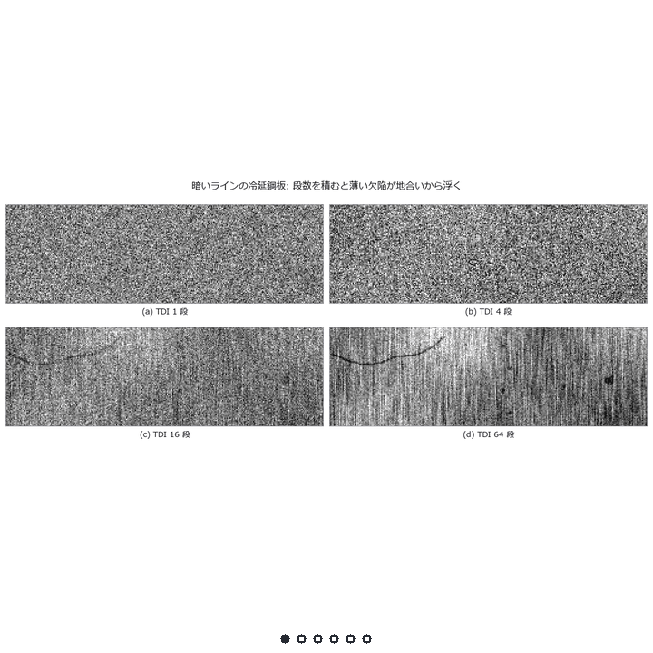</picture><span>어두운 라인에서도 TDI를 쌓으면 옅은 흠이 드러난다</span></a>
<a href="../../articles/assets/poc/poc_itof_multifreq/12_public_raw_unwrap.png"><picture><source media="(prefers-reduced-motion: reduce)" srcset="../../articles/assets/poc/poc_itof_multifreq/01_warehouse_unwrap.png">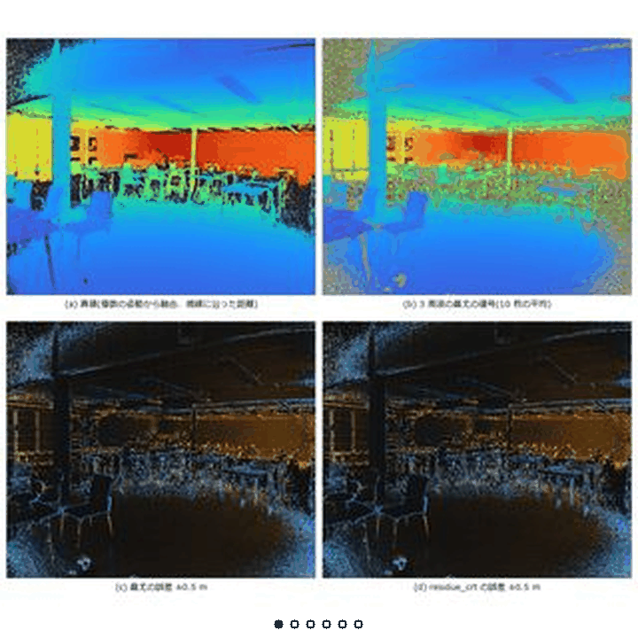</picture><span>간접 ToF 거리가 깨지는 곳</span></a>
<a href="../../articles/assets/poc/poc_weld_radiograph_porosity/02_map_detections.png"><picture><source media="(prefers-reduced-motion: reduce)" srcset="../../articles/assets/poc/poc_weld_radiograph_porosity/02_map_detections.png">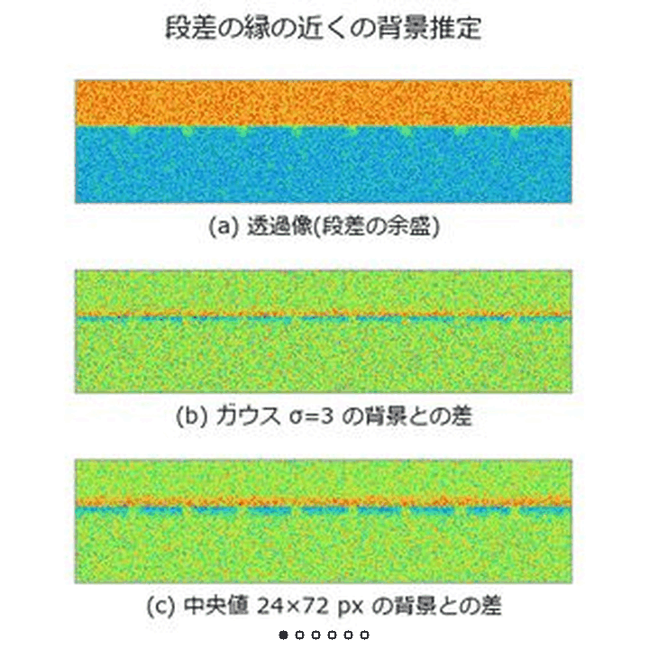</picture><span>용접 X선 영상의 기공: 고정 임계값은 덧살 가장자리까지 잡는다</span></a>
<a href="../../articles/assets/poc/poc_fourier_ptychography/01_usaf_4x_fp_20x.png"><picture><source media="(prefers-reduced-motion: reduce)" srcset="../../articles/assets/poc/poc_fourier_ptychography/01_usaf_4x_fp_20x.png">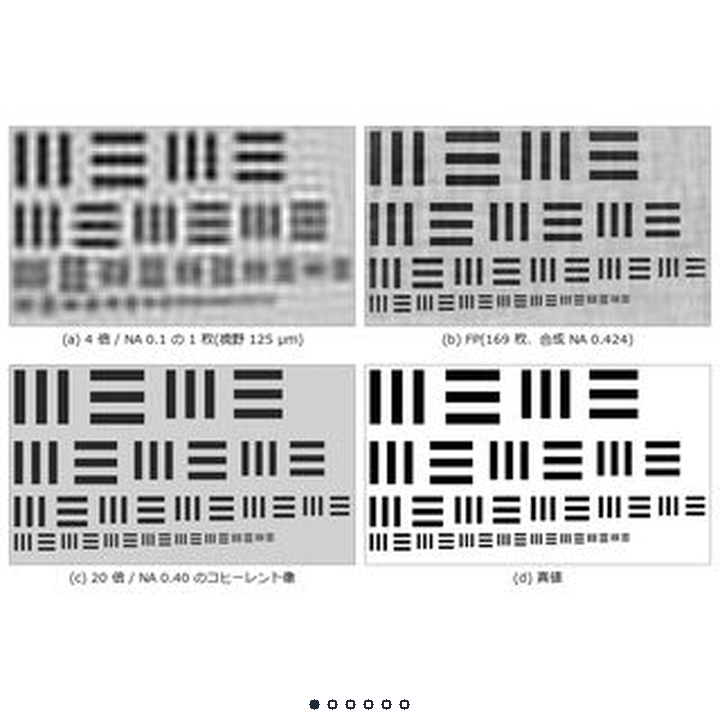</picture><span>4배 시야 그대로 20배 해상도(푸리에 타이코그래피)</span></a>
<a href="../../articles/assets/poc/poc_code_matching_breakdown/05_highlight_sweep.gif"><picture><source media="(prefers-reduced-motion: reduce)" srcset="../../articles/assets/poc/poc_code_matching_breakdown/01_breakdown_occlusion.png">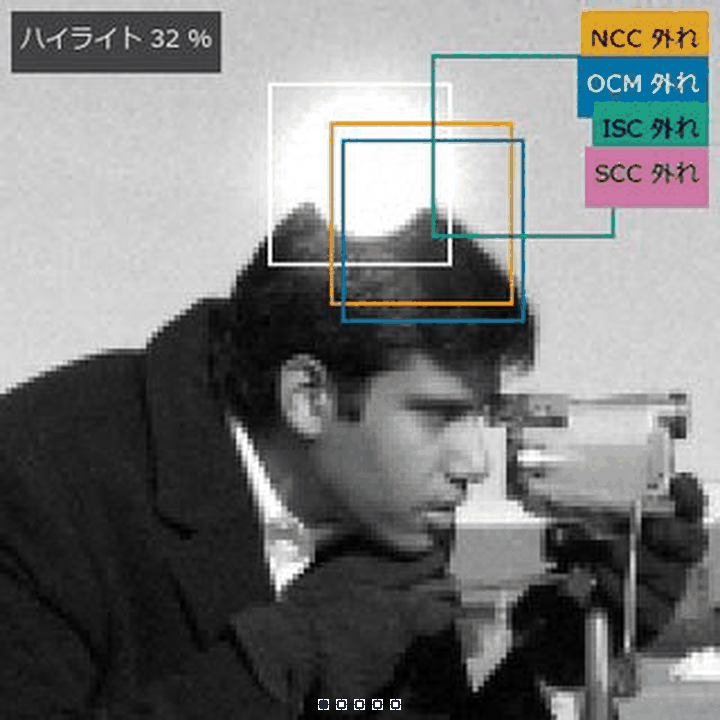</picture><b>&#9654;</b><span>하이라이트·가림에 강한 부호 매칭</span></a>
<a href="../../articles/assets/poc/poc_good_sample_variation_model/04_visa_explanation.png"><picture><source media="(prefers-reduced-motion: reduce)" srcset="../../articles/assets/poc/poc_good_sample_variation_model/01_band_width_alignment.png">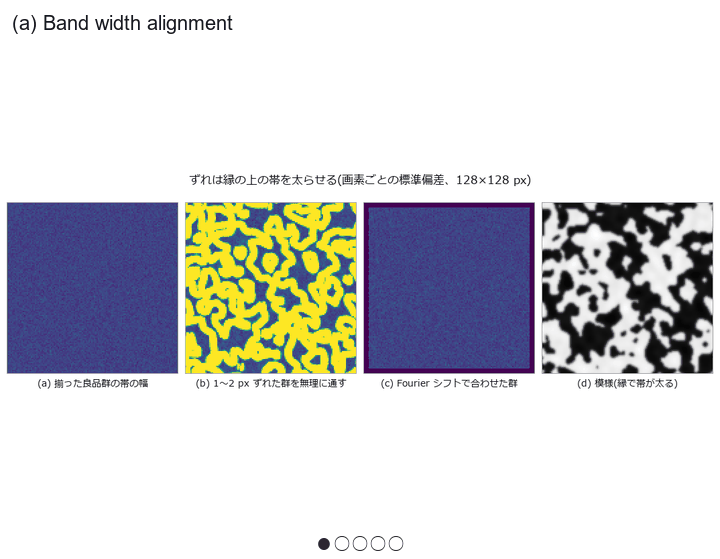</picture><span>양품 변동으로 결함 찾기: 실영상에서는 선언한 오검출률이 지켜지지 않는다</span></a>
<a href="../../articles/assets/poc/poc_real_defect_floor/03_defect_floor_explained.mp4"><b>&#9654;</b><span>잡음을 맞춰도 실사 배경에서는 옅은 흠이 안 보인다</span></a>
<a href="../../articles/assets/poc/poc_illumination_cone_vs_na/02_works_by_cone.png"><picture><source media="(prefers-reduced-motion: reduce)" srcset="../../articles/assets/poc/poc_illumination_cone_vs_na/02_works_by_cone.png">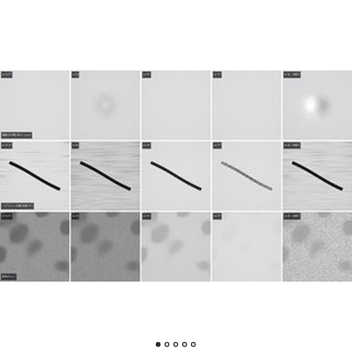</picture><span>조명 원뿔의 벌어짐에 따라 찍힘과 흠이 보이거나 사라진다</span></a>
<a href="../../articles/assets/poc/poc_telecentric_metrology/08_real_alignment_plate.png"><picture><source media="(prefers-reduced-motion: reduce)" srcset="../../articles/assets/poc/poc_telecentric_metrology/08_real_alignment_plate.png"></picture><span>공개 텔레센트릭 실영상으로 배율을 논문과 0.05 %까지 검산</span></a>
<a href="../../articles/assets/poc/poc_simcal_telecentric/02_real_model_residuals.png"><picture><source media="(prefers-reduced-motion: reduce)" srcset="../../articles/assets/poc/poc_simcal_telecentric/02_real_model_residuals.png">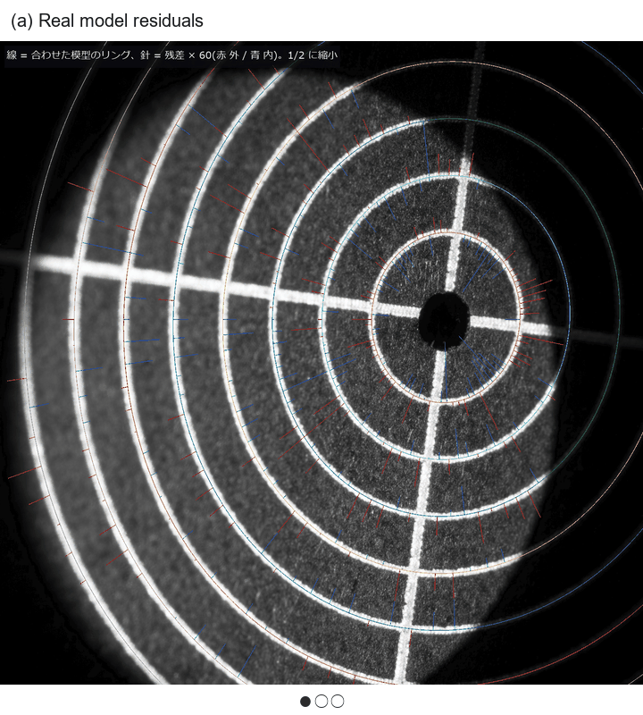</picture><span>텔레센트릭 실영상 1장으로 보정하고 안 맞는 곳도 표시</span></a>
<a href="../../articles/assets/poc/poc_cad_scan_deviation/14_align_orbit.gif"><picture><source media="(prefers-reduced-motion: reduce)" srcset="../../articles/assets/poc/poc_cad_scan_deviation/01_scene.png"></picture><b>&#9654;</b><span>정렬이 결함을 숨긴다: CAD와 점군의 차</span></a>
<a href="../../articles/assets/poc/poc_lidar_terrain_change/13_real_dod.png">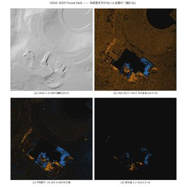<span>두 시기 항공 LiDAR: 계통 차를 빼지 않으면 전면이 파인 것처럼 보인다</span></a>
<a href="../../articles/assets/poc/poc_real_stereo_depth/01_scene.png"><picture><source media="(prefers-reduced-motion: reduce)" srcset="../../articles/assets/poc/poc_real_stereo_depth/01_scene.png">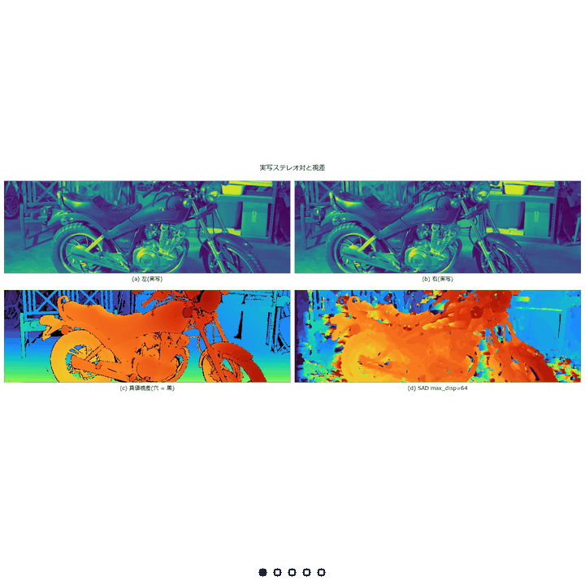</picture><span>실사 스테레오: 시차 탐색 폭이 모자라면 전경이 전부 틀린다</span></a>
<a href="../../articles/assets/poc/poc_sem_tem_same_particle/08_tem_focus_sweep.gif"><picture><source media="(prefers-reduced-motion: reduce)" srcset="../../articles/assets/poc/poc_sem_tem_same_particle/02_same_specimen_sem_tem.png">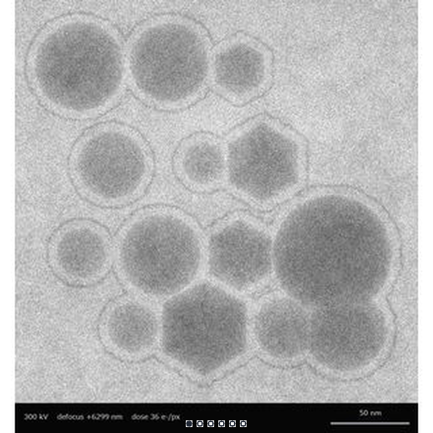</picture><b>&#9654;</b><span>같은 입자도 SEM과 TEM에서 입경이 수 nm 다르다</span></a>
<a href="../../articles/assets/poc/poc_tem_ctf_thon_rings/12_real_empiar_10028.png"><picture><source media="(prefers-reduced-motion: reduce)" srcset="../../articles/assets/poc/poc_tem_ctf_thon_rings/02_thon_rings_four_defoci.png">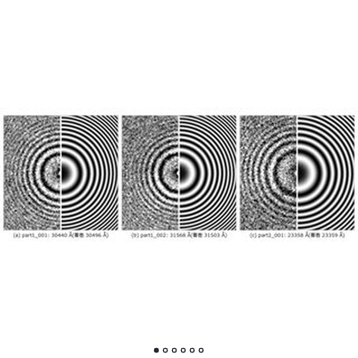</picture><span>실제 전자현미경 영상으로 초점 이탈 추정, 저자 값과 0.2 % 이내</span></a>
<a href="../../articles/assets/poc/poc_thin_film_reflectometry/01_real_micrograph_thickness.png"><picture><source media="(prefers-reduced-motion: reduce)" srcset="../../articles/assets/poc/poc_thin_film_reflectometry/01_real_micrograph_thickness.png"></picture><span>현미경 사진의 색으로 산화막 두께 지도</span></a>
<a href="../../articles/assets/poc/poc_sam_hybrid_bonding_voids/03_amplitude_vs_phase.png"><picture><source media="(prefers-reduced-motion: reduce)" srcset="../../articles/assets/poc/poc_sam_hybrid_bonding_voids/03_amplitude_vs_phase.png"></picture><span>접합면 보이드를 초음파 위상으로 찾기</span></a>
<a href="../../articles/assets/poc/poc_optics_drawings/06_setup_ring_coaxial.png"><picture><source media="(prefers-reduced-motion: reduce)" srcset="../../articles/assets/poc/poc_optics_drawings/06_setup_ring_coaxial.png">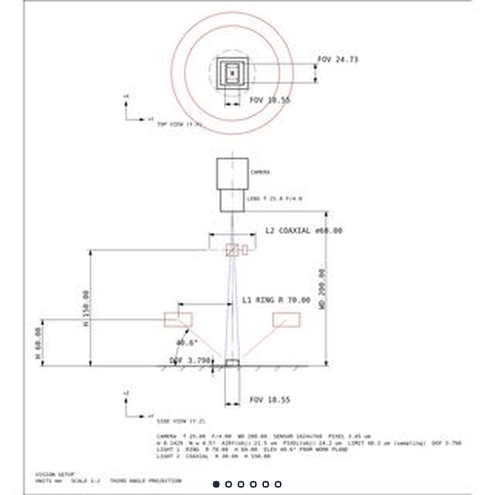</picture><span>광학 계산에서 장치 배치도와 렌즈 도면을 그린다</span></a>
<a href="../../articles/assets/poc/poc_crack_width_timeseries/11_series_video.gif">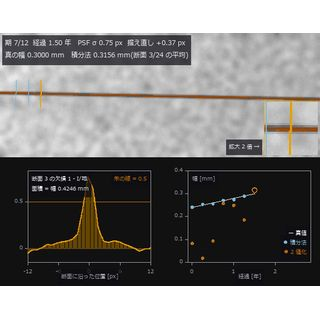<b>&#9654;</b><span>균열 성장: 이진화로 세면 속도를 2.5배로 잘못 본다</span></a>
<a href="../../articles/assets/poc/poc_moire_alignment/01_marks.png"><picture><source media="(prefers-reduced-motion: reduce)" srcset="../../articles/assets/poc/poc_moire_alignment/02_one_nm_steps.png">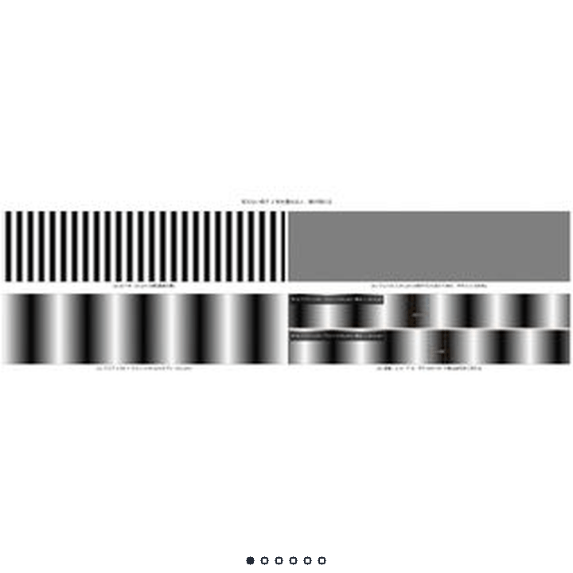</picture><span>보이지 않는 격자 2장을 겹쳐 모아레 무늬로 nm 어긋남을 읽는다</span></a>
<a href="../../articles/assets/poc/poc_laser_line_speckle_floor/01_line.png"><picture><source media="(prefers-reduced-motion: reduce)" srcset="../../articles/assets/poc/poc_laser_line_speckle_floor/01_line.png">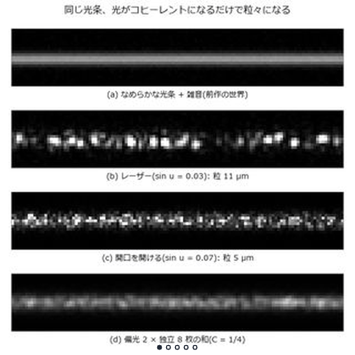</picture><span>레이저 광절단의 알갱이(스페클)가 높이 정밀도의 바닥을 정한다</span></a>
<a href="../../articles/assets/poc/poc_weld_bead_scan_angle/02_frames.png"><picture><source media="(prefers-reduced-motion: reduce)" srcset="../../articles/assets/poc/poc_weld_bead_scan_angle/02_frames.png">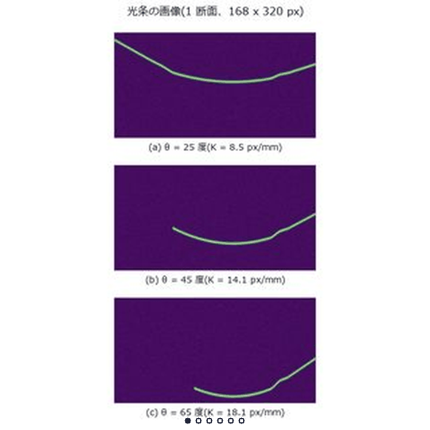</picture><span>용접 비드 광절단: 각도를 올리면 언더컷이 자기 그림자에 가려진다</span></a>
<a href="../../articles/assets/poc/poc_am_thermal_to_ct/07_ct_hole_crown.png">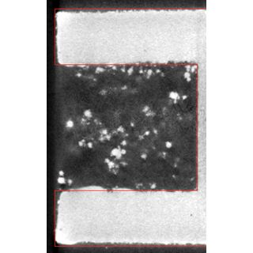<span>적층 제조품의 실제 CT로 아래 향한 면의 거칠기 측정</span></a>
<a href="../../articles/assets/poc/poc_thermography_ndt/07_window_explained.mp4"><picture><source media="(prefers-reduced-motion: reduce)" srcset="../../articles/assets/poc/poc_thermography_ndt/01_depth_table.png">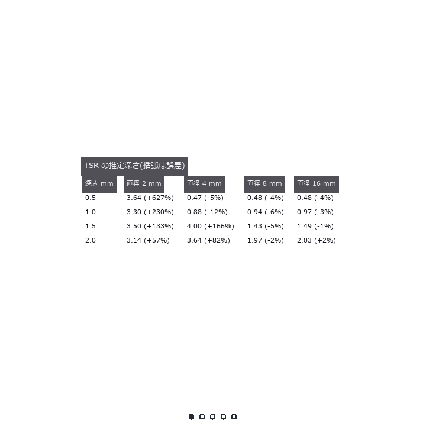</picture><b>&#9654;</b><span>열화상으로 박리 깊이: 시간 창에 따라 답이 바뀐다</span></a>
<a href="../../articles/assets/poc/poc_photoelasticity/03_load_and_isoclinics.mp4"><picture><source media="(prefers-reduced-motion: reduce)" srcset="../../articles/assets/poc/poc_photoelasticity/01_polariscope.png"></picture><b>&#9654;</b><span>눌린 원판의 응력이 줄무늬로 보인다(광탄성)</span></a>
<a href="../../articles/assets/poc/poc_interferometry_step/09_csi_scan_explained.mp4">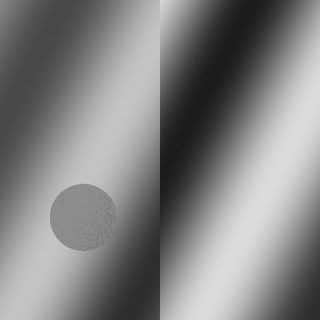<b>&#9654;</b><span>백색광 간섭으로 나노미터 단차 측정</span></a>
<a href="../../articles/assets/poc/poc_virtual_sem_kv_cd_bse/05_sem_same_part_3kv_3detectors.png"><picture><source media="(prefers-reduced-motion: reduce)" srcset="../../articles/assets/poc/poc_virtual_sem_kv_cd_bse/05_sem_same_part_3kv_3detectors.png"></picture><span>가상 SEM: 가속 전압에 따라 상과 선폭이 바뀐다</span></a>
<a href="../../articles/assets/poc/poc_glyph_typo_detection/01_sign_before_after.png">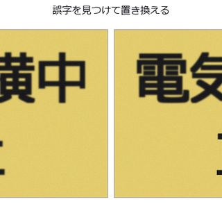<span>글자를 읽지 않고 표지판 오자를 찾아 고친다</span></a>
<a href="../../articles/assets/poc/poc_weed_rice_ratio/05_real_examples.png"><picture><source media="(prefers-reduced-motion: reduce)" srcset="../../articles/assets/poc/poc_weed_rice_ratio/05_real_examples.png">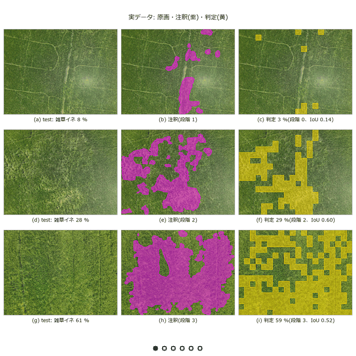</picture><span>드론 사진으로 논의 잡초벼 피도 판정</span></a>
<a href="../../articles/assets/poc/poc_stockpile_volume/07_scan_orbit.mp4">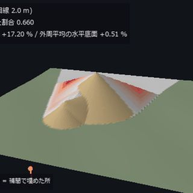<b>&#9654;</b><span>적치물 부피: 보이지 않는 바닥과 뒷면이 오차를 정한다</span></a>
<a href="../../articles/assets/poc/poc_strain_history/01_speckle.png">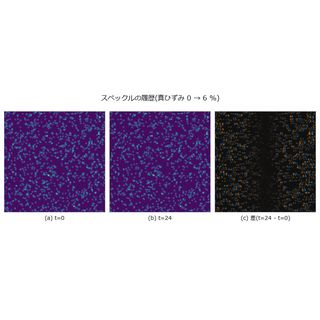<span>영상 상관 변형률: 이웃 프레임끼리 비교해 더하면 오차가 31분의 1</span></a>
<a href="../../articles/assets/poc/poc_pegsim_insertion/04_pegsim_insert_corrected.gif">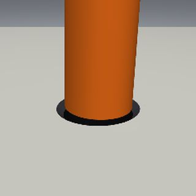<b>&#9654;</b><span>손목 카메라로 구멍에 맞춰 페그 삽입(12 / 12 성공)</span></a>
<a href="../../articles/assets/media/evis_bean_track_fullseye.mp4">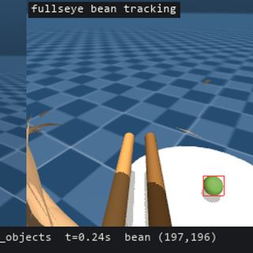<b>&#9654;</b><span>젓가락 끝 카메라로 콩을 놓치지 않고 추적(시뮬레이터)</span></a>
<a href="../../articles/assets/media/evis_stereo_fullseye.mp4">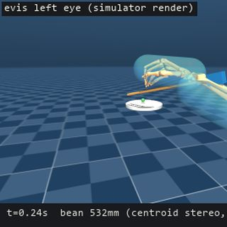<b>&#9654;</b><span>양안 스테레오로 콩까지 거리 측정(시뮬레이터)</span></a>
<a href="https://youtu.be/XN1mGAftSlY">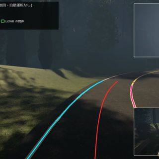<b>&#9654;</b><span>안개 속 헤어핀(CARLA)</span></a>
</div>

## 시리즈 기사 (Qiita의 영어 기사)

<div class="vser">
<a href="https://qiita.com/furuse-kazufumi/items/8a8f23e53b19ee8cdc10"><strong>지면의 계측관</strong><span>참값을 직접 심은 PoC 전시관</span></a>
<a href="https://qiita.com/furuse-kazufumi/items/a82bf9f341cc4f04ca75"><strong>탁구</strong><span>바운드와 마찰을 영상으로 측정</span></a>
<a href="https://qiita.com/furuse-kazufumi/items/05de90f4d316cd7c681c"><strong>자율주행</strong><span>정리와 두 번째 구현으로 채점</span></a>
<a href="https://qiita.com/furuse-kazufumi/items/638f0b0aa7865e17c67c"><strong>커넥톰(뇌 배선도)</strong><span>파리 시각 모델을 몸에 얹어 측정</span></a>
<a href="https://qiita.com/furuse-kazufumi/items/569720dbae0c6471c96e"><strong>휴머노이드 운동회</strong><span>영상 처리가 심판을 보는 집 운동회</span></a>
</div>

## 할 수 있는 것

101개 항목. 각각 설명 페이지(사용법과 한계)와 실행 가능한 예제로 연결됩니다.

<div class="vl" markdown="1">

**찾기**

- 영역을 잘라내고 골라서 세기: [설명](../../capabilities/blob-and-region.md) _(ja)_ · 예제 [poc_cell_counting](https://github.com/furuse-kazufumi/fullseye/blob/master/examples/poc_cell_counting.py) · [poc_particle_sizing](https://github.com/furuse-kazufumi/fullseye/blob/master/examples/poc_particle_sizing.py) · [poc_real_coin_metrology](https://github.com/furuse-kazufumi/fullseye/blob/master/examples/poc_real_coin_metrology.py) · [poc_dense_bubble_count](https://github.com/furuse-kazufumi/fullseye/blob/master/examples/poc_dense_bubble_count.py)
- 포장의 RGB에서 색과 결로 작물과 잡초를 나누고, 잡초 피도를 미리 선언한 경계로 단계화(학습기 없음): [설명](../../capabilities/crop-weed-cover-grade.md) _(ja)_ · 예제 [poc_weed_rice_ratio](https://github.com/furuse-kazufumi/fullseye/blob/master/examples/poc_weed_rice_ratio.py)
- 두 X선 에너지로 두께와 재질을 가른다(듀얼 에너지 / 광자 계수: 스펙트럼 → 에너지 창 → 기저 분해 → 유효 Z): [설명](../../capabilities/dual-energy-xray-material-discrimination.md) _(ja)_ · 예제 [poc_dual_energy_xray](https://github.com/furuse-kazufumi/fullseye/blob/master/examples/poc_dual_energy_xray.py)
- 이미지 속 글자를 올바른 문자열에 맞춰 고치기: [설명](../../capabilities/fix-text-in-images.md) _(ja)_ · 예제 [fix_text_in_image](https://github.com/furuse-kazufumi/fullseye/blob/master/examples/fix_text_in_image.py) · [poc_glyph_typo_detection](https://github.com/furuse-kazufumi/fullseye/blob/master/examples/poc_glyph_typo_detection.py)
- 양품을 나란히 놓고 '평소와 다름'을 말한다 (양품 통계 변동 모델, 오검출률 선언): [설명](../../capabilities/good-sample-variation-model.md) _(ja)_ · 예제 [poc_good_sample_variation_model](https://github.com/furuse-kazufumi/fullseye/blob/master/examples/poc_good_sample_variation_model.py) · [anomaly_eval_metrics](https://github.com/furuse-kazufumi/fullseye/blob/master/examples/anomaly_eval_metrics.py)
- OCR 전처리(기울기 보정, 국소 이진화, 행 잘라내기): [설명](../../capabilities/ocr-preprocessing.md) _(ja)_ · 예제 [gallery2d_segmentation](https://github.com/furuse-kazufumi/fullseye/blob/master/examples/gallery2d_segmentation.py) · [poc_matrix_code_reading](https://github.com/furuse-kazufumi/fullseye/blob/master/examples/poc_matrix_code_reading.py) · [gallery2d_region](https://github.com/furuse-kazufumi/fullseye/blob/master/examples/gallery2d_region.py)
- 양품만으로 학습해 벗어난 패치를 가리킨다 (고전 특징의 위치별 정규분포와 메모리 뱅크, 재현율을 보장하는 운용점): [설명](../../capabilities/patch-feature-anomaly-detection.md) _(ja)_ · 예제 [poc_patch_anomaly](https://github.com/furuse-kazufumi/fullseye/blob/master/examples/poc_patch_anomaly.py) · [anomaly_eval_metrics](https://github.com/furuse-kazufumi/fullseye/blob/master/examples/anomaly_eval_metrics.py)
- PL 영상에서 가는 홈이 사라지는 이유를 캐리어 확산 PSF와 결함의 종류로 구분(Si 웨이퍼·태양전지의 PL/EL 검사): [설명](../../capabilities/pl-carrier-diffusion-visibility.md) _(ja)_ · 예제 [poc_si_wafer_pl_defect_visibility](https://github.com/furuse-kazufumi/fullseye/blob/master/examples/poc_si_wafer_pl_defect_visibility.py)
- 작은 점 모양 목표를 찾아 서브픽셀로 위치 구하기: [설명](../../capabilities/point-target-detection.md) _(ja)_ · 예제 [poc_search_sweep_width](https://github.com/furuse-kazufumi/fullseye/blob/master/examples/poc_search_sweep_width.py) · [poc_astro_photometry](https://github.com/furuse-kazufumi/fullseye/blob/master/examples/poc_astro_photometry.py)
- 조명 불균일·하이라이트·가림에 강한 템플릿 정합(밝기 변화의 방향을 부호로 비교하고, 위치를 정하지 못하는 템플릿은 거부): [설명](../../capabilities/robust-code-matching.md) _(ja)_ · 예제 [poc_code_matching_breakdown](https://github.com/furuse-kazufumi/fullseye/blob/master/examples/poc_code_matching_breakdown.py)
- 초음파 에코의 밝기가 아니라 위상으로 하이브리드 접합의 보이드를 찾는다(주사 음향 현미경 C-스캔, 주파수 절충, 검출 확률): [설명](../../capabilities/sam-bond-voids.md) _(ja)_ · 예제 [poc_sam_hybrid_bonding_voids](https://github.com/furuse-kazufumi/fullseye/blob/master/examples/poc_sam_hybrid_bonding_voids.py)
- 포인트 클라우드에서 알려진 3D 부품의 6자유도 자세 추정: [설명](../../capabilities/six-dof-surface-pose.md) _(ja)_ · 예제 [poc_registration_basin](https://github.com/furuse-kazufumi/fullseye/blob/master/examples/poc_registration_basin.py) · [poc_real_tless_6dof](https://github.com/furuse-kazufumi/fullseye/blob/master/examples/poc_real_tless_6dof.py)
- 표면 요철 결함: 조명 설계부터 검출까지: [설명](../../capabilities/surface-defects-with-lighting.md) _(ja)_ · 예제 [illumination_design_demo](https://github.com/furuse-kazufumi/fullseye/blob/master/examples/illumination_design_demo.py) · [photometric_stereo](https://github.com/furuse-kazufumi/fullseye/blob/master/examples_3d/photometric_stereo.py) · [poc_bump_coplanarity](https://github.com/furuse-kazufumi/fullseye/blob/master/examples/poc_bump_coplanarity.py)
- 위치 결정(템플릿 정합으로 측정선을 따라가게 하기): [설명](../../capabilities/template-alignment.md) _(ja)_ · 예제 [poc_template_tracking](https://github.com/furuse-kazufumi/fullseye/blob/master/examples/poc_template_tracking.py) · [gallery2d_contour_measure](https://github.com/furuse-kazufumi/fullseye/blob/master/examples/gallery2d_contour_measure.py) · [poc_search_sweep_width](https://github.com/furuse-kazufumi/fullseye/blob/master/examples/poc_search_sweep_width.py)

**재기**

- 평면 타깃의 다시점에서 내부 행렬 K 추정(Zhang 법): [설명](../../capabilities/camera-intrinsics-calibration.md) _(ja)_ · 예제 [camera_intrinsics_calibration](https://github.com/furuse-kazufumi/fullseye/blob/master/examples/camera_intrinsics_calibration.py)
- 복소평면을 면으로 보기(정의역 색칠·끌개 영역·탈출 시간·날개 주위 흐름): [설명](../../capabilities/complex-plane-fields.md) _(ja)_ · 예제 [poc_complex_plane_fields](https://github.com/furuse-kazufumi/fullseye/blob/master/examples/poc_complex_plane_fields.py)
- 주기 패턴이 표본화 격자에서 접히는 거리와 줄무늬가 어지럽히는 충돌 시간을 닫힌 형식으로 측정(겹눈·검사 카메라): [설명](../../capabilities/compound-eye-aliasing-and-ttc.md) _(ja)_ · 예제 [poc_zebra_stripes_fly_eye](https://github.com/furuse-kazufumi/fullseye/blob/master/examples/poc_zebra_stripes_fly_eye.py)
- 카메라 데이터시트의 수치를 EMVA 1288 절차로 다시 재고, 카메라 내부 전처리가 그 수치를 얼마나 움직이는지 본다(Linear와 General): [설명](../../capabilities/emva1288-camera-datasheets.md) _(ja)_ · 예제 [poc_emva1288_sensor](https://github.com/furuse-kazufumi/fullseye/blob/master/examples/poc_emva1288_sensor.py) · [poc_emva1288_in_camera_processing](https://github.com/furuse-kazufumi/fullseye/blob/master/examples/poc_emva1288_in_camera_processing.py)
- 원래 곧은 선에서 왜곡 계수 추정(plumb-line, 체커보드 불필요): [설명](../../capabilities/estimate-lens-distortion.md) _(ja)_ · 예제 [estimate_lens_distortion](https://github.com/furuse-kazufumi/fullseye/blob/master/examples/estimate_lens_distortion.py)
- 푸리에 타이코그래피(LED 경사 조명 영상 묶음 → 위상 복원으로 고 NA 진폭과 위상, 수렴하지 않으면 거부): [설명](../../capabilities/fourier-ptychography.md) _(ja)_ · 예제 [poc_fourier_ptychography](https://github.com/furuse-kazufumi/fullseye/blob/master/examples/poc_fourier_ptychography.py)
- 지구 규모 좌표에 올리기(ECEF·높이 기준·국소 ENU): [설명](../../capabilities/geodetic-frames.md) _(ja)_ · 예제 [poc_geodetic_height_frames](https://github.com/furuse-kazufumi/fullseye/blob/master/examples/poc_geodetic_height_frames.py) · [poc_geodetic_benchmarks_real](https://github.com/furuse-kazufumi/fullseye/blob/master/examples/poc_geodetic_benchmarks_real.py) · [dem_geodesy_tour](https://github.com/furuse-kazufumi/fullseye/blob/master/examples/dem_geodesy_tour.py)
- 격자 간섭계(탤벗 / 탤벗-라우): 한 번의 위상 스텝 스캔에서 투과·미분 위상·암시야 3장의 상을 분리: [설명](../../capabilities/grating-interferometry.md) _(ja)_ · 예제 [poc_grating_interferometry](https://github.com/furuse-kazufumi/fullseye/blob/master/examples/poc_grating_interferometry.py)
- 공업용 OCT(간섭 스펙트럼 → k 선형화 → 분산 보상 → A / B 스캔 → 군굴절률로 층 두께): [설명](../../capabilities/industrial-oct.md) _(ja)_ · 예제 [poc_industrial_oct](https://github.com/furuse-kazufumi/fullseye/blob/master/examples/poc_industrial_oct.py)
- 원형 부품의 내경을 mm 까지 재기: [설명](../../capabilities/inner-diameter-in-mm.md) _(ja)_ · 예제 [example_inner_diameter_mm](https://github.com/furuse-kazufumi/fullseye/blob/master/examples/example_inner_diameter_mm.py) · [poc_dimensional_inspection](https://github.com/furuse-kazufumi/fullseye/blob/master/examples/poc_dimensional_inspection.py) · [poc_real_coin_metrology](https://github.com/furuse-kazufumi/fullseye/blob/master/examples/poc_real_coin_metrology.py)
- 간접 ToF(위상 방식)의 다주파 언랩과 깨지는 방식(접힘, 다중 경로, 가장자리 혼합, 고조파, 배경광): [설명](../../capabilities/itof-multifreq.md) _(ja)_ · 예제 [poc_itof_multifreq](https://github.com/furuse-kazufumi/fullseye/blob/master/examples/poc_itof_multifreq.py)
- 레이저 광절단의 오차 하한은 스페클이 정한다(결맞음 결상, 스페클 통계, 삼각측량의 불확도): [설명](../../capabilities/laser-speckle-floor.md) _(ja)_ · 예제 [poc_laser_line_speckle_floor](https://github.com/furuse-kazufumi/fullseye/blob/master/examples/poc_laser_line_speckle_floor.py)
- 오목한 부품의 상호 반사가 줄무늬 투영과 ToF를 얼마나 어긋나게 하는지 측정 전에 예측한다(전역 광 수송, 직접·전역 분리, 마이크로 위상 이동): [설명](../../capabilities/light-transport.md) _(ja)_ · 예제 [poc_interreflection_fringe_error](https://github.com/furuse-kazufumi/fullseye/blob/master/examples/poc_interreflection_fringe_error.py)
- 화소별 록인 복조(시간 상관 이미징: 진폭·위상·직류, 링 조명 법선, 부호화 조명 분리, 열파): [설명](../../capabilities/lockin-demodulation.md) _(ja)_ · 예제 [poc_lockin_imaging](https://github.com/furuse-kazufumi/fullseye/blob/master/examples/poc_lockin_imaging.py)
- 그 숫자 중 얼마가 측정 방식 때문인가(게이지 R&R과 측정 불확도): [설명](../../capabilities/measurement-system-and-uncertainty.md) _(ja)_ · 예제 [poc_measurement_system_analysis](https://github.com/furuse-kazufumi/fullseye/blob/master/examples/poc_measurement_system_analysis.py)
- 모아레 정렬(피치가 조금 다른 격자 두 장 → 줄무늬 위상 → nm 변위, 차동과 Talbot 갭): [설명](../../capabilities/moire-alignment.md) _(ja)_ · 예제 [poc_moire_alignment](https://github.com/furuse-kazufumi/fullseye/blob/master/examples/poc_moire_alignment.py)
- 줄무늬의 거울상으로 광택면의 µm 오목을 잰다(위상 측정 디플렉토메트리: 줄무늬 → 위상 → 기울기 → 곡률): [설명](../../capabilities/phase-measuring-deflectometry.md) _(ja)_ · 예제 [poc_phase_measuring_deflectometry](https://github.com/furuse-kazufumi/fullseye/blob/master/examples/poc_phase_measuring_deflectometry.py)
- 광탄성으로 응력 측정(응력장 → 무늬 → 편광 영상 → 위상 지연과 주축): [설명](../../capabilities/photoelasticity.md) _(ja)_ · 예제 [poc_photoelasticity](https://github.com/furuse-kazufumi/fullseye/blob/master/examples/poc_photoelasticity.py)
- 3차원 점군에서 평면도 구하기: [설명](../../capabilities/planarity-from-point-cloud.md) _(ja)_ · 예제 [geometry_metrology](https://github.com/furuse-kazufumi/fullseye/blob/master/examples_3d/geometry_metrology.py) · [poc_bump_coplanarity](https://github.com/furuse-kazufumi/fullseye/blob/master/examples/poc_bump_coplanarity.py) · [poc_scan_to_bim_asbuilt](https://github.com/furuse-kazufumi/fullseye/blob/master/examples/poc_scan_to_bim_asbuilt.py)
- 어떤 크기라면 발견되는가(검출 확률 POD와 a90/95, MIL-HDBK-1823A): [설명](../../capabilities/probability-of-detection.md) _(ja)_ · 예제 [poc_pod_lighting](https://github.com/furuse-kazufumi/fullseye/blob/master/examples/poc_pod_lighting.py)
- 흠집과 돌기에 끌려가지 않는 평균선(로버스트 가우스 회귀·스플라인 필터, 단면과 면): [설명](../../capabilities/robust-gaussian-spline-profile-filter.md) _(ja)_ · 예제 [poc_robust_profile_filter](https://github.com/furuse-kazufumi/fullseye/blob/master/examples/poc_robust_profile_filter.py) · [example_robust_profile_filter](https://github.com/furuse-kazufumi/fullseye/blob/master/examples/example_robust_profile_filter.py)
- 미세한 스크래치를 찾아 폭 재기: [설명](../../capabilities/scratch-detection-and-width.md) _(ja)_ · 예제 [example_scratch_width](https://github.com/furuse-kazufumi/fullseye/blob/master/examples/example_scratch_width.py) · [poc_crack_width](https://github.com/furuse-kazufumi/fullseye/blob/master/examples/poc_crack_width.py) · [poc_solar_el_inspection](https://github.com/furuse-kazufumi/fullseye/blob/master/examples/poc_solar_el_inspection.py)
- SEM의 밝은 가장자리가 치수를 얼마나 부풀리는지 참값과 함께 측정: [설명](../../capabilities/sem-edge-effect-metrology.md) _(ja)_ · 예제 [poc_sem_wafer_defect_edge_bias](https://github.com/furuse-kazufumi/fullseye/blob/master/examples/poc_sem_wafer_defect_edge_bias.py)
- 같은 입자를 주사 영상과 투과 영상으로 측정해 두 치수 편향을 비교: [설명](../../capabilities/sem-tem-same-particle.md) _(ja)_ · 예제 [poc_sem_tem_same_particle](https://github.com/furuse-kazufumi/fullseye/blob/master/examples/poc_sem_tem_same_particle.py)
- 순차 광학 설계의 지표(이상 렌즈면, 포위 에너지, 자오와 구결 MTF, 스루포커스 MTF): [설명](../../capabilities/sequential-lens-design-metrics.md) _(ja)_ · 예제 [optical_design_metrics](https://github.com/furuse-kazufumi/fullseye/blob/master/examples/optical_design_metrics.py) · [poc_zoom_configurations](https://github.com/furuse-kazufumi/fullseye/blob/master/examples/poc_zoom_configurations.py) · [poc_lens_global_search](https://github.com/furuse-kazufumi/fullseye/blob/master/examples/poc_lens_global_search.py) · [poc_lens_merit_operands](https://github.com/furuse-kazufumi/fullseye/blob/master/examples/poc_lens_merit_operands.py) · [poc_lens_solves_afocal](https://github.com/furuse-kazufumi/fullseye/blob/master/examples/poc_lens_solves_afocal.py)
- 편광으로 흑색 광택 부품과 유리의 형상을 잰다(편광 기반 형상 복원, 모호성 집합, 굴절률 추정): [설명](../../capabilities/shape-from-polarization.md) _(ja)_ · 예제 [poc_shape_from_polarization](https://github.com/furuse-kazufumi/fullseye/blob/master/examples/poc_shape_from_polarization.py)
- 실물 영상으로 물리 모형의 계수를 맞춘다(sim-to-real 보정) —— 영상이 정하지 못하는 계수에는 수를 내지 않고, 정해지는 조합과 이유를 돌려준다: [설명](../../capabilities/sim-to-real-calibration.md) _(ja)_ · 예제 [simcal_tour](https://github.com/furuse-kazufumi/fullseye/blob/master/examples/simcal_tour.py) · [simcal_checks_tour](https://github.com/furuse-kazufumi/fullseye/blob/master/examples/simcal_checks_tour.py)
- 이미지에서 치수를 서브픽셀로 측정: [설명](../../capabilities/subpixel-2d-metrology.md) _(ja)_ · 예제 [poc_dimensional_inspection](https://github.com/furuse-kazufumi/fullseye/blob/master/examples/poc_dimensional_inspection.py) · [poc_screw_thread_metrology](https://github.com/furuse-kazufumi/fullseye/blob/master/examples/poc_screw_thread_metrology.py) · [poc_calipers_under_illusion](https://github.com/furuse-kazufumi/fullseye/blob/master/examples/poc_calipers_under_illusion.py)
- 텔레센트릭 렌즈와 치수 측정(주광선 기울기 → 높이에 따른 배율 → 비네팅과 흐림): [설명](../../capabilities/telecentric-metrology.md) _(ja)_ · 예제 [poc_telecentric_metrology](https://github.com/furuse-kazufumi/fullseye/blob/master/examples/poc_telecentric_metrology.py)
- 가상 투과전자현미경(전자 파장 → CTF → 위상 콘트라스트 상 → Thon 링으로 디포커스 추정 → 보정): [설명](../../capabilities/tem-phase-contrast-and-ctf.md) _(ja)_ · 예제 [poc_tem_ctf_thon_rings](https://github.com/furuse-kazufumi/fullseye/blob/master/examples/poc_tem_ctf_thon_rings.py)
- 지형의 경사·물 흐름·가시선 측정: [설명](../../capabilities/terrain-and-visibility.md) _(ja)_ · 예제 [poc_dem_terrain](https://github.com/furuse-kazufumi/fullseye/blob/master/examples/poc_dem_terrain.py) · [dem_terrain_analysis_tour](https://github.com/furuse-kazufumi/fullseye/blob/master/examples/dem_terrain_analysis_tour.py)
- 하나의 3차원 장면을 간접 및 직접 비행시간으로 측정: [설명](../../capabilities/tof-camera.md) _(ja)_ · 예제 [poc_tof_camera](https://github.com/furuse-kazufumi/fullseye/blob/master/examples/poc_tof_camera.py)
- 가상 SEM —— 전자와 고체의 상호작용을 몬테카를로로 풀고, 실측값으로 채점하면서 가속 전압·검출기·대전이 영상과 측정 선폭을 어떻게 바꾸는지 본다: [설명](../../capabilities/virtual-sem-monte-carlo.md) _(ja)_ · 예제 [poc_virtual_sem_kv_cd_bse](https://github.com/furuse-kazufumi/fullseye/blob/master/examples/poc_virtual_sem_kv_cd_bse.py)
- 3-D 스캔에서 부피·토량 구하기: [설명](../../capabilities/volume-from-3d-scan.md) _(ja)_ · 예제 [poc_stockpile_volume](https://github.com/furuse-kazufumi/fullseye/blob/master/examples/poc_stockpile_volume.py) · [poc_lidar_terrain_change](https://github.com/furuse-kazufumi/fullseye/blob/master/examples/poc_lidar_terrain_change.py)
- 그림으로는 확인할 수 없는 것(적분기 차수·리아푸노프 지수·분기·상관 차원·극소 곡면): [설명](../../capabilities/what-a-picture-cannot-check.md) _(ja)_ · 예제 [poc_what_a_picture_cannot_check](https://github.com/furuse-kazufumi/fullseye/blob/master/examples/poc_what_a_picture_cannot_check.py)

**빛과 색**

- 크로매틱 공초점 변위 센서(유리의 분산 → 보정표 → 귀환 스펙트럼 → 높이와 두께): [설명](../../capabilities/chromatic-confocal-sensor.md) _(ja)_ · 예제 [poc_chromatic_confocal](https://github.com/furuse-kazufumi/fullseye/blob/master/examples/poc_chromatic_confocal.py)
- 색 측정(XYZ / Lab / 색차): [설명](../../capabilities/colour-and-delta-e.md) _(ja)_ · 예제 [poc_white_balance](https://github.com/furuse-kazufumi/fullseye/blob/master/examples/poc_white_balance.py) · [poc_pigment_unmixing](https://github.com/furuse-kazufumi/fullseye/blob/master/examples/poc_pigment_unmixing.py)
- 다중 반사, 다중 산란, 반복을 수렴할 때까지 돌린다 —— 수렴의 증거와 남은 오차를 돌려주고, 수렴하지 않으면 값을 내지 않는다: [설명](../../capabilities/convergent-forward-models.md) _(ja)_ · 예제 [converge_tour](https://github.com/furuse-kazufumi/fullseye/blob/master/examples/converge_tour.py)
- 광파이버와 라이트 가이드(유리의 분산 → LP 모드 → 모드 필드 직경 → 조명 효율): [설명](../../capabilities/fiber-and-light-guide.md) _(ja)_ · 예제 [poc_fiber_light_guide](https://github.com/furuse-kazufumi/fullseye/blob/master/examples/poc_fiber_light_guide.py)
- 회절격자 분광기와 현미경 조명(대역폭, smile/keystone, 쾰러/임계 조명, 동축 하프 미러): [설명](../../capabilities/grating-spectrometer-and-illumination.md) _(ja)_ · 예제 [poc_spectrometer_illumination](https://github.com/furuse-kazufumi/fullseye/blob/master/examples/poc_spectrometer_illumination.py)
- 조명 원뿔과 관찰 NA로 경면의 작은 기울기를 드러내거나 감추기(구면 캡의 교집합 → 기울기 대역 → 찍힘·흠집·새틴 얼룩): [설명](../../capabilities/illumination-cone-vs-na.md) _(ja)_ · 예제 [poc_illumination_cone_vs_na](https://github.com/furuse-kazufumi/fullseye/blob/master/examples/poc_illumination_cone_vs_na.py)
- 측광 참값을 지킨 채 오목한 부품의 상호 반사를 수렴까지 센다(3-D 형태 계수·점진적 radiosity·다중 반사 검사용 렌더링): [설명](../../capabilities/interreflection-to-convergence.md) _(ja)_ · 예제 [poc_pocket_interreflection](https://github.com/furuse-kazufumi/fullseye/blob/master/examples/poc_pocket_interreflection.py)
- 광학 설계 파일(.zmx 순차 처방의 읽기·쓰기, 키워드 목록, fail-closed 가져오기): [설명](../../capabilities/lens-prescription-files.md) _(ja)_ · 예제 [poc_lens_file_roundtrip](https://github.com/furuse-kazufumi/fullseye/blob/master/examples/poc_lens_file_roundtrip.py)
- 재료의 광학 물성을 하나의 표로 조회(유리·결정·반도체·금속·액체·플라스틱 86종, 1차 문헌의 계수와 수표, 유리 카탈로그 가져오기): [설명](../../capabilities/material-optical-property-library.md) _(ja)_ · 예제 [poc_material_optical_library](https://github.com/furuse-kazufumi/fullseye/blob/master/examples/poc_material_optical_library.py)
- 근적외 초분광으로 겉보기가 같은 이물을 선별(재료표의 흡수대, 산란층의 반사, InGaAs 대역별 전자 수): [설명](../../capabilities/nir-hyperspectral-sorting.md) _(ja)_ · 예제 [poc_hyperspectral_foreign_matter](https://github.com/furuse-kazufumi/fullseye/blob/master/examples/poc_hyperspectral_foreign_matter.py)
- 비공축 광학계(접힘 거울·빔스플리터·기울어진 평판·샤임플루크·고스트): [설명](../../capabilities/noncoaxial-optics.md) _(ja)_ · 예제 [poc_noncoaxial_optics](https://github.com/furuse-kazufumi/fullseye/blob/master/examples/poc_noncoaxial_optics.py)
- 빛의 반사·굴절·간섭 계산: [설명](../../capabilities/optics-and-materials.md) _(ja)_ · 예제 [glass_and_mirror_optics](https://github.com/furuse-kazufumi/fullseye/blob/master/examples/glass_and_mirror_optics.py) · [appearance_structural_colour](https://github.com/furuse-kazufumi/fullseye/blob/master/examples/appearance_structural_colour.py)
- 픽셀 시프트 촬상(1 화소 시프트로 전색, 반 화소 시프트로 에일리어싱 제거, 깨지는 조건까지): [설명](../../capabilities/pixel-shift-imaging.md) _(ja)_ · 예제 [poc_pixel_shift](https://github.com/furuse-kazufumi/fullseye/blob/master/examples/poc_pixel_shift.py)
- 편광 4 방향으로 정반사 제거(유전체와 금속을 구분): [설명](../../capabilities/polarisation-specular-removal.md) _(ja)_ · 예제 [example_polarization_metal](https://github.com/furuse-kazufumi/fullseye/blob/master/examples/example_polarization_metal.py) · [poc_polarization_specular](https://github.com/furuse-kazufumi/fullseye/blob/master/examples/poc_polarization_specular.py) · [specular_photometric](https://github.com/furuse-kazufumi/fullseye/blob/master/examples/specular_photometric.py)
- 편광 카메라의 원시 프레임을 Stokes·DoLP·Mueller로 읽기: [설명](../../capabilities/polarization-imaging.md) _(ja)_ · 예제 [polarization_camera_pipeline](https://github.com/furuse-kazufumi/fullseye/blob/master/examples/polarization_camera_pipeline.py) · [poc_polarization_specular](https://github.com/furuse-kazufumi/fullseye/blob/master/examples/poc_polarization_specular.py)
- Bayer 원시 프레임을 단계마다 설명 가능한 식으로 표시 이미지로: [설명](../../capabilities/raw-to-display-isp.md) _(ja)_ · 예제 [raw_to_display_isp](https://github.com/furuse-kazufumi/fullseye/blob/master/examples/raw_to_display_isp.py)
- 광원 × 대상 × 센서의 분광 사슬(플랑크・CIE A・LED・필터・Si의 QE): [설명](../../capabilities/spectral-radiometry-chain.md) _(ja)_ · 예제 [poc_nir_silicon_transmission](https://github.com/furuse-kazufumi/fullseye/blob/master/examples/poc_nir_silicon_transmission.py)
- TDI 라인 스캔과 라인 스캔용 렌즈(단수와 SNR, 동기 오차의 MTF, 상고별 조도와 MTF): [설명](../../capabilities/tdi-linescan-and-lens.md) _(ja)_ · 예제 [poc_tdi_linescan](https://github.com/furuse-kazufumi/fullseye/blob/master/examples/poc_tdi_linescan.py)
- 분광 반사율로 박막 두께 측정(전달 행렬 → 간섭색 → FFT와 모델 맞춤 → 두께 지도): [설명](../../capabilities/thin-film-reflectometry.md) _(ja)_ · 예제 [poc_thin_film_reflectometry](https://github.com/furuse-kazufumi/fullseye/blob/master/examples/poc_thin_film_reflectometry.py)
- 물이 검사 이미지에 어떻게 보이는가(수영장 바닥의 코스틱, 병의 측면 이미지와 액면, 젖은 표면, 수중의 선체): [설명](../../capabilities/water-inspection-images.md) _(ja)_ · 예제 [poc_water_inspection_images](https://github.com/furuse-kazufumi/fullseye/blob/master/examples/poc_water_inspection_images.py)
- 물과 투명 매질(바다 파도, 수면의 프레넬과 굴절, 수중의 색과 산란, 병의 렌즈 작용): [설명](../../capabilities/water-transparent-media.md) _(ja)_ · 예제 [poc_water_transparent_media](https://github.com/furuse-kazufumi/fullseye/blob/master/examples/poc_water_transparent_media.py)

**파동과 신호**

- 배열로 방향을 재고 거리와 속도를 분리: [설명](../../capabilities/beamforming-and-range-doppler.md) _(ja)_ · 예제 [poc_multibeam_bathymetry](https://github.com/furuse-kazufumi/fullseye/blob/master/examples/poc_multibeam_bathymetry.py) · [poc_bev_sensor_fusion](https://github.com/furuse-kazufumi/fullseye/blob/master/examples/poc_bev_sensor_fusion.py)
- 맥놀이는 하나(막의 모드·간섭무늬·회절 차수·인쇄 무아레·잉크로 옮기기): [설명](../../capabilities/beats-fringes-and-screens.md) _(ja)_ · 예제 [poc_beats_fringes_and_screens](https://github.com/furuse-kazufumi/fullseye/blob/master/examples/poc_beats_fringes_and_screens.py)
- 간섭계의 공진기·양자잡음 예산·색잡음 속의 기지 파형을 닫힌 형식으로 설계(중력파 망원경의 식을 검사 간섭계·진동계·AE에): [설명](../../capabilities/gw-interferometer-quantum-noise-and-matched-filter.md) _(ja)_ · 예제 [poc_gw_detector_pseudo_simulation](https://github.com/furuse-kazufumi/fullseye/blob/master/examples/poc_gw_detector_pseudo_simulation.py)
- 1차원 신호의 주기 결함 찾기: [설명](../../capabilities/periodic-defects-in-1d-signals.md) _(ja)_ · 예제 [poc_web_roll_periodicity](https://github.com/furuse-kazufumi/fullseye/blob/master/examples/poc_web_roll_periodicity.py) · [poc_rail_corrugation](https://github.com/furuse-kazufumi/fullseye/blob/master/examples/poc_rail_corrugation.py) · [poc_bearing_diagnosis](https://github.com/furuse-kazufumi/fullseye/blob/master/examples/poc_bearing_diagnosis.py)
- 진동과 소리로 이상 진단: [설명](../../capabilities/vibration-and-acoustics.md) _(ja)_ · 예제 [poc_bearing_diagnosis](https://github.com/furuse-kazufumi/fullseye/blob/master/examples/poc_bearing_diagnosis.py) · [poc_rail_corrugation](https://github.com/furuse-kazufumi/fullseye/blob/master/examples/poc_rail_corrugation.py)

**재구성·보정**

- 하나의 기하로 콘빔·헬리컬·라미노그래피 재구성(산업용 CT): [설명](../../capabilities/ct-scan-modes.md) _(ja)_ · 예제 [ct_scan_modes](https://github.com/furuse-kazufumi/fullseye/blob/master/examples/ct_scan_modes.py)
- 이미지 전체의 렌즈 왜곡 보정(배럴·핀쿠션·접선): [설명](../../capabilities/lens-distortion-correction.md) _(ja)_ · 예제 [lens_undistort](https://github.com/furuse-kazufumi/fullseye/blob/master/examples/lens_undistort.py)
- 투영에서 단면 재구성(CT): [설명](../../capabilities/tomography-reconstruction.md) _(ja)_ · 예제 [poc_ct_fidelity](https://github.com/furuse-kazufumi/fullseye/blob/master/examples/poc_ct_fidelity.py) · [poc_ct_void_morphology](https://github.com/furuse-kazufumi/fullseye/blob/master/examples/poc_ct_void_morphology.py)
- 실루엣에서 입체 깎아내기(시각 헐): [설명](../../capabilities/visual-hull-from-silhouettes.md) _(ja)_ · 예제 [space_carving](https://github.com/furuse-kazufumi/fullseye/blob/master/examples_3d/space_carving.py) · [poc_livestock_body_volume](https://github.com/furuse-kazufumi/fullseye/blob/master/examples/poc_livestock_body_volume.py)

**워크플로 구성**

- 위치를 맞춰 겹치기: [설명](../../capabilities/align-and-stack.md) _(ja)_ · 예제 [poc_astro_photometry](https://github.com/furuse-kazufumi/fullseye/blob/master/examples/poc_astro_photometry.py) · [poc_registration_basin](https://github.com/furuse-kazufumi/fullseye/blob/master/examples/poc_registration_basin.py)
- 영상을 점·점군·볼륨·메시·그래프로 넘기고 다시 되돌리기: [설명](../../capabilities/convert-between-representations.md) _(ja)_ · 예제 [poc_bga_ball_type_roundtrip](https://github.com/furuse-kazufumi/fullseye/blob/master/examples/poc_bga_ball_type_roundtrip.py) · [representation_roundtrip](https://github.com/furuse-kazufumi/fullseye/blob/master/examples/representation_roundtrip.py) · [representation_conversion](https://github.com/furuse-kazufumi/fullseye/blob/master/examples/representation_conversion.py) · [type_connectivity_tour](https://github.com/furuse-kazufumi/fullseye/blob/master/examples/type_connectivity_tour.py)
- 기준 이미지(골든)와 비교해 결함을 재고 로트 단위로 판정: [설명](../../capabilities/golden-compare.md) _(ja)_ · 예제 [golden_compare](https://github.com/furuse-kazufumi/fullseye/blob/master/examples/golden_compare.py)
- 알려진 양품/불량품 세트로 배치 전에 검사 레시피와 사양을 검정하고 여유를 측정: [설명](../../capabilities/inspection-fixture.md) _(ja)_ · 예제 [inspection_fixture](https://github.com/furuse-kazufumi/fullseye/blob/master/examples/inspection_fixture.py)
- 폴더를 한 번에 검사(일괄·사양 판정·집계·SPC·보고서·감사 로그): [설명](../../capabilities/inspection-workflow.md) _(ja)_ · 예제 [inspection_workflow](https://github.com/furuse-kazufumi/fullseye/blob/master/examples/inspection_workflow.py)
- MTF와 수율로 렌즈 제조 공차 배분: [설명](../../capabilities/lens-tolerancing.md) _(ja)_ · 예제 [poc_lens_tolerancing](https://github.com/furuse-kazufumi/fullseye/blob/master/examples/poc_lens_tolerancing.py)
- 같은 입력의 검증·이웃 탐색·변환 커널을 한 번만 계산: [설명](../../capabilities/reuse-computation-results.md) _(ja)_ · 예제 [perf_pointcloud_descriptors](https://github.com/furuse-kazufumi/fullseye/blob/master/examples/perf_pointcloud_descriptors.py) · [perf_monogenic_metrics](https://github.com/furuse-kazufumi/fullseye/blob/master/examples/perf_monogenic_metrics.py) · [perf_prepared_volume_probe](https://github.com/furuse-kazufumi/fullseye/blob/master/examples/perf_prepared_volume_probe.py) · [perf_polarization_analyze](https://github.com/furuse-kazufumi/fullseye/blob/master/examples/perf_polarization_analyze.py) · [perf_hankel_plan_and_piv_stream](https://github.com/furuse-kazufumi/fullseye/blob/master/examples/perf_hankel_plan_and_piv_stream.py)
- 과학 데이터 파일 읽기(FITS·NIfTI·MRC·OME-TIFF·E57): [설명](../../capabilities/scientific-data-files.md) _(ja)_ · 예제 [poc_real_file_formats](https://github.com/furuse-kazufumi/fullseye/blob/master/examples/poc_real_file_formats.py)
- op 반환값(타입 포함)을 JSON으로 쓰고 비트 그대로 되읽기: [설명](../../capabilities/typed-results-as-json.md) _(ja)_ · 예제 [typed_results_json](https://github.com/furuse-kazufumi/fullseye/blob/master/examples/typed_results_json.py)
- op 반환값(타입 포함)을 읽기 쉬운 Markdown으로, JSON을 넣어 되읽기: [설명](../../capabilities/typed-results-as-markdown.md) _(ja)_ · 예제 [typed_results_markdown](https://github.com/furuse-kazufumi/fullseye/blob/master/examples/typed_results_markdown.py)
- 타입이 있는 검사 결과를 Excel(.xlsx) 보고서로: [설명](../../capabilities/xlsx-report.md) _(ja)_ · 예제 [xlsx_report](https://github.com/furuse-kazufumi/fullseye/blob/master/examples/xlsx_report.py)

**보여주기**

- 결과를 사람이 읽을 수 있는 그림으로: [설명](../../capabilities/figures-and-annotation.md) _(ja)_ · 예제 [poc_colormap_readability](https://github.com/furuse-kazufumi/fullseye/blob/master/examples/poc_colormap_readability.py) · [poc_dem_terrain](https://github.com/furuse-kazufumi/fullseye/blob/master/examples/poc_dem_terrain.py)
- 결과를 직접 만져 볼 수 있는 한 장짜리 HTML로 만들기(탭·배지·3-D·동영상·다국어): [설명](../../capabilities/interactive-poc-viewer.md) _(ja)_ · 예제 [interactive_poc_viewer](https://github.com/furuse-kazufumi/fullseye/blob/master/examples/interactive_poc_viewer.py) · [interactive_anim3d_viewer](https://github.com/furuse-kazufumi/fullseye/blob/master/examples/interactive_anim3d_viewer.py)
- 바탕색을 몰라도 선과 영역 그리기(반전색): [설명](../../capabilities/inverted-colour-overlays.md) _(ja)_ · 예제 [annotate_paper_tour](https://github.com/furuse-kazufumi/fullseye/blob/master/examples/annotate_paper_tour.py)
- 점군을 그대로 컬러 그림으로 그린다(서브픽셀 발자국, 깊이 순 합성, 빛의 총량을 보존하는 덧셈): [설명](../../capabilities/point-cloud-to-picture.md) _(ja)_ · 예제 [points_render_basics](https://github.com/furuse-kazufumi/fullseye/blob/master/examples_3d/points_render_basics.py) · [poc_flybrain_pointcloud](https://github.com/furuse-kazufumi/fullseye/blob/master/examples/poc_flybrain_pointcloud.py) · [poc_real_tless_6dof](https://github.com/furuse-kazufumi/fullseye/blob/master/examples/poc_real_tless_6dof.py)
- 이미지 위 원하는 곳에 글자와 표 놓기: [설명](../../capabilities/text-and-tables-on-images.md) _(ja)_ · 예제 [annotate_paper_tour](https://github.com/furuse-kazufumi/fullseye/blob/master/examples/annotate_paper_tour.py)

**그리기**

- 사진을 한 줄의 선으로(점묘 → 순회 경로 → 회전하는 원): [설명](../../capabilities/one-stroke-drawing.md) _(ja)_ · 예제 [poc_one_stroke_epicycles](https://github.com/furuse-kazufumi/fullseye/blob/master/examples/poc_one_stroke_epicycles.py)
- 광학계 도면(렌즈 단면도·촬상계 설치도·단렌즈 제작도를 SVG / DXF로): [설명](../../capabilities/optics-drawings.md) _(ja)_ · 예제 [poc_optics_drawings](https://github.com/furuse-kazufumi/fullseye/blob/master/examples/poc_optics_drawings.py)
- 처방 그대로의 렌즈를 통해 3차원 장면을 촬영(피사계 심도, 고양이 눈 보케, 모서리 조도, 색수차, 고스트): [설명](../../capabilities/photograph-through-prescription.md) _(ja)_ · 예제 [poc_photograph_through_prescription](https://github.com/furuse-kazufumi/fullseye/blob/master/examples/poc_photograph_through_prescription.py)
- 눈을 속이는 그림을 만들어 측정 쪽을 채점(착시·무한 그리기·순환 동영상): [설명](../../capabilities/pictures-that-carry-their-own-truth.md) _(ja)_ · 예제 [poc_illusions_and_perpetual_drawing](https://github.com/furuse-kazufumi/fullseye/blob/master/examples/poc_illusions_and_perpetual_drawing.py)
- 렌즈 처방 기반 라이트필드 카메라: [설명](../../capabilities/plenoptic-camera.md) _(ja)_ · 예제 [poc_plenoptic_camera](https://github.com/furuse-kazufumi/fullseye/blob/master/examples/poc_plenoptic_camera.py)
- 정리가 검사 문이 되는 그림(아폴로니우스·포드·측지 돔·잎차례·IFS·공간 채움 곡선): [설명](../../capabilities/theorems-as-pictures.md) _(ja)_ · 예제 [poc_theorems_as_pictures](https://github.com/furuse-kazufumi/fullseye/blob/master/examples/poc_theorems_as_pictures.py)

</div>

[PoC가 아닌 사용 예 185개 목록](https://github.com/furuse-kazufumi/fullseye/blob/master/examples/README.md)

## 전부 보기

PoC 309개와 로봇 예 5개. 그룹을 펼치면 썸네일이 나옵니다.

<noscript><p><a href="../../GALLERY.en.html">(JavaScript가 없으면 갤러리 페이지에서 모든 그림을 볼 수 있습니다.)</a></p></noscript>

<details class="vall"><summary><b>로봇의 눈(Fullseye가 지각 담당)</b> (4)</summary>
<div class="vg vs">
<a href="../../articles/assets/media/evis_stereo_fullseye.mp4"><b>&#9654;</b><span>휴머노이드 두 눈</span></a>
<a href="../../articles/assets/media/evis_bean_track_fullseye.mp4"><b>&#9654;</b><span>젓가락 끝 카메라 추적</span></a>
<a href="../../view2026/media/evis_fullseye_walk.gif"><b>&#9654;</b><span>보행을 RGB·깊이·DVS로</span></a>
<a href="../../view2026/media/vision_adaptive_walk.png"><span>단차를 보고 보행 선택</span></a>
</div>
</details>

<details class="vall"><summary><b>로봇의 몸(학습된 정책을 Fullseye에서 실행)</b> (1)</summary>
<div class="vg vs">
<a href="../../view2026/media/g1_run_fullseye.gif"><b>&#9654;</b><span>휴머노이드 G1 달리기</span></a>
</div>
</details>

<details class="vall"><summary><b>산업 검사</b> (60)</summary>
<div class="vg vs">
<a href="../../articles/assets/poc/poc_barcode_1d/01_misread_split.png"><picture><source media="(prefers-reduced-motion: reduce)" srcset="../../articles/assets/poc/poc_barcode_1d/01_misread_split.png">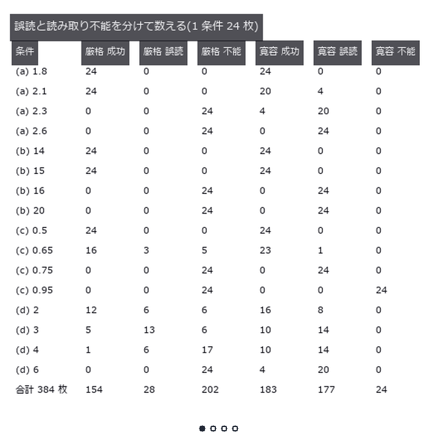</picture><span>1차원 바코드</span></a>
<a href="../../articles/assets/poc/poc_battery_electrode_tortuosity/01_scene.png"><picture><source media="(prefers-reduced-motion: reduce)" srcset="../../articles/assets/poc/poc_battery_electrode_tortuosity/01_scene.png">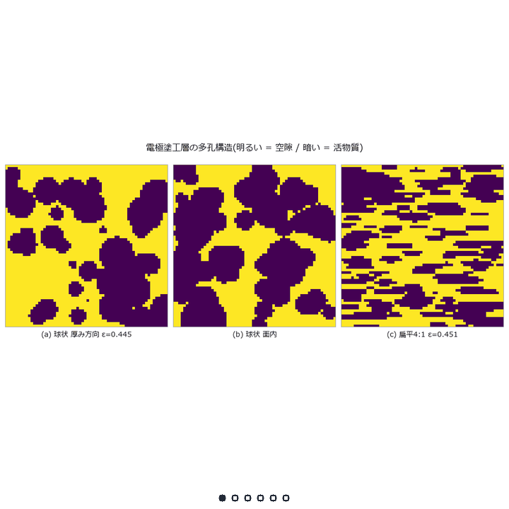</picture><span>전극 굴곡도</span></a>
<a href="../../articles/assets/poc/poc_bearing_diagnosis/01_envelope_vs_raw.png"><picture><source media="(prefers-reduced-motion: reduce)" srcset="../../articles/assets/poc/poc_bearing_diagnosis/01_envelope_vs_raw.png">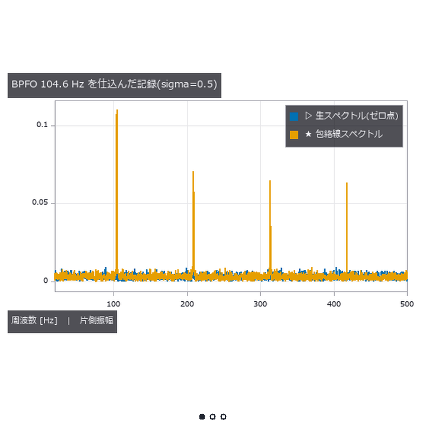</picture><span>베어링 이상 진단</span></a>
<a href="../../articles/assets/poc/poc_bump_coplanarity/01_scene.png"><picture><source media="(prefers-reduced-motion: reduce)" srcset="../../articles/assets/poc/poc_bump_coplanarity/01_scene.png">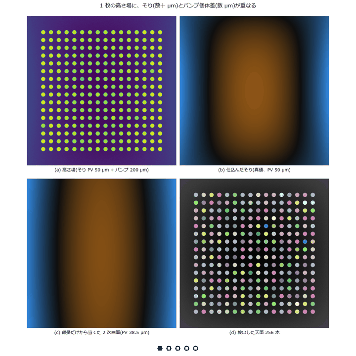</picture><span>범프 공평면성</span></a>
<a href="../../articles/assets/poc/poc_crack_width/05_real_crack_rebin.png"><picture><source media="(prefers-reduced-motion: reduce)" srcset="../../articles/assets/poc/poc_crack_width/05_real_crack_rebin.png">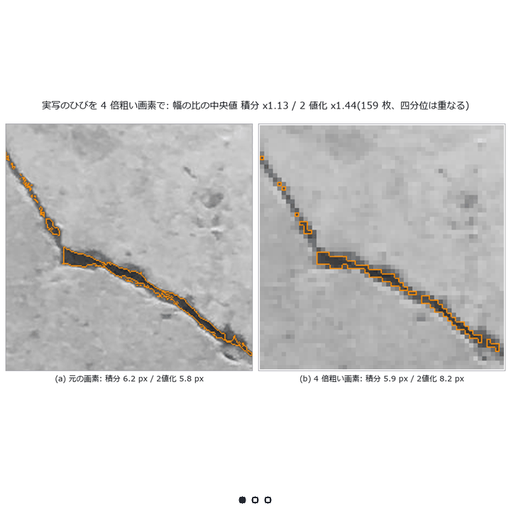</picture><span>균열 폭</span></a>
<a href="../../articles/assets/poc/poc_fabric_defect/06_real_defects.png"><picture><source media="(prefers-reduced-motion: reduce)" srcset="../../articles/assets/poc/poc_fabric_defect/06_real_defects.png">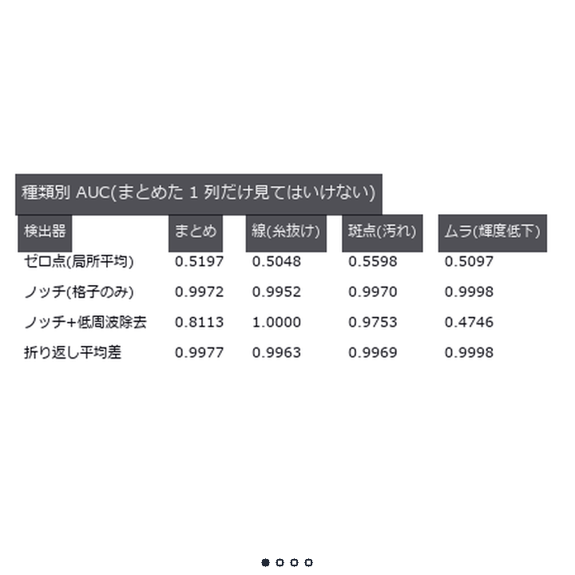</picture><span>직물 결함</span></a>
<a href="../../articles/assets/poc/poc_leak_localization/01_scene.png"><picture><source media="(prefers-reduced-motion: reduce)" srcset="../../articles/assets/poc/poc_leak_localization/01_scene.png">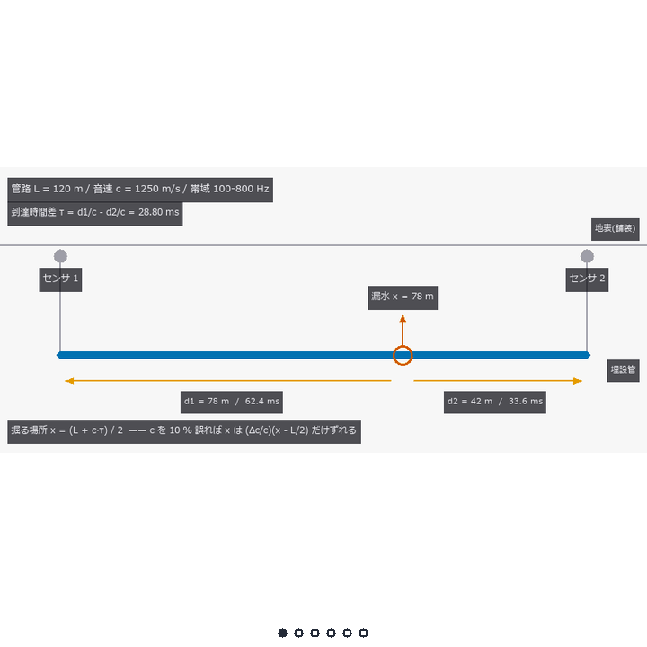</picture><span>소리로 누수 탐지</span></a>
<a href="../../articles/assets/poc/poc_machine_condition_fusion/01_scene_machine.png"><picture><source media="(prefers-reduced-motion: reduce)" srcset="../../articles/assets/poc/poc_machine_condition_fusion/01_scene_machine.png">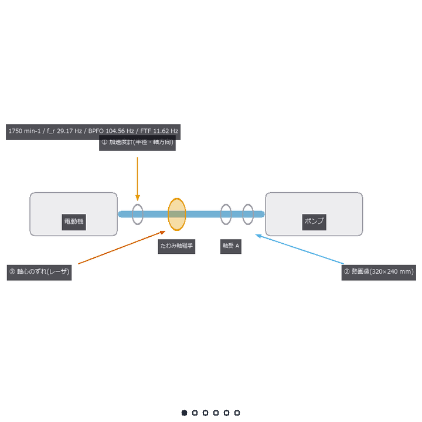</picture><span>설비 보전 융합</span></a>
<a href="../../articles/assets/poc/poc_matrix_code_reading/01_symbol_and_errors.png"><picture><source media="(prefers-reduced-motion: reduce)" srcset="../../articles/assets/poc/poc_matrix_code_reading/01_symbol_and_errors.png">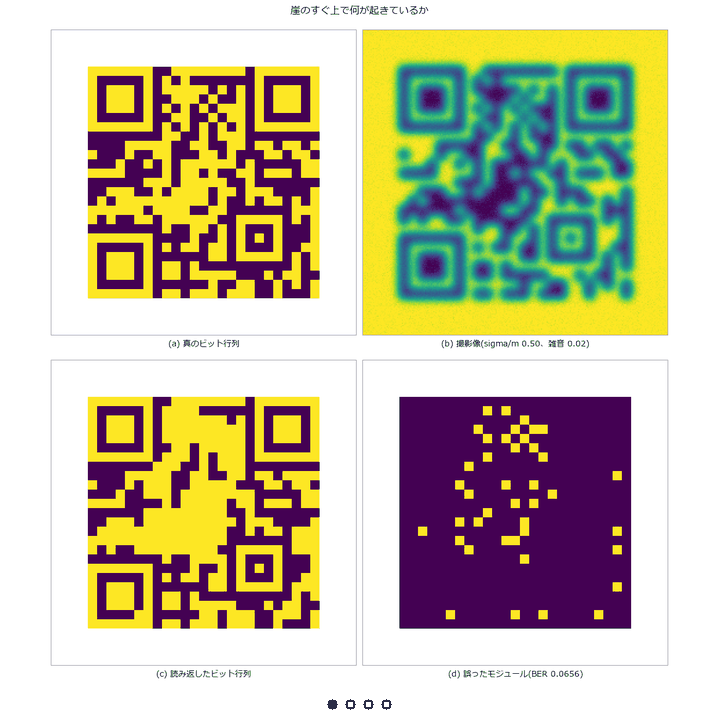</picture><span>매트릭스 코드</span></a>
<a href="../../articles/assets/poc/poc_moire_screen/01_failure_split_plot.png"><picture><source media="(prefers-reduced-motion: reduce)" srcset="../../articles/assets/poc/poc_moire_screen/01_failure_split_plot.png">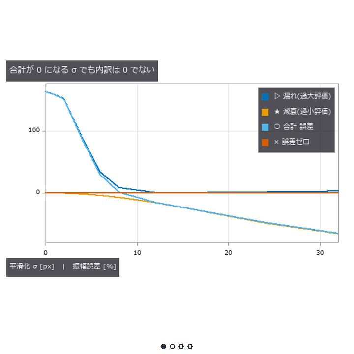</picture><span>디스플레이 모아레</span></a>
<a href="../../articles/assets/poc/poc_print_registration/01_plates.png"><picture><source media="(prefers-reduced-motion: reduce)" srcset="../../articles/assets/poc/poc_print_registration/01_plates.png">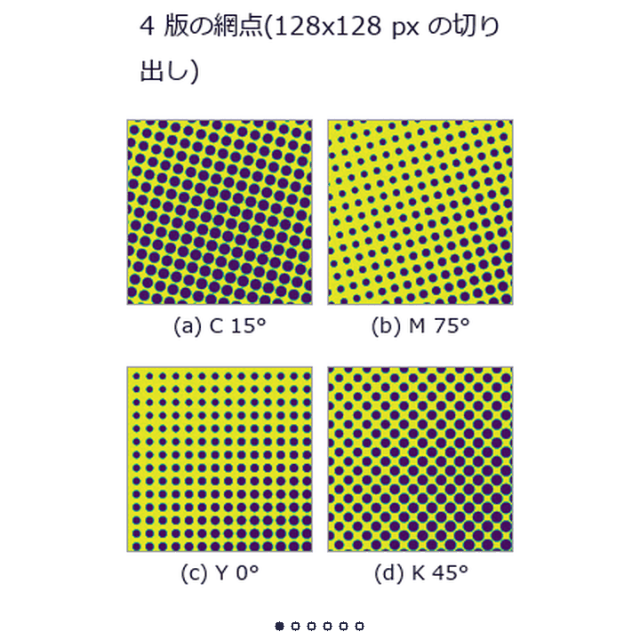</picture><span>인쇄 판 어긋남</span></a>
<a href="../../articles/assets/poc/poc_real_defect_floor/02_defect_floor_sweep.gif"><b>&#9654;</b><span>얇은 결함 한계</span></a>
<a href="../../articles/assets/poc/poc_real_texture_invariance/01_textures.png"><picture><source media="(prefers-reduced-motion: reduce)" srcset="../../articles/assets/poc/poc_real_texture_invariance/01_textures.png">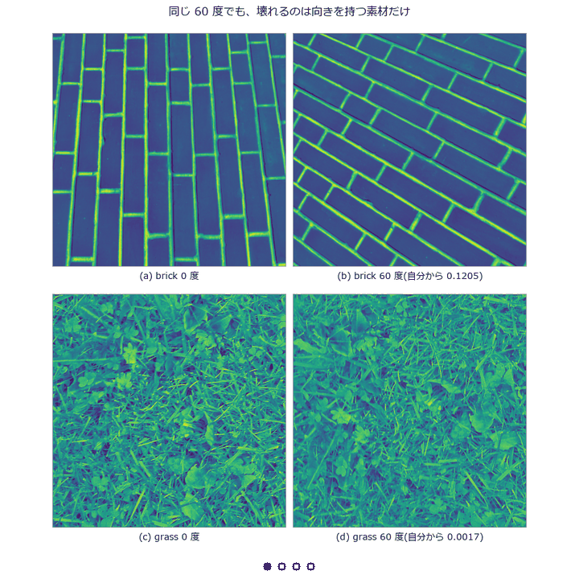</picture><span>실사 텍스처 회전</span></a>
<a href="../../articles/assets/poc/poc_recycling_sorting/01_scene.png"><picture><source media="(prefers-reduced-motion: reduce)" srcset="../../articles/assets/poc/poc_recycling_sorting/01_scene.png">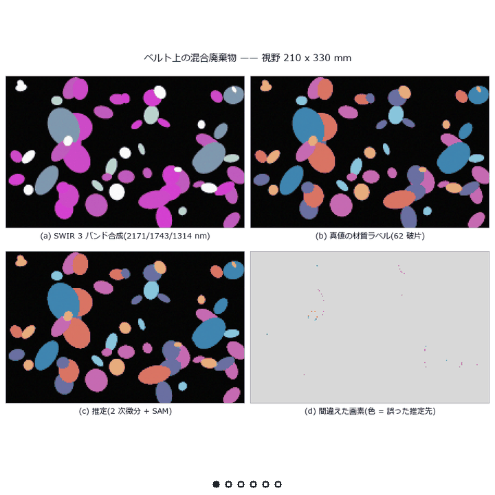</picture><span>폐기물 선별</span></a>
<a href="../../articles/assets/poc/poc_solar_el_inspection/10_real_el_overlay.png"><picture><source media="(prefers-reduced-motion: reduce)" srcset="../../articles/assets/poc/poc_solar_el_inspection/10_real_el_overlay.png">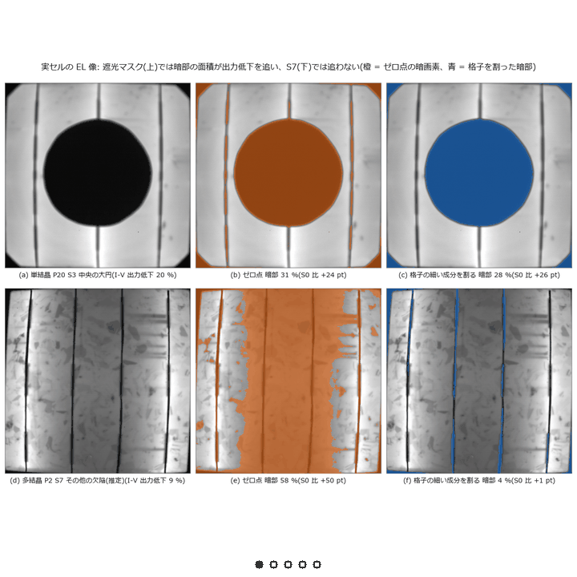</picture><span>태양전지 EL</span></a>
<a href="../../articles/assets/poc/poc_solder_fillet_aoi/01_ring_lut.png"><picture><source media="(prefers-reduced-motion: reduce)" srcset="../../articles/assets/poc/poc_solder_fillet_aoi/01_ring_lut.png">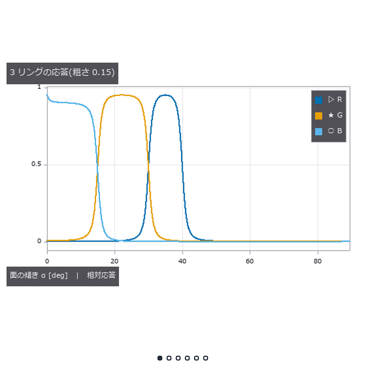</picture><span>솔더 AOI</span></a>
<a href="../../articles/assets/poc/poc_spc/01_spc_xbar_chart.png"><picture><source media="(prefers-reduced-motion: reduce)" srcset="../../articles/assets/poc/poc_spc/01_spc_xbar_chart.png">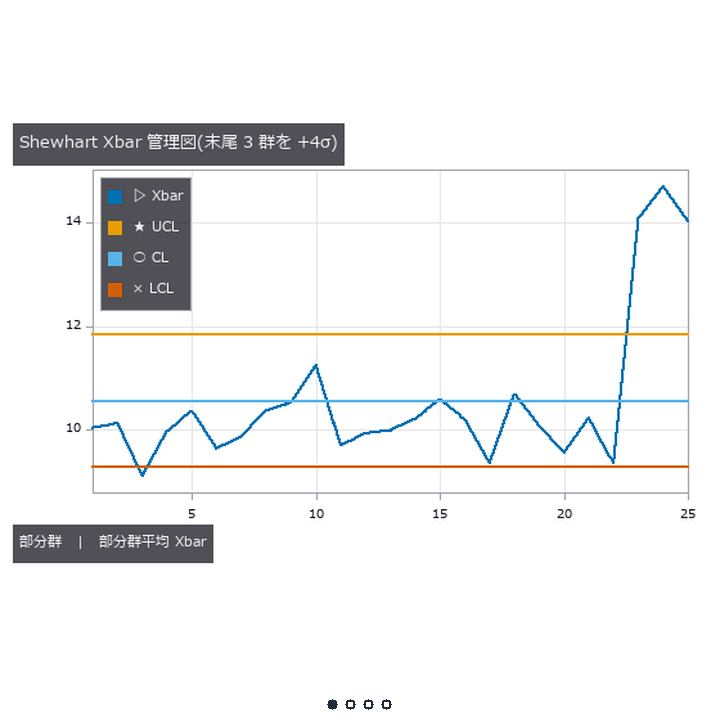</picture><span>통계적 공정 관리</span></a>
<a href="../../articles/assets/poc/poc_mt_hidden_fault/01_mt_hidden_cloud.png"><picture><source media="(prefers-reduced-motion: reduce)" srcset="../../articles/assets/poc/poc_mt_hidden_fault/01_mt_hidden_cloud.png">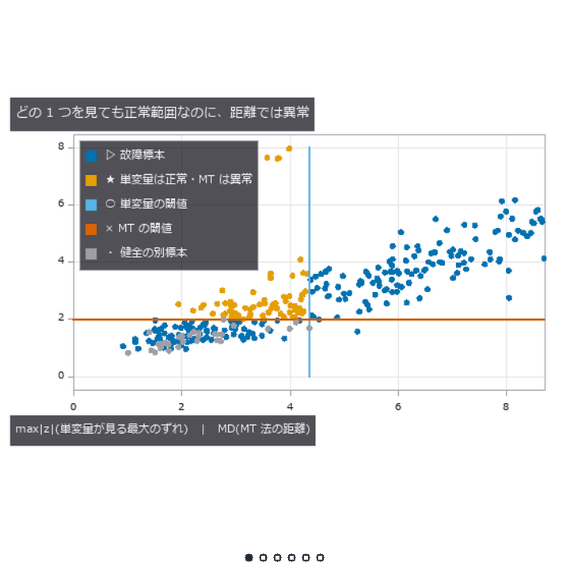</picture><span>MT법 이상 탐지</span></a>
<a href="../../articles/assets/poc/poc_text_region_truth/01_text_region_scene.png"><picture><source media="(prefers-reduced-motion: reduce)" srcset="../../articles/assets/poc/poc_text_region_truth/01_text_region_scene.png">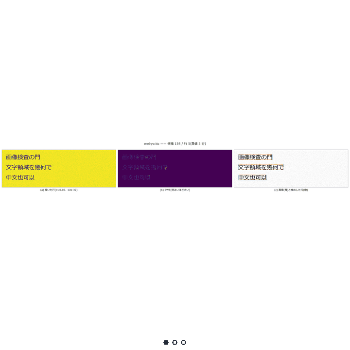</picture><span>문자 영역 검출</span></a>
<a href="../../articles/assets/poc/poc_thermal_drift_metrology/01_separate_drifts.png"><picture><source media="(prefers-reduced-motion: reduce)" srcset="../../articles/assets/poc/poc_thermal_drift_metrology/01_separate_drifts.png">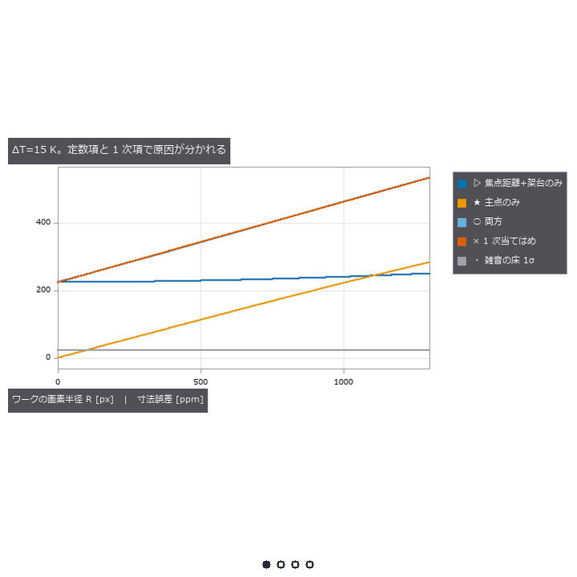</picture><span>카메라 열 드리프트</span></a>
<a href="../../articles/assets/poc/poc_thermal_radiometry/01_floor.png"><picture><source media="(prefers-reduced-motion: reduce)" srcset="../../articles/assets/poc/poc_thermal_radiometry/01_floor.png">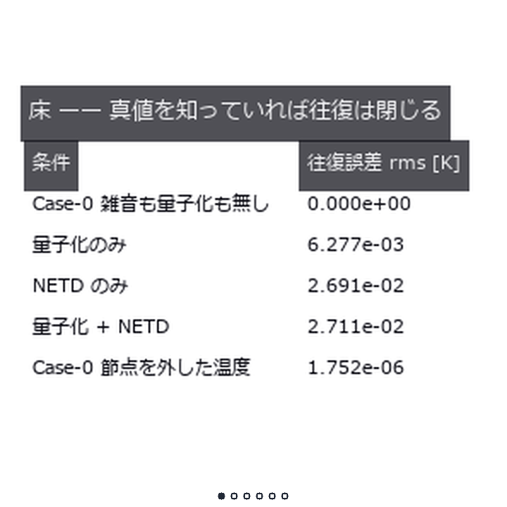</picture><span>열화상과 온도</span></a>
<a href="../../articles/assets/poc/poc_thermography_ndt/01_depth_table.png"><picture><source media="(prefers-reduced-motion: reduce)" srcset="../../articles/assets/poc/poc_thermography_ndt/01_depth_table.png"></picture><span>열화상 결함 깊이</span></a>
<a href="../../articles/assets/poc/poc_veiling_glare/01_verdict.png"><picture><source media="(prefers-reduced-motion: reduce)" srcset="../../articles/assets/poc/poc_veiling_glare/01_verdict.png">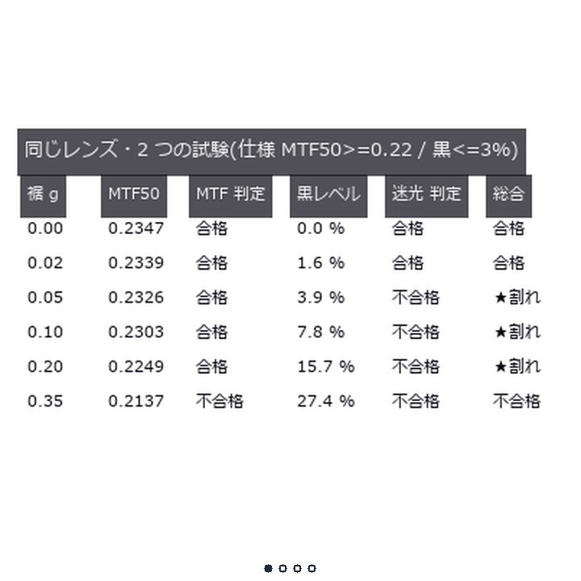</picture><span>미광</span></a>
<a href="../../articles/assets/poc/poc_emva1288_sensor/01_raw_dark_flat_saturation.png"><picture><source media="(prefers-reduced-motion: reduce)" srcset="../../articles/assets/poc/poc_emva1288_sensor/01_raw_dark_flat_saturation.png">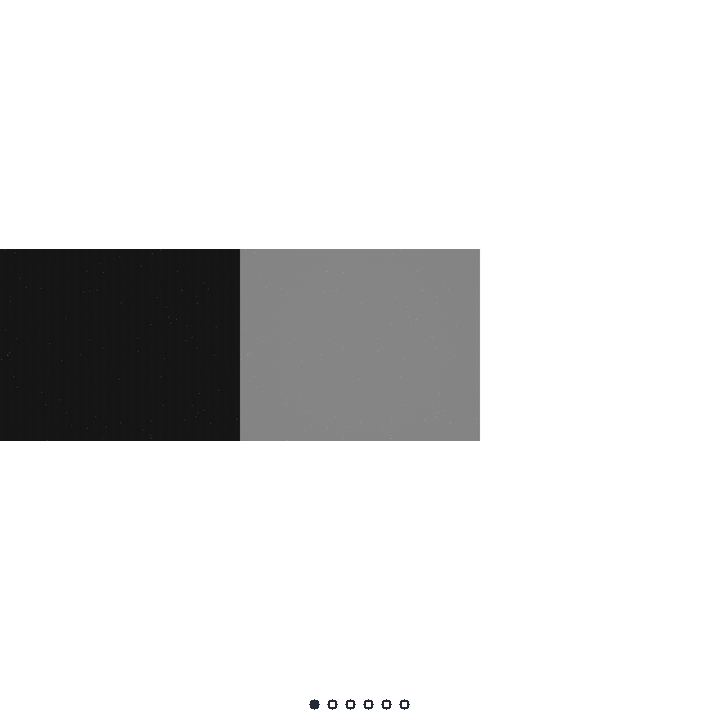</picture><span>EMVA 1288 측정</span></a>
<a href="../../articles/assets/poc/poc_emva1288_in_camera_processing/01_datasheet_lies.png"><picture><source media="(prefers-reduced-motion: reduce)" srcset="../../articles/assets/poc/poc_emva1288_in_camera_processing/01_datasheet_lies.png"></picture><span>카메라 내부 처리가 데이터시트를 속인다</span></a>
<a href="../../articles/assets/poc/poc_web_roll_periodicity/01_scene_web.png"><picture><source media="(prefers-reduced-motion: reduce)" srcset="../../articles/assets/poc/poc_web_roll_periodicity/01_scene_web.png"></picture><span>반송 롤 결함</span></a>
<a href="../../articles/assets/poc/poc_weld_bead_profile/05_real_laser_line.png"><picture><source media="(prefers-reduced-motion: reduce)" srcset="../../articles/assets/poc/poc_weld_bead_profile/05_real_laser_line.png"></picture><span>용접 비드 단면</span></a>
<a href="../../articles/assets/poc/poc_weld_bead_scan_angle/02_frames.png"><picture><source media="(prefers-reduced-motion: reduce)" srcset="../../articles/assets/poc/poc_weld_bead_scan_angle/02_frames.png"></picture><span>용접 비드 주사</span></a>
<a href="../../articles/assets/poc/poc_weld_radiograph_porosity/02_map_detections.png"><picture><source media="(prefers-reduced-motion: reduce)" srcset="../../articles/assets/poc/poc_weld_radiograph_porosity/02_map_detections.png"></picture><span>용접 기공</span></a>
<a href="../../articles/assets/poc/poc_glyph_typo_detection/01_sign_before_after.png"><span>이미지 오자 검출</span></a>
<a href="../../articles/assets/poc/poc_print_layer_inspection/01_slice_stack.png"><picture><source media="(prefers-reduced-motion: reduce)" srcset="../../articles/assets/poc/poc_print_layer_inspection/01_slice_stack.png"></picture><span>3D 프린트 층 검사</span></a>
<a href="../../articles/assets/poc/poc_agv_fleet/01_agv_naive_vs_adg.mp4"><b>&#9654;</b><span>AGV 창고</span></a>
<a href="../../articles/assets/poc/poc_am_thermal_to_ct/01_melt_pool_frames.mp4"><b>&#9654;</b><span>적층 제조와 CT</span></a>
<a href="../../articles/assets/poc/poc_symmetry_self_reference_inspection/01_self_reference_defect.png"><picture><source media="(prefers-reduced-motion: reduce)" srcset="../../articles/assets/poc/poc_symmetry_self_reference_inspection/01_self_reference_defect.png"></picture><span>2-D 대칭 자기참조 검사</span></a>
<a href="../../articles/assets/poc/poc_sam_hybrid_bonding_voids/03_amplitude_vs_phase.png"><picture><source media="(prefers-reduced-motion: reduce)" srcset="../../articles/assets/poc/poc_sam_hybrid_bonding_voids/03_amplitude_vs_phase.png"></picture><span>에코 위상으로 하이브리드 접합 보이드 찾기</span></a>
<a href="../../articles/assets/poc/poc_si_wafer_pl_defect_visibility/01_pl_groove_vs_diffusion_length.png"><picture><source media="(prefers-reduced-motion: reduce)" srcset="../../articles/assets/poc/poc_si_wafer_pl_defect_visibility/01_pl_groove_vs_diffusion_length.png"></picture><span>PL 영상의 홈과 확산 길이</span></a>
<a href="../../articles/assets/poc/poc_illumination_cone_vs_na/06_hairline_cone_sweep.gif"><picture><source media="(prefers-reduced-motion: reduce)" srcset="../../articles/assets/poc/poc_illumination_cone_vs_na/02_works_by_cone.png"></picture><b>&#9654;</b><span>조명 원뿔과 관찰 NA</span></a>
<a href="../../articles/assets/poc/poc_tdi_linescan/01_tdi_stages_defects.png"><picture><source media="(prefers-reduced-motion: reduce)" srcset="../../articles/assets/poc/poc_tdi_linescan/01_tdi_stages_defects.png"></picture><span>TDI 라인 스캔과 라인 스캔용 렌즈</span></a>
<a href="../../articles/assets/poc/poc_industrial_oct/01_real_paint_bscans.png"><picture><source media="(prefers-reduced-motion: reduce)" srcset="../../articles/assets/poc/poc_industrial_oct/01_real_paint_bscans.png"></picture><span>공업용 OCT(도장 층 두께와 내부 결함)</span></a>
<a href="../../articles/assets/poc/poc_fourier_ptychography/01_usaf_4x_fp_20x.png"><picture><source media="(prefers-reduced-motion: reduce)" srcset="../../articles/assets/poc/poc_fourier_ptychography/01_usaf_4x_fp_20x.png"></picture><span>푸리에 타이코그래피(4배 시야에서 20배 분해능)</span></a>
<a href="../../articles/assets/poc/poc_dense_bubble_count/12_pair_merging.gif"><picture><source media="(prefers-reduced-motion: reduce)" srcset="../../articles/assets/poc/poc_dense_bubble_count/01_real_bubbles_verdict.png"></picture><b>&#9654;</b><span>밀집한 기포 세기(결정할 수 없으면 구간)</span></a>
<a href="../../articles/assets/poc/poc_virtual_sem_kv_cd_bse/05_sem_same_part_3kv_3detectors.png"><picture><source media="(prefers-reduced-motion: reduce)" srcset="../../articles/assets/poc/poc_virtual_sem_kv_cd_bse/05_sem_same_part_3kv_3detectors.png"></picture><span>가상 SEM과 가속 전압</span></a>
<a href="../../articles/assets/poc/poc_grating_interferometry/12_real_three_images.png"><picture><source media="(prefers-reduced-motion: reduce)" srcset="../../articles/assets/poc/poc_grating_interferometry/12_real_three_images.png"></picture><span>격자 간섭계(암시야로 보이는 섬유·균열·기공)</span></a>
<a href="../../articles/assets/poc/poc_dual_energy_xray/13_real_tray_xray.png"><picture><source media="(prefers-reduced-motion: reduce)" srcset="../../articles/assets/poc/poc_dual_energy_xray/13_real_tray_xray.png"></picture><span>고기 속 뼛조각과 유리를 두 에너지로 찾아낸다(듀얼 에너지 X선)</span></a>
<a href="../../articles/assets/poc/poc_code_matching_breakdown/05_highlight_sweep.gif"><picture><source media="(prefers-reduced-motion: reduce)" srcset="../../articles/assets/poc/poc_code_matching_breakdown/01_breakdown_occlusion.png"></picture><b>&#9654;</b><span>조명과 가림에 강한 부호 정합</span></a>
<a href="../../articles/assets/poc/poc_good_sample_variation_model/01_band_width_alignment.png"><picture><source media="(prefers-reduced-motion: reduce)" srcset="../../articles/assets/poc/poc_good_sample_variation_model/01_band_width_alignment.png"></picture><span>양품 통계 변동 모델</span></a>
<a href="../../articles/assets/poc/poc_patch_anomaly/01_anomaly_maps.png"><picture><source media="(prefers-reduced-motion: reduce)" srcset="../../articles/assets/poc/poc_patch_anomaly/01_anomaly_maps.png"></picture><span>양품만으로 학습하는 패치 특징 이상 탐지(고전 특징의 분포와 메모리)</span></a>
<a href="../../articles/assets/poc/poc_braid_homotopy_classes/01_braid_classes_spacetime.gif"><b>&#9654;</b><span>다중 로봇 계획을 브레이드의 감김 방식으로 구분</span></a>
<a href="../../articles/assets/poc/poc_wavefront_aberration_limits/01_aberration_limits.png"><span>수차 모양에 따라 달라지는 Maréchal 근사의 한계</span></a>
<a href="../../articles/assets/poc/poc_mueller_dofp_observability/01_observability.png"><span>4방위 편광 카메라가 보지 못하는 Mueller 행렬의 7차원</span></a>
<a href="../../articles/assets/poc/poc_slanted_edge_sfr_limits/01_sfr_limits.png"><span>경사 에지 SFR은 감마 때문에 MTF50을 잘못 읽는다</span></a>
<a href="../../articles/assets/poc/poc_threshold_transfer_after_normalization/01_threshold_transfer.png"><picture><source media="(prefers-reduced-motion: reduce)" srcset="../../articles/assets/poc/poc_threshold_transfer_after_normalization/01_threshold_transfer.png"></picture><span>Raw grey-level thresholds need retuning across lighting, while k-sigma and P-tile transfer</span></a>
<a href="../../articles/assets/poc/poc_hdr_glossy_metal_inspection/02_results.png"><picture><source media="(prefers-reduced-motion: reduce)" srcset="../../articles/assets/poc/poc_hdr_glossy_metal_inspection/02_results.png"></picture><span>한 번의 노출로는 광택 금속의 두 흠집을 다 못 보지만, 응답을 측정한 HDR은 본다</span></a>
<a href="../../articles/assets/poc/poc_symbol_package_1d/01_ean13_defocus.png"><span>90 % 읽히는 흐림에서도 바코드 인쇄 품질 등급은 F</span></a>
<a href="../../articles/assets/poc/poc_symbol_part_dpm/01_dpm_datamatrix.png"><span>도트 핀 Data Matrix는 흐려져야 zxing-cpp가 읽는다</span></a>
<a href="../../articles/assets/poc/poc_symbol_lot_ocr/01_lot_ocr_defocus.png"><span>학습 범위를 넘는 흐림에서 로트 번호 OCR은 거부 대신 오독한다</span></a>
<a href="../../articles/assets/poc/poc_real_typewritten_ocr/01_reading.png"><picture><source media="(prefers-reduced-motion: reduce)" srcset="../../articles/assets/poc/poc_real_typewritten_ocr/01_reading.png"></picture><span>1943년 타자 보고서를 고전 OCR로 읽기</span></a>
<a href="../../articles/assets/poc/poc_mixed_case_depalletizing/08_depal_robot_video.mp4"><picture><source media="(prefers-reduced-motion: reduce)" srcset="../../articles/assets/poc/poc_mixed_case_depalletizing/01_overview_same_pattern.png"></picture><b>&#9654;</b><span>혼재 팔레트 상자를 깊이 단차·V자 홈·컬러로 나누기</span></a>
<a href="../../articles/assets/poc/poc_ai_built_inspection_scored/01_crack_real.png"><picture><source media="(prefers-reduced-motion: reduce)" srcset="../../articles/assets/poc/poc_ai_built_inspection_scored/01_crack_real.png"></picture><span>AI가 짠 검사를 실데이터의 참값으로 채점</span></a>
<a href="../../articles/assets/poc/poc_equipment_selection_map/02_equipment_at_a_glance.png"><picture><source media="(prefers-reduced-motion: reduce)" srcset="../../articles/assets/poc/poc_equipment_selection_map/02_equipment_at_a_glance.png"></picture><span>조명×카메라×렌즈 60조합으로 같은 결함을 찍는 장비 선택 지도</span></a>
</div>
</details>

<details class="vall"><summary><b>치수·형상 계측</b> (60)</summary>
<div class="vg vs">
<a href="../../articles/assets/poc/poc_aoi_ct_traceability/01_inspection_and_reconstructed_ct.png"><picture><source media="(prefers-reduced-motion: reduce)" srcset="../../articles/assets/poc/poc_aoi_ct_traceability/01_inspection_and_reconstructed_ct.png"></picture><span>AOI·CT 대응</span></a>
<a href="../../articles/assets/poc/poc_asbuilt_wall_deviation/01_scene.png"><picture><source media="(prefers-reduced-motion: reduce)" srcset="../../articles/assets/poc/poc_asbuilt_wall_deviation/01_scene.png"></picture><span>준공 벽면 편차</span></a>
<a href="../../articles/assets/poc/poc_battery_electrode_breathing/01_scene.png"><picture><source media="(prefers-reduced-motion: reduce)" srcset="../../articles/assets/poc/poc_battery_electrode_breathing/01_scene.png"></picture><span>전극 호흡</span></a>
<a href="../../articles/assets/poc/poc_bilateral_asymmetry/01_floor_vs_spacing.png"><picture><source media="(prefers-reduced-motion: reduce)" srcset="../../articles/assets/poc/poc_bilateral_asymmetry/01_floor_vs_spacing.png"></picture><span>좌우 비대칭</span></a>
<a href="../../articles/assets/poc/poc_dic_strain/05_tensile_ramp.mp4"><b>&#9654;</b><span>DIC 변형률</span></a>
<a href="../../articles/assets/poc/poc_die_tilt_tsv_overlay/01_scene.png"><picture><source media="(prefers-reduced-motion: reduce)" srcset="../../articles/assets/poc/poc_die_tilt_tsv_overlay/01_scene.png"></picture><span>다이 기울기·TSV</span></a>
<a href="../../articles/assets/poc/poc_dimensional_inspection/01_slot_bias.png"><picture><source media="(prefers-reduced-motion: reduce)" srcset="../../articles/assets/poc/poc_dimensional_inspection/01_slot_bias.png"></picture><span>부품 치수 검사</span></a>
<a href="../../articles/assets/poc/poc_fiber_orientation/01_scene.png"><picture><source media="(prefers-reduced-motion: reduce)" srcset="../../articles/assets/poc/poc_fiber_orientation/01_scene.png"></picture><span>섬유 배향</span></a>
<a href="../../articles/assets/poc/poc_gear_tooth_metrology/01_scene.png"><picture><source media="(prefers-reduced-motion: reduce)" srcset="../../articles/assets/poc/poc_gear_tooth_metrology/01_scene.png"></picture><span>기어 치형</span></a>
<a href="../../articles/assets/poc/poc_interferometry_step/09_csi_scan_explained.mp4"><b>&#9654;</b><span>백색광 간섭 단차</span></a>
<a href="../../articles/assets/poc/poc_metal_grain_size/15_real_tbm_breaks.png"><picture><source media="(prefers-reduced-motion: reduce)" srcset="../../articles/assets/poc/poc_metal_grain_size/15_real_tbm_breaks.png"></picture><span>결정 입도</span></a>
<a href="../../articles/assets/poc/poc_multibeam_bathymetry/17_survey.mp4"><b>&#9654;</b><span>다중빔 측심</span></a>
<a href="../../articles/assets/poc/poc_particle_sizing/01_scene.png"><picture><source media="(prefers-reduced-motion: reduce)" srcset="../../articles/assets/poc/poc_particle_sizing/01_scene.png"></picture><span>입도 분포</span></a>
<a href="../../articles/assets/poc/poc_photoelasticity/03_load_and_isoclinics.mp4"><picture><source media="(prefers-reduced-motion: reduce)" srcset="../../articles/assets/poc/poc_photoelasticity/01_polariscope.png"></picture><b>&#9654;</b><span>광탄성 응력</span></a>
<a href="../../articles/assets/poc/poc_rail_corrugation/01_planted_components.png"><picture><source media="(prefers-reduced-motion: reduce)" srcset="../../articles/assets/poc/poc_rail_corrugation/01_planted_components.png"></picture><span>레일 파상 마모</span></a>
<a href="../../articles/assets/poc/poc_real_coin_metrology/01_scene.png"><picture><source media="(prefers-reduced-motion: reduce)" srcset="../../articles/assets/poc/poc_real_coin_metrology/01_scene.png"></picture><span>실사 동전</span></a>
<a href="../../articles/assets/poc/poc_screw_thread_metrology/01_zero_spectrum.png"><picture><source media="(prefers-reduced-motion: reduce)" srcset="../../articles/assets/poc/poc_screw_thread_metrology/01_zero_spectrum.png"></picture><span>나사 윤곽</span></a>
<a href="../../articles/assets/poc/poc_stockpile_volume/07_scan_orbit.mp4"><b>&#9654;</b><span>적치물 부피</span></a>
<a href="../../articles/assets/poc/poc_strain_history/05_history_video.mp4"><b>&#9654;</b><span>크리프 변형률</span></a>
<a href="../../articles/assets/poc/poc_surface_roughness/01_surface_components.png"><picture><source media="(prefers-reduced-motion: reduce)" srcset="../../articles/assets/poc/poc_surface_roughness/01_surface_components.png"></picture><span>표면 거칠기</span></a>
<a href="../../articles/assets/poc/poc_tacsim_elastic_membrane/03_tacsim_force_sweep.gif"><b>&#9654;</b><span>시각 촉각 센서</span></a>
<a href="../../articles/assets/poc/poc_tacsim_marker_shear/02_tacslip_stick_circle_shrinks.gif"><b>&#9654;</b><span>촉각 전단</span></a>
<a href="../../articles/assets/poc/poc_tactile_dipole_torque/02_tactorque_dipole_grows_with_M.gif"><b>&#9654;</b><span>촉각 쌍극자</span></a>
<a href="../../articles/assets/poc/poc_granular_heap_repose/11_granular_datum_tilt_sweep.gif"><b>&#9654;</b><span>분체 더미</span></a>
<a href="../../articles/assets/poc/poc_food_cutting_measure/01_cutting_track_force.gif"><b>&#9654;</b><span>식재료 절단</span></a>
<a href="../../articles/assets/poc/poc_tacdome_large_deformation/01_tacdome_press_sweep.gif"><b>&#9654;</b><span>돔 손끝 접촉</span></a>
<a href="../../articles/assets/poc/poc_polish_wipe_measure/01_polish_raster_wipe_coat.gif"><b>&#9654;</b><span>연마와 닦기</span></a>
<a href="../../articles/assets/poc/poc_powder_scoop_pour/03_scoop_stream_synthetic_frames.gif"><b>&#9654;</b><span>분체 뜨기·붓기</span></a>
<a href="../../articles/assets/poc/poc_powder_grinding_ae/07_psd_fining_during_grinding.gif"><b>&#9654;</b><span>막자사발 분쇄</span></a>
<a href="../../articles/assets/poc/poc_pxrd_phase_peel/01_phase_peel.gif"><b>&#9654;</b><span>X선 회절 상 분리</span></a>
<a href="../../articles/assets/poc/poc_dose_uniformity_from_grinding/01_cv_bias_decomposition.png"><picture><source media="(prefers-reduced-motion: reduce)" srcset="../../articles/assets/poc/poc_dose_uniformity_from_grinding/01_cv_bias_decomposition.png"></picture><span>약 용량 균일성</span></a>
<a href="../../articles/assets/poc/poc_knife_tactile_toughness/06_cut_with_fingertip_pads.gif"><b>&#9654;</b><span>손끝으로 칼 잡기</span></a>
<a href="../../articles/assets/poc/poc_measurement_system_analysis/16_breakdown_movie.gif"><picture><source media="(prefers-reduced-motion: reduce)" srcset="../../articles/assets/poc/poc_measurement_system_analysis/01_scene.png"></picture><b>&#9654;</b><span>게이지 R&R</span></a>
<a href="../../articles/assets/poc/poc_pod_lighting/03_pod_curves.png"><picture><source media="(prefers-reduced-motion: reduce)" srcset="../../articles/assets/poc/poc_pod_lighting/03_pod_curves.png"></picture><span>조명별 검출 확률</span></a>
<a href="../../articles/assets/poc/poc_laser_line_speckle_floor/01_line.png"><picture><source media="(prefers-reduced-motion: reduce)" srcset="../../articles/assets/poc/poc_laser_line_speckle_floor/01_line.png"></picture><span>광절단의 스페클 하한</span></a>
<a href="../../articles/assets/poc/poc_shape_from_polarization/11_real_dome_and_lens.png"><picture><source media="(prefers-reduced-motion: reduce)" srcset="../../articles/assets/poc/poc_shape_from_polarization/11_real_dome_and_lens.png"></picture><span>편광으로 재는 흑색 광택과 유리</span></a>
<a href="../../articles/assets/poc/poc_phase_measuring_deflectometry/03_photo_vs_pmd.png"><picture><source media="(prefers-reduced-motion: reduce)" srcset="../../articles/assets/poc/poc_phase_measuring_deflectometry/03_photo_vs_pmd.png"></picture><span>사진에 보이지 않는 µm 오목을 줄무늬 거울상으로(디플렉토메트리)</span></a>
<a href="../../articles/assets/poc/poc_interreflection_fringe_error/02_direct_global.png"><picture><source media="(prefers-reduced-motion: reduce)" srcset="../../articles/assets/poc/poc_interreflection_fringe_error/02_direct_global.png"></picture><span>흰 홈의 상호 반사와 줄무늬 오차</span></a>
<a href="../../articles/assets/poc/poc_zernike_aberrations/06_through_focus.gif"><picture><source media="(prefers-reduced-motion: reduce)" srcset="../../articles/assets/poc/poc_zernike_aberrations/01_zernike_pyramid.png"></picture><b>&#9654;</b><span>제르니케 수차</span></a>
<a href="../../articles/assets/poc/poc_attention_identities/01_attention_masks.png"><picture><source media="(prefers-reduced-motion: reduce)" srcset="../../articles/assets/poc/poc_attention_identities/01_attention_masks.png"></picture><span>어텐션 항등식</span></a>
<a href="../../articles/assets/poc/poc_residue_crt/03_residue_rotation_needle.gif"><picture><source media="(prefers-reduced-motion: reduce)" srcset="../../articles/assets/poc/poc_residue_crt/02_residue_rotation_sawtooth.png"></picture><b>&#9654;</b><span>잉여 정리 위상</span></a>
<a href="../../articles/assets/poc/poc_sem_wafer_defect_edge_bias/01_sem_se_bse_bias.png"><picture><source media="(prefers-reduced-motion: reduce)" srcset="../../articles/assets/poc/poc_sem_wafer_defect_edge_bias/01_sem_se_bse_bias.png"></picture><span>SEM 가장자리 부풀림</span></a>
<a href="../../articles/assets/poc/poc_chromatic_confocal/04_spectrum_vs_height.gif"><picture><source media="(prefers-reduced-motion: reduce)" srcset="../../articles/assets/poc/poc_chromatic_confocal/01_rainbow_ruler.png"></picture><b>&#9654;</b><span>크로매틱 공초점 센서(색으로 높이 읽기)</span></a>
<a href="../../articles/assets/poc/poc_moire_alignment/03_fringe_flow.gif"><picture><source media="(prefers-reduced-motion: reduce)" srcset="../../articles/assets/poc/poc_moire_alignment/02_one_nm_steps.png"></picture><b>&#9654;</b><span>모아레 정렬(보이지 않는 격자 두 장으로 1 nm를 읽는다)</span></a>
<a href="../../articles/assets/poc/poc_telecentric_metrology/04_work_up_down.gif"><picture><source media="(prefers-reduced-motion: reduce)" srcset="../../articles/assets/poc/poc_telecentric_metrology/08_real_alignment_plate.png"></picture><b>&#9654;</b><span>텔레센트릭 렌즈와 치수 측정</span></a>
<a href="../../articles/assets/poc/poc_itof_multifreq/14_flying_pixels_orbit.gif"><picture><source media="(prefers-reduced-motion: reduce)" srcset="../../articles/assets/poc/poc_itof_multifreq/01_warehouse_unwrap.png"></picture><b>&#9654;</b><span>간접 ToF(접힘과 다중 경로)</span></a>
<a href="../../articles/assets/poc/poc_optics_drawings/06_setup_ring_coaxial.png"><picture><source media="(prefers-reduced-motion: reduce)" srcset="../../articles/assets/poc/poc_optics_drawings/06_setup_ring_coaxial.png"></picture><span>광학계 도면(단면도·설치도·제작도)</span></a>
<a href="../../articles/assets/poc/poc_pocket_interreflection/02_residuals.png"><picture><source media="(prefers-reduced-motion: reduce)" srcset="../../articles/assets/poc/poc_pocket_interreflection/02_residuals.png"></picture><span>가공 포켓의 상호 반사를 수렴까지</span></a>
<a href="../../articles/assets/poc/poc_tem_ctf_thon_rings/01_thon_ring_sweep.gif"><picture><source media="(prefers-reduced-motion: reduce)" srcset="../../articles/assets/poc/poc_tem_ctf_thon_rings/02_thon_rings_four_defoci.png"></picture><b>&#9654;</b><span>가상 투과전자현미경(Thon 링과 디포커스)</span></a>
<a href="../../articles/assets/poc/poc_noncoaxial_optics/05_false_defect.png"><picture><source media="(prefers-reduced-motion: reduce)" srcset="../../articles/assets/poc/poc_noncoaxial_optics/05_false_defect.png"></picture><span>비공축 광학계(빔스플리터 고스트·접힘)</span></a>
<a href="../../articles/assets/poc/poc_lockin_imaging/01_ring_amp_phase.png"><picture><source media="(prefers-reduced-motion: reduce)" srcset="../../articles/assets/poc/poc_lockin_imaging/01_ring_amp_phase.png"></picture><span>화소별 록인 복조: 링 조명 법선, 주간화, 열파</span></a>
<a href="../../articles/assets/poc/poc_spectrometer_illumination/03_slit_image_smile.png"><picture><source media="(prefers-reduced-motion: reduce)" srcset="../../articles/assets/poc/poc_spectrometer_illumination/03_slit_image_smile.png"></picture><span>분광기와 조명계(대역폭과 광원의 무늬)</span></a>
<a href="../../articles/assets/poc/poc_simcal_telecentric/02_real_model_residuals.png"><picture><source media="(prefers-reduced-motion: reduce)" srcset="../../articles/assets/poc/poc_simcal_telecentric/02_real_model_residuals.png"></picture><span>텔레센트릭 실사 이미지로 촬상 모델 보정</span></a>
<a href="../../articles/assets/poc/poc_robust_profile_filter/04_scratched_surface.png"><picture><source media="(prefers-reduced-motion: reduce)" srcset="../../articles/assets/poc/poc_robust_profile_filter/04_scratched_surface.png"></picture><span>흠집이 평균선을 얼마나 눌러 내리는가, 로버스트 필터의 붕괴점</span></a>
<a href="../../articles/assets/poc/poc_sem_tem_same_particle/08_tem_focus_sweep.gif"><picture><source media="(prefers-reduced-motion: reduce)" srcset="../../articles/assets/poc/poc_sem_tem_same_particle/02_same_specimen_sem_tem.png"></picture><b>&#9654;</b><span>같은 입자를 주사 영상과 투과 영상으로 측정</span></a>
<a href="../../articles/assets/poc/poc_real_sem_metal_layer/01_scene.png"><picture><source media="(prefers-reduced-motion: reduce)" srcset="../../articles/assets/poc/poc_real_sem_metal_layer/01_scene.png"></picture><span>실제 SEM 금속층 계측</span></a>
<a href="../../articles/assets/poc/poc_virtual_acceptance_3d/01_acceptance_layout_and_noise.png"><picture><source media="(prefers-reduced-motion: reduce)" srcset="../../articles/assets/poc/poc_virtual_acceptance_3d/01_acceptance_layout_and_noise.png"></picture><span>사기 전에 인수 시험: 같은 iToF가 검은 구 하나로 불합격</span></a>
<a href="../../articles/assets/poc/poc_light_section_step_weld_floor/01_height_map.png"><picture><source media="(prefers-reduced-motion: reduce)" srcset="../../articles/assets/poc/poc_light_section_step_weld_floor/01_height_map.png"></picture><span>광절단 높이는 µm 단위로 맞지만 실제 한계는 20.7 µm 스페클 바닥</span></a>
<a href="../../articles/assets/poc/poc_real_file_formats/01_stars_matched.png"><picture><source media="(prefers-reduced-motion: reduce)" srcset="../../articles/assets/poc/poc_real_file_formats/01_stars_matched.png"></picture><span>실제 과학 데이터 파일 읽기</span></a>
<a href="../../articles/assets/poc/poc_real_grain_skiz/01_grain_boundaries.png"><picture><source media="(prefers-reduced-motion: reduce)" srcset="../../articles/assets/poc/poc_real_grain_skiz/01_grain_boundaries.png"></picture><span>영향권으로 금속 결정립계 긋기</span></a>
</div>
</details>

<details class="vall"><summary><b>3-D 형상</b> (22)</summary>
<div class="vg vs">
<a href="../../articles/assets/poc/poc_battery_ct_degradation/17_same_outline_ct.png"><picture><source media="(prefers-reduced-motion: reduce)" srcset="../../articles/assets/poc/poc_battery_ct_degradation/17_same_outline_ct.png"></picture><span>배터리 CT 열화</span></a>
<a href="../../articles/assets/poc/poc_bev_sensor_fusion/01_scene_bev.png"><picture><source media="(prefers-reduced-motion: reduce)" srcset="../../articles/assets/poc/poc_bev_sensor_fusion/01_scene_bev.png"></picture><span>BEV 센서 융합</span></a>
<a href="../../articles/assets/poc/poc_cad_scan_deviation/14_align_orbit.mp4"><picture><source media="(prefers-reduced-motion: reduce)" srcset="../../articles/assets/poc/poc_cad_scan_deviation/01_scene.png"></picture><b>&#9654;</b><span>CAD·스캔 편차</span></a>
<a href="../../articles/assets/poc/poc_crop_phenotyping/01_capsule_calibration.png"><picture><source media="(prefers-reduced-motion: reduce)" srcset="../../articles/assets/poc/poc_crop_phenotyping/01_capsule_calibration.png"></picture><span>작물 잎 면적</span></a>
<a href="../../articles/assets/poc/poc_ct_void_morphology/13_section_sweep.mp4"><b>&#9654;</b><span>접합층 보이드</span></a>
<a href="../../articles/assets/poc/poc_dfm_thickness_overhang/01_scene.png"><picture><source media="(prefers-reduced-motion: reduce)" srcset="../../articles/assets/poc/poc_dfm_thickness_overhang/01_scene.png"></picture><span>제조 용이성</span></a>
<a href="../../articles/assets/poc/poc_lidar_terrain_change/12_flight.gif"><b>&#9654;</b><span>경사면 토량</span></a>
<a href="../../articles/assets/poc/poc_livestock_body_volume/14_hull_orbit.mp4"><b>&#9654;</b><span>가축 체중</span></a>
<a href="../../articles/assets/poc/poc_mesh_quality_repair/14_decimate_orbit.mp4"><b>&#9654;</b><span>메시 복구</span></a>
<a href="../../articles/assets/poc/poc_pallet_load_utilization/01_scene.png"><picture><source media="(prefers-reduced-motion: reduce)" srcset="../../articles/assets/poc/poc_pallet_load_utilization/01_scene.png"></picture><span>팔레트 적재율</span></a>
<a href="../../articles/assets/poc/poc_pipe_wall_loss/01_scene_pipe.png"><picture><source media="(prefers-reduced-motion: reduce)" srcset="../../articles/assets/poc/poc_pipe_wall_loss/01_scene_pipe.png"></picture><span>배관 감육</span></a>
<a href="../../articles/assets/poc/poc_print_warpage_risk/01_scene.png"><picture><source media="(prefers-reduced-motion: reduce)" srcset="../../articles/assets/poc/poc_print_warpage_risk/01_scene.png"></picture><span>적층 휨</span></a>
<a href="../../articles/assets/poc/poc_safety_clearance/01_conditions.png"><picture><source media="(prefers-reduced-motion: reduce)" srcset="../../articles/assets/poc/poc_safety_clearance/01_conditions.png"></picture><span>사람·기계 거리</span></a>
<a href="../../articles/assets/poc/poc_scan_to_bim_asbuilt/01_scene_plan_section.png"><picture><source media="(prefers-reduced-motion: reduce)" srcset="../../articles/assets/poc/poc_scan_to_bim_asbuilt/01_scene_plan_section.png"></picture><span>설계·실물 차이</span></a>
<a href="../../articles/assets/poc/poc_structure_4d_deterioration/12_years_video.mp4"><b>&#9654;</b><span>구조물 경년 측정</span></a>
<a href="../../articles/assets/poc/poc_symmetry_restoration/01_scene.png"><picture><source media="(prefers-reduced-motion: reduce)" srcset="../../articles/assets/poc/poc_symmetry_restoration/01_scene.png"></picture><span>대칭으로 보완</span></a>
<a href="../../articles/assets/poc/poc_endless_zoom_and_turning_solids/03_zoom_loop.gif"><picture><source media="(prefers-reduced-motion: reduce)" srcset="../../articles/assets/poc/poc_endless_zoom_and_turning_solids/01_zoom_steps.png"></picture><b>&#9654;</b><span>무한 줌</span></a>
<a href="../../articles/assets/poc/poc_four_dimensions_by_three_d_tools/03_hopf_turn.gif"><picture><source media="(prefers-reduced-motion: reduce)" srcset="../../articles/assets/poc/poc_four_dimensions_by_three_d_tools/02_nested_tori.png"></picture><b>&#9654;</b><span>3-D로 4차원</span></a>
<a href="../../articles/assets/poc/poc_plateau_venue_lod2/01_venue_itokawa_top.png"><span>회의장 건물과 소행성 이토카와를 같은 자로: PLATEAU CityGML LOD2 를 메시로</span></a>
<a href="../../view2026/anim3d/star_tracker_anim3d.html?lang=ko"><picture><source media="(prefers-reduced-motion: reduce)" srcset="../../articles/assets/poc/poc_star_tracker/01_star_tracker_camera_image.png"></picture><b>&#9654;</b><span>Estimate satellite attitude from a synthetic star image</span></a>
<a href="../../articles/assets/poc/poc_bga_ball_type_roundtrip/01_bga_types.png"><span>영상에서 점군·볼륨·메시·그래프로 넘겨도 볼 개수는 세 가지 형에서 모두 71개</span></a>
<a href="../../articles/assets/poc/poc_3d_sensor_modalities/01_map.png"><picture><source media="(prefers-reduced-motion: reduce)" srcset="../../articles/assets/poc/poc_3d_sensor_modalities/01_map.png"></picture><span>같은 부품을 5가지 3-D 센서 방식으로 측정</span></a>
</div>
</details>

<details class="vall"><summary><b>기하·보정</b> (26)</summary>
<div class="vg vs">
<a href="../../articles/assets/poc/poc_simcal_thin_film/08_real_determined_vs_combinations.png"><picture><source media="(prefers-reduced-motion: reduce)" srcset="../../articles/assets/poc/poc_simcal_thin_film/08_real_determined_vs_combinations.png"></picture><span>실제 영상으로 박막 모델 보정(정해지는 계수와 정해지지 않는 조합)</span></a>
<a href="../../articles/assets/poc/poc_camera_calibration/06_real_board.png"><picture><source media="(prefers-reduced-motion: reduce)" srcset="../../articles/assets/poc/poc_camera_calibration/06_real_board.png"></picture><span>재투영 오차가 작아도 초점거리는 틀린다</span></a>
<a href="../../articles/assets/poc/poc_panorama_drift/05_chain_drift_video.mp4"><b>&#9654;</b><span>파노라마 드리프트</span></a>
<a href="../../articles/assets/poc/poc_real_stereo_depth/01_scene.png"><picture><source media="(prefers-reduced-motion: reduce)" srcset="../../articles/assets/poc/poc_real_stereo_depth/01_scene.png"></picture><span>실사 스테레오</span></a>
<a href="../../articles/assets/poc/poc_registration_basin/06_real_scan_icp.mp4"><b>&#9654;</b><span>실측 깊이에서는 ICP 수렴 영역이 좁아진다</span></a>
<a href="../../articles/assets/poc/poc_rotation_invariance_audit/02_rotating_coin.gif"><b>&#9654;</b><span>회전 불변 감사</span></a>
<a href="../../articles/assets/poc/poc_carla_bridge/01_carla_two_worlds.png"><picture><source media="(prefers-reduced-motion: reduce)" srcset="../../articles/assets/poc/poc_carla_bridge/01_carla_two_worlds.png"></picture><span>두 세계 촬영</span></a>
<a href="../../articles/assets/poc/poc_driving_town/04_town_drive_through.gif"><b>&#9654;</b><span>마을 조립</span></a>
<a href="../../articles/assets/poc/poc_driving_japan_town/03_japan_town_drive.gif"><b>&#9654;</b><span>실제 일본 마을</span></a>
<a href="../../articles/assets/poc/poc_driving_commonroad/01_commonroad_scene.png"><picture><source media="(prefers-reduced-motion: reduce)" srcset="../../articles/assets/poc/poc_driving_commonroad/01_commonroad_scene.png"></picture><span>CommonRoad 채점</span></a>
<a href="../../articles/assets/poc/poc_pegsim_insertion/04_pegsim_insert_corrected.gif"><b>&#9654;</b><span>펙 삽입</span></a>
<a href="../../articles/assets/poc/poc_air_hockey_intercept/02_airhockey_prediction_cone_narrows.gif"><b>&#9654;</b><span>에어하키</span></a>
<a href="../../articles/assets/poc/poc_peg_failure_recovery/05_pegfail_wrist_camera_wedging_detect_recover.gif"><b>&#9654;</b><span>삽입 실패 복구</span></a>
<a href="../../articles/assets/poc/poc_tacscalib_sphere_lut/02_tacscalib_synthetic_relight.gif"><b>&#9654;</b><span>촉각 센서 보정</span></a>
<a href="../../articles/assets/poc/poc_peg_insertion_tactile/03_pegtactile_whitney_insertion_through_membranes.gif"><b>&#9654;</b><span>촉각 펙 삽입</span></a>
<a href="../../articles/assets/poc/poc_peg_symmetry_search/01_pegsym_rotating_shapes_read_mod_2pi_over_n.gif"><b>&#9654;</b><span>펙 대칭성</span></a>
<a href="../../articles/assets/poc/poc_reproducible_icp/01_error_staircase_ozaki1.png"><picture><source media="(prefers-reduced-motion: reduce)" srcset="../../articles/assets/poc/poc_reproducible_icp/01_error_staircase_ozaki1.png"></picture><span>재현 가능 ICP</span></a>
<a href="../../articles/assets/poc/poc_public_camera_heading/02_yaw_sweep.gif"><b>&#9654;</b><span>공공 카메라 방향</span></a>
<a href="../../articles/assets/poc/poc_public_camera_heading_real/02_sunset_follow.gif"><b>&#9654;</b><span>카메라 방향(실사)</span></a>
<a href="../../articles/assets/poc/poc_real_tless_6dof/01_pose_overlay.png"><picture><source media="(prefers-reduced-motion: reduce)" srcset="../../articles/assets/poc/poc_real_tless_6dof/01_pose_overlay.png"></picture><span>실제 깊이 포인트 클라우드에서 알려진 부품의 6자유도 자세 추정</span></a>
<a href="../../articles/assets/poc/poc_calibration_truth_map/01_calibration_maps.png"><picture><source media="(prefers-reduced-motion: reduce)" srcset="../../articles/assets/poc/poc_calibration_truth_map/01_calibration_maps.png"></picture><span>정답이 있는 카메라 보정: 재투영 0.044 px여도 모서리에서 0.568 px 오차</span></a>
<a href="../../articles/assets/poc/poc_part_locate_features/01_part_locate_sift.png"><picture><source media="(prefers-reduced-motion: reduce)" srcset="../../articles/assets/poc/poc_part_locate_features/01_part_locate_sift.png"></picture><span>SIFT는 37도 회전한 부품을 0.367 px로 찾고, 기존 Harris는 158 px 빗나간다</span></a>
<a href="../../articles/assets/poc/poc_multimodal_mi_registration/01_multimodal_mi_pair.png"><span>상관 −0.74인 가시광·적외선 기판 영상을 상호정보량이 0.170 px로 정합</span></a>
<a href="../../articles/assets/poc/poc_sheet_deformation_ffd/01_sheet_ffd_error_maps.png"><span>FFD는 시트 변형을 0.025 px로 추적하지만 바코드와 여백에서는 변위장이 정해지지 않는다</span></a>
<a href="../../articles/assets/poc/poc_real_stereo_multiscanline/02_failure_map.png"><picture><source media="(prefers-reduced-motion: reduce)" srcset="../../articles/assets/poc/poc_real_stereo_multiscanline/02_failure_map.png"></picture><span>실제 스테레오로 시차·면·원의 자세</span></a>
<a href="../../articles/assets/poc/poc_real_chessboard_undistort/01_board.png"><picture><source media="(prefers-reduced-motion: reduce)" srcset="../../articles/assets/poc/poc_real_chessboard_undistort/01_board.png"></picture><span>실제 보정판의 왜곡 보정과 정면도</span></a>
</div>
</details>

<details class="vall"><summary><b>촬상 품질·복원</b> (25)</summary>
<div class="vg vs">
<a href="../../articles/assets/poc/poc_zebra_stripes_fly_eye/02_reversal_ring.gif"><b>&#9654;</b><span>줄무늬에 다가가는 파리의 눈</span></a>
<a href="../../articles/assets/poc/poc_camera_shake_deblur/05_kernel_angle_sweep.mp4"><b>&#9654;</b><span>손떨림 복원</span></a>
<a href="../../articles/assets/poc/poc_colormap_readability/01_gain_profile.png"><picture><source media="(prefers-reduced-motion: reduce)" srcset="../../articles/assets/poc/poc_colormap_readability/01_gain_profile.png"></picture><span>의사 색상 가독성</span></a>
<a href="../../articles/assets/poc/poc_compound_eye/01_compound_eye_scaling.png"><picture><source media="(prefers-reduced-motion: reduce)" srcset="../../articles/assets/poc/poc_compound_eye/01_compound_eye_scaling.png"></picture><span>파리 겹눈</span></a>
<a href="../../articles/assets/poc/poc_ct_fidelity/01_recon_sweep.png"><span>CT 재구성 한계</span></a>
<a href="../../articles/assets/poc/poc_dehazing/05_haze_sweep.mp4"><b>&#9654;</b><span>안개 제거</span></a>
<a href="../../articles/assets/poc/poc_dtof_ranging/01_light_front.mp4"><b>&#9654;</b><span>광자 거리 측정</span></a>
<a href="../../articles/assets/poc/poc_focus_stacking/05_focus_sweep.mp4"><b>&#9654;</b><span>초점 합성</span></a>
<a href="../../articles/assets/poc/poc_lightfield_depth/01_scene_and_depth.png"><picture><source media="(prefers-reduced-motion: reduce)" srcset="../../articles/assets/poc/poc_lightfield_depth/01_scene_and_depth.png"></picture><span>라이트 필드 깊이</span></a>
<a href="../../articles/assets/poc/poc_real_deblur_honesty/01_restore.png"><picture><source media="(prefers-reduced-motion: reduce)" srcset="../../articles/assets/poc/poc_real_deblur_honesty/01_restore.png"></picture><span>실사 블러 복원</span></a>
<a href="../../articles/assets/poc/poc_superresolution_limits/05_growth.mp4"><b>&#9654;</b><span>초해상 한계</span></a>
<a href="../../articles/assets/poc/poc_iqa_tid2013/01_tid2013_mos_vs_psnr.png"><picture><source media="(prefers-reduced-motion: reduce)" srcset="../../articles/assets/poc/poc_iqa_tid2013/01_tid2013_mos_vs_psnr.png"></picture><span>화질 지표·TID2013</span></a>
<a href="../../articles/assets/poc/poc_iqa_fsim_gmsd_vif/01_iqa_tid2013_mos_vs_fsim.png"><picture><source media="(prefers-reduced-motion: reduce)" srcset="../../articles/assets/poc/poc_iqa_fsim_gmsd_vif/01_iqa_tid2013_mos_vs_fsim.png"></picture><span>지각 지표 일치</span></a>
<a href="../../articles/assets/poc/poc_vanishing_detail_and_morphing_area/06_morph_loop.gif"><picture><source media="(prefers-reduced-motion: reduce)" srcset="../../articles/assets/poc/poc_vanishing_detail_and_morphing_area/04_vanish_at_p.png"></picture><b>&#9654;</b><span>사라지는 디테일</span></a>
<a href="../../articles/assets/poc/poc_segmentation_gauntlet/08_gauntlet_blobs.gif"><b>&#9654;</b><span>분할의 관문</span></a>
<a href="../../articles/assets/poc/poc_active_contours/06_u_shape_snakes.mp4"><b>&#9654;</b><span>능동 윤곽</span></a>
<a href="../../articles/assets/poc/poc_graph_hierarchy_segmentation/08_watershed_theta_sweep.mp4"><b>&#9654;</b><span>그래프 분할</span></a>
<a href="../../articles/assets/poc/poc_pixel_shift/12_four_shot_capture.gif"><picture><source media="(prefers-reduced-motion: reduce)" srcset="../../articles/assets/poc/poc_pixel_shift/14_real_chart_zoom.png"></picture><b>&#9654;</b><span>픽셀 시프트(위색과 에일리어싱)</span></a>
<a href="../../articles/assets/poc/poc_water_transparent_media/04_pool_views.png"><picture><source media="(prefers-reduced-motion: reduce)" srcset="../../articles/assets/poc/poc_water_transparent_media/05_pool_views.png"></picture><span>물과 투명 매질: 바다 파도, 수영장 굴절, 수중의 색, 병의 초점선</span></a>
<a href="../../articles/assets/poc/poc_photograph_through_prescription/01_chart_good_vs_detuned.png"><picture><source media="(prefers-reduced-motion: reduce)" srcset="../../articles/assets/poc/poc_photograph_through_prescription/01_chart_good_vs_detuned.png"></picture><span>처방 그대로의 렌즈를 통해 3차원 장면을 촬영: 피사계 심도, 고양이 눈 보케, 모서리 조도, 색수차, 고스트</span></a>
<a href="../../articles/assets/poc/poc_water_inspection_images/04_bottles.png"><picture><source media="(prefers-reduced-motion: reduce)" srcset="../../articles/assets/poc/poc_water_inspection_images/04_bottles.png"></picture><span>물이 검사 이미지에 어떻게 보이는가: 수영장 바닥의 코스틱, 병의 측면, 젖은 판, 수중의 선체</span></a>
<a href="../../articles/assets/poc/poc_simcal_pixel_shift/02_undetermined_map_star.png"><picture><source media="(prefers-reduced-motion: reduce)" srcset="../../articles/assets/poc/poc_simcal_pixel_shift/02_undetermined_map_star.png"></picture><span>픽셀 시프트 어긋남과 개구 보정(결정되지 않는 지도)</span></a>
<a href="../../articles/assets/poc/poc_plenoptic_camera/03_raw_microimages.png"><picture><source media="(prefers-reduced-motion: reduce)" srcset="../../articles/assets/poc/poc_plenoptic_camera/03_raw_microimages.png"></picture><b>&#9654;</b><span>처방 기반 플렌옵틱 카메라: 원시 마이크로영상에서 재초점과 거리까지</span></a>
<a href="../../articles/assets/poc/poc_tof_camera/01_scene_viewer.png"><picture><source media="(prefers-reduced-motion: reduce)" srcset="../../articles/assets/poc/poc_tof_camera/01_scene_viewer.png"></picture><span>하나의 3차원 장면에서 간접 및 직접 비행시간: 다중 경로, 혼합 화소, pile-up, 부피 오차</span></a>
<a href="../../articles/assets/poc/poc_real_walnut_cbct/07_geometry_mistakes.png"><picture><source media="(prefers-reduced-motion: reduce)" srcset="../../articles/assets/poc/poc_real_walnut_cbct/07_geometry_mistakes.png"></picture><span>실측 CT: 세로 어긋남을 무시해 참조에서 2.6배 멀어져도 잔차로는 구별되지 않는다</span></a>
</div>
</details>

<details class="vall"><summary><b>색·분리</b> (17)</summary>
<div class="vg vs">
<a href="../../articles/assets/poc/poc_fiber_light_guide/03_lp_b_v_diagram.png"><picture><source media="(prefers-reduced-motion: reduce)" srcset="../../articles/assets/poc/poc_fiber_light_guide/03_lp_b_v_diagram.png"></picture><span>광파이버와 라이트 가이드(모드, 분산, 모드 필드)</span></a>
<a href="../../articles/assets/poc/poc_thin_film_reflectometry/12_thickness_sweep.gif"><picture><source media="(prefers-reduced-motion: reduce)" srcset="../../articles/assets/poc/poc_thin_film_reflectometry/01_real_micrograph_thickness.png"></picture><b>&#9654;</b><span>분광 반사율로 박막 두께 측정(공개 실측 데이터로 채점, 웨이퍼 간섭색)</span></a>
<a href="../../articles/assets/poc/poc_hyperspectral_foreign_matter/19_band_sweep.gif"><picture><source media="(prefers-reduced-motion: reduce)" srcset="../../articles/assets/poc/poc_hyperspectral_foreign_matter/01_real_polymer_flakes.png"></picture><b>&#9654;</b><span>겉보기가 같은 이물을 초분광 근적외로 선별</span></a>
<a href="../../articles/assets/poc/poc_nir_silicon_transmission/07_die_through_wafer.png"><picture><source media="(prefers-reduced-motion: reduce)" srcset="../../articles/assets/poc/poc_nir_silicon_transmission/07_die_through_wafer.png"></picture><span>Si 웨이퍼 너머의 근적외 투과 검사(LED 파장 고르기)</span></a>
<a href="../../articles/assets/poc/poc_material_optical_library/07_silicon_window_thickness.gif"><picture><source media="(prefers-reduced-motion: reduce)" srcset="../../articles/assets/poc/poc_material_optical_library/01_abbe_diagram.png"></picture><b>&#9654;</b><span>재료 광학 물성 라이브러리(86종이 같은 표에서)</span></a>
<a href="../../articles/assets/poc/poc_pigment_unmixing/01_per_field_auc.png"><picture><source media="(prefers-reduced-motion: reduce)" srcset="../../articles/assets/poc/poc_pigment_unmixing/01_per_field_auc.png"></picture><span>안료 층 분리</span></a>
<a href="../../articles/assets/poc/poc_polarization_specular/09_glare_removed_label.png"><picture><source media="(prefers-reduced-motion: reduce)" srcset="../../articles/assets/poc/poc_polarization_specular/09_glare_removed_label.png"></picture><span>편광 정반사 제거</span></a>
<a href="../../articles/assets/poc/poc_real_stain_unmix/01_separation.png"><picture><source media="(prefers-reduced-motion: reduce)" srcset="../../articles/assets/poc/poc_real_stain_unmix/01_separation.png"></picture><span>실사 염색 분리</span></a>
<a href="../../articles/assets/poc/poc_white_balance/01_casts.png"><picture><source media="(prefers-reduced-motion: reduce)" srcset="../../articles/assets/poc/poc_white_balance/01_casts.png"></picture><span>화이트 밸런스</span></a>
<a href="../../articles/assets/poc/poc_lens_file_roundtrip/02_spot_diagram.png"><picture><source media="(prefers-reduced-motion: reduce)" srcset="../../articles/assets/poc/poc_lens_file_roundtrip/02_spot_diagram.png"></picture><span>광학 설계 파일(.zmx)의 읽기와 쓰기(다른 두 구현과 대조)</span></a>
<a href="../../articles/assets/poc/poc_zoom_configurations/01_zoom_configurations.png"><span>줌 렌즈(다중 구성)를 하나의 처방의 차분으로 보관</span></a>
<a href="../../articles/assets/poc/poc_lens_global_search/01_lens_global_search.png"><span>유리 대체와 다중 시작 전역 탐색</span></a>
<a href="../../articles/assets/poc/poc_lens_merit_operands/01_lens_merit_operands.png"><span>요구 사항 표로 트리플렛 설계(가장자리 두께 경계와 변수로서의 유리)</span></a>
<a href="../../articles/assets/poc/poc_lens_solves_afocal/01_lens_solves_afocal.png"><span>설계의 관계를 솔브로 유지하기(조리개를 따라가는 F/#, afocal, 곡면 상면, 홀수차 비구면)</span></a>
<a href="../../articles/assets/poc/poc_omni360_inspection/08_anaglyph_and_limits.png"><picture><source media="(prefers-reduced-motion: reduce)" srcset="../../articles/assets/poc/poc_omni360_inspection/08_anaglyph_and_limits.png"></picture><span>전방위 검사와 입체 표시</span></a>
<a href="../../articles/assets/poc/poc_zmx_public_verify/01_independent_verification.png"><picture><source media="(prefers-reduced-motion: reduce)" srcset="../../articles/assets/poc/poc_zmx_public_verify/01_independent_verification.png"></picture><span>공개 .zmx 처방의 독립 검증과 검사 평가</span></a>
<a href="../../articles/assets/poc/poc_lens_tolerancing/01_sensitivity.png"><picture><source media="(prefers-reduced-motion: reduce)" srcset="../../articles/assets/poc/poc_lens_tolerancing/01_sensitivity.png"></picture><b>&#9654;</b><span>MTF, 수율, 보정 이동량으로 렌즈 제조 공차 배분</span></a>
</div>
</details>

<details class="vall"><summary><b>시계열을 3-D로 측정</b> (22)</summary>
<div class="vg vs">
<a href="../../articles/assets/poc/poc_beam_modal_video/14_beam_video.mp4"><b>&#9654;</b><span>영상 모드 식별</span></a>
<a href="../../articles/assets/poc/poc_cold_chain_excursion/01_scene_slices.png"><picture><source media="(prefers-reduced-motion: reduce)" srcset="../../articles/assets/poc/poc_cold_chain_excursion/01_scene_slices.png"></picture><span>콜드체인 온도</span></a>
<a href="../../articles/assets/poc/poc_crack_width_timeseries/11_series_video.mp4"><b>&#9654;</b><span>균열 성장</span></a>
<a href="../../articles/assets/poc/poc_motion_magnification/05_magnify_video.mp4"><b>&#9654;</b><span>미세 진동 확대</span></a>
<a href="../../articles/assets/poc/poc_particle_tracking/05_tracking_links.mp4"><b>&#9654;</b><span>입자 추적</span></a>
<a href="../../articles/assets/poc/poc_settlement_significance/01_scene.png"><picture><source media="(prefers-reduced-motion: reduce)" srcset="../../articles/assets/poc/poc_settlement_significance/01_scene.png"></picture><span>침하 판정</span></a>
<a href="../../articles/assets/poc/poc_template_tracking/06_real_candle_twin.mp4"><b>&#9654;</b><span>같은 모양의 이웃과 상관 차이는 1 %뿐</span></a>
<a href="../../articles/assets/poc/poc_timelapse_growth/05_growth_merge.mp4"><b>&#9654;</b><span>성장 타임랩스</span></a>
<a href="../../articles/assets/poc/poc_traffic_counting/05_counting_video.mp4"><b>&#9654;</b><span>교통량 계수</span></a>
<a href="../../articles/assets/poc/poc_warehouse_flow/01_heat_ambiguity.png"><picture><source media="(prefers-reduced-motion: reduce)" srcset="../../articles/assets/poc/poc_warehouse_flow/01_heat_ambiguity.png"></picture><span>창고 체류</span></a>
<a href="../../articles/assets/poc/poc_xyt_event_surface/07_arrival_video.mp4"><b>&#9654;</b><span>도달 시각면</span></a>
<a href="../../articles/assets/poc/poc_video_cube/02_cube_orbit.gif"><b>&#9654;</b><span>영상 시공간 큐브</span></a>
<a href="../../articles/assets/poc/poc_live4d/01_beating_orbit.gif"><b>&#9654;</b><span>생체 3D+t</span></a>
<a href="../../articles/assets/poc/poc_diabolo_model_and_vision/01_diabolo_throw_axis_from_image.gif"><b>&#9654;</b><span>디아볼로</span></a>
<a href="../../articles/assets/poc/poc_swarm_obstacle_from_flow/01_swarmflow_hidden_obstacle_emerges.gif"><b>&#9654;</b><span>군집 장애물 감지</span></a>
<a href="../../articles/assets/poc/poc_ball_bounce/06_rally_gif.gif"><b>&#9654;</b><span>탁구공 추적</span></a>
<a href="../../articles/assets/poc/poc_kendama/05_catch_gif.gif"><b>&#9654;</b><span>켄다마</span></a>
<a href="../../articles/assets/poc/poc_table_tennis_spin/01_side_three_serves.mp4"><b>&#9654;</b><span>탁구공 회전</span></a>
<a href="../../articles/assets/poc/poc_table_tennis_bounce/01_drop_test.mp4"><b>&#9654;</b><span>탁구공 바운드</span></a>
<a href="../../articles/assets/poc/poc_table_tennis_rally_loop/01_landing_cloud.mp4"><b>&#9654;</b><span>랠리와 판독 오차</span></a>
<a href="../../articles/assets/poc/poc_periodic_video_boundary/02_loop.gif"><picture><source media="(prefers-reduced-motion: reduce)" srcset="../../articles/assets/poc/poc_periodic_video_boundary/05_contamination_map.png"></picture><b>&#9654;</b><span>주기 동영상</span></a>
<a href="../../articles/assets/poc/poc_real_bg_kalman_tracking/01_pillar_crossing.png"><picture><source media="(prefers-reduced-motion: reduce)" srcset="../../articles/assets/poc/poc_real_bg_kalman_tracking/01_pillar_crossing.png"></picture><span>칼만 예측으로 기둥 뒤를 통과하기<br><small>그림: LASIESTA · CC BY-SA 4.0</small></span></a>
</div>
</details>

<details class="vall"><summary><b>커넥톰·신경</b> (20)</summary>
<div class="vg vs">
<a href="../../articles/assets/poc/poc_fly_vision/01_fly_vision_scene.png"><picture><source media="(prefers-reduced-motion: reduce)" srcset="../../articles/assets/poc/poc_fly_vision/01_fly_vision_scene.png"></picture><span>파리 시각 전단</span></a>
<a href="../../articles/assets/poc/poc_larval_connectome_reservoir/01_adjacency_binned_connectome_vs_shuffle.png"><picture><source media="(prefers-reduced-motion: reduce)" srcset="../../articles/assets/poc/poc_larval_connectome_reservoir/01_adjacency_binned_connectome_vs_shuffle.png"></picture><span>유충 커넥톰</span></a>
<a href="../../articles/assets/poc/poc_malecns_activity_wave/01_activity_wave_connectome_vs_shuffle.gif"><b>&#9654;</b><span>파리 뇌의 파동</span></a>
<a href="../../articles/assets/poc/poc_eye_to_brain/01_eye_sweep.gif"><b>&#9654;</b><span>겹눈에서 뇌로</span></a>
<a href="../../articles/assets/poc/poc_em_second_opinion/02_suspects_on_the_cube.gif"><b>&#9654;</b><span>EM 교정 재검</span></a>
<a href="../../articles/assets/poc/poc_connectome_motor_bottleneck/03_activity_flow.gif"><b>&#9654;</b><span>움직임 양자화</span></a>
<a href="../../articles/assets/poc/poc_microns_brain_wave/01_brain_wave.gif"><b>&#9654;</b><span>MICrONS 파동</span></a>
<a href="../../articles/assets/poc/poc_em_branch_territory/02_territory_turning.gif"><b>&#9654;</b><span>가지 영역</span></a>
<a href="../../articles/assets/poc/poc_connectome_lr_symmetry/01_lr_jaccard_closed_form.png"><span>선충 좌우 대칭</span></a>
<a href="../../articles/assets/poc/poc_connectome_across_worms/02_wiring_across_development.gif"><b>&#9654;</b><span>선충 개체 차</span></a>
<a href="../../articles/assets/poc/poc_connectome_across_decades/01_jaccard_across_decades.png"><picture><source media="(prefers-reduced-motion: reduce)" srcset="../../articles/assets/poc/poc_connectome_across_decades/01_jaccard_across_decades.png"></picture><span>40년 전 배선도</span></a>
<a href="../../articles/assets/poc/poc_worm_neurites_grow/01_neurite_length_growth.png"><span>신경 돌기 성장</span></a>
<a href="../../articles/assets/poc/poc_em_split_merge_score/01_split_vs_merge_by_threshold.png"><span>EM 분할 채점</span></a>
<a href="../../articles/assets/poc/poc_em_wiring_errors/01_proofreading_order.png"><picture><source media="(prefers-reduced-motion: reduce)" srcset="../../articles/assets/poc/poc_em_wiring_errors/01_proofreading_order.png"></picture><span>분할 오류와 배선</span></a>
<a href="../../articles/assets/poc/poc_worm_synapses_vs_neurites/01_density_by_stage.png"><picture><source media="(prefers-reduced-motion: reduce)" srcset="../../articles/assets/poc/poc_worm_synapses_vs_neurites/01_density_by_stage.png"></picture><span>시냅스와 돌기</span></a>
<a href="../../articles/assets/poc/poc_skeleton_run_length_vs_voi/01_merge_size_erl_vs_voi.png"><span>주행 길이와 VOI</span></a>
<a href="../../articles/assets/poc/poc_swc_tree_truth/01_swc_projection.png"><picture><source media="(prefers-reduced-motion: reduce)" srcset="../../articles/assets/poc/poc_swc_tree_truth/01_swc_projection.png"></picture><span>실제 나무 골격</span></a>
<a href="../../articles/assets/poc/poc_fly_optomotor_steering/06_follow.gif"><b>&#9654;</b><span>파리 진로 제어</span></a>
<a href="../../articles/assets/poc/poc_worm_core_persists/04_core_map_gif.gif"><b>&#9654;</b><span>선충 뇌의 핵</span></a>
<a href="../../articles/assets/poc/poc_flybrain_pointcloud/03_rotation.gif"><picture><source media="(prefers-reduced-motion: reduce)" srcset="../../articles/assets/poc/poc_flybrain_pointcloud/01_three_views.png"></picture><b>&#9654;</b><span>세포체의 점으로 그린 파리의 뇌</span></a>
</div>
</details>

<details class="vall"><summary><b>의료·생물</b> (9)</summary>
<div class="vg vs">
<a href="../../articles/assets/poc/poc_bone_trabecular_thickness/01_scene_truth.png"><picture><source media="(prefers-reduced-motion: reduce)" srcset="../../articles/assets/poc/poc_bone_trabecular_thickness/01_scene_truth.png"></picture><span>골소주 두께</span></a>
<a href="../../articles/assets/poc/poc_cell_counting/01_scene_dense.png"><picture><source media="(prefers-reduced-motion: reduce)" srcset="../../articles/assets/poc/poc_cell_counting/01_scene_dense.png"></picture><span>겹친 세포 계수</span></a>
<a href="../../articles/assets/poc/poc_colocalization_crosstalk/01_scene_channels.png"><picture><source media="(prefers-reduced-motion: reduce)" srcset="../../articles/assets/poc/poc_colocalization_crosstalk/01_scene_channels.png"></picture><span>형광 공국재</span></a>
<a href="../../articles/assets/poc/poc_mri_bias_field/01_controls.png"><picture><source media="(prefers-reduced-motion: reduce)" srcset="../../articles/assets/poc/poc_mri_bias_field/01_controls.png"></picture><span>MRI 바이어스장</span></a>
<a href="../../articles/assets/poc/poc_nuclei_ploidy/01_histograms.png"><picture><source media="(prefers-reduced-motion: reduce)" srcset="../../articles/assets/poc/poc_nuclei_ploidy/01_histograms.png"></picture><span>핵 배수성</span></a>
<a href="../../articles/assets/poc/poc_vessel_network/01_scene.png"><picture><source media="(prefers-reduced-motion: reduce)" srcset="../../articles/assets/poc/poc_vessel_network/01_scene.png"></picture><span>혈관망 분기</span></a>
<a href="../../articles/assets/poc/poc_wound_area_tracking/06_healing_video.mp4"><b>&#9654;</b><span>창상 면적</span></a>
<a href="../../articles/assets/poc/poc_physarum_maze/02_maze_tubes_gif.gif"><b>&#9654;</b><span>점균 미로</span></a>
<a href="../../articles/assets/poc/poc_physarum_transport/01_transport_tubes_gif.gif"><b>&#9654;</b><span>점균 최적 수송</span></a>
</div>
</details>

<details class="vall"><summary><b>천문·환경</b> (23)</summary>
<div class="vg vs">
<a href="../../articles/assets/poc/poc_gw_detector_pseudo_simulation/04_power_sweep.gif"><picture><source media="(prefers-reduced-motion: reduce)" srcset="../../articles/assets/poc/poc_gw_detector_pseudo_simulation/05_gw150914_whitened_vs_prl.png"></picture><b>&#9654;</b><span>중력파 망원경의 의사 시뮬레이션</span></a>
<a href="../../articles/assets/poc/poc_allsky_cloud_cover/01_jacobian.png"><picture><source media="(prefers-reduced-motion: reduce)" srcset="../../articles/assets/poc/poc_allsky_cloud_cover/01_jacobian.png"></picture><span>전천 카메라 운량</span></a>
<a href="../../articles/assets/poc/poc_astro_photometry/01_stack_scaling.png"><picture><source media="(prefers-reduced-motion: reduce)" srcset="../../articles/assets/poc/poc_astro_photometry/01_stack_scaling.png"></picture><span>별 측광 정밀도</span></a>
<a href="../../articles/assets/poc/poc_change_detection_misreg/01_plot_fp_vs_shift.png"><picture><source media="(prefers-reduced-motion: reduce)" srcset="../../articles/assets/poc/poc_change_detection_misreg/01_plot_fp_vs_shift.png"></picture><span>변화 검출</span></a>
<a href="../../articles/assets/poc/poc_datacenter_thermal_field/01_scene_truth.png"><picture><source media="(prefers-reduced-motion: reduce)" srcset="../../articles/assets/poc/poc_datacenter_thermal_field/01_scene_truth.png"></picture><span>3-D 열장 복원</span></a>
<a href="../../articles/assets/poc/poc_dem_terrain/05_terrain_flight.mp4"><b>&#9654;</b><span>지형 측정</span></a>
<a href="../../articles/assets/poc/poc_exoplanet_transit/01_scene_starfield.png"><picture><source media="(prefers-reduced-motion: reduce)" srcset="../../articles/assets/poc/poc_exoplanet_transit/01_scene_starfield.png"></picture><span>외계행성 통과</span></a>
<a href="../../articles/assets/poc/poc_geodetic_height_frames/01_geoid_frames.png"><picture><source media="(prefers-reduced-motion: reduce)" srcset="../../articles/assets/poc/poc_geodetic_height_frames/01_geoid_frames.png"></picture><span>좌표 높이 함정</span></a>
<a href="../../articles/assets/poc/poc_leaf_disease_area/01_scene.png"><picture><source media="(prefers-reduced-motion: reduce)" srcset="../../articles/assets/poc/poc_leaf_disease_area/01_scene.png"></picture><span>잎 병반</span></a>
<a href="../../articles/assets/poc/poc_pv_thermal_survey/11_real_dtu_conditions.png"><picture><source media="(prefers-reduced-motion: reduce)" srcset="../../articles/assets/poc/poc_pv_thermal_survey/11_real_dtu_conditions.png"></picture><span>태양광 열화상</span></a>
<a href="../../articles/assets/poc/poc_real_sky_photometry/01_scene.png"><picture><source media="(prefers-reduced-motion: reduce)" srcset="../../articles/assets/poc/poc_real_sky_photometry/01_scene.png"></picture><span>실사 심우주</span></a>
<a href="../../articles/assets/poc/poc_river_surface_velocity/13_accumulate_pairs.gif"><b>&#9654;</b><span>하천 표면 유속</span></a>
<a href="../../articles/assets/poc/poc_sea_ice_concentration/01_scene.png"><picture><source media="(prefers-reduced-motion: reduce)" srcset="../../articles/assets/poc/poc_sea_ice_concentration/01_scene.png"></picture><span>해빙 밀접도</span></a>
<a href="../../articles/assets/poc/poc_search_sweep_width/01_scene.png"><picture><source media="(prefers-reduced-motion: reduce)" srcset="../../articles/assets/poc/poc_search_sweep_width/01_scene.png"></picture><span>수색 탐지 폭</span></a>
<a href="../../articles/assets/poc/poc_solar_limb_darkening/01_scene.png"><picture><source media="(prefers-reduced-motion: reduce)" srcset="../../articles/assets/poc/poc_solar_limb_darkening/01_scene.png"></picture><span>주연 감광</span></a>
<a href="../../articles/assets/poc/poc_star_astrometry/01_snr_sweep.png"><picture><source media="(prefers-reduced-motion: reduce)" srcset="../../articles/assets/poc/poc_star_astrometry/01_snr_sweep.png"></picture><span>별 위치 정밀도</span></a>
<a href="../../articles/assets/poc/poc_tree_ring_dendro/01_scene.png"><picture><source media="(prefers-reduced-motion: reduce)" srcset="../../articles/assets/poc/poc_tree_ring_dendro/01_scene.png"></picture><span>나이테 폭</span></a>
<a href="../../articles/assets/poc/poc_vegetation_cover/01_mixed_pixel_response.png"><picture><source media="(prefers-reduced-motion: reduce)" srcset="../../articles/assets/poc/poc_vegetation_cover/01_mixed_pixel_response.png"></picture><span>식생 피복률</span></a>
<a href="../../articles/assets/poc/poc_water_level/01_scene.png"><picture><source media="(prefers-reduced-motion: reduce)" srcset="../../articles/assets/poc/poc_water_level/01_scene.png"></picture><span>하천 수위</span></a>
<a href="../../articles/assets/poc/poc_rover_slip_risk_path/03_rover_slip_update.gif"><b>&#9654;</b><span>화성 바퀴 미끄럼</span></a>
<a href="../../articles/assets/poc/poc_geodetic_benchmarks_real/01_residual_sorted.png"><picture><source media="(prefers-reduced-motion: reduce)" srcset="../../articles/assets/poc/poc_geodetic_benchmarks_real/01_residual_sorted.png"></picture><span>두 높이(실데이터)</span></a>
<a href="../../articles/assets/poc/poc_gravitational_lens_invariants/10_source_crossing.gif"><picture><source media="(prefers-reduced-motion: reduce)" srcset="../../articles/assets/poc/poc_gravitational_lens_invariants/01_images_vs_u.png"></picture><b>&#9654;</b><span>중력 렌즈</span></a>
<a href="../../articles/assets/poc/poc_weed_rice_ratio/05_real_examples.png"><picture><source media="(prefers-reduced-motion: reduce)" srcset="../../articles/assets/poc/poc_weed_rice_ratio/05_real_examples.png"></picture><span>논의 잡초 피도를 4단계로</span></a>
</div>
</details>

<details class="vall"><summary><b>법과학·문서</b> (5)</summary>
<div class="vg vs">
<a href="../../articles/assets/poc/poc_document_scan/01_rectify_zero_points.png"><picture><source media="(prefers-reduced-motion: reduce)" srcset="../../articles/assets/poc/poc_document_scan/01_rectify_zero_points.png"></picture><span>문서 바로잡기</span></a>
<a href="../../articles/assets/poc/poc_forensics_roc/01_score_maps.png"><picture><source media="(prefers-reduced-motion: reduce)" srcset="../../articles/assets/poc/poc_forensics_roc/01_score_maps.png"></picture><span>위변조 검출 ROC</span></a>
<a href="../../articles/assets/poc/poc_fresco_craquelure/01_ridge_ops.png"><picture><source media="(prefers-reduced-motion: reduce)" srcset="../../articles/assets/poc/poc_fresco_craquelure/01_ridge_ops.png"></picture><span>그림 균열망</span></a>
<a href="../../articles/assets/poc/poc_prnu_camera_fingerprint/01_scene.png"><picture><source media="(prefers-reduced-motion: reduce)" srcset="../../articles/assets/poc/poc_prnu_camera_fingerprint/01_scene.png"></picture><span>카메라 지문</span></a>
<a href="../../articles/assets/poc/poc_video_physics_consistency/01_monocular_clip.gif"><picture><source media="(prefers-reduced-motion: reduce)" srcset="../../articles/assets/poc/poc_video_physics_consistency/04_delta_aic_thrusted.png"></picture><b>&#9654;</b><span>영상의 물리 정합성: 탄도인가 추력인가, 시간 늘림</span></a>
</div>
</details>

<details class="vall"><summary><b>자율주행</b> (13)</summary>
<div class="vg vs">
<a href="../../articles/assets/poc/poc_car_parking/04_parking_gif.gif"><b>&#9654;</b><span>최단 회전 주차</span></a>
<a href="../../articles/assets/poc/poc_driving_school/05_drive_gif.gif"><b>&#9654;</b><span>운전 학원</span></a>
<a href="../../articles/assets/poc/poc_ttc_rss/06_approach_gif.gif"><b>&#9654;</b><span>충돌 시간과 RSS</span></a>
<a href="../../articles/assets/poc/poc_world_terrain/06_drive_gif.gif"><b>&#9654;</b><span>세계 넓히기</span></a>
<a href="../../articles/assets/poc/poc_driving_longitudinal/01_drive_with_time.gif"><b>&#9654;</b><span>관성과 경사</span></a>
<a href="../../articles/assets/poc/poc_driving_weather/01_sun_day.gif"><b>&#9654;</b><span>태양과 날씨</span></a>
<a href="../../articles/assets/poc/poc_driving_endless_map/01_minimap_stream.mp4"><b>&#9654;</b><span>끝없는 지도</span></a>
<a href="../../articles/assets/poc/poc_driving_traffic/01_dashcam_occlusion.mp4"><b>&#9654;</b><span>교통과 사각</span></a>
<a href="../../articles/assets/poc/poc_driving_decisions/01_decisions_mirrors_ambulance.mp4"><b>&#9654;</b><span>판단 장면</span></a>
<a href="../../articles/assets/poc/poc_driving_lateral/01_lateral_dashcam.mp4"><b>&#9654;</b><span>횡방향 운동</span></a>
<a href="../../articles/assets/poc/poc_driving_humanoids/03_humanoids_crossing.mp4"><b>&#9654;</b><span>횡단보도 휴머노이드</span></a>
<a href="../../articles/assets/poc/poc_driving_crossing/01_crossing_dashcam.mp4"><b>&#9654;</b><span>건널목과 교차로</span></a>
<a href="../../articles/assets/poc/poc_driving_pass/01_overtake_dashcam.mp4"><b>&#9654;</b><span>추월과 사각</span></a>
</div>
</details>

<details class="vall"><summary><b>수학 그림</b> (7)</summary>
<div class="vg vs">
<a href="../../articles/assets/poc/poc_one_stroke_epicycles/07_epicycles.gif"><b>&#9654;</b><span>한붓그리기 주전원</span></a>
<a href="../../articles/assets/poc/poc_complex_plane_fields/01_rational.png"><picture><source media="(prefers-reduced-motion: reduce)" srcset="../../articles/assets/poc/poc_complex_plane_fields/01_rational.png"></picture><span>복소평면</span></a>
<a href="../../articles/assets/poc/poc_theorems_as_pictures/01_apollonian.png"><picture><source media="(prefers-reduced-motion: reduce)" srcset="../../articles/assets/poc/poc_theorems_as_pictures/01_apollonian.png"></picture><span>정리가 관문인 그림</span></a>
<a href="../../articles/assets/poc/poc_beats_fringes_and_screens/01_membrane.png"><picture><source media="(prefers-reduced-motion: reduce)" srcset="../../articles/assets/poc/poc_beats_fringes_and_screens/01_membrane.png"></picture><span>맥놀이는 하나</span></a>
<a href="../../articles/assets/poc/poc_what_a_picture_cannot_check/01_rk4.png"><picture><source media="(prefers-reduced-motion: reduce)" srcset="../../articles/assets/poc/poc_what_a_picture_cannot_check/01_rk4.png"></picture><span>그림으로 못 하는 것</span></a>
<a href="../../articles/assets/poc/poc_illusions_and_perpetual_drawing/14_loop.gif"><picture><source media="(prefers-reduced-motion: reduce)" srcset="../../articles/assets/poc/poc_illusions_and_perpetual_drawing/07_apollonian.png"></picture><b>&#9654;</b><span>끝없는 그림</span></a>
<a href="../../articles/assets/poc/poc_calipers_under_illusion/01_caliper_on_cafe_wall.png"><picture><source media="(prefers-reduced-motion: reduce)" srcset="../../articles/assets/poc/poc_calipers_under_illusion/01_caliper_on_cafe_wall.png"></picture><span>착시로 측정기 진단</span></a>
</div>
</details>

<script>
document.querySelectorAll("details.vall").forEach(function (d) {
  d.addEventListener("toggle", function () {
    if (!d.open) return;
    d.querySelectorAll("img[data-src]").forEach(function (i) {
      i.src = i.getAttribute("data-src"); i.removeAttribute("data-src");
    });
  });
});
</script>

## 그림 라이선스(동일조건변경허락)

- **칼만 예측으로 기둥 뒤를 통과하기**: 이 그림은 LASIESTA (C. Cuevas, E. M. Yáñez, N. García, CVIU 152, 2016; GTI, Universidad Politécnica de Madrid)(출처 https://www.gti.ssr.upm.es/data/lasiesta_database)의 개작물이며 CC BY-SA 4.0(https://creativecommons.org/licenses/by-sa/4.0/)입니다. Apache-2.0이 아닙니다. 변경 내용은 [NOTICE](https://github.com/furuse-kazufumi/fullseye/blob/master/NOTICE). [CC BY-SA 4.0](https://creativecommons.org/licenses/by-sa/4.0/) · [LASIESTA](https://www.gti.ssr.upm.es/data/lasiesta_database)

## 무엇이 보이나·측정한 숫자

모든 숫자는 각 PoC가 직접 심은 참값(닫힌 식·해석해·공표값)에 대한 실측이며, PoC를 실행하면 같은 값이 출력됩니다.

<div class="vl" markdown="1">

**영상 검사·외관 계측**

- [조명×카메라×렌즈 60조합으로 같은 결함을 찍는 장비 선택 지도](../../articles/assets/poc/poc_equipment_selection_map/02_equipment_at_a_glance.png) (그림): Inspection equipment is usually chosen one component at a time, each shown at its best by its own vendor. This synthetic test images the same parts and flaws with six lights (coaxial, dome, 70-degree ring, 30-degree ring, 10-degree dark field, and a phase-shifted fringe screen for deflectometry) x five cameras (monochrome, colour, polarisation, SWIR, hyperspectral) x two lenses (telecentric, ordinary), and reports a90/95 (MIL-HDBK-1823A). Every cell sets its threshold for a 1 % false-call rate on the flaw-free sites it is scored on (a definition for comparing at equal false-call rate; a threshold carried over from training gives 1.1 % pooled and up to 8 % in a single cell). Exposure is capped at 10 ms per field of view (photon counts are not equalised), the coaxial diffuser is twice the field width, and three site seed sets give median and min-max. Machined aluminium scratch parallel to the polishing lines: coaxial light with a telecentric lens is among the best (monochrome 39 um, colour 34 um); dark field with monochrome finds it under every seed set at 76-79 um, and a 30-degree ring with monochrome at 73-74 um at the full budget (at the small CI budget it flips to x with the seeds). Whether bright field needs a telecentric lens depends on the coaxial size: with a diffuser as wide as the field, an ordinary lens detects the largest scratches 80 % of the time (telecentric 100 %); at twice the field an ordinary lens also finds them (92 um, 2.4 times the telecentric value). Dome and high ring confuse the scratch with the polishing lines; the hyperspectral camera's 128 um pixel is too coarse. Shallow paint dent: coaxial, dome and 30-degree ring find nothing with any camera. The fringe screen finds it in all 10 cells (best 21 um) and raking dark field also in all 10 (best 28 um, 1.3 times the fringe value with a cheaper light). The floor is orange peel: cutting its slope from 0.10 to 0.02 degrees takes the fringe a90/95 from 22 to 4.8 um. Raking light wobbles at the small CI budget but settles at the full budget. The dome shows a dent as a bright blob only where its camera hole is mirrored in the slope (60-80 mm from the field centre), so detection moves between 0.33 and 0.92 across the field. The line-scan hyperspectral answer depends on the exposure cap: for the raking-light dent it is 214 um at 10 ms per field (a 30 kHz line rate no real instrument reaches), 16 um at 100 ms, 9.6 um at 1 s, and 9.9 um with the bands simply summed, so it wins on electrons. Black burn speck in resin: found by every set except the fringe screen; a 30-degree ring with a colour camera and ordinary lens (89 um) is enough. White PE fragment in white PP: no visible camera finds it, which is the input (the material table gives both the same visible absorption), not a finding; one SWIR band sees -0.22 % and fails; the 10 nm x 71 band camera finds it under the dome at 678-746 um (about 2 mm under coaxial light). 67 cells hit the exposure cap. Real data (both CC BY 4.0) support only the camera-band axis for polymers, as pixel-level AUC: plastic pieces on pork belly (Ghimpeteanu et al., Zenodo doi:10.5281/zenodo.17242553) go from 0.493 (chance) with one SWIR band to 0.937 / 0.959 / 0.994 with 2 / 6 / 184 bands; PP vs PE fragments (Arbash et al., RODARE doi:10.14278/rodare.3390) reach about 0.63 with monochrome, colour or one SWIR band and 0.882 with 950-1650 nm spectra in 20 nm bins (0.754 when extended to 2231 nm with 110 training pixels). The binning, the window and the real-data gate thresholds were chosen after seeing the data. Lighting, lens and the um values are comparisons inside this synthetic test, not hardware specs; many material values, light levels and price tiers are estimates. a90/95 is the Wald (delta-method) upper bound, and each fit uses 90 flawed sites (MIL-HDBK-1823A recommends at least 40 for a-hat data; the reduced CI run uses 36). The Wald bound is optimistic: in 2000 trials on synthetic data with a known a90, it is at or above the true a90 in 0.89 of fits with 40 sites and 0.92 with 100 (nominal 0.95). A likelihood-ratio bound would be about 4 % larger at the median (39 % or more in the top quarter). The values above are the Wald ones.
  Inspection equipment is usually chosen one component at a time, each shown at its best by its own vendor. This synthetic test images the same parts and flaws with six lights (coaxial, dome, 70-degree ring, 30-degree ring, 10-degree dark field, and a phase-shifted fringe screen for deflectometry) x five cameras (monochrome, colour, polarisation, SWIR, hyperspectral) x two lenses (telecentric, ordinary), and reports a90/95 (MIL-HDBK-1823A). Every cell sets its threshold for a 1 % false-call rate on the flaw-free sites it is scored on (a definition for comparing at equal false-call rate; a threshold carried over from training gives 1.1 % pooled and up to 8 % in a single cell). Exposure is capped at 10 ms per field of view (photon counts are not equalised), the coaxial diffuser is twice the field width, and three site seed sets give median and min-max. Machined aluminium scratch parallel to the polishing lines: coaxial light with a telecentric lens is among the best (monochrome 39 um, colour 34 um); dark field with monochrome finds it under every seed set at 76-79 um, and a 30-degree ring with monochrome at 73-74 um at the full budget (at the small CI budget it flips to x with the seeds). Whether bright field needs a telecentric lens depends on the coaxial size: with a diffuser as wide as the field, an ordinary lens detects the largest scratches 80 % of the time (telecentric 100 %); at twice the field an ordinary lens also finds them (92 um, 2.4 times the telecentric value). Dome and high ring confuse the scratch with the polishing lines; the hyperspectral camera's 128 um pixel is too coarse. Shallow paint dent: coaxial, dome and 30-degree ring find nothing with any camera. The fringe screen finds it in all 10 cells (best 21 um) and raking dark field also in all 10 (best 28 um, 1.3 times the fringe value with a cheaper light). The floor is orange peel: cutting its slope from 0.10 to 0.02 degrees takes the fringe a90/95 from 22 to 4.8 um. Raking light wobbles at the small CI budget but settles at the full budget. The dome shows a dent as a bright blob only where its camera hole is mirrored in the slope (60-80 mm from the field centre), so detection moves between 0.33 and 0.92 across the field. The line-scan hyperspectral answer depends on the exposure cap: for the raking-light dent it is 214 um at 10 ms per field (a 30 kHz line rate no real instrument reaches), 16 um at 100 ms, 9.6 um at 1 s, and 9.9 um with the bands simply summed, so it wins on electrons. Black burn speck in resin: found by every set except the fringe screen; a 30-degree ring with a colour camera and ordinary lens (89 um) is enough. White PE fragment in white PP: no visible camera finds it, which is the input (the material table gives both the same visible absorption), not a finding; one SWIR band sees -0.22 % and fails; the 10 nm x 71 band camera finds it under the dome at 678-746 um (about 2 mm under coaxial light). 67 cells hit the exposure cap. Real data (both CC BY 4.0) support only the camera-band axis for polymers, as pixel-level AUC: plastic pieces on pork belly (Ghimpeteanu et al., Zenodo doi:10.5281/zenodo.17242553) go from 0.493 (chance) with one SWIR band to 0.937 / 0.959 / 0.994 with 2 / 6 / 184 bands; PP vs PE fragments (Arbash et al., RODARE doi:10.14278/rodare.3390) reach about 0.63 with monochrome, colour or one SWIR band and 0.882 with 950-1650 nm spectra in 20 nm bins (0.754 when extended to 2231 nm with 110 training pixels). The binning, the window and the real-data gate thresholds were chosen after seeing the data. Lighting, lens and the um values are comparisons inside this synthetic test, not hardware specs; many material values, light levels and price tiers are estimates. a90/95 is the Wald (delta-method) upper bound, and each fit uses 90 flawed sites (MIL-HDBK-1823A recommends at least 40 for a-hat data; the reduced CI run uses 36). The Wald bound is optimistic: in 2000 trials on synthetic data with a known a90, it is at or above the true a90 in 0.89 of fits with 40 sites and 0.92 with 100 (nominal 0.95). A likelihood-ratio bound would be about 4 % larger at the median (39 % or more in the top quarter). The values above are the Wald ones. [소스](https://github.com/furuse-kazufumi/fullseye/blob/master/examples/poc_equipment_selection_map.py)
  Terms: SWIR — The short-wave infrared band, roughly around 1 to 3 µm, where material absorption can distinguish objects that look alike in visible light.; a90/95 — The flaw size at which the lower one-sided 95% confidence bound on the POD reaches 90%.
- [4배 시야 그대로 20배 해상도(푸리에 타이코그래피)](../../articles/assets/poc/poc_fourier_ptychography/01_usaf_4x_fp_20x.png) (그림): A low-magnification objective sees a wide field but misses fine detail. Combining images lit from different angles in frequency space resolved detail as fine as a 20x image over the same wide field. When the illumination overlap is too small to converge, no answer is returned.
  Keep the wide field of a low-magnification objective, take a set of images under LED illumination from many angles, stitch them in frequency space and recover a 20x-equivalent resolution and the phase by iterative phase retrieval. Six new ops (`fourierptycho`, category `fpm` of `opsoptics`): closed-form design numbers before measuring (synthetic NA, cut-off period, pupil overlap, LED count, sampling, LEDs on the bright-/dark-field boundary), a USAF target, a capture simulator (noise, aberrations, LED misalignment, reflective heights), an entry point for measured data, a reconstruction with joint pupil recovery and LED position correction that returns its convergence history, stop reason and synthetic NA and refuses unless it converges, and an element-by-element USAF read-out. With a 4x / NA 0.1 objective and 13 x 13 LEDs (synthetic NA 0.424) one image resolves G7 E4 (5.53 um; closed form 5.32 um) and FP resolves G9 E5 (1.22 um; closed form 1.25 um), the same element as a 20x / NA 0.40 coherent image. Phase within 0.13 rad rms of the band-limited truth; reflective 20-40 nm steps within 4.0 nm rms. Lowering the pupil overlap from 64 % to 7 %, 43 % and above converge while 32 % and below are refused, bracketing the published 35 % minimum; the residual alone cannot tell (18 % overlap has a smaller residual than 64 %). Pupil aberrations of 0.12 waves rms are recovered to 0.005 waves and an LED array offset of (0.6, -0.4) mm, 1 deg and 1.5 mm is read back as (0.62, -0.36) mm, 0.93 deg and 1.25 mm. Flipping the sign of k yields the phase-conjugate image with the same residual.  **On public FP data of a USAF target (not shipped; run only when present) FP resolves G9 E3 (1.55 um) against the closed-form 1.60 um from the published set-up; a single raw image resolves G7 E3. Nothing learned, nothing calibrated, 33 gates.** [소스](https://github.com/furuse-kazufumi/fullseye/blob/master/examples/poc_fourier_ptychography.py)
- [하이라이트·가림에 강한 부호 매칭](../../articles/assets/poc/poc_code_matching_breakdown/05_highlight_sweep.gif) (GIF): Normalised cross-correlation, the usual template matcher, fails when part of the target is hidden or glare washes it out. Matchers comparing the sign of brightness changes were tested on 40 templates from public real photos. They withstand occlusion far better, yet every method stays weak to rotation.
  Normalised cross-correlation (NCC) compares brightness values, so it is fragile when part of the template is occluded, saturated by a highlight or darkened on one side. Four matchers that compare the direction of brightness change as codes (orientation code matching, increment sign correlation, the selective correlation coefficient and the Radial Reach Filter, re-implemented from the published equations) are added as six codematch ops and scored on 40 templates of 32 x 32 cut from five public CC0 photographs. Half the hits are lost at 10 % occlusion for NCC, 36 % for SCC, 63 % for ISC and 67 % for OCM; at 6 %, 10 %, 44 % and 53 % saturated highlight. All four are weak to rotation (7-9 degrees). SCC selects only pixels whose codes agree, which inflates correlation at unrelated positions (selection bias); taken literally it broke before NCC, and a floor at the uncorrelated usage rate plus 4 sigma fixes it.  **On 11 flat sky templates NCC misses 10 with correlation around 0.82, while the code matchers refuse or answer correctly (no wrong answer). Gates: a brute-force second implementation, the existing NCC, invariance to monotone maps, commutation with rot90 (broken by a probe that swaps the cyclic difference for the absolute one) and a closed-form model of the values at the true position (|z| <= 3.6 over 1,080 trials).** [소스](https://github.com/furuse-kazufumi/fullseye/blob/master/examples/poc_code_matching_breakdown.py)
  Terms: OCM — A template-matching method that quantizes each pixel's gradient orientation and compares the resulting orientation codes.
- [양품 변동으로 결함 찾기: 실영상에서는 선언한 오검출률이 지켜지지 않는다](../../articles/assets/poc/poc_good_sample_variation_model/04_visa_explanation.png) (그림): A classic inspection learns the usual per-pixel variation from good parts and flags what falls outside. Here the band is set by a false-alarm rate declared in advance and scored on 200 public real images. Alignment mattered more than the number of good parts, and the declared rate was not kept.
  The inspection classic, learning every pixel's usual value and spread from many good samples and flagging what leaves the band, as an op family whose band width is derived from a declared per-pixel false-alarm rate instead of being set by hand (five new varmodel_* ops plus four method-independent anomeval metrics). For normal good samples a new pixel's deviation follows a t prediction interval, so the band width is closed-form. False-alarm rates counted on synthetic good samples fall inside the binomial 4-sigma band for per-pixel std, one pooled variance, empirical-Bayes shrinkage (Smyth 2004) and median/MAD, and the pooled variance fails when the noise differs per pixel. With five good samples the std band is 9.4 sigma wide (the t4 tail); shrinkage brings it to 5.0 and lifts the detection of 5-sigma flaws from 0.13 to 0.52. A good set shifted by 1-2 px is refused; forced through, the band on edges grows 22-fold and misses every edge flaw, and registering by a 1/20-px Fourier shift brings it back to 1.07. With three of twenty "good" samples carrying the same flaw, std misses the real flaw there (0.00) while median/MAD finds it (0.98). On the public VisA pcb1 data (CC BY 4.0, 200 test images) the registered band reaches pixel AUROC 0.808 and AUPRO 0.678 against 0.705 and 0.460 unregistered; golden comparison scores a higher pixel AUROC (0.826) but a lower AUPRO (0.519).  **The declared 1e-3 false-alarm rate is not kept on real images (3.8 %), and recalibrating on held-out good images only reaches 2.4 %: a difference between the training and test captures remains that a translation cannot remove. A stochastic texture (DAGM 2007, CC BY 4.0) has no structure in its mean image, its alignment is reported as unobservable and detection is at chance (pixel AUROC 0.465): where the method works and where it does not, both in numbers.** [소스](https://github.com/furuse-kazufumi/fullseye/blob/master/examples/poc_good_sample_variation_model.py)
- [잡음을 맞춰도 실사 배경에서는 옅은 흠이 안 보인다](../../articles/assets/poc/poc_real_defect_floor/03_defect_floor_explained.mp4) (동영상): Inspection teams often estimate how faint a scratch they can catch on a synthetic image of a flat field plus noise. With the noise level matched, a real brick background raised the detection limit by up to 3.47 times. The limit was set not by noise but by structure in the background, such as mortar joints.
  실사 배경(벽돌)과 잡음량을 맞춘 합성 배경에 같은 결함을 점점 진하게 심는다. **잡음량을 맞춰도 실사 배경의 검출 한계는 합성의 2.03〜3.47배(위치·진폭이 알려진 결함 기준).** [소스](https://github.com/furuse-kazufumi/fullseye/blob/master/examples/poc_real_defect_floor.py)
- [조명 원뿔의 벌어짐에 따라 찍힘과 흠이 보이거나 사라진다](../../articles/assets/poc/poc_illumination_cone_vs_na/02_works_by_cone.png) (그림): On near-mirror metal parts, shallow dents and scratches on a hairline finish show or vanish with the width of the cone of light more than with the lamp type. With a cone half-angle of 4°, the hairline streaks disappear and only the scratch stays dark. A single dent can appear or disappear as the cone opens.
  For shallow dents, scratches on a hairline finish and satin unevenness on near-specular metal parts, what shows is set less by the type of light than by the half-angle α and axis of the cone of light reaching each point, relative to the cone the camera accepts (object-side NA, half-angle β): the illumination-NA / objective-NA relation of Koehler illumination and the knife edge of schlieren optics. Reflection is an isometry of the sphere of directions, so the brightness is the intersection of two spherical caps, a closed form: slopes below |α − β|/2 do not show, slopes beyond (α + β)/2 go dark. Five new ops in `illumdesign` (`solid_angle_light`, `solid_angle_boundaries`, `solid_angle_brightness`, `solid_angle_sweep`, `solid_angle_render`). The closed form agrees with the projected-solid-angle pupil integral to 0.002. Through a telecentric lens of NA 0.033 a 2 µm dent (steepest slope 0.25°) shows as a ring only with α = β (contrast −0.091 measured on the image, closed form to 1e-4) and vanishes at α = 0.5° and 7°, as the closed form predicts. The closed form picks α between 3.5° and 6.1° to hide hairline marks (99th-percentile slope 0.82°) while blackening a 4° scratch: at α = 4° the marks fluctuate 0.014 times as much as at α = β and the scratch contrast is −1.00. Tilting the cone by β puts the flat ground at 0.39 and splits the dent's flanks into 0.53 and 0.25 (closed form 0.54 / 0.25), so the slope sign reads as bright or dark. Satin patches (micro-facet spread 1.3° against 0.8°) give −0.20 at α = β and −0.02 at α = 7°.  **Where it breaks: ±0.25° waviness makes the background swing 1.6 times the dent's dip at α = β, so a threshold cannot pick the dent; a micro-facet spread of 0.25° already cuts the contrast to a third, and at 4° no cone gets above 0.001. No comparison photographs taken with only the illumination solid angle changed were found under a reusable licence, so the check against real images is still open. Nothing learned, nothing calibrated, 15 gates.** [소스](https://github.com/furuse-kazufumi/fullseye/blob/master/examples/poc_illumination_cone_vs_na.py)
- [공개 텔레센트릭 실영상으로 배율을 논문과 0.05 %까지 검산](../../articles/assets/poc/poc_telecentric_metrology/08_real_alignment_plate.png) (그림): Measured in one image, a stepped part looks larger where it is nearer, so an ordinary lens misreads its dimensions. On the published real images from a telecentric lens, the magnification matched the paper within 0.05 %. In the synthetic chapter, telecentric magnification barely moves with object height.
  The lead chapter measures the paper's raw telecentric images (Stark et al., Sci. Rep. 15, 28690, 2025, CC BY 4.0) with Fullseye's metrology ops and checks them against the paper: a family of ellipses sharing one centre and shape, fitted to the eight rings of an alignment plate (1 mm spacing) tilted by 29.5°, gives 252.13 ± 0.04 px/mm along the major axis, +0.05 % from the paper's K1 = 252.0 px/mm (the paper's own K1 and K2 spread by ±0.25 %, so the match is not read as finer than that). The telecentric signature: the centres of the concentric rings on the tilted plate do not drift with r² (β = 0.0035 ± 0.0034 px/mm², where a 25 mm entocentric lens would give 1.40 and move the outer centre by 101 px), so the entrance pupil lies beyond 10.5 m. Fitting a free ellipse to each ring instead fails on the outer rings whose arcs are shadowed down to 36–180°. A 3D-printed resin sphere (nominal radius 2.5 mm) is not a usable reference: its outline radius moves 8 % with the threshold. The synthetic chapters that follow sweep the failure conditions. Die bonding and connector-pin inspection measure features at different heights in one image. An ordinary (entocentric) lens magnifies nearer faces more, so the same dimension reads differently above and below a step; a telecentric lens puts the stop at a focal point so the chief rays run parallel to the axis. Seven new ops (`telecentric`, category `telecentric` of `opsoptics`): the same BK7-class singlet (f = 100 mm) with only the stop moved (entocentric, object-side and bi-telecentric), the real chief ray found by aiming at the stop itself so it works with the entrance pupil at infinity (where `raytrace.chief_ray` stops), magnification versus height, the error across a step, defocus blur, vignetting and a pinhole camera at the entrance pupil for `render3d`. Moving the object 5 mm closer on a fixed image plane changes the magnification by +6.9 % for a 25 mm machine-vision lens at 75 mm, +1.7 % for the 100 mm entocentric lens and −0.013 % for the telecentric ones; the real rays agree with L/(L − Δz) to 7e-5, and refocusing does not help (m = −f/(s − f) moves by +2.6 %). Rendered through the three lenses, a 5 mm pin top reads 6.9 % too large with the short lens (closed form to 7e-4) and its reading moves 8.6 % over a 6 mm stroke; 2,053 pixels of the bore wall show and only 0.948 of the hole bottom is visible (circle-overlap closed form 0.949), while the bi-telecentric view sees the whole bottom and no wall. The parts are rendered with real material appearance (a brushed aluminium fixture plate, a gold-plated pin, a black moulded package with tinned leads; machining marks and metal colours from complex refractive indices, a clear-coat resin, shadows and ambient occlusion), and under coaxial, dome and low-angle ring lighting a circle metrology model applied to the rendered image reads the pin top within 0.33 % of the closed form, +8.3 to 8.4 % across a 6 mm stroke for the short lens and within ±0.16 % for the bi-telecentric one; at a coarser 47 µm per pixel the low-angle ring reading drifts by 2 % because the dark-field edge is weak. What remains: the singlet's pupil spherical aberration leaves 0.05° at 8 mm field (growing as h³) and 3 % distortion for the object-side design (0.005 % bi-telecentric); a stop shift moves the entrance pupil to −f²/δ as Newton's equation says (0.04 % at 0.5 mm field, 11.8 % more at 8 mm); a residual 0.1° shifts a point 9.2 µm across a 5 mm step (closed form 8.7 µm). The front lens sets the field: the 50 % point at 11.6 mm falls 0.8 mm short of the paraxial overlap because pupil aberration shifts and widens the bundle. The blur slope matches |m|·NA/√2 within 0.5 %, and NA 0.033 (the smallest that resolves 22 µm) caps the depth of field at 0.68 mm.  **A second implementation, the open-source optiland, gives the same chief-ray image height to 9e-8 mm (with the same index from a public glass catalogue, so it checks the tracing and aiming code). Nothing learned, nothing calibrated, 29 gates.** [소스](https://github.com/furuse-kazufumi/fullseye/blob/master/examples/poc_telecentric_metrology.py)
- [텔레센트릭 실영상 1장으로 보정하고 안 맞는 곳도 표시](../../articles/assets/poc/poc_simcal_telecentric/02_real_model_residuals.png) (그림): An imaging model was fitted to a published real image of a tilted alignment plate seen through a telecentric lens. The magnification came out at 252.14 px/mm, close to the paper's value. Places where the model does not fit are kept and drawn as residual needles on the image.
  An imaging model with plate tilt, orientation, scale, radial distortion k1 and the inverse entrance-pupil distance 1/L (telecentricity) is calibrated with simcal on the ring centrelines of a real 29.5-degree tilted alignment plate (Stark et al., Sci. Rep. 2025, CC BY 4.0). With a noise level independent of the model (local-quadratic pure error, 1.12 px) the absolute chi-square gate fails (p = 7e-9) and the numbers are withdrawn: the 1.35 px residual carries smooth ring-by-ring discrepancy. Adding it as white variance passes all six gates, and only after checking that a ring jackknife agrees with the Laplace uncertainty are numbers reported: 252.14 ± 0.18 px/mm (paper K1 = 252.0) and 1/L = 0.50 ± 0.18 per metre, i.e. the entrance pupil is farther than 1.16 m (2 sigma), which rules out the ordinary f = 100 mm (302 mm) and f = 25 mm lenses.  **On synthetic data the eight coefficients are recovered at the bound, the ordinary lens's 1/L = 3.31 per metre within 0.1 sigma of the closed form, an untilted plate makes the orientation 'no influence', and a low-order discrepancy makes Laplace 2.4 times optimistic, which the jackknife catches. The 2.7-sigma offset of 1/L from zero is unresolved. No training.** [소스](https://github.com/furuse-kazufumi/fullseye/blob/master/examples/poc_simcal_telecentric.py)
- [접합면 보이드를 초음파 위상으로 찾기](../../articles/assets/poc/poc_sam_hybrid_bonding_voids/03_amplitude_vs_phase.png) (그림): Small voids in the bonding plane of stacked chips are searched for with a scanning acoustic microscope. Every void of 16 um or more appeared inverted and bright in the echo-phase image. In the brightness image many small voids hide among good pixels.
  A thinned 100 um silicon die over a hybrid bond (SiO2 1 + 1 um, Cu pads 1 + 1 um of 40 um diameter at 80 um pitch) with voids of 5 to 24 um placed on pads and in the dielectric, imaged by a focused scanning acoustic microscope (1 mm of water, F/3); echoes come from a layer transfer matrix checked against a bottom-up Airy recursion (Airy multiple-reflection formula), a time-domain ray sum and the optical thin-film formula to 1e-12. Read at the expected time of the bond plane, the dielectric echo is at -91 deg and the Cu pad at +84 deg (thin layers give quadrature echoes) while voids are inverted (-175 deg in the dielectric, +159 deg on a pad). In the amplitude image 8 of 12 voids hide inside the brightness range of intact pixels: an inverted echo adds at right angles to a quadrature background, so voids of 9 to 16 um change the amplitude by 0.4 to 3.5 sigma but the phase-aware statistic by 3.0 to 8.9 sigma; the phase image flags every void of 16 um and up and 1 of 26,724 intact pixels. The conventional single-sample polarity of an intact Cu pad flips 5 times between 140 and 400 MHz. The optimal frequency has a closed form (139.16 MHz for a 10 um void, equal to brute force) and the front-echo tail sets a floor of 130 MHz.  **POD (a-hat vs a, 88 voids): a90/95 of the phase-aware detector is 12.4 / 13.9 / 57.6 um at 150 / 200 / 300 MHz against 16.6 / 19.3 / 101.6 um for amplitude only, under the same baseline and threshold rule. Synthetic: 1-D plane-wave longitudinal layers, a Gaussian lateral PSF, no refraction aberration, silicon attenuation set to 0 (unverified), no kissing bonds.** [소스](https://github.com/furuse-kazufumi/fullseye/blob/master/examples/poc_sam_hybrid_bonding_voids.py)
  Terms: SAM — An instrument that scans focused ultrasound over a specimen and images internal interfaces or defects from echo amplitude, phase, or arrival time.; Airy — The formula for a parallel plate's transmittance obtained by summing its infinite series of multiple reflections.
- [광학 계산에서 장치 배치도와 렌즈 도면을 그린다](../../articles/assets/poc/poc_optics_drawings/06_setup_ring_coaxial.png) (그림): In meetings about inspection systems, the lens layout and the setup drawing are the common language. The optical calculation now draws them directly, up to ISO 10110 element drawings. Each written file is read back, and its lines and text are scored against the calculation.
  In inspection and metrology meetings the lens layout and the setup drawing (working distance, field of view, lighting angles) are the common language, and ordering a lens needs an ISO 10110 element drawing. Fullseye evaluated prescriptions with real rays and produced optical budgets, but drew nothing. Eight new ops (`optdraw`, category `drawing` of `opsoptics`) draw a meridional lens layout (surface sags, edges, stop, image plane, real rays aimed at the stop and coloured by field, EFL / BFL / track / image-height dimensions and a prescription table), a side and top view of a vision setup (field-of-view cone, working distance, depth-of-field band, five light families with elevation angles) and an ISO 10110 three-field element drawing whose tolerances come from the `tolerance_analysis` dictionary, and write them as SVG (true scale at 100 %) and DXF R12 with layers and line types using only the standard library. The gates score the files read back, not the picture: two textbook Cooke triplets match their published EFL to 7e-6 and 2e-5, drawn surfaces match the closed-form sphere sag to 6e-7 mm, ray kinks lie on the surfaces to 5e-7 mm, chief rays match `raytrace.chief_ray` to 5e-7 mm and dimension texts match at the printed precision. Telecentric lenses with the entrance pupil at infinity draw too, their chief-ray angles agreeing with `telecentric.chief_ray_angle` (a separate implementation) to 3e-7 degrees. An open-source DXF library (MIT) read all eleven files with zero audit errors.  **Inspecting the setup drawing at full size exposed a real bug: the drawn field of view (sensor × WD / f) and the budget magnification f/(WD − f) disagreed by 14 % in the same drawing, because `optscene.vision_layout` placed the pinhole at the focal length instead of the image distance f·WD/(WD − f); it is fixed, and a gate now counts the pixels of a 12 mm plate in a captured image (124 px against 124.2). Broken drawings turn every gate red. No training, no calibration, 53 gates.** [소스](https://github.com/furuse-kazufumi/fullseye/blob/master/examples/poc_optics_drawings.py)
- [균열 성장: 이진화로 세면 속도를 2.5배로 잘못 본다](../../articles/assets/poc/poc_crack_width_timeseries/11_series_video.gif) (GIF): The same wall is photographed again over the years to measure how fast a crack widens. Thresholding and counting pixels overstated the growth rate by +153.0 %. Integrating the loss of brightness across the crack gets the rate nearly right.
  A wall at 1 px = 0.15 mm, rephotographed for twelve epochs over three years, with a crack opening at a true 0.040 mm/yr. Thresholding and counting pixels understates the width by 25.0 % yet overstates the growth rate by +153.0 %, and invents +0.0117 mm/yr of growth in a control where the width is frozen (the culprit is blur, isolated by switching one nuisance at a time).  **Integrating the intensity deficit gives +3.1 % on the rate and +0.0005 mm/yr on the control. The thresholded rate swings from 0.0241 to 0.1038 mm/yr on initial width alone — it depends on whether a one-pixel step happens to fall inside the observation window.** [소스](https://github.com/furuse-kazufumi/fullseye/blob/master/examples/poc_crack_width_timeseries.py)
- [보이지 않는 격자 2장을 겹쳐 모아레 무늬로 nm 어긋남을 읽는다](../../articles/assets/poc/poc_moire_alignment/01_marks.png) (그림): Lithography must overlay a mask and a wafer to within nanometres. Overlaying two gratings too fine for the camera to see produces 102 µm fringes that magnify the shift. Reading the fringe position recovers shifts smaller than a nanometre.
  Alignment in lithography and nanoimprint overlays a mask and a wafer to nanometres. Two gratings of slightly different pitch (mask 2.00 µm, wafer 2.04 µm) are each erased by the camera blur (the direct image has a standard deviation of 9e-6), yet overlaid they make 102 µm fringes that magnify the shift fiftyfold. Eight new ops (`moirealign`, category `moire_align` of `opsoptics`): magnification and capture range, the Talbot effect of the proximity gap, the synthetic mark image, the fringe phase by lock-in (least squares at the known frequency) or by Takeda's FFT method, phase to shift, the differential pair, reading a single, differential or four-quadrant 2-D mark, and the noise lower bound. The magnification depends on which grating moves: measured from the images 50.000 for the wafer and 51.000 for the mask (the often quoted M = p_w/|Δp| is the mask-moving case). Eleven 1 nm steps are read with an RMS error of 0.08 nm, and the Monte-Carlo spread matches the phase lower bound (Rife-Boorstyn times the Hann factor 1.5 times 2 for a noisy reference) with a ratio of 1.00. Against the baseline (a resolvable 20 µm bar mark read by cross-correlation and parabolic sub-pixel interpolation) the RMS error is 91 times smaller, but most of that is the parabola's bias (it reads 17 % short); the random error alone differs only 2.5-fold (0.077 vs 0.19 nm), and the breakdown is printed. With a coarser camera (0.5 to 2 µm pixels) the correlation worsens 2.3-fold while the moiré does not change. Two pairs with opposite pitch differences cancel a 300 nm drift of the whole mark (one pair alone is off by 300/M = 6.2 nm) and a 30 % illumination tilt to within 0.03 nm, and a 2 % camera-scale error moves the reading by 0.007 nm because the conversion depends only on the pitches (the correlation is off by the full 2 %). The reading wraps every pitch (1.01 µm for the differential pair); a coarse correlation fixes the order and reads 0 to 5 µm with 0.14 nm RMS. Across a proximity gap the fringes return at the Talbot length (the lensless self-image distance 2p²/λ) of 14.5 µm and flip sign at half of it, and a flip between reference and measurement makes the reading jump by half a period (1020 nm).  **Honest limit: the 0.1 nm figures are a white-noise floor; published alignment accuracies of 10 to 30 nm are set by systematic errors such as mark asymmetry, gap and tilt. Nothing learned, nothing calibrated, 32 gates.** [소스](https://github.com/furuse-kazufumi/fullseye/blob/master/examples/poc_moire_alignment.py)
  Terms: Moiré — A long-period fringe produced at the difference spatial frequency when two patterns with slightly different pitch or orientation are superposed.
- [레이저 광절단의 알갱이(스페클)가 높이 정밀도의 바닥을 정한다](../../articles/assets/poc/poc_laser_line_speckle_floor/01_line.png) (그림): When a laser line measures height, speckle, the grainy pattern of interfering light, breaks up the line. Reading position by the centroid still leaves an error of 6.4 µm, close to the floor the formula predicts. Averaging frames of a static part does not help; only moving the part lowers it.
  A sequel to the weld-bead scan: the same laser line, re-rendered by coherent imaging (rough-surface phase, observation pupil, |E|^2) instead of a smooth band plus additive noise; the truth is the height put into the rendering. The three-point log-parabola that beat the brightest-pixel estimator 8.6-fold under additive noise falls to the brightest pixel's error under speckle (12.7 vs 13.1 µm) and is twice as bad as the centroid (6.4 µm, 0.93 of Dorsch's floor C·λ/(2π sin u sin θ) = 6.9 µm) - three samples around the peak follow the brightest grain.  **Averaging 100 frames of a static part leaves the error at 6.91 -> 6.79 µm; moving the part gives 1/sqrt(N) (0.099). The additive-noise model wrongly promises that averaging helps. Errors over aperture and triangulation angle follow the formula with slopes -0.94 / -0.99 at 0.84-0.90 of its value. Four-times-larger pixels blunt the visible contrast from 1.02 to 0.80 yet move the centroid by 1.6e-13 µm.** [소스](https://github.com/furuse-kazufumi/fullseye/blob/master/examples/poc_laser_line_speckle_floor.py)
- [용접 비드 광절단: 각도를 올리면 언더컷이 자기 그림자에 가려진다](../../articles/assets/poc/poc_weld_bead_scan_angle/02_frames.png) (그림): When a laser line traces a weld bead, a steeper camera angle measures height more finely. Even at 28 degrees, part of the undercut groove falls into its own shadow and its depth reads shallow. The shadowed span still looks measured, which makes the loss easy to miss.
  A fillet-weld cross-section is built in closed form with convexity, leg lengths, throat and undercut depth varied along the weld line by known functions, then the triangulation angle is swept from 15 to 70 degrees. Height resolution improves as 1/sin(theta) while any face rising steeper than cot(theta) hides in its own shadow, so the far parent plate turns away exactly at the predicted 37.0 degrees and the far undercut starts vanishing earlier, at 20.8-34.5 degrees (the deeper the groove, the sooner).  **The dangerous parts are that at 28 degrees every cross-section still reports a value while 25 % of the groove span is unmeasured and the depth reads 27 % shallow, and that raising the angle further drops the deepest cross-sections out of the average (true mean drifting 0.260 to 0.047 mm) — a survivorship bias; the optimal angle differs per measurand at 20 / 24 / 36 / 64 degrees.** [소스](https://github.com/furuse-kazufumi/fullseye/blob/master/examples/poc_weld_bead_scan_angle.py)
- [글자를 읽지 않고 표지판 오자를 찾아 고친다](../../articles/assets/poc/poc_glyph_typo_detection/01_sign_before_after.png) (그림): Given the intended text, wrong characters in a sign image can be found without reading the text. Each cell is compared with one specified character, so no 6000-way classifier is needed. On a synthetic sign every planted error was found with no false alarms, then replaced.
  Because the intended string is given as input, no 6000-way classification is needed: each cell is compared against one specified character. The threshold is not guessed but derived from the 95th percentile of the distance between the same character in different typefaces (0.058). The distance is the 99th percentile rather than the mean — a substitution usually keeps one radical and swaps the rest, so the mean sinks the 検/横 pair to 0.0171, below the typeface floor, making it undetectable in principle.  **On a synthetic sign all four planted errors are found with no false alarms, and after replacement the distance drops from 0.0805 to 0.0325, below the floor for all four.** [소스](https://github.com/furuse-kazufumi/fullseye/blob/master/examples/poc_glyph_typo_detection.py)
- [드론 사진으로 논의 잡초벼 피도 판정](../../articles/assets/poc/poc_weed_rice_ratio/05_real_examples.png) (그림): Aerial photos of rice paddies are graded by how much weedy rice is mixed into the crop. A linear discriminant with no neural network was scored once on 148 held-out test images. The grade matched the annotation a little over half the time, and it broke down on a date from another season.
  UAV paddy RGB is divided into 16 px blocks. A supervised ten-feature Fisher LDA is fitted on train, the grid candidate selected on validation, and 148 test images scored once. Predeclared edges are 5/25/50%.  **Agreement is 0.574 (majority 0.345), kappa 0.424, cover correlation 0.826 and IoU 0.397 (random 0.189). Swapping R/G gives kappa -0.023. Holding out flight dates, one different-season date has within-date correlation 0.14; the bundled split measures other frames from seen flights.** [소스](https://github.com/furuse-kazufumi/fullseye/blob/master/examples/poc_weed_rice_ratio.py)
- [영상 상관 변형률: 이웃 프레임끼리 비교해 더하면 오차가 31분의 1](../../articles/assets/poc/poc_strain_history/01_speckle.png) (그림): A creep test is followed by photographing a speckle pattern on the part as it slowly stretches. Adding up the differences between neighbouring frames was 31x more accurate than comparing every frame with the first. What mattered was the deformation per step, not the number of comparisons.
  One hour of creep in 25 frames, with strain history from accumulating adjacent-frame displacements versus comparing each frame directly with the reference.  **At the end, cumulative errs by 61 µε and direct by 1878 µε — cumulative wins 31x and the textbook crossover in time never appears (it lives on the noise axis instead). Thinning from 24 to 4 steps worsens cumulative from -60 to -606 µε; what matters is the deformation per step, not the number of steps.** [소스](https://github.com/furuse-kazufumi/fullseye/blob/master/examples/poc_strain_history.py)

**3차원 계측·기하 처리**

- [정렬이 결함을 숨긴다: CAD와 점군의 차](../../articles/assets/poc/poc_cad_scan_deviation/14_align_orbit.gif) (GIF): Aligning a scan to its design can absorb a defect or move it elsewhere. Known dents and warps were added to a part; even the defect-free control produced 66.5 square mm of false rejected area. Rigid-like deviations shrink, while nearest points jump across edges and create a fictitious dent.
  An analytic machined part carries a known local dent, a bow and a wear band, all applied as exact displacements along the surface normal, and the scan is synthesized with a known pose, noise and one-sided occlusion. After alignment the signed deviation and the out-of-tolerance area show that the local dent is diluted by only 3.7 %, while a 121 um dent appears at the centre of the part where the truth is just 1.2 um (closed form predicts -120 um).  **What survives depends on how much the defect resembles the six rigid-body degrees of freedom; along the edges the nearest neighbour jumps to the adjacent face, producing 66.5 mm^2 of false out-of-tolerance area even in a defect-free control.** [소스](https://github.com/furuse-kazufumi/fullseye/blob/master/examples/poc_cad_scan_deviation.py)
- [두 시기 항공 LiDAR: 계통 차를 빼지 않으면 전면이 파인 것처럼 보인다](../../articles/assets/poc/poc_lidar_terrain_change/13_real_dod.png) (그림): Subtracting airborne point clouds of a site taken in different years shows how much ground was dug away. When the changed area covers 33 % of the scene, the alignment absorbs the change itself and the earthwork volume collapses. On public real data, the whole area looks excavated until a systematic offset is removed.
  A synthetic slope carries an excavation and a deposit of known volume; two epochs of airborne points are differenced both vertically (DoD) and along the local surface normal (M3C2). The expected "cos-θ shrinkage on a slope" never appears — integrating vertical differences over horizontal area cancels the cosine, and the excavated volume stays within -0.011 % from 0 to 40 degrees.  **What breaks is the registration: when the changed area covers 33 % of the scene, ICP absorbs the change itself and the net volume collapses from a true -30.4 m3 to -3.8 m3, while a no-change control alone already fabricates 83.8 m3 of phantom excavation.** [소스](https://github.com/furuse-kazufumi/fullseye/blob/master/examples/poc_lidar_terrain_change.py)
- [실사 스테레오: 시차 탐색 폭이 모자라면 전경이 전부 틀린다](../../articles/assets/poc/poc_real_stereo_depth/01_scene.png) (그림): A public real stereo photograph with true disparity is used to check depth measurement. Setting the disparity search below the true maximum loses the whole foreground, with 95.06 % of pixels wrong. When converting to distance, ignoring a single calibration value bends the shape.
  The first exhibit in this museum measured on a **real photograph** (Middlebury 2014 motorcycle, with ground-truth disparity). The distributor's own note says the holes in the truth are NaN; they are +inf, so np.nanmedian reports a median disparity of 44.97 px instead of 42.55 px, while fill_disparity and apply_cmap — which test with isfinite — handle them correctly.  **The default max_disp=16 scores bad2 95.06 %: any search range below the true maximum of 59.91 px loses the whole foreground, so the cliff sits between 48 and 64, which geometry predicts before any measurement. Against a 94.04 % null, SGM scores 15.81 %, and discarding the least confident 40 % takes it to 6.80 %. Converting to metric depth bends the scene: depth_from_disparity had no principal-point offset, and ignoring the real doffs of 31.086 px puts points 1.519 to 5.243 times too far — no single scale repairs it, since the best factor of 0.3733 still leaves 958.3 mm RMS over a 2889 mm range, pushing far surfaces +1676 mm out and pulling near ones -926 mm in. The argument was added here, and it reproduces the closed form exactly.** [소스](https://github.com/furuse-kazufumi/fullseye/blob/master/examples/poc_real_stereo_depth.py)
- [적치물 부피: 보이지 않는 바닥과 뒷면이 오차를 정한다](../../articles/assets/poc/poc_stockpile_volume/07_scan_orbit.mp4) (동영상): Stockpile inventory at mines and ports comes from scanning the pile and computing its volume. Filling the hidden back side by interpolation overstated the volume by +17.20 %. The answer hinges on an assumption about the ground beneath the pile, which nobody measures.
  더미 주위를 돌며 3-D 스캔 위치를 1곳에서 3곳으로 늘린다. 색은 보간면과 참 표면의 차이. **재고량 오차 +17.20 % → +0.05 %(참 바닥면 기준, 부피 참값은 닫힌 식 3572.6089 m³).** [소스](https://github.com/furuse-kazufumi/fullseye/blob/master/examples/poc_stockpile_volume.py)

**X선 CT·볼륨 처리**

- [용접 X선 영상의 기공: 고정 임계값은 덧살 가장자리까지 잡는다](../../articles/assets/poc/poc_weld_radiograph_porosity/02_map_detections.png) (그림): Miscounting pores in a weld radiograph leads to the wrong weld grade. A fixed cut-off also counts the edge of the weld cap and reports 124 blobs. Estimating the background before detection keeps only real pores, and far fewer images are graded wrongly.
  A radiograph drawn in closed form with Beer–Lambert (exponential absorption law): 10 mm plate, arc-shaped reinforcement, spherical pores, plus scatter, unsharpness and film grain. The fixed-threshold baseline counts the weld toe as pores (124 blobs, total area 15.19 mm² against 7.93 true). The detection cliff is predictable from CNR = 16.12·d²: Rose's CNR = 4 misses (0.50 mm), while the prediction that includes smoothing and the 3 px minimum area gives 0.58 mm against 0.57 mm measured. The 9 px window cap of the background-estimation op (rectangular opening) becomes a cliff: detection drops below 50 % from 2.0 mm and reaches 0 % at 2.5 mm — choosing the op chooses the measuring range. Scatter at SPR = 1 shrinks the volumetric diameter by (1+SPR)^(-1/3): -22.6 % measured against -20.6 % predicted.  **Images misgraded by one class: 90 % for the baseline, 23 % with the volumetric diameter.** [소스](https://github.com/furuse-kazufumi/fullseye/blob/master/examples/poc_weld_radiograph_porosity.py)
  Terms: Beer–Lambert — The law stating that transmission through a homogeneous absorbing medium decreases exponentially with concentration and optical path length.
- [적층 제조품의 실제 CT로 아래 향한 면의 거칠기 측정](../../articles/assets/poc/poc_am_thermal_to_ct/07_ct_hole_crown.png) (그림): Parts made by metal additive manufacturing are examined in public X-ray CT slices. Down-facing surfaces showed a protrusion of 63 micrometres, about twice the up-facing ones. At comparable slopes the gap shrinks, and no link to the thermal images is claimed yet.
  Thermography is a single track on bare In718; CT is Overhang Part X4 from a separate experiment and build, so no linkage is claimed. Recorded values: 4095 DL is 1401 C at emissivity 1 and 1641 C at 0.3.  **CT/design Dice is 0.981; protrusion is 63 micrometres down-facing versus 32 up-facing, but only 1.16 times at comparable slope. No internal void was found above about 63 micrometres.** [소스](https://github.com/furuse-kazufumi/fullseye/blob/master/examples/poc_am_thermal_to_ct.py)

**광학·간섭·편광**

- [사진에 안 보이는 움푹 팬 곳이 줄무늬 거울상에 드러난다](../../articles/assets/poc/poc_phase_measuring_deflectometry/03_photo_vs_pmd.png) (그림): A very shallow dent in glossy paint is practically invisible in an ordinary photograph. Projecting fringes on a screen in front of the surface and reading how their mirror image bends gives curvature, and a dent 3 µm deep stands out clearly. The flat-looking photo sits next to curvature maps in which the dents appear.
  A dent a few micrometres deep in a glossy surface (a painted car panel, a cover glass) is all but invisible in a lit photograph, because a mirror only shows the light. Put a screen in front of the surface, show phase-shifted fringes and photograph their mirror image: a tilt of 1e-3 rad moves the reflected point 0.6 mm on a screen 30 cm away. Six new ops (`deflectometry`, category `deflectometry` of `opsspecular`): the rig, the screen pattern, the forward render (height field to fringe mirror image, with a diffuse fraction, scatter, the back reflection of glass, aperture-integrated focus and noise), phase to normals (via `match3d.normal_from_reflection`), slope to curvature (one derivative, no integration) and the closed-form sensitivity.  **On a painted panel with 3 µm and 1 µm dents, 0.8 µm waviness and 0.12 µm polishing marks the photograph's defect signal peaks at 0.00066 (0.17 of one 8-bit step) while the curvature map shows the dents at SNR 110 and 57, and the integrated depth is within 0.5 % of the truth. Phase noise matches sqrt(2/N) sigma/b at 1.00 and slope noise is 0.67 of sigma_u/(2d), the sqrt(4/9) of bilinear resampling. Where it breaks: lifting the part by 0.3 mm adds the apparent tilt dz sin(theta)/d (to 0.1 %) and a 388 m bowl while the dent depth moves 0.7 %; a 2 % screen-distance error makes dents 2.3 % shallower; a 1 µm dent survives a diffuse fraction of 0.85 and fringe orders start to jump at 0.9; on uncoated cover glass the back-surface light is bent the other way by the dent's wedge, so the slope sensitivity shrinks to the closed-form 0.246 (measured 0.246) and dents look a quarter as deep; with an 8 mm aperture, focusing on the surface leaves 0.60 of the fringe amplitude and focusing on the screen leaves 0.52 of the depth. Nothing learned, nothing calibrated, 22 gates.** [소스](https://github.com/furuse-kazufumi/fullseye/blob/master/examples/poc_phase_measuring_deflectometry.py)
- [자르지 않고 도장층 두께 측정(산업용 OCT)](../../articles/assets/poc/poc_industrial_oct/01_real_paint_bscans.png) (그림): We want to see the layers of paint and multilayer film in depth without cutting them. Clear-coat thicknesses computed from public raw interference spectra of automotive paint agree with the paper's OCT values within 1.5 µm. Layers too thin to separate are reported as unmeasurable instead of guessed.
  Optical coherence tomography sees the layer stack of paints, conformal coatings, adhesive layers and multilayer films, and voids and delaminations inside them, without cutting. Thirteen new ops (`octscan`, category `oct` of `opsoptics`): closed-form design numbers before measuring, interferogram simulators driven by the material table, k-linearisation, dispersion compensation and estimation, A- and B-scans, layer thickness through the group index (refusing layers that cannot be separated), boundary tracing, surface flattening and an entry point for raw spectra.  **Real data: public raw spectra of automotive paint panels (CC BY 4.0) processed with Fullseye ops alone give clear-coat thicknesses within 1.5 µm of the paper's OCT and 3.6 µm of the microscope, base coats within 2.3 µm of the microscope for three of four panels (one is 7.6 µm off and unresolved), a refusal under the white base coat, and an autocorrelation ghost lying flat at the clear coat's optical thickness. Synthetic: thickness through the group index within 0.04 µm of the truth, SNR, roll-off and dispersion broadening matching the closed forms, refusal below 1.4 point-spread widths, a coating-thickness map and void/delamination detection.** [소스](https://github.com/furuse-kazufumi/fullseye/blob/master/examples/poc_industrial_oct.py)
  Terms: OCT — A non-contact method that uses low-coherence interference to measure depth-resolved reflectivity and form cross-sectional images.
- [고기와 같은 색의 이물을 분광 영상으로 찾기](../../articles/assets/poc/poc_hyperspectral_foreign_matter/04_real_pork_belly.png) (그림): Foreign matter the same colour as meat or kernels cannot be told apart by a colour camera. Classifying public real images as spectral data detected debris on pork belly with 1.1 % false alarms. With fewer bands the false alarms grew, so a band set that sufficed on synthetic data did not suffice on real data.
  Two public hyperspectral datasets (both CC BY 4.0; fetched and cached, not committed) are classified with Fullseye's ops (read_envi, spec_continuum_removal, spec_angle_mapper, spec_band_selection_fisher) and scored against their own labels. Shredded plastics, six classes (RODARE 3390, a 400–2500 nm spectral camera): continuum removal + SAM reaches a mean class recall of 0.816 (0.439 on raw reflectance — dark flakes lose to additive baselines). A library from a separate scan of reference samples separates PP / PET / PE at 0.878; this PoC's material-table physics alone gives 0.628 (chance 0.333). Black plastic reflects 0.03 with a C-H trough one sixth as deep. The test header still carried 450 fwhm values for 360 bands and the fail-closed reader refused it; the wavelength labels were verified on the polymer troughs and only fwhm was fixed in a copy.  **Foreign objects on pork belly, ten classes (Zenodo 17242553, an InGaAs line-scan spectral camera): split by capture, 656k test pixels; SAM gives AUC 0.92 with 10 % false alarms, LDA on all 184 bands detects 0.92 at 1.1 % false alarms, six Fisher bands give 2.1 % and three give 23 % — three bands sufficed in simulation but not on real data. The simulation (material absorption bands, Kubelka–Munk, halogen × fused-silica lens × InGaAs; eight new ops) covers the failure modes: colour-matched foreign matter at RGB AUC 0.48, kernels at 12 % moisture 98 % rejected, a 200 K lamp drift after the white reference 49 %, and carbon black at 1 wt % burying PP vs PE in single-pixel noise. The gap between simulated 1.000 and real 0.82–0.92 is the size of the inverse crime. Parameters were checked against primary sources (USGS spectra, papers, datasheets): PE band strengths cut 2–3x, PET's two deepest bands added, and the table's water k switched to Segelstein 1981.** [소스](https://github.com/furuse-kazufumi/fullseye/blob/master/examples/poc_hyperspectral_foreign_matter.py)
  Terms: SAM — A classifier that compares spectra by the angle between their vectors, making it invariant to a common multiplicative scale.
- [어두운 라인에서도 TDI를 쌓으면 옅은 흠이 드러난다](../../articles/assets/poc/poc_tdi_linescan/01_tdi_stages_defects.png) (그림): Moving material such as film or steel strip is imaged with a line sensor. On a dark line, stacking 64 stages of exposure lifts faint scratches and inclusions out of the texture. If transport and capture drift out of sync, the stacked image smears.
  Moving material (film, steel strip, wafers) is imaged with line sensors, and on a dark line TDI (time-delay integration) adds N stages of exposure. Six new ops (`linescan`, category `linescan` of `opsoptics`): TDI SNR from the EMVA 1288 linear model (charge-domain and digital summation), the closed-form MTF of a synchronisation error and of yaw, an acquisition that transports a reflectance map past the sensor (speed error, yaw, weave, encoder sync, lens, noise), a ray-traced profile of illumination and MTF across the image height, per-column lens maps and two example lenses. On a dark cold-rolled steel strip at 40 photons per stage, the SNR measured from the temporal noise of image pairs matches equation 21 within 1.2 % at every stage count. Digital summation gains exactly √N (×8.09 at 64 stages), charge summation pays the read noise once and gains ×26.9. Detection of a faint scratch, pinholes and an inclusion goes from 0 of 3 at one stage to 3 of 3 at 64 stages with no false alarms. A speed error ε smears the image by N·ε pixels and the scan MTF follows |sinc(f N ε)|, printed first and then measured on a sine chart: largest difference 0.0035 over 45 conditions. A ±3 % speed ripple drops the local MTF to 0.64 when free-running and is fully removed by encoder sync; the cross-direction blur of yaw, |sinc(f N sin θ)|, is not (largest difference 0.0017). The same triplet optimised for a 57 mm line (f 90) and for a 2/3-inch format (f 35, a C-mount lens reused) was ray-traced: illumination splits exactly into cos⁴ × pupil × distortion (2e-16), the line-scan lens keeps 0.976 at the end of the sensor (cos⁴ alone gives 0.855; barrel distortion of −2.9 % adds ×1.111), and the C-mount lens delivers no light beyond 19.7 mm.  **Flat-field correction evens the brightness (0.961 to 1.000) but leaves the sine modulation unchanged (difference 0.0006), and the CNR of an inclusion at 14 mm stays at 1.52 to 1.54 with the C-mount lens against 2.49 with the line-scan lens. Nothing learned, nothing calibrated, 19 gates.** [소스](https://github.com/furuse-kazufumi/fullseye/blob/master/examples/poc_tdi_linescan.py)
  Terms: TDI — A line-sensor technique that sums charge or signals over multiple stages in step with image motion to increase exposure and SNR.; EMVA 1288 — A standard measurement procedure and set of quantities for sensitivity, noise, saturation, and non-uniformity of machine-vision image sensors.; MTF — The magnitude of the optical transfer function, showing how image contrast is transferred at each spatial frequency.
- [간접 ToF 거리가 깨지는 곳](../../articles/assets/poc/poc_itof_multifreq/12_public_raw_unwrap.png) (그림): An indirect ToF camera measures distance from the phase delay of modulated light. Combining three frequencies keeps the distance unambiguous out to 18.7 m. Multipath and object edges make the distance jump without any warning.
  Continuous-wave indirect time of flight (modulated light, correlation sampled at four phase steps) taken from raw buckets to depth and into its failure modes. Eight new ops (`itof`, category `itof` of `opsoptics`): a capture model with shot noise, ambient light, extra paths and pixel-aperture mixing; phase, amplitude and offset; the closed-form noise budget; multi-frequency unwrapping by exhaustive maximum-likelihood hypotheses, `residue_crt` or the two-frequency beat; a wrong-order probability bound; two-path separation by matrix pencil; a flying-pixel mask; and cyclic-error correction. Depth noise matches c/(4πf)·√((B+σ_r²)/2)/A to 0.999-1.029 over 11 conditions with SNR ≥ 3, and Lange's formula exactly. 16/80/120 MHz is unambiguous to 18.7 m; the wrong-order rate is 0.116 at σ_φ = 0.33 rad (union bound 0.132). On the same raw signal `residue_crt` gives 0.1161, on par with maximum likelihood, because it now picks its anchor the Wang-Xia way (the band with the smallest noise variance); anchoring on 16 MHz, as before the fix, gave 0.556. With 80/100/120 MHz, shelves beyond 7.5 m silently fold to near range. A box under packaging film is pulled forward at one frequency (matching `tof_multipath_phase`); an 8-frequency matrix pencil (20-160 MHz) recovers every pixel to 2 cm at 0.8 m separation but nothing at 0.2 m or less. A room corner reads 8-99 mm too far everywhere, matching the one-bounce transport to 1e-15 m. The mask flags 97 % of the pixels floating off box edges and removes 0.03 % of step-free pixels. The ±84.8 mm square-wave cyclic error matches atan(u/(1−u)) and inverts to the 2.1 mm noise floor. Sunlight at 50 times the signal raises far wrong-order errors from 12 % to 93 %. Direct ToF on the same tabletop neither floats edges nor shifts under the film.  **On public raw sensor data (3 frequencies × 3 steps; Lawin, Forssén, Ovrén, ECCV 2016; Zenodo; CC BY 4.0) jumps over 30 cm are 0.131 for maximum likelihood and 0.131 for `residue_crt` (10-frame average; 0.293 before the anchor fix); discarding low-margin pixels keeps 68 % at 0.020. Nothing learned; calibrated only by 16 rail points and the left half of the real data; 30 gates.** [소스](https://github.com/furuse-kazufumi/fullseye/blob/master/examples/poc_itof_multifreq.py)
- [같은 입자도 SEM과 TEM에서 입경이 수 nm 다르다](../../articles/assets/poc/poc_sem_tem_same_particle/08_tem_focus_sweep.gif) (GIF): The same nanoparticles are sized in both a scanning and a transmission electron image. Even for a 52 nm particle, the reading moved by nanometres with the imaging mode and cut-off level. Scored against a shared truth, both biases follow simple formulas for edge blur and defocus.
  One ledger of fourteen spherical and faceted particles drives both images. Area-equivalent diameter, maximum slope, watershed splitting of touching pairs, stereo height and limited-angle reconstruction are scored against the shared truth.  **For a 52 nm particle the scanning-image threshold is +4.16 nm, the transmission image is -0.18 nm at focus and +9.82 nm at 12000 nm defocus. The scanning bias follows the closed-form Gaussian rim width 2 sqrt(2 ln 2) sigma, while the dark transmission fringe follows sqrt(lambda defocus) within ten per cent. Material contrast is checked against published backscatter coefficients; 3-D measurements are checked against parallel-projection geometry and a full-angle reconstruction. No new operators, no learning and no calibration.** [소스](https://github.com/furuse-kazufumi/fullseye/blob/master/examples/poc_sem_tem_same_particle.py)
- [실제 전자현미경 영상으로 초점 이탈 추정, 저자 값과 0.2 % 이내](../../articles/assets/poc/poc_tem_ctf_thon_rings/12_real_empiar_10028.png) (그림): In a transmission electron microscope, defocus decides whether fine detail looks bright or dark. Estimating defocus from 3 public real micrographs closely matched the authors' own software. Sweeping focus moves the concentric Thon rings and flips detail near true focus.
  A TEM turns the phase of electrons that pass a thin specimen into intensity through the spherical aberration Cs and the defocus Δf. The transfer, CTF = −sin(χ + arcsin w), flips sign with spatial frequency and draws its zeros as concentric Thon rings in the power spectrum. Eleven new ops (`temsim`, category `tem` of `opsoptics`): electron wavelength, Scherzer defocus, 2-D and 1-D CTF, projected potential, amorphous film, weak-phase image, multislice, power spectrum, CTF estimation and correction. Imaging reuses `coherent_image` with the pupil e^{iχ}, electron scattering factors come from the X-ray factors of `pxrd` via Mott–Bethe, `lomb_scargle` seeds the ring period from samples uneven in k², and `phase_correlation_fft` aligns frames. Wavelengths match the published values to five digits (1.9687 pm at 300 kV; 13.7 % longer without relativity), CTF zeros match the closed form to 1.7e-12 1/Å, the first zero at Scherzer focus is 0.6580 Cs^¼ λ^¾, and a sinusoidal phase grating diffracts as J_n(φ₀)² to 1.6e-13. The mean inner potential of Si is 13.83 V against the neutral-atom 13.71 V (above the measured 12.48 V by the bonding share); Cu's f_e(0) is 10.5 % low, a limit of the X-ray fit. The image best resembles the projected potential at 900 Å, within 7 % of Scherzer's 842 Å, and fine detail reverses at exact focus (correlation −0.30). Four synthetic micrographs give Δf within 13 Å and astigmatism within 50 Å and 5.2°, with jackknife errors that cover the misses; noise only, too low a dose, near-focus and a fit trapped in a wrong valley with only nine tiles are all refused. A 2 % pixel-size error scales Δf by 1.039 (closed form 1.0404). Ten drifting frames lose their rings when summed (fit resolution 15.6 Å) and regain them when aligned (5.3 Å). Phase flipping raises the correlation with the potential from 0.09 to 0.84, Wiener to 0.87, and a 10 % defocus error drops it to 0.10.  **On three real micrographs (EMPIAR-10028, CC0) the estimate agrees with the authors' CTFFIND3 values to −55, +65 and −0.5 Å (within 0.2 %). Nothing learned, nothing calibrated, 36 gates.** [소스](https://github.com/furuse-kazufumi/fullseye/blob/master/examples/poc_tem_ctf_thon_rings.py)
  Terms: Thon rings — Concentric rings in a TEM image power spectrum that follow CTF zeros and sign changes and are used to estimate defocus and astigmatism.; CTF — In transmission electron microscopy, the function describing the sign and strength with which specimen spatial frequencies transfer to the image under aberration and defocus.
- [현미경 사진의 색으로 산화막 두께 지도](../../articles/assets/poc/poc_thin_film_reflectometry/01_real_micrograph_thickness.png) (그림): Oxide thickness on silicon can be read from interference fringes and colours in reflected light. From a real micrograph published by other researchers, a per-pixel thickness map was drawn, centred on 87.4 nm. It stays below the reference value, and the camera's colour sensitivity is unknown.
  Five ops (`filmoptics`, category `film` of `opsoptics`) measure the thickness of SiO₂ on silicon from the interference fringes of its reflectance; films and substrates are keys of the material table. The core is scoring on other people's measured data (both CC BY 4.0). In the microspectroscopy of Schwarz et al. (2024) the measured reflectance of bare silicon agrees with the table's silicon to 0.4 % (median); a normal-incidence fit gives 92.9 nm against the 98.5 nm reference (−5.7 %), and choosing the NA by the residual (0.5) gives 95.8 nm (−2.7 %); the coverage of the measurement spot is read back over 11 spectra with a mean error of 0.6 points. From the real colour micrograph of the same sample, a white balance on the bare silicon alone gives a per-pixel thickness map with a median of 87.4 nm (−11 %, camera sensitivities unknown). With the low-cost spectrometers of Sánchez-Arriaga et al. (2023) the 476.3 nm standard is within 2 % in all five spectra; the 198.7 nm standard reads a median of 6.6 % thick, and in one spectrum the best candidate is 51 nm while the right value is the second candidate. The FFT method flags the 98 nm film as unreliable (closed-form limit 554 nm).  **Synthetic chapters: Airy agreement 3e-15, fringe count within one, FFT limit 538 nm closed form versus 525 nm measured, closed-form biases for wrong index, angle and NA, 59 % hue agreement with the published colour chart in the first three orders (a weak gate), and a modelled wafer (radial comet to the edge, edge bead, off-centre rings, each tied to the literature or labelled a model) mapped within 0.17 nm RMS by a 31-band camera while 14 % of RGB pixels keep several candidates. Nothing learned, 37 gates.** [소스](https://github.com/furuse-kazufumi/fullseye/blob/master/examples/poc_thin_film_reflectometry.py)
- [눌린 원판의 응력이 줄무늬로 보인다(광탄성)](../../articles/assets/poc/poc_photoelasticity/03_load_and_isoclinics.mp4) (동영상): Viewed through polarisers, a loaded transparent plastic shows its internal stress as fringes. Stress in a squeezed disc was recovered from polarisation images, including pixels where the fringe order exceeds 0.5 and the phase wraps. Recovery fails first at isotropic points where fringe contrast drops.
  검광자를 돌리면 광탄성 무늬가 움직이고 평균 명암이 주기적으로 바뀐다 **중심 줄무늬 차수 2.38(닫힌 식대로). op의 편광계는 교과서 식과 최대 차 2.2e-16.** [소스](https://github.com/furuse-kazufumi/fullseye/blob/master/examples/poc_photoelasticity.py)
  Terms: Mueller matrix — A real 4-by-4 matrix acting on a Stokes vector to describe how an optical element or sample changes polarization.
- [백색광 간섭으로 나노미터 단차 측정](../../articles/assets/poc/poc_interferometry_step/09_csi_scan_explained.mp4) (동영상): A white-light interferometer reads a step from the height at which the fringe contrast peaks. On synthesised scans the step heights came back with a bias within 2.4 nm. When the scan step is too coarse, an error remains even without noise.
  잡음이 커지면 백색광 간섭의 단차 오차가 벌어진다 **잡음 1 %에서 편향 2.4 nm 이내(단차 50〜500 nm). 위상 이동법은 0.153 µm에서 λ/2 튄다.** [소스](https://github.com/furuse-kazufumi/fullseye/blob/master/examples/poc_interferometry_step.py)
- [가상 SEM: 가속 전압에 따라 상과 선폭이 바뀐다](../../articles/assets/poc/poc_virtual_sem_kv_cd_bse/05_sem_same_part_3kv_3detectors.png) (그림): An SEM image is not a photo of the surface but a tally of electrons escaping after scattering inside the solid. A model that tracks each electron was checked against measured backscatter data for 7 elements. On the same line, the beam energy decides which sidewall height is read as the linewidth.
  An SEM image is not a photograph of the surface: it is a tally of what comes out of the interaction volume of primary electrons scattering inside the solid. Eight new ops (`sem_electron_mc`, `sem_yield_curve`, `sem_se_universal_curve`, `sem_line_profile`, `sem_cd_measure`, `sem_image`, `sem_charging_series`, `sem_se_escape_fraction`) and the material-table op `material_electron_properties` build a Monte Carlo that tracks electrons one by one (Joy's single scattering, Browning's 1994 Mott fit for elastic scattering, the Joy-Luo stopping power), and every stage is scored against outside measurements. The backscatter coefficient for 7 elements (C to Au) at 5/10/20/30 keV falls inside the measured bands of Joy's database plus or minus 0.04; switching back to screened Rutherford fails for W and Au. The maximum penetration is 0.83 to 1.04 of the Kanaya-Okayama range and the depth grows as E^1.75 (Si) and E^1.52 (Au) against 1.67. The shape of the secondary-electron yield matches the Lin and Joy 2005 universal curve within RMS 0.076 for C to Ag, with Emax within -4 to +7 % of their table (not fitted); W and Au have heavier tails (SE2 dominates, unresolved). The user's guess that W on Si is invisible in SE but stands out in backscatter Z contrast holds only for flush W at 1 kV (SE +5 %, BSE +96 %); at 5 kV SE shows it too (+80 %) because the SE2 made by exiting backscattered electrons carries Z. W buried 150 nm deep shows +3 % at 1 kV even in backscatter and +154 % at 20 kV (information depth). For CD-SEM, a PMMA line (40 nm at the base) with an 88 degree sidewall measures 39.1 nm at 1 kV and 39.9 nm at 20 kV by threshold: low voltage measures high on the sidewall (0.33), high voltage at the foot (0.03); at 80 degrees the difference is small and reversed, so this is no general rule.  **A vertical sidewall reads wide at every voltage (+0.3 to +1.0 nm). Charging: at 0.5 kV (eta + delta > 1) the insulator charges positive, darkens and stops at the potential that solves eta + delta F(V*) = 1 by an independent bisection (to 2e-15 V); at 20 kV it keeps charging negative and brightens (phenomenological). A defect found on the way is kept on record: free paths were drawn in the starting material and walked straight through material boundaries, so a 0.01 nm Si cap changed W's eta from 0.425 to 0.329 (now truncated at the boundary, with a regression gate). No real-image chapter yet: no CC BY CD-SEM images with ground-truth line widths were found.** [소스](https://github.com/furuse-kazufumi/fullseye/blob/master/examples/poc_virtual_sem_kv_cd_bse.py)

**열·음향·시계열**

- [열화상으로 박리 깊이: 시간 창에 따라 답이 바뀐다](../../articles/assets/poc/poc_thermography_ndt/07_window_explained.mp4) (동영상): A flash warms the surface, and the cooling thermal images reveal how deep a hidden delamination lies. For a small, shallow defect, cutting the fitting window to 4 s restored a correct depth. The error came not from heat spreading sideways but from the choice of window.
  플래시 가열 후 표면 온도로 16개 박리의 깊이를 읽은 지도. **깊이 0.5 mm·지름 2 mm 결함은 피팅 시간창 25초에서 +612 %, 4초로 줄이면 -9 %.** [소스](https://github.com/furuse-kazufumi/fullseye/blob/master/examples/poc_thermography_ndt.py)

**로봇·공간 지각**

- [손목 카메라로 구멍에 맞춰 페그 삽입(12 / 12 성공)](../../articles/assets/poc/poc_pegsim_insertion/04_pegsim_insert_corrected.gif) (GIF): A robot whose wrist is compliant measures the hole with its wrist camera and inserts a peg. Repeated measure-and-move steps brought the lateral offset down to 0.03 mm before lowering. Contact forces come from a physics simulator, and no learning is used.
  손목 카메라로 구멍 위치를 재서 다가가고, 유연한 손목으로 펙을 넣는다(MuJoCo). **서보 7회로 참 오차 2.24 → 0.03 mm. 보정한 삽입은 12 / 12 성공.** [소스](https://github.com/furuse-kazufumi/fullseye/blob/master/examples/poc_pegsim_insertion.py)

**자율주행**

- [안개 속 헤어핀(CARLA)](https://youtu.be/XN1mGAftSlY) (동영상): Fullseye가 CARLA의 모의 카메라와 LiDAR를 읽고, 규칙으로 조향과 속도를 정해 안개 낀 산길을 오른다. 흰 선이 보이는 거리 안에서 멈출 수 있는 속도까지 줄인다. 본편은 YouTube의 장편 영상이다.
  안개 속 헤어핀을 오르는 11.5 초(본편 251.5〜263 초). 흰 선이 보이는 거리 안에서 멈출 수 있는 속도를 구하고, 화면의 "속도를 정한 이유: 시야"대로 목표 속도를 멈출 수 있는 속도 22.8 km/h로 맞춘다. 출처: 지형 일본 국토지리원 DEM5A(PDL1.0. 좌우 반전, 도로와 표지는 자작), CARLA(코드 MIT·에셋 CC-BY). **본편(오르막 3.38 km): 충돌 0, 차로 중앙에서의 어긋남 중앙값 0.066 m·최대 0.418 m, 표지 9 개 중 2 개 판독·오독 0(심판은 지도와 CARLA).** [소스](https://github.com/furuse-kazufumi/fullseye/blob/master/driveenv.py) [YouTube](https://youtu.be/XN1mGAftSlY)

**로봇의 눈(Fullseye가 지각 담당)**

- [젓가락 끝 카메라로 콩을 놓치지 않고 추적(시뮬레이터)](../../articles/assets/media/evis_bean_track_fullseye.mp4) (동영상): 시뮬레이터에서 젓가락 끝에 단 카메라 영상으로 Fullseye가 콩을 놓치지 않고 추적한다. 콩이 보이는 모든 프레임에서 검출하고, 중심 위치도 거의 참값과 같았다.
  같은 장면의 젓가락 끝 카메라 영상에서 Fullseye가 콩을 검출해 추적한다. **보이는 163 프레임 모두 검출(163 / 163), 중심 오차는 참값 대비 중앙값 0.10 px.** [소스](https://github.com/furuse-kazufumi/fullseye/blob/master/tools/gen_evis_media.py)
- [양안 스테레오로 콩까지 거리 측정(시뮬레이터)](../../articles/assets/media/evis_stereo_fullseye.mp4) (동영상): 시뮬레이터 속 근골격 휴머노이드가 자기 두 눈의 카메라로 젓가락 끝 콩까지의 거리를 잰다. 영상은 시뮬레이터 렌더링이며 실제 카메라 촬영이 아니다.
  시뮬레이터에서 근골격 휴머노이드가 젓가락으로 콩을 치는 장면을 자기 두 눈의 카메라(동공 간 거리 64 mm)로 렌더링하고, Fullseye가 매 프레임 스테레오 시차 → 깊이를 계산한다. **콩까지 거리 오차: 중앙값 0.66 %, 최대 1.91 %(판독 가능 229 / 241 프레임).** [소스](https://github.com/furuse-kazufumi/fullseye/blob/master/tools/gen_evis_media.py)

</div>

## Fullseye란

광학 설계·3차원 계측 등 센싱을 포함한 물리 시뮬레이션과 고전 영상 처리를 MCP와 RAG로 AI에 넘겨, 과제마다 조합을 생각하게 하고, 타입 정합성과 참값 평가로 확인하면서 대화형으로 과제를 푸는 기반입니다. 오픈 소스(Apache-2.0).

<details markdown="1">
<summary><b>직접 해 보기</b> (Python 3.11)</summary>

```
pip install fullseye
git clone https://github.com/furuse-kazufumi/fullseye
cd fullseye
python examples/poc_focus_stacking.py
```

초점 합성 PoC가 약 20초 동안 실행되며 참값 대비 숫자와 `PASS`를 출력합니다. 그림은 `out/figures/poc_focus_stacking/`에 저장됩니다.

</details>

<details markdown="1">
<summary><b>링크</b></summary>

- [GitHub(소스 코드)](https://github.com/furuse-kazufumi/fullseye)
- [갤러리(모든 그림)](../../GALLERY.en.md)
- [연산자 찾기·AI(RAG)에서 쓰기](../../AI_RAG_GUIDE.ko.md) · [MCP에서 쓰기](../../MCP.md) _(ja)_
- [문서 색인](../../README.ko.md)

</details>

<details markdown="1">
<summary><b>논문 정보</b></summary>

- **제목**: Fullseye：型付き演算子と物理シミュレーションに基づく画像検査・三次元計測基盤 _(ja)_ (타입 연산자와 물리 시뮬레이션에 기반한 영상 검사·3차원 계측 기반)
- **저자**: Kazufumi Furuse(개인 연구자)
- **발표**: ViEW2026 비전 기술 실용 워크숍
- **논문 PDF**: [English](../paper/101_en.pdf) · [简体中文](../paper/101_zh.pdf)(日本語: 2026-11-26 이후 게재)

**초록(일본어에서 번역)**: 영상 검사·3차원 계측 처리를 입출력 데이터 타입을 선언한 연산자의 연쇄로 구성하고, 물리·촬상 시뮬레이션으로 만든 참값에 대해 정량 평가하며, 처리 절차·평가·실패 조건을 기록해 재사용할 수 있는 오픈 소스 기반 Fullseye를 제안한다. 약 3,000개의 타입 연산자, 타입 불일치를 실행 전에 거부하는 검사, 다국어 연산자 검색(RAG), 참값을 갖춘 200개 이상의 실증 프로그램으로 이루어지며, 대표 사례의 정량 평가와 합성·실측·실기 검증 단계의 구분에 대해 보고한다.

</details>
