<div class="vlang" markdown="1">

[日本語](../index.md) · [English](../en/index.md) · [简体中文](../zh/index.md) · [繁體中文](../tw/index.md) · **한국어** · [Deutsch](../de/index.md) · [हिन्दी](../hi/index.md) · [Français](../fr/index.md)

</div>

# Fullseye — ViEW2026

물리 시뮬레이션과 영상 처리를 AI와 조합하고 참값으로 확인한다.

타일을 누르면 동영상·그림이 열립니다(▶ = 움직임).

<style>
.vlang { font-size: 14px; line-height: 2; }
.vg { display: grid; grid-template-columns: repeat(2, minmax(0, 1fr)); gap: 8px; margin: 12px 0 20px; }
.vg.vs { grid-template-columns: repeat(3, minmax(0, 1fr)); gap: 6px; }
@media (min-width: 600px) { .vg { grid-template-columns: repeat(3, minmax(0, 1fr)); } .vg.vs { grid-template-columns: repeat(5, minmax(0, 1fr)); } }
@media (min-width: 900px) { .vg { grid-template-columns: repeat(4, minmax(0, 1fr)); } .vg.vs { grid-template-columns: repeat(7, minmax(0, 1fr)); } }
.vg a, .vser a { display: block; position: relative; text-decoration: none; color: inherit; }
.vg img { display: block; width: 100%; max-width: 100%; height: auto; aspect-ratio: 1 / 1; object-fit: cover; border-radius: 6px; background: #222; }
.vg b { position: absolute; top: 6px; right: 6px; background: rgba(0,0,0,.6); color: #fff; font-size: 12px; padding: 1px 6px; border-radius: 9px; }
.vg span { display: block; font-size: 13px; line-height: 1.3; margin-top: 3px; }
.vg.vs span { font-size: 11px; }
.vser { display: grid; grid-template-columns: repeat(2, minmax(0, 1fr)); gap: 8px; margin: 12px 0 20px; }
@media (min-width: 600px) { .vser { grid-template-columns: repeat(3, minmax(0, 1fr)); } }
.vser img { display: block; width: 100%; max-width: 100%; height: auto; aspect-ratio: 16 / 9; object-fit: cover; border-radius: 8px; background: #222; }
.vser strong { display: block; font-size: 14px; margin-top: 3px; line-height: 1.3; }
.vser span { display: block; font-size: 12px; line-height: 1.3; }
details.vall { margin: 6px 0; }
details.vall > summary { font-size: 15px; padding: 6px 0; cursor: pointer; }
.vl li { margin-bottom: 8px; }
</style>

## 직접 만져 보기

논문의 그림을 직접 움직여 확인할 수 있습니다(스마트폰에서도 동작합니다). 탭으로 방법을 바꾸고, 3-D는 드래그로 돌려 볼 수 있습니다.

- **[CAD와 실측 점군의 편차 검사](../viewers/poc_cad_scan_deviation.html?lang=ko)**: 정합이 결함을 흡수해, 참값이 1.2 µm인 부품에 존재하지 않는 121 µm의 오목이 나타납니다.
- **[LiDAR 지형 변화](../viewers/poc_lidar_terrain_change.html?lang=ko)**: 단순히 빼면 변하지 않은 구획 전체가 0.183 m 가라앉은 것처럼 보입니다. 보정하면 실제 변화만 남습니다.
- **[템플릿 추적](../viewers/poc_template_tracking.html?lang=ko)**: 비슷한 다른 물체로 갈아탄 뒤에도 추적기는 계속 '찾았다'고 보고합니다.
- **[펄스 서모그래피의 깊이 추정](../viewers/poc_thermography_ndt.html?lang=ko)**: 맞추는 시간 창을 25초에서 4초로 줄이기만 해도 작은 결함의 깊이 오차가 최대 +627%에서 ±14%로 줄어듭니다. 원인은 물리가 아니라 창의 선택이었습니다.
- **[탈보 카펫과 격자 X선 영상](../viewers/poc_grating_interferometry.html?lang=ko)**: 흡수 영상에서는 균열의 대비 잡음비가 1.34에 불과하지만 암시야에서는 13.5로 올라가고, 격자를 돌리면 섬유의 방향까지 읽을 수 있습니다.
- **[줄무늬 거울상으로 보는 µm 오목](../viewers/poc_phase_measuring_deflectometry.html?lang=ko)**: 사진의 신호는 잡음의 0.17배라 아무것도 보이지 않지만, 줄무늬 거울상으로 만든 곡률 지도에서는 깊이 1 µm의 오목이 잡음의 57배로 솟아 보입니다.
- **[소행성 표면은 얼마나 휘어 있는가](../viewers/poc_asteroid_curvature.html?lang=ko)**: 실제 소행성의 점군에서 곡률을 구해 능선과 큰 바위의 가장자리를 색으로 봅니다. 답을 아는 구에서 먼저 잣대를 확인했습니다.

## 하이라이트

<div class="vg">
<a href="../../articles/assets/poc/poc_real_defect_floor/02_defect_floor_sweep.gif">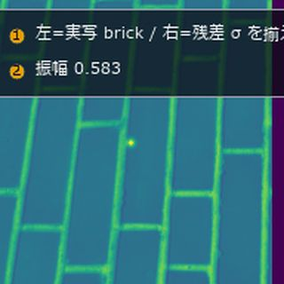<b>&#9654;</b><span>얇은 결함 검출 한계</span></a>
<a href="../../articles/assets/poc/poc_active_contours/06_u_shape_snakes.mp4">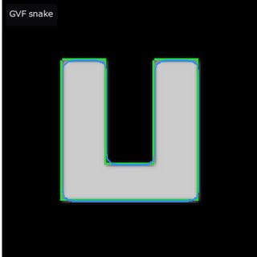<b>&#9654;</b><span>능동 윤곽</span></a>
<a href="../../articles/assets/poc/poc_dic_strain/05_tensile_ramp.mp4">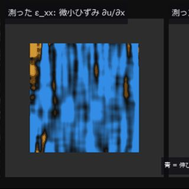<b>&#9654;</b><span>DIC 변형률</span></a>
<a href="../../articles/assets/poc/poc_focus_stacking/05_focus_sweep.mp4">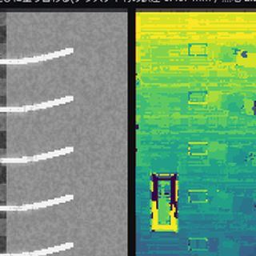<b>&#9654;</b><span>초점 합성</span></a>
<a href="../../articles/assets/poc/poc_registration_basin/05_icp_basin_iterations.mp4">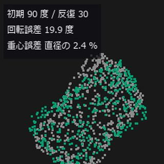<b>&#9654;</b><span>점군 정합</span></a>
<a href="../../articles/assets/poc/poc_stockpile_volume/07_scan_orbit.mp4">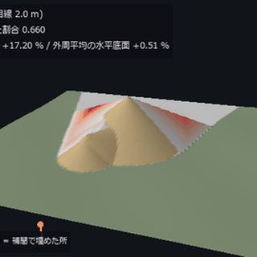<b>&#9654;</b><span>적치물 부피</span></a>
<a href="../../articles/assets/poc/poc_ct_fidelity/01_recon_sweep.png">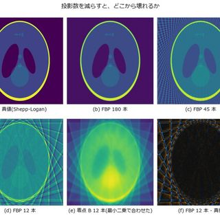<span>CT 재구성</span></a>
<a href="../../articles/assets/poc/poc_ct_void_morphology/13_section_sweep.mp4">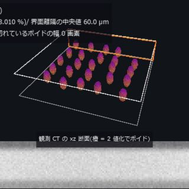<b>&#9654;</b><span>CT 보이드</span></a>
<a href="../../articles/assets/poc/poc_interferometry_step/03_surface_z_scan.mp4">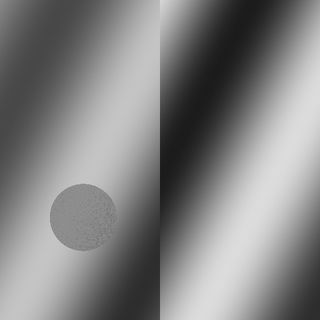<b>&#9654;</b><span>백색광 간섭 단차</span></a>
<a href="../../articles/assets/poc/poc_polarization_specular/01_raw_polarizer_mosaic.png">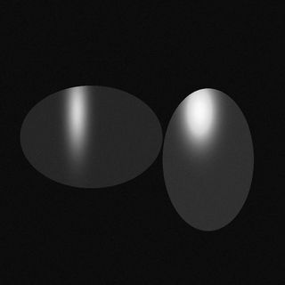<span>편광 정반사 제거</span></a>
<a href="../../articles/assets/poc/poc_photoelasticity/03_load_and_isoclinics.mp4">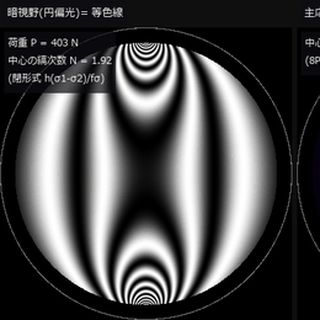<b>&#9654;</b><span>광탄성 응력</span></a>
<a href="../../articles/assets/poc/poc_thermography_ndt/02_depth_map.png">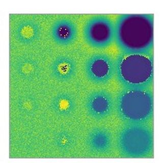<span>열화상 결함 깊이</span></a>
<a href="../../articles/assets/poc/poc_motion_magnification/05_magnify_video.mp4">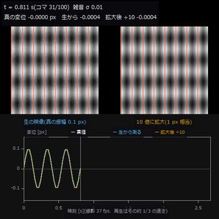<b>&#9654;</b><span>미세 진동 확대</span></a>
<a href="../../articles/assets/poc/poc_table_tennis_bounce/01_drop_test.mp4">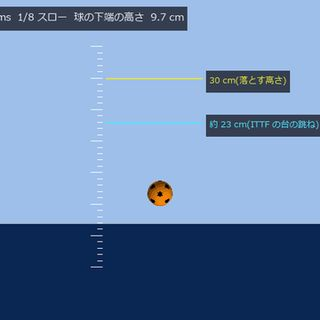<b>&#9654;</b><span>탁구공 바운드</span></a>
<a href="../../articles/assets/poc/poc_compound_eye/02_compound_eye_superposition.png">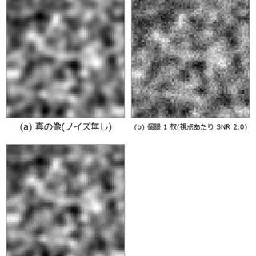<span>겹눈 라이트 필드</span></a>
<a href="../../articles/assets/poc/poc_pegsim_insertion/04_pegsim_insert_corrected.gif">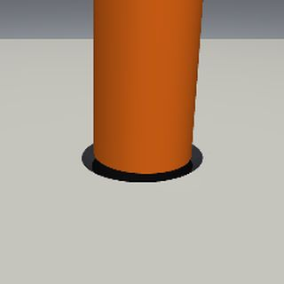<b>&#9654;</b><span>펙 삽입</span></a>
<a href="../../articles/assets/poc/poc_air_hockey_intercept/02_airhockey_prediction_cone_narrows.gif">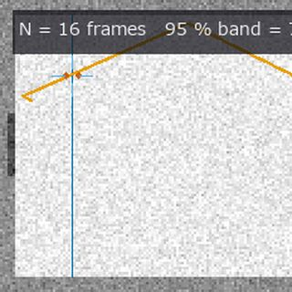<b>&#9654;</b><span>에어하키</span></a>
<a href="../../articles/assets/poc/poc_tacsim_elastic_membrane/03_tacsim_force_sweep.gif">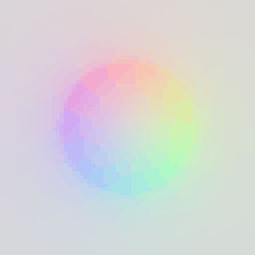<b>&#9654;</b><span>시각 촉각 센서</span></a>
<a href="../../articles/assets/poc/poc_table_tennis_spin/01_side_three_serves.mp4">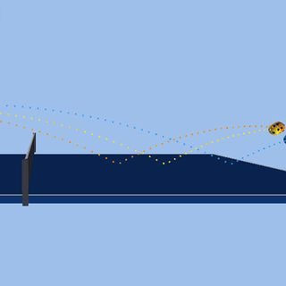<b>&#9654;</b><span>탁구공 회전</span></a>
<a href="../../articles/assets/poc/poc_table_tennis_rally_loop/02_height_misread.mp4">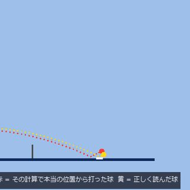<b>&#9654;</b><span>랠리와 판독 오차</span></a>
<a href="../../articles/assets/poc/poc_driving_traffic/01_dashcam_occlusion.mp4">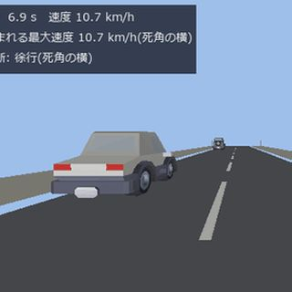<b>&#9654;</b><span>교통과 사각</span></a>
<a href="../../articles/assets/poc/poc_driving_crossing/01_crossing_dashcam.mp4">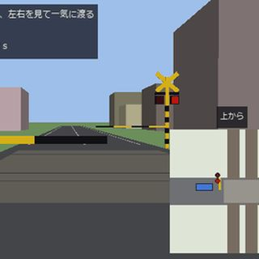<b>&#9654;</b><span>건널목과 교차로</span></a>
<a href="../../articles/assets/poc/poc_driving_pass/03_mirror_tjunction.mp4">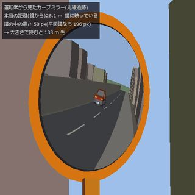<b>&#9654;</b><span>커브 미러</span></a>
<a href="../../articles/assets/poc/poc_ttc_rss/06_approach_gif.gif">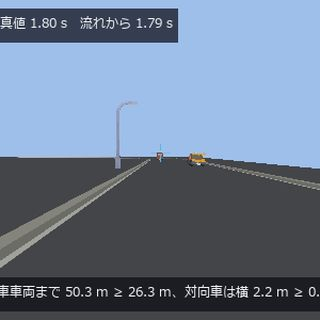<b>&#9654;</b><span>충돌 시간과 RSS</span></a>
<a href="../../articles/assets/poc/poc_eye_to_brain/01_eye_sweep.gif">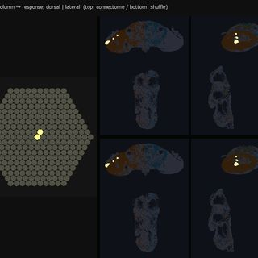<b>&#9654;</b><span>겹눈에서 뇌로</span></a>
<a href="../../articles/assets/poc/poc_malecns_activity_wave/01_activity_wave_connectome_vs_shuffle.gif">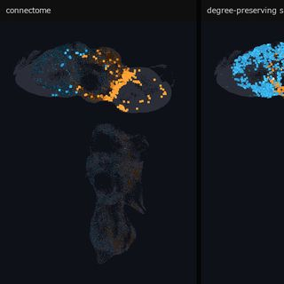<b>&#9654;</b><span>파리 뇌의 파동</span></a>
<a href="../../articles/assets/poc/poc_microns_brain_wave/04_wave_on_wiring.gif">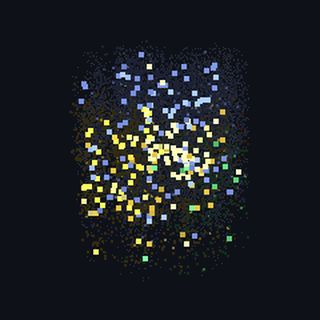<b>&#9654;</b><span>마우스 시각피질 파동</span></a>
<a href="../../articles/assets/media/evis_stereo_fullseye.mp4">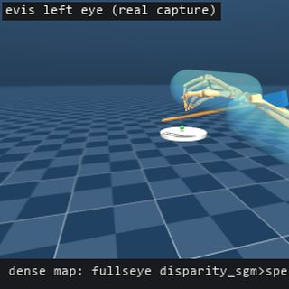<b>&#9654;</b><span>휴머노이드 두 눈</span></a>
<a href="../../articles/assets/media/evis_bean_track_fullseye.mp4">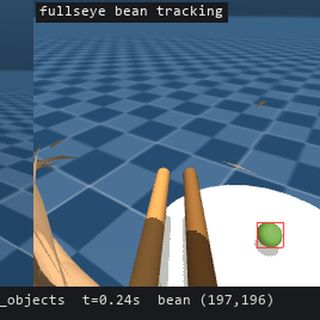<b>&#9654;</b><span>젓가락 끝 카메라 추적</span></a>
</div>

## 시리즈 기사 (Qiita의 영어 기사)

<div class="vser">
<a href="https://qiita.com/furuse-kazufumi/items/8a8f23e53b19ee8cdc10">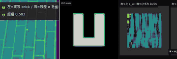<strong>지면의 계측관</strong><span>참값을 직접 심은 PoC 전시관</span></a>
<a href="https://qiita.com/furuse-kazufumi/items/a82bf9f341cc4f04ca75">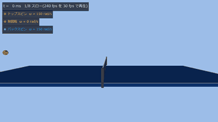<strong>탁구</strong><span>바운드와 마찰을 영상으로 측정</span></a>
<a href="https://qiita.com/furuse-kazufumi/items/05de90f4d316cd7c681c">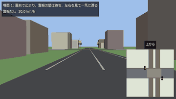<strong>자율주행</strong><span>정리와 두 번째 구현으로 채점</span></a>
<a href="https://qiita.com/furuse-kazufumi/items/638f0b0aa7865e17c67c">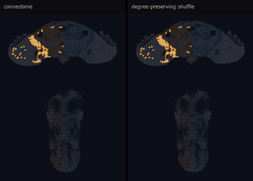<strong>커넥톰(뇌 배선도)</strong><span>파리 시각 모델을 몸에 얹어 측정</span></a>
<a href="https://qiita.com/furuse-kazufumi/items/569720dbae0c6471c96e">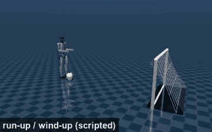<strong>휴머노이드 운동회</strong><span>영상 처리가 심판을 보는 집 운동회</span></a>
</div>

## 할 수 있는 것

95개 항목. 각각 설명 페이지(사용법과 한계)와 실행 가능한 예제로 연결됩니다.

<div class="vl" markdown="1">

**찾기**

- 영역을 잘라내고 골라서 세기: [설명](../../capabilities/blob-and-region.md) _(ja)_ · 예제 [poc_cell_counting](https://github.com/furuse-kazufumi/fullseye/blob/master/examples/poc_cell_counting.py) · [poc_particle_sizing](https://github.com/furuse-kazufumi/fullseye/blob/master/examples/poc_particle_sizing.py) · [poc_real_coin_metrology](https://github.com/furuse-kazufumi/fullseye/blob/master/examples/poc_real_coin_metrology.py) · [poc_dense_bubble_count](https://github.com/furuse-kazufumi/fullseye/blob/master/examples/poc_dense_bubble_count.py)
- 포장의 RGB에서 색과 결로 작물과 잡초를 나누고, 잡초 피도를 미리 선언한 경계로 단계화(학습기 없음): [설명](../../capabilities/crop-weed-cover-grade.md) _(ja)_ · 예제 [poc_weed_rice_ratio](https://github.com/furuse-kazufumi/fullseye/blob/master/examples/poc_weed_rice_ratio.py)
- 두 X선 에너지로 두께와 재질을 가른다(듀얼 에너지 / 광자 계수: 스펙트럼 → 에너지 창 → 기저 분해 → 유효 Z): [설명](../../capabilities/dual-energy-xray-material-discrimination.md) _(ja)_ · 예제 [poc_dual_energy_xray](https://github.com/furuse-kazufumi/fullseye/blob/master/examples/poc_dual_energy_xray.py)
- 이미지 속 글자를 올바른 문자열에 맞춰 고치기: [설명](../../capabilities/fix-text-in-images.md) _(ja)_ · 예제 [fix_text_in_image](https://github.com/furuse-kazufumi/fullseye/blob/master/examples/fix_text_in_image.py) · [poc_glyph_typo_detection](https://github.com/furuse-kazufumi/fullseye/blob/master/examples/poc_glyph_typo_detection.py)
- 양품을 나란히 놓고 '평소와 다름'을 말한다 (양품 통계 변동 모델, 오검출률 선언): [설명](../../capabilities/good-sample-variation-model.md) _(ja)_ · 예제 [poc_good_sample_variation_model](https://github.com/furuse-kazufumi/fullseye/blob/master/examples/poc_good_sample_variation_model.py) · [anomaly_eval_metrics](https://github.com/furuse-kazufumi/fullseye/blob/master/examples/anomaly_eval_metrics.py)
- OCR 전처리(기울기 보정, 국소 이진화, 행 잘라내기): [설명](../../capabilities/ocr-preprocessing.md) _(ja)_ · 예제 [gallery2d_segmentation](https://github.com/furuse-kazufumi/fullseye/blob/master/examples/gallery2d_segmentation.py) · [poc_matrix_code_reading](https://github.com/furuse-kazufumi/fullseye/blob/master/examples/poc_matrix_code_reading.py) · [gallery2d_region](https://github.com/furuse-kazufumi/fullseye/blob/master/examples/gallery2d_region.py)
- 양품만으로 학습해 벗어난 패치를 가리킨다 (고전 특징의 위치별 정규분포와 메모리 뱅크, 재현율을 보장하는 운용점): [설명](../../capabilities/patch-feature-anomaly-detection.md) _(ja)_ · 예제 [poc_patch_anomaly](https://github.com/furuse-kazufumi/fullseye/blob/master/examples/poc_patch_anomaly.py) · [anomaly_eval_metrics](https://github.com/furuse-kazufumi/fullseye/blob/master/examples/anomaly_eval_metrics.py)
- PL 영상에서 가는 홈이 사라지는 이유를 캐리어 확산 PSF와 결함의 종류로 구분(Si 웨이퍼·태양전지의 PL/EL 검사): [설명](../../capabilities/pl-carrier-diffusion-visibility.md) _(ja)_ · 예제 [poc_si_wafer_pl_defect_visibility](https://github.com/furuse-kazufumi/fullseye/blob/master/examples/poc_si_wafer_pl_defect_visibility.py)
- 작은 점 모양 목표를 찾아 서브픽셀로 위치 구하기: [설명](../../capabilities/point-target-detection.md) _(ja)_ · 예제 [poc_search_sweep_width](https://github.com/furuse-kazufumi/fullseye/blob/master/examples/poc_search_sweep_width.py) · [poc_astro_photometry](https://github.com/furuse-kazufumi/fullseye/blob/master/examples/poc_astro_photometry.py)
- 조명 불균일·하이라이트·가림에 강한 템플릿 정합(밝기 변화의 방향을 부호로 비교하고, 위치를 정하지 못하는 템플릿은 거부): [설명](../../capabilities/robust-code-matching.md) _(ja)_ · 예제 [poc_code_matching_breakdown](https://github.com/furuse-kazufumi/fullseye/blob/master/examples/poc_code_matching_breakdown.py)
- 초음파 에코의 밝기가 아니라 위상으로 하이브리드 접합의 보이드를 찾는다(주사 음향 현미경 C-스캔, 주파수 절충, 검출 확률): [설명](../../capabilities/sam-bond-voids.md) _(ja)_ · 예제 [poc_sam_hybrid_bonding_voids](https://github.com/furuse-kazufumi/fullseye/blob/master/examples/poc_sam_hybrid_bonding_voids.py)
- 표면 요철 결함: 조명 설계부터 검출까지: [설명](../../capabilities/surface-defects-with-lighting.md) _(ja)_ · 예제 [illumination_design_demo](https://github.com/furuse-kazufumi/fullseye/blob/master/examples/illumination_design_demo.py) · [photometric_stereo](https://github.com/furuse-kazufumi/fullseye/blob/master/examples_3d/photometric_stereo.py) · [poc_bump_coplanarity](https://github.com/furuse-kazufumi/fullseye/blob/master/examples/poc_bump_coplanarity.py)
- 위치 결정(템플릿 정합으로 측정선을 따라가게 하기): [설명](../../capabilities/template-alignment.md) _(ja)_ · 예제 [poc_template_tracking](https://github.com/furuse-kazufumi/fullseye/blob/master/examples/poc_template_tracking.py) · [gallery2d_contour_measure](https://github.com/furuse-kazufumi/fullseye/blob/master/examples/gallery2d_contour_measure.py) · [poc_search_sweep_width](https://github.com/furuse-kazufumi/fullseye/blob/master/examples/poc_search_sweep_width.py)

**재기**

- 평면 타깃의 다시점에서 내부 행렬 K 추정(Zhang 법): [설명](../../capabilities/camera-intrinsics-calibration.md) _(ja)_ · 예제 [camera_intrinsics_calibration](https://github.com/furuse-kazufumi/fullseye/blob/master/examples/camera_intrinsics_calibration.py)
- 복소평면을 면으로 보기(정의역 색칠·끌개 영역·탈출 시간·날개 주위 흐름): [설명](../../capabilities/complex-plane-fields.md) _(ja)_ · 예제 [poc_complex_plane_fields](https://github.com/furuse-kazufumi/fullseye/blob/master/examples/poc_complex_plane_fields.py)
- 주기 패턴이 표본화 격자에서 접히는 거리와 줄무늬가 어지럽히는 충돌 시간을 닫힌 형식으로 측정(겹눈·검사 카메라): [설명](../../capabilities/compound-eye-aliasing-and-ttc.md) _(ja)_ · 예제 [poc_zebra_stripes_fly_eye](https://github.com/furuse-kazufumi/fullseye/blob/master/examples/poc_zebra_stripes_fly_eye.py)
- 카메라 데이터시트의 수치를 EMVA 1288 절차로 다시 재고, 카메라 내부 전처리가 그 수치를 얼마나 움직이는지 본다(Linear와 General): [설명](../../capabilities/emva1288-camera-datasheets.md) _(ja)_ · 예제 [poc_emva1288_sensor](https://github.com/furuse-kazufumi/fullseye/blob/master/examples/poc_emva1288_sensor.py) · [poc_emva1288_in_camera_processing](https://github.com/furuse-kazufumi/fullseye/blob/master/examples/poc_emva1288_in_camera_processing.py)
- 원래 곧은 선에서 왜곡 계수 추정(plumb-line, 체커보드 불필요): [설명](../../capabilities/estimate-lens-distortion.md) _(ja)_ · 예제 [estimate_lens_distortion](https://github.com/furuse-kazufumi/fullseye/blob/master/examples/estimate_lens_distortion.py)
- 지구 규모 좌표에 올리기(ECEF·높이 기준·국소 ENU): [설명](../../capabilities/geodetic-frames.md) _(ja)_ · 예제 [poc_geodetic_height_frames](https://github.com/furuse-kazufumi/fullseye/blob/master/examples/poc_geodetic_height_frames.py) · [poc_geodetic_benchmarks_real](https://github.com/furuse-kazufumi/fullseye/blob/master/examples/poc_geodetic_benchmarks_real.py) · [dem_geodesy_tour](https://github.com/furuse-kazufumi/fullseye/blob/master/examples/dem_geodesy_tour.py)
- 격자 간섭계(탤벗 / 탤벗-라우): 한 번의 위상 스텝 스캔에서 투과·미분 위상·암시야 3장의 상을 분리: [설명](../../capabilities/grating-interferometry.md) _(ja)_ · 예제 [poc_grating_interferometry](https://github.com/furuse-kazufumi/fullseye/blob/master/examples/poc_grating_interferometry.py)
- 공업용 OCT(간섭 스펙트럼 → k 선형화 → 분산 보상 → A / B 스캔 → 군굴절률로 층 두께): [설명](../../capabilities/industrial-oct.md) _(ja)_ · 예제 [poc_industrial_oct](https://github.com/furuse-kazufumi/fullseye/blob/master/examples/poc_industrial_oct.py)
- 원형 부품의 내경을 mm 까지 재기: [설명](../../capabilities/inner-diameter-in-mm.md) _(ja)_ · 예제 [example_inner_diameter_mm](https://github.com/furuse-kazufumi/fullseye/blob/master/examples/example_inner_diameter_mm.py) · [poc_dimensional_inspection](https://github.com/furuse-kazufumi/fullseye/blob/master/examples/poc_dimensional_inspection.py) · [poc_real_coin_metrology](https://github.com/furuse-kazufumi/fullseye/blob/master/examples/poc_real_coin_metrology.py)
- 간접 ToF(위상 방식)의 다주파 언랩과 깨지는 방식(접힘, 다중 경로, 가장자리 혼합, 고조파, 배경광): [설명](../../capabilities/itof-multifreq.md) _(ja)_ · 예제 [poc_itof_multifreq](https://github.com/furuse-kazufumi/fullseye/blob/master/examples/poc_itof_multifreq.py)
- 레이저 광절단의 오차 하한은 스페클이 정한다(결맞음 결상, 스페클 통계, 삼각측량의 불확도): [설명](../../capabilities/laser-speckle-floor.md) _(ja)_ · 예제 [poc_laser_line_speckle_floor](https://github.com/furuse-kazufumi/fullseye/blob/master/examples/poc_laser_line_speckle_floor.py)
- 오목한 부품의 상호 반사가 줄무늬 투영과 ToF를 얼마나 어긋나게 하는지 측정 전에 예측한다(전역 광 수송, 직접·전역 분리, 마이크로 위상 이동): [설명](../../capabilities/light-transport.md) _(ja)_ · 예제 [poc_interreflection_fringe_error](https://github.com/furuse-kazufumi/fullseye/blob/master/examples/poc_interreflection_fringe_error.py)
- 화소별 록인 복조(시간 상관 이미징: 진폭·위상·직류, 링 조명 법선, 부호화 조명 분리, 열파): [설명](../../capabilities/lockin-demodulation.md) _(ja)_ · 예제 [poc_lockin_imaging](https://github.com/furuse-kazufumi/fullseye/blob/master/examples/poc_lockin_imaging.py)
- 그 숫자 중 얼마가 측정 방식 때문인가(게이지 R&R과 측정 불확도): [설명](../../capabilities/measurement-system-and-uncertainty.md) _(ja)_ · 예제 [poc_measurement_system_analysis](https://github.com/furuse-kazufumi/fullseye/blob/master/examples/poc_measurement_system_analysis.py)
- 모아레 정렬(피치가 조금 다른 격자 두 장 → 줄무늬 위상 → nm 변위, 차동과 Talbot 갭): [설명](../../capabilities/moire-alignment.md) _(ja)_ · 예제 [poc_moire_alignment](https://github.com/furuse-kazufumi/fullseye/blob/master/examples/poc_moire_alignment.py)
- 줄무늬의 거울상으로 광택면의 µm 오목을 잰다(위상 측정 디플렉토메트리: 줄무늬 → 위상 → 기울기 → 곡률): [설명](../../capabilities/phase-measuring-deflectometry.md) _(ja)_ · 예제 [poc_phase_measuring_deflectometry](https://github.com/furuse-kazufumi/fullseye/blob/master/examples/poc_phase_measuring_deflectometry.py)
- 3차원 점군에서 평면도 구하기: [설명](../../capabilities/planarity-from-point-cloud.md) _(ja)_ · 예제 [geometry_metrology](https://github.com/furuse-kazufumi/fullseye/blob/master/examples_3d/geometry_metrology.py) · [poc_bump_coplanarity](https://github.com/furuse-kazufumi/fullseye/blob/master/examples/poc_bump_coplanarity.py) · [poc_scan_to_bim_asbuilt](https://github.com/furuse-kazufumi/fullseye/blob/master/examples/poc_scan_to_bim_asbuilt.py)
- 어떤 크기라면 발견되는가(검출 확률 POD와 a90/95, MIL-HDBK-1823A): [설명](../../capabilities/probability-of-detection.md) _(ja)_ · 예제 [poc_pod_lighting](https://github.com/furuse-kazufumi/fullseye/blob/master/examples/poc_pod_lighting.py)
- 흠집과 돌기에 끌려가지 않는 평균선(로버스트 가우스 회귀·스플라인 필터, 단면과 면): [설명](../../capabilities/robust-gaussian-spline-profile-filter.md) _(ja)_ · 예제 [poc_robust_profile_filter](https://github.com/furuse-kazufumi/fullseye/blob/master/examples/poc_robust_profile_filter.py) · [example_robust_profile_filter](https://github.com/furuse-kazufumi/fullseye/blob/master/examples/example_robust_profile_filter.py)
- 미세한 스크래치를 찾아 폭 재기: [설명](../../capabilities/scratch-detection-and-width.md) _(ja)_ · 예제 [example_scratch_width](https://github.com/furuse-kazufumi/fullseye/blob/master/examples/example_scratch_width.py) · [poc_crack_width](https://github.com/furuse-kazufumi/fullseye/blob/master/examples/poc_crack_width.py) · [poc_solar_el_inspection](https://github.com/furuse-kazufumi/fullseye/blob/master/examples/poc_solar_el_inspection.py)
- SEM의 밝은 가장자리가 치수를 얼마나 부풀리는지 참값과 함께 측정: [설명](../../capabilities/sem-edge-effect-metrology.md) _(ja)_ · 예제 [poc_sem_wafer_defect_edge_bias](https://github.com/furuse-kazufumi/fullseye/blob/master/examples/poc_sem_wafer_defect_edge_bias.py)
- 같은 입자를 주사 영상과 투과 영상으로 측정해 두 치수 편향을 비교: [설명](../../capabilities/sem-tem-same-particle.md) _(ja)_ · 예제 [poc_sem_tem_same_particle](https://github.com/furuse-kazufumi/fullseye/blob/master/examples/poc_sem_tem_same_particle.py)
- 순차 광학 설계의 지표(이상 렌즈면, 포위 에너지, 자오와 구결 MTF, 스루포커스 MTF): [설명](../../capabilities/sequential-lens-design-metrics.md) _(ja)_ · 예제 [optical_design_metrics](https://github.com/furuse-kazufumi/fullseye/blob/master/examples/optical_design_metrics.py) · [poc_zoom_configurations](https://github.com/furuse-kazufumi/fullseye/blob/master/examples/poc_zoom_configurations.py) · [poc_lens_global_search](https://github.com/furuse-kazufumi/fullseye/blob/master/examples/poc_lens_global_search.py) · [poc_lens_merit_operands](https://github.com/furuse-kazufumi/fullseye/blob/master/examples/poc_lens_merit_operands.py) · [poc_lens_solves_afocal](https://github.com/furuse-kazufumi/fullseye/blob/master/examples/poc_lens_solves_afocal.py)
- 편광으로 흑색 광택 부품과 유리의 형상을 잰다(편광 기반 형상 복원, 모호성 집합, 굴절률 추정): [설명](../../capabilities/shape-from-polarization.md) _(ja)_ · 예제 [poc_shape_from_polarization](https://github.com/furuse-kazufumi/fullseye/blob/master/examples/poc_shape_from_polarization.py)
- 실물 영상으로 물리 모형의 계수를 맞춘다(sim-to-real 보정) —— 영상이 정하지 못하는 계수에는 수를 내지 않고, 정해지는 조합과 이유를 돌려준다: [설명](../../capabilities/sim-to-real-calibration.md) _(ja)_ · 예제 [simcal_tour](https://github.com/furuse-kazufumi/fullseye/blob/master/examples/simcal_tour.py) · [simcal_checks_tour](https://github.com/furuse-kazufumi/fullseye/blob/master/examples/simcal_checks_tour.py)
- 이미지에서 치수를 서브픽셀로 측정: [설명](../../capabilities/subpixel-2d-metrology.md) _(ja)_ · 예제 [poc_dimensional_inspection](https://github.com/furuse-kazufumi/fullseye/blob/master/examples/poc_dimensional_inspection.py) · [poc_screw_thread_metrology](https://github.com/furuse-kazufumi/fullseye/blob/master/examples/poc_screw_thread_metrology.py) · [poc_calipers_under_illusion](https://github.com/furuse-kazufumi/fullseye/blob/master/examples/poc_calipers_under_illusion.py)
- 텔레센트릭 렌즈와 치수 측정(주광선 기울기 → 높이에 따른 배율 → 비네팅과 흐림): [설명](../../capabilities/telecentric-metrology.md) _(ja)_ · 예제 [poc_telecentric_metrology](https://github.com/furuse-kazufumi/fullseye/blob/master/examples/poc_telecentric_metrology.py)
- 가상 투과전자현미경(전자 파장 → CTF → 위상 콘트라스트 상 → Thon 링으로 디포커스 추정 → 보정): [설명](../../capabilities/tem-phase-contrast-and-ctf.md) _(ja)_ · 예제 [poc_tem_ctf_thon_rings](https://github.com/furuse-kazufumi/fullseye/blob/master/examples/poc_tem_ctf_thon_rings.py)
- 지형의 경사·물 흐름·가시선 측정: [설명](../../capabilities/terrain-and-visibility.md) _(ja)_ · 예제 [poc_dem_terrain](https://github.com/furuse-kazufumi/fullseye/blob/master/examples/poc_dem_terrain.py) · [dem_terrain_analysis_tour](https://github.com/furuse-kazufumi/fullseye/blob/master/examples/dem_terrain_analysis_tour.py)
- 하나의 3차원 장면을 간접 및 직접 비행시간으로 측정: [설명](../../capabilities/tof-camera.md) _(ja)_ · 예제 [poc_tof_camera](https://github.com/furuse-kazufumi/fullseye/blob/master/examples/poc_tof_camera.py)
- 가상 SEM —— 전자와 고체의 상호작용을 몬테카를로로 풀고, 실측값으로 채점하면서 가속 전압·검출기·대전이 영상과 측정 선폭을 어떻게 바꾸는지 본다: [설명](../../capabilities/virtual-sem-monte-carlo.md) _(ja)_ · 예제 [poc_virtual_sem_kv_cd_bse](https://github.com/furuse-kazufumi/fullseye/blob/master/examples/poc_virtual_sem_kv_cd_bse.py)
- 3-D 스캔에서 부피·토량 구하기: [설명](../../capabilities/volume-from-3d-scan.md) _(ja)_ · 예제 [poc_stockpile_volume](https://github.com/furuse-kazufumi/fullseye/blob/master/examples/poc_stockpile_volume.py) · [poc_lidar_terrain_change](https://github.com/furuse-kazufumi/fullseye/blob/master/examples/poc_lidar_terrain_change.py)
- 그림으로는 확인할 수 없는 것(적분기 차수·리아푸노프 지수·분기·상관 차원·극소 곡면): [설명](../../capabilities/what-a-picture-cannot-check.md) _(ja)_ · 예제 [poc_what_a_picture_cannot_check](https://github.com/furuse-kazufumi/fullseye/blob/master/examples/poc_what_a_picture_cannot_check.py)

**빛과 색**

- 크로매틱 공초점 변위 센서(유리의 분산 → 보정표 → 귀환 스펙트럼 → 높이와 두께): [설명](../../capabilities/chromatic-confocal-sensor.md) _(ja)_ · 예제 [poc_chromatic_confocal](https://github.com/furuse-kazufumi/fullseye/blob/master/examples/poc_chromatic_confocal.py)
- 색 측정(XYZ / Lab / 색차): [설명](../../capabilities/colour-and-delta-e.md) _(ja)_ · 예제 [poc_white_balance](https://github.com/furuse-kazufumi/fullseye/blob/master/examples/poc_white_balance.py) · [poc_pigment_unmixing](https://github.com/furuse-kazufumi/fullseye/blob/master/examples/poc_pigment_unmixing.py)
- 다중 반사, 다중 산란, 반복을 수렴할 때까지 돌린다 —— 수렴의 증거와 남은 오차를 돌려주고, 수렴하지 않으면 값을 내지 않는다: [설명](../../capabilities/convergent-forward-models.md) _(ja)_ · 예제 [converge_tour](https://github.com/furuse-kazufumi/fullseye/blob/master/examples/converge_tour.py)
- 광파이버와 라이트 가이드(유리의 분산 → LP 모드 → 모드 필드 직경 → 조명 효율): [설명](../../capabilities/fiber-and-light-guide.md) _(ja)_ · 예제 [poc_fiber_light_guide](https://github.com/furuse-kazufumi/fullseye/blob/master/examples/poc_fiber_light_guide.py)
- 회절격자 분광기와 현미경 조명(대역폭, smile/keystone, 쾰러/임계 조명, 동축 하프 미러): [설명](../../capabilities/grating-spectrometer-and-illumination.md) _(ja)_ · 예제 [poc_spectrometer_illumination](https://github.com/furuse-kazufumi/fullseye/blob/master/examples/poc_spectrometer_illumination.py)
- 조명 원뿔과 관찰 NA로 경면의 작은 기울기를 드러내거나 감추기(구면 캡의 교집합 → 기울기 대역 → 찍힘·흠집·새틴 얼룩): [설명](../../capabilities/illumination-cone-vs-na.md) _(ja)_ · 예제 [poc_illumination_cone_vs_na](https://github.com/furuse-kazufumi/fullseye/blob/master/examples/poc_illumination_cone_vs_na.py)
- 측광 참값을 지킨 채 오목한 부품의 상호 반사를 수렴까지 센다(3-D 형태 계수·점진적 radiosity·다중 반사 검사용 렌더링): [설명](../../capabilities/interreflection-to-convergence.md) _(ja)_ · 예제 [poc_pocket_interreflection](https://github.com/furuse-kazufumi/fullseye/blob/master/examples/poc_pocket_interreflection.py)
- 광학 설계 파일(.zmx 순차 처방의 읽기·쓰기, 키워드 목록, fail-closed 가져오기): [설명](../../capabilities/lens-prescription-files.md) _(ja)_ · 예제 [poc_lens_file_roundtrip](https://github.com/furuse-kazufumi/fullseye/blob/master/examples/poc_lens_file_roundtrip.py)
- 재료의 광학 물성을 하나의 표로 조회(유리·결정·반도체·금속·액체·플라스틱 86종, 1차 문헌의 계수와 수표, 유리 카탈로그 가져오기): [설명](../../capabilities/material-optical-property-library.md) _(ja)_ · 예제 [poc_material_optical_library](https://github.com/furuse-kazufumi/fullseye/blob/master/examples/poc_material_optical_library.py)
- 근적외 초분광으로 겉보기가 같은 이물을 선별(재료표의 흡수대, 산란층의 반사, InGaAs 대역별 전자 수): [설명](../../capabilities/nir-hyperspectral-sorting.md) _(ja)_ · 예제 [poc_hyperspectral_foreign_matter](https://github.com/furuse-kazufumi/fullseye/blob/master/examples/poc_hyperspectral_foreign_matter.py)
- 비공축 광학계(접힘 거울·빔스플리터·기울어진 평판·샤임플루크·고스트): [설명](../../capabilities/noncoaxial-optics.md) _(ja)_ · 예제 [poc_noncoaxial_optics](https://github.com/furuse-kazufumi/fullseye/blob/master/examples/poc_noncoaxial_optics.py)
- 빛의 반사·굴절·간섭 계산: [설명](../../capabilities/optics-and-materials.md) _(ja)_ · 예제 [glass_and_mirror_optics](https://github.com/furuse-kazufumi/fullseye/blob/master/examples/glass_and_mirror_optics.py) · [appearance_structural_colour](https://github.com/furuse-kazufumi/fullseye/blob/master/examples/appearance_structural_colour.py)
- 픽셀 시프트 촬상(1 화소 시프트로 전색, 반 화소 시프트로 에일리어싱 제거, 깨지는 조건까지): [설명](../../capabilities/pixel-shift-imaging.md) _(ja)_ · 예제 [poc_pixel_shift](https://github.com/furuse-kazufumi/fullseye/blob/master/examples/poc_pixel_shift.py)
- 편광 4 방향으로 정반사 제거(유전체와 금속을 구분): [설명](../../capabilities/polarisation-specular-removal.md) _(ja)_ · 예제 [example_polarization_metal](https://github.com/furuse-kazufumi/fullseye/blob/master/examples/example_polarization_metal.py) · [poc_polarization_specular](https://github.com/furuse-kazufumi/fullseye/blob/master/examples/poc_polarization_specular.py) · [specular_photometric](https://github.com/furuse-kazufumi/fullseye/blob/master/examples/specular_photometric.py)
- 편광 카메라의 원시 프레임을 Stokes·DoLP·Mueller로 읽기: [설명](../../capabilities/polarization-imaging.md) _(ja)_ · 예제 [polarization_camera_pipeline](https://github.com/furuse-kazufumi/fullseye/blob/master/examples/polarization_camera_pipeline.py) · [poc_polarization_specular](https://github.com/furuse-kazufumi/fullseye/blob/master/examples/poc_polarization_specular.py)
- Bayer 원시 프레임을 단계마다 설명 가능한 식으로 표시 이미지로: [설명](../../capabilities/raw-to-display-isp.md) _(ja)_ · 예제 [raw_to_display_isp](https://github.com/furuse-kazufumi/fullseye/blob/master/examples/raw_to_display_isp.py)
- 광원 × 대상 × 센서의 분광 사슬(플랑크・CIE A・LED・필터・Si의 QE): [설명](../../capabilities/spectral-radiometry-chain.md) _(ja)_ · 예제 [poc_nir_silicon_transmission](https://github.com/furuse-kazufumi/fullseye/blob/master/examples/poc_nir_silicon_transmission.py)
- TDI 라인 스캔과 라인 스캔용 렌즈(단수와 SNR, 동기 오차의 MTF, 상고별 조도와 MTF): [설명](../../capabilities/tdi-linescan-and-lens.md) _(ja)_ · 예제 [poc_tdi_linescan](https://github.com/furuse-kazufumi/fullseye/blob/master/examples/poc_tdi_linescan.py)
- 분광 반사율로 박막 두께 측정(전달 행렬 → 간섭색 → FFT와 모델 맞춤 → 두께 지도): [설명](../../capabilities/thin-film-reflectometry.md) _(ja)_ · 예제 [poc_thin_film_reflectometry](https://github.com/furuse-kazufumi/fullseye/blob/master/examples/poc_thin_film_reflectometry.py)
- 물이 검사 이미지에 어떻게 보이는가(수영장 바닥의 코스틱, 병의 측면 이미지와 액면, 젖은 표면, 수중의 선체): [설명](../../capabilities/water-inspection-images.md) _(ja)_ · 예제 [poc_water_inspection_images](https://github.com/furuse-kazufumi/fullseye/blob/master/examples/poc_water_inspection_images.py)
- 물과 투명 매질(바다 파도, 수면의 프레넬과 굴절, 수중의 색과 산란, 병의 렌즈 작용): [설명](../../capabilities/water-transparent-media.md) _(ja)_ · 예제 [poc_water_transparent_media](https://github.com/furuse-kazufumi/fullseye/blob/master/examples/poc_water_transparent_media.py)

**파동과 신호**

- 배열로 방향을 재고 거리와 속도를 분리: [설명](../../capabilities/beamforming-and-range-doppler.md) _(ja)_ · 예제 [poc_multibeam_bathymetry](https://github.com/furuse-kazufumi/fullseye/blob/master/examples/poc_multibeam_bathymetry.py) · [poc_bev_sensor_fusion](https://github.com/furuse-kazufumi/fullseye/blob/master/examples/poc_bev_sensor_fusion.py)
- 맥놀이는 하나(막의 모드·간섭무늬·회절 차수·인쇄 무아레·잉크로 옮기기): [설명](../../capabilities/beats-fringes-and-screens.md) _(ja)_ · 예제 [poc_beats_fringes_and_screens](https://github.com/furuse-kazufumi/fullseye/blob/master/examples/poc_beats_fringes_and_screens.py)
- 간섭계의 공진기·양자잡음 예산·색잡음 속의 기지 파형을 닫힌 형식으로 설계(중력파 망원경의 식을 검사 간섭계·진동계·AE에): [설명](../../capabilities/gw-interferometer-quantum-noise-and-matched-filter.md) _(ja)_ · 예제 [poc_gw_detector_pseudo_simulation](https://github.com/furuse-kazufumi/fullseye/blob/master/examples/poc_gw_detector_pseudo_simulation.py)
- 1차원 신호의 주기 결함 찾기: [설명](../../capabilities/periodic-defects-in-1d-signals.md) _(ja)_ · 예제 [poc_web_roll_periodicity](https://github.com/furuse-kazufumi/fullseye/blob/master/examples/poc_web_roll_periodicity.py) · [poc_rail_corrugation](https://github.com/furuse-kazufumi/fullseye/blob/master/examples/poc_rail_corrugation.py) · [poc_bearing_diagnosis](https://github.com/furuse-kazufumi/fullseye/blob/master/examples/poc_bearing_diagnosis.py)
- 진동과 소리로 이상 진단: [설명](../../capabilities/vibration-and-acoustics.md) _(ja)_ · 예제 [poc_bearing_diagnosis](https://github.com/furuse-kazufumi/fullseye/blob/master/examples/poc_bearing_diagnosis.py) · [poc_rail_corrugation](https://github.com/furuse-kazufumi/fullseye/blob/master/examples/poc_rail_corrugation.py)

**재구성·보정**

- 이미지 전체의 렌즈 왜곡 보정(배럴·핀쿠션·접선): [설명](../../capabilities/lens-distortion-correction.md) _(ja)_ · 예제 [lens_undistort](https://github.com/furuse-kazufumi/fullseye/blob/master/examples/lens_undistort.py)
- 투영에서 단면 재구성(CT): [설명](../../capabilities/tomography-reconstruction.md) _(ja)_ · 예제 [poc_ct_fidelity](https://github.com/furuse-kazufumi/fullseye/blob/master/examples/poc_ct_fidelity.py) · [poc_ct_void_morphology](https://github.com/furuse-kazufumi/fullseye/blob/master/examples/poc_ct_void_morphology.py)
- 실루엣에서 입체 깎아내기(시각 헐): [설명](../../capabilities/visual-hull-from-silhouettes.md) _(ja)_ · 예제 [space_carving](https://github.com/furuse-kazufumi/fullseye/blob/master/examples_3d/space_carving.py) · [poc_livestock_body_volume](https://github.com/furuse-kazufumi/fullseye/blob/master/examples/poc_livestock_body_volume.py)

**워크플로 구성**

- 위치를 맞춰 겹치기: [설명](../../capabilities/align-and-stack.md) _(ja)_ · 예제 [poc_astro_photometry](https://github.com/furuse-kazufumi/fullseye/blob/master/examples/poc_astro_photometry.py) · [poc_registration_basin](https://github.com/furuse-kazufumi/fullseye/blob/master/examples/poc_registration_basin.py)
- 기준 이미지(골든)와 비교해 결함을 재고 로트 단위로 판정: [설명](../../capabilities/golden-compare.md) _(ja)_ · 예제 [golden_compare](https://github.com/furuse-kazufumi/fullseye/blob/master/examples/golden_compare.py)
- 알려진 양품/불량품 세트로 배치 전에 검사 레시피와 사양을 검정하고 여유를 측정: [설명](../../capabilities/inspection-fixture.md) _(ja)_ · 예제 [inspection_fixture](https://github.com/furuse-kazufumi/fullseye/blob/master/examples/inspection_fixture.py)
- 폴더를 한 번에 검사(일괄·사양 판정·집계·SPC·보고서·감사 로그): [설명](../../capabilities/inspection-workflow.md) _(ja)_ · 예제 [inspection_workflow](https://github.com/furuse-kazufumi/fullseye/blob/master/examples/inspection_workflow.py)
- MTF와 수율로 렌즈 제조 공차 배분: [설명](../../capabilities/lens-tolerancing.md) _(ja)_ · 예제 [poc_lens_tolerancing](https://github.com/furuse-kazufumi/fullseye/blob/master/examples/poc_lens_tolerancing.py)
- 같은 입력의 검증·이웃 탐색·변환 커널을 한 번만 계산: [설명](../../capabilities/reuse-computation-results.md) _(ja)_ · 예제 [perf_pointcloud_descriptors](https://github.com/furuse-kazufumi/fullseye/blob/master/examples/perf_pointcloud_descriptors.py) · [perf_monogenic_metrics](https://github.com/furuse-kazufumi/fullseye/blob/master/examples/perf_monogenic_metrics.py) · [perf_prepared_volume_probe](https://github.com/furuse-kazufumi/fullseye/blob/master/examples/perf_prepared_volume_probe.py) · [perf_polarization_analyze](https://github.com/furuse-kazufumi/fullseye/blob/master/examples/perf_polarization_analyze.py) · [perf_hankel_plan_and_piv_stream](https://github.com/furuse-kazufumi/fullseye/blob/master/examples/perf_hankel_plan_and_piv_stream.py)
- op 반환값(타입 포함)을 JSON으로 쓰고 비트 그대로 되읽기: [설명](../../capabilities/typed-results-as-json.md) _(ja)_ · 예제 [typed_results_json](https://github.com/furuse-kazufumi/fullseye/blob/master/examples/typed_results_json.py)
- op 반환값(타입 포함)을 읽기 쉬운 Markdown으로, JSON을 넣어 되읽기: [설명](../../capabilities/typed-results-as-markdown.md) _(ja)_ · 예제 [typed_results_markdown](https://github.com/furuse-kazufumi/fullseye/blob/master/examples/typed_results_markdown.py)
- 타입이 있는 검사 결과를 Excel(.xlsx) 보고서로: [설명](../../capabilities/xlsx-report.md) _(ja)_ · 예제 [xlsx_report](https://github.com/furuse-kazufumi/fullseye/blob/master/examples/xlsx_report.py)

**보여주기**

- 결과를 사람이 읽을 수 있는 그림으로: [설명](../../capabilities/figures-and-annotation.md) _(ja)_ · 예제 [poc_colormap_readability](https://github.com/furuse-kazufumi/fullseye/blob/master/examples/poc_colormap_readability.py) · [poc_dem_terrain](https://github.com/furuse-kazufumi/fullseye/blob/master/examples/poc_dem_terrain.py)
- 결과를 직접 만져 볼 수 있는 한 장짜리 HTML로 만들기(탭·배지·3-D·동영상·다국어): [설명](../../capabilities/interactive-poc-viewer.md) _(ja)_ · 예제 [interactive_poc_viewer](https://github.com/furuse-kazufumi/fullseye/blob/master/examples/interactive_poc_viewer.py)
- 바탕색을 몰라도 선과 영역 그리기(반전색): [설명](../../capabilities/inverted-colour-overlays.md) _(ja)_ · 예제 [annotate_paper_tour](https://github.com/furuse-kazufumi/fullseye/blob/master/examples/annotate_paper_tour.py)
- 점군을 그대로 컬러 그림으로 그린다(서브픽셀 발자국, 깊이 순 합성, 빛의 총량을 보존하는 덧셈): [설명](../../capabilities/point-cloud-to-picture.md) _(ja)_ · 예제 [points_render_basics](https://github.com/furuse-kazufumi/fullseye/blob/master/examples_3d/points_render_basics.py) · [poc_flybrain_pointcloud](https://github.com/furuse-kazufumi/fullseye/blob/master/examples/poc_flybrain_pointcloud.py)
- 이미지 위 원하는 곳에 글자와 표 놓기: [설명](../../capabilities/text-and-tables-on-images.md) _(ja)_ · 예제 [annotate_paper_tour](https://github.com/furuse-kazufumi/fullseye/blob/master/examples/annotate_paper_tour.py)

**그리기**

- 사진을 한 줄의 선으로(점묘 → 순회 경로 → 회전하는 원): [설명](../../capabilities/one-stroke-drawing.md) _(ja)_ · 예제 [poc_one_stroke_epicycles](https://github.com/furuse-kazufumi/fullseye/blob/master/examples/poc_one_stroke_epicycles.py)
- 광학계 도면(렌즈 단면도·촬상계 설치도·단렌즈 제작도를 SVG / DXF로): [설명](../../capabilities/optics-drawings.md) _(ja)_ · 예제 [poc_optics_drawings](https://github.com/furuse-kazufumi/fullseye/blob/master/examples/poc_optics_drawings.py)
- 처방 그대로의 렌즈를 통해 3차원 장면을 촬영(피사계 심도, 고양이 눈 보케, 모서리 조도, 색수차, 고스트): [설명](../../capabilities/photograph-through-prescription.md) _(ja)_ · 예제 [poc_photograph_through_prescription](https://github.com/furuse-kazufumi/fullseye/blob/master/examples/poc_photograph_through_prescription.py)
- 눈을 속이는 그림을 만들어 측정 쪽을 채점(착시·무한 그리기·순환 동영상): [설명](../../capabilities/pictures-that-carry-their-own-truth.md) _(ja)_ · 예제 [poc_illusions_and_perpetual_drawing](https://github.com/furuse-kazufumi/fullseye/blob/master/examples/poc_illusions_and_perpetual_drawing.py)
- 렌즈 처방 기반 라이트필드 카메라: [설명](../../capabilities/plenoptic-camera.md) _(ja)_ · 예제 [poc_plenoptic_camera](https://github.com/furuse-kazufumi/fullseye/blob/master/examples/poc_plenoptic_camera.py)
- 정리가 검사 문이 되는 그림(아폴로니우스·포드·측지 돔·잎차례·IFS·공간 채움 곡선): [설명](../../capabilities/theorems-as-pictures.md) _(ja)_ · 예제 [poc_theorems_as_pictures](https://github.com/furuse-kazufumi/fullseye/blob/master/examples/poc_theorems_as_pictures.py)

</div>

[PoC가 아닌 사용 예 163개 목록](https://github.com/furuse-kazufumi/fullseye/blob/master/examples/README.md)

## 전부 보기

PoC 276개와 로봇 예 5개. 그룹을 펼치면 썸네일이 나옵니다.

<noscript><p><a href="../../GALLERY.en.html">(JavaScript가 없으면 갤러리 페이지에서 모든 그림을 볼 수 있습니다.)</a></p></noscript>

<details class="vall"><summary><b>로봇의 눈(Fullseye가 지각 담당)</b> (4)</summary>
<div class="vg vs">
<a href="../../articles/assets/media/evis_stereo_fullseye.mp4"><b>&#9654;</b><span>휴머노이드 두 눈</span></a>
<a href="../../articles/assets/media/evis_bean_track_fullseye.mp4"><b>&#9654;</b><span>젓가락 끝 카메라 추적</span></a>
<a href="../../view2026/media/evis_fullseye_walk.gif"><b>&#9654;</b><span>보행을 RGB·깊이·DVS로</span></a>
<a href="../../view2026/media/vision_adaptive_walk.png"><span>단차를 보고 보행 선택</span></a>
</div>
</details>

<details class="vall"><summary><b>로봇의 몸(학습된 정책을 Fullseye에서 실행)</b> (1)</summary>
<div class="vg vs">
<a href="../../view2026/media/g1_run_fullseye.gif"><b>&#9654;</b><span>휴머노이드 G1 달리기</span></a>
</div>
</details>

<details class="vall"><summary><b>산업 검사</b> (45)</summary>
<div class="vg vs">
<a href="../../articles/assets/poc/poc_barcode_1d/01_misread_split.png"><span>1차원 바코드</span></a>
<a href="../../articles/assets/poc/poc_battery_electrode_tortuosity/01_scene.png"><span>전극 굴곡도</span></a>
<a href="../../articles/assets/poc/poc_bearing_diagnosis/01_envelope_vs_raw.png"><span>베어링 이상 진단</span></a>
<a href="../../articles/assets/poc/poc_bump_coplanarity/01_scene.png"><span>범프 공평면성</span></a>
<a href="../../articles/assets/poc/poc_crack_width/01_width_sweep.png"><span>균열 폭</span></a>
<a href="../../articles/assets/poc/poc_fabric_defect/01_auc_by_type.png"><span>직물 결함</span></a>
<a href="../../articles/assets/poc/poc_leak_localization/01_scene.png"><span>소리로 누수 탐지</span></a>
<a href="../../articles/assets/poc/poc_machine_condition_fusion/01_scene_machine.png"><span>설비 보전 융합</span></a>
<a href="../../articles/assets/poc/poc_matrix_code_reading/01_symbol_and_errors.png"><span>매트릭스 코드</span></a>
<a href="../../articles/assets/poc/poc_moire_screen/01_failure_split_plot.png"><span>디스플레이 모아레</span></a>
<a href="../../articles/assets/poc/poc_print_registration/01_plates.png"><span>인쇄 판 어긋남</span></a>
<a href="../../articles/assets/poc/poc_real_defect_floor/02_defect_floor_sweep.gif"><b>&#9654;</b><span>얇은 결함 한계</span></a>
<a href="../../articles/assets/poc/poc_real_texture_invariance/01_textures.png"><span>실사 텍스처 회전</span></a>
<a href="../../articles/assets/poc/poc_recycling_sorting/01_scene.png"><span>폐기물 선별</span></a>
<a href="../../articles/assets/poc/poc_solar_el_inspection/01_zero_point_map.png"><span>태양전지 EL</span></a>
<a href="../../articles/assets/poc/poc_solder_fillet_aoi/01_ring_lut.png"><span>솔더 AOI</span></a>
<a href="../../articles/assets/poc/poc_spc/01_spc_xbar_chart.png"><span>통계적 공정 관리</span></a>
<a href="../../articles/assets/poc/poc_mt_hidden_fault/01_mt_hidden_cloud.png"><span>MT법 이상 탐지</span></a>
<a href="../../articles/assets/poc/poc_text_region_truth/01_text_region_scene.png"><span>문자 영역 검출</span></a>
<a href="../../articles/assets/poc/poc_thermal_drift_metrology/01_separate_drifts.png"><span>카메라 열 드리프트</span></a>
<a href="../../articles/assets/poc/poc_thermal_radiometry/01_floor.png"><span>열화상과 온도</span></a>
<a href="../../articles/assets/poc/poc_thermography_ndt/01_depth_table.png"><span>열화상 결함 깊이</span></a>
<a href="../../articles/assets/poc/poc_veiling_glare/01_verdict.png"><span>미광</span></a>
<a href="../../articles/assets/poc/poc_emva1288_sensor/01_raw_dark_flat_saturation.png"><span>EMVA 1288 측정</span></a>
<a href="../../articles/assets/poc/poc_emva1288_in_camera_processing/01_datasheet_lies.png"><span>카메라 내부 처리가 데이터시트를 속인다</span></a>
<a href="../../articles/assets/poc/poc_web_roll_periodicity/01_scene_web.png"><span>반송 롤 결함</span></a>
<a href="../../articles/assets/poc/poc_weld_bead_profile/01_laser_images.png"><span>용접 비드 단면</span></a>
<a href="../../articles/assets/poc/poc_weld_bead_scan_angle/01_scene.png"><span>용접 비드 주사</span></a>
<a href="../../articles/assets/poc/poc_weld_radiograph_porosity/01_scene_radiograph.png"><span>용접 기공</span></a>
<a href="../../articles/assets/poc/poc_glyph_typo_detection/01_sign_before_after.png"><span>이미지 오자 검출</span></a>
<a href="../../articles/assets/poc/poc_print_layer_inspection/01_slice_stack.png"><span>3D 프린트 층 검사</span></a>
<a href="../../articles/assets/poc/poc_agv_fleet/01_agv_naive_vs_adg.mp4"><b>&#9654;</b><span>AGV 창고</span></a>
<a href="../../articles/assets/poc/poc_am_thermal_to_ct/01_melt_pool_frames.mp4"><b>&#9654;</b><span>적층 제조와 CT</span></a>
<a href="../../articles/assets/poc/poc_sam_hybrid_bonding_voids/03_amplitude_vs_phase.png"><span>에코 위상으로 하이브리드 접합 보이드 찾기</span></a>
<a href="../../articles/assets/poc/poc_si_wafer_pl_defect_visibility/01_pl_groove_vs_diffusion_length.png"><span>PL 영상의 홈과 확산 길이</span></a>
<a href="../../articles/assets/poc/poc_illumination_cone_vs_na/06_hairline_cone_sweep.gif"><b>&#9654;</b><span>조명 원뿔과 관찰 NA</span></a>
<a href="../../articles/assets/poc/poc_tdi_linescan/01_tdi_stages_defects.png"><span>TDI 라인 스캔과 라인 스캔용 렌즈</span></a>
<a href="../../articles/assets/poc/poc_industrial_oct/01_real_paint_bscans.png"><span>공업용 OCT(도장 층 두께와 내부 결함)</span></a>
<a href="../../articles/assets/poc/poc_dense_bubble_count/12_pair_merging.gif"><b>&#9654;</b><span>밀집한 기포 세기(결정할 수 없으면 구간)</span></a>
<a href="../../articles/assets/poc/poc_virtual_sem_kv_cd_bse/05_sem_same_part_3kv_3detectors.png"><span>가상 SEM과 가속 전압</span></a>
<a href="../../articles/assets/poc/poc_grating_interferometry/12_real_three_images.png"><span>격자 간섭계(암시야로 보이는 섬유·균열·기공)</span></a>
<a href="../../articles/assets/poc/poc_dual_energy_xray/04_tray_single_vs_basis.png"><span>고기 속 뼛조각과 유리를 두 에너지로 가른다(듀얼 에너지 X선)</span></a>
<a href="../../articles/assets/poc/poc_code_matching_breakdown/05_highlight_sweep.gif"><b>&#9654;</b><span>조명과 가림에 강한 부호 정합</span></a>
<a href="../../articles/assets/poc/poc_good_sample_variation_model/01_band_width_alignment.png"><span>양품 통계 변동 모델</span></a>
<a href="../../articles/assets/poc/poc_patch_anomaly/01_anomaly_maps.png"><span>양품만으로 학습하는 패치 특징 이상 탐지(고전 특징의 분포와 메모리)</span></a>
</div>
</details>

<details class="vall"><summary><b>치수·형상 계측</b> (55)</summary>
<div class="vg vs">
<a href="../../articles/assets/poc/poc_aoi_ct_traceability/01_inspection_and_reconstructed_ct.png"><span>AOI·CT 대응</span></a>
<a href="../../articles/assets/poc/poc_asbuilt_wall_deviation/01_scene.png"><span>준공 벽면 편차</span></a>
<a href="../../articles/assets/poc/poc_battery_electrode_breathing/01_scene.png"><span>전극 호흡</span></a>
<a href="../../articles/assets/poc/poc_bilateral_asymmetry/01_floor_vs_spacing.png"><span>좌우 비대칭</span></a>
<a href="../../articles/assets/poc/poc_dic_strain/05_tensile_ramp.mp4"><b>&#9654;</b><span>DIC 변형률</span></a>
<a href="../../articles/assets/poc/poc_die_tilt_tsv_overlay/01_scene.png"><span>다이 기울기·TSV</span></a>
<a href="../../articles/assets/poc/poc_dimensional_inspection/01_slot_bias.png"><span>부품 치수 검사</span></a>
<a href="../../articles/assets/poc/poc_fiber_orientation/01_scene.png"><span>섬유 배향</span></a>
<a href="../../articles/assets/poc/poc_gear_tooth_metrology/01_scene.png"><span>기어 치형</span></a>
<a href="../../articles/assets/poc/poc_interferometry_step/03_surface_z_scan.mp4"><b>&#9654;</b><span>백색광 간섭 단차</span></a>
<a href="../../articles/assets/poc/poc_metal_grain_size/01_scene.png"><span>결정 입도</span></a>
<a href="../../articles/assets/poc/poc_multibeam_bathymetry/17_survey.mp4"><b>&#9654;</b><span>다중빔 측심</span></a>
<a href="../../articles/assets/poc/poc_particle_sizing/01_scene.png"><span>입도 분포</span></a>
<a href="../../articles/assets/poc/poc_photoelasticity/03_load_and_isoclinics.mp4"><b>&#9654;</b><span>광탄성 응력</span></a>
<a href="../../articles/assets/poc/poc_rail_corrugation/01_planted_components.png"><span>레일 파상 마모</span></a>
<a href="../../articles/assets/poc/poc_real_coin_metrology/01_scene.png"><span>실사 동전</span></a>
<a href="../../articles/assets/poc/poc_screw_thread_metrology/01_zero_spectrum.png"><span>나사 윤곽</span></a>
<a href="../../articles/assets/poc/poc_stockpile_volume/07_scan_orbit.mp4"><b>&#9654;</b><span>적치물 부피</span></a>
<a href="../../articles/assets/poc/poc_strain_history/05_history_video.mp4"><b>&#9654;</b><span>크리프 변형률</span></a>
<a href="../../articles/assets/poc/poc_surface_roughness/01_surface_components.png"><span>표면 거칠기</span></a>
<a href="../../articles/assets/poc/poc_tacsim_elastic_membrane/03_tacsim_force_sweep.gif"><b>&#9654;</b><span>시각 촉각 센서</span></a>
<a href="../../articles/assets/poc/poc_tacsim_marker_shear/02_tacslip_stick_circle_shrinks.gif"><b>&#9654;</b><span>촉각 전단</span></a>
<a href="../../articles/assets/poc/poc_tactile_dipole_torque/02_tactorque_dipole_grows_with_M.gif"><b>&#9654;</b><span>촉각 쌍극자</span></a>
<a href="../../articles/assets/poc/poc_granular_heap_repose/11_granular_datum_tilt_sweep.gif"><b>&#9654;</b><span>분체 더미</span></a>
<a href="../../articles/assets/poc/poc_food_cutting_measure/01_cutting_track_force.gif"><b>&#9654;</b><span>식재료 절단</span></a>
<a href="../../articles/assets/poc/poc_tacdome_large_deformation/01_tacdome_press_sweep.gif"><b>&#9654;</b><span>돔 손끝 접촉</span></a>
<a href="../../articles/assets/poc/poc_polish_wipe_measure/01_polish_raster_wipe_coat.gif"><b>&#9654;</b><span>연마와 닦기</span></a>
<a href="../../articles/assets/poc/poc_powder_scoop_pour/03_scoop_stream_synthetic_frames.gif"><b>&#9654;</b><span>분체 뜨기·붓기</span></a>
<a href="../../articles/assets/poc/poc_powder_grinding_ae/07_psd_fining_during_grinding.gif"><b>&#9654;</b><span>막자사발 분쇄</span></a>
<a href="../../articles/assets/poc/poc_pxrd_phase_peel/01_phase_peel.gif"><b>&#9654;</b><span>X선 회절 상 분리</span></a>
<a href="../../articles/assets/poc/poc_dose_uniformity_from_grinding/01_cv_bias_decomposition.png"><span>약 용량 균일성</span></a>
<a href="../../articles/assets/poc/poc_knife_tactile_toughness/06_cut_with_fingertip_pads.gif"><b>&#9654;</b><span>손끝으로 칼 잡기</span></a>
<a href="../../articles/assets/poc/poc_measurement_system_analysis/16_breakdown_movie.gif"><b>&#9654;</b><span>게이지 R&R</span></a>
<a href="../../articles/assets/poc/poc_pod_lighting/03_pod_curves.png"><span>조명별 검출 확률</span></a>
<a href="../../articles/assets/poc/poc_laser_line_speckle_floor/01_line.png"><span>광절단의 스페클 하한</span></a>
<a href="../../articles/assets/poc/poc_shape_from_polarization/05_normals.png"><span>편광으로 재는 흑색 광택과 유리</span></a>
<a href="../../articles/assets/poc/poc_phase_measuring_deflectometry/03_photo_vs_pmd.png"><span>사진에 보이지 않는 µm 오목을 줄무늬 거울상으로(디플렉토메트리)</span></a>
<a href="../../articles/assets/poc/poc_interreflection_fringe_error/02_direct_global.png"><span>흰 홈의 상호 반사와 줄무늬 오차</span></a>
<a href="../../articles/assets/poc/poc_zernike_aberrations/06_through_focus.gif"><b>&#9654;</b><span>제르니케 수차</span></a>
<a href="../../articles/assets/poc/poc_attention_identities/01_attention_masks.png"><span>어텐션 항등식</span></a>
<a href="../../articles/assets/poc/poc_residue_crt/03_residue_rotation_needle.gif"><b>&#9654;</b><span>잉여 정리 위상</span></a>
<a href="../../articles/assets/poc/poc_sem_wafer_defect_edge_bias/01_sem_se_bse_bias.png"><span>SEM 가장자리 부풀림</span></a>
<a href="../../articles/assets/poc/poc_chromatic_confocal/04_spectrum_vs_height.gif"><b>&#9654;</b><span>크로매틱 공초점 센서(색으로 높이 읽기)</span></a>
<a href="../../articles/assets/poc/poc_moire_alignment/03_fringe_flow.gif"><b>&#9654;</b><span>모아레 정렬(보이지 않는 격자 두 장으로 1 nm를 읽는다)</span></a>
<a href="../../articles/assets/poc/poc_telecentric_metrology/04_work_up_down.gif"><b>&#9654;</b><span>텔레센트릭 렌즈와 치수 측정</span></a>
<a href="../../articles/assets/poc/poc_itof_multifreq/14_flying_pixels_orbit.gif"><b>&#9654;</b><span>간접 ToF(접힘과 다중 경로)</span></a>
<a href="../../articles/assets/poc/poc_optics_drawings/06_setup_ring_coaxial.png"><span>광학계 도면(단면도·설치도·제작도)</span></a>
<a href="../../articles/assets/poc/poc_pocket_interreflection/02_residuals.png"><span>가공 포켓의 상호 반사를 수렴까지</span></a>
<a href="../../articles/assets/poc/poc_tem_ctf_thon_rings/01_thon_ring_sweep.gif"><b>&#9654;</b><span>가상 투과전자현미경(Thon 링과 디포커스)</span></a>
<a href="../../articles/assets/poc/poc_noncoaxial_optics/05_false_defect.png"><span>비공축 광학계(빔스플리터 고스트·접힘)</span></a>
<a href="../../articles/assets/poc/poc_lockin_imaging/01_ring_amp_phase.png"><span>화소별 록인 복조: 링 조명 법선, 주간화, 열파</span></a>
<a href="../../articles/assets/poc/poc_spectrometer_illumination/03_slit_image_smile.png"><span>분광기와 조명계(대역폭과 광원의 무늬)</span></a>
<a href="../../articles/assets/poc/poc_simcal_telecentric/02_real_model_residuals.png"><span>텔레센트릭 실사 이미지로 촬상 모델 보정</span></a>
<a href="../../articles/assets/poc/poc_robust_profile_filter/04_scratched_surface.png"><span>흠집이 평균선을 얼마나 눌러 내리는가, 로버스트 필터의 붕괴점</span></a>
<a href="../../articles/assets/poc/poc_sem_tem_same_particle/08_tem_focus_sweep.gif"><b>&#9654;</b><span>같은 입자를 주사 영상과 투과 영상으로 측정</span></a>
</div>
</details>

<details class="vall"><summary><b>3-D 형상</b> (18)</summary>
<div class="vg vs">
<a href="../../articles/assets/poc/poc_battery_ct_degradation/01_xray_projection.png"><span>배터리 CT 열화</span></a>
<a href="../../articles/assets/poc/poc_bev_sensor_fusion/01_scene_bev.png"><span>BEV 센서 융합</span></a>
<a href="../../articles/assets/poc/poc_cad_scan_deviation/14_align_orbit.mp4"><b>&#9654;</b><span>CAD·스캔 편차</span></a>
<a href="../../articles/assets/poc/poc_crop_phenotyping/01_capsule_calibration.png"><span>작물 잎 면적</span></a>
<a href="../../articles/assets/poc/poc_ct_void_morphology/13_section_sweep.mp4"><b>&#9654;</b><span>접합층 보이드</span></a>
<a href="../../articles/assets/poc/poc_dfm_thickness_overhang/01_scene.png"><span>제조 용이성</span></a>
<a href="../../articles/assets/poc/poc_lidar_terrain_change/12_flight.gif"><b>&#9654;</b><span>경사면 토량</span></a>
<a href="../../articles/assets/poc/poc_livestock_body_volume/14_hull_orbit.mp4"><b>&#9654;</b><span>가축 체중</span></a>
<a href="../../articles/assets/poc/poc_mesh_quality_repair/14_decimate_orbit.mp4"><b>&#9654;</b><span>메시 복구</span></a>
<a href="../../articles/assets/poc/poc_pallet_load_utilization/01_scene.png"><span>팔레트 적재율</span></a>
<a href="../../articles/assets/poc/poc_pipe_wall_loss/01_scene_pipe.png"><span>배관 감육</span></a>
<a href="../../articles/assets/poc/poc_print_warpage_risk/01_scene.png"><span>적층 휨</span></a>
<a href="../../articles/assets/poc/poc_safety_clearance/01_conditions.png"><span>사람·기계 거리</span></a>
<a href="../../articles/assets/poc/poc_scan_to_bim_asbuilt/01_scene_plan_section.png"><span>설계·실물 차이</span></a>
<a href="../../articles/assets/poc/poc_structure_4d_deterioration/12_years_video.mp4"><b>&#9654;</b><span>구조물 경년 측정</span></a>
<a href="../../articles/assets/poc/poc_symmetry_restoration/01_scene.png"><span>대칭으로 보완</span></a>
<a href="../../articles/assets/poc/poc_endless_zoom_and_turning_solids/03_zoom_loop.gif"><b>&#9654;</b><span>무한 줌</span></a>
<a href="../../articles/assets/poc/poc_four_dimensions_by_three_d_tools/03_hopf_turn.gif"><b>&#9654;</b><span>3-D로 4차원</span></a>
</div>
</details>

<details class="vall"><summary><b>기하·보정</b> (19)</summary>
<div class="vg vs">
<a href="../../articles/assets/poc/poc_simcal_thin_film/08_real_determined_vs_combinations.png"><span>실제 영상으로 박막 모델 보정(정해지는 계수와 정해지지 않는 조합)</span></a>
<a href="../../articles/assets/poc/poc_camera_calibration/05_calibration_convergence.mp4"><b>&#9654;</b><span>카메라 보정</span></a>
<a href="../../articles/assets/poc/poc_panorama_drift/05_chain_drift_video.mp4"><b>&#9654;</b><span>파노라마 드리프트</span></a>
<a href="../../articles/assets/poc/poc_real_stereo_depth/01_scene.png"><span>실사 스테레오</span></a>
<a href="../../articles/assets/poc/poc_registration_basin/05_icp_basin_iterations.mp4"><b>&#9654;</b><span>점군 정합</span></a>
<a href="../../articles/assets/poc/poc_rotation_invariance_audit/02_rotating_coin.gif"><b>&#9654;</b><span>회전 불변 감사</span></a>
<a href="../../articles/assets/poc/poc_carla_bridge/01_carla_two_worlds.png"><span>두 세계 촬영</span></a>
<a href="../../articles/assets/poc/poc_driving_town/04_town_drive_through.gif"><b>&#9654;</b><span>마을 조립</span></a>
<a href="../../articles/assets/poc/poc_driving_japan_town/03_japan_town_drive.gif"><b>&#9654;</b><span>실제 일본 마을</span></a>
<a href="../../articles/assets/poc/poc_driving_commonroad/01_commonroad_scene.png"><span>CommonRoad 채점</span></a>
<a href="../../articles/assets/poc/poc_pegsim_insertion/04_pegsim_insert_corrected.gif"><b>&#9654;</b><span>펙 삽입</span></a>
<a href="../../articles/assets/poc/poc_air_hockey_intercept/02_airhockey_prediction_cone_narrows.gif"><b>&#9654;</b><span>에어하키</span></a>
<a href="../../articles/assets/poc/poc_peg_failure_recovery/05_pegfail_wrist_camera_wedging_detect_recover.gif"><b>&#9654;</b><span>삽입 실패 복구</span></a>
<a href="../../articles/assets/poc/poc_tacscalib_sphere_lut/02_tacscalib_synthetic_relight.gif"><b>&#9654;</b><span>촉각 센서 보정</span></a>
<a href="../../articles/assets/poc/poc_peg_insertion_tactile/03_pegtactile_whitney_insertion_through_membranes.gif"><b>&#9654;</b><span>촉각 펙 삽입</span></a>
<a href="../../articles/assets/poc/poc_peg_symmetry_search/01_pegsym_rotating_shapes_read_mod_2pi_over_n.gif"><b>&#9654;</b><span>펙 대칭성</span></a>
<a href="../../articles/assets/poc/poc_reproducible_icp/01_error_staircase_ozaki1.png"><span>재현 가능 ICP</span></a>
<a href="../../articles/assets/poc/poc_public_camera_heading/02_yaw_sweep.gif"><b>&#9654;</b><span>공공 카메라 방향</span></a>
<a href="../../articles/assets/poc/poc_public_camera_heading_real/02_sunset_follow.gif"><b>&#9654;</b><span>카메라 방향(실사)</span></a>
</div>
</details>

<details class="vall"><summary><b>촬상 품질·복원</b> (24)</summary>
<div class="vg vs">
<a href="../../articles/assets/poc/poc_zebra_stripes_fly_eye/02_reversal_ring.gif"><b>&#9654;</b><span>줄무늬에 다가가는 파리의 눈</span></a>
<a href="../../articles/assets/poc/poc_camera_shake_deblur/05_kernel_angle_sweep.mp4"><b>&#9654;</b><span>손떨림 복원</span></a>
<a href="../../articles/assets/poc/poc_colormap_readability/01_gain_profile.png"><span>의사 색상 가독성</span></a>
<a href="../../articles/assets/poc/poc_compound_eye/01_compound_eye_scaling.png"><span>파리 겹눈</span></a>
<a href="../../articles/assets/poc/poc_ct_fidelity/01_recon_sweep.png"><span>CT 재구성 한계</span></a>
<a href="../../articles/assets/poc/poc_dehazing/05_haze_sweep.mp4"><b>&#9654;</b><span>안개 제거</span></a>
<a href="../../articles/assets/poc/poc_dtof_ranging/01_light_front.mp4"><b>&#9654;</b><span>광자 거리 측정</span></a>
<a href="../../articles/assets/poc/poc_focus_stacking/05_focus_sweep.mp4"><b>&#9654;</b><span>초점 합성</span></a>
<a href="../../articles/assets/poc/poc_lightfield_depth/01_scene_and_depth.png"><span>라이트 필드 깊이</span></a>
<a href="../../articles/assets/poc/poc_real_deblur_honesty/01_restore.png"><span>실사 블러 복원</span></a>
<a href="../../articles/assets/poc/poc_superresolution_limits/05_growth.mp4"><b>&#9654;</b><span>초해상 한계</span></a>
<a href="../../articles/assets/poc/poc_iqa_tid2013/01_tid2013_mos_vs_psnr.png"><span>화질 지표·TID2013</span></a>
<a href="../../articles/assets/poc/poc_iqa_fsim_gmsd_vif/01_iqa_tid2013_mos_vs_fsim.png"><span>지각 지표 일치</span></a>
<a href="../../articles/assets/poc/poc_vanishing_detail_and_morphing_area/06_morph_loop.gif"><b>&#9654;</b><span>사라지는 디테일</span></a>
<a href="../../articles/assets/poc/poc_segmentation_gauntlet/08_gauntlet_blobs.gif"><b>&#9654;</b><span>분할의 관문</span></a>
<a href="../../articles/assets/poc/poc_active_contours/06_u_shape_snakes.mp4"><b>&#9654;</b><span>능동 윤곽</span></a>
<a href="../../articles/assets/poc/poc_graph_hierarchy_segmentation/08_watershed_theta_sweep.mp4"><b>&#9654;</b><span>그래프 분할</span></a>
<a href="../../articles/assets/poc/poc_pixel_shift/12_four_shot_capture.gif"><b>&#9654;</b><span>픽셀 시프트(위색과 에일리어싱)</span></a>
<a href="../../articles/assets/poc/poc_water_transparent_media/04_pool_views.png"><span>물과 투명 매질: 바다 파도, 수영장 굴절, 수중의 색, 병의 초점선</span></a>
<a href="../../articles/assets/poc/poc_photograph_through_prescription/01_chart_good_vs_detuned.png"><span>처방 그대로의 렌즈를 통해 3차원 장면을 촬영: 피사계 심도, 고양이 눈 보케, 모서리 조도, 색수차, 고스트</span></a>
<a href="../../articles/assets/poc/poc_water_inspection_images/04_bottles.png"><span>물이 검사 이미지에 어떻게 보이는가: 수영장 바닥의 코스틱, 병의 측면, 젖은 판, 수중의 선체</span></a>
<a href="../../articles/assets/poc/poc_simcal_pixel_shift/02_undetermined_map_star.png"><span>픽셀 시프트 어긋남과 개구 보정(결정되지 않는 지도)</span></a>
<a href="../../articles/assets/poc/poc_plenoptic_camera/03_raw_microimages.png"><b>&#9654;</b><span>처방 기반 플렌옵틱 카메라: 원시 마이크로영상에서 재초점과 거리까지</span></a>
<a href="../../articles/assets/poc/poc_tof_camera/01_scene_viewer.png"><span>하나의 3차원 장면에서 간접 및 직접 비행시간: 다중 경로, 혼합 화소, pile-up, 부피 오차</span></a>
</div>
</details>

<details class="vall"><summary><b>색·분리</b> (17)</summary>
<div class="vg vs">
<a href="../../articles/assets/poc/poc_fiber_light_guide/03_lp_b_v_diagram.png"><span>광파이버와 라이트 가이드(모드, 분산, 모드 필드)</span></a>
<a href="../../articles/assets/poc/poc_thin_film_reflectometry/12_thickness_sweep.gif"><b>&#9654;</b><span>분광 반사율로 박막 두께 측정(공개 실측 데이터로 채점, 웨이퍼 간섭색)</span></a>
<a href="../../articles/assets/poc/poc_hyperspectral_foreign_matter/19_band_sweep.gif"><b>&#9654;</b><span>겉보기가 같은 이물을 초분광 근적외로 선별</span></a>
<a href="../../articles/assets/poc/poc_nir_silicon_transmission/05_best_led_sweep.gif"><b>&#9654;</b><span>Si 웨이퍼 너머의 근적외 투과 검사(LED 파장 고르기)</span></a>
<a href="../../articles/assets/poc/poc_material_optical_library/07_silicon_window_thickness.gif"><b>&#9654;</b><span>재료 광학 물성 라이브러리(86종이 같은 표에서)</span></a>
<a href="../../articles/assets/poc/poc_pigment_unmixing/01_per_field_auc.png"><span>안료 층 분리</span></a>
<a href="../../articles/assets/poc/poc_polarization_specular/01_raw_polarizer_mosaic.png"><span>편광 정반사 제거</span></a>
<a href="../../articles/assets/poc/poc_real_stain_unmix/01_separation.png"><span>실사 염색 분리</span></a>
<a href="../../articles/assets/poc/poc_white_balance/01_casts.png"><span>화이트 밸런스</span></a>
<a href="../../articles/assets/poc/poc_lens_file_roundtrip/02_spot_diagram.png"><span>광학 설계 파일(.zmx)의 읽기와 쓰기(다른 두 구현과 대조)</span></a>
<a href="../../articles/assets/poc/poc_zoom_configurations/01_zoom_configurations.png"><span>줌 렌즈(다중 구성)를 하나의 처방의 차분으로 보관</span></a>
<a href="../../articles/assets/poc/poc_lens_global_search/01_lens_global_search.png"><span>유리 대체와 다중 시작 전역 탐색</span></a>
<a href="../../articles/assets/poc/poc_lens_merit_operands/01_lens_merit_operands.png"><span>요구 사항 표로 트리플렛 설계(가장자리 두께 경계와 변수로서의 유리)</span></a>
<a href="../../articles/assets/poc/poc_lens_solves_afocal/01_lens_solves_afocal.png"><span>설계의 관계를 솔브로 유지하기(조리개를 따라가는 F/#, afocal, 곡면 상면, 홀수차 비구면)</span></a>
<a href="../../articles/assets/poc/poc_omni360_inspection/08_anaglyph_and_limits.png"><span>전방위 검사와 입체 표시</span></a>
<a href="../../articles/assets/poc/poc_zmx_public_verify/01_independent_verification.png"><span>공개 .zmx 처방의 독립 검증과 검사 평가</span></a>
<a href="../../articles/assets/poc/poc_lens_tolerancing/01_sensitivity.png"><b>&#9654;</b><span>MTF, 수율, 보정 이동량으로 렌즈 제조 공차 배분</span></a>
</div>
</details>

<details class="vall"><summary><b>시계열을 3-D로 측정</b> (21)</summary>
<div class="vg vs">
<a href="../../articles/assets/poc/poc_beam_modal_video/14_beam_video.mp4"><b>&#9654;</b><span>영상 모드 식별</span></a>
<a href="../../articles/assets/poc/poc_cold_chain_excursion/01_scene_slices.png"><span>콜드체인 온도</span></a>
<a href="../../articles/assets/poc/poc_crack_width_timeseries/11_series_video.mp4"><b>&#9654;</b><span>균열 성장</span></a>
<a href="../../articles/assets/poc/poc_motion_magnification/05_magnify_video.mp4"><b>&#9654;</b><span>미세 진동 확대</span></a>
<a href="../../articles/assets/poc/poc_particle_tracking/05_tracking_links.mp4"><b>&#9654;</b><span>입자 추적</span></a>
<a href="../../articles/assets/poc/poc_settlement_significance/01_scene.png"><span>침하 판정</span></a>
<a href="../../articles/assets/poc/poc_template_tracking/05_twin_vs_flat_occluder.mp4"><b>&#9654;</b><span>템플릿 추적</span></a>
<a href="../../articles/assets/poc/poc_timelapse_growth/05_growth_merge.mp4"><b>&#9654;</b><span>성장 타임랩스</span></a>
<a href="../../articles/assets/poc/poc_traffic_counting/05_counting_video.mp4"><b>&#9654;</b><span>교통량 계수</span></a>
<a href="../../articles/assets/poc/poc_warehouse_flow/01_heat_ambiguity.png"><span>창고 체류</span></a>
<a href="../../articles/assets/poc/poc_xyt_event_surface/07_arrival_video.mp4"><b>&#9654;</b><span>도달 시각면</span></a>
<a href="../../articles/assets/poc/poc_video_cube/02_cube_orbit.gif"><b>&#9654;</b><span>영상 시공간 큐브</span></a>
<a href="../../articles/assets/poc/poc_live4d/01_beating_orbit.gif"><b>&#9654;</b><span>생체 3D+t</span></a>
<a href="../../articles/assets/poc/poc_diabolo_model_and_vision/01_diabolo_throw_axis_from_image.gif"><b>&#9654;</b><span>디아볼로</span></a>
<a href="../../articles/assets/poc/poc_swarm_obstacle_from_flow/01_swarmflow_hidden_obstacle_emerges.gif"><b>&#9654;</b><span>군집 장애물 감지</span></a>
<a href="../../articles/assets/poc/poc_ball_bounce/06_rally_gif.gif"><b>&#9654;</b><span>탁구공 추적</span></a>
<a href="../../articles/assets/poc/poc_kendama/05_catch_gif.gif"><b>&#9654;</b><span>켄다마</span></a>
<a href="../../articles/assets/poc/poc_table_tennis_spin/01_side_three_serves.mp4"><b>&#9654;</b><span>탁구공 회전</span></a>
<a href="../../articles/assets/poc/poc_table_tennis_bounce/01_drop_test.mp4"><b>&#9654;</b><span>탁구공 바운드</span></a>
<a href="../../articles/assets/poc/poc_table_tennis_rally_loop/01_landing_cloud.mp4"><b>&#9654;</b><span>랠리와 판독 오차</span></a>
<a href="../../articles/assets/poc/poc_periodic_video_boundary/02_loop.gif"><b>&#9654;</b><span>주기 동영상</span></a>
</div>
</details>

<details class="vall"><summary><b>커넥톰·신경</b> (20)</summary>
<div class="vg vs">
<a href="../../articles/assets/poc/poc_fly_vision/01_fly_vision_scene.png"><span>파리 시각 전단</span></a>
<a href="../../articles/assets/poc/poc_larval_connectome_reservoir/01_adjacency_binned_connectome_vs_shuffle.png"><span>유충 커넥톰</span></a>
<a href="../../articles/assets/poc/poc_malecns_activity_wave/01_activity_wave_connectome_vs_shuffle.gif"><b>&#9654;</b><span>파리 뇌의 파동</span></a>
<a href="../../articles/assets/poc/poc_eye_to_brain/01_eye_sweep.gif"><b>&#9654;</b><span>겹눈에서 뇌로</span></a>
<a href="../../articles/assets/poc/poc_em_second_opinion/02_suspects_on_the_cube.gif"><b>&#9654;</b><span>EM 교정 재검</span></a>
<a href="../../articles/assets/poc/poc_connectome_motor_bottleneck/03_activity_flow.gif"><b>&#9654;</b><span>움직임 양자화</span></a>
<a href="../../articles/assets/poc/poc_microns_brain_wave/01_brain_wave.gif"><b>&#9654;</b><span>MICrONS 파동</span></a>
<a href="../../articles/assets/poc/poc_em_branch_territory/02_territory_turning.gif"><b>&#9654;</b><span>가지 영역</span></a>
<a href="../../articles/assets/poc/poc_connectome_lr_symmetry/01_lr_jaccard_closed_form.png"><span>선충 좌우 대칭</span></a>
<a href="../../articles/assets/poc/poc_connectome_across_worms/02_wiring_across_development.gif"><b>&#9654;</b><span>선충 개체 차</span></a>
<a href="../../articles/assets/poc/poc_connectome_across_decades/01_jaccard_across_decades.png"><span>40년 전 배선도</span></a>
<a href="../../articles/assets/poc/poc_worm_neurites_grow/01_neurite_length_growth.png"><span>신경 돌기 성장</span></a>
<a href="../../articles/assets/poc/poc_em_split_merge_score/01_split_vs_merge_by_threshold.png"><span>EM 분할 채점</span></a>
<a href="../../articles/assets/poc/poc_em_wiring_errors/01_proofreading_order.png"><span>분할 오류와 배선</span></a>
<a href="../../articles/assets/poc/poc_worm_synapses_vs_neurites/01_density_by_stage.png"><span>시냅스와 돌기</span></a>
<a href="../../articles/assets/poc/poc_skeleton_run_length_vs_voi/01_merge_size_erl_vs_voi.png"><span>주행 길이와 VOI</span></a>
<a href="../../articles/assets/poc/poc_swc_tree_truth/01_swc_projection.png"><span>실제 나무 골격</span></a>
<a href="../../articles/assets/poc/poc_fly_optomotor_steering/06_follow.gif"><b>&#9654;</b><span>파리 진로 제어</span></a>
<a href="../../articles/assets/poc/poc_worm_core_persists/04_core_map_gif.gif"><b>&#9654;</b><span>선충 뇌의 핵</span></a>
<a href="../../articles/assets/poc/poc_flybrain_pointcloud/03_rotation.gif"><b>&#9654;</b><span>세포체의 점으로 그린 파리의 뇌</span></a>
</div>
</details>

<details class="vall"><summary><b>의료·생물</b> (9)</summary>
<div class="vg vs">
<a href="../../articles/assets/poc/poc_bone_trabecular_thickness/01_scene_truth.png"><span>골소주 두께</span></a>
<a href="../../articles/assets/poc/poc_cell_counting/01_scene_dense.png"><span>겹친 세포 계수</span></a>
<a href="../../articles/assets/poc/poc_colocalization_crosstalk/01_scene_channels.png"><span>형광 공국재</span></a>
<a href="../../articles/assets/poc/poc_mri_bias_field/01_controls.png"><span>MRI 바이어스장</span></a>
<a href="../../articles/assets/poc/poc_nuclei_ploidy/01_histograms.png"><span>핵 배수성</span></a>
<a href="../../articles/assets/poc/poc_vessel_network/01_scene.png"><span>혈관망 분기</span></a>
<a href="../../articles/assets/poc/poc_wound_area_tracking/06_healing_video.mp4"><b>&#9654;</b><span>창상 면적</span></a>
<a href="../../articles/assets/poc/poc_physarum_maze/02_maze_tubes_gif.gif"><b>&#9654;</b><span>점균 미로</span></a>
<a href="../../articles/assets/poc/poc_physarum_transport/01_transport_tubes_gif.gif"><b>&#9654;</b><span>점균 최적 수송</span></a>
</div>
</details>

<details class="vall"><summary><b>천문·환경</b> (23)</summary>
<div class="vg vs">
<a href="../../articles/assets/poc/poc_gw_detector_pseudo_simulation/04_power_sweep.gif"><b>&#9654;</b><span>중력파 망원경의 의사 시뮬레이션</span></a>
<a href="../../articles/assets/poc/poc_allsky_cloud_cover/01_jacobian.png"><span>전천 카메라 운량</span></a>
<a href="../../articles/assets/poc/poc_astro_photometry/01_stack_scaling.png"><span>별 측광 정밀도</span></a>
<a href="../../articles/assets/poc/poc_change_detection_misreg/01_plot_fp_vs_shift.png"><span>변화 검출</span></a>
<a href="../../articles/assets/poc/poc_datacenter_thermal_field/01_scene_truth.png"><span>3-D 열장 복원</span></a>
<a href="../../articles/assets/poc/poc_dem_terrain/05_terrain_flight.mp4"><b>&#9654;</b><span>지형 측정</span></a>
<a href="../../articles/assets/poc/poc_exoplanet_transit/01_scene_starfield.png"><span>외계행성 통과</span></a>
<a href="../../articles/assets/poc/poc_geodetic_height_frames/01_geoid_frames.png"><span>좌표 높이 함정</span></a>
<a href="../../articles/assets/poc/poc_leaf_disease_area/01_scene.png"><span>잎 병반</span></a>
<a href="../../articles/assets/poc/poc_pv_thermal_survey/01_norm_table.png"><span>태양광 열화상</span></a>
<a href="../../articles/assets/poc/poc_real_sky_photometry/01_scene.png"><span>실사 심우주</span></a>
<a href="../../articles/assets/poc/poc_river_surface_velocity/13_accumulate_pairs.gif"><b>&#9654;</b><span>하천 표면 유속</span></a>
<a href="../../articles/assets/poc/poc_sea_ice_concentration/01_scene.png"><span>해빙 밀접도</span></a>
<a href="../../articles/assets/poc/poc_search_sweep_width/01_scene.png"><span>수색 탐지 폭</span></a>
<a href="../../articles/assets/poc/poc_solar_limb_darkening/01_scene.png"><span>주연 감광</span></a>
<a href="../../articles/assets/poc/poc_star_astrometry/01_snr_sweep.png"><span>별 위치 정밀도</span></a>
<a href="../../articles/assets/poc/poc_tree_ring_dendro/01_scene.png"><span>나이테 폭</span></a>
<a href="../../articles/assets/poc/poc_vegetation_cover/01_mixed_pixel_response.png"><span>식생 피복률</span></a>
<a href="../../articles/assets/poc/poc_water_level/01_scene.png"><span>하천 수위</span></a>
<a href="../../articles/assets/poc/poc_rover_slip_risk_path/03_rover_slip_update.gif"><b>&#9654;</b><span>화성 바퀴 미끄럼</span></a>
<a href="../../articles/assets/poc/poc_geodetic_benchmarks_real/01_residual_sorted.png"><span>두 높이(실데이터)</span></a>
<a href="../../articles/assets/poc/poc_gravitational_lens_invariants/10_source_crossing.gif"><b>&#9654;</b><span>중력 렌즈</span></a>
<a href="../../articles/assets/poc/poc_weed_rice_ratio/05_real_examples.png"><span>논의 잡초 피도를 4단계로</span></a>
</div>
</details>

<details class="vall"><summary><b>법과학·문서</b> (5)</summary>
<div class="vg vs">
<a href="../../articles/assets/poc/poc_document_scan/01_rectify_zero_points.png"><span>문서 바로잡기</span></a>
<a href="../../articles/assets/poc/poc_forensics_roc/01_score_maps.png"><span>위변조 검출 ROC</span></a>
<a href="../../articles/assets/poc/poc_fresco_craquelure/01_ridge_ops.png"><span>그림 균열망</span></a>
<a href="../../articles/assets/poc/poc_prnu_camera_fingerprint/01_scene.png"><span>카메라 지문</span></a>
<a href="../../articles/assets/poc/poc_video_physics_consistency/01_monocular_clip.gif"><b>&#9654;</b><span>영상의 물리 정합성: 탄도인가 추력인가, 시간 늘림</span></a>
</div>
</details>

<details class="vall"><summary><b>자율주행</b> (13)</summary>
<div class="vg vs">
<a href="../../articles/assets/poc/poc_car_parking/04_parking_gif.gif"><b>&#9654;</b><span>최단 회전 주차</span></a>
<a href="../../articles/assets/poc/poc_driving_school/05_drive_gif.gif"><b>&#9654;</b><span>운전 학원</span></a>
<a href="../../articles/assets/poc/poc_ttc_rss/06_approach_gif.gif"><b>&#9654;</b><span>충돌 시간과 RSS</span></a>
<a href="../../articles/assets/poc/poc_world_terrain/06_drive_gif.gif"><b>&#9654;</b><span>세계 넓히기</span></a>
<a href="../../articles/assets/poc/poc_driving_longitudinal/01_drive_with_time.gif"><b>&#9654;</b><span>관성과 경사</span></a>
<a href="../../articles/assets/poc/poc_driving_weather/01_sun_day.gif"><b>&#9654;</b><span>태양과 날씨</span></a>
<a href="../../articles/assets/poc/poc_driving_endless_map/01_minimap_stream.mp4"><b>&#9654;</b><span>끝없는 지도</span></a>
<a href="../../articles/assets/poc/poc_driving_traffic/01_dashcam_occlusion.mp4"><b>&#9654;</b><span>교통과 사각</span></a>
<a href="../../articles/assets/poc/poc_driving_decisions/01_decisions_mirrors_ambulance.mp4"><b>&#9654;</b><span>판단 장면</span></a>
<a href="../../articles/assets/poc/poc_driving_lateral/01_lateral_dashcam.mp4"><b>&#9654;</b><span>횡방향 운동</span></a>
<a href="../../articles/assets/poc/poc_driving_humanoids/03_humanoids_crossing.mp4"><b>&#9654;</b><span>횡단보도 휴머노이드</span></a>
<a href="../../articles/assets/poc/poc_driving_crossing/01_crossing_dashcam.mp4"><b>&#9654;</b><span>건널목과 교차로</span></a>
<a href="../../articles/assets/poc/poc_driving_pass/01_overtake_dashcam.mp4"><b>&#9654;</b><span>추월과 사각</span></a>
</div>
</details>

<details class="vall"><summary><b>수학 그림</b> (7)</summary>
<div class="vg vs">
<a href="../../articles/assets/poc/poc_one_stroke_epicycles/07_epicycles.gif"><b>&#9654;</b><span>한붓그리기 주전원</span></a>
<a href="../../articles/assets/poc/poc_complex_plane_fields/01_rational.png"><span>복소평면</span></a>
<a href="../../articles/assets/poc/poc_theorems_as_pictures/01_apollonian.png"><span>정리가 관문인 그림</span></a>
<a href="../../articles/assets/poc/poc_beats_fringes_and_screens/01_membrane.png"><span>맥놀이는 하나</span></a>
<a href="../../articles/assets/poc/poc_what_a_picture_cannot_check/01_rk4.png"><span>그림으로 못 하는 것</span></a>
<a href="../../articles/assets/poc/poc_illusions_and_perpetual_drawing/14_loop.gif"><b>&#9654;</b><span>끝없는 그림</span></a>
<a href="../../articles/assets/poc/poc_calipers_under_illusion/01_caliper_on_cafe_wall.png"><span>착시로 측정기 진단</span></a>
</div>
</details>

<script>
document.querySelectorAll("details.vall").forEach(function (d) {
  d.addEventListener("toggle", function () {
    if (!d.open) return;
    d.querySelectorAll("img[data-src]").forEach(function (i) {
      i.src = i.getAttribute("data-src"); i.removeAttribute("data-src");
    });
  });
});
</script>

## 무엇이 보이나·측정한 숫자

모든 숫자는 각 PoC가 직접 심은 참값(닫힌 식·해석해·공표값)에 대한 실측이며, PoC를 실행하면 같은 값이 출력됩니다.

<div class="vl" markdown="1">

**영상 검사·외관 계측**

- [얇은 결함 검출 한계](../../articles/assets/poc/poc_real_defect_floor/02_defect_floor_sweep.gif) (GIF): 실사 배경(벽돌)과 잡음량을 맞춘 합성 배경에 같은 결함을 점점 진하게 심는다. **잡음량을 맞춰도 실사 배경의 검출 한계는 합성의 2.03〜3.47배(위치·진폭이 알려진 결함 기준).** [소스](https://github.com/furuse-kazufumi/fullseye/blob/master/examples/poc_real_defect_floor.py)
- [능동 윤곽](../../articles/assets/poc/poc_active_contours/06_u_shape_snakes.mp4) (동영상): 고전 snake(빨강)는 U자 오목부에 들어가지 못하고, GVF(파랑)는 바닥까지 들어간다. 초록이 참 경계. **외력만 GVF로 바꾸면 Dice 0.993(참 경계 기준).** [소스](https://github.com/furuse-kazufumi/fullseye/blob/master/examples/poc_active_contours.py)
- [DIC 변형률](../../articles/assets/poc/poc_dic_strain/05_tensile_ramp.mp4) (동영상): 인장 시험 하중을 올리며 스페클 영상에서 변형률 지도를 읽는다(시험기는 동시에 2도 회전). **참 변형률 3000 µε. 미소 변형률은 회전 때문에 2341 µε로 과소, Green-Lagrange는 2961 µε(이론 3005 µε).** [소스](https://github.com/furuse-kazufumi/fullseye/blob/master/examples/poc_dic_strain.py)

**3차원 계측·기하 처리**

- [초점 합성](../../articles/assets/poc/poc_focus_stacking/05_focus_sweep.mp4) (동영상): 초점을 17장 스윕하면서 전초점 영상과 깊이 지도가 만들어진다. **전초점 PSNR 33.69 dB(중앙 1장 28.52 dB), 깊이 오차 0.467 mm(텍스처 있는 영역).** [소스](https://github.com/furuse-kazufumi/fullseye/blob/master/examples/poc_focus_stacking.py)
- [점군 정합](../../articles/assets/poc/poc_registration_basin/05_icp_basin_iterations.mp4) (동영상): 초기 회전 오차 30 / 90 / 150도에서 ICP를 1회씩 반복한다. **60회 반복 후 회전 오차: 30도·90도는 0.6도(성공), 150도는 179.5도(실패).** [소스](https://github.com/furuse-kazufumi/fullseye/blob/master/examples/poc_registration_basin.py)
- [적치물 부피](../../articles/assets/poc/poc_stockpile_volume/07_scan_orbit.mp4) (동영상): 더미 주위를 돌며 3-D 스캔 위치를 1곳에서 3곳으로 늘린다. 색은 보간면과 참 표면의 차이. **재고량 오차 +17.20 % → +0.05 %(참 바닥면 기준, 부피 참값은 닫힌 식 3572.6089 m³).** [소스](https://github.com/furuse-kazufumi/fullseye/blob/master/examples/poc_stockpile_volume.py)

**X선 CT·볼륨 처리**

- [CT 재구성](../../articles/assets/poc/poc_ct_fidelity/01_recon_sweep.png) (그림): Shepp-Logan 팬텀을 투영 180개 → 12개로 다시 찍어 재구성한다. **12개 투영의 FBP(RMSE 0.2576)는 빈 영상(0.2420)에도 진다. 질량 검산으로 -3.34 % 손실을 찾아 -0.0099 %로 고쳤다.** [소스](https://github.com/furuse-kazufumi/fullseye/blob/master/examples/poc_ct_fidelity.py)
- [CT 보이드](../../articles/assets/poc/poc_ct_void_morphology/13_section_sweep.mp4) (동영상): 보이드율이 거의 같은 2가지 접합층을 단면을 스윕하며 3-D로 회전한다(동영상 4.3 MB). **보이드율은 2.46 % 대 2.63 %인데, 계면까지 거리의 중앙값은 60.0 µm 대 10.0 µm.** [소스](https://github.com/furuse-kazufumi/fullseye/blob/master/examples/poc_ct_void_morphology.py)

**광학·간섭·편광**

- [백색광 간섭 단차](../../articles/assets/poc/poc_interferometry_step/03_surface_z_scan.mp4) (동영상): 심은 단차를 0 → 0.90 µm로 늘리며 포락선법과 위상 이동법으로 잰다. **잡음 1 %에서 편향 2.4 nm 이내(단차 50〜500 nm). 위상 이동법은 0.153 µm에서 λ/2 튄다.** [소스](https://github.com/furuse-kazufumi/fullseye/blob/master/examples/poc_interferometry_step.py)
- [편광 정반사 제거](../../articles/assets/poc/poc_polarization_specular/01_raw_polarizer_mosaic.png) (그림): 편광으로 정반사를 걷어낸 결과와 남은 오차의 모양. **확산 성분의 오차는 닫힌 식 R_p·E와 일치하고 브루스터 각 56.31도에서 0.** [소스](https://github.com/furuse-kazufumi/fullseye/blob/master/examples/poc_polarization_specular.py)
- [광탄성 응력](../../articles/assets/poc/poc_photoelasticity/03_load_and_isoclinics.mp4) (동영상): 원판에 하중을 가하면 줄무늬가 솟아나고, 편광자를 돌리면 등경선이 움직인다. **중심 줄무늬 차수 2.38(닫힌 식대로). op의 편광계는 교과서 식과 최대 차 2.2e-16.** [소스](https://github.com/furuse-kazufumi/fullseye/blob/master/examples/poc_photoelasticity.py)

**열·음향·시계열**

- [열화상 결함 깊이](../../articles/assets/poc/poc_thermography_ndt/02_depth_map.png) (그림): 플래시 가열 후 표면 온도로 16개 박리의 깊이를 읽은 지도. **깊이 0.5 mm·지름 2 mm 결함은 피팅 시간창 25초에서 +612 %, 4초로 줄이면 -9 %.** [소스](https://github.com/furuse-kazufumi/fullseye/blob/master/examples/poc_thermography_ndt.py)
- [미세 진동 확대](../../articles/assets/poc/poc_motion_magnification/05_magnify_video.mp4) (동영상): 0.1 px로 흔들리는 표면. 왼쪽이 원본 영상, 오른쪽이 10배 확대 영상. **참 진폭 0.1000 px에 대해 원본에서 0.10012, 확대 후 0.10013 px. 확대는 보여 주는 도구이고 측정은 좋아지지 않는다.** [소스](https://github.com/furuse-kazufumi/fullseye/blob/master/examples/poc_motion_magnification.py)

**로봇·공간 지각**

- [겹눈 라이트 필드](../../articles/assets/poc/poc_compound_eye/02_compound_eye_superposition.png) (그림): 낱눈 배열을 라이트 필드 센서로 합성하고 같은 점을 N개 낱눈으로 겹친다. 이 라이트 필드를 파리의 배선도(커넥톰)로 처리하는 것이 다음 과제 —— 아래 커넥톰 전시로 이어진다. **SNR 이득은 N=5에서 2.25(√5 = 2.24), N=49에서 5.33(√49 = 7.00).** [소스](https://github.com/furuse-kazufumi/fullseye/blob/master/examples/poc_compound_eye.py)
- [펙 삽입](../../articles/assets/poc/poc_pegsim_insertion/04_pegsim_insert_corrected.gif) (GIF): 손목 카메라로 구멍 위치를 재서 다가가고, 유연한 손목으로 펙을 넣는다(MuJoCo). **서보 7회로 참 오차 2.24 → 0.03 mm. 보정한 삽입은 12 / 12 성공.** [소스](https://github.com/furuse-kazufumi/fullseye/blob/master/examples/poc_pegsim_insertion.py)
- [에어하키](../../articles/assets/poc/poc_air_hockey_intercept/02_airhockey_prediction_cone_narrows.gif) (GIF): 거친 카메라로 퍽을 추적해 수비선과의 교점을 예측한다. 프레임이 늘수록 예측 띠가 좁아진다. **교점의 95 % 띠는 N = 3 프레임에서 145 mm → N = 16 프레임에서 7 mm.** [소스](https://github.com/furuse-kazufumi/fullseye/blob/master/examples/poc_air_hockey_intercept.py)
- [시각 촉각 센서](../../articles/assets/poc/poc_tacsim_elastic_membrane/03_tacsim_force_sweep.gif) (GIF): 구로 탄성막을 누르는 하중을 올리며 막 영상에서 접촉 반경을 읽는다. **Hertz 닫힌 식 대비 접촉 반경 오차 0.05〜0.26 %, 하중 오차 0.14〜0.79 %(0.02〜0.12 N).** [소스](https://github.com/furuse-kazufumi/fullseye/blob/master/examples/poc_tacsim_elastic_membrane.py)

**탁구·운동 계측**

- [탁구공 바운드](../../articles/assets/poc/poc_table_tennis_bounce/01_drop_test.mp4) (동영상): ITTF 탁구대 시험: 30 cm에서 공을 떨어뜨려 튀어 오른 높이를 영상에서 읽는다. **영상에서 읽은 바운드 높이 23.0 cm(참값 23.0 cm).** [소스](https://github.com/furuse-kazufumi/fullseye/blob/master/examples/poc_table_tennis_bounce.py)
- [탁구공 회전](../../articles/assets/poc/poc_table_tennis_spin/01_side_three_serves.mp4) (동영상): 같은 속도·방향으로 친 3개: 톱스핀은 가라앉고 백스핀은 뜬다. **착지점 x = 0.49 / 0.75 / 1.12 m. 휘는 모양에서 읽은 회전으로 예측한 착지점은 4개 모두 참값과 2 cm 이내.** [소스](https://github.com/furuse-kazufumi/fullseye/blob/master/examples/poc_table_tennis_spin.py)
- [랠리와 판독 오차](../../articles/assets/poc/poc_table_tennis_rally_loop/02_height_misread.mp4) (동영상): 공 높이를 5 cm 높게 읽으면 조준 계산이 낮은 궤도를 골라 공이 짧게 떨어진다. **목표보다 10.2 cm 짧게 떨어진다. 치기 전 일차 예측 2.06 × 5 cm = 10.3 cm.** [소스](https://github.com/furuse-kazufumi/fullseye/blob/master/examples/poc_table_tennis_rally_loop.py)

**자율주행**

- [교통과 사각](../../articles/assets/poc/poc_driving_traffic/01_dashcam_occlusion.mp4) (동영상): 노상 주차 차량 뒤에서 아이가 뛰어나온다. 배경과의 차이(학습 없음)로 검지해 멈춘다. **t = 7.30 s에 검지(참값 대비 지연 0.133 s), 아이의 선 7.09 m 앞에서 정지.** [소스](https://github.com/furuse-kazufumi/fullseye/blob/master/examples/poc_driving_traffic.py)
- [건널목과 교차로](../../articles/assets/poc/poc_driving_crossing/01_crossing_dashcam.mp4) (동영상): 건널목 앞에서 멈추고, 경보 중에는 기다리고, 좌우를 보고 건넌다(운전자 시점). **규칙대로인 240명은 위반 0, 열차 도착 시 선로 위 0명. 경보 중 진입 버전은 157명 위반, 그중 23명이 선로 위.** [소스](https://github.com/furuse-kazufumi/fullseye/blob/master/examples/poc_driving_crossing.py)
- [커브 미러](../../articles/assets/poc/poc_driving_pass/03_mirror_tjunction.mp4) (동영상): 시야가 나쁜 T자 교차로에서 볼록 커브 미러에 비친 차를 광선 추적으로 그려 거리를 읽는다. **거울에서 29 m인 차가 상의 크기로 읽으면 139 m 앞으로 보인다(닫힌 식 세로 읽기 140 m).** [소스](https://github.com/furuse-kazufumi/fullseye/blob/master/examples/poc_driving_pass.py)
- [충돌 시간과 RSS](../../articles/assets/poc/poc_ttc_rss/06_approach_gif.gif) (GIF): 대향차의 광학 흐름으로 충돌까지의 시간 τ를 구하고, 정차 차량에는 RSS 안전거리로 멈춘다. **RSS가 '위험'을 낸 t = 6.0 s에 제동해 10.25 m 앞에서 정지.** [소스](https://github.com/furuse-kazufumi/fullseye/blob/master/examples/poc_ttc_rss.py)

**커넥톰·신경**

- [겹눈에서 뇌로](../../articles/assets/poc/poc_eye_to_brain/01_eye_sweep.gif) (GIF): 파리 오른쪽 눈의 낱눈 1개 자극을 눈의 한 줄을 따라 움직여 뇌의 배선도(커넥톰)에 넣는다(GIF 4.4 MB). **자극한 기둥 위치와 응답 중심의 상관: 커넥톰 -0.92, 차수 보존 셔플 +0.01.** [소스](https://github.com/furuse-kazufumi/fullseye/blob/master/examples/poc_eye_to_brain.py)
- [파리 뇌의 파동](../../articles/assets/poc/poc_malecns_activity_wave/01_activity_wave_connectome_vs_shuffle.gif) (GIF): 오른쪽 시엽에 준 자극이 실제 배선(왼쪽)과 차수를 보존해 다시 연결한 배선(오른쪽)을 타고 퍼진다. **실제 배선에서는 활동의 평균 거리가 17스텝에 걸쳐 88 → 230 µm로 늘어난다. 재연결은 3스텝 만에 300 µm로 흩어진다.** [소스](https://github.com/furuse-kazufumi/fullseye/blob/master/examples/poc_malecns_activity_wave.py)
- [마우스 시각피질 파동](../../articles/assets/poc/poc_microns_brain_wave/04_wave_on_wiring.gif) (GIF): 교정된 축삭 148개의 실측 응답을 마우스 시각피질 1 mm³의 실제 배선에 흘린다(MICrONS). **실측과의 상관: 실제 배선 0.085, 차수 보존 셔플 0.048.** [소스](https://github.com/furuse-kazufumi/fullseye/blob/master/examples/poc_microns_brain_wave.py)

**로봇의 눈(Fullseye가 지각 담당)**

- [휴머노이드 두 눈](../../articles/assets/media/evis_stereo_fullseye.mp4) (동영상): 근골격 휴머노이드가 젓가락으로 콩을 치는 장면을 자기 두 눈(동공 간 거리 64 mm)으로 찍고, Fullseye가 매 프레임 스테레오 시차 → 깊이를 계산한다. **콩까지 거리 오차: 중앙값 0.66 %, 최대 1.91 %(판독 가능 229 / 241 프레임).** [소스](https://github.com/furuse-kazufumi/fullseye/blob/master/tools/gen_evis_media.py)
- [젓가락 끝 카메라 추적](../../articles/assets/media/evis_bean_track_fullseye.mp4) (동영상): 같은 장면의 젓가락 끝 카메라 영상에서 Fullseye가 콩을 검출해 추적한다. **보이는 163 프레임 모두 검출(163 / 163), 중심 오차는 참값 대비 중앙값 0.10 px.** [소스](https://github.com/furuse-kazufumi/fullseye/blob/master/tools/gen_evis_media.py)

</div>

## Fullseye란

광학 설계·3차원 계측 등 센싱을 포함한 물리 시뮬레이션과 고전 영상 처리를 MCP와 RAG로 AI에 넘겨, 과제마다 조합을 생각하게 하고, 타입 정합성과 참값 평가로 확인하면서 대화형으로 과제를 푸는 기반입니다. 오픈 소스(Apache-2.0).

<details markdown="1">
<summary><b>직접 해 보기</b> (Python 3.11)</summary>

```
pip install fullseye
git clone https://github.com/furuse-kazufumi/fullseye
cd fullseye
python examples/poc_focus_stacking.py
```

초점 합성 PoC가 약 20초 동안 실행되며 참값 대비 숫자와 `PASS`를 출력합니다. 그림은 `out/figures/poc_focus_stacking/`에 저장됩니다.

</details>

<details markdown="1">
<summary><b>링크</b></summary>

- [GitHub(소스 코드)](https://github.com/furuse-kazufumi/fullseye)
- [갤러리(모든 그림)](../../GALLERY.en.md)
- [연산자 찾기·AI(RAG)에서 쓰기](../../AI_RAG_GUIDE.ko.md) · [MCP에서 쓰기](../../MCP.md) _(ja)_
- [문서 색인](../../README.ko.md)

</details>

<details markdown="1">
<summary><b>논문 정보</b></summary>

- **제목**: Fullseye：型付き演算子と物理シミュレーションに基づく画像検査・三次元計測基盤 _(ja)_ (타입 연산자와 물리 시뮬레이션에 기반한 영상 검사·3차원 계측 기반)
- **저자**: Kazufumi Furuse(개인 연구자)
- **발표**: ViEW2026 비전 기술 실용 워크숍
- **논문 PDF**: [English](../paper/101_en.pdf) · [简体中文](../paper/101_zh.pdf)(日本語: 2026-11-26 이후 게재)

**초록(일본어에서 번역)**: 영상 검사·3차원 계측 처리를 입출력 데이터 타입을 선언한 연산자의 연쇄로 구성하고, 물리·촬상 시뮬레이션으로 만든 참값에 대해 정량 평가하며, 처리 절차·평가·실패 조건을 기록해 재사용할 수 있는 오픈 소스 기반 Fullseye를 제안한다. 약 3,000개의 타입 연산자, 타입 불일치를 실행 전에 거부하는 검사, 다국어 연산자 검색(RAG), 참값을 갖춘 200개 이상의 실증 프로그램으로 이루어지며, 대표 사례의 정량 평가와 합성·실측·실기 검증 단계의 구분에 대해 보고한다.

</details>
