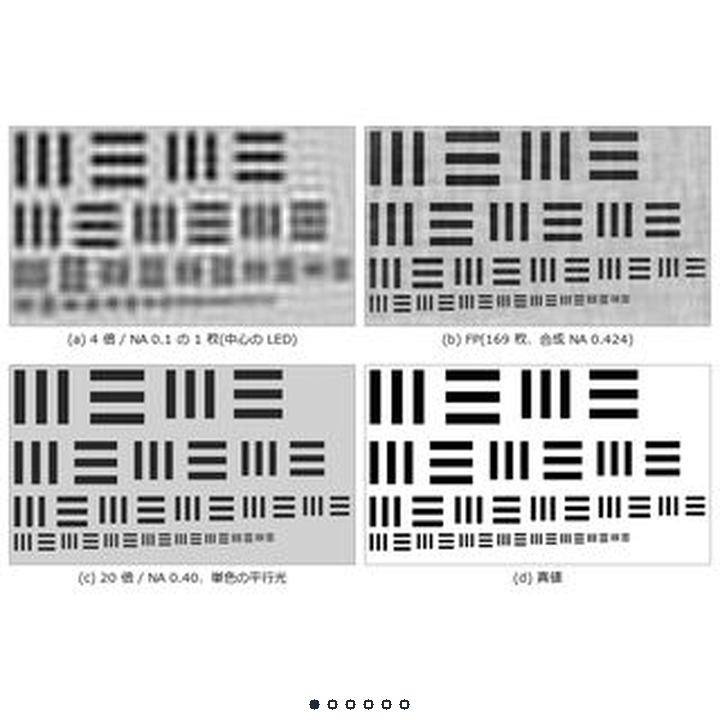
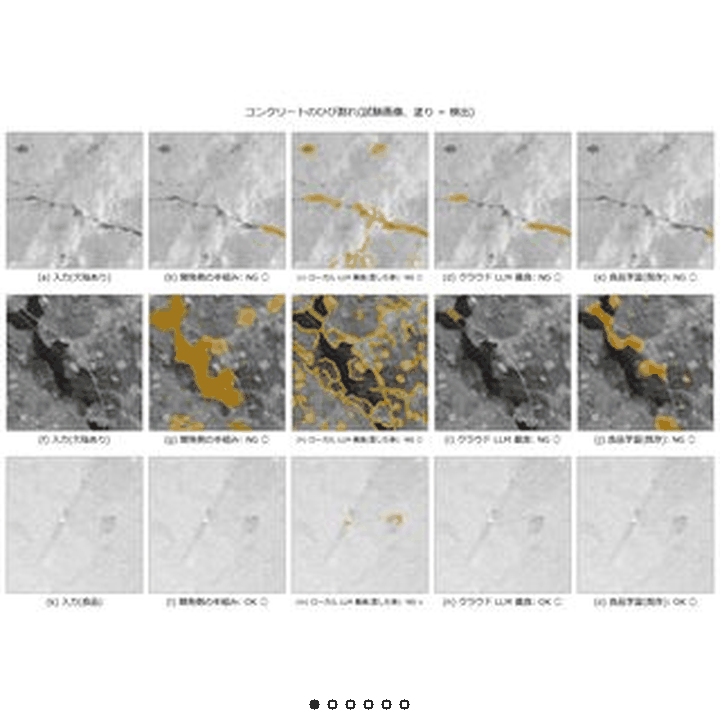
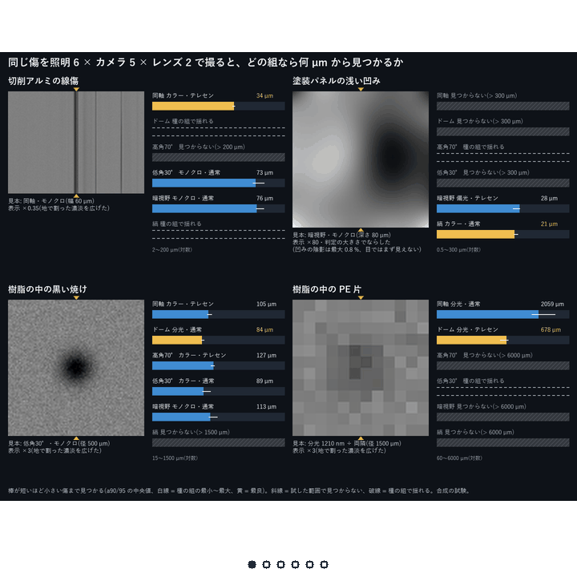
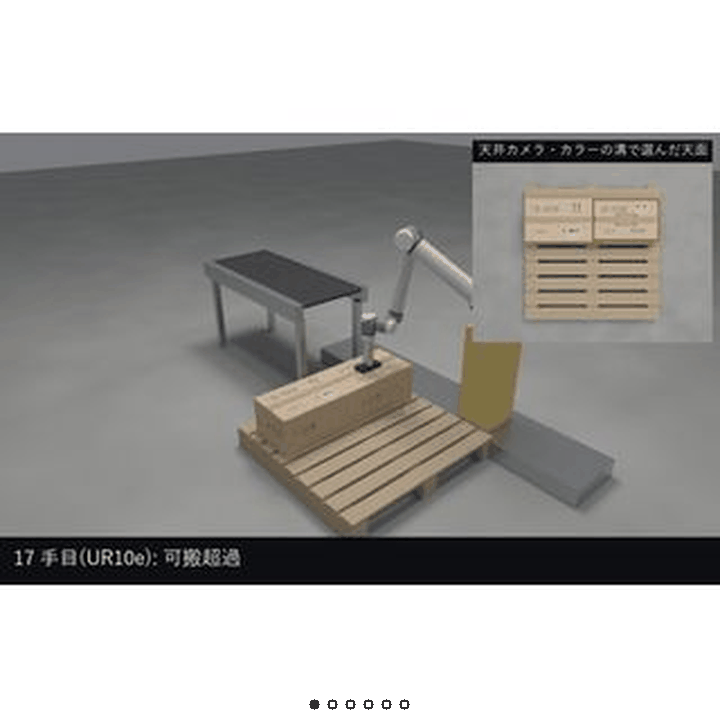

<div class="vlang" markdown="1">

[日本語](../index.md) · [English](../en/index.md) · [简体中文](../zh/index.md) · [繁體中文](../tw/index.md) · **한국어** · [Deutsch](../de/index.md) · [हिन्दी](../hi/index.md) · [Français](../fr/index.md)

</div>

# Fullseye — ViEW2026

**발표: 2026년 12월 3일(목) 14:40–15:50(일본 시간), 인터랙티브 세션 2, IS2-19**(파시피코 요코하마 아넥스 홀)

<div class="vintro"><div class="vt"><p>Fullseye는 영상 검사·3차원 계측·물리 시뮬레이션의 기반입니다. 타입을 가진 고전 영상 처리 연산자와 광학 설계 등 센싱을 포함한 물리 시뮬레이션을 MCP와 RAG로 AI에 넘겨, 과제마다 조합을 생각하게 하고, 타입 정합성과, 물리·촬상 시뮬레이션이 만든 참값에 비춘 평가로 확인하면서 대화형으로 과제를 풉니다. 오픈 소스(Apache-2.0).</p></div></div>

타일을 누르면 동영상·그림이 열립니다(▶ = 움직임).

이 페이지에는 전시 30건만 실었습니다. 나머지 285건은 [덤 페이지](more.md)에 있습니다.

<style>
.vlang { font-size: 14px; line-height: 2; }
.vg { display: grid; grid-template-columns: repeat(2, minmax(0, 1fr)); gap: 8px; margin: 12px 0 20px; }
.vg.vs { grid-template-columns: repeat(3, minmax(0, 1fr)); gap: 6px; }
@media (min-width: 600px) { .vg { grid-template-columns: repeat(3, minmax(0, 1fr)); } .vg.vs { grid-template-columns: repeat(5, minmax(0, 1fr)); } }
@media (min-width: 900px) { .vg { grid-template-columns: repeat(4, minmax(0, 1fr)); } .vg.vs { grid-template-columns: repeat(7, minmax(0, 1fr)); } }
.vg a, .vser a { display: block; position: relative; text-decoration: none; color: inherit; }
.vg img { display: block; width: 100%; max-width: 100%; height: auto; aspect-ratio: 1 / 1; object-fit: cover; border-radius: 6px; background: #222; }
.vg picture { display: block; width: 100%; aspect-ratio: 1 / 1; overflow: hidden; border-radius: 6px; background: #fff; }
.vg picture img { height: 100%; aspect-ratio: auto; object-fit: contain; border-radius: 0; background: #fff; }
.vg b { position: absolute; top: 6px; right: 6px; background: rgba(0,0,0,.6); color: #fff; font-size: 12px; padding: 1px 6px; border-radius: 9px; }
.vg span { display: block; font-size: 13px; line-height: 1.3; margin-top: 3px; }
.vg.vs span { font-size: 11px; }
.vser { display: grid; grid-template-columns: repeat(2, minmax(0, 1fr)); gap: 8px; margin: 12px 0 20px; }
@media (min-width: 600px) { .vser { grid-template-columns: repeat(3, minmax(0, 1fr)); } }
.vser img { display: block; width: 100%; max-width: 100%; height: auto; aspect-ratio: 16 / 9; object-fit: cover; border-radius: 8px; background: #222; }
.vser strong { display: block; font-size: 14px; margin-top: 3px; line-height: 1.3; }
.vser span { display: block; font-size: 12px; line-height: 1.3; }
details.vall { margin: 6px 0; }
details.vall > summary { font-size: 15px; padding: 6px 0; cursor: pointer; }
.vl li { margin-bottom: 8px; }
li, p, code { overflow-wrap: anywhere; }
.vintro { display: flex; gap: 20px; align-items: flex-start; margin: 14px 0; }
.vintro img { flex: 0 0 300px; width: 300px; max-width: 100%; height: auto; border-radius: 6px; }
.vintro .vt p { margin: 0 0 8px; }
.vc { display: flex; gap: 16px; align-items: flex-start; margin: 18px 0; }
.vc > a:first-child { flex: 0 0 260px; position: relative; display: block; text-decoration: none; color: inherit; }
.vc > a img { display: block; width: 100%; max-width: 100%; height: auto; aspect-ratio: 1 / 1; object-fit: cover; border-radius: 6px; background: #222; }
.vc > a picture { display: block; width: 100%; aspect-ratio: 1 / 1; overflow: hidden; border-radius: 6px; background: #fff; }
.vc > a picture img { height: 100%; aspect-ratio: auto; object-fit: contain; border-radius: 0; background: #fff; }
.vc > a b { position: absolute; top: 6px; right: 6px; background: rgba(0,0,0,.6); color: #fff; font-size: 12px; padding: 1px 6px; border-radius: 9px; }
.vc > a .vtb { position: absolute; left: 6px; bottom: 6px; max-width: calc(100% - 12px); background: rgba(0,0,0,.66); color: #fff; font-size: 12px; font-style: normal; line-height: 1.4; padding: 1px 7px; border-radius: 9px; }
.vt { flex: 1 1 auto; min-width: 0; }
.vt .vh { font-size: 17px; font-weight: 600; line-height: 1.4; margin: 0 0 6px; }
.vt p { margin: 0 0 6px; }
.vt .vm { font-size: 14px; color: #57606a; }
.vt details { font-size: 14px; margin: 4px 0; }
.vt summary { cursor: pointer; }
.vc.vv { margin: 10px 0; }
.vc.vv > a:first-child { flex-basis: 96px; }
@media (max-width: 600px) {
  .vintro { flex-direction: column-reverse; gap: 8px; }
  .vintro img { flex: 0 0 auto; width: 100%; max-width: 240px; }
  .vc { flex-direction: column; gap: 8px; }
  .vc > a:first-child { flex: 0 0 auto; width: 240px; max-width: 100%; }
  .vc.vv { flex-direction: row; gap: 12px; }
  .vc.vv > a:first-child { width: 80px; flex: 0 0 80px; }
}
</style>

## 직접 만져 보기

논문의 그림을 직접 움직여 확인할 수 있습니다(스마트폰에서도 동작합니다). 탭으로 방법을 바꾸고, 3-D는 드래그로 돌려 볼 수 있습니다.

<div class="vc vv"><a class="vvi" href="../viewers/poc_cad_scan_deviation.html?lang=ko"></a><div class="vt"><div class="vh"><a href="../viewers/poc_cad_scan_deviation.html?lang=ko">CAD와 실측 점군의 편차 검사</a></div><p>정합이 결함을 흡수해, 참값이 1.2 µm인 부품에 존재하지 않는 121 µm의 오목이 나타납니다.</p></div></div>

<div class="vc vv"><a class="vvi" href="../viewers/poc_photoelasticity.html?lang=ko"></a><div class="vt"><div class="vh"><a href="../viewers/poc_photoelasticity.html?lang=ko">광탄성 응력</a></div><p>검광자를 돌리면 광탄성 무늬가 움직이고 원판 안의 평균 명암이 바뀐다(0–135° 범위)</p></div></div>

<div class="vc vv"><a class="vvi" href="../viewers/poc_polarization_specular.html?lang=ko"></a><div class="vt"><div class="vh"><a href="../viewers/poc_polarization_specular.html?lang=ko">편광 정반사 제거</a></div><p>편광으로 정반사를 걷어 낼 수 있다. 남는 반사는 입사각에 따라 바뀌며 브루스터각 부근에서 가장 작다(스윕은 합성 줄무늬 장면)</p></div></div>

## 주요 전시

<div class="vc"><a href="../../articles/assets/poc/poc_industrial_oct/01_real_paint_bscans.png"><picture><source media="(prefers-reduced-motion: reduce)" srcset="../../articles/assets/poc/poc_industrial_oct/01_real_paint_bscans.png"></picture><i class="vtb">참값: 실제 데이터</i></a><div class="vt"><div class="vh"><a href="../../articles/assets/poc/poc_industrial_oct/01_real_paint_bscans.png">자르지 않고 도장층 두께 측정(산업용 OCT)</a></div><p>절단하지 않고 도장과 필름 층을 깊이 방향으로 본다. 공개된 자동차 도장의 원시 스펙트럼에서 측정한 투명 코팅 두께는 같은 패널의 현미경 측정값과 3.6 µm 이내로 일치한다. 논문의 OCT와 일치하는 것은 같은 데이터를 재현한 것일 뿐이며, 분리할 수 없을 만큼 얇은 층에는 값을 내지 않는다.</p><p class="vm">참값: 실제 데이터 · <a href="more.html#d-poc-industrial-oct">자세히</a></p></div></div>

<div class="vc"><a href="../../articles/assets/poc/poc_phase_measuring_deflectometry/03_photo_vs_pmd.png"><picture><source media="(prefers-reduced-motion: reduce)" srcset="../../articles/assets/poc/poc_phase_measuring_deflectometry/03_photo_vs_pmd.png"></picture><i class="vtb">참값: 자체 합성</i></a><div class="vt"><div class="vh"><a href="../../articles/assets/poc/poc_phase_measuring_deflectometry/03_photo_vs_pmd.png">확산 조명 사진에서 보이지 않는 찍힘이 줄무늬 거울상에 나타난다(합성)</a></div><p>광택 도장면의 매우 얕은 찍힘은 확산광 사진에서 거의 보이지 않는다. 표면을 향한 화면에 줄무늬를 투사하고 거울상이 휘는 정도로 곡률을 구하면 깊이 3 µm로 심어 둔 찍힘이 뚜렷해진다. 이는 합성 장면이며 사광 사진과는 비교하지 않았다.</p><p class="vm">참값: 자체 합성 · <a href="more.html#d-poc-phase-measuring-deflectometry">자세히</a></p></div></div>

<div class="vc"><a href="../../articles/assets/poc/poc_thin_film_reflectometry/01_real_micrograph_thickness.png"><picture><source media="(prefers-reduced-motion: reduce)" srcset="../../articles/assets/poc/poc_thin_film_reflectometry/01_real_micrograph_thickness.png"></picture><i class="vtb">참값: 실제 데이터</i></a><div class="vt"><div class="vh"><a href="../../articles/assets/poc/poc_thin_film_reflectometry/01_real_micrograph_thickness.png">현미경 사진의 색으로 산화막 두께 읽기</a></div><p>실리콘 위 산화막 두께는 반사광의 간섭무늬와 색으로 읽을 수 있다. 다른 연구자가 공개한 실제 현미경 사진을 화소별로 읽은 중심값은 87.4 nm였다. 이는 논문에서 도출한 기준보다 약 십분의 일 낮으며 카메라의 색 감도는 알려져 있지 않다.</p><p class="vm">참값: 실제 데이터 · <a href="more.html#d-poc-thin-film-reflectometry">자세히</a></p></div></div>

<div class="vc"><a href="../../articles/assets/poc/poc_registration_basin/06_real_scan_icp.mp4"><picture><source media="(prefers-reduced-motion: reduce)" srcset="../../articles/assets/poc/poc_registration_basin/07_real_scan_still.png"></picture><b>&#9654;</b><i class="vtb">참값: 실제 데이터</i></a><div class="vt"><div class="vh"><a href="../../articles/assets/poc/poc_registration_basin/06_real_scan_icp.mp4">실측 깊이에서는 ICP 수렴 영역이 좁아진다</a></div><p>실측 부품과 합성 브래킷에서 정합이 얼마나 먼 초기 위치에서 같은 종점으로 돌아오는지 시험했다. 여러 시드와 교차 판정 규칙에서 성공률이 절반으로 줄어드는 각도는 전 방향 점을 쓸 때보다 최대 31.5도 빨랐다. 종점 자체가 참값에서 벗어나므로 이는 자세 정확도가 아니라 복귀 범위를 측정한다.</p><p class="vm">참값: 실제 데이터 · <a href="more.html#d-poc-registration-basin">자세히</a></p></div></div>

<div class="vc"><a href="../../articles/assets/poc/poc_hyperspectral_foreign_matter/04_real_pork_belly.png"><picture><source media="(prefers-reduced-motion: reduce)" srcset="../../articles/assets/poc/poc_hyperspectral_foreign_matter/01_real_polymer_flakes.png"></picture><i class="vtb">참값: 실제 데이터</i></a><div class="vt"><div class="vh"><a href="../../articles/assets/poc/poc_hyperspectral_foreign_matter/04_real_pork_belly.png">근적외선 분광 영상으로 삼겹살 위 이물질 찾기</a></div><p>공개된 실제 영상을 근적외선 분광 데이터로 사용해 삼겹살 위 이물질을 분류했다. 별도로 촬영한 영상에서 화소별로 평가했을 때 대부분을 1.1 %의 오경보율로 검출했다. 대역을 줄이면 오경보가 늘었으며 컬러 카메라가 같은 색 이물질을 구별하지 못한다는 점은 합성 데이터에서만 보였다.</p><p class="vm">참값: 실제 데이터 · <a href="more.html#d-poc-hyperspectral-foreign-matter">자세히</a></p></div></div>

<div class="vc"><a href="../../articles/assets/poc/poc_cad_scan_deviation/14_align_orbit.gif"><picture><source media="(prefers-reduced-motion: reduce)" srcset="../../articles/assets/poc/poc_cad_scan_deviation/01_scene.png"></picture><b>&#9654;</b><i class="vtb">참값: 자체 합성</i></a><div class="vt"><div class="vh"><a href="../../articles/assets/poc/poc_cad_scan_deviation/14_align_orbit.gif">정합 방식이 부품의 어느 곳이 공차를 벗어나 보일지 결정한다: CAD와 스캔(합성)</a></div><p>스캔을 설계에 정합하면 편차 일부를 흡수해 공차를 벗어나 보이는 위치가 이동한다. 알려진 휨이 있는 부품에서는 실제 편차가 아주 작은 중앙에 깊이 121 µm의 측정값이 나타난다. 이는 합성 결과이며 설계를 점으로 표본화하면 결함 없는 대조군에서도 모서리가 공차 밖으로 나타난다.</p><p class="vm">참값: 자체 합성 · <a href="more.html#d-poc-cad-scan-deviation">자세히</a></p></div></div>

<div class="vc"><a href="../../articles/assets/poc/poc_fourier_ptychography/01_usaf_4x_fp_20x.png"><picture><source media="(prefers-reduced-motion: reduce)" srcset="../../articles/assets/poc/poc_fourier_ptychography/01_usaf_4x_fp_20x.png"></picture><i class="vtb">참값: 자체 합성</i></a><div class="vt"><div class="vh"><a href="../../articles/assets/poc/poc_fourier_ptychography/01_usaf_4x_fp_20x.png">4배 대물렌즈로 단색 평행광 조명의 20배와 같은 분해능(푸리에 타이코그래피, 합성)</a></div><p>저배율 대물렌즈는 넓은 시야를 보지만 미세한 세부를 놓친다. 합성 차트에서 여러 각도의 조명으로 찍은 영상을 주파수 공간에서 이어 단색 평행광 아래의 20x 대물렌즈와 같은 수준을 얻었다. 일반 조명에서는 그 대물렌즈가 여전히 더 미세하게 분해하며 조명 겹침이 너무 적으면 답을 내지 않는다.</p><p class="vm">참값: 자체 합성 · <a href="more.html#d-poc-fourier-ptychography">자세히</a></p></div></div>

<div class="vc"><a href="../../articles/assets/poc/poc_itof_multifreq/12_public_raw_unwrap.png"><picture><source media="(prefers-reduced-motion: reduce)" srcset="../../articles/assets/poc/poc_itof_multifreq/01_warehouse_unwrap.png"></picture><i class="vtb">참값: 자체 합성</i></a><div class="vt"><div class="vh"><a href="../../articles/assets/poc/poc_itof_multifreq/12_public_raw_unwrap.png">간접 ToF 깊이가 무너지는 지점(합성)</a></div><p>간접 ToF 카메라는 변조광의 위상 지연으로 거리를 측정한다. 합성 신호에서 세 주파수를 조합하면 18.7 m까지 거리를 모호함 없이 읽을 수 있다. 다중 경로와 물체 경계에서는 아무 경고 없이 거리가 튄다.</p><p class="vm">참값: 자체 합성 · <a href="more.html#d-poc-itof-multifreq">자세히</a></p></div></div>

<div class="vc"><a href="../../articles/assets/poc/poc_telecentric_metrology/08_real_alignment_plate.png"><picture><source media="(prefers-reduced-motion: reduce)" srcset="../../articles/assets/poc/poc_telecentric_metrology/08_real_alignment_plate.png"></picture><i class="vtb">참값: 실제 데이터</i></a><div class="vt"><div class="vh"><a href="../../articles/assets/poc/poc_telecentric_metrology/08_real_alignment_plate.png">공개 텔레센트릭 영상에서 측정한 배율이 논문 자체의 산포 범위 안에서 논문 값과 일치</a></div><p>일반 렌즈로 단차가 있는 부품을 한 영상에 담으면 가까운 면일수록 더 크게 보인다. 공개된 텔레센트릭 렌즈의 실제 영상에서 측정한 배율은 논문과 일치하지만 논문 자체의 값이 ±0.25 %만큼 퍼져 있어 그보다 정밀한 일치로 해석하지 않는다. 기울어진 판에서 원의 중심이 이동하지 않는 것이 그 근거다.</p><p class="vm">참값: 실제 데이터 · <a href="more.html#d-poc-telecentric-metrology">자세히</a></p></div></div>

<div class="vc"><a href="../../articles/assets/poc/poc_virtual_sem_kv_cd_bse/05_sem_same_part_3kv_3detectors.png"><picture><source media="(prefers-reduced-motion: reduce)" srcset="../../articles/assets/poc/poc_virtual_sem_kv_cd_bse/05_sem_same_part_3kv_3detectors.png"></picture><i class="vtb">참값: 공표값</i></a><div class="vt"><div class="vh"><a href="../../articles/assets/poc/poc_virtual_sem_kv_cd_bse/05_sem_same_part_3kv_3detectors.png">가상 SEM: 전압에 따라 영상이 달라진다(실측 후방 산란으로 모델 평가)</a></div><p>SEM 영상은 표면 사진이 아니라 고체 안에서 산란한 뒤 빠져나온 전자를 집계한 것이다. 각 전자를 추적하는 모델을 7개 원소의 실측 후방 산란 데이터와 대조했다. 선폭을 아는 실제 영상이 없으므로 빔 에너지에 따른 선폭 측정값의 변화는 모델 안의 결과다.</p><p class="vm">참값: 공표값 · <a href="more.html#d-poc-virtual-sem-kv-cd-bse">자세히</a></p></div></div>

<div class="vc"><a href="../../articles/assets/poc/poc_real_tum_rgbd_slam/02_trajectory.png"><picture><source media="(prefers-reduced-motion: reduce)" srcset="../../articles/assets/poc/poc_real_tum_rgbd_slam/02_trajectory.png"></picture><i class="vtb">참값: 실제 데이터</i></a><div class="vt"><div class="vh"><a href="../../articles/assets/poc/poc_real_tum_rgbd_slam/02_trajectory.png">공개 RGB-D 데이터의 프레임 간 정합 평가: 각 분할이 선택한 이상치 제거에 따라 오차는 등속 추정의 0.45-0.82배(32프레임 시퀀스 하나)</a></div><p>공개된 책상 깊이 시퀀스 하나에서 프레임 간 정합을 모션 캡처 참값과 비교했다. 정합하지 않을 때보다 오차는 줄었지만 등속 추정 대비 개선은 이상치 제거 방식과 8개 분할 중 무엇을 쓰는지에 좌우됐다. 작은 창의 평면 잔차는 거리에 따라 커졌지만 제곱 법칙은 확인되지 않았다.</p><p class="vm">참값: 실제 데이터 · <a href="more.html#d-poc-real-tum-rgbd-slam">자세히</a></p></div></div>

<div class="vc"><a href="../../articles/assets/poc/poc_good_sample_variation_model/04_visa_explanation.png"><picture><source media="(prefers-reduced-motion: reduce)" srcset="../../articles/assets/poc/poc_good_sample_variation_model/01_band_width_alignment.png"></picture><i class="vtb">참값: 실제 데이터</i></a><div class="vt"><div class="vh"><a href="../../articles/assets/poc/poc_good_sample_variation_model/04_visa_explanation.png">양품 변동으로 결함 찾기: 실영상에서는 선언한 오검출률이 지켜지지 않는다</a></div><p>고전적인 검사는 양품에서 일반적인 화소별 변동을 학습하고 그 범위를 벗어난 곳을 표시한다. 여기서는 미리 선언한 오경보율로 범위를 정하고 공개된 실제 영상 200장에서 평가했다. 정합 여부가 양품 수보다 더 큰 영향을 미쳤으며 선언한 비율은 실제 영상에서 지켜지지 않았다.</p><p class="vm">참값: 실제 데이터 · <a href="more.html#d-poc-good-sample-variation-model">자세히</a></p></div></div>

<div class="vc"><a href="../../articles/assets/poc/poc_real_walnut_cbct/07_geometry_mistakes.png"><picture><source media="(prefers-reduced-motion: reduce)" srcset="../../articles/assets/poc/poc_real_walnut_cbct/07_geometry_mistakes.png"></picture><i class="vtb">참값: 실제 데이터</i></a><div class="vt"><div class="vh"><a href="../../articles/assets/poc/poc_real_walnut_cbct/07_geometry_mistakes.png">실측 CT: 수직 오프셋을 무시하면 다른 단면이 재구성되며 외부 기준만이 오류를 드러낸다</a></div><p>호두를 실제로 원뿔 빔으로 스캔하고 FDK와 반복법으로 재구성했다. 투영 영상 300장을 저자의 기준과 비교하면 수직 이동을 무시한 재구성은 더 멀리 벗어난 다른 단면을 만든다. 데이터 자체는 일관되므로 재투영 뒤의 잔차는 바뀔 수 없다.</p><p class="vm">참값: 실제 데이터 · <a href="more.html#d-poc-real-walnut-cbct">자세히</a></p></div></div>

<div class="vc"><a href="../../articles/assets/poc/poc_bottle_pattern_inverse/01_checker_through_bottle.png"><picture><source media="(prefers-reduced-motion: reduce)" srcset="../../articles/assets/poc/poc_bottle_pattern_inverse/01_checker_through_bottle.png"></picture><i class="vtb">참값: 자체 합성</i></a><div class="vt"><div class="vh"><a href="../../articles/assets/poc/poc_bottle_pattern_inverse/01_checker_through_bottle.png">배경 줄무늬로 유리병을 역추정하기(시뮬레이션): 같은 가정 아래의 복원과 분리할 수 없는 양</a></div><p>투명한 병은 뒤쪽 줄무늬를 왜곡한다. 각 화소에서 보이는 배경 위치를 찾고 병의 형상과 굴절률을 역으로 맞춘 뒤 시뮬레이션의 채움 상태 5가지 참값으로 평가한다. 분리할 수 없는 양도 보고하며 실제 병에서는 아무것도 확인하지 않았다.</p><p class="vm">참값: 자체 합성 · <a href="more.html#d-poc-bottle-pattern-inverse">자세히</a></p></div></div>

<div class="vc"><a href="../../articles/assets/poc/poc_ai_built_inspection_scored/01_crack_real.png"><picture><source media="(prefers-reduced-motion: reduce)" srcset="../../articles/assets/poc/poc_ai_built_inspection_scored/01_crack_real.png"></picture><i class="vtb">참값: 실제 데이터</i></a><div class="vt"><div class="vh"><a href="../../articles/assets/poc/poc_ai_built_inspection_scored/01_crack_real.png">AI가 검사를 구성하고 공개 실측 데이터로 평가(로컬 LLM이 균열에서 우연보다 나은 검사를 만든 것은 60회 중 5회, 촛농 얼룩에서는 전무)</a></div><p>로컬 LLM에 말로 과제를 주고 MCP만으로 검사 절차를 만들게 한 뒤 공개된 실제 영상으로 평가했다. 균열에서 우연보다 나은 실행은 적었고 단일 통계 기준선(AUROC 0.999)에 도달한 것은 없었다. 촛농 얼룩에서는 하나도 작동하지 않았으며 조건이 일치하지 않는 클라우드 LLM 실행도 기존 절차보다 낮았다.</p><p class="vm">참값: 실제 데이터 · <a href="more.html#d-poc-ai-built-inspection-scored">자세히</a></p></div></div>

<div class="vc"><a href="../../articles/assets/poc/poc_3d_sensor_modalities/01_map.png"><picture><source media="(prefers-reduced-motion: reduce)" srcset="../../articles/assets/poc/poc_3d_sensor_modalities/01_map.png"></picture><i class="vtb">참값: 자체 합성</i></a><div class="vt"><div class="vh"><a href="../../articles/assets/poc/poc_3d_sensor_modalities/01_map.png">한 부품에서 다섯 가지 3-D 센싱 방식 시뮬레이션: 재질별로 무너지는 지점</a></div><p>이 시뮬레이션에서는 여러 깊이 센싱 방식의 모델로 같은 부품의 무광, 광택 금속, 반투명, 검정 재질을 측정한다. 형상 오차는 공통된 0.1 mm 기준으로 세어 치수표와 비교했다. 방식마다 해상도의 자릿수가 다르므로 순위가 아니라 각각 어디서 무너지는지를 봐야 한다.</p><p class="vm">참값: 자체 합성 · <a href="more.html#d-poc-3d-sensor-modalities">자세히</a></p></div></div>

## 추천 전시

<div class="vc"><a href="../../articles/assets/poc/poc_photoelasticity/03_load_and_isoclinics.mp4"><picture><source media="(prefers-reduced-motion: reduce)" srcset="../../articles/assets/poc/poc_photoelasticity/01_polariscope.png"></picture><b>&#9654;</b><i class="vtb">참값: 자체 합성</i></a><div class="vt"><div class="vh"><a href="../../articles/assets/poc/poc_photoelasticity/03_load_and_isoclinics.mp4">압축된 원판의 응력이 줄무늬로 보인다(광탄성, 합성)</a></div><p>편광자를 통해 보면 하중을 받은 투명 플라스틱의 내부 응력이 줄무늬로 나타난다. 줄무늬 차수가 0.5를 넘어 위상이 감기는 곳까지 편광 영상에서 압축 원판의 응력을 복원했다. 위상을 푼 뒤의 오차 대부분은 감김이 아니라 오래전부터 알려진 부호 반전 위치에 있다.</p><p class="vm">참값: 자체 합성 · <a href="more.html#d-poc-photoelasticity">자세히</a></p></div></div>

<div class="vc"><a href="../../articles/assets/poc/poc_equipment_selection_map/02_equipment_at_a_glance.png"><picture><source media="(prefers-reduced-motion: reduce)" srcset="../../articles/assets/poc/poc_equipment_selection_map/02_equipment_at_a_glance.png"></picture><i class="vtb">참값: 자체 합성</i></a><div class="vt"><div class="vh"><a href="../../articles/assets/poc/poc_equipment_selection_map/02_equipment_at_a_glance.png">장비 지도: 같은 결함을 60가지 조명·카메라·렌즈 조합으로 촬영(합성 시험)</a></div><p>같은 결함을 대상으로 외관 검사 장비를 미리 시험했다. 조명·카메라·렌즈의 60가지 조합으로 반복 측정의 산포와 함께 검출 가능한 최소 결함을 지도화했다. 이는 합성 시험이며 실제 장비의 성능이 아니다.</p><p class="vm">참값: 자체 합성 · <a href="more.html#d-poc-equipment-selection-map">자세히</a></p></div></div>

<div class="vc"><a href="../../articles/assets/poc/poc_real_stereo_multiscanline/02_failure_map.png"><picture><source media="(prefers-reduced-motion: reduce)" srcset="../../articles/assets/poc/poc_real_stereo_multiscanline/02_failure_map.png"></picture><i class="vtb">참값: 실제 데이터</i></a><div class="vt"><div class="vh"><a href="../../articles/assets/poc/poc_real_stereo_multiscanline/02_failure_map.png">실제 스테레오로 시차·면·원의 자세</a></div><p>실제 스테레오 영상 한 쌍으로 시차, 거리, 표면과 원의 자세까지 계산한다. 결과를 Middlebury 2014가 제공하는 참값 시차로 평가하고 OpenCV와 비교했다. 양쪽 모두 유효한 화소에서는 거의 같았고 차이 대부분은 각자 어느 화소를 무효로 하는지에서 생겼다.</p><p class="vm">참값: 실제 데이터 · <a href="more.html#d-poc-real-stereo-multiscanline">자세히</a></p></div></div>

<div class="vc"><a href="../../articles/assets/poc/poc_polarization_specular/09_glare_removed_label.png"><picture><source media="(prefers-reduced-motion: reduce)" srcset="../../articles/assets/poc/poc_polarization_specular/01_raw_polarizer_mosaic.png"></picture><i class="vtb">참값: 자체 합성</i></a><div class="vt"><div class="vh"><a href="../../articles/assets/poc/poc_polarization_specular/09_glare_removed_label.png">편광으로 필름 반사를 90 % 제거, 이 조명에서는 고정 편광 필터 한 장으로 충분(합성)</a></div><p>각 화소에 편광자가 있는 카메라는 광택 필름 뒤의 라벨을 확산 성분과 눈부심 성분으로 나눈다. 눈부심의 약 90 %가 사라지지만 이 조명에서는 고정 편광 필터가 인쇄를 더 잘 읽는다. 더 넓은 조명에서만 카메라가 따라잡으며 장면은 합성이고 실제 영상과 대조하지 않았다.</p><p class="vm">참값: 자체 합성 · <a href="more.html#d-poc-polarization-specular">자세히</a></p></div></div>

<div class="vc"><a href="../../articles/assets/poc/poc_solar_el_inspection/10_real_el_overlay.png"><picture><source media="(prefers-reduced-motion: reduce)" srcset="../../articles/assets/poc/poc_solar_el_inspection/15_real_cover.png"></picture><i class="vtb">참값: 공개 실제 데이터(참값은 I-V 실측)</i></a><div class="vt"><div class="vh"><a href="../../articles/assets/poc/poc_solar_el_inspection/10_real_el_overlay.png">태양전지 셀의 실제 EL 영상: 차광 마스크의 어두운 영역은 출력 저하를 따르지만, 셀 전체가 어두워지는 결함은 따르지 않는다</a></div><p>실제 셀의 공개 EL 영상에서 어두운 영역의 순위를 I-V 곡선으로 측정한 출력 손실 순위와 비교했다. 합성 셀에서 효과가 있던 격자 분할은 가장자리 띠 마스크까지 지웠고 다시 조정한 방식도 평균 밝기만 쓴 것보다 뚜렷이 낫지 않았다(순위 상관 0.57). 셀 전체가 어두워지면 어떤 면적 계수도 손실을 따라가지 못한다.</p><p class="vm">참값: 공개 실제 데이터(참값은 I-V 실측) · <a href="more.html#d-poc-solar-el-inspection">자세히</a></p></div></div>

<div class="vc"><a href="../../articles/assets/poc/poc_interferometry_step/09_csi_scan_explained.mp4"><picture><source media="(prefers-reduced-motion: reduce)" srcset="../../articles/assets/poc/poc_interferometry_step/01_surface_interferograms.png"></picture><b>&#9654;</b><i class="vtb">참값: 자체 합성</i></a><div class="vt"><div class="vh"><a href="../../articles/assets/poc/poc_interferometry_step/09_csi_scan_explained.mp4">백색광 간섭으로 나노미터 단차 측정(합성)</a></div><p>합성 스캔에서 백색광 간섭계가 줄무늬 대비의 최댓값으로 읽은 단차를 다시 측정했다. 단일 측정은 표준편차가 최소 10.5 nm로 퍼지며 반복 평균에 남은 편향은 잡음에 묻힌다. 스캔 간격이 너무 거칠면 잡음이 없어도 오차가 남는다.</p><p class="vm">참값: 자체 합성 · <a href="more.html#d-poc-interferometry-step">자세히</a></p></div></div>

<div class="vc"><a href="../../articles/assets/poc/poc_tdi_linescan/11_tdi_1_vs_64_closeup.png"><picture><source media="(prefers-reduced-motion: reduce)" srcset="../../articles/assets/poc/poc_tdi_linescan/01_tdi_stages_defects.png"></picture><i class="vtb">참값: 자체 합성</i></a><div class="vt"><div class="vh"><a href="../../articles/assets/poc/poc_tdi_linescan/11_tdi_1_vs_64_closeup.png">어두운 라인에서도 TDI를 쌓으면 옅은 흠이 드러난다(합성)</a></div><p>이동하는 필름이나 강판은 라인 센서로 촬영한다. 약한 결함을 심은 합성 강판과 전형적인 센서 모델에서 어두운 라인의 노출을 64단 쌓자 잡음에 묻혔던 결함이 드러났다. 이송과 촬영의 동기가 어긋나면 적층 영상이 번진다.</p><p class="vm">참값: 자체 합성 · <a href="more.html#d-poc-tdi-linescan">자세히</a></p></div></div>

<div class="vc"><a href="../../articles/assets/poc/poc_illumination_cone_vs_na/07_cone_cover.png"><picture><source media="(prefers-reduced-motion: reduce)" srcset="../../articles/assets/poc/poc_illumination_cone_vs_na/07_cone_cover.png"></picture><i class="vtb">참값: 자체 합성</i></a><div class="vt"><div class="vh"><a href="../../articles/assets/poc/poc_illumination_cone_vs_na/07_cone_cover.png">조명 원뿔의 벌어짐에 따라 찍힘과 흠이 보이거나 사라진다(합성)</a></div><p>거울에 가까운 금속에서는 각 빛 원뿔의 폭과 축이 얕은 찍힘과 헤어라인 흠을 보이거나 숨길 수 있다. 균일한 원뿔을 쓴 합성 설정에서 원뿔 반각 4°는 헤어라인 무늬를 숨기고 흠만 어둡게 남겼다. 이는 장비 지도의 바탕이 되는 물리이며 실제 사진과는 아직 대조하지 않았다.</p><p class="vm">참값: 자체 합성 · <a href="more.html#d-poc-illumination-cone-vs-na">자세히</a></p></div></div>

<div class="vc"><a href="../../articles/assets/poc/poc_real_defect_floor/03_defect_floor_explained.mp4"><b>&#9654;</b><i class="vtb">참값: 실사 배경</i></a><div class="vt"><div class="vh"><a href="../../articles/assets/poc/poc_real_defect_floor/03_defect_floor_explained.mp4">잡음을 맞춰도 실제 배경의 약한 결함 검출 한계는 합성보다 2.03-3.47배 나쁘다</a></div><p>검사 현장에서는 평탄한 바탕에 잡음을 더한 합성 영상으로 얼마나 약한 결함까지 잡을 수 있는지 흔히 추정한다. 잡음을 맞춰도 모든 실제 배경에서 검출 한계가 합성 배경의 최소 2.03배로 높아졌다. 한계를 정한 것은 잡음이 아니라 모르타르 이음부 같은 배경 구조였다.</p><p class="vm">참값: 실사 배경 · <a href="more.html#d-poc-real-defect-floor">자세히</a></p></div></div>

<div class="vc"><a href="../../articles/assets/poc/poc_mixed_case_depalletizing/08_depal_robot_video.mp4"><picture><source media="(prefers-reduced-motion: reduce)" srcset="../../articles/assets/poc/poc_mixed_case_depalletizing/01_overview_same_pattern.png"></picture><b>&#9654;</b><i class="vtb">참값: 자체 합성</i></a><div class="vt"><div class="vh"><a href="../../articles/assets/poc/poc_mixed_case_depalletizing/08_depal_robot_video.mp4">혼재 상자: 깊이 단차, V 홈 또는 색상 홈(시뮬레이션)</a></div><p>시뮬레이션 장면에서 겉모습이 비슷한 상자를 위쪽의 깊이와 색상으로 구분해 내린다. 깊이 단차로는 하나도 나뉘지 않으며 깊이 홈과 어두운 색 선 중 어느 쪽이 이기는지는 28가지 덮개 이음 구조에 따라 바뀐다. 인쇄가 같으면 깊은 홈은 색상에 유리하고 넓고 테이프 없는 절단면이 얕은 홈 위에 있을 때만 깊이가 우세하다.</p><p class="vm">참값: 자체 합성 · <a href="more.html#d-poc-mixed-case-depalletizing">자세히</a></p></div></div>

<div class="vc"><a href="../../articles/assets/poc/poc_tem_ctf_thon_rings/17_real_cover.png"><picture><source media="(prefers-reduced-motion: reduce)" srcset="../../articles/assets/poc/poc_tem_ctf_thon_rings/02_thon_rings_four_defoci.png"></picture><i class="vtb">참값: 실제 데이터(참조값은 저자의 CTFFIND3 추정값)</i></a><div class="vt"><div class="vh"><a href="../../articles/assets/poc/poc_tem_ctf_thon_rings/17_real_cover.png">실제 전자현미경 영상으로 초점 이탈 추정, 저자 값과 0.21 % 이내</a></div><p>투과전자현미경에서는 초점 이탈이 미세 구조의 밝고 어두운 부호를 뒤집는다. 공개된 실제 현미경 사진에서 추정한 초점 이탈은 저자들이 사용한 소프트웨어와 0.21 % 이내로 일치했다. 재료와 반도체 TEM도 같은 동심원 무늬에서 초점을 읽지만 공개된 생물 데이터만 시험했다.</p><p class="vm">참값: 실제 데이터(참조값은 저자의 CTFFIND3 추정값) · <a href="more.html#d-poc-tem-ctf-thon-rings">자세히</a></p></div></div>

<div class="vc"><a href="../../articles/assets/poc/poc_sam_hybrid_bonding_voids/03_amplitude_vs_phase.png"><picture><source media="(prefers-reduced-motion: reduce)" srcset="../../articles/assets/poc/poc_sam_hybrid_bonding_voids/03_amplitude_vs_phase.png"></picture><i class="vtb">참값: 자체 합성</i></a><div class="vt"><div class="vh"><a href="../../articles/assets/poc/poc_sam_hybrid_bonding_voids/03_amplitude_vs_phase.png">초음파 에코 위상으로 접합면의 공극 찾기(시뮬레이션)</a></div><p>이 시뮬레이션은 주사 음향 현미경으로 적층 칩의 접합면에 있는 작은 공극을 찾는다. 크기가 16 um 이상인 공극은 에코 위상 영상에서 반전된 밝은 점으로 나타났다. 밝기 영상에서는 작은 공극 다수가 정상 화소 사이에 숨는다.</p><p class="vm">참값: 자체 합성 · <a href="more.html#d-poc-sam-hybrid-bonding-voids">자세히</a></p></div></div>

<div class="vc"><a href="../../articles/assets/poc/poc_lidar_terrain_change/13_real_dod.png"><picture><source media="(prefers-reduced-motion: reduce)" srcset="../../articles/assets/poc/poc_lidar_terrain_change/01_geometry.png"></picture><i class="vtb">참값: 실제 데이터</i></a><div class="vt"><div class="vh"><a href="../../articles/assets/poc/poc_lidar_terrain_change/13_real_dod.png">두 시기 항공 LiDAR: 계통 차를 빼지 않으면 전면이 파인 것처럼 보인다</a></div><p>같은 공원을 두 해에 걸쳐 측정한 공개 항공 LiDAR를 빼면 전체 지역이 파낸 것처럼 가라앉아 보인다. 평지에서 0.183 m 오프셋을 맞추면 건물 주변의 변화만 남는다. 변화가 장면 대부분을 덮는 합성 경사면에서는 정합이 변화 자체를 흡수해 부피가 무너진다.</p><p class="vm">참값: 실제 데이터 · <a href="more.html#d-poc-lidar-terrain-change">자세히</a></p></div></div>

<div class="vc"><a href="../../articles/assets/poc/poc_moire_alignment/09_overlay_cover.png"><picture><source media="(prefers-reduced-motion: reduce)" srcset="../../articles/assets/poc/poc_moire_alignment/02_one_nm_steps.png"></picture><i class="vtb">참값: 자체 합성</i></a><div class="vt"><div class="vh"><a href="../../articles/assets/poc/poc_moire_alignment/09_overlay_cover.png">보이지 않는 격자 두 장을 겹쳐 모아레 무늬로 nm 어긋남을 읽는다(합성)</a></div><p>리소그래피에서는 마스크와 웨이퍼를 나노미터 정밀도로 겹쳐야 한다. 카메라가 볼 수 없을 만큼 미세한 격자를 겹치면 무늬가 생기며 백색 잡음만 넣은 합성 시험에서 나노미터 간격을 오차 0.08 nm로 읽었다. 실제 정합 정확도는 훨씬 거칠고 마크 비대칭과 간격 같은 계통 오차가 결정하지만 이 시험에는 포함되지 않았다.</p><p class="vm">참값: 자체 합성 · <a href="more.html#d-poc-moire-alignment">자세히</a></p></div></div>

## 시리즈 기사 (Qiita의 영어 기사)

<div class="vser">
<a href="https://qiita.com/furuse-kazufumi/items/8a8f23e53b19ee8cdc10"><strong>지면의 계측관</strong><span>참값을 직접 심은 PoC 전시관</span></a>
<a href="https://qiita.com/furuse-kazufumi/items/a82bf9f341cc4f04ca75"><strong>탁구</strong><span>바운드와 마찰을 영상으로 측정</span></a>
<a href="https://qiita.com/furuse-kazufumi/items/05de90f4d316cd7c681c"><strong>자율주행</strong><span>정리와 두 번째 구현으로 채점</span></a>
<a href="https://qiita.com/furuse-kazufumi/items/638f0b0aa7865e17c67c"><strong>커넥톰(뇌 배선도)</strong><span>파리 시각 모델을 몸에 얹어 측정</span></a>
<a href="https://qiita.com/furuse-kazufumi/items/569720dbae0c6471c96e"><strong>휴머노이드 운동회</strong><span>영상 처리가 심판을 보는 집 운동회</span></a>
</div>

[덤: 그 밖의 PoC](more.md)도 보세요.

<details markdown="1">
<summary><b>직접 해 보기</b> (Python 3.11)</summary>

```
pip install fullseye
git clone https://github.com/furuse-kazufumi/fullseye
cd fullseye
python examples/poc_focus_stacking.py
```

초점 합성 PoC가 약 20초 동안 실행되며 참값 대비 숫자와 `PASS`를 출력합니다. 그림은 `out/figures/poc_focus_stacking/`에 저장됩니다.

</details>

<details markdown="1">
<summary><b>링크</b></summary>

- [GitHub(소스 코드)](https://github.com/furuse-kazufumi/fullseye)
- [갤러리(모든 그림)](../../GALLERY.en.md)
- [연산자 찾기·AI(RAG)에서 쓰기](../../AI_RAG_GUIDE.ko.md) · [MCP에서 쓰기](../../MCP.md) _(ja)_
- [문서 색인](../../README.ko.md)

</details>

<details markdown="1">
<summary><b>논문 정보</b></summary>

- **제목**: Fullseye：型付き演算子と物理シミュレーションに基づく画像検査・三次元計測基盤 _(ja)_ (타입 연산자와 물리 시뮬레이션에 기반한 영상 검사·3차원 계측 기반)
- **저자**: Kazufumi Furuse(개인 연구자)
- **발표**: ViEW2026 비전 기술 실용 워크숍
- **논문 PDF**: [日本語](../paper/101.pdf) · [English](../paper/101_en.pdf) · [简体中文](../paper/101_zh.pdf)

**초록(일본어에서 번역)**: 영상 검사·3차원 계측 처리를 입출력 데이터 타입을 선언한 연산자의 연쇄로 구성하고, 물리·촬상 시뮬레이션으로 만든 참값에 대해 정량 평가하며, 처리 절차·평가·실패 조건을 기록해 재사용할 수 있는 오픈 소스 기반 Fullseye를 제안한다. 약 3,000개의 타입 연산자, 타입 불일치를 실행 전에 거부하는 검사, 다국어 연산자 검색(RAG), 참값을 갖춘 200개 이상의 실증 프로그램으로 이루어지며, 대표 사례의 정량 평가와 합성·실측·실기 검증 단계의 구분에 대해 보고한다.

</details>
